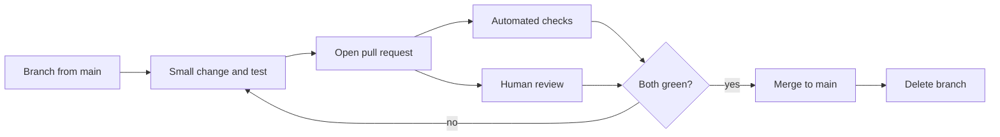
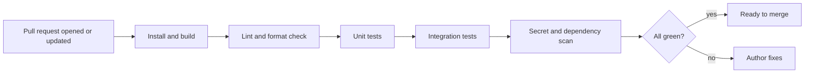
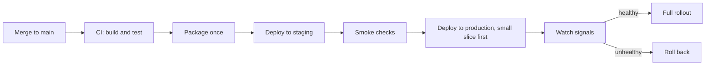

# Module 3 — Building software well

*Qafila has reached Traction. About twelve people now work there, 300 merchants use the app for about 4,000 deliveries a day, payments run through a payment provider, and one team of engineers changes the same code base every day. The habits that worked when Maha and Faisal were alone (push straight to the main copy, test by clicking around, deploy by hand on a quiet evening) start to cost money and sleep. This module covers the three everyday practices that let a small team change software often without breaking it: version control with code review and a written working agreement, automated tests that run on every change through continuous integration, and continuous delivery with deployments that are small, observable and easy to undo. Each lesson leaves you with an artefact you can use on any team: a working agreement with a pull request checklist, a test plan and pipeline sketch for one change, and a release plan with a rollback step.*

> **Steps:** Build — turn ideas into working software in small, reviewed, tested changes that any teammate can understand, and get them to customers safely and often.

---

# 3.1 — Version control, code review and working agreements
*Level: 🟢 Beginner* · *Prerequisites: 0.2, 2.3* · *Step: Build*

**After this you can** explain how a team uses version control, branches and pull requests to change shared code safely, review a small pull request against a checklist, and write a one-page team working agreement that says how code gets from a laptop into the main branch. *Study time: reading about 20 min, hands-on about 90 min (estimate).*

## ⚡ In 60 seconds
- **Version control** keeps every change to the code as a named, dated, reversible record, with the reason for it. It is the team's shared memory.
- A **pull request** (also called a merge request) proposes a change to the main branch so someone else can read it, the automated checks can run, and the discussion is recorded.
- **Code review** is not a gate to catch the author out. It spreads knowledge, catches mistakes while they are cheap and keeps the code readable for the next person.
- The rule that matters most: **small changes, merged often, each one reviewed and explained.**
- Decision cue: if a reviewer cannot understand your change in about the time it takes to drink a coffee, split it.
- Biggest trap: writing rules nobody agreed to. A working agreement is written *by* the team, kept short and changed when it stops helping.

## 🧭 Why it matters
Qafila and everyone in it are fictional. All numbers about Qafila in this lesson are illustrative figures, not benchmarks.

At Launch, Maha and Faisal shared one repository and simply pushed their changes to it. If they clashed, they turned round in their chairs and sorted it out. Now it is Traction: six engineers work in the same repository, 300 merchants depend on the app, and every delivery triggers a payment through the payment provider.

On a Tuesday night two engineers have both changed the delivery-fee code: one adds a weekend surcharge, the other fixes rounding. Faisal, tired, resolves the clash at 11 p.m., keeps the wrong half and pushes straight to the main branch. Nobody else sees it. On Wednesday a bakery phones Salma's support line: every order since the morning carries last month's fee. Faisal needs two hours to find the change, because the record says only "fix fees" and nobody remembers which version was right.

Nobody was careless on purpose; the team had outgrown a way of working built for two people. Maha asks Faisal and Aisha, the new product manager, to propose "how we change code here", on one page, by Friday.

## 📐 How it works

### 🟢 The essentials

**Version control in plain words.** A **repository** (or "repo") is a folder whose full history is tracked. Each saved change is a **commit**: a snapshot of what changed, who made it, when, and a short message saying why. The most widely used tool is Git; a **version control host** (for example GitHub or GitLab, named only as illustrations) stores the shared copy online and adds pull requests, reviews and permissions on top.

| Term | Plain meaning | At Qafila |
|---|---|---|
| **Commit** | One recorded change, with a message | "Add weekend surcharge to delivery fee (Fri–Sat, 2 QAR)" |
| **Main branch** | The agreed, current version everyone builds from; often called `main` | What gets deployed to merchants |
| **Branch** | A separate line of work that starts from main and is merged back later | `fee-weekend-surcharge` |
| **Merge** | Combining a branch's changes into main | After review and checks pass |
| **Merge conflict** | Two changes touch the same lines; a person must decide which is right | Faisal's Tuesday night |
| **Revert** | A new commit that undoes an earlier one, keeping the history | How Faisal finally fixed the fee |

(The 2 QAR surcharge is an illustrative figure.)

**A good commit message** answers "why", because the code already shows "what". Compare:

| Weak | Strong |
|---|---|
| "fix fees" | "Round delivery fee to 0.25 QAR, as agreed with merchants in pricing note 4; old rounding caused 0.01 differences on receipts" |
| "updates" | "Show courier the shop's opening hours so they stop arriving at closed shops (support tickets about closed shops)" |

**Pull requests.** A **pull request** (PR) is a request to merge a branch into main. It shows the difference ("diff") line by line, runs the automated checks (lesson 3.2) and holds the conversation. A short, useful PR description has four parts:

1. **What and why:** one or two sentences, linked to the ticket or request.
2. **How to check it:** what the reviewer should try or look at.
3. **Risk:** what could break, and who would notice (merchants, couriers, payments).
4. **Undo:** how to reverse it if it goes wrong (often "revert this PR"; sometimes more, see lesson 3.3).

**Code review.** Another engineer reads the change before it is merged. A reviewer asks, in roughly this order:

- **Does it do what the description says, and is that the right thing?** A perfect implementation of the wrong idea is still wrong.
- **Could it break something?** Edge cases, error handling, payments, personal data, other parts of the app that call this code.
- **Is it tested?** Is there a test that would fail if this change were broken (lesson 3.2)?
- **Will the next person understand it?** Names, structure, comments where the "why" is not obvious.
- **Is anything secret or personal in it?** Keys, passwords, real customer data in test files.

Leave style (spacing, naming conventions) to an automatic formatter and linter.

### 🟡 Going deeper

**Keep changes small.** Google's published code review practices advise small, focused changes, note that reviewers rarely complain a change is too small, and say one can be rejected simply for being too large (as reported from the "Small CLs" page; a "CL" is roughly a pull request). Small changes are faster to review, conflict less and are easier to undo. A large feature can almost always be split: a refactor that changes no behaviour, new code hidden behind a switch (lesson 3.3), then the change that turns it on.

**Branch briefly, merge often.** Long-lived branches drift from main, and the longer they live the more painful the merge. DORA, a long-running research programme on software delivery now part of Google Cloud, describes **trunk-based development** as each developer merging small batches into the main branch ("trunk") at least once a day, and associates it with better delivery performance (as reported from DORA's capability guide). You need short-lived branches and a habit of merging, not a named branching model.



**Protect the main branch.** Version control hosts let you set rules on main: no direct pushes, an approving review, required checks, and approval from named owners for sensitive folders (GitHub's "About protected branches" page describes such options, as reported from summaries of it). These settings are the working agreement made real, and protect you from yourself at 11 p.m.

**Reviewing kindly and usefully.** Comment on the code, not the person ("this returns null when the shop is closed", not "you forgot closed shops"). Mark what is blocking and what is optional ("nit:" is a common prefix for a small point). Approve when the change makes the code better, even if you would have written it differently. As an author, answer every comment; the review is about the change, not you.

**Respond quickly.** A pull request waiting two days is finished work not delivered. Agree a response time (for example one working day) and treat reviews as real work.

### 🔴 Expert view

**The working agreement.** A **working agreement** is a short, written set of rules a team chooses for itself about how it works together. For code, it usually covers:

| Topic | Question it answers |
|---|---|
| Branches | How long can a branch live? Who may push to main? |
| Pull requests | What must the description contain? How big is too big? |
| Review | How many approvals? Who reviews payments or security code? How fast? |
| Checks | Which automated checks must pass before merging? |
| Emergencies | What happens when a fix is urgent at night? Who may skip a step, and what must they do afterwards? |
| Review of the agreement | When do we look at these rules again? |

Write it with the team, not for it. Keep it to one page. Include the emergency path honestly: if there is no legitimate fast path, people will invent an illegitimate one. A common pattern is "an urgent fix may be merged with one reviewer on a call, and is reviewed again properly the next working day".

**Review is also how knowledge spreads.** Much of Qafila's payment logic lives in Faisal's head. If he reviews everything he becomes a bottleneck; if nobody reviews his code, nobody learns it. Rotate reviewers and pair newer ones with experienced authors.

**AI-written code is still your code.** Coding assistants can draft whole pull requests. Review them with the same checklist and more suspicion, because fluent code can be confidently wrong. The library covers this in depth in [*A Practical Guide to Becoming an AI-Native Engineer*, lesson 5.2 — Lab: review a pull request an agent wrote](../ainative/index.html#/5.2).

**Secrets never go into the repository.** History is forever: deleting a committed key in a later commit does not remove it from the history. Store secrets in a secrets manager or the platform's secret settings, and scan for them automatically. See [*Secure AI & Application Security: Zero to Hero*, lesson 5.2 — Secrets management: keys, tokens and where they leak](../secai/index.html#/5.2).

**The memorable rule.** Small changes, merged often, each one reviewed and explained.

## 🧰 The toolkit
| Resource, tool or template | What it is and does | When to reach for it |
|---|---|---|
| **Team working agreement** | One page the team writes: branches, PRs, review, checks, emergencies, review date | When more than two people change the same code |
| **Pull request template** | Four headings in every PR: what and why, how to check, risk, undo | Set once on the repository; used on every PR |
| **Reviewer checklist** | Five questions: right thing, could it break, tested, understandable, secrets or personal data | Every review, until it is habit |
| **Branch protection rules** | Host settings: no direct pushes to main, required review, required checks, code owners | As soon as the team agrees its rules |
| **Secret scanner** | A check that blocks commits or PRs containing keys and passwords | From the first day a repository holds real credentials |

## 🏛️ In practice at Qafila
Aisha and Faisal draft the agreement; the whole engineering team edits it on Friday. Illustrative and fictional.

> **Qafila engineering working agreement (Traction, version 1)**
>
> | Topic | We agree |
> |---|---|
> | Main branch | Nobody pushes directly to `main`, including Faisal and Maha. `main` is always deployable |
> | Branches | Short-lived: merged or closed within two working days |
> | Pull requests | Use the template (what and why, how to check, risk, undo). Aim for a change a reviewer can read in about 20 minutes; split anything bigger |
> | Review | One approval. Changes to `payments/` or `auth/` also need Faisal or one of the two engineers he is training |
> | Response time | First review within one working day; reviews come before starting new work |
> | Checks | Build and tests must pass before merging (lesson 3.2) |
> | Emergency | Urgent fix: one reviewer on a call, merge, then a normal review next working day. Post in the team channel what was skipped |
> | Commit messages | Say why, not only what. Link the ticket |
> | Secrets | Never in the repository. The secret scanner blocks PRs that contain one |
> | Next review | In six weeks, at the team retrospective |
>
> **Fee incident follow-up:** the reverted commit now has a full message explaining the right rounding rule; the fee code has two named owners.

Faisal wanted "two approvals for everything"; the others said that with six engineers this would stall most work, so a second approver is needed only where money or access is involved. A newer engineer asked what "small" meant; "about 20 minutes to read" was the compromise, to be checked in six weeks.

## 🛠️ Exercises
**🟢 Write three good commits.** In any personal project, or a new practice repository on a free version control host, make three small changes (a README section, a function, a fix). Write each commit message so a stranger understands *why*.
*Done when:* each commit changes one thing, each message has a short summary line plus a reason, and none says only "update" or "fix".

<details><summary>Model answer and self-check</summary>

**Model answer.** "Add setup steps to README so new contributors can run the app locally (two friends asked how)". "Validate phone numbers before saving a shop, because couriers could not call shops with malformed numbers". "Fix total on receipt: tax was added twice when a discount applied".

**Self-check.**
- Could someone reading only the history explain why each change was made?
- Does each commit do one thing, so it could be reverted alone?
- Did you avoid committing passwords, keys or personal data?

</details>

**🟡 Review a pull request with the checklist.** Open any small, recent, merged pull request in a public open-source project you use (look for one under about 100 changed lines). Review it as if it were not yet merged, using the five reviewer questions. Write three comments: one blocking concern or question, one suggestion marked as optional, and one thing done well.
*Done when:* every comment points to specific lines, is phrased about the code rather than the person, and is clearly marked as blocking or optional.

<details><summary>Model answer and self-check</summary>

**Model answer.** For a PR adding a date-parsing option: blocking, "line 42 returns an empty string when there is no timezone; intended, and tested?"; optional, "nit: `parseOpt` could be `parseOptions`"; positive, "the leap-year test is clear and would have caught the old bug".

**Self-check.**
- Did you check whether it does the right thing, not only whether the code is neat?
- Did you look for missing tests and error cases?
- Would the author feel helped rather than judged by your wording?

</details>

**🔴 Write a working agreement for a team of five.** Imagine you join Qafila's team on the day after the fee incident (or use a real team or student group you are in). Write a one-page working agreement covering the six topics in the expert view, including an honest emergency path, then translate three of your rules into branch protection settings on your practice repository.
*Done when:* the agreement fits on one page, has a review date, includes an emergency path with a follow-up step, and at least three rules are enforced by settings rather than memory.

<details><summary>Model answer and self-check</summary>

**Model answer.** Rules similar to Qafila's version 1, with settings: (1) require a pull request before merging into `main`; (2) require one approving review; (3) require the test check to pass. Emergency path: "two people on a call, merge, full review next working day, note in the channel". Review date: six weeks.

**Self-check.**
- Could the team actually follow every rule at its current size?
- Does the emergency path exist and leave a trace?
- Did you avoid rules only one person can satisfy?

</details>

## ⚠️ Mistakes and traps
- **Pushing straight to main "just this once".** Once becomes habit. Protect the branch, and give urgent fixes a real fast path instead.
- **Giant pull requests.** A 2,000-line change gets a rubber stamp, not a review. Split it into steps that each make sense alone.
- **Reviews that only check style.** Let a formatter handle spacing; spend your attention on behaviour, risk and tests.
- **Reviews as gatekeeping.** Harsh or slow reviews teach people to hide work. Be specific, kind and quick.
- **Rules written for the team, not by it.** Imposed rules get worked around. Write them together and review them on a date.
- **Committing a secret and "deleting" it later.** It stays in the history. Rotate the secret at once and add a scanner.

## 🧾 Recap
- Version control is the team's shared, reversible memory; good commit messages record why.
- Pull requests bring a change, its checks and its discussion together before it reaches main.
- Review for correctness, risk, tests and clarity, kindly and quickly; let tools handle style.
- Keep branches short-lived and changes small; protect main with settings that match the agreement.
- A working agreement is one page, written by the team, with an honest emergency path and a review date.
- Rule: small changes, merged often, each one reviewed and explained.

## ✍️ Check yourself
**1. After the fee incident, what would most have shortened the two hours Faisal spent finding the cause?**

- A. A rule that only Faisal may resolve merge conflicts, since he knows the fee code.
- B. A weekly meeting where engineers describe the changes they plan to make to the fee code.
- C. A reviewed pull request whose description put both the change and its reason on record.
- D. A spreadsheet where engineers log every change to the fee code at the end of each day.

<details><summary>Answer</summary>

**C.** A reviewed pull request records what changed and why, and a second reader might have noticed the wrong half. A makes Faisal (who made the mistake) a bottleneck, B covers plans not actual changes, and D duplicates version control by hand. See "Pull requests" and "Why it matters".

</details>

**2. A newer engineer opens a pull request with 1,800 changed lines covering a new courier screen, a refactor of the order model and a library upgrade. What should the reviewer suggest first?**

- A. Split it into separate, smaller pull requests that each make sense and can be reviewed alone.
- B. Approve it quickly, since holding a large change open longer only makes merge conflicts worse.
- C. Ask two more reviewers to share the lines, so the whole change is still checked line by line.
- D. Merge it to a long-lived release branch, so it can be tested there for a few weeks before main.

<details><summary>Answer</summary>

**A.** Small, focused changes are faster and safer to review and undo. B rubber-stamps a change nobody understood, C spreads a huge review thin, and D creates the drifting long-lived branch that causes painful merges. See "Keep changes small".

</details>

**3. Which review comment is the most useful?**

- A. "This is messy. Please clean it up before I look at it properly."
- B. "I would have done this differently, but it is your call to make."
- C. "nit: rename this variable, and also maybe the logic is a bit off?"
- D. "Line 58 skips closed shops, and no test covers that case; can you add one?"

<details><summary>Answer</summary>

**D.** It points to a line, names a concrete risk and asks for a specific action. A is vague and about the person, B gives no information, and C mixes an optional point with a vague possible bug, so the author cannot tell what is blocking. See "Reviewing kindly and usefully".

</details>

**4. Aisha asks why the agreement includes an emergency path at all. What is the best reason?**

- A. Regulators expect every company to document an emergency process for all of its code changes.
- B. Without a legitimate fast path, people under pressure invent one that leaves no trace.
- C. Emergencies are the only time when reviews slow work down enough to matter to merchants.
- D. It lets senior engineers skip review whenever they judge that a change is low risk.

<details><summary>Answer</summary>

**B.** An honest fast path with a follow-up keeps urgent fixes visible. A states a legal conclusion the lesson does not make, C misreads why reviews exist, and D turns the exception into a permanent bypass. See "The working agreement".

</details>

**5. An engineer notices that a payment provider key was committed to the repository last week and removed in a later commit. What should happen?**

- A. Nothing more, because the later commit removed the key and the current code is clean.
- B. Make the repository private, which removes the key from anyone else's view of the history.
- C. Treat the key as exposed: rotate it now, and add a secret scanner to block repeats.
- D. Rewrite the commit message of the earlier commit so it no longer mentions the key.

<details><summary>Answer</summary>

**C.** History keeps the key; anyone with access to the history may have it, so it must be replaced. A ignores the history, B does not remove access already granted or copies already made, and D changes a message, not the content. See "Secrets never go into the repository".

</details>

## 📚 References
- Google, "Small CLs", Google Engineering Practices Documentation (CC BY 3.0): https://google.github.io/eng-practices/review/developer/small-cls.html — advice to keep changes small, that reviewers rarely complain a change is too small and may reject one for being too large (reported from search summaries; the page could not be opened from this environment on 2026-11-22).
- DORA, "Trunk-based development" capability guide: https://dora.dev/capabilities/trunk-based-development/ — developers merge small batches into trunk at least once a day (reported from search summaries; not opened).
- GitHub Docs, "About protected branches": https://docs.github.com/en/repositories/configuring-branches-and-merges-in-your-repository/managing-protected-branches/about-protected-branches — required reviews, required status checks, code owner review (reported from search summaries; not opened). One host's documentation, cited as an illustration, not an endorsement.
- Library course: [*A Practical Guide to Becoming an AI-Native Engineer*, lesson 5.2 — Lab: review a pull request an agent wrote](../ainative/index.html#/5.2).
- Library course: [*Secure AI & Application Security: Zero to Hero*, lesson 5.2 — Secrets management: keys, tokens and where they leak](../secai/index.html#/5.2).

---

# 3.2 — Automated testing and continuous integration
*Level: 🟢 Beginner* · *Prerequisites: 3.1* · *Step: Build*

**After this you can** explain the main kinds of automated tests and what each is for, write a short risk-based test plan for one change, and sketch a continuous integration pipeline that builds and tests every pull request and tells the team quickly when something breaks. *Study time: reading about 20 min, hands-on about 100 min (estimate).*

## ⚡ In 60 seconds
- An **automated test** is code that checks other code and reports pass or fail, the same way every time, in seconds.
- Use **many fast, small tests** (unit tests) and **fewer slow, broad ones** (end-to-end tests). Put the effort where a failure would hurt most.
- **Continuous integration (CI)** means everyone merges small changes into the main branch often, and every change is built and tested automatically.
- The rule that matters most: **a red build is the team's top priority; fix it or revert it before anything else.**
- Decision cue: for every change, ask "what test would fail if this were broken?" If the answer is "none", write one.
- Biggest trap: tests that fail at random. People learn to ignore red, and then the real failure gets ignored too.

## 🧭 Why it matters
Qafila and everyone in it are fictional. All numbers about Qafila in this lesson are illustrative figures, not benchmarks.

At Launch, Faisal tested by hand: he clicked through the merchant app, created an order, watched it reach the courier app, and deployed on Thursday evening. With 15 shops and about 150 deliveries a day, mistakes were rare and cheap. Now Qafila has 300 merchants and about 4,000 deliveries a day, six engineers merge daily, and the team has agreed (lesson 3.1) that tests must pass before merging. There are almost no tests.

A week later, a change to courier assignment passes a careful review. Nobody notices that orders from shops with two branches are now never offered to a courier. Salma, who runs support and the new on-call rota, spends Saturday phoning couriers by hand. The fix is one line; a test with a two-branch shop would have caught it in seconds.

Faisal admits he skipped tests "to go faster" at Launch. Maha asks for a plan: which tests first, and how to run them on every change.

## 📐 How it works

### 🟢 The essentials

**What an automated test is.** A test sets something up, does one thing, and checks the result. That pattern is often called **arrange, act, assert**:

```
Arrange: a shop with two branches, one courier near branch B
Act:     create an order at branch B
Assert:  the courier near branch B is offered the order
```

If the check fails, the test fails, and it names what went wrong. Because it is code, it runs the same way every time, on every change, without anyone remembering to do it.

**The main kinds of test.** Names vary between teams; the ideas are stable.

| Kind | What it checks | Speed | At Qafila |
|---|---|---|---|
| **Unit test** | One small piece of logic on its own | Milliseconds | Delivery fee calculation; courier assignment rules |
| **Integration test** | Pieces working together, such as code plus a real database | Seconds | Saving an order and reading it back |
| **Contract test** | That two parts agree on the shape of the messages they exchange | Seconds | The merchant app and the server agree on what an "order" looks like |
| **End-to-end test** | A whole user journey through the real interfaces | Minutes | Shop creates an order, courier accepts, order marked delivered |
| **Manual exploratory testing** | A person deliberately trying to break things in ways nobody scripted | Hours | Aisha trying the new screen with Arabic shop names and a slow phone |

**The test pyramid.** A common rule of thumb, often drawn as a pyramid: many unit tests at the bottom, fewer integration tests in the middle, a small number of end-to-end tests at the top. Ham Vocke's article "The Practical Test Pyramid" (2018, on Martin Fowler's site) starts from Mike Cohn's three layers and calls the model a useful rule of thumb that is too simple to follow literally (as reported from summaries of the article). The reason for the shape is cost: broad tests are slow, break for many reasons and are hard to diagnose, so you want only enough of them to prove the main journeys work.

**What "good enough" testing means.** You cannot test everything. Test where a failure would hurt most and where mistakes are likely:

- **Money:** fees, refunds, payment provider calls.
- **Core journeys:** creating, assigning and completing a delivery.
- **Tricky logic:** rules with many cases, such as shop opening hours, branches, time zones.
- **Things that broke before:** every bug fixed gets a test that would have caught it.

**Continuous integration.** Martin Fowler's article "Continuous Integration", rewritten in 2023, describes it as everyone on the team integrating their work into the mainline often (at least daily), with each integration checked by an automated build that includes tests (as reported from summaries of the article). A **CI system** (for example GitHub Actions or GitLab CI, named only as illustrations) watches the repository, and on every pull request and every merge it runs a **pipeline**: a fixed list of steps.



The result shows on the pull request as a green tick or a red cross. The branch protection rules from lesson 3.1 make the green tick a condition for merging.

### 🟡 Going deeper

**Keep the pipeline fast.** Feedback that takes an hour is feedback people stop waiting for. The ten-minute build is a long-standing guideline from Extreme Programming, an agile method that popularised continuous integration, and Fowler treats it as reasonable (as reported from summaries of his writing). Ways to stay fast: run unit tests first so cheap failures stop the run early; run independent steps in parallel; keep end-to-end tests few and focused on the main journeys; and do not test the same thing at every level.

**A red build is the team's problem.** When main is red, nobody can trust it, and every new change piles onto a broken base. Most teams agree: whoever broke it fixes it straight away, or reverts their change and fixes it calmly on a branch. Reverting is not a defeat; it is the cheapest way to get everyone unblocked.

**Flaky tests.** A **flaky test** passes and fails on the same code, for example because it depends on timing, on the order tests run, on the real clock, or on an outside service. Flaky tests are worse than no tests, because they teach people that red means nothing. When a test flakes: record it, take it out of the required checks within a day (do not just keep pressing "re-run"), fix the cause, and put it back. The library goes deeper in [*Software Testing: Zero to Hero in the AI Era*, lesson 2.3 — Are your tests any good? Coverage, mutation testing, property-based testing and flaky tests](../testing/index.html#/2.3).

**Coverage is a clue, not a goal.** **Code coverage** is the share of lines that ran during the tests. Low coverage shows gaps; high coverage proves nothing, since a test that asserts nothing still "covers" code. Ask "would a test fail if this were wrong?".

**Tests for a bug, before the fix.** Write a test that reproduces the bug and watch it fail; fix the code and watch it pass. The fix is proved and the bug cannot quietly return.

**Writing tests first.** **Test-driven development (TDD)** writes a failing test for the next small behaviour, then just enough code to pass it, then tidies up. It is a technique, not a creed; try it where cases are clear, like fees. See [*Software Testing: Zero to Hero in the AI Era*, lesson 2.1 — Unit testing and TDD: arrange-act-assert, test doubles and fast feedback](../testing/index.html#/2.1).

### 🔴 Expert view

**A test plan for one change.** You do not need a long document. For a change of any size, a few lines are enough:

| Field | Question |
|---|---|
| Change | What is changing, in one sentence? |
| Risks | What could go wrong, and for whom? |
| Automated tests | Which new or changed tests cover each risk, at which level? |
| Manual checks | What will a person try that automation does not cover? |
| Not tested, and why | What risk are we accepting, knowingly? |
| Signal after release | What will tell us in production that it works (lesson 3.3 and Module 4)? |

The "not tested, and why" line is the most honest one. It turns a hidden gamble into a decision someone can question.

**Test data and personal data.** Never copy real customers' names, phones or addresses into test files; invent data with the same shape (two-branch shops, Arabic names, long addresses). History makes a leak permanent.

**What CI does not do.** CI says the code builds and your tests pass, not that you wrote the right tests, built what merchants need, or that it copes with real traffic. Exploratory testing, product checks (Module 6) and monitoring (Module 4) still matter.

**Testing AI-written code.** When a coding assistant writes code, tests become the specification it must meet, and the evidence you review. See [*Software Testing: Zero to Hero in the AI Era*, lesson 6.2 — Tests as the specification for coding agents: test-first workflows, guardrails and mutation as the judge](../testing/index.html#/6.2). For how CI pipelines are built in practice, see [*Cloud & DevOps: Zero to Hero*, lesson 4.1 — Continuous integration: pipelines, tests, artefacts and fast feedback](../cloud/index.html#/4.1).

**The memorable rule.** A red build is the team's top priority: fix it or revert it before anything else.

## 🧰 The toolkit
| Resource, tool or template | What it is and does | When to reach for it |
|---|---|---|
| **Test plan (one change)** | Change, risks, automated tests, manual checks, not tested and why, signal after release | Before starting any change that touches money or a core journey |
| **Test pyramid sketch** | Count of tests at each level, with the target shape | When the suite is slow or flaky, to see where the weight is |
| **CI pipeline** | Steps the CI system runs on every PR and merge: build, lint, unit, integration, scans | From the moment more than one person merges code |
| **Bug-first test** | A test that reproduces a reported bug before it is fixed | Every bug fix |
| **Flaky test log** | A list of tests that flaked, who owns them, and when they return to required checks | The first time anyone presses "re-run" twice |

## 🏛️ In practice at Qafila
Faisal writes the plan for the courier-assignment fix; Aisha adds manual checks. Illustrative and fictional.

> **Test plan: courier assignment for multi-branch shops (Traction)**
>
> | Field | Entry |
> |---|---|
> | Change | Assign couriers using the branch where the order is created, not the shop's first branch |
> | Risks | Orders from multi-branch shops not offered to anyone (seen last Saturday); single-branch shops affected by mistake; couriers offered orders far away |
> | Automated tests | Unit: two-branch shop, order at branch B, courier near B is offered it. Unit: single-branch shop, unchanged. Unit: no courier within range, order goes to the manual queue. Integration: order saved with branch ID and read back |
> | Manual checks | Aisha creates orders at both branches of a test shop on a phone with a slow connection |
> | Not tested, and why | Shops with more than five branches: none exist yet; noted for later |
> | Signal after release | Count of orders waiting more than 10 minutes without a courier offer, watched by Salma for two days |
>
> **Pipeline (first version):** on every PR: install, build, format and lint check, unit tests, integration tests against a throwaway database, secret scan. Target: under 10 minutes. Red on `main`: the person who merged fixes or reverts within the hour.

Faisal's first plan had no "not tested" line; Aisha asked what he was leaving out, and he found the many-branches case. A newer engineer wanted an end-to-end test for every screen; the team started with three journeys (create, accept, deliver) and will add more only when a bug shows the need.

## 🛠️ Exercises
**🟢 Write three unit tests.** In any language you know, write a small function `delivery_fee(distance_km, is_weekend)` with these illustrative rules: 5 QAR for the first 3 km, plus 1 QAR per extra started kilometre, plus 2 QAR at weekends. Write three tests using arrange, act, assert.
*Done when:* the tests run with one command, at least one test sits on a boundary (exactly 3 km, or just over), and breaking the weekend rule in the code makes a test fail.

<details><summary>Model answer and self-check</summary>

**Model answer.** Tests: 3 km on a weekday is 5; 3.1 km on a weekday is 6 (a started extra kilometre); 2 km at a weekend is 7. In Python with pytest, each is three lines: arrange the inputs, call the function, assert the result.

**Self-check.**
- Did you test the boundary, where most mistakes live?
- Did you deliberately break the code once to see a test go red?
- Does each test name say what it checks (for example `test_weekend_adds_two`)?

</details>

**🟡 Write a test plan for one change.** Pick a change: either "couriers can mark an order as 'shop closed' and return it" at Qafila, or a real change in a project of yours. Fill in the six fields of the test plan.
*Done when:* each risk is matched to at least one test or manual check, the "not tested, and why" field has at least one honest entry, and the signal after release is something you could count.

<details><summary>Model answer and self-check</summary>

**Model answer.** Risks: order lost after return; merchant not told; courier paid wrongly; misuse. Automated: unit tests for the state change "accepted → returned" and for the fee rule on returns; integration test that the merchant notification is queued. Manual: Salma tries it with a test shop. Not tested: misuse patterns, watched in data. Signal: returns per day per courier.

**Self-check.**
- Does every risk have a test or a check next to it?
- Did you put most tests at the unit level?
- Is the accepted risk written down rather than forgotten?

</details>

**🔴 Build a CI pipeline.** Put your exercise-1 code in a practice repository on a free version control host and add a CI workflow that installs dependencies, runs a linter and runs your tests on every pull request. Protect the main branch so the check must pass. Then open a pull request that breaks a test.
*Done when:* the broken pull request shows a red check and cannot be merged, a fixed version shows green, and the whole run takes under ten minutes.

<details><summary>Model answer and self-check</summary>

**Model answer.** A workflow file with three steps (install, lint, test), triggered on `pull_request` and on pushes to `main`. Branch protection requires that check. The broken PR fails at the test step in under a minute; the fix turns it green.

**Self-check.**
- Does the pipeline stop at the first failing step and name the failing test?
- Did you confirm merging is actually blocked, not only that a red cross appears?
- Did you keep secrets out of the workflow file?

</details>

## ⚠️ Mistakes and traps
- **Pressing "re-run" until it is green.** You are training the team to ignore failures. Log flaky tests and fix them.
- **Chasing a coverage number.** Tests that assert nothing raise coverage and catch nothing. Ask what each test would catch.
- **Too many end-to-end tests.** The suite becomes slow and fragile. Push checks down to unit and integration level where you can.
- **Leaving main red.** Every later change is built on a broken base. Fix or revert at once.
- **Real customer data in tests.** It leaks into history forever. Use invented data with the same shape.

## 🧾 Recap
- Automated tests check behaviour the same way every time, in seconds; arrange, act, assert.
- Many fast unit tests, fewer integration tests, a few end-to-end tests: put effort where failures hurt.
- CI builds and tests every change automatically and makes a green result a condition for merging.
- Keep the pipeline fast, keep tests reliable, and treat a red main branch as the team's top priority.
- A short test plan names risks, tests, manual checks, what is knowingly untested, and the signal after release.
- Rule: a red build is the team's top priority; fix it or revert it before anything else.

## ✍️ Check yourself
**1. Two engineers reviewed the courier-assignment change carefully and still missed the two-branch bug. What would most reliably have caught it before merging?**

- A. A unit test with a two-branch shop, run automatically by CI on the pull request.
- B. A third reviewer with more experience of the courier assignment code in the app.
- C. A longer review period, so reviewers had a full day to read the change slowly.
- D. A weekly manual test session in which the team tries the app before a release.

<details><summary>Answer</summary>

**A.** A test for the case runs on every change without anyone needing to remember it. B and C still rely on people noticing an unthought-of case, and D finds the problem days later, after merchants hit it. See "What an automated test is" and "Continuous integration".

</details>

**2. Qafila's end-to-end suite takes 50 minutes and fails about once a day for no clear reason. What is the best first step?**

- A. Add more end-to-end tests so every screen is covered and failures are easier to spot.
- B. Remove all the end-to-end tests and rely only on reviews for the user journeys.
- C. Allow merging when only the end-to-end tests fail, since those failures are usually noise.
- D. Move most checks down to unit and integration tests and log, then fix, the flaky ones.

<details><summary>Answer</summary>

**D.** Pushing checks down speeds the pipeline, and handling flaky tests openly restores trust in red. A makes it slower and flakier, B drops the main-journey checks, and C teaches people to ignore red. See "Keep the pipeline fast" and "Flaky tests".

</details>

**3. A manager proudly reports 95% code coverage. What should you ask first?**

- A. Which tool calculated the figure, so we can compare it with other teams' coverage.
- B. Would the tests actually fail if the important logic, like fees, were wrong?
- C. How quickly can the team raise the figure to 100% across the whole code base?
- D. Whether coverage is measured on every pull request or only once each month.

<details><summary>Answer</summary>

**B.** Coverage shows what code ran, not whether anything was checked. A and D are about measurement details, and C chases the number rather than the quality of the tests. See "Coverage is a clue, not a goal".

</details>

**4. On Monday morning main is red after a merge on Sunday night. Three engineers want to start new work. What does the working agreement most likely say?**

- A. The person who merged fixes it at once or reverts their change; new work waits.
- B. Each engineer starts new work on a branch and checks main again after lunch.
- C. The engineers temporarily turn off the failing test so that new merges can proceed.
- D. Faisal decides at the weekly meeting whether the failure needs fixing this week.

<details><summary>Answer</summary>

**A.** Fixing or reverting is the quickest way back to a trusted main. B piles work onto a broken base, C hides a real failure, and D leaves main broken for days. See "A red build is the team's problem".

</details>

**5. Which line in a test plan best shows an honest, deliberate decision?**

- A. "All changed code will be fully covered by unit, integration and end-to-end tests."
- B. "Testing will be done by the QA team after the change is merged into main."
- C. "Not tested: shops with more than five branches; none exist yet, noted for later."
- D. "The change is small, so no specific tests are needed beyond the existing suite."

<details><summary>Answer</summary>

**C.** It names a risk, accepts it knowingly and gives a reason someone can question. A is an unrealistic promise, B hands responsibility to someone else after the fact, and D gives no reasoning about risk. See "A test plan for one change".

</details>

## 📚 References
- Fowler, M., "Continuous Integration", martinfowler.com, rewritten 2023: https://martinfowler.com/articles/continuousIntegration.html — integrating into mainline at least daily with a self-testing build; the XP ten-minute build guideline (reported from search summaries; the page could not be opened from this environment on 2026-11-22).
- Vocke, H., "The Practical Test Pyramid", martinfowler.com, 26 February 2018: https://martinfowler.com/articles/practical-test-pyramid.html — Mike Cohn's three layers and why the pyramid is a rule of thumb (reported from search summaries; not opened).
- Library course: [*Software Testing: Zero to Hero in the AI Era*, lesson 2.1 — Unit testing and TDD: arrange-act-assert, test doubles and fast feedback](../testing/index.html#/2.1).
- Library course: [*Software Testing: Zero to Hero in the AI Era*, lesson 2.3 — Are your tests any good? Coverage, mutation testing, property-based testing and flaky tests](../testing/index.html#/2.3).
- Library course: [*Software Testing: Zero to Hero in the AI Era*, lesson 5.1 — Test strategy and planning: risk-based testing, the test pyramid and quality metrics](../testing/index.html#/5.1).
- Library course: [*Software Testing: Zero to Hero in the AI Era*, lesson 6.2 — Tests as the specification for coding agents: test-first workflows, guardrails and mutation as the judge](../testing/index.html#/6.2).
- Library course: [*Cloud & DevOps: Zero to Hero*, lesson 4.1 — Continuous integration: pipelines, tests, artefacts and fast feedback](../cloud/index.html#/4.1).

---

# 3.3 — Continuous delivery and safe deployment
*Level: 🟢 Beginner* · *Prerequisites: 3.1, 3.2* · *Step: Build, Deliver*

**After this you can** explain the difference between deploying and releasing, describe how continuous delivery, feature flags, gradual rollouts and rollback make frequent changes safe, and write a release plan for one change with a check after release and a tested way to undo it. *Study time: reading about 20 min, hands-on about 90 min (estimate).*

## ⚡ In 60 seconds
- **Continuous delivery** means every change that passes the pipeline is kept in a state where it could go to production safely, at any time, with one routine action.
- **Deploying** puts new code on the servers. **Releasing** turns a feature on for users. Keeping them apart is the main safety trick.
- Make each deployment small, watch it with real signals, and have a **rollback** (a quick way back to the last good version) that you have actually tried.
- The rule that matters most: **deploy small and often, and never deploy anything you cannot undo or switch off.**
- Decision cue: before each change, ask "how will we know it is broken, and what do we do in the first five minutes if it is?"
- Biggest trap: database changes. Code can be rolled back in a minute; data that was changed or deleted often cannot.

## 🧭 Why it matters
Qafila and everyone in it are fictional. All numbers about Qafila in this lesson are illustrative figures, not benchmarks.

With reviewed pull requests (lesson 3.1) and tests on every change (lesson 3.2), Qafila now deploys daily through CI instead of weekly by hand. Small changes reach merchants the day they are merged, and the "big Thursday deploy" that kept Faisal up until midnight is gone.

It has also raised new questions. Aisha wants a "scheduled deliveries" feature that lets shops book pickups for later in the day: two weeks of work. Faisal wants to merge it in daily pieces, as the working agreement says, but merchants must not see it until it works. Salma, who carries the on-call phone, asks: "When a daily deploy goes wrong at lunchtime, with 4,000 deliveries a day running through the app, what exactly do I do?" Nobody has a written answer. And one piece changes the orders table in the database.

## 📐 How it works

### 🟢 The essentials

**From integration to delivery.** CI (lesson 3.2) keeps main tested. **Continuous delivery** goes further: every passing change is packaged and kept ready to deploy, and deploying is routine, not an event. continuousdelivery.com, the site of Jez Humble and Dave Farley (authors of the 2010 book *Continuous Delivery*), defines it as getting changes of all types into production safely and quickly in a sustainable way (as reported from summaries quoting the site). **Continuous deployment** goes further still: every passing change goes to production with no human pressing a button.



| Term | Plain meaning |
|---|---|
| **Environment** | Where software runs: a laptop, a shared **staging** copy for checks, **production** where customers are |
| **Artefact** | The packaged, built software (for example a container image); build it once and ship the same one everywhere |
| **Smoke check** | A quick check after deploying that the basics work |
| **Rollback / roll forward** | Go back to the previous artefact / fix with a new change instead |

**Why small and often is safer.** It feels backwards, but a deployment with one change is easy to check and undo, and if something breaks you know which change did it. Three weeks of changes in one deployment are hard to test, and when they fail nobody knows where to look. Frequent deployment also keeps the process practised and boring, which is what you want.

**Measuring speed and stability together.** DORA groups its software delivery measures into throughput and instability. They include **change lead time** (commit to production), **deployment frequency**, **failed deployment recovery time**, **change fail rate** (deployments needing immediate intervention) and, since 2024, **deployment rework rate** (as reported from DORA's guide and summaries of it). Lesson 0.1 introduced reading them together; at Qafila, daily CI deploys should shorten lead time without raising the change fail rate.

### 🟡 Going deeper

**Separate deploying from releasing with feature flags.** A **feature flag** (or feature toggle) is a switch in the code, read at run time, that decides whether a behaviour is on, and for whom. Unfinished work can be merged and deployed "dark": on the servers, invisible to users. When ready, it is turned on for a few test shops, then more, and turned off in seconds if it misbehaves.

Pete Hodgson's article "Feature Toggles (aka Feature Flags)" (2016) separates flags by how long they live, from short-lived release flags that hide unfinished work to longer-lived operational flags (as reported from summaries of the article). Release flags are temporary: give each an owner and a removal date, or the code fills with dead switches nobody dares touch.

**Gradual rollouts.** Even a well-tested change can behave differently with real traffic. A **gradual rollout** limits how many users meet a new version at first:

| Approach | How it works | Good for |
|---|---|---|
| **Rolling deployment** | Replace servers a few at a time | Routine changes |
| **Blue-green deployment** | Run new beside old, switch all traffic, switch back if needed | Fast, clean rollback |
| **Canary release** | Send a small share of traffic (say 5%, illustrative) to the new version, compare, then widen | When real traffic is the real test |
| **Flag-based rollout** | Deploy to all, turn the feature on for a growing group | New features |

Google's *Site Reliability Workbook* has a chapter on canarying: testing each change on a small portion of traffic first (as reported from summaries of the chapter).

**Watch the right signals.** A gradual rollout only helps if someone is watching. Pick two or three signals that show merchants and couriers are fine (order-creation errors, time to a courier offer, failed payment calls) and decide in advance what level means "roll back". Module 4 covers monitoring in depth.

**Rollback first, investigate second.** When a deployment looks wrong, go back to the last good version first, then investigate calmly. Practise rollback when nothing is broken, so it is a known two-minute action, not a lunchtime experiment. See [*System Design for Vibe Coders*, lesson 4.4 — Rollback, staging, and release gates](../vibe/index.en.html#l4-4).

### 🔴 Expert view

**Database changes need their own care.** Code can be swapped back in a minute; data often cannot. If a deployment drops a column or rewrites rows, rolling back the code does not bring the data back. The usual safe pattern is called **expand and contract** (also "parallel change", described on Martin Fowler's site as three phases: expand, migrate, contract, as reported from summaries of the page):

1. **Expand:** add the new column or table, without removing anything. Old code ignores it.
2. **Migrate:** deploy code that writes to both old and new, copy existing data across, then switch reads to the new.
3. **Contract:** only when nothing uses the old column any more, remove it, in a later, separate deployment.

Each step can be rolled back alone, and no step destroys data the previous version needs. Before any migration of important data, check that a recent backup exists and has actually been restored somewhere. Lesson 4.3 tells what happened at Qafila when a migration went wrong; [*Software Testing: Zero to Hero in the AI Era*, lesson 4.3 — Reliability and data testing: resilience experiments, backups, migrations and data quality](../testing/index.html#/4.3) shows how to test migrations.

**Things you cannot roll back.** Some effects leave the system: a payment through the payment provider, a text message to a customer. Put them behind a flag, roll out slowly, and make them **idempotent** (doing them twice has the same effect as once), so a retry never charges a merchant twice.

**A release plan, scaled to risk.** A text change needs no plan. Anything touching payments, data or a core journey gets a few lines:

| Field | Question |
|---|---|
| Change and risk | What changes, and what is the worst realistic outcome? |
| How it reaches users | Flag, canary, rolling, or straight to all? In what steps? |
| Signals and thresholds | What do we watch, and what level means "stop"? |
| Undo | Rollback, flag off, or roll forward? Has it been tried? |
| Data | Any database change? Is it expand-and-contract? Is a backup verified? |
| Who and when | Who deploys, who watches, and when (when people can watch, not before an unstaffed weekend)? |

**The memorable rule.** Deploy small and often, and never deploy anything you cannot undo or switch off.

## 🧰 The toolkit
| Resource, tool or template | What it is and does | When to reach for it |
|---|---|---|
| **Release plan** | Change and risk, path to users, signals and thresholds, undo, data, who and when | Any change touching payments, data or a core journey |
| **Feature flag** | A run-time switch that turns behaviour on or off for chosen users | Merging unfinished work; turning on gradually; switching off fast |
| **Flag register** | Every flag with its owner, purpose and removal date | From the first flag; reviewed monthly |
| **Rollback runbook** | Written, tried steps to return to the last good version | Before the first daily deploy; practised regularly |

## 🏛️ In practice at Qafila
Faisal and Salma write the release plan for scheduled deliveries; Aisha owns the flag. Illustrative and fictional.

> **Release plan: scheduled deliveries (Traction)**
>
> | Field | Entry |
> |---|---|
> | Change and risk | Shops can book a pickup for later today. Worst realistic case: booked orders never reach a courier, or reach one at the wrong time |
> | How it reaches users | Code merged daily behind flag `scheduled_pickups` (off). Then: on for 3 test shops run by staff → 10 volunteer merchants for one week → all 300 merchants |
> | Signals and thresholds | Booked orders with no courier offer 10 minutes after their slot (stop if more than 2 in a day); order-creation error rate (stop if above yesterday's level); support tickets mentioning "scheduled" |
> | Undo | Flag off (tried in staging: under one minute). Code rollback via the previous artefact (tried last week: about three minutes) |
> | Data | New `pickup_at` column added in an earlier, separate deploy (expand); old code ignores it; nothing removed. Backup restore last tested by Faisal on staging this month |
> | Who and when | Before 1 p.m. on working days; Salma (on call) is told in the team channel before each step |
> | Flag removal | Owner: Aisha. Remove the flag two weeks after full rollout |
>
> **Rollback runbook (one card):** 1. Say in the team channel "rolling back" and why. 2. Turn off any new flag. 3. If still unhealthy, redeploy the previous artefact from the pipeline. 4. Check the three signals. 5. Write two lines on what happened for the next stand-up.

Faisal's first draft went from three test shops straight to all 300; Salma, who would answer the phone, asked for a middle step. Aisha asked what turning the flag off would do to existing bookings; the team made sure they are still delivered, with a test.

## 🛠️ Exercises
**🟢 Deploy or release?** For each of these, say whether it is a deployment, a release, both or neither, and why: (a) new code is put on the servers with the feature flag off; (b) the flag is turned on for 10 merchants; (c) a pull request is merged into main; (d) the previous version is redeployed after errors rise; (e) a feature flag is deleted from the code two weeks after full rollout.
*Done when:* each of the five has an answer and a one-line reason that uses the definitions from the lesson.

<details><summary>Model answer and self-check</summary>

**Model answer.** (a) Deployment only: users see nothing. (b) Release only: no new code, behaviour changes. (c) Neither yet: in main, not on servers (continuous deployment would trigger one). (d) Deployment of an older artefact; it may also un-release features. (e) Deployment of a clean-up; users notice nothing.

**Self-check.**
- Did you separate "code on servers" from "behaviour users see"?
- Did you notice that a rollback is itself a deployment?

</details>

**🟡 Write a release plan.** Write a release plan for one change, using the six fields. Use either Qafila's "couriers can see the customer's preferred drop-off note" (it touches personal data and the courier app) or a change in a project of your own.
*Done when:* the plan reaches users in at least two steps, names at least two signals with a stop level, has an undo route that says whether it has been tried, and says whether there is a database change.

<details><summary>Model answer and self-check</summary>

**Model answer.** Risk: notes shown to the wrong courier, or kept visible longer than needed. Path: flag on for staff couriers, then one district, then all. Signals: courier app errors on the order screen; support tickets about notes. Undo: flag off (to be tried in staging first). Data: new nullable `dropoff_note` column added first; notes hidden after delivery. Who and when: working-day mornings, on-call person told.

**Self-check.**
- Is there a step smaller than "everyone"?
- Are your signals things someone can see within minutes, with a stop level decided in advance?
- Did you say honestly whether the undo route has been tried?
- Did you think about personal data in the change?

</details>

**🔴 Plan a database change with expand and contract.** Qafila stores a single `address` text field for each order. The team wants separate `street`, `building` and `area` fields. Write the sequence of deployments using expand and contract, saying what each deployment does to code and data, how each one can be undone, and where you check the backup.
*Done when:* there are at least three separate deployments, no deployment removes data that the previous version of the code still reads, and each step has its own undo.

<details><summary>Model answer and self-check</summary>

**Model answer.** Deploy 1 (expand): add three nullable columns. Undo: drop the empty columns. Deploy 2: code writes both `address` and the new fields; a job fills existing orders where it can and flags the rest. Undo: roll back code; `address` is still complete. Deploy 3: reads switch to the new fields behind a flag. Undo: flag off. Deploy 4 (contract), weeks later: stop writing `address`, then remove it after a verified backup. After removal only a restore can undo it, which is why it comes last.

**Self-check.**
- Could you roll back any single step without losing data?
- Is the destructive step last, separate and preceded by a verified backup?
- Did you plan for addresses that cannot be split automatically?

</details>

## ⚠️ Mistakes and traps
- **Big-bang releases.** Weeks of changes in one deployment make failures hard to find and hard to undo. Deploy small and often.
- **Rollback never tried.** A rollback you have not practised is a hope, not a plan. Try it when nothing is broken.
- **Destructive database changes in the same deploy as code.** If the code fails, the data is already gone. Use expand and contract, and verify backups.
- **Flags that never die.** Old flags pile up and hide behaviour nobody understands. Give each an owner and a removal date.
- **Gradual rollout with nobody watching.** An unwatched canary is just a slow full release. Decide signals and stop levels first.

## 🧾 Recap
- Continuous delivery keeps every passing change ready to deploy with a routine action; continuous deployment goes all the way automatically.
- Deploying puts code on servers; releasing turns behaviour on for users. Feature flags keep them apart.
- Small, frequent deployments are easier to check and to undo; watch real signals and decide stop levels in advance.
- Rollback first, investigate second, and practise rollback when nothing is broken.
- Database changes and effects that leave the system (payments, messages) need expand and contract, flags and idempotent operations.
- Rule: deploy small and often, and never deploy anything you cannot undo or switch off.

## ✍️ Check yourself
**1. Faisal wants to merge parts of scheduled deliveries daily, but merchants must not see it until it is complete. What lets him do both?**

- A. A long-lived feature branch that is merged into main once all two weeks of work are done.
- B. A feature flag, off by default, so the code is deployed but the feature is not yet released.
- C. A separate production environment just for the feature, used by merchants only when ready.
- D. A pause in daily deploys for two weeks, so the half-finished work never reaches production.

<details><summary>Answer</summary>

**B.** A flag separates deploying from releasing, so pieces deploy daily while users see nothing. A brings back long-lived branches, C duplicates production, and D gives up daily delivery. See "Separate deploying from releasing with feature flags".

</details>

**2. At lunchtime, ten minutes after a daily deploy, the order-creation error rate doubles. Salma is on call. What should she do first?**

- A. Start reading the code changes in the deploy to find the line that caused the errors.
- B. Wait another half hour to see whether the error rate settles back by itself after the peak.
- C. Roll back to the last good version (or turn off the new flag), and then investigate calmly.
- D. Ask the engineer who wrote the change to prepare and test a fix and deploy it this afternoon.

<details><summary>Answer</summary>

**C.** Rollback restores service in minutes; investigation follows calmly. A and D keep merchants waiting while people debug, and B lets the damage continue at the busiest time. See "Rollback first, investigate second".

</details>

**3. The team wants to rename a column in the orders table. Which plan is safest?**

- A. Add the new column, write to both, move reads over, and drop the old column in a later deploy.
- B. Rename the column and update the code in one deploy, then roll back the code if it fails.
- C. Rename the column at night when few orders are created, so fewer orders are affected by errors.
- D. Rename the column in staging first, and if staging works, rename it in production the same day.

<details><summary>Answer</summary>

**A.** Expand and contract keeps every step reversible. In B, rolling back the code does not undo the rename, so the old code breaks; C only reduces the victims; D still makes an irreversible change together with code. See "Database changes need their own care".

</details>

**4. Which pair of measures best tells Maha whether daily deploys made Qafila faster without making it less stable?**

- A. Number of pull requests merged and number of engineers on the team each month.
- B. Lines of code changed per week and the code coverage reported by the pipeline.
- C. Number of feature flags created and the number of tests added each month.
- D. Change lead time together with change fail rate, read side by side over time.

<details><summary>Answer</summary>

**D.** DORA's measures pair throughput (such as lead time) with instability (such as change fail rate), so you see speed and safety together. A and B measure activity, not delivery or stability, and C counts tools rather than outcomes. See "Measuring speed and stability together".

</details>

**5. A change sends a confirmation text to the shop's customer when an order is booked. Why does it need more care than a screen layout change?**

- A. Text messages are more expensive than screen changes, so the finance lead must approve them first.
- B. A sent message cannot be rolled back, so it needs a flag, a slow rollout and retries that are safe.
- C. Text messages are always covered by special laws, so the change must wait for a legal review.
- D. The screen change can be tested in CI, but text messages can only ever be tested by hand.

<details><summary>Answer</summary>

**B.** Effects that leave the system cannot be rolled back, so they need a switch, a gradual start and idempotent sending. A and D are unsupported claims, and C states a legal conclusion instead of asking what rules apply. See "Things you cannot roll back".

</details>

## 📚 References
- Humble, J. and Farley, D., "What is Continuous Delivery?", continuousdelivery.com: https://continuousdelivery.com/ — the definition of continuous delivery (reported from search summaries quoting the site; the page could not be opened from this environment on 2026-11-22).
- Humble, J. and Farley, D., *Continuous Delivery: Reliable Software Releases through Build, Test, and Deployment Automation* (Addison-Wesley, 2010) (full citation; not opened).
- DORA, "DORA's software delivery performance metrics" (dora.dev guide): https://dora.dev/guides/dora-metrics/ — throughput and instability measures, including deployment rework rate added in 2024 (reported from search summaries; not opened).
- Hodgson, P., "Feature Toggles (aka Feature Flags)", martinfowler.com, 2016: https://martinfowler.com/articles/feature-toggles.html — categories of toggles with different lifetimes (reported from search summaries; not opened).
- Fowler, M., "Parallel Change", martinfowler.com bliki: https://martinfowler.com/bliki/ParallelChange.html — expand, migrate, contract (reported from search summaries; not opened).
- Google, *The Site Reliability Workbook*, chapter 16, "Canarying Releases": https://sre.google/workbook/canarying-releases/ (reported from search summaries; not opened).
- Library course: [*System Design for Vibe Coders*, lesson 4.4 — Rollback, staging, and release gates](../vibe/index.en.html#l4-4).
- Library course: [*Cloud & DevOps: Zero to Hero*, lesson 4.2 — Release strategies: rolling, blue-green, canary, feature flags and rollback](../cloud/index.html#/4.2).
- Library course: [*Cloud & DevOps: Zero to Hero*, lesson 4.3 — Securing the pipeline: secrets, signed artefacts and least-privilege deploys](../cloud/index.html#/4.3).
- Library course: [*Software Testing: Zero to Hero in the AI Era*, lesson 4.3 — Reliability and data testing: resilience experiments, backups, migrations and data quality](../testing/index.html#/4.3).
