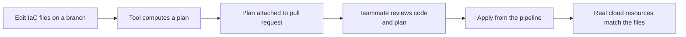

# Module 4 — Running what you built

*Qafila is still at Traction. About twelve people work there, 300 merchants use the app for about 4,000 deliveries a day, payments go through a payment provider, and one team deploys to production every day through continuous integration. Module 3 showed how the team changes software safely. This module covers what happens after a change is live, when the product has to keep working at 7 a.m. on a holiday and at midnight on a Friday. It covers three practices. First, describing the cloud setup in reviewed code instead of clicking in a web console, so that environments can be rebuilt, compared and understood by more than one person. Second, monitoring that watches what merchants and couriers actually experience, alerts that wake someone only when it matters, and an on-call rota people can sustain. Third, handling incidents calmly, learning from them without blame, and agreeing in numbers how reliable the product needs to be. This module also tells the story of Qafila's first serious outage. Each lesson leaves an artefact: an environment inventory with a first infrastructure-as-code change, an alert catalogue with a runbook and an on-call rota, and a post-incident review with a draft reliability target.*

> **Steps:** Operate — keep the product working for the people who depend on it: see trouble early, respond calmly, restore service first, and learn from every failure so it is less likely to happen again.

---

# 4.1 — Infrastructure as code and cloud basics for practitioners
*Level: 🟡 Intermediate* · *Prerequisites: 2.3, 3.3* · *Step: Operate*

**After this you can** list the parts of a small product's cloud setup in an environment inventory, explain what infrastructure as code is and how its plan-review-apply cycle works, and read a short plan to spot a change that would destroy or replace something important before anyone applies it. *Study time: reading about 20 min, hands-on about 90 min (estimate).*

## ⚡ In 60 seconds
- **Infrastructure** is everything your code runs on: servers, the database, file storage, networks, domain names, access rules and secrets. In the cloud, all of it is created through the provider's interface.
- **Infrastructure as code (IaC)** means describing that setup in text files kept in version control, then letting a tool create or change the real resources to match.
- The cycle is **write, plan, review, apply**: the tool shows exactly what it will add, change or destroy, a teammate reviews that plan like a pull request, and only then is it applied.
- The rule that matters most: **if it is not in code, it does not exist reliably: nobody can review it, rebuild it or explain it.**
- Decision cue: before clicking anything in the cloud console, ask "could I recreate this tomorrow, and would a teammate know I did it?"
- Biggest trap: applying a plan you did not read. One line saying a database will be "replaced" can mean "deleted and created empty".

## 🧭 Why it matters
Qafila and everyone in it are fictional. All numbers about Qafila in this lesson are illustrative figures, not benchmarks.

At Launch, Faisal set up Qafila's cloud account in an afternoon by clicking through the provider's web console: a managed database, a place to run the merchant and courier back ends, a storage bucket (online file storage) for receipts and proof-of-delivery photos, a domain name. With 15 pilot shops nobody needed more. Then he created a staging copy for testing, again by hand, from memory.

Now, at Traction, only Faisal knows the setup. Last month a change passed every check in staging and failed in production: production's photo bucket had a stricter access rule that Faisal had added during a late-night fix and never written down. Couriers could not upload delivery photos for forty minutes. This week Faisal was on leave when a database storage warning fired, and the engineers on duty could not tell which settings were safe to touch. Salma asked: "Where is the list of what we actually run, and who changed it last?" Nobody could answer.

## 📐 How it works

### 🟢 The essentials

**A quick refresher on cloud basics.** Lesson 2.3 explained renting computing from a cloud provider, managed services and shared responsibility. Four more ideas matter once you run a product every day.

| Term | Plain meaning | Why a practitioner cares |
|---|---|---|
| **Region** | A geographic area where the provider has data centres | Where customers' data is stored; latency (the delay users feel); some rules ask where data lives |
| **Availability zone** | A separate data centre (or group) inside a region, with its own power and network | A database across two zones survives one failed building |
| **Environment** | A complete running copy of the product for one purpose: development, staging, production | Staging only protects you if it is built the same way as production |
| **Identity and access management (IAM)** | The provider's system of users, roles and permissions | Decides who and what can read data, change settings or delete things |

**What infrastructure as code is.** Instead of clicking, you write a file that describes what should exist:

```
database "orders" {
  engine         = "postgres"
  size           = "medium"
  zones          = 2
  backup_days    = 14
  deletion_guard = true
}
```

This is illustrative pseudo-code: it shows the idea, not any real tool's exact syntax. An IaC tool compares the files with what really exists and works out the steps to make reality match. Most such tools are **declarative**: you describe the end state, not the clicks. Well-known examples are Terraform, an open-source fork of it called OpenTofu, and each large cloud provider's own template service. They are examples, not recommendations.

**The cycle: write, plan, review, apply.**



The **plan** is the key step. It lists every resource the tool would **add**, **change in place**, **replace** (destroy and recreate) or **destroy**, and ends with a summary line of totals. Reviewing the plan, not just the code, is how you catch the surprising consequence of a small edit.

### 🟡 Going deeper

**Same code, different settings.** Use one set of IaC files plus a small settings file per environment: production gets two zones and 14 days of backups, staging one zone and 3 days. The shape is the same, so a test in staging means something, and every intended difference is written where a reviewer can see it.

**State: the tool's memory.** Most IaC tools keep a **state file** that records which real resource matches which block of code. Keep it in a shared, access-controlled, backed-up store, never on a laptop; lock it during an apply so two people cannot apply at once; and assume it holds sensitive values.

**Drift.** **Drift** is when the real setup no longer matches the code, usually after a console change; it caused Qafila's staging-passes-production-fails problem. Running a plan with no code changes is a cheap check: if it wants to change something, reality has moved. Then put the console change into code, or let the tool undo it.

**Secrets do not go in the files.** Passwords, payment provider keys and tokens never go into IaC files. Store them in a secrets manager, reference them by name, and give each service only the secrets it needs. For depth, see [*Secure AI & Application Security: Zero to Hero*, lesson 5.2 — Secrets management: keys, tokens and where they leak](../secai/index.html#/5.2).

**Least privilege.** IAM rules belong in code too. A sensible start: most engineers read-only in production; the pipeline changes only what it deploys, through its own role; two named people hold an emergency "break-glass" role whose every use is logged.

**Tags.** Tag every resource with environment, owner and purpose (`env=production`, `owner=delivery-team`). Tags answer "what is this for, and what does it cost?" later (Module 10).

### 🔴 Expert view

**Read every plan for the two dangerous words.** *Add* and *change in place* are usually safe. **Replace** and **destroy** on anything that holds data (a database, a storage bucket, a queue of waiting messages) need a stop and a question. Two cases look alike but are not:

- **Renaming the label in your code** (what the code calls the resource) does not need to touch the real database. Most tools offer a "moved" or state-move step that tells the tool "this block is the same resource under a new label". Without it, the tool may think the old one should go and a new one be made.
- **Changing the real name, or a setting the provider cannot change on a running database,** forces a replacement whatever you do in the code. The safe answer is not to make that change, or to plan a proper data migration.

Many tools let you mark a resource as protected so the tool refuses to destroy it; use that on every data store. A plan line like this deserves a conversation, not an approval:

```
-/+ database "orders" must be replaced
      name: "orders" -> "orders-main"   (forces replacement)
```

**Bringing an existing hand-built setup under code.** Most teams you join will not start fresh. Start with an **environment inventory** (what exists, where, who owns it, how it was created), then import resources into code one group at a time, starting with what would hurt most to lose. After each import, a plan with no changes proves code and reality match.

**IaC does not back up your data.** Code can recreate an empty database in minutes; it cannot bring back last Tuesday's orders. Backups and tested restores are a separate job (lesson 4.3; for depth, [*System Design for Vibe Coders*, lesson 2.3 — Backups: What, Not Just Whether](../vibe/index.en.html#l2-3)). For policy checks and reusable modules, see [*Cloud & DevOps: Zero to Hero*, lesson 3.1 — Infrastructure as code with Terraform/OpenTofu: state, modules and plans](../cloud/index.html#/3.1) and [lesson 3.3 — Policy as code, drift and guardrails](../cloud/index.html#/3.3).

## 🧰 The toolkit
| Resource, tool or template | What it is and does | When to reach for it |
|---|---|---|
| **Environment inventory** | A table of every resource: environment, purpose, owner, how it was created, backup and protection | Before adopting IaC; when you join a team |
| **IaC tool** | Makes the cloud match files that describe it (for example Terraform or OpenTofu) | Anything that exists in more than one environment |
| **Plan review checklist** | Anything replaced or destroyed? Data store touched? Access widened? Matches the PR description? | Every infrastructure pull request |
| **Secrets manager** | A provider service that stores secrets and hands them to services at run time | Every password, key and token |
| **Drift check** | A scheduled plan with no code change; any proposed change means reality moved | Weekly, and after any emergency console change |

## 🏛️ In practice at Qafila
Faisal, back from leave, pairs with one of the newer engineers on the inventory; Salma reviews it as the person most likely to need it at night. Illustrative and fictional. "Versioning" below is a bucket setting that keeps old copies of each file, so a deleted or overwritten photo can be recovered.

> **Qafila environment inventory (Traction, first version)**
>
> | Resource | Env | Purpose | Owner | Created by | Backups / protection |
> |---|---|---|---|---|---|
> | Orders database (managed) | prod | Orders, merchants, couriers | Faisal | Console | Daily backup, 7 days; deletion guard **off** |
> | Orders database (managed) | staging | Testing | Faisal | Console | Daily backup, 1 day |
> | Photo bucket | prod | Proof-of-delivery photos, receipts | Faisal | Console | Versioning **off**; stricter access rule added by hand (undocumented) |
> | Photo bucket | staging | Testing | Faisal | Console | None |
> | App runtime (managed containers: packaged copies of the back-end code that the provider runs) | prod, staging | Merchant and courier back ends | Faisal | Pipeline | n/a |
> | Payment provider keys | prod | Taking card payments | Faisal | Secrets manager | n/a |
> | Domain and certificate | prod | Qafila's web address | Maha | Console | Auto-renew on |
>
> **First IaC change (pull request "photo bucket into code"):** import both photo buckets; express the production access rule in code and apply it to staging; turn on versioning in production; add `env`, `owner`, `purpose` tags. Plan attached: 2 imports, 4 changes in place, 0 replace, 0 destroy.
>
> **Next:** deletion guard on the production database (today); import both databases; IAM roles into code.

Faisal wanted to "rewrite everything in code over a weekend". Salma asked what she would do if it went wrong on Sunday night; they agreed on one resource group per week, with a second reviewer for infrastructure.

## 🛠️ Exercises
**🟢 Safe or stop-and-ask?** Label each plan line "safe" or "stop and ask", with a one-line reason: (a) `+ bucket "invoices-staging"`; (b) `~ database "orders" backup_days: 7 -> 14`; (c) `-/+ database "orders" engine_version forces replacement`; (d) `- bucket "photos-prod"`; (e) `~ tags added on bucket "photos-staging"`; (f) `- database "orders-test-old"` (an unused test copy).
*Done when:* each line has a label and a reason that names the action (add, change, replace, destroy) and whether the resource holds data that matters.

<details><summary>Model answer and self-check</summary>

**Model answer.** (a) Safe: adds a new, empty staging resource. (b) Safe: an in-place change that only improves protection. (c) Stop and ask: replacing the production orders database means destroying it. (d) Stop and ask: destroys production photos. (e) Safe: tags change nothing for users. (f) Stop and ask, briefly: probably fine, but confirm with its owner that nothing still uses it and nothing in it is needed.

**Self-check.**
- Did every "replace" or "destroy" on a data store get a stop?
- For (f), did you ask a question rather than assume "test" means unimportant?
- Did you read the action symbol, not just the resource name?

</details>

**🟡 Write an environment inventory.** Use your own small project (a personal site, a student project, an open-source project you can read) or this description: "A shop-booking app runs on one cloud provider. It has a managed database (production and a test copy), a file bucket for menu images, a container service for the back end, a domain with a certificate, and an email-sending service key stored in a settings page of the hosting console." Build the inventory table with the columns from the toolkit.
*Done when:* every resource has an owner, an environment, how it was created, and its backup and protection status, and you have marked the two rows you would bring under code first, with a reason.

<details><summary>Model answer and self-check</summary>

**Model answer.** Production database (back-end lead; console; daily backups 7 days; deletion protection unknown, to check), test database (console; 1 day), image bucket (console; versioning unknown), container service (pipeline), domain and certificate (console; auto-renew to check), email key (console settings page; should move to a secrets manager). First under code: production database settings and deletion protection (biggest loss), then the email key (a secret in the wrong place).

**Self-check.**
- Did you write "unknown, to check" rather than guess?
- Is every secret listed by name and location, never by its value?
- Did you pick first what would hurt most if lost, not what is easiest?

</details>

**🔴 Read a plan before anyone applies it.** A teammate's pull request says "rename the prod database for consistency; enable 14-day backups in staging; versioning on photos; owner tags". The attached plan reads:

```
~ database "orders-staging"   backup_days: 1 -> 14
-/+ database "orders"         name: "orders" -> "orders-prod" (forces replacement)
~ bucket "photos-prod"        versioning: off -> on
~ tags "owner" added on 3 resources
Plan: 1 to add, 5 to change, 1 to destroy.
```

Write your review comment: what is safe, what is dangerous, what you ask for, and whether you approve.
*Done when:* your comment names the replacement of the production database as the blocking issue, explains what "forces replacement" means for the data, proposes a safe alternative, and states clearly that you do not approve this version.

<details><summary>Model answer and self-check</summary>

**Model answer.** "Staging backups, photo versioning and tags look fine. Blocking: changing the database's real name forces `orders` to be destroyed and recreated (the '1 to add, 1 to destroy' in the summary): an empty production database, with every order, merchant and courier record gone unless restored, plus downtime. The description does not say a database will be destroyed. Please drop the rename (it is cosmetic) and show a new plan with 0 to destroy. Can we add the deletion guard for `orders` here too? Not approving this version."

**Self-check.**
- Did you check that the summary line matches the lines above it (one replacement = 1 add + 1 destroy; three in-place lines, one of them on 3 resources = 1 + 1 + 3 = 5 changes)?
- Did you ask for a new plan as evidence, rather than accepting "I'll be careful"?
- Was your comment about the change, not about the person?

</details>

## ⚠️ Mistakes and traps
- **Approving the code but not the plan.** The code diff can look harmless while the plan destroys a database. Read the plan's summary line first.
- **Emergency console changes that stay forever.** Post them in the team channel at once and put them into code the next working day.
- **Secrets in IaC files or state on a laptop.** Reference secrets from a secrets manager; keep state in a shared, locked store.
- **Believing IaC is a backup.** Code rebuilds empty resources. Data comes back only from backups you have tested.

## 🧾 Recap
- Infrastructure is everything your code runs on; in the cloud it is created through software, so it is fast to create and easy to forget.
- IaC describes the setup in reviewed files; a tool makes reality match them through write, plan, review, apply.
- The plan is the safety step: look for *replace* and *destroy* on anything that holds data, and protect data stores from deletion.
- Build environments from the same code; check for drift; start with an inventory and import one group at a time.
- Rule: if it is not in code, it does not exist reliably.

## ✍️ Check yourself
**1. A change passed every check in Qafila's staging environment but failed in production because production had a storage rule added by hand. What is the best lasting fix?**

- A. Test every change in production first, since staging has proved it cannot be trusted.
- B. Copy production's settings into staging by hand before each week's planned deploys.
- C. Build both environments from the same IaC files and write down intended differences.
- D. Remove the stricter rule from production so that both environments behave the same.

<details><summary>Answer</summary>

**C.** One set of code, with differences written down, stops silent drift. B relies on memory and will drift again; A abandons staging, and D weakens production security. See "Same code, different settings" and "Drift".

</details>

**2. A reviewer approved an infrastructure pull request after reading only the code diff, which looked like a small rename. What did the reviewer most likely miss?**

- A. The estimate of how long the apply would take, needed to choose a quiet hour.
- B. The plan, showing what will really be added, changed, replaced or destroyed.
- C. A syntax check of the files, which the plan exists to provide before review.
- D. The backup the plan takes of each resource before the tool changes anything.

<details><summary>Answer</summary>

**B.** The plan shows the concrete effect on real resources; a small rename in code can force a replacement. A and C are not what a plan is for, and D is wrong: IaC does not back up data. See "The cycle: write, plan, review, apply" and "Read every plan for the two dangerous words".

</details>

**3. Faisal is away and the on-call engineer wants to change a database setting in the cloud console at night to stop customers being affected. What should the engineer do?**

- A. Never touch the console, and wait for Faisal to come back and decide.
- B. Make the change, then mute the warning so it does not fire again.
- C. Write the change in code and wait for next week's infrastructure review.
- D. Make the smallest safe change, announce it, and put it in code next day.

<details><summary>Answer</summary>

**D.** Emergency changes are sometimes needed; the trap is leaving them undocumented. A leaves customers affected, B hides the signal, C delays an urgent fix. See "Mistakes and traps" and "Drift".

</details>

**4. A plan line reads `-/+ database "orders" must be replaced (forces replacement)`. What does this most likely mean for Qafila?**

- A. The database is destroyed and a new, empty one created unless steps are taken.
- B. The database settings change in place, with a short pause and no data affected.
- C. The tool copies all the data to a new database before it deletes the old one.
- D. The database moves to another availability zone, keeping its data and name.

<details><summary>Answer</summary>

**A.** "Replace" means destroy and recreate; IaC recreates settings, not data. B describes a change in place, C assumes a data copy the tool does not make, and D invents a zone move. See "Read every plan for the two dangerous words".

</details>

**5. Salma asks where to start bringing Qafila's hand-built cloud setup under code. Which plan is best?**

- A. Import the easiest resources first, such as staging buckets, to build confidence.
- B. List everything that runs, then import one group at a time, worst loss first.
- C. Rebuild all of staging in code over one weekend, then do production next week.
- D. Wait until a platform team exists, so experts can own infrastructure as code.

<details><summary>Answer</summary>

**B.** Knowing what exists comes first, and each careful import is proved by an empty plan. A is tempting but leaves the riskiest, hand-built parts (the production database) unprotected longest; C is a big-bang rewrite, and D leaves the one-person problem for years. See "Bringing an existing hand-built setup under code".

</details>

## 📚 References
- Library course: [*Cloud & DevOps: Zero to Hero*, lesson 1.2 — Cloud fundamentals: regions, zones, compute, storage, managed services and shared responsibility](../cloud/index.html#/1.2).
- Library course: [*Cloud & DevOps: Zero to Hero*, lesson 3.1 — Infrastructure as code with Terraform/OpenTofu: state, modules and plans](../cloud/index.html#/3.1).

---

# 4.2 — Monitoring, alerts and on-call
*Level: 🟡 Intermediate* · *Prerequisites: 3.3, 4.1* · *Step: Operate*

**After this you can** choose a few signals that show whether customers are being served, sort alerts into "wake someone", "make a ticket" and "delete", write an alert specification with a short runbook, and design a small on-call rota with handover and a regular review of alert noise. *Study time: reading about 20 min, hands-on about 90 min (estimate).*

## ⚡ In 60 seconds
- **Monitoring** means collecting signals about a running system and watching them. **Observability** is how well those signals let you answer new questions about what is going on inside.
- Watch **symptoms customers feel** (orders failing, slow pages, couriers not getting offers) first; watch **causes** (CPU, memory, disk) mainly to explain symptoms.
- An **alert** that wakes a person (a **page**) must be urgent, real and actionable. Everything else becomes a ticket, a dashboard, or nothing.
- The rule that matters most: **every page must point to customer pain and to a first action; if it does neither, it is noise.**
- Decision cue: after any alert, ask "did this need a human, now?" If not, change or delete the alert that week.
- Biggest trap: adding an alert after every problem and never removing one, until on-call staff learn to ignore the phone.

## 🧭 Why it matters
Qafila and everyone in it are fictional. All numbers about Qafila in this lesson are illustrative figures, not benchmarks.

When Qafila moved to daily deploys, it started an on-call rota: one engineer and Salma share a phone that receives alerts outside working hours. The team added an alert whenever something went wrong: database CPU above 70%, memory above 80%, any error in the logs, a certificate (the file that lets browsers trust the site over HTTPS) expiring "soon".

One Thursday night the phone went off nine times, mostly CPU and memory alerts that cleared themselves. Salma stopped looking. At 6:40 the next morning a bakery owner phoned her: for about forty minutes, no courier had received a new delivery offer. The background job that sends offers had stopped after a routine change. No alert covered it: nothing had crashed and CPU looked fine. The team was measuring the machine, not the service.

## 📐 How it works

### 🟢 The essentials

**Telemetry: the raw signals.** **Telemetry** is data a running system sends about itself. OpenTelemetry, an open-source project for collecting it, describes several kinds of signal; the three most used are metrics, logs and traces (its documentation also lists others, as reported from search summaries):

| Signal | Plain meaning | Qafila example | Good for |
|---|---|---|---|
| **Metric** | A number measured over time | Orders created per minute | Trends, thresholds, dashboards, alerts |
| **Log** | A timestamped record of one event | "Order 8812 created by merchant 214 at 09:14:03" | What happened to one request |
| **Trace** | The path of one request through several parts of the system, with timings | "Request courier" → API (the interface the app calls) → order service → offer job → courier app | Where a slow or failed request got stuck |

Start with journey metrics and structured logs (with named, searchable fields such as `order_id`); add traces where requests cross several services.

**Symptoms first.** Google's *Site Reliability Engineering* book suggests four "golden signals" for a user-facing system: **latency** (how long requests take), **traffic** (how much demand there is), **errors** (how many requests fail) and **saturation** (how full the system is) (as reported). Translate them into your product's language:

| Generic signal | Qafila's version |
|---|---|
| Traffic | Orders created per minute, compared with the same time last week |
| Errors | Share of order requests that fail; share of payment calls that fail |
| Latency | Median time from "request courier" to the first courier offer (the median is the middle value: half are faster, half slower) |
| Saturation | Database connections in use; offers waiting in the queue (the list of offers not yet sent) |

The Thursday-night problem would have shown up in two of these: **latency**, because time to first offer went from about a minute to "never", and **saturation**, because offers piled up in the queue. Traffic looked normal, since orders kept arriving.

**Pages, tickets and dashboards.**

| Type | When |
|---|---|
| **Page** (phone, any hour) | Customers are affected now or very soon, and a human must act |
| **Ticket** | Needs attention within a day or a week (a certificate expires in 20 days) |
| **Dashboard only** | Useful context, no action by itself (CPU, memory) |

### 🟡 Going deeper

**What makes a good page.** Four questions: is it a **symptom** customers feel? Is it **urgent** (would morning be meaningfully worse)? Is it **actionable** now? Is it **real** (rarely firing when nothing is wrong)? If any answer is no, it should not page; it might still be a ticket or a dashboard.

**Thresholds and windows.** "Error rate above 0%" pages on one bad request. Better: "more than 2% of order requests failed over 10 minutes" (illustrative).

**Check the journey from outside.** A **synthetic check** is a robot that performs a key user action on a schedule, for example creating a test order for a test shop every five minutes and confirming that a test courier gets an offer. It catches failures that leave internal metrics looking healthy. Mark test orders so they never reach real couriers or reports.

**Every page has a runbook.** A **runbook** is a short, written set of first steps for one alert: what it means, how to confirm it, what to try first, when and whom to escalate to. Half-awake, people follow written steps better than they remember. Link it from the alert.

**On-call that people can sustain.** **On-call** means being reachable and ready to respond outside normal hours for a set period.

| Practice | What it looks like |
|---|---|
| **Rota** | A published schedule, usually a week at a time, with a primary and a backup |
| **Handover** | A short written note at the end of each shift: what fired, what is open, what to watch |
| **Escalation** | A named person to call if the primary cannot fix it within a set time |
| **Recovery** | Time off or a late start after a bad night; pay and hours depend on employment law and contracts, so ask HR or management rather than assume |
| **Noise review** | Every week, look at every page: needed? actionable? Fix or delete the ones that were not |

Google's SRE book describes its own targets: SREs spend no more than 25% of their time on call, and there are at most two incidents per 12-hour on-call shift, so each can be handled and followed up properly (as reported from summaries of its on-call chapter). They are one company's numbers, not a standard, but the idea travels: if every shift is busy, fix the system or the alerts.

### 🔴 Expert view

**Alert on the journey, investigate with everything else.** Page on a handful of journey-level signals; keep cause-level metrics on dashboards. When a page fires, move from symptom to cause: which step is slow (trace), which component (metrics), which requests (logs). If you are writing a page for a cause, page on the symptom it predicts instead.

**Background work is the blind spot.** Jobs that run in the background (sending offers, settling payments) fail silently, because no user request errors. Give each important job a "heartbeat" metric (last successful run, items processed) and alert when it stops. See [*System Design for Vibe Coders*, lesson 7.4 — Background Jobs: The Code Nobody Watches](../vibe/index.en.html#l7-4).

**A preview: alerting on targets.** Once a journey has a reliability target (lesson 4.3), the small amount of failure the target allows is called the **error budget**. Teams can then alert on how fast that budget is being used up, the **burn rate**; Google's *Site Reliability Workbook* describes this (as reported from summaries of its "Alerting on SLOs" chapter). That is Qafila's next step once targets exist.

## 🧰 The toolkit
| Resource, tool or template | What it is and does | When to reach for it |
|---|---|---|
| **Alert catalogue** | Every alert: signal, threshold, window, type (page, ticket, dashboard), owner, runbook link | When on-call feels noisy; reviewed weekly |
| **Alert specification card** | For one alert: what customers feel, the query, threshold and window, why urgent, first action | Before adding any paging alert |
| **Runbook** | Short first steps for one alert: meaning, confirm, act, escalate | Linked from every page |
| **Synthetic check** | A scheduled robot that runs a key journey end to end with test data | For the two or three journeys that matter most |
| **Observability platform** | Collects and shows metrics, logs and traces, and sends alerts (open-source or hosted; examples, not endorsements) | From the first production customer |
| **On-call handover note** | What fired, what is open, what to watch, what changed | End of every on-call shift |

## 🏛️ In practice at Qafila
After the Thursday night, Salma and Faisal spend an afternoon on the alert catalogue with the engineers. Illustrative and fictional.

> **Qafila alert catalogue (Traction, after review)**
>
> | Alert | Type | Threshold and window | Runbook |
> |---|---|---|---|
> | Courier offer delay: median time from "request courier" to first offer | **Page** | Above 5 minutes for 10 minutes, 6 a.m.–midnight | RB-01 |
> | Synthetic order: test order gets no offer | **Page** | 2 failures in a row (checks every 5 minutes) | RB-01 |
> | Order requests failing | **Page** | Above 2% over 10 minutes | RB-02 |
> | Payment calls failing | **Page** | Above 5% over 10 minutes | RB-03 |
> | Offer job heartbeat: no successful run | **Page** | None in 10 minutes | RB-01 |
> | Certificate expiry | Ticket | 21 days before expiry | — |
> | Database disk | Ticket | Above 70% | — |
> | CPU, memory | Dashboard only | — | — |
> | "Any error in logs" | **Deleted** | — | — |
>
> **RB-01 — Couriers not getting offers:** 1) Open the "orders to offers" dashboard; is the delay real, or one city only? 2) Check the offer job heartbeat and last log lines. 3) If a deploy happened in the last two hours, roll it back (lesson 3.3). 4) If not fixed in 15 minutes, call the backup and post in the incident channel. 5) Tell Salma (or support on duty) so she can message merchants.
>
> **On-call rota:** five engineers, one week each as primary, the previous week's primary as backup, so the cycle repeats every five weeks. Salma no longer takes night pages; she covers merchant communication during her working hours. Handover note every Monday at 10:00. Monday noise review: every page from last week marked "needed" or "fix".

The review moved Salma off the night phone: she could not act on most pages, and her strength is talking to merchants. The first draft counted declined cards as payment failures, which would have paged every night. Faisal wanted to keep the CPU page "just in case"; nobody could name the action it led to.

## 🛠️ Exercises
**🟢 Page, ticket, dashboard or delete?** Classify each alert and give a one-line reason: (a) "database CPU above 70% for 5 minutes"; (b) "no orders created at all in the last 15 minutes between 8 a.m. and 10 p.m."; (c) "domain certificate expires in 30 days"; (d) "any WARNING line appears in any log"; (e) "share of payment calls failing above 5% for 10 minutes"; (f) "courier app version 2.3 still used by 12 couriers".
*Done when:* each alert has one of the four labels and a reason that uses the four questions (symptom, urgent, actionable, real).

<details><summary>Model answer and self-check</summary>

**Model answer.** (a) Dashboard: a cause, not actionable alone. (b) Page: customers affected at a busy time. (c) Ticket: not tonight. (d) Delete: not a symptom, fires constantly. (e) Page: merchants cannot pay; urgent and actionable. (f) Ticket or dashboard: not urgent.

**Self-check.**
- Did you page only on things customers feel now?
- Did you resist keeping (a) "just in case"?
- For (b), did you notice the time window that avoids paging at 3 a.m. when no shop is open?

</details>

**🟡 Write an alert specification and runbook.** Pick one key journey in your own project or an open-source app you use (or use Qafila's "merchant pays the delivery fee by card"). Write an alert specification card (what customers feel, the signal, threshold and window, why urgent, first action) and a runbook of five steps or fewer.
*Done when:* the alert is a symptom with a threshold and a window, the runbook fits on one screen, and it includes a way to confirm the problem is real, a first safe action, an escalation point with a time limit, and a step that tells the people who talk to customers.

<details><summary>Model answer and self-check</summary>

**Model answer.** Alert: "Merchants cannot pay delivery fees". Signal: fee payments ending in a technical error (not card declines), above 5% over 10 minutes, 6 a.m.–midnight. Urgent: no payment, no courier. Runbook: 1) Confirm on the payments dashboard and one failed request's log. 2) If the provider's status page reports an incident, use a fallback if one exists (for example a "pay later" switch, if the team has built one). 3) If a deploy happened in the last two hours, roll back. 4) Post in the incident channel; tell support. 5) Not resolved in 20 minutes: call the backup and Faisal.

**Self-check.**
- Did you separate declined cards from technical failure?
- Could someone who did not write it follow it at 3 a.m.?

</details>

**🔴 Design a sustainable on-call rota.** Qafila has five engineers who can take call (A to E), Salma for merchant communication in working hours, and Faisal as the escalation point. Design one full five-week cycle with primary and backup, write the handover note template, define what happens after a bad night, and describe the weekly noise review, including one measure you would track over time.
*Done when:* nobody is primary two weeks in a row, every week has a named backup, each engineer is primary once and backup once per cycle, the handover template has at most five fields, the recovery rule is stated as "to be agreed with management under our contracts", and the noise review has a measure with a target direction.

<details><summary>Model answer and self-check</summary>

**Model answer.** Primaries A, B, C, D, E in weeks 1–5; backups E, A, B, C, D: each week's backup is the previous week's primary, and week 1's backup is E, carried over from week 5 of the previous cycle. Each engineer does one primary and one backup week per cycle, so the load is even. Faisal escalates; he is not a routine primary. Handover: pages, still open, changes to watch, wrong runbooks, other. After a page past midnight: late start next day, exact rule to be agreed with management under our contracts. Monday noise review, 20 minutes: every unneeded page gets a fix ticket. Measure: share of pages not needed (going down).

**Self-check.**
- Is the load even over the full cycle, including backup duty?
- Did you avoid stating a legal rule about pay or rest?
- Does your measure push toward fewer, better pages, not toward silencing alerts?

</details>

## ⚠️ Mistakes and traps
- **Monitoring the machine, not the service.** CPU can be fine while couriers get nothing. Start with journey-level symptoms.
- **Pages without runbooks.** A page that says only "error rate high" leaves a tired person guessing. Link short first steps.
- **Forgetting background jobs.** Give each important job a heartbeat and alert when it stops.

## 🧾 Recap
- Watch symptoms customers feel (traffic, errors, latency, saturation in your product's own terms) and use causes such as CPU to explain them.
- Page only for urgent, real, actionable symptoms; make everything else a ticket or a dashboard.
- Every page has a runbook; synthetic checks and job heartbeats catch silent failures.
- On-call works with a published rota, backup, handover, escalation, recovery time and a weekly noise review.
- Rule: every page must point to customer pain and to a first action.

## ✍️ Check yourself
**1. On Thursday night, CPU and memory looked normal while no courier received an offer for forty minutes. Which signal would most likely have caught it?**

- A. A tighter CPU threshold on the database server, lowered from 70% to 50%.
- B. Median time from "request courier" to first offer, with a threshold and window.
- C. An alert on every error line that any service writes to its logs, at any hour.
- D. A daily report of the previous day's deliveries, emailed to the team each morning.

<details><summary>Answer</summary>

**B.** It measures the symptom merchants felt. A watches a cause that was fine, C is noisy and misses a job that stopped silently, and D is a day late. See "Symptoms first".

</details>

**2. Which of these should page the on-call engineer at night?**

- A. The domain certificate expires in 25 days and has not yet renewed automatically.
- B. Database CPU has been above 70% for five minutes now, during the nightly report job.
- C. One courier still uses an old version of the app that the team plans to retire.
- D. More than 2% of order requests have failed over the last ten minutes, while merchants are trading.

<details><summary>Answer</summary>

**D.** It is a symptom customers feel now, urgent and actionable. A needs action but not tonight (a ticket), B is a cause with no action, and C is a ticket at most. See "Pages, tickets and dashboards".

</details>

**3. Salma notices she has started ignoring the on-call phone because most alerts clear themselves. What is the best response?**

- A. Review recent pages together and fix or delete the ones that were not needed.
- B. Add a second phone so one person watches the noisy alerts and one the real ones.
- C. Raise every threshold by half so fewer alerts fire, without checking which mattered.
- D. Ask the engineers to be more disciplined about answering every alert.

<details><summary>Answer</summary>

**A.** Noise is a property of the alerts, not the people. B doubles the burden, C may silence real problems, and D blames people for a design problem. See "On-call that people can sustain".

</details>

**4. At 3 a.m. an engineer is paged with only the words "error rate high" and spends twenty minutes working out what it means. What would have helped most?**

- A. A longer alert message listing every metric on the order service dashboard.
- B. A second engineer paged at the same time, so that two people can guess together.
- C. A linked runbook: what it means, how to confirm, the first step, whom to call.
- D. A rule that only senior engineers take call, since they know the system by heart.

<details><summary>Answer</summary>

**C.** Written first steps beat memory under pressure. A adds data but no guidance, B doubles the cost, and D concentrates knowledge in fewer people. See "Every page has a runbook".

</details>

**5. Google's SRE book describes a target of at most two incidents per 12-hour on-call shift. How should Qafila use that figure?**

- A. As a legal maximum that Qafila must follow under employment rules for on-call staff.
- B. As a benchmark: Qafila's on-call load is healthy if it stays below two.
- C. As one company's guide: busy shifts mean the system or the alerts need work.
- D. As a reason to stop paging at night, since Google limits incidents and so should Qafila.

<details><summary>Answer</summary>

**C.** It is Google's own target; heavy load signals a problem to fix. A invents a legal rule, B treats one company's number as universal, and D misreads it. See "On-call that people can sustain".

</details>

## 📚 References
- Beyer, B., Jones, C., Petoff, J. and Murphy, N. R. (eds.), *Site Reliability Engineering: How Google Runs Production Systems* (O'Reilly, 2016), chapter 6, "Monitoring Distributed Systems": https://sre.google/sre-book/monitoring-distributed-systems/ (reported from search summaries; not opened from this environment on 2026-11-22).
- Same book, chapter 11, "Being On-Call": https://sre.google/sre-book/being-on-call/ (reported; not opened).
- Beyer, B. et al. (eds.), *The Site Reliability Workbook* (O'Reilly, 2018), chapter 5, "Alerting on SLOs": https://sre.google/workbook/alerting-on-slos/ (reported; not opened).
- OpenTelemetry, "Signals": https://opentelemetry.io/docs/concepts/signals/ (reported; not opened).
- Library course: [*Cloud & DevOps: Zero to Hero*, lesson 5.1 — Telemetry: logs, metrics, traces and OpenTelemetry](../cloud/index.html#/5.1).
- Library course: [*Cloud & DevOps: Zero to Hero*, lesson 5.2 — SLOs, error budgets, alerting and on-call that people can sustain](../cloud/index.html#/5.2).
- Library course: [*Running IT as a Business*, lesson 8.1 — Monitoring, events and incident management](../itbiz/index.html#/8.1) (the manager's view).

---

# 4.3 — Incidents, post-incident reviews and reliability targets
*Level: 🟡 Intermediate* · *Prerequisites: 3.3, 4.1, 4.2* · *Step: Operate*

**After this you can** run the first hour of an incident with clear roles (restore service first, communicate, keep a timeline), write a blameless post-incident review with contributing factors and owned actions, and draft a reliability target for one user journey with its error budget worked out in minutes. *Study time: reading about 25 min, hands-on about 100 min (estimate).*

## ⚡ In 60 seconds
- An **incident** is an unplanned event that harms, or threatens to harm, the service customers rely on.
- **Restore service first, find the cause later.** Name someone to coordinate and someone to communicate, and keep a timeline.
- A **post-incident review** (or postmortem) asks how the system allowed the failure, not who to blame, and ends with a few owned, dated actions.
- A **reliability target** (a service level objective, or SLO) says in numbers how reliable a journey must be. The gap between the target and 100% is the **error budget**.
- The rule that matters most: **fix the system, not the person; people are part of the system you are fixing.**
- Decision cue: if customers are affected and nobody is named as lead, name one now, then ask "what stops the harm fastest?"
- Biggest trap: a review that ends with "be more careful". It changes nothing.

## 🧭 Why it matters
Qafila and everyone in it are fictional. All numbers about Qafila in this lesson are illustrative figures, not benchmarks.

On a Tuesday at 11:50 a deploy included a database migration (a script that changes the structure or contents of the database) that moved orders into a new table. It had worked in staging, which held a few hundred test orders. In production it failed halfway: it left part of the order history (completed orders from earlier days) unreadable, and new orders went into the new table, which the app did not yet read. Merchants saw new orders disappear; couriers got offers, then the orders vanished.

For about two hours, orders were lost from the live system. Rolling the code back did not undo the migration (lesson 3.3). Faisal and Maha argued in the channel about restoring from backup; nobody was in charge, and nobody told merchants anything for the first hour. In the end the team restored the damaged history from that morning's 04:00 backup and copied the new orders back from the new table. That evening Maha's first message was "who ran this migration?"

## 📐 How it works

### 🟢 The essentials

**Severity.** Declaring early is cheap; declaring late is expensive. Write a severity scale before you need it:

| Severity | Meaning and Qafila example | Response |
|---|---|---|
| **SEV1** | A core journey down, or data being lost (orders disappearing) | All roles; tell merchants within 30 minutes (illustrative) |
| **SEV2** | A core journey degraded, or one group badly affected (offers slow in one city) | On-call plus backup; tell merchants if it lasts over 30 minutes |
| **SEV3** | Minor, or with a workaround (receipts emailed late) | Ticket; fix in working hours |

**Roles in the first hour.** Even with five people, separate the jobs:

| Role | Job |
|---|---|
| **Incident lead** (often called incident commander) | Coordinates: sets priorities, assigns work, calls for help; does not type the fix |
| **Communications** | Updates merchants, couriers and colleagues at set times, in plain words |
| **Fixers** | Investigate and change things, saying what they will do before doing it |
| **Scribe** (can be the lead in a small team) | Keeps a timestamped timeline of what was seen, decided and done |

PagerDuty's public incident response training describes the incident commander as a coordinator who does not carry out fixes (as reported from search summaries).

**Restore first, explain later.** Stop the harm: roll back, turn off a flag, use a workaround, stop writes to damaged data. Why it happened is for the review.

**Communicate early and on a rhythm.** Merchants forgive outages more easily than silence: a first message within the agreed time, then updates at a fixed rhythm, even with nothing new. For wording, see [*Founder's Playbook for AI-First Builders*, lesson 5.3 — When something breaks: telling customers, and the post-incident note](../founder/index.html#/5.3).

### 🟡 Going deeper

**Data incidents need extra care.** First stop further damage (pause the job, go read-only, stop the migration). Then plan recovery with two terms from NIST's glossary (as reported from search summaries): the **recovery point objective (RPO)**, the point in time to which data must be recovered, which sets how much recent data you can afford to lose; and the **recovery time objective (RTO)**, how long recovery can take before the harm becomes unacceptable. A daily backup means you could lose up to a day of changes: an RPO of 24 hours, whether or not you chose it.

Backups are only as good as your last successful restore. GitLab's published postmortem of its 31 January 2017 outage reports data deleted by mistake during work on replication (keeping a live copy of a database in step with it), several backup methods not working, and hours of changes lost (as reported).

**The post-incident review.** Google's SRE book describes a postmortem culture that looks for contributing causes without blaming any individual or team, with triggers agreed in advance, such as user-visible downtime beyond a threshold or any data loss (as reported from summaries). A simple template (its "went well" and "got lucky" prompts follow the example postmortem in an appendix of the same book, as reported):

| Section | What goes in it |
|---|---|
| **Summary** | Two or three sentences a merchant could understand |
| **Impact** | Who was affected, how, for how long, any data lost |
| **Timeline** | Timestamped facts: detected, declared, actions, restored |
| **Contributing factors** | The conditions that together allowed it: technical, process, people's information and pressures |
| **What went well** | Things to keep doing |
| **Where we got lucky** | Things that could easily have gone worse |
| **Actions** | A few changes, each with an owner and a date |

**Contributing factors, not one root cause.** Ask "how did it make sense at the time?" and "what made this possible?" You find a set of conditions (test data too small, restore never practised) that you can fix.

| Weak action | Strong action |
|---|---|
| "Be more careful with migrations" | "Orders-table migrations use expand and contract (lesson 3.3: add the new structure first, remove the old one in a later deploy) and need a second reviewer (Faisal, by the 15th)" |
| "Communicate better" | "Roles card and merchant message template in the runbook; first message within 30 minutes (Salma, Friday)" |

### 🔴 Expert view

**Reliability targets: SLI, SLO, SLA.** Three related terms, defined in Google's SRE book (as reported from summaries of its chapter on service level objectives):

| Term | Plain meaning | Qafila example |
|---|---|---|
| **Service level indicator (SLI)** | A measure of the service, usually "good events ÷ all events" | Share of minutes in which merchants can see the current status of their orders |
| **Service level objective (SLO)** | The target for that measure over a period | 99.9% of minutes in a calendar month |
| **Service level agreement (SLA)** | A promise in a contract, often with consequences if missed | None yet: no contractual uptime promise to merchants |

An SLO should be stricter than any SLA, so trouble shows before a promise breaks. And 100% is the wrong target: Google's SRE material argues that users cannot notice reliability beyond a certain point (as reported), and perfection would stop all change.

**The error budget in minutes.** The error budget is 100% minus the target. A 30-day month has 30 × 24 × 60 = 43,200 minutes:

| Target | Allowed "bad" minutes in a 30-day month |
|---|---|
| 99% | 432 (about 7 hours 12 minutes) |
| 99.5% | 216 (3 hours 36 minutes) |
| 99.9% | 43.2 (about 43 minutes) |
| 99.99% | 4.32 (about 4 minutes) |

Qafila's two-hour outage would have used a 99.9% budget almost three times over. While budget remains, the team ships normally; product and engineering agree in advance what happens when it is spent (for example, only reliability fixes until back within target).

**Where Qafila is going.** At Traction Salma first measures order-tracking availability every minute; from Growth on, the target is **99.9% monthly for order tracking** (lesson 7.3). For depth, see [*Cloud & DevOps: Zero to Hero*, lesson 5.2 — SLOs, error budgets, alerting and on-call that people can sustain](../cloud/index.html#/5.2) and [*Running IT as a Business*, lesson 8.3 — Service levels, SLOs and error budgets as a management tool](../itbiz/index.html#/8.3).

## 🧰 The toolkit
| Resource, tool or template | What it is and does | When to reach for it |
|---|---|---|
| **Severity scale** | Three or four written levels with examples and expected response | Written before the first incident |
| **Incident roles card** | Lead, communications, fixers, scribe | Every SEV1 and SEV2 |
| **Post-incident review template** | Summary, impact, timeline, factors, went well, lucky, actions | Within a week of every SEV1 or data loss |
| **SLO sheet** | One journey: SLI, target, error budget in minutes, budget policy | When a journey needs a promise |

## 🏛️ In practice at Qafila
Salma facilitates the review three days later. Maha opens by withdrawing her "who ran this?" message. Illustrative and fictional.

> **Post-incident review: orders lost during migration (Traction, SEV1)**
>
> **Summary.** A database change shipped with a daily deploy failed partway. For about two hours, orders were not visible to merchants or couriers. All orders were recovered the same day.
>
> **Impact.** Merchants saw orders vanish; some deliveries were late. No message reached merchants for the first hour.
>
> **Timeline (abridged).** 11:50 deploy with migration · 11:58 first merchant message to support · 12:20 code rolled back, problem continues · 12:45 restore debated · 13:10 Faisal named incident lead; writes paused · 13:15 first message to merchants · about 14:00 history restored from the 04:00 backup, new orders copied back and checked against support's list · 14:30 closed.
>
> **Contributing factors.** The migration changed the orders table in one step. Staging held a few hundred orders, so the failure could not appear there. No alert covered "orders created but not visible". No incident lead for over an hour. Restores never practised on production-sized data. The deploy hit the busiest hour.
>
> **Went well.** The backup restored cleanly; support kept a list of affected merchants. **Lucky:** the migration damaged only older orders, which the 04:00 backup held, and left the new orders in the new table. Had it damaged that morning's orders, the backup could not have helped: with daily backups our RPO is up to 24 hours, so about eight hours of orders could have been gone.
>
> **Actions.** (1) Orders-table migrations use expand and contract with a second reviewer — Faisal, two weeks. (2) Turn on the database's point-in-time recovery; monthly restore drill with production-sized anonymised data — an engineer, month end. (3) Alert on "orders created vs orders visible" — on-call of the week, next week. (4) Severity scale, roles card, merchant message template — Salma, Friday. (5) Measure order-tracking availability every minute — Salma and Faisal, this month.

The first draft said "engineer did not test the migration properly". Salma asked how anyone could have known with such small test data; the line was rewritten.

## 🛠️ Exercises
**🟢 Name the severity.** Using this lesson's severity scale, classify each event and say who should be involved: (a) receipts are emailed two hours late, orders and deliveries are fine; (b) card payments fail for every merchant at 9 a.m.; (c) courier offers take about 6 minutes in one city for 20 minutes; (d) a job is found deleting old proof-of-delivery photos that should be kept.
*Done when:* each has a severity, a reason linked to customer impact or data, and the expected response from the table.

<details><summary>Model answer and self-check</summary>

**Model answer.** (a) SEV3: ticket. (b) SEV1: a core journey down for everyone; all roles, merchant message within 30 minutes. (c) SEV2: degraded in one area; on-call plus backup. (d) SEV1: data is being lost, which the table puts under SEV1; stop the job first. A team may lower it once it confirms that backups cover the deleted photos.

**Self-check.**
- Did data loss push the severity up, even though no customer complained yet?
- Did you name a first action that stops the harm, not one that investigates?

</details>

**🟡 Write a blameless review from a timeline.** Use this fictional timeline: "08:05 deploy changes the courier app's login. 08:20 couriers report they cannot log in; support tells them to reinstall. 08:50 on-call sees login errors on the dashboard. 09:00 rollback; logins work after couriers restart the app. 09:30 support messages couriers. Cause: a login setting existed in staging but not in production; the release plan did not mention it." Write the review using the template.
*Done when:* every template section is there, with at least three contributing factors (none a person's name or "carelessness"), at least one "went well", and at most four actions, each with an owner role and a date.

<details><summary>Model answer and self-check</summary>

**Model answer.** Summary: a courier app change needed a setting that existed only in staging; couriers could not log in for about an hour. Impact: late pickups at shift start. Factors: environments not built from the same code (lesson 4.1); no alert on login failures; support's "reinstall" advice; no release-plan line for configuration. Went well: rollback took ten minutes. Lucky: payments unaffected. Actions: login settings into IaC (an engineer, two weeks); page on login errors (on-call, next week); support script "report, do not reinstall" (support lead, Friday); "config changes" line in the release plan (Head of Engineering, Friday).

**Self-check.**
- Did any line say "should have been more careful"? Rewrite it as a condition.
- Is every action a change to a system, tool or process?

</details>

**🔴 Draft an SLO for one journey.** Use your own project or Qafila's "merchant sees current order status". Write the SLI (what counts as a good minute, and how it is measured), a monthly target with a reason, the error budget in minutes for a 30-day month, and a budget policy (what changes when it is used up, agreed by whom).
*Done when:* the SLI is measurable from a named data source, the minutes are correct, the reason refers to what users need, and the policy names who decides and what changes.

<details><summary>Model answer and self-check</summary>

**Model answer.** SLI: share of minutes in which a synthetic merchant check loads correct order status in under 3 seconds. Target: 99.9% monthly, because merchants rely on status all through trading hours; stricter would block needed changes. Budget: 0.1% of 43,200 = about 43 minutes. Policy (Aisha and Faisal): normal releases while budget remains; when spent, only reliability fixes and low-risk changes until back within target, plus a review.

**Self-check.**
- Would users notice what your SLI measures?
- Did you show the arithmetic?
- Does the policy say who decides and what concretely changes?

</details>

## ⚠️ Mistakes and traps
- **Everyone fixing, nobody leading.** Name an incident lead in the first minutes, even in a small team.
- **Silence towards customers.** Send a first message early and update at a fixed rhythm.
- **"Human error" as the root cause.** It ends learning. Ask what made the action reasonable at the time.
- **A 100% target, or a target with no policy.** Pick what users need, work out the minutes, agree beforehand what happens when the budget is spent.

## 🧾 Recap
- Declare early. First hour: a lead, communications, fixers who say what they do, a timeline. Restore service first.
- Data incidents: stop the damage; RPO and RTO frame how much data and time you can afford to lose. Practise restores.
- Blameless reviews find contributing factors and produce a few owned, dated actions.
- An SLO sets a target for an SLI; 99.9% monthly allows about 43 minutes.
- Rule: fix the system, not the person.

## ✍️ Check yourself
**1. Had Qafila named an incident lead at 12:10 during the outage, what should the lead have decided when two engineers wanted to find out why the script failed before doing anything else?**

- A. Stop further damage and restore service first; investigate the cause in the review.
- B. Let them investigate fully, since fixing the wrong thing could make the outage worse.
- C. Ask Maha to decide, since the founder should own every decision during an outage.
- D. Wait for more merchants to report problems so the impact is clear before acting.

<details><summary>Answer</summary>

**A.** Stopping harm comes first. B prolongs it, C confuses seniority with the lead role, and D delays needed action. See "Restore first, explain later".

</details>

**2. The first draft of Qafila's review says "the engineer did not test the migration properly". What is the best rewrite?**

- A. "The engineer will attend testing training before changing the database again."
- B. "Staging held only a few hundred orders, so the failure could not show there."
- C. "Engineers must be more careful when writing migrations for production data."
- D. "The cause was human error, which the team accepts as part of startup life."

<details><summary>Answer</summary>

**B.** It names a condition the team can change. A and C still treat people as the problem, and D stops the learning. See "Contributing factors, not one root cause".

</details>

**3. Aisha asks how many minutes of unavailability a 99.9% monthly target allows in a 30-day month. What is the right answer?**

- A. About 4 minutes, since 0.1% of the month's 4,320 minutes is about 4.
- B. About 7 hours, since the target leaves 1% of the month for failures.
- C. About 432 minutes, since 0.1% of 432,000 minutes in a month is 432.
- D. About 43 minutes, since 0.1% of the month's 43,200 minutes is 43.2.

<details><summary>Answer</summary>

**D.** 30 × 24 × 60 = 43,200; 0.1% of that is 43.2. A uses the wrong total, B is the budget for 99%, and C multiplies the month's minutes by ten. See "The error budget in minutes".

</details>

**4. Bilal proposes promising merchants 99.9% availability in contracts, the same as Qafila's internal target for order tracking. What is the main problem?**

- A. Contracts may state targets only as response times, never as availability.
- B. Any contract promise has to be stricter than the team's own internal target.
- C. With promise and target equal, missing the target also breaks the promise.
- D. A promise to customers removes the need to measure the journey internally.

<details><summary>Answer</summary>

**C.** The SLO should be stricter than the SLA so trouble shows before a promise breaks. A invents a rule, B reverses the relationship, and D drops the measurement the promise depends on. See "Reliability targets: SLI, SLO, SLA".

</details>

**5. Qafila's restore worked, but was never practised on production-sized data, and backups were only daily. Which action best fits this lesson?**

- A. Keep a second backup copy in another region, so there is a spare if one is missing.
- B. Write a policy that backups are taken daily, signed by the Head of Engineering.
- C. Move to a managed database, so the provider takes full responsibility for data.
- D. Practise restores regularly on realistic data and narrow the window of data loss.

<details><summary>Answer</summary>

**D.** A backup is only as good as the last practised restore, and daily backups mean up to a day of data could be lost (the RPO). A and B test nothing, and C misreads shared responsibility (Qafila already uses a managed database). See "Data incidents need extra care".

</details>

## 📚 References
- Beyer, B., Jones, C., Petoff, J. and Murphy, N. R. (eds.), *Site Reliability Engineering: How Google Runs Production Systems* (O'Reilly, 2016), chapter 4, "Service Level Objectives": https://sre.google/sre-book/service-level-objectives/ (reported from search summaries; not opened from this environment on 2026-11-22).
- Same book, chapter 15, "Postmortem Culture: Learning from Failure": https://sre.google/sre-book/postmortem-culture/; the book's appendix "Example Postmortem" (reported; not opened).
- PagerDuty, Incident Response documentation, "Incident Commander" training: https://response.pagerduty.com/training/incident_commander/ (reported; not opened).
- NIST CSRC glossary, "Recovery Point Objective": https://csrc.nist.gov/glossary/term/recovery_point_objective and "Recovery Time Objective": https://csrc.nist.gov/glossary/term/rto (from NIST SP 800-34 Rev. 1; reported; not opened).
- GitLab, "Postmortem of database outage of January 31", 10 February 2017: https://about.gitlab.com/blog/postmortem-of-database-outage-of-january-31/ (reported; not opened).
- Library course: [*Cloud & DevOps: Zero to Hero*, lesson 5.3 — Incidents and blameless postmortems](../cloud/index.html#/5.3).
