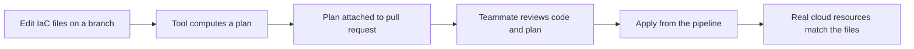

# Module 4 — Running what you built

*Qafila is still at Traction. About twelve people work there, 300 merchants use the app for about 4,000 deliveries a day, payments go through a payment provider, and one team deploys to production every day through continuous integration. Module 3 showed how the team changes software safely. This module covers what happens after a change is live, when the product has to keep working at 7 a.m. on a holiday and at midnight on a Friday. It covers three practices. First, describing the cloud setup in reviewed code instead of clicking in a web console, so that environments can be rebuilt, compared and understood by more than one person. Second, monitoring that watches what merchants and couriers actually experience, alerts that wake someone only when it matters, and an on-call rota people can sustain. Third, handling incidents calmly, learning from them without blame, and agreeing in numbers how reliable the product needs to be. This module also tells the story of Qafila's first serious outage. Each lesson leaves an artefact: an environment inventory with a first infrastructure-as-code change, an alert catalogue with a runbook and an on-call rota, and a post-incident review with a draft reliability target.*

> **Steps:** Operate — keep the product working for the people who depend on it: see trouble early, respond calmly, restore service first, and learn from every failure so it is less likely to happen again.

---

# 4.1 — Infrastructure as code and cloud basics for practitioners
*Level: 🟡 Intermediate* · *Prerequisites: 2.3, 3.3* · *Step: Operate*

**After this you can** list the parts of a small product's cloud setup in an environment inventory, explain what infrastructure as code is and how its plan-review-apply cycle works, and read a short plan to spot a change that would destroy or replace something important before anyone applies it. *Study time: reading about 20 min, hands-on about 90 min (estimate).*

## ⚡ In 60 seconds
- **Infrastructure** is everything your code runs on: servers or containers, the database, file storage, networks, domain names, access rules and secrets. In the cloud, all of it is created through the provider's interface.
- **Infrastructure as code (IaC)** means describing that setup in text files kept in version control, then letting a tool create or change the real resources to match. The files become the record of what exists and why.
- The cycle is **write, plan, review, apply**: the tool shows exactly what it will add, change or destroy, a teammate reviews that plan like a pull request, and only then is it applied.
- The rule that matters most: **if it is not in code, it does not exist reliably: nobody can review it, rebuild it or explain it.**
- Decision cue: before clicking anything in the cloud console, ask "would I be able to recreate this tomorrow, and would a teammate know I did it?"
- Biggest trap: applying a plan you did not read. One line saying a database will be "replaced" can mean "deleted and created empty".

## 🧭 Why it matters
Qafila and everyone in it are fictional. All numbers about Qafila in this lesson are illustrative figures, not benchmarks.

At Launch, Faisal set up Qafila's cloud account in an afternoon by clicking through the provider's web console: a managed database, a place to run the merchant and courier back ends, a storage bucket for receipts and proof-of-delivery photos, a domain name. It worked, and with 15 pilot shops nobody needed more. Then he created a staging copy for testing, again by hand, from memory.

Now, at Traction, the setup has grown, and only Faisal knows it. Last month a change passed every check in staging and then failed in production: production's storage bucket had a stricter access rule that Faisal had added during a late-night fix and never written down. Couriers could not upload delivery photos for forty minutes. This week Faisal was on leave when the database storage warning fired, and the two engineers on duty could not tell which settings were safe to touch. Salma, who handles the on-call phone with them, asked a simple question at the retrospective: "Where is the list of what we actually run, and who changed it last?" Nobody could answer.

None of this was carelessness. It is what happens when infrastructure lives only in a console and in one person's head.

## 📐 How it works

### 🟢 The essentials

**A quick refresher on cloud basics.** Lesson 2.3 explained renting computing from a cloud provider, managed services and the shared responsibility model. Four more ideas matter once you run a product every day.

| Term | Plain meaning | Why a practitioner cares |
|---|---|---|
| **Region** | A geographic area where the provider has data centres | Where your customers' data is stored; latency for users; some rules ask where data lives |
| **Availability zone** | A separate data centre (or group) inside a region, with its own power and network | Running a database across two zones means one failed building does not stop you |
| **Environment** | A complete running copy of the product for one purpose: development, staging, production | Staging only protects you if it is built the same way as production |
| **Identity and access management (IAM)** | The provider's system of users, roles and permissions | Decides who and what can read data, change settings or delete things |

The US National Institute of Standards and Technology (NIST) published a widely used definition of cloud computing in 2011, SP 800-145. Among its five essential characteristics is on-demand self-service: you create resources yourself, without asking a person at the provider (as reported from search summaries). That is what makes the cloud fast, and what makes it easy to create things nobody remembers.

**What infrastructure as code is.** Instead of clicking, you write a file that describes what should exist:

```
database "orders" {
  engine         = "postgres"
  size           = "medium"
  zones          = 2
  backup_days    = 14
  deletion_guard = true
}
```

(Illustrative pseudo-code, not any one tool's syntax.) An IaC tool compares the files with what really exists and works out the steps to make reality match. Most such tools are **declarative**: you describe the end state, not the clicks.

Well-known tools include Terraform and its open-source fork OpenTofu, which has been hosted by the Linux Foundation since 2023 (as reported from Linux Foundation announcements and news coverage), and each large cloud provider's own template service. They are examples, not recommendations; the ideas below apply to all of them.

**The cycle: write, plan, review, apply.**



The **plan** is the key step. It lists every resource the tool would **add**, **change in place**, **replace** (destroy and recreate) or **destroy**. Reviewing the plan, not just the code, is how you catch the surprising consequence of a small edit.

**What you gain.**

| Without IaC | With IaC |
|---|---|
| Setup known by one person | Setup readable by anyone with repository access |
| Staging and production drift apart silently | Both built from the same files with different settings |
| "Who changed this?" has no answer | Every change is a reviewed commit with a reason |
| Rebuilding after a disaster means remembering | Rebuilding means running the files again (data still comes from backups) |

### 🟡 Going deeper

**Same code, different settings.** Use one set of IaC files plus a small settings file per environment: production gets two zones and 14 days of backups, staging one zone and 3 days. The shape is the same, so a test in staging means something, and every intended difference is written where a reviewer can see it.

**State: the tool's memory.** Most IaC tools keep a **state file** that records which real resources correspond to which lines of code. Treat it with care:

- Keep it in a shared, access-controlled, backed-up store, never on a laptop.
- Lock it during an apply, so two people cannot apply at once.
- Assume it holds sensitive values, and limit who can read it.

**Drift.** **Drift** is when the real setup no longer matches the code, usually after a console change; it caused Qafila's staging-passes-production-fails problem. A regular plan with no code changes is a cheap check: if it wants to change something, reality has moved. Then put the console change into code, or let the tool undo it.

**Secrets do not go in the files.** Passwords, payment provider keys and tokens never go into IaC files. Store them in a secrets manager, reference them by name, and give each service only the secrets it needs. For depth, see [*Secure AI & Application Security: Zero to Hero*, lesson 5.2 — Secrets management: keys, tokens and where they leak](../secai/index.html#/5.2).

**Least privilege.** IAM rules are infrastructure too, so they belong in code. A sensible start for a small team: most engineers read-only in production; the pipeline changes only what it deploys, through its own role; two named people hold an emergency "break-glass" role whose every use is logged and announced; nobody keeps long-lived personal admin keys.

**Tags.** Tag every resource with environment, owner and purpose (`env=production`, `owner=delivery-team`). Tags cost nothing and answer "what is this for, and what does it cost?" later (Module 10).

### 🔴 Expert view

**Read every plan for the four dangerous words.** In a plan, *add* is usually safe, *change in place* usually safe, but **replace** and **destroy** on anything that holds data (a database, a storage bucket, a queue) need a stop and a question. Some innocent-looking edits force a replacement: renaming a database resource in code, or changing a setting the provider cannot change on a running database. Many tools let you mark a resource as protected so the tool refuses to destroy it; use that on every data store. A plan line like this deserves a conversation, not an approval:

```
-/+ database "orders" must be replaced
      name: "orders" -> "orders-main"   (forces replacement)
```

**Bringing an existing hand-built setup under code.** Most teams you join will not start fresh. Do not rewrite everything at once. Start with an **environment inventory** (what exists, where, who owns it, how it was created), then import resources into code one group at a time, riskiest first. After each import, a plan with no changes proves code and reality match.

**IaC does not back up your data.** Code can recreate an empty database in minutes; it cannot bring back last Tuesday's orders. Backups and tested restores are a separate job (lesson 4.3). For backup design in depth, see [*System Design for Vibe Coders*, lesson 2.3 — Backups: What, Not Just Whether](../vibe/index.en.html#l2-3).

**Where to go next.** Policy checks on plans, promotion between environments and reusable modules: [*Cloud & DevOps: Zero to Hero*, lesson 3.1 — Infrastructure as code with Terraform/OpenTofu: state, modules and plans](../cloud/index.html#/3.1) and [*Cloud & DevOps: Zero to Hero*, lesson 3.3 — Policy as code, drift and guardrails](../cloud/index.html#/3.3).

**The memorable rule.** If it is not in code, it does not exist reliably: nobody can review it, rebuild it or explain it.

## 🧰 The toolkit
| Resource, tool or template | What it is and does | When to reach for it |
|---|---|---|
| **Environment inventory** | A table of every resource: name, environment, purpose, owner, how it was created (console or code), backup and protection status | Before adopting IaC; whenever you join a team and want to understand what runs |
| **IaC tool** | Reads files describing infrastructure and makes the cloud match them (for example Terraform, OpenTofu or a provider's template service) | For anything that should exist in more than one environment or outlive one person |
| **Plan review checklist** | Questions for every plan: anything replaced or destroyed? any data store touched? any access widened? does it match the PR description? | Every infrastructure pull request |
| **Secrets manager** | A provider service that stores secrets and hands them to services at run time | Every password, key and token |
| **Tagging convention** | Required tags (environment, owner, purpose) on every resource | From the first resource; checked in review |
| **Drift check** | A scheduled plan run with no code change; any proposed change means reality moved | Weekly, or after any emergency console change |

## 🏛️ In practice at Qafila
Faisal, back from leave, pairs with one of the newer engineers on the inventory; Salma reviews it as the person most likely to need it at night. Illustrative and fictional.

> **Qafila environment inventory (Traction, first version)**
>
> | Resource | Env | Purpose | Owner | Created by | Backups / protection |
> |---|---|---|---|---|---|
> | Orders database (managed) | prod | Orders, merchants, couriers | Faisal | Console | Daily backup, 7 days; deletion guard **off** |
> | Orders database (managed) | staging | Testing | Faisal | Console | Daily backup, 1 day |
> | Photo bucket | prod | Proof-of-delivery photos, receipts | Faisal | Console | Versioning **off**; stricter access rule added by hand (undocumented) |
> | Photo bucket | staging | Testing | Faisal | Console | None |
> | App runtime (managed containers) | prod, staging | Merchant and courier back ends | Faisal | Pipeline | n/a |
> | Payment provider keys | prod | Taking card payments | Faisal | Stored in secrets manager | n/a |
> | Domain and certificates | prod | qafila app domain | Maha | Console | Auto-renew on |
>
> **First IaC change (pull request "photo bucket into code"):** import both photo buckets; express the production access rule in code and apply the same rule to staging; turn on versioning in production; add `env`, `owner`, `purpose` tags. Plan attached: 2 imports, 4 changes in place, 0 replace, 0 destroy.
>
> **Next:** deletion guard on the production database (today); import both databases; IAM roles into code.

Faisal wanted to "rewrite everything in code over a weekend". Salma asked what she would do if it went wrong on Sunday night; they agreed on one resource group per week. The newer engineer noticed Faisal owned almost everything; the working agreement now names a second reviewer for infrastructure.

## 🛠️ Exercises
**🟢 Who looks after what?** Qafila uses a managed database from its cloud provider. For each item, say whether it is the provider's job, Qafila's job, or shared, with a one-line reason: (a) replacing a failed disk in the data centre; (b) choosing who can connect to the database; (c) deciding how many days of backups to keep; (d) applying security patches to the database engine software; (e) making sure no one stores a merchant's card number in a free-text field.
*Done when:* all five have an owner and a reason that uses the idea of security "of" versus "in" the cloud from lesson 2.3 and this lesson.

<details><summary>Model answer and self-check</summary>

**Model answer.** (a) Provider: physical infrastructure. (b) Qafila: access configuration. (c) Qafila: the provider offers backups, but retention is Qafila's choice. (d) Shared in practice: the provider patches a managed service, Qafila often picks the maintenance window and version upgrades. (e) Qafila: what data goes in is entirely the customer's job.

**Self-check.**
- Did you avoid saying "the provider handles security" as a blanket answer?
- Did you notice that a provider *feature* (backups) still needs a Qafila *decision* (how long)?
- For (d), did you check whether your answer depends on the kind of service (managed versus a server you run yourself)?

</details>

**🟡 Write an environment inventory.** Use your own small project (a personal site, a student project, an open-source project you can read) or, if you have none, this description: "A shop-booking app runs on one cloud provider. It has a managed database (production and a test copy), a file bucket for menu images, a container service for the back end, a domain with a certificate, and an email-sending service key stored in a settings page of the hosting console." Build the inventory table with the columns from the toolkit.
*Done when:* every resource has an owner, an environment, how it was created, and its backup and protection status, and you have marked the two rows you would bring under code first, with a reason.

<details><summary>Model answer and self-check</summary>

**Model answer.** Production database (back-end lead; console; daily backups 7 days; deletion protection unknown, to check), test database (console; 1 day), image bucket (console; versioning unknown), container service (pipeline), domain and certificate (console; auto-renew to check), email key (console settings page; should move to a secrets manager). First under code: production database settings and deletion protection (biggest loss), then the email key (a secret in the wrong place).

**Self-check.**
- Did you write "unknown, to check" rather than guess where you did not know?
- Is every secret listed by name and location, never by its value?
- Did you pick first what would hurt most if lost, not what is easiest?

</details>

**🔴 Read a plan before anyone applies it.** A teammate's pull request says "rename staging and prod databases for consistency; enable backups for 14 days". The attached plan reads:

```
~ database "orders-staging"   backup_days: 1 -> 14
-/+ database "orders"         name: "orders" -> "orders-prod" (forces replacement)
~ bucket "photos-prod"        versioning: off -> on
+ tag "owner" on 3 resources
Plan: 3 to add, 2 to change, 1 to destroy.
```

Write your review comment: what is safe, what is dangerous, what you ask for, and whether you approve.
*Done when:* your comment names the replacement of the production database as the blocking issue, explains what "forces replacement" means for the data, proposes at least one safe alternative, and states clearly that you do not approve this version.

<details><summary>Model answer and self-check</summary>

**Model answer.** "Staging backups, photo versioning and tags look fine. Blocking: the rename forces `orders` to be destroyed and recreated: an empty production database, with every order, merchant and courier record gone unless restored, plus downtime. The description does not mention it. Please drop the rename (it is cosmetic) or use the tool's state-move feature, and show a new plan with 0 to destroy. Can we add the deletion guard for `orders` here too? Not approving this version."

**Self-check.**
- Did you notice that the summary line ("1 to destroy") contradicts the PR description?
- Did you ask for a new plan as evidence, rather than accepting "I'll be careful"?
- Was your comment about the change, not about the person?

</details>

## ⚠️ Mistakes and traps
- **Approving the code but not the plan.** The code diff can look harmless while the plan destroys a database. Always read the plan's summary line first.
- **Emergency console changes that stay forever.** Post them in the team channel at once and put them into code the next working day.
- **One person who knows the cloud account.** A single owner is a single point of failure. Require a second reviewer for infrastructure changes and keep the inventory current.
- **Secrets in IaC files or state on a laptop.** Reference secrets from a secrets manager; keep state in a shared, locked, access-controlled store.
- **Believing IaC is a backup.** Code rebuilds empty resources. Data comes back only from backups you have tested.

## 🧾 Recap
- Infrastructure is everything your code runs on; in the cloud it is created through software, which makes it fast to create and easy to forget.
- Infrastructure as code describes the setup in reviewed files; a tool makes reality match them through write, plan, review, apply.
- The plan is the safety step: look for *replace* and *destroy* on anything that holds data, and protect data stores from deletion.
- Build environments from the same code with written differences; check for drift; keep secrets and state out of the repository and off laptops.
- Start with an environment inventory and bring resources under code one group at a time.
- Rule: if it is not in code, it does not exist reliably.

## ✍️ Check yourself
**1. A change passed every check in Qafila's staging environment but failed in production because production had a storage rule added by hand. What is the best lasting fix?**

- A. Ask engineers to test every change in production first, because staging cannot be trusted.
- B. Copy production's settings into staging by hand each time a deploy is planned for the week.
- C. Build both environments from the same IaC files and write any intended difference in settings.
- D. Remove the stricter rule from production so that both environments behave the same way again.

<details><summary>Answer</summary>

**C.** Building both environments from the same code, with differences written down, stops silent drift. A abandons staging, B relies on memory each time and will drift again, and D weakens production security to hide the symptom. See "Same code, different settings" and "Drift".

</details>

**2. In an infrastructure-as-code workflow, what is the main purpose of the plan?**

- A. To show exactly what the tool would add, change, replace or destroy before anything happens.
- B. To create a backup of every cloud resource and its data before any change is applied.
- C. To estimate how long the deployment will take so the team can pick a quiet time.
- D. To check the code for syntax errors so the reviewer only needs to read the description.

<details><summary>Answer</summary>

**A.** The plan lists the concrete effect of the change on real resources so a person can review it. It does not back up data (B; IaC is not a backup), does not estimate time (C), and reviewers must read the plan itself, not just the description (D). See "The cycle: write, plan, review, apply".

</details>

**3. Faisal is away and the on-call engineer wants to change a database setting in the cloud console at night to stop a warning. What should the engineer do, following this lesson?**

- A. Never touch the console under any circumstances, and wait for Faisal to come back.
- B. Make the change, then delete the warning so the same setting does not alert again.
- C. Make the change in code on a branch and wait for next week's planned infrastructure review.
- D. Make the minimum safe change if needed, post it in the team channel, and put it into code next day.

<details><summary>Answer</summary>

**D.** Emergency console changes are sometimes necessary; the trap is leaving them undocumented. A may leave customers affected, B hides the signal, and C delays a fix that may be urgent. See "Mistakes and traps" and "Drift".

</details>

**4. A plan line reads `-/+ database "orders" must be replaced (forces replacement)`. What does this most likely mean for Qafila?**

- A. The database settings will be changed in place, with a short pause and no data affected.
- B. The existing database will be destroyed and a new, empty one created unless steps are taken.
- C. The tool will copy the data to a new database automatically before deleting the old one.
- D. The database will be moved to another availability zone, keeping its data and its name.

<details><summary>Answer</summary>

**B.** "Replace" means destroy and recreate; IaC recreates settings, not data. A describes a change in place, C assumes a data copy the tool does not make, and D invents a zone move. See "Read every plan for the four dangerous words".

</details>

**5. Salma asks where to start bringing Qafila's hand-built cloud setup under code. What is the best first step?**

- A. Write an environment inventory, then import the riskiest resource group first.
- B. Delete everything in staging and rebuild it from scratch in code over a weekend.
- C. Buy a new cloud account and build the whole product there from code, then migrate.
- D. Wait until Scale-up, when a platform team can own infrastructure as code properly.

<details><summary>Answer</summary>

**A.** An inventory shows what exists; importing one group at a time, riskiest first, proves each step with an empty plan. B and C are big-bang rewrites with high risk, and D leaves the single-person problem in place for years. See "Bringing an existing hand-built setup under code".

</details>

## 📚 References
- Mell, P. and Grance, T., *The NIST Definition of Cloud Computing*, NIST Special Publication 800-145, 2011: https://csrc.nist.gov/pubs/sp/800/145/final — five essential characteristics including on-demand self-service (reported from search summaries; the page could not be opened from this environment on 2026-11-22).
- Linux Foundation, "Linux Foundation Launches OpenTofu: A New Open Source Alternative to Terraform" (press release, September 2023): https://www.linuxfoundation.org/press/announcing-opentofu (reported from search summaries; not opened).
- Amazon Web Services, "Shared Responsibility Model": https://aws.amazon.com/compliance/shared-responsibility-model/ — security "of" and "in" the cloud (reported from search summaries; not opened).
- Library course: [*Cloud & DevOps: Zero to Hero*, lesson 1.2 — Cloud fundamentals: regions, zones, compute, storage, managed services and shared responsibility](../cloud/index.html#/1.2).
- Library course: [*Cloud & DevOps: Zero to Hero*, lesson 3.1 — Infrastructure as code with Terraform/OpenTofu: state, modules and plans](../cloud/index.html#/3.1).
- Library course: [*Cloud & DevOps: Zero to Hero*, lesson 3.3 — Policy as code, drift and guardrails](../cloud/index.html#/3.3).
- Library course: [*Secure AI & Application Security: Zero to Hero*, lesson 5.2 — Secrets management: keys, tokens and where they leak](../secai/index.html#/5.2).
- Library course: [*System Design for Vibe Coders*, lesson 2.3 — Backups: What, Not Just Whether](../vibe/index.en.html#l2-3).

---

# 4.2 — Monitoring, alerts and on-call
*Level: 🟡 Intermediate* · *Prerequisites: 3.3, 4.1* · *Step: Operate*

**After this you can** choose a few signals that show whether customers are being served, sort alerts into "wake someone", "make a ticket" and "delete", write an alert specification with a short runbook, and design a small on-call rota with handover and a regular review of alert noise. *Study time: reading about 20 min, hands-on about 90 min (estimate).*

## ⚡ In 60 seconds
- **Monitoring** means collecting signals about a running system and watching them. **Observability** is how well those signals let you answer new questions about what is going on inside.
- Watch **symptoms customers feel** (orders failing, slow pages, couriers not getting offers) first; watch **causes** (CPU, memory, disk) mainly to explain symptoms.
- An **alert** that wakes a person (a **page**) must be urgent, real and actionable. Everything else becomes a ticket, a dashboard, or nothing.
- The rule that matters most: **every page must point to customer pain and to a first action; if it does neither, it is noise.**
- Decision cue: after any alert, ask "did this need a human, now?" If the answer was no, change or delete the alert that week.
- Biggest trap: adding an alert after every problem and never removing one, until on-call staff learn to ignore the phone.

## 🧭 Why it matters
Qafila and everyone in it are fictional. All numbers about Qafila in this lesson are illustrative figures, not benchmarks.

When Qafila moved to daily deploys, it also started an on-call rota: one engineer and Salma share a phone that receives alerts outside working hours. Over a few months the team added an alert whenever something went wrong: database CPU above 70%, memory above 80%, any error in the logs, the payment provider responding slowly, disk usage, a certificate expiring "soon".

On a Thursday night the phone went off nine times, mostly CPU and memory alerts during a nightly report job that cleared themselves. Salma stopped looking. At 6:40 the next morning a bakery owner phoned her personal number: for about forty minutes, no courier had received a new delivery offer. The system that sends offers had stopped after a routine change to a background job. No alert covered it, because nothing had crashed and CPU looked fine. Merchants felt the problem long before Qafila did.

The team was measuring the machine, not the service, and pointless alerts had trained people to ignore the phone.

## 📐 How it works

### 🟢 The essentials

**Telemetry: the raw signals.** **Telemetry** is data a running system sends about itself. The OpenTelemetry project, an open-source standard for collecting it, names three main signal types (as reported from its documentation):

| Signal | Plain meaning | Qafila example | Good for |
|---|---|---|---|
| **Metric** | A number measured over time | Orders created per minute; share of courier offers accepted | Trends, thresholds, dashboards, alerts |
| **Log** | A timestamped record of one event | "Order 8812 created by merchant 214 at 09:14:03" | Understanding what happened to one request |
| **Trace** | The path of one request through several parts of the system, with timings | Merchant taps "request courier" → API → order service → offer job → courier app | Finding where a slow or failed request got stuck |

Start with metrics for the main journeys and structured logs (logs with named, searchable fields such as `order_id`); add traces where requests cross several services.

**Symptoms first.** Google's *Site Reliability Engineering* book suggests four "golden signals" for a user-facing system: **latency** (how long requests take), **traffic** (how much demand there is), **errors** (how many requests fail) and **saturation** (how full the system is) (as reported from summaries of its monitoring chapter). The first three describe what users experience. A useful habit is to translate them into the language of your own product:

| Generic signal | Qafila's version |
|---|---|
| Traffic | Orders created per minute, compared with the same time last week |
| Errors | Share of order requests that fail; share of payment calls that fail |
| Latency | Time from "request courier" to the first courier offer |
| Saturation | Database connections in use; queue of offers waiting to be sent |

The Thursday-night problem would have shown up in two of these: orders kept arriving, but "time to first courier offer" went from about a minute to "never".

**Pages, tickets and dashboards.** Not every signal deserves an alert, and not every alert deserves to wake someone.

| Type | When |
|---|---|
| **Page** (phone, any hour) | Customers are affected now or very soon, and a human must act |
| **Ticket** | Needs attention within a day or a week (a certificate expires in 20 days) |
| **Dashboard only** | Useful context, no action by itself (CPU, memory) |

### 🟡 Going deeper

**What makes a good page.** Check each paging alert against four questions:

1. **Is it a symptom?** Does it describe something merchants, couriers or customers feel?
2. **Is it urgent?** Would waiting until morning make it meaningfully worse?
3. **Is it actionable?** Is there something a person can do right now?
4. **Is it real?** Does it fire rarely when nothing is wrong? (An alert that is wrong half the time teaches people to ignore it.)

If any answer is no, it should not page. It might still be a ticket or a dashboard.

**Thresholds and time windows.** "Error rate above 0%" pages on one bad request. Better: "more than 2% of order requests failed over 10 minutes" (illustrative): a short window ignores single blips. Comparing with the same time last week catches orders dropping to near zero at lunchtime.

**Check the journey from outside.** A **synthetic check** is a robot that performs a key user action on a schedule, for example creating a test order for a test shop every five minutes and confirming that a test courier gets an offer. It catches failures that leave every internal metric looking healthy, which is exactly what happened at Qafila on Thursday night. Mark synthetic orders clearly so they never reach real couriers or reports.

**Every page has a runbook.** A **runbook** is a short, written set of first steps for one alert: what it means, how to confirm it, what to try first, when and whom to escalate to. It is not a full manual. At 3 a.m., half-awake, people follow written steps better than they remember. Link the runbook from the alert itself.

**On-call that people can sustain.** **On-call** means being reachable and ready to respond outside normal hours for a set period. A few practices make it fair and workable:

| Practice | What it looks like |
|---|---|
| **Rota** | A published schedule, usually a week at a time, with a primary and a backup |
| **Handover** | A short written note at the end of each shift: what fired, what is still open, what to watch |
| **Escalation** | A named person to call if the primary cannot fix it within a set time, or if it is big |
| **Recovery** | Time off or a late start after a bad night; rules on pay and hours depend on employment law and contracts, so ask HR or management rather than assume |
| **Noise review** | Every week, look at every page: needed? actionable? Fix or delete the ones that were not |

Google's SRE book describes its own targets: its SREs spend no more than 25% of their time on call, and a shift should average no more than about two incidents, so that each one can be handled properly and followed up (as reported from summaries of the book's on-call chapter). These are one large company's numbers for its own teams, not a universal standard, but the idea travels: if every shift is busy, the system or the alerts need work, not braver people.

### 🔴 Expert view

**Alert on the user journey, investigate with everything else.** Mature teams page on a handful of journey-level signals and keep hundreds of cause-level metrics on dashboards for diagnosis. When a page fires, they move from symptom to cause: journey graph → which step is slow (trace) → which component (metrics) → which requests (logs). If you find yourself writing a page for a cause, ask which symptom it predicts, and page on that instead.

**Alerting on reliability targets.** With a target (lesson 4.3), a team can alert on how fast it uses up its allowed failures, the **burn rate**. Google's *Site Reliability Workbook* describes alerts combining a long and a short window, firing fast for big failures and later for slow leaks (as reported from summaries of its "Alerting on SLOs" chapter). That is Qafila's next step once targets exist.

**Background work is the blind spot.** Many failures in a product like Qafila's happen not in requests users make but in jobs that run in the background: sending offers, settling payments, sending receipts. These fail silently because no user request errors. Give each important job a "heartbeat" metric (last successful run, items processed) and alert when it stops. See [*System Design for Vibe Coders*, lesson 7.4 — Background Jobs: The Code Nobody Watches](../vibe/index.en.html#l7-4).

**The memorable rule.** Every page must point to customer pain and to a first action; if it does neither, it is noise.

## 🧰 The toolkit
| Resource, tool or template | What it is and does | When to reach for it |
|---|---|---|
| **Alert catalogue** | A table of every alert: signal, threshold, window, type (page, ticket, dashboard), owner, runbook link | When on-call feels noisy; reviewed weekly |
| **Alert specification card** | For one alert: what customers feel, the query, threshold and window, why it is urgent, first action, runbook | Before adding any paging alert |
| **Runbook** | Short first steps for one alert: meaning, confirm, first actions, escalate | Linked from every page |
| **Synthetic check** | A scheduled robot that runs a key journey end to end with test data | For the two or three journeys that matter most |
| **Observability platform** | A tool that collects and shows metrics, logs and traces, and sends alerts (open-source stacks or hosted services; examples, not endorsements) | From the first production customer |
| **On-call handover note** | What fired, what is open, what to watch, what was changed | End of every on-call shift |

## 🏛️ In practice at Qafila
After the Thursday night, Salma and Faisal spend an afternoon on the alert catalogue with the rest of the engineers. Illustrative and fictional.

> **Qafila alert catalogue (Traction, after review)**
>
> | Alert | Type | Threshold and window | Runbook |
> |---|---|---|---|
> | Courier offer delay: median time from "request courier" to first offer | **Page** | Above 5 minutes for 10 minutes, 6 a.m.–midnight | RB-01 |
> | Synthetic order: test order at test shop gets no offer | **Page** | 2 failures in a row (checks every 5 minutes) | RB-01 |
> | Order requests failing | **Page** | Above 2% over 10 minutes | RB-02 |
> | Payment calls failing | **Page** | Above 5% over 10 minutes | RB-03 |
> | Offer job heartbeat: no successful run | **Page** | None in 10 minutes | RB-01 |
> | Certificate expiry | Ticket | 21 days before expiry | — |
> | Database disk | Ticket | Above 70% | — |
> | CPU, memory | Dashboard only | — | — |
> | "Any error in logs" | **Deleted** | — | — |
>
> **RB-01 — Couriers not getting offers (first steps):** 1) Open the "orders to offers" dashboard; is the delay real or only for one city? 2) Check the offer job heartbeat and its last log lines. 3) If a deploy happened in the last two hours, roll it back (lesson 3.3 runbook). 4) If not fixed in 15 minutes, call the backup and post in the incident channel. 5) Tell Salma (or support on duty) so she can message merchants.
>
> **On-call rota:** five engineers, one week each as primary, the previous week's primary as backup; Salma covers merchant communication during her working hours. Handover note every Monday at 10:00. Monday noise review: every page from last week marked "needed" or "fix".

The first draft counted declined cards as payment failures, which would have paged every night; now only technical failures count. Faisal wanted to keep the CPU page "just in case"; Salma asked what action it led to, and nobody could name one.

## 🛠️ Exercises
**🟢 Page, ticket, dashboard or delete?** Classify each alert and give a one-line reason: (a) "database CPU above 70% for 5 minutes"; (b) "no orders created at all in the last 15 minutes between 8 a.m. and 10 p.m."; (c) "domain certificate expires in 30 days"; (d) "any WARNING line appears in any log"; (e) "share of payment calls failing above 5% for 10 minutes"; (f) "courier app version 2.3 still used by 12 couriers".
*Done when:* each alert has one of the four labels and a reason that uses the four questions (symptom, urgent, actionable, real).

<details><summary>Model answer and self-check</summary>

**Model answer.** (a) Dashboard: a cause, not actionable alone. (b) Page: customers affected at a busy time. (c) Ticket: not tonight. (d) Delete: not a symptom, fires constantly. (e) Page: merchants cannot pay; urgent and actionable. (f) Ticket or dashboard: not urgent.

**Self-check.**
- Did you page only on things customers feel now?
- Did you resist keeping (a) "just in case"?
- For (b), did you notice the time window that avoids paging at 3 a.m. when no shop is open?

</details>

**🟡 Write an alert specification and runbook.** Pick one key journey in your own project or an open-source app you use (or use Qafila's "merchant pays the delivery fee by card"). Write an alert specification card (what customers feel, the signal, threshold and window, why urgent, first action) and a runbook of five steps or fewer.
*Done when:* the alert is a symptom with a threshold and a window, the runbook fits on one screen, includes a way to confirm the problem is real, a first safe action, an escalation point with a time limit, and a step that tells the people who talk to customers.

<details><summary>Model answer and self-check</summary>

**Model answer.** Alert: "Merchants cannot pay delivery fees". Signal: share of fee payments ending in a technical error (not card declines), above 5% over 10 minutes, 6 a.m.–midnight. Urgent because merchants cannot request couriers without paying. Runbook: 1) Confirm on the payments dashboard and one failed request's log. 2) If the provider's status page reports an incident, switch on the "pay later" flag. 3) If a deploy happened in the last two hours, roll back. 4) Post in the incident channel; tell support. 5) Not resolved in 20 minutes: call the backup and Faisal.

**Self-check.**
- Did you separate normal business outcomes (declined cards) from technical failure?
- Does every runbook step say what to do, not just what to look at?
- Would someone who did not write it be able to follow it at 3 a.m.?

</details>

**🔴 Design a sustainable on-call rota.** Qafila has five engineers who can take call, Salma for merchant communication in working hours, and Faisal as the escalation point. Design a four-week rota with primary and backup, write the handover note template, define what happens after a bad night, and describe the weekly noise review, including one measure you would track over time.
*Done when:* nobody is primary two weeks in a row, every week has a named backup, the handover template has at most five fields, the recovery rule is stated as "to be agreed with management under our contracts", and the noise review has a measure with a target direction (for example, pages per week that were not needed: going down).

<details><summary>Model answer and self-check</summary>

**Model answer.** Primaries A, B, C, D in weeks 1–4; backups E, A, B, C (last week's primary backs up). Faisal is the escalation point, not a routine primary. Handover: pages this week, still open, changes to watch, runbooks that were wrong, anything else. After a page past midnight: late start or time off next day, exact rule to be agreed with management under our contracts. Monday noise review, 20 minutes: each page marked needed or not; every "not needed" gets a fix ticket that week. Measure: share of pages not needed (going down).

**Self-check.**
- Is the rota fair across the four weeks, including backup duty?
- Did you avoid stating a legal rule about pay or rest?
- Does your measure push toward fewer, better pages, not toward silencing alerts?

</details>

## ⚠️ Mistakes and traps
- **Monitoring the machine, not the service.** CPU can be fine while couriers get nothing. Start with journey-level symptoms.
- **An alert for every past problem.** Alerts pile up and nobody removes them. Review every page weekly and delete or fix the noisy ones.
- **Pages without runbooks.** A page that says only "error rate high" leaves a tired person guessing. Link short first steps.
- **Forgetting background jobs.** Jobs fail silently. Give each important job a heartbeat and alert when it stops.
- **Counting normal business outcomes as failures.** Declined cards or cancelled orders are not errors; alerting on them creates noise.

## 🧾 Recap
- Telemetry comes as metrics, logs and traces; start with journey metrics and structured logs.
- Watch symptoms customers feel (traffic, errors, latency in your product's own terms) and use causes such as CPU to explain them.
- Page only for urgent, real, actionable symptoms; make everything else a ticket or a dashboard.
- Every page has a runbook; synthetic checks and job heartbeats catch silent failures.
- On-call works with a published rota, backup, handover, escalation, recovery time and a weekly noise review.
- Rule: every page must point to customer pain and to a first action.

## ✍️ Check yourself
**1. On Thursday night, CPU and memory looked normal while no courier received an offer for forty minutes. Which signal would most likely have caught it?**

- A. A tighter CPU threshold on the database server, lowered from 70% down to 50%.
- B. The median time from "request courier" to first offer, with a threshold and window.
- C. An alert on every error line written to the logs by any service, at any time of day.
- D. A daily report of the previous day's deliveries, emailed to the team each morning.

<details><summary>Answer</summary>

**B.** It measures the symptom merchants felt. A watches a cause that was fine, C would be noisy and still miss a job that stopped without errors, and D arrives a day late. See "Symptoms first".

</details>

**2. Which of these should page the on-call engineer at night?**

- A. The domain certificate will expire in 25 days and has not renewed automatically yet.
- B. Database CPU has been above 70% for five minutes during the nightly report job.
- C. One courier is still using an old version of the app that the team plans to retire.
- D. More than 2% of order requests have failed over the last ten minutes, after 6 a.m.

<details><summary>Answer</summary>

**D.** It is a symptom customers feel now, urgent and actionable. A needs action but not tonight (a ticket), B is a cause with no action, and C is a ticket at most. See "Pages, tickets and dashboards".

</details>

**3. Salma notices she has started ignoring the on-call phone because most alerts clear themselves. What is the best response?**

- A. Review every page from the last weeks and fix or delete those that were not needed.
- B. Add a second phone so that one person can watch the noisy alerts and the other the real ones.
- C. Raise every threshold by half so fewer alerts fire, without looking at which ones mattered.
- D. Ask the engineers to be more disciplined about responding to each alert straight away.

<details><summary>Answer</summary>

**A.** Noise is a property of the alerts, not of the people; a review fixes the cause. B doubles the burden, C may silence real problems along with noise, and D blames people for a design problem. See "On-call that people can sustain" and "Mistakes and traps".

</details>

**4. What is the main purpose of a runbook linked from a paging alert?**

- A. To record the full history of the service's design so that new hires can learn it.
- B. To prove to auditors that the team has written procedures for every possible failure.
- C. To give the person paged short, written first steps: confirm, act, escalate, tell support.
- D. To replace the need for an on-call engineer, so that support staff can handle all alerts.

<details><summary>Answer</summary>

**C.** A runbook is short first steps for one alert, used under pressure. A describes design documentation, B confuses its purpose with audit evidence, and D overstates it: runbooks support people, they do not replace them. See "Every page has a runbook".

</details>

**5. The SRE book describes a target of at most about two incidents per on-call shift. How should Qafila use that figure?**

- A. As a legal maximum that Qafila must follow under employment rules for on-call staff.
- B. As a benchmark proving that Qafila's on-call load is healthy if it stays below two.
- C. As a reason to stop paging at night, since Google limits incidents and so should Qafila.
- D. As one company's guide showing that busy shifts mean the system or alerts need work.

<details><summary>Answer</summary>

**D.** The figure is Google's own target for its teams, reported from its book; the idea is that heavy load signals a problem to fix. A invents a legal rule, B treats one company's number as a universal benchmark, and C misreads it entirely. See "On-call that people can sustain".

</details>

## 📚 References
- Beyer, B., Jones, C., Petoff, J. and Murphy, N. R. (eds.), *Site Reliability Engineering: How Google Runs Production Systems* (O'Reilly, 2016), chapter 6, "Monitoring Distributed Systems": https://sre.google/sre-book/monitoring-distributed-systems/ — the four golden signals (reported from search summaries; the page could not be opened from this environment on 2026-11-22).
- Same book, chapter 11, "Being On-Call": https://sre.google/sre-book/being-on-call/ — 25% of time on call and about two incidents per shift as Google's own targets (reported from search summaries; not opened).
- Beyer, B. et al. (eds.), *The Site Reliability Workbook* (O'Reilly, 2018), chapter 5, "Alerting on SLOs": https://sre.google/workbook/alerting-on-slos/ — burn-rate alerts with long and short windows (reported from search summaries; not opened).
- OpenTelemetry, "Signals": https://opentelemetry.io/docs/concepts/signals/ — traces, metrics and logs (reported from search summaries; not opened).
- Library course: [*Cloud & DevOps: Zero to Hero*, lesson 5.1 — Telemetry: logs, metrics, traces and OpenTelemetry](../cloud/index.html#/5.1).
- Library course: [*Cloud & DevOps: Zero to Hero*, lesson 5.2 — SLOs, error budgets, alerting and on-call that people can sustain](../cloud/index.html#/5.2).
- Library course: [*System Design for Vibe Coders*, lesson 7.4 — Background Jobs: The Code Nobody Watches](../vibe/index.en.html#l7-4).
- Library course: [*System Design for Vibe Coders*, lesson 7.6 — Your Monitoring Stack: Sentry, Uptime Checks, Metrics, and Alerts](../vibe/index.en.html#l7-6).
- Library course: [*Running IT as a Business*, lesson 8.1 — Monitoring, events and incident management](../itbiz/index.html#/8.1) (the manager's view).

---

# 4.3 — Incidents, post-incident reviews and reliability targets
*Level: 🟡 Intermediate* · *Prerequisites: 4.1, 4.2* · *Step: Operate*

**After this you can** run the first hour of an incident with clear roles (restore service first, communicate, keep a timeline), write a blameless post-incident review with contributing factors and owned actions, and draft a reliability target for one user journey with its error budget worked out in minutes. *Study time: reading about 25 min, hands-on about 100 min (estimate).*

## ⚡ In 60 seconds
- An **incident** is an unplanned event that harms, or threatens to harm, the service customers rely on. Handling one well is a skill a team practises, not luck.
- In an incident, **restore service first, find the cause later**. Give someone the job of coordinating, someone the job of communicating, and keep a timeline.
- A **post-incident review** (also called a postmortem) asks how the system and the way of working allowed the failure, not who to blame, and ends with a few owned, dated actions.
- A **reliability target** (a service level objective, or SLO) says in numbers how reliable a journey must be. The gap between the target and 100% is the **error budget**: the failure the team accepts while it keeps shipping.
- The rule that matters most: **fix the system, not the person; people are part of the system you are fixing.**
- Biggest trap: a review that ends with "be more careful". It changes nothing and teaches everyone to hide mistakes.

## 🧭 Why it matters
Qafila and everyone in it are fictional. All numbers about Qafila in this lesson are illustrative figures, not benchmarks.

It happened on a Tuesday, just before noon. A daily deploy included a database migration (a script that changes the structure or contents of the database) that reorganised how orders were stored. It had worked in staging, which held a few hundred test orders. In production it failed halfway, and new orders were written to a place the app no longer read. Merchants saw new orders disappear; couriers got offers, then the orders vanished.

For about two hours, orders were lost from the live system. Two engineers rolled the code back, but rolling back code does not undo a migration (lesson 3.3 warned about this). Faisal and Maha argued in the channel about restoring from backup; nobody was in charge, and nobody told merchants anything for the first hour. In the end the orders were recovered from backups. That evening Maha's first message was "who ran this migration?"

This was Qafila's first serious outage. This lesson covers running an incident, learning from it, and agreeing in advance how reliable is reliable enough.

## 📐 How it works

### 🟢 The essentials

**What counts as an incident.** Any unplanned event that stops customers getting what the service promises, or is about to. Declaring early is cheap; declaring late is expensive. A severity scale helps everyone agree how big it is:

| Severity | Plain meaning and Qafila example | Response |
|---|---|---|
| **SEV1** | A core journey down or data being lost (orders disappearing) | All roles; tell merchants within 30 minutes (illustrative) |
| **SEV2** | A core journey degraded or one group badly affected (offers slow in one city) | On-call plus backup; comms if it lasts over 30 minutes |
| **SEV3** | Minor or with a workaround (receipts emailed late) | Ticket; fix in working hours |

Write the levels down before you need them.

**Roles in the first hour.** Even with five people, separate the jobs:

| Role | Job |
|---|---|
| **Incident lead** (often called incident commander) | Coordinates: sets priorities, assigns work, calls for help; does not type the fix |
| **Communications** | Updates merchants, couriers and colleagues at set times, in plain words |
| **Fixers** | Investigate and change things, saying what they will do before doing it |
| **Scribe** (can be the lead in a small team) | Keeps a timestamped timeline of what was seen, decided and done |

PagerDuty's public incident response guide describes the incident commander's job as coordinating, not making technical changes (as reported from summaries of the guide). It works at twelve people too.

**Restore first, explain later.** First stop the harm: roll back, turn off a flag, use a workaround, stop writes to damaged data. Why it happened is for the review.

**Communicate early and on a rhythm.** Merchants forgive outages more easily than silence: a first message within the agreed time, then updates on a fixed rhythm ("next update at 13:00"), even with nothing new. For how to word these messages, see [*Founder's Playbook for AI-First Builders*, lesson 5.3 — When something breaks: telling customers, and the post-incident note](../founder/index.html#/5.3).

### 🟡 Going deeper

**Data incidents need extra care.** When data is being lost, first stop further damage (pause the job, go read-only, stop the migration). Then plan recovery with two terms from NIST's glossary (as reported from search summaries): the **recovery point objective (RPO)**, the point in time to which data must be recovered (how much recent data you can afford to lose), and the **recovery time objective (RTO)**, how long recovery can take before the harm becomes unacceptable.

Backups are only as good as your last successful restore. In a widely cited public case, GitLab's outage of 31 January 2017, its published postmortem and news coverage report that an engineer deleted data on the primary database by mistake while fixing replication, several backup methods turned out not to work, and several hours of database changes were lost (as reported from search summaries). GitLab published the review openly.

**The post-incident review.** Google's SRE book describes a postmortem culture in which reviews focus on the contributing causes of an incident without indicting any individual or team, and suggests agreeing triggers in advance, such as user-visible downtime beyond a threshold or any data loss (as reported from summaries of the book's chapter on postmortem culture). John Allspaw's 2012 article "Blameless PostMortems and a Just Culture", on Etsy's engineering blog, argued that people give a full account of what they did and why only when they do not fear punishment, and without that account nobody learns (as reported from summaries).

A simple review template:

| Section | What goes in it |
|---|---|
| **Summary** | Two or three sentences a merchant could understand |
| **Impact** | Who was affected, how, for how long, any data lost |
| **Timeline** | Timestamped facts: detected, declared, actions, restored |
| **Contributing factors** | The conditions that together allowed it: technical, process, people's information and pressures |
| **What went well** | Things to keep doing |
| **Where we got lucky** | Things that could easily have gone worse |
| **Actions** | A small number of changes, each with an owner and a date |

**Contributing factors, not one root cause.** Serious incidents rarely have one cause. Ask "how did it make sense at the time?" and "what made this possible?" and you find a set of conditions (test data too small, migration not split, restore never practised). Fixing them works better than blaming one decision.

**Good actions versus weak actions.**

| Weak | Strong |
|---|---|
| "Be more careful with migrations" | "Migrations touching the orders table use expand-and-contract and need a second reviewer; added to the PR template (owner Faisal, by 15th)" |
| "Communicate better" | "Incident roles and a merchant message template in the runbook; first message within 30 minutes (owner Salma, by Friday)" |

### 🔴 Expert view

**Reliability targets: SLI, SLO, SLA.** Three related terms, defined in Google's SRE book (as reported from summaries of its chapter on service level objectives):

| Term | Plain meaning | Qafila example |
|---|---|---|
| **Service level indicator (SLI)** | A measure of some aspect of the service, usually "good events ÷ all events" | Share of minutes in which merchants can see the current status of their orders |
| **Service level objective (SLO)** | The target for that measure over a period | 99.9% of minutes in a calendar month |
| **Service level agreement (SLA)** | A promise in a contract to a customer, often with consequences if missed | Not yet: Qafila has no contractual uptime promise to merchants |

An SLO should be stricter than any SLA, so trouble shows before a promise breaks. And 100% is the wrong target for almost every service: Google's SRE material argues that users cannot notice reliability beyond a certain point (as reported from summaries), and chasing perfection would stop the team changing anything.

**The error budget in minutes.** The error budget is 100% minus the target. It is easiest to understand in time. For a 30-day month there are 30 × 24 × 60 = 43,200 minutes, so:

| Target | Allowed "bad" minutes in a 30-day month |
|---|---|
| 99% | 432 (about 7 hours 12 minutes) |
| 99.5% | 216 (3 hours 36 minutes) |
| 99.9% | 43.2 (about 43 minutes) |
| 99.99% | 4.32 (about 4 minutes) |

Qafila's two-hour outage would have used a 99.9% budget almost three times over. The number turns "be more reliable" into a measurable trade-off.

**What the budget is for.** While budget remains, the team ships at its normal pace. Product and engineering agree in advance what happens when it is spent, for example only reliability fixes and low-risk changes until the journey is back within target. Agree it before the budget runs out, not in the middle of an argument.

**Where Qafila is going.** At Traction the team lacks data for a sensible target, so Salma proposes measuring order-tracking availability every minute first. From Growth on, the target is **99.9% monthly for order tracking** (lesson 7.3). For more depth, see [*Cloud & DevOps: Zero to Hero*, lesson 5.2 — SLOs, error budgets, alerting and on-call that people can sustain](../cloud/index.html#/5.2) and, for the manager's view, [*Running IT as a Business*, lesson 8.3 — Service levels, SLOs and error budgets as a management tool](../itbiz/index.html#/8.3).

**The memorable rule.** Fix the system, not the person; people are part of the system you are fixing.

## 🧰 The toolkit
| Resource, tool or template | What it is and does | When to reach for it |
|---|---|---|
| **Severity scale** | Three or four written levels with examples and expected response | Written before the first incident; used to declare one |
| **Incident roles card** | Lead, communications, fixers, scribe: who does what in the first hour | Opened at the start of every SEV1 and SEV2 |
| **Incident channel and timeline** | One chat channel per incident; timestamped log of observations, decisions and actions | From the moment an incident is declared |
| **Post-incident review template** | Summary, impact, timeline, contributing factors, went well, lucky, actions | Within a week of every SEV1, any data loss, and agreed SEV2s |
| **Action tracker** | Review actions with owners and dates, checked at a regular meeting | Until every action is done or consciously dropped |
| **SLO sheet** | One journey: SLI definition, target, period, error budget in minutes, budget policy | When a journey matters enough to need a promise |

## 🏛️ In practice at Qafila
Salma facilitates the review three days after the outage; Faisal, Maha, Aisha and the engineers attend. Maha opens by withdrawing her "who ran this?" message. Illustrative and fictional.

> **Post-incident review: orders lost during migration (Traction, SEV1)**
>
> **Summary.** A database change shipped with a daily deploy failed partway in production. For about two hours, new orders were not visible to merchants or couriers. The orders were recovered from backups the same day.
>
> **Impact.** Merchants saw orders vanish; some deliveries were late or arranged by phone; about two hours of orders had to be recovered. No message reached merchants for the first hour.
>
> **Timeline (abridged).** 11:50 deploy with migration · 11:58 first merchant message to support · 12:20 code rolled back, problem continues · 12:45 restore debated, no decision · 13:10 Faisal named incident lead; writes paused · 13:15 first message to merchants · about 14:00 orders visible again after restore · 14:30 closed.
>
> **Contributing factors.** The migration changed the orders table in one step, not expand-and-contract. Staging held a few hundred orders, so the failure could not appear there. No alert covered "orders created but not visible". No incident lead for over an hour. Restores never practised on production-sized data. The deploy hit the busiest hour.
>
> **Went well.** Backups existed and worked; support kept a list of affected merchants. **Lucky:** that morning's backup was recent.
>
> **Actions.** (1) Orders-table migrations use expand-and-contract with a second reviewer — Faisal, two weeks. (2) Monthly restore drill on staging with production-sized anonymised data — an engineer, first by month end. (3) Alert on "orders created vs orders visible" — on-call of the week, next week. (4) Severity scale, roles card and merchant message template in the runbook — Salma, Friday. (5) Measure order-tracking availability every minute — Salma and Faisal, this month.

The first draft said "engineer did not test the migration properly". Salma asked how the engineer could have known with such small test data; the line became "staging held a few hundred orders". Aisha asked about timing; migrations now avoid the busiest hour, written into the lesson 3.3 release plan template.

## 🛠️ Exercises
**🟢 Name the severity.** Using the severity scale in this lesson, classify each event and say who should be involved: (a) merchant receipts are emailed two hours late, orders and deliveries are fine; (b) card payments fail for every merchant at 9 a.m.; (c) courier offers are slow (about 6 minutes) in one city for 20 minutes; (d) a job is found to be deleting old proof-of-delivery photos that should be kept.
*Done when:* each has a severity, a reason linked to customer impact or data, and the expected response from the table.

<details><summary>Model answer and self-check</summary>

**Model answer.** (a) SEV3: no impact on the core journey; ticket. (b) SEV1: a core journey down for everyone; all roles, merchant message within 30 minutes. (c) SEV2: degraded in one area; on-call plus backup. (d) SEV1 or SEV2 by scale, handled as a data incident: stop the job first, then check what backups cover.

**Self-check.**
- Did data loss push the severity up, even though no customer complained yet?
- Did you name a first action that stops the harm, not one that investigates?

</details>

**🟡 Write a blameless review from a timeline.** Use this timeline (fictional): "08:05 deploy changes the courier app's login. 08:20 couriers report they cannot log in; support tells them to reinstall. 08:50 on-call sees login errors on the dashboard. 09:00 rollback; logins work after couriers restart the app. 09:30 support messages couriers. Cause: a configuration value for the login service was set in staging but not in production; the release plan did not mention it." Write the review using the template.
*Done when:* the review has every template section, at least three contributing factors (none of them a person's name or "carelessness"), at least one "went well", and no more than four actions, each with an owner role and a date.

<details><summary>Model answer and self-check</summary>

**Model answer.** Summary: a courier app change needed a setting that existed only in staging; couriers could not log in for about an hour. Impact: couriers starting morning shifts; late pickups. Contributing factors: environments not built from the same code (lesson 4.1); no alert on login failures, so couriers detected it; support's "reinstall" advice wasted time; the release plan had no line for configuration; the deploy coincided with shift start. Went well: rollback took ten minutes. Lucky: payments unaffected. Actions: login settings into IaC (an engineer, two weeks); page on login errors (on-call of the week, next week); support script "report, do not reinstall" (Salma, Friday); "config changes" line in the release plan (Faisal, Friday).

**Self-check.**
- Did any line say "should have been more careful"? If so, rewrite it as a condition.
- Is every action a change to a system, tool or process?
- Could a courier understand the summary?

</details>

**🔴 Draft an SLO for one journey.** Choose one journey in your own project or use Qafila's "merchant sees current order status". Write the SLI (what counts as a good and a bad event or minute, and how it is measured), a monthly target with a reason, the error budget in minutes for a 30-day month, and a budget policy (what changes when it is used up, agreed by whom).
*Done when:* the SLI is measurable from a named data source, the minutes are correct, the reason for the target refers to what users need (not "as high as possible"), and the policy names who decides and what changes.

<details><summary>Model answer and self-check</summary>

**Model answer.** SLI: share of minutes in which a synthetic merchant check loads order status in under 3 seconds with correct data (checked every minute), alongside the success rate of real status requests. Target: 99.9% monthly, because merchants rely on status all through trading hours; stricter would block needed changes. Budget: 0.1% of 43,200 = about 43 minutes. Policy (Aisha and Faisal): normal releases while budget remains; under 25% left, every release touching order status needs a release plan; when spent, only reliability fixes and low-risk changes until back within target, plus a review.

**Self-check.**
- Is the SLI something users would notice, measured from outside the system as well as inside?
- Did you show the arithmetic?
- Does the policy say who decides and what concretely changes, rather than "we will focus on reliability"?

</details>

## ⚠️ Mistakes and traps
- **Investigating while customers are still affected.** Restore first: roll back, switch off, pause writes. Find causes in the review.
- **Everyone fixing, nobody leading.** Name an incident lead in the first minutes, even in a small team.
- **Silence towards customers.** Send a first message early and update on a fixed rhythm.
- **"Human error" as the root cause.** It ends learning. Ask what made the action reasonable at the time and what made the failure possible.
- **A 100% target, or a target with no policy.** Pick a target users need, work out the budget in minutes, and agree beforehand what happens when it is spent.

## 🧾 Recap
- An incident is unplanned harm to the service; declare early, use a severity scale written in advance.
- In the first hour: an incident lead, someone on communications, fixers who say what they do, and a timeline. Restore service first.
- Data incidents need you to stop damage first; RPO and RTO frame how much data and time you can afford to lose. Practise restores.
- Blameless reviews find contributing factors and produce a few owned, dated actions; blame hides information.
- An SLO sets a target for an SLI; the error budget (100% minus target) turns reliability into a trade-off; 99.9% monthly is about 43 minutes.
- Rule: fix the system, not the person.

## ✍️ Check yourself
**1. Twenty minutes into the migration outage, two engineers want to find out exactly why the script failed before doing anything else. What should the incident lead decide?**

- A. Stop further damage and restore service first; investigate the cause in the review.
- B. Let them investigate fully, because fixing the wrong thing could make the outage worse.
- C. Ask Maha to decide, since the founder should own every decision during an outage.
- D. Wait for more merchants to report problems so that the impact is clear before acting.

<details><summary>Answer</summary>

**A.** Restoring service and stopping harm come first; the review explains why. B prolongs customer harm, C confuses seniority with the incident-lead role, and D delays action that is already needed. See "Restore first, explain later".

</details>

**2. The first draft of Qafila's review says "the engineer did not test the migration properly". What is the best rewrite?**

- A. "The engineer will attend testing training before making further changes to the database."
- B. "Staging held a few hundred orders, so the failure could not appear there before release."
- C. "Engineers must be more careful when they write migrations for production databases."
- D. "The cause was human error, which the team accepts as part of working at a startup."

<details><summary>Answer</summary>

**B.** It names a condition the team can change. A and C still treat one person as the problem and change nothing in the system, and D stops the learning altogether. See "Contributing factors, not one root cause".

</details>

**3. Aisha asks how many minutes of unavailability a 99.9% monthly target allows in a 30-day month. What is the right answer?**

- A. About 4 minutes, since 0.1% of the month's 4,320 minutes is about 4.
- B. About 7 hours, since the target leaves 1% of the month for failures.
- C. About 43 minutes, since 0.1% of the month's 43,200 minutes is 43.2.
- D. About 432 minutes, since 0.1% of 432,000 minutes in a month is 432.

<details><summary>Answer</summary>

**C.** 30 × 24 × 60 = 43,200 minutes; 0.1% of that is 43.2. A uses the wrong total, B is the budget for 99%, and D multiplies the minutes in a month by ten. See "The error budget in minutes".

</details>

**4. What is the main difference between an SLO and an SLA?**

- A. An SLO is measured by the cloud provider, while an SLA is measured by the team itself.
- B. An SLO applies only to internal systems, while an SLA applies only to customer apps.
- C. An SLO is always looser than an SLA, so the team has room before it misses a target.
- D. An SLO is the team's own target; an SLA is a promise in a contract with consequences.

<details><summary>Answer</summary>

**D.** The SLO is an internal objective; the SLA is a contractual promise, and the SLO should be stricter so trouble shows first. A and B invent distinctions, and C reverses the relationship. See "Reliability targets: SLI, SLO, SLA".

</details>

**5. Qafila's backups existed and the restore worked, but it had never been practised on production-sized data. Which action best reflects this lesson?**

- A. A regular restore drill on staging with production-sized anonymised data, with an owner.
- B. A second backup copy in another region, so there are more copies if one is missing.
- C. A written policy saying backups are taken daily, signed by the Head of Engineering.
- D. Moving to a managed database, since the provider then takes full responsibility for data.

<details><summary>Answer</summary>

**A.** A backup is only as good as the last practised restore; a drill tests it and builds skill. B adds copies but still does not test a restore, C documents rather than tests, and D misreads shared responsibility (and Qafila already uses a managed database). See "Data incidents need extra care" and "In practice at Qafila".

</details>

## 📚 References
- Beyer, B., Jones, C., Petoff, J. and Murphy, N. R. (eds.), *Site Reliability Engineering: How Google Runs Production Systems* (O'Reilly, 2016), chapter 4, "Service Level Objectives": https://sre.google/sre-book/service-level-objectives/ — SLI, SLO and SLA definitions; 100% as the wrong target (reported from search summaries; the page could not be opened from this environment on 2026-11-22).
- Same book, chapter 15, "Postmortem Culture: Learning from Failure": https://sre.google/sre-book/postmortem-culture/ — blameless focus; triggers such as downtime and data loss (reported; not opened).
- Allspaw, J., "Blameless PostMortems and a Just Culture", Code as Craft (Etsy engineering blog), May 2012: https://www.etsy.com/codeascraft/blameless-postmortems (reported from search summaries; not opened).
- PagerDuty, Incident Response documentation, "Different Roles": https://response.pagerduty.com/before/different_roles/ — the incident commander coordinates rather than makes technical changes (reported from search summaries; not opened).
- NIST Computer Security Resource Center glossary, "Recovery Point Objective": https://csrc.nist.gov/glossary/term/recovery_point_objective and "Recovery Time Objective": https://csrc.nist.gov/glossary/term/rto (definitions from NIST SP 800-34 Rev. 1; reported from search summaries; not opened).
- GitLab, "Postmortem of database outage of January 31", 10 February 2017: https://about.gitlab.com/blog/postmortem-of-database-outage-of-january-31/ (reported from search summaries and news coverage; not opened).
- Library course: [*Cloud & DevOps: Zero to Hero*, lesson 5.3 — Incidents and blameless postmortems](../cloud/index.html#/5.3).
- Library course: [*Founder's Playbook for AI-First Builders*, lesson 5.3 — When something breaks: telling customers, and the post-incident note](../founder/index.html#/5.3).
- Library course: [*Running IT as a Business*, lesson 8.3 — Service levels, SLOs and error budgets as a management tool](../itbiz/index.html#/8.3).
- Library course: [*Software Testing: Zero to Hero in the AI Era*, lesson 4.3 — Reliability and data testing: resilience experiments, backups, migrations and data quality](../testing/index.html#/4.3).
