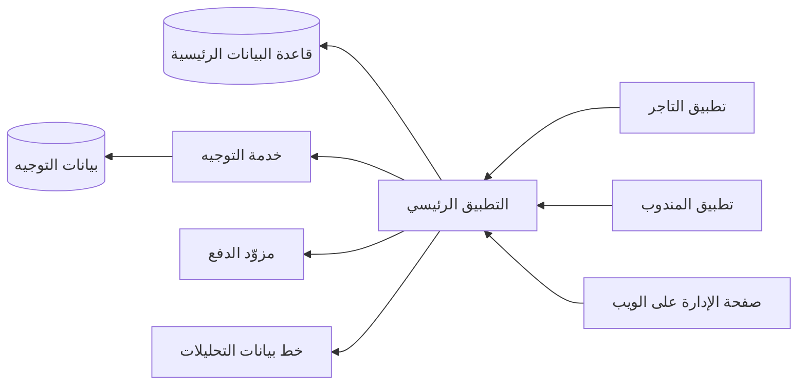

# الوحدة 9 — البنية والبيانات

*وصلت قافلة الآن إلى مرحلة التوسّع. يعمل فيها نحو 120 شخصًا في اثني عشر فريقًا، أحدها فريق منصة. ويستخدم التطبيقَ نحو 9,000 تاجر لنحو 120,000 توصيلة في اليوم، وتنشر الفرق إلى بيئة الإنتاج مرات كثيرة في اليوم، وتحسب خدمة توجيه المسارات وأوقات الوصول. الشيفرة التي بدأت تطبيقًا واحدًا في مستودع واحد تحمل الآن عمل اثني عشر فريقًا، والبيانات التي بدأت قاعدة بيانات واحدة تغذّي اليوم التقارير وأدوات الدعم وخوارزمية التوجيه، والاختصارات التي أُخذت في مرحلة الانطلاق بدأت تبطئ الجميع. في هذا الحجم لا يمكن أن تبقى قرارات شكل النظام والعناية ببياناته في رأس فيصل وحده. تتناول هذه الوحدة ثلاثًا من هذه الممارسات، كما تراها من الداخل ياسمين، وهي الآن في سنتها الثانية مهندسةً. أولًا: اتخاذ القرارات المعمارية عن قصد، بتسمية الصفات المهمة، ومقارنة الخيارات بأمانة، وتدوين القرار. ثانيًا: معاملة البيانات أصلًا له مالكون وفحوص جودة وقواعد خصوصية. ثالثًا: اكتشاف الدَّين التقني وقياسه وسداده، وتحديث الأجزاء القديمة دون إيقاف العمل. ويخرج كل درس بوثيقة: سجل قرار مع جدول مفاضلة ومخطط حاويات، وجرد بيانات مع فحوص جودة وقواعد احتفاظ، وسجل دَين مع خطة تحديث.*

> **الخطوات:** Design — شكّلوا النظام وبياناته عن قصد: قرروا كيف تتلاءم الأجزاء ولماذا، واعتنوا بالبيانات التي يعتمد عليها العمل، وأبقوا الكل قابلًا للتغيير مع نمو الشركة.

---

# 9.1 — القرارات المعمارية والمفاضلات
*المستوى (Level): 🟡 متوسط (Intermediate)* · *المتطلبات (Prerequisites): 2.3، 8.1* · *الخطوة (Step): Design*

**بعد هذا الدرس تستطيع** أن تسمّي صفات الجودة (quality attributes) المهمة لتغيير في النظام، وأن تقارن خيارين على الأقل بها في جدول مفاضلة، وأن تقدّر صعوبة التراجع عن كل خيار، وأن تكتب سجل قرار معماري (ADR) يستطيع زميل أن يعترض عليه ثم يستبدل به سجلًا أحدث لاحقًا. *مدة الدراسة: قراءة نحو 20 دقيقةً، وعمل تطبيقي نحو 90 دقيقةً (تقدير).*

## ⚡ الدرس في دقيقة (In 60 seconds)
- **البنية المعمارية (architecture)** هي مجموعة قرارات النظام التي يكلّف تغييرها لاحقًا: كيف يُقسَّم إلى أجزاء، وكيف تتواصل الأجزاء، وأين تعيش البيانات، ومن يملك ماذا.
- كل خيار معماري **مفاضلة (trade-off)**: يكسب بعض الصفات (سرعة التغيير، الموثوقية، الكلفة، الأمن) وينفق غيرها.
- القاعدة الأهم: **سمِّ الصفات أولًا، ثم قارن الخيارات بها، ثم دوّن ما تنازلت عنه.**
- علامة القرار: كلما صعب التراجع عن القرار، وجب أن تتخذه أبطأ وبمشاركة أوسع. والقرارات السهلة التراجع من حق الفريق.
- الهيكل يتبع الناس: يميل النظام إلى أن يأخذ شكل الفرق التي تبنيه.
- أكبر فخ: اختيار بنية لأنها رائجة، لا لأنها تناسب مشكلتك وحجمك ومهاراتك.

## 🧭 لماذا يهم (Why it matters)
قافلة وكل من فيها شخصيات خيالية. وكل الأرقام عن قافلة في هذا الدرس أرقام توضيحية، لا معايير مرجعية.

في مرحلة الانطلاق بنت مها وفيصل تطبيقًا واحدًا بقاعدة بيانات واحدة في مستودع واحد، وكان ذلك خيارًا سليمًا لشخصين (الدرس 2.3). أما في مرحلة التوسّع فاثنا عشر فريقًا يغيّرون التطبيق نفسه مرات كثيرة في اليوم. وفي شهر واحد انتظر فريق طلبات التجّار، حيث تعمل ياسمين الآن، مراجعات من ثلاثة فرق أخرى، وكسر تغيير في شيفرة مستحقات المندوبين شاشة طلبات التاجر، لأن الجزأين يقرآن الجدول نفسه في قاعدة البيانات ويكتبان فيه بطريقتين مختلفتين.

عاد فيصل، وهو الآن رئيس الهندسة، من مؤتمر بخطة: تقسيم التطبيق إلى نحو عشر خدمات، خدمة لكل فريق، في ربع سنة واحد. سألت سلمى، التي تقود الموثوقية، كم شيئًا إضافيًا سيراقبه مهندس المناوبة الليلية. وسأل بلال، قائد المالية، كم سيكلّف تشغيل ذلك. وسألت دانة، قائدة الأمن والمخاطر، كيف ستثبت عشر خدمات هويتها بعضها لبعض. لم يملك أحد إجابات مكتوبة.

طلبت مها سجل قرار قبل أن يتحرك أي شيء، وطلب فيصل من ياسمين أن تكتب مسودة الجزء الخاص بطلبات التجّار. وهذا الدرس هو ما تعلّمته: كيف تحوّل جدالًا حول الموضة إلى مقارنة مكتوبة للمفاضلات.

## 📐 كيف يعمل (How it works)

### 🟢 الأساسيات (The essentials)

**ما البنية المعمارية.** تعريف عملي مفيد: قرارات النظام التي يكلّف تغييرها أو يبطؤ بعد اتخاذها. نادرًا ما تكون لغة سكربت صغير قرارًا معماريًا. أما اشتراك الطلبات والمستحقات في جدول واحد فقرار معماري، لأن عشرات القطع من الشيفرة ستعتمد عليه. ولنظرة المدير، انظر [*إدارة تقنية المعلومات كعمل تجاري*، الدرس 4.3 — البنية والمتطلبات غير الوظيفية والمدرج](../itbiz/index.ar.html#/4.3).

**صفات الجودة.** **صفة الجودة**، وتُسمّى كثيرًا **المتطلب غير الوظيفي (non-functional requirement)** (الدرس 6.2)، تصف مدى إحسان النظام لعمله لا ما يفعله:

| صفة الجودة | السؤال البسيط | مثال من قافلة في مرحلة التوسّع |
|---|---|---|
| **قابلية التغيير** | ما سرعة الفريق وأمانه في تغيير جزئه؟ | فريق طلبات التجّار ينتظر أيامًا مراجعات الفرق الأخرى |
| **الموثوقية** | هل يستمر في العمل، ويتعافى حين تتعطل أجزاء منه؟ | هدف تتبّع الطلبات 99.9% شهريًا (الدرس 4.3) |
| **الأداء والتوسّع** | هل هو سريع بما يكفي عند الحِمل المتوقع؟ | نحو 120,000 توصيلة يوميًا، مع ذروات وقت الغداء |
| **الأمن والخصوصية** | من يصل إلى ماذا، وهل البيانات محمية؟ | مواقع المندوبين وعناوين التجّار |
| **قابلية التشغيل** | هل يرى المناوبون ما يحدث ويستطيعون إصلاحه؟ | جدول مناوبة لكل مجال، لا لكل خدمة صغيرة |
| **الكلفة** | كم يكلّف بناؤه وتشغيله؟ | فاتورة السحابة ووقت المهندسين |

لا يمكنك أن ترفعها كلها إلى أقصاها: التقسيم إلى خدمات كثيرة قد يحسّن قابلية التغيير ويسيء إلى قابلية التشغيل والكلفة. والقرار الجيد يسمّي الصفتين أو الثلاث الأهم *لهذا* الخيار.

**الاقتران والتماسك.** **الاقتران (coupling)** هو مقدار اعتماد جزء على داخل جزء آخر؛ والأجزاء شديدة الاقتران يجب أن تتغير معًا. **التماسك (cohesion)** هو مدى انتماء ما داخل الجزء الواحد بعضه إلى بعض؛ فالجزء الذي يتولى «الطلبات وبعض المستحقات وشيئًا من التتبّع» ليس متماسكًا. استهدف تماسكًا عاليًا داخل الأجزاء واقترانًا مرنًا بينها. وأشيع مصدر للاقتران الشديد هو **البيانات المشتركة**: جزءان يقرآن الجداول نفسها ويكتبان فيها، فيكسر التغيير في أحدهما الآخر بصمت. وهذا ما كسر شاشة طلبات التاجر.

**الواجهات.** **الواجهة (interface)** هي الطريقة المتفق عليها ليطلب بها جزء شيئًا من جزء آخر: استدعاءات دوال داخل تطبيق واحد، أو **API** (طريقة محددة تستدعي بها برمجيةٌ برمجيةً أخرى عبر الشبكة). والواجهة الجيدة تخفي الداخل، فيغيّره الفريق المالك بحرية.

### 🟡 التعمق أكثر (Going deeper)

**ثلاثة أشكال لنظام ينمو.** لا أحد منها «حديث» أو «قديم» في ذاته.

| الشكل | ما هو | المكاسب | التكاليف |
|---|---|---|---|
| **التطبيق الأحادي (monolith)** | تطبيق واحد يُنشر وحدة واحدة، وغالبًا بقاعدة بيانات واحدة | بسيط في البناء والاختبار والتشغيل وتتبّع الأخطاء | تتزاحم الفرق فيه كلما كبر |
| **التطبيق الأحادي المقسّم إلى وحدات (modular monolith)** | تطبيق واحد يُنشر مرة واحدة، مقسّم من الداخل إلى وحدات تملك كل منها بياناتها ولا يُوصَل إليها إلا عبر واجهة | معظم البساطة، مع ملكية واضحة | الحدود تحتاج إلى انضباط وأدوات؛ والنشر ما زال واحدًا |
| **الخدمات**، أو الخدمات المصغّرة (microservices) حين تكون صغيرة | تطبيقات منفصلة، تُنشر كل منها وحدها وتملك بياناتها، وتتواصل عبر الشبكة | تنشر الفرق باستقلال؛ وتتوسّع الأجزاء وتتعطل منفصلة | أعطال الشبكة، ومزيد مما يجب مراقبته وتأمينه، واختبار أصعب، وكلفة تشغيل أعلى |

نقل Martin Fowler في مقاله "MonolithFirst" عام 2015 أن كل أنظمة الخدمات الكثيرة الناجحة تقريبًا التي سمع بها بدأت تطبيقًا أحاديًا ثم قُسّمت لاحقًا (كما هو منقول). والعبرة: قسّم حين تعرف أين الحدود وتقدر على تشغيل ما تنشئه. ولنظرة المطوّر الفرد، انظر [*تصميم الأنظمة لمبرمجي الفايب*، الدرس 9.1 — أنت المسؤول عن القرارات المعمارية](../vibe/index.ar.html#l9-1).

**ما صعوبة التراجع؟** فرّقت رسالة Amazon إلى المساهمين لعام 2015 بين قرارات «النوع 1»، وهي عميقة الأثر صعبة التراجع وتستحق تفكيرًا متأنيًا، وقرارات «النوع 2»، وهي رخيصة التراجع وينبغي أن تتخذها مجموعات صغيرة بسرعة؛ ووصفت الرسالة النوعين بأنهما باب باتجاه واحد وباب باتجاهين (كما هو منقول). المكتبة داخل وحدة واحدة سهلة التراجع عادة؛ أما طريقة توزيع البيانات بين المخازن، أو API عامة تستدعيها أنظمة التجّار، فصعبة التراجع عادة. اسأل: «إن كان هذا خطأ، فكم فريقًا وكم أسبوعًا نحتاج للتراجع عنه؟» فريق واحد وأيام: قرّروا داخل الفريق. عدة فرق وأشهر: اكتبوا سجلًا واطلبوا مشورة واسعة.

**قانون Conway.** في مقال "How Do Committees Invent?" (*Datamation*، أبريل 1968)، رأى Melvin Conway أن المؤسسات التي تصمم الأنظمة مقيّدة بإنتاج تصاميم تنسخ هياكل التواصل فيها. واستخدم الدرس 8.1 هذه الفكرة لرسم حدود الفرق. ويصف DORA (الدرس 3.3) البنية والفرق بأنها مرنة الاقتران حين يستطيع الفريق اختبار جزئه ونشره وتغييره دون الاعتماد على فرق أخرى (كما هو منقول). ارسم حدود الشيفرة حيث تستطيع حدود الفرق أن تتبعها.

**صور تساعد.** يصف **نموذج C4** المجاني الذي وضعه Simon Brown النظامَ بأربعة مستويات من التكبير: سياق النظام، والحاويات (التطبيقات ومخازن البيانات التي تعمل كلٌّ منها منفصلة)، والمكوّنات، والشيفرة (كما هو منقول). ويكفي المستويان الأولان لمعظم القرارات. هذا مخطط الحاويات الذي رسمته ياسمين:

أظهر المخطط المشكلة فورًا: كل شيء تقريبًا يمر عبر تطبيق واحد وقاعدة بيانات واحدة.

### 🔴 نظرة الخبير (Expert view)

**من يقرر ماذا.** طابِق العملية مع قابلية التراجع: الخيارات السهلة التراجع داخل جزء فريق واحد يقررها الفريق؛ والخيارات الصعبة التراجع أو العابرة للفرق يقررها صاحب قرار مسمّى (غالبًا رئيس الهندسة) بعد سجل مكتوب ومراجعة مفتوحة؛ والخيارات المكلفة على مستوى الشركة تذهب إلى القيادة مع دراسة جدوى (الوحدة 10). وتضيف مؤسسات كثيرة **منتدى المشورة المعمارية**: اجتماعًا قصيرًا مفتوحًا منتظمًا تحصل فيه مسودات السجلات على مشورة المتأثرين بها. وإن صار بوابة بطيئة، التفّت الفرق حوله.

**فحوص الملاءمة.** **فحص الملاءمة** اختبار آلي لقاعدة معمارية، يعمل في خط التكامل المستمر (CI) من الدرس 3.2: «لا تقرأ أي وحدة جداول وحدة أخرى»، أو «لكل خدمة نقطة فحص صحة» (عنوان يجيب هل الخدمة تعمل). والاسم الشائع، **دالة الملاءمة المعمارية (architecture fitness function)**، شاع بفضل كتاب *Building Evolutionary Architectures* لـNeal Ford وRebecca Parsons وPatrick Kua (كما هو منقول). وبلا هذه الفحوص تتآكل الحدود «إصلاحًا سريعًا» بعد آخر.

**سجلات قرار تصمد مع الزمن.** قدّم الدرس 2.3 **سجل القرار المعماري** بالصيغة التي اقترحها Michael Nygard عام 2011 (العنوان، السياق، القرار، الحالة، العواقب). وفي مرحلة التوسّع أضِف: **جدول مفاضلة** بتقديرات صادقة؛ و**موعد مراجعة**، أي الإشارة أو التاريخ الذي تعيدون عنده النظر؛ و**الاستبدال لا التعديل**: تغيُّر الرأي يعني سجلًا جديدًا، ويبقى القديم ليرى من يأتي بعدك لماذا كان منطقيًا.

**الموضة والدليل.** قبل أن تنسخ شركة كبيرة، اسأل: هل لدينا مشكلتها، ومهارات تشغيل حلّها ليلًا، والمال؟ يستطيع مساعدو الذكاء الاصطناعي صياغة الخيارات، لكنهم يكررون الموضة بثقة أيضًا. وللتطبيق، انظر [*دليل عملي لتصبح مهندسًا أصيلًا في الذكاء الاصطناعي*، الدرس 11.2 — المختبر: سجل قرار معماري مع ناقد، وتوثيق مفحوص مقابل الشيفرة، ومراجعة ما بعد الحادثة الملتزمة بالوقائع](../ainative/index.ar.html#/11.2).

**القاعدة التي تُحفظ.** سمِّ الصفات أولًا، ثم قارن الخيارات بها، ثم دوّن ما تنازلت عنه.

## 🧰 الأدوات (The toolkit)
| المصدر أو الأداة أو القالب (Resource, tool or template) | ما هو وماذا يفعل (What it is and does) | متى تلجأ إليه (When to reach for it) |
|---|---|---|
| **Quality attribute shortlist** — القائمة المختصرة لصفات الجودة | الصفتان أو الثلاث الأهم، لكلٍّ منها هدف قابل للقياس | في بداية أي نقاش معماري |
| **Trade-off table** — جدول المفاضلة | الخيارات في الأعمدة، والصفات في الصفوف، وتقديرات صادقة مع أسبابها | حين يوجد خياران جادّان على الأقل |
| **Container diagram** — مخطط الحاويات | التطبيقات ومخازن البيانات التي تعمل منفصلة وكيف تتصل (المستوى 2 في C4) | حين يتصوّر الناس النظام بصور مختلفة |
| **Architecture decision record (ADR)** — سجل القرار المعماري | السياق، والخيارات، وجدول المفاضلة، والقرار، والحالة، والعواقب، وطريقة التراجع، وموعد المراجعة | للقرارات الصعبة التراجع أو العابرة للفرق |
| **Fitness check** — فحص الملاءمة | اختبار آلي في خط النشر لقاعدة معمارية | فور الاتفاق على حدّ |
| **Architecture advice forum** — منتدى المشورة المعمارية | اجتماع قصير مفتوح تحصل فيه مسودات السجلات على المشورة | من مرحلة التوسّع، حين تعبر القرارات الفرق |

## 🏛️ عمليًا في قافلة (In practice at Qafila)
مسودة ياسمين بعد جولتين من التعليقات. توضيحية وخيالية.

> **ADR-031: حدّ طلبات التجّار داخل التطبيق الرئيسي**
>
> **الحالة:** مقبول. صاحب القرار: فيصل، بعد منتدى المشورة المعمارية.
>
> **السياق.** اثنا عشر فريقًا يغيّرون تطبيقًا واحدًا وقاعدة بيانات واحدة. تغييرات طلبات التجّار تنتظر في المتوسط أكثر من يومين مراجعات الفرق الأخرى (الشهر الماضي). فريقا مستحقات المندوبين وطلبات التجّار كلاهما يقرأ جدول الطلبات ويكتب فيه؛ وقد كسر تغيير في المستحقات شاشة طلبات التاجر الشهر الماضي.
>
> **صفات الجودة، بالترتيب:** قابلية التغيير لفريق طلبات التجّار؛ وموثوقية تتبّع الطلبات (99.9% شهريًا)؛ وقابلية التشغيل ليلًا.
>
> | | A. الإبقاء على الوضع | B. وحدة بحدّ مفروض | C. خدمة طلبات وقاعدة بيانات منفصلتان |
> |---|---|---|---|
> | قابلية التغيير | ضعيفة: جداول مشتركة | جيدة: الفريق يملك الجداول والواجهة | الأفضل: نشر مستقل |
> | الموثوقية | هشّة | أفضل: التغييرات خلف واجهة | متفاوتة: نقاط أعطال شبكة جديدة |
> | قابلية التشغيل | معروفة | معروفة: ما زال النشر واحدًا | أسوأ: خدمة أخرى تجب مراقبتها وتأمينها |
> | الكلفة والجهد | تأخير متزايد | نحو ربع سنة، فريق واحد (تقدير) | ربعان إلى ثلاثة، مع فريقي المنصة والأمن (تقدير) |
> | قابلية التراجع | — | فريق واحد، بضعة أسابيع للتراجع | عدة فرق، نحو ربع سنة: فصل البيانات مكلف التراجع |
>
> **القرار.** الخيار B. يملك فريق طلبات التجّار وحده جداول الطلبات؛ ويستخدم الآخرون، ومنهم فريق مستحقات المندوبين، واجهته.
>
> **العواقب.** الجيدة: يغيّر فريق طلبات التجّار جداوله دون مراجعة من فرق أخرى؛ ولم يعد تغيير المستحقات قادرًا على كسر شاشات الطلبات. السيئة: على فريق مستحقات المندوبين أن يعيد كتابة طريقة وصوله (نحو ثلاثة أسابيع، تقدير)؛ وما زال نشر واحد يحمل تغييرات الجميع. والواجهة تجعل الانتقال لاحقًا إلى الخيار C أرخص.
>
> **فحص الملاءمة.** اختبار في خط النشر يُفشل أي شيفرة خارج فريق طلبات التجّار تقرأ جداول الطلبات أو تكتب فيها.
>
> **المراجعة:** بعد ستة أشهر، أو أبكر إن احتاج فريق طلبات التجّار إلى جدول نشر خاص به.

تحوّلت خطة فيصل ذات الخدمات العشر إلى سلسلة سجلات، حدًّا بعد حدّ. وأضافت دانة سؤالًا إلى كل قرار خدمة قادم: «كيف تثبت هويتها، ومن يدوّر أسرارها؟» وكانت مسودة ياسمين الأولى قد جعلت الخيار C الأفضل في كل صف، حتى سألها حمد من أين ستأتي بيانات التقارير حين تعيش الطلبات في قاعدة بيانات منفصلة.

## 🛠️ التمارين (Exercises)
**🟢 سمِّ الصفات.** من قسم «لماذا يهم»، اكتب صفات الجودة التي يهتم بها كل شخص (فيصل، سلمى، بلال، دانة، فريق طلبات التجّار)، واختر الثلاث الأهم، واكتب لكلٍّ منها هدفًا قابلًا للقياس.
*يكتمل عندما (Done when):* يكون لديك خمسة أزواج على الأقل من شخص وصفة، وثلاث صفات مرتبة، وهدف لكلٍّ منها (رقم أو مدة أو فحص بنعم أو لا).

الإجابة النموذجية والتحقق الذاتي

**الإجابة النموذجية.** فيصل وفريق طلبات التجّار: قابلية التغيير. سلمى: قابلية التشغيل والموثوقية. بلال: الكلفة. دانة: الأمن. الثلاث الأهم: قابلية التغيير («تُدمَج تغييرات طلبات التجّار دون مراجعة الفرق الأخرى في أقل من يوم»)؛ والموثوقية («يبقى تتبّع الطلبات عند 99.9% شهريًا»)؛ وقابلية التشغيل («لا زيادة فيما يراقبه مهندس المناوبة الليلية»).

**التحقق الذاتي.**
- هل تستطيع قياس كل هدف الشهر القادم؟
- هل أدرجت صفة واحدة على الأقل تحتج *ضد* التقسيم؟

**🟡 ابنِ جدول مفاضلة.** استخدم قرارًا من مشروع شخصي أو مفتوح المصدر، أو سؤال قافلة: «هل تبقى إدارة نوبات المندوبين داخل التطبيق الرئيسي أم تصبح خدمة منفصلة؟». قارن خيارين على الأقل بثلاث صفات، وأضف صف قابلية التراجع.
*يكتمل عندما (Done when):* يكون في كل خلية تقدير وسبب قصير، ولا يكون أي خيار هو الأفضل في كل الصفوف، ويقول صف قابلية التراجع كم فريقًا وكم من الوقت تقريبًا يحتاج التراجع عن كل خيار.

الإجابة النموذجية والتحقق الذاتي

**الإجابة النموذجية (إدارة النوبات في قافلة).** الخيار 1، وحدة داخل التطبيق الرئيسي: قابلية التغيير جيدة (فريق واحد يملك جداول النوبات)؛ والموثوقية معروفة (لا استدعاءات شبكة جديدة)؛ وقابلية التشغيل دون تغيير (ما زال النشر واحدًا)؛ والكلفة منخفضة (لا شيء جديد يحتاج إلى تشغيل)؛ وقابلية التراجع: فريق واحد، نحو أسبوعين. الخيار 2، خدمة منفصلة: قابلية التغيير الأفضل (تُنشر وفق جدولها الخاص)؛ والموثوقية أسوأ في البداية (استدعاءات شبكة عند بدء النوبة)؛ وقابلية التشغيل أسوأ (خدمة أخرى تُراقَب ليلًا)؛ والكلفة أعلى (خدمة أخرى تحتاج إلى تشغيل وتأمين)؛ وقابلية التراجع: فريقان مع فريق المنصة، نحو ربع سنة، لأن بيانات النوبات يجب أن تُدمج من جديد. الخيار 1 هو المناسب الآن.

**التحقق الذاتي.**
- هل قدّرت قابلية التراجع للبيانات، لا للشيفرة وحدها؟
- هل يستطيع من يخالفك أن يستخدم جدولك ليحتج لرأيه؟ إن كان كذلك فهو منصف.

**🔴 اكتب سجل القرار.** حوّل جدولك إلى سجل كامل: العنوان، والحالة، وصاحب القرار، والسياق مع قياس، والصفات مرتبة، والخيارات، والقرار، والعواقب الجيدة والسيئة، وطريقة التراجع، وفحص الملاءمة، وموعد المراجعة. اطلب من صديق أو من مساعد ذكاء اصطناعي أن يحتج للخيار الذي رفضته، وأضف أي جديد.
*يكتمل عندما (Done when):* يقع السجل في صفحة أو صفحتين، ويسمّي صاحب القرار، وفيه عاقبة سيئة واحدة على الأقل، وفحص ملاءمة يستطيع خط النشر تشغيله، وموعد مراجعة هو تاريخ أو إشارة قابلة للقياس.

الإجابة النموذجية والتحقق الذاتي

**الإجابة النموذجية.** السجل ADR-031 هو النمط. لإدارة النوبات: صاحب القرار فيصل بعد المنتدى؛ والسياق «تغييرات شيفرة النوبات تنتظر المراجعة أكثر من يومين»؛ والعاقبة السيئة «ما زال نشر واحد يحمل تغييرات الجميع»؛ وفحص الملاءمة «لا شيفرة خارج فريق تجربة المندوب تقرأ جداول النوبات»؛ وموعد المراجعة «إذا وجب أن يتوسّع بدء النوبات منفصلًا في ذروات الغداء».

**التحقق الذاتي.**
- هل يحمل السياق وقائع لا آراء؟
- هل سيفهم موظف جديد بعد سنة لماذا كان هذا منطقيًا؟

## ⚠️ أخطاء وفخاخ (Mistakes and traps)
- **الاختيار بحسب الموضة.** سمِّ صفاتك وقارن الخيارات بها.
- **إخفاء التكاليف.** اكتب كلفة حقيقية واحدة على الأقل للخيار المختار.
- **فصل الشيفرة دون فصل البيانات.** خدمتان تتشاركان قاعدة بيانات واحدة ما زالتا شديدتي الاقتران. قرّروا من يملك كل جدول.
- **عملية واحدة لكل القرارات.** طابِق العملية مع قابلية التراجع.
- **حدود لا يفحصها أحد.** اجعل القاعدة آلية بفحص ملاءمة.
- **تعديل السجلات القديمة.** استبدل بها سجلات جديدة، ليبقى التاريخ صادقًا.

## 🧾 الخلاصة (Recap)
- البنية المعمارية هي مجموعة القرارات التي يكلّف تغييرها.
- سمِّ صفتين أو ثلاثًا من صفات الجودة، وقارن الخيارات في جدول مفاضلة، وقدّر قابلية التراجع قبل أن تحدد من يقرر.
- استهدف تماسكًا عاليًا واقترانًا مرنًا؛ والبيانات المشتركة أشيع اقتران خفي.
- التطبيق الأحادي، والأحادي المقسّم إلى وحدات، والخدمات: لكلٍّ منها مواقف تناسبه.
- القاعدة: سمِّ الصفات أولًا، ثم قارن الخيارات بها، ثم دوّن ما تنازلت عنه.

## ✍️ اختبر نفسك (Check yourself)
**1. أيّ مما يلي هو بوضوح أكثر قرار معماري بالمعنى المستخدم في هذا الدرس؟**

- A. أيّ إصدار من مكتبة التسجيل تستخدمه وحدة طلبات التجّار في هذا الربع.
- B. هل يستمر فريقا مستحقات المندوبين وطلبات التجّار في قراءة جدول طلبات واحد والكتابة فيه.
- C. أيّ إطار اختبار يستخدمه فريق طلبات التجّار لاختبارات الوحدات (unit tests) داخل جزئه.
- D. كيف يسمّي فريق طلبات التجّار الدوال داخل وحدته الخاصة وكيف يجمّعها.

الإجابة

**B.** قطع كثيرة من الشيفرة تعتمد على الجدول المشترك، فيصبح تغييره لاحقًا بطيئًا ومكلفًا. أما A وC وD فتبقى داخل جزء فريق واحد وتغييرها رخيص. انظر «ما البنية المعمارية» و«الاقتران والتماسك».

**2. يقترح فيصل تقسيم التطبيق الرئيسي إلى عشر خدمات في ربع سنة واحد. ماذا ينبغي أن تفعل مسودة ياسمين أولًا؟**

- A. أن تعدّ الشركات الكبيرة التي تستخدم الخدمات، وتوصي باتباع نهج الأغلبية.
- B. أن توافق على الخطة، لأن الخدمات المنفصلة تتيح لكل فريق النشر في موعده.
- C. أن ترفض الخطة، لأن تطبيق قافلة الواحد عمل بموثوقية في التوسّع حتى الآن.
- D. أن تسمّي الصفات الأهم لهذا الخيار، ثم تزن كل خيار من الخيارات بها.

الإجابة

**D.** تسمية الصفات ومقارنة الخيارات تحوّل الجدال حول الموضة إلى مفاضلة. A تنسخ شركات أخرى؛ وB وC تقرر كلٌّ منهما بناءً على صفة واحدة دون وزن غيرها. انظر «صفات الجودة».

**3. قُسِّم جزءان من نظام قافلة إلى خدمتين منفصلتين، لكن كلتيهما ما زالت تقرأ جداول قاعدة البيانات نفسها وتكتب فيها. ما المشكلة الرئيسية؟**

- A. كلٌّ منهما يعتمد على بيانات الأخرى، فتغيير جدول في إحداهما قد يكسر الأخرى.
- B. تحتاجان إلى بوابة API أمام قاعدة البيانات المشتركة قبل إطلاق أيٍّ منهما.
- C. تحتاجان إلى بيئة اختبار منفصلة لكل خدمة قبل أن يخرج أي إصدار.
- D. تحتاجان الآن إلى فريق لكل خدمة، كما يصف قانون Conway للأنظمة التي تبنيها الفرق.

الإجابة

**A.** فصل الشيفرة دون فصل البيانات يبقي الاقتران القديم ويضيف تكاليف الشبكة. B وC تضيفان أدوات لكنهما تتركان الجداول المشتركة، وD تسيء فهم قانون Conway، وهو ملاحظة عن الهيكل لا قاعدة توظيف. انظر «الاقتران والتماسك».

**4. يريد فريق المدفوعات تبديل مكتبة رسوم بيانية لا تُستخدم إلا داخل صفحة تقاريره. كيف ينبغي أن يُتخذ هذا القرار؟**

- A. عبر سجل قرار كامل يراجعه منتدى المشورة المعمارية قبل أي تغيير.
- B. من القيادة مع دراسة جدوى، لأن صفحة التقارير تعرض أرقام المدفوعات للموظفين.
- C. من فريق المدفوعات وبسرعة، لأنه يبقى داخل جزئه والتراجع عنه رخيص عادة.
- D. من فيصل بعد مراجعة قصيرة، لأن المكتبة الجديدة تضيف اعتمادية إلى التطبيق الرئيسي.

الإجابة

**C.** إنه خيار قابل للتراجع داخل جزء فريق واحد. A وB تفرضان عملية ثقيلة على قرار رخيص، وD توجّه قرارًا على مستوى الفريق إلى شخص واحد، وهذا لا يتسع لاثني عشر فريقًا. انظر «ما صعوبة التراجع؟» و«من يقرر ماذا».

**5. بعد ستة أشهر من ADR-031، تقرر قافلة نقل طلبات التجّار إلى خدمة مستقلة. ماذا ينبغي أن يحدث لـADR-031؟**

- A. إعادة كتابة ADR-031 ليصف القرار الجديد، فيبقى سجل واحد حالي يُقرأ.
- B. حذف ADR-031 بعد تشغيل الخدمة الجديدة، فلا يقرأ الجدد إلا السجلات الحالية.
- C. ترك ADR-031 كما هو وذكر التغيير في قناة محادثة فريق طلبات التجّار.
- D. كتابة سجل جديد يحلّ محل ADR-031، ووسم ADR-031 بأن السجل الجديد حلّ محله.

الإجابة

**D.** الاستبدال يحفظ تاريخ ما كان معروفًا ولماذا، ويوضح القرار الحالي. A وB تمحوان المنطق السابق، وC تخفي القرار الجديد حيث لن يجده أحد. انظر «سجلات قرار تصمد مع الزمن».

## 📚 المراجع (References)
- Michael Nygard، "Documenting Architecture Decisions"، مدونة Cognitect، 15 نوفمبر 2011: https://cognitect.com/blog/2011/11/15/documenting-architecture-decisions
- Martin Fowler، "MonolithFirst"، 3 يونيو 2015: https://martinfowler.com/bliki/MonolithFirst.html (كما هو منقول).
- Melvin E. Conway، "How Do Committees Invent?"، *Datamation* 14(4)، أبريل 1968، ص 28–31؛ نسخة المؤلف: https://www.melconway.com/Home/Committees_Paper.html (كما هو منقول)؛ نسخة ممسوحة من العدد: http://www.bitsavers.org/magazines/Datamation/196804.pdf
- Jeffrey P. Bezos، 2015، رسالة إلى المساهمين، Amazon.com, Inc. (قرارات النوع 1 والنوع 2)، كما هو منقول.
- DORA، "Loosely coupled teams": https://dora.dev/capabilities/loosely-coupled-teams/
- Simon Brown، نموذج C4: https://c4model.com/ (كما هو منقول).
- Neal Ford وRebecca Parsons وPatrick Kua، *Building Evolutionary Architectures*، O'Reilly، 2017، كما هو منقول.
- دورة من المكتبة: [*إدارة تقنية المعلومات كعمل تجاري*، الدرس 4.3 — البنية والمتطلبات غير الوظيفية والمدرج](../itbiz/index.ar.html#/4.3).
- دورة من المكتبة: [*تصميم الأنظمة لمبرمجي الفايب*، الدرس 9.1 — أنت المسؤول عن القرارات المعمارية](../vibe/index.ar.html#l9-1).
- دورة من المكتبة: [*دليل عملي لتصبح مهندسًا أصيلًا في الذكاء الاصطناعي*، الدرس 11.2 — المختبر: سجل قرار معماري مع ناقد، وتوثيق مفحوص مقابل الشيفرة، ومراجعة ما بعد الحادثة الملتزمة بالوقائع](../ainative/index.ar.html#/11.2).

---

# 9.2 — البيانات أصلًا: الجودة والملكية والخصوصية
*المستوى (Level): 🟡 متوسط (Intermediate)* · *المتطلبات (Prerequisites): 6.3، 9.1* · *الخطوة (Step): Design*

**بعد هذا الدرس تستطيع** أن تبني جرد بيانات (data inventory) لمنتج (ما البيانات الموجودة، وأين، ولماذا، ومن يملكها، وهل هي شخصية، وكم تُحفظ)، وأن تكتب فحوص جودة لمجموعة بيانات مهمة واحدة، وأن تلتقط أسئلة الخصوصية مبكرًا بما يكفي لتسأل الشخص المناسب. *مدة الدراسة: قراءة نحو 20 دقيقةً، وعمل تطبيقي نحو 95 دقيقةً (تقدير).*

## ⚡ الدرس في دقيقة (In 60 seconds)
- تكون البيانات **أصلًا** حين يعتمد عليها العمل ليسير أو ليقرر أو ليمتثل. وهي تحتاج إلى مالك وعناية وسجل بمكانها.
- **جرد البيانات** يسرد كل مجموعة بيانات مهمة: أين تعيش، ولماذا تُحفظ، ومن يملكها، وهل هي شخصية، ومن يراها، ومتى تُحذف.
- **جودة البيانات** تعني بيانات صالحة لغرضها. افحصها آليًا عند نقطة دخولها.
- القاعدة الأهم: **لكل مجموعة بيانات مهمة مالك مسمّى، وغرض مكتوب، وتاريخ حذف.**
- علامة القرار: إذا اختلف تقريران، فابحث عن التعريف الذي يستخدمه كلٌّ منهما، واتفق على تعريف واحد مع المالك.
- أكبر فخ: حفظ كل شيء «احتياطًا». البيانات بلا غرض كلفة ومخاطرة.

## 🧭 لماذا يهم (Why it matters)
قافلة وكل من فيها شخصيات خيالية. وكل الأرقام عن قافلة في هذا الدرس أرقام توضيحية، لا معايير مرجعية.

في مراجعة شهرية رأت مها رسمين كان يجب أن يتطابقا. أظهرت لوحة متابعة طلبات التجّار نحو 118,000 توصيلة يوم الثلاثاء السابق؛ وأظهر تقرير مستحقات المندوبين نحو 121,000. يُدفع للمندوبين ويُحاسَب التجّار لكل توصيلة، فالفرق يعني مالًا. وكان الفريقان محقّين بحسب تعريف كلٍّ منهما: عدّ فريق طلبات التجّار الطلبات التي وسمها المندوب «تم التوصيل»؛ وعدّ فريق المستحقات سطور المستحقات، وهي تشمل أيضًا الطلبات الملغاة بعد أن تحرّك المندوب فعلًا.

وفي الأسبوع نفسه طلبت تاجرة أغلقت متجرها من قافلة حذف بياناتها. حذف الدعم حسابها. ولم يعرف أحد أين توجد بياناتها أيضًا: نسخ التحليلات، وسجل التوجيه، ونسخ الاختبار التي صنعها المهندسون «لإعادة إنتاج خلل»، وأداة مكتب المساعدة، والنسخ الاحتياطية. ثم اكتشفت دانة، قائدة الأمن والمخاطر، أن سجل مواقع المندوبين محفوظ بلا تاريخ حذف منذ مرحلة الانطلاق.

طلب حمد، وهو الآن رئيس البيانات، ودانة من كل فريق جرد بيانات. وتطوّعت ياسمين لفريق طلبات التجّار.

## 📐 كيف يعمل (How it works)

### 🟢 الأساسيات (The essentials)

**أين تعيش البيانات.** تبدأ معظم البيانات **بيانات تشغيلية**، يحتاجها المنتج الآن (الطلبات المفتوحة، حالة المندوب)، في قاعدة بيانات المنتج نفسه. ثم تُنسخ. **خط البيانات (data pipeline)** هو مجموعة المهام الآلية التي تنسخ البيانات من المنتج وتعيد تشكيلها في مخازن أخرى؛ وهو غير خط التكامل المستمر (CI) في الدرس 3.2 الذي يبني الشيفرة ويختبرها. والوجهة الرئيسية عادة **مستودع بيانات (data warehouse)**: قاعدة بيانات منفصلة تحفظ نسخًا من بيانات مصادر كثيرة، منظّمة للتقارير والتحليل. وكل نسخة مكان عليك أن تحميه وتنظّفه وتحذف منه يومًا ما.

**جرد البيانات.** **جرد البيانات** (أو سجل البيانات) جدول بمجموعات البيانات المهمة. لا تستطيع أن تحمي أو تنظّف أو تحذف ما لا تجده. أعمدته:

| العمود | السؤال الذي يجيب عنه |
|---|---|
| **مجموعة البيانات** | ما هي، بكلمات بسيطة؟ |
| **أين تعيش** | أي قاعدة بيانات أو مخزن أو أداة أو ملف، بما في ذلك النسخ؟ |
| **الغرض** | لماذا نحفظها؟ |
| **المالك** | أي فريق أو شخص يُسأل عنها؟ |
| **بيانات شخصية؟** | أي الحقول تعرّف شخصًا أو تتعلق به؟ |
| **الحساسية** | عامة أو داخلية أو سرية أو مقيّدة |
| **من يصل إليها** | أي الأدوار، وعبر أي أدوات؟ |
| **الاحتفاظ** | كم تُحفظ، وماذا يحدث بعدها؟ |

**المالكون والأمناء.** **مالك البيانات (data owner)** يُسأل عن مجموعة البيانات: يقرر ما تعنيه، ومن يستخدمها، وكم تُحفظ. و**أمين البيانات (data steward)** يعتني بها يومًا بيوم: التعريفات، والجودة، والأسئلة. فريق المنصة يشغّل التخزين، لكن ذلك لا يجعله المالك. والمالك عادة هو الفريق الذي ينشئ منتجُه البيانات: فريق طلبات التجّار يملك بيانات الطلبات.

**الجودة في ستة أبعاد.** **جودة البيانات** تعني بيانات جيدة بما يكفي لغرضها. وقد شاعت مجموعة من ستة أبعاد بفضل ورقة DAMA UK عن أبعاد جودة البيانات عام 2013، واعتُمدت في إطار جودة البيانات لدى الحكومة البريطانية (كما هو منقول). بكلمات هذه الدورة:

| البُعد | السؤال | فحص في قافلة |
|---|---|---|
| **الصحة** | هل تطابق الواقع؟ | الطلبات المسلَّمة تطابق إثبات التسليم في عيّنة |
| **الاكتمال** | هل ينقص شيء؟ | لكل طلب مسلَّم وقت تسليم |
| **التوقيت المناسب** | هل هي موجودة حين نحتاجها؟ | توصيلات الأمس في مستودع البيانات قبل 06:00 |
| **الاتساق** | هل تتفق مع المصادر الأخرى؟ | الطلبات المسلَّمة وسطور المستحقات لا تختلف إلا بفرق مفسَّر |
| **الصلاحية** | هل تتبع قواعد الصيغة والقيم؟ | الحالة واحدة من القائمة المتفق عليها؛ ولا أوقات في المستقبل |
| **التفرّد** | هل يُسجَّل كل شيء مرة واحدة؟ | لا يظهر رقم طلب مرتين |

**افحص عند نقطة الدخول.** أوقف البيانات السيئة حيث تُنشأ: التحقق في التطبيق، و**قيود قاعدة البيانات (database constraints)** (قواعد تفرضها قاعدة البيانات، مثل «لا يجوز أن يكون هذا الحقل فارغًا»)، والاختبارات في خط البيانات. فكل نسخة لاحقة تضاعف كلفة الإصلاح. انظر [*هندسة البيانات والتحليلات: من الصفر إلى الاحتراف*، الدرس 3.2 — جودة البيانات: الاختبارات، والعقود، وقابلية الملاحظة](../data/index.ar.html#/3.2).

### 🟡 التعمق أكثر (Going deeper)

**تعريف واحد لكل كلمة مهمة.** معظم الجدالات حول الجودة هي في الحقيقة جدالات حول التعريف. «التوصيلة» و«التاجر النشط» و«الطلب المتأخر» يحتاج كلٌّ منها إلى تعريف مكتوب واحد ومالك. وكان إصلاح الرسمين سطرًا واحدًا اتفق عليه المالكان: «*التوصيلة المكتملة* طلب حالته تم التوصيل؛ والطلبات الملغاة بعد تحرّك المندوب تُعدّ منفصلة باسم *ملغى بعد الاستلام*.» انظر [*هندسة البيانات والتحليلات: من الصفر إلى الاحتراف*، الدرس 4.1 — تعريف المقاييس: تعريف واحد، وطبقة دلالية، وفهرس مقاييس](../data/index.ar.html#/4.1).

**عقود البيانات وتتبّع أصلها.** **عقد البيانات (data contract)** اتفاق مكتوب، ويُفضَّل أن يُفحص آليًا، بين منتِج البيانات ومستهلكيها حول الحقول وأنواعها، ومعناها، وحداثتها، وطريقة الإعلان عن تغييرها: إنه نسخة البيانات من الواجهة في الدرس 9.1. وبدونه يكسر حقلٌ أُعيدت تسميته يوم الخميس تقرير المالية يوم الجمعة. و**تتبّع أصل البيانات (lineage)** يسجّل من أين تأتي البيانات وإلى أين تذهب: نقرة المندوب، ثم جدول الطلبات، ثم خط البيانات، ثم مستودع البيانات، ثم لوحة المتابعة. انظر [*هندسة البيانات والتحليلات: من الصفر إلى الاحتراف*، الدرس 6.1 — حوكمة بيانات تعمل فعلًا: الملكية والفهرس والنسب وعقود البيانات](../data/index.ar.html#/6.1).

**مستويات الحساسية.** بضعة مستويات تخبر الناس كيف يتعاملون مع البيانات دون أن يسألوا كل مرة:

| المستوى | المعنى | مثال من قافلة | المعاملة |
|---|---|---|---|
| **عامة** | لا بأس بنشرها | مقالات مركز المساعدة | بلا قيود |
| **داخلية** | ضرر منخفض إن تسرّبت | خطط الفرق، ومجاميع التوصيلات | وصول الموظفين |
| **سرية** | ضرر بالناس أو بالعمل | جهات اتصال التجّار، وكل ما يرتبط بشخص مسمّى | بقدر الحاجة، مع تسجيل الوصول |
| **مقيّدة** | ضرر جسيم | سجل مواقع المندوبين، ووثائق الهوية، وبيانات الدفع | أدوار مسمّاة قليلة، مشفّرة، مع تسجيل الوصول، ولا تُنسخ أبدًا إلى الاختبار |

دانة تملك هذا التصنيف؛ وكل مالك بيانات يطبّقه على صفوفه.

**البيانات الشخصية والخصوصية.** **البيانات الشخصية** معلومات عن شخص يمكن التعرف عليه: اسم المندوب أو مسار مواقعه، وهاتف صاحب المتجر، وعنوان العميل. و**الخصوصية** تعني استخدامها فقط بطرق يتوقعها الناس بشكل معقول وتسمح بها القواعد. تختلف القوانين من بلد إلى آخر لكنها تتشارك أفكارًا. فالمادة 5 من اللائحة العامة لحماية البيانات في الاتحاد الأوروبي (GDPR)، مثلًا، تشمل أغراضًا محددة، وجمع ما يلزم فقط، والصحة، وعدم إبقاء البيانات قابلة للتعرّف أطول من اللازم، والقدرة على إثبات الامتثال (كما هو منقول). وللخليج ومناطق أخرى، انظر [*حوكمة الذكاء الاصطناعي: من الصفر إلى الاحتراف*، الدرس 4.3 — تقييمات الأثر على حماية البيانات وخريطة الخصوصية العالمية، من الاتحاد الأوروبي إلى دول الخليج](../aigp/index.ar.html#/4.3).

عادة الممارس هنا **بطاقة أسئلة الخصوصية**، لا حكم قانوني:

1. **الغرض:** لماذا نستخدمها بالضبط، وهل الغرض مكتوب؟
2. **الحد الأدنى:** هل نحتاج إلى كل حقل؟ هل تكفي منطقة بدل موقع دقيق؟
3. **الإشعار والأساس:** هل أُبلغ الناس، وعلى أي أساس نستخدمها؟ (اسأل من يقدّم المشورة للشركة.)
4. **الوصول:** من يستطيع رؤيتها، وهل الوصول مسجّل؟
5. **الاحتفاظ:** متى تُحذف، في كل نسخة؟
6. **الطلبات:** إذا طلب شخص أن يرى بياناته أو يحذفها، فهل نستطيع أن نجدها كلها؟

### 🔴 نظرة الخبير (Expert view)

**الحذف عبر النسخ.** الحذف من قاعدة البيانات الرئيسية سهل؛ أما مستودع البيانات، والملفات المصدَّرة، والسجلات، وأداة مكتب المساعدة، وقواعد بيانات الاختبار، والنسخ الاحتياطية، فصعبة. أبقِ البيانات الشخصية في أماكن قليلة، واستخدم معرّفًا داخليًا في غيرها، وحدّد الاحتفاظ لكل مخزن. انظر [*تصميم الأنظمة لمبرمجي الفايب*، الدرس 2.4 — الاحتفاظ والحذف والبيانات التي وعدت بمحوها](../vibe/index.ar.html#l2-4).

**بيانات الإنتاج خارج الإنتاج.** نسخ بيانات الإنتاج لإعادة إنتاج خلل طريق شائع لتسرّب البيانات الشخصية. استخدم بيانات اختبار مولَّدة، أو نسخة مُخفاة (تُستبدل فيها الحقول الشخصية بقيم مزيفة واقعية)، أو أدوات دعم محدودة مسجَّلة الوصول (الدرس 7.1). انظر [*هندسة البيانات والتحليلات: من الصفر إلى الاحتراف*، الدرس 6.2 — البيانات الشخصية: التصنيف والإخفاء والتقليل والاحتفاظ والقانون](../data/index.ar.html#/6.2).

**البيانات وأدوات الذكاء الاصطناعي.** لصق مجموعة بيانات في مساعد ذكاء اصطناعي ينسخها إلى مكان آخر. استخدم فقط الأدوات المعتمدة لمستوى حساسيتها؛ ولا تلصق البيانات المقيّدة أبدًا.

**البيانات المشتركة بوصفها منتجًا.** نشرت الكتابات عن «شبكة البيانات (data mesh)» فكرة معاملة البيانات التي ينشرها الفريق للآخرين منتجًا، له توثيق وعقد وأهداف جودة. وبدأ حمد بمجموعة بيانات واحدة من هذا النوع لكل مجال.

**القاعدة التي تُحفظ.** لكل مجموعة بيانات مهمة مالك مسمّى، وغرض مكتوب، وتاريخ حذف.

## 🧰 الأدوات (The toolkit)
| المصدر أو الأداة أو القالب (Resource, tool or template) | ما هو وماذا يفعل (What it is and does) | متى تلجأ إليه (When to reach for it) |
|---|---|---|
| **Data inventory** — جرد البيانات | صف لكل مجموعة بيانات: المكان، والغرض، والمالك، والبيانات الشخصية، والحساسية، والوصول، والاحتفاظ | حين يسأل أحد «أين كل بياناتنا عن كذا؟» |
| **Definition page** — صفحة التعريفات | تعريف مكتوب واحد لكل مصطلح مهم، مع المالك وأمثلة | حين يختلف تقريران |
| **Quality check list** — قائمة فحوص الجودة | فحوص آلية عبر الأبعاد الستة، تعمل في خط البيانات | للبيانات التي تغذّي المال أو العملاء أو القرارات |
| **Data contract** — عقد البيانات | الحقول، ومعانيها، والحداثة، وإشعار التغيير بين المنتِج والمستهلكين | حين تغذّي بيانات فريق فريقًا آخر |
| **Sensitivity scheme** — تصنيف الحساسية | أربعة مستويات مع قواعد المعاملة | على مستوى الشركة، ويملكه الأمن |
| **Privacy question card** — بطاقة أسئلة الخصوصية | الغرض، والحد الأدنى، والإشعار والأساس، والوصول، والاحتفاظ، والطلبات | كلما لمس العمل بيانات شخصية |

## 🏛️ عمليًا في قافلة (In practice at Qafila)
جرد ياسمين لفريق طلبات التجّار، بعد مراجعة حمد ودانة. توضيحي وخيالي؛ ثلاثة صفوف من أحد عشر.

> | مجموعة البيانات | أين تعيش | الغرض | المالك | البيانات الشخصية | الحساسية | الوصول | الاحتفاظ |
> |---|---|---|---|---|---|---|---|
> | الطلبات | قاعدة البيانات الرئيسية؛ مستودع البيانات؛ النسخ الاحتياطية | تشغيل التوصيلات؛ محاسبة التجّار | طلبات التجّار | اسم العميل وهاتفه وعنوانه | سرية | التطبيق؛ الدعم (مع تسجيل الوصول)؛ المحللون دون الاسم والهاتف | التفاصيل: بحسب ما تقتضيه القواعد المحاسبية (اسأل المالية)؛ الهاتف: 30 يومًا بعد التوصيل |
> | سجل حالات الطلب | قاعدة البيانات الرئيسية؛ تدفق أحداث (تغذية مستمرة بتغيّرات الحالة) إلى التحليلات | التتبّع، والنزاعات | طلبات التجّار | معرّف المندوب، وهو يقود إلى مندوب مسمّى | سرية | التطبيق؛ المحللون (مع تسجيل الوصول) | 13 شهرًا، ثم مجاميع يومية بلا معرّفات |
> | فروع التجّار | قاعدة البيانات الرئيسية | عناوين الاستلام، وساعات العمل | تسجيل التجّار | هاتف المالك | سرية | التطبيق؛ الدعم | تُحذف خلال 90 يومًا من الإغلاق |
>
> **الفحوص الليلية على الطلبات:** لا أرقام مكررة؛ لكل طلب مسلَّم وقت تسليم؛ لا أوقات في المستقبل؛ الحالة ضمن القائمة المتفق عليها؛ سطور المستحقات ناقص الطلبات المسلَّمة يساوي عدد *الملغى بعد الاستلام*.
>
> **ما ظهر أثناء البناء:** نسخة الاختبار لدى المحللين كانت تحمل هواتف العملاء (حُذفت؛ وبُنيت نسخة مُخفاة)؛ وحقل «ملاحظات العنوان» كان يحمل رموز الأبواب (صار سريًا، ويُحذف بعد 30 يومًا).

كانت ياسمين قد افترضت أن «حفظ تفاصيل الطلبات إلى الأبد» هو الأسلم. فقال بلال إن القواعد المحاسبية تحدد مددًا دنيا وإن المستشار هو من يحددها؛ وقالت دانة إن إبقاء الحقول الشخصية أطول من اللازم مخاطرة في ذاته. فقسّموا الصف. وصنّفت ياسمين أولًا سجل الحالات «داخلية»؛ فرفعته دانة، لأن معرّف المندوب يقود مباشرة إلى شخص. وأُجيب طلب المتجر المغلق باتباع عمود «أين تعيش».

## 🛠️ التمارين (Exercises)
**🟢 سمِّ البُعد.** لكل مشكلة، سمِّ البُعد الذي تخرقه واكتب فحصًا آليًا واحدًا: (1) الطلب نفسه يظهر مرتين في مستودع البيانات؛ (2) بيانات الأمس تصل الساعة 11:00؛ (3) طلب مسلَّم بلا وقت تسليم؛ (4) حالة مكتوبة «deliverd»؛ (5) سطور المستحقات والطلبات المسلَّمة تختلف بأكثر من عدد الملغى بعد الاستلام؛ (6) الموقع المختوم على صورة إثبات التسليم بعيد عن عنوان التوصيل.
*يكتمل عندما (Done when):* يكون لكل المشكلات الست بُعد وفحص يستطيع برنامج تشغيله دون أن يقرر إنسان.

الإجابة النموذجية والتحقق الذاتي

**الإجابة النموذجية.** (1) التفرّد: يفشل الفحص إذا ظهر أي رقم طلب أكثر من مرة. (2) التوقيت المناسب: يفشل الفحص إذا انتهى التحميل بعد 06:00. (3) الاكتمال: يفشل الفحص إذا لم يكن لطلب مسلَّم وقت تسليم. (4) الصلاحية: يفشل الفحص إذا لم تكن الحالة في القائمة المتفق عليها. (5) الاتساق: يفشل الفحص إذا لم يساوِ ناتج سطور المستحقات ناقص الطلبات المسلَّمة عدد الطلبات الملغاة بعد الاستلام. (6) الصحة: تُعلَّم التوصيلات التي يبعد موقع صورتها أكثر من 1 كم عن العنوان؛ ويفشل الفحص إذا عُلّمت نسبة أكبر من المتفق عليها.

**التحقق الذاتي.**
- هل ينجح كل فحص أو يفشل بوضوح؟
- هل لاحظت أن الصحة تحتاج إلى مقارنة بالعالم الحقيقي، وهنا بموقع الصورة؟

**🟡 ابنِ جرد بيانات صغيرًا.** لمشروع شخصي، أو لتطبيق تستخدمه (من إشعار الخصوصية الخاص به)، أو لفريق مستحقات المندوبين في قافلة (الأرباح، والإكراميات، والدفعات، والبيانات المصرفية للمندوبين)، ابنِ جردًا لأربع مجموعات بيانات على الأقل. ثم أجب عن أسئلة الخصوصية الستة لصف واحد فيه بيانات شخصية.
*يكتمل عندما (Done when):* يكون لكل صف مالك، وغرض في جملة واحدة، وحقول شخصية مسمّاة، ومستوى حساسية، ومدة احتفاظ أو شخص مسمّى يقررها؛ ويجيب الصف المختار عن كل سؤال خصوصية، مع تسمية من يجيب عن «الإشعار والأساس».

الإجابة النموذجية والتحقق الذاتي

**الإجابة النموذجية (مستحقات المندوبين).** الأرباح لكل توصيلة: المالك فريق مستحقات المندوبين؛ قاعدة البيانات الرئيسية ومستودع البيانات؛ لدفع مستحقات المندوبين عن كل توصيلة؛ معرّف المندوب والمبلغ؛ سرية؛ بحسب ما يقوله مستشار المالية. الإكراميات: المالك فريق مستحقات المندوبين؛ قاعدة البيانات الرئيسية ومستودع البيانات؛ لإيصال إكراميات العملاء إلى المندوبين؛ معرّف المندوب ورقم الطلب والمبلغ؛ سرية؛ بحسب ما يقوله مستشار المالية. دفعات المستحقات: المالك فريق مستحقات المندوبين؛ قاعدة البيانات ومزوّد الدفع؛ لإرسال مدفوعات كل فترة؛ معرّف المندوب والمبلغ؛ سرية؛ المالية تقرر الاحتفاظ. البيانات المصرفية: المالك فريق مستحقات المندوبين؛ لدى مزوّد الدفع حيثما أمكن؛ لإيداع المستحقات في حسابات المندوبين؛ رقم الحساب واسم صاحب الحساب؛ مقيّدة، لموظفي المدفوعات وحدهم، مع تسجيل الوصول؛ المالية تقرر الاحتفاظ. بطاقة الخصوصية للبيانات المصرفية: الغرض، دفع مستحقات المندوبين؛ الحد الأدنى، رقم الحساب والاسم؛ الإشعار والأساس، المستشار القانوني للشركة عبر دانة؛ الوصول، دوران وظيفيان اثنان، مع تسجيل الوصول؛ الاحتفاظ، حتى الدفعة الأخيرة مضافًا إليها المدة التي يحددها المستشار؛ الطلبات، يُعثر عليها عبر هذا الصف.

**التحقق الذاتي.**
- هل أدرجت النسخ، لا قاعدة البيانات الرئيسية وحدها؟
- هل سمّيت شخصًا لـ«الإشعار والأساس» بدل أن تجيب بنفسك؟

**🔴 احسم تعريفًا واكتب عقدًا.** اختر مصطلحًا يُستخدم بمعنيين (في قافلة: «التاجر النشط»، فهو عند المبيعات «سجّل في آخر 90 يومًا» وعند التحليلات «له توصيلة في آخر 30 يومًا»). اكتب صفحة تعريف وعقد بيانات لمجموعة البيانات التي تحمله.
*يكتمل عندما (Done when):* يكون في الصفحة تعريف واحد، ومالك، ومثالان، ومثال مضاد؛ ويحصل المعنى الثاني على اسم خاص به؛ ويذكر العقد الحقول بأنواعها، ومعناها، والحداثة، وإشعار التغيير.

الإجابة النموذجية والتحقق الذاتي

**الإجابة النموذجية.** «*التاجر النشط*: له توصيلة مكتملة واحدة على الأقل في آخر 30 يومًا. المالك: فريق البيانات والتحليلات. أمثلة: مخبز له 400 توصيلة هذا الشهر؛ وصيدلية لها توصيلة واحدة قبل 29 يومًا. مثال مضاد: متجر سجّل الأسبوع الماضي بلا طلبات.» ويصبح معنى المبيعات «*تسجيل جديد (90 يومًا)*». العقد: merchant_id (نص)، وlast_completed_delivery_at (طابع زمني)، وis_active (صح/خطأ)؛ جاهزة قبل 06:00؛ ويُعلن عن التغييرات قبل أسبوعين، ويعمل الإصداران معًا أسبوعًا.

**التحقق الذاتي.**
- هل حصل المعنى الخاسر على اسم خاص به؟
- هل يستطيع محلل جديد حساب الرقم دون أن يسأل أحدًا؟

## ⚠️ أخطاء وفخاخ (Mistakes and traps)
- **حفظ كل شيء «احتياطًا».** أعطِ كل مجموعة بيانات غرضًا ومدة احتفاظ.
- **معاملة فريق المنصة مالكًا.** تشغيل التخزين ليس امتلاكًا للمعنى.
- **الجدال حول الأرقام بدل التعريفات.** اتفقوا على تعريف واحد وسمّوا الآخر.
- **نسخ بيانات الإنتاج «هذه المرة فقط».** استخدم بيانات مولَّدة أو مُخفاة.
- **الحذف من مكان واحد فقط.** استخدم الجرد لتجد كل نسخة.
- **أن تقرر القانون بنفسك.** اطرح الأسئلة الستة؛ وخذ الإجابات القانونية من مستشار الشركة.

## 🧾 الخلاصة (Recap)
- خطوط البيانات تنسخ بيانات المنتج إلى مستودع البيانات وإلى أماكن أخرى؛ وكل نسخة تحتاج إلى عناية.
- يسجّل جرد البيانات لكل مجموعة بيانات نسخها، وغرضها، ومالكها، وبياناتها الشخصية، وحساسيتها، والوصول إليها، والاحتفاظ بها.
- ستة أبعاد جودة شائعة الاستخدام؛ افحصها آليًا عند دخول البيانات، واحسم التعريفات كتابةً.
- العقود وتتبّع أصل البيانات تجعل البيانات المشتركة موثوقة؛ ومستويات الحساسية وبطاقة الخصوصية تجعل البيانات الشخصية أكثر أمانًا.
- القاعدة: لكل مجموعة بيانات مهمة مالك مسمّى، وغرض مكتوب، وتاريخ حذف.

## ✍️ اختبر نفسك (Check yourself)
**1. تُظهر لوحة متابعة طلبات التجّار نحو 118,000 توصيلة، ويُظهر تقرير مستحقات المندوبين نحو 121,000 لليوم نفسه. ماذا ينبغي أن يحدث أولًا؟**

- A. معرفة كيف يعرّف كل تقرير التوصيلة، والاتفاق على تعريف واحد مع مالكي البيانات.
- B. اعتماد رقم المستحقات، لأنه يأتي من سجلات دفع راجعتها المالية من قبل.
- C. أخذ متوسط الرقمين للمراجعة الشهرية إلى أن يجد الفريقان وقتًا للتحقيق.
- D. الطلب من فريق المنصة إعادة تحميل مستودع البيانات، لأن النسختين تبدوان متباعدتين.

الإجابة

**A.** كان الرقمان صحيحين بحسب تعريف كلٍّ منهما. B تختار رقمًا مفضّلًا دون فهم الفرق، وC تخترع رقمًا ثالثًا، وD تفترض عطلًا تقنيًا غير موجود. انظر «تعريف واحد لكل كلمة مهمة».

**2. من ينبغي أن يكون مالك بيانات الطلبات في قافلة؟**

- A. فريق المنصة، لأنه يشغّل قاعدة البيانات التي تُخزَّن فيها بيانات الطلبات.
- B. قائدة الأمن والمخاطر، لأن بيانات الطلبات تتضمن تفاصيل العملاء الشخصية.
- C. فريق طلبات التجّار، الذي ينشئ البيانات ويُسأل عادة عن معناها.
- D. رئيس البيانات، لأن التحليلات أكبر مستهلك لبيانات الطلبات كل يوم.

الإجابة

**C.** المالك يُسأل عن معنى البيانات وطريقة استخدامها، وهو عادة الفريق الذي ينشئها. A تخلط بين تشغيل التخزين وامتلاك المعنى، وB تخلط بين وضع قواعد الأمن والملكية، وD تخلط بين الاستهلاك والمساءلة. انظر «المالكون والأمناء».

**3. يكتشف فحص أن بعض الطلبات المسلَّمة بلا وقت تسليم. أي بُعد من أبعاد الجودة يخرقه هذا؟**

- A. التفرّد، لأن كل طلب ينبغي أن يُسجَّل مرة واحدة فقط في جدول الطلبات.
- B. الاكتمال، لأن قيمة ينبغي أن يحملها كل طلب مسلَّم غير موجودة.
- C. التوقيت المناسب، لأن وقت التسليم لم يصل إلى جدول مستودع البيانات بالسرعة الكافية.
- D. الصلاحية، لأن وقت التسليم لا يتبع الصيغة المتفق عليها للطوابع الزمنية.

الإجابة

**B.** قيمة مطلوبة مفقودة. A تتعلق بالتكرار، وC بالتأخر في الوصول لا بالغياب، وD بقيم موجودة لكن بصيغة خاطئة. انظر «الجودة في ستة أبعاد».

**4. تطلب تاجرة أغلقت متجرها من قافلة حذف بياناتها. يحذف الدعم حسابها. ما الأهم بعد ذلك؟**

- A. لا شيء آخر، ما دام حذف الحساب أزال أيضًا بيانات دخولها وصفحة متجرها.
- B. انتظار دورة النسخ الاحتياطي التالية، حين تُحدَّث النسخ من قاعدة البيانات الرئيسية.
- C. الطلب من فريق التحليلات استبعاد متجرها من كل التقارير ولوحات المتابعة القادمة.
- D. استخدام جرد البيانات لإيجاد كل نسخة أخرى، مثل جداول مستودع البيانات ونسخ الاختبار.

الإجابة

**D.** الحذف يشمل كل نسخة، والجرد يبيّن أين توجد. A وB تتجاهلان النسخ التي لا تُحدَّث من قاعدة البيانات الرئيسية، وC تخفي بياناتها من التقارير وتتركها مخزّنة. انظر «الحذف عبر النسخ».

**5. يريد مهندس نسخ جدول الطلبات من الإنتاج إلى بيئة اختبار لإعادة إنتاج خلل. ما أفضل رد؟**

- A. السماح بذلك إن حُذفت النسخة بعد إصلاح الخلل، لأن المخاطرة تدوم وقتًا قصيرًا.
- B. السماح بذلك إن كانت قاعدة بيانات الاختبار مشفّرة، لأن التشفير يحمي الحقول الشخصية.
- C. استخدام بيانات مولَّدة أو مُخفاة، أو أدوات دعم مسجَّلة، بدل نسخ البيانات الشخصية.
- D. الطلب من المهندس تصدير الطلبات المتأثرة فقط إلى جدول بيانات، نسخةً أصغر.

الإجابة

**C.** البيانات المُخفاة أو المولَّدة، أو أدوات الدعم المسجَّلة، تتيح تتبّع الأخطاء دون نشر البيانات الشخصية. A وB وD تنشئ كلٌّ منها نسخة من البيانات الشخصية خارج الإنتاج، ومثل هذه النسخ تميل إلى أن تبقى بعد زوال أسبابها. انظر «بيانات الإنتاج خارج الإنتاج».

## 📚 المراجع (References)
- اللائحة (الاتحاد الأوروبي) 2016/679 (اللائحة العامة لحماية البيانات)، المادة 5، EUR-Lex: https://eur-lex.europa.eu/eli/reg/2016/679/oj (كما هو منقول).
- DAMA UK Working Group، *The Six Primary Dimensions for Data Quality Assessment*، ورقة بيضاء، أكتوبر 2013 (كما هو منقول).
- UK Government Data Quality Hub، *The Government Data Quality Framework*، GOV.UK، 2020 (كما هو منقول).
- دورة من المكتبة: [*هندسة البيانات والتحليلات: من الصفر إلى الاحتراف*، الدرس 3.2 — جودة البيانات: الاختبارات، والعقود، وقابلية الملاحظة](../data/index.ar.html#/3.2).
- دورة من المكتبة: [*هندسة البيانات والتحليلات: من الصفر إلى الاحتراف*، الدرس 4.1 — تعريف المقاييس: تعريف واحد، وطبقة دلالية، وفهرس مقاييس](../data/index.ar.html#/4.1).
- دورة من المكتبة: [*هندسة البيانات والتحليلات: من الصفر إلى الاحتراف*، الدرس 6.1 — حوكمة بيانات تعمل فعلًا: الملكية والفهرس والنسب وعقود البيانات](../data/index.ar.html#/6.1).
- دورة من المكتبة: [*هندسة البيانات والتحليلات: من الصفر إلى الاحتراف*، الدرس 6.2 — البيانات الشخصية: التصنيف والإخفاء والتقليل والاحتفاظ والقانون](../data/index.ar.html#/6.2).
- دورة من المكتبة: [*أمن الذكاء الاصطناعي وأمن التطبيقات: من الصفر إلى الاحتراف*، الدرس 5.3 — حماية البيانات الشخصية: تقليل البيانات والتسجيل وهندسة الخصوصية](../secai/index.ar.html#/5.3).
- دورة من المكتبة: [*حوكمة الذكاء الاصطناعي: من الصفر إلى الاحتراف*، الدرس 4.3 — تقييمات الأثر على حماية البيانات وخريطة الخصوصية العالمية، من الاتحاد الأوروبي إلى دول الخليج](../aigp/index.ar.html#/4.3).
- دورة من المكتبة: [*تصميم الأنظمة لمبرمجي الفايب*، الدرس 2.4 — الاحتفاظ والحذف والبيانات التي وعدت بمحوها](../vibe/index.ar.html#l2-4).

---

# 9.3 — الدَّين التقني والتحديث
*المستوى (Level): 🟡 متوسط (Intermediate)* · *المتطلبات (Prerequisites): 9.1، 6.1* · *الخطوة (Step): Design*

**بعد هذا الدرس تستطيع** أن تتعرّف إلى الدَّين التقني (technical debt) في قاعدة شيفرة، وأن تسجّله في سجل دَين مع كلفته على الفريق، وأن تختار بين التعايش معه وسداده واستبدال الجزء، وأن ترسم خطة تحديث تدريجية تُبقي المنتج يعمل. *مدة الدراسة: قراءة نحو 20 دقيقةً، وعمل تطبيقي نحو 100 دقيقة (تقدير).*

## ⚡ الدرس في دقيقة (In 60 seconds)
- **الدَّين التقني** هو الكلفة المستقبلية للاختصارات والخيارات التي تقادمت: عمل إضافي في كل مرة تلمس فيها الجزء، حتى تصلحه.
- بعض الدَّين خيار سليم، وبعضه إهمال، وبعضه لا يتبيّن إلا بأثر رجعي. وكله يفرض **فائدة**: تغييرات أبطأ، وحوادث أكثر، وتهيئة أصعب للموظفين الجدد.
- سجّل الدَّين في **سجل دَين** مع كلفته المقيسة، ليتنافس بإنصاف مع الميزات.
- القاعدة الأهم: **سدِّد الدَّين الذي تتعثر به مرة بعد مرة، بخطوات صغيرة، والمنتج يواصل العمل.**
- علامة القرار: الدَّين في شيفرة لا يغيّرها أحد يمكنه الانتظار غالبًا؛ أما الدَّين في شيفرة يغيّرها الجميع كل أسبوع فهو النوع المكلف.
- أكبر فخ: إعادة الكتابة الكبرى. استبدل قطعة بعد قطعة بدلًا منها.

## 🧭 لماذا يهم (Why it matters)
قافلة وكل من فيها شخصيات خيالية. وكل الأرقام عن قافلة في هذا الدرس أرقام توضيحية، لا معايير مرجعية.

في مرحلة الانطلاق كتب فيصل في عطلة نهاية أسبوع الشيفرة التي تسند الطلبات إلى المندوبين. لم تكن لها اختبارات، وكانت قواعدها متشابكة مع استدعاءات قاعدة البيانات، وكان يُفترض أن تُستبدل «بعد التجربة التشغيلية». لكنها بقيت (وقد حذّر الدرس 2.2 من ذلك). وفي مرحلة التوسّع يملكها فريق الإسناد. ما زالت قواعد الإسناد تعيش في التطبيق الرئيسي، ولا تستدعي خدمة التوجيه إلا للمسارات وأوقات الوصول. وكل تغيير حدث بحد ذاته: مهندسان يعملان عليه معًا، ويختبرانه يدويًا ليلًا، ومرتين هذا العام أسند تغييرٌ مندوبين إلى طلبات في مدينة خاطئة لنحو عشرين دقيقة.

وتتراكم خيارات قديمة أخرى. فإصدار إطار الويب سيتوقف قريبًا عن تلقي إصلاحات الأمن. ويحتاج الموظفون الجدد إلى نحو ثلاثة أسابيع ليُجروا أول تغيير في الإسناد؛ وفي غيره أيامًا.

يريد فيصل إعادة كتابة الإسناد على مدى ربعين. وتريد عائشة مواصلة إطلاق الميزات. وسألت مها: كم يكلّفنا هذا الدَّين، وما أصغر طريق آمن للخروج منه؟ وياسمين، المُعارة إلى فريق الإسناد ربع سنة، بنت السجل الذي أجاب عن السؤال.

## 📐 كيف يعمل (How it works)

### 🟢 الأساسيات (The essentials)

**من أين جاء التشبيه.** قدّمه Ward Cunningham في تقرير تجربة عام 1992 عن نظام مالي اسمه WyCash: إطلاق شيفرة المحاولة الأولى يشبه الاستدانة، وقليل من الدَّين يسرّع التطوير ما دام يُسدَّد سريعًا بإعادة كتابة. وأوضح Cunningham لاحقًا أنه قصد إعادة هيكلة الشيفرة (refactoring) كلما تحسّن الفهم (كما هو منقول). قد يكون الاقتراض معقولًا؛ أما الفائدة فتتراكم إن لم تسدّد أبدًا.

**ما الذي يُعدّ دَينًا تقنيًا.** أي جزء من النظام يجعل التغيير أبطأ أو أخطر مما يلزم:

| النوع | كيف يبدو | مثال من قافلة |
|---|---|---|
| **دَين الشيفرة** | شيفرة متشابكة أو مكررة أو غامضة | قواعد الإسناد ممزوجة باستدعاءات قاعدة البيانات |
| **دَين الاختبار** | اختبارات مفقودة أو غير موثوقة | الإسناد يُختبر يدويًا ليلًا |
| **دَين التصميم** | حدود في المكان الخطأ، وبيانات مشتركة | الطلبات والمستحقات تتشارك الجداول (الدرس 9.1) |
| **دَين الاعتماديات** | مكتبات أو أطر أو منصات قديمة | إطار يقترب من نهاية إصلاحات الأمن |
| **دَين البنية التحتية والمعرفة** | خوادم مبنية يدويًا؛ ومعرفة في رأس واحد | فيصل وحده يعرف لماذا توجد بعض القواعد |

ليس كل قديم دَينًا. فالشيفرة القديمة التي تعمل وتُفهم ونادرًا ما تتغير قد تكون بخير. الدَّين يتعلق بكلفة *التغيير*.

**الأصل والفائدة.** **الأصل** هو العمل اللازم لإصلاح الاختصار. و**الفائدة** هي الكلفة الإضافية في كل مرة تلتف فيها عليه: ساعات لكل تغيير، وحوادث، وتهيئة بطيئة للموظفين الجدد، وميزات تُتجنَّب لأن الشيفرة مخيفة. والفائدة مرتفعة حيث تتغير الشيفرة كثيرًا.

**أربعة أنواع بحسب طريقة نشوئه.** يصنّف «مربع الدَّين التقني» الذي وضعه Martin Fowler عام 2009 الدَّين إلى متعمَّد أو غير متعمَّد، وحصيف أو متهوّر (كما هو منقول). وبمصطلحات قافلة:

| | متهوّر | حصيف |
|---|---|---|
| **متعمَّد** | تُركت اختبارات المستحقات للّحاق بموعد، دون خطة لإضافتها | شيفرة الإسناد التي كتبها فيصل في عطلة أسبوع، اختصار معروف لبدء التجربة التشغيلية |
| **غير متعمَّد** | موظف جديد ينسخ نمطًا دون أن يعرف آثاره الجانبية | لم يتضح الحد الصحيح للطلبات إلا بعد سنة من النمو |

النوع المتعمَّد الحصيف صائب غالبًا في مرحلة الانطلاق؛ وخطأ فيصل أنه لم يسدّده أبدًا. والنوع غير المتعمَّد الحصيف لا مفر منه: أنت تتعلم التصميم الصحيح بالبناء. تسجيل الدَّين يفيد؛ أما اللوم فلا.

### 🟡 التعمق أكثر (Going deeper)

**سجل الدَّين.** **سجل الدَّين** يسرد الدَّين المعروف حيث يخطط الفريق عمله. ولا يفيد الصف إلا إذا ذكر كلفة الدَّين:

| العمود | السؤال |
|---|---|
| **البند** | ما الدَّين، في سطر واحد؟ |
| **الفائدة (الدليل)** | كم يكلّف الآن، مقيسًا؟ |
| **المخاطرة** | ما الذي قد يسوء؟ الأمن، أو الانقطاع، أو انتهاء الدعم |
| **الأصل (تقدير)** | كم من العمل تقريبًا لإصلاحه، على خطوات؟ |
| **المالك** | أي فريق؟ |
| **الخطة** | التعايش معه، أو سداده على خطوات، أو الاستبدال، أو الإيقاف؛ ومتى |

**قِس الفائدة.** الدليل يكسب جدالات التخطيط؛ أما المشاعر تجاه «الشيفرة الرهيبة» فلا. مقاييس مفيدة:

- **زمن تنفيذ التغيير (change lead time)** للمجال: من الإيداع إلى الإنتاج (الدرس 3.3).
- **معدل فشل التغييرات (change fail rate)** للمجال: نسبة عمليات النشر التي تحتاج إلى تدخل فوري، مثل التراجع (الدرس 3.3).
- **النقاط الساخنة (hot spots):** الشيفرة التي تتغير أكثر من غيرها *و*تكون الأصعب فهمًا. يُظهر سجل التحكم في الإصدارات (الدرس 3.1) الأولى؛ ويعرف الفريق الثانية.
- **زمن التهيئة** و**العمل المُتجنَّب**: الوقت حتى أول تغيير آمن لموظف جديد، والميزات التي لا يطلبها أحد لأن «الإسناد خطِر جدًا».

**طرق السداد.**

1. **اترك المكان أفضل مما وجدته:** تنظيفات صغيرة مع كل تغيير في المجال.
2. **حصة ثابتة من السعة** لعمل الصحة التقنية (الدرس 6.1)، مكتوبة ومقارنة بما حدث فعلًا (الدرس 8.2).
3. **بنود عمل موجّهة** لها نتيجة («يُنشر الإسناد دون اختبار يدوي ليلي»)، تُرتَّب مقابل الميزات باستخدام الفائدة دليلًا.
4. **الاختبارات أولًا.** للشيفرة غير المختبرة، ابدأ بـ**اختبارات التوصيف (characterisation tests)**: اختبارات تثبّت كيف تتصرف الشيفرة اليوم، صوابًا كان أم خطأً، لتُفحص التغييرات اللاحقة بمقارنتها بها. انظر [*اختبار البرمجيات: من الصفر إلى الاحتراف في عصر الذكاء الاصطناعي*، الدرس 4.3 — اختبار الموثوقية والبيانات: تجارب المرونة والنسخ الاحتياطية والترحيلات وجودة البيانات](../testing/index.ar.html#/4.3).

**دَين الاعتماديات له موعد نهائي.** حين يتوقف القائمون على إطار أو مكتبة عن إصدار إصلاحات الأمن، تقفز المخاطرة. احتفظ بقائمة الاعتماديات الرئيسية مع تاريخ انتهاء دعم كلٍّ منها، وحدّث قبله بوقت كافٍ. انظر [*تصميم الأنظمة لمبرمجي الفايب*، الدرس 8.4 — الكود الذي لم تكتبه: الاعتماديات وسلسلة التوريد](../vibe/index.ar.html#l8-4).

### 🔴 نظرة الخبير (Expert view)

**خيارات التحديث.** ينشر مزوّدو السحابة والمحللون قوائم متشابهة لخيارات الترحيل المعروفة بـ«Rs»؛ وهذه مجموعة مبسّطة لجزء واحد من النظام:

| الخيار | معناه | يناسب حين |
|---|---|---|
| **الإبقاء** | احتفظ به عن قصد، وسجّل السبب | يعمل، ونادرًا ما يتغير، ومخاطرته منخفضة |
| **الإيقاف** | أطفئه | لا يستخدمه أحد؛ افحص بيانات الاستخدام أولًا |
| **إعادة الهيكلة** | أعد هيكلة الشيفرة دون تغيير سلوكها | التصميم صحيح في معظمه، والشيفرة متشابكة |
| **تغيير المنصة** | انقله إلى منصة جديدة بتغييرات صغيرة | المنصة هي المشكلة (انتهاء الدعم) |
| **الاستبدال** | ابنِ جزءًا جديدًا أو اشترِه وانقل المستخدمين إليه | التصميم لم يعد مناسبًا، أو صار منتج جاهز يؤدي المهمة (الدرس 2.3) |

**لماذا تفشل إعادات الكتابة الكبرى.** يستمر النظام القديم في التغير أثناء إعادة الكتابة، ويجب أن يطابق الجديد سنوات من القواعد غير المكتوبة، ولا تصل أي قيمة إلى المستخدمين حتى النهاية. وصف مقال Joel Spolsky عام 2000 "Things You Should Never Do, Part I" إعادة كتابة شيفرة تعمل من الصفر بأنها خطأ استراتيجي جسيم (كما هو منقول)؛ ويرى آخرون ذلك مطلقًا أكثر من اللازم. كن شديد الريبة في كل ما يُنفَّذ دفعة واحدة.

**استبدل قطعة بعد قطعة.** سمّى Martin Fowler النمط التدريجي تطبيق **التين الخانق (strangler fig)**، نسبةً إلى نبات ينمو حول شجرة حتى يحل محلها، وقدّمه على أنه أقل مخاطرة من إعادة كتابة تُستبدل دفعة واحدة. الخطوات:

1. **ضع نقطة فصل (seam) في المقدمة:** وجّه كل الاستدعاءات إلى الجزء القديم عبر واجهة واحدة تتحكم بها (الدرس 9.1).
2. **اختر شريحة واحدة:** قطعة سلوك صغيرة وقيّمة (للإسناد: الإسنادات داخل المدينة الواحدة في منطقة واحدة).
3. **شغّل الاثنين:** تحسب الشيفرة الجديدة إجابتها إلى جانب القديمة دون أن تعمل بها، وتقارن بينهما (التشغيل في **الظل (shadow)**).
4. **حوّل تدريجيًا:** نسبة صغيرة من الحركة الحقيقية، خلف علم الميزة (feature flag)، مع طريق سريع للعودة (الدرس 3.3).
5. **أزِل الشريحة القديمة**، كي لا تشغّل نظامين إلى الأبد.
6. **كرّر** حتى يختفي الجزء القديم أو يصبح رخيصًا بما يكفي لإبقائه.

**البيانات هي الجزء الصعب.** أثناء الترحيل، قرّر أي نظام هو مصدر الحقيقة لكل قطعة بيانات في كل مرحلة، وأعطِ كل مرحلة تاريخ انتهاء، وتدرّب على بيانات مُخفاة (الدرس 9.2). كان انقطاع مرحلة الجذب ترحيل بيانات؛ وفريق سلمى يشترط الآن تراجعًا مُتدرَّبًا عليه لكل تغيير في البيانات.

**الحديث عن الدَّين.** عبارة «الشيفرة قبيحة» لا تقنع أحدًا؛ أما «تغييرات الإسناد سببت حادثتين هذا العام، والشريحة 1 تنهي الاختبار اليدوي الليلي» فهي دراسة جدوى. وللتمويل، انظر [*إدارة تقنية المعلومات كعمل تجاري*، الدرس 4.3 — البنية والمتطلبات غير الوظيفية والمدرج](../itbiz/index.ar.html#/4.3). ويستطيع مساعدو الذكاء الاصطناعي تسريع اختبارات التوصيف وإعادة الهيكلة الآلية؛ والاختبارات هي ما يجعل تغييراتهم آمنة.

**القاعدة التي تُحفظ.** سدِّد الدَّين الذي تتعثر به مرة بعد مرة، بخطوات صغيرة، والمنتج يواصل العمل.

## 🧰 الأدوات (The toolkit)
| المصدر أو الأداة أو القالب (Resource, tool or template) | ما هو وماذا يفعل (What it is and does) | متى تلجأ إليه (When to reach for it) |
|---|---|---|
| **Debt register** — سجل الدَّين | البند، والفائدة مع الدليل، والمخاطرة، والأصل، والمالك، والخطة | حين يقول أحد «ينبغي أن نصلح ذلك لاحقًا» |
| **Hot-spot list** — قائمة النقاط الساخنة | الملفات الأكثر تغيرًا مقاطَعةً مع رأي الفريق في أصعبها | عند اختيار الدَّين الذي يُسدَّد أولًا |
| **Dependency support list** — قائمة دعم الاعتماديات | الاعتماديات الرئيسية مع تواريخ انتهاء دعمها | تُراجَع كل ربع سنة |
| **Characterisation tests** — اختبارات التوصيف | اختبارات تلتقط سلوك اليوم | قبل إعادة هيكلة شيفرة غير مختبرة |
| **Modernisation one-pager** — صفحة التحديث الواحدة | الخيار المختار؛ وللاستبدال، خطوات التين الخانق والمقاييس وتواريخ الانتهاء | حين يحتاج جزء إلى أكثر من تنظيفات |
| **Static analysis tool** — أداة التحليل الساكن | تنبّه إلى التعقيد والتكرار والاعتماديات المتقادمة (أمثلة لا تزكيات) | في خط النشر، مُدخلًا إلى السجل |

## 🏛️ عمليًا في قافلة (In practice at Qafila)
سجل ياسمين للإسناد، والخطة التي أدّى إليها. توضيحي وخيالي.

> **سجل دَين الإسناد (أعلى أربعة صفوف من تسعة)**
>
> | البند | الفائدة (الدليل) | المخاطرة | الأصل | الخطة |
> |---|---|---|---|---|
> | قواعد الإسناد متشابكة مع استدعاءات قاعدة البيانات، بلا اختبارات | زمن تنفيذ التغيير نحو 9 أيام (طلبات التجّار: 2)؛ 3 أسابيع حتى أول تغيير؛ حادثتان هذا العام | إسناد إلى مدينة خاطئة | كبير | استبدال شريحة بعد شريحة |
> | إطار قرب نهاية إصلاحات الأمن | لا شيء بعد | الأمن، بعد التاريخ | متوسط | تغيير المنصة في هذا النصف من السنة |
> | اختبار يدوي ليلي | مهندسان، نحو 4 ساعات لكل إصدار | أخطاء التعب | صغير بعد وجود الاختبارات | اختبارات التوصيف أولًا |
> | شاشة إدارة «التجاوز اليدوي» | تربك الموظفين الجدد | منخفضة | صغير | الإيقاف بعد فحص الاستخدام |
>
> **صفحة التحديث الواحدة: إسناد الطلبات**
>
> - **الخيار:** الاستبدال قطعة بعد قطعة؛ لا إعادة كتابة.
> - **الخطوة 0:** اختبارات توصيف على بيانات طلبات مُخفاة (أربعة أسابيع، تقدير).
> - **نقطة الفصل:** كل استدعاءات الإسناد تمر عبر واجهة واحدة في التطبيق الرئيسي.
> - **الشريحة 1:** الإسنادات داخل المدينة الواحدة في منطقة واحدة؛ أسبوعان في الظل مع مقارنة يومية؛ ثم 10% → 50% → 100% من تلك المنطقة خلف علم الميزة، مع طريق عودة بنقرة واحدة.
> - **بعد ذلك:** إزالة الشيفرة القديمة لتلك الشريحة؛ والتكرار منطقة بعد منطقة.
> - **المقاييس:** زمن تنفيذ التغيير ومعدل فشل التغييرات للإسناد؛ وساعات الاختبار اليدوي؛ وزمن التهيئة.

صارت إعادة الكتابة التي أرادها فيصل الشريحة 1. وفي الظل اختلفت الشيفرة الجديدة عن القديمة في نحو إسناد واحد من كل مئتين: كانت الجديدة محقة في معظمها، لكن بعضها كان حالات خاصة لتاجرين كبيرين لا يتذكرها إلا فيصل، فأُضيفت إلى الاختبارات. وقبلت عائشة الخطة لأنها بيّنت متى ستعود الميزات. وتبيّن أن فريق سلمى يستخدم شاشة الإدارة شهريًا، فانتقلت إلى «الإبقاء».

## 🛠️ التمارين (Exercises)
**🟢 صنّف الدَّين.** أعطِ كل بند مربعًا ونوعًا: (1) شيفرة الإسناد التي كتبها فيصل في عطلة أسبوع في مرحلة الانطلاق؛ (2) اختبارات المستحقات التي تُركت في مرحلة النمو «لأن الاختبارات تبطئنا»، دون خطة؛ (3) بعد سنة يدرك الفريق أن الطلبات كانت تحتاج إلى حدّ خاص بها؛ (4) إصدار إطار كان حديثًا عند اختياره يقترب الآن من نهاية الدعم؛ (5) شخص واحد فقط يعرف كيف أُعدّ خادم التقارير.
*يكتمل عندما (Done when):* يكون لكل البنود الخمسة نوع، وسبب في جملة واحدة، ومربع، أو «لا شيء» مع سبب.

الإجابة النموذجية والتحقق الذاتي

**الإجابة النموذجية.** (1) متعمَّد وحصيف في وقته؛ دَين شيفرة واختبار؛ اختصار معروف لم يُسدَّد قط. (2) متعمَّد ومتهوّر؛ دَين اختبار؛ بلا خطة. (3) غير متعمَّد وحصيف؛ دَين تصميم؛ عُرف بالبناء. (4) لا شيء: لم يُتخذ أي اختصار؛ دَين اعتماديات يأتي مع الزمن. (5) غير متعمَّد، ومتهوّر على الأرجح؛ دَين بنية تحتية ومعرفة؛ لم يدوّنه أحد.

**التحقق الذاتي.**
- هل لاحظت أن البندين 3 و4 ليسا خطأ أحد؟
- هل حكمت على البند 1 بمعايير مرحلة الانطلاق، لا بمعايير اليوم؟

**🟡 ابنِ سجل دَين بالأدلة.** استخدم مشروعًا تعرفه أو مشروعًا مفتوح المصدر، فبلاغاته (issues) وتاريخه تُظهر الدَّين والنقاط الساخنة. اكتب أربعة صفوف على الأقل بكل الأعمدة، ورقمين على الأقل للفائدة من أدلة حقيقية (تاريخ الإيداعات، وأعداد البلاغات، وسجل وقتك).
*يكتمل عندما (Done when):* يكون لكل صف مالك وخطة (التعايش، أو السداد على خطوات، أو الاستبدال، أو الإيقاف)، ويستشهد صفان على الأقل بكلفة مقيسة.

الإجابة النموذجية والتحقق الذاتي

**الإجابة النموذجية (شكل مثال).** «تحميل الإعدادات مكرر في ثلاثة سكربتات: تغيّرت معًا في 11 من آخر 30 إيداعًا؛ الخطة: استخراج وحدة واحدة في التغيير القادم.» «لا اختبارات للتصدير: 3 من آخر 6 بلاغات أخطاء؛ الخطة: اختبارات توصيف ثم إعادة هيكلة.» «مكتبة على إصدار رئيسي قديم: تاريخ انتهاء الدعم منشور؛ الخطة: الترقية قبله.» «خيار سطر أوامر غير مستخدم: لا ذكر له منذ سنتين؛ الخطة: الإيقاف بعد إشعار.»

**التحقق الذاتي.**
- هل غيّر الدليل ترتيبك؟
- هل يفهم مدير المنتج كل خلية فائدة دون مساعدة؟

**🔴 خطّط لتين خانق.** لجزء تعرفه، أو لحساب مستحقات المندوبين في قافلة، وهو متشابك وغير مختبر، اكتب صفحة تحديث واحدة: الخيار وسببه، والخطوة 0، ونقطة الفصل، والشريحة الأولى، والتشغيل جنبًا إلى جنب، وتحويل الحركة وطريق العودة، والإزالة، والمقاييس، ومعاملة البيانات.
*يكتمل عندما (Done when):* تكون الشريحة الأولى قابلة للإنجاز في بضعة أسابيع، وتوجد خطوة مقارنة قبل نقل الحركة الحقيقية، وطريق عودة عند كل تحويل، وخطوة إزالة، ومقياسان على الأقل، ومصدر حقيقة واحد مسمّى للبيانات في كل مرحلة.

الإجابة النموذجية والتحقق الذاتي

**الإجابة النموذجية (مستحقات قافلة).** الاستبدال قطعة بعد قطعة: القواعد خاطئة في الإكراميات، وبلدان جديدة قادمة. الخطوة 0: اختبارات توصيف من شهر من بيانات مستحقات مُخفاة. نقطة الفصل: واجهة واحدة لحساب المستحقات. الشريحة 1: الإكراميات فقط، تُحسب في الظل لدورتي دفع، وتُراجع الفروق مع المالية. التحويل: مدينة واحدة أولًا، خلف علم الميزة، مع طريق عودة قبل إرسال الدفعة. البيانات: الجداول القديمة مصدر الحقيقة حتى التحويل، والجديدة بعده؛ والقديمة للقراءة فقط دورة واحدة، ثم تُؤرشف. إزالة شيفرة الإكراميات القديمة بعد دورة واحدة من التحويل الكامل. المقاييس: نزاعات المستحقات لكل 1,000 مندوب؛ والوقت اللازم لتغيير قاعدة مستحقات.

**التحقق الذاتي.**
- هل في أي خطوة نظامان قديم وجديد يكتبان البيانات نفسها في وقت واحد؟ أعد التفكير فيها.
- هل أدرجت خطوة الإزالة؟

## ⚠️ أخطاء وفخاخ (Mistakes and traps)
- **«سنصلحه لاحقًا» بلا تسجيل.** ضعه في السجل مع كلفته.
- **ترتيب الدَّين بحسب القبح.** رتّبه بحسب الفائدة: كم مرة يتغير، وكم يكلّف كل تغيير.
- **إعادة الكتابة دفعة واحدة.** استبدل على شرائح خلف نقطة فصل.
- **إعادة الهيكلة بلا اختبارات.** اكتب اختبارات التوصيف أولًا.
- **تفويت موعد انتهاء الدعم.** احتفظ بقائمة الدعم وحدّث مبكرًا.
- **عدم الإنهاء أبدًا.** كل شريحة تنتهي بإزالة الشيفرة القديمة.

## 🧾 الخلاصة (Recap)
- الدَّين التقني هو الكلفة المستقبلية للاختصارات والخيارات المتقادمة؛ ويفرض فائدة على كل تغيير.
- ينشأ الدَّين متعمَّدًا أو غير متعمَّد، بحصافة أو بتهوّر؛ سجّله بدل أن تلوم.
- السجل الذي يقيس الفائدة (زمن تنفيذ التغيير، ومعدل فشل التغييرات، والتهيئة، والعمل المُتجنَّب) يتيح للدَّين أن ينافس على الوقت.
- سدِّد بالتنظيفات، وبحصة من السعة، وببنود موجّهة؛ واختبارات التوصيف تأتي أولًا.
- اختر الإبقاء أو الإيقاف أو إعادة الهيكلة أو تغيير المنصة أو الاستبدال عن قصد، واستبدل شريحة بعد شريحة. القاعدة: سدِّد الدَّين الذي تتعثر به مرة بعد مرة، بخطوات صغيرة، والمنتج يواصل العمل.

## ✍️ اختبر نفسك (Check yourself)
**1. أي موقف يُظهر أغلى أنواع الدَّين التقني؟**

- A. سكربت تقارير قديم غير مرتب يعمل مرة في السنة ولم يسبب مشكلة قط.
- B. وحدة مكتوبة بأسلوب أقدم تعمل، ومختبرة جيدًا، وتتغير مرتين في السنة.
- C. وحدة مرتبة وموثّقة جيدًا لم يستخدمها أحد منذ إيقاف إحدى الميزات.
- D. شيفرة متشابكة غير مختبرة تغيّرها ثلاثة فرق معظم الأسابيع وسببت حادثتين.

الإجابة

**D.** الفائدة أعلى حيث تتغير الشيفرة كثيرًا ويكون كل تغيير خطرًا. A وB نادرًا ما تُلمسان، فتفرضان فائدة قليلة، وC مرشحة للإيقاف. انظر «الأصل والفائدة».

**2. كتب فيصل شيفرة الإسناد في عطلة أسبوع في مرحلة الانطلاق، وهو يعلم أنها اختصار، ليبدأ العمل مع خمسة عشر متجرًا تجريبيًا. ما أفضل وصف لذلك؟**

- A. دَين متهوّر وغير متعمَّد، لأن الفريق لم يكن يعرف أفضل من ذلك في الانطلاق.
- B. دَين متعمَّد وحصيف على الأرجح في وقته؛ والكلفة جاءت من عدم سداده أبدًا.
- C. ليس دَينًا تقنيًا، لأن الشيفرة عملت والمتاجر التجريبية كانت راضية عن الخدمة.
- D. دَين متعمَّد ومتهوّر، لأن الشيفرة أُطلقت دون أي اختبارات آلية على الإطلاق.

الإجابة

**B.** الاختصار المقصود لسبب وجيه قد يكون سليمًا؛ والكلفة جاءت من عدم سداده. A خاطئة لأن فيصل كان يعلم، وC تخلط بين «يعمل» و«رخيص التغيير»، وD تحكم على الاختصار باختباراته المفقودة لا بسبب اتخاذه. انظر «أربعة أنواع بحسب طريقة نشوئه».

**3. تسأل عائشة لماذا ينبغي أن يحصل دَين الإسناد على وقت بدل ميزة يريدها التجّار. أي حجة أقوى؟**

- A. شيفرة الإسناد قديمة جدًا وسيئة الكتابة، والمهندسون غير سعداء بالعمل فيها.
- B. الشركات الأخرى بحجم قافلة تعيد عادة كتابة شيفرة الإسناد في هذه المرحلة تقريبًا.
- C. تغييرات الإسناد تستغرق نحو 9 أيام مقابل 2 في غيره، وسببت حادثتين هذا العام.
- D. ينبغي أن يقرر المهندسون وحدهم كم من الوقت يقضونه في العمل التقني كل ربع سنة.

الإجابة

**C.** الفائدة المقيسة تتيح للدَّين أن ينافس الميزات بإنصاف. A رأي، وB تنسخ شركات أخرى بلا دليل، وD تلغي النقاش بدل أن تغذّيه بالمعلومات. انظر «قِس الفائدة».

**4. قبل إعادة هيكلة شيفرة الإسناد غير المختبرة، ماذا ينبغي أن يفعل الفريق أولًا؟**

- A. كتابة اختبارات تسجّل كيف تتصرف الشيفرة اليوم، بما فيها أي حالات خاصة غريبة.
- B. إعادة كتابة الوحدة بلغة أحدث، مع الإبقاء فقط على السلوك الذي يتذكره الفريق.
- C. الطلب من مساعد ذكاء اصطناعي إعادة هيكلتها دفعة واحدة، ثم مراجعة ما يقترحه.
- D. إيقاف عمل الميزات في الإسناد حتى يُتفق على إعادة تصميم كاملة للوحدة.

الإجابة

**A.** اختبارات التوصيف تجعل التغييرات اللاحقة قابلة للفحص. B وC تغيّران سلوكًا لم يلتقطه أحد، وهكذا كانت ستضيع الحالات الخاصة للتاجرين الكبيرين، وD توقف العمل من أجل جهد دفعة واحدة. انظر «طرق السداد».

**5. في خطة التين الخانق للإسناد، لماذا تعمل الشيفرة الجديدة في الظل قبل أن تتلقى حركة حقيقية؟**

- A. لتسخين ذاكرة التخزين المؤقت للشيفرة الجديدة، فتجيب بسرعة بعد تحويل الحركة.
- B. لمقارنة إجاباتها بإجابات الشيفرة القديمة في حالات حقيقية قبل أن يتأثر أحد.
- C. لتدريب الشيفرة الجديدة على قرارات الشيفرة القديمة السابقة قبل أن تبدأ الإسناد.
- D. لقياس كم هي أسرع من القديمة، لأن السرعة هي السبب الرئيسي للاستبدال.

الإجابة

**B.** التشغيل في الظل يقارن القديم بالجديد في حالات حقيقية دون العمل بالإجابات الجديدة، وهذا ما كشف الحالات الخاصة المنسية. A وD تسمّيان آثارًا جانبية لا الغرض، وC تعامل القرارات القديمة بيانات تدريب لا سلوكًا يُفحص الجديد بمقارنته به. انظر «استبدل قطعة بعد قطعة».

## 📚 المراجع (References)
- Ward Cunningham، "The WyCash Portfolio Management System"، تقرير تجربة في OOPSLA '92: https://c2.com/doc/oopsla92.html
- Martin Fowler، "Technical Debt": https://martinfowler.com/bliki/TechnicalDebt.html؛ Agile Alliance، "Introduction to the Technical Debt Concept": https://agilealliance.org/introduction-to-the-technical-debt-concept (توضيح Cunningham اللاحق؛ كما هو منقول).
- Martin Fowler، "Technical Debt Quadrant"، أكتوبر 2009: https://martinfowler.com/bliki/TechnicalDebtQuadrant.html (كما هو منقول).
- Martin Fowler، "Strangler Fig" (الأصل 2004، ونُقّح منذ ذلك الحين): https://martinfowler.com/bliki/StranglerFigApplication.html
- Joel Spolsky، "Things You Should Never Do, Part I"، 6 أبريل 2000: https://www.joelonsoftware.com/2000/04/06/things-you-should-never-do-part-i/ (كما هو منقول).
- دورة من المكتبة: [*اختبار البرمجيات: من الصفر إلى الاحتراف في عصر الذكاء الاصطناعي*، الدرس 4.3 — اختبار الموثوقية والبيانات: تجارب المرونة والنسخ الاحتياطية والترحيلات وجودة البيانات](../testing/index.ar.html#/4.3).
- دورة من المكتبة: [*تصميم الأنظمة لمبرمجي الفايب*، الدرس 8.4 — الكود الذي لم تكتبه: الاعتماديات وسلسلة التوريد](../vibe/index.ar.html#l8-4).
- دورة من المكتبة: [*إدارة تقنية المعلومات كعمل تجاري*، الدرس 4.3 — البنية والمتطلبات غير الوظيفية والمدرج](../itbiz/index.ar.html#/4.3).
