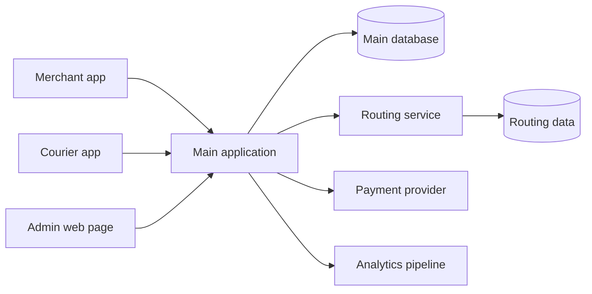

# Module 9 — Architecture and data

*Qafila is now at Scale-up. About 120 people work there in twelve teams, including a platform team. About 9,000 merchants use the app for about 120,000 deliveries a day, teams deploy to production many times a day, and a routing service decides which courier takes which order. The code that began as one application in one repository now carries the work of twelve teams, the data that began as one database now feeds reports, support tools and a routing algorithm, and shortcuts taken at Launch have started to slow everyone down. At this size, the choices about how the system is shaped and how its data is looked after can no longer live in Faisal's head. This module covers three of those practices, seen from the inside by Yasmin, now in her second year as an engineer. First, making architecture decisions on purpose: naming the qualities that matter, comparing options honestly and writing the decision down. Second, treating data as an asset with owners, quality checks and privacy rules. Third, finding, measuring and paying down technical debt, and modernising old parts without stopping the business. Each lesson leaves an artefact: a decision record with a trade-off table and a container diagram, a data inventory with quality checks and retention rules, and a debt register with a modernisation plan.*

> **Steps:** Design — shape the system and its data on purpose: decide how the parts fit and why, look after the data the business depends on, and keep the whole thing changeable as the company grows.

---

# 9.1 — Architecture decisions and trade-offs
*Level: 🟡 Intermediate* · *Prerequisites: 2.3, 8.1* · *Step: Design*

**After this you can** name the quality attributes that matter for a system change, compare at least two options against them in a trade-off table, judge how hard each option is to reverse, and write an architecture decision record that a colleague could challenge and later supersede. *Study time: reading about 20 min, hands-on about 90 min (estimate).*

## ⚡ In 60 seconds
- **Architecture** is the set of decisions about a system that are expensive to change later: how it is split into parts, how those parts talk, where data lives and who owns what.
- Every architecture choice is a **trade-off**: it buys some qualities (speed of change, reliability, cost, security) by spending others. There is no option with only upsides.
- The rule that matters most: **name the qualities first, then compare options against them, then write down what you gave up.**
- Decision cue: the harder a decision is to reverse, the more slowly and widely you should make it. Easy-to-reverse decisions belong to the team, made quickly.
- Structure follows people: a system tends to take the shape of the teams that build it, so plan team and code boundaries together.
- Biggest trap: choosing an architecture because it is fashionable or because a large company uses it, instead of because it fits your problem, your size and your skills.

## 🧭 Why it matters
Qafila and everyone in it are fictional. All numbers about Qafila in this lesson are illustrative figures, not benchmarks.

At Launch, Maha and Faisal built one application with one database in one repository. That was a sound choice (lesson 2.3): two people can hold a whole system in their heads. At Scale-up, twelve teams change that same application many times a day. In one month the Merchant Orders team, where Yasmin now works, waited on reviews from three other teams for changes that touched "their" files, and a change to the courier payout code broke the merchant order screen because both read the same database table in different ways.

Faisal, now Head of Engineering, came back from a conference with a plan: split the application into about ten separate services, one per team, in one quarter. Salma, who leads reliability, asked how many more things the on-call engineer would watch at three in the morning. Bilal, the finance lead, asked what it would cost to run. Dana, the new security and risk lead (hired after an access key was committed to a public repository), asked how ten services would authenticate to each other. Nobody had written answers.

Maha asked for a decision record before anything moved, and Faisal asked Yasmin to draft the part about Merchant Orders. This lesson is what she learned: how to turn an argument about fashion into a comparison of trade-offs, written down so the company can disagree with it properly.

## 📐 How it works

### 🟢 The essentials

**What architecture is, and is not.** A useful working definition: the decisions about a system that are expensive or slow to change once made. The language of a small script is rarely architecture. Whether orders and payouts share one database table is, because dozens of pieces of code will come to depend on it. For the manager's view, including how architecture work is funded, see [*Running IT as a Business*, lesson 4.3 — Architecture, non-functional requirements and the runway](../itbiz/index.html#/4.3).

**Quality attributes.** A **quality attribute** (often called a **non-functional requirement**) describes how well the system does its job rather than what it does. Lesson 6.2 listed several for user stories; architecture is where they bite hardest. The common ones:

| Quality attribute | Plain question | Qafila example at Scale-up |
|---|---|---|
| **Changeability** | How quickly and safely can a team change its part? | Merchant Orders waits days for other teams' reviews |
| **Reliability** | Does it keep working, and recover when parts fail? | Order tracking targets 99.9% a month (lesson 4.3) |
| **Performance and scale** | Is it fast enough at the load we expect? | About 120,000 deliveries a day, with lunch-time peaks |
| **Security and privacy** | Who can reach what, and is data protected? | Courier locations and merchant addresses |
| **Operability** | Can on-call people see what is happening and fix it? | One on-call rota per area, not per tiny service |
| **Cost** | What does it cost to build and to run each month? | Cloud bill and engineers' time |

You cannot maximise all of them: splitting into many services can improve changeability and worsen operability and cost. A good decision names the two or three attributes that matter most for *this* choice, and says what it gave up for them.

**Coupling and cohesion.** Two words do much of the work in architecture discussions:

- **Coupling** is how much one part depends on the inside of another. Tightly coupled parts must change together; loosely coupled parts can change on their own as long as their agreed interface holds.
- **Cohesion** is how well the things inside one part belong together. A cohesive part does one job; a part that does "orders, some payouts and a bit of tracking" is not cohesive.

The aim is high cohesion inside each part and loose coupling between parts. The commonest source of tight coupling is **shared data**: two parts reading and writing the same tables, so that a change in one silently breaks the other. That is exactly what broke the merchant order screen.

**Interfaces.** An **interface** is the agreed way one part asks another for something: function calls inside one application, or an **API** (a defined way for software to call other software over a network). A good interface hides the inside, so the owning team can change it freely.

### 🟡 Going deeper

**Three shapes for a growing system.** Most practitioners will meet these three shapes. None is "modern" or "legacy" in itself; each fits some situations.

| Shape | What it is | Gains | Costs |
|---|---|---|---|
| **Monolith** | One application, deployed as one unit, usually with one database | Simple to build, test, run and debug; one deploy | Teams step on each other as it grows; one bad change can affect everything |
| **Modular monolith** | Still one deployable application, but split inside into modules with enforced boundaries; each module owns its data and is reached only through its interface | Most of the monolith's simplicity, with clear ownership per team | Boundaries need discipline and tooling to enforce; still one deploy and one scaling unit |
| **Services** (sometimes called microservices when they are small) | Separate applications, each deployed on its own, talking over the network, each owning its data | Teams deploy independently; parts can scale and fail separately | Network failures, more to monitor and secure, harder testing across services, data spread across many stores, higher running cost |

Martin Fowler's 2015 article "MonolithFirst" observed that almost all the successful systems of many services he heard about began as a monolith that grew too big and was split, and recommended starting with a monolith (reported from search summaries; see lesson 2.3). The lesson is not "monoliths good" or "services good" but "split when you know where the boundaries are and can afford to run what you create". For a single developer's view of these choices, see [*System Design for Vibe Coders*, lesson 9.1 — You Are the Architect Now](../vibe/index.en.html#l9-1).

**How hard is it to undo?** Decisions differ in how costly they are to reverse. Amazon's 2015 letter to shareholders described "Type 1" decisions, which are consequential and hard to reverse and deserve slow, careful thought, and "Type 2" decisions, which can be reversed cheaply and should be made quickly by small groups; the idea is often retold as one-way and two-way doors (reported from search summaries). In architecture:

| Usually easy to reverse | Usually hard to reverse |
|---|---|
| A library inside one module | How data is split between stores |
| The internal design of one service | A public API that merchants' systems call |

Ask "if this is wrong, how many teams and weeks to undo it?" One team, days: decide in the team. Several teams, months: write a record and seek wide advice.

**Conway's law.** In a 1968 article, "How Do Committees Invent?", Melvin Conway argued that organisations which design systems tend to produce designs that copy their own communication structures; the idea became known as Conway's law (reported from search summaries). Lesson 8.1 used it to draw team boundaries. For architecture it means: twelve teams sharing one tangle of code will keep meeting about it, and code parts no team owns will not be looked after. DORA's guidance on loosely coupled teams describes architecture and teams as loosely coupled when a team can test, deploy and change its part without depending on other teams (reported from search summaries of dora.dev). Draw code boundaries where you can also draw team boundaries.

**Pictures that help.** A widely used, free approach is Simon Brown's **C4 model**, which describes a system at four levels of zoom: system context (the system and the people and systems around it), containers (the separately running applications and data stores), components (the main parts inside a container) and code (reported from c4model.com via search summaries). For most decisions, the first two levels are enough. Here is Qafila's container view at Scale-up as Yasmin drew it:

The picture showed the problem at once: almost everything goes through one main application and one database, and only routing is separate.

### 🔴 Expert view

**Who decides what.** At Scale-up, "Faisal decides" no longer works, and "every team decides everything" leads to twelve ways of doing the same thing. A sensible split: easy-to-reverse choices inside one team's part, the team decides quickly; hard-to-reverse choices inside one part, the team decides after sharing a decision record for comment; choices that cross teams or set a shared standard, a named decision maker (often the Head of Engineering) decides after open review; costly company-wide choices go to leadership with a business case (Module 10). Many organisations add a light **architecture advice forum**: a short, regular, open meeting where draft records get advice from the people affected. It works only if it is fast and advisory; if it becomes a monthly gate, teams route around it.

**Fitness checks.** A **fitness check** (often called an architecture fitness function) is an automated test of an architectural rule, run in the pipeline from lesson 3.2: "no module reads another module's tables", "every service exposes a health endpoint". Without such checks, boundaries erode one "quick fix" at a time.

**Decision records that age well.** Lesson 2.3 introduced the **architecture decision record (ADR)**, a short note on one significant decision, in the format Michael Nygard proposed in 2011 (title, context, decision, status, consequences; reported from search summaries) plus options considered and how to undo it. At Scale-up, add three habits:

1. **A trade-off table** comparing the options against the named quality attributes, with honest marks.
2. **A review-by trigger**: the signal or date that should make someone look again.
3. **Superseding, not editing.** A changed mind gets a new record that supersedes the old one, which stays, so the next person can see why it made sense at the time.

**Fashion and evidence.** Large companies' problems are not yours. Before copying them, ask: do we have their problem, their skills to run it at night, and the money? AI assistants can draft options and spot missing consequences, but they repeat fashion confidently too. For practice in writing a record with an AI critic, see [*A Practical Guide to Becoming an AI-Native Engineer*, lesson 11.2 — Lab: an ADR with a critic, docs checked against code and a postmortem that sticks to the facts](../ainative/index.html#/11.2). For how a reference architecture is assembled for a whole product, see [*SaaS Building Blocks*, lesson 9.1 — Assemble Beacon: reference architecture, build-vs-buy and a 90-day plan](../saas/index.html#/9.1).

**The memorable rule.** Name the qualities first, then compare options against them, then write down what you gave up.

## 🧰 The toolkit
| Resource, tool or template | What it is and does | When to reach for it |
|---|---|---|
| **Quality attribute shortlist** | The two or three attributes that matter most for this decision, each with a measurable target | At the start of any architecture discussion |
| **Trade-off table** | Options in columns, quality attributes in rows, honest marks and a one-line reason each | When there are at least two serious options |
| **Container diagram** | A picture of the separately running applications and data stores and how they connect (C4 level 2) | When people argue about a system they picture differently |
| **Architecture decision record (ADR)** | Title, context, options, trade-off table, decision, status, consequences, how to undo, review-by trigger | For hard-to-reverse or cross-team decisions |
| **Fitness check** | An automated pipeline test of an architectural rule | As soon as a boundary is agreed |
| **Architecture advice forum** | A short, open, regular meeting where draft records get advice from the people affected | From Scale-up, when decisions cross teams |

## 🏛️ In practice at Qafila
Yasmin's draft, after two rounds of comments. Illustrative and fictional.

> **ADR-031: Boundary for Merchant Orders inside the main application**
>
> **Status:** Accepted. Decision maker: Faisal (Head of Engineering), after the architecture advice forum.
>
> **Context.** Twelve teams change one application and one database. Merchant Orders changes wait on average more than two days for other teams' reviews (measured over the last month). Courier Earnings and Merchant Orders both write to the orders table; a payout change broke the merchant order screen last month. Qafila has one on-call engineer per area at night.
>
> **Quality attributes, in order:** changeability for Merchant Orders; reliability of order creation and tracking (99.9% monthly target); operability at night.
>
> **Options and trade-offs:**
>
> | | A. Leave as is | B. Module with enforced boundary, inside the main application | C. Separate Orders service with its own database |
> |---|---|---|---|
> | Changeability | Poor: shared tables, cross-team reviews | Good: team owns its tables and interface | Best: independent deploys |
> | Reliability | Fragile: shared table changes break others | Better: changes behind an interface | Mixed: new network failure points between Orders and others |
> | Operability | Known | Known: still one deploy | Worse: another service to watch, trace and secure |
> | Cost and effort | None now; growing delay | About one quarter for one team (estimate) | Two to three quarters, plus Platform and Security work (estimate) |
> | Reversibility | — | Easy to extract later if needed | Hard: data split is costly to undo |
>
> **Decision.** Option B. Merchant Orders becomes a module that alone owns the orders tables; other modules call it only through its interface. Courier Earnings reads order data through that interface.
>
> **Consequences.** Good: Merchant Orders can change its tables without cross-team review; payout changes can no longer break order screens through shared tables. Bad: Courier Earnings must change its code to use the interface (about three weeks, estimate); one deploy still carries everyone's changes.
>
> **How to undo or extend.** The interface makes a later move to a separate service (option C) much cheaper.
>
> **Fitness check.** A pipeline test fails any code outside Merchant Orders that reads or writes the orders tables.
>
> **Review by:** in six months, or sooner if Merchant Orders needs to deploy on a different schedule from the rest.

Faisal's ten-service plan became a series of records, one boundary at a time, starting with the two that hurt most. Dana added a question to every future service decision: "how does it authenticate to others, and who rotates its secrets?" Yasmin's first draft had marked option C "best" on every row until Hamad asked where reporting data would come from once orders lived in a separate database.

## 🛠️ Exercises
**🟢 Name the qualities.** Read the "Why it matters" section again. List the quality attributes each person cares about (Faisal, Salma, Bilal, Dana, the Merchant Orders team) and pick the three you think matter most for the decision. For each, write one measurable target.
*Done when:* you have at least five people-to-attribute pairs, three chosen attributes in order, and a measurable target for each (a number, a time or a yes/no check).

Model answer and self-check

**Model answer.** Faisal: changeability. Salma: operability and reliability. Bilal: cost. Dana: security. Merchant Orders: changeability. Top three: changeability ("Merchant Orders changes merged without other teams' review in under one day"); reliability ("order tracking stays at 99.9% monthly during and after the change"); operability ("no increase in the number of things the night on-call engineer must watch").

**Self-check.**
- Is each target something you could measure next month, not an adjective like "scalable"?
- Did you put the attributes in an order, accepting that the lower ones may lose?
- Did you include at least one attribute that argues *against* splitting?

**🟡 Build a trade-off table.** Pick a real decision from a personal or open-source project (one database or two, a library or your own code, a hosted service or self-hosted), or use Qafila's question "should the courier app's shift handling stay inside the main application or become a separate service?". Compare at least two options against your three attributes and add a reversibility row.
*Done when:* every cell has a mark and a reason in a few words, no option is best on every row, and the reversibility row says how many teams and roughly how long it would take to undo each option.

Model answer and self-check

**Model answer (Qafila shift handling).** Option 1, module inside the main application: changeability good, reliability known, operability unchanged, cost low, reversibility easy. Option 2, separate service: changeability best, reliability worse at first (network calls at shift start), operability worse, cost higher, reversibility hard (data split). Shift handling has no special scaling need, so option 1 fits now.

**Self-check.**
- Did your table make at least one option look worse than you expected?
- Did you mark reversibility honestly, including data, not just code?
- Could someone who disagrees with you use your table to argue their case? That means it is fair.

**🔴 Write the decision record.** Turn your trade-off table into a full decision record using the toolkit's template: title, status, decision maker, context with at least one measurement, quality attributes in order, options with the table, decision, consequences good and bad, how to undo, fitness check and a review-by trigger. Then ask a friend, classmate or an AI assistant to argue for the option you rejected, and add anything new to the consequences.
*Done when:* the record fits on one to two pages, names a decision maker, contains at least one bad consequence of the chosen option, has a fitness check that a pipeline could run, and has a review trigger that is a date or a measurable signal.

Model answer and self-check

**Model answer.** ADR-031 above is the pattern. For shift handling: decision maker Faisal after the advice forum; context "shift code changes wait more than two days for review"; decision: module with an enforced boundary; bad consequence "one deploy still carries everyone's changes"; fitness check "no code outside Courier Experience reads the shifts tables"; review trigger "if shift start needs to scale separately at lunch peaks".

**Self-check.**
- Does the context contain facts and measurements rather than opinions?
- Did the challenger's argument change anything in your record? If not, did you listen?
- Would a new joiner in a year understand why this made sense at the time?

## ⚠️ Mistakes and traps
- **Choosing by fashion.** "Everyone uses services now" is not a reason. Name your qualities and compare options against them.
- **Hiding the costs.** A record with only upsides will not be trusted. Write at least one real cost of the chosen option.
- **Splitting code without splitting data.** Two services sharing one database are still tightly coupled. Decide who owns each table.
- **One process for every decision.** Small, reversible choices made by committee slow everyone down; large, irreversible ones made in a hallway hurt for years. Match the process to reversibility.
- **Boundaries nobody checks.** An agreed boundary without a fitness check erodes within months. Automate the rule.
- **Editing old records.** Supersede them with a new record instead, so history stays honest.

## 🧾 Recap
- Architecture is the set of decisions that are expensive to change: how the system is split, how parts talk, where data lives, who owns what.
- Name the two or three quality attributes that matter, compare options in a trade-off table, and judge reversibility before deciding who decides.
- Aim for high cohesion and loose coupling; shared data is the commonest hidden coupling. Draw code boundaries where team boundaries can follow.
- Monolith, modular monolith and services each fit some situations; split when you know the boundaries and can run what you create.
- Write a decision record with trade-offs, consequences, a fitness check and a review trigger. Rule: name the qualities first, then compare options against them, then write down what you gave up.

## ✍️ Check yourself
**1. Which of these is most clearly an architecture decision in the sense used in this lesson?**

- A. Which code formatting style the Merchant Orders team uses in its own module.
- B. Whether Courier Earnings and Merchant Orders keep writing to the same orders table.
- C. Which colour the "ready for pickup" button uses in the merchant app this month.
- D. Which day of the week the Merchant Orders team holds its regular planning meeting.

Answer

**B.** Shared tables are expensive to change once many pieces of code depend on them, which is what makes a decision architectural. A, C and D matter to the team but are cheap to change later. See "What architecture is, and is not" and "Coupling and cohesion".

**2. Faisal proposes splitting the main application into ten services in one quarter. What should Yasmin's draft do first?**

- A. Count how many large companies use services, and recommend following the majority approach.
- B. Recommend the plan, because separate services always improve every team's speed of change.
- C. Reject the plan, because monoliths are always cheaper and simpler to run than services.
- D. Name the quality attributes that matter most, then compare the options against them.

Answer

**D.** Naming the qualities and comparing options turns a debate about fashion into a trade-off. A copies other companies' problems, and B and C both claim a universal answer that the lesson says does not exist. See "Quality attributes" and "Three shapes for a growing system".

**3. Two parts of Qafila's system are split into separate services, but both still read and write the same database tables. What is the main problem?**

- A. They remain tightly coupled through shared data, so a change in one can still break the other.
- B. They will automatically cost twice as much to run, because each service needs its own servers.
- C. They can no longer be tested at all, since services cannot share any test data with each other.
- D. They break Conway's law, which forbids two teams from ever working with the same database.

Answer

**A.** Shared data is the commonest hidden coupling; splitting code without splitting data keeps the old problem and adds network costs. B, C and D state rules the lesson does not make, and D misreads Conway's law, which is an observation, not a ban. See "Coupling and cohesion".

**4. The Payments team wants to swap a charting library used only inside its own reports page. How should this decision be made?**

- A. Through a full decision record reviewed by the architecture advice forum before any change.
- B. By leadership with a business case, since any change near payments counts as high risk.
- C. Quickly by the Payments team, since it stays inside their part and is easy to reverse.
- D. By Faisal alone, since the Head of Engineering should approve every library in the system.

Answer

**C.** It is a reversible choice inside one team's part, so the owning team decides quickly. A and B apply a heavy process to a cheap decision, which slows everyone down, and D does not scale to twelve teams. See "How hard is it to undo?" and "Who decides what".

**5. Six months after ADR-031, Qafila decides to move Merchant Orders into its own service. What should happen to ADR-031?**

- A. Rewrite ADR-031 so that it describes the new decision, keeping a single record up to date.
- B. Delete ADR-031, since it no longer reflects the system and could only confuse new joiners.
- C. Leave ADR-031 unchanged and record the new decision only in the team's chat channel.
- D. Write a new record that supersedes ADR-031, and mark ADR-031 as superseded by it.

Answer

**D.** Superseding keeps an honest history of what was known and why, while making the current decision clear. A and B erase the reasoning that made sense at the time, and C loses the new decision where nobody will find it. See "Decision records that age well".

## 📚 References
- Michael Nygard, "Documenting Architecture Decisions", 15 November 2011: https://cognitect.com/blog/2011/11/15/documenting-architecture-decisions — the original ADR format (page could not be opened from this environment; date and sections as reported in search summaries).
- Martin Fowler, "Monolith First", 3 June 2015: https://martinfowler.com/bliki/MonolithFirst.html (found in search; not opened).
- Melvin E. Conway, "How Do Committees Invent?", *Datamation*, April 1968; summary and discussion at https://en.wikipedia.org/wiki/Conway%27s_law (as reported in search summaries; not opened).
- Amazon.com, 2015 letter to shareholders (Type 1 and Type 2 decisions), as reported in search summaries; widely discussed, for example at https://www.businessinsider.in/jeff-bezos-there-are-two-types-of-decisions-to-make-and-dont-confuse-them/articleshow/51706758.cms (not opened).
- DORA, "Loosely coupled teams" capability: https://dora.dev/capabilities/loosely-coupled-teams/ (found in search; not opened).
- Simon Brown, The C4 model for visualising software architecture: https://c4model.com/ (found in search; not opened).
- Library course: [*Running IT as a Business*, lesson 4.3 — Architecture, non-functional requirements and the runway](../itbiz/index.html#/4.3).
- Library course: [*System Design for Vibe Coders*, lesson 9.1 — You Are the Architect Now](../vibe/index.en.html#l9-1).
- Library course: [*SaaS Building Blocks*, lesson 9.1 — Assemble Beacon: reference architecture, build-vs-buy and a 90-day plan](../saas/index.html#/9.1).
- Library course: [*A Practical Guide to Becoming an AI-Native Engineer*, lesson 11.2 — Lab: an ADR with a critic, docs checked against code and a postmortem that sticks to the facts](../ainative/index.html#/11.2).

---

# 9.2 — Data as an asset: quality, ownership and privacy
*Level: 🟡 Intermediate* · *Prerequisites: 6.3, 9.1* · *Step: Design*

**After this you can** build a data inventory for a product (what data exists, where, why, who owns it, whether it is personal and how long it is kept), write quality checks for one important dataset, and spot privacy questions early enough to ask the right person. *Study time: reading about 20 min, hands-on about 90 min (estimate).*

## ⚡ In 60 seconds
- Data is an **asset** when the business depends on it to run, decide or comply. Like any asset it needs an owner, care and a record of where it is.
- A **data inventory** lists each important dataset: what it is, where it lives, why it is kept, who owns it, whether it holds personal data, who can see it and when it is deleted.
- **Data quality** means data fit for its purpose: accurate, complete, on time, consistent, valid and without duplicates. Check it automatically, at the point where it enters.
- The rule that matters most: **every important dataset has a named owner, a written purpose and a deletion date.**
- Decision cue: if two reports disagree, do not pick the one you like; find the definition each uses and agree one with the owner.
- Biggest trap: keeping everything "just in case". Data without a purpose is cost and risk, and personal data without a purpose may break the rules that apply to you.

## 🧭 Why it matters
Qafila and everyone in it are fictional. All numbers about Qafila in this lesson are illustrative figures, not benchmarks.

At a monthly review, Maha saw two charts that should have matched. The Merchant Orders dashboard said Qafila had made about 118,000 deliveries the previous Tuesday. The Courier Earnings report said about 121,000. The difference meant real money: couriers are paid per delivery, and merchants are billed per delivery. Both teams were sure their number was right. Both were, by their own definition. Merchant Orders counted a delivery when the courier tapped "delivered"; Courier Earnings counted it when a payout line was created, which also included some cancelled orders where the courier had already travelled.

The same week, a merchant asked Qafila to delete the data it held about her shop after she closed it. Support could delete the account. Nobody knew where else her data was: in the analytics pipeline, in the routing service's history, in test copies that engineers had made of the production database "to reproduce a bug", in the help-desk tool, in backups. Dana, the security and risk lead, then found that courier location history had been kept, with no deletion date, since Launch.

Hamad, now head of data, and Dana asked every team for a data inventory. Yasmin volunteered for Merchant Orders, and learned that data is not a by-product of the code but something the company depends on and answers for.

## 📐 How it works

### 🟢 The essentials

**Kinds of data.** It helps to sort a product's data into a few kinds, because each needs different care:

| Kind | What it is | Qafila example |
|---|---|---|
| **Operational data** | Data the product needs to work right now | Open orders, courier status, merchant settings |
| **Reference data** | Shared lists that many parts use | Delivery zones, order statuses, cancellation reasons |
| **Analytical data** | Copies and summaries used for reports and decisions | Daily deliveries per merchant, contact reasons per 1,000 deliveries |
| **Event and log data** | Records of what happened, for debugging, analytics or audit | App events (lesson 6.3), server logs, who changed what |

**The data inventory.** A **data inventory** (sometimes called a data register or record of data) is a table of the important datasets. It is the single most useful thing a team can make about its data, because you cannot protect, clean or delete what you cannot find. One row per dataset:

| Column | Question it answers |
|---|---|
| **Dataset** | What is it called, in plain words? |
| **Where it lives** | Which database, store, tool or file? Including copies |
| **Purpose** | Why do we keep it? What would break without it? |
| **Owner** | Which team or person is accountable for it? |
| **Personal data?** | Does it identify or relate to a person? Which fields? |
| **Sensitivity** | Public, internal, confidential or restricted (see below) |
| **Who can access** | Which roles, through which tools? |
| **Retention** | How long is it kept, and what happens then? |
| **Source and consumers** | Where does it come from, and who uses it? |

**Owners and stewards.** A **data owner** is the team or person accountable for a dataset: they decide what it means, who may use it and how long it is kept. A **data steward** is the person who looks after it day to day: keeps definitions written down, watches quality, answers questions. In a small company both are often the same person. The platform team, or the cloud provider, runs the storage, but running the database does not make them the owner of what is in it. The owner is usually the team whose product creates the data: Merchant Orders owns order data, Courier Earnings owns payout data.

**Quality, in six words.** **Data quality** means data good enough for the purpose it is used for. Practitioners commonly check six things:

| Dimension | Question | Qafila check |
|---|---|---|
| **Accuracy** | Does it match reality? | Delivered orders match couriers' proof of delivery on a sample |
| **Completeness** | Is anything missing? | Every delivered order has a delivery time |
| **Timeliness** | Is it there when needed? | Yesterday's deliveries in the warehouse by 06:00 |
| **Consistency** | Does it agree with itself and other sources? | Deliveries in orders and in payouts agree within a known, explained gap |
| **Validity** | Does it follow the rules for its format and values? | Status is one of the agreed statuses; times are not in the future |
| **Uniqueness** | Is each thing recorded once? | No order ID appears twice |

**Check where it enters.** Stop bad data where it is created (validation in the app, constraints in the database, tests in the pipeline); every copy downstream multiplies the cost of fixing it. For tests, contracts and monitoring of data in depth, see [*Data Engineering & Analytics: Zero to Hero*, lesson 3.2 — Data quality: tests, contracts and observability](../data/index.html#/3.2).

### 🟡 Going deeper

**One definition per important word.** Most "data quality" arguments at Scale-up are really definition arguments. "Delivery", "active merchant", "late order": each needs one written definition, an owner and a place where everyone looks it up. The fix for the two charts was not a better database. It was one line, agreed by both owners: "A *completed delivery* is an order with status delivered; travelled-but-cancelled orders are counted separately as *cancelled after pickup*." Both dashboards then showed both numbers. For metric definitions and how to keep them in one place, see [*Data Engineering & Analytics: Zero to Hero*, lesson 4.1 — Defining metrics: one definition, a semantic layer and a metrics catalogue](../data/index.html#/4.1).

**Data contracts.** When one team's data feeds another team's work, the two need an agreement. A **data contract** is a written, and ideally machine-checked, agreement between a data producer and its consumers about the shape of the data (fields and types), its meaning (definitions), its timeliness (when it arrives) and how changes will be announced. It is the data version of the interface in lesson 9.1. Without one, the producing team renames a field on a Thursday and the finance report is wrong on Friday.

**Lineage.** **Lineage** is the record of where data came from and where it goes: courier's tap, orders table, pipeline, warehouse, dashboard. It answers "if this field is wrong, what else is wrong?" and "where are all the copies?". A hand-drawn diagram per important dataset is enough at first. For ownership, catalogues and lineage in depth, see [*Data Engineering & Analytics: Zero to Hero*, lesson 6.1 — Data governance that works: ownership, catalogue, lineage and data contracts](../data/index.html#/6.1).

**Sensitivity levels.** Most companies sort data into a few levels so that people know how to handle it without asking each time. A simple scheme:

| Level | Meaning | Qafila example | Handling |
|---|---|---|---|
| **Public** | Fine to publish | Help-centre articles | No restriction |
| **Internal** | For staff, low harm if leaked | Team plans, aggregate delivery counts | Staff access |
| **Confidential** | Harm to people or business if leaked | Merchant contact details, prices per merchant | Need-to-know access, logged |
| **Restricted** | Serious harm if leaked | Courier location history, identity documents, payment details | Few named roles, encrypted, logged, never copied to test |

Dana owns the scheme; each data owner applies it to their rows in the inventory.

**Personal data and privacy.** **Personal data** is information about an identifiable person: a courier's name, phone number, location trail; a merchant owner's contact details; an end customer's address. **Privacy** is about using such data only in ways people would reasonably expect and that the rules allow. Data protection laws differ by country, but they share common ideas. The EU's General Data Protection Regulation (GDPR), for example, sets out principles in its Article 5 that include using data only for specified purposes (purpose limitation), collecting only what is needed (data minimisation), keeping it accurate, and keeping it in identifiable form no longer than necessary (storage limitation), and requires the organisation to be able to show it complies (accountability) (as reported in search summaries of the regulation's text and the European Commission's guidance). Qafila operates in the Gulf, where countries have their own laws; for a map of the main laws and how to compare them, see [*AI Governance: Zero to Hero*, lesson 4.3 — DPIAs and the global privacy map, from the EU to the GCC](../aigp/index.html#/4.3).

For a practitioner, the useful habit is a set of questions to ask for every dataset with personal data, not a legal judgement:

1. **Purpose:** what exactly do we use it for, and is that written down?
2. **Minimum:** do we need every field? Could we use a less precise version (a zone instead of an exact location)?
3. **Notice and basis:** have the people concerned been told, and on what basis do we use it? (Ask whoever advises the company.)
4. **Access:** who can see it, and is access logged?
5. **Retention:** when is it deleted, in every copy?
6. **Requests:** if a person asks to see or delete their data, can we find all of it?

### 🔴 Expert view

**Deletion across copies.** Deleting from the main database is the easy part; the copies (analytics, exports, logs, the help-desk tool, test databases, backups) are the hard part. Keep personal data in as few places as possible, use an internal ID elsewhere, set retention per store, and decide how backups age out. For designing retention and deletion into an application, see [*System Design for Vibe Coders*, lesson 2.4 — Retention, Deletion, and the Data You Promised to Erase](../vibe/index.en.html#l2-4).

**Production data outside production.** Engineers copying production data to reproduce a bug is one of the commonest ways personal data leaks. Safer options: generated test data, a masked copy (personal fields replaced with realistic fakes), or debugging in production through logged, limited support tools (lesson 7.1). For classification, masking and minimisation in depth, see [*Data Engineering & Analytics: Zero to Hero*, lesson 6.2 — Personal data: classification, masking, minimisation, retention and the law](../data/index.html#/6.2) and [*Secure AI & Application Security: Zero to Hero*, lesson 5.3 — Protecting personal data: minimisation, logging and privacy engineering](../secai/index.html#/5.3).

**Data and AI tools.** Pasting a dataset into an AI assistant copies it to another place, possibly another company. Check its sensitivity level, use only tools approved for that level, and never paste restricted data.

**Owning data as a product.** Some organisations ask each team to treat the data it publishes for others as a product: documented, with a contract, quality targets and named contacts. Hamad started small: one such dataset per area, with changes announced two weeks ahead.

**The memorable rule.** Every important dataset has a named owner, a written purpose and a deletion date.

## 🧰 The toolkit
| Resource, tool or template | What it is and does | When to reach for it |
|---|---|---|
| **Data inventory** | One row per dataset: where, purpose, owner, personal data, sensitivity, access, retention, sources and consumers | From the first time someone asks "where is all our data about X?" |
| **Definition page** | One written definition per important term or metric, with owner and examples | When two reports disagree, or a term is used by more than one team |
| **Quality check list** | Automated checks per dataset across the six dimensions, run in the pipeline | For every dataset that feeds money, customers or decisions |
| **Data contract** | Agreed fields, meanings, freshness and change notice between producer and consumers | When one team's data feeds another team's work |
| **Sensitivity scheme** | Four levels with handling rules for each | Company-wide, owned by security |
| **Privacy question card** | The six questions: purpose, minimum, notice and basis, access, retention, requests | Whenever a story, report or dataset touches personal data |

## 🏛️ In practice at Qafila
Yasmin's inventory for Merchant Orders, reviewed by Hamad and Dana. Illustrative and fictional; three of its eleven rows.

> **Merchant Orders data inventory v1 (Scale-up)**
>
> | Dataset | Where it lives (incl. copies) | Purpose | Owner | Personal data | Sensitivity | Access | Retention |
> |---|---|---|---|---|---|---|---|
> | Orders | Main database; warehouse copy; nightly backups | Run deliveries; bill merchants | Merchant Orders | End customer name, phone, address | Confidential | App; support view (logged); analysts see warehouse copy without name and phone | Order details: as long as billing and accounting rules require (ask finance); customer phone: removed 30 days after delivery (illustrative) |
> | Order status history | Main database; event stream to analytics | Tracking, disputes, analytics | Merchant Orders | Courier ID | Internal | App; analysts | 13 months, then aggregated (illustrative) |
> | Merchant branches | Main database | Pickup addresses, opening hours | Merchant Onboarding (moved from Merchant Orders) | Owner's contact phone | Confidential | App; support view | While account is active, then deleted within 90 days (illustrative) |
>
> **Quality checks on Orders (run in the pipeline every night):** no duplicate order IDs; every delivered order has a delivery time; no delivery time in the future; status is one of the agreed list; delivered count in Orders and completed count in Payouts differ only by *cancelled after pickup*.
>
> **Found while building it:** analysts' test copy of Orders included customer phone numbers (deleted; masked copy built instead); the "address notes" field held door codes and was not listed anywhere (now confidential, removed 30 days after delivery, illustrative).

Yasmin had assumed "keep order details forever" was safest. Bilal pointed out that accounting rules set minimum periods for some records and the company's adviser should say which; Dana pointed out that keeping personal fields longer than needed is itself a risk. So they split the row. The courier location history went to Live Tracking as owner, with a retention period set after advice. The closed shop's deletion request was answered by following the "where it lives" column.

## 🛠️ Exercises
**🟢 Name the dimension.** For each Qafila problem, name the quality dimension it breaks (accuracy, completeness, timeliness, consistency, validity, uniqueness) and write one automated check that would catch it: (1) the same order appears twice in the warehouse; (2) yesterday's data arrives at 11:00, after the morning review; (3) a delivered order has no delivery time; (4) an order's status is "deliverd"; (5) Orders and Payouts disagree about yesterday's deliveries; (6) the app shows a shop as open while it has closed for good.
*Done when:* all six problems have a dimension and a check that a program could run without a person deciding.

Model answer and self-check

**Model answer.** (1) Uniqueness: count order IDs, fail if any appears more than once. (2) Timeliness: fail if the latest load finished after 06:00. (3) Completeness: fail if any delivered order has an empty delivery time. (4) Validity: fail if status is not in the agreed list. (5) Consistency: fail if delivered minus completed is not equal to cancelled-after-pickup. (6) Accuracy: hard to check automatically; flag shops with no orders for 30 days for a support call, and compare with merchants' own updates.

**Self-check.**
- Is each check specific enough to fail or pass, not "make sure data is good"?
- Did you notice that accuracy often needs a comparison with the real world, not only a rule?
- Where would each check run: in the app, the database or the pipeline?

**🟡 Build a small data inventory.** For a personal project, an open-source project you can read, an app you use (from its privacy notice), or Qafila's Courier Earnings team (earnings, tips, payouts, courier bank details), build an inventory of at least four datasets with all the columns from this lesson.
*Done when:* every row has an owner, a purpose in one sentence, personal fields named, a sensitivity level, and a retention period or a named person who must decide it.

Model answer and self-check

**Model answer (Courier Earnings).** Earnings per delivery: main database and warehouse; pay couriers correctly; owner Courier Earnings; courier ID; confidential; kept as finance's adviser says. Tips: same, to pass tips on. Payout batches: main database and payment provider; record what was paid; confidential; finance decides retention. Courier bank details: with the payment provider where possible, else encrypted; restricted; payments staff only, logged; deleted after the final payment (Dana decides with the adviser).

**Self-check.**
- Did you list copies (warehouse, exports, provider) and not only the main database?
- Did "retention" say a period or a named decision maker, never "forever" by default?
- Could someone answer a deletion request for one person using only your table?

**🔴 Settle a definition and write a contract.** Pick a term that two teams, two reports or two people in your project use differently (Qafila: "active merchant", used by Sales for "signed up in the last 90 days" and by Analytics for "had at least one delivery in the last 30 days"). Write one definition page and a data contract for the dataset that carries it.
*Done when:* the definition page has one definition, an owner, two examples and one counter-example; any second meaning gets its own name; and the contract states fields with types, meaning, freshness and how changes are announced.

Model answer and self-check

**Model answer.** Definition: "*Active merchant*: a merchant with at least one completed delivery in the last 30 days. Owner: Data & Analytics. Example: a bakery with 400 deliveries this month; a pharmacy with one delivery 29 days ago. Counter-example: a shop that signed up last week and has not yet sent an order." Sales' meaning becomes "*new sign-up (90 days)*". Contract for the merchant activity table: fields merchant_id (text), last_completed_delivery_at (timestamp), is_active (true/false, computed by the definition); fresh by 06:00 daily; changes announced two weeks ahead in the data channel, with both versions run in parallel for one week.

**Self-check.**
- Did you give the losing meaning its own name instead of deleting it?
- Could a new analyst compute the number from your definition without asking anyone?
- Does your contract say what happens when the producer needs to change a field?

## ⚠️ Mistakes and traps
- **Keeping everything "just in case".** Every dataset needs a purpose and a retention period. Data without either is cost and risk.
- **Treating the platform team as owner.** Running the storage is not owning the meaning. Owners are the teams that create and depend on the data.
- **Arguing about numbers instead of definitions.** When reports disagree, find the definitions, agree one, and name the other.
- **Copying production data to test "just this once".** Use generated or masked data, or logged support tools.
- **Deleting from one place only.** A deletion request covers every copy; the inventory's "where it lives" column is how you find them.
- **Deciding the law yourself.** Ask the six privacy questions, write them in the inventory, and get the legal answers from whoever advises the company.

## 🧾 Recap
- Data is an asset when the business depends on it; sort it into operational, reference, analytical and event data.
- A data inventory lists each dataset's location and copies, purpose, owner, personal data, sensitivity, access and retention.
- Quality has six common dimensions; check them automatically where data enters, and fix definition arguments with one written definition.
- Contracts and lineage make data between teams dependable; sensitivity levels and the six privacy questions make personal data safer.
- Rule: every important dataset has a named owner, a written purpose and a deletion date.

## ✍️ Check yourself
**1. The Merchant Orders dashboard shows about 118,000 deliveries and the Courier Earnings report about 121,000 for the same day. What should happen first?**

- A. Find the definition each report uses and agree one definition with the data owners.
- B. Use the Courier Earnings figure, since it comes from payment records and money is exact.
- C. Average the two figures for the monthly review until the teams have time to investigate.
- D. Ask the platform team to rebuild the warehouse, since the copies have clearly drifted apart.

Answer

**A.** Both numbers were right by their own definitions; the fix is one agreed definition, with the other meaning named separately. B picks a favourite without understanding the gap, C invents a third wrong number, and D assumes a technical fault that is not there. See "One definition per important word".

**2. Who should be the owner of the orders data at Qafila?**

- A. The platform team, because it runs the database where the orders data is stored.
- B. The security and risk lead, because the orders data includes customers' personal details.
- C. The Merchant Orders team, because it creates the data and is accountable for its meaning.
- D. The head of data, because analytics is the largest consumer of the orders data each day.

Answer

**C.** The owner is the team accountable for what the data means and how it is used, usually the team whose product creates it. A confuses running storage with owning meaning, B confuses setting security rules with ownership, and D confuses being a big consumer with being accountable. See "Owners and stewards".

**3. A check finds that some delivered orders have no delivery time. Which quality dimension does this break?**

- A. Uniqueness, because each order should be recorded only once in the orders table.
- B. Completeness, because a value that every delivered order should have is missing.
- C. Timeliness, because the delivery time has not reached the warehouse table quickly enough.
- D. Validity, because the delivery time does not follow the agreed format for timestamps.

Answer

**B.** A required value is missing, which is completeness. A is about duplicates, C is about data arriving late rather than being absent, and D is about values present in the wrong format. See "Quality, in six words".

**4. A merchant who closed her shop asks Qafila to delete her data. Support deletes her account. What else is most important?**

- A. Nothing more, since deleting the account removes the merchant from the product completely.
- B. Wait for the next backup cycle, since backups and copies are refreshed from the main database.
- C. Decide personally which deletion law applies and reply to the merchant with the legal position.
- D. Use the data inventory to find every copy, such as analytics tables and test copies.

Answer

**D.** Deletion covers every copy, and the inventory's "where it lives" column is how you find them. A and B ignore copies that are not refreshed from the main database, and C asks a practitioner to reach a legal conclusion, which belongs to whoever advises the company. See "Deletion across copies".

**5. An engineer wants to copy the production orders table to a test environment to reproduce a bug. What is the best response?**

- A. Allow it if the copy is deleted after the bug is fixed, since the risk only lasts a short time.
- B. Allow it, since test environments belong to the company and only staff can reach them anyway.
- C. Use generated or masked data, or logged support tools, instead of copying personal data.
- D. Refuse to reproduce the bug at all, because production data may never be used for any purpose.

Answer

**C.** Masked or generated data, or limited logged support tools, let the engineer debug without spreading personal data. A and B are how leaks commonly happen, because copies outlive their reasons, and D blocks legitimate work instead of offering a safer route. See "Production data outside production".

## 📚 References
- Regulation (EU) 2016/679 (GDPR), Article 5, principles relating to processing of personal data: https://www.legislation.gov.uk/eur/2016/679/article/5 (found in search; text as reported in search summaries; not opened).
- European Commission, "What are the principles of the GDPR?" (data protection principles for business): https://commission.europa.eu/law/law-topic/data-protection/rules-business-and-organisations/principles-gdpr (found in search; not opened).
- Library course: [*Data Engineering & Analytics: Zero to Hero*, lesson 3.2 — Data quality: tests, contracts and observability](../data/index.html#/3.2).
- Library course: [*Data Engineering & Analytics: Zero to Hero*, lesson 4.1 — Defining metrics: one definition, a semantic layer and a metrics catalogue](../data/index.html#/4.1).
- Library course: [*Data Engineering & Analytics: Zero to Hero*, lesson 6.1 — Data governance that works: ownership, catalogue, lineage and data contracts](../data/index.html#/6.1).
- Library course: [*Data Engineering & Analytics: Zero to Hero*, lesson 6.2 — Personal data: classification, masking, minimisation, retention and the law](../data/index.html#/6.2).
- Library course: [*Secure AI & Application Security: Zero to Hero*, lesson 5.3 — Protecting personal data: minimisation, logging and privacy engineering](../secai/index.html#/5.3).
- Library course: [*AI Governance: Zero to Hero*, lesson 4.3 — DPIAs and the global privacy map, from the EU to the GCC](../aigp/index.html#/4.3).
- Library course: [*System Design for Vibe Coders*, lesson 2.4 — Retention, Deletion, and the Data You Promised to Erase](../vibe/index.en.html#l2-4).

---

# 9.3 — Technical debt and modernisation
*Level: 🟡 Intermediate* · *Prerequisites: 9.1, 6.1* · *Step: Design*

**After this you can** recognise technical debt in a codebase, record it in a debt register with its cost to the team, choose between living with it, paying it down and replacing the part, and sketch an incremental modernisation plan that keeps the product running. *Study time: reading about 20 min, hands-on about 90 min (estimate).*

## ⚡ In 60 seconds
- **Technical debt** is the future cost of shortcuts and out-of-date choices in a system: extra work every time you touch it, until you fix it.
- Some debt is a sound choice (shipping fast to learn), some is careless, and some only appears in hindsight. All of it charges **interest**: slower changes, more incidents, harder onboarding.
- Make debt visible in a **debt register** with the pain it causes, measured, so it can compete fairly with features for time.
- The rule that matters most: **pay down the debt you keep tripping over, in small steps, while the product keeps running.**
- Decision cue: debt in code nobody changes can often wait; debt in code everyone changes every week is the expensive kind.
- Biggest trap: the big rewrite. Replacing a working system all at once usually takes longer than planned, freezes the old system and loses knowledge hidden in it. Replace it piece by piece instead.

## 🧭 Why it matters
Qafila and everyone in it are fictional. All numbers about Qafila in this lesson are illustrative figures, not benchmarks.

At Launch, Faisal wrote the code that assigns orders to couriers in a weekend. It had no tests, the rules were tangled with database calls, and it was meant to be replaced "after the pilot". Lesson 2.2 warned that working prototypes tend to stay. This one did. At Traction it grew a dozen special cases. At Scale-up the Dispatch team owns it, and every change to it is an event: two engineers pair on it, they test by hand at night, and twice this year a change caused couriers to be assigned to orders in the wrong city for about twenty minutes.

Other old choices pile up. The main application's web framework version will soon stop receiving security fixes. New joiners take about three weeks to make their first change to Dispatch code; elsewhere it takes days.

Faisal wants to rewrite Dispatch from scratch over two quarters. Aisha wants to keep shipping the features merchants ask for. Maha asked both: what does this debt actually cost us, and what is the smallest safe path out? Yasmin, lent from Merchant Orders to Dispatch for a quarter, built the register that answered it.

## 📐 How it works

### 🟢 The essentials

**Where the metaphor comes from.** Ward Cunningham introduced the debt metaphor in a 1992 experience report for the OOPSLA conference, about a financial system called WyCash: shipping first-time code is like going into debt, and a little debt speeds development as long as it is paid back promptly by improving the code (as reported from search summaries; the exact wording varies between retellings). The point of the metaphor is that borrowing can be sensible, but interest builds if you never repay.

**What counts as technical debt.** In everyday use the term covers any part of the system that makes change slower or riskier than it needs to be:

| Kind | What it looks like | Qafila example |
|---|---|---|
| **Code debt** | Tangled, duplicated or unclear code | Dispatch rules mixed with database calls |
| **Test debt** | Missing or unreliable automated tests | Dispatch tested by hand at night |
| **Design debt** | Boundaries in the wrong place, shared data | Orders and payouts sharing tables (lesson 9.1) |
| **Dependency debt** | Old libraries, frameworks or platforms | Framework version nearing end of security fixes |
| **Infrastructure and knowledge debt** | Hand-built servers; knowledge in one head | Only Faisal knows why some dispatch rules exist |

Not everything old is debt. Old code that works, is understood and rarely needs changing may be perfectly fine. Debt is about the cost of *change*.

**Principal and interest.** The **principal** is the work needed to fix the shortcut. The **interest** is the extra cost you pay every time you work around it: extra hours per change, incidents, slow onboarding, features you avoid because the code is scary. Debt matters when its interest is high, which mostly means it sits in code that changes often.

**Four kinds of debt by how it arose.** Martin Fowler's 2009 "Technical Debt Quadrant" sorted debt along two lines: deliberate or inadvertent, and prudent or reckless (reported from search summaries). Put simply:

| | Reckless | Prudent |
|---|---|---|
| **Deliberate** | "No time for design" with no plan to return | "Ship now, fix next quarter", knowingly, with a plan |
| **Inadvertent** | Mess made without knowing better | "Now we know how we should have built it" |

The prudent, deliberate kind is often the right call at Launch: Faisal's weekend dispatch code let fifteen pilot shops start. The problem was never repaying it. The inadvertent, prudent kind is unavoidable: you learn the right design by building the wrong one. Blame helps with none of them; recording them does.

### 🟡 Going deeper

**The debt register.** A **debt register** is a list of known debt items, kept where the team plans its work. Each row is useful only if it says what the debt costs, not just that it exists:

| Column | Question |
|---|---|
| **Item** | What is the debt, in one line? |
| **Where** | Which part, module or service? |
| **Interest (evidence)** | What does it cost now, measured? Hours per change, incidents, onboarding time, blocked features |
| **Risk** | What could go wrong if we leave it? Security, outage, data loss, end of support |
| **Principal (estimate)** | Roughly how much work to fix, and to fix in steps? |
| **Owner** | Which team? |
| **Plan** | Live with it, pay down in steps, replace, or retire; and when |

**Measure the interest.** Feelings about "terrible code" do not win planning arguments; evidence does. Useful measures, most of which you already have:

- **Change lead time** for the area: from starting a change to it being in production (lesson 3.3).
- **Change failure rate** for the area: how often a change causes an incident or rollback (lesson 4.3).
- **Hot spots:** code that changes most often *and* is hardest to understand. Version control history (lesson 3.1) shows the first; the team knows the second.
- **Onboarding time** and **avoided work**: how long a new joiner takes to make a first safe change, and features nobody asks for because "Dispatch is too risky".

**Ways to pay it down.**

1. **Leave it better than you found it.** Small clean-ups as part of every change to that area: rename, extract a function, add the missing test. Cheap and continuous; works for small debt in code you touch anyway.
2. **A standing share of capacity.** Lesson 6.1 introduced a capacity split. Teams commonly reserve a share of each quarter for health work, including debt. The size is a team decision; write the figure down and check it against what happened (lesson 8.2).
3. **Targeted work items.** For larger items, a planned piece of work with an outcome ("Dispatch changes deploy without night-time manual testing") and a measure, ranked against features with the interest as evidence.
4. **Tests first.** For code with no tests, the first step is usually **characterisation tests**: tests that record what the code does today, right or wrong, so that later changes can be checked against it. Only then restructure it. For testing migrations and data safety in depth, see [*Software Testing: Zero to Hero in the AI Era*, lesson 4.3 — Reliability and data testing: resilience experiments, backups, migrations and data quality](../testing/index.html#/4.3).

**Dependency debt has a deadline.** Most debt grows slowly. Old frameworks, libraries and platforms are different: when their maintainers stop releasing security fixes, the risk jumps. Keep a list of major dependencies with the date each stops being supported, and plan upgrades well before. For the wider supply-chain view, see [*System Design for Vibe Coders*, lesson 8.4 — The Software You Didn't Write: Dependencies and Supply Chain](../vibe/index.en.html#l8-4).

### 🔴 Expert view

**Modernisation options.** When a part of the system needs more than clean-ups, there are a few honest options. Say which one you are choosing and why:

| Option | What it means | Fits when |
|---|---|---|
| **Retain** | Keep it as it is, on purpose, and record the decision | It works, rarely changes and has low risk |
| **Retire** | Switch it off | Nobody really uses it; check with data first |
| **Refactor** | Restructure the code without changing what it does | The design is mostly right but the code is tangled |
| **Re-platform** | Move it to a new platform with small changes | The platform is the problem (end of support, hand-built servers) |
| **Replace** | Build or buy a new part and move users to it | The design is wrong for today's needs, or a product now does the job (lesson 2.3) |

**Why big rewrites go wrong.** During a rewrite from scratch the old system keeps changing, the new one must match years of unwritten rules, and no value reaches users until the end. In a widely read 2000 essay, "Things You Should Never Do, Part I", Joel Spolsky argued that rewriting working code from scratch is a serious strategic mistake, using Netscape's browser rewrite as his example (reported from search summaries; others have since argued his position is too absolute). The practical lesson is not "never", but "be very suspicious of all-at-once".

**Replace piece by piece.** The safer pattern is incremental replacement. Martin Fowler named it the **strangler fig** application, after a plant that grows around a tree until it replaces it; his writing on it argues that its main advantage over a cut-over rewrite is reduced risk (reported from search summaries; the post dates from 2004 and has been updated since). The steps:

1. **Put a seam in front.** Route all calls to the old part through one interface you control (lesson 9.1).
2. **Pick one slice.** Choose a small, valuable piece of behaviour (for Dispatch: same-city assignments for one zone).
3. **Build the new slice and run both.** Let the new code compute its answer alongside the old one without acting on it, and compare the results (often called running in **shadow**).
4. **Switch traffic gradually.** Move a small share of real traffic, behind a feature flag, with a fast way back (lesson 3.3).
5. **Remove the old slice.** Delete the old code for that slice, so you are not running two systems forever.
6. **Repeat.** Each slice delivers value and reduces risk. Stop when the old part is gone, or when what remains is cheap enough to retain.

**Data is the hard part.** Moving code is easier than moving data. During a migration, two systems may each think they hold the truth. Decide which system is the source of truth for each piece of data at each phase, give each phase an end date, and test the move on realistic, masked data first (lesson 9.2). The Traction outage was a data migration; Salma's team now requires a rehearsed rollback for every data change.

**Talking about debt with non-engineers.** "The code is ugly" persuades nobody; "Dispatch changes caused two incidents this year, and the first slice of this plan ends manual night testing" is a business case. For the manager's view of the architectural runway and how such work is funded, see [*Running IT as a Business*, lesson 4.3 — Architecture, non-functional requirements and the runway](../itbiz/index.html#/4.3). AI coding assistants can speed up characterisation tests and mechanical refactors; their output still needs review, and the tests you write first are what make their changes safe.

**The memorable rule.** Pay down the debt you keep tripping over, in small steps, while the product keeps running.

## 🧰 The toolkit
| Resource, tool or template | What it is and does | When to reach for it |
|---|---|---|
| **Debt register** | Item, where, interest with evidence, risk, principal, owner, plan | From the first time someone says "we should fix that later" |
| **Hot-spot list** | Files or modules that change most often, crossed with the team's view of which are hardest | When choosing which debt to pay first |
| **Dependency support list** | Major frameworks, libraries and platforms with the date each stops getting security fixes | Reviewed every quarter |
| **Characterisation tests** | Tests that capture today's behaviour before changing untested code | Before any refactor of code without tests |
| **Modernisation one-pager** | Option chosen (retain, retire, refactor, re-platform, replace); for a replacement, the strangler fig steps, measures and end dates | When a part needs more than clean-ups |
| **Static analysis tool** | Automatically flags complexity, duplication and outdated dependencies (many exist; examples, not endorsements) | Running in the pipeline, as input to the register, not as a score to chase |

## 🏛️ In practice at Qafila
Yasmin's register for Dispatch, and the plan it led to. Illustrative and fictional.

> **Dispatch debt register (top four of nine rows)**
>
> | Item | Interest (evidence) | Risk | Principal | Plan |
> |---|---|---|---|---|
> | Assignment rules tangled with database calls, no tests | Changes take about 9 days from start to production (Merchant Orders: about 2); new joiners about 3 weeks to first change; 2 incidents this year | Wrong-city assignments | Large | Replace slice by slice |
> | Framework version near end of security fixes | None yet | Security: high after the end date | Medium | Re-platform this half-year, before the date |
> | Manual night-time testing | 2 engineers, about 4 hours per release | Mistakes when tired | Small once tests exist | Characterisation tests first |
> | Unused "manual override" admin screen | Confuses new joiners | Low | Small | Retire after checking usage data |
>
> **Modernisation one-pager: Dispatch assignment**
>
> - **Option:** replace, piece by piece; not a rewrite.
> - **Step 0:** characterisation tests on today's behaviour, using masked order data (four weeks, estimate).
> - **Seam:** all assignment calls go through one interface in the main application.
> - **Slice 1:** same-city assignments in one zone. New code runs in shadow for two weeks; results compared daily; then 10% → 50% → 100% of that zone behind a flag, with a one-click way back.
> - **Then:** remove the old code for that slice; repeat zone by zone.
> - **Measures:** change lead time for Dispatch; incidents caused by Dispatch changes; manual testing hours; onboarding time.
> - **Capacity:** Dispatch keeps an agreed share of each quarter for this plan; the rest stays on the roadmap.

Faisal's rewrite became slice 1. In shadow mode the new code disagreed with the old on about one assignment in two hundred: mostly the new code was right, but a few were old special cases for two large merchants that only Faisal remembered, and they went into the tests. Aisha accepted the plan because it showed when features would come back. The "unused" admin screen turned out to be used monthly by Salma's team, so it moved to "retain" with a note.

## 🛠️ Exercises
**🟢 Sort the debt.** Place each Qafila item in the quadrant (deliberate or inadvertent, prudent or reckless) and name its kind (code, test, design, dependency, infrastructure and knowledge): (1) Faisal's weekend dispatch code at Launch, meant for fifteen pilot shops; (2) the team skipped tests in the payout code at Growth "because tests slow us down", with no plan to add them; (3) after a year of growth the team realises orders should have had their own boundary from the start; (4) a framework version that was current when chosen is now near the end of its support; (5) only one person knows how the reporting server was set up.
*Done when:* all five items have a quadrant, a kind and a one-sentence reason.

Model answer and self-check

**Model answer.** (1) Deliberate and prudent at the time; code and test debt. Reason: a known shortcut to learn fast; the mistake was not repaying it. (2) Deliberate and reckless; test debt. Reason: known shortcut with no plan. (3) Inadvertent and prudent; design debt. Reason: learned by building. (4) Not a shortcut at all, but dependency debt that arises with time; plan by the support date. (5) Inadvertent, arguably reckless; infrastructure and knowledge debt. Reason: nobody chose it, but nobody wrote it down either.

**Self-check.**
- Did you notice that some debt is nobody's fault (items 3 and 4)?
- Did you avoid judging item 1 by today's standards rather than Launch's?
- For each, can you say what interest it charges now?

**🟡 Build a debt register with evidence.** Take a project you have worked on, or an open-source project you can browse (its issue tracker often has items labelled as debt or refactoring, and its history shows which files change most). Write a register of at least four items with every column from this lesson, and at least two interest figures taken from real evidence (commit history, issue counts, your own time log).
*Done when:* each row has an owner and a plan from the list (live with it, pay down in steps, replace, retire), and at least two rows cite a measured cost rather than an opinion.

Model answer and self-check

**Model answer (example shape).** "Config loading duplicated in three scripts: changed together in 11 of the last 30 commits (from history); fix: extract one module, about one day; plan: pay down next change." "No tests for the export feature: 3 of the last 6 bug reports were exports; plan: characterisation tests, then refactor." "Library at an old major version: maintainers' page lists an end of support date; plan: upgrade before it." "Unused command-line flag: nobody has mentioned it in issues for two years; plan: retire after a deprecation notice."

**Self-check.**
- Did the evidence change your ranking? It often does: the ugliest code is not always the costliest.
- Did any item deserve "live with it", and did you say why?
- Would a product manager understand each "interest" cell without a developer explaining it?

**🔴 Plan a strangler fig.** For a part of a system you know (a personal project's oldest module, an open-source component, or Qafila's courier payout calculation, which is tangled and untested), write a modernisation one-pager: option chosen and why, step 0 (tests), the seam, the first slice, how you will run old and new side by side, how traffic moves and how to go back, when the old slice is removed, the measures, and how data is handled during the move.
*Done when:* the plan has a first slice small enough to finish in a few weeks, a comparison step before real traffic moves, a way back at every switch, a removal step for the old code, at least two measures, and one named source of truth for data in each phase.

Model answer and self-check

**Model answer (Qafila payouts).** Option: replace piece by piece, because the rules are wrong for tips and new countries are coming. Step 0: characterisation tests from a month of masked payout data. Seam: one payout calculation interface used by the payout batch. Slice 1: tips only. New code computes tips in shadow for two pay cycles; differences reviewed with finance. Switch: one city's couriers first, behind a flag, one-click way back before the batch is sent. Data: the old tables remain the source of truth until the switch; after it, the new tables are, and the old ones are read-only for one cycle, then archived. Remove the old tip code one cycle after full switch. Measures: payout disputes per 1,000 couriers; time to change a payout rule.

**Self-check.**
- Is your first slice something you could finish this quarter?
- Does any step depend on the old and new systems both writing the same data at once? If so, rethink it.
- Did you include the removal step, or will you run two systems forever?

## ⚠️ Mistakes and traps
- **"We'll fix it later" with no record.** Later never comes for debt nobody wrote down. Put it in the register with its cost.
- **Ranking debt by ugliness.** The worst-looking code is not always the costliest. Rank by interest: how often it changes and what each change costs.
- **The big-bang rewrite.** All-at-once replacements tend to overrun and freeze the old system. Replace in slices behind a seam.
- **Refactoring without tests.** Changing untested code changes behaviour you did not know about. Write characterisation tests first.
- **Missing the support deadline.** Dependency debt jumps in risk on a known date. Keep a support list and upgrade before it.
- **Never finishing.** A migration that leaves both old and new running doubles the cost. Every slice ends with removing the old code.

## 🧾 Recap
- Technical debt is the future cost of shortcuts and out-of-date choices; it charges interest every time you change the affected part.
- Debt arises deliberately or inadvertently, prudently or recklessly; recording it helps more than blaming anyone.
- A debt register with measured interest (lead time, incidents, onboarding, avoided work) lets debt compete fairly for time.
- Pay down with clean-ups, a capacity share and targeted items; write characterisation tests before restructuring untested code.
- Choose retain, retire, refactor, re-platform or replace on purpose; replace working parts slice by slice. Rule: pay down the debt you keep tripping over, in small steps, while the product keeps running.

## ✍️ Check yourself
**1. Which situation shows the most expensive kind of technical debt?**

- A. An old, untidy reporting script that runs once a year and has never caused a problem.
- B. A module written in an older style that works, is well tested and is changed twice a year.
- C. A neat, well-documented module that nobody has used since a feature was switched off.
- D. Tangled code without tests that three teams change every week and that caused two incidents.

Answer

**D.** Interest is highest where code changes often and each change is risky. A and B are old or untidy but rarely touched, so they charge little interest, and C is a candidate to retire rather than costly debt. See "Principal and interest".

**2. Faisal wrote the dispatch code in a weekend at Launch, knowing it was a shortcut, to get fifteen pilot shops started. How is that best described?**

- A. Reckless and inadvertent debt, since the team did not know any better at Launch.
- B. Deliberate and prudent debt at the time; the problem was that it was never repaid.
- C. Not technical debt at all, since the code worked and the pilot shops were happy with it.
- D. Deliberate and reckless debt, since any code written without tests is always reckless.

Answer

**B.** It was a knowing shortcut with a good reason, which can be sound; the cost came from never paying it back. A is wrong because Faisal knew it was a shortcut, C confuses "working" with "cheap to change", and D judges every untested shortcut the same regardless of context. See "Four kinds of debt by how it arose".

**3. Aisha asks why Dispatch debt should get time instead of a feature merchants want. Which argument is strongest?**

- A. The Dispatch code is very old and badly written, and engineers are unhappy working in it.
- B. Other companies of Qafila's size usually rewrite their dispatch code at about this stage.
- C. Dispatch changes take about 9 days against 2 elsewhere and caused two incidents this year.
- D. Engineers should decide on their own how much time they spend on technical work each quarter.

Answer

**C.** Measured interest (lead time, incidents) lets debt compete fairly with features. A is an opinion that rarely wins planning arguments, B copies other companies without evidence, and D removes the conversation instead of informing it. See "Measure the interest".

**4. Before restructuring the untested dispatch code, what should the team do first?**

- A. Write characterisation tests that record what the code does today, right or wrong.
- B. Rewrite the module in a new language, since new code will not need the old behaviour.
- C. Ask an AI assistant to restructure it in one pass, since the output can be read afterwards.
- D. Freeze all feature work in Dispatch until the whole module has been fully redesigned.

Answer

**A.** Characterisation tests make later changes checkable, including hidden special cases. B and C change behaviour nobody has captured, which is how special cases like the two large merchants' rules get lost, and D stops the business for a big-bang effort. See "Ways to pay it down".

**5. In the strangler fig plan for Dispatch, why does new code run in shadow before taking real traffic?**

- A. To let the new code take over all zones at once, since shadow mode proves it is fully correct.
- B. To compare its answers with the old code's on real cases before anyone is affected.
- C. To keep the old code running permanently as a backup, so that it never needs to be removed.
- D. To measure how much faster the new code runs, since speed is the main reason for replacing it.

Answer

**B.** Shadow running compares old and new on real cases without acting on the new answers, which surfaced the two forgotten special cases. A skips the gradual switch, C forgets the removal step, and D mistakes one possible benefit for the purpose of the comparison. See "Replace piece by piece".

## 📚 References
- Ward Cunningham, "The WyCash Portfolio Management System", OOPSLA 1992 experience report; history and discussion in Martin Fowler, "Technical Debt": https://martinfowler.com/bliki/TechnicalDebt.html and Agile Alliance, "Introduction to the Technical Debt Concept": https://agilealliance.org/introduction-to-the-technical-debt-concept (found in search; as reported in search summaries; not opened).
- Martin Fowler, "Technical Debt Quadrant", October 2009: https://martinfowler.com/bliki/TechnicalDebtQuadrant.html (found in search; not opened).
- Martin Fowler, "Strangler Fig": https://martinfowler.com/bliki/StranglerFigApplication.html (found in search; original 2004, since updated; not opened).
- Joel Spolsky, "Things You Should Never Do, Part I", 6 April 2000: https://www.joelonsoftware.com/2000/04/06/things-you-should-never-do-part-i/ (found in search; not opened).
- Library course: [*Software Testing: Zero to Hero in the AI Era*, lesson 4.3 — Reliability and data testing: resilience experiments, backups, migrations and data quality](../testing/index.html#/4.3).
- Library course: [*System Design for Vibe Coders*, lesson 8.4 — The Software You Didn't Write: Dependencies and Supply Chain](../vibe/index.en.html#l8-4).
- Library course: [*Running IT as a Business*, lesson 4.3 — Architecture, non-functional requirements and the runway](../itbiz/index.html#/4.3).
