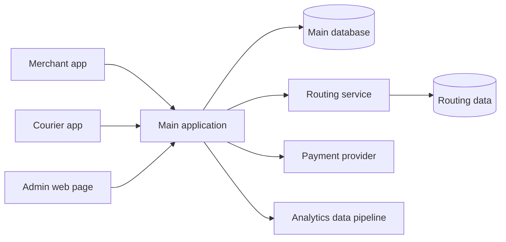

# Module 9 — Architecture and data

*Qafila is now at Scale-up. About 120 people work there in twelve teams, including a platform team. About 9,000 merchants use the app for about 120,000 deliveries a day, teams deploy to production many times a day, and a routing service works out routes and arrival times. The code that began as one application in one repository now carries the work of twelve teams, the data that began as one database now feeds reports, support tools and a routing algorithm, and shortcuts taken at Launch have started to slow everyone down. At this size, the choices about how the system is shaped and how its data is looked after can no longer live in Faisal's head. This module covers three of those practices, seen from the inside by Yasmin, now in her second year as an engineer. First, making architecture decisions on purpose: naming the qualities that matter, comparing options honestly and writing the decision down. Second, treating data as an asset with owners, quality checks and privacy rules. Third, finding, measuring and paying down technical debt, and modernising old parts without stopping the business. Each lesson leaves an artefact: a decision record with a trade-off table and a container diagram, a data inventory with quality checks and retention rules, and a debt register with a modernisation plan.*

> **Steps:** Design — shape the system and its data on purpose: decide how the parts fit and why, look after the data the business depends on, and keep the whole thing changeable as the company grows.

---

# 9.1 — Architecture decisions and trade-offs
*Level: 🟡 Intermediate* · *Prerequisites: 2.3, 8.1* · *Step: Design*

**After this you can** name the quality attributes that matter for a system change, compare at least two options against them in a trade-off table, judge how hard each option is to reverse, and write an architecture decision record that a colleague could challenge and later supersede. *Study time: reading about 20 min, hands-on about 90 min (estimate).*

## ⚡ In 60 seconds
- **Architecture** is the set of decisions about a system that are expensive to change later: how it is split into parts, how those parts talk, where data lives and who owns what.
- Every architecture choice is a **trade-off**: it buys some qualities (speed of change, reliability, cost, security) by spending others.
- The rule that matters most: **name the qualities first, then compare options against them, then write down what you gave up.**
- Decision cue: the harder a decision is to reverse, the more slowly and widely you should make it. Easy-to-reverse decisions belong to the team.
- Structure follows people: a system tends to take the shape of the teams that build it.
- Biggest trap: choosing an architecture because it is fashionable, instead of because it fits your problem, size and skills.

## 🧭 Why it matters
Qafila and everyone in it are fictional. All numbers about Qafila in this lesson are illustrative figures, not benchmarks.

At Launch, Maha and Faisal built one application with one database in one repository, a sound choice for two people (lesson 2.3). At Scale-up, twelve teams change that same application many times a day. In one month the Merchant Orders team, where Yasmin now works, waited on reviews from three other teams, and a change to the courier payout code broke the merchant order screen, because both parts read and write the same database table in different ways.

Faisal, now Head of Engineering, came back from a conference with a plan: split the application into about ten services, one per team, in one quarter. Salma, who leads reliability, asked how many more things the night on-call engineer would watch. Bilal, the finance lead, asked what it would cost to run. Dana, the security and risk lead, asked how ten services would prove their identity to each other. Nobody had written answers.

Maha asked for a decision record before anything moved, and Faisal asked Yasmin to draft the part about Merchant Orders. This lesson is what she learned: how to turn an argument about fashion into a written comparison of trade-offs.

## 📐 How it works

### 🟢 The essentials

**What architecture is.** A useful working definition: the decisions about a system that are expensive or slow to change once made. The language of a small script is rarely architecture. Whether orders and payouts share one database table is, because dozens of pieces of code will come to depend on it. For the manager's view, see [*Running IT as a Business*, lesson 4.3 — Architecture, non-functional requirements and the runway](../itbiz/index.html#/4.3).

**Quality attributes.** A **quality attribute** (often called a **non-functional requirement**, lesson 6.2) describes how well the system does its job rather than what it does:

| Quality attribute | Plain question | Qafila example at Scale-up |
|---|---|---|
| **Changeability** | How quickly and safely can a team change its part? | Merchant Orders waits days for other teams' reviews |
| **Reliability** | Does it keep working, and recover when parts fail? | Order tracking targets 99.9% a month (lesson 4.3) |
| **Performance and scale** | Is it fast enough at the load we expect? | About 120,000 deliveries a day, with lunch-time peaks |
| **Security and privacy** | Who can reach what, and is data protected? | Courier locations and merchant addresses |
| **Operability** | Can on-call people see what is happening and fix it? | One on-call rota per area, not per tiny service |
| **Cost** | What does it cost to build and run? | Cloud bill and engineers' time |

You cannot maximise all of them: splitting into many services can improve changeability and worsen operability and cost. A good decision names the two or three that matter most for *this* choice.

**Coupling and cohesion.** **Coupling** is how much one part depends on the inside of another; tightly coupled parts must change together. **Cohesion** is how well the things inside one part belong together; a part that does "orders, some payouts and a bit of tracking" is not cohesive. Aim for high cohesion inside parts and loose coupling between them. The commonest source of tight coupling is **shared data**: two parts reading and writing the same tables, so a change in one silently breaks the other. That is what broke the merchant order screen.

**Interfaces.** An **interface** is the agreed way one part asks another for something: function calls inside one application, or an **API** (a defined way for software to call other software over a network). A good interface hides the inside, so the owning team can change it freely.

### 🟡 Going deeper

**Three shapes for a growing system.** None is "modern" or "legacy" in itself.

| Shape | What it is | Gains | Costs |
|---|---|---|---|
| **Monolith** | One application, deployed as one unit, usually with one database | Simple to build, test, run and debug | Teams step on each other as it grows |
| **Modular monolith** | One deployable application, split inside into modules that each own their data and are reached only through an interface | Most of the simplicity, with clear ownership | Boundaries need discipline and tooling; still one deploy |
| **Services** (microservices when small) | Separate applications, each deployed on its own and owning its data, talking over the network | Teams deploy independently; parts scale and fail separately | Network failures, more to monitor and secure, harder testing, higher running cost |

Martin Fowler's 2015 article "MonolithFirst" reported that almost all the successful many-service systems he had heard of began as a monolith that was later split (reported). The lesson: split when you know where the boundaries are and can afford to run what you create. For a single developer's view, see [*System Design for Vibe Coders*, lesson 9.1 — You Are the Architect Now](../vibe/index.en.html#l9-1).

**How hard is it to undo?** Amazon's 2015 letter to shareholders separated "Type 1" decisions, consequential and hard to reverse, which deserve careful thought, from "Type 2" decisions, cheap to reverse, which small groups should make quickly; the letter describes these as one-way and two-way doors (reported). A library inside one module is usually easy to reverse; how data is split between stores, or a public API merchants' systems call, is usually hard. Ask "if this is wrong, how many teams and weeks to undo it?" One team, days: decide in the team. Several teams, months: write a record and seek wide advice.

**Conway's law.** In "How Do Committees Invent?" (*Datamation*, April 1968), Melvin Conway argued that organisations which design systems are constrained to produce designs that copy their own communication structures. Lesson 8.1 used this to draw team boundaries. DORA (lesson 3.3) calls architecture and teams loosely coupled when a team can test, deploy and change its part without depending on other teams (reported). Draw code boundaries where team boundaries can follow.

**Pictures that help.** Simon Brown's free **C4 model** describes a system at four levels of zoom: system context, containers (the separately running applications and data stores), components and code (reported). The first two levels are enough for most decisions. Yasmin's container view:

It showed the problem at once: almost everything goes through one application and one database.

### 🔴 Expert view

**Who decides what.** Match the process to reversibility: easy-to-reverse choices inside one team's part, the team decides; hard-to-reverse or cross-team choices, a named decision maker (often the Head of Engineering) decides after a written record and open review; costly company-wide choices go to leadership with a business case (Module 10). Many organisations add an **architecture advice forum**, a short, open, regular meeting where draft records get advice from the people affected. If it becomes a slow gate, teams route around it.

**Fitness checks.** A **fitness check** is an automated test of an architectural rule, run in the CI pipeline from lesson 3.2: "no module reads another module's tables", or "every service has a health endpoint" (an address that answers whether the service is running). The usual name, **architecture fitness function**, was popularised by the book *Building Evolutionary Architectures* by Neal Ford, Rebecca Parsons and Patrick Kua (reported). Without such checks, boundaries erode one "quick fix" at a time.

**Decision records that age well.** Lesson 2.3 introduced the **architecture decision record (ADR)**, in the format Michael Nygard proposed in 2011 (title, context, decision, status, consequences). At Scale-up, add: a **trade-off table** with honest marks; a **review-by trigger**, the signal or date to look again; and **superseding, not editing**: a changed mind gets a new record, and the old one stays so the next person can see why it made sense.

**Fashion and evidence.** Before copying a large company, ask: do we have their problem, their skills to run it at night, and the money? AI assistants can draft options but repeat fashion confidently too. For practice, see [*A Practical Guide to Becoming an AI-Native Engineer*, lesson 11.2 — Lab: an ADR with a critic, docs checked against code and a postmortem that sticks to the facts](../ainative/index.html#/11.2).

**The memorable rule.** Name the qualities first, then compare options against them, then write down what you gave up.

## 🧰 The toolkit
| Resource, tool or template | What it is and does | When to reach for it |
|---|---|---|
| **Quality attribute shortlist** | The two or three attributes that matter most, each with a measurable target | At the start of any architecture discussion |
| **Trade-off table** | Options in columns, attributes in rows, honest marks with reasons | When there are at least two serious options |
| **Container diagram** | The separately running applications and data stores and how they connect (C4 level 2) | When people picture the system differently |
| **Architecture decision record (ADR)** | Context, options, trade-off table, decision, status, consequences, how to undo, review trigger | For hard-to-reverse or cross-team decisions |
| **Fitness check** | An automated pipeline test of an architectural rule | As soon as a boundary is agreed |
| **Architecture advice forum** | A short, open meeting where draft records get advice | From Scale-up, when decisions cross teams |

## 🏛️ In practice at Qafila
Yasmin's draft, after two rounds of comments. Illustrative and fictional.

> **ADR-031: Boundary for Merchant Orders inside the main application**
>
> **Status:** Accepted. Decision maker: Faisal, after the architecture advice forum.
>
> **Context.** Twelve teams change one application and one database. Merchant Orders changes wait more than two days on average for other teams' reviews (last month). Courier Earnings and Merchant Orders both read and write the orders table; a payout change broke the merchant order screen last month.
>
> **Quality attributes, in order:** changeability for Merchant Orders; reliability of order tracking (99.9% monthly); operability at night.
>
> | | A. Leave as is | B. Module with enforced boundary | C. Separate Orders service and database |
> |---|---|---|---|
> | Changeability | Poor: shared tables | Good: team owns tables and interface | Best: independent deploys |
> | Reliability | Fragile | Better: changes behind an interface | Mixed: new network failure points |
> | Operability | Known | Known: still one deploy | Worse: another service to watch and secure |
> | Cost and effort | Growing delay | About one quarter, one team (estimate) | Two to three quarters, plus Platform and Security (estimate) |
> | Reversibility | — | One team, a few weeks to undo | Several teams, about a quarter: data split is costly to undo |
>
> **Decision.** Option B. Merchant Orders alone owns the orders tables; others, including Courier Earnings, use its interface.
>
> **Consequences.** Good: Merchant Orders changes its tables without cross-team review; payout changes can no longer break order screens. Bad: Courier Earnings must rewrite its access (about three weeks, estimate); one deploy still carries everyone's changes. The interface makes a later move to option C cheaper.
>
> **Fitness check.** A pipeline test fails any code outside Merchant Orders that reads or writes the orders tables.
>
> **Review by:** six months, or sooner if Merchant Orders needs its own deploy schedule.

Faisal's ten-service plan became a series of records, one boundary at a time. Dana added a question to every future service decision: "how does it prove its identity, and who rotates its secrets?" Yasmin's first draft had marked option C best on every row until Hamad asked where reporting data would come from once orders lived in a separate database.

## 🛠️ Exercises
**🟢 Name the qualities.** From "Why it matters", list the quality attributes each person cares about (Faisal, Salma, Bilal, Dana, the Merchant Orders team), pick the three that matter most and write a measurable target for each.
*Done when:* you have at least five people-to-attribute pairs, three attributes in order, and a target for each (a number, a time or a yes/no check).

Model answer and self-check

**Model answer.** Faisal and Merchant Orders: changeability. Salma: operability and reliability. Bilal: cost. Dana: security. Top three: changeability ("Merchant Orders changes merged without other teams' review in under one day"); reliability ("order tracking stays at 99.9% monthly"); operability ("no increase in what the night on-call engineer watches").

**Self-check.**
- Could you measure each target next month?
- Did you include at least one attribute that argues *against* splitting?

**🟡 Build a trade-off table.** Use a decision from a personal or open-source project, or Qafila's question "should the courier app's shift handling stay inside the main application or become a separate service?". Compare at least two options against three attributes and add a reversibility row.
*Done when:* every cell has a mark and a short reason, no option is best on every row, and the reversibility row says how many teams and roughly how long it would take to undo each option.

Model answer and self-check

**Model answer (Qafila shift handling).** Option 1, module inside the main application: changeability good (one team owns the shift tables); reliability known (no new network calls); operability unchanged (still one deploy); cost low (nothing new to run); reversibility: one team, about two weeks to undo. Option 2, separate service: changeability best (deploys on its own schedule); reliability worse at first (network calls at shift start); operability worse (another service to watch at night); cost higher (another service to run and secure); reversibility: two teams plus Platform, about a quarter, because shift data must be merged back. Option 1 fits now.

**Self-check.**
- Did you mark reversibility for data, not just code?
- Could someone who disagrees use your table to argue their case? Then it is fair.

**🔴 Write the decision record.** Turn your table into a full record: title, status, decision maker, context with a measurement, attributes in order, options, decision, good and bad consequences, how to undo, fitness check, review trigger. Ask a friend or an AI assistant to argue for the option you rejected, and add anything new.
*Done when:* the record fits on one to two pages, names a decision maker, has at least one bad consequence, a fitness check a pipeline could run, and a review trigger that is a date or a measurable signal.

Model answer and self-check

**Model answer.** ADR-031 is the pattern. For shift handling: decision maker Faisal after the forum; context "shift code changes wait more than two days for review"; bad consequence "one deploy still carries everyone's changes"; fitness check "no code outside Courier Experience reads the shifts tables"; review trigger "if shift start must scale separately at lunch peaks".

**Self-check.**
- Does the context hold facts rather than opinions?
- Would a new joiner in a year understand why this made sense?

## ⚠️ Mistakes and traps
- **Choosing by fashion.** Name your qualities and compare options against them.
- **Hiding the costs.** Write at least one real cost of the chosen option.
- **Splitting code without splitting data.** Two services sharing one database are still tightly coupled. Decide who owns each table.
- **One process for every decision.** Match the process to reversibility.
- **Boundaries nobody checks.** Automate the rule with a fitness check.
- **Editing old records.** Supersede them, so history stays honest.

## 🧾 Recap
- Architecture is the set of decisions that are expensive to change.
- Name two or three quality attributes, compare options in a trade-off table, and judge reversibility before deciding who decides.
- Aim for high cohesion and loose coupling; shared data is the commonest hidden coupling.
- Monolith, modular monolith and services each fit some situations.
- Rule: name the qualities first, then compare options against them, then write down what you gave up.

## ✍️ Check yourself
**1. Which of these is most clearly an architecture decision in the sense used in this lesson?**

- A. Which version of a logging library the Merchant Orders module uses this quarter.
- B. Whether Courier Earnings and Merchant Orders keep reading and writing one orders table.
- C. Which test framework the Merchant Orders team uses for the unit tests inside its module.
- D. How the Merchant Orders team names and groups the functions inside its own module.

Answer

**B.** Many pieces of code come to depend on a shared table, so changing it later is slow and costly. A, C and D stay inside one team's part and are cheap to change. See "What architecture is" and "Coupling and cohesion".

**2. Faisal proposes splitting the main application into ten services in one quarter. What should Yasmin's draft do first?**

- A. Count how many large companies use services, and recommend following the majority approach.
- B. Approve the plan, since separate services let each team deploy on its own schedule.
- C. Reject the plan, since Qafila's single application has run reliably at Scale-up so far.
- D. Name the qualities that matter most for this choice, then weigh each option against them.

Answer

**D.** Naming qualities and comparing options turns a debate about fashion into a trade-off. A copies other companies; B and C each decide on one quality without weighing the others. See "Quality attributes".

**3. Two parts of Qafila's system are split into separate services, but both still read and write the same database tables. What is the main problem?**

- A. Each depends on the other's data, so a table change in one can still break the other.
- B. They need an API gateway placed in front of the shared database before either can go live.
- C. They need a separate test environment for each service before any release can go out.
- D. They now need one team per service, as Conway's law describes for systems built by teams.

Answer

**A.** Splitting code without splitting data keeps the old coupling and adds network costs. B and C add machinery but leave the shared tables, and D misreads Conway's law, an observation about structure, not a staffing rule. See "Coupling and cohesion".

**4. The Payments team wants to swap a charting library used only inside its own reports page. How should this decision be made?**

- A. Through a full decision record reviewed by the architecture advice forum before any change.
- B. By leadership with a business case, since the reports page shows payment figures to staff.
- C. By the Payments team, quickly, since it stays inside their part and is usually cheap to undo.
- D. By Faisal after a short review, since a new library adds a dependency to the main application.

Answer

**C.** It is a reversible choice inside one team's part. A and B put a heavy process on a cheap decision, and D routes a team-level choice to one person, which does not scale to twelve teams. See "How hard is it to undo?" and "Who decides what".

**5. Six months after ADR-031, Qafila decides to move Merchant Orders into its own service. What should happen to ADR-031?**

- A. Rewrite ADR-031 so that it describes the new decision, giving one current record to read.
- B. Delete ADR-031 once the new service is live, so new joiners read only current records.
- C. Leave ADR-031 as it is and note the change in the Merchant Orders team's chat channel.
- D. Write a new record that supersedes ADR-031, and mark ADR-031 as superseded by that one.

Answer

**D.** Superseding keeps the history of what was known and why, and makes the current decision clear. A and B erase the earlier reasoning, and C hides the new decision where nobody will find it. See "Decision records that age well".

## 📚 References
- Michael Nygard, "Documenting Architecture Decisions", Cognitect blog, 15 November 2011: https://cognitect.com/blog/2011/11/15/documenting-architecture-decisions
- Martin Fowler, "MonolithFirst", 3 June 2015: https://martinfowler.com/bliki/MonolithFirst.html (as reported).
- Melvin E. Conway, "How Do Committees Invent?", *Datamation* 14(4), April 1968, pp. 28–31; the author's copy: https://www.melconway.com/Home/Committees_Paper.html (as reported); scan of the issue: http://www.bitsavers.org/magazines/Datamation/196804.pdf
- Jeffrey P. Bezos, 2015 letter to shareholders, Amazon.com, Inc. (Type 1 and Type 2 decisions), as reported.
- DORA, "Loosely coupled teams": https://dora.dev/capabilities/loosely-coupled-teams/
- Simon Brown, The C4 model: https://c4model.com/ (as reported).
- Neal Ford, Rebecca Parsons and Patrick Kua, *Building Evolutionary Architectures*, O'Reilly, 2017, as reported.
- Library course: [*Running IT as a Business*, lesson 4.3 — Architecture, non-functional requirements and the runway](../itbiz/index.html#/4.3).
- Library course: [*System Design for Vibe Coders*, lesson 9.1 — You Are the Architect Now](../vibe/index.en.html#l9-1).
- Library course: [*A Practical Guide to Becoming an AI-Native Engineer*, lesson 11.2 — Lab: an ADR with a critic, docs checked against code and a postmortem that sticks to the facts](../ainative/index.html#/11.2).

---

# 9.2 — Data as an asset: quality, ownership and privacy
*Level: 🟡 Intermediate* · *Prerequisites: 6.3, 9.1* · *Step: Design*

**After this you can** build a data inventory for a product (what data exists, where, why, who owns it, whether it is personal and how long it is kept), write quality checks for one important dataset, and spot privacy questions early enough to ask the right person. *Study time: reading about 20 min, hands-on about 95 min (estimate).*

## ⚡ In 60 seconds
- Data is an **asset** when the business depends on it to run, decide or comply. It needs an owner, care and a record of where it is.
- A **data inventory** lists each important dataset: where it lives, why it is kept, who owns it, whether it is personal, who can see it and when it is deleted.
- **Data quality** means data fit for its purpose. Check it automatically, where it enters.
- The rule that matters most: **every important dataset has a named owner, a written purpose and a deletion date.**
- Decision cue: if two reports disagree, find the definition each uses and agree one with the owner.
- Biggest trap: keeping everything "just in case". Data without a purpose is cost and risk.

## 🧭 Why it matters
Qafila and everyone in it are fictional. All numbers about Qafila in this lesson are illustrative figures, not benchmarks.

At a monthly review, Maha saw two charts that should have matched. The Merchant Orders dashboard showed about 118,000 deliveries the previous Tuesday; the Courier Earnings report showed about 121,000. Couriers are paid and merchants billed per delivery, so the gap meant money. Both teams were right by their own definition: Merchant Orders counted orders the courier marked "delivered"; Courier Earnings counted payout lines, which also included cancelled orders where the courier had already travelled.

The same week, a merchant who had closed her shop asked Qafila to delete her data. Support deleted the account. Nobody knew where else her data was: analytics copies, routing history, test copies engineers had made "to reproduce a bug", the help-desk tool, backups. Dana, the security and risk lead, then found that courier location history had been kept, with no deletion date, since Launch.

Hamad, now head of data, and Dana asked every team for a data inventory. Yasmin volunteered for Merchant Orders.

## 📐 How it works

### 🟢 The essentials

**Where data lives.** Most data starts as **operational data**, which the product needs right now (open orders, courier status), in the product's own database. Then it is copied. A **data pipeline** is the set of automated jobs that copy and reshape data from the product into other stores; it is not the CI pipeline of lesson 3.2, which builds and tests code. The main destination is usually a **data warehouse**: a separate database holding copies of data from many sources, organised for reports and analysis. Every copy is a place you must protect, clean and one day delete from.

**The data inventory.** A **data inventory** (or data register) is a table of the important datasets. You cannot protect, clean or delete what you cannot find. Columns:

| Column | Question it answers |
|---|---|
| **Dataset** | What is it, in plain words? |
| **Where it lives** | Which database, store, tool or file, including copies? |
| **Purpose** | Why do we keep it? |
| **Owner** | Which team or person is accountable? |
| **Personal data?** | Which fields identify or relate to a person? |
| **Sensitivity** | Public, internal, confidential or restricted |
| **Who can access** | Which roles, through which tools? |
| **Retention** | How long is it kept, and what happens then? |

**Owners and stewards.** A **data owner** is accountable for a dataset: decides what it means, who may use it and how long it is kept. A **data steward** looks after it day to day: definitions, quality, questions. The platform team runs the storage, but that does not make it the owner. The owner is usually the team whose product creates the data: Merchant Orders owns order data.

**Quality, in six words.** **Data quality** means data good enough for its purpose. A widely used set of six dimensions was popularised by DAMA UK's 2013 paper on data quality dimensions and adopted in the UK government's Data Quality Framework (reported). In this course's words:

| Dimension | Question | Qafila check |
|---|---|---|
| **Accuracy** | Does it match reality? | Delivered orders match proof of delivery on a sample |
| **Completeness** | Is anything missing? | Every delivered order has a delivery time |
| **Timeliness** | Is it there when needed? | Yesterday's deliveries in the warehouse by 06:00 |
| **Consistency** | Does it agree with other sources? | Delivered orders and payout lines differ only by an explained gap |
| **Validity** | Does it follow the format and value rules? | Status is one of the agreed list; no times in the future |
| **Uniqueness** | Is each thing recorded once? | No order ID appears twice |

**Check where it enters.** Stop bad data where it is created: validation in the app, **database constraints** (rules the database enforces, such as "this field cannot be empty") and tests in the data pipeline. Every copy downstream multiplies the cost of fixing it. See [*Data Engineering & Analytics: Zero to Hero*, lesson 3.2 — Data quality: tests, contracts and observability](../data/index.html#/3.2).

### 🟡 Going deeper

**One definition per important word.** Most quality arguments are really definition arguments. "Delivery", "active merchant", "late order" each need one written definition and an owner. The fix for the two charts was one line both owners agreed: "A *completed delivery* is an order with status delivered; travelled-but-cancelled orders are counted separately as *cancelled after pickup*." See [*Data Engineering & Analytics: Zero to Hero*, lesson 4.1 — Defining metrics: one definition, a semantic layer and a metrics catalogue](../data/index.html#/4.1).

**Data contracts and lineage.** A **data contract** is a written, ideally machine-checked, agreement between a data producer and its consumers about fields and types, meaning, freshness and how changes are announced: the data version of the interface in lesson 9.1. Without one, a renamed field on Thursday breaks the finance report on Friday. **Lineage** records where data comes from and goes: courier's tap, orders table, pipeline, warehouse, dashboard. See [*Data Engineering & Analytics: Zero to Hero*, lesson 6.1 — Data governance that works: ownership, catalogue, lineage and data contracts](../data/index.html#/6.1).

**Sensitivity levels.** A few levels tell people how to handle data without asking each time:

| Level | Meaning | Qafila example | Handling |
|---|---|---|---|
| **Public** | Fine to publish | Help-centre articles | No restriction |
| **Internal** | Low harm if leaked | Team plans, delivery totals | Staff access |
| **Confidential** | Harm to people or business | Merchant contacts, anything linked to a named person | Need-to-know, logged |
| **Restricted** | Serious harm | Courier location history, identity documents, payment details | Few named roles, encrypted, logged, never copied to test |

Dana owns the scheme; each data owner applies it to their rows.

**Personal data and privacy.** **Personal data** is information about an identifiable person: a courier's name or location trail, a merchant owner's phone, a customer's address. **Privacy** means using it only in ways people would reasonably expect and the rules allow. Laws differ by country but share ideas. Article 5 of the EU's General Data Protection Regulation (GDPR), for example, includes specified purposes, collecting only what is needed, accuracy, keeping data identifiable no longer than necessary, and being able to show compliance (reported). For the Gulf and other regions, see [*AI Governance: Zero to Hero*, lesson 4.3 — DPIAs and the global privacy map, from the EU to the GCC](../aigp/index.html#/4.3).

A practitioner's habit is a **privacy question card**, not a legal judgement:

1. **Purpose:** what exactly do we use it for, and is that written down?
2. **Minimum:** do we need every field? Would a zone do instead of an exact location?
3. **Notice and basis:** were people told, and on what basis do we use it? (Ask whoever advises the company.)
4. **Access:** who can see it, and is access logged?
5. **Retention:** when is it deleted, in every copy?
6. **Requests:** if a person asks to see or delete their data, can we find all of it?

### 🔴 Expert view

**Deletion across copies.** Deleting from the main database is easy; the warehouse, exports, logs, help-desk tool, test databases and backups are hard. Keep personal data in few places, use an internal ID elsewhere, and set retention per store. See [*System Design for Vibe Coders*, lesson 2.4 — Retention, Deletion, and the Data You Promised to Erase](../vibe/index.en.html#l2-4).

**Production data outside production.** Copying production data to reproduce a bug is a common way personal data leaks. Use generated test data, a masked copy (personal fields replaced with realistic fakes), or logged, limited support tools (lesson 7.1). See [*Data Engineering & Analytics: Zero to Hero*, lesson 6.2 — Personal data: classification, masking, minimisation, retention and the law](../data/index.html#/6.2).

**Data and AI tools.** Pasting a dataset into an AI assistant copies it elsewhere. Use only tools approved for its sensitivity level; never paste restricted data.

**Data shared as a product.** Writing on "data mesh" popularised treating the data a team publishes for others as a product, with documentation, a contract and quality targets. Hamad started with one such dataset per area.

**The memorable rule.** Every important dataset has a named owner, a written purpose and a deletion date.

## 🧰 The toolkit
| Resource, tool or template | What it is and does | When to reach for it |
|---|---|---|
| **Data inventory** | One row per dataset: where, purpose, owner, personal data, sensitivity, access, retention | When someone asks "where is all our data about X?" |
| **Definition page** | One written definition per important term, with owner and examples | When two reports disagree |
| **Quality check list** | Automated checks across the six dimensions, run in the data pipeline | For data that feeds money, customers or decisions |
| **Data contract** | Fields, meanings, freshness and change notice between producer and consumers | When one team's data feeds another's |
| **Sensitivity scheme** | Four levels with handling rules | Company-wide, owned by security |
| **Privacy question card** | Purpose, minimum, notice and basis, access, retention, requests | Whenever work touches personal data |

## 🏛️ In practice at Qafila
Yasmin's inventory for Merchant Orders, reviewed by Hamad and Dana. Illustrative and fictional; three of eleven rows.

> | Dataset | Where it lives | Purpose | Owner | Personal data | Sensitivity | Access | Retention |
> |---|---|---|---|---|---|---|---|
> | Orders | Main database; warehouse; backups | Run deliveries; bill merchants | Merchant Orders | Customer name, phone, address | Confidential | App; support (logged); analysts without name and phone | Details: as accounting rules require (ask finance); phone: 30 days after delivery |
> | Order status history | Main database; event stream (a continuous feed of status changes) to analytics | Tracking, disputes | Merchant Orders | Courier ID, which leads to a named courier | Confidential | App; analysts (logged) | 13 months, then daily totals with no IDs |
> | Merchant branches | Main database | Pickup addresses, hours | Merchant Onboarding | Owner's phone | Confidential | App; support | Deleted within 90 days of closing |
>
> **Nightly checks on Orders:** no duplicate IDs; every delivered order has a delivery time; no future times; status in the agreed list; payout lines minus delivered orders equals the *cancelled after pickup* count.
>
> **Found while building it:** analysts' test copy held customer phones (deleted; masked copy built); an "address notes" field held door codes (now confidential, removed after 30 days).

Yasmin had assumed "keep order details forever" was safest. Bilal said accounting rules set minimum periods and the adviser should say which; Dana said keeping personal fields longer than needed is itself a risk. So they split the row. Yasmin first rated status history Internal; Dana moved it up, because a courier ID leads straight to a person. The closed shop's request was answered by following the "where it lives" column.

## 🛠️ Exercises
**🟢 Name the dimension.** For each problem, name the dimension it breaks and write one automated check: (1) the same order appears twice in the warehouse; (2) yesterday's data arrives at 11:00; (3) a delivered order has no delivery time; (4) a status reads "deliverd"; (5) payout lines and delivered orders differ by more than the cancelled-after-pickup count; (6) the location stamped on a proof-of-delivery photo is far from the delivery address.
*Done when:* all six have a dimension and a check a program could run without a person deciding.

Model answer and self-check

**Model answer.** (1) Uniqueness: fail if any order ID appears more than once. (2) Timeliness: fail if the load finished after 06:00. (3) Completeness: fail if a delivered order has no delivery time. (4) Validity: fail if status is not in the agreed list. (5) Consistency: fail if payout lines minus delivered orders is not equal to cancelled-after-pickup orders. (6) Accuracy: flag deliveries whose photo location is more than 1 km from the address; fail if more than an agreed share are flagged.

**Self-check.**
- Does each check pass or fail clearly?
- Did you see that accuracy needs a comparison with the real world, here the photo's location?

**🟡 Build a small data inventory.** For a personal project, an app you use (from its privacy notice), or Qafila's Courier Earnings team (earnings, tips, payouts, courier bank details), build an inventory of at least four datasets. Then answer the six privacy questions for one row with personal data.
*Done when:* every row has an owner, a one-sentence purpose, personal fields named, a sensitivity level, and a retention period or a named person who decides it; and the chosen row answers each privacy question, naming who answers "notice and basis".

Model answer and self-check

**Model answer (Courier Earnings).** Earnings per delivery: owner Courier Earnings; main database and warehouse; to pay couriers for each delivery; courier ID and amount; confidential; as finance's adviser says. Tips: owner Courier Earnings; main database and warehouse; to pass customers' tips on to couriers; courier ID, order ID and amount; confidential; as finance's adviser says. Payout batches: owner Courier Earnings; database and payment provider; to send each period's payments; courier ID and amount; confidential; finance decides retention. Bank details: owner Courier Earnings; with the payment provider where possible; to pay couriers into their accounts; account number and account holder name; restricted, payments staff only, logged; finance decides retention. Privacy card for bank details: purpose, paying couriers; minimum, account number and name; notice and basis, the company's legal adviser, through Dana; access, two roles, logged; retention, until the final payment plus the adviser's period; requests, found through this row.

**Self-check.**
- Did you list copies, not only the main database?
- Did you name a person for "notice and basis" rather than answer it yourself?

**🔴 Settle a definition and write a contract.** Pick a term used two ways (Qafila: "active merchant", Sales' "signed up in the last 90 days" versus Analytics' "a delivery in the last 30 days"). Write a definition page and a data contract for the dataset that carries it.
*Done when:* the page has one definition, an owner, two examples and a counter-example; the second meaning gets its own name; the contract states fields with types, meaning, freshness and change notice.

Model answer and self-check

**Model answer.** "*Active merchant*: at least one completed delivery in the last 30 days. Owner: Data & Analytics. Examples: a bakery with 400 deliveries this month; a pharmacy with one 29 days ago. Counter-example: a shop that signed up last week with no orders." Sales' meaning becomes "*new sign-up (90 days)*". Contract: merchant_id (text), last_completed_delivery_at (timestamp), is_active (true/false); fresh by 06:00; changes announced two weeks ahead, both versions run in parallel for a week.

**Self-check.**
- Did the losing meaning get its own name?
- Could a new analyst compute the number without asking anyone?

## ⚠️ Mistakes and traps
- **Keeping everything "just in case".** Give every dataset a purpose and a retention period.
- **Treating the platform team as owner.** Running storage is not owning meaning.
- **Arguing about numbers instead of definitions.** Agree one definition and name the other.
- **Copying production data "just this once".** Use generated or masked data.
- **Deleting from one place only.** Use the inventory to find every copy.
- **Deciding the law yourself.** Ask the six questions; get legal answers from the company's adviser.

## 🧾 Recap
- Data pipelines copy product data into a warehouse and elsewhere; every copy needs care.
- A data inventory records each dataset's copies, purpose, owner, personal data, sensitivity, access and retention.
- Six widely used quality dimensions; check them automatically where data enters, and settle definitions in writing.
- Contracts and lineage make shared data dependable; sensitivity levels and the privacy card make personal data safer.
- Rule: every important dataset has a named owner, a written purpose and a deletion date.

## ✍️ Check yourself
**1. The Merchant Orders dashboard shows about 118,000 deliveries and the Courier Earnings report about 121,000 for the same day. What should happen first?**

- A. Find out how each report defines a delivery, and agree one definition with the data owners.
- B. Use the Courier Earnings figure, since it comes from payment records that finance has checked.
- C. Average the two figures for the monthly review until the teams have time to investigate.
- D. Ask the platform team to reload the warehouse, since the two copies seem to have drifted apart.

Answer

**A.** Both numbers were right by their own definitions. B picks a favourite without understanding the gap, C invents a third number, and D assumes a technical fault that is not there. See "One definition per important word".

**2. Who should be the owner of the orders data at Qafila?**

- A. The platform team, because it runs the database where the orders data is stored.
- B. The security and risk lead, because the orders data includes customers' personal details.
- C. The Merchant Orders team, which creates the data and usually answers for what it means.
- D. The head of data, because analytics is the largest consumer of the orders data each day.

Answer

**C.** The owner is accountable for what the data means and how it is used, usually the team that creates it. A confuses running storage with owning meaning, B confuses setting security rules with ownership, and D confuses consuming with being accountable. See "Owners and stewards".

**3. A check finds that some delivered orders have no delivery time. Which quality dimension does this break?**

- A. Uniqueness, because each order should be recorded only once in the orders table.
- B. Completeness, because a value that every delivered order should carry is not there.
- C. Timeliness, because the delivery time has not reached the warehouse table quickly enough.
- D. Validity, because the delivery time does not follow the agreed format for timestamps.

Answer

**B.** A required value is missing. A is about duplicates, C about late arrival rather than absence, and D about present values in the wrong format. See "Quality, in six words".

**4. A merchant who closed her shop asks Qafila to delete her data. Support deletes her account. What else matters most?**

- A. Nothing more, as long as the account deletion also removed her login and her shop's page.
- B. Wait for the next backup cycle, when copies are refreshed from the main database.
- C. Ask the analytics team to filter her shop out of all future reports and dashboards.
- D. Use the data inventory to find each other copy, such as warehouse tables and test copies.

Answer

**D.** Deletion covers every copy, and the inventory shows where they are. A and B ignore copies not refreshed from the main database, and C hides her data from reports while leaving it stored. See "Deletion across copies".

**5. An engineer wants to copy the production orders table to a test environment to reproduce a bug. What is the best response?**

- A. Allow it if the copy is deleted after the bug is fixed, since the risk only lasts a short time.
- B. Allow it if the test database is encrypted, since encryption protects the personal fields.
- C. Use generated or masked data, or logged support tools, instead of copying personal data.
- D. Ask the engineer to export only the affected orders to a spreadsheet, as a smaller copy.

Answer

**C.** Masked or generated data, or logged support tools, allow debugging without spreading personal data. A, B and D each still create a copy of personal data outside production, and such copies tend to outlive their reasons. See "Production data outside production".

## 📚 References
- Regulation (EU) 2016/679 (General Data Protection Regulation), Article 5, EUR-Lex: https://eur-lex.europa.eu/eli/reg/2016/679/oj (as reported).
- DAMA UK Working Group, *The Six Primary Dimensions for Data Quality Assessment*, white paper, October 2013 (as reported).
- UK Government Data Quality Hub, *The Government Data Quality Framework*, GOV.UK, 2020 (as reported).
- Library course: [*Data Engineering & Analytics: Zero to Hero*, lesson 3.2 — Data quality: tests, contracts and observability](../data/index.html#/3.2).
- Library course: [*Data Engineering & Analytics: Zero to Hero*, lesson 4.1 — Defining metrics: one definition, a semantic layer and a metrics catalogue](../data/index.html#/4.1).
- Library course: [*Data Engineering & Analytics: Zero to Hero*, lesson 6.1 — Data governance that works: ownership, catalogue, lineage and data contracts](../data/index.html#/6.1).
- Library course: [*Data Engineering & Analytics: Zero to Hero*, lesson 6.2 — Personal data: classification, masking, minimisation, retention and the law](../data/index.html#/6.2).
- Library course: [*Secure AI & Application Security: Zero to Hero*, lesson 5.3 — Protecting personal data: minimisation, logging and privacy engineering](../secai/index.html#/5.3).
- Library course: [*AI Governance: Zero to Hero*, lesson 4.3 — DPIAs and the global privacy map, from the EU to the GCC](../aigp/index.html#/4.3).
- Library course: [*System Design for Vibe Coders*, lesson 2.4 — Retention, Deletion, and the Data You Promised to Erase](../vibe/index.en.html#l2-4).

---

# 9.3 — Technical debt and modernisation
*Level: 🟡 Intermediate* · *Prerequisites: 9.1, 6.1* · *Step: Design*

**After this you can** recognise technical debt in a codebase, record it in a debt register with its cost to the team, choose between living with it, paying it down and replacing the part, and sketch an incremental modernisation plan that keeps the product running. *Study time: reading about 20 min, hands-on about 100 min (estimate).*

## ⚡ In 60 seconds
- **Technical debt** is the future cost of shortcuts and out-of-date choices: extra work every time you touch the part, until you fix it.
- Some debt is a sound choice, some careless, some visible only in hindsight. All of it charges **interest**: slower changes, more incidents, harder onboarding.
- Record debt in a **debt register** with its measured cost, so it can compete fairly with features.
- The rule that matters most: **pay down the debt you keep tripping over, in small steps, while the product keeps running.**
- Decision cue: debt in code nobody changes can often wait; debt in code everyone changes weekly is the expensive kind.
- Biggest trap: the big rewrite. Replace piece by piece instead.

## 🧭 Why it matters
Qafila and everyone in it are fictional. All numbers about Qafila in this lesson are illustrative figures, not benchmarks.

At Launch, Faisal wrote the code that assigns orders to couriers in a weekend. It had no tests, the rules were tangled with database calls, and it was meant to be replaced "after the pilot". It stayed (lesson 2.2 warned it would). At Scale-up the Dispatch team owns it. The assignment rules still live in the main application and call the routing service only for routes and arrival times. Every change is an event: two engineers pair on it, test by hand at night, and twice this year a change assigned couriers to orders in the wrong city for about twenty minutes.

Other old choices pile up. The web framework version will soon stop receiving security fixes. New joiners take about three weeks to make a first change to Dispatch; elsewhere, days.

Faisal wants to rewrite Dispatch over two quarters. Aisha wants to keep shipping features. Maha asked: what does this debt cost us, and what is the smallest safe path out? Yasmin, lent to Dispatch for a quarter, built the register that answered it.

## 📐 How it works

### 🟢 The essentials

**Where the metaphor comes from.** Ward Cunningham introduced it in a 1992 experience report about a financial system called WyCash: shipping first-time code is like going into debt, and a little debt speeds development so long as it is paid back promptly with a rewrite. Cunningham later explained that he meant refactoring the code as understanding improves (reported). Borrowing can be sensible; interest builds if you never repay.

**What counts as technical debt.** Any part of the system that makes change slower or riskier than it needs to be:

| Kind | What it looks like | Qafila example |
|---|---|---|
| **Code debt** | Tangled, duplicated or unclear code | Dispatch rules mixed with database calls |
| **Test debt** | Missing or unreliable tests | Dispatch tested by hand at night |
| **Design debt** | Boundaries in the wrong place, shared data | Orders and payouts sharing tables (lesson 9.1) |
| **Dependency debt** | Old libraries, frameworks or platforms | Framework nearing end of security fixes |
| **Infrastructure and knowledge debt** | Hand-built servers; knowledge in one head | Only Faisal knows why some rules exist |

Not everything old is debt. Old code that works, is understood and rarely changes may be fine. Debt is about the cost of *change*.

**Principal and interest.** The **principal** is the work to fix the shortcut. The **interest** is the extra cost each time you work around it: hours per change, incidents, slow onboarding, features avoided because the code is scary. Interest is high where code changes often.

**Four kinds by how it arose.** Martin Fowler's 2009 "Technical Debt Quadrant" sorts debt as deliberate or inadvertent, and prudent or reckless (reported). In Qafila's terms:

| | Reckless | Prudent |
|---|---|---|
| **Deliberate** | Payout tests skipped to hit a date, with no plan to add them | Faisal's weekend dispatch code, a known shortcut to start the pilot |
| **Inadvertent** | A new joiner copies a pattern without knowing its side effects | The right boundary for orders became clear only after a year of growth |

The prudent, deliberate kind is often right at Launch; Faisal's mistake was never repaying it. The prudent, inadvertent kind is unavoidable: you learn the right design by building. Recording debt helps; blame does not.

### 🟡 Going deeper

**The debt register.** A **debt register** lists known debt where the team plans its work. A row is useful only if it says what the debt costs:

| Column | Question |
|---|---|
| **Item** | What is the debt, in one line? |
| **Interest (evidence)** | What does it cost now, measured? |
| **Risk** | What could go wrong? Security, outage, end of support |
| **Principal (estimate)** | Roughly how much work to fix, in steps? |
| **Owner** | Which team? |
| **Plan** | Live with it, pay down in steps, replace or retire; and when |

**Measure the interest.** Evidence wins planning arguments; feelings about "terrible code" do not. Useful measures:

- **Change lead time** for the area: from commit to production (lesson 3.3).
- **Change fail rate** for the area: the share of deployments needing immediate intervention, such as a rollback (lesson 3.3).
- **Hot spots:** code that changes most often *and* is hardest to understand. Version control history (lesson 3.1) shows the first; the team knows the second.
- **Onboarding time** and **avoided work**: time to a new joiner's first safe change, and features nobody asks for because "Dispatch is too risky".

**Ways to pay it down.**

1. **Leave it better than you found it:** small clean-ups with every change to the area.
2. **A standing share of capacity** for health work (lesson 6.1), written down and checked against what happened (lesson 8.2).
3. **Targeted work items** with an outcome ("Dispatch deploys without night-time manual testing"), ranked against features using the interest as evidence.
4. **Tests first.** For untested code, start with **characterisation tests**: tests that pin down how the code behaves today, right or wrong, so later changes can be checked against them. See [*Software Testing: Zero to Hero in the AI Era*, lesson 4.3 — Reliability and data testing: resilience experiments, backups, migrations and data quality](../testing/index.html#/4.3).

**Dependency debt has a deadline.** When maintainers stop releasing security fixes for a framework or library, the risk jumps. Keep a list of major dependencies with each end-of-support date, and upgrade well before. See [*System Design for Vibe Coders*, lesson 8.4 — The Software You Didn't Write: Dependencies and Supply Chain](../vibe/index.en.html#l8-4).

### 🔴 Expert view

**Modernisation options.** Cloud providers and analysts publish similar lists of migration "Rs"; this is a simplified set for a single part of a system:

| Option | What it means | Fits when |
|---|---|---|
| **Retain** | Keep it, on purpose, and record why | It works, rarely changes, low risk |
| **Retire** | Switch it off | Nobody uses it; check usage data first |
| **Refactor** | Restructure code without changing behaviour | Design mostly right, code tangled |
| **Re-platform** | Move to a new platform with small changes | The platform is the problem (end of support) |
| **Replace** | Build or buy a new part and move users to it | The design no longer fits, or a product now does the job (lesson 2.3) |

**Why big rewrites go wrong.** The old system keeps changing during a rewrite, the new one must match years of unwritten rules, and no value reaches users until the end. Joel Spolsky's 2000 essay "Things You Should Never Do, Part I" called rewriting working code from scratch a serious strategic mistake (reported); others find that too absolute. Be very suspicious of all-at-once.

**Replace piece by piece.** Martin Fowler named the incremental pattern the **strangler fig** application, after a plant that grows around a tree until it replaces it, and presents it as lower-risk than a cut-over rewrite. The steps:

1. **Put a seam in front:** route all calls to the old part through one interface you control (lesson 9.1).
2. **Pick one slice:** a small, valuable piece of behaviour (for Dispatch: same-city assignments in one zone).
3. **Run both:** the new code computes its answer alongside the old without acting on it, and you compare (running in **shadow**).
4. **Switch gradually:** a small share of real traffic, behind a feature flag, with a fast way back (lesson 3.3).
5. **Remove the old slice**, so you never run two systems forever.
6. **Repeat** until the old part is gone or cheap enough to retain.

**Data is the hard part.** During a migration, decide which system is the source of truth for each piece of data in each phase, give each phase an end date, and rehearse on masked data (lesson 9.2). The Traction outage was a data migration; Salma's team now requires a rehearsed rollback for every data change.

**Talking about debt.** "The code is ugly" persuades nobody; "Dispatch changes caused two incidents this year, and slice 1 ends manual night testing" is a business case. For funding, see [*Running IT as a Business*, lesson 4.3 — Architecture, non-functional requirements and the runway](../itbiz/index.html#/4.3). AI assistants can speed up characterisation tests and mechanical refactors; the tests are what make their changes safe.

**The memorable rule.** Pay down the debt you keep tripping over, in small steps, while the product keeps running.

## 🧰 The toolkit
| Resource, tool or template | What it is and does | When to reach for it |
|---|---|---|
| **Debt register** | Item, interest with evidence, risk, principal, owner, plan | When someone says "we should fix that later" |
| **Hot-spot list** | Most-changed files crossed with the team's view of the hardest | When choosing which debt to pay first |
| **Dependency support list** | Major dependencies with end-of-support dates | Reviewed every quarter |
| **Characterisation tests** | Tests that capture today's behaviour | Before refactoring untested code |
| **Modernisation one-pager** | Option chosen; for a replacement, strangler fig steps, measures and end dates | When a part needs more than clean-ups |
| **Static analysis tool** | Flags complexity, duplication and outdated dependencies (examples, not endorsements) | In the pipeline, as input to the register |

## 🏛️ In practice at Qafila
Yasmin's register for Dispatch, and the plan it led to. Illustrative and fictional.

> **Dispatch debt register (top four of nine rows)**
>
> | Item | Interest (evidence) | Risk | Principal | Plan |
> |---|---|---|---|---|
> | Assignment rules tangled with database calls, no tests | Lead time about 9 days (Merchant Orders: 2); 3 weeks to first change; 2 incidents this year | Wrong-city assignments | Large | Replace slice by slice |
> | Framework near end of security fixes | None yet | Security, after the date | Medium | Re-platform this half-year |
> | Manual night-time testing | 2 engineers, about 4 hours per release | Mistakes when tired | Small once tests exist | Characterisation tests first |
> | "Manual override" admin screen | Confuses new joiners | Low | Small | Retire after checking usage |
>
> **Modernisation one-pager: Dispatch assignment**
>
> - **Option:** replace, piece by piece; not a rewrite.
> - **Step 0:** characterisation tests on masked order data (four weeks, estimate).
> - **Seam:** all assignment calls go through one interface in the main application.
> - **Slice 1:** same-city assignments in one zone; two weeks in shadow, compared daily; then 10% → 50% → 100% of that zone behind a flag, with a one-click way back.
> - **Then:** remove the old code for that slice; repeat zone by zone.
> - **Measures:** change lead time and change fail rate for Dispatch; manual testing hours; onboarding time.

Faisal's rewrite became slice 1. In shadow the new code disagreed with the old on about one assignment in two hundred: mostly the new code was right, but a few were special cases for two large merchants that only Faisal remembered, and they went into the tests. Aisha accepted the plan because it showed when features would come back. The admin screen turned out to be used monthly by Salma's team, so it moved to "retain".

## 🛠️ Exercises
**🟢 Sort the debt.** Give each item a quadrant and a kind: (1) Faisal's weekend dispatch code at Launch; (2) payout tests skipped at Growth "because tests slow us down", with no plan; (3) after a year the team realises orders needed their own boundary; (4) a framework version current when chosen now nears end of support; (5) only one person knows how the reporting server was set up.
*Done when:* all five items have a kind, a one-sentence reason, and a quadrant, or "none" with a reason.

Model answer and self-check

**Model answer.** (1) Deliberate and prudent at the time; code and test debt; a known shortcut, never repaid. (2) Deliberate and reckless; test debt; no plan. (3) Inadvertent and prudent; design debt; learned by building. (4) None: no shortcut was taken; dependency debt that arrives with time. (5) Inadvertent, arguably reckless; infrastructure and knowledge debt; nobody wrote it down.

**Self-check.**
- Did you notice that items 3 and 4 are nobody's fault?
- Did you judge item 1 by Launch's standards, not today's?

**🟡 Build a debt register with evidence.** Use a project you know or an open-source project (its issues and history show debt and hot spots). Write at least four rows with every column, and at least two interest figures from real evidence (commit history, issue counts, your time log).
*Done when:* each row has an owner and a plan (live with it, pay down in steps, replace, retire), and at least two cite a measured cost.

Model answer and self-check

**Model answer (example shape).** "Config loading duplicated in three scripts: changed together in 11 of the last 30 commits; plan: extract one module next change." "No tests for exports: 3 of the last 6 bug reports; plan: characterisation tests, then refactor." "Library at an old major version: end of support listed; plan: upgrade before it." "Unused command-line flag: no mentions in two years; plan: retire after a notice."

**Self-check.**
- Did the evidence change your ranking?
- Would a product manager understand each interest cell unaided?

**🔴 Plan a strangler fig.** For a part you know, or Qafila's tangled, untested courier payout calculation, write a modernisation one-pager: option and why, step 0, the seam, the first slice, side-by-side running, traffic switch and way back, removal, measures, and data handling.
*Done when:* the first slice fits in a few weeks, there is a comparison step before real traffic moves, a way back at every switch, a removal step, at least two measures, and one named source of truth for data in each phase.

Model answer and self-check

**Model answer (Qafila payouts).** Replace piece by piece: the rules are wrong for tips and new countries are coming. Step 0: characterisation tests from a month of masked payout data. Seam: one payout calculation interface. Slice 1: tips only, computed in shadow for two pay cycles, differences reviewed with finance. Switch: one city first, behind a flag, with a way back before the batch is sent. Data: old tables are the source of truth until the switch, new tables after; old ones read-only for one cycle, then archived. Remove old tip code one cycle after full switch. Measures: payout disputes per 1,000 couriers; time to change a payout rule.

**Self-check.**
- Does any step have old and new systems writing the same data at once? Rethink it.
- Did you include the removal step?

## ⚠️ Mistakes and traps
- **"We'll fix it later" with no record.** Put it in the register with its cost.
- **Ranking debt by ugliness.** Rank by interest: how often it changes and what each change costs.
- **The big-bang rewrite.** Replace in slices behind a seam.
- **Refactoring without tests.** Write characterisation tests first.
- **Missing the support deadline.** Keep a support list and upgrade early.
- **Never finishing.** Every slice ends with removing the old code.

## 🧾 Recap
- Technical debt is the future cost of shortcuts and out-of-date choices; it charges interest on every change.
- Debt arises deliberately or inadvertently, prudently or recklessly; record it rather than blame.
- A register with measured interest (lead time, change fail rate, onboarding, avoided work) lets debt compete for time.
- Pay down with clean-ups, a capacity share and targeted items; characterisation tests come first.
- Choose retain, retire, refactor, re-platform or replace on purpose, and replace slice by slice. Rule: pay down the debt you keep tripping over, in small steps, while the product keeps running.

## ✍️ Check yourself
**1. Which situation shows the most expensive kind of technical debt?**

- A. An old, untidy reporting script that runs once a year and has never caused a problem.
- B. A module written in an older style that works, is well tested and is changed twice a year.
- C. A neat, well-documented module that nobody has used since a feature was switched off.
- D. Tangled, untested code that three teams change most weeks and that caused two incidents.

Answer

**D.** Interest is highest where code changes often and each change is risky. A and B are rarely touched, so they charge little interest, and C is a candidate to retire. See "Principal and interest".

**2. Faisal wrote the dispatch code in a weekend at Launch, knowing it was a shortcut, to get fifteen pilot shops started. How is that best described?**

- A. Reckless and inadvertent debt, since the team did not know any better at Launch.
- B. Deliberate and, at the time, probably prudent debt; the cost came from never repaying it.
- C. Not technical debt, since the code worked and the pilot shops were happy with the service.
- D. Deliberate and reckless debt, since the code went live without any automated tests.

Answer

**B.** A knowing shortcut with a good reason can be sound; the cost came from not repaying it. A is wrong because Faisal knew, C confuses "working" with "cheap to change", and D judges the shortcut by its missing tests rather than by why it was taken. See "Four kinds by how it arose".

**3. Aisha asks why Dispatch debt should get time instead of a feature merchants want. Which argument is strongest?**

- A. The Dispatch code is very old and badly written, and engineers are unhappy working in it.
- B. Other companies of Qafila's size usually rewrite their dispatch code at about this stage.
- C. Dispatch changes take about 9 days against 2 elsewhere and caused two incidents this year.
- D. Engineers should decide on their own how much time they spend on technical work each quarter.

Answer

**C.** Measured interest lets debt compete fairly with features. A is opinion, B copies other companies without evidence, and D removes the conversation instead of informing it. See "Measure the interest".

**4. Before restructuring the untested dispatch code, what should the team do first?**

- A. Write tests that record how the code behaves today, including odd special cases.
- B. Rewrite the module in a newer language, keeping only the behaviour the team remembers.
- C. Ask an AI assistant to restructure it in one pass, then review the changes it proposes.
- D. Pause feature work in Dispatch until a full redesign of the module has been agreed.

Answer

**A.** Characterisation tests make later changes checkable. B and C change behaviour nobody has captured, which is how the two large merchants' special cases would be lost, and D stops the business for a big-bang effort. See "Ways to pay it down".

**5. In the strangler fig plan for Dispatch, why does new code run in shadow before taking real traffic?**

- A. To warm the new code's caches, so it answers quickly once traffic is switched over.
- B. To compare its answers with the old code's on real cases before anyone is affected.
- C. To train the new code on the old code's past decisions before it starts assigning.
- D. To measure how much faster the new code runs, since speed is the main reason for replacing it.

Answer

**B.** Shadow running compares old and new on real cases without acting on the new answers, which surfaced the forgotten special cases. A and D name side effects, not the purpose, and C treats the old decisions as training data rather than behaviour to check against. See "Replace piece by piece".

## 📚 References
- Ward Cunningham, "The WyCash Portfolio Management System", OOPSLA '92 experience report: https://c2.com/doc/oopsla92.html
- Martin Fowler, "Technical Debt": https://martinfowler.com/bliki/TechnicalDebt.html; Agile Alliance, "Introduction to the Technical Debt Concept": https://agilealliance.org/introduction-to-the-technical-debt-concept (Cunningham's later clarification; as reported).
- Martin Fowler, "Technical Debt Quadrant", October 2009: https://martinfowler.com/bliki/TechnicalDebtQuadrant.html (as reported).
- Martin Fowler, "Strangler Fig" (original 2004, since revised): https://martinfowler.com/bliki/StranglerFigApplication.html
- Joel Spolsky, "Things You Should Never Do, Part I", 6 April 2000: https://www.joelonsoftware.com/2000/04/06/things-you-should-never-do-part-i/ (as reported).
- Library course: [*Software Testing: Zero to Hero in the AI Era*, lesson 4.3 — Reliability and data testing: resilience experiments, backups, migrations and data quality](../testing/index.html#/4.3).
- Library course: [*System Design for Vibe Coders*, lesson 8.4 — The Software You Didn't Write: Dependencies and Supply Chain](../vibe/index.en.html#l8-4).
- Library course: [*Running IT as a Business*, lesson 4.3 — Architecture, non-functional requirements and the runway](../itbiz/index.html#/4.3).
