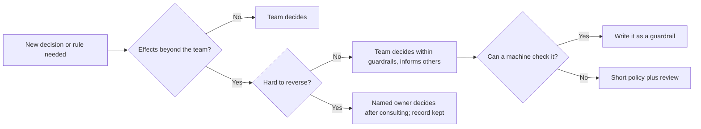

# Module 11 — Governance, risk and security

*Qafila is now Established. About 400 people work there in 35 teams, about 30,000 merchants in four countries use the app, and couriers make about 400,000 deliveries a day. Teams deploy to production many times a day, a data platform feeds every report, and a new integration with a payments partner lets merchants take card and wallet payments inside the app. Before that partner would sign, it sent Qafila a long due-diligence questionnaire: who approves changes, who can reach customer data, how risks are tracked, what evidence exists. Nobody could answer it with one voice, because 35 teams were doing the same things 35 ways. This module follows the work that questionnaire set off, seen mostly through Yasmin, now a senior engineer on the Payments team. First, governance that helps rather than blocks: deciding who decides, and turning rules into automatic guardrails. Second, security and risk as everyday habits of every team: threat modelling a change, rating a risk, writing it down with an owner. Third, compliance and audit without paralysis: knowing your obligations, mapping them to controls, and collecting evidence as a by-product of normal work. Each lesson leaves an artefact: a decision-rights map with a guardrail register, a threat model with risk register entries, and a control-to-evidence map with honest questionnaire answers.*

> **Steps:** Govern — agree who decides what, keep risks visible and owned, and show with evidence that the company does what it says, without slowing the teams that do the work.

---

# 11.1 — Governance that enables: decision rights and guardrails
*Level: 🔴 Advanced* · *Prerequisites: 8.3, 9.1* · *Step: Govern*

**After this you can** sort a set of decisions by how hard they are to reverse and how far their effects reach, write a decision-rights map that names who decides, who must be consulted and what evidence is kept, and turn one manual approval gate into an automatic guardrail with a time-limited exception route. *Study time: reading about 20 min, hands-on about 90 min (estimate).*

## ⚡ In 60 seconds
- **Governance** is how a company decides who makes which decisions, within what limits, and how it checks they were made well. **Management** is making and carrying out those decisions day to day.
- **Decision rights** say, for each kind of decision, who decides, who must be consulted and who is told. Most arguments that look like conflicts about a decision are really unclear decision rights.
- A **guardrail** is a built-in, usually automatic check that blocks only what is clearly unsafe; a **gate** stops work until a person approves. Good governance uses many guardrails and few gates.
- The rule that matters most: **decide who decides, then make the safe way the default way.**
- Decision cue: the harder a decision is to reverse and the further its effects reach, the higher and slower it should be made. Everything else belongs to the team, made quickly.
- Biggest trap: answering a scare or an outside request by adding a central approval step for everything. It feels safe, slows every team and often proves little.

## 🧭 Why it matters
Qafila and everyone in it are fictional. All numbers about Qafila in this lesson are illustrative figures, not benchmarks.

The payments partner's questionnaire arrived as a spreadsheet of about 200 questions. Question 14 read: "Describe who approves changes to production systems that process payment data, and how approvals are recorded." Faisal, now Head of Engineering, typed a first answer from memory: "All production changes are approved by the Head of Engineering." Salma, who leads service and reliability, read it and laughed, then stopped laughing. Qafila deploys to production many times a day across 35 teams. Faisal had not personally approved a change in two years. The answer was simply untrue.

Dana, the security and risk lead, asked each of the seven teams that touch payments how a change reaches production. She got seven different answers. Two teams required a second engineer to review every change. One let engineers merge their own changes "if it is small". One had a shared admin account for emergency fixes that four people knew the password to. Nobody had done anything they thought was wrong: each team had grown its own habits, as lesson 5.1 said teams do.

Faisal's reflex was a weekly change board: every change touching payments would wait for a Thursday meeting. Salma counted: the seven teams together had shipped around 140 changes to payment-related services in the previous month. A weekly board would batch them into large, risky releases and make Thursday the most dangerous day of the week. Maha, the CEO, asked for something else: a one-page map of who decides what, and a list of the checks that would make the honest answer to question 14 a good one. Yasmin, now a senior engineer on Payments, was asked to draft it with Dana. This lesson is what they built.

## 📐 How it works

### 🟢 The essentials

**Governance is not bureaucracy.** In everyday speech "governance" sounds like committees and forms. Its real job is simpler: make sure the right people make the right decisions, within agreed limits, and that the company can show this happened. A widely used definition from MIT researchers describes IT governance as "specifying the decision rights and accountability framework to encourage desirable behavior in the use of IT" (Weill and colleagues, as reported in summaries of their work). Notice the last words: *encourage desirable behaviour*. Governance that only forbids, or that people route around, has failed at its job.

| Governance asks | Management asks |
|---|---|
| Who may decide whether we store card data ourselves? | Shall we store card data for this feature? (Answer: no.) |
| What must be true before any change reaches production? | Is this change ready to deploy? |
| Who accepts a security risk we decide not to fix yet? | Shall we fix this weakness this sprint or next? |
| How do we check our rules are followed? | Did we follow them this time? |

**Decision rights.** For each important kind of decision, write down four things:

- **Decides:** one person or one role. Not a committee, unless a committee truly votes.
- **Must consult:** people whose knowledge is needed *before* the decision. Their view is heard; they cannot block.
- **Informed:** people told *after*, so they can adapt.
- **Evidence:** what record shows the decision was made this way (a merged pull request, a ticket, a decision record, meeting notes).

A popular format for this is a **RACI chart** (Responsible, Accountable, Consulted, Informed). It works if you keep one rule: exactly one "Accountable" per decision. Charts with three people marked Accountable describe a meeting, not a decision.

**Sort decisions before you assign them.** Two questions do most of the sorting. They extend the reversibility idea from lesson 9.1.

| | Easy to reverse | Hard to reverse |
|---|---|---|
| **Effects stay inside the team** | Team decides, now. (Rename an internal function; change a dashboard.) | Team decides, writes it down. (Change its own database schema.) |
| **Effects reach other teams, customers or partners** | Team decides within guardrails, informs others. (Deploy a feature behind a flag.) | Named owner decides after consulting; decision record kept. (Store a new kind of personal data; change how payouts are calculated.) |

Most decisions land in the left column. That is good news: they can be made fast by the people closest to the work, as long as the guardrails hold.

**Guardrails and gates.** A **gate** stops work until a person says yes: a change board, a sign-off email, a security review meeting. A **guardrail** is a check built into the path of the work that lets safe work through and stops only what is clearly unsafe, usually without anyone waiting. Lesson 8.3 introduced the idea with Dana's secrets rule. Guardrails come in three kinds:

| Kind | What it does | Qafila example |
|---|---|---|
| **Preventive** | Stops the unsafe thing happening | The pipeline refuses to merge a change with no approving review from a second engineer |
| **Detective** | Notices it soon after | A nightly job flags any cloud storage bucket that is readable by the public |
| **Corrective** | Puts it right, or makes it easy to | A failed health check after a deploy rolls the change back automatically |

Gates still have a place: for rare, high-impact, hard-to-reverse decisions, a person should look. Signing a new payments partner contract is a gate. Deploying the fortieth small change of the day is not.

**The policy stack.** Rules come in layers, and mixing them up causes confusion:

- A **principle** says why: "Customer money and data are handled as if they were our own."
- A **policy** says what must be true, briefly: "Every change to a production system is reviewed by someone other than its author."
- A **standard** says the specific, checkable how: "Review happens in a pull request; the pipeline enforces at least one approval from a code owner."
- A **guideline** recommends, without requiring: "Keep pull requests small enough to review in 20 minutes."

Keep policies short, few and written for the people who must follow them. A policy nobody can quote is not governing anything.

**Exceptions.** Every rule will meet a case it did not foresee. An **exception** is permission to break a rule for a stated reason, for a limited time, with an owner and, where possible, a **compensating control** (another safeguard that covers the same risk). Write exceptions in a register with an end date. An exception with no end date is a new, unwritten rule.

### 🟡 Going deeper

**Why central approval often disappoints.** Research on software delivery has looked at this directly. DORA (DevOps Research and Assessment, a research programme now part of Google Cloud) reports on its "streamlining change approval" capability page that heavyweight approval by people outside the team is associated with worse delivery performance, that its research found no evidence such external approval lowers the rate of failed changes, and that peer review during development, backed by automated checks, works better (as reported in search summaries of the page). The book *Accelerate* (Forsgren, Humble and Kim, 2018) reported similar findings from the same research. These are findings about the organisations surveyed, not a law; but they match what Salma predicted for Qafila's Thursday board. People far from a change cannot judge it well, so they approve almost everything, slowly, and the approval proves little. For the manager's view, see [*Running IT as a Business*, lesson 6.2 — Change control that protects stability without stopping flow](../itbiz/index.html#/6.2).

**Federated governance: tight on a few things, loose on the rest.** At 400 people, one central team cannot decide everything, and 35 teams cannot each invent their own rules for payments. The usual answer is **federated governance**: a small central group (here, Dana's security and risk team, the platform team and the architecture group) sets a short list of non-negotiable guardrails and provides tools that make them easy, and teams decide everything else within them. The skill is choosing the short list. A good test: would breaking this rule harm customers, partners or the whole company, and is it hard to undo? If yes, make it tight and automatic. If no, leave it to the team.

**A decision-rights map in practice.** Yasmin and Dana listed the decisions the questionnaire asked about and sorted them. Part of the map (illustrative):

| Decision | Decides | Must consult | Informed | Guardrail or evidence |
|---|---|---|---|---|
| Deploy a change to a payment service | The engineer, after review | A second engineer (reviewer) | Team channel (automatic) | Pipeline requires one code-owner approval; deploy log |
| Add a new kind of personal or payment data | Data owner (lesson 9.2) | Dana's team; Hamad (data) | Payments partner if in contract scope | Decision record; data inventory updated |
| Grant production access to a payment system | System owner | — | Dana's team (automatic report) | Access request ticket with end date; quarterly review |
| Accept a known security risk for more than 30 days | Head of the affected product area | Dana | Risk committee | Risk register entry with owner and review date |
| Change the payout calculation | Head of Payments | Bilal (finance); Salma (support) | All merchant-facing teams | Decision record; test evidence in pull request |

Notice what is missing: Faisal's name appears nowhere. He sets the guardrails; he does not approve the changes.

**Policy as code.** Many guardrails can be written as code that a machine checks: a branch protection setting that blocks merging without review, a pipeline step that rejects infrastructure without encryption turned on, a rule in a policy engine such as Open Policy Agent (an example, not an endorsement) that rejects a deployment missing an owner label. Code-based rules are consistent, versioned and leave their own evidence. For the engineering detail, see [*Cloud & DevOps: Zero to Hero*, lesson 3.3 — Policy as code, drift and guardrails](../cloud/index.html#/3.3).

### 🔴 Expert view

**Measure the governance itself.** Rules have costs, and you can see them if you look. Useful signals: how long a typical decision in each row of the map takes; how many exceptions are open, and how many are past their end date; how often teams work around a rule (a shared admin account is a sign the access process is too slow); and how many rules nobody can explain the reason for. A rising exception count usually means a rule is wrong, not that people are careless.

**Separation of duties without a gate.** Auditors and partners often ask for **separation of duties**: the person who writes a change should not be the only person who approves it. A peer review enforced by the pipeline, with branch protection that even administrators cannot skip without leaving a record, is a common way engineering teams meet this. Whether it satisfies a particular partner or auditor is a question to ask them early, with an example of the evidence in hand, rather than to assume.

**Sunset every rule.** Rules added after a scare tend to outlive the scare. Give each policy an owner and a review date, and ask at review: what risk does this rule reduce, is it still the cheapest way to reduce it, and what would happen if we deleted it? Governance that only grows becomes the thing people route around.

**Governance is a product for internal customers.** Dana treats engineers as the users of her guardrails. If a rule needs a wiki page to explain how to comply, she looks for a way to make compliance automatic instead. This is the same idea as the golden path in lesson 8.3, applied to rules.

**The memorable rule.** Decide who decides, then make the safe way the default way.

## 🧰 The toolkit
| Resource, tool or template | What it is and does | When to reach for it |
|---|---|---|
| **Decision sorting grid** | Two questions (effects beyond the team? hard to reverse?) that place a decision in one of four boxes | Before assigning who decides, or when a decision keeps bouncing between people |
| **Decision-rights map** | Table of decisions with decides, must consult, informed, and the evidence kept | When people disagree about who may decide, or an outside party asks |
| **Guardrail register** | List of automatic checks: what each prevents or detects, where it runs, its owner | When you replace gates, or need to show how a policy is enforced |
| **Policy stack** | Principle, policy, standard, guideline, each in its own layer | When writing or cleaning up rules |
| **Exception register** | Approved breaks of a rule, with reason, owner, compensating control and end date | Whenever someone needs to break a rule for a good reason |
| **Branch protection and pipeline checks** | Settings in a version control host or CI system that enforce review and tests before merge | To turn a review policy into a preventive guardrail |

## 🏛️ In practice at Qafila
Yasmin's draft for the payments area, after two rounds with Dana and one with Faisal. Illustrative and fictional.

> **Payments area: decision rights and guardrails (v2)**
>
> **Principle.** Customer money and data are handled as if they were our own.
>
> **Policies (3).** (1) Every production change is reviewed by someone other than its author. (2) Nobody has standing access to production payment data; access is requested, time-limited and logged. (3) Any risk left open for more than 30 days has a named accepter.
>
> **Guardrails.**
>
> | Guardrail | Kind | Where | Owner |
> |---|---|---|---|
> | Merge needs one code-owner approval; no self-approval; admins cannot bypass without an alert | Preventive | Version control host | Platform team |
> | Pipeline blocks a merge that contains a secret | Preventive | CI | Platform team |
> | Production access granted for at most 8 hours through the access tool; every session logged | Preventive and detective | Access tool | Dana's team |
> | Weekly report of anyone with standing production access, sent to system owners | Detective | Access tool | Dana's team |
> | Failed health check after deploy triggers automatic rollback | Corrective | Deploy tool | Each team |
>
> **Removed.** The shared emergency admin account. Replaced by a "break-glass" role: anyone on call can take it, it pages Dana's team, and every use is reviewed within two working days.
>
> **Exceptions open.** One: the legacy payout reconciliation job runs under a service account with broad rights until its rewrite (owner: Payments lead; compensating control: daily log review; end date: end of next quarter).
>
> **Answer to question 14 (draft).** "Changes are proposed as pull requests and must be approved by a second engineer who is a designated code owner before the pipeline will merge them. The pipeline also runs automated tests and secret scanning. Approvals and deploys are recorded in the version control host and the deploy log, retained for [period agreed with finance]. Emergency access uses a logged break-glass role reviewed within two working days."

Faisal wanted the weekly board "just for the first three months". Dana asked what it would catch that the review guardrail would not; nobody could name anything, so they dropped it and instead reviewed a sample of 20 pull requests each month for a quarter. Salma pointed out that the shared admin account had been used during the night because the access tool was slow; the break-glass role was the fix, not a reprimand.

## 🛠️ Exercises
**🟢 Sort eight decisions.** Use the sorting grid on these fictional Qafila decisions: (1) rename a field in an internal dashboard; (2) start storing couriers' national ID numbers; (3) deploy a bug fix to the merchant app behind a feature flag; (4) switch the main database to a different engine; (5) change a team's own on-call rota; (6) give a contractor read access to production order data; (7) change the refund rules shown to merchants; (8) upgrade a test library used by one team. For each, write the box and who should decide.
*Done when:* each decision has a box (inside/beyond the team, easy/hard to reverse) and one named role as decider, and you can give a one-line reason for the two you found hardest.

Model answer and self-check

**Model answer.** (1) Inside, easy: team. (2) Beyond, hard: data owner after consulting security and legal adviser; record kept. (3) Beyond, easy: team within guardrails, informs support. (4) Beyond, hard: named architecture owner after consulting affected teams; decision record (lesson 9.1). (5) Inside, easy: team. (6) Beyond, hard to fully reverse once data is seen: system owner, time-limited, logged; Dana's team informed. (7) Beyond, fairly easy to reverse in code but not in merchants' trust: product owner after consulting support, finance and, if needed, an adviser on consumer rules. (8) Inside, easy: team.

**Self-check.**
- Did you name one decider per decision, not a group?
- Did you treat access to data as hard to reverse, since data seen cannot be unseen?
- Did any decision end up at the CEO? If so, could a named owner decide it instead?

**🟡 Write a decision-rights map for one area.** Pick one area you know: a personal or open-source project, a student society, or Qafila's Merchant Orders team (orders, menus, order history). List five recurring decisions and fill the columns: decides, must consult, informed, guardrail or evidence.
*Done when:* every row has exactly one decider, at least three rows have evidence a stranger could check, and at least one row is enforced by a machine rather than by memory.

Model answer and self-check

**Model answer (open-source library).** Merge a pull request: a maintainer other than the author; consult: CI results; informed: watchers; evidence: merged pull request with approval. Release a new major version: lead maintainer; consult: other maintainers and top users via an issue; informed: all users via release notes; evidence: release issue and changelog. Add a new dependency: maintainer reviewing; consult: security-minded maintainer; evidence: pull request discussion; guardrail: dependency scanner in CI. Grant commit rights: lead maintainer; consult: maintainers; evidence: issue. Change the licence: all copyright holders as the licence requires; evidence: issue and commit.

**Self-check.**
- Is each "must consult" someone whose knowledge is truly needed, not someone added for politeness?
- Could a newcomer find the evidence for each row without asking you?
- Did you avoid marking two people as the decider?

**🔴 Turn a gate into a guardrail.** Choose one manual approval you have seen or can imagine (for example "a security engineer must approve every change to the login code", or Faisal's weekly payments board). Write: the risk the gate is meant to reduce; one preventive and one detective guardrail that would reduce the same risk; what still needs a person; and an exception route with an end date.
*Done when:* you name the risk in one sentence, both guardrails can run without anyone waiting, the remaining human step applies only to a small, named class of changes, and the exception route has an owner and a maximum length.

Model answer and self-check

**Model answer.** Gate: security approval for every login-code change. Risk: a change weakens authentication (for example, skips a check) and lets someone into another account. Preventive: login code is marked with a code-owner rule so a member of the identity team must review it, and the pipeline runs a suite of authentication tests that must pass. Detective: alerts on unusual login patterns (many failed logins, logins from new places for many accounts) after each deploy. Still human: changes that alter the login flow's design (new login method, changed session length) get a short threat model (lesson 11.2) reviewed by Dana's team. Exception: if the identity team is unavailable during an incident, the on-call engineer may merge a fix with any reviewer, and the identity team reviews within two working days; owner Dana; maximum 48 hours open.

**Self-check.**
- Does your guardrail reduce the same risk, or a different, easier one?
- Did you keep a human step only where judgement is really needed?
- Would your exception route have handled the night-time use of the shared admin account?

## ⚠️ Mistakes and traps
- **Answering an outside request with what you wish were true.** Faisal's first answer to question 14 was a hope, not a fact. Find out what actually happens, then improve it, then answer.
- **Adding a central gate after every scare.** It slows all teams and rarely proves safety. Ask what automatic check would stop the specific failure.
- **Committees as deciders.** "The architecture board decides" often means nobody does. Name one accountable role; the board can be consulted.
- **Rules without reasons or end dates.** Write the risk each rule reduces and a review date; delete rules whose risk has gone.
- **Exceptions that never expire.** Give every exception an owner, a compensating control and an end date, and review the register monthly.
- **Punishing the workaround instead of fixing the cause.** A shared admin account usually means access is too slow. Fix the access path.

## 🧾 Recap
- Governance decides who decides, within what limits, and how the company checks; management makes and carries out the decisions.
- A decision-rights map names one decider, who must be consulted, who is informed and what evidence is kept.
- Sort decisions by reach and reversibility; most can be made quickly by the team within guardrails.
- Prefer preventive, detective and corrective guardrails built into the work; keep gates for rare, hard-to-reverse decisions.
- Keep policies short and layered, give exceptions end dates, and review rules so they do not only grow.
- Rule: decide who decides, then make the safe way the default way.

## ✍️ Check yourself
**1. After the questionnaire arrives, Faisal proposes a weekly board to approve every change to payment services. Which response best fits this lesson?**

- A. Accept it, because a central board is the only reliable way to prove approvals to a partner.
- B. Ask which risk it reduces, and use review and pipeline checks that stop that risk without a wait.
- C. Accept it for payment services only, since other services carry less risk for the company.
- D. Reject it, and let each team keep its own approval habits as long as nothing goes wrong.

Answer

**B.** Name the risk, then find guardrails that reduce it without batching changes. A assumes a board proves more than a recorded review does, C keeps the batching problem exactly where risk is highest, and D leaves the seven inconsistent habits Dana found. See "Guardrails and gates" and "Why central approval often disappoints".

**2. Which of these is a detective guardrail?**

- A. The pipeline refuses to merge a change that has no approving review from a second engineer.
- B. A failed health check after a deploy rolls the change back to the previous version.
- C. A written policy says every production change must be reviewed by a person other than its author.
- D. A nightly job flags any storage bucket in the cloud account that is readable by the public.

Answer

**D.** It notices an unsafe state after it happens. A is preventive (it stops the merge), B is corrective (it puts things right), and C is a policy, not a guardrail at all, until something enforces it. See the table in "Guardrails and gates".

**3. Yasmin's draft map lists "the architecture board" as the decider for adding a new kind of personal data. What should she change?**

- A. Name one accountable role, such as the data owner, and list the board as consulted.
- B. Keep the board, since a group decision spreads the responsibility across several experts.
- C. Move the decision to the CEO, because personal data is a company-wide concern.
- D. Let each team decide, because the data owner already appears in the data inventory.

Answer

**A.** Every decision needs exactly one accountable decider; experts can be consulted. B is the "committee as decider" trap, C pushes a decision far from the knowledge needed, and D ignores that adding personal data reaches beyond one team and is hard to reverse. See "Decision rights" and "Mistakes and traps".

**4. Salma finds the shared emergency admin account was used at night because the access tool takes an hour to grant access. What is the best response?**

- A. Disable the account at once and warn the engineers involved that its use breaks policy.
- B. Keep the account but change its password monthly and share it only with team leads.
- C. Replace it with a logged break-glass role anyone on call can take, reviewed afterwards.
- D. Add a manager's sign-off to every emergency access request, including those at night.

Answer

**C.** The workaround shows the access path is too slow; a fast, logged break-glass role fixes the cause and leaves evidence. A punishes the symptom and leaves on-call engineers stuck, B keeps a shared secret with no record of who used it, and D adds a gate exactly when speed matters most. See "In practice at Qafila" and "Measure the governance itself".

**5. A team needs to break the "no broad service accounts" policy for a legacy job until it is rewritten. What makes this exception well governed?**

- A. Approval by the Head of Engineering, recorded in an email to the team's lead.
- B. An owner, a compensating control and an end date, recorded in the exception register.
- C. A note in the code next to the job, so future engineers understand why it is different.
- D. Agreement in the team's retrospective, since the team knows the legacy job best.

Answer

**B.** A good exception is visible, owned, time-limited and covered by another safeguard. A records who said yes but sets no limit, C helps readers of the code but nobody reviews it, and D keeps the decision inside a team when the risk reaches further. See "Exceptions".

## 📚 References
- DORA, "Capabilities: Streamlining change approval": https://dora.dev/capabilities/streamlining-change-approval/ — findings on external approval and peer review. Reported from search summaries; the page could not be opened from this environment on 2026-11-22.
- Forsgren, N., Humble, J. and Kim, G., *Accelerate: The Science of Lean Software and DevOps* (IT Revolution, 2018). Full citation; findings on change approval as reported in summaries; not opened.
- Weill, P. and Ross, J. W., *IT Governance: How Top Performers Manage IT Decision Rights for Superior Results* (Harvard Business School Press, 2004). The definition quoted is reported in summaries and also attributed to an earlier MIT working paper by Weill and Woodham (2003); not opened.
- Library course: [*Running IT as a Business*, lesson 6.2 — Change control that protects stability without stopping flow](../itbiz/index.html#/6.2).
- Library course: [*Cloud & DevOps: Zero to Hero*, lesson 3.3 — Policy as code, drift and guardrails](../cloud/index.html#/3.3).
- Library course: [*Running IT as a Business*, lesson 10.3 — Risk, controls and audit in a regulated bank](../itbiz/index.html#/10.3) (the operating-model view of the same questions).

---

# 11.2 — Security and risk in everyday practice
*Level: 🔴 Advanced* · *Prerequisites: 3.1, 9.2, 11.1* · *Step: Govern*

**After this you can** run a short threat model on a planned change using four questions, rate each risk you find by likelihood and impact, choose a treatment (reduce, avoid, transfer or accept), and write risk register entries with an owner, a due date and a review date that a security lead could act on. *Study time: reading about 20 min, hands-on about 90 min (estimate).*

## ⚡ In 60 seconds
- **Security** is protecting the **confidentiality** (only the right people see it), **integrity** (it is correct and not tampered with) and **availability** (it works when needed) of systems and data.
- **Risk** is the chance that something bad happens, combined with how bad it would be. You never remove all risk; you choose which to reduce, avoid, transfer or accept, and you write the choice down.
- Most security work is everyday habit, done by every team: least access, no secrets in code, reviewed changes, patched dependencies, useful logs, and a few minutes of threat thinking before building.
- The rule that matters most: **ask "what can go wrong?" before you build, and give every risk an owner.**
- Decision cue: if a change touches money, personal data, logins or access rights, spend fifteen minutes on a threat model before writing code.
- Biggest trap: treating security as the security team's job. A small team of specialists cannot review 35 teams' work; they can only help those teams do it well.

## 🧭 Why it matters
Qafila and everyone in it are fictional. All numbers about Qafila in this lesson are illustrative figures, not benchmarks.

Section 6 of the payments partner's questionnaire asked: "How do development teams identify security risks in new features? Provide two recent examples." And: "Describe how security risks are recorded, owned and reviewed." Dana's team had a risk list, but it held 14 rows, most written by Dana herself after incidents. The 35 teams had no habit of looking for risks before they built.

The same month, Yasmin reviewed a pull request from a newer engineer on her team. It added a page where couriers could see their earnings for any week. The address of the page ended with the courier's ID number. Yasmin changed the number by one in her test environment and saw another courier's earnings, name and bank details' last digits. Nobody had asked "what if someone changes this number?" The code passed every test, because every test used the right courier.

The fix took an hour. Finding it took luck: Yasmin happened to be curious. Dana's point to Maha was that Qafila could not rely on curious reviewers. With about 400,000 deliveries a day and a payments partner about to connect, every team needed a cheap, repeatable way to ask what could go wrong, and a shared place to write down what they found. This lesson is that habit.

## 📐 How it works

### 🟢 The essentials

**A few words that matter.** Security people use these precisely, and so should you.

| Term | Plain meaning | Courier earnings example |
|---|---|---|
| **Asset** | Something of value to protect | Couriers' earnings and bank details |
| **Threat** | Someone or something that could cause harm | A courier curious about others' pay; an outsider with one courier's login |
| **Vulnerability** | A weakness a threat could use | The page trusts the ID in the address without checking who is asking |
| **Control** | A safeguard that reduces risk | A server-side check that the logged-in courier owns the requested ID |
| **Risk** | Likelihood that harm happens, combined with its impact | Likely (easy to try), high impact (personal and financial data of many couriers) |

The weakness Yasmin found is so common it has a name: **broken access control**, where the system checks that you are logged in but not that you are allowed to see *this* record. For the detail, see [*Application & AI Security*, lesson 3.3 — Authorisation: broken access control, IDOR and multi-tenancy](../secai/index.html#/3.3).

**Everyday security habits.** Most security incidents start with ordinary gaps, not clever attacks. Verizon's annual Data Breach Investigations Report (DBIR), which analyses thousands of breaches reported by many organisations, found in its 2026 edition that exploiting vulnerabilities had overtaken stolen credentials as the most common way in, for the first time in the report's history (as reported in Verizon's announcement and press coverage). Its 2025 edition reported that the share of breaches involving a third party doubled, from 15% to 30% (as reported). These are findings about the breaches in its dataset, not a forecast for your company, but they point at the same habits:

| Habit | What it means in practice | Earlier lesson |
|---|---|---|
| **Least privilege** | Every person and service gets only the access it needs, for as long as it needs it | 7.2, 11.1 |
| **No secrets in code** | Keys and passwords live in a secret store; the pipeline blocks any that slip in | 2.3, 8.3 |
| **Reviewed changes** | A second person reads every change, with security questions in the review checklist | 3.1 |
| **Patched dependencies** | Automated scanning flags known weaknesses in libraries; fixes are scheduled by severity | 3.2 |
| **Strong login** | Multi-factor authentication for staff on every important system | 7.2 |
| **Useful logs** | Who did what, when, kept long enough to investigate, without logging secrets or more personal data than needed | 4.2, 9.2 |
| **Know your suppliers** | Each supplier with access to data or systems is listed with what it can reach | 10.3 |

**Threat modelling in fifteen minutes.** **Threat modelling** is thinking through how a system could be attacked or fail, before or while you build it. The Threat Modeling Manifesto, written by a group of practitioners, frames it around four questions (as reported in summaries and in the OWASP Threat Modeling Cheat Sheet):

1. **What are we working on?** Draw the change: who uses it, what data flows where, which parts trust which.
2. **What can go wrong?** List ways it could be misused or fail.
3. **What are we going to do about it?** Choose controls, or decide to accept a risk.
4. **Did we do a good enough job?** Check the controls exist and the list was sensible.

For question 2, a prompt list helps. A widely used one is **STRIDE**, which originated at Microsoft: Spoofing (pretending to be someone), Tampering (changing data), Repudiation (denying an action with no record to prove it), Information disclosure (seeing what you should not), Denial of service (making it unavailable) and Elevation of privilege (gaining more rights than given). You do not need to be an expert to use it: read each word and ask "could this happen here?" For a full treatment, see [*Application & AI Security*, lesson 1.1 — Threat modelling: data flows, trust boundaries and STRIDE](../secai/index.html#/1.1).

**Rating a risk.** Put each risk on two simple scales, then combine them.

| Likelihood | Meaning |
|---|---|
| Low | Needs rare skill or access; no sign anyone is trying |
| Medium | Possible with some effort; seen elsewhere |
| High | Easy to try; anyone who looks could find it |

| Impact | Meaning |
|---|---|
| Low | Minor inconvenience; no personal or money data |
| Medium | Some customers affected; limited data; recoverable |
| High | Many customers, money or sensitive personal data; partner or regulator interest |

High likelihood with high impact goes first. Do not argue for long about medium versus high: the point is ordering, not precision. For a more rigorous scale, including the Common Vulnerability Scoring System (CVSS) used for known software weaknesses, see [*Application & AI Security*, lesson 1.3 — Rating and prioritising risk: likelihood, impact and CVSS](../secai/index.html#/1.3).

**Four ways to treat a risk.**

| Treatment | Meaning | Example |
|---|---|---|
| **Reduce** | Add a control that lowers likelihood or impact | Check ownership on the server for every earnings request |
| **Avoid** | Stop doing the risky thing | Do not show bank details on the earnings page at all |
| **Transfer** | Move part of the impact to someone else, usually by contract or insurance | Let the payment provider hold card details so Qafila never stores them |
| **Accept** | Decide, knowingly, to live with it for now | Accept a low-impact display bug in an internal tool until next quarter |

Transfer moves some consequences, not the duty to care: customers will still blame Qafila. Acceptance is a legitimate choice only when someone with the authority to accept it (lesson 11.1) does so in writing, with a date to look again.

### 🟡 Going deeper

**The risk register.** A **risk register** is the shared list of known risks, each with enough detail to act on. A useful entry has:

| Field | Example |
|---|---|
| **ID and title** | R-112: Courier earnings visible to other couriers |
| **Description** | Earnings page trusted the courier ID in the address; any logged-in courier could view others' earnings and partial bank details |
| **Asset and who is affected** | Courier earnings and bank data; all couriers |
| **Likelihood / impact / rating** | High / High / High (before fix) |
| **Treatment and controls** | Reduce: server-side ownership check; automated test for access to another courier's record; remove bank digits from page |
| **Owner** | Courier Earnings team lead |
| **Due date** | Fix deployed within 2 days |
| **Residual rating and review date** | Low; review at next quarterly access-control check |
| **Status** | Closed after fix verified; lesson shared with all teams |

The **owner** is the person accountable for the risk being treated, usually the leader of the team that owns the system, not the security team. Dana's team keeps the register healthy and helps rate and treat risks; it does not own every risk.

**Risk appetite.** **Risk appetite** is how much risk a company is willing to accept in pursuit of its goals, stated by its leaders. Qafila's leadership wrote three lines: "We accept small product risks to learn fast. We do not accept known risks to customer money or payment data beyond 30 days. We do not accept risks that would breach our obligations to partners or regulators." Lines like these let teams decide quickly without asking every time.

**Vulnerability management.** Scanners and researchers will keep finding weaknesses in your code and its libraries. **Vulnerability management** is the routine for handling them: find, rate, fix within a time limit set by severity, and verify. Qafila's internal targets (illustrative, not a standard) are: critical within 7 days, high within 30, medium within 90, with exceptions recorded as in lesson 11.1. Measure the share fixed on time; a growing backlog is a risk in itself. See [*Application & AI Security*, lesson 10.3 — Vulnerability management, disclosure and bug bounties](../secai/index.html#/10.3).

**Security champions.** One security lead cannot read 35 teams' designs. Many companies name a **security champion** in each team: an engineer with some extra training who runs the team's threat models, keeps an eye on its risks and is the first person to ask. Yasmin became Payments' champion. Champions are not a substitute for specialists; they are how specialists' knowledge reaches every team.

### 🔴 Expert view

**Security is governed, not just done.** The NIST Cybersecurity Framework (CSF) 2.0, published by the US National Institute of Standards and Technology in February 2024, added "Govern" as a sixth core function alongside Identify, Protect, Detect, Respond and Recover (as reported in summaries of the release). The framework is voluntary and widely referenced; Qafila is not obliged to use it. The point for a practitioner is the idea behind the change: security outcomes depend on decision rights, risk appetite, supplier oversight and leadership attention, not only on technical controls.

**Threat model the change, not the company.** Large, one-off threat models of the whole system go stale within weeks. Short threat models attached to significant changes (new data, new access paths, new suppliers, money flows) stay current because they are part of the work. Keep a template in the repository and link the model from the pull request or decision record.

**Turn every finding into a test or a guardrail.** Yasmin's fix included an automated test that asks for another courier's record and expects a refusal. Dana then asked the platform team to add the same kind of test to the service template for every endpoint that takes an ID. A finding that becomes a test is fixed once; a finding that becomes a memo is fixed until someone forgets. For testing techniques, see [*Software Testing*, lesson 4.2 — Security testing for testers: OWASP, SAST, DAST, dependency scanning, fuzzing and authorisation tests](../testing/index.html#/4.2).

**Beware of security theatre.** Long password rules nobody can remember, annual training nobody reads, and scans whose results nobody fixes look like security and reduce little risk. Ask of any control: what specific harm does this prevent, and how would we know if it stopped working?

**The memorable rule.** Ask "what can go wrong?" before you build, and give every risk an owner.

## 🧰 The toolkit
| Resource, tool or template | What it is and does | When to reach for it |
|---|---|---|
| **Four-question threat model** | What are we working on, what can go wrong, what will we do, did we do enough | Before building a change that touches money, personal data, logins or access |
| **STRIDE prompt list** | Six kinds of threat to read through when listing what can go wrong | During question 2 of a threat model |
| **Likelihood and impact scales** | Three levels each, with plain meanings, combined into a rating | To order risks before deciding what to fix first |
| **Risk register entry** | ID, description, asset, rating, treatment, owner, due date, residual rating, review date | Whenever a risk is found and not fixed immediately, or is accepted |
| **Risk appetite statement** | A few lines from leadership on which risks are acceptable | When a team must decide quickly whether to accept a risk |
| **Dependency and secret scanners** | Tools in the CI system that flag known-vulnerable libraries and committed secrets | On every change, automatically |

## 🏛️ In practice at Qafila
Yasmin's threat model for the payments partner integration, as Payments' security champion. Illustrative and fictional; shortened.

> **Threat model: merchant card payments through the payments partner (v1)**
>
> **1. What are we working on?** Merchants turn on "accept cards" in the merchant app. Customers pay on the courier's handheld or a payment link. The partner processes the card and sends Qafila a result and, next day, a settlement file. Qafila never sees full card numbers; it stores a partner reference, amount and status. Trust boundaries: merchant app ↔ Qafila API; Qafila ↔ partner API; partner → Qafila notifications.
>
> **2. What can go wrong? (STRIDE)**
>
> | # | Threat | Likelihood | Impact | Rating |
> |---|---|---|---|---|
> | T1 | Spoofing: a fake "payment succeeded" notification marks an unpaid order as paid | Medium | High | High |
> | T2 | Tampering: a merchant changes the amount between order and payment | Medium | Medium | Medium |
> | T3 | Repudiation: a merchant disputes enabling card payments and we cannot show who turned it on | Medium | Medium | Medium |
> | T4 | Information disclosure: partner API key leaks from logs or code | Low | High | Medium |
> | T5 | Denial of service: partner outage blocks all deliveries, not just card payments | Medium | High | High |
>
> **3. What are we going to do?** T1: verify the partner's signature on every notification and confirm status by calling the partner's API (reduce). T2: amount fixed server-side from the order, never taken from the client (reduce). T3: log who enabled card payments, when and from which device (reduce). T4: key in the secret store, rotated, log scrubbing tested (reduce). T5: if the partner is down, orders continue with "pay on delivery" and a banner (reduce); Salma's team adds it to the incident runbook.
>
> **4. Did we do enough?** Tests for T1 and T2 added to the pipeline; Dana's team reviewed the model in 30 minutes and added one row (a merchant's staff member with a stolen login turns on payouts to a new account: added as R-131, owner Payments lead).

Faisal's first reaction was that the partner "handles security". Dana pointed out that T1, T2 and T5 all sit on Qafila's side of the boundary. Hamad asked whether the settlement file would land in the data platform with more fields than needed; it was added to the data inventory (lesson 9.2) with only the fields reports use.

## 🛠️ Exercises
**🟢 Name the parts.** For the courier earnings story in "Why it matters", write one line each for the asset, two threats, the vulnerability, the control that fixed it and one control that would have caught it earlier.
*Done when:* each of the six lines uses the lesson's definitions correctly, and your "caught earlier" control could run without a curious reviewer.

Model answer and self-check

**Model answer.** Asset: couriers' earnings and partial bank data. Threats: a courier curious about colleagues' pay; an outsider who has stolen one courier's login. Vulnerability: the page trusted the courier ID in the address without checking ownership. Fixing control: a server-side check that the logged-in courier owns the requested record. Earlier control: an automated test in the service template that requests another user's record and expects a refusal; or a review checklist line "does every endpoint that takes an ID check ownership?"

**Self-check.**
- Did you keep threat (who) and vulnerability (which weakness) separate?
- Does your "earlier" control work on every endpoint, not only this one?
- Would a test or checklist item have caught it on the day the code was written?

**🟡 Threat model a small feature.** Choose a feature in a personal or open-source project, or use this Qafila one: "merchants can invite staff members to their account by email link, and give them the role 'orders only' or 'full access'". Answer the four questions, using STRIDE for question 2, and rate at least four threats.
*Done when:* you have a short description with the trust boundaries, at least four threats each with a STRIDE letter and a rating, one chosen treatment per threat, and one sentence on how you would check the controls work.

Model answer and self-check

**Model answer (staff invitations).** Working on: merchant owner sends invite link; staff member opens it, sets password, gets a role. Boundaries: email ↔ Qafila; staff device ↔ API. Threats: (S) someone who gets a forwarded invite link joins as staff: medium/high: links expire in 24 hours, single use, owner confirms new joiner (reduce). (E) "orders only" staff calls the payouts endpoint directly: medium/high: role checked on the server for every endpoint, test for each role (reduce). (R) owner claims they never gave full access: medium/medium: log who granted which role, when (reduce). (I) invite email reveals the shop's revenue in a preview: low/medium: email contains no business data (avoid). Check: role tests in the pipeline; a quarterly sample of access logs.

**Self-check.**
- Did you include at least one threat from an insider (a staff member), not only outsiders?
- Is every "reduce" a specific control, not "be careful"?
- Did you check roles on the server, not only by hiding buttons in the app?

**🔴 Write and defend three register entries.** From your threat model in the previous exercise (or Yasmin's in "In practice at Qafila"), write three risk register entries with all fields. Make one of them an accepted risk, and write the acceptance as the accountable person would: what is accepted, why, until when, and what would make you look again.
*Done when:* each entry has a single owner who leads the affected system, a due or review date, and a residual rating; and the accepted risk has a named accepter with authority under lesson 11.1, an end date within Qafila's 30-day appetite if it touches money, and a trigger for early review.

Model answer and self-check

**Model answer (accepted entry).** R-131: Stolen merchant staff login used to change payout bank account. Asset: merchant payouts. Likelihood medium, impact high, rating high. Treatment: reduce (require the owner's confirmation by a second channel for any bank change; hold the first payout to a new account for 24 hours). Owner: Payments lead. Due: 3 weeks. Interim acceptance until then: "I, Head of Payments, accept that for up to 21 days bank changes rely on login only, because the confirmation flow needs partner changes. Compensating control: daily report of bank changes reviewed by support. Look again at once if any merchant reports an unexpected change." Residual rating after fix: low. Review: quarterly.

**Self-check.**
- Is the owner the leader of the system, not "security"?
- Does the acceptance have a limit in time and a compensating control?
- Did you stay within the risk appetite, or escalate where you could not?

## ⚠️ Mistakes and traps
- **"Security will check it."** A small central team cannot review every change. Each team runs its own threat models; specialists review the high-risk ones.
- **Endless threat lists with no decisions.** Twenty threats and no treatments help nobody. Rate, pick a treatment, name an owner, move on.
- **Hiding buttons instead of checking on the server.** Anyone can call an API directly. Check permissions on the server for every request.
- **Accepting risk by silence.** An unfixed risk with no written acceptance is accepted by nobody and owned by nobody. Write it down with a date.
- **Assuming a supplier or partner covers it.** Map the trust boundary; the parts on your side are yours.
- **Fixing the instance, not the class.** One fixed endpoint leaves others with the same flaw. Add a test or guardrail for the whole class.

## 🧾 Recap
- Security protects confidentiality, integrity and availability; risk combines likelihood and impact.
- Everyday habits (least privilege, no secrets in code, reviewed changes, patched dependencies, strong login, useful logs, known suppliers) prevent most ordinary failures.
- A fifteen-minute threat model with four questions and STRIDE finds the obvious risks before code exists.
- Rate risks simply, then reduce, avoid, transfer or accept, and record each in a register with a single owner and a date.
- Turn findings into tests and guardrails so the fix covers the whole class of problem.
- Rule: ask "what can go wrong?" before you build, and give every risk an owner.

## ✍️ Check yourself
**1. In Yasmin's courier earnings case, which of these is the vulnerability?**

- A. A courier who is curious about how much colleagues earn each week.
- B. The couriers' weekly earnings and the last digits of their bank details.
- C. The page trusted the courier ID in the address without checking ownership.
- D. A server-side check that the logged-in courier owns the requested record.

Answer

**C.** A vulnerability is the weakness a threat could use. A is a threat, B is the asset, and D is the control that fixed it. See "A few words that matter".

**2. Faisal says the payments partner "handles security" for card payments. In Yasmin's threat model, why is that not enough?**

- A. Several threats, such as fake success notifications, sit on Qafila's side of the trust boundary.
- B. The partner cannot be trusted at all, so Qafila must also store and protect full card numbers.
- C. Partners never take responsibility for security, so every risk has to be accepted by Qafila.
- D. Security is the job of Dana's team, so the partner's controls cannot count toward the model.

Answer

**A.** Mapping the boundary shows risks the partner cannot see or fix, such as trusting a spoofed notification. B adds risk by storing card data, C overstates the point, and D repeats the "security will check it" trap. See "In practice at Qafila".

**3. A risk to merchant payouts cannot be fixed for three weeks. Qafila's appetite allows up to 30 days for money risks. What should happen now?**

- A. Nothing yet, because it is still inside the 30 days the risk appetite allows for money risks.
- B. Dana's team takes ownership of the risk until the fix ships, since they understand it best.
- C. The team delays the fix until the next quarter so it can be bundled with related work.
- D. The accountable lead accepts it in writing with a compensating control and an end date.

Answer

**D.** Interim acceptance must be explicit, owned, time-limited and covered by another safeguard. A is accepting by silence, B moves ownership away from the system's leader, and C breaks the appetite. See "Four ways to treat a risk" and "Risk appetite".

**4. After fixing one endpoint that leaked another courier's data, what does this lesson suggest next?**

- A. Send a memo to all engineers reminding them to check ownership on every endpoint.
- B. Add a template test asking for another user's record, so every endpoint is checked.
- C. Ask Dana's team to read every new endpoint before release for the next three months.
- D. Close the register entry, because the reported endpoint is now fixed and verified.

Answer

**B.** A test or guardrail fixes the whole class of problem and keeps working. A relies on memory, C creates a gate and a bottleneck, and D fixes the instance but leaves others with the same flaw. See "Turn every finding into a test or a guardrail".

**5. Which statement about the 2026 Verizon DBIR finding in this lesson is most accurate?**

- A. It found exploited vulnerabilities overtook stolen credentials as the top way into breached organisations in its data.
- B. It proved that every company will be breached through an unpatched library within the next twelve months.
- C. It found that phishing training had become the most effective control for reducing breaches in its data.
- D. It showed that companies using a security framework were rarely breached through third-party suppliers.

Answer

**A.** That is what the report is reported to have found, for the breaches in its dataset. B turns a finding into a universal forecast, and C and D are not findings stated in this lesson. See "Everyday security habits".

## 📚 References
- Threat Modeling Manifesto: https://threatmodelingmanifesto.org/ — the four key questions. Reported from search summaries; the page could not be opened from this environment on 2026-11-22.
- OWASP, Threat Modeling Cheat Sheet: https://cheatsheetseries.owasp.org/cheatsheets/Threat_Modeling_Cheat_Sheet.html — lists the four questions and STRIDE. Reported from search summaries; not opened.
- Verizon, "Vulnerability exploitation top breach entry point, 2026 industry-wide DBIR finds": https://www.verizon.com/about/news/breach-industry-wide-dbir-finds — reported from search summaries; not opened.
- Help Net Security, "2025 Data Breach Investigations Report: Third-party breaches double", 23 April 2025: https://www.helpnetsecurity.com/2025/04/23/verizon-2025-data-breach-investigations-report-dbir/ — third-party share 15% to 30%. Reported from search summaries; not opened.
- NIST, Cybersecurity Framework: https://www.nist.gov/cyberframework — CSF 2.0 (February 2024) and its Govern function. Reported from search summaries; not opened.
- Shostack, A., *Threat Modeling: Designing for Security* (Wiley, 2014). Full citation; not opened.
- Library course: [*Application & AI Security*, lesson 1.1 — Threat modelling: data flows, trust boundaries and STRIDE](../secai/index.html#/1.1).
- Library course: [*Application & AI Security*, lesson 1.3 — Rating and prioritising risk: likelihood, impact and CVSS](../secai/index.html#/1.3).
- Library course: [*Application & AI Security*, lesson 3.3 — Authorisation: broken access control, IDOR and multi-tenancy](../secai/index.html#/3.3).
- Library course: [*Application & AI Security*, lesson 10.3 — Vulnerability management, disclosure and bug bounties](../secai/index.html#/10.3).
- Library course: [*Software Testing*, lesson 4.2 — Security testing for testers: OWASP, SAST, DAST, dependency scanning, fuzzing and authorisation tests](../testing/index.html#/4.2).

---

# 11.3 — Compliance and audit without paralysis
*Level: 🔴 Advanced* · *Prerequisites: 11.1, 11.2* · *Step: Govern*

**After this you can** list the obligations that apply to a product (laws, contracts and standards) as questions for the right adviser, map each obligation to a control and to evidence that the normal work already produces, answer a due-diligence question honestly with a gap and a plan where needed, and prepare for an audit without stopping delivery. *Study time: reading about 20 min, hands-on about 100 min (estimate).*

## ⚡ In 60 seconds
- **Compliance** means meeting obligations the company has taken on or is subject to: laws, contracts, industry standards and its own policies. **Audit** is an independent check that controls exist and work, based on evidence.
- Compliance is not the same as security. You can be compliant and insecure, or secure and unable to prove it. Aim for real controls, then evidence.
- A **control** is a safeguard with an owner; **evidence** is a record that shows the control worked, at a given time, for a given case.
- The rule that matters most: **build evidence into the work, not on top of it.** Records from version control, pipelines, ticketing and access tools are better evidence than documents written for the auditor.
- Decision cue: before writing a new document for an audit, ask whether an existing system record already shows the same thing.
- Biggest trap: answering questionnaires with what you hope is true. An honest "partly, with a plan and a date" builds more trust than a "yes" that an audit later disproves.

## 🧭 Why it matters
Qafila and everyone in it are fictional. All numbers about Qafila in this lesson are illustrative figures, not benchmarks.

By week three of the payments partner's questionnaire, Qafila had a problem of a different kind. Dana's team and Yasmin had fixed the decision rights (lesson 11.1) and started threat modelling (lesson 11.2). But for almost every answer, the partner wanted evidence: "Provide the access review for the last two quarters." "Provide three examples of approved production changes." "Provide your most recent incident report and the follow-up actions." The partner also said that before going live it would want either an independent audit report or a visit from its own assessors.

Bilal, now CFO, had seen this go badly at a previous employer: an audit announced, delivery stopped for six weeks, people writing documents after the fact, screenshots taken late at night, and the same panic a year later. Faisal proposed exactly that: freeze new work on payments for a month and "get compliant".

Maha said no to the freeze and asked a different question: what if the evidence already existed, scattered across the tools teams use every day? Yasmin spent two days with Dana checking. For change approval, every merged pull request already carried its review. For deploys, the pipeline logged every one. For access, the access tool from lesson 11.1 logged every grant. The gaps were real but few. This lesson is how they turned scattered records into a calm, repeatable answer.

## 📐 How it works

### 🟢 The essentials

**Where obligations come from.** An **obligation** is something the company must do or must be able to show. They come from four places:

| Source | Examples of the *kind* of rule | Who helps you read it |
|---|---|---|
| **Law and regulation** | Data protection, consumer protection, payments, employment, tax and record-keeping rules in each country Qafila serves | Legal adviser in each country |
| **Contracts** | The payments partner agreement; enterprise merchant contracts; cloud and supplier terms | Legal and the contract owner |
| **Industry standards** | Card industry security rules a partner may pass down; information security standards customers ask about | Security lead; the partner |
| **Own policies** | Qafila's change, access and data policies (lesson 11.1) | Policy owners |

With 30,000 merchants in four countries, Qafila is subject to several sets of rules at once. This course does not tell you what any of them require; that varies by country and changes over time. Your job as a practitioner is to know the *kinds* of rule that touch your work and to ask the right questions early: "Does this new data field count as personal data where we operate?", "Does the partner contract say how fast we must report an incident?", "How long must we keep these records?"

**Three standards you will hear about.** Partners and enterprise customers often ask about these. Know what each is for; do not claim to meet any without checking.

- **ISO/IEC 27001** is an international standard, published by ISO and IEC, for an **information security management system**: a managed set of policies, risk processes and controls. The current edition is ISO/IEC 27001:2022 (reported from ISO's page). Companies can choose to be certified against it by an accredited certification body.
- **SOC 2** is a type of report, defined by the American Institute of Certified Public Accountants (AICPA), in which an independent auditor reports on a service organisation's controls against its trust services criteria (security, availability, processing integrity, confidentiality and privacy). A **Type 1** report looks at whether controls are designed well at one point in time; a **Type 2** report also tests whether they worked over a period (as reported in summaries).
- **PCI DSS** (Payment Card Industry Data Security Standard), from the PCI Security Standards Council, sets security requirements for organisations that store, process or transmit payment card data. Version 4.0.1, a limited revision of version 4.0, was published in 2024 (as reported). Which parts apply to Qafila, if any, depends on how card data flows; that is a question for Dana, the partner and a qualified assessor.

**Scope is your biggest lever.** **Scope** is the set of systems, data and people a set of rules applies to. The smaller the scope, the less there is to control and prove. Qafila's design choice in lesson 11.2 (the partner handles card numbers; Qafila stores only a reference) is a scope decision as much as a security one. Ask early: "Can we keep this kind of data out of our systems altogether?"

**Controls and evidence.** A control is a safeguard with an owner. Evidence shows it worked.

| Obligation (paraphrased) | Control | Owner | Evidence already produced by the work |
|---|---|---|---|
| Production changes are reviewed by someone other than the author | Branch protection requiring code-owner approval | Platform team | Merged pull requests with approvals; branch protection settings history |
| Access to payment data is limited and reviewed | Time-limited access tool; quarterly review by system owners | Dana's team | Access tool logs; signed-off review tickets |
| Incidents are handled and learned from | Incident process and post-incident reviews (lesson 4.3) | Salma | Incident tickets; review documents; action items with status |
| Known vulnerabilities are fixed in time | Dependency scanning; fix targets by severity (lesson 11.2) | Each team | Scanner reports; tickets with dates |
| Suppliers with data access are assessed | Supplier checklist (lesson 10.3) | Bilal's procurement lead | Completed checklists; contract register |

**Design versus operating effectiveness.** An auditor asks two different questions. Is the control **designed** to reduce the risk (would it work if followed)? And is it **operating** (did it actually work, every time, over the period)? A beautiful policy with no records proves design at best. A pipeline that logs every approval proves operation.

### 🟡 Going deeper

**Continuous compliance.** The old pattern is "audit season": evidence gathered by hand once a year. The better pattern is **continuous compliance**: controls run automatically, and evidence is collected as the work happens, so the answer to "show me" is a query, not a project. Practical steps:

- **Prefer system records to documents.** A pull request with its approval beats a spreadsheet saying "all changes approved".
- **Keep evidence where it is created,** and know how to export it: which tool, which report, who can run it.
- **Sample, do not dump.** Auditors usually test a sample (for example, 25 changes from the period). Be ready to pull any sample quickly, rather than sending everything.
- **Watch the controls themselves.** A detective check that alerts when branch protection is switched off is evidence that the preventive control stayed on.
- **Name an owner per control,** not per document.

For the engineering side of evidence in pipelines, see [*Running IT as a Business*, lesson 5.2 — Quality gates and evidence a manager can trust](../itbiz/index.html#/5.2).

**Answering a due-diligence questionnaire.** These questionnaires repeat across partners and customers, so build an **answer bank**: each common question, the honest answer, the control behind it, the evidence you can share, the owner and the date last checked. Then for each question:

1. **Find out what is actually true** today, from records, not memory.
2. **Answer exactly what was asked,** in plain language, without marketing.
3. **If there is a gap, say so,** with the plan, owner and date to close it, and any compensating control in the meantime.
4. **Point to evidence** you can provide on request, without sending sensitive material by default.
5. **Have the answer reviewed** by the control owner and, for contractual or legal statements, by the appropriate adviser.

Answers in a questionnaire often become part of the contract or are relied on by the partner. An overstated "yes" can become a broken promise.

**Who checks whom.** The Institute of Internal Auditors' **Three Lines Model** (updated in 2020) is a widely used way to describe roles (as reported). Roughly: **first-line** roles deliver products and services and own their risks (Qafila's product teams); **second-line** roles give expertise, support and challenge on risk (Dana's team, and later a compliance function); **third-line** roles give independent assurance (internal audit, reporting to the board). External auditors and the partner's assessors sit outside all three. For an early-career practitioner the practical point is: you are first line. The risks in your team's work are yours to manage; the second line helps; audit checks.

### 🔴 Expert view

**Findings are information, not verdicts.** An audit **finding** is a gap between what a control should do and what the evidence shows. Treat findings like post-incident actions (lesson 4.3): understand the cause, fix the system rather than blame a person, give each an owner and date, and check the fix worked. A team that hides findings gets more of them.

**Map once, answer many.** Different standards and questionnaires ask overlapping questions in different words. Mature companies keep one **control set** of their own, written in their own words, and map each external requirement to it. That way, one access review answers the partner, the enterprise customer and the information security standard. Do not copy any standard's wording or structure into your control set; describe what *you* do.

**Compliance has a cost; spend it where risk is.** Every control has a running cost in time and tools. When a control costs a lot and reduces little risk, raise it with the obligation's owner: is there a cheaper control, or a smaller scope? This is the same question as the governance review in lesson 11.1. For the bank-scale operating model, see [*Running IT as a Business*, lesson 10.3 — Risk, controls and audit in a regulated bank](../itbiz/index.html#/10.3).

**Protect the evidence itself.** Logs and records only prove something if they cannot be quietly edited. Keep audit logs in a place where the people being audited cannot change or delete them, retained as long as obligations and advisers say, and with no more personal data than needed. For data platform specifics, see [*Data Engineering & Analytics*, lesson 6.3 — Securing the data platform: access control, secrets, audit and sharing safely](../data/index.html#/6.3).

**The memorable rule.** Build evidence into the work, not on top of it.

## 🧰 The toolkit
| Resource, tool or template | What it is and does | When to reach for it |
|---|---|---|
| **Obligations register** | List of laws, contracts, standards and policies that apply, each with an owner and the questions to ask an adviser | When entering a new country, signing a partner, or launching a product that handles new data |
| **Control-to-evidence map** | Table linking each obligation to a control, its owner and the system record that proves it | Before any audit or questionnaire, and kept current after |
| **Answer bank** | Reusable questionnaire answers with control, evidence, owner and date last checked | Whenever a partner or customer sends a due-diligence questionnaire |
| **Gap and remediation log** | Each gap or finding with cause, fix, owner, date and verification | After an audit, assessment or self-check |
| **Scope diagram** | Picture of which systems and data are inside the scope of a given rule | Early in design, to keep sensitive data out of systems that do not need it |
| **Tamper-resistant audit log** | Logs stored where the people they record cannot change them | For access, change and administrative actions on important systems |

## 🏛️ In practice at Qafila
Part of the control-to-evidence map and two questionnaire answers Yasmin and Dana prepared. Illustrative and fictional.

> **Payments integration: control-to-evidence map (extract)**
>
> | Ref | Control | Owner | Evidence (system and report) | Status |
> |---|---|---|---|---|
> | C-01 | Code-owner review before merge; no self-approval | Platform lead | Version control host: merged pull requests export; branch protection audit log | Operating |
> | C-04 | Time-limited production access, logged | Dana | Access tool: grants report by system and period | Operating since 2 months ago |
> | C-05 | Quarterly access review by system owners | Dana | Review tickets with sign-off | **Gap:** only one review done so far |
> | C-09 | Incidents reviewed within 10 working days | Salma | Incident tool: reviews with dates and actions | Operating; 2 of 14 reviews late |
> | C-12 | Payment notifications verified (lesson 11.2, T1) | Payments lead | Automated tests in pipeline; code reference | Operating |
>
> **Question 31: "Provide access reviews for production payment systems for the last two quarters."**
> Answer: "Quarterly access reviews by system owners began this quarter. The first review is complete (evidence available on request); it removed 23 accounts that no longer needed access. Before this quarter, access was not reviewed formally. Since two months ago, all production access to payment systems has been time-limited and logged, which limits standing access in the meantime. The next review is due [date]; owner: security and risk lead."
>
> **Question 47: "Do you store, process or transmit cardholder data?"**
> Answer drafted with the partner's guidance: "Card details are entered into the partner's payment components and are not stored or processed by Qafila systems; Qafila stores a partner reference, amount and status. Scope confirmation: [to be agreed with the partner and its assessor]."

Faisal wanted question 31 answered "Yes, reviewed quarterly". Dana refused: the partner would ask for two quarters of evidence, and there was one. Bilal agreed: "A gap with a plan is a conversation; a false yes is a contract problem." The partner accepted the gap with a follow-up date. No delivery freeze happened; the payments teams spent about two days each on evidence, most of it learning where their own records lived.

## 🛠️ Exercises
**🟢 Find evidence that already exists.** For a personal or open-source project hosted on a public version control host, list five things an auditor might ask ("show that changes are reviewed", "show who can merge", "show that tests run before release", "show how a security issue would be reported", "show the history of a dependency update"). For each, write where the evidence already lives.
*Done when:* each of the five has a specific system and record (for example "merged pull request page with approval" or "CI run history"), and you have marked any that has no evidence as a gap.

Model answer and self-check

**Model answer.** Changes reviewed: pull request pages show approvals; branch protection settings show the rule (if enabled, else gap). Who can merge: repository collaborators settings page. Tests before release: CI run history linked from each pull request and release tag. Reporting a security issue: a security policy file in the repository (gap if missing). Dependency update history: commits or pull requests from a dependency update tool, with dates.

**Self-check.**
- Did you name records the system produces, not documents you would write now?
- Did you honestly mark gaps rather than skip them?
- Could a stranger with read access check each item in under five minutes?

**🟡 Build a control-to-evidence map.** Use Qafila's merchant staff invitation feature from lesson 11.2's exercise, or a project of your own. Write four obligations (paraphrased in plain words, for example "only authorised people can change payout details"), and for each a control, an owner, the evidence and a status.
*Done when:* every row's evidence is a system record rather than a document written for the purpose, each control has one owner, and at least one row is honestly marked as a gap with a date.

Model answer and self-check

**Model answer.** (1) Only the merchant owner can grant "full access": server-side role check with tests; owner Merchant Accounts lead; evidence: role tests in CI history; operating. (2) Invites cannot be reused: single-use, 24-hour links; same owner; evidence: automated test plus a log of expired-link attempts; operating. (3) Role changes are recorded: audit log of grants; same owner; evidence: audit log export; operating. (4) Inactive staff accounts are removed: monthly job disabling accounts unused for 90 days; owner Merchant Accounts lead; evidence: job run log; **gap**, job planned for next month.

**Self-check.**
- Is each obligation phrased as an outcome, not a tool?
- Would the evidence still exist if nobody remembered to create it?
- Is your gap stated with a date and an owner?

**🔴 Answer three questionnaire questions honestly.** Using the Qafila material in this module, draft answers to: (a) "How are security risks identified and tracked in new development?"; (b) "Describe your process for reviewing and removing user access"; (c) "How quickly do you remediate critical vulnerabilities, and how do you measure it?" Follow the five steps for answering, including any gap.
*Done when:* each answer states only what the lessons show to be true, points to specific evidence available on request, states at least one gap with an owner, a date and an interim measure, and contains no promise the company cannot yet keep.

Model answer and self-check

**Model answer (c).** "Our internal target is to remediate critical vulnerabilities in production systems within 7 days, high within 30 and medium within 90. Dependency scanning runs on every change and daily on deployed services; findings are tracked as tickets with severity and dates. We measure the share fixed within target each month (report available on request). Over the last quarter some critical findings in older services exceeded the target; those services are now covered by the same scanning, and the security and risk lead reviews any overdue critical item weekly. Owner: security and risk lead." (Illustrative; a real answer would state the actual measured figures.)

**Self-check.**
- Did you avoid words like "always", "all" and "never" unless the evidence supports them?
- Did you say who owns each control?
- Would you be comfortable if the partner asked for a sample tomorrow?

## ⚠️ Mistakes and traps
- **Treating compliance as security.** Passing a check does not mean you are safe. Start from real risks (lesson 11.2), then show evidence.
- **Audit season.** Freezing delivery to write documents once a year is costly and repeats. Collect evidence continuously from the tools teams already use.
- **Overstating answers.** A hopeful "yes" can become a contractual promise. Answer what is true, state gaps with plans.
- **Reading the law yourself and concluding.** Rules differ by country and change. Write down the question and take it to the right adviser.
- **Copying a standard's wording into your own policies.** Write your controls in your own words and map external requirements to them.
- **Scope creep.** Letting sensitive data spread into many systems makes everything harder to control and prove. Keep it out by design.

## 🧾 Recap
- Obligations come from law, contracts, industry standards and own policies; know the kinds and ask advisers the right questions.
- Map each obligation to a control with an owner, and to evidence the normal work already produces.
- Auditors check both design and operation; system records prove operation better than documents.
- Keep scope small, keep an answer bank, and answer questionnaires honestly with gaps, plans and dates.
- Treat findings like post-incident actions: cause, fix, owner, date, verification.
- Rule: build evidence into the work, not on top of it.

## ✍️ Check yourself
**1. Faisal proposes freezing payments work for a month to "get compliant" before the partner's assessment. Which response best fits this lesson?**

- A. Agree, because a single focused month will produce cleaner documents than gradual work.
- B. Agree, but limit the freeze to two weeks and ask each team to write one policy document.
- C. Disagree, and leave the assessment until after launch when the teams have more time.
- D. Disagree, and first check which system records already provide the evidence asked for.

Answer

**D.** Most evidence already exists in tools teams use; find it, then close the real gaps. A and B repeat the audit-season pattern, and C ignores an obligation the partner set before going live. See "Why it matters" and "Continuous compliance".

**2. Only one of two requested quarterly access reviews exists. How should Qafila answer the partner?**

- A. Answer "yes, reviewed quarterly", since the process now exists and will continue each quarter.
- B. Leave the question blank, and raise it only if the partner chases for an answer later.
- C. State that one review is done, the gap before it, the interim control and the next date.
- D. Send the full access tool logs for both quarters, so the partner can judge for itself.

Answer

**C.** An honest gap with a plan and interim control builds trust. A overstates and could become a broken promise, B avoids the question, and D dumps sensitive raw data instead of answering. See "Answering a due-diligence questionnaire" and "In practice at Qafila".

**3. An auditor asks whether Qafila's review control is "operating". What is the best evidence?**

- A. The written change policy, signed by the Head of Engineering and dated this year.
- B. A sample of merged pull requests from the period, each showing a second approver.
- C. A statement from each team lead confirming that their team follows the policy.
- D. A slide deck describing the review process, prepared specially for the auditor.

Answer

**B.** System records from the period show the control actually worked. A and D show design at best, and C is an assertion, not evidence. See "Design versus operating effectiveness".

**4. Qafila's design keeps full card numbers inside the partner's payment components. Why does this matter for compliance?**

- A. It can shrink the scope of card-security obligations, though the partner and an assessor must confirm it.
- B. It means no card-related obligations of any kind can apply to Qafila in any of its four countries.
- C. It moves all responsibility for payment security to the partner under every type of contract.
- D. It matters only for security, because compliance scope is fixed by the countries Qafila serves.

Answer

**A.** Keeping sensitive data out of your systems reduces what is in scope, but the exact scope is confirmed with the partner and a qualified assessor. B and C draw legal conclusions the lesson does not support, and D misunderstands scope. See "Scope is your biggest lever".

**5. In the Three Lines Model as this lesson describes it, where does Yasmin's Payments team sit?**

- A. Second line, because the team has a security champion who runs its threat models.
- B. Third line, because the team checks its own controls before the partner assesses them.
- C. First line, because it delivers the product and owns the risks in its own work.
- D. Outside the model, because only risk, compliance and audit functions belong to it.

Answer

**C.** Teams that deliver products own and manage their risks; the second line supports and challenges, and the third gives independent assurance. A confuses a team role with a function, B confuses self-checking with independent audit, and D leaves out the people who own the risks. See "Who checks whom".

## 📚 References
- ISO, "ISO/IEC 27001:2022 — Information security, cybersecurity and privacy protection — Information security management systems — Requirements": https://www.iso.org/standard/27001 — edition and purpose. Reported from search summaries; the page could not be opened from this environment on 2026-11-22.
- PCI Security Standards Council blog, "Just Published: PCI DSS v4.0.1": https://blog.pcisecuritystandards.org/just-published-pci-dss-v4-0-1 — v4.0.1 as a limited revision. Reported from search summaries; not opened.
- TechTarget, "SOC 2 (System and Organization Controls 2)": https://www.techtarget.com/searchsecurity/definition/Soc-2-Service-Organization-Control-2 — secondary description of SOC 2 criteria and report types. Reported from search summaries; not opened.
- The Institute of Internal Auditors, "IIA Issues Important Update to Three Lines Model", 20 July 2020: https://theiia.org/en/content/communications/2020/july/20-july-2020-iia-issues-important-update-to-three-lines-model — reported from search summaries; not opened.
- Library course: [*Running IT as a Business*, lesson 10.3 — Risk, controls and audit in a regulated bank](../itbiz/index.html#/10.3).
- Library course: [*Running IT as a Business*, lesson 5.2 — Quality gates and evidence a manager can trust](../itbiz/index.html#/5.2).
- Library course: [*Data Engineering & Analytics*, lesson 6.3 — Securing the data platform: access control, secrets, audit and sharing safely](../data/index.html#/6.3).
