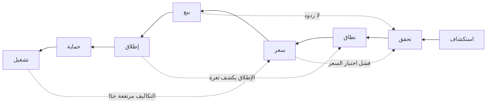

# الوحدة 0 — التوجيه

*صار بإمكانك اليوم أن تبني منتجًا يعمل خلال عطلة نهاية أسبوع، بمجرد أن تصفه لوكيل برمجة بالذكاء الاصطناعي. هذا تغيّر حقيقي، وهو أيضًا فخ: المنتج الذي يعمل ليس عملًا تجاريًا. فلا بدّ أن يتأكد أحد من أن إنسانًا حقيقيًا يعاني من المشكلة، وأن يقرّر ما الذي يُستبعد، ويضع سعرًا، ويجد أول العملاء، ويُطلق المنتج دون أن ينكسر، ويفي بوعوده بشأن البيانات والقانون، ويُبقي الشركة قائمة حين تمرض أو تنام. تضع هذه الوحدة الأساس. تُريك ما الذي غيّره الذكاء الاصطناعي وما الذي تركه على حاله، وتعطيك خريطة الرحلة في ثماني خطوات، وتقول بوضوح كيف تستخدم الدورة وما الذي ليست عليه. ستتعرّف إلى ليلى، مؤسِّسة غير تقنية بنت تيك (Tick)، وهو تطبيق خيالي لتذكير المواعيد، بتوجيه وكيل ذكاء اصطناعي. وحولها نادية، صاحبة صالون صغير وأول عميل شريك في التصميم لتيك، وسام، مصمم مستقل، ومنى، مرشدة، ومحترفان هما هناء المحاسبة وراشد المحامي، لا يظهران إلا ليُريك ما تسأل عنه شخصًا مؤهّلًا. يترك كل درس بين يديك شيئًا تستطيع التحقق منه: قائمة من صفحة واحدة بما ما زال صعبًا، وخريطة رحلة عليها موقعك أنت، وملاحظة شخصية بعنوان «كيف سأستخدم هذه الدورة».*

> **الخطوات:** Explore — النظر إلى الرحلة كلها قبل الالتزام بأي جزء منها: ما الذي صار أرخص، وما الذي لم يصر، وأين أنت.

---

# 0.1 — ما الذي تغيّر وما الذي لم يتغيّر حين يبني الذكاء الاصطناعي المنتج
*المستوى (Level): 🟢 مبتدئ (Beginner)* · *المتطلبات (Prerequisites): لا يوجد* · *الخطوة (Step): Explore*

## ⚡ الدرس في دقيقة (In 60 seconds)
- بعد هذا الدرس تستطيع أن تكتب قائمة من صفحة واحدة بعنوان «ما زال صعبًا» لفكرتك: خمسة أشياء على الأقل لم تجعلها أدوات الذكاء الاصطناعي أسهل، مع سؤال يختبر كلًّا منها.
- ما تغيّر: يفيد بنّاؤون كثيرون بأن أول نسخة من أنواع كثيرة من البرمجيات تستغرق وقتًا ومالًا أقل بكثير من قبل؛ والنتائج تتفاوت ولا يعطي هذا الدرس أرقامًا. وصار بوسع من لا يكتب الشيفرة أن يوجّه وكيلًا ليبني شيئًا يعمل.
- ما لم يتغيّر: أن تعرف أن إنسانًا حقيقيًا يعاني من المشكلة، وأن تختار ما تستبعده، وأن تجد من يدفع، وأن تفي بوعودك بشأن البيانات والقانون، وأن تكون حاضرًا حين يتعطّل شيء.
- القاعدة الأهم: **البناء الرخيص لا يجعل الخطأ رخيصًا.** السرعة في البناء لا تتيح لك إلا أن تخطئ أسرع، ما لم تكتشف الخطأ أسرع أيضًا.
- إشارة القرار: قبل أن تطلب من الوكيل الميزة التالية، هل تستطيع أن تسمّي العميل الذي طلبها، أو الاختبار الذي سيُظهر أن أحدًا لا يريدها؟
- أكبر فخ: اعتبار العرض التجريبي الذي يعمل دليلًا على وجود طلب. العرض يثبت أن البرنامج يعمل، ولا يقول شيئًا عن استعداد أحد للدفع.
- تيك وأشخاصه وكل رقم في هذه الدورة خيالي أو توضيحي. وتُسمّى الأرقام «أرقامًا توضيحية، لا معايير مرجعية».

## 🧭 لماذا يهم (Why it matters)
قضت ليلى عطلة نهاية أسبوع طويلة تصف لوكيل برمجة بالذكاء الاصطناعي تطبيقًا لتذكير المواعيد. وبحلول مساء الأحد صار تيك يقبل قائمة مواعيد ويرسل لكل عميل رسالة تذكير. كان شكله جميلًا. نشرت لقطة شاشة أمام أصدقائها، وكتب عدة منهم: «هذا رائع». شعرت أنها أوشكت على الانتهاء.

وفي يوم الاثنين طرح عليها غريب في مساحة العمل المشتركة أربعة أسئلة بسيطة: من يستخدمه؟ ولماذا يدفع؟ وماذا يحدث إن وصل تذكير إلى الشخص الخطأ؟ وماذا تفعلين إن توقف التطبيق صباح السبت في صالون؟ لم يكن لديها جواب عن أي منها. ولم تقل منى، المرشدة، إن المنتج سيئ. قالت: «أنهيتِ الجزء الذي كان صعبًا فيما مضى. ابدئي الآن الجزء الذي كان دائمًا هو الصعب.»

لهذا الموقف وُضعت هذه الدورة. لم تعد النسخة الأولى هي العقبة الرئيسية في منتجات كثيرة. أما العقبات الباقية فهي التي كانت موجودة دائمًا، وصارت تصل أبكر، لأنك تبلغها قبل أن تنفق أشهرًا ومالًا.

وهذا ليس وعدًا بأن البناء بالذكاء الاصطناعي سيُدرّ عليك مالًا. فكثير من المنتجات لا يجد عملاء، وهذا أمر معتاد. هدف الدورة أضيق وأصدق: أن تساعدك على أن تعرف بتكلفة قليلة هل يستطيع منتجك أن يجد عملاء، وأن تُديره كما ينبغي إن استطاع.

## 📐 كيف يعمل (How it works)

### 🟢 الأساسيات (The essentials)

**المنتج والعمل التجاري شيئان مختلفان.** **المنتج** هو ما يستخدمه العميل. أما **العمل التجاري** فهو المنتج مضافًا إليه سبب يدفع من أجله أحدٌ، وطريقة للوصول إليه، وسعر يغطي تكاليفك، ووعود تستطيع الوفاء بها، وسبيل للاستمرار. وقد كان نفع أدوات الذكاء الاصطناعي أوضح ما يكون في جانب المنتج. أما جانب العمل التجاري فمعظمه أناس ومال وقانون وثقة.

**ما الذي غيّرته أدوات الذكاء الاصطناعي.**

| المجال | قبل | الآن، في منتجات كثيرة |
|---|---|---|
| أول نسخة تعمل | تحتاج إلى مطوّر أو شركة، وأسابيع أو أشهر | يستطيع شخص غير تقني أن يوجّه وكيل ذكاء اصطناعي إلى نسخة أولى في وقت قصير |
| نموذج أولي (prototype) للاختبار | مكلف، فكان الناس يتجادلون بدل أن يختبروا | رخيص بما يكفي لبناء عدة نسخ أولية خشنة وعرضها |
| القطع الروتينية | تسجيل الدخول والنماذج والرسائل ولوحات المتابعة تُكتب يدويًا | كثيرًا ما تُولَّد آليًا، وأحيانًا بتجميع خدمات جاهزة |
| صياغة النصوص | نصوص صفحة الهبوط ومقالات المساعدة والرسائل تبدأ من الصفر | مسوّدة صالحة في ثوانٍ، تحرّرها أنت |

عبارة «في منتجات كثيرة» مهمة. فهي تصف المنتج الصغير المعتاد على الويب أو الجوّال، ولا تصف كل شيء. أما الجهاز الطبي، أو نظام الدفع، أو المنتج الذي يحتاج إلى بحث جديد عميق، فلا يزال بناؤه صعبًا، بالذكاء الاصطناعي أو بدونه.

**ما الذي لم يتغيّر.** اقرأ هذا الجدول مرتين. فهو سبب وجود هذه الدورة.

| ما زال صعبًا | لماذا لا يزيله الذكاء الاصطناعي | السؤال الذي يختبره |
|---|---|---|
| أن تعرف أن أحدًا يعاني من المشكلة | سيبني الوكيل ما تطلبه، سواء احتاج إليه أحد أم لا | هل أستطيع أن أسمّي ثلاثة أشخاص حقيقيين يعانون من هذه المشكلة وحاولوا حلّها؟ |
| أن تختار ما تستبعده | يضيف الوكلاء الميزات بسرور ولا يعترضون أبدًا | أي ميزة كنت سأحذفها لو كان أمامي أسبوع واحد؟ |
| أن تجد من يدفع | المال قرار إنساني يتعلق بالثقة والقيمة | هل دفع أحد، أو وعد بالدفع، قبل أن أبني؟ |
| أن تتحقق مما بُني | قد يكون الوكيل واثقًا ومخطئًا | كيف أعرف أن هذا يعمل على بيانات عميل حقيقي؟ |
| الوعود بشأن البيانات والقانون | القواعد تسري عليك أنت، لا على الأداة | ماذا وعدتُ العملاء، وهل أستطيع الوفاء به؟ |
| أن تكون حاضرًا حين يتعطل | العملاء يتصلون بك أنت، لا بالوكيل | من يصلحه يوم السبت، وكيف يعرف العملاء؟ |
| إبقاء الشركة قائمة | العمل التجاري يحتاج إلى مال وسجلات واستمرارية | لو اختفيتُ أسبوعين، ماذا سيتوقف؟ |

**القاعدة التي ينبغي أن تحفظها: البناء الرخيص لا يجعل الخطأ رخيصًا.** تخيّل مؤسِّسَين. الأول يقضي ستة أشهر في البناء قبل أن يُري أحدًا شيئًا، ثم يكتشف أن أحدًا لا يريده. والثاني يبني في عطلة أسبوع، ولا يُري أحدًا، ثم يضيف الميزات ستة أسابيع. كلاهما ينتهي إلى المكان نفسه. ما يحميك ليس سرعة البناء، بل سرعة التعلّم: كم تسرع في الحصول على أدلة من أناس حقيقيين.

**عن عدم اليقين بصدق.** لن تخبرك هذه الدورة كم من الشركات الناشئة تفشل، ولا كم يوفّر الذكاء الاصطناعي، ولا بأي سرعة تستطيع أن تنمو. فهذه الأرقام كثيرًا ما تتداول بلا مصادر جيدة، والرقم الذي لا تستطيع تتبّعه قرارٌ لا تستطيع فحصه. وحيث يظهر رقم هنا فهو إما موصوف بأنه توضيحي أو له مصدر.

### 🟡 التعمق أكثر (Going deeper)

**الصعوبة الجوهرية والصعوبة العرضية.** ميّز مهندس البرمجيات فريدريك بروكس، في ورقة شهيرة عُرضت عام 1986 ونُشرت عام 1987 بعنوان «No Silver Bullet»، بين الصعوبة *العرضية* في البرمجيات (accidental difficulty) وهي الأدوات المرهقة والشيفرة المتكررة وميكانيكا كتابة البرنامج، والصعوبة *الجوهرية* (essential difficulty) وهي تقرير ما يُبنى وضبط التصميم على المشكلة الحقيقية. تستطيع الأدوات أن تزيل الصعوبة العرضية، وقد رأى المقال أن لا أداة تزيل الجوهرية. وكلاء الذكاء الاصطناعي بارعون في الجزء العرضي. أما الجزء الجوهري، في العمل التجاري، فهو ما تسمّيه هذه الدورة عمل المؤسِّس.

**أين ينتقل الجهد.** حين يرخص إنتاج المنتج، لا يختفي الجهد. بل ينتقل إلى أماكن أخرى:

| ينتقل الجهد إلى | كيف يبدو عند ليلى |
|---|---|
| القرار | أي عميل واحد، وأي مهمة واحدة، وما الذي يُستبعد |
| التحقق | قراءة ما بناه الوكيل، واختباره ببيانات حقيقية، وسؤال محترف عن المخاطر |
| البيع | إيجاد الناس، والحديث معهم، وطلب المال |
| التوضيح | تدوين ما وعدتَ به، وما يفعله جزء الذكاء الاصطناعي وما لا يفعله |
| التشغيل | الدعم، والأعطال، والتكاليف، والمزوّدون، والصلاحيات |

**مخاطر جديدة تصحب المنتجات المبنية بالذكاء الاصطناعي.** يضيف البناء السريع بالوكلاء مخاطر خاصة به، تتناولها الوحدات اللاحقة بعمق:

- قد لا تفهم ما أطلقتَه، فلا تستطيع تقدير مخاطره. تتناول الوحدة 2 هذا، ويتناوله في مكتبتنا [*تصميم الأنظمة لمبرمجي الفايب*، الدرس 0.1 — "يعمل" ليست صفة للنظام](../vibe/index.ar.html#l0-1).
- قد ترتفع تكاليفك مع الاستخدام، لأن نماذج الذكاء الاصطناعي كثيرًا ما تُدفع بحسب الاستعمال. يشرح [*إدارة منتجات الذكاء الاصطناعي*، الدرس 0.2 — كيف تختلف منتجات الذكاء الاصطناعي: احتمالية، ونهمة للبيانات، ومكلفة لكل استخدام، ومرهونة بالثقة](../aipm/index.ar.html#/0.2) جانب المنتج، ويحوّله الدرس 3.1 هنا إلى الاقتصاديات الوحدوية (unit economics).
- ملكية الشيفرة التي كتبها الذكاء الاصطناعي وشروط الأدوات التي استخدمتها غير محسومة أو تختلف باختلاف البلد والأداة. يعطيك الدرس 6.3 أسئلة تطرحها على محامٍ.
- قد يفترض العملاء أشياء عن استخدام الذكاء الاصطناعي، ولذلك تهم الصراحة بشأنه. يتناول الدرس 0.3 والوحدة 5 الإفصاح.

**لماذا قد تضلّلك السرعة.** البناء السريع يخلق شعورًا بالتقدّم. أما التقدّم في العمل التجاري فهو تقلّص في عدم اليقين: أن تعرف أكثر عمّن يدفع ولماذا. والميزات لا تقلّص عدم اليقين. الذي يقلّصه هو المحادثات والبيع المسبق (pre-sale) والاستخدام. وعادة مفيدة أن تحتفظ بقائمتين: *ما بنيتُه* و*ما تعلّمتُه*. فإذا نمت القائمة الأولى ولم تنمُ الثانية، فأنت تنجرف.

### 🔴 نظرة الخبير (Expert view)

**تكلفة النسخة الأولى ليست تكلفة المنتج.** للبرمجيات ذيل طويل: الصيانة والإصلاحات وتغيّر الأدوات التي تعتمد عليها ودعم العملاء والأمن. قد تكون النسخة الأولى رخيصة بينما يبقى امتلاك المنتج مكلفًا. ستحصي في الوحدة 3 التكاليف المتكررة، وفي الوحدة 7 المزوّدين وخطر الاعتماد على واحد منهم.

**النماذج الأولية الرخيصة تغيّر الخطر الذي يُختبر أولًا.** كان المؤسِّس يختبر قبلًا: *هل يمكن بناؤه؟* لأن ذلك كان المجهول الأغلى. أما الآن فهو في الغالب المجهول الأرخص، فيكون الخطر الذي ينبغي اختباره أولًا هو في الغالب: *هل سيريده أحد ويدفع ثمنه؟* وقد بُنيت الوحدتان 1 و4 على هذا التحوّل. ويصف نهج **الشركة الناشئة الرشيقة (lean startup)**، الذي رسّخه إريك ريز، بناءَ أصغر شيء يتيح لك أن تتعلّم، وقياسَ ما تتعلّمه. والذكاء الاصطناعي يجعل «أصغر شيء» أصغر، ولا يغيّر المبدأ.

## 🧰 الأدوات (The toolkit)
| المورد أو الأداة أو النموذج (Resource, tool or template) | ما هو وماذا يفعل (What it is and does) | متى تلجأ إليه (When to reach for it) |
|---|---|---|
| **"Still hard" list** — قائمة «ما زال صعبًا» | قائمة من صفحة واحدة بما لم تجعله أدوات الذكاء الاصطناعي أسهل في فكرتك، لكل بند سؤال اختبار ومسؤول | في البداية، ومرة أخرى قبل كل قرار إطلاق |
| **Built-versus-learned log** — سجل «ما بُني مقابل ما تُعلّم» | عمودان مؤرَّخان: ما بنيتَه وما تعلّمتَه من أناس حقيقيين | كل أسبوع، لتلتقط الانجراف نحو الميزات |
| **Demo-versus-demand check** — فحص «العرض مقابل الطلب» | ثلاثة أسئلة: من طلبه، ومن دفع ثمنه، ومن يستخدمه دون أن يُطلب منه | قبل أن تضيف أي ميزة جديدة |
| **Claim-versus-source note** — ملاحظة «الادعاء مقابل المصدر» | جدول قصير بكل رقم تنوي ذكره، ومن أين جاء | قبل أن تضع إحصائية في صفحة أو عرض |
| **Agent session notes** — ملاحظات جلسات الوكيل | سجل قصير بما طلبتَه من الوكيل وكيف تحققتَ منه | بعد كل جلسة بناء |
| **Question list for a stranger** — قائمة أسئلة الغريب | الأسئلة البسيطة الأربعة التي لم تستطع ليلى الإجابة عنها: من يستخدمه، ولماذا يدفع، وماذا لو ساء الأمر، ومن يصلحه | حين يسألك أحد «ما هذا؟» ولا تستطيع الإجابة في جملة واحدة |

الأدوات أمثلة وليست توصيات. ويكفي لكل ما سبق تطبيق ملاحظات أو جدول بيانات.

## 🏛️ عمليًا مع تيك (In practice with Tick)
تيك تطبيق خيالي. وليلى ونادية وسام ومنى وهناء وراشد شخصيات خيالية، وكل الأرقام توضيحية، لا معايير مرجعية.

يوم الثلاثاء جلست ليلى مع منى وكتبتا قائمة «ما زال صعبًا» لتيك. استغرقت أربعين دقيقة.

| ما زال صعبًا | جواب ليلى الصريح | سؤال الاختبار | المسؤول |
|---|---|---|---|
| هل يعاني أحد من المشكلة؟ | نادية وحدها قالت ذلك، وهي صديقة | هل أستطيع أن أسمّي ثلاثة صالونات أو مدرّسين، ليسوا أصدقاء، تفوتهم مواعيد وحاولوا حلّ ذلك؟ | ليلى |
| ما الذي يُستبعد | أضاف الوكيل شاشة نقاط ولاء لم تطلبها | أي شاشة سأحذفها أولًا؟ | ليلى |
| من يدفع؟ | لم يُطلب من أحد | هل ستدفع نادية، أو تعد بالدفع، قبل أن أضيف المزيد؟ | ليلى |
| هل يعمل؟ | عمل على 12 موعدًا تجريبيًا كتبتها بنفسها | ماذا يحدث مع عميلة بلا رقم هاتف، أو باسم بحروف لغة أخرى؟ | ليلى، ومعها سام لاحقًا من أجل الصفحة |
| الوعود بشأن البيانات | يخزّن تيك أسماء العملاء وأرقام هواتفهم | ماذا وعدتُ، وماذا ينبغي أن أسأل راشد؟ | ليلى، ثم راشد |
| الدعم | رقم هاتف ليلى نفسها على صفحة التسجيل | من يرد يوم السبت؟ | ليلى |
| الاستمرارية | كل شيء يعمل من حساب ليلى الوحيد | لو مرضت ليلى أسبوعين، ماذا يتوقف؟ | ليلى |

وبدأت أيضًا سجل «ما بُني مقابل ما تُعلّم». بعد عطلة الأسبوع كان عمود «ما بُني» فيه ستة بنود وعمود «ما تُعلّم» فارغًا. أشارت منى إلى السجل وصمتت. وكتبت ليلى أول بند في «ما تُعلّم» مساء ذلك اليوم، بعد أن راسلت نادية: *عميلات نادية يرددن بكلمة «نعم» على التذكيرات، وتيك لا يتعامل مع الردود.*

## 🛠️ التمارين (Exercises)
🟢 **اكتب قائمة «ما زال صعبًا».** لفكرتك أنت، أو لفكرة متخيَّلة، عدّد خمسة أشياء على الأقل من الجدول الثاني في هذا الدرس. واكتب لكل منها سؤال اختبار ومسؤولًا. *يكتمل عندما (Done when):* تكون القائمة موجودة في مستند، وفيها خمسة صفوف على الأقل، ولكل صف سؤال تستطيع أن تطرحه فعلًا على شخص حقيقي.

🟡 **أجرِ فحص «العرض مقابل الطلب».** خذ شيئًا بنيتَه، أو نموذجًا أوليًا صنعتَه هذا الأسبوع بأداة ذكاء اصطناعي. اكتب من طلبه، ومن دفع أو وعد بالدفع، ومن استخدمه دون أن يُطلب منه. اعرض النتيجة على شخص آخر. *يكتمل عندما (Done when):* تكون الإجابات الثلاث مكتوبة، لكل منها اسم أو عبارة صادقة «لا أحد بعد»، وقد قرأها شخص آخر وقال إن كان يصدّقها.

🔴 **دقّق ادعاءً كنت على وشك أن تقوله.** اختر رقمًا سمعتَه أو كنت تنوي ترديده عن سوقك، أو عن توفير الذكاء الاصطناعي للوقت، أو عن حال الشركات الناشئة. تتبّعه إلى مصدره. فإن لم تجد مصدرًا أوليًا أو معتبرًا، فاكتب ما كنت ستقوله بدل الرقم. *يكتمل عندما (Done when):* تُظهر ملاحظةٌ الادعاء، والمصدر الذي وجدتَه أو «لم أجد»، والجملة البديلة، ويستطيع زميل أن يتبع أثرك.

## ⚠️ أخطاء وفخاخ (Mistakes and traps)
- **اعتبار العرض التجريبي طلبًا.** قول الأصدقاء «رائع» مجاملة، لا نية شراء. بدل ذلك، اطلب من أحد أن يدفع أو أن يلتزم بوقته قبل أن تضيف ميزات.
- **بناء الميزة التالية لأن الوكيل جعلها سهلة.** السهولة ليست سببًا. بدل ذلك، سمِّ العميل الذي طلبها، أو الاختبار الذي سيُظهر أن أحدًا لا يريدها.
- **تصديق أن «الذكاء الاصطناعي يفعل كل شيء».** هو يفعل الجزء العرضي جيدًا والجزء الجوهري بشكل ضعيف. بدل ذلك، أبقِ قائمة «ما زال صعبًا» أمامك وعيّن لكل صف مسؤولًا.
- **ذكر أرقام لا تستطيع تتبّعها.** تتداول إحصائيات مبهرة بلا مصدر. بدل ذلك، استشهد بمصدر فتحتَه، أو قل ما لا تعرفه.
- **إخفاء استخدام الذكاء الاصطناعي لتبدو أعرق.** قد يتوقع العملاء والقواعد إفصاحًا. بدل ذلك، كن عمليًا وصريحًا فيما يفعله جزء الذكاء الاصطناعي، وانظر الدرس 0.3 والوحدة 5.
- **اعتبار أول نسخة رخيصة هي التكلفة كلها.** تشغيل المنتج يكلّف مالًا وانتباهًا ما دام حيًّا. بدل ذلك، أحصِ التكاليف المتكررة مبكرًا كما تبيّن الوحدة 3.

## 🧾 الخلاصة (Recap)
- خفّضت أدوات الذكاء الاصطناعي بشدة تكلفة أول نسخة ووقتها في أنواع كثيرة من المنتجات. لكنها لم تُزل مشكلات العمل التجاري.
- ما زال صعبًا: هل يعاني أحد من المشكلة، وما الذي يُستبعد، ومن يدفع، وهل يعمل، والوعود بشأن البيانات والقانون، والدعم، والاستمرارية.
- البناء الرخيص لا يجعل الخطأ رخيصًا. وسرعة التعلّم هي ما يحميك.
- ينتقل الجهد من الإنتاج إلى القرار والتحقق والبيع والتوضيح والتشغيل.
- احتفظ بسجل «ما بُني مقابل ما تُعلّم». فإن نما العمود الأول وحده، فأنت تنجرف.
- تيك خيالي، وأرقامه توضيحية، ولا شيء هنا يعد بدخل أو تمويل أو مستخدمين.

## ✍️ اختبر نفسك (Check yourself)

**1. عند ليلى عرض تجريبي لتيك يعمل، وعشرة من أصدقائها يقولون إنهم يحبونه. ماذا يُظهر هذا؟**

- A. أن للمنتج طلبًا واضحًا، فعليها أن تضيف الميزات التي يذكرونها.
- B. أن البرنامج يعمل، لكن الطلب والاستعداد للدفع لم يثبتا بعد لدى عملاء حقيقيين.
- C. أن المنتج جاهز للإطلاق أمام الجمهور دون أي مزيد من الاختبار.
- D. أن السعر مناسب، لأن الأصدقاء لن يمدحوا منتجًا غالي الثمن.

الإجابة

**B.** العرض يُظهر أن البرنامج يعمل. أما مديح الأصدقاء فمجاملة لا قرار شراء، فيبقى الطلب والاستعداد للدفع مجهولين. الخيار A مغرٍ لأنه يقرأ المديح دليلًا على الطلب، أما C وD فتتجاوزان الاختبارات التي تكشف ذلك. (انظر «القاعدة التي ينبغي أن تحفظها».)

**2. وفق هذا الدرس، أي مهمة جعلتها أدوات الذكاء الاصطناعي أسهل بوضوح في منتجات كثيرة؟**

- A. تقرير أي عميل واحد تخدمه أولًا.
- B. إقناع عميل بدفع أول فاتورة.
- C. تقدير ما يلزمك به وعدٌ بشأن حماية البيانات.
- D. إنتاج أول نسخة تعمل من البرنامج.

الإجابة

**D.** أول نسخة تعمل هي الجزء الذي صار أرخص وأسرع في منتجات كثيرة. أما الثلاثة الأخرى فهي حكم وبيع وقانون، وتبقى عند المؤسِّس. والخيار A زلة شائعة لأن الوكيل يستطيع أن يقترح عملاء، لكن الاختيار يبقى لك. (انظر «ما الذي غيّرته أدوات الذكاء الاصطناعي».)

**3. أضاف وكيل ليلى شاشة نقاط ولاء لم تطلبها. ما أفضل رد؟**

- A. أن تسأل من يريدها أو أي اختبار يُظهر أن أحدًا لا يريدها، وتحذفها إن غاب الجواب عنهما.
- B. أن تُبقيها، لأن الميزات الإضافية تجعل المنتج أجذب لكثير من المشترين المحتملين.
- C. أن تطلب من الوكيل إضافة ثلاث ميزات أخرى حتى يبدو المنتج مكتملًا للجميع.
- D. أن تتركها في مكانها، لأن حذف شيفرة كتبها الوكيل قد يكسر التطبيق كله فجأة.

الإجابة

**A.** اختيار ما يُستبعد عمل المؤسِّس، والاختبار هو عميل مسمّى أو تجربة مسمّاة. يخلط B وC بين كثرة الميزات وزيادة القيمة. أما D فخوف من الكسر، وهذا يُعالَج بالفحص بعد كل تغيير، لا بإبقاء شيفرة لا يحتاج إليها أحد. (انظر «أين ينتقل الجهد».)

**4. بعد بناء سريع في عطلة الأسبوع، في عمود «ما بُني» عند ليلى ستة بنود وعمود «ما تُعلّم» فارغ. ماذا يوحي صمت منى؟**

- A. أن ليلى أحرزت تقدمًا ممتازًا، لأن التقدم يُقاس بعدد الميزات المبنية.
- B. أن على ليلى أن تبني بنودًا أكثر الآن، لأن التعلّم يأتي بعد ذلك.
- C. أن ليلى تنجرف، لأن التقدم يعني أن تعرف أكثر عمّن يدفع ولماذا.
- D. أن على ليلى أن تحذف السجل كله، لأنه يبطئ البناء ويشتت انتباهها.

الإجابة

**C.** التقدم في العمل التجاري تقلّص في عدم اليقين، والميزات لا تقلّصه. وعمود «ما تُعلّم» الفارغ معناه أنها لم تختبر شيئًا مع أناس حقيقيين بعد. يساوي A وB بين البناء والتقدم، ويزيل D الأداة التي تكشف المشكلة نفسها. (انظر «لماذا قد تضلّلك السرعة».)

**5. يقول صديق لليلى: «معظم الشركات الناشئة تفشل خلال سنة، فلا تتعبي». ماذا تفعل ليلى بهذا الادعاء؟**

- A. تذكره في عرضها، لأن الإحصائيات المشهورة آمنة الاستعمال دائمًا.
- B. تتتبّعه إلى مصدر أولي، أو تترك الرقم وتقول ما لا تعرفه.
- C. تتجاهل كل الأرقام مستقبلًا، لأن كل إحصائية مختلقة.
- D. تستعمل رقمًا آخر من الذاكرة يبدو أكثر تشجيعًا.

الإجابة

**B.** الرقم الذي لا تستطيع تتبّعه قرارٌ لا تستطيع فحصه، فابحث عن المصدر أو اترك الرقم. يكرّر A ادعاءً لم يُتتبَّع، ويبالغ C في التصحيح، ويستبدل D رقمًا لم يُختبر برقم آخر. (انظر «عن عدم اليقين بصدق» وملاحظة «الادعاء مقابل المصدر».)

## 📚 المراجع (References)
- Frederick P. Brooks Jr., "No Silver Bullet: Essence and Accidents of Software Engineering", *IEEE Computer*, April 1987 (عُرض أول مرة عام 1986). مصدر التمييز بين الجوهري والعرضي المستخدم في هذا الدرس. استشهاد كامل فقط، دون رابط مؤكَّد.
- Eric Ries, *The Lean Startup* (2011). خلفية عن بناء أصغر شيء يتيح لك أن تتعلّم. استشهاد كامل فقط، دون رابط مؤكَّد.
- Anthropic, "Building effective agents", Anthropic Engineering, 19 December 2024. يميّز بين سير العمل (workflows) الذي تُحدَّد مساراته البرمجية سلفًا، والوكلاء (agents) الذين يوجّه فيهم النموذج خطواته بنفسه؛ وينبّه أيضًا إلى أن الوكلاء يحتاجون إلى فحص نتائجهم بما يحدث فعلًا في بيئتهم. https://www.anthropic.com/engineering/building-effective-agents (فُتحت الصفحة).
- *System Design for Vibe Coders* و*AI Product Management: Zero to Hero*، الدروس المرتبطة أعلاه، في هذه المكتبة.

---

# 0.2 — خريطة المؤسِّس: ثماني خطوات وشخصيات تيك
*المستوى (Level): 🟢 مبتدئ (Beginner)* · *المتطلبات (Prerequisites): 0.1* · *الخطوة (Step): Explore*

## ⚡ الدرس في دقيقة (In 60 seconds)
- بعد هذا الدرس تستطيع أن ترسم خريطة رحلتك بثماني خطوات، وتحدّد الخطوة التي أنت فيها، وتسمّي الناتج الواحد الذي يثبت أنك أنهيتها.
- الخطوات الثماني هي **Explore, Validate, Scope, Price, Sell, Launch, Protect, Run**. يحمل كل درس في هذه الدورة واحدة منها أو اثنتين وسمًا.
- الخطوات دليل لا خط إنتاج. ستعود إلى الوراء: قد يعيدك اختبار سعر إلى التحقق، وقد يعيدك إطلاق إلى تحديد النطاق.
- القاعدة الأهم: **لا تقفز إلى Sell أو Launch لأن البناء انتهى.** الخطوات الأولى رخيصة، وتجاوزها هو الخطأ المكلف.
- إشارة القرار: إن لم تستطع أن تسمّي الناتج الذي يثبت أن الخطوة الحالية انتهت، فلست جاهزًا للانتقال.
- أكبر فخ: اعتبار الخطوات وعدًا. إنهاء الثماني لا يضمن عملًا تجاريًا. معناه فقط أنك نظرتَ إلى كل ما يهم عادةً.

## 🧭 لماذا يهم (Why it matters)
عرفت ليلى الآن أن البناء كان الجزء السهل، وتشعر بالمشكلة المعاكسة: أشياء كثيرة جدًا، بلا ترتيب. تكتب قائمة. «أجد عملاء. أُعدّ الدفع. أكتب الشروط والخصوصية. أحسّن صفحة الهبوط. الدعم. الاسم. الشعار. الحساب البنكي. وسائل التواصل. مستثمرون؟» أربعون سطرًا. تنجز ما يبدو أشبه بالتقدم: شعار مع سام، وحساب على وسائل التواصل، واسم للشركة.

تنظر منى إلى القائمة وتسأل سؤالًا واحدًا: «لو توقفت نادية عن استخدام تيك غدًا، أي هذه البنود كان سيهم؟» لا شيء تقريبًا. كانت ليلى تختار المهام بحسب مدى راحتها لها، لا بحسب ما تُنقصه من احتمال الفشل.

والخريطة تعالج هذا. هي لا تقول لك ماذا تفعل كل يوم. لكنها تقول لك بأي ترتيب تأتي الأسئلة الكبيرة عادةً، حتى لا يتأخر سؤال رخيص خلف سؤال مكلف. يعطيك هذا الدرس تلك الخريطة، ويعرّفك بالناس الذين سيمشون الطريق مع ليلى، وينتهي بأن تضع علامة على موقعك أنت.

## 📐 كيف يعمل (How it works)

### 🟢 الأساسيات (The essentials)

**الخطوات الثماني.** يحمل كل درس واحدة منها أو اثنتين وسمًا. ولكل خطوة سؤال واختبار رخيص وناتج: شيء تستطيع أن تُريه.

| الخطوة | السؤال | اختبار رخيص | الناتج الذي يثبتها | الوحدات |
|---|---|---|---|---|
| **Explore** | هل هناك مشكلة وشخص وسبب للمضي في البحث؟ | النظر إلى الرحلة كلها وإلى وضعك أنت | قائمة «ما زال صعبًا» وخريطة رحلة | 0، 1 |
| **Validate** | هل لدى إنسان حقيقي هذه المشكلة بدرجة تدفعه إلى التصرف؟ | مقابلات واختبار دخان (smoke test) وبيع مسبق (pre-sale) | بيان مشكلة وسجل مقابلات ونتيجة اختبار دخان | 1 |
| **Scope** | ما أصغر شيء يحل مهمة واحدة لعميل واحد؟ | قائمة استبعاد (kill list) وقرار بناء أو شراء | بيان نطاق وقائمة استبعاد | 2 |
| **Price** | هل يستطيع هذا أن يكسب أكثر مما يكلّف، بسعر يقبله الناس؟ | ورقة الاقتصاديات الوحدوية (unit economics) واختبار سعر | خطة اختبار سعر وجدول نقدي | 3 |
| **Sell** | أين أول العملاء، وكيف أصل إليهم بأمانة؟ | تواصل مع عشرة أشخاص | قائمة أول عشرة ورسالة تواصل | 4 |
| **Launch** | هل أستطيع أن أُصدر هذا بطريقة أستطيع التراجع عنها، وأن أقدّم الدعم له؟ | قائمة تحقق للإطلاق وسياسة دعم | قائمة تحقق للإطلاق وسياسة دعم | 5 |
| **Protect** | ماذا وعدتُ، وما واجباتي تجاه العملاء وبياناتهم؟ | قائمة أسئلة لمحامٍ ولمحاسب | أسئلة الشروط والخصوصية وجدول بيانات | 6 |
| **Run** | هل يستطيع هذا أن يستمر لو كنت مشغولًا أو مريضًا أو غائبًا؟ | حزمة تسليم (handover pack) | حزمة تسليم من 30 دقيقة | 7 |

تجمع الوحدة 8 الخطوات الثماني كلها في ملف مشروع وامتحان تدريبي.

**لماذا هذا الترتيب.** الترتيب يتبع التكلفة والخطر. تأتي الأسئلة الأرخص أولًا، لأن الجواب الخاطئ عنها أثمن ما يمكن أن تتعلمه مبكرًا. ومعرفة أن أحدًا لا يريد ميزة قبل البناء تكلّف عادةً أقل من معرفة ذلك بعده؛ والفارق يتفاوت.

**هي حلقة، لا خط مستقيم.** الرحلات الحقيقية تبدو هكذا:

تأتي أول قائمة أسئلة في Protect قبل Launch؛ ويستمر عمل Protect الكامل بعده.

العودة إلى الوراء ليست فشلًا. هي الخريطة تؤدي عملها. فاختبار السعر الذي يفشل معلومة عن التحقق. والإطلاق الذي يكشف ثغرة معلومة عن النطاق.

**شخصيات تيك.** تيك تطبيق **خيالي** لتذكير المواعيد لدى أصحاب الأعمال الخدمية الصغيرة مثل الصالونات والمدرّسين والعيادات ومحلات التصليح. وُجد لنعرض قرارات حقيقية دون أن نذكر شركات حقيقية. فاعتبر الشخصيات ناسًا ستعتاد عليهم.

| الشخصية | الدور | كيف تساعدك على التعلّم |
|---|---|---|
| **ليلى** | المؤسِّسة. غير تقنية، بنت تيك بتوجيه وكيل ذكاء اصطناعي | سريعة، لكنها تتخطى التحقق؛ وأخطاؤها هي الأخطاء الشائعة |
| **نادية** | تدير صالونًا صغيرًا؛ أول عميل شريك في التصميم لتيك | تُظهر ما يحتاج إليه عميل حقيقي، وتلاحظ، وتتسامح |
| **سام** | مصمم مستقل ومتعاقد | يُظهر التوظيف والنطاق ومن يملك ما يُصنع |
| **منى** | مؤسِّسة مقيمة في مساحة عمل مشتركة خيالية؛ مرشدة ليلى | تسأل السؤال الذي كنت تتجنبه |
| **هناء** | محاسبة | تظهر فقط لتُريك ما تسأل عنه محترفًا مؤهلًا في شؤون المال |
| **راشد** | محامٍ | يظهر فقط ليُريك ما تسأل عنه محترفًا مؤهلًا في شؤون القانون |

لا تقدّم هناء وراشد نصيحة. هما هنا حتى ترى، حين تصل الدورة إلى الضريبة أو القانون، *ما تحضره إلى الاجتماع* و*ما تسأل عنه*. وما يقولانه في هذه الدورة ليس نصيحة قانونية ولا ضريبية.

### 🟡 التعمق أكثر (Going deeper)

**لكل خطوة اختبار خروج.** تنتهي الخطوة حين تستطيع أن تُري الناتج، لا حين تشعر أنك أنهيتَها. واختبارات الخروج متواضعة عمدًا:

| الخطوة | اختبار خروج معقول |
|---|---|
| Explore | لديك قائمة «ما زال صعبًا» وخريطة عليها موقعك |
| Validate | وصف بعض الناس الحقيقيين، لا الأصدقاء، المشكلةَ بكلماتهم، وأقدم واحد منهم على الأقل على فعل مكلف (دفع، أو التزم بوقته، أو شارك بيانات) |
| Scope | عميل واحد، ومهمة واحدة، وقائمة مكتوبة بما لن تبنيه |
| Price | سعر اختبرتَه مع ناس حقيقيين، وتكلفة لكل عميل تستطيع حسابها |
| Sell | قائمة بعشرة أشخاص يمكن الوصول إليهم، ورسالة تقبل أن ترسلها باسمك |
| Launch | إصدار تستطيع التراجع عنه، وخطة لأول يوم سيئ |
| Protect | قائمة أسئلة حملتَها إلى محترف مؤهل، مع ملاحظات الاجتماع |
| Run | حزمة تسليم يستطيع شخص آخر أن يتبعها في ثلاثين دقيقة |

هذه نقاط بداية. وقد تضع أنت اختبارات أشدّ.

**أين تساعد المكتبة.** تعلّم المكتبة بعمق عدة أجزاء، وتحيلك هذه الدورة إليها دون أن تكرّرها:

| الحاجة | إلى أين تذهب |
|---|---|
| توجيه وكيل والإطلاق بأمان | [*تصميم الأنظمة لمبرمجي الفايب*، الدرس F.4 — تعرّف على وكيلك: كيف تدير منفذًا لا تراقبه](../vibe/index.ar.html#lF-4) |
| البناء أم الشراء أم الاستعارة على مستوى التقنية | [*تصميم الأنظمة لمبرمجي الفايب*، الدرس 0.3 — البناء أم الشراء: القرار الأعلى أثرًا الذي ستتخذه](../vibe/index.ar.html#l0-3) |
| اختيار الأفكار وقتلها في سياق شركة | [*إدارة منتجات الذكاء الاصطناعي*، الدرس 2.3 — متى لا تستخدم الذكاء الاصطناعي، وقتل الأفكار مبكرًا](../aipm/index.ar.html#/2.3) |
| الأجزاء التي يحتاج إليها كل منتج اشتراكات | [*لبنات بناء SaaS*، الدرس 0.1 — الـ 80% التي لا يبيعها أحد: تشريح كل SaaS](../saas/index.ar.html#/0.1) |

وتتناول هذه الدورة كلًّا منها من زاوية المؤسِّس: ما الذي تقرّره، وأي دليل تطلبه.

**أي الخطوات يمكن أن تسير معًا.** تتداخل بعض الخطوات في الواقع. تستطيع أن تبدأ محادثات Sell وأنت تنهي Validate، لأن الحديث إلى عميل محتمل يخدم الاثنتين. لكن لا تبدأ Launch قبل أن تُخرج Protect قائمة أسئلة أولى على الأقل، لأن الإطلاق بلا شروط ولا إشعار خصوصية خطر يمكن تجنّبه. اعتبر الترتيب هو الأصل، واكتب سببك حين تغيّره.

**كيف تقابل المستويات الخطوات.** الوحدات من 0 إلى 2 مستواها مبتدئ، ومن 3 إلى 5 متوسط، ومن 6 إلى 8 متقدم. لست مضطرًا إلى اتباع المستويات بحرفيتها. فمؤسِّس في فريق صغير معه مطوّر قد يمرّ على الوحدة 2 سريعًا، وقد يطيل المؤسِّس غير التقني الإقامة فيها.

### 🔴 نظرة الخبير (Expert view)

**أين يتعثر المؤسِّسون فعلًا.** في الواقع تتجمع حالات التعثر في أماكن قليلة. يتعثر Validate حين لا يجد المؤسِّس من يسأله. ويتعثر Scope حين تبدو «ميزة واحدة أخرى» أأمن من الاختيار. ويتعثر Price لأن طلب المال يبدو أمرًا شخصيًا. ويتعثر Sell عند الصمت. ويتعثر Protect لأن القانون يبدو مخيفًا ومكلفًا. ويتعثر Run لأن النجاح يصل والمؤسِّس يفعل كل شيء بنفسه. وتسمية التعثر مسبقًا تسهّل رؤيته حين يأتي. وهذه ملاحظات عن أنماط، لا إحصائيات، وقد تختلف تجربتك.

**الخريطة أداة للحوار.** أرِها لمن يساعدونك: مرشد، وعميل شريك، ومحامٍ. حين تشير إلى خطوة («أنا هنا، وهذا الناتج الذي ينقصني») يصير الاجتماع القصير مفيدًا. ويستطيع المحترفون أن يساعدوك أكثر بكثير حين تأتي بسؤال محدد.

**الفريق الصغير مقابل المؤسِّس المنفرد.** يستطيع فريق من خمسة أشخاص على الأكثر أن يتقاسم الخطوات، فيتولى أحدهم Validate وSell ويتولى آخر Scope وLaunch. والخطر أن لا يملك أحد Protect وRun. أعطِ كل خطوة مسؤولًا، ولو كان المسؤول هو نفسه عن عدة خطوات. ويعود الدرس 7.3 إلى هذا في سياق مخاطر الاعتماد على شخص واحد (key-person risk).

**لا تخلط بين الخريطة والخطة.** الخطة تلزمك بتواريخ. والخريطة تُري أين تقع الأشياء. وخطتك لثلاثين يومًا لا تظهر إلا في الوحدة 8، بعد أن تصير لديك الأدلة التي تصنعها بها. وإلى ذلك الحين خطّط للخطوة التالية فقط.

## 🧰 الأدوات (The toolkit)
| المورد أو الأداة أو النموذج (Resource, tool or template) | ما هو وماذا يفعل (What it is and does) | متى تلجأ إليه (When to reach for it) |
|---|---|---|
| **Journey map** — خريطة الرحلة | صورة من صفحة واحدة للخطوات الثماني، عليها موقعك، والناتج الذي تحتاج إليه كل خطوة | في البداية، وكلما شعرت بالضياع |
| **Step exit test** — اختبار خروج الخطوة | فحص من سطر واحد لكل خطوة: الناتج الذي تستطيع أن تُريه | قبل الانتقال إلى الخطوة التالية |
| **Loop-back log** — سجل العودة | قائمة مؤرَّخة بالمرات التي رجعتَ فيها خطوة وسبب ذلك | كلما فشل اختبار؛ فهو يُظهر أن الخريطة تعمل |
| **Step owner table** — جدول مسؤولي الخطوات | من يملك كل خطوة، بمن فيهم من يملك Protect وRun | حين تعمل مع شريك أو متعاقد أو فريق صغير |
| **Stall note** — ملاحظة التعثر | جملة واحدة تسمّي أين أنت عالق وما الذي تتجنّبه | حين يمرّ أسبوع بلا تقدّم |
| **Cast crib sheet** — بطاقة الشخصيات | بطاقة بشخصيات تيك الست والدرس الذي تظهر فيه كل منها | عند قراءة الدورة، لتبقى الشخصيات واضحة |

الأدوات أمثلة وليست توصيات. وصفحة في دفتر تكفي تمامًا خريطةَ رحلة.

## 🏛️ عمليًا مع تيك (In practice with Tick)
تيك وأشخاصه وكل الأرقام هنا خيالية، والأرقام توضيحية لا معايير مرجعية.

أعطت منى ليلى ورقة واحدة وطلبت منها أن ترسم الخطوات الثماني وتضع علامة على موضع تيك.

كانت خريطة ليلى الصريحة هكذا:

| الخطوة | أين كان تيك | الناتج الناقص |
|---|---|---|
| Explore | منتهية بصورة تقريبية: قائمة «ما زال صعبًا» من الدرس 0.1 | الخريطة نفسها |
| Validate | عميلة ودودة واحدة، نادية، ولا أحد غيرها | سجل مقابلات مع بعض الغرباء على الأقل |
| Scope | كل ما أضافه الوكيل، ولا شيء استُبعد | قائمة استبعاد |
| Price | لا سعر؛ نادية تستخدمه مجانًا | تكلفة لكل عميل وخطة اختبار سعر |
| Sell | لا قائمة | قائمة أول عشرة |
| Launch | صفحة تسجيل عليها رقم هاتف ليلى | قائمة تحقق للإطلاق وسياسة دعم |
| Protect | لا شيء مكتوب | قائمة أسئلة لراشد وهناء |
| Run | كل شيء في حساب ليلى الوحيد | حزمة تسليم |

وكتبت تحتها: **«أنا في Validate، وتصرفتُ كأنني في Launch.»** ثم فعلت شيئًا صغيرًا. شطبت أربع مهام من قائمتها ذات الأربعين سطرًا: الشعار، وحساب التواصل، واسم الشركة، وبند المستثمرين، وكتبت بجانبها «لاحقًا». وأبقت ثلاثًا: ترتيب خمس مقابلات، وكتابة المشكلة في جملة واحدة، وأن تطلب من سام تخطيطًا أوليًا لصفحة الهبوط فقط، لا هوية مكتملة.

لاحظ أنها لم تحذف الشعار إلى الأبد. أجّلته خلف سؤال أرخص وأثمن. وهذا ما وُضعت الخريطة من أجله.

## 🛠️ التمارين (Exercises)
🟢 **ارسم خريطة رحلتك.** في صفحة واحدة، اكتب الخطوات الثماني، وضع علامة على التي أنت فيها، واكتب الناتج الناقص لكل خطوة. *يكتمل عندما (Done when):* تكون الصفحة موجودة، وبجانب كل خطوة اسم ناتج، وخطوة واحدة موسومة بوضوح بأنها «هنا»، وتستطيع أن تشرح هذه العلامة لشخص في أقل من دقيقة.

🟡 **أعد ترتيب قائمة مهامك.** اكتب قائمة مهامك الحقيقية، مهما طالت. لكل بند، ضع الخطوة التي ينتمي إليها، ثم ضع علامة «التالي» على البند الذي ينتمي إلى أبكر خطوة لم تنتهِ، وأجّل بنود الخطوات اللاحقة. *يكتمل عندما (Done when):* يُظهر مستند كل مهمة مع وسم خطوتها، ولا تضم مجموعة «التالي» إلا مهام من خطوتك الحالية، ويوافق زميل على الترتيبات الثلاثة الأولى على الأقل أو يشرح لماذا لا يوافق.

🔴 **اكتب توقّعك للتعثر.** اختر الخطوة التي تتوقع أن تتعثر فيها، مستعينًا بأنماط التعثر أعلاه أو بتجربتك. اكتب التعثر في جملة واحدة، وثلاث علامات تلاحظها، وفعلًا رخيصًا واحدًا ستقوم به. *يكتمل عندما (Done when):* تكون الملاحظة موجودة، وتسمّي خطوة بعينها، وتذكر ثلاث علامات يمكن ملاحظتها، وقد شاركتها مع شخص وافق على أن يسألك عنها بعد أسبوعين.

## ⚠️ أخطاء وفخاخ (Mistakes and traps)
- **اختيار المهام بحسب الراحة.** الشعار يبدو تقدمًا، ومحادثة مع عميل تبدو مخاطرة. بدل ذلك، رتّب بحسب أبكر خطوة ينقصها ناتج.
- **قراءة الخريطة خطًا مستقيمًا.** العودة إلى الوراء أمر عادي. بدل ذلك، احتفظ بسجل عودة واعتبر كل حلقة معلومة.
- **تخطي Protect لتُطلق أسرع.** الإطلاق بلا شروط ولا إشعار خصوصية يحمل خطرًا يمكن تجنبه. بدل ذلك، أنتج قبل الإطلاق قائمة أسئلة أولى على الأقل لمحترف.
- **اعتبار الخطوات الثماني ضمانًا.** إنهاؤها لا يعد بعملاء ولا بدخل. بدل ذلك، استخدمها قائمة بما يهم عادةً، وتقبّل أن النتائج تختلف.
- **ترك Protect وRun بلا مسؤول في الفريق.** يظن كل واحد أن غيره يتولاهما. بدل ذلك، املأ جدول مسؤولي الخطوات، ولو تكرر اسم واحد فيه عدة مرات.
- **نسخ أدوات شخصيات تيك كأنها توصيات.** اختيارات تيك توضيحية. بدل ذلك، اختر أدوات تناسب قيودك أنت، وراجع شروطها الحالية.

## 🧾 الخلاصة (Recap)
- الخطوات الثماني هي Explore وValidate وScope وPrice وSell وLaunch وProtect وRun. ولكل منها سؤال واختبار رخيص وناتج.
- الترتيب يتبع التكلفة والخطر: الأسئلة الرخيصة أولًا.
- الرحلة تدور في حلقات. والعودة خطوة إلى الوراء معلومة، لا فشل.
- تنتهي كل خطوة بشيء تستطيع أن تُريه، لا بشعور بالانتهاء.
- شخصيات تيك خيالية. وتظهر هناء وراشد فقط ليُريا ما تسأل عنه محترفًا.
- الخريطة ليست خطة، وليست وعدًا بأي نتيجة.

## ✍️ اختبر نفسك (Check yourself)

**1. ما السبب الرئيسي في أن الخطوات تبدأ بـ Explore وValidate لا بـ Launch؟**

- A. أن الإطلاق المبكر ممنوع دائمًا بقواعد الدورة مهما كان الوضع.
- B. أن المستثمرين يشترطون فكرة مُتحقَّقًا منها قبل أي اجتماع.
- C. أن الأسئلة الرخيصة تأتي أولًا، فيكون الخطأ فيها أقل كلفة.
- D. أن التحقق هو الخطوة الوحيدة المهمة، وما سواها اختياري.

الإجابة

**C.** الترتيب يتبع التكلفة والخطر، فتأتي أقل طرق اكتشاف الخطأ كلفةً أولًا. يختلق A قاعدة، ويدّعي B عن المستثمرين ما لا تقوله الدورة، ويعتبر D الخطوات اللاحقة اختيارية خطأً. (انظر «لماذا هذا الترتيب».)

**2. يفشل اختبار السعر عند ليلى: لا أحد يقبل أي سعر. وفق الخريطة، ماذا قد يعني ذلك؟**

- A. أن الفكرة قد تحتاج إلى العودة إلى Validate، فربما لا يكفي الألم.
- B. أن عليها أن تقفز إلى Run مباشرة، لأن Price لم تعد لازمة أصلًا.
- C. أن عليها أن تحذف الخريطة، لأنها لم تتنبأ بالنتيجة المطلوبة.
- D. أن عليها أن تخفض السعر إلى الصفر وتواصل بناء المنتج.

الإجابة

**A.** اختبار السعر الفاشل معلومة عن التحقق: ربما لا يكفي الألم. يتجاهل B وD المعلومة، ويسيء C فهم الخريطة التي تسمح بالحلقات. (انظر «هي حلقة، لا خط مستقيم».)

**3. أي وصف لهناء وراشد صحيح؟**

- A. أنهما يعطيان ليلى الأجوبة القانونية والضريبية التي ينبغي أن تتبعها.
- B. أنهما محترفان حقيقيان يستطيع القراء الاعتماد على نصيحتهما.
- C. أنهما يضمنان أن شروط تيك وحساباته صحيحة.
- D. أنهما يظهران ليُريا ما يُسأل عنه وما يُحضَر إلى محترف مؤهل.

الإجابة

**D.** الدورة ليست نصيحة قانونية ولا ضريبية. وهناء وراشد خياليان ووُجدا لإظهار الأسئلة فقط. يقدّمهما A وC مصدرين للأجوبة، ويصفهما B خطأً بأنهما حقيقيان. (انظر «شخصيات تيك».)

**4. تضم قائمة ليلى ذات الأربعين سطرًا شعارًا وحساب تواصل واسم شركة وبند مستثمرين. ماذا يوحي سؤال منى بأن تفعل؟**

- A. أن تبدأ بالشعار، لأنه سريع وظاهر ويبدو تقدمًا حقيقيًا لها.
- B. أن تؤجّل ما لن يهم لو ذهبت نادية، وتعمل على أبكر خطوة ينقصها ناتج.
- C. أن تحذف القائمة كلها وتبدأ حين يطلب عميل شيئًا محددًا منها.
- D. أن تنقل المهام الأربعين إلى سام وتراجعها لاحقًا.

الإجابة

**B.** يختبر سؤال منى أي المهام تُنقص احتمال الفشل. أما الشعار وغيره فيستطيع أن ينتظر خلف التحقق. يكرّر A خطأ ليلى، ويبالغ C بإلقاء كل شيء، ويزيد D التكلفة قبل أي دليل. (انظر «عمليًا مع تيك».)

**5. ينهي فريق من شخصين Validate وScope، ويظن كل منهما أن الآخر سيتولى الشروط والخصوصية. أي أداة من هذا الدرس تعالج المشكلة؟**

- A. جدول المسؤولين، الذي يسمّي شخصًا لكل خطوة.
- B. سجل العودة، الذي يدوّن كل مرة تتكرر فيها خطوة.
- C. بطاقة الشخصيات، التي تذكّر القراء بمن هي كل شخصية.
- D. ملاحظة التعثر، التي تدوّن أين يشعر المؤسِّس أنه عالق.

الإجابة

**A.** بلا مسؤول، تكون Protect وRun أكثر الخطوات إهمالًا. سجل العودة وبطاقة الشخصيات وملاحظة التعثر كلها مفيدة، لكن لا واحدة منها تُسند الملكية. (انظر «الفريق الصغير مقابل المؤسِّس المنفرد» وقسم الأدوات.)

## 📚 المراجع (References)
- Eric Ries, *The Lean Startup* (2011). خلفية عن التعلّم على مراحل باختبارات صغيرة. استشهاد كامل فقط، دون رابط مؤكَّد.
- Steve Blank, *The Four Steps to the Epiphany* (نُشر أول مرة عام 2005). خلفية عن استكشاف العملاء مرحلةً قبل البيع. استشهاد كامل فقط، دون رابط مؤكَّد.
- Rob Fitzpatrick, *The Mom Test* (2013). خلفية عن سؤال الناس عن مشكلاتهم بدل عرض المنتج عليهم. استشهاد كامل فقط، دون رابط مؤكَّد.
- دروس المكتبة المرتبطة أعلاه: *System Design for Vibe Coders* و*AI Product Management: Zero to Hero* و*SaaS Building Blocks*.

---

# 0.3 — كيف تستخدم هذه الدورة، وما الذي ليست عليه (ليست نصيحة قانونية ولا ضريبية ولا استثمارية)
*المستوى (Level): 🟢 مبتدئ (Beginner)* · *المتطلبات (Prerequisites): 0.1، 0.2* · *الخطوة (Step): Explore*

## ⚡ الدرس في دقيقة (In 60 seconds)
- بعد هذا الدرس تستطيع أن تكتب ملاحظة من صفحة واحدة بعنوان «كيف سأستخدم هذه الدورة»: وتيرتك، ومجلد أعمالك، وقائمة المحترفين، وثلاثة حدود ستلتزم بها.
- الدورة تعليم. وهي **ليست نصيحة قانونية ولا ضريبية ولا محاسبية ولا استثمارية ولا مالية**، ولا تغني عن محترف مؤهل في بلدك.
- القواعد المتعلقة بالشركات والضريبة وحماية البيانات وحماية المستهلك والملكية الفكرية والتوظيف تختلف باختلاف البلد وتتغير. تسمّي هذه الدورة نوع القاعدة والسؤال الذي يُطرح. ولا تقول «القاعدة هي كذا».
- القاعدة الأهم: **اجلب أسئلة إلى المحترف، لا أملًا.** قائمة مكتوبة قصيرة مع مستنداتك تجعل الاجتماع القصير مفيدًا وأقل كلفة.
- إشارة القرار: إن أغراك درس بأن تتصرف في مسألة قانونية أو ضريبية دون أن تراجع مؤهَّلًا، فتوقّف واكتب السؤال بدل ذلك.
- أكبر فخ: قراءة «قالت الدورة» إذنًا. الدورة صيغت بالذكاء الاصطناعي ولم يراجعها خبراء.

## 🧭 لماذا يهم (Why it matters)
تقرأ ليلى درسًا عن الخصوصية في المساء وتقول لنفسها: «جيد، أنا مغطّاة». تنسخ إشعار خصوصية وجدته على الإنترنت، وتطلب من الوكيل تعديله، وتنشره على صفحة تسجيل تيك. فيذكر قواعد بلد تسري في مكان غير مكانها. ويعد أيضًا بأن تيك يحذف بيانات العملاء «فورًا عند الطلب»، وليس عند تيك وسيلة لذلك.

بعد أسبوع تسألها نادية هل أرقام هواتف عميلاتها آمنة، وهل عليها أن تخبرهن بشيء. ليس عند ليلى جواب صادق. تشعر أنها أنجزت العمل، وقد أنتجت وثيقة تبدو واثقة وتقول أشياء ليست صحيحة عن منتجها.

هذه هي المشكلة التي يعالجها الدرس، وهي ليست خاصة بالقانون. فالمسوّدة السلسة من الذكاء الاصطناعي قد تجعل ادعاءً لم يُفحص يبدو محسومًا. والحل ليس أن تتجنب الصياغة بالذكاء الاصطناعي. الحل أن تعرف أي الأجزاء لك أنت تقرّره، وأيها يحتاج إلى شخص مؤهل، وماذا تحمل إليه. ويقول لك هذا الدرس أيضًا ما هذه الدورة، حتى لا تتوقع منها أكثر مما تستطيع.

## 📐 كيف يعمل (How it works)

### 🟢 الأساسيات (The essentials)

**ما هي الدورة.** مجموعة دروس مجانية بلغتين لمن يبنون منتجات بأدوات الذكاء الاصطناعي ويحتاجون الآن إلى إدارة عمل تجاري. تعلّم القرارات والأسئلة والنواتج. وينتهي كل درس بتمارين تُنتج شيئًا تستطيع أن تتحقق منه.

**ما الذي ليست عليه الدورة.**

| ليست | ما يعنيه ذلك لك |
|---|---|
| **نصيحة قانونية** | لا تقول لك ما يوجبه القانون في بلدك. تعدّد أنواع القواعد والأسئلة التي تُطرح على محامٍ |
| **نصيحة ضريبية أو محاسبية** | لا تقول لك ما تدين به، ولا كيف تسجّل للضريبة، ولا كيف تمسك الحسابات النظامية. تعدّد الأسئلة التي تُطرح على محاسب |
| **نصيحة استثمارية أو مالية** | لا تقول لك هل تجمع تمويلًا، ولا ممن، ولا بأي شروط. ولا تعد أبدًا بتمويل |
| **وعدًا بنتائج** | لا تعد بدخل ولا عملاء ولا مستخدمين ولا وظائف ولا نجاح |
| **مراجَعة من خبراء** | صيغت بالذكاء الاصطناعي ولم يراجعها خبراء. تعامل مع كل عبارة بوصفها نقطة بداية تتحقق منها |
| **تابعة لأي أداة أو جهة** | الأدوات والمنصات المذكورة أمثلة لا توصيات. ولا شيء هنا مرتبط بأي منصة أو مزوّد دفع أو مستثمر أو مسرّعة أعمال أو بنك أو برنامج حكومي أو جهة تنظيمية |

**لماذا يهم هذا أكثر في الأعمال المبنية بالذكاء الاصطناعي.** قد يبدو النص السلس من أداة ذكاء اصطناعي جازمًا في أمور يتوقف الجواب الحقيقي عنها على بلدك ومنتجك ووقائعك. وكلما زادت سلاسة المسوّدة سهل أن تكفّ عن السؤال.

**كيف تقرأ الدرس.** يتبع كل درس التخطيط نفسه، لتجد ما تريد بسرعة:

| القسم | ما تحصل عليه |
|---|---|
| الدرس في دقيقة | الناتج المنتظر، والقاعدة الأهم، وأكبر فخ |
| لماذا يهم | قصة قصيرة مع ليلى |
| كيف يعمل | ثلاثة مستويات: الأساسيات، والتعمق أكثر، ونظرة الخبير |
| الأدوات | من ثلاثة إلى ثمانية موارد ونماذج مسمّاة |
| عمليًا مع تيك | الناتج كما استخدمته الشخصيات |
| التمارين | ثلاثة متدرجة، لكل منها سطر «يكتمل عندما» |
| أخطاء وفخاخ | ما يُتجنَّب وما يُفعل بدلًا منه |
| الخلاصة واختبر نفسك | ملخص قصير وخمسة أسئلة بأجوبتها |
| المراجع | من أين جاءت الوقائع |

اقرأ أساسيات الدرس أولًا. ولا تتعمق إلا حين تحتاج.

**وتيرة معقولة.** ليس هناك جدول ثابت. والنمط الشائع لمؤسِّس يعمل بدوام جزئي هو درس كل أسبوع، وتمارينه في الأسبوع نفسه، لأن التمارين هي المقصود. فإن كنت تبني بسرعة، فأنهِ الوحدة 1 قبل أن تبني أكثر. وإن كان لديك عملاء، فابدأ بوحدة الخطوة التي تعلق فيها، ثم استدرك ما قبلها.

**مجلد أعمالك.** أنشئ مجلدًا واحدًا، في أي أداة، واسمه شيء مثل «ملف المشروع». يضيف كل درس إليه بندًا. وعند الوحدة 8 يكون هو الملف الذي ستحوّله إلى خطة لثلاثين يومًا. أرِّخ كل شيء، لترى ما كنت تعرفه ومتى.

**روابط المكتبة.** حيث تلامس هذه الدورة الهندسة أو إدارة المنتجات، تحيلك إلى الدورات الأخرى في المكتبة بدل أن تكرّرها. لا يلزمك أن تقرأ الدرس المرتبط أولًا، لكن اتبع الرابط حين لا تكفيك زاوية المؤسِّس.

### 🟡 التعمق أكثر (Going deeper)

**كيف تتعامل مع موضوعات القانون والضريبة والمال.** حين يصل الدرس إلى واحد من هذه المجالات، تفعل الدورة ثلاثة أشياء، وعليك أنت ثلاثة في المقابل.

| الدورة تفعل | وأنت تفعل |
|---|---|
| تسمّي نوع القاعدة، مثل «قانون حماية البيانات، كاللائحة الأوروبية GDPR أو ما يقابلها في بلدك» | تعرف أي القواعد تسري حيث أنت وحيث عملاؤك |
| تقول إن القواعد تختلف وتتغير | تتحقق من النسخة الحالية من مصدر رسمي أو من محترف |
| تعطيك السؤال الذي تطرحه | تحمل السؤال، مع مستنداتك، إلى شخص مؤهل |

**ما الذي تحضره إلى المحترف.** الاجتماع المفيد يحتاج وقتًا أقل من الاجتماع الغامض. أحضر:

1. وصفًا من فقرة واحدة للعمل التجاري، بكلمات بسيطة.
2. أين أنت، وأين عملاؤك، وأين تعمل الشركات التي تقف وراء أدواتك.
3. ما البيانات التي تجمعها وماذا تفعل بها.
4. ما وعدتَ به العملاء فعلًا، مع نسخ منه.
5. الأدوات والمتعاقدين المعنيين، والشروط التي قبلتَها.
6. أسئلتك مرتبة، والأغلى كلفة إن أُخطئ فيه أولًا.

وكيف تختار محترفًا، وكم يكلّف، وهل تستطيع تحمّله، يختلف. في بعض المناطق نصيحة مجانية أو منخفضة الكلفة لأصحاب الأعمال الصغيرة، وفي بعضها لا. تحقق مما هو موجود محليًا. والدورة لا تعد بأن مثل هذه المساعدة موجودة حيث تعيش.

**الصياغة بالذكاء الاصطناعي ثم التحقق.** قد تصوغ بأداة ذكاء اصطناعي مستندات مثل الشروط وإشعار الخصوصية وسياسة الاسترداد. وسير العمل الأكثر أمانًا هو:

- صُغ المسوّدة بالأداة، وأعطها الوقائع الصحيحة عن منتجك.
- علّم كل جملة تتضمن وعدًا أو تذكر قاعدة.
- قارن كل وعد بما يفعله المنتج فعلًا.
- خذ المسوّدة والوعود المعلَّمة إلى محترف مؤهل.
- انشر فقط ما تستطيع الوفاء به بصدق.

تعلّم الوحدة 6 هذا كاملًا. والنقطة الأساسية أن المسوّدة بداية محادثة، لا جواب.

**بحوث العملاء والصدق.** تنطبق عدة قواعد من قواعد الدورة على طريقة عملك كما تنطبق على ما تبنيه: لا تخدع الناس في المقابلات، ولا تجمع بيانات المواقع بما يخالف شروطها، ولا ترسل رسائل جماعية غير مطلوبة، ولا تختلق مراجعات أو إقبالًا، وأخبر العملاء أين يدخل الذكاء الاصطناعي حين يهمهم ذلك. وتوجد قوانين لمكافحة الرسائل المزعجة وللتسويق ولحماية المستهلك، وتختلف باختلاف البلد. والدورة تقول لك أن تسأل، ولا تقول لك ما تنص عليه.

### 🔴 نظرة الخبير (Expert view)

**التعليم ليس بديلًا عن الحكم في ظل عدم اليقين.** تستطيع الدورة أن تعطيك مفردات وأسئلة. ولا تستطيع أن تعرف وقائعك. وحين تكون كلفة الخطأ عالية، كالتزام قانوني أو إقرار ضريبي أو عقد مع عميل كبير أو أخذ مال أحد، فقيمة المحترف أنه يتحمل مسؤولية نصيحته، والدورة لا تستطيع ذلك.

**وضع هذه المادة.** هذه الدورة صيغت بالذكاء الاصطناعي ولم يراجعها خبراء. هذا بيان عن وضعها لا اعتذار. ومعناه أمران عمليان: توقّع الأخطاء، وتحقق مما يهم من المصادر الأولية. وحيث يذكر الدرس واقعة فهو يسمّي مصدرًا في المراجع أو يقول إنها توضيحية. وإن وجدت خطأً فاعتبره جزءًا من أداء الدورة لعملها: لقد علّمتك أن تتحقق.

**انضباط المصادر.** حين تقتبس شيئًا من هذه الدورة، أو من أي أداة ذكاء اصطناعي، في عرض أو صفحة أو أمام عميل، فتتبّعه. واحتفظ بملاحظة «الادعاء مقابل المصدر». والادعاء المأخوذ من ملخص بحث يبقى «مَرويًّا» حتى تفتح المصدر بنفسك. وهذه العادة تحمي سمعتك، وهي علامة حسنة عند المستثمرين والعملاء والمحترفين حين تستطيع أن تقول من أين جاء الرقم.

**التمويل والمستثمرون.** قد تشرح هذه الدورة في وحدتها الختامية ما يطلبه المستثمرون عادةً، لتفهم الحوار. لكنها لا تنصحك بأن تجمع تمويلًا أو ألّا تجمعه، ولا شيء فيها يعد بتمويل. وهل يناسب عملك التمويل الخارجي سؤالٌ لك أنت، ولمستشار مؤهل حيث يلزم.

**الأخلاق منهج عمل.** الحدود التي تتكرر في الدورة (لا مراجعات مزيفة، ولا إخفاء لاستخدام الذكاء الاصطناعي حيث يُتوقع الإفصاح، ولا تحريف لعمل كتبه الذكاء الاصطناعي، ولا اختلاق لإقبال) ليست إضافات. هي ما يجعل عملًا تجاريًا ناشئًا جديرًا بالثقة. وهي أيضًا تجعل تعلّمك أوثق، لأن الدليل الذي اختلقتَه لا يعلّمك شيئًا.

## 🧰 الأدوات (The toolkit)
| المورد أو الأداة أو النموذج (Resource, tool or template) | ما هو وماذا يفعل (What it is and does) | متى تلجأ إليه (When to reach for it) |
|---|---|---|
| **"How I will use this" note** — ملاحظة «كيف سأستخدم هذه الدورة» | صفحة واحدة: وتيرتك، ومجلدك، وقائمة محترفيك، وثلاثة حدود | في بداية الدورة |
| **Venture file** — ملف المشروع | مجلد مؤرَّخ تُحفظ فيه نواتج كل درس | بعد كل درس، وحين تستعد للوحدة 8 |
| **Professional meeting brief** — موجز اجتماع المحترف | البنود الستة التي تحضرها إلى محاسب أو محامٍ، مع أسئلة مرتبة | قبل أي اجتماع عن الضريبة أو تأسيس الشركة أو البيانات أو العقود أو الملكية الفكرية |
| **Draft-then-check list** — قائمة «صغ ثم تحقق» | سير عمل من خمس خطوات للمستندات التي يصوغها الذكاء الاصطناعي، مع تعليم الوعود | كلما صاغت أداة ذكاء اصطناعي سياسة أو شروطًا أو إشعارًا |
| **Claim-versus-source note** — ملاحظة «الادعاء مقابل المصدر» | جدول بكل رقم أو قاعدة تنوي ترديدها، ومصدرها | قبل نشر أو عرض أي شيء فيه رقم |
| **Limits card** — بطاقة الحدود | ثلاثة أشياء لن تفعلها، مثل المراجعات المزيفة أو الرسائل المزعجة | معلّقة قرب مكتبك، وتراجعها حين يغريك اختصار |

الأدوات أمثلة وليست توصيات. ويكفي مجلد ومستند نصي.

## 🏛️ عمليًا مع تيك (In practice with Tick)
تيك وأشخاصه وأرقامه خيالية، والأرقام توضيحية لا معايير مرجعية.

بعد خطأ إشعار الخصوصية، عادت ليلى إلى منى وكتبتا معًا ملاحظة «كيف سأستخدم هذه الدورة».

- **الوتيرة:** درس كل أسبوع، والتمارين في الأسبوع نفسه، ومراجعة يوم الجمعة.
- **المجلد:** مجلد مشترك اسمه «ملف تيك»، بإدخالات مؤرَّخة.
- **المحترفون:** مدخل مؤقت لمحاسبة، هناء، ولمحامٍ، راشد، مع ملاحظة بأن تعرف هل تتاح استشارة قصيرة أولى وكم تكلّف. ولم تفترض ما سيقوله أي منهما.
- **الحدود:** لا مراجعات مختلقة. ولا رسائل إلى من لم يوافقوا على أن يسمعوا من تيك. وأن تخبر العميلات صراحةً بالمواضع التي يستخدم فيها تيك نموذج ذكاء اصطناعي لصياغة الرسائل، وأن تسأل راشد أين يُتوقَّع الإفصاح.

ثم تعاملت مع إشعار الخصوصية كما ينبغي. أزالت الإشعار الذي نشرته، واستبدلت به بيانًا بسيطًا قصيرًا بما يخزّنه تيك فعلًا (أسماء العميلات وأرقام هواتفهن) وسطرًا يقول إن إشعارًا كاملًا قيد الإعداد، وعلّمت كل وعد في المسوّدة القديمة. وسألت نادية أيضًا عمّا قيل لعميلاتها بشأن التذكيرات، ولم تخزّن شيئًا إضافيًا حتى يجيب راشد.

| الجملة في المسوّدة | هل يفعل تيك هذا حقًا؟ | سؤال لراشد |
|---|---|---|
| «تُحذف البيانات فورًا عند الطلب.» | لا، ليست هناك ميزة حذف بعد | ماذا أدين به لعميلة تطلب ذلك، وخلال كم من الوقت، حيث أعمل؟ |
| «نتبع قواعد [بلد مسمّى].» | لم تتحقق أي القواعد تسري | أي القواعد تسري علينا، بالنظر إلى مكان الصالونات وعميلاتها؟ |
| «لا نشارك البيانات أبدًا.» | يستخدم تيك مزوّد رسائل نصية يستقبل أرقام الهواتف | ماذا ينبغي أن أخبر به العميلات عن مزوّد يتعامل مع أرقامهن؟ |

أرسلت إلى راشد الجدول ووصفًا من فقرة واحدة قبل الاجتماع بثلاثة أيام. وفي هذه الحالة الخيالية كان الاجتماع قصيرًا، وصرف وقته على الأسئلة الثلاثة. أما ما نصح به فلا نورده هنا، لأن هذه الدورة لا تقدّم نصيحة قانونية. وما تُظهره الحالة هو الاستعداد.

## 🛠️ التمارين (Exercises)
🟢 **اكتب ملاحظة «كيف سأستخدم هذه الدورة».** ضمّنها وتيرتك واسم مجلدك ومكانًا لمحترفين اثنين قد تستشيرهما وثلاثة حدود ستلتزم بها. *يكتمل عندما (Done when):* تكون الملاحظة صفحة واحدة، وتحتوي الأجزاء الأربعة كلها، وقد أنشأتَ المجلد ووضعت الملاحظة فيه.

🟡 **أعدّ موجز اجتماع لمحترف.** اختر سؤالًا قانونيًا أو ضريبيًا أو متعلقًا بالبيانات تتوقع أن يواجهك، مثل «ماذا أدين به للعملاء الذين أحتفظ ببياناتهم؟». واملأ بنود الموجز الستة من هذا الدرس. لا تجب عن السؤال؛ حضّره فقط. *يكتمل عندما (Done when):* يشتمل الموجز على البنود الستة، ويكون السؤال مكتوبًا بحيث يستطيع غريب أن يجيب عنه، وقد قرأه زميل وقال ما الذي تريد أن تعرفه.

🔴 **علّم على سياسة صاغها الذكاء الاصطناعي.** اطلب من أداة ذكاء اصطناعي صياغة سياسة استرداد قصيرة أو بيان خصوصية لمنتج متخيَّل. علّم كل جملة تتضمن وعدًا أو تذكر قاعدة، ثم قارن كلًّا منها بما كان المنتج سيفعله حقًا. واكتب ما كنت ستسأله محترفًا. *يكتمل عندما (Done when):* توجد المسوّدة والجمل المعلَّمة وقائمة من ثلاثة أسئلة على الأقل في مستند واحد، ويحمل كل وعد وسم «صحيح» أو «غير صحيح» أو «غير معروف».

## ⚠️ أخطاء وفخاخ (Mistakes and traps)
- **اعتبار الدورة نصيحة.** هي تعليم، صيغت بالذكاء الاصطناعي ولم يراجعها خبراء. بدل ذلك، عامل كل نقطة قانونية أو ضريبية أو مالية سؤالًا لشخص مؤهل.
- **نشر إشعار صاغه الذكاء الاصطناعي دون فحص.** قد يعد النص السلس بأشياء لا تفعلها. بدل ذلك، علّم كل وعد، وقارنه بالمنتج، وخذ المسوّدة إلى محترف.
- **نسخ شروط عمل آخر.** وقائعه وبلده ومنتجه تختلف عن وقائعك. بدل ذلك، استعملها قائمة موضوعات أولية، واكتب عبارات صحيحة خاصة بك.
- **الذهاب إلى محترف دون تحضير.** الوقت مكلف والأجوبة ستكون مبهمة. بدل ذلك، أحضر الموجز ذا البنود الستة.
- **افتراض أن المساعدة المجانية أو الرخيصة موجودة في كل مكان.** هي تختلف بحسب المكان. بدل ذلك، اعرف ما المتاح حيث تعيش قبل أن تبني خطتك عليه.
- **استخدام الحدود تسويقًا لا قواعد.** «لا نستخدم مراجعات مزيفة أبدًا» لا معنى لها إن كنت تستخدمها. بدل ذلك، أبقِ بطاقة الحدود صادقة وظاهرة.

## 🧾 الخلاصة (Recap)
- هذه الدورة تعليم. وهي ليست نصيحة قانونية ولا ضريبية ولا محاسبية ولا استثمارية ولا مالية، ولا تعد بأي نتائج.
- القواعد تختلف باختلاف البلد وتتغير. وتسمّي الدورة أنواع القواعد والأسئلة التي تُطرح.
- صيغت بالذكاء الاصطناعي ولم يراجعها خبراء. فتحقق مما يهم من المصادر الأولية.
- أحضر إلى المحترفين موجزًا مكتوبًا قصيرًا: العمل، والأماكن، والبيانات، والوعود، والأدوات، والأسئلة مرتبة.
- صغ بالذكاء الاصطناعي، وعلّم كل وعد، وقارنه بالمنتج، ثم خذه إلى محترف.
- احتفظ بملف مشروع، ووتيرة تستطيع أن تواصلها، ومجموعة صغيرة من الحدود التي لا تتجاوزها.

## ✍️ اختبر نفسك (Check yourself)

**1. تنسخ ليلى إشعار خصوصية وتنشره. ما المشكلة التي يبرزها هذا الدرس؟**

- A. أن الإشعار أقصر من أن يقرأه العملاء براحة.
- B. أن إشعارات الخصوصية لا ينبغي أن تُصاغ بأدوات الذكاء الاصطناعي في أي ظرف.
- C. أن الإشعار قد يعد بما لا يفعله تيك أو يذكر قواعد لا تسري عليه.
- D. أن الإشعار كان ينبغي أن يُطبع بدل أن يُنشر على الإنترنت.

الإجابة

**C.** قد تذكر المسوّدة السلسة وعودًا لا يفي بها المنتج، وقد تستشهد بقواعد من مكان آخر. والحل أن يُعلَّم كل وعد ويُفحص. يبالغ B، إذ إن الصياغة بالذكاء الاصطناعي جائزة إن فُحصت، أما A وD فلا علاقة لهما بالخطر. (انظر «لماذا يهم».)

**2. أي عبارة عن هذه الدورة صحيحة؟**

- A. راجعها خبراء، فيمكن الاعتماد على نقاطها القانونية.
- B. تعلّم القواعد القانونية التي تسري في كل بلد.
- C. تضمن أن اتباع كل الدروس سيؤدي إلى عملاء يدفعون.
- D. هي تعليم ولا تغني عن محترف مؤهل.

الإجابة

**D.** الدورة صيغت بالذكاء الاصطناعي، ولم يراجعها خبراء، وليست نصيحة قانونية ولا ضريبية ولا استثمارية. يدّعي A مراجعة غير موجودة، ويدّعي B تغطية شاملة، ويعد C بنتائج، وكلها مما تستبعده الدورة. (انظر «ما الذي ليست عليه الدورة».)

**3. قبل لقاء راشد، ماذا ينبغي أن تحضر ليلى؟**

- A. طلبًا بأن يقرّر هو نموذج عملها وتسعيرها وموعد إطلاقها وخطتها.
- B. وصفًا قصيرًا لتيك، وبياناته، ووعودها، وأسئلة مرتبة بحسب الأهمية.
- C. ملفًا طويلًا بكل مراسلاتها مع العملاء دون ترتيب أو تلخيص.
- D. نسخة من شروط عمل آخر لتوقّعها باسمها دون أي تعديل.

الإجابة

**B.** الموجز المُعَدّ يجعل الاجتماع قصيرًا ومفيدًا. يطلب A من المحامي قرارًا تجاريًا، ويضيّع C الاجتماع، وينسخ D شروطًا لا تناسب وقائعها. (انظر «ما الذي تحضره إلى المحترف».)

**4. أي سير عمل يقترحه الدرس للمستندات التي تصوغها أداة ذكاء اصطناعي؟**

- A. أن تصوغ بوقائع صحيحة، وتعلّم الوعود، وتفحصها، ثم تراجع محترفًا.
- B. أن تصوغ بأداة ذكاء اصطناعي وتنشر فورًا إن بدا لك النص جيدًا ومقنعًا.
- C. أن تسأل أداتين مختلفتين وتنشر المسوّدة التي تبدو أكثر ثقة وإقناعًا.
- D. أن تترك الصياغة كلها وتكتب كل شيء بنفسك من الصفر دون أي عون.

الإجابة

**A.** المسوّدة نقطة بداية، وتُفحص وعدًا وعدًا. يثق B وC بالسلاسة، وهذه هي الإشارة التي يحذّر منها الدرس. أما D فلا يلزم، إذ يسمح الدرس بالصياغة بالذكاء الاصطناعي. (انظر «الصياغة بالذكاء الاصطناعي ثم التحقق».)

**5. تطلب منى من ليلى أن تسمّي حدًّا صادقًا واحدًا. أيها أفضل مثال من هذه الدورة؟**

- A. ألّا تراسل أحدًا عن تيك قبل أن يطلب هو ذلك ويوافق.
- B. ألّا تذكر استخدام الذكاء الاصطناعي إلا إذا سألك عميل مباشرة.
- C. ألّا تنشر تقييمات العملاء إلا إذا كانت كلها إيجابية.
- D. ألّا تختلق مراجعات أو إقبالًا في أي حال.

الإجابة

**D.** عدم اختلاق المراجعات أو الإقبال حدّ تنص عليه الدورة، وتطلب أيضًا الإفصاح عن استخدام الذكاء الاصطناعي حيث يهم. أما A فيمنع العمل من أن يتعلم، وB يحصر الإفصاح في حالة ضيقة، وC يُخفي الآراء الصادقة. (انظر «بحوث العملاء والصدق» و«الأخلاق منهج عمل».)

## 📚 المراجع (References)
- Anthropic, "Building effective agents", Anthropic Engineering, 19 December 2024. خلفية عن اختلاف الوكلاء عن سير العمل الثابت، وعن فحص عمل الوكيل بنتائج فعلية؛ والعادة نفسها تنطبق على المستندات التي يصوغها الذكاء الاصطناعي. https://www.anthropic.com/engineering/building-effective-agents (فُتحت الصفحة).
- Rob Fitzpatrick, *The Mom Test* (2013). خلفية عن محادثات العملاء الصادقة. استشهاد كامل فقط، دون رابط مؤكَّد.
- Regulation (EU) 2016/679, the General Data Protection Regulation, published by the European Union. مذكورة فقط مثالًا على قانون لحماية البيانات؛ لم يتأكد رابط في هذه الجلسة. وقد تختلف القواعد حيث تعمل.
- دروس هذه المكتبة المرتبطة في هذه الوحدة.
