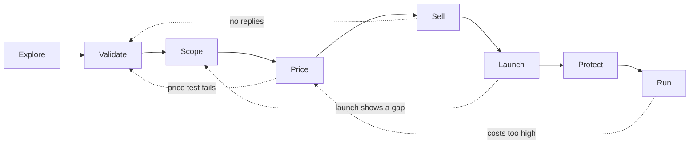

# Module 0 — Orientation

*You can now build a working product in a weekend by describing it to an AI coding agent. That is a real change, and it is also a trap: a working product is not a business. Someone has to be sure a real person has the problem, decide what to leave out, set a price, find the first customers, launch without breaking things, keep promises about data and law, and keep the company running when you are ill or asleep. This module sets the ground. It shows what AI changed and what it left alone, gives you the map of the journey in eight steps, and says plainly how to use the course and what it is not. You will meet Layla, a non-technical founder who built Tick, a fictional appointment-reminder app, by directing an AI agent. Around her are Nadia, a salon owner and Tick's first design-partner customer, Sam, a freelance designer, Mona, a mentor, and two professionals, Hana the accountant and Rashid the lawyer, who appear only to show you what to ask someone qualified. Every lesson leaves you with something you can check: a one-page list of what is still hard, a journey map with your own position on it, and a personal "how I will use this" note.*

> **Steps:** Explore — looking at the whole journey before committing to any part of it: what is cheaper now, what is not, and where you are.

---

# 0.1 — What changed, and what did not, when AI builds the product
*Level: 🟢 Beginner* · *Prerequisites: none* · *Step: Explore*

## ⚡ In 60 seconds
- After this lesson you can write a one-page "still hard" list for your own idea: at least five things that AI tools did not make easier, each with the question that tests it.
- What changed: the cost and time of producing a first version of software fell sharply for many kinds of product. A person who cannot code can now direct an agent to build something that runs.
- What did not change: knowing that a real person has the problem, choosing what to leave out, getting someone to pay, keeping promises about data and law, and being around when things break.
- The rule that matters most: **cheap to build is not cheap to be wrong.** Building faster only lets you be wrong faster, unless you also find out faster.
- Decision cue: before you ask the agent for the next feature, can you name the customer who asked for it, or the test that will show nobody wants it?
- Biggest trap: treating a working demo as evidence of demand. A demo proves the software runs. It says nothing about whether anyone will pay.
- Tick, its people and every number in this course are fictional or illustrative. Figures are "illustrative figures, not benchmarks".

## 🧭 Why it matters
Layla spent a long weekend describing an appointment-reminder app to an AI coding agent. By Sunday night, Tick could take a list of appointments and text each client a reminder. It looked good. She posted a screenshot to friends and several wrote "this is amazing". She felt she was nearly done.

On Monday she tried to answer four plain questions from a stranger in her co-working space: who uses it, why would they pay, what happens if a reminder goes to the wrong person, and what do you do if the app is down on a Saturday morning at a salon? She had an answer for none of them. Mona, the mentor, did not say the product was bad. She said: "You have finished the part that used to be the hard part. Now start the part that was always the hard part."

That is the situation this course is for. The first version is no longer the main obstacle for many products. The obstacles that remain are the ones that were always there, and they now arrive earlier, because you reach them before you have spent months and money. The good news is that you can face them cheaply. The risk is that a fast build hides them from you for a while.

This is not a promise that building with AI will make you money. Many products do not find customers, and that is normal. The aim of this course is narrower and more honest: to help you find out cheaply whether yours can, and to run it properly if it can.

## 📐 How it works

### 🟢 The essentials

**A product and a business are different things.** A **product** is what the customer uses. A **business** is the product plus a reason someone pays for it, a way of reaching them, a price that covers your costs, promises you can keep, and a way to keep running. AI tools have been most obviously useful on the product side. The business side is mostly people, money, law and trust.

**What AI tools changed.** Be specific, because vague claims lead to bad decisions.

| Area | Before | Now, for many products |
|---|---|---|
| First working version | Needed a developer or an agency, and weeks or months | A non-technical person can direct an AI agent to a first version in days |
| Prototype for a test | Costly, so people debated rather than tested | Cheap enough to build several rough versions and show them |
| Routine pieces | Login, forms, emails, dashboards written by hand | Often generated, sometimes by assembling ready-made services |
| Drafting words | Landing page copy, help articles, emails all started from blank | A usable first draft in seconds, to be edited by you |
| Small-team reach | A few people could do a few jobs | A few people, with agents, can attempt more jobs |

"For many products" matters. It is a claim about the typical small web or mobile product, not about everything. A medical device, a payment system or a product that needs deep new research is still hard to build, with or without AI.

**What did not change.** Read this table twice. It is the reason this course exists.

| Still hard | Why AI does not remove it | The question that tests it |
|---|---|---|
| Knowing someone has the problem | The agent will build what you ask, whether or not anyone needs it | Can I name three real people who have this problem and have tried to fix it? |
| Choosing what to leave out | Agents add features happily and never push back | Which feature would I cut if I had one week? |
| Getting someone to pay | Money is a human decision about trust and value | Has anyone paid, or promised to pay, before I built it? |
| Checking what was built | The agent can be confident and wrong | How do I know this works for a real customer's real data? |
| Promises about data and law | Rules apply to you, not to the tool | What did I promise customers, and could I keep it? |
| Being there when it breaks | Customers call you, not the agent | Who fixes it on Saturday, and how do customers hear about it? |
| Keeping the company running | A business needs money, records and continuity | If I vanished for two weeks, what would stop? |

You can see that none of these is about writing code. That is the point.

**The one memorable rule: cheap to build is not cheap to be wrong.** Imagine two founders. One spends six months building before showing anyone, and discovers nobody wants it. The other builds in a weekend, shows it to nobody, and then adds features for six weeks. Both end in the same place. What protects you is not building speed. It is learning speed: how fast you get evidence from real people.

**Honest uncertainty.** This course will not tell you how many startups fail, how much AI saves, or how fast you can grow. Those numbers are often quoted without good sources, and a number you cannot trace is a decision you cannot check. Where a figure appears here, it is labelled illustrative, or it has a source.

### 🟡 Going deeper

**Essential and accidental difficulty.** The software engineer Frederick Brooks, in a well-known paper presented in 1986 and published in 1987, "No Silver Bullet", separated the *accidental* difficulty of software (clumsy tools, boilerplate, the mechanics of writing code) from the *essential* difficulty (deciding what to build, and getting the design right for the real problem). Tools can remove accidental difficulty, and the essay argued that no tool removes the essential kind. You do not need to agree with every claim in the essay to find the distinction useful. AI agents are very good at the accidental part. The essential part, in a business, is what this course calls the founder's work.

**Where the effort moves.** When producing the product gets cheaper, the effort does not vanish. It moves to other places:

| Effort moves to | What it looks like for Layla |
|---|---|
| Deciding | Which one customer, which one job, what to cut |
| Checking | Reading what the agent built, testing it with real data, asking a professional about risk |
| Selling | Finding people, talking to them, asking for money |
| Explaining | Writing down what you promised, and what the AI part does and does not do |
| Operating | Handling support, incidents, costs, vendors and access |

Notice that the first and second rows are a form of judgement, and judgement cannot be delegated to a tool that wants to please you.

**New risks that come with AI-built products.** Building fast with agents adds some risks of its own, which later modules cover in depth:

- You may not understand what you shipped, so you cannot judge its risks. Module 2 and the library's [*System Design for Vibe Coders*, lesson 0.1 — "It Works" Is Not a Property of a System](../vibe/index.en.html#l0-1) cover this.
- Your costs may rise with use, because AI models are often paid per use. The library's [*AI Product Management: Zero to Hero*, lesson 0.2 — How AI products differ: probabilistic, data-hungry, costly per use, trust-bound](../aipm/index.html#/0.2) explains the product side, and lesson 3.1 here turns it into unit economics.
- Ownership of AI-written code and the terms of the tools you used are unsettled or vary by country and by tool. Lesson 6.3 gives you the questions for a lawyer.
- Customers may assume things about AI use, so honesty about it matters. Lesson 0.3 and Module 5 cover disclosure.

**Why speed can mislead.** A fast build produces a feeling of progress. Progress in a business is a reduction in uncertainty: you know more about who pays and why. Features do not reduce that uncertainty. Conversations, pre-sales and usage do. A useful habit is to keep two lists: *things I built* and *things I learned*. If the first list grows and the second does not, you are drifting.

### 🔴 Expert view

**The cost of the first version is not the cost of the product.** Software has a long tail: maintenance, fixes, changes to the tools you depend on, customer support and security. A first version may be cheap while owning the product stays expensive. Founders who count only the first number make plans that do not hold. In Module 3 you will list the recurring costs, and in Module 7 the vendors and the risk of depending on one.

**Cheap prototypes change which risk to test first.** Before, a founder tested *can it be built?* because that was the expensive unknown. Now it is often the cheapest unknown, so the risk to test first is usually *will anyone want it, and pay?* Modules 1 and 4 are built around that shift. The **lean startup** approach, popularised by Eric Ries, describes building the smallest thing that lets you learn, and measuring what you learn. The ideas behind it predate AI tools. AI makes the "smallest thing" even smaller, and it does not change the principle.

## 🧰 The toolkit
| Resource, tool or template | What it is and does | When to reach for it |
|---|---|---|
| **"Still hard" list** | A one-page list of what AI tools did not make easier for your idea, each with a test question and an owner | At the start, and again before every launch decision |
| **Built-versus-learned log** | Two columns, dated: what you built, and what you learned from real people | Weekly, to catch drift toward features |
| **Demo-versus-demand check** | Three questions: who asked for it, who paid for it, who uses it unprompted | Before you add any new feature |
| **Claim-versus-source note** | A short table of every number you plan to quote, with where it came from | Before you put a statistic on a page or in a pitch |
| **Agent session notes** | A short record of what you asked the agent to do and how you checked it | After every build session |
| **Question list for a stranger** | The four plain questions Layla could not answer: who uses it, why pay, what if it goes wrong, who fixes it | When someone asks "what is this?" and you cannot answer in one sentence |

Tools are examples, not endorsements. A notes app or a spreadsheet is enough for all of these.

## 🏛️ In practice with Tick
Tick is a fictional app. Layla, Nadia, Sam, Mona, Hana and Rashid are fictional, and all numbers are illustrative figures, not benchmarks.

On Tuesday, Layla sat with Mona and wrote the "still hard" list for Tick. It took forty minutes.

| Still hard | Layla's honest answer | Test question | Owner |
|---|---|---|---|
| Does someone have the problem? | Only Nadia has said so, and she is a friend | Can I name three salons or tutors, not friends, who miss appointments and have tried to fix it? | Layla |
| What to leave out | The agent added a loyalty-points screen she never asked for | Which screen would I delete first? | Layla |
| Who pays? | Nobody has been asked | Will Nadia pay, or promise to pay, before I add more? | Layla |
| Does it work? | It worked on the 12 sample appointments she typed | What happens with a client who has no phone number, or a name in another script? | Layla, with Sam later for the page |
| Promises about data | Tick stores clients' names and phone numbers | What did I promise, and what do I need to ask Rashid? | Layla, then Rashid |
| Support | Layla's own phone number is on the signup page | Who answers on Saturday? | Layla |
| Continuity | Everything runs from Layla's one account | If Layla is ill for two weeks, what stops? | Layla |

She also started a built-versus-learned log. After the weekend, the "built" column had six items and the "learned" column was empty. Mona pointed at it and said nothing. Layla wrote the first "learned" item that evening, after messaging Nadia: *Nadia's clients reply "yes" to reminders, and Tick does not handle replies.* It was a small piece of real information, and it changed her plan for the following week.

## 🛠️ Exercises
🟢 **Write your "still hard" list.** For your own idea, or for a made-up one, list at least five things from the second table in this lesson. For each, write one test question and an owner. *Done when:* the list exists as a document, has at least five rows, and each row has a question you could actually ask a real person.

🟡 **Run a demo-versus-demand check.** Take something you have built, or a prototype made with an AI tool this week. Write who asked for it, who has paid or promised to pay, and who used it without being asked. Show the result to one other person. *Done when:* the three answers are written, each with a name or an honest "nobody yet", and one other person has read them and said whether they believe them.

🔴 **Audit a claim you were about to make.** Find one number you have heard or planned to repeat about your market, about AI saving time, or about how startups do. Trace it to its source. If you cannot find a primary or reputable source, write what you would say instead without the number. *Done when:* a note shows the claim, the source you found or "none found", and the replacement sentence, and a peer could follow your trail.

## ⚠️ Mistakes and traps
- **Mistaking the demo for demand.** Friends saying "amazing" is politeness, not purchase intent. Instead, ask someone to pay, or to commit time, before you add features.
- **Building the next feature because the agent made it easy.** Ease is not a reason. Instead, name the customer who asked for it, or the test that will show nobody does.
- **Believing "AI does everything".** It does the accidental part well and the essential part poorly. Instead, keep the "still hard" list visible and assign each row an owner.
- **Quoting numbers you cannot trace.** Impressive statistics circulate with no source. Instead, cite a source you opened, or say what you do not know.
- **Hiding AI use to look more established.** Customers and rules may expect disclosure. Instead, be matter-of-fact about what the AI part does, and see lesson 0.3 and Module 5.
- **Treating the first cheap version as the whole cost.** Running a product costs money and attention for as long as it lives. Instead, list recurring costs early, as Module 3 shows.

## 🧾 Recap
- AI tools sharply lowered the cost and time of a first version for many kinds of product. They did not remove the business problems.
- Still hard: whether someone has the problem, what to leave out, who pays, whether it works, promises about data and law, support, and continuity.
- Cheap to build is not cheap to be wrong. Learning speed is what protects you.
- Effort moves from producing to deciding, checking, selling, explaining and operating.
- Keep a "built versus learned" log. If only the first column grows, you are drifting.
- Tick is fictional, its numbers are illustrative, and nothing here promises income, funding or users.

## ✍️ Check yourself

**1. Layla has a working Tick demo and ten friends say they love it. What does this show?**

- A. The product has demand, so she should add the features they mention.
- B. The software runs, but demand and willingness to pay are still unproven with real customers.
- C. The product is ready to launch to the public without further testing.
- D. The price is right, since friends would not praise a product that is too costly.

Answer

**B.** A demo shows that the software runs. Praise from friends is politeness, not a purchase decision, so demand and willingness to pay are still unknown. A is tempting but it reads praise as evidence of demand, and C and D skip the tests that would show it. (See "The one memorable rule".)

**2. According to this lesson, which task did AI tools make clearly easier for many products?**

- A. Deciding which single customer to serve first.
- B. Persuading a customer to pay a first invoice.
- C. Judging what a data-protection promise commits you to.
- D. Producing a first working version of the software.

Answer

**D.** The first working version is the part that became cheaper and quicker for many products. The other three are judgement, selling and law, which stay with the founder. A is a common slip because the agent can suggest customers, but choosing is still yours. (See "What AI tools changed".)

**3. Layla's agent added a loyalty-points screen she did not ask for. What is the best response?**

- A. Ask who wants it or what test would show nobody does; delete it if neither answer turns up.
- B. Keep it, since extra features make the product more attractive to many buyers.
- C. Ask the agent to add three more features so that the product looks complete.
- D. Leave it in place, because removing code the agent wrote could break the whole app.

Answer

**A.** Choosing what to leave out is the founder's job, and the test is a named customer or a named experiment. B and C confuse more features with more value. D is a worry about breakage, which is handled by checking after a change, not by keeping code nobody needs. (See "Where the effort moves".)

**4. After a fast weekend build, Layla's "built" column has six items and her "learned" column is empty. What does Mona's silence suggest?**

- A. Layla has made excellent progress, since progress is measured in features.
- B. Layla should simply build more items, because learning follows later.
- C. Layla is drifting; progress means learning who pays.
- D. Layla should delete the log, because it slows down the build.

Answer

**C.** Progress in a business is a reduction in uncertainty, and features do not reduce it. An empty "learned" column means she has not yet tested anything with real people. A and B equate building with progress, and D removes the very tool that shows the problem. (See "Why speed can mislead".)

**5. A friend tells Layla that "most startups fail within a year, so don't bother." What should Layla do with this claim?**

- A. Quote it in her pitch, because well-known statistics are safe to repeat widely.
- B. Trace it to a primary source, or drop the number and say what is unknown.
- C. Ignore all numbers in future, because every statistic is made up.
- D. Use a different number from memory that sounds more encouraging.

Answer

**B.** A figure you cannot trace is a decision you cannot check, so find the source or leave the number out. A repeats an untraced claim, C overcorrects, and D swaps one untested number for another. (See "Honest uncertainty" and the claim-versus-source note.)

## 📚 References
- Frederick P. Brooks Jr., "No Silver Bullet: Essence and Accidents of Software Engineering", *IEEE Computer*, April 1987 (first presented in 1986). The source of the essential and accidental distinction used in this lesson. Full citation only; no link confirmed.
- Eric Ries, *The Lean Startup* (2011). Background on building the smallest thing that lets you learn. Full citation only; no link confirmed.
- Anthropic, "Building effective agents", Anthropic Engineering, 19 December 2024. Distinguishes workflows, where code paths are predefined, from agents, where a model directs its own steps; it also notes that agents need checks against real results from their environment. https://www.anthropic.com/engineering/building-effective-agents (page opened).
- *System Design for Vibe Coders* and *AI Product Management: Zero to Hero*, lessons linked above, in this library.

---

# 0.2 — The founder's map: eight steps and the Tick cast
*Level: 🟢 Beginner* · *Prerequisites: 0.1* · *Step: Explore*

## ⚡ In 60 seconds
- After this lesson you can draw your own journey map with eight steps, mark which step you are on, and name the one artefact that proves you finished it.
- The eight steps are **Explore, Validate, Scope, Price, Sell, Launch, Protect, Run**. Each lesson in this course carries one or two of them as a tag.
- The steps are a guide, not a conveyor belt. You will loop back: a price test can send you back to validation, and a launch can send you back to scope.
- The rule that matters most: **do not skip to Sell or Launch because Build is done.** The earlier steps are cheap, and skipping them is the expensive mistake.
- Decision cue: if you cannot name the artefact that proves the current step is done, you are not ready to move on.
- Biggest trap: treating the steps as a promise. Finishing all eight does not guarantee a business. It only means you looked at everything that usually matters.

## 🧭 Why it matters
Layla now knows that building was the easy part, and she feels the opposite problem: too much to do, and no order. She writes a list. "Find customers. Set up payments. Write terms and privacy. Fix the landing page. Support. Name. Logo. Bank account. Social media. Investors?" There are forty lines. She does the ones that feel most like progress: a logo with Sam, a social media account, a company name.

Mona looks at the list and asks one question: "If Nadia stopped using Tick tomorrow, which of these would have mattered?" Almost none. Layla had been choosing tasks by how comfortable they were, not by how much they reduced the chance of failure.

A map fixes this. It does not tell you what to do every day. It tells you what order the big questions usually come in, so that a cheap question is not postponed behind an expensive one. This lesson gives you that map, introduces the people who will walk it with Layla, and ends with you marking your own position.

## 📐 How it works

### 🟢 The essentials

**The eight steps.** Every lesson is tagged with one or two of these. Each step has a question, a cheap test and an artefact: something you can show.

| Step | The question | A cheap test | Artefact that proves it | Modules |
|---|---|---|---|---|
| **Explore** | Is there a problem, a person and a reason to look further? | Looking at the whole journey and at your own situation | A "still hard" list and a journey map | 0, 1 |
| **Validate** | Does a real person have this problem badly enough to act? | Interviews, a smoke test, a pre-sale | A problem statement, an interview log, a smoke-test result | 1 |
| **Scope** | What is the smallest thing that solves one job for one customer? | A kill list, a build-or-buy decision | A scope statement and a kill list | 2 |
| **Price** | Can this earn more than it costs, at a price people accept? | A unit-economics sheet, a price test | A price test plan and a cash table | 3 |
| **Sell** | Where are the first customers, and how do I reach them honestly? | Outreach to ten people | A first-ten list and an outreach message | 4 |
| **Launch** | Can I release this in a way I can undo, and support it? | A launch checklist, a support policy | A launch checklist and a support policy | 5 |
| **Protect** | What did I promise, and what are my duties to customers and their data? | A question list for a lawyer and an accountant | Terms and privacy questions, a data table | 6 |
| **Run** | Can this keep going if I am busy, ill or gone? | A handover pack | A 30-minute handover pack | 7 |

Module 8 pulls all eight together into a venture file and a practice exam.

**Why this order.** The order follows cost and risk. The cheapest questions come first because a wrong answer there is the most valuable thing to learn early. It costs an afternoon to learn that nobody wants a feature. It costs months to learn it after building.

**It is a loop, not a line.** Real journeys look like this:

Going back is not failing. It is the map doing its job. A price test that fails is information about validation. A launch that exposes a gap is information about scope.

**The Tick cast.** Tick is a **fictional** appointment-reminder app for small service businesses such as salons, tutors, clinics and repair shops. It exists so we can show real decisions without naming real companies. Use the cast as a set of people you will recognise.

| Person | Role | How they help you learn |
|---|---|---|
| **Layla** | The founder. Non-technical, built Tick by directing an AI agent | Fast, but skips checking; her mistakes are the common ones |
| **Nadia** | Runs a small salon; Tick's first design-partner customer | Shows what a real customer needs, notices, and forgives |
| **Sam** | Freelance designer and contractor | Shows hiring, scope and who owns what is made |
| **Mona** | A founder-in-residence at a fictional co-working space; Layla's mentor | Asks the question you were avoiding |
| **Hana** | An accountant | Appears only to show what to ask a qualified professional about money |
| **Rashid** | A lawyer | Appears only to show what to ask a qualified professional about law |

Hana and Rashid are not there to give advice. They are there so that, when the course reaches tax or law, you can see *what to bring to a meeting* and *which questions to ask*. Nothing they say in this course is legal or tax advice.

### 🟡 Going deeper

**Each step has an exit test.** A step is done when you can show the artefact, not when you feel finished. The exit tests are deliberately modest:

| Step | A reasonable exit test |
|---|---|
| Explore | You have a "still hard" list and a map with your position marked |
| Validate | At least some real people, not friends, have described the problem in their own words, and at least one has taken a costly action (paid, committed time, or shared data) |
| Scope | One customer, one job, a written list of what you will not build |
| Price | A price you have tested with real people and a cost per customer you can calculate |
| Sell | A list of ten reachable people and a message you are willing to send under your own name |
| Launch | A release you can undo and a plan for the first bad day |
| Protect | A list of questions taken to a qualified professional, with notes from the meeting |
| Run | A handover pack someone else could follow in thirty minutes |

These are starting points. You may set tougher ones.

**Where the library helps.** The library already teaches several parts in depth, and this course links to them rather than repeating them:

| Need | Where to go |
|---|---|
| Directing an agent and shipping safely | [*System Design for Vibe Coders*, lesson F.4 — Meet Your Agent: Directing a Builder You Can't Watch](../vibe/index.en.html#lF-4) |
| Build, buy or borrow at the technology level | [*System Design for Vibe Coders*, lesson 0.3 — Build vs Buy: the Highest-Leverage Decision You'll Make](../vibe/index.en.html#l0-3) |
| Choosing and killing ideas in a company setting | [*AI Product Management: Zero to Hero*, lesson 2.3 — When not to use AI, and killing ideas early](../aipm/index.html#/2.3) |
| The parts every subscription product needs | [*SaaS Building Blocks*, lesson 0.1 — The 80% nobody sells: the anatomy of every SaaS](../saas/index.html#/0.1) |

This course takes the founder's view of each: what to decide, and what proof to ask for.

**Which steps you can run in parallel.** Some steps overlap in practice. You can start Sell conversations while you finish Validate, because talking to a possible customer does both. You should not start Launch before Protect has produced at least a first list of questions, because launching with no terms or privacy notice is a risk you can avoid. Treat the order as a default and write down your reason when you change it.

**How levels map.** Modules 0 to 2 are tagged Beginner, 3 to 5 Intermediate, 6 to 8 Advanced. You do not need to follow the levels strictly. A small-team founder with a developer may read Module 2 quickly, and a non-technical founder may spend more time there.

### 🔴 Expert view

**Where founders really get stuck.** In practice the stalls cluster in a few places. Validate stalls when the founder cannot find people to ask. Scope stalls when "just one more feature" feels safer than choosing. Price stalls because asking for money feels personal. Sell stalls on silence. Protect stalls because law feels frightening and expensive. Run stalls because success arrives and the founder is doing everything. Naming the stall in advance makes it easier to see when it arrives. These are observations about patterns, not statistics, and your experience may differ.

**The map is a tool for conversation.** Show it to the people helping you: a mentor, a design partner, a lawyer. Pointing at a step ("I am here, and this is the artefact I am missing") makes a short meeting useful. Professionals can help you far more when you arrive with a specific question.

**Small team versus solo.** A team of up to five can split steps, for example one person on Validate and Sell, another on Scope and Launch. The risk is that nobody owns Protect and Run. Give every step an owner, even if the owner is the same person for several. Lesson 7.3 returns to this under key-person risk.

**Do not confuse a map with a plan.** A plan commits you to dates. A map shows where things are. Your 30-day plan appears only in Module 8, after you have the evidence to make one. Until then, plan only the next step.

## 🧰 The toolkit
| Resource, tool or template | What it is and does | When to reach for it |
|---|---|---|
| **Journey map** | A one-page picture of the eight steps with your position marked and the artefact each needs | At the start, and every time you feel lost |
| **Step exit test** | A one-line check for each step: the artefact you can show | Before moving on to the next step |
| **Loop-back log** | A dated list of times you went back a step and why | Whenever a test fails; it shows the map is working |
| **Step owner table** | Who owns each step, including who owns Protect and Run | When you work with a partner, a contractor or a small team |
| **Stall note** | One sentence naming where you are stuck and what you are avoiding | When a week passes with no progress |
| **Cast crib sheet** | A card of the six Tick characters and the lesson each appears in | When reading the course, to keep the people straight |

Tools are examples, not endorsements. A page in a notebook is a perfectly good journey map.

## 🏛️ In practice with Tick
Tick, its people and all numbers here are fictional, and the figures are illustrative figures, not benchmarks.

Mona gave Layla one sheet of paper and asked her to draw the eight steps and mark where Tick was.

Layla's honest map looked like this:

| Step | Where Tick stood | Missing artefact |
|---|---|---|
| Explore | Done in a rough way: the "still hard" list from lesson 0.1 | The map itself |
| Validate | One friendly customer, Nadia, and no one else | An interview log with at least some strangers |
| Scope | Everything the agent added, nothing cut | A kill list |
| Price | No price; Nadia uses it free | A cost per customer and a price test plan |
| Sell | No list | A first-ten list |
| Launch | A signup page with Layla's phone number | A launch checklist and a support policy |
| Protect | Nothing written | A list of questions for Rashid and Hana |
| Run | Everything in Layla's one account | A handover pack |

She wrote under it: **"I am at Validate, and I behaved as if I were at Launch."** Then she did something small. She crossed out four tasks on her forty-line list, the logo, the social account, the company name and the investor line, and wrote "later" beside them. She kept three: arrange five interviews, write down the problem in one sentence, and ask Sam only for a rough landing page layout, not a finished brand.

Notice that she did not delete the logo forever. She postponed it behind a cheaper, more valuable question. That is what the map is for.

## 🛠️ Exercises
🟢 **Draw your journey map.** On one page, write the eight steps, mark the one you are on, and write the artefact you are missing for each. *Done when:* the page exists, every step has an artefact name beside it, one step is clearly marked as "here", and you can explain the marking to someone in under one minute.

🟡 **Re-rank your task list.** Write your real to-do list, however long. For each item, mark the step it belongs to, then mark the item with the earliest unfinished step as "do next" and defer items from later steps. *Done when:* a document shows every task with a step tag, the "do next" group contains only tasks from your current step, and a peer agrees with at least the first three rankings or explains why not.

🔴 **Write your stall forecast.** Pick the step where you expect to stall, using the stall patterns above or your own history. Write the stall in one sentence, three signs you would notice, and one cheap action you would take. *Done when:* the note exists, names a specific step, lists three observable signs, and you have shared it with one person who agreed to ask you about it in two weeks.

## ⚠️ Mistakes and traps
- **Choosing tasks by comfort.** A logo feels like progress and a customer conversation feels risky. Instead, rank by the earliest step with a missing artefact.
- **Reading the map as a straight line.** Going back is normal. Instead, keep a loop-back log and treat each loop as information.
- **Skipping Protect to launch faster.** A launch with no terms or privacy notice carries avoidable risk. Instead, produce at least a first question list for a professional before launch.
- **Treating the eight steps as a guarantee.** Finishing them does not promise customers or income. Instead, use them as a checklist of what usually matters, and accept that results vary.
- **Leaving Protect and Run with no owner in a team.** Everyone assumes someone else has them. Instead, fill in the step owner table, even if one name appears several times.
- **Copying the Tick cast's tools as endorsements.** Tick's choices are illustrations. Instead, choose tools that fit your own constraints, and check their current terms.

## 🧾 Recap
- The eight steps are Explore, Validate, Scope, Price, Sell, Launch, Protect and Run. Each has a question, a cheap test and an artefact.
- The order follows cost and risk: cheap questions first.
- The journey loops. Going back a step is information, not failure.
- Each step ends with something you can show, not a feeling of being done.
- The Tick cast is fictional. Hana and Rashid appear only to show what to ask a professional.
- A map is not a plan, and it is not a promise of any result.

## ✍️ Check yourself

**1. What is the main reason the steps start with Explore and Validate rather than Launch?**

- A. Launching early is always forbidden by the course rules, whatever the situation.
- B. Investors require a validated idea before any meeting.
- C. Cheap questions come first, so errors cost least.
- D. Validation is the only step that matters, and the rest are optional.

Answer

**C.** The order follows cost and risk, so the least expensive way of being proven wrong comes first. A invents a rule, B makes a claim about investors that the course does not support, and D wrongly treats later steps as optional. (See "Why this order".)

**2. Layla's price test fails: nobody accepts any price. According to the map, what could this mean?**

- A. It may need to go back to Validate, as the pain may not be strong enough.
- B. She should skip straight to Run, since Price is no longer needed at all.
- C. She should delete the map, since it failed to predict the result at all.
- D. She should launch faster to reach more people before they notice a problem.

Answer

**A.** A failed price test is information about validation: perhaps the pain is not strong enough. B and D ignore the information, and C misreads the map, which allows for loops. (See "It is a loop, not a line".)

**3. Which description of Hana and Rashid is accurate?**

- A. They give Layla the legal and tax answers she should follow in practice.
- B. They are real professionals whose advice readers can rely on for their business.
- C. They guarantee that Tick's terms and accounts are fully correct.
- D. They show what to ask and what to bring to a qualified professional.

Answer

**D.** The course is not legal or tax advice. Hana and Rashid are fictional and exist only to show the questions. A and C present them as sources of answers, and B wrongly calls them real. (See "The Tick cast".)

**4. Layla's forty-line list includes a logo, a social account, a company name and an investor line. What does Mona's question suggest she should do?**

- A. Do the logo first, since it is quick, visible and feels like progress.
- B. Defer what would not matter if Nadia left; do the earliest missing artefact.
- C. Delete the whole list and start only when a customer asks for something specific.
- D. Ask Sam to do all forty tasks in parallel, to finish the list quickly.

Answer

**B.** Mona's question tests which tasks reduce the chance of failure. The logo and the others can wait behind validation. A repeats Layla's mistake, C overreacts by discarding everything, and D adds cost before any evidence. (See "In practice with Tick".)

**5. A two-person team finishes Validate and Scope, and each assumes the other will handle terms and privacy. Which tool from this lesson addresses the problem?**

- A. The step owner table, which names one person per step.
- B. The loop-back log, which records every time a step is repeated.
- C. The cast crib sheet, which reminds readers who each character is.
- D. The stall note, which records where a founder feels stuck.

Answer

**A.** Without an owner, Protect and Run are the steps most often left unattended. The loop-back log, the cast crib sheet and the stall note are all useful, but none of them assigns ownership. (See "Small team versus solo" and the toolkit.)

## 📚 References
- Eric Ries, *The Lean Startup* (2011). Background on staged learning with small tests. Full citation only; no link confirmed.
- Steve Blank, *The Four Steps to the Epiphany* (first published 2005). Background on customer discovery as a stage before selling. Full citation only; no link confirmed.
- Rob Fitzpatrick, *The Mom Test* (2013). Background on asking people about their problems rather than pitching. Full citation only; no link confirmed.
- Library lessons linked above: *System Design for Vibe Coders*, *AI Product Management: Zero to Hero*, *SaaS Building Blocks*.

---

# 0.3 — How to use this course, and what it is not (not legal, tax or investment advice)
*Level: 🟢 Beginner* · *Prerequisites: 0.1, 0.2* · *Step: Explore*

## ⚡ In 60 seconds
- After this lesson you can write a one-page "how I will use this" note: your pace, your artefact folder, your professional list, and three limits you will keep.
- The course is education. It is **not legal, tax, accounting, investment or financial advice**, and it does not replace a qualified professional in your country.
- Rules about companies, tax, data protection, consumer protection, intellectual property and employment differ by country and change. This course names the kind of rule and the question to ask. It does not say "the rule is X".
- The rule that matters most: **bring questions, not hope, to a professional.** A short written list, with your documents, makes a short meeting useful and cheaper.
- Decision cue: if a lesson tempts you to act on a legal or tax point without checking with someone qualified, stop and write the question instead.
- Biggest trap: reading "the course said so" as permission. The course is AI-drafted and not expert-reviewed.

## 🧭 Why it matters
Layla reads a lesson on privacy in the evening and thinks, "Good, I'm covered." She copies a privacy notice she found online, asks the agent to adjust it, and publishes it on the Tick signup page. It names a country's rules that apply in a different place from hers. It also promises that Tick deletes clients' data "immediately on request", and Tick does not have a way to do that.

A week later, Nadia asks whether her clients' phone numbers are safe, and whether she needs to tell them anything. Layla has no honest answer. She feels she has done the work, and she has produced a document that sounds confident and says things that are not true of her product.

This is the problem the lesson addresses, and it is not unique to law. A fluent AI draft can make an unchecked claim look settled. The fix is not to avoid drafting with AI. It is to know which parts are yours to decide, which parts need a qualified person, and what to bring to them. This lesson also tells you what this course is, so you do not expect more from it than it can give.

## 📐 How it works

### 🟢 The essentials

**What the course is.** It is a free, bilingual set of lessons for people who build products with AI tools and now need to run a business. It teaches decisions, questions and artefacts. Each lesson ends with exercises that produce something you can check.

**What the course is not.**

| It is not | What that means for you |
|---|---|
| **Legal advice** | It does not tell you what the law requires in your country. It lists kinds of rules and the questions to ask a lawyer |
| **Tax or accounting advice** | It does not tell you what you owe, how to register for tax, or how to keep statutory accounts. It lists the questions to ask an accountant |
| **Investment or financial advice** | It does not tell you whether to raise money, from whom, or on what terms. It never promises funding |
| **A promise of results** | It does not promise income, customers, users, jobs or success |
| **Expert-reviewed** | It is AI-drafted and has not been reviewed by experts. Treat every statement as a starting point to check |
| **Affiliated with any tool or body** | Tools and platforms named are examples, not endorsements. Nothing here is linked to any platform, payment provider, investor, accelerator, bank, government programme or regulator |

**Why this matters more for AI-built businesses.** Fluent text from an AI tool can sound certain about matters where a real answer depends on your country, your product and your facts. The more fluent the draft, the more easily you may stop asking.

**How to read a lesson.** Each lesson follows the same layout, so you can find things quickly:

| Section | What you get |
|---|---|
| In 60 seconds | The outcome, the main rule, the biggest trap |
| Why it matters | A short story with Layla |
| How it works | Three levels: essentials, going deeper, expert view |
| The toolkit | Three to eight named resources and templates |
| In practice with Tick | The artefact, as the cast used it |
| Exercises | Three, graded, each with a "Done when" line |
| Mistakes and traps | What to avoid and what to do instead |
| Recap and Check yourself | A short summary and five questions with answers |
| References | Where the facts come from |

Read the essentials of a lesson first. Go deeper only when you need it.

**A sensible pace.** There is no fixed schedule. A common pattern for a part-time founder is one lesson a week, with the exercises done in the same week, because the exercises are the point. If you are building quickly, do Module 1 before you build more. If you already have customers, start with the module for the step you are stuck on, then fill in the earlier ones.

**Your artefact folder.** Create one folder, in any tool, called something like "venture file". Each lesson adds one item to it. By Module 8 it is the file you will turn into a 30-day plan. Keep dates on everything, so you can see what you knew when.

**Library links.** Where this course touches engineering or product management, it links to the library's other courses rather than repeating them. You do not need to read the linked lesson first, but follow the link when the founder's view is not enough.

### 🟡 Going deeper

**How to deal with law, tax and money topics.** When a lesson reaches one of these areas, the course does three things, and you should do three things in return.

| The course does | You do |
|---|---|
| Names the kind of rule, such as "data protection law, for example the EU GDPR or a national equivalent" | Find out which rules apply where you and your customers are |
| Says that rules differ and change | Check the current version from an official source or a professional |
| Gives you the question to ask | Take the question, with your documents, to a qualified person |

**What to bring to a professional.** A useful meeting needs less time than a vague one. Bring:

1. A one-paragraph description of the business, in plain words.
2. Where you are, where your customers are, and where your tools' companies operate.
3. What data you collect and what you do with it.
4. What you have already promised customers, with copies.
5. The tools and contractors involved, and the terms you accepted.
6. Your questions, ranked, with the most expensive-to-get-wrong first.

How to choose a professional, what they cost and whether you can afford one varies. Some regions have free or low-cost advice for small businesses, and some do not. Check what exists locally. The course does not promise that any such help exists where you live.

**Drafting with AI, then checking.** You may draft documents such as terms, a privacy notice or a refund policy with an AI tool. A safer workflow is:

- Draft with the tool, giving it the true facts about your product.
- Mark every sentence that makes a promise or cites a rule.
- Check each promise against what the product actually does.
- Take the draft and the marked promises to a qualified professional.
- Publish only what you can honestly keep.

Module 6 teaches this in full. The key point is that the draft is a starting point for a conversation, not an answer.

**Customer research and honesty.** Several of the course's own rules apply to how you work as well as to what you build: do not deceive people in interviews, do not scrape sites in breach of their terms, do not send unsolicited bulk messages, do not invent reviews or traction, and tell customers where AI is involved when it matters to them. Anti-spam, marketing and consumer laws exist and vary by country. The course tells you to ask, not what they say.

### 🔴 Expert view

**Education is not a substitute for judgement under uncertainty.** A course can give you vocabulary and questions. It cannot know your facts. When the cost of a mistake is high, such as a legal commitment, a tax filing, a contract with a large customer or taking someone's money, the value of a professional is that they carry responsibility for their advice, and the course cannot.

**Status of this material.** This course is AI-drafted and not expert-reviewed. That is a statement about its status, not an apology. It means two practical things: expect errors, and verify what matters from primary sources. Where a lesson states a fact, it names a source in References or says it is illustrative. If you find an error, treat it as part of the course doing its job: it taught you to check.

**Source discipline.** When you quote something from this course, or from any AI tool, in a pitch, on a page or to a customer, trace it. Keep a claim-versus-source note. A claim from a search summary is "reported" until you have opened the source yourself. This habit protects your reputation, and it is a good sign to investors, customers and professionals when you can say where a number came from.

**Funding and investors.** This course may in its capstone explain what investors commonly ask for, so you understand the conversation. It does not advise you to raise or not to raise, and nothing in it promises funding. Whether outside investment suits your business is a question for you and, where relevant, a qualified adviser.

**Ethics as a working method.** The limits that appear throughout (no fake reviews, no hidden AI use where disclosure is expected, no misrepresenting AI-written work, no fabricated traction) are not extras. They are what makes a young business safe to be trusted. They also make your learning more reliable, because evidence you invented teaches you nothing.

## 🧰 The toolkit
| Resource, tool or template | What it is and does | When to reach for it |
|---|---|---|
| **"How I will use this" note** | One page: your pace, your folder, your professional list and three limits | At the start of the course |
| **Venture file** | A dated folder where each lesson's artefact is kept | After each lesson, and when you prepare for Module 8 |
| **Professional meeting brief** | The six items to bring to an accountant or lawyer, with ranked questions | Before any meeting about tax, company setup, data, contracts or IP |
| **Draft-then-check list** | A five-step workflow for AI-drafted documents, with promises marked | Whenever an AI tool drafts a policy, terms or notice |
| **Claim-versus-source note** | A table of every number or rule you plan to repeat, with its source | Before publishing or pitching anything with a figure in it |
| **Limits card** | Three things you will not do, for example fake reviews or spam | Pinned near your desk, and reviewed when a shortcut tempts you |

Tools are examples, not endorsements. A folder and a text document are enough.

## 🏛️ In practice with Tick
Tick, its people and its numbers are fictional, and figures are illustrative figures, not benchmarks.

After the privacy notice mistake, Layla went back to Mona and wrote a "how I will use this" note together with her.

- **Pace:** One lesson a week, exercises in the same week, a Friday review.
- **Folder:** A shared folder called "Tick venture file", dated entries.
- **Professionals:** A placeholder entry for an accountant, Hana, and a lawyer, Rashid, with a note to find out whether a first short consultation is available and what it costs. She did not assume what either would say.
- **Limits:** No invented reviews. No messages to people who have not agreed to hear from Tick. Tell clients plainly that Tick uses an AI model to draft some messages, once she decides to include that.

Then she did the privacy notice properly. She removed the notice she had published, replaced it with a short plain statement of what Tick actually stores (client names and phone numbers) and a line saying a full notice was being prepared, and marked each promise from the old draft.

| Sentence in the draft | Does Tick really do this? | Question for Rashid |
|---|---|---|
| "Data is deleted immediately on request." | No, there is no deletion feature yet | What do I owe a client who asks, and by when, where I operate? |
| "We follow the rules of [a named country]." | She had not checked which rules apply | Which rules apply to us, given where salons and their clients are? |
| "We never share data." | Tick uses a text-message provider that receives phone numbers | What must I tell clients about a provider that handles their numbers? |

She sent Rashid the table and a one-paragraph description, three days before the meeting. In this fictional case the meeting was short, and he spent his time on the three questions. Whatever he advised is not reproduced here, because this course gives no legal advice. What the case shows is the preparation.

## 🛠️ Exercises
🟢 **Write your "how I will use this" note.** Include your pace, your folder name, a place for two professionals you might consult, and three limits you will keep. *Done when:* the note is a single page, contains all four parts, and you have created the folder and put the note in it.

🟡 **Build a professional meeting brief.** Pick one legal, tax or data question you expect to face, such as "what do I owe clients whose data I hold?". Fill in the six brief items from this lesson. Do not answer the question; only prepare it. *Done when:* the brief has all six items, the question is written so a stranger could answer it, and a peer has read it and could say what you want to know.

🔴 **Mark up an AI-drafted policy.** Ask an AI tool to draft a short refund policy or privacy statement for a made-up product. Mark every sentence that makes a promise or cites a rule, then check each against what the product would really do. List what you would ask a professional. *Done when:* the draft, the marked sentences and a list of at least three questions exist in one document, and each promise is tagged "true", "not true" or "unknown".

## ⚠️ Mistakes and traps
- **Treating the course as advice.** It is education, AI-drafted and not expert-reviewed. Instead, treat each legal, tax or financial point as a question for a qualified person.
- **Publishing an AI-drafted notice unchecked.** Fluent text can promise things you do not do. Instead, mark every promise, check it against the product, and take the draft to a professional.
- **Copying another business's terms.** Their facts, country and product differ from yours. Instead, use them as a starting list of topics and write your own true statements.
- **Going to a professional with no preparation.** Time is costly and the answers will be vague. Instead, bring the six-item brief.
- **Assuming free or cheap help exists everywhere.** It varies by place. Instead, find out what is available where you live before you plan around it.
- **Using the limits as marketing and not as rules.** "We never use fake reviews" means nothing if you do. Instead, keep the limits card honest and visible.

## 🧾 Recap
- This course is education. It is not legal, tax, accounting, investment or financial advice, and it promises no results.
- Rules differ by country and change. The course names kinds of rules and the questions to ask.
- It is AI-drafted and not expert-reviewed. Verify what matters from primary sources.
- Bring a short written brief to professionals: business, locations, data, promises, tools, ranked questions.
- Draft with AI, mark every promise, check it against the product, then take it to a professional.
- Keep a venture file, a pace you can sustain and a small set of limits you will not cross.

## ✍️ Check yourself

**1. Layla copies a privacy notice and publishes it. Which problem does this lesson highlight?**

- A. The notice was too short for customers to read comfortably.
- B. Privacy notices should never be drafted with AI tools under any circumstances.
- C. It may promise things Tick does not do, or cite rules that do not apply.
- D. The notice should have been printed instead of published online.

Answer

**C.** A fluent draft can state promises the product does not keep, and can cite rules from a different place. The fix is to mark and check each promise. B overstates, since drafting with AI is allowed when checked, and A and D are unrelated to the risk. (See "Why it matters".)

**2. Which statement about this course is accurate?**

- A. It has been reviewed by experts, so its legal points can be relied on.
- B. It teaches the legal rules that apply in every country.
- C. It guarantees that following all lessons will lead to paying customers.
- D. It is education and does not replace a professional.

Answer

**D.** The course is AI-drafted, not expert-reviewed, and not legal, tax or investment advice. A claims review that does not exist, B claims universal coverage, and C promises results, all of which the course rules out. (See "What the course is not".)

**3. Before meeting Rashid, what should Layla bring?**

- A. A request that he decide her business model, her pricing and her launch date.
- B. A short description of Tick, its data, her promises, and ranked questions for him.
- C. Nothing, so that his advice is not influenced by her own thinking.
- D. A copy of another business's terms, to be signed as her own work.

Answer

**B.** A prepared brief makes the meeting short and useful. A asks a lawyer to make a business decision, C wastes the meeting, and D copies terms that do not fit her facts. (See "What to bring to a professional".)

**4. Which workflow does the lesson suggest for documents drafted with an AI tool?**

- A. Draft with true facts, mark promises, check them, then ask a professional.
- B. Draft with an AI tool and publish it at once if the text reads well.
- C. Ask two AI tools and publish whichever draft sounds more confident to you.
- D. Skip drafting and write everything yourself from scratch with no help.

Answer

**A.** The draft is a starting point, checked promise by promise. B and C trust fluency, which is the cue the lesson warns against. D is not required, since the lesson allows drafting with AI. (See "Drafting with AI, then checking".)

**5. Mona asks Layla to name one honest limit. Which is the best example from this course?**

- A. Never contact anyone about Tick, in order to avoid making mistakes.
- B. Never ask a professional anything at all, in order to keep costs low.
- C. Never mention AI use to customers, in order to look more established.
- D. Never invent reviews or traction; disclose AI use where it matters to customers.

Answer

**D.** No fabricated reviews or traction, and disclosure of AI use where it matters, are limits the course states. A would stop the business from learning, B rules out professional help, and C is the opposite of disclosure. (See "Customer research and honesty" and "Ethics as a working method".)

## 📚 References
- Anthropic, "Building effective agents", Anthropic Engineering, 19 December 2024. Background on how agents differ from fixed workflows and on why an agent's work is checked against real results; the same habit applies to AI-drafted documents. https://www.anthropic.com/engineering/building-effective-agents (page opened).
- Rob Fitzpatrick, *The Mom Test* (2013). Background on honest customer conversations. Full citation only; no link confirmed.
- Regulation (EU) 2016/679, the General Data Protection Regulation, published by the European Union. Mentioned only as an example of a data protection law; no link confirmed in this session. Rules where you operate may differ.
- Library lessons linked in this module, in this library.
