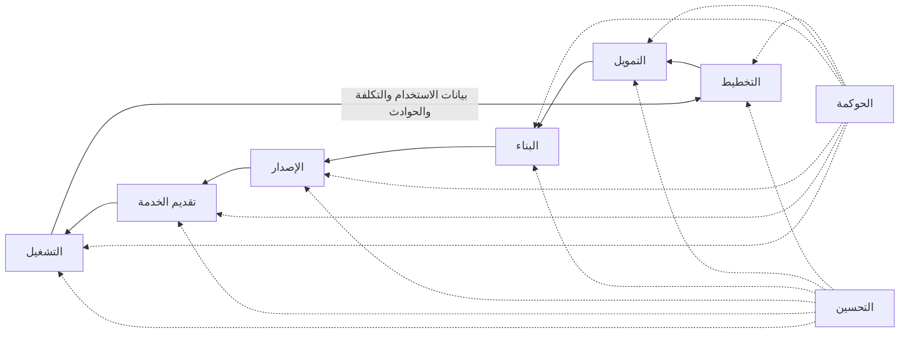
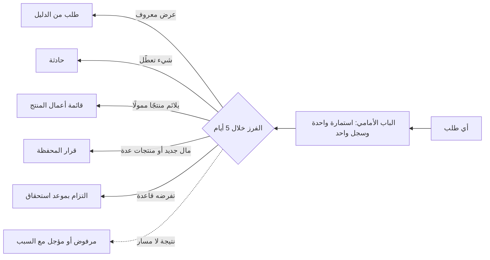
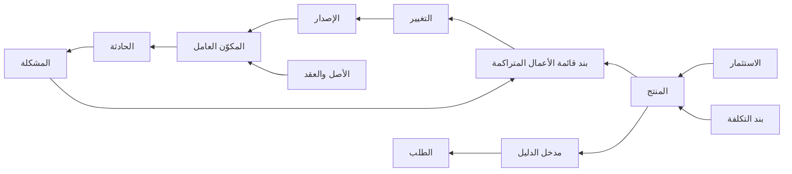
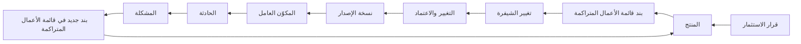
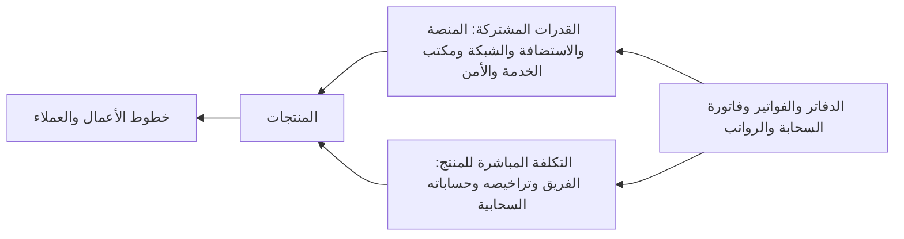
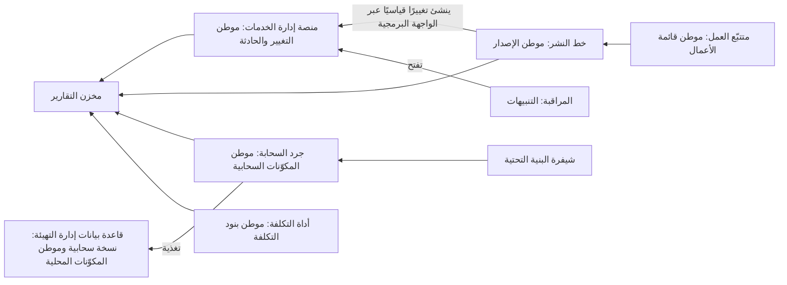
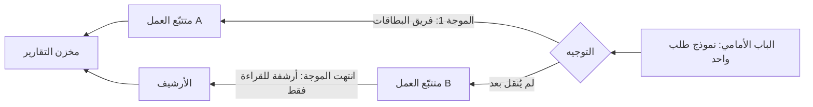
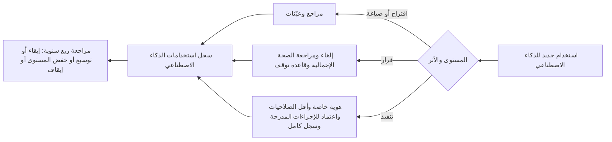

<!-- Generated by scripts/build-itbiz.mjs from itbiz/README.ar.md and itbiz/modules/*.ar.md. Do not edit by hand. -->
<!-- itbiz-source: 58ca7e7beaabf27b -->

# إدارة تقنية المعلومات كعمل تجاري — الدورة كاملة

*14 وحدة · 41 درسًا · 220 قالبًا وأداة · من التخطيط إلى التحسين*

**كيف يخطّط قطاع تقنية المعلومات لمنتجاته وخدماته الرقمية ويموّلها ويبنيها ويصدرها ويقدّمها ويشغّلها ويحكمها، وكيف يثبت قيمتها. دورة مجانية ثنائية اللغة لمديري تقنية المعلومات والمعماريين المؤسسيين.**

<!-- study-time -->
**مدة دراسة الدورة كاملةً: نحو 87 ساعةً** (تقدير: القراءة مع العمل التطبيقي، مجموعًا على كل الدروس). بمعدل 6 ساعات أسبوعيًا تقريبًا، يعني ذلك نحو 15 أسبوعًا. يبيّن كل درس تقسيمه الخاص، وستحلّ محلّ هذه التقديرات قياساتٌ من تجربة مع متعلمين حقيقيين.
<!-- /study-time -->

## ما هذه الدورة

تستطيع معظم إدارات تقنية المعلومات أن تصف ما تعمل عليه. وقليل منها يستطيع أن يقول كم يساوي ذلك، وكم يكلّف، وأين ينتظر العمل، وأيّ سجل هو الصحيح، ومن يقرّر. تعلّم هذه الدورة الجانب الإداري من تشغيل التقنية: مسارات القيمة والتدفّق، والمنتجات ونموذج التشغيل، والمحفظة والتمويل، والطلب، والتسليم، والإصدار والتغيير، وتلبية الطلبات، والعمليات والموثوقية، والسجلات التي تربط ذلك كله، والمال والمورّدين والمخاطر، والأدوات، وكيف تقود التغيير.

كُتبت الدورة لمديري تقنية المعلومات، والمعماريين المؤسسيين، وقادة الخدمات والتسليم، ولمن يعمل معهم في المالية والمخاطر والمورّدين. لا تحتاج إلى معرفة البرمجة. وحين يحتاج الدرس إلى عمق هندسي يحيلك إلى الدورات المرافقة، مثل [*السحابة وDevOps: من الصفر إلى الاحتراف*](../cloud/index.ar.html) و[*اختبار البرمجيات: من الصفر إلى الاحتراف في عصر الذكاء الاصطناعي*](../testing/index.ar.html) و[*حوكمة الذكاء الاصطناعي: من الصفر إلى الاحتراف*](../aigp/index.ar.html)، بدل أن يعيد تدريسها.

## ما الذي لا تقدّمه هذه الدورة

- **ليست دورة في إطار عمل.** الدورة أصيلة: لا تشرح أي إطار أو معيار مملوك ولا تلخّصه ولا تتبع بنيته، ولا تتوافق مع أي امتحان شهادة. يذكر الدرس 12.1 الأطر الرئيسية في المجال مع الجهات المالكة لها، ويشرح كيف تستخدم إطارًا دون أن تصبح تابعًا له.
- **ليست وعدًا.** لا تَعِد الدورة بشهادة أو وظيفة أو ترقية أو وفورات.
- **ليست معتمدة ولا مراجَعة.** أُعدّت المادة بمساعدة الذكاء الاصطناعي ولم يراجعها خبير في الموضوع. تُذكر الأدوات والمورّدون والأطر أمثلةً لا توصياتٍ، والدورة غير تابعة لأي منها.
- **ليست استشارة تنظيمية أو قانونية.** حين يقترب الدرس من التنظيم يذكر نوع القاعدة والسؤال الذي تطرحه على وظيفة المخاطر أو الامتثال لديك.

## كيف يعمل كل درس

لكل درس الأجزاء العشرة نفسها، لتعرف دائمًا أين أنت:

| الجزء | ما تحصل عليه |
|---|---|
| ⚡ **الدرس في دقيقة** | الدرس في بضع نقاط: الفكرة، والقاعدة الأهم، وأكبر فخّ. |
| 🧭 **لماذا يهم** | لحظة في قطاع التقنية في بنك نجم تجعل الموضوع أمرًا لا مفرّ منه. |
| 📐 **كيف يعمل** | الأفكار متدرّجة كالسلّم: 🟢 *الأساسيات* ← 🟡 *التعمق أكثر* ← 🔴 *نظرة الخبير*. |
| 🧰 **الأدوات** | النماذج وقوائم التحقق والمقاييس والأدوات ذات الصلة: ما يفعله كلٌّ منها ومتى تلجأ إليه. |
| 🏛️ **عمليًا في بنك نجم** | المُخرَج الذي ينتجه الدرس، كما استخدمه أحد أفراد الفريق. |
| 🛠️ **التمارين** | ثلاثة تمارين متدرّجة (🟢 🟡 🔴)، لكلٍّ منها معايير «يكتمل عندما» وإجابة نموذجية تتحقق بها من عملك. |
| ⚠️ **أخطاء وفخاخ** | ما يسوء في الممارسة، وما يجب فعله بدلًا منه. |
| 🧾 **الخلاصة** | الخلاصات الجديرة بالتذكّر. |
| ✍️ **اختبر نفسك** | خمسة أسئلة، معظمها سيناريوهات، مع إجابات مخفية وشروح. |
| 📚 **المراجع** | أبحاث وإرشادات ومصادر موثوقة، وروابط إلى بقية المكتبة. |

كل درس موسوم بـ**خطوته** في إدارة تقنية المعلومات: Plan أو Fund أو Build أو Release أو Serve أو Run أو Govern أو Improve. ويجمع [فهرس الأدوات](#appendix-the-repo-catalog) كل نموذج وقائمة تحقق في مكان واحد.

## الحالة المستمرة: قطاع التقنية في بنك نجم (خيالي)

**بنك نجم** هو البنك الخليجي المتوسط الحجم الخيالي الذي تستخدمه المكتبة. تجري أحداث هذه الدورة في قطاع التقنية فيه، نحو 600 موظف إلى جانب المورّدين، وهو ينتقل من إدارة تقنية تعمل بالمشاريع والتذاكر إلى إدارة منظّمة حول المنتجات. البنك وأفراده وكل أرقامه مختلَقة لأغراض التعليم، والأرقام توضيحية لا معايير مرجعية.

- **عمر**، الرئيس التنفيذي للمعلومات وراعي التغيير.
- **هدى**، رئيسة البنية المؤسسية.
- **يوسف**، رئيس عمليات تقنية المعلومات.
- **ريم**، مديرة منتج البطاقات والمدفوعات.
- **سامي**، قائد هندسة المنصات.
- **طارق**، الشريك المالي للأعمال في تقنية المعلومات.
- **لينا**، مديرة المورّدين والتوريد.
- **نور**، قائدة مخاطر وضوابط تقنية المعلومات.

## الخطة: 41 درسًا في 14 وحدة

| الوحدة | الدروس |
|---|---|
| 0 التوجيه | 0.1 ما معنى إدارة تقنية المعلومات كعمل تجاري، وما الذي تغيّره المنتجات الرقمية والذكاء الاصطناعي · 0.2 تعرّف على قطاع التقنية في بنك نجم والخطوات الثماني · 0.3 كيف تستخدم هذه الدورة، وما ليست عليه |
| 1 القيمة والتدفّق | 1.1 من المشاريع إلى القيمة: النتائج ومسارات القيمة والتدفّق · 1.2 رسم مسار القيمة من أوله إلى آخره: زمن التسليم الكلي والانتظار والتسليم بين الفرق · 1.3 مقاييس التدفّق والتسليم التي تهم، والمقاييس التي تضلّل |
| 2 المنتجات والخدمات ونموذج التشغيل | 2.1 المنتجات الرقمية والخدمات والمشاريع: ما كل منها ومن يملكه · 2.2 تصميم نموذج تشغيل محاذٍ للمنتجات: فرق المنتجات والمنصات والتمكين · 2.3 دليل الخدمات: العرض الذي تراه الأعمال فعلًا |
| 3 الاستراتيجية والمحفظة | 3.1 من الاستراتيجية إلى محفظة استثمار · 3.2 ترتيب أولويات العمل وتمويله: دراسات الجدوى وكلفة التأخير وتمويل المنتجات لا المشاريع · 3.3 حوكمة المحفظة: المراجعة وإعادة التخطيط وإيقاف العمل |
| 4 الطلب والمتطلبات | 4.1 الاستقبال وإدارة الطلب: باب أمامي واحد للأفكار والطلبات · 4.2 من المتطلب إلى قائمة الأعمال، مع التتبّع · 4.3 البنية والمتطلبات غير الوظيفية والمدرج |
| 5 البناء والتكامل | 5.1 خطوط النشر بوصفها قدرة مُدارة · 5.2 بوابات الجودة وأدلة يستطيع المدير أن يثق بها · 5.3 مكوّنات الأطراف الثالثة وSaaS والمصادر المفتوحة داخل المنتج |
| 6 الإصدار والتغيير | 6.1 الإصدار مقابل النشر، ومن يقرر كلًّا منهما · 6.2 ضبط التغيير الذي يحمي الاستقرار دون أن يوقف التدفّق · 6.3 البيئات والتهيئة وسجل ما الذي يعمل |
| 7 تقديم الخدمة (Serve): الطلبات والوصول والاستهلاك | 7.1 تلبية الطلبات والخدمة الذاتية · 7.2 الاشتراكات والاستحقاقات وصلاحيات الوصول · 7.3 الاستخدام وعرض التكلفة وتحميلها |
| 8 التشغيل (Run): العمليات والموثوقية | 8.1 المراقبة والأحداث وإدارة الحوادث · 8.2 إدارة المشكلات والتعلّم من الإخفاق · 8.3 مستويات الخدمة وأهداف مستوى الخدمة وميزانيات الخطأ أداةً للإدارة |
| 9 السجلات التي تدير تقنية المعلومات | 9.1 نموذج المعلومات: السجلات القليلة المهمة وكيف تترابط · 9.2 جودة بيانات التهيئة والأصول: الملكية والمطابقة والتقادم · 9.3 التتبّع من الاستثمار إلى الحادثة والعودة |
| 10 المال والمورّدون والمخاطر | 10.1 الإدارة المالية لتقنية المعلومات: نماذج التكلفة وتكاليف الوحدة وتكلفة المنتج · 10.2 التوريد والمورّدون وتكامل المورّدين المتعددين · 10.3 المخاطر والضوابط والتدقيق في بنك خاضع للتنظيم |
| 11 الأدوات والأتمتة | 11.1 خريطة سلسلة الأدوات: أي أداة هي نظام السجل المرجعي لأي سجل · 11.2 تكامل الأدوات وترشيدها دون تحوّل دفعة واحدة · 11.3 الذكاء الاصطناعي في عمليات تقنية المعلومات والتسليم، مع الضوابط |
| 12 الأطر والتحوّل | 12.1 مشهد الأطر: فيمَ يُستخدم كل منها، وكيف تستخدمها دون أن تصبح تابعًا لها · 12.2 تقييم موقعك: مراجعة للنضج والأدلة · 12.3 خارطة طريق للتحوّل وقيادة التغيير |
| 13 المشروع الختامي والتدريب | 13.1 المشروع الختامي: المخطط التشغيلي لتقنية المعلومات في بنك نجم · 13.2 الامتحان التدريبي: 40 سؤالًا من أسئلة السيناريوهات |

## المسار من الصفر إلى الاحتراف

| المرحلة | الوحدات | ستتمكن من… |
|---|---|---|
| 🟢 **الأساسيات** | 0–3 | أن ترى تقنية المعلومات مجموعةَ مسارات قيمة، وترسم أحدها وتقيس تدفّقه، وتصمّم نموذج تشغيل منظّمًا حول المنتجات ودليلًا للخدمات، وتحوّل الاستراتيجية إلى محفظة مموّلة. |
| 🟡 **الممارس** | 4–9 | أن تدير بابًا أماميًا واحدًا للطلب، وتدير التسليم والإصدار والتغيير بالأدلة، وتلبّي الطلبات وصلاحيات الوصول، وتشغّل العمليات بمستويات خدمة، وتحافظ على السجلات القليلة التي تربط ذلك كله. |
| 🔴 **المتقدم** | 10–13 | أن تدير مال تقنية المعلومات ومورّديها ومخاطرها في بنك خاضع للتنظيم، وترشّد سلسلة الأدوات، وتستخدم الذكاء الاصطناعي مع الضوابط، وتقود التحوّل، وتختم بالمخطط التشغيلي لبنك نجم وامتحان تدريبي من 40 سؤالًا. |

## لغتان

كل درس متاح بالإنجليزية والعربية. في النسخة العربية يحمل المصطلح التقني اسمه الإنجليزي بين قوسين أول مرة يظهر فيها في الدرس، مثل «مسار القيمة (value stream)».

## إلى أين بعد ذلك

افتح خريطة الدورة، أو ابدأ بالدرس 0.1.

## المحتويات

- **[الوحدة 0 — التوجيه](#m0)**
  - [0.1 — ما معنى إدارة تقنية المعلومات كعمل تجاري، وما الذي تغيّره المنتجات الرقمية والذكاء الاصطناعي](#l0-1) · 🟢 مبتدئ
  - [0.2 — تعرّف على قطاع التقنية في بنك نجم والخطوات الثماني](#l0-2) · 🟢 مبتدئ
  - [0.3 — كيف تستخدم هذه الدورة، وما ليست عليه](#l0-3) · 🟢 مبتدئ
- **[الوحدة 1 — القيمة والتدفّق](#m1)**
  - [1.1 — من المشاريع إلى القيمة: النتائج ومسارات القيمة والتدفّق](#l1-1) · 🟢 مبتدئ
  - [1.2 — رسم مسار القيمة من أوله إلى آخره: زمن التسليم الكلي والانتظار والتسليم بين الفرق](#l1-2) · 🟢 مبتدئ
  - [1.3 — مقاييس التدفّق والتسليم التي تهم، والمقاييس التي تضلّل](#l1-3) · 🟢 مبتدئ
- **[الوحدة 2 — المنتجات والخدمات ونموذج التشغيل](#m2)**
  - [2.1 — المنتجات الرقمية والخدمات والمشاريع: ما كل منها ومن يملكه](#l2-1) · 🟢 مبتدئ
  - [2.2 — تصميم نموذج تشغيل محاذٍ للمنتجات: فرق المنتجات والمنصات والتمكين](#l2-2) · 🟢 مبتدئ
  - [2.3 — دليل الخدمات: العرض الذي تراه الأعمال فعلًا](#l2-3) · 🟢 مبتدئ
- **[الوحدة 3 — الاستراتيجية والمحفظة](#m3)**
  - [3.1 — من الاستراتيجية إلى محفظة استثمار](#l3-1) · 🟡 متوسط
  - [3.2 — ترتيب أولويات العمل وتمويله: دراسات الجدوى وكلفة التأخير وتمويل المنتجات لا المشاريع](#l3-2) · 🟡 متوسط
  - [3.3 — حوكمة المحفظة: المراجعة وإعادة التخطيط وإيقاف العمل](#l3-3) · 🟡 متوسط
- **[الوحدة 4 — الطلب والمتطلبات](#m4)**
  - [4.1 — الاستقبال وإدارة الطلب: باب أمامي واحد للأفكار والطلبات](#l4-1) · 🟡 متوسط
  - [4.2 — من المتطلب إلى قائمة الأعمال، مع التتبّع](#l4-2) · 🟡 متوسط
  - [4.3 — البنية والمتطلبات غير الوظيفية والمدرج](#l4-3) · 🟡 متوسط
- **[الوحدة 5 — البناء والتكامل](#m5)**
  - [5.1 — خطوط النشر بوصفها قدرة مُدارة](#l5-1) · 🟡 متوسط
  - [5.2 — بوابات الجودة وأدلة يستطيع المدير أن يثق بها](#l5-2) · 🟡 متوسط
  - [5.3 — مكوّنات الأطراف الثالثة وSaaS والمصادر المفتوحة داخل المنتج](#l5-3) · 🟡 متوسط
- **[الوحدة 6 — الإصدار والتغيير](#m6)**
  - [6.1 — الإصدار مقابل النشر، ومن يقرر كلًّا منهما](#l6-1) · 🟡 متوسط
  - [6.2 — ضبط التغيير الذي يحمي الاستقرار دون أن يوقف التدفّق](#l6-2) · 🟡 متوسط
  - [6.3 — البيئات والتهيئة وسجل ما الذي يعمل](#l6-3) · 🟡 متوسط
- **[الوحدة 7 — تقديم الخدمة (Serve): الطلبات والوصول والاستهلاك](#m7)**
  - [7.1 — تلبية الطلبات والخدمة الذاتية](#l7-1) · 🟡 متوسط
  - [7.2 — الاشتراكات والاستحقاقات وصلاحيات الوصول](#l7-2) · 🟡 متوسط
  - [7.3 — الاستخدام وعرض التكلفة وتحميلها](#l7-3) · 🟡 متوسط
- **[الوحدة 8 — التشغيل (Run): العمليات والموثوقية](#m8)**
  - [8.1 — المراقبة والأحداث وإدارة الحوادث](#l8-1) · 🟡 متوسط
  - [8.2 — إدارة المشكلات والتعلّم من الإخفاق](#l8-2) · 🟡 متوسط
  - [8.3 — مستويات الخدمة وأهداف مستوى الخدمة وميزانيات الخطأ أداةً للإدارة](#l8-3) · 🟡 متوسط
- **[الوحدة 9 — السجلات التي تدير تقنية المعلومات](#m9)**
  - [9.1 — نموذج المعلومات: السجلات القليلة المهمة وكيف تترابط](#l9-1) · 🔴 متقدم
  - [9.2 — جودة بيانات التهيئة والأصول: الملكية والمطابقة والتقادم](#l9-2) · 🔴 متقدم
  - [9.3 — التتبّع من الاستثمار إلى الحادثة والعودة](#l9-3) · 🔴 متقدم
- **[الوحدة 10 — المال والمورّدون والمخاطر](#m10)**
  - [10.1 — الإدارة المالية لتقنية المعلومات: نماذج التكلفة وتكاليف الوحدة وتكلفة المنتج](#l10-1) · 🔴 متقدم
  - [10.2 — التوريد والمورّدون وتكامل المورّدين المتعددين](#l10-2) · 🔴 متقدم
  - [10.3 — المخاطر والضوابط والتدقيق في بنك خاضع للتنظيم](#l10-3) · 🔴 متقدم
- **[الوحدة 11 — الأدوات والأتمتة](#m11)**
  - [11.1 — خريطة سلسلة الأدوات: أي أداة هي نظام السجل المرجعي لأي سجل](#l11-1) · 🔴 متقدم
  - [11.2 — تكامل الأدوات وترشيدها دون تحوّل دفعة واحدة](#l11-2) · 🔴 متقدم
  - [11.3 — الذكاء الاصطناعي في عمليات تقنية المعلومات والتسليم، مع الضوابط](#l11-3) · 🔴 متقدم
- **[الوحدة 12 — الأطر والتحوّل](#m12)**
  - [12.1 — مشهد الأطر: فيمَ يُستخدم كل منها، وكيف تستخدمها دون أن تصبح تابعًا لها](#l12-1) · 🔴 متقدم
  - [12.2 — تقييم موقعك: مراجعة للنضج والأدلة](#l12-2) · 🔴 متقدم
  - [12.3 — خارطة طريق للتحوّل وقيادة التغيير](#l12-3) · 🔴 متقدم
- **[الوحدة 13 — المشروع الختامي والتدريب](#m13)**
  - [13.1 — المشروع الختامي: المخطط التشغيلي لتقنية المعلومات في بنك نجم](#l13-1) · 🔴 متقدم
  - [13.2 — الامتحان التدريبي: 40 سؤالًا من أسئلة السيناريوهات](#l13-2) · 🔴 متقدم
- **[الملحق — دليل الأدوات (Toolkit)](#appendix-the-repo-catalog)**

---

# الوحدة 0 — التوجيه

*تُحاسَب معظم إدارات تقنية المعلومات على أمرين لم يخطط أحد لأن تُحاسَب عليهما: كم تكلّف، وكم مرة تتعطل. ولا يختلف قطاع التقنية في بنك نجم عن غيره. يسأل مجلس الإدارة عمر، الرئيس التنفيذي للمعلومات، لماذا ترتفع الميزانية عامًا بعد عام، ولماذا يستغرق تغيير بسيط في تطبيق البطاقات ربع سنة، ولماذا تعود الأعطال نفسها لتصل إلى العملاء. تضع هذه الوحدة الأساس للدورة كلها. فهي تشرح ما تعنيه «إدارة تقنية المعلومات كعمل تجاري» في الواقع، وما الذي تغيّره فيها المنتجات الرقمية والذكاء الاصطناعي؛ وتعرّفك بقطاع التقنية في بنك نجم وشخصياته والخطوات الثماني لدورة تشغيل تقنية المعلومات التي يعتمد عليها كل درس لاحق؛ وتقول بوضوح كيف تستخدم الدورة وما ليست عليه. ويخرج كل درس بوثيقة من صفحة واحدة: تشخيص لمؤسسة تقنية المعلومات التي تعمل فيها، وخريطة لدورة تشغيلها، وخطة للتعلّم.*

> **الخطوات:** Plan — انظر إلى دورة التشغيل كلها، وإلى موقع مؤسستك منها، قبل أن تغيّر أي جزء منها.

## 0.1 — ما معنى إدارة تقنية المعلومات كعمل تجاري، وما الذي تغيّره المنتجات الرقمية والذكاء الاصطناعي

*المستوى: 🟢 مبتدئ* · *المتطلبات: لا يوجد* · *الخطوة (Step): Plan*

**بعد هذا الدرس تستطيع** أن تكتب تشخيصًا من صفحة واحدة لمؤسسة تقنية المعلومات التي تعمل فيها بعنوان «تقنية المعلومات كعمل تجاري»، يسمّي عملاءها، وما يستهلكونه، وكيف يتدفق المال والعمل، وثلاثة أسئلة لا تستطيع بعدُ أن تجيب عنها بدليل. *مدة الدراسة: قراءة نحو 20 دقيقةً، وعمل تطبيقي نحو 75 دقيقةً (تقدير).*

### ⚡ الدرس في دقيقة (In 60 seconds)
- **إدارة تقنية المعلومات كعمل تجاري** لا تعني تحقيق ربح من الزملاء، ولا إسناد كل شيء إلى جهات خارجية. معناها أن تعرف عملاء تقنية المعلومات وما تقدّمه لهم وتكاليفها وأداءها ومخاطرها، وأن تستطيع إظهار الدليل على ذلك.
- تلخّص الفكرةَ خمسةُ أسئلة: **من عملاؤنا؟ وماذا يستهلكون؟ وكم يكلّف ذلك؟ وما سرعة التغيير وما أمانه؟ ومن يقرر، وبأي سجل؟**
- **المنتجات الرقمية (digital products)** تغيّر الصورة: حين يكون منتج البنك نفسه برمجيات، تصبح تقنية المعلومات جزءًا مما يشتريه العملاء، ويتغير هذا الجزء كل أسبوع.
- **الذكاء الاصطناعي** يجعل كتابة الشيفرة أرخص، لكنه لا يجعل اتخاذ القرار ولا المراجعة ولا الإصدار ولا التشغيل ولا الحوكمة أرخص. وتشير الأبحاث المنشورة حتى الآن إلى أنه يضخّم نموذج التشغيل (operating model) الموجود لديك أصلًا.
- القاعدة الأهم: **كل ادعاء عن تقنية المعلومات يحتاج إلى عميل ورقم وسجل.** إن غاب واحد منها فلديك رأي، لا حقيقة.
- أكبر فخ: أن تتعامل مع «تقنية المعلومات كعمل تجاري» كأنها تمرين محاسبي (تحميل كل شيء على من يستخدمه)، بدل أن تجعل القيمة والتكلفة والمخاطر واضحة بما يكفي لاتخاذ القرار.

### 🧭 لماذا يهم (Why it matters)
بنك نجم وكل من فيه شخصيات خيالية. وكل الأرقام عن بنك نجم في هذا الدرس أرقام توضيحية، لا معايير مرجعية.

يخرج عمر، الرئيس التنفيذي للمعلومات (CIO) في بنك نجم، من اجتماع لمجلس الإدارة ومعه ثلاثة أسئلة لم يستطع الإجابة عنها. لماذا ارتفعت ميزانية التقنية مرة أخرى (بنحو العُشر في عامين)، بينما ما زال تطبيق البطاقات بطيئًا في الحصول على ميزات جديدة؟ كم مشروعًا من مشاريع العام الماضي حقق المنافع المذكورة في دراسة جدواه (business case)؟ ولماذا وقع العطل نفسه في المدفوعات ثلاث مرات في ستة أشهر؟

كان عمر يعرف الإجابات في خطوطها العامة: أعمال تنظيمية، وانتقال إلى السحابة، وارتفاع أسعار المورّدين؛ والمنافع «تحققت في معظمها على ما نظن»؛ والعطل «مشكلة لدى المورّد». لكن أيًّا منها لم يأتِ معه رقم يمكن التحقق منه، ولا سجل يبيّن من قرر، ولا رابط بين المال المنفَق والقيمة المتحققة. لم يشكّ المجلس في نزاهة عمر. شكّ في أن قطاع التقنية يرى نفسه.

يستطيع قطاع الإقراض أن يقول من عملاؤه، وماذا يشترون، وكم يكلّف كل قرض. وإدارة تقنية المعلومات كعمل تجاري تعني أن تستطيع تقنية المعلومات أن تفعل الشيء نفسه مع عملها، بالدليل.

### 📐 كيف يعمل (How it works)

#### 🟢 الأساسيات (The essentials)

**ما معنى «كعمل تجاري».** تعني العبارة في هذه الدورة خمسة أمور.

| السؤال | ما تستطيع مؤسسة تقنية معلومات جيدة الإدارة أن تُظهره | ما تقوله المؤسسة المتعثرة |
|---|---|---|
| **من عملاؤنا؟** | وحدات أعمال وعملاء نهائيون بأسمائهم، وما يعتمد عليه كل منهم | «الأعمال» |
| **ماذا يستهلكون؟** | قائمة قصيرة من المنتجات والخدمات، لكل منها مالك ومستوى خدمة | «ندعم 420 تطبيقًا» |
| **كم يكلّف ذلك؟** | تكلفة كل منتج أو خدمة، وتكلفة الوحدة (unit cost) حيث تفيد (لكل حساب، لكل عملية دفع) | رقم إجمالي واحد بلا تفصيل |
| **ما سرعة التغيير وما أمانه؟** | الوقت من الفكرة إلى العميل، وكم مرة تُطرح التغييرات، وكم مرة تفشل، وكيف تتعافى | «المشاريع في موعدها غالبًا» |
| **من يقرر، وبأي سجل؟** | قرارات التمويل والأولوية والإصدار والمخاطر، لكل منها مالك وسجل يمكن العثور عليه | «اتُّفق عليه في اجتماع» |

ولا تعني العبارة أن على تقنية المعلومات أن تربح، ولا أن تُحمَّل كل خدمة على من يستخدمها، ولا أن تتصرف تقنية المعلومات كأنها مورّد خارجي لبقية البنك. تلك خيارات تصميم تدرسها وحدات لاحقة. الفكرة الأساسية أبسط: **أدِر تقنية المعلومات بالانضباط نفسه في العملاء والقيمة والتكلفة والمخاطر الذي تنتظره من أي جزء آخر من العمل.**

**مصطلحات ستلقاها طوال الدورة.** يُشرح كل منها بالتفصيل لاحقًا.

- **المنتج الرقمي** شيء يستخدمه العملاء (داخل البنك أو خارجه)، ويُقدَّم في الغالب عبر البرمجيات، وله عمر طويل وفريق يواصل تحسينه، مثل تطبيق البطاقات في بنك نجم.
- **الخدمة** عرض تُبقيه تقنية المعلومات قائمًا لغيرها بمستوى أداء متفق عليه، مثل «تجهيز الحواسيب المحمولة» أو «منصة المدفوعات».
- **المشروع** عمل مؤقت له بداية ونهاية وميزانية، يُستخدم لإحداث تغيير محدد.
- **مسار القيمة (value stream)** هو سلسلة الخطوات من أولها إلى آخرها، عبر الفرق، التي تحوّل حاجةً إلى شيء يقدّره العميل.
- **نموذج التشغيل** هو طريقة ترتيب المؤسسة: من يفعل ماذا، ومن يقرر، وكيف يُموَّل العمل ويُقاس، وأي السجلات والأدوات تربط ذلك كله.
- **السجل** معلومة تُثبت أن شيئًا حدث أو تقرر: استثمار معتمد، أو سجل تغيير، أو تذكرة حادثة، أو تقرير تكلفة.

**من منفّذ للطلبات إلى مالك مسؤول.** في كثير من إدارات تقنية المعلومات تكتب الأعمالُ المتطلبات، وتنفّذ تقنية المعلومات مشروعًا، ثم يُغلق المشروع، ولا يُسأل أحد هل حصل العملاء على قيمة. تعلّم هذه الدورة البديل: فرق دائمة تملك منتجات وخدمات، تُموَّل من أجل نتائج، وتُقاس على القيمة والتدفق والموثوقية والتكلفة معًا.

| تقنية معلومات المشاريع والتذاكر | تقنية معلومات محاذية للمنتجات |
|---|---|
| يصل العمل في صورة مشاريع وتذاكر | يصل العمل في صورة نتائج مطلوبة لمنتج أو خدمة |
| تتشكل الفرق لمشروع ثم تتفكك | تبقى الفرق مع المنتج وتتعلم منه |
| تمويل لكل مشروع، يُعتمد مرة في السنة | تمويل لكل منتج أو لسعة عمل، يُراجَع بانتظام |
| النجاح = التسليم في الموعد وضمن الميزانية | النجاح = نتيجة للعميل وللعمل، بتكلفة ومخاطر معروفة |
| ترث العمليات كل ما بُني | الفريق الذي يبني يهتم أيضًا بكيف يعمل ما بناه |
| السجلات مبعثرة بين الأدوات | مجموعة صغيرة من السجلات المترابطة تُظهر الطريق من الفكرة إلى الحادثة |

بعض الأعمال مشاريع بحق (الخروج من مركز بيانات، أو موعد نهائي تنظيمي). المهم أن تختار عن قصد، لا بحكم العادة.

#### 🟡 التعمق أكثر (Going deeper)

**ما الذي تغيّره المنتجات الرقمية.** كانت تقنية المعلومات في الماضي تدعم في الغالب منتجات تعيش في مكان آخر: كان القرض عقدًا وإجراءً في الفرع، وكان النظام يسجّله. أما اليوم فالبنك، عند كثير من عملاء التجزئة، *هو* تطبيق وبطاقة وعملية دفع تنجح أو لا تنجح. ويترتب على ذلك ثلاثة أمور.

1. **التغيير لا يتوقف.** المنتج الرقمي لا «يكتمل» أبدًا، ونموذج التشغيل المبني على مشاريع تنتهي يتعثر أمام عمل لا ينتهي.
2. **البنية تشكّل المنتج.** في ورقة نُشرت عام 1968 بعنوان "How Do Committees Invent?"، رأى ملفن كونواي أن المؤسسات التي تصمم الأنظمة تميل إلى إنتاج تصاميم تنسخ بنية التواصل فيها، وهو ما يُعرف اليوم بقانون كونواي (Conway's law). فإن كانت البطاقات والمدفوعات والاحتيال في ثلاث إدارات لكل منها قائمة أعمال متراكمة (backlog) مستقلة، فتوقّع أن تبدو رحلة العميل كأنها ثلاثة أنظمة (الدرس 2.2).
3. **يصبح أداء التسليم مقياسًا للأعمال.** يُذكر أن برنامج أبحاث DORA (DevOps Research and Assessment، وهو جزء من Google Cloud) يجمع مقاييسه الخمسة الحالية لتسليم البرمجيات في مجموعتين: معدل الإنجاز (throughput)، ويضم زمن التسليم الكلي للتغيير (change lead time) وتكرار النشر وزمن التعافي من النشر الفاشل؛ وعدم الاستقرار (instability)، ويضم معدل فشل التغيير ومعدل إعادة العمل بعد النشر. ووراءها سؤالان يطرحهما أي مدير: ما سرعة استجابتنا؟ وكم مرة تؤذينا الاستجابة؟ ويتناول الدرس 1.3 المقاييس التي تفيد والتي تضلّل.

**ما الذي يغيّره الذكاء الاصطناعي.** صارت أدوات الذكاء الاصطناعي التوليدي تكتب مسودات الشيفرة والاختبارات والتوثيق وملخصات الحوادث. وهذا يخفّض تكلفة الإنتاج، لا تكلفة تقرير ما يُنتَج، ولا فحصه، ولا إصداره بأمان، ولا تشغيله، ولا إثبات أنه كان تحت السيطرة. والأبحاث حتى الآن تعكس ذلك:

- يقول إعلان تقرير DORA لعام 2024 إن زيادة اعتماد الذكاء الاصطناعي رافقها انخفاض تقديري بنسبة 1.5% في معدل إنجاز التسليم، وتراجع تقديري بنسبة 7.2% في استقرار التسليم.
- واعتمد تقرير DORA لعام 2025، *State of AI-Assisted Software Development*، على ما يقل قليلًا عن 5,000 من المتخصصين في التقنية. ويقول إعلانه إن 90% من المشاركين يستخدمون الذكاء الاصطناعي في العمل، وإن اعتماد الذكاء الاصطناعي صارت له علاقة إيجابية بمعدل الإنجاز، لكن علاقته بالاستقرار ما زالت سلبية، وإن «الذكاء الاصطناعي لا يُصلح الفريق، بل يضخّم ما هو موجود فيه أصلًا».

هذه نتائج استبيانات ارتباطية تخص سنوات بعينها، لا قوانين ثابتة. والقراءة العملية لها: **إذا سرّع الذكاء الاصطناعي كتابة الشيفرة، انتقل عنق الزجاجة إلى كل ما يأتي بعدها** (المراجعة، والاختبار، والإصدار، والعمليات، والسجلات). والتدفق الضعيف مع الذكاء الاصطناعي ينتج أكثر وأسرع، ويكسر أكثر. ولهذا تتناول هذه الدورة نموذج التشغيل، لا الأدوات.

ويصبح الذكاء الاصطناعي أيضًا جزءًا من منتجات البنك نفسها، وهذا يجلب واجبات حوكمة (انظر [*حوكمة الذكاء الاصطناعي*، الدرس 0.1 — ما هي حوكمة الذكاء الاصطناعي، وما الذي تثبته شهادة AIGP](../aigp/index.ar.html#/0.1))، ويصبح أداة داخل تقنية المعلومات تحتاج إلى ضوابط خاصة بها (الدرس 11.3).

#### 🔴 نظرة الخبير (Expert view)

**ثلاث طرق تفشل بها «تقنية المعلومات كعمل تجاري».**

- **السوق الداخلية.** تحمّل تقنية المعلومات كل شيء على مستخدميه، وتُناقَش الفواتير بندًا بندًا، ويكلّف التوزيع أكثر مما تساويه المعلومة. وعرض التكلفة (showback)، أي إظهار التكلفة دون تحميلها، أخف عبئًا؛ انظر الدرس 7.3.
- **فخ نسبة الإشغال.** أن تقيس مدى انشغال الناس، لا سرعة تدفق القيمة. الفرق المشغولة ذات الطوابير الطويلة بطيئة: كثيرًا ما تجد الممارسة الرشيقة (lean) أن العمل يقضي جزءًا كبيرًا من زمن التسليم الكلي في الانتظار (الدرس 1.2).
- **مصنع التقارير.** تصل لوحات المعلومات قبل القرارات. ابدأ من القرار (موّل، أوقف، أصدر، أصلح)، ثم ابحث عن أصغر سجل يدعمه.

**قاعدة هذه الدورة.** كل ادعاء عن تقنية المعلومات يحتاج إلى **عميل** (من يتأثر)، و**رقم** (كم، وبأي سرعة، وكم مرة، وبأي تكلفة)، و**سجل** (أين يوجد الدليل، ومن يملكه). وكثيرًا ما تكون الإجابة الصادقة: «لا نعرف بعدُ، وهذا هو السجل الذي سننشئه لنعرف»، وهي تبني ثقة أكبر من تخمين واثق.

### 🧰 الأدوات (The toolkit)
| المصدر أو الأداة أو القالب (Resource, tool or template) | ما هو وماذا يفعل (What it is and does) | متى تلجأ إليه (When to reach for it) |
|---|---|---|
| **IT-as-a-business diagnosis** — تشخيص «تقنية المعلومات كعمل تجاري» | صفحة واحدة تجيب عن الأسئلة الخمسة، ويُقيَّم كل منها «دليل / جزئي / رأي» | قبل أي تغيير أو حديث مع مجلس الإدارة |
| **Money map** — خريطة المال | أين تذهب ميزانية تقنية المعلومات (التشغيل مقابل التغيير؛ الأفراد والمورّدون والسحابة)، مع تعليم المجهول | حين لا يوجد إلا رقم إجمالي واحد للتكلفة |
| **Flow snapshot** — لقطة التدفق | تقدير تقريبي لزمن التسليم الكلي وتكرار النشر ومعدل فشل التغيير لمنتج واحد، مع مصدر كل رقم | لبدء حديث قائم على الوقائع عن السرعة والاستقرار |
| **Decision-and-record log** — سجل القرارات ومواضعها | القرارات الأخيرة (تمويل، إصدار، قبول مخاطرة)، ومن اتخذها، وأين سجلها | حين يكون «اتُّفق عليه في اجتماع» هو الجواب المعتاد |
| **AI change note** — مذكرة أثر الذكاء الاصطناعي | أين يُستخدم الذكاء الاصطناعي في التسليم والعمليات، وأي الخطوات اللاحقة لم تتغير لتواكبه | قبل توسيع أدوات الذكاء الاصطناعي على الفرق |

### 🏛️ عمليًا في بنك نجم (In practice at Najm Bank)
طلب عمر من هدى (رئيسة الهندسة المؤسسية) وطارق (الشريك المالي لتقنية المعلومات) تشخيصًا من صفحة واحدة قبل اجتماع المجلس التالي. المثال توضيحي وخيالي:

> **قطاع التقنية في بنك نجم: تشخيص «تقنية المعلومات كعمل تجاري» (المسودة 1)**
>
> | السؤال | ما نستطيع إظهاره | تقييم الدليل |
> |---|---|---|
> | العملاء | الأفراد والمنشآت الصغيرة والمتوسطة والشركات؛ الإدارات الداخلية؛ العملاء النهائيون عبر القنوات الرقمية | جزئي: لا توجد خريطة لمن يعتمد على أي نظام |
> | الاستهلاك | نحو 420 تطبيقًا في الجرد؛ لا توجد قائمة متفق عليها للمنتجات أو الخدمات | رأي |
> | التكلفة | الإجمالي معروف؛ التشغيل مقابل التغيير معروف تقريبًا فقط؛ لا تكلفة لكل منتج | جزئي |
> | التدفق | تواريخ المشاريع معروفة؛ لا أحد يقيس الوقت من الفكرة إلى العميل | رأي |
> | القرارات والسجلات | قرارات الاستثمار موثقة في محاضر؛ قرارات الإصدار والمخاطر موزعة بين البريد الإلكتروني وثلاث أدوات | جزئي |
>
> **ثلاثة أسئلة لا نستطيع اليوم الإجابة عنها بدليل:**
> 1. كم تكلّف البطاقات والمدفوعات في السنة، بما في ذلك المنصات المشتركة والمورّدون؟
> 2. كم يستغرق تغيير معتاد في تطبيق البطاقات من الاعتماد إلى العملاء، وأين ينتظر؟
> 3. أي التغييرات أو أحداث المورّدين كانت وراء أعطال المدفوعات الثلاثة في العام الماضي، وماذا غيّرنا بعدها؟
>
> **ملاحظة عن الذكاء الاصطناعي:** فريقان يستخدمان مساعدات برمجة بالذكاء الاصطناعي؛ والاعتماد والاختبار والإصدار لم تتغير. المخاطرة: تراكم مزيد من التغييرات عند البوابات نفسها.

قيّم طارق في البداية التكلفة «دليلًا» بسطر واحد: «تقنية المعلومات نحو 8% من تكاليف البنك». فنبّهته هدى إلى أن الرقم الإجمالي لا يجيب عن أي قرار، فخفّض التقييم. واعترض يوسف، رئيس عمليات تقنية المعلومات، على صف التدفق: «العمليات تُقاس بالاستقرار، لا بالسرعة». لكن عمر أبقاه؛ ويشرح الدرس 1.3 لماذا يُقاس الاثنان معًا.

### 🛠️ التمارين (Exercises)
**🟢 أجب عن الأسئلة الخمسة.** لمؤسسة تقنية المعلومات التي تعمل فيها (أو لبنك نجم)، أجب عن كل سؤال من الأسئلة الخمسة في جملة أو جملتين، وقيّم كل إجابة «دليل» أو «جزئي» أو «رأي».
*يكتمل عندما (Done when):* يكون لكل صف من الصفوف الخمسة تقييم، ويسمّي كل تقييم «دليل» السجل (تقريرًا أو أداة أو سجلًا رسميًا) الذي يحفظه.

الإجابة النموذجية والتحقق الذاتي

**الإجابة النموذجية.** الصدق أفضل من الإبهار: العملاء «جزئي» (الاعتماديات غير مرسومة)؛ والاستهلاك «رأي» (لا قائمة منتجات)؛ والتكلفة «جزئي» (ليست لكل منتج)؛ والتدفق «رأي» (لا قياس لزمن التسليم الكلي)؛ والقرارات «جزئي» (الإصدار والمخاطر مبعثرة). وقليل من الصفوف يستحق «دليل».

**التحقق الذاتي.**
- هل كتبت عن العملاء وما يستهلكونه، لا عن أنشطة فريقك؟
- هل يستند كل تقييم «دليل» إلى سجل يستطيع شخص آخر أن يفتحه؟
- هل قاومت تقييم رقم إجمالي واحد (الميزانية أو عدد الموظفين) على أنه دليل؟

**🟡 اكتب ثلاثة أسئلة بلا إجابة.** اكتب ثلاثة أسئلة قد يطرحها مسؤول تنفيذي بشكل معقول ولا تستطيع اليوم الإجابة عنها بدليل. وسمِّ لكل سؤال السجل الذي يجيب عنه ومالكه.
*يكتمل عندما (Done when):* يرتبط كل سؤال بقرار (تمويل، إيقاف، إصدار، إصلاح، قبول مخاطرة)، ويكون له سجل مسمّى ودور مالك مسمّى.

الإجابة النموذجية والتحقق الذاتي

**الإجابة النموذجية.** (1) «كم يكلّف المنتج س في السنة؟» القرار: هل نستثمر فيه أكثر أم لا. السجل: نموذج تكلفة لكل منتج. المالك: مالية تقنية المعلومات مع مدير المنتج. (2) «كم يستغرق التغيير من الاعتماد إلى العملاء؟» القرار: أين نستثمر في التدفق. السجل: طوابع زمنية على بنود قائمة الأعمال وعلى الإصدارات. المالك: فريق المنتج. (3) «أي التغييرات كان لها دور في الحوادث الكبرى في الربع الماضي؟» القرار: ماذا نصلح. السجل: سجلات حوادث مرتبطة بسجلات التغيير. المالك: العمليات.

**التحقق الذاتي.**
- هل يرتبط كل سؤال بقرار حقيقي؟
- هل السجل محدد (حقول أو أداة أو سجل رسمي)، لا مجرد «بيانات أفضل»؟
- هل تستطيع أن تبدأ جمعه خلال شهر دون أداة جديدة؟

**🔴 اكتب مذكرة أثر الذكاء الاصطناعي.** لفريق واحد، اذكر أين تُستخدم أدوات الذكاء الاصطناعي اليوم، وقيّم كل خطوة لاحقة (المراجعة، والاختبار، واعتماد التغيير، والإصدار، والعمليات، والسجلات) بأنها «تغيرت لتواكب» أو «لم تتغير» أو «غير معروف». وسمِّ عنق الزجاجة المرجّح وإجراءً واحدًا لمعالجته.
*يكتمل عندما (Done when):* تُقيَّم الخطوات الست كلها، ويُسمّى عنق زجاجة واحد مع سببه، ويكون لإجراء واحد مالك وتاريخ.

الإجابة النموذجية والتحقق الذاتي

**الإجابة النموذجية.** البطاقات والمدفوعات: يكتب الذكاء الاصطناعي مسودات الشيفرة واختبارات الوحدات؛ المراجعة «لم تتغير» (المراجعان أنفسهما)؛ الاختبار «لم يتغير» (اختبارات الوحدات وحدها يكتب الذكاء الاصطناعي مسوداتها، ومراحل الاختبار هي نفسها)؛ اعتماد التغيير والإصدار «لم يتغيرا» (مجلس أسبوعي ونافذة شهرية)؛ العمليات «غير معروف»؛ السجلات «لم تتغير». عنق الزجاجة: المراجعة، لأن الحجم يزيد والمراجعين لا يزيدون. الإجراء: تتفق ريم وسامي على قاعدة للتغييرات الأصغر وعلى جدول مناوبة للمراجعة بنهاية الشهر.

**التحقق الذاتي.**
- هل سمّيت خطوة تأتي بعد كتابة الشيفرة على أنها عنق الزجاجة المرجّح؟
- هل يتعلق إجراؤك بالقواعد أو الأدوار أو السجلات، لا بأداة أخرى؟
- هل تجنّبت ذكر أي مكسب في الإنتاجية لا تستطيع ذكر مصدره؟

### ⚠️ أخطاء وفخاخ (Mistakes and traps)
- **فهم «العمل التجاري» على أنه «ربح».** استهدف وضوح القيمة والتكلفة والمخاطر؛ وقرّر لاحقًا هل تحمّل أي شيء على أحد.
- **البدء بأداة أو إطار عمل.** إن تبنّيت أيًّا منهما قبل أن تعرف أي القرارات يجب أن يدعمها، أنتجت سجلات لا يستخدمها أحد. ابدأ من الأسئلة الخمسة.
- **افتراض أن الذكاء الاصطناعي سيعالج بطء التسليم.** كتابة المسودات أسرع مع خطوات لاحقة لم تتغير تعني طوابير أطول. أصلح التدفق أولًا، ثم وسّع استخدام الأداة.
- **المبالغة في ادعاء الدليل.** الرقم الإجمالي الواحد أو ما يتذكره الحاضرون من اجتماع ليس دليلًا؛ و«لا نعرف بعدُ» مع خطة إجابة محترمة.

### 🧾 الخلاصة (Recap)
- إدارة تقنية المعلومات كعمل تجاري تعني إظهار العملاء والاستهلاك والتكلفة والتدفق والقرارات بالدليل؛ لا الربح ولا تحميل التكلفة (chargeback) الإلزامي.
- المنتجات الرقمية تجعل التغيير مستمرًا، وتعكس بنية المؤسسة، وتجعل أداء التسليم مقياسًا للأعمال.
- تربط أبحاث DORA حتى الآن اعتماد الذكاء الاصطناعي بانخفاض استقرار التسليم، وتصف الذكاء الاصطناعي بأنه مُضخِّم؛ وعنق الزجاجة ينتقل إلى ما بعد كتابة الشيفرة.
- قاعدة الدورة: كل ادعاء يحتاج إلى عميل ورقم وسجل.

### ✍️ اختبر نفسك (Check yourself)
**1. يقول عضو في مجلس الإدارة لعمر: «إدارة تقنية المعلومات كعمل تجاري تعني أن تدفع كل إدارة لتقنية المعلومات مقابل ما تستخدمه». ما أفضل رد؟**

- A. الموافقة، لأن تحميل كل إدارة كلفة استخدامها هو السمة المميزة لتقنية المعلومات كعمل تجاري.
- B. الموافقة جزئيًا، والبدء بإصدار فواتير لأكبر المستخدمين أولًا لإظهار تقدم سريع وواضح.
- C. توضيح أن الهدف وضوح القيمة والتكلفة والمخاطر، وأن تحميل التكلفة خيار تصميم يأتي لاحقًا.
- D. الرفض، لأن تقنية المعلومات مركز تكلفة ولا ينبغي لها أبدًا أن تُظهر تكاليفها للإدارات الأخرى.

الإجابة

**C.** إدارة تقنية المعلومات كعمل تجاري تعني الإجابة عن الأسئلة الخمسة بالدليل؛ وتحميل التكلفة خيار تصميم لاحق. أما A وB فتجعلان تحميل التكلفة هو الهدف (فخ «السوق الداخلية»)؛ وD تخفي التكلفة، فلا يمكن الإجابة عن سؤال التكلفة. (انظر «ما معنى "كعمل تجاري"».)

**2. في مسودة طارق: «التكلفة: تقنية المعلومات نحو 8% من تكاليف البنك (دليل)». لماذا طلبت منه هدى أن يخفّض التقييم؟**

- A. لأن الرقم الإجمالي الواحد لا يدعم أي قرار عن منتج أو خدمة أو استثمار.
- B. لأن الرقم مرتفع جدًا لبنك متوسط الحجم ويجب مقارنته بالمعايير المرجعية.
- C. لأن أرقام التكلفة تخص الإدارة المالية ولا مكان لها في تشخيص تقنية المعلومات.
- D. لأن المجلس سأل عن التدفق والأعطال، فدليل التكلفة لا علاقة له بالاجتماع.

الإجابة

**A.** الرقم الإجمالي لا يجيب عن أي سؤال من نوع «موّل أو أوقف أو أصلح»؛ وسؤال التكلفة يسأل كم يكلّف كل منتج أو خدمة. أما B فتخترع معيارًا مرجعيًا، وC تناقض الغرض من التشخيص، وD تتجاهل أن المجلس سأل عن الميزانية. (انظر «عمليًا في بنك نجم».)

**3. أي العبارات الآتية عن الذكاء الاصطناعي تتفق مع نتائج DORA الموصوفة في الدرس؟**

- A. اعتماد الذكاء الاصطناعي يحسّن سرعة التسليم واستقراره معًا بشكل موثوق بعد تدريب الفرق.
- B. لا صلة قابلة للقياس بين الذكاء الاصطناعي وأداء التسليم، فيمكن تجاهله في تصميم التشغيل.
- C. ارتبط اعتماد الذكاء الاصطناعي بانخفاض الاستقرار، وهذا يثبت وجوب حظر أدواته.
- D. اقترن اعتماد الذكاء الاصطناعي حتى الآن بانخفاض الاستقرار، ويصفه تقرير 2025 بالمُضخِّم.

الإجابة

**D.** يذكر تقريرا العامين كلاهما علاقة سلبية بالاستقرار، ويصف تقرير 2025 الذكاء الاصطناعي بأنه مُضخِّم. أما A فتبالغ في النتائج، وB تناقضها، وC تحوّل نتيجة ارتباطية إلى خلاصة لا يستخلصها التقريران. (انظر «ما الذي يغيّره الذكاء الاصطناعي».)

**4. ثلاث إدارات في بنك نجم (البطاقات والمدفوعات والاحتيال) تبني تطبيق البطاقات من قوائم أعمال متراكمة منفصلة، ويقول العملاء إنه «يبدو كثلاثة تطبيقات». أي فكرة تفسّر ذلك أفضل تفسير؟**

- A. فخ نسبة الإشغال، لأن الإدارات الثلاث تُقاس بمدى انشغالها.
- B. قانون كونواي: تميل الأنظمة إلى نسخ بنية التواصل في المؤسسة.
- C. السوق الداخلية، لأن كل إدارة تحمّل الأخريين كلفة خدماتها.
- D. مصنع التقارير، لأن الإدارات تنتج لوحات معلومات بدل القرارات.

الإجابة

**B.** لاحظ كونواي أن التصاميم تعكس بنية التواصل في المؤسسة: ثلاث إدارات، ثلاث تجارب. أما A وC وD ففخاخ حقيقية، لكن أيًّا منها لا يفسّر لماذا يتبع شكلُ المنتج شكلَ المؤسسة. (انظر «ما الذي تغيّره المنتجات الرقمية».)

**5. سُئل عمر كم يستغرق تغيير معتاد في تطبيق البطاقات، ولا أحد يقيس ذلك. ما أفضل جواب يقدّمه للمجلس؟**

- A. «لا نعرف بعدُ؛ وهذا هو السجل الذي سننشئه، ومن سيملكه».
- B. «نحو ستة أسابيع»، استنادًا إلى انطباع مدير المشروع عن الإصدارات الأخيرة.
- C. «يتوقف على التغيير»، فكل تغيير مختلف ولا يمكن مقارنة التغييرات ببعضها.
- D. «أسرع من العام الماضي»، لأن الفريق بدأ يستخدم مساعدات برمجة بالذكاء الاصطناعي.

الإجابة

**A.** حين لا يوجد سجل، تسمّي الإجابة الصادقة الفجوة والخطة. أما B فرأي في ثوب رقم، وC تتهرب من السؤال، وD تفترض أن الذكاء الاصطناعي حسّن التدفق دون دليل. (انظر «قاعدة هذه الدورة».)

### 📚 المراجع (References)
- مدونة Google Cloud، إعلان *2025 DORA Report: State of AI-Assisted Software Development* (فُتح في 2026-11-19): https://cloud.google.com/blog/products/ai-machine-learning/announcing-the-2025-dora-report
- مدونة Google Cloud، إعلان تقرير DORA لعام 2024 (فُتح في 2026-11-19): https://cloud.google.com/blog/products/devops-sre/announcing-the-2024-dora-report
- DORA، تاريخ مقاييسها لتسليم البرمجيات، على موقع dora.dev (كما ورد في ملخصات البحث؛ لم يُفتح): https://dora.dev/guides/dora-metrics/history/
- Rother, M. and Shook, J., *Learning to See* (Lean Enterprise Institute, 1999): الممارسة الرشيقة في رسم مسار القيمة وفترات الانتظار فيه.
- Conway, M. E., "How Do Committees Invent?", *Datamation*, April 1968 (إحالة كاملة؛ لم تُفتح الورقة نفسها لهذا الدرس).
- Forsgren, N., Humble, J. and Kim, G., *Accelerate* (IT Revolution, 2018): البحث الذي تقوم عليه مقاييس التسليم.
- Kersten, M., *Project to Product* (IT Revolution, 2018): حجة ممارس لنقل تقنية المعلومات من المشاريع إلى المنتجات.
- من المكتبة: [*السحابة وDevOps: من الصفر إلى الاحتراف*، الدرس 0.1 — ما هي السحابة وDevOps وهندسة المنصات وهندسة موثوقية المواقع (SRE)](../cloud/index.ar.html#/0.1) (المفردات الهندسية التي تقوم عليها هذه الدورة).

## 0.2 — تعرّف على قطاع التقنية في بنك نجم والخطوات الثماني

*المستوى: 🟢 مبتدئ* · *المتطلبات: 0.1* · *الخطوة (Step): Plan*

**بعد هذا الدرس تستطيع** أن ترسم دورة تشغيل تقنية المعلومات في مؤسستك على صفحة واحدة باستخدام الخطوات الثماني، وتسمّي لكل خطوة مالكًا وسجلًا رئيسيًا ومقياسًا واحدًا، وتعلّم أضعف نقطتي تسليم (hand-offs). *مدة الدراسة: قراءة نحو 15 دقيقةً، وعمل تطبيقي نحو 105 دقائق (تقدير).*

### ⚡ الدرس في دقيقة (In 60 seconds)
- بنك نجم بنك خليجي **خيالي** متوسط الحجم. وتدور هذه الدورة في **قطاع التقنية** فيه (نحو 600 موظف إضافة إلى المورّدين، وهو رقم توضيحي)، الذي ينتقل من تقنية معلومات قائمة على المشاريع والتذاكر إلى تقنية معلومات محاذية للمنتجات.
- ثمانية أشخاص يحملون القصة: **عمر** (الرئيس التنفيذي للمعلومات)، و**هدى** (الهندسة المؤسسية)، و**يوسف** (العمليات)، و**ريم** (منتج البطاقات والمدفوعات)، و**سامي** (المنصة)، و**طارق** (مالية تقنية المعلومات)، و**لينا** (التوريد)، و**نور** (المخاطر والضوابط). وكل منهم يرتكب أخطاء واقعية.
- **الخطوات الثماني** لدورة تشغيل تقنية المعلومات، **التخطيط (Plan) · التمويل (Fund) · البناء (Build) · الإصدار (Release) · تقديم الخدمة (Serve) · التشغيل (Run) · الحوكمة (Govern) · التحسين (Improve)**، كلمات هذه الدورة البسيطة الخاصة بها، لا مصطلحات أي إطار عمل.
- كل خطوة تجيب عن سؤال، وتترك **سجلًا** رئيسيًا، ولها **مالك**. وكثيرًا ما تضيع القيمة عند **نقاط التسليم** الواقعة بين الخطوات.
- القاعدة الأهم: **الخطوات حلقة، لا تسلسل من الإدارات.** يجب أن تعود البيانات من تقديم الخدمة والتشغيل إلى التخطيط والتمويل.
- أكبر فخ: أن تُسقط الخطوات على الهيكل التنظيمي («البناء هو التطوير، والتشغيل هو العمليات») ثم تعدّ الخريطة مكتملة.

### 🧭 لماذا يهم (Why it matters)
بنك نجم وكل من فيه شخصيات خيالية. وكل الأرقام عن بنك نجم في هذا الدرس أرقام توضيحية، لا معايير مرجعية.

في أول ورشة عمل يعقدها عمر عن نموذج التشغيل (operating model)، وصف كل قائد كيف يصل تغيير في تطبيق البطاقات إلى العملاء. وصفت ريم دورات عمل (sprints) مدتها أسبوعان. ووصف سامي خط نشر (pipeline) قادرًا على النشر مرات كثيرة في اليوم. ووصف يوسف مجلسًا أسبوعيًا للتغيير ونافذة إصدار شهرية. ووصف طارق ميزانية سنوية كان فيها عمل البطاقات بندًا داخل مشروع «القنوات الرقمية». ووصفت نور اختبارًا ربع سنوي للضوابط. ووصفت لينا مورّدًا لمعالجة البطاقات يطلب إشعارًا قبل عشرة أيام عمل لأي تغيير في الواجهة البينية.

كان كل وصف صحيحًا، ولم يكن أيٌّ منها الصورة كاملة. رسمتها هدى على السبورة حلقةً واحدة، فرأت المشكلة فورًا: خط النشر القادر على العمل يوميًا ينتظر نافذة شهرية، والنافذة تنتظر مهلة إشعار المورّد، والمال تقرر قبل ثمانية أشهر بناءً على دراسة جدوى (business case) لم يُعِد أحد فتحها.

لهذا تبدأ الدورة بخريطة مشتركة. تمنح الخطوات الثماني الجميعَ الكلمات نفسها للأجزاء نفسها من الدورة، فتصبح نقاط التسليم، حيث تنتظر القيمة أو تضيع أو يُعاد فحصها، مرئية.

### 📐 كيف يعمل (How it works)

#### 🟢 الأساسيات (The essentials)

**قطاع التقنية في بنك نجم.** يقدّم بنك نجم خدمات مصرفية للأفراد وللمنشآت الصغيرة والمتوسطة وللشركات، ويخضع لإشراف بنك مركزي. ويُنظَّم قطاع التقنية فيه (نحو 600 موظف إضافة إلى المورّدين) في معظمه حسب الوظيفة: تطوير التطبيقات، وعمليات تقنية المعلومات، والهندسة المؤسسية، والأمن، ومكتب إدارة المشاريع، ومالية تقنية المعلومات، وإدارة المورّدين. وقد بدأت بضعة فرق منتجات عملها، منها فريق البطاقات والمدفوعات. ويريد مجلس الإدارة تكلفة أقل، وأعطالًا أقل، وتغييرًا أسرع، ويشك في إمكان الجمع بين الثلاثة.

**الشخصيات.** يظهر الأشخاص أنفسهم في كل وحدة.

| الشخص | الدور | ما يهمّه | الخطأ الذي يميل إلى ارتكابه |
|---|---|---|---|
| **عمر** | الرئيس التنفيذي للمعلومات (CIO)؛ راعي التغيير | ثقة المجلس في التكلفة والأعطال | أن يَعِد المجلس بموعد للتحول قبل أن يوجد الدليل |
| **هدى** | رئيسة الهندسة المؤسسية | نموذج التشغيل المستهدف وتصميم سجلات تقنية المعلومات | أن تصمم نموذجًا كاملًا على الورق قبل أن تختبره مع منتج واحد |
| **يوسف** | رئيس عمليات تقنية المعلومات (مكتب الخدمة، ومركز العمليات، والبنية التحتية) | الاستقرار؛ ويتشكك في الحديث عن «المنتج» | أن يعامل كل تغيير على أنه مخاطرة يجب منعها لا إدارتها |
| **ريم** | مديرة المنتج، البطاقات والمدفوعات | نتائج العملاء والسرعة | أن تعامل العمليات والضوابط كأنها مشكلة شخص آخر |
| **سامي** | قائد هندسة المنصات (خطوط النشر، والبيئات، ومنصة المطورين الداخلية) | تسليم سريع وآمن بالخدمة الذاتية | أن يبني ميزات للمنصة لم يطلبها أحد |
| **طارق** | الشريك المالي لتقنية المعلومات (الميزانيات، وتوزيع التكاليف، ودراسات الجدوى) | إنفاق يمكن توقعه ودراسات جدوى ذات مصداقية | أن يوزّع التكاليف بدقة مفرطة حتى لا يثق أحد بالأرقام ولا يستخدمها |
| **لينا** | مديرة المورّدين والتوريد (العقود، والمورّدون، وتكامل المورّدين المتعددين) | القيمة والمخاطر في عقود المورّدين | أن توقّع عقودًا تُبطئ شروطها دورة الإصدار في البنك نفسه |
| **نور** | قائدة مخاطر وضوابط تقنية المعلومات (التنسيق مع خط الدفاع الثاني، والتدقيق، والتقارير التنظيمية) | دليل على أن الضوابط تعمل | أن تطلب الدليل في صيغة لا يُنتجها إلا إجراء يدوي |

وتظهر فرق بنك نجم من دورات المكتبة الأخرى (المنصة، وهندسة الجودة، والأمن، والبيانات، ومنتجات الذكاء الاصطناعي) لفترة قصيرة حين يحيل الدرس إليها.

**الخطوات الثماني.** تجيب كل خطوة عن سؤال إداري واحد.

| الخطوة | السؤال الذي تجيب عنه | السجل الرئيسي الذي تتركه | مقياس واحد مفيد | المالك في بنك نجم |
|---|---|---|---|---|
| **Plan** — التخطيط | على ماذا نعمل، ولماذا؟ | ربط بين النتائج المعلنة والعمل المعتمد؛ طلبات مرتبة حسب الأولوية | نسبة العمل الذي يمكن تتبّعه إلى نتيجة معلنة | عمر وهدى ومديرو المنتجات |
| **Fund** — التمويل | كم من المال والسعة يذهب إلى أين؟ | قرار تمويل لكل منتج أو استثمار | الوقت من تقديم المقترح إلى القرار | طارق، مع لجنة الاستثمار |
| **Build** — البناء | كيف نحوّل حاجة إلى برمجيات أو إعدادات تعمل ومختبرة؟ | بنود قائمة الأعمال المتراكمة، وتغييرات الشيفرة، وأدلة الاختبار | زمن التسليم الكلي (lead time) من بدء العمل إلى الجاهزية للإصدار | فرق المنتجات، ومنصة سامي |
| **Release** — الإصدار | متى يصل التغيير إلى العملاء وكيف، ومن يقرر؟ | سجلات التغيير والإصدار | تكرار النشر؛ معدل فشل التغيير | مالكو المنتجات (product owner)، ويوسف لضبط التغيير |
| **Serve** — تقديم الخدمة | كيف يطلب الناس ما تقدّمه تقنية المعلومات ويحصلون عليه ويستخدمونه؟ | مدخلات دليل الخدمات (service catalogue)، والطلبات، والاستحقاقات (entitlement) | الوقت اللازم لتلبية طلب قياسي | مكتب الخدمة لدى يوسف، وفرق المنتجات |
| **Run** — التشغيل | كيف نُبقيه يعمل، ونتعافى حين يفشل؟ | أحداث المراقبة (event)، والحوادث (incident)، والمشكلات (problem) | زمن استعادة الخدمة؛ الأداء مقابل مستوى الخدمة | عمليات يوسف، وفرق المنتجات |
| **Govern** — الحوكمة | من يحق له أن يقرر ماذا، وكيف نثبت السيطرة؟ | السياسات، وسجل المخاطر، وأدلة الضوابط | نسبة الضوابط التي تُنتج أدلتها آليًا | نور، مع عمر وهدى |
| **Improve** — التحسين | ماذا تعلّمنا، وماذا سنغيّر؟ | المراجعات، وقائمة أعمال التحسين، وأدلة النضج | التحسينات المنجزة وأثرها المقيس | الجميع؛ وتنسّق هدى |

**نوعان من الخطوات.** تتبع خطوات التخطيط والتمويل والبناء والإصدار وتقديم الخدمة والتشغيل قطعةً من العمل، بهذا الترتيب تقريبًا. أما **الحوكمة** و**التحسين** فتمتدان عبرها كلها: الحوكمة تضع القواعد وتفحص الأدلة عند كل خطوة، والتحسين يعيد ما تعلّمناه من أي مكان.

السهم العائد من التشغيل إلى التخطيط هو الأهم. فبدونه تواصل المؤسسة التمويل والبناء دون أن تعرف هل نجح أي شيء.

#### 🟡 التعمق أكثر (Going deeper)

**الخطوات ليست إدارات.** عبارة «البناء هو التطوير، والتشغيل هو العمليات» هي نموذج المشاريع والتذاكر نفسه مرسومًا على شكل حلقة. في المؤسسة المحاذية للمنتجات يتولى فريق منتج واحد البناء والإصدار وتقديم الخدمة والتشغيل لمنتجه، بينما يوفّر فريق المنصة (platform team) الوسائل المشتركة. الخطوات تقول *ما الذي يجب أن يحدث*؛ ونموذج التشغيل (الوحدة 2) يقرر *من يفعله*.

**الخطوات ليست مراحل.** قد يمر مشروع كبير بكل خطوة مرة واحدة؛ أما المنتج الرقمي (digital product) فيمر بها كلها كل أسبوع، على دفعات صغيرة.

**حيث تتسرب القيمة: نقاط التسليم.** **نقطة التسليم** هي أي موضع ينتقل فيه العمل أو المعلومات أو المسؤولية بين أشخاص أو فرق أو أدوات. وكل نقطة تحمل خطر **انتظار** (يبقى العمل في طابور)، أو **فقد** (لا ينتقل السياق)، أو **إعادة فحص** (لا يثق المستلم بدليل المرسِل). وأظهرت سبورة هدى أربعًا منها:

| نقطة التسليم | ما الذي يسوء | الدرس الذي يعالجها |
|---|---|---|
| التمويل ← البناء | مال اعتُمد لنطاق مشروع قبل أشهر؛ ولا يستطيع الفريق تغيير الاتجاه دون دراسة جدوى جديدة | 3.2 |
| البناء ← الإصدار | خط النشر جاهز يوميًا؛ ومجلس التغيير أسبوعي؛ ونافذة الإصدار شهرية | 6.1، 6.2 |
| الإصدار ← التشغيل | تعلم العمليات بالتغيير بعد أن يفشل | 6.3، 8.1 |
| التشغيل ← التخطيط | بيانات الحوادث والاستخدام لا تصل أبدًا إلى من يحددون أولويات العمل | 8.2، 9.3 |

**سلسلة السجلات.** تترك كل خطوة سجلًا، وينبغي أن تترابط السجلات: قرار الاستثمار ببنود قائمة الأعمال، وهذه بالتغييرات التي سلّمتها، وتلك بالخدمة التي غيّرتها، ثم بالحوادث والتكاليف التي تلت. مع هذه الروابط يجيب عمر المجلس في دقائق؛ وبدونها تصبح كل إجابة مشروع إعادة بناء. وتبني الوحدة 9 هذه السلسلة.

#### 🔴 نظرة الخبير (Expert view)

**لماذا تستخدم هذه الدورة كلماتها الخاصة.** تصف أطر العمل المنشورة أجزاءً من هذه الدورة بمفرداتها الخاصة. وتستخدم هذه الدورة ثماني كلمات بسيطة لتستطيع أن ترسم مؤسستك *أنت* دون أن تتبنى أولًا نموذج غيرك. ويقارن الدرس 12.1 بين أطر العمل المعروفة.

**الخلاف ميزة.** يرى يوسف الإصدار والتشغيل همًّا واحدًا يخص الاستقرار، ويريد بوابة واحدة؛ وترى ريم الإصدار قرارًا يخص المنتج ويعود إلى فريقها. وتريد نور دليلًا عند كل خطوة؛ ويريد سامي أن يُنتج خط النشر هذا الدليل، لا النماذج الورقية. نموذج التشغيل الجيد لا يختار فائزًا؛ بل يقرر من يقرر كل أمر، وبأي دليل، ويجعل السجل يقوم بالعمل. وتحسم الوحدتان 6 و10 هذين الخلافين.

**ارسم ما يحدث، لا ما يقوله الدليل الإجرائي.** تتبّع آخر ثلاثة تغييرات حقيقية. فالفجوة بين الدورة الموثقة والدورة الحقيقية كثيرًا ما تكون أنفع ما تكتشفه.

### 🧰 الأدوات (The toolkit)
| المصدر أو الأداة أو القالب (Resource, tool or template) | ما هو وماذا يفعل (What it is and does) | متى تلجأ إليه (When to reach for it) |
|---|---|---|
| **Eight-step cycle sheet** — ورقة الدورة ذات الخطوات الثماني | سؤال كل خطوة ومالكها وسجلها الرئيسي ومقياس واحد لها | أول وثيقة في أي تغيير لنموذج التشغيل؛ تُحدَّث مع كل وحدة |
| **Hand-off map** — خريطة نقاط التسليم | كل نقطة تسليم معلَّمة بما يحدث عندها عادةً: انتظار أو فقد أو إعادة فحص | حين لا يستطيع أحد أن يقول أين ينتظر العمل |
| **Cast table** — جدول الشخصيات | من يملك كل خطوة، وما يهمّه، والخطأ الذي يميل إلى ارتكابه | قبل ورشة عمل، لتحدد من يجب أن يحضر |
| **Real-example trace** — تتبّع أمثلة حقيقية | ثلاثة تغييرات حديثة تُتتبَّع عبر الخطوات، مع تاريخ عند كل نقطة تسليم | للتحقق من خريطتك مقابل الواقع |
| **Record chain sketch** — مخطط سلسلة السجلات | أي سجل في كل خطوة ينبغي أن يرتبط بأي سجل في الخطوة التالية | قبل شراء أي أداة لإدارة تقنية المعلومات أو تغييرها |

تكفي أي سبورة أو أداة رسم أو جدول بيانات.

### 🏛️ عمليًا في بنك نجم (In practice at Najm Bank)
بعد الورشة حوّلت هدى ما رسمته على السبورة إلى ورقة دورة من ثماني خطوات لمنتج البطاقات والمدفوعات. المثال توضيحي وخيالي:

> **البطاقات والمدفوعات: ورقة الدورة ذات الخطوات الثماني (مسودة)**
>
> | الخطوة | المالك اليوم | السجل الرئيسي اليوم | المقياس اليوم |
> |---|---|---|---|
> | التخطيط | لجنة توجيه القنوات الرقمية | شريحة الخطة السنوية | لا يوجد |
> | التمويل | لجنة الاستثمار، عبر طارق | دراسة جدوى المشروع | الميزانية مقابل الإنفاق |
> | البناء | فريق ريم، ومعه فريقان من المورّدين | قائمة الأعمال في أداة التسليم | سرعة الدورة (sprint velocity) |
> | الإصدار | مجلس التغيير الأسبوعي (يرأسه يوسف) | تذكرة التغيير | عدد التغييرات المعتمدة |
> | تقديم الخدمة | مكتب الخدمة | تذاكر الطلبات | التذاكر المغلقة |
> | التشغيل | مركز العمليات؛ مورّد معالجة البطاقات | تذاكر الحوادث في أداتين | التوافر الشهري |
> | الحوكمة | نور، اختبار ربع سنوي للضوابط | جدول بيانات لعينة من التغييرات | نسبة النجاح في اختبار الضوابط |
> | التحسين | لم يُعيَّن أحد | تقارير ما بعد الحوادث، دون متابعة | لا يوجد |
>
> **أضعف نقطتي تسليم:** (1) البناء ← الإصدار: تغيير يجهز في يومين ينتظر في الوسيط نحو ثلاثة أسابيع لمجلس التغيير ونافذة الإصدار (رقم توضيحي، من تتبّع ثلاثة تغييرات حديثة). (2) التشغيل ← التخطيط: أنتجت حوادث المدفوعات الثلاث في العام الماضي تقارير، لكن أيًّا من إجراءاتها لم يصل إلى قائمة أعمال البطاقات.

في المسودة الأولى كتبت هدى «عمليات تقنية المعلومات» مالكًا لتقديم الخدمة وللتشغيل. فنبّهتها ريم إلى أن سلوك التطبيق أمام العملاء مسؤوليتها هي، أيًّا كان من يشغّل الخوادم، فعُلِّمت الخطوتان «مشتركة، يُحسم أمرها في الوحدة 2». ولاحظ سامي أن عمود المقياس يضم ثلاثة أعداد للنشاط (سرعة الدورة، والتغييرات المعتمدة، والتذاكر المغلقة)، ولا يضم أي مقياس للتدفق أو للنتيجة: وهذه نقطة انطلاق الوحدة 1.

### 🛠️ التمارين (Exercises)
**🟢 املأ ورقة الدورة.** لمنتج أو خدمة تعرفها، املأ ورقة الدورة ذات الخطوات الثماني: المالك والسجل الرئيسي والمقياس الحالي لكل خطوة. واكتب «لا يوجد» حيث لا يوجد شيء.
*يكتمل عندما (Done when):* تمتلئ الصفوف الثمانية كلها، ويقول صف واحد على الأقل بصدق «لا يوجد»، ويكون كل مالك دورًا أو جهة مسمّاة، لا «تقنية المعلومات».

الإجابة النموذجية والتحقق الذاتي

**الإجابة النموذجية.** تشبه الورقة الأولى المعتادة ورقة هدى: التخطيط والتحسين أضعف الخطوات (شريحة سنوية، ولا مالك)؛ والتمويل دراسة جدوى لمشروع؛ والبناء قائمة أعمال تُقاس بسرعة الدورة؛ والإصدار عدد تذاكر التغيير؛ وتقديم الخدمة والتشغيل تذاكر ونسبة توافر؛ والحوكمة اختبار ضوابط على عينة. والقيمة كامنة في خانات «لا يوجد» وفي مقاييس النشاط.

**التحقق الذاتي.**
- هل وصفت ما يحدث فعلًا، لا ما يقوله الدليل الإجرائي؟
- هل كل مالك دور أو جهة تستطيع أن تدعوها إلى اجتماع؟
- هل ملأت الحوكمة والتحسين أيضًا؟

**🟡 تتبّع ثلاثة تغييرات حقيقية.** اختر ثلاثة تغييرات وصلت إلى العملاء في الربع الماضي. وجد لكل منها التاريخ عند كل نقطة تسليم (الاعتماد، والتمويل، والبدء، والجاهزية، والإصدار، والاستخدام)، وعلّم أطول فترة انتظار.
*يكتمل عندما (Done when):* تُتتبَّع التغييرات الثلاثة بتواريخها (أو «غير معروف» حيث لا يوجد سجل)، وتُعلَّم أطول فترة انتظار لكل منها، وتكتب جملة واحدة عمّا يجمع بينها.

الإجابة النموذجية والتحقق الذاتي

**الإجابة النموذجية.** تتبّعت ريم تغييرًا في عرض الرسوم، وميزة لتجميد البطاقة، وتحديثًا لواجهة بينية مع مورّد. جهزت الثلاثة خلال أيام، وكان أطول انتظار لها بين «جاهز» و«أُصدر» (مجلس التغيير، والنافذة الشهرية، ومرة واحدة مهلة إشعار المورّد). القاسم المشترك: عنق الزجاجة هو الإصدار، لا البناء. واثنان منها كان تاريخ تمويلهما «غير معروف»، لأن العمل كان داخل ميزانية مشروع أكبر.

**التحقق الذاتي.**
- هل استخدمت السجلات (تواريخ التذاكر وملاحظات الإصدار) لا الذاكرة؟
- هل كتبت «غير معروف» بصدق بدل أن تقدّر بصمت؟
- هل جملة القاسم المشترك عن نقطة تسليم، لا عن شخص؟

**🔴 علّم أضعف نقطتي تسليم واقترح ربطًا بين السجلات.** سمِّ أضعف نقطتي تسليم لديك. وقل لكل منهما هل المشكلة انتظار أم فقد أم إعادة فحص، واقترح ربطًا واحدًا بين السجلات يُظهرها كل شهر دون تتبّع يدوي.
*يكتمل عندما (Done when):* يكون لكل نقطة تسليم نوع مشكلة، ودليل من عمليات التتبّع التي أجريتها، وربط بين سجلين (من أي سجل، إلى أي سجل، ومن يملكه).

الإجابة النموذجية والتحقق الذاتي

**الإجابة النموذجية.** بنك نجم: (1) البناء ← الإصدار **انتظار**؛ اربط كل سجل تغيير ببند قائمة الأعمال الذي يسلّمه، مع طابعين زمنيين «جاهز» و«أُصدر»، ويملكه فريق ريم، فيُقاس الانتظار آليًا (الدليل: كان كل تغيير من التغييرات الثلاثة التي تُتُبّعت جاهزًا في نحو يومين، ثم انتظر وسيطًا قدره نحو ثلاثة أسابيع حتى الإصدار). (2) التشغيل ← التخطيط **فقد**؛ اربط إجراءات كل حادثة كبرى ببنود في قائمة أعمال المنتج، ويملكه مدير المشكلات لدى يوسف مع ريم، فتُظهر المراجعة الشهرية أي الإجراءات خُطِّط لها، وأيها أُنجز، وأيها أُسقط (الدليل: تقارير حوادث المدفوعات الثلاث في العام الماضي، ولم يصل أي من إجراءاتها إلى قائمة أعمال البطاقات).

**التحقق الذاتي.**
- هل ميّزت الانتظار (وقت) من الفقد (معلومات) ومن إعادة الفحص (ضابط مكرر)؟
- هل الربط صغير بما يكفي لتبدأ به دون أداة جديدة؟
- هل يغذّي قرارًا منتظمًا، لا مجرد تقرير؟

### ⚠️ أخطاء وفخاخ (Mistakes and traps)
- **رسم الهيكل التنظيمي بدل العمل.** عبارة «التطوير = البناء» تُخفي نقاط التسليم. تتبّع تغييرات حقيقية بدلًا من ذلك.
- **نسيان السهم العائد.** بدون العودة من التشغيل إلى التخطيط لديك خط إنتاج، لا حلقة. سمِّ من يعيد بيانات الاستخدام والتكلفة والحوادث.
- **ترك الحوكمة والتحسين بلا مالك.** لأنهما تمتدان عبر كل شيء، كثيرًا ما لا تكونان لأحد. عيّن مالكًا، ولو مؤقتًا.
- **قياس النشاط في كل خطوة.** التذاكر المغلقة والتغييرات المعتمدة تُظهر الجهد، لا التدفق ولا النتيجة. ابحث عن مقياس واحد للتدفق أو للنتيجة في كل خطوة.
- **معاملة الخلاف على أنه عقبة.** يوسف وريم على حق جزئيًا كلاهما. استخدم خلافهما لتعرف أي القرارات تحتاج إلى مالك واضح وسجل.

### 🧾 الخلاصة (Recap)
- بنك نجم خيالي؛ وقطاع التقنية فيه ينتقل من تقنية معلومات المشاريع والتذاكر إلى تقنية معلومات محاذية للمنتجات.
- الخطوات الثماني هي **التخطيط، والتمويل، والبناء، والإصدار، وتقديم الخدمة، والتشغيل، والحوكمة، والتحسين**: ست منها تتبع العمل، واثنتان تمتدان عبره.
- كل خطوة تجيب عن سؤال، وتترك سجلًا، ولها مالك؛ وكثيرًا ما تتسرب القيمة عند نقاط التسليم، في صورة انتظار أو فقد أو إعادة فحص.
- الخطوات حلقة: يجب أن تعود البيانات من تقديم الخدمة والتشغيل إلى التخطيط والتمويل.
- ارسم الدورة الحقيقية بتتبّع تغييرات حقيقية، لا بنسخ وثيقة الإجراءات.

### ✍️ اختبر نفسك (Check yourself)
**1. في الورشة، يستطيع خط النشر لدى سامي أن ينشر يوميًا، لكن التغييرات تصل إلى العملاء شهريًا تقريبًا. عند أي نقطة تسليم بين خطوتين ينبغي أن تبحث أولًا على الأرجح؟**

- A. التمويل ← البناء، لأن مال العمل اعتُمد قبل بدء العمل بأشهر.
- B. البناء ← الإصدار، لأن التغييرات الجاهزة تنتظر مجلس التغيير ونافذة الإصدار.
- C. تقديم الخدمة ← التشغيل، لأن مكتب الخدمة يجب أن يُدرَّب قبل نشر أي تغيير.
- D. التشغيل ← التخطيط، لأن بيانات الحوادث لا تصل إلى من يحددون الأولويات.

الإجابة

**B.** خط نشر قادر على العمل يوميًا مع إصدارات شهرية يشير إلى نقطة التسليم بين البناء والإصدار، كما أظهرت سبورة هدى وتتبّعات ريم. أما A وD فنقطتا تسليم ضعيفتان فعلًا، لكنهما لا تفسران لماذا تنتظر التغييرات الجاهزة؛ وC ليست في الحالة. (انظر «حيث تتسرب القيمة: نقاط التسليم».)

**2. في المسودة الأولى لهدى، «عمليات تقنية المعلومات» هي مالك تقديم الخدمة والتشغيل للبطاقات والمدفوعات. ماذا يقول الدرس عن ذلك؟**

- A. هذا صحيح، لأن تقديم الخدمة والتشغيل بحكم تعريفهما خطوتان تخصان إدارة العمليات.
- B. هذا خطأ، لأن مديري المنتجات يجب أن يملكوا دائمًا تقديم الخدمة والتشغيل في البنوك الحديثة.
- C. هذا ناقص، لأن مورّدًا يشغّل نظام معالجة البطاقات وينبغي أن يملك الخطوتين كلتيهما.
- D. هذا يخلط بين الخطوات والإدارات؛ فالمالك قرار تصميم لم يُتخذ بعد.

الإجابة

**D.** الخطوات تقول ما يجب أن يحدث، ونموذج التشغيل يقرر من يفعله، ولذلك عُلِّمت الخطوتان «مشتركة، يُحسم أمرها في الوحدة 2». أما A ففخ «الخطوات هي الإدارات»، وB تذكر قاعدة لا يضعها الدرس، وC تخلط بين تشغيل مكوّن والمسؤولية عن المنتج. (انظر «الخطوات ليست إدارات».)

**3. أي زوج من الخطوات يصفه الدرس بأنه يمتد عبر الخطوات الأخرى كلها؟**

- A. التخطيط والتمويل، لأن كل قطعة عمل تبدأ بقرار وميزانية.
- B. الإصدار والتشغيل، لأنهما معًا يحددان الاستقرار الذي يراه العملاء.
- C. الحوكمة والتحسين، لأن القواعد والتعلّم ينطبقان عند كل خطوة أخرى.
- D. البناء وتقديم الخدمة، لأنهما ينتجان ويسلّمان كل ما يستخدمه العميل.

الإجابة

**C.** الحوكمة تضع القواعد وتفحص الأدلة عند كل خطوة، والتحسين يعيد التعلّم من أي مكان؛ ويربط المخطط كلتيهما بكل خطوة أخرى. أما A وB وD فخطوات من دورة الحياة تتبع العمل. (انظر «نوعان من الخطوات».)

**4. أنتجت حوادث المدفوعات في العام الماضي تقارير، لكن أيًّا من إجراءاتها لم يصل إلى قائمة أعمال البطاقات. ما نوع الفشل في نقطة التسليم هنا؟**

- A. فقد: معلومات التشغيل لم تصل أبدًا إلى من يخططون العمل.
- B. انتظار: بقيت الإجراءات في طابور حتى يعتمدها مجلس التغيير.
- C. إعادة فحص: كرر التخطيط تحليل الحادثة لأنه لا يثق بالتشغيل.
- D. فجوة تمويل: لم يُعتمد مال، فتعذّر التخطيط لتلك الإجراءات.

الإجابة

**A.** كانت الإجراءات موجودة لكنها لم تصل إلى التخطيط: فقدٌ للمعلومات عند نقطة التسليم بين التشغيل والتخطيط. أما B فانتظار، وC ضابط مكرر، وD ليست في الحالة. (انظر «حيث تتسرب القيمة».)

**5. يلاحظ سامي أن عمود «المقياس اليوم» يُظهر سرعة الدورة والتغييرات المعتمدة والتذاكر المغلقة. لماذا يثير هذا القلق؟**

- A. لأن جمع هذه المقاييس صعب، فتقضي الفرق وقتًا أطول مما ينبغي في إعداد التقارير.
- B. لأن هذه المقاييس تخص دورات أخرى في المكتبة، لا إدارة تقنية المعلومات.
- C. لأن هذه الأرقام منخفضة جدًا، وهذا يُظهر أن الفرق لا تعمل بجد كافٍ.
- D. لأن هذه المقاييس تعدّ النشاط، ولا تقول شيئًا عن التدفق أو نتيجة العميل.

الإجابة

**D.** الثلاثة كلها تعدّ الجهد؛ ولا يُظهر أيٌّ منها سرعة وصول القيمة إلى العملاء ولا هل أفادتهم. أما A وC فتدّعيان ما لا يقوله الدرس، وB خطأ لأن المقاييس شأن إداري. (انظر «أخطاء وفخاخ».)

### 📚 المراجع (References)
- Rother, M. and Shook, J., *Learning to See* (Lean Enterprise Institute, 1999): مدخل كلاسيكي إلى رسم مسار القيمة وفترات الانتظار فيه.
- من المكتبة: [*السحابة وDevOps: من الصفر إلى الاحتراف*، الدرس 0.3 — تعرّف على فريق المنصة في بنك نجم، وكيف تستخدم هذه الدورة](../cloud/index.ar.html#/0.3) (جانب المنصة في بنك نجم، من المنظور الهندسي)؛ [*السحابة وDevOps: من الصفر إلى الاحتراف*، الدرس 0.2 — المسار إلى الإنتاج: من الإيداع إلى العميل، وكل ما قد ينكسر في الطريق](../cloud/index.ar.html#/0.2) (المنظور الهندسي للبناء والإصدار).

## 0.3 — كيف تستخدم هذه الدورة، وما ليست عليه

*المستوى: 🟢 مبتدئ* · *المتطلبات: 0.1، 0.2* · *الخطوة (Step): Plan*

**بعد هذا الدرس تستطيع** أن تكتب خطة تعلّم من صفحة واحدة تحدد مسارك عبر الوحدات بحسب دورك، ومجلد الوثائق الخاص بك، والأشخاص في مؤسستك الذين ستتحقق معهم من الوقائع، وثلاثة حدود ستلتزم بها. *مدة الدراسة: قراءة نحو 15 دقيقةً، وعمل تطبيقي نحو 65 دقيقةً (تقدير).*

### ⚡ الدرس في دقيقة (In 60 seconds)
- تعلّم الدورة **منظور نموذج التشغيل (operating model)** لتقنية المعلومات: من يقرر، وأي سجل يثبت القرار، وكيف يُقاس العمل ويُموَّل ويُحكَم. وهي **ليست دورة هندسية**؛ بل تحيل إلى الدورات الهندسية في المكتبة لمن يريد التعمق.
- وهي **أصلية**: مكتوبة من الممارسة العامة في الإدارة والهندسة، و**ليست مبنية على أي إطار عمل أو شهادة مملوكة، ولا مشتقة منه، ولا متوافقة معه**، و**ليست تدريبًا لأي امتحان**.
- وهي **ليست مشورة مهنية**. فالمحاسبة وقانون المشتريات والتنظيم والتدقيق تختلف من بلد إلى بلد ومن مؤسسة إلى أخرى. تسمّي الدورة نوع القاعدة والسؤال الذي يُطرح على المالية أو الشؤون القانونية أو المخاطر أو الجهة التنظيمية.
- كتبها الذكاء الاصطناعي ولم يراجعها خبراء، وكل رقم عن بنك نجم **توضيحي**. تحقّق قبل أن تتصرف.
- القاعدة الأهم: **كل درس ينتهي بوثيقة.** ابنِ مخطط التشغيل الخاص بك صفحةً بعد صفحة، في مجلد واحد.
- أكبر فخ: أن تقرأ الدورة كأنها وصفة جاهزة للتركيب. سياق مؤسستك هو الذي يقرر؛ والدورة تمنحك أسئلة وبُنى وعادات في التعامل مع الأدلة.

### 🧭 لماذا يهم (Why it matters)
بنك نجم وكل من فيه شخصيات خيالية.

أُعجب طارق، الشريك المالي لتقنية المعلومات في بنك نجم، بمثال لتقسيم التكاليف في درس لاحق عن نماذج التكلفة. فنسخه في مقترح ميزانيته، ووصفه بأنه «ممارسة شائعة في القطاع»، وأرسله إلى مكتب المدير المالي (CFO). فسأله فريق المدير المالي: أي قطاع؟ وما المصدر؟ وهل تسمح السياسة المحاسبية للبنك بمعاملة الرسملة التي يفترضها المثال؟ لم يستطع طارق الإجابة. كان المثال توضيحيًا، وكان السؤال المحاسبي من اختصاص زملائه في المالية، وكانت عبارة «ممارسة شائعة في القطاع» عبارته هو، لا عبارة الدورة.

وارتكبت نور، قائدة مخاطر وضوابط تقنية المعلومات، الخطأ المعاكس: افترضت أن تبنّي أمثلة الضوابط في الدورة سيُرضي المدققين والبنك المركزي. لن يُرضيهم، والدورة لا تقول ذلك في أي موضع.

كلاهما انتظر من الدورة ما ليس فيها. ويقول هذا الدرس ما الدورة وما ليست عليه، وكيف يُبنى الدرس، وكيف تستخدم الدروس الـ38 المتبقية في العمل دون أن تدّعي أمام مديرك المالي أو مدققك أو مجلس إدارتك أكثر مما تملك.

### 📐 كيف يعمل (How it works)

#### 🟢 الأساسيات (The essentials)

**ما هي الدورة.** دورة *إدارة تقنية المعلومات كعمل تجاري: المنتجات ومسارات القيمة ونموذج التشغيل* دورة مجانية ثنائية اللغة (العربية والإنجليزية)، موجهة إلى مديري تقنية المعلومات، ومهندسي المؤسسات والحلول، ورؤساء عمليات تقنية المعلومات، ومديري الخدمات والتسليم، ومديري مالية تقنية المعلومات والمورّدين، والمهندسين الذين ينتقلون إلى هذه الأدوار. تفترض الدورة بعض الخلفية في تقنية المعلومات، لكنها تعرّف كل مصطلح عند أول استخدام له. وهي تتبع قطاع التقنية في بنك نجم عبر الخطوات الثماني لدورة التشغيل التي عرضها الدرس 0.2، في 14 وحدة و41 درسًا.

**ما ليست الدورة.**

| ليست | ماذا يعني ذلك لك |
|---|---|
| **دورة هندسية** | تعلّم من يقرر في خطوط النشر والاختبارات والمنصات والبيانات، وكيف تُموَّل وتُقاس وتُحكَم؛ أما دورات المكتبة الهندسية فتعلّم كيف تُبنى |
| **مبنية على أي إطار عمل مملوك** | مكتوبة من الممارسة العامة بكلماتها وبنيتها الخاصة، وليست مشتقة من أي معيار أو مجموعة معارف أو شهادة، ولا متوافقة معه، ولا بديلًا عنه. ويسمّي الدرس 12.1 أطر العمل المعروفة ويحيل إلى مالكيها |
| **تدريبًا لامتحان أو شهادة** | لا تُعدّك لأي امتحان، ولا تعد بنتائج أو وظائف أو مسارات مهنية. وأسئلتها التدريبية تختبر هذه الدورة وحدها |
| **مشورة محاسبية أو قانونية أو في المشتريات أو تنظيمية** | تسمّي نوع القاعدة (الرسملة، والإسناد الخارجي، والمرونة التشغيلية، وحماية البيانات) والسؤال الذي يُطرح؛ والجواب عند المختصين لديك وفي نصوص الجهة التنظيمية نفسها |
| **مراجَعة من خبراء** | كتبها الذكاء الاصطناعي ولم يراجعها خبراء في الموضوع. فتعامل مع كل عبارة فيها على أنها نقطة بداية تتحقق منها |
| **معيارًا مرجعيًا** | ميزانيات بنك نجم وأعداد موظفيه وأرقامه وأزمنته توضيحية، وليست أهدافًا أبدًا |
| **تزكية لأي منتج** | تُسمّى فئات الأدوات مع مثال أو مثالين على الأكثر، للتوضيح فقط |

**كيف يُبنى الدرس.** لكل درس الترتيب نفسه، فتستطيع أن تقفز إلى ما تحتاجه.

| القسم | ما تحصل عليه |
|---|---|
| الترويسة و«بعد هذا الدرس تستطيع» | المستوى، والمتطلبات، والخطوة أو الخطوات، والنتيجة القابلة للقياس، وتقدير للوقت |
| الدرس في دقيقة | القاعدة الأهم، وإشارة القرار، وأكبر فخ |
| لماذا يهم | موقف في بنك نجم يجعل الموضوع أمرًا لا مفر منه |
| كيف يعمل | الأساسيات، ثم التعمق أكثر، ثم نظرة الخبير |
| الأدوات؛ عمليًا في بنك نجم | القوالب والسجلات، ثم وثيقة الدرس كما أنتجتها الشخصيات، بأخطائها |
| التمارين | ثلاثة تمارين متدرجة، لكل منها سطر «يكتمل عندما» وإجابة نموذجية |
| الأخطاء، والخلاصة، واختبر نفسك، والمراجع | ما تتجنبه، وما تتذكره، وخمسة أسئلة، والمصادر |

**المستويات.** الوحدات من 0 إلى 2 🟢 للمبتدئين، ومن 3 إلى 8 🟡 للمستوى المتوسط، ومن 9 إلى 13 🔴 للمستوى المتقدم. ويمكن تخطي «التعمق أكثر» و«نظرة الخبير» في القراءة الأولى.

#### 🟡 التعمق أكثر (Going deeper)

**اختر مسارًا يناسب دورك.** القراءة بالترتيب أفضل في المرور الكامل الأول. فإن كانت لديك مشكلة ملحّة، فاقرأ الوحدات 0 و1 و2 أولًا، لأن معظم الدروس اللاحقة تفترضها، ثم اذهب حيث يشير دورك.

| إن كنت… | بعد 0 و1 و2، ابدأ بـ | ثم | الوثيقة التي يُرجَّح أن تحتاجها أولًا |
|---|---|---|---|
| رئيسًا تنفيذيًا للمعلومات أو مديرًا لتقنية المعلومات | 3، 12 | 10 | لوحة المحفظة (portfolio) وخارطة طريق التحول |
| مهندس مؤسسة أو حلول | 9، 11 | 4 | نموذج المعلومات وخريطة سلسلة الأدوات (toolchain) |
| رئيسًا لعمليات تقنية المعلومات | 8، 6 | 7 | نموذج التغيير وورقة أهداف مستوى الخدمة (SLO) |
| مدير خدمة أو تسليم | 7، 4 | 6 | مدخل دليل الخدمات (service catalogue) واستمارة بوابة الاستقبال (intake) |
| مدير مالية تقنية المعلومات أو مدير مورّدين | 3، 10 | 7 | نموذج التكلفة وبطاقة أداء المورّد |
| مهندسًا ينتقل إلى الإدارة | 5، 6 | 8 | خريطة مسار القيمة (value-stream map) وسياسة الإصدار |

ويجمع المشروع الختامي (capstone) في الوحدة 13 مخطط تشغيل تقنية المعلومات في بنك نجم من وثائق الوحدات كلها، فاحتفظ بكل ما تنتجه.

**مجلد الوثائق الخاص بك.** أنشئ مجلدًا واحدًا، وليكن اسمه «مخطط التشغيل». يضيف كل درس صفحة مؤرخة: هنا، تشخيصك (0.1)، وورقة دورتك (0.2)، وخطة تعلّمك (0.3). وافصل نسخ التمرين على بنك نجم عن النسخ الخاصة بمؤسستك.

**لا تشارك البيانات السرية.** قبل أن تستخدم مساعدًا للذكاء الاصطناعي أو تشارك تمارينك مع زميل، أزِل بيانات العملاء، وشروط عقود المورّدين، وتفاصيل الأمن، والبيانات المالية غير المعلنة، وتفاصيل الحوادث الداخلية، وتحقق من سياسة مؤسستك في استخدام الذكاء الاصطناعي.

**كيف تُعامَل الوقائع.** لكل رقم عن أداء التسليم أو التكلفة أو معدلات الفشل أو الاعتماد مصدرٌ في مراجع الدرس، ويُذكر مع من توصّل إليه، وعلى من، ومتى («وجد تقرير DORA لعام 2025…»)، لأن النتائج تصف فئة من الناس في فترة محددة، وليست قوانين عامة. والوقائع التي لم تُؤكَّد إلا من تقارير ثانوية توصف بأنها «وردت في تقارير». وفي العمل، استشهد بالمصدر، لا بالدورة.

**حيث تتعمق المكتبة أكثر.** للتعمق التقني في البناء والإصدار، ابدأ بـ [*السحابة وDevOps: من الصفر إلى الاحتراف*، الدرس 0.2 — المسار إلى الإنتاج: من الإيداع إلى العميل، وكل ما قد ينكسر في الطريق](../cloud/index.ar.html#/0.2)؛ وللجودة، [*اختبار البرمجيات*، الدرس 0.1 — ما هو اختبار البرمجيات، وما ليس هو: الجودة والمخاطر وتحوّل عصر الذكاء الاصطناعي](../testing/index.ar.html#/0.1)؛ وللأمن، [*أمن الذكاء الاصطناعي والتطبيقات*، الدرس 0.1 — ما هو أمن التطبيقات والذكاء الاصطناعي: الأصول والمهاجمون والمخاطر](../secai/index.ar.html#/0.1).

#### 🔴 نظرة الخبير (Expert view)

**أسئلة، لا خلاصات، للمختصين.** تلامس دروس كثيرة مجالات يملك فيها المختصون السلطة: المحاسبة عن الإنفاق على البرمجيات، وقانون المشتريات والعقود، وتنظيم الإسناد الخارجي والمرونة التشغيلية، وحماية البيانات، والتدقيق. وتساعدك الدورة على أن تصل إليهم بأسئلة قصيرة دقيقة ومعك الدليل الذي يلزم للإجابة عنها. أمثلة:

| الموضوع | سؤال جيد تحمله معك | من يجيب عنه |
|---|---|---|
| تمويل المنتجات بدل المشاريع | «هل تسمح سياستنا المحاسبية برسملة التطوير المستمر للمنتج، وما الدليل الذي تحتاجونه لكل فريق؟» | المالية والمحاسبة |
| مورّد سحابي أو مورّد SaaS جديد لخدمة مصرفية | «هل يُعدّ هذا إسنادًا خارجيًا جوهريًا بموجب قواعد الجهة التنظيمية لدينا، وأي إشعار أو موافقة يتطلب؟» | المخاطر، والالتزام، والشؤون القانونية |
| الاعتماد الآلي للتغييرات | «أي هدف رقابي يحققه مجلس التغيير الحالي، وما الدليل الذي يُظهر أن فحصًا آليًا يحققه أيضًا؟» | المخاطر والضوابط، والتدقيق الداخلي |
| أداة ذكاء اصطناعي في العمليات | «أي متطلبات في سياستنا للذكاء الاصطناعي ولدى الجهة التنظيمية تنطبق على هذا الاستخدام، ومن يعتمده؟» | المخاطر، وحماية البيانات، ووظيفة حوكمة الذكاء الاصطناعي |

**استخدم أطر العمل دون أن تستخدمك.** قد تستخدم مؤسستك بالفعل أطر عمل معروفة لإدارة الخدمات، أو حوكمة تقنية المعلومات، أو الهندسة المؤسسية، أو التسليم الأجايل (agile) على نطاق واسع. ولا شيء هنا يطلب منك التخلي عنها. ويشرح الدرس 12.1 الغرض من كل منها ومن يملكه، ويقترح استخدامها مراجعَ لا قوالبَ. وحيث يصف إطارٌ تستخدمه أنت وهذه الدورةُ الفكرةَ نفسها، فاستخدم مصطلحات مؤسستك في العمل، وخريطة هذه الدورة لترى كيف تتكامل الأجزاء.

**الوتيرة.** لمدير منشغل بعمله، درس أو درسان في الأسبوع مع إنجاز التمارين في الأسبوع نفسه وتيرة واقعية. وتقديرات العمل التطبيقي تشمل التمارين والاختبار، لا الوقت الفعلي اللازم لجمع بيانات حقيقية في العمل، فابدأ طلبات البيانات مبكرًا وواصل القراءة.

### 🧰 الأدوات (The toolkit)
| المصدر أو الأداة أو القالب (Resource, tool or template) | ما هو وماذا يفعل (What it is and does) | متى تلجأ إليه (When to reach for it) |
|---|---|---|
| **Learning plan** — خطة التعلّم | صفحة واحدة: مسار الدور، والوتيرة، ومجلد الوثائق، والمختصون، وثلاثة حدود | الآن؛ وراجعها بعد كل وحدة |
| **Artefact folder** — مجلد الوثائق | مجلد واحد مؤرخ لكل صفحة تنتجها الدروس، يتراكم حتى المشروع الختامي | من الدرس 0.1 إلى الدرس 13.1 |
| **Specialist question list** — قائمة أسئلة المختصين | أسئلة متجددة للمالية والشؤون القانونية والمشتريات والمخاطر والتدقيق، يرتبط كل منها بقرار | حين يلامس درس مجالًا لا تملك فيه السلطة |
| **Source note** — بطاقة المصدر | لكل رقم تعيد استخدامه: المصدر، والسنة، والفئة المدروسة، ومُتحقَّق منه أم وارد في تقارير | قبل أن يدخل رقم في ورقة للإدارة التنفيذية أو للمدققين |
| **Confidentiality checklist** — قائمة فحص السرية | ما يجب إزالته قبل استخدام أدوات الذكاء الاصطناعي أو مشاركة التمارين | قبل أن تلصق أي شيء في مساعد ذكاء اصطناعي |

### 🏛️ عمليًا في بنك نجم (In practice at Najm Bank)
بعد ما جرى مع نموذج التكلفة، طلب عمر من كل قائد خطة تعلّم من صفحة واحدة. وهذه خطة طارق، وهي توضيحية وخيالية:

> **خطة التعلّم: طارق، الشريك المالي لتقنية المعلومات**
>
> - **المسار:** الوحدات 0 و1 و2 أولًا؛ ثم 3 و10؛ ثم 7 عن الاستخدام وتحميل التكلفة (chargeback). وبقية الوحدات بالترتيب بعد ذلك.
> - **الوتيرة:** درسان في الأسبوع، والتمارين في الأسبوع نفسه، وصباح كل خميس محجوز في التقويم.
> - **مجلد الوثائق:** «مخطط التشغيل – طارق» على مساحة الفريق المشتركة، صفحة لكل درس، ونسخ تمرين بنك نجم منفصلة عن النسخ الحقيقية.
> - **المختصون:** المراقب المالي في البنك (سياسة الرسملة وتوزيع التكاليف)؛ والمشتريات (شروط عقود المورّدين، مع لينا)؛ ونور (أدلة الضوابط لأي تغيير في اعتمادات التمويل).
> - **ثلاثة حدود سألتزم بها:**
>   1. لا يدخل أي مثال من الدورة في ورقة مالية دون بطاقة مصدر؛ والأرقام التوضيحية تبقى خارجها.
>   2. أي سؤال عن المعاملة المحاسبية يذهب إلى المراقب المالي سؤالًا، لا خلاصةً من الدورة.
>   3. لا تدخل بيانات تكلفة البنك ولا شروط المورّدين في مساعد ذكاء اصطناعي ما لم تسمح بذلك سياسة البنك للذكاء الاصطناعي.

وأضافت نور: «لكل موضوع رقابي سأقرأ النص التنظيمي أو السياسة الداخلية بنفسي وأسجّل البند». أما يوسف، الذي ما زال متشككًا، فكتب: الوحدات 0 و1 و2 و8 و6، «وبعد الوحدة 2 أقرر هل يستحق الباقي صباحات الخميس». ووافق عمر؛ فمتشكك لديه خطة خير من متحمس بلا خطة.

### 🛠️ التمارين (Exercises)
**🟢 اختر مسارك.** مستعينًا بجدول الأدوار، اكتب مسارك عبر الوحدات، وأول وثيقة تتوقع أن تحتاجها في العمل، مع جملتين عن السبب.
*يكتمل عندما (Done when):* يذكر المسار خمس وحدات على الأقل بالترتيب، ويسمّي وثيقة واحدة، ويقدّم سببًا مرتبطًا بمشكلة حالية في العمل.

الإجابة النموذجية والتحقق الذاتي

**الإجابة النموذجية.** رئيس لعمليات تقنية المعلومات: «المسار: 0 و1 و2، ثم 8 و6، ثم 7، ثم الباقي. أول وثيقة: ورقة أهداف مستوى الخدمة لمنصة المدفوعات، لأن المجلس يعدّ الأعطال، وليس لديّ مقياس متفق عليه لما هو "جيد بما يكفي" أناقشه مع مديري المنتجات».

**التحقق الذاتي.**
- هل يتضمن مسارك الوحدتين 1 و2 مبكرًا؟
- هل وثيقتك مُخرَج من مخرجات الدروس، لا أمنية («إجراءات أفضل»)؟
- هل سببك قرار حقيقي تواجهه؟

**🟡 اكتب قائمة أسئلة المختصين.** اكتب ثلاثة أسئلة تتوقع أن تطرحها على مختص (في المالية أو الشؤون القانونية أو المشتريات أو المخاطر أو التدقيق أو حماية البيانات)، ومع كل سؤال دور المختص والقرار الذي يؤثر فيه الجواب.
*يكتمل عندما (Done when):* تكون الأسئلة الثلاثة أسئلة حقيقية لكل منها دور وقرار، ولا يقرر أيٌّ منها خلاصة قانونية أو محاسبية.

الإجابة النموذجية والتحقق الذاتي

**الإجابة النموذجية.** (1) إلى المراقب المالي: «هل يمكن رسملة تكلفة فريق منتج دائم بموجب سياستنا، وما الدليل الذي تحتاجونه من تسجيل الوقت؟» القرار: نموذج تمويل المنتجات. (2) إلى الالتزام: «هل يُعدّ نقل سير عمل اعتراضات البطاقات إلى منصة SaaS إسنادًا خارجيًا جوهريًا لدى الجهة التنظيمية، وأي إشعار ينطبق؟» القرار: التوريد. (3) إلى التدقيق الداخلي: «لو أصبح اعتماد التغييرات منخفضة المخاطر آليًا، فما الدليل الذي تقبلونه على أن الضابط ما زال يعمل؟» القرار: نموذج التغيير.

**التحقق الذاتي.**
- هل كل سؤال سؤال حقيقي، مفتوح على جواب لا تتوقعه؟
- هل تجنبت صياغات مثل «القاعدة تقول إننا نستطيع…»؟
- هل المختص دور حقيقي في مؤسستك؟

**🔴 اكتب خطة تعلّمك وحدودك الثلاثة.** اجمع خطتك في صفحة واحدة: المسار، والوتيرة، ومجلد الوثائق، والمختصون، وثلاثة حدود (في الوقائع، وفي المشورة المهنية، وفي البيانات السرية). شاركها مع زميل، أو إن كنت تدرس وحدك فأعد قراءتها في اليوم التالي كما يقرؤها شخص غريب.
*يكتمل عندما (Done when):* تتسع الخطة لصفحة واحدة بأجزائها الخمسة، ويكون كل حد محددًا بما يكفي لتعرف هل خرقته، وتسجّل تغييرًا واحدًا بعد القراءة الثانية.

الإجابة النموذجية والتحقق الذاتي

**الإجابة النموذجية.** خطة طارق أعلاه نموذج جيد لأن حدودها قابلة للاختبار: يمكن التحقق من كل حد بالرجوع إلى أوراقه أو رسائله أو استخدامه للأدوات. أما الحد الضعيف فمثل «سأكون حذرًا مع الوقائع».

**التحقق الذاتي.**
- هل يستطيع شخص آخر أن يتحقق هل التزمت بكل حد؟
- هل تناسب الوتيرة أسبوعًا حقيقيًا، مع موعد محدد؟
- هل غيّرت القراءة الثانية شيئًا؟ إن لم تغيّر، فاقرأها كما يقرؤها مدير متشكك.

### ⚠️ أخطاء وفخاخ (Mistakes and traps)
- **معاملة الأمثلة على أنها معايير مرجعية.** أرقام بنك نجم توضيحية. تعلّم الطريقة، ثم اجمع أرقامك أنت.
- **تحويل السؤال إلى خلاصة.** عبارة «الدورة تقول إننا نستطيع رسملة هذا» ليست صحيحة أبدًا. احمل السؤال إلى المختص ومعه الدليل.
- **انتظار أن تُرضي الدورةُ المدققين أو الجهات التنظيمية.** اقرأ القاعدة أو السياسة الفعلية، ودع المخاطر والالتزام والتدقيق يقررون أي دليل يكفي.
- **القراءة دون إنتاج.** أنجز التمارين في الأسبوع نفسه واحفظ الوثيقة في المجلد.
- **لصق بيانات سرية في أدوات الذكاء الاصطناعي.** أزِل التفاصيل الحساسة أولًا، واتبع سياسة مؤسستك للذكاء الاصطناعي.

### 🧾 الخلاصة (Recap)
- تعلّم الدورة منظور نموذج التشغيل لتقنية المعلومات، وتحيل إلى الدورات الهندسية لمن يريد التعمق.
- وهي أصلية، غير مشتقة من أي إطار عمل مملوك، وليست تدريبًا لامتحان؛ ويقارن الدرس 12.1 بين أطر العمل.
- وليست مشورة مهنية، وقد كتبها الذكاء الاصطناعي ولم يراجعها خبراء، وأرقام بنك نجم توضيحية.
- كل درس ينتهي بوثيقة؛ احفظ الوثائق كلها في مجلد واحد من أجل المشروع الختامي.
- احتفظ بقائمة أسئلة للمختصين وببطاقات مصادر، وأبقِ البيانات السرية خارج أدوات الذكاء الاصطناعي.

### ✍️ اختبر نفسك (Check yourself)
**1. يريد طارق أن يضع تقسيم التكاليف من مثال في الدورة في ورقة للمدير المالي، بوصف «ممارسة شائعة في القطاع». ماذا ينبغي أن يفعل؟**

- A. يستخدمه كما هو، لأن الدورة مصدر منشور ويمكن أن تمثّل الممارسة الشائعة.
- B. يستخدمه بعد حذف الوصف، فتبدو الأرقام كأنها تحليل أجراه فريقه هو.
- C. يستخدمه فقط بعد أن يؤكد مورّد أو مستشار أن التقسيم معتاد في البنوك.
- D. يُسقط الأرقام التوضيحية ويستشهد بمصادر حقيقية أو يسأل المالية.

الإجابة

**D.** أرقام بنك نجم توضيحية، والمعاملة المحاسبية سؤال يُطرح على المالية. أما A فتعامل المثال التوضيحي على أنه دليل، وB تُخفي مصدره، وC تستبدل مصدرًا غير متحقَّق منه بآخر. (انظر «ما ليست الدورة».)

**2. تسأل نور هل يُرضي تبنّي أمثلة ضبط التغيير في الدورة مدققي البنك والبنك المركزي. ما أفضل جواب؟**

- A. نعم، لأن الدورة مصممة حول التوقعات التنظيمية للبنوك الخليجية.
- B. لا؛ الدورة تطرح أسئلة، والقواعد الفعلية والمدققون يحسمون الأدلة.
- C. نعم، بشرط أن يُطبَّق كل مثال كاملًا ودون أي تعديلات محلية.
- D. لا، لأن الدورة لا تتناول الضوابط؛ وعليها أن تلجأ إلى دورة أخرى.

الإجابة

**B.** تساعدك الدورة على إعداد الأسئلة؛ أما المخاطر والالتزام والتدقيق فيقررون أي دليل يكفي بموجب القواعد الفعلية. وA وC تبالغان في الادعاء، وD خطأ لأن الدورة تتناول الضوابط (الدرس 10.3)، لكن ليس بوصفها مشورة. (انظر «أخطاء وفخاخ».)

**3. أي العبارات الآتية أدق وصفًا لعلاقة هذه الدورة بأطر العمل المعروفة في تقنية المعلومات؟**

- A. مكتوبة بكلماتها، غير مشتقة من أيٍّ منها، وتقارن بينها في 12.1.
- B. ملخص لأطر العمل الرئيسية، مرتب بحسب ترتيب إحدى الشهادات الشائعة.
- C. تحل محل أطر العمل، فعلى المؤسسات التي تستخدم أحدها أن تتوقف عنه بعدها.
- D. تتبع إطار عمل رائدًا واحدًا عن قرب، وتضيف أمثلة بنك نجم إلى كل جزء منه.

الإجابة

**A.** الدورة أصلية، والدرس 12.1 هو الموضع الذي تُسمّى فيه أطر العمل وتُقارن. أما B وD فتصفان مادة مشتقة، وC تناقض النصيحة باستخدام أطر العمل مراجعَ. (انظر «استخدم أطر العمل دون أن تستخدمك».)

**4. لدى يوسف، رئيس عمليات تقنية المعلومات، مشكلة ملحّة: أعطال يواصل المجلس عدّها. أي مسار يناسب نصيحة الدورة أكثر؟**

- A. أن يبدأ بالوحدة 13، ليرى المخطط المكتمل قبل أن يقرأ أي شيء آخر.
- B. أن يقرأ الوحدة 8 وحدها، لأن الوحدات الأخرى عن فرق المنتجات لا عن العمليات.
- C. أن يقرأ الوحدات 0 و1 و2 التي تفترضها الدروس اللاحقة، ثم الوحدتين 8 و6.
- D. أن يتخطى الوحدة 0، لأن مادة التوجيه لا تعني مديرًا صاحب خبرة.

الإجابة

**C.** كل المسارات تبدأ بالوحدات 0 و1 و2؛ ثم يعطي جدول الأدوار رئيسَ العمليات الوحدتين 8 و6، ثم 7. أما A فتبدأ بمشروع ختامي يحتاج إلى وثائق سابقة، وB تتجاهل التدفق والإصدار، وD تتخطى الخريطة المشتركة والحدود. (انظر «اختر مسارًا يناسب دورك».)

**5. تريد ريم أن تلصق تقرير حادثة الشهر الماضي في تطبيق البطاقات في مساعد ذكاء اصطناعي ليساعدها في تمرين. ماذا ينبغي أن تفعل أولًا؟**

- A. لا شيء إضافي، لأن التمرين للتعلّم وليس للاستخدام في بيئة الإنتاج.
- B. تزيل التفاصيل السرية وتتأكد أن سياسة البنك للذكاء الاصطناعي تسمح.
- C. تطلب من المورّد المذكور في التقرير إذنًا مكتوبًا بمشاركة التقرير.
- D. تلصق النصف الأول فقط، حتى لا تدخل الأجزاء الأكثر حساسية فيه.

الإجابة

**B.** أزِل التفاصيل السرية واتبع سياسة المؤسسة للذكاء الاصطناعي. أما A فتتجاهل المخاطرة، وC لا تحمي إلا مصلحة طرف واحد، وD اعتباطية: فالتفاصيل الحساسة قد تكون في أي موضع. (انظر «لا تشارك البيانات السرية».)

### 📚 المراجع (References)
- مدونة Google Cloud، إعلان تقرير DORA لعام 2025، مذكور مثالًا على طريقة عرض نتائج الأبحاث: https://cloud.google.com/blog/products/ai-machine-learning/announcing-the-2025-dora-report
- من المكتبة: [*إدارة منتجات الذكاء الاصطناعي*، الدرس 0.1 — ما هي إدارة منتجات الذكاء الاصطناعي، وما ليست هي](../aipm/index.ar.html#/0.1) (التفكير بعقلية المنتج في منتجات الذكاء الاصطناعي)؛ [*هندسة البيانات والتحليلات*، الدرس 0.1 — ما هندسة البيانات والتحليلات وعلم البيانات، وكيف تتكامل معًا](../data/index.ar.html#/0.1) (منصات البيانات). ولا تتكرر هنا الروابط الهندسية الواردة في «حيث تتعمق المكتبة أكثر».

---

# الوحدة 1 — القيمة والتدفّق

*ينجز قطاع التقنية في بنك نجم عملًا كثيرًا: تُغلَق المشاريع، وتُحَل التذاكر، وتُطرح الإصدارات. ومع ذلك يسأل مجلس الإدارة لماذا يستغرق تغيير صغير في تطبيق البطاقات ربع سنة، وماذا اشترى كل هذا العمل. تعطيك هذه الوحدة ثلاث أدوات للإجابة. الأولى طريقة لوصف العمل بالنتيجة التي يُراد له أن يُحدثها، ولرؤية مسار القيمة الذي يمرّ فيه، بدل وصفه بالمشروع الذي موّله. والثانية منهج لرسم مسار قيمة واحد من أوله إلى آخره بتوقيتات حقيقية، لترى أين ينتظر العمل وأين ينتقل من فريق إلى آخر. والثالثة قائمة قصيرة من مقاييس التدفّق والتسليم تساعد المدير على اتخاذ القرار، وقائمة أطول من مقاييس شائعة تضلّله. ويخرج كل درس بوثيقة عملية: بيان نتيجة ولوحة مسار قيمة، وخريطة للوضع الحالي لمسار القيمة، وورقة قياس لمنتج واحد.*

> **الخطوات:** Improve — انظر كيف تتدفق القيمة فعلًا من الفكرة إلى العميل، وقِس أين تنتظر، واختر الأرقام القليلة التي تخبرك هل نفع التغيير.

## 1.1 — من المشاريع إلى القيمة: النتائج ومسارات القيمة والتدفّق

*المستوى: 🟢 مبتدئ* · *المتطلبات: 0.1، 0.2* · *الخطوة (Step): Improve*

**بعد هذا الدرس تستطيع** أن تعيد كتابة عمل مخطط واحد في صورة بيان نتيجة له مقياس وتاريخ، وأن تضعه في مسار القيمة الذي يمرّ فيه (المُطلِق، والعميل، ونقطة النهاية، والخطوات الرئيسية، والمالك)، وأن تسمّي الموضع الذي يُرجَّح أن تدفّقه عالق فيه. *مدة الدراسة: قراءة نحو 15 دقيقةً، وعمل تطبيقي نحو 75 دقيقةً (تقدير).*

### ⚡ الدرس في دقيقة (In 60 seconds)
- **المُخرَج (output)** هو ما ينتجه الفريق (ميزة، إصدار). و**النتيجة (outcome)** هي التغيّر فيما يفعله الناس بسببه. و**القيمة** هي ما يكسبه البنك من هذا التغيّر: إيراد، أو تكلفة أقل، أو مخاطر أقل، أو التزام مستوفى، أو تجربة أفضل.
- **مسار القيمة (value stream)** هو سلسلة الخطوات الكاملة، عبر الفرق والأدوات، التي تحوّل مُطلِقًا (حاجة أو فكرة أو طلب) إلى شيء يقدّره العميل. وهو يتجاهل الهيكل التنظيمي عن قصد.
- **التدفّق (flow)** هو مدى سلاسة انتقال العمل على هذا المسار. في كثير من المؤسسات يقضي العمل وقتًا في الانتظار أطول مما يقضيه قيد التنفيذ؛ ويبيّن الدرس 1.2 كيف تتحقق من مسارك أنت.
- القاعدة الأهم: **سمِّ العميل والتغيّر في سلوكه قبل أن تسمّي العمل.**
- إشارة القرار: اسأل عن أي مشروع «أي مسار قيمة يحسّنه، وكيف سنعرف؟». إن لم يستطع أحد الإجابة، فتمهّل قبل أن تعتمد مالًا إضافيًا.
- أكبر فخ: إعلان النجاح حين يُغلَق المشروع في موعده وضمن ميزانيته. الإغلاق مُخرَج، لا نتيجة.

### 🧭 لماذا يهم (Why it matters)
بنك نجم وكل من فيه شخصيات خيالية. وكل الأرقام عن بنك نجم في هذا الدرس أرقام توضيحية، لا معايير مرجعية.

نفّذ بنك نجم في العام الماضي مشروعًا اسمه «تطبيق البطاقات 2.0». كانت له ميزانية ومدير مشروع ولجنة توجيهية وتقرير إغلاق يقول: «سُلِّم في موعده، وبأقل من الميزانية بنسبة 4%». هنّأت اللجنة التوجيهية الفريق، ثم حُلَّ فريق المشروع وغادر المتعاقدون.

بعد ستة أشهر دقّقت ريم، مديرة المنتج (product manager) الجديدة للبطاقات والمدفوعات، في الصورة. وجدت في التطبيق إحدى عشرة شاشة جديدة. لكن الاتصالات بمركز الاتصال لإيقاف البطاقات المفقودة لم تنخفض، والتقييمات بقيت على حالها، وشاشتان جديدتان لا يكاد أحد يستخدمهما. وتغيير صغير أرادته، هو رفع مؤقت لحدّ البطاقة عند السفر، انتظر تسعة أسابيع حتى جولة التمويل التالية، وكان من يعرفون الشيفرة قد غادروا مع المشروع.

لم يخالف أحد القواعد. كانت القواعد تقيس المُخرَجات (الشاشات والمواعيد والميزانية)، وتتوقف عن القياس عند الإغلاق، وتعامل منتجًا يتغيّر كل شهر كأنه مبنى يُنجَز ثم ينتهي. ويصف هذا الدرس العمل بطريقة أخرى: بالنتيجة، وبمسار القيمة، وبالتدفّق.

### 📐 كيف يعمل (How it works)

#### 🟢 الأساسيات (The essentials)

**المُخرَج والنتيجة والقيمة.** ثلاث كلمات تُستعمل كثيرًا كأنها تعني الشيء نفسه.

| المصطلح | معناه ببساطة | مثال من تطبيق البطاقات | من يستطيع رؤيته |
|---|---|---|---|
| **المُخرَج** | ما ينتجه الفريق | «أُطلقت شاشة التحكم في البطاقة» | الفريق، يوم الإطلاق |
| **النتيجة** | تغيّر فيما يفعله الناس بسبب المُخرَج | «العملاء الذين يفقدون بطاقة يوقفونها من التطبيق بدل الاتصال» | بيانات المنتج والعمليات، بعد أسابيع |
| **القيمة** | ما يكسبه البنك من هذا التغيّر | اتصالات أقل بمركز الاتصال، وخسائر احتيال أقل على البطاقات المفقودة، وعملاء أكثر رضا | بيانات المالية والمخاطر والعملاء، بعد أشهر |

يعرّف كتاب جوشوا سيدن *Outcomes Over Output* النتيجةَ بأنها «تغيّر في السلوك البشري يقود إلى نتائج الأعمال» (بحسب ما تنقله ملخصات الكتاب). والكلمة المفتاح هي *السلوك*: يمكن ملاحظته وعدّه، فيمكن التحقق من النتيجة. أما «تحسين تجربة العملاء» فلا يمكن.

**كتابة بيان النتيجة.** استخدم أربعة أجزاء:

1. **من** يغيّر سلوكه (فئة عملاء مسمّاة، داخلية أو خارجية).
2. **ماذا** سيفعل بشكل مختلف (سلوك يمكن ملاحظته).
3. **كم، وبحلول متى** (مقياس وخط أساس وتاريخ).
4. **لماذا يهم** (القيمة للبنك: إيراد أو تكلفة أو مخاطر أو التزام أو تجربة).

| ضعيف | قوي |
|---|---|
| «تسليم شاشة التحكم الجديدة في البطاقة في الربع الثاني.» | «عملاء التجزئة الذين يفقدون بطاقة يوقفونها من التطبيق لا بالهاتف: من نحو 30% من عمليات الإيقاف اليوم إلى 60% بنهاية العام (أرقام توضيحية)، فتقلّ الاتصالات بمركز الاتصال ويقصر الوقت الذي تبقى فيه البطاقة المفقودة صالحة للاستخدام.» |
| «ترقية منصة المدفوعات.» | «ملفات المدفوعات المجمّعة لعملاء الشركات تمرّ دون إصلاح يدوي: تنخفض عمليات الإصلاح لكل ألف ملف إلى النصف خلال ربعين.» |

لا تقول الصيغ القوية كيف، فتترك للفريق حرية إيجاد أرخص طريق.

**ما مسار القيمة.** **مسار القيمة** هو كل خطوة، بالترتيب، من المُطلِق إلى لحظة حصول العميل على القيمة، أيًّا كان من يؤديها. في تغيير على تطبيق البطاقات قد يكون المُطلِق «طرح حاجة أو فكرة» والنهاية «العملاء يستخدمون التغيير في التطبيق الحي». وبينهما فرق كثيرة، لا يرى كل منها إلا جزءه. ومسار القيمة هو الرؤية التي لا يتضمنها الوصف الوظيفي لأحد. وترسم هذه الوحدة كيف يُصنع التغيير، لا كيف يستخدم العملاء الخدمة الحية يومًا بيوم (فذلك موضوع الوحدة 8).

**ما معنى التدفّق.** **التدفّق** هو مدى سلاسة انتقال عناصر العمل (الأفكار والميزات والإصلاحات والطلبات) على مسار القيمة. التدفّق الجيد يعني قطعًا صغيرة، وانتظارًا قليلًا، ووصولًا سريعًا وآمنًا. والتدفّق الضعيف يعني طوابير: انتظار جولة تمويل، أو مختص، أو بيئة، أو موافقة، أو نافذة إصدار. وفرضية العمل المفيدة هي أن عملك ينتظر أكثر مما يُعمَل عليه؛ ويبيّن الدرس 1.2 كيف تختبرها بتواريخ حقيقية.

#### 🟡 التعمق أكثر (Going deeper)

**من المشاريع إلى المنتجات.** **المشروع** عمل مؤقت له بداية ونهاية وميزانية: يناسب إغلاق مركز بيانات، ولا يناسب منتجًا رقميًا (digital product) سيتغيّر لسنوات.

| عادة المشاريع | أثرها في القيمة |
|---|---|
| يُحكم على النجاح عند الإغلاق | لا يملك أحد النتيجة بعد ذلك |
| يُحَل الفريق في النهاية | تغادر المعرفة، ويبدأ التغيير التالي ببطء |
| يُثبَّت النطاق والتمويل مسبقًا | أي تعلّم جديد يحتاج إلى دراسة جدوى (business case) جديدة |
| تُسلَّم النتيجة إلى العمليات | يكون البنّاؤون قد رحلوا حين يتعطل |

أما المؤسسة **المحاذية للمنتجات (product-aligned)** فتُبقي فريقًا دائمًا، وتموّله لفترة زمنية لا لنطاق محدد، وتحكم عليه بالنتائج والتدفّق والموثوقية والتكلفة (الوحدتان 2 و3). والمقصود هنا: لا تستطيع أن ترى القيمة إن كانت وحدة الإدارة لديك تنتهي قبل وصول القيمة.

**بأي مسار قيمة تبدأ.** لا تحاول حصر كل مسارات القيمة في البنك. اختر مسارًا مهمًا يشتكي منه أحدٌ أصلًا، وصِفه بكلمات بسيطة: الخطوات التي يمرّ بها تغيير في تطبيق البطاقات قبل أن يستخدمه العملاء، أو كيف يحصل زميل على صلاحية الوصول إلى نظام، أو كيف يعيد البنك خدمة معطلة إلى العمل. وأعطه مُطلِقًا، ونقطة نهاية يحصل عندها أحد على القيمة، ومالكًا واحدًا.

**ربط النتائج بمسار القيمة.** النتيجة تقول *إلى أين* تريد أن تصل؛ ومسار القيمة يقول *كم تستغرق كل محاولة*. الفريق الذي يحتاج إلى أربعة أشهر لكل تغيير يستطيع أن يختبر ثلاث أفكار في السنة؛ والذي يحتاج إلى أسبوعين يستطيع أن يختبر أكثر بكثير. فالتدفّق يحدد سرعة تعلّم البنك لما ينجح. ولمعرفة كيف تقيس فرق المنتجات نتائج ميزات الذكاء الاصطناعي، انظر [*إدارة منتجات الذكاء الاصطناعي*، الدرس 8.1 — مقاييس المنتج للذكاء الاصطناعي: القيمة والجودة والتبنّي والثقة](../aipm/index.ar.html#/8.1).

#### 🔴 نظرة الخبير (Expert view)

**النتائج تحتاج إلى مالك.** أعطِ كل نتيجة مالكًا واحدًا مسؤولًا (في العادة مدير المنتج)، وسمِّ الفرق المساهمة.

**المقاييس الاستباقية واللاحقة.** القيمة (خسائر الاحتيال المتجنَّبة، والتكلفة الموفَّرة) تظهر بعد أشهر ولها أسباب كثيرة؛ والنتائج تظهر أسرع. استخدم النتيجة إشارةً **استباقية (leading)**، والقيمة تأكيدًا **لاحقًا (lagging)**.

**ليس لكل عمل نتيجة لدى العملاء، ولا بأس بذلك.** بعض العمل التزام (تقرير تنظيمي)، وبعضه يقلّل المخاطر (تطبيق الترقيعات والتحديثات)، وبعضه يُبقي الأنظمة عاملة. صنّفه بأمانة على أنه عمل التزام أو مخاطر أو تشغيل، وقِسه بمعاييره هو («قُدِّم في موعده دون ملاحظات»). وإلباس الامتثال ثوب القيمة للعملاء يهدم الثقة في كل بيان نتيجة.

**ثبات الأولويات جزء من التدفّق.** يقول إعلان تقرير DORA لعام 2024 (DevOps Research and Assessment، برنامج بحثي أصبح الآن جزءًا من Google Cloud) إن عدم ثبات الأولويات «قد يعرقل التقدم بشكل كبير». والنتيجة المعروفة تعطي كل فكرة جديدة الهدف نفسه.

**القاعدة التي تُحفظ.** سمِّ العميل والتغيّر في سلوكه قبل أن تسمّي العمل.

### 🧰 الأدوات (The toolkit)
| المصدر أو الأداة أو القالب (Resource, tool or template) | ما هو وماذا يفعل (What it is and does) | متى تلجأ إليه (When to reach for it) |
|---|---|---|
| **Outcome statement** — بيان النتيجة | من، وماذا سيفعل بشكل مختلف، وكم وبحلول متى، ولماذا يهم | قبل اعتماد أي عمل أو ترتيب أولويته |
| **Output-to-value ladder** — سُلَّم المُخرَج إلى القيمة | صفوف المُخرَج والنتيجة والقيمة، لكل منها مقياس ووقت ظهوره الأول | حين لا تذكر الخطة إلا المُسلَّمات والمواعيد |
| **Value-stream canvas** — لوحة مسار القيمة | الاسم، والمُطلِق، ونقطة النهاية، والعميل، ومن خمس إلى عشر خطوات رئيسية، والمالك، ومواضع الألم | قبل رسم المسار بالتفصيل (الدرس 1.2) |
| **Work-type label** — تصنيف نوع العمل | يُوسَم كل بند بأنه عمل نتيجة أو التزام أو مخاطر أو تشغيل | عند بناء قائمة الأعمال المتراكمة (backlog)، حتى لا يتنكّر عمل الامتثال في صورة قيمة |

### 🏛️ عمليًا في بنك نجم (In practice at Najm Bank)
بدأت ريم بتقرير إغلاق «تطبيق البطاقات 2.0» وبطلب رفع حدّ البطاقة عند السفر. المثال توضيحي وخيالي.

> **البطاقات والمدفوعات: سُلَّم المُخرَج إلى القيمة (مسودة)**
>
> | المستوى | البيان | المقياس ومصدره | أول ظهور |
> |---|---|---|---|
> | المُخرَج | رفع مؤقت لحدّ البطاقة متاح في التطبيق | سجل الإصدار | يوم الإصدار |
> | النتيجة | عملاء التجزئة المسافرون إلى الخارج يرفعون حدّهم من التطبيق بدل الاتصال: من 0% إلى 50% من هذه الطلبات خلال ستة أشهر | حصة تغييرات الحدّ المؤقت حسب القناة، من نظام البطاقات | بعد أربعة إلى ستة أسابيع من الإصدار |
> | القيمة | اتصالات أقل بمركز الاتصال؛ ومدفوعات بطاقات مرفوضة أقل في الخارج | أحجام الاتصالات حسب رمز السبب؛ وتقارير الرفض | بعد ربع إلى ربعين |
>
> **مسار القيمة:** التغييرات الصغيرة على تطبيق البطاقات، من طرح الفكرة إلى استخدام العملاء لها. المُطلِق: طرح حاجة لدى العملاء أو فكرة من الأعمال. النهاية: العملاء يستخدمون التغيير في التطبيق الحي. المالك: ريم.
>
> **الخطوات الرئيسية كما يصفها الناس:** طرح الفكرة ← مراجعة الطلب (demand) الشهرية ← التمويل الربع سنوي ← المتطلبات ← مراجعة المعمارية ← البناء ← الاختبار ← مراجعة الأمن ← مجلس التغيير الأسبوعي ← نافذة الإصدار الشهرية ← التشغيل الحي.
>
> **الموضع المرجَّح للتعثّر:** التمويل الربع سنوي ونافذة الإصدار الشهرية (يُقاسان في الدرس 1.2).

قالت مسودة ريم الأولى «تحسين تجربة السفر»، فسألتها هدى ماذا سيفعل العملاء بشكل مختلف. وأراد طارق رقمًا ماليًا في صف القيمة، فرفضت ريم أن تخترع رقمًا، واتفقا على تقدير وفر تكلفة الاتصالات حين تتوفر بيانات النتيجة. وسأل يوسف لماذا كانت نقطة النهاية «التشغيل الحي» لا «مستقر لمدة شهر»؛ فأبقوها واتفقوا على مقياس للاستقرار في الدرس 1.3.

### 🛠️ التمارين (Exercises)
**🟢 أعِد كتابة بند واحد في صورة نتيجة.** خذ مشروعًا أو ميزة أو طلبًا واحدًا من مؤسستك (أو استخدم «أداة مكتب الخدمة الجديدة» في بنك نجم). اكتبه بيانَ نتيجة بأجزائه الأربعة، وصنّفه عملَ نتيجة أو التزام أو مخاطر أو تشغيل.
*يكتمل عندما (Done when):* يسمّي البيان فئة عملاء، وسلوكًا يمكن ملاحظته، ومقياسًا له خط أساس (أو «خط الأساس غير معروف») وتاريخًا، وسببًا يهتم البنك لأجله، دون أن يقول كيف.

الإجابة النموذجية والتحقق الذاتي

**الإجابة النموذجية.** تصبح «أداة مكتب الخدمة الجديدة»: «موظفو الفروع يحلّون أكثر خمس مشكلات شيوعًا في الحواسيب المحمولة بالخدمة الذاتية (self-service) دون تذكرة: من نحو 10% اليوم إلى 50% خلال ربعين (خط الأساس من سجلات مكتب الخدمة)، فيتفرغ موظفو المكتب ويقلّ توقف الفروع.» التصنيف: عمل نتيجة. وقد تصل قاعدة معرفة أفضل إلى الهدف أسرع من أداة جديدة.

**التحقق الذاتي.**
- هل يستطيع أحد أن يعدّ هذا السلوك من سجل موجود أو يمكن أن يوجد؟
- إن كان العمل في حقيقته التزامًا أو تقليلًا للمخاطر، هل صنّفته كذلك؟

**🟡 ابنِ سُلَّم المُخرَج إلى القيمة.** لمبادرة واحدة، املأ الصفوف الثلاثة (المُخرَج والنتيجة والقيمة) بمقياس وسجل مصدره ووقت أول ظهور له.
*يكتمل عندما (Done when):* يكون لكل صف مقياس ومصدر مسمّى (نظام أو تقرير أو سجل)، ويمكن رؤية صف النتيجة خلال ربع سنة من الإصدار، وتُوسَم أي قيمة لا تستطيع تقديرها بعدُ بعبارة «تُقدَّر حين تتوفر بيانات النتيجة» بدل تخمينها.

الإجابة النموذجية والتحقق الذاتي

**الإجابة النموذجية.** المدفوعات المجمّعة للشركات. المُخرَج: «إطلاق قواعد التحقق من الملفات» (سجل الإصدار، يوم الإصدار). النتيجة: «ترتفع الملفات المعالَجة دون إصلاح يدوي من 80% إلى 95% خلال ربعين» (سجل الإصلاحات في العمليات، من الشهر الأول). القيمة: «جهد إصلاح أقل؛ ومدفوعات شركات متأخرة أقل» (سجلات الوقت والشكاوى، بعد ربع إلى ربعين؛ تُقدَّر مع المالية حين تظهر النتيجة). أرقام توضيحية.

**التحقق الذاتي.**
- هل يصف صف النتيجة سلوكًا أو نتائج يُحدثها العملاء أو الزملاء، لا ميزة؟
- هل كل مقياس مربوط بسجل يستطيع أحد أن يفتحه؟
- هل توقيت كل صف واقعي، فلا ينتظر أحد القيمة يوم الإصدار؟

**🔴 ارسم لوحة مسار القيمة وسمِّ موضع التعثّر.** لمسار القيمة الذي يمرّ فيه بندك، اكتب اللوحة: الاسم، والمُطلِق، ونقطة النهاية، والعميل، ومن خمس إلى عشر خطوات رئيسية عبر الفرق، والمالك. ثم علّم الخطوة الواحدة التي تظن أن العمل ينتظر عندها أطول وقت، وقل أي دليل سيؤكد ذلك.
*يكتمل عندما (Done when):* تعبر الخطوات ثلاثة فرق على الأقل، وينتهي المسار حيث يحصل العميل على القيمة، ويُعلَّم موضع تعثّر واحد مع سبب وسجل تستطيع سحبه (تواريخ أو تذاكر أو محاضر).

الإجابة النموذجية والتحقق الذاتي

**الإجابة النموذجية.** التغييرات على الخدمات المصرفية عبر الإنترنت للمنشآت الصغيرة والمتوسطة، من طلب العميل إلى استخدام العملاء للتغيير. المُطلِق: مدير علاقة يسجّل طلب عميل. النهاية: عملاء المنشآت الصغيرة والمتوسطة يستخدمون التغيير في بيئة الإنتاج. الخطوات: تسجيل الطلب ← فرز المحلل ← مجلس الطلب الشهري ← التمويل ← التصميم ← البناء ← اختبار التكامل ← مجلس التغيير ← عطلة نهاية أسبوع الإصدار ← التشغيل الحي. المالك: مدير المنتج الرقمي للمنشآت الصغيرة والمتوسطة. موضع التعثّر: بين مجلس الطلب والتمويل، لأن التمويل ربع سنوي. الدليل: تواريخ آخر عشرة بنود معتمدة في سجل الطلب وفي محاضر التمويل.

**التحقق الذاتي.**
- هل ينتهي مسارك عند العميل، لا عند انتهاء تقنية المعلومات من جزئها؟
- هل أدرجت خطوات خارج تقنية المعلومات (موافقة الأعمال، والتمويل)؟
- هل موضع التعثّر انتظار (طابور، أو إيقاع دوري، أو موافقة) لا شكوى من شخص؟

### ⚠️ أخطاء وفخاخ (Mistakes and traps)
- **تسمية المُخرَج نتيجة.** اسأل: «من سيفعل ماذا بشكل مختلف، وكيف سنعدّه؟»
- **نتائج غامضة لا يمكن أن تفشل.** «تحسين التجربة» لا يوجّه شيئًا. أضف سلوكًا ومقياسًا وتاريخًا.
- **إنهاء مسار القيمة عند باب تقنية المعلومات.** كلمة «نُشر» تخفي هل حصل العملاء على شيء. أنهِ المسار حيث تُستلَم القيمة.
- **اختراع أرقام للقيمة.** الرقم المالي المختلَق يهدم كل رقم صادق. قدّر القيمة حين تتوفر بيانات النتيجة.

### 🧾 الخلاصة (Recap)
- المُخرَجات ما تنتجه الفرق؛ والنتائج تغيّرات في السلوك؛ والقيمة ما يكسبه البنك. أدِر بالنتيجة، وتحقّق بالقيمة.
- لبيان النتيجة أربعة أجزاء: من، وماذا يفعل بشكل مختلف، وكم وبحلول متى، ولماذا يهم.
- يتبع مسار القيمة العمل من المُطلِق إلى قيمة العميل عبر كل فريق، أيًّا كان ما يقوله الهيكل التنظيمي.
- تنتهي المشاريع قبل وصول القيمة؛ والتدفّق (مدى سلاسة انتقال العمل) يحدد سرعة تعلّم البنك أيّ الأفكار تنجح.
- القاعدة: سمِّ العميل والتغيّر في سلوكه قبل أن تسمّي العمل.

### ✍️ اختبر نفسك (Check yourself)
**1. يقول تقرير إغلاق «تطبيق البطاقات 2.0»: «سُلِّم في موعده، وبأقل من الميزانية بنسبة 4%». ماذا يخبر عمر عن القيمة؟**

- A. أن القيمة تحققت، لأن المشروع الملتزم بموعده وميزانيته يفي بدراسة جدواه.
- B. القليل جدًا، لأنه يذكر المُخرَجات والتكلفة، لا هل غيّر العملاء سلوكهم.
- C. أن القيمة تحققت جزئيًا، وأن الباقي سيظهر حين تُستخدم الشاشات.
- D. أن قدرة التسليم قوية، فيمكن اعتماد المبادرة التالية على الأساس نفسه.

الإجابة

**B.** الالتزام بالموعد والميزانية حقيقتان عن المُخرَج والتكلفة؛ أما القيمة فتعتمد على هل غيّر العملاء ما يفعلونه. A يخلط بين الإغلاق والقيمة، وC يفترض أن النتائج ستأتي رغم ثبات أحجام الاتصالات، وD يقرأ حقيقة عن التكلفة والجدول الزمني كأنها دليل على نجاح النهج. انظر «المُخرَج والنتيجة والقيمة».

**2. أيّ هذه أفضل بيان نتيجة لميزة ريم الخاصة برفع حدّ البطاقة عند السفر؟**

- A. إطلاق ميزة الحدّ المؤقت للبطاقة لجميع مستخدمي التطبيق بنهاية يونيو من هذا العام.
- B. تحسين تجربة السفر لعملاء التجزئة بتقديم مزيد من ميزات الخدمة الذاتية.
- C. رفع تقييم التطبيق لدى العملاء المسافرين إلى 4.5 نجوم بنهاية العام بشاشات حدود جديدة.
- D. نصف العملاء المسافرين يرفعون حدودهم من التطبيق بدل الاتصال، خلال ستة أشهر.

الإجابة

**D.** يسمّي من، وسلوكًا يمكن ملاحظته، ومقياسًا وتاريخًا، ويترك الكيفية مفتوحة. A فيه رقم وتاريخ لكنه يقيس مُخرَجًا (إصدارًا)، وB لا يمكن عدّه، وC يقيس تقييمًا لا سلوكًا ويفرض الحل. انظر «كتابة بيان النتيجة».

**3. تسأل هدى ريم أين ينبغي أن ينتهي مسار القيمة للتغييرات الصغيرة على تطبيق البطاقات. ما أفضل إجابة؟**

- A. حين يستخدم العملاء التغيير في تطبيق البطاقات الحي.
- B. حين تُدمج الشيفرة وتنجح الاختبارات في خط النشر (pipeline).
- C. حين يعتمد مجلس التغيير الإصدار إلى بيئة الإنتاج.
- D. حين يوقّع مدير المشروع تقرير إغلاق المشروع.

الإجابة

**A.** ينتهي مسار القيمة حيث يحصل العميل على القيمة. B وC معالم داخلية تخفي كل ما بعدها، وD يقيس المشروع لا المنتج. انظر «ما مسار القيمة».

**4. يطلب طارق من ريم أن تضع الآن رقمًا ماليًا للقيمة في سُلَّمها، قبل وجود أي بيانات عن النتيجة. ماذا ينبغي أن تفعل ريم؟**

- A. تستخدم أعلى رقم معقول، لأن لجان التمويل تخصم من كل تقدير على أي حال.
- B. تنقل رقمًا من دراسة حالة لمورّد، لأنه منشور ومن ثم موثوق.
- C. تكتب المقاييس وسجلات مصادرها، وتقدّر القيمة حين تتوفر بيانات النتيجة.
- D. تحذف صف القيمة، لأن النتائج وحدها تهم والمال شأن فريق المالية.

الإجابة

**C.** القيمة مقياس لاحق، واختراعها الآن يضرّ بالثقة. A وB يُدخلان أرقامًا بلا سند، وD يقطع الصلة بما يكسبه البنك. انظر «عمليًا في بنك نجم» و«المقاييس الاستباقية واللاحقة».

**5. على فريق نور أن يسلّم تقريرًا تنظيميًا جديدًا في موعد ثابت. كيف ينبغي أن يظهر في المحفظة (portfolio)؟**

- A. عملًا ذا قيمة للعملاء، مع نتيجة عن الرضا، لينافس على الأولوية بعدل.
- B. عملَ التزام، يُقاس بتقديمه في موعده دون ملاحظات من الجهة الرقابية.
- C. عملَ تشغيل، لأن التقارير التنظيمية واجب متكرر على فرق العمليات.
- D. خارج المحفظة، تموّله وظيفة المخاطر وتتابعه بوصفه تكلفة امتثال.

الإجابة

**B.** الالتزامات عمل مشروع، وينبغي تصنيفها وقياسها بأمانة. A يُلبس الامتثال ثوب القيمة للعملاء، وC يصنّف خطأً مُسلَّمًا جديدًا له موعد ثابت على أنه عمل تشغيل روتيني، وD يخفي عن المحفظة استهلاكًا حقيقيًا لطاقة تقنية المعلومات. انظر «ليس لكل عمل نتيجة لدى العملاء».

### 📚 المراجع (References)
- مدونة Google Cloud، "Announcing the 2024 DORA report"، 22 أكتوبر 2024 (فُتحت في 2026-11-20): https://cloud.google.com/blog/products/devops-sre/announcing-the-2024-dora-report — مصدر النتيجة المتعلقة بعدم ثبات الأولويات.
- Seiden, J., *Outcomes Over Output* (Sense & Respond Press, 2019). نُقل تعريف النتيجة كما تورده ملخصات الكتاب؛ ولم يُفتح الكتاب.
- Rother, M. and Shook, J., *Learning to See: Value Stream Mapping to Add Value and Eliminate Muda* (Lean Enterprise Institute)؛ نُشر أول مرة عام 1998، ثم صدرت نسخ لاحقة في 1999 و2003، بحسب ملخصات البحث: تتبّع مسار القيمة عبر الإدارات (لم يُفتح).
- Kersten, M., *Project to Product* (IT Revolution, 2018): حجة ممارس لإدارة البرمجيات بالمنتجات لا بالمشاريع (توثيق كامل؛ لم يُفتح).
- من المكتبة: [*إدارة منتجات الذكاء الاصطناعي*، الدرس 8.1 — مقاييس المنتج للذكاء الاصطناعي: القيمة والجودة والتبنّي والثقة](../aipm/index.ar.html#/8.1) (قياس نتائج ميزات المنتج).
- من المكتبة: [*السحابة وDevOps: من الصفر إلى الاحتراف*، الدرس 0.2 — المسار إلى الإنتاج: من الإيداع إلى العميل، وكل ما قد ينكسر في الطريق](../cloud/index.ar.html#/0.2) (الخطوات الهندسية داخل مسار التغيير).

## 1.2 — رسم مسار القيمة من أوله إلى آخره: زمن التسليم الكلي والانتظار والتسليم بين الفرق

*المستوى: 🟢 مبتدئ* · *المتطلبات: 1.1* · *الخطوة (Step): Improve*

**بعد هذا الدرس تستطيع** أن ترسم مسار قيمة واحدًا من المُطلِق إلى العميل، مع زمن العمل الفعلي وزمن الانتظار وجودة المرور الأول (%C&A) لكل خطوة، مأخوذةً من سجلات حقيقية، ثم تحسب زمن التسليم الكلي وكفاءة التدفّق، وتختار الانتظار الواحد الذي تبدأ بمعالجته. *مدة الدراسة: قراءة نحو 15 دقيقةً، وعمل تطبيقي نحو 120 دقيقةً (تقدير).*

### ⚡ الدرس في دقيقة (In 60 seconds)
- **خريطة مسار القيمة (value-stream map)** صورة من صفحة واحدة لكل خطوة يمرّ بها العمل: كم يُعمَل عليه، وكم ينتظر، وكم مرة يصل صالحًا للاستخدام.
- **زمن التسليم الكلي (lead time)** هو الزمن المنقضي من المُطلِق إلى القيمة؛ و**زمن العمل الفعلي (process time)** هو الزمن الذي يُعمَل فيه على البند حقًا. والفرق بينهما **انتظار**، وهو في كثير من المسارات الجزء الأكبر؛ وستُظهر خريطتك هل مسارك منها.
- القاعدة الأهم: **قصّر أطول انتظار، لا أكثر الخطوات انشغالًا.**
- إشارة القرار: تتبّع من خمسة إلى عشرة بنود حقيقية في السجلات قبل أن يتجادل أحد في الأسباب. التواريخ من التذاكر والمحاضر أصدق من الذاكرة.
- أكبر فخ: رسم العملية كما يصفها الدليل الإجرائي، دون الأشخاص الذين يؤدون العمل. فتحصل على الرواية الرسمية، لا على المسار.

### 🧭 لماذا يهم (Why it matters)
بنك نجم وكل من فيه شخصيات خيالية. وكل الأرقام عن بنك نجم في هذا الدرس أرقام توضيحية، لا معايير مرجعية.

سأل مجلس الإدارة عمر لماذا «يستغرق» تغيير صغير في تطبيق البطاقات ربع سنة. ألقى فريق التطوير اللوم على بيئات الاختبار المحجوزة؛ وألقى فريق الاختبار اللوم على المتطلبات الناقصة؛ وقال يوسف إن مجلس التغيير «يعتمد في اجتماع واحد»؛ وقال طارق إن التمويل سريع متى اكتملت الأوراق. كانت كل إجابة صحيحة من موقع قائلها، ولم تفسّر أيٌّ منها ربع السنة.

طلبت هدى سحب التواريخ الحقيقية لتغيير ريم الخاص برفع حدّ البطاقة عند السفر ولثمانية تغييرات مشابهة، وجمعت في الغرفة شخصًا من كل خطوة. وخلال ثلاث ساعات رأى الجميع الصورة: عُمل على التغيير نحو أربعة أسابيع، وقضى بقية الأشهر الخمسة في الانتظار. ولم يكن أطول انتظار في الهندسة أصلًا.

### 📐 كيف يعمل (How it works)

#### 🟢 الأساسيات (The essentials)

**المقاييس على الخريطة.** خمسة مصطلحات تؤدي معظم العمل.

| المصطلح | معناه ببساطة | كيف تحصل عليه |
|---|---|---|
| **زمن العمل الفعلي** | الوقت الذي تقضيه الخطوة في العمل الفعلي على البند (touch time) | اسأل المنفّذين؛ وراجع سجلات الجهد إن وُجدت |
| **زمن الانتظار** | الوقت الذي يبقى فيه البند قبل أن تبدأ الخطوة: انتظارًا لاجتماع أو شخص أو بيئة أو موافقة | الفجوات بين الطوابع الزمنية |
| **زمن التسليم الكلي** | الزمن المنقضي من المُطلِق إلى القيمة: كل زمن العمل الفعلي مضافًا إليه كل زمن الانتظار | أول وآخر طابع زمني لبنود حقيقية |
| **كفاءة التدفّق** | زمن العمل الفعلي ÷ زمن التسليم الكلي، نسبةً مئوية | من المجموعين |
| **نسبة المكتمل والدقيق، أو %C&A** | حصة البنود التي تتسلّمها الخطوة وتستطيع استخدامها دون تصحيح أو إعادة | اسأل كل خطوة: «كم مما تتسلّمه تستطيع استخدامه كما هو؟» |

تفيد التقارير بأن زمن العمل الفعلي وزمن التسليم الكلي و%C&A هي المقاييس الأساسية في منهج كارين مارتن ومايك أوسترلينغ لرسم مسار القيمة. وضرب %C&A لكل الخطوات بعضها في بعض يعطي **%C&A التراكمية (rolled %C&A)**: أي، على وجه التقريب، حصة البنود التي تمرّ بكل الخطوات دون إعادة عمل.

**التسليم بين الفرق (hand-off)** هو كل نقطة ينتقل فيها العمل أو المسؤولية بين أشخاص أو فرق أو أدوات. وكلٌّ منها يحمل خطر الانتظار وضياع السياق وإعادة التحقق.

**سبع خطوات لرسم مسار القيمة.**

1. **حدّد النطاق.** منتج واحد، ونوع عمل واحد، ومُطلِق واحد، ونقطة نهاية واحدة. «التغييرات الصغيرة على تطبيق البطاقات، من طرح الفكرة إلى استخدام العملاء لها» نطاق؛ و«كيف تعمل تقنية المعلومات» ليس نطاقًا.
2. **سمِّ مالكًا وميسّرًا.** المالك (في العادة مدير المنتج) يتصرف بناءً على النتيجة؛ والميسّر يحافظ على حياد الغرفة.
3. **ادعُ المنفّذين** من كل خطوة، ومنهم من هم خارج تقنية المعلومات (موافقة الأعمال، والتمويل).
4. **تتبّع بنودًا حقيقية:** من خمسة إلى عشرة بنود حديثة مكتملة، بتواريخ من السجلات.
5. **امشِ على المسار.** لكل خطوة: زمن العمل الفعلي، والانتظار قبلها، و%C&A، والفريق، والسجل. وعلّم نقاط التسليم بين الفرق والحلقات الراجعة.
6. **اجمع الأرقام.** زمن التسليم الكلي، وكفاءة التدفّق، و%C&A التراكمية؛ وضع دائرة حول أطول ثلاثة انتظارات وأدنى %C&A.
7. **قرّر** من تحسين إلى ثلاثة تستهدف أكبر الانتظارات، لكل منها مالك وتاريخ ومقياس.

إن سُحبت التواريخ مسبقًا، كفت ورشة عمل من ثلاث ساعات لرسم الخريطة الأولى؛ وإن لم تُسحب، تحولت الورشة إلى جدال حول الذكريات. وتُظهر خريطة بنك نجم أدناه النتيجة.

#### 🟡 التعمق أكثر (Going deeper)

**من أين يأتي الانتظار.** صنّف كل انتظار طويل في عائلة؛ فالعائلة تدلّ على العلاج.

| عائلة الانتظار | كيف يبدو | العلاج المعتاد (الدرس اللاحق) |
|---|---|---|
| **انتظار الإيقاع الدوري** | يصل العمل في أي يوم؛ وجهة القرار تجتمع شهريًا أو ربع سنويًا | القرار بوتيرة أعلى، أو تفويض القرارات الصغيرة (3.2، 3.3) |
| **طابور المختصين** | فريق مشترك واحد (المعمارية، الأمن) يخدم الجميع | معايير وفحوص بالخدمة الذاتية (self-service)، أو تضمين المهارة في الفريق (4.3، 5.2) |
| **انتظار الدفعة** | تُحتجز التغييرات حتى نافذة إصدار | إصدارات أصغر وأكثر تكرارًا مع أدلة مؤتمتة (6.1، 6.2) |
| **انتظار البيئة أو الصلاحية** | انتظار بيئة اختبار أو بيانات أو أذونات | بيئات بالخدمة الذاتية (6.3، 7.1) |
| **حلقة إعادة العمل** | انخفاض %C&A يعيد العمل إلى المراحل السابقة | بوابة استقبال ومعايير قبول أوضح (4.1، 4.2) |
| **تكدّس الموافقات** | موافقات عدة تتحقق من الشيء نفسه بالتتابع | موافقة واحدة قائمة على المخاطر ومدعومة بالأدلة (6.2) |

**قانون ليتل (Little's Law): لماذا يجعل العمل الجاري الزائد كل شيء بطيئًا.** نشر جون ليتل عام 1961 برهانًا على أنه في نظام طوابير مستقر، يساوي متوسط عدد البنود فيه معدل الوصول مضروبًا في متوسط الوقت الذي يقضيه كل بند فيه. واقرأه بالعكس:

> **متوسط زمن التسليم الكلي = متوسط العمل الجاري ÷ متوسط معدّل الإنجاز**

**العمل الجاري (WIP)** هو البنود التي بدأت ولم تنتهِ؛ و**معدّل الإنجاز (throughput)** هو عدد البنود المنجزة في الأسبوع. مع 45 بندًا جاريًا وإنجاز نحو بندين أسبوعيًا، يستغرق البند المتوسط نحو 22 أسبوعًا (أرقام توضيحية). وزيادة عدد الأشخاص ترفع معدّل الإنجاز ببطء وبتكلفة. أما بدء عمل أقل فيسمح للعمل الجاري بالانخفاض مع تفريغ الطابور، فيقصر متوسط زمن التسليم الكلي خلال الأسابيع التالية دون توظيف جديد، ما دام معدّل الإنجاز ثابتًا. ويصف القانون متوسطات في نظام مستقر إلى حد معقول: إنه قاعدة تقريبية، لا تنبؤ.

**استخدم السجلات لا الذاكرة، وانظر إلى التشتت.** يتذكر الناس زمن العمل الفعلي في خطوتهم جيدًا، ويتذكرون الانتظار بشكل سيئ، لأن الانتظار يحدث وهم منشغلون بشيء آخر. والطوابع الزمنية تعالج ذلك. وانظر أيضًا إلى المدى: البند الذي استغرق 40 أسبوعًا بينما استغرق معظم البنود 15 أسبوعًا يكون له في العادة سبب محدد.

**لا تتوقف عند «أُصدر».** التسليم المتأخر إلى العمليات والدعم يسبب حوادث؛ فأضف خطوة «الأسبوع الأول في التشغيل الحي» إن كان ذلك شائعًا. وللاطلاع على المنظور الهندسي، انظر [*السحابة وDevOps: من الصفر إلى الاحتراف*، الدرس 0.2 — المسار إلى الإنتاج: من الإيداع إلى العميل، وكل ما قد ينكسر في الطريق](../cloud/index.ar.html#/0.2).

#### 🔴 نظرة الخبير (Expert view)

**لا تسرّع خطوة ليست هي القيد.** خطوة واحدة أو انتظار واحد يحدّ من المسار كله، وقد شاعت هذه الفكرة باسم نظرية القيود (theory of constraints) عبر رواية إلياهو غولدرات *The Goal*. وبناء أسرع بينما ينتظر العمل ثلاثين يومًا للتمويل لا يغيّر شيئًا يراه العملاء.

**الذكاء الاصطناعي ينقل القيد.** إن قصّرت مساعدات الذكاء الاصطناعي مرحلة البناء، صار الانتظار حولها حصة أكبر من زمن التسليم الكلي. ويُنقل أن تقرير DORA لعام 2025، *State of AI-Assisted Software Development*، يصف إدارة مسار القيمة بأنها «مضاعِف قوة» يحوّل المكاسب الفردية من الذكاء الاصطناعي إلى نتائج على مستوى الفريق والمنتج. فارسم الخريطة قبل أن توسّع أدوات الذكاء الاصطناعي.

**اجعل رسم الخريطة آمنًا.** إن خاف الناس من اللوم، جمّلوا الأرقام. الخريطة تصف النظام لا الأشخاص؛ فأبقِها خارج تقييمات الأداء.

**خريطة الوضع المستقبلي فرضية.** أرفق مقياسًا بكل تغيير، ونفّذ التغييرات تجارب، ثم أعِد رسم الخريطة.

**القاعدة التي تُحفظ.** قصّر أطول انتظار، لا أكثر الخطوات انشغالًا.

### 🧰 الأدوات (The toolkit)
| المصدر أو الأداة أو القالب (Resource, tool or template) | ما هو وماذا يفعل (What it is and does) | متى تلجأ إليه (When to reach for it) |
|---|---|---|
| **Value-stream map (current state)** — خريطة مسار القيمة (الوضع الحالي) | الخطوات مع زمن العمل الفعلي والانتظار و%C&A والسجل؛ والمجاميع | النظرة الأولى إلى مسار، ثم مرة كل عام |
| **Item trace sheet** — ورقة تتبّع البنود | من خمسة إلى عشرة بنود حقيقية بتواريخ كل خطوة وسجلات مصادرها | قبل ورشة العمل |
| **Wait-family tag** — وسم عائلة الانتظار | يُوسَم كل انتظار طويل: إيقاع دوري، أو مختص، أو دفعة، أو بيئة، أو إعادة عمل، أو موافقة | لمطابقة العلاج مع السبب |
| **WIP and throughput count** — عدّ العمل الجاري ومعدّل الإنجاز | البنود الجارية اليوم والبنود المنجزة في الأسبوع | حين يطول زمن التسليم الكلي ويشعر الجميع بالانشغال |

### 🏛️ عمليًا في بنك نجم (In practice at Najm Bank)
يسّرت هدى الورشة؛ وملكت ريم النتيجة. وسحب سامي ومحللو العمليات لدى يوسف التواريخ مسبقًا، وأكدت نور أن سجلات التغيير والموافقة المستخدمة كاملة. المثال توضيحي وخيالي؛ والأزمنة وسيطات بأيام العمل.

> **خريطة الوضع الحالي: التغييرات الصغيرة على تطبيق البطاقات (طرح الفكرة ← استخدام العملاء لها)**
>
> | الخطوة | الانتظار قبلها (أيام) | زمن العمل الفعلي (أيام) | %C&A | السجل |
> |---|---|---|---|---|
> | مراجعة الطلب (demand) الشهرية | 10 | 0.5 | 60% | سجل الطلب |
> | قرار التمويل (ربع سنوي) | 30 | 1 | 90% | محاضر الاستثمار |
> | المتطلبات | 5 | 5 | 70% | قائمة الأعمال المتراكمة |
> | مراجعة المعمارية | 8 | 1 | 90% | سجل المراجعات |
> | البناء | 4 | 8 | 85% | مستودع الشيفرة |
> | الاختبار (بيئة مشتركة) | 6 | 4 | 70% | أداة الاختبار |
> | مراجعة الأمن | 7 | 1 | 90% | تذاكر الأمن |
> | مجلس التغيير (أسبوعي) | 3 | 0.5 | 95% | سجلات التغيير |
> | نافذة الإصدار (شهرية) | 12 | 0.5 | 100% | ملاحظات الإصدار |
> | **المجموع** | **85** | **21.5** | التراكمية نحو 17% | |
>
> زمن التسليم الكلي نحو 106 أيام عمل (قرابة خمسة أشهر). كفاءة التدفّق نحو 20%. نقاط التسليم بين الفرق: 9. العمل الجاري: 45 بندًا؛ ومعدّل الإنجاز نحو بندين أسبوعيًا.
>
> **أكبر الانتظارات:** التمويل (30 يومًا، إيقاع دوري)، ونافذة الإصدار (12 يومًا، دفعة)، ومراجعة الطلب (10 أيام، إيقاع دوري). **أدنى %C&A:** مراجعة الطلب (60%)، ثم المتطلبات والاختبار (70%).
>
> **التجارب المتفق عليها:** (1) تمويل التغييرات التي تقل عن حجم متفق عليه شهريًا من ميزانية طاقة المنتج (المقياس: انتظار التمويل؛ المالك طارق؛ المراجعة بعد شهرين). (2) موعد إصدار أسبوعي للتغييرات منخفضة المخاطر مع أدلة اختبار مؤتمتة (المقياس: انتظار الإصدار ومعدل فشل التغيير؛ المالك يوسف، مع سامي). (3) قائمة تحقق عند بوابة الاستقبال (intake) لطلبات العمل الجديدة (المقياس: %C&A عند مراجعة الطلب؛ المالكة ريم).

جاء يوسف مستعدًا للدفاع عن مجلس التغيير؛ فإذا انتظاره قصير، فتطوّع بموعد الإصدار الأسبوعي. ودُهش طارق حين وجد أن أطول انتظار عنده، فراجع ورقة التتبّع؛ وصمدت التواريخ.

### 🛠️ التمارين (Exercises)
**🟢 حدّد نطاق مسار وتتبّع خمسة بنود.** اختر مسار قيمة واحدًا في مؤسستك (أو استخدم مسار بنك نجم). اكتب نطاقه (المنتج، ونوع العمل، والمُطلِق، ونقطة النهاية)، وتتبّع فيه خمسة بنود حقيقية مكتملة، مع تاريخ دخول كل بند إلى كل خطوة وخروجه منها، والسجل الذي جاء منه كل تاريخ.
*يكتمل عندما (Done when):* يتسع النطاق لسطر واحد، ويكون لخمسة بنود تواريخ في كل خطوة (أو «لا سجل» حيث لا يوجد سجل)، ويسمّي كل تاريخ سجل مصدره.

الإجابة النموذجية والتحقق الذاتي

**الإجابة النموذجية.** النطاق: «طلبات الوصول القياسية إلى منصة المدفوعات، من رفع الطلب إلى قدرة المستخدم على تسجيل الدخول.» تُتبَّع خمسة طلبات في أداة مكتب الخدمة (الرفع، وموافقة المدير، وموافقة مالك المنصة، والتجهيز، والتأكيد). موافقتان من المالك لم توجدا إلا في البريد الإلكتروني: وُسمتا «لا سجل»، وهذا في حد ذاته ملاحظة للوحدة 9.

**التحقق الذاتي.**
- هل نقطة النهاية حيث يحصل العميل على القيمة، لا حيث تنتهي تقنية المعلومات؟
- هل علّمت الفجوات بأمانة بدل أن تملأها من الذاكرة؟

**🟡 ابنِ خريطة الوضع الحالي وأجرِ الحسابات.** رتّب الخطوات مع زمن الانتظار وزمن العمل الفعلي و%C&A. احسب زمن التسليم الكلي وكفاءة التدفّق و%C&A التراكمية. وسِم أطول ثلاثة انتظارات بعائلتها.
*يكتمل عندما (Done when):* تُحسب المجاميع وتُعرض، ويحمل كل واحد من أطول ثلاثة انتظارات وسم عائلته، وتأتي نسبة %C&A واحدة على الأقل من سؤال الأشخاص في تلك الخطوة.

الإجابة النموذجية والتحقق الذاتي

**الإجابة النموذجية.** طلبات الوصول (أرقام توضيحية): الانتظار 2 + 4 + 3 + 1 = 10 أيام؛ وزمن العمل الفعلي 0.5 يوم؛ وزمن التسليم الكلي 10.5 أيام؛ وكفاءة التدفّق نحو 5%. نسبة %C&A لكل خطوة: موافقة المدير 95%، وموافقة المالك 60% (الدور غير محدد)، والتجهيز 90%، والتأكيد 95%؛ والتراكمية 0.95 × 0.60 × 0.90 × 0.95 ≈ 49%. أطول الانتظارات: موافقة المالك (4 أيام، تكدّس الموافقات)، والتجهيز (3 أيام، طابور المختصين)، وموافقة المدير (يومان، إيقاع دوري).

**التحقق الذاتي.**
- هل يساوي زمن التسليم الكلي مجموع كل أزمنة الانتظار والعمل الفعلي؟
- هل حسبت كفاءة التدفّق من المجاميع، لا بالتخمين؟
- هل حصل كل انتظار طويل على عائلة توحي بعلاج؟

**🔴 طبّق قانون ليتل وصمّم تجربة واحدة.** عُدّ العمل الجاري اليوم ومتوسط معدّل الإنجاز الأسبوعي في الشهر الماضي لمسارك. احسب متوسط زمن التسليم الكلي الذي يترتب عليهما وقارنه بخريطتك. ثم صمّم تجربة واحدة تستهدف أكبر انتظار، لها مالك وتاريخ ومقياس.
*يكتمل عندما (Done when):* يُكتب تقدير قانون ليتل وزمن التسليم الكلي من الخريطة كلاهما، مع جملة عن أي فرق بينهما، وتسمّي التجربة الانتظار الذي تستهدفه ومقياسها ومالكها وتاريخ مراجعتها.

الإجابة النموذجية والتحقق الذاتي

**الإجابة النموذجية.** العمل الجاري 30؛ ومعدّل الإنجاز 15 أسبوعيًا؛ فزمن التسليم الكلي المترتب أسبوعان (10 أيام عمل)، وهو قريب من 10.5 أيام في الخريطة، فالخريطة ذات مصداقية. التجربة: إلغاء موافقة مالك المنصة للأدوار القياسية المعتمدة مسبقًا (الوحدة 7)، مع تحقق نور من أن الضابط الرقابي (control) ما زال قائمًا. الهدف: خفض انتظار موافقة المالك من 4 أيام إلى صفر. المالك: مالك الخدمة (service owner) للمنصة. المراجعة بعد 30 يومًا.

**التحقق الذاتي.**
- هل استهدفت التجربة انتظارًا، لا خطوة مزدحمة؟
- هل تحققت من أن إزالة خطوة تُبقي أي ضابط رقابي كانت توفّره؟
- هل هناك تاريخ مراجعة تُبقى فيه التجربة أو تُلغى؟

### ⚠️ أخطاء وفخاخ (Mistakes and traps)
- **رسم الدليل الإجرائي.** ارسم بنودًا حقيقية من السجلات، مع الأشخاص الذين يؤدون العمل.
- **تحسين أكثر الخطوات انشغالًا.** البناء الأسرع لا يفعل شيئًا بينما ينتظر العمل التمويل. ابحث عن القيد أولًا.
- **التوقف عند «أُصدر».** مدّ الخريطة إلى الأسبوع الأول في التشغيل الحي إن كان التسليم إلى الدعم يسبب حوادث.
- **عدم إعادة الرسم.** أعِد رسم الخريطة خلال ستة أشهر، وإلا فلن يعرف أحد هل نجحت التجارب.

### 🧾 الخلاصة (Recap)
- زمن التسليم الكلي = كل زمن العمل الفعلي + كل زمن الانتظار؛ وكفاءة التدفّق = زمن العمل الفعلي ÷ زمن التسليم الكلي؛ و%C&A التراكمية تُظهر كم من العمل يتدفق دون إعادة عمل.
- صنّف كل انتظار طويل في عائلته (إيقاع دوري، مختص، دفعة، بيئة، إعادة عمل، موافقة) لتجد علاجه.
- قانون ليتل: متوسط زمن التسليم الكلي = العمل الجاري ÷ معدّل الإنجاز، فبدء عمل أقل يقصّر زمن التسليم الكلي مع تفريغ العمل الجاري، ما دام معدّل الإنجاز ثابتًا.
- القاعدة: قصّر أطول انتظار، لا أكثر الخطوات انشغالًا؛ ثم أعِد رسم الخريطة لتتحقق.

### ✍️ اختبر نفسك (Check yourself)
**1. في خريطة بنك نجم يبلغ مجموع زمن العمل الفعلي 21.5 يومًا، وزمن التسليم الكلي نحو 106 أيام. ما كفاءة التدفّق، وعلامَ تدلّ؟**

- A. نحو 20%، فمعظم زمن التسليم الكلي انتظار لا عمل على التغيير.
- B. نحو 80%، فالفرق منشغلة ويُعمَل على التغيير معظم الوقت.
- C. نحو 20%، فكل فريق يعمل ببطء ويحتاج إلى أشخاص أكثر ليسرّع خطوته.
- D. نحو 50%، فالانتظار والعمل يأخذان حصتين متقاربتين من زمن التسليم الكلي.

الإجابة

**A.** ‏21.5 ÷ 106 نحو 20%: ينتظر التغيير قرابة أربعة أيام من كل خمسة. C فيه الرقم الصحيح لكن القراءة خاطئة (انخفاض كفاءة التدفّق يشير إلى الانتظار)؛ وB وD حسابات خاطئة. انظر «المقاييس على الخريطة».

**2. يقترح سامي شراء خادم بناء أسرع لتقصير زمن التسليم الكلي لتطبيق البطاقات. بمَ توحي الخريطة؟**

- A. امضِ في ذلك، لأن البناء أطول خطوة من حيث زمن العمل الفعلي، فهو الهدف الواضح.
- B. امضِ في ذلك، لكن بعد قياس فريق البناء على إنتاجه الفردي فقط.
- C. تمهّل، لأن البناء ليس القيد؛ فانتظار التمويل وانتظار الإصدار هما الغالبان.
- D. تمهّل، لأن خوادم البناء قرار للعمليات، لا لفريق المنصة.

الإجابة

**C.** تسريع خطوة ليست القيد لا يغيّر إلا قليلًا مما يراه العملاء؛ فانتظار التمويل وانتظار الإصدار هما الغالبان. A يستهدف أكثر الخطوات انشغالًا، وB يضيف مقياسًا فرديًا لا علاقة له بالمسألة، وD يتعلق بالملكية لا بالتدفّق. انظر «لا تسرّع خطوة ليست هي القيد».

**3. لدى فريق البطاقات 45 بندًا جاريًا، وينجز نحو بندين أسبوعيًا. باستخدام قانون ليتل، ما متوسط زمن التسليم الكلي، وما أسرع رافعة للتحسين؟**

- A. نحو 90 أسبوعًا؛ وأسرع رافعة مضاعفة الفريق ليرتفع معدّل الإنجاز.
- B. نحو أسبوعين؛ وأسرع رافعة إضافة بنود أكثر ليبقى الفريق منشغلًا.
- C. نحو 45 أسبوعًا؛ وأسرع رافعة تقصير كل خطوة بالمقدار نفسه.
- D. نحو 22 أسبوعًا؛ وأسرع رافعة بدء عمل أقل لينخفض العمل الجاري.

الإجابة

**D.** زمن التسليم الكلي = العمل الجاري ÷ معدّل الإنجاز = 45 ÷ 2، أي نحو 22 أسبوعًا. وبدء عمل أقل يسمح للعمل الجاري بالانخفاض دون توظيف ودون انتظار أن يتعلم أشخاص جدد النظام. A وC حسابات خاطئة، وB يخلط بين معدّل الإنجاز وزمن التسليم الكلي وسيزيد الأمر سوءًا. انظر «قانون ليتل».

**4. قبل الورشة يقترح طارق أن يتجاوز الفريق سحب التواريخ من السجلات وأن «يتفقوا على الأرقام في الغرفة». لماذا ترفض هدى؟**

- A. السجلات تعطي أزمنة عمل فعلي أدق مما يستطيع الناس تذكّره عن خطوتهم.
- B. يتذكر الناس زمن عملهم جيدًا والانتظار بشكل سيئ، فالسجلات تُبقي الانتظار صادقًا.
- C. الاتفاق على الأرقام في الغرفة سيجعل آراء كبار المسؤولين تطغى على آراء المنفّذين.
- D. ستطول الورشة كثيرًا إن ناقش الناس الأرقام بدل أن يناقشوا الأسباب.

الإجابة

**B.** يحدث الانتظار وهم منشغلون بأمور أخرى، فتقلّل الذاكرة من تقديره. A يعكس الأمر: الناس يتذكرون زمن عملهم الفعلي جيدًا، وما يخطئون في تقديره هو الانتظار. C خطر حقيقي في الورش لكنه ليس سبب الحاجة إلى السجلات، وD أثر جانبي لا السبب. انظر «استخدم السجلات لا الذاكرة».

**5. لا يتسلّم الاختبار إلا 70% من البنود بحالة صالحة للاستخدام. ماذا ينبغي أن يستنتج مالك الخريطة؟**

- A. فريق الاختبار يحتاج إلى تدريب أكثر، لأن خطوته نفسها هي التي تنتج الأخطاء والتأخير.
- B. ينبغي إلغاء خطوة الاختبار، لأنها تضيف تأخيرًا دون أن تغيّر النتيجة.
- C. الخطوات السابقة ترسل عملًا ناقصًا يعود للإعادة؛ فأصلح الاستقبال وبيانات الاختبار.
- D. نسبة 70% طبيعية في الاختبار، فيمكن تجاهلها عند اختيار التحسينات.

الإجابة

**C.** تقيس %C&A جودة ما *تتسلّمه* الخطوة، فانخفاضها يشير إلى ما قبلها. A يلوم المتسلّم، وB يزيل ضابطًا رقابيًا، وD يتجاهل حلقة إعادة عمل دون دليل. انظر «المقاييس على الخريطة» و«من أين يأتي الانتظار».

### 📚 المراجع (References)
- Little, J. D. C., "A Proof for the Queuing Formula: L = λW", *Operations Research* 9(3): 383–387 (1961) (بحسب ملخصات البحث؛ لم يُفتح): https://doi.org/10.1287/opre.9.3.383
- Martin, K. and Osterling, M., *Value Stream Mapping: How to Visualize Work and Align Leadership for Organizational Transformation* (McGraw-Hill Education, 2014; ISBN 978-0-07-182891-8؛ السنة والرقم بحسب قوائم الناشر والمكتبات). مصدر مقاييس زمن العمل الفعلي وزمن التسليم الكلي و%C&A، بحسب الملخصات؛ لم يُفتح.
- Rother, M. and Shook, J., *Learning to See: Value Stream Mapping to Add Value and Eliminate Muda* (Lean Enterprise Institute)؛ نُشر أول مرة عام 1998، ثم صدرت نسخ لاحقة في 1999 و2003، بحسب ملخصات البحث: كتاب العمل الأصلي لرسم مسار القيمة في منهج الإنتاج الرشيق (لم يُفتح).
- Goldratt, E. M. and Cox, J., *The Goal* (North River Press, 1984): نظرية القيود في قالب روائي (توثيق كامل؛ لم يُفتح).
- DORA، تقرير *2025 State of AI-Assisted Software Development* (ملف PDF؛ وصف إدارة مسار القيمة بأنها «مضاعِف قوة» بحسب ملخصات البحث؛ ولم يُفتح التقرير كاملًا): https://services.google.com/fh/files/misc/2025_state_of_ai_assisted_software_development.pdf
- من المكتبة: [*السحابة وDevOps: من الصفر إلى الاحتراف*، الدرس 0.2 — المسار إلى الإنتاج: من الإيداع إلى العميل، وكل ما قد ينكسر في الطريق](../cloud/index.ar.html#/0.2).
- من المكتبة: [*تصميم الأنظمة لمبرمجي الفايب*، الدرس 4.4 — التراجع والتجهيز وبوّابات الإصدار](../vibe/index.ar.html#l4-4) (كيف تبدو بوابة الإصدار من الجانب الهندسي).

## 1.3 — مقاييس التدفّق والتسليم التي تهم، والمقاييس التي تضلّل

*المستوى: 🟢 مبتدئ* · *المتطلبات: 1.1، 1.2* · *الخطوة (Step): Improve*

**بعد هذا الدرس تستطيع** أن تبني ورقة قياس من صفحة واحدة لمنتج واحد، فيها من ستة إلى ثمانية مقاييس تغطي النتيجة والتدفّق والتسليم والموثوقية، لكل منها تعريف وسجل مصدر ومالك والقرار الذي يخدمه ومقياس مقترن به، وأن تستبعد من التقارير مقياسين مضلّلين بسبب يقبله مجلس الإدارة. *مدة الدراسة: قراءة نحو 20 دقيقةً، وعمل تطبيقي نحو 90 دقيقةً (تقدير).*

### ⚡ الدرس في دقيقة (In 60 seconds)
- المقياس المفيد مربوط **بقرار**، ويأتي من **سجل**، وله **مالك**، ويُقرأ **اتجاهًا** عبر الزمن، و**يقترن** بمقياس آخر يكشف التلاعب.
- استخدم أربع عائلات: **النتيجة** (هل غيّر العملاء سلوكهم؟)، و**التدفّق** (كم يستغرق العمل، وكم منه جارٍ؟)، و**التسليم** (كم مرة وبأي أمان تصل التغييرات إلى بيئة الإنتاج؟)، و**الموثوقية** (هل تعمل الخدمة للعملاء؟).
- يُنقل أن مقاييس التسليم لدى DORA تُجمع في مجموعتين: معدّل الإنجاز (throughput) وعدم الاستقرار (instability)، وأن دليل DORA يحذّر من استخدامها أهدافًا أو جداول ترتيب بين الفرق.
- القاعدة الأهم: **قِس السرعة والاستقرار معًا، ولا تقِس أحدهما دون الآخر أبدًا.**
- أكبر فخ: عرض النشاط، كالتذاكر المغلقة ونقاط القصص (story points) ونسبة الإشغال (utilisation) والتغييرات المعتمدة، على أنه أداء. فالنشاط سهل التضخيم.

### 🧭 لماذا يهم (Why it matters)
بنك نجم وكل من فيه شخصيات خيالية. وكل الأرقام عن بنك نجم في هذا الدرس أرقام توضيحية، لا معايير مرجعية.

يضم تقرير عمر الشهري لتقنية المعلومات أربعين رقمًا: التذاكر المغلقة، ونقاط القصص، ونسبة إشغال 92%، وثمانية عشر مشروعًا من عشرين «أخضر»، و340 تغييرًا معتمدًا، وتوافرًا بنسبة 99.9%. ومع ذلك لا يستطيع المجلس الإجابة عن أسئلته الثلاثة: هل نصبح أسرع؟ وهل نصبح أكثر أمانًا؟ وهل يشتري المال شيئًا؟

وزادت خريطة الدرس 1.2 الأمر سوءًا. فقد ارتفعت نقاط القصص لفريق البطاقات بنحو الثلث في عام، بينما لم يتحرك زمن التسليم الكلي (lead time). وكان التوافر البالغ 99.9% متوسطًا لكل الأنظمة، في حين استمر انقطاع المدفوعات الذي يتذكره العملاء أربع ساعات. قال يوسف: «العمليات تُقاس على الاستقرار، لا على السرعة.» فردّت ريم بأن العملاء يشعرون بالأمرين. ويحسم هذا الدرس المسألة بورقة قصيرة من المقاييس، يخدم كل منها قرارًا.

### 📐 كيف يعمل (How it works)

#### 🟢 الأساسيات (The essentials)

**خمسة اختبارات للمقياس.** ينبغي أن يجتاز أي رقم في أي تقرير الاختبارات الخمسة كلها.

| الاختبار | السؤال | يفشل حين |
|---|---|---|
| **القرار** | أي قرار سيتغير إن تحرك هذا الرقم؟ | لا يستطيع أحد أن يسمّي قرارًا («من الجيد أن نعرف») |
| **السجل** | أي سجل ينتجه، دون إعادة عمل يدوية؟ | يجمعه أحدهم يدويًا كل شهر |
| **المالك** | من يفسّره ويتصرف بناءً عليه؟ | يتبع «تقنية المعلومات» |
| **الاتجاه** | هل يُقرأ عبر الزمن، مقارنةً بماضيه هو؟ | لقطة واحدة، أو مقارنة بين فرق غير متشابهة |
| **الاقتران** | أي مقياس آخر سيُظهر إن كان هذا المقياس موضع تلاعب؟ | يقف وحده |

**أربع عائلات من المقاييس.**

| العائلة | السؤال | أمثلة |
|---|---|---|
| **النتيجة** | هل غيّر العملاء أو الزملاء سلوكهم، وهل كسب البنك؟ | حصة إيقاف البطاقات المنفَّذ من التطبيق؛ والاتصالات لكل ألف عميل (الدرس 1.1) |
| **التدفّق** | كم يستغرق العمل من المُطلِق إلى القيمة، وكم منه جارٍ؟ | زمن التسليم الكلي من الفكرة إلى التشغيل الحي؛ والعمل الجاري (WIP)؛ ومعدّل الإنجاز؛ وكفاءة التدفّق؛ وعمر البنود الجارية (الدرس 1.2) |
| **التسليم** | كم مرة وبأي أمان تصل التغييرات إلى بيئة الإنتاج؟ | مقاييس تسليم البرمجيات لدى DORA (أدناه) |
| **الموثوقية** | هل تعمل الخدمة للعملاء الآن؟ | **هدف مستوى الخدمة (SLO)**: هدف لعدد المرات التي يجب أن تنجح فيها رحلة عميل، مثل الإجابة بنجاح عن 99.9% من طلبات الدفع بالبطاقة خلال ثانيتين على مدى 30 يومًا (رقم توضيحي)، لكل رحلة مهمة (الوحدة 8) |

**مقاييس تسليم البرمجيات لدى DORA.** DORA (DevOps Research and Assessment، وهو الآن جزء من Google Cloud) برنامج بحثي طويل الأمد في تسليم البرمجيات. ويُنقل أن دليله على موقع dora.dev يجمع خمسة مقاييس: **معدّل الإنجاز**، ويضم: زمن تسليم التغيير (change lead time)، وتكرار النشر (deployment frequency)، وزمن التعافي من النشر الفاشل (failed deployment recovery time)؛ و**عدم الاستقرار**، ويضم: معدل فشل التغيير (change fail rate)، ومعدل إعادة العمل في النشر (deployment rework rate). وتظهر المقاييس الأربعة الأصلية في كتاب *Accelerate* (2018)؛ ويُنقل أن DORA غيّر اسم «زمن استعادة الخدمة» عام 2023، وأضاف معدل إعادة العمل في النشر عام 2024. وللتعريفات، وكيفية حساب كل مقياس، ولماذا تضلّل أسطر الشيفرة أو حصة الشيفرة المكتوبة بالذكاء الاصطناعي، انظر [*دليل عملي لتصبح مهندسًا أصيلًا في الذكاء الاصطناعي*، الدرس 12.1 — ممارسة الفريق: الاصطلاحات وأعراف المراجعة والملكية والمبتدئون والمقاييس والسياسة](../ainative/index.ar.html#/12.1). استخدم تعريفات DORA نفسها، وقل أي نسخة تعرض. ويضيف هذا الدرس أسئلة نموذج التشغيل (operating model): ماذا يغطي كل مقياس، وبماذا يقترن، وأي قرار يخدم.

**انتبه إلى النطاق.** يبدأ زمن تسليم التغيير لدى DORA من الإيداع (commit)؛ أما زمن التسليم الكلي في الدرس 1.2 فيبدأ من طرح الفكرة. ومضى معظم الأيام الـ106 في بنك نجم قبل أن يبدأ البناء. فاعرض الاثنين: أحدهما يخبر الهندسة بموقع خط النشر (pipeline)، والآخر يخبر المجلس كم ينتظر العملاء.

**السرعة والاستقرار متلازمان.** أفادت الأبحاث التي يلخّصها كتاب *Accelerate* بأن الفرق الأعلى أداءً كانت تميل إلى الأداء الجيد في السرعة والاستقرار معًا، لا إلى مقايضة أحدهما بالآخر. وبالنسبة إلى يوسف، فإن ورقةً تعرض تكرار النشر بجانب معدل فشل التغيير وزمن التعافي تُظهر أي تراجع في الاستقرار.

#### 🟡 التعمق أكثر (Going deeper)

**مقاييس تضلّل** حين تُعرض على أنها أداء:

| المقياس | لماذا يضلّل | استخدم بدلًا منه |
|---|---|---|
| **نسبة الإشغال** (حصة وقت الأشخاص المشغولة) | الإشغال العالي يصنع طوابير؛ فالعمل ينتظر الأشخاص المشغولين (الدرس 1.2) | كفاءة التدفّق والعمل الجاري وزمن التسليم الكلي |
| **نقاط القصص أو سرعة الفريق (velocity) عبر الفرق** | النقاط وحدة تقدير خاصة بالفريق؛ تتضخم تحت الضغط ولا معنى لها بين الفرق | معدّل إنجاز البنود المكتملة؛ وزمن التسليم الكلي |
| **أسطر الشيفرة، والإيداعات، وطلبات الدمج، وحصة الشيفرة المكتوبة بالذكاء الاصطناعي** | نشاط أو استخدام، لا قيمة؛ وأدوات الذكاء الاصطناعي تستطيع مضاعفتها (انظر درس المهندس الأصيل في الذكاء الاصطناعي المذكور أعلاه) | مقاييس النتيجة؛ ومقاييس التسليم والاستقرار، قبل وبعد |
| **التغييرات التي اعتمدها مجلس التغيير** | تعدّ الأوراق، لا الأمان | معدل فشل التغيير؛ وزمن التعافي من النشر الفاشل |
| **المشاريع «الخضراء»** | تقدّم مُبلَّغ ذاتيًا مقارنة بالخطط، لا نتائج | مقاييس النتيجة وزمن التسليم الكلي |
| **متوسط التوافر لكل الأنظمة** | المتوسطات تخفي الانقطاع الذي يتذكره العملاء | الموثوقية لكل رحلة عميل، مقارنةً بهدف متفق عليه |

**لماذا تفسد المقاييس: الأهداف.** صاغت عالمة الأنثروبولوجيا مارلين ستراذرن عام 1997 ملاحظة الاقتصادي تشارلز غودهارت في صيغتها الأشهر: «حين يصبح المقياس هدفًا، يكفّ عن أن يكون مقياسًا جيدًا» (بحسب مصادر عن تاريخ هذه العبارة). ويحذّر دليل DORA نفسه من المزالق ذاتها: جعل مقاييسه أهدافًا (كأن يُفرض على كل تطبيق أن ينشر مرات عدة في اليوم)، ومقارنة تطبيقات شديدة الاختلاف (تطبيق جوّال ونظام حاسوب مركزي)، واستخدامها لتتنافس الفرق بدل مساعدة كل فريق على التحسن مقارنةً بماضيه. ويقول الدليل إن المقاييس وُضعت لتُطبَّق على مستوى التطبيق أو الخدمة، وهذا يجعلها غير ملائمة للحكم على الأفراد.

**الإنتاجية ليست رقمًا واحدًا.** يُنقل أن ورقة "The SPACE of Developer Productivity" (فورسغرن وستوري وزملاؤهما، *ACM Queue*، 2021) تحاجّ بأن الإنتاجية لا يمكن اختزالها في مقياس واحد، وأن النشاط ليس إلا بُعدًا واحدًا من خمسة أبعاد. اقرأها قبل أن يطلب أحد درجة لإنتاجية المطورين.

**اقرأ التوزيعات لا المتوسطات.** أزمنة التسليم الكلية ملتوية التوزيع. فاعرض الوسيط والمئين الخامس والثمانين (الزمن الذي ينتهي خلاله 85% من البنود). وانخفاض الوسيط مع ارتفاع المئين الخامس والثمانين يعني غالبًا أن التغييرات الصغيرة أصبحت أسرع وأن الكبيرة علقت.

#### 🔴 نظرة الخبير (Expert view)

**ابدأ من القرار.** اكتب القرار الذي يخدمه كل مقياس («نقل الطاقة إلى الاستقرار»، «تغيير إيقاع الإصدار»). فإن لم يكن هناك قرار، بقي المقياس على لوحة الفريق نفسه.

**اقرن كل مقياس بآخر.** السرعة بالاستقرار، ومعدّل الإنجاز بإعادة العمل، والتكلفة بالنتيجة. والاقتران يكشف التلاعب.

**المستويات المختلفة تحتاج إلى أوراق مختلفة.** تستخدم الفرق مقاييس كثيرة يوميًا؛ ومديرو المنتجات حفنة منها شهريًا؛ والمجلس قليلًا منها كل ربع سنة.

**الذكاء الاصطناعي يزيد أهمية مقاييس الاستقرار.** يقول إعلان تقرير DORA لعام 2024 إن زيادة تبنّي الذكاء الاصطناعي رافقها انخفاض مقدَّر بنسبة 1.5% في معدّل إنجاز التسليم، وتراجع مقدَّر بنسبة 7.2% في استقرار التسليم. ويقول إعلان عام 2025 إن تبنّي الذكاء الاصطناعي أصبحت له علاقة إيجابية بمعدّل الإنجاز، لكن علاقته بالاستقرار ما زالت سلبية. هذه نتائج مسوح ارتباطية؛ فأبقِ الاستقرار بجانب معدّل الإنجاز، وقارن قبل وصول أدوات الذكاء الاصطناعي وبعده.

**القاعدة التي تُحفظ.** قِس السرعة والاستقرار معًا، ولا تقِس أحدهما دون الآخر أبدًا.

### 🧰 الأدوات (The toolkit)
| المصدر أو الأداة أو القالب (Resource, tool or template) | ما هو وماذا يفعل (What it is and does) | متى تلجأ إليه (When to reach for it) |
|---|---|---|
| **Measure card** — بطاقة المقياس | الاسم، والتعريف (ومصدره)، والسجل، والمالك، والقرار، والمقياس المقترن، والإيقاع | لكل رقم يصل إلى تقرير |
| **Product measurement sheet** — ورقة قياس المنتج | من ست إلى ثماني بطاقات مقاييس عبر النتيجة والتدفّق والتسليم والموثوقية لمنتج واحد | مراجعة المنتج الشهرية؛ والمُدخل إلى ملخص المجلس |
| **Retire list** — قائمة المقاييس المستبعَدة | مقاييس أُزيلت من التقارير، مع السبب والبديل | حين يتجاوز التقرير حاجة قرّائه |
| **Distribution view** — عرض التوزيع | الوسيط والمئين الخامس والثمانون لزمن التسليم الكلي، مرسومين عبر الزمن | كلما عُرض زمن التسليم الكلي |

### 🏛️ عمليًا في بنك نجم (In practice at Najm Bank)
صاغت ريم الورقة؛ وشاركها يوسف في ملكية صفوف الاستقرار؛ وتحقق طارق من وجود المصادر. المثال توضيحي وخيالي.

> **البطاقات والمدفوعات: ورقة القياس، الإصدار 1 (شهرية)**
>
> | العائلة | المقياس | التعريف | السجل | المالك | القرار الذي يخدمه | يقترن بـ |
> |---|---|---|---|---|---|---|
> | النتيجة | حصة تغييرات الحدّ المؤقت المنفَّذة من التطبيق | تغييرات الحدّ المؤقت من التطبيق ÷ كل تغييرات الحدّ المؤقت، شهريًا | بيانات القنوات في نظام البطاقات | ريم | مواصلة الاستثمار في الخدمة الذاتية (self-service)، أو تغيير النهج | الاتصالات بمركز الاتصال بأرقام الأسباب نفسها |
> | التدفّق | زمن التسليم الكلي من الفكرة إلى التشغيل الحي، الوسيط والمئين الخامس والثمانون | أيام العمل من تسجيل الطلب إلى التشغيل الحي، لكل بند | سجل الطلب (demand) وسجلات الإصدار | ريم | أين نعالج الانتظار (الدرس 1.2) | العمل الجاري |
> | التدفّق | العمل الجاري (بنود بدأت ولم تصل إلى التشغيل الحي) | البنود التي بدأت ولم تصل بعد إلى التشغيل الحي، تُعدّ في نهاية الشهر | أداة قائمة الأعمال المتراكمة | ريم | هل نتوقف عن بدء عمل جديد | معدّل الإنجاز |
> | التسليم | تكرار النشر | عدد مرات النشر (deployment) في بيئة الإنتاج أسبوعيًا (بتعريف DORA، دليل 2024) | نظام CI/CD | سامي | إيقاع الإصدار والاستثمار في الأتمتة | معدل فشل التغيير |
> | التسليم | معدل فشل التغيير | حصة مرات النشر التي تحتاج إلى إصلاح فوري أو تراجع (بتعريف DORA، دليل 2024) | سجلات التغيير والحوادث | يوسف | هل نبطئ ونستثمر في الاختبار | تكرار النشر |
> | التسليم | زمن التعافي من النشر الفاشل | الزمن من نشر فاشل إلى استعادة الخدمة (بتعريف DORA، دليل 2024) | سجلات الحوادث | يوسف | الاستثمار في التراجع (rollback) والمناوبة | معدل فشل التغيير |
> | الموثوقية | معدل نجاح مدفوعات البطاقات مقارنةً بهدفه | طلبات الدفع بالبطاقة المُجاب عنها بنجاح خلال ثانيتين ÷ كل الطلبات، على مدى 30 يومًا | منصة المراقبة | يوسف وريم | عمل الميزات مقابل عمل الموثوقية (الوحدة 8) | شكاوى العملاء من فشل مدفوعات البطاقات |
>
> **استُبعدت من تقرير المجلس:** نقاط القصص (أداة تقدير للفريق، تبقى الآن داخله)؛ وعدد التغييرات المعتمدة (حلّ محله معدل فشل التغيير)؛ ونسبة الإشغال (حلّ محلها العمل الجاري وزمن التسليم الكلي).

طلب عمر «درجة واحدة لأداء تقنية المعلومات». فاحتجّت هدى بأن رقمًا واحدًا سيخفي المقايضات؛ واتفقوا على صفحة ربع سنوية للمجلس فيها أربعة صفوف لكل منتج (النتيجة، وزمن التسليم الكلي، ومعدل فشل التغيير، والموثوقية). أما يوسف، الذي كان يتوقع أن تعني «مقاييس المنتج» السرعة بأي ثمن، فتولّى ملكية ثلاثة صفوف للاستقرار.

### 🛠️ التمارين (Exercises)
**🟢 راجِع تقريرًا.** خذ تقريرًا لتقنية المعلومات تتسلّمه أو ترسله (أو أرقام عمر الأربعين). صنّف كل مقياس: نتيجة، أو تدفّق، أو تسليم، أو موثوقية، أو نشاط، وعلّم هل يجتاز اختبار القرار.
*يكتمل عندما (Done when):* يُصنَّف كل مقياس، ويُكتب القرار بجانب كل مقياس «يجتاز اختبار القرار»، وتستطيع أن تقول كم حصة النشاط من التقرير.

الإجابة النموذجية والتحقق الذاتي

**الإجابة النموذجية.** التذاكر المغلقة، ونقاط القصص، ونسبة الإشغال، والمشاريع الخضراء، والتغييرات المعتمدة: نشاط، بلا قرار. متوسط التوافر: موثوقية، لكنه يخفي الرحلات. ومن أربعين رقمًا كان نحو ثلاثين نشاطًا، ولم يكن أيٌّ منها نتيجة.

**التحقق الذاتي.**
- لكل مقياس «يجتاز»، هل القرار محدد (تمويل، أو إيقاف، أو تغيير الإيقاع، أو استثمار في الاستقرار)؟
- هل وجدت أي مقياس للنتيجة أصلًا؟ إن لم تجد، فقل ذلك.

**🟡 اكتب ثلاث بطاقات مقاييس مع اقتراناتها.** لمنتج واحد، اكتب بطاقات لمقياس تدفّق واحد، ومقياس تسليم واحد، ومقياس موثوقية واحد، لكل منها التعريف والسجل والمالك والقرار والمقياس المقترن. ولأي مقياس من مقاييس DORA، استخدم تعريف DORA وسمِّ المصدر.
*يكتمل عندما (Done when):* تمتلئ كل حقول البطاقات الثلاث، ويكشف كل اقتران التلاعب في شريكه، ويكون كل سجل موجودًا اليوم أو له مالك مسمّى لإنشائه.

الإجابة النموذجية والتحقق الذاتي

**الإجابة النموذجية.** (1) زمن التسليم الكلي من الفكرة إلى التشغيل الحي (الوسيط، والمئين الخامس والثمانون)؛ سجلات الطلب والإصدار؛ مدير المنتج؛ القرار: أي انتظار نعالج؛ يقترن بالعمل الجاري. (2) معدل فشل التغيير (بتعريف DORA كما في دليل مقاييسه على dora.dev، نسخة 2024)؛ سجلات التغيير والحوادث؛ رئيس العمليات؛ القرار: الاستثمار في الاختبار؛ يقترن بتكرار النشر. (3) معدل نجاح المدفوعات مقارنةً بهدفه؛ منصة المراقبة؛ العمليات والمنتج؛ القرار: عمل الميزات مقابل عمل الموثوقية؛ يقترن بشكاوى العملاء من فشل المدفوعات، التي سترتفع لو ضُيِّق مقياس النجاح ليبدو جيدًا.

**التحقق الذاتي.**
- هل سيظهر في المقياس الآخر من كل زوج من يتلاعب بالأول؟
- هل سجل المصدر حقيقي، أم يحتاج إلى بناء (وهل كُتب ذلك)؟
- هل سمّيت نسخة أي تعريف من DORA استخدمته؟

**🔴 ابنِ الورقة واستبعد مقياسين.** ابنِ ورقة من ستة إلى ثمانية مقاييس عبر العائلات الأربع لمنتج واحد. ثم اختر مقياسين تستبعدهما من تقارير مؤسستك، واكتب مذكرة قصيرة (أقل من 200 كلمة) إلى مسؤول تنفيذي تشرح السبب وما يحلّ محلهما.
*يكتمل عندما (Done when):* يكون لكل صف تعريف وسجل مصدر ومالك وقرار يخدمه ومقياس مقترن، وتُغطّى العائلات الأربع كلها، وتسمّي المذكرة كل مقياس مستبعَد وسببه (نشاط، أو تلاعب، أو متوسطات، أو غياب قرار) وبديله.

الإجابة النموذجية والتحقق الذاتي

**الإجابة النموذجية.** الورقة كورقة بنك نجم، بعد تكييفها، مع الإبقاء على تعريف من سطر واحد في كل صف. المذكرة: «ابتداءً من الشهر المقبل نتوقف عن عرض نقاط القصص والتغييرات المعتمدة. نقاط القصص وحدة تقدير خاصة بالفريق؛ وقد ارتفعت لدى فريق البطاقات بنحو الثلث بينما لم يتحرك زمن التسليم الكلي. والموافقات تعدّ الأوراق، لا الأمان. وفي مكانهما: زمن التسليم الكلي (الوسيط والمئين الخامس والثمانون) ومعدل فشل التغيير، من سجلات الأنظمة، يُقرآن معًا.»

**التحقق الذاتي.**
- هل حلّ محل كل مقياس مستبعَد مقياس يخدم قرارًا؟
- هل تجنبت درجة مجمّعة واحدة؟

### ⚠️ أخطاء وفخاخ (Mistakes and traps)
- **عرض النشاط على أنه أداء.** اعرض النتائج والتدفّق والاستقرار بدلًا منه.
- **جعل المقاييس أهدافًا.** هدف لتكرار النشر يستدعي عمليات نشر صغيرة بلا معنى. ضع الأهداف على النتائج، مع الاقترانات.
- **جداول الترتيب.** مقارنة فريق تطبيق جوّال بفريق حاسوب مركزي تضلّل. قارن كل فريق بماضيه.
- **درجة مجمّعة واحدة.** تخفي المقايضات. أبقِ الاقترانات ظاهرة.
- **متوسطات البيانات الملتوية.** اعرض الوسيط والمئين الخامس والثمانين لزمن التسليم الكلي.

### 🧾 الخلاصة (Recap)
- المقياس الجيد يجتاز خمسة اختبارات: القرار، والسجل، والمالك، والاتجاه، والاقتران.
- استخدم أربع عائلات: النتيجة، والتدفّق، والتسليم، والموثوقية؛ وأعداد النشاط ليست أداءً.
- يُنقل أن مقاييس التسليم لدى DORA تُجمع في معدّل الإنجاز وعدم الاستقرار، وأن دليلها يحذّر من الأهداف ومن مقارنة فرق غير متشابهة.
- زمن التسليم الكلي من أوله إلى آخره (من الفكرة إلى التشغيل الحي) وزمن تسليم التغيير لدى DORA (من الإيداع إلى الإنتاج) يجيبان عن سؤالين مختلفين؛ فاعرض الاثنين.
- القاعدة: قِس السرعة والاستقرار معًا، ولا تقِس أحدهما دون الآخر أبدًا.

### ✍️ اختبر نفسك (Check yourself)
**1. ارتفعت نقاط القصص لفريق البطاقات بنحو الثلث في عام، لكن زمن التسليم الكلي من الفكرة إلى التشغيل الحي لم يتغير. ما أفضل قراءة؟**

- A. أصبح الفريق أكثر إنتاجية، وسيتبعه زمن التسليم الكلي حين يُصدَر العمل الجديد.
- B. زمن التسليم الكلي مقياس خاطئ، لأن نقاط القصص تلتقط الإنتاج الحقيقي للفريق بشكل أفضل.
- C. الفريق يُبلغ عن زمن تسليم كلي أقل من الحقيقي، فينبغي تدقيق المقياس قبل استخدامه.
- D. النقاط نشاط بوحدة الفريق الخاصة؛ ولم يرَ العملاء تغيرًا في سرعة وصول العمل.

الإجابة

**D.** نقاط القصص وحدة تقدير خاصة تتضخم تحت الضغط؛ وزمن التسليم الكلي يُظهر ما يعيشه العملاء. A يفترض أن النقاط تعني قيمة، وB يعكس الدرس، وC يخترع مشكلة في البيانات دون دليل. انظر «مقاييس تضلّل».

**2. يريد عمر أن ينشر كل فريق في بنك نجم يوميًا بنهاية العام، وأن تُرتَّب الفرق حسب تكرار النشر. بمَ توحي إرشادات DORA، بحسب ما يُنقل عنها؟**

- A. تجنّب الأمرين: الأهداف المفروضة تستدعي التلاعب، ومقارنة فرق مختلفة تضلّل.
- B. أبقِ الهدف وألغِ الترتيب، فالأهداف لا بأس بها ما دامت الفرق لا تتنافس.
- C. أبقِ الترتيب وألغِ الهدف، فالمقارنة الظاهرة تعطي الفرق سببًا للتحسن.
- D. اقبل الأمرين، لأن مقاييس DORA صُمّمت لمقارنة الفرق بعضها ببعض.

الإجابة

**A.** يُنقل أن دليل DORA يحذّر من جعل المقاييس أهدافًا، ومن مقارنة تطبيقات غير متشابهة أو جعل الفرق تتنافس. B وC يُبقي كل منهما مزلقًا واحدًا؛ وD يخطئ في وصف الغرض. انظر «لماذا تفسد المقاييس: الأهداف».

**3. يقول يوسف: «العمليات تُقاس على الاستقرار، لا على السرعة.» أي تصميم للورقة يجيب عن قلقه على أفضل وجه؟**

- A. ورقتان منفصلتان لفرق المنتجات (السرعة) وللعمليات (الاستقرار)، تُراجَعان في اجتماعين مختلفين.
- B. مقاييس السرعة أولًا، ويُضاف الاستقرار حين يبلغ تكرار النشر مرة يوميًا.
- C. مقاييس السرعة والاستقرار مقترنة في الورقة نفسها، ويملك يوسف صفوف الاستقرار.
- D. مقاييس الاستقرار وحدها، حتى يبلغ معدل فشل التغيير مستوى يقبله المجلس.

الإجابة

**C.** اقتران تكرار النشر بمعدل فشل التغيير وزمن التعافي يجعل تراجع الاستقرار ظاهرًا. A يفصل ما ينبغي أن يجتمع، وB يترك الاستقرار بلا رقابة بينما ترتفع السرعة، وD يتخلى عن السرعة. انظر «السرعة والاستقرار متلازمان» و«عمليًا في بنك نجم».

**4. تعرض ريم زمن تسليم التغيير لدى DORA لتطبيق البطاقات بنحو عشرة أيام. ويقول طارق إن العملاء ما زالوا ينتظرون أشهرًا. كيف يصحّ القولان معًا؟**

- A. رقم ريم متوسط على الأرجح، والمتوسط يخفي التغييرات البطيئة القليلة التي يلاحظها العملاء.
- B. زمن تسليم التغيير لدى DORA يبدأ من الإيداع؛ ومعظم الأشهر يمضي قبل أن يبدأ البناء.
- C. زمن تسليم التغيير لدى DORA يستثني عطلات نهاية الأسبوع، وهذا يفسّر الفرق بين الرقمين.
- D. العملاء يعدّون من اجتماع المجلس، بينما يُعدّ زمن التسليم الكلي من قرار التمويل.

الإجابة

**B.** يغطي زمن تسليم التغيير لدى DORA المسافة من الإيداع إلى الإنتاج، بينما يغطي زمن التسليم الكلي من الفكرة إلى التشغيل الحي أيضًا الاستقبال والتمويل والانتظار قبل البناء. A يذكر خطرًا حقيقيًا في التقارير لكنه لا يحوّل عشرة أيام إلى أشهر، وC يخترع قاعدة، وD يخطئ في نقطة بداية كلا المقياسين. انظر «انتبه إلى النطاق».

**5. بعد إدخال مساعدات البرمجة بالذكاء الاصطناعي، تضاعف تكرار النشر لدى سامي. ماذا ينبغي أن تُظهر ورقة القياس قبل أن يحتفل أحد؟**

- A. زمن تسليم التغيير بجانبه، لأن DORA يضعه مع تكرار النشر في مجموعة معدّل الإنجاز.
- B. عدد طلبات الدمج المدمجة كل أسبوع، للتأكد من أن عملًا أكثر يُنجَز فعلًا.
- C. نسبة إشغال الموظفين، للتحقق من أن المهندسين ما زالوا منشغلين كليًا بعمل ذي قيمة.
- D. معدل فشل التغيير وزمن التعافي بجانبه، لأن DORA ربط استخدام الذكاء الاصطناعي باستقرار أقل.

الإجابة

**D.** تُفيد نتائج DORA لعامي 2024 و2025 كلتاهما بعلاقة سلبية بين تبنّي الذكاء الاصطناعي والاستقرار، فيجب أن يُقرأ الزوج معًا. A يضيف مقياس سرعة ثانيًا، لا فحصًا للاستقرار؛ وB وC مقياسا نشاط سيرتفعان سواء استفاد العملاء أم لا. انظر «الذكاء الاصطناعي يزيد أهمية مقاييس الاستقرار».

### 📚 المراجع (References)
- DORA، "DORA's software delivery performance metrics"، دليل على dora.dev (الأسماء والمجموعات والمزالق بحسب ملخصات البحث؛ لم يُفتح): https://dora.dev/guides/dora-metrics/
- DORA، تاريخ مقاييس تسليم البرمجيات لديه (تغيير الأسماء والإضافات بحسب ملخصات البحث؛ لم يُفتح): https://dora.dev/guides/dora-metrics/history/
- مدونة Google Cloud، "Announcing the 2024 DORA report"، 22 أكتوبر 2024 (فُتحت في 2026-11-20): https://cloud.google.com/blog/products/devops-sre/announcing-the-2024-dora-report
- مدونة Google Cloud، إعلان *2025 DORA Report: State of AI-Assisted Software Development*، 23 سبتمبر 2025 (فُتحت في 2026-11-20): https://cloud.google.com/blog/products/ai-machine-learning/announcing-the-2025-dora-report
- Forsgren, N., Storey, M.-A. and others, "The SPACE of Developer Productivity", *ACM Queue* 19(1), 2021 (بحسب الملخصات؛ لم يُفتح، إذ كان الوصول إلى queue.acm.org محجوبًا في هذه الجلسة): https://queue.acm.org/detail.cfm?id=3454124
- Strathern, M., "'Improving ratings': audit in the British University system", *European Review* 5(3): 305–321 (1997) (الصياغة بحسب مصادر عن تاريخ قانون غودهارت؛ لم يُفتح).
- Forsgren, N., Humble, J. and Kim, G., *Accelerate* (IT Revolution, 2018): البحث الذي تقوم عليه مقاييس التسليم الأربعة الأصلية (توثيق كامل؛ لم يُفتح).
- من المكتبة: [*دليل عملي لتصبح مهندسًا أصيلًا في الذكاء الاصطناعي*، الدرس 12.1 — ممارسة الفريق: الاصطلاحات وأعراف المراجعة والملكية والمبتدئون والمقاييس والسياسة](../ainative/index.ar.html#/12.1) (تعريف مقاييس DORA بطريقة قابلة للقياس؛ ومقاييس الزينة ومقاييس الحماية).
- من المكتبة: [*السحابة وDevOps: من الصفر إلى الاحتراف*، الدرس 4.1 — التكامل المستمر: خطوط التسليم والاختبارات والآثار البرمجية والتغذية الراجعة السريعة](../cloud/index.ar.html#/4.1) (من أين تأتي مقاييس التسليم في خط النشر).
- من المكتبة: [*السحابة وDevOps: من الصفر إلى الاحتراف*، الدرس 5.2 — أهداف مستوى الخدمة وميزانيات الأخطاء والتنبيه ومناوبةٌ يستطيع الناس تحمّلها](../cloud/index.ar.html#/5.2) (أهداف الموثوقية بالتفصيل).

---

# الوحدة 2 — المنتجات والخدمات ونموذج التشغيل

*بيّنت الوحدة 1 أن قطاع التقنية في بنك نجم لا يستطيع أن يرى القيمة ما دامت وحدة إدارته مشروعًا ينتهي قبل أن تصل القيمة. وتحدد هذه الوحدة ما الذي يديره القطاع بدلًا من ذلك، ومن يتولى الإدارة. أولًا، نضبط معنى ثلاث كلمات تُستعمل بتساهل في كل بنك: المنتج والخدمة والمشروع، ونعطي كلًا منها مالكًا واحدًا مساءلًا. ثانيًا، نرتّب الفرق حول تلك المنتجات: فرق منتجات طويلة العمر، وفرق منصات تخدمها، وفرق تمكين تساعد ثم تنتقل، مع قواعد واضحة لمن يقرر ماذا. ثالثًا، يكتب القطاع ما يقدّمه فعلًا في دليل للخدمات، بكلمات تفهمها قطاعات الأعمال ويفهمها مهندسو القطاع أنفسهم. ويترك كل درس أثرًا عمليًا: جردًا للمنتجات والخدمات بمالكين مسمَّين ولوحة منتج واحدة، وخريطة للفرق مع جدول لحقوق القرار، ومدخلات في دليل الخدمات تجتاز اختبارًا مع مستخدمين حقيقيين.*

> **الخطوات:** Plan, Serve — قرّر ما تديره تقنية المعلومات بوصفه منتجات وخدمات، ومن يملك كلًا منها، وكيف تُرتَّب الفرق حولها، وكيف يُعرض ما تقدّمه على من يستخدمه.

## 2.1 — المنتجات الرقمية والخدمات والمشاريع: ما كل منها ومن يملكه

*المستوى: 🟢 مبتدئ* · *المتطلبات: 1.1* · *الخطوة (Step): Plan, Serve*

**بعد هذا الدرس تستطيع** أن تفرز عشرة إلى عشرين بندًا من قائمة التطبيقات وقائمة المشاريع واستمارات الطلبات في مؤسستك إلى منتجات وخدمات ومشاريع ومكوّنات، وأن تسمّي مالكًا مساءلًا واحدًا لكل منتج وكل خدمة، وأن تكتب لوحة من صفحة واحدة لمنتج واحد. *مدة الدراسة: قراءة نحو 15 دقيقةً، وعمل تطبيقي نحو 95 دقيقةً (تقدير).*

### ⚡ الدرس في دقيقة (In 60 seconds)
- **المنتج الرقمي (digital product)** شيء يستخدمه الناس (عملاء أو زملاء) ويواصل البنك تغييره سنوات، ويملكه فريق طويل العمر، ويُحكم عليه بالنتائج والموثوقية والتكلفة معًا.
- **الخدمة** هي العرض الذي يحصل الناس من خلاله على شيء ويستخدمونه: ماذا يحصلون عليه، وكيف يطلبونه، وأي مستوى خدمة يتوقعون، وكم يكلّف، وأين يجدون المساعدة.
- **المشروع** عمل مؤقت له بداية ونهاية وميزانية ونتيجة محددة. وما زال الأداة الصحيحة لبعض الأعمال، لكنه الوعاء الخطأ للمنتج.
- القاعدة الأهم: **لكل منتج ولكل خدمة اسم واحد مساءل بالضبط؛ ولكل مشروع تاريخ انتهاء.**
- إشارة القرار: لا تسمِّ شيئًا منتجًا إلا إذا عرفه المستخدمون، واستطعت قياس ما يغيّره، وأمكن لفريق واحد أن يملك معظمه.
- أكبر فخ: أن تعيد تسمية قائمة التطبيقات «قائمة المنتجات». فنحو 420 تطبيقًا ليست 420 منتجًا، واللجنة ليست مالكًا.

### 🧭 لماذا يهم (Why it matters)
بنك نجم وقطاع التقنية فيه وكل من فيه شخصيات خيالية. وكل الأرقام عن بنك نجم في هذا الدرس أرقام توضيحية، لا معايير مرجعية.

طرح عمر سؤالًا بسيطًا في اجتماع القيادة الشهري: «من يملك تطبيق البطاقات؟» قالت ريم إنها تملك قائمة الأعمال المتراكمة (backlog) للميزات الجديدة. وقال يوسف إن مركز العمليات لديه يملكه حين يتعطل. وقال سامي إن منصته تشغّل خطوط النشر (pipeline) الخاصة به. وقال طارق إن تكاليفه مدرجة ضمن «برنامج القنوات الرقمية»، وهو مشروع أُغلق في العام الماضي. وقالت لينا إن مورّد معالجة البطاقات يملك الجزء الذي يجيز المدفوعات. وقالت نور إن سجل المخاطر يذكر «رئيس القنوات الرقمية»، وهو منصب لم يعد موجودًا.

ثم سأل عمر: كم كلّف تطبيق البطاقات في العام الماضي، وهل يتحسن؟ لم يستطع أحد أن يجيب. كانت كل شريحة تُدار جيدًا، لكن الشيء الذي يستخدمه العملاء بلا مالك. وفي الأسبوع نفسه، اشتكى رئيس الخدمات المصرفية للمنشآت الصغيرة والمتوسطة من أن لدى مكتب الخدمة إحدى عشرة استمارة طلب في اسمها كلمة «مدفوعات»، ولا تقول أيٌّ منها ماذا سيحصل عليه مدير علاقات جديد. فغياب مالك **المنتج** وغياب **الخدمة** وجهان للثغرة نفسها. يسمّي هذا الدرس الاثنين، ويفصلهما عن **المشاريع**.

### 📐 كيف يعمل (How it works)

#### 🟢 الأساسيات (The essentials)

**ثلاث كلمات، ثلاث وظائف.** في هذه الدورة:

| المصطلح | المعنى المبسّط | يُحكم عليه بـ | العمر | الشخص المساءل |
|---|---|---|---|---|
| **المنتج الرقمي** | شيء يستخدمه الناس، ويواصل البنك تغييره لتحسين النتائج | النتائج والموثوقية والتكلفة والمخاطر | سنوات؛ لا ينتهي إلا حين يُسحب من الخدمة | مدير المنتج (product manager)، أو مالك المنتج (product owner) |
| **الخدمة** | العرض الذي يحصل الناس من خلاله على شيء ويستخدمونه، مع شروطه | هل حصل الناس على ما وُعدوا به، وبالشروط الموعودة | ما دامت معروضة | مالك الخدمة (service owner) |
| **المشروع** | عمل مؤقت لإنتاج نتيجة محددة في موعد محدد وضمن ميزانية | النتيجة والموعد والميزانية | أشهر؛ ينتهي بحكم تصميمه | مدير المشروع، ومعه راعٍ |

يصف معهد إدارة المشاريع (Project Management Institute) المشروع بعبارات مشابهة، بأنه عمل مؤقت لإنشاء منتج أو خدمة أو نتيجة فريدة (بحسب ما تذكره صفحاته العامة). والكلمة المهمة هي «مؤقت»: المشروع مصمَّم لينتهي، والمنتج مصمَّم ليستمر.

**كيف ترتبط الثلاثة.** تطبيق البطاقات والمدفوعات **منتج**: الشيء الذي يُبنى ويُشغَّل ويُغيَّر. و«ضوابط البطاقة لعملاء الأفراد» و«بيئة اختبار صغيرة» **خدمتان**: عرضان لكل منهما شروطه. أما نقل واجهة معالجة البطاقات إلى مورّد جديد بحلول موعد تعاقدي فقد يكون **مشروعًا**؛ وحين ينتهي، يستمر المنتج. وقد يقف منتج واحد خلف عدة خدمات، وقد تعتمد خدمة واحدة («تجهيز الموظف الجديد») على عدة منتجات.

**من يُساءل عن ماذا.** مدير المنتج هو الشخص الوحيد الذي يستطيع أن يعطي عمر جوابًا متكاملًا في أي وقت: ما الغرض من المنتج، وهل يغيّر نتائجه، وما الخطوة التالية ولماذا، وما مدى موثوقيته، وكم يكلّف. ومالك الخدمة يجيب عن أسئلة أضيق: ماذا يحصل عليه الناس، ومن يحق له الحصول عليه، وكيف يطلبونه، وكم يستغرق، وكم يكلّف. وقد يكون الاثنان الشخص نفسه (تستطيع ريم أن تملك «ضوابط البطاقة» بوصفها خدمة) أو شخصين مختلفين (قد يملك مكتب الخدمة خدمة طلب).

**المساءلة ليست المسؤولية.** كثيرون **مسؤولون**: ينجزون أجزاء من العمل. وشخص واحد **مساءل**: يُسأل عن النتيجة ويحسم المفاضلات. ولا يمكن للجنة توجيهية أو لمسمّى وظيفي أن يكون مساءلًا، لأنه لا يمكن الاتصال به في الثانية فجرًا ولا سؤاله لماذا اتُّخذ قرار ما. ضع اسم شخص ومسمّاه الوظيفي على كل منتج وكل خدمة.

#### 🟡 التعمق أكثر (Going deeper)

**المنتجات ليست تطبيقات.** تحتفظ معظم البنوك بقائمة تطبيقات: كل نظام تثبّته تقنية المعلومات أو ترخّصه أو تبنيه. وفي قائمة بنك نجم نحو 420 بندًا. إنها قائمة **مكوّنات**، أي الأجزاء التقنية التي تعمل. والمنتج عادةً يمتد على عدة مكوّنات، وبعض المكوّنات يخدم منتجات كثيرة.

| بند في قائمة التطبيقات | هل هو منتج؟ | وصف أدق |
|---|---|---|
| الواجهة الأمامية لتطبيق البطاقات على الجوال | ليس وحده | مكوّن من مكوّنات البطاقات والمدفوعات |
| النظام المصرفي الأساسي | عادةً لا | مكوّن مشترك خلف منتجات كثيرة (انظر نظرة الخبير) |
| بوابة مدفوعات الشركات | نعم، مع واجهاتها وأدوات المكتب الخلفي | منتج مدفوعات الشركات |
| منصة المطورين الداخلية | نعم | منتج منصة مستخدموه فرق أخرى (الدرس 2.2) |
| أداة إدارة العقود (SaaS) | نعم، بوصفها خدمة مشتراة لها مالك في البنك | خدمة مؤسسية يهيّئها البنك ولا يبرمجها |

قد تضم أول قائمة منتجات لقطاع بحجم قطاع بنك نجم عشرين إلى أربعين منتجًا. ثم يُربط كل تطبيق بالمنتجات التي يخدمها؛ ويحوّل الدرس 9.1 هذا الربط إلى سجل بمعرّف قصير للمنتج.

**خمسة اختبارات لحدود المنتج.**

| الاختبار | السؤال | يفشل حين |
|---|---|---|
| **معروف** | هل يعرفه المستخدمون باسمه ويقولون ماذا يفعل لهم؟ | لا يعرف الاسم إلا المهندسون («ESB-2») |
| **قابل للقياس** | هل تستطيع أن تسمّي نتيجة يغيّرها وتقيسها؟ | المقاييس الوحيدة هي زمن التشغيل والتذاكر المغلقة |
| **قابل للتملّك** | هل يستطيع فريق واحد، ربما بمساعدة، أن يفهم معظمه ويغيّره؟ | كل تغيير يحتاج إلى موافقة خمسة فرق |
| **قابل للإصدار** | هل تصل التغييرات إلى المستخدمين دون انتظار منتجات لا علاقة لها به؟ | يُصدر دائمًا مع شيء آخر |
| **قابل لحساب التكلفة** | هل يمكن نسبة معظم تكاليفه إليه؟ | التكاليف موزعة على بنود ميزانية مشتركة كثيرة |

لا توجد حدود تجتاز الاختبارات كلها تمامًا. والمرشّح الذي يفشل في ثلاثة اختبارات أو أكثر يكون عادةً كبيرًا جدًا (منتج «القنوات الرقمية» الذي هو في الحقيقة ستة منتجات) أو صغيرًا جدًا («شاشة إيقاف البطاقة» التي هي ميزة).

**متى يظل المشروع الأداة الصحيحة.** إغلاق مركز بيانات، أو تبديل معالج البطاقات بحلول موعد تعاقدي، أو تقديم تنظيمي لمرة واحدة: العمل المؤقت فعلًا يناسبه المشروع. وتنطبق قاعدتان: يسمّي كل مشروع المنتجات التي يغيّرها، ويوافق مالكوها على استلام ما يتركه؛ وحين ينتهي، تذهب معرفته وتكاليف تشغيله إلى جهة مسمّاة. أما التمويل فموضوع الدرس 3.2.

#### 🔴 نظرة الخبير (Expert view)

**الأنظمة المشتركة هي الحالة الصعبة.** النظام المصرفي الأساسي، ومحوّل المدفوعات، والمعالجة الدفعية على الحاسب المركزي تخدم كلها كل منتج تقريبًا، وتغييرها بطيء ومحفوف بالمخاطر. وتمزج البنوك عادةً بين ثلاثة أنماط:

| النمط | كيف يعمل | ينجح حين | الخطر |
|---|---|---|---|
| **منتج منصة** | يملك فريق النظام ويقدّمه عبر واجهات واضحة ودليل للخدمات (الدرس 2.3) | يمكن تغليفه بواجهات مستقرة | يصبح الفريق طابورًا إذا كانت الواجهات ضعيفة |
| **فريق مكوّن متخصص** | يملك بضعة خبراء الأجزاء الداخلية ويعملون مع فرق المنتجات على التغييرات | الخبرة نادرة والتغيير قليل | كل منتج ينتظر الخبراء أنفسهم |
| **يملكه المورّد ويحكمه البنك** | يملك المورّد الشيفرة؛ ويدير مالك في البنك العقد وخارطة الطريق (roadmap) ومستويات الخدمة | هو حزمة مشتراة | يجري التغيير بإيقاع المورّد (الدرس 10.2) |

وأيًّا كان النمط، يظل النظام المشترك بحاجة إلى اسم واحد مساءل داخل البنك.

**المالكون يحتاجون إلى صلاحية، لا إلى لقب فقط.** قبل تسمية المالكين، أجرِ **فحص الملكية**: هل يستطيعون تحديد ترتيب العمل ضمن ميزانية متفق عليها؟ هل يرون تكاليف المنتج وحوادثه؟ هل لهم رأي في موعد دخول التغييرات حيز التشغيل؟ ثلاث إجابات بـ«لا» تجعل المالك منسّقًا بلقب جديد (حقوق القرار: 2.2؛ التمويل: 3.2؛ سجلات المالكين: 9.1). وعن عمل الاكتشاف الذي يقوم به مدير المنتج، انظر [*إدارة منتجات الذكاء الاصطناعي*، الدرس 2.1 — الاكتشاف للذكاء الاصطناعي: المهام وسير العمل وأين يلائم الذكاء الاصطناعي](../aipm/index.ar.html#/2.1).

### 🧰 الأدوات (The toolkit)
| المصدر أو الأداة أو القالب (Resource, tool or template) | ما هو وماذا يفعل (What it is and does) | متى تلجأ إليه (When to reach for it) |
|---|---|---|
| **Product and service inventory** — جرد المنتجات والخدمات | المنتجات والخدمات والمشاريع الجارية، لكل منها النوع والمالك والمسمّى الوظيفي والمعرّف؛ ويكفي جدول بيانات | أول أثر عملي؛ يُراجَع كل ربع سنة |
| **Product boundary test** — اختبار حدود المنتج | خمسة أسئلة: معروف، قابل للقياس، قابل للتملّك، قابل للإصدار، قابل لحساب التكلفة | عند رسم حدود منتج أو إعادة رسمها |
| **Application-to-product map** — خريطة ربط التطبيقات بالمنتجات | كل تطبيق مربوط بالمنتجات التي يخدمها | بعد الجرد الأول، لاكتشاف التطبيقات اليتيمة والمكوّنات المشتركة |
| **Product canvas** — لوحة المنتج | صفحة واحدة: الغرض، والمستخدمون، والنتائج، والخدمات، والمكوّنات، والاعتماديات، والمالك، والتكاليف، وأبرز المخاطر | لكل منتج، قبل التمويل أو أي تغيير في الفريق |
| **Ownership check** — فحص الملكية | ثلاثة أسئلة عن ترتيب العمل، ورؤية التكلفة والحوادث، والرأي في توقيت الإصدار | قبل تسمية مالك، ثم بعد سنة |

### 🏛️ عمليًا في بنك نجم (In practice at Najm Bank)
خيالي وتوضيحي. أدارت هدى ورشة فرز على مدى يومين مع ريم ويوسف وسامي وطارق. وخرجوا بجرد أول يضم 31 منتجًا و58 خدمة، ووجدوا 46 تطبيقًا لم يستطع أحد ربطها بأي منتج. وكتبت ريم أول لوحة:

> **لوحة المنتج: البطاقات والمدفوعات (مسودة الإصدار 1)**
>
> - **المعرّف:** CARDS-PAY. **المالك:** ريم، مديرة المنتج. **النوع:** موجّه للعملاء.
> - **الغرض:** تمكين عملاء الأفراد والمنشآت الصغيرة والمتوسطة من إدارة بطاقاتهم ومدفوعاتهم اليومية بأنفسهم، بأمان، دون الاتصال بالبنك.
> - **النتائج:** نسبة إيقاف البطاقات المفقودة التي تتم داخل التطبيق؛ واتصالات البطاقات بمركز الاتصال لكل ألف عميل؛ وخسائر الاحتيال على البطاقات المفقودة.
> - **الخدمات:** ضوابط البطاقة في التطبيق (الأفراد)؛ وبوابة إدارة البطاقات (المنشآت الصغيرة والمتوسطة)؛ وضوابط البطاقة، واجهة مركز الاتصال.
> - **المكوّنات:** الواجهة الأمامية لتطبيق البطاقات على الجوال، ومحرّك قواعد حدود البطاقات، وخدمة الإشعارات، وواجهة معالج البطاقات (يشغّلها المورّد).
> - **يعتمد على:** النظام المصرفي الأساسي (نمط المنصة)، ومنصة الهوية، ومنصة المطورين، ومورّد معالجة البطاقات.
> - **التكاليف:** مفتوحة، لدى طارق. **أبرز خطر:** مهلة الإشعار المسبق التي يشترطها المورّد للتغيير.

سأل يوسف: «إن كانت ريم تملكه، فهل تُوقَظ حين تفشل مدفوعات البطاقات في منتصف الليل؟» فسجّلت هدى السؤال للدرس 2.2 وللوحدة 8: سيكون الفريق مناوبًا لمكوّناته، وسيراقب مركز العمليات المكوّنات المشتركة، وستُسجَّل الحوادث على CARDS-PAY في الحالتين. وصار سطر التكلفة الفارغ لدى طارق نقطة البداية للدرس 10.1.

### 🛠️ التمارين (Exercises)
**🟢 افرز عشرة إلى عشرين بندًا.** خذ عشرة إلى عشرين بندًا من قائمة التطبيقات وقائمة المشاريع واستمارات الطلبات لديك (أو هذه البنود العشرة من بنك نجم: تطبيق البطاقات، والنظام المصرفي الأساسي، وبيئة الاختبار، وحاسوب الموظف الجديد، والخروج من مركز البيانات، ومحرّك قواعد حدود البطاقات، وبوابة مدفوعات الشركات، وإعادة تعيين كلمة المرور، وأداة معالجة النزاعات، وترحيل معالج البطاقات). صنّف كلًا منها منتجًا أو خدمة أو مشروعًا أو مكوّنًا، مع سطر واحد من التعليل. وعلّم كل بند لست متأكدًا منه، وقل ما الذي سيحسمه.
*يكتمل عندما (Done when):* يكون لكل بند تصنيف وسبب، ولكل «مشروع» تاريخ انتهاء ويسمّي المنتجات التي يغيّرها، ولكل بند «غير مؤكد» الحقيقة التي ستحسمه.

الإجابة النموذجية والتحقق الذاتي

**الإجابة النموذجية.** تطبيق البطاقات وبوابة مدفوعات الشركات: منتجان. أداة معالجة النزاعات: منتج (مستخدموه داخليون)، مع عدم اليقين إلى أن يُتفق على مالك من الأعمال. النظام المصرفي الأساسي ومحرّك قواعد حدود البطاقات: مكوّنان (والنظام المصرفي الأساسي مشترك؛ ومع ذلك يحصل على اسم مالك في التمرين التالي). بيئة الاختبار وحاسوب الموظف الجديد وإعادة تعيين كلمة المرور: خدمات. الخروج من مركز البيانات وترحيل معالج البطاقات: مشروعان لهما مواعيد، ويسمّيان المنتجات التي تتغير استضافتها أو واجهاتها.

**التحقق الذاتي.**
- هل تجنّبت أن تسمّي كل تطبيق منتجًا؟
- هل تسمّي كل خدمة ما يحصل عليه الناس، لا النظام الذي خلفها؟
- هل سمّى كل بند «غير مؤكد» الحقيقة التي ستحسمه؟

**🟡 سمِّ المالكين.** للمنتجات والخدمات من التمرين الأول، ولأي نظام مشترك مثل النظام المصرفي الأساسي (فهو يظل بحاجة إلى اسم واحد مساءل)، اكتب اسمًا واحدًا مساءلًا (أو «لا أحد») ومسمّى وظيفيًا. وأجرِ فحص الملكية على منتجين.
*يكتمل عندما (Done when):* يحمل كل سطر شخصًا واحدًا أو «لا أحد» صراحةً، ولا يسمّي أي سطر لجنة أو فريقًا، ويُجاب عن الفحص بنعم أو جزئيًا أو لا لمنتجين.

الإجابة النموذجية والتحقق الذاتي

**الإجابة النموذجية.** البطاقات والمدفوعات: ريم؛ بوابة مدفوعات الشركات: رئيس مسمّى لمدفوعات الشركات، لا اللجنة التوجيهية؛ بيئة الاختبار: سامي؛ تجهيز الموظف الجديد: مالك خدمة مسمّى في مكتب الخدمة لدى يوسف؛ النظام المصرفي الأساسي (مكوّن مشترك، وله مع ذلك اسم واحد): رئيس فريق منصته؛ أداة النزاعات: «لا أحد» إلى أن يُتفق على مالك من الأعمال. فحص البطاقات والمدفوعات: ترتيب العمل، نعم؛ التكلفة والحوادث، جزئيًا (الحوادث فقط)؛ توقيت الإصدار، جزئيًا (مجلس التغيير يقرر). فحص البوابة: ترتيب العمل، جزئيًا (ما زالت اللجنة التوجيهية تعيد ترتيبه)؛ التكلفة والحوادث، لا (بند مشترك في الميزانية، والحوادث تُسجَّل على التطبيق)؛ توقيت الإصدار، لا. على عمر أن يمنح ترتيب العمل، وعلى طارق أن يفصل التكاليف.

**التحقق الذاتي.**
- هل في كل سطر شخص واحد بالضبط؟
- هل كتبت «لا أحد» بدل التخمين؟
- هل كشف الفحص مالكًا واحدًا على الأقل بلا صلاحية حقيقية، وقال من يجب أن يمنحها له؟

**🔴 اكتب لوحة منتج واحدة.** اكتب لوحة من صفحة واحدة لمنتج واحد. اعرضها على مستخدم واحد ومهندس واحد، وسجّل ما سيغيّره كل منهما.
*يكتمل عندما (Done when):* تتسع لصفحة واحدة، وفيها نتيجتان قابلتان للقياس على الأقل، وتفصل الخدمات عن المكوّنات، وتسجّل تعليقات المراجعَين كليهما وما غيّرته.

الإجابة النموذجية والتحقق الذاتي

**الإجابة النموذجية.** لوحة ريم نموذج يُحتذى: الغرض بكلمات المستخدمين، ونتائج قابلة للعدّ، والخدمات مفصولة عن المكوّنات، والاعتماديات مع مالكيها، وفراغات صريحة مثل التكلفة. يغيّر المستخدمون عادةً الغرض وأسماء الخدمات؛ ويضيف المهندسون مكوّنات منسية.

**التحقق الذاتي.**
- هل النتائج تغيّرات في السلوك، لا مخرجات؟
- هل الخانات الفارغة أسئلة مفتوحة مرتبطة باسم؟
- هل غيّر تعليقُ أحد المراجعين اللوحةَ فعلًا؟

### ⚠️ أخطاء وفخاخ (Mistakes and traps)
- **إعادة تسمية قائمة التطبيقات.** مئات «المنتجات» بلا مالكين. اجمع المكوّنات في منتجات يعرفها المستخدمون، ثم اربطها بها.
- **تسمية لجنة مالكًا.** سمِّ شخصًا ومسمّاه الوظيفي؛ ودع اللجنة تقدّم المشورة.
- **مالكون بلا صلاحية.** أجرِ فحص الملكية قبل إعلان الأسماء.
- **إلغاء المشاريع كليًا.** احتفظ بالمشاريع للعمل المؤقت فعلًا، وألزمها بتسمية المنتجات التي تغيّرها.
- **الخلط بين الخدمة والنظام.** «الوصول إلى نظام ERP» نظام؛ و«إنشاء أوامر الشراء واعتمادها» خدمة. صِف ما يحصل عليه الناس.

### 🧾 الخلاصة (Recap)
- **المنتج** شيء يستخدمه الناس ويواصل البنك تغييره؛ و**الخدمة** هي العرض الذي يحصلون عليه من خلاله؛ و**المشروع** عمل مؤقت له تاريخ انتهاء.
- **لكل منتج ولكل خدمة اسم واحد مساءل بالضبط؛ ولكل مشروع تاريخ انتهاء.**
- المنتجات ليست تطبيقات: اختبر الحدود بأن يكون المنتج معروفًا وقابلًا للقياس وللتملّك وللإصدار ولحساب التكلفة.
- الأنظمة المشتركة تحتاج إلى نمط مدروس، ويظل لها اسم واحد داخل البنك.
- يحتاج المالك إلى صلاحية على ترتيب العمل، ورؤية للتكلفة والحوادث، ورأي في توقيت الإصدار.

### ✍️ اختبر نفسك (Check yourself)
**1. يطلب عمر من هدى «قائمة المنتجات». ولديها قائمة التطبيقات وفيها نحو 420 بندًا. ماذا ينبغي أن تفعل أولًا؟**

- A. تنشر التطبيقات الـ420 بوصفها منتجات، وتذكر فريق الدعم الحالي لكل منها بوصفه مالكًا له.
- B. تطلب من كل رئيس إدارة أن يرشّح لجنة تملك التطبيقات الواقعة في نطاق إدارته.
- C. تجمع التطبيقات في منتجات يعرفها المستخدمون، ثم تربط كل تطبيق بالمنتج الذي يخدمه.
- D. تنتظر شراء أداة جديدة لإدارة المحفظة، لأن جدول البيانات لا يتسع لقائمة المنتجات.

الإجابة

**C.** التطبيقات مكوّنات؛ والمنتجات هي ما يعرفه المستخدمون، وتُربط المكوّنات بها. أما A فتعيد تسمية قائمة التطبيقات، وB تسمّي لجانًا، وD تؤجل قرارًا يمكن البدء به في جدول بيانات. (انظر «المنتجات ليست تطبيقات».)

**2. يسأل طارق هل ينبغي أن يكون لكل من «ضوابط البطاقة في التطبيق» و«البطاقات والمدفوعات» بند ميزانية ومالك. أيهما المنتج، وأيهما الخدمة، ولماذا؟**

- A. البطاقات والمدفوعات هو المنتج، يُبنى ويُغيَّر سنوات؛ وضوابط البطاقة خدمة يستخدمه الناس عبرها.
- B. ضوابط البطاقة هي المنتج، لأن العملاء يرونها؛ والبطاقات والمدفوعات خدمة تتشاركها عدة فرق.
- C. كلاهما خدمة، لأن كليهما معروض للعملاء؛ والمنتج هو محرّك قواعد حدود البطاقات الذي يقف خلفهما.
- D. البطاقات والمدفوعات مشروع، لأن له بند ميزانية؛ وضوابط البطاقة هي المنتج الذي يسلّمه ذلك المشروع.

الإجابة

**A.** المنتج هو ما يُبنى ويُشغَّل ويُغيَّر على مدى سنوات، وله مالك واحد وتكلفة؛ والخدمة عرض بشروط يقف المنتج خلفه. أما B فتحكم بمعيار الظهور، وC تخلط بين مكوّن والمنتج، وD تعامل منتجًا طويل العمر كأنه عمل مؤقت. (انظر «ثلاث كلمات، ثلاث وظائف» و«كيف ترتبط الثلاثة».)

**3. يذكر سجل المخاطر «لجنة التوجيه الرقمي» مالكًا لبوابة مدفوعات الشركات. وتسأل نور هل هذا مقبول. ما أفضل جواب؟**

- A. نعم، لأن اللجنة توزّع المخاطر وتمنح كل قرار دعمًا أعلى من الإدارة العليا.
- B. نعم، بشرط أن تجتمع اللجنة مرة واحدة في الشهر على الأقل، وأن تدوّن محضرًا لكل اجتماع.
- C. لا، لأن رئيس العمليات وحده يحق له أن يملك نظامًا يعمل في بيئة الإنتاج.
- D. لا، لأن اللجنة لا يمكن أن تكون مساءلة؛ سمِّ شخصًا ودع اللجنة تقدّم المشورة.

الإجابة

**D.** المساءلة تحتاج إلى شخص واحد يُسأل عن النتيجة. أما A وB فتخلطان بين الدعم والمساءلة، وC تربط الملكية بالعمليات بدل المنتج. (انظر «المساءلة ليست المسؤولية».)

**4. يجب على بنك نجم أن ينقل واجهة معالجة البطاقات إلى مورّد جديد بحلول موعد تعاقدي ثابت. كيف ينبغي تنظيم هذا العمل؟**

- A. بوصفه منتجًا جديدًا له فريق دائم يواصل أعمال الترحيل بعد انقضاء الموعد.
- B. بوصفه مشروعًا له موعد وميزانية، يسمّي المنتجات التي يغيّرها ومن يستلمها.
- C. بوصفه خدمة في الدليل، كي تطلب فرق المنتجات الترحيل حين تحتاج إليه.
- D. بوصفه عملًا في قائمة الأعمال المتراكمة فقط، بلا موعد، لأن المنتجات لا تضم مشاريع أبدًا.

الإجابة

**B.** العمل المؤقت ذو الموعد الثابت يناسبه مشروع يسمّي المنتجات التي يغيّرها ويسلّمها إلى مالكيها. أما A فتجعل العمل المؤقت دائمًا، وC تسيء استخدام الدليل، وD تتجاهل موعدًا نهائيًا حقيقيًا. (انظر «متى يظل المشروع الأداة الصحيحة».)

**5. تقترح هدى منتجًا اسمه «القنوات الرقمية» يغطي تطبيق البطاقات والخدمات المصرفية عبر الإنترنت وبوابة المنشآت الصغيرة والمتوسطة وروبوت المحادثة. بتطبيق اختبارات الحدود، ما المشكلة الأرجح؟**

- A. إنه كبير جدًا: فرق كثيرة يجب أن توافق على كل تغيير، ولا يمكن قياس نتائجه كوحدة.
- B. إنه يجتاز الاختبارات، لأن مالكًا واحدًا لكل القنوات يعطي العملاء تجربة متسقة.
- C. إنه يفشل في اختبار حساب التكلفة فقط، ويكفي بند ميزانية مشترك واحد لإصلاح ذلك.
- D. ينبغي أن يصبح روبوت المحادثة منتجًا مستقلًا أولًا؛ ثم تبقى الثلاثة الأخرى مجمّعة.

الإجابة

**A.** الحدود التي تفشل في اختبارات التملّك والإصدار والقياس تكون عادةً كبيرة جدًا. أما B فتتجاهل اختباري التملّك والإصدار، وC تخفي مشكلة بنيوية خلف بند ميزانية، وD تزيل الجزء الأصغر بينما يبقى الباقي كبيرًا جدًا. (انظر «خمسة اختبارات لحدود المنتج».)

### 📚 المراجع (References)
- Project Management Institute، «What is a project?» (التعريف وارد في نتائج البحث، 2026-11-19؛ تعذّر فتح الصفحة من هذه البيئة): https://www.pmi.org/about/what-is-a-project
- Kersten, M., *Project to Product* (IT Revolution, 2018): حجة ممارس لإدارة البرمجيات بالمنتجات لا بالمشاريع (توثيق كامل؛ لم يُفتح).
- من المكتبة: [*إدارة منتجات الذكاء الاصطناعي*، الدرس 2.1 — الاكتشاف للذكاء الاصطناعي: المهام وسير العمل وأين يلائم الذكاء الاصطناعي](../aipm/index.ar.html#/2.1).

## 2.2 — تصميم نموذج تشغيل محاذٍ للمنتجات: فرق المنتجات والمنصات والتمكين

*المستوى: 🟢 مبتدئ* · *المتطلبات: 1.2، 2.1* · *الخطوة (Step): Plan*

**بعد هذا الدرس تستطيع** أن تحدد موضع العمل المتكرر في مسار قيمة (value stream) واحد، وترسم خريطة فرقه بفرق المنتجات والمنصات والتمكين، وتكتب جدولًا لحقوق القرار يغطي ثمانية قرارات متكررة، وتخطط لأي الفرق الوظيفية يتغير أولًا. *مدة الدراسة: قراءة نحو 15 دقيقةً، وعمل تطبيقي نحو 110 دقائق (تقدير).*

### ⚡ الدرس في دقيقة (In 60 seconds)
- **نموذج التشغيل (operating model)** هو الطريقة التي تُنظَّم بها المؤسسة لتعمل: الفرق، والملكية، وحقوق القرار، والسجلات، والتمويل، والمقاييس. ويتناول هذا الدرس الفرق وحقوق القرار.
- ابدأ من العمل: ضع كل جزء متكرر منه **مع المنتج**، أو **في قدرة خدمة ذاتية** (self-service)، أو بوصفه **مساعدة محددة المدة**. ومن الإجابات تنتج فرق المنتجات والمنصات والتمكين.
- القاعدة الأهم: **صمّم الفرق حول المنتجات والتدفق (flow) الذي تريده، لأن البنية التي تختارها ستظهر فيما يُبنى.**
- إشارة القرار: إذا احتاج التغيير المعتاد إلى موافقة أكثر من فريقين، فالحدود أو الواجهات خاطئة.
- أكبر فخ: إعادة تنظيم القطاع كله في تاريخ واحد انطلاقًا من مخطط رُسم على الورق.

### 🧭 لماذا يهم (Why it matters)
بنك نجم وقطاع التقنية فيه وكل من فيه شخصيات خيالية. وكل الأرقام عن بنك نجم في هذا الدرس أرقام توضيحية، لا معايير مرجعية.

عادت هدى إلى الخريطة من الدرس 1.2: التغييرات الصغيرة على تطبيق البطاقات استغرقت نحو 21.5 يومًا من العمل، ونحو 106 أيام عمل (قرابة خمسة أشهر) من الفكرة إلى العملاء، مع تسع عمليات تسليم بين الفرق (hand-off). وهذه المرة سألت: من يملك كل خطوة؟ كانت الخطوات التسع موزعة على ثماني جهات: مراجعة الطلب، ولجنة الاستثمار، وفريق ريم (المتطلبات والبناء)، والبنية المؤسسية، ومركز الاختبار، والأمن، ومجلس التغيير، وفريق العمليات الذي يدير نافذة الإصدار. جهة واحدة فقط كانت تُسأل عن النتيجة. لم يكن أحد بطيئًا؛ لكن لكل جهة طابورها، وكل منها يخدم عشرات غيرها.

أراد عمر أن يعلن فرق المنتجات على مستوى القطاع كله في الربع القادم، انطلاقًا من مخطط رُسم في عطلة نهاية أسبوع. وحذّر يوسف من أن نقل الأشخاص دون تغيير القرارات والسجلات والمال لن يفعل سوى إعادة تسمية الطوابير. يبدأ هذا الدرس من العمل، ويبدأ صغيرًا بما يكفي للتعلّم.

### 📐 كيف يعمل (How it works)

#### 🟢 الأساسيات (The essentials)

**البنية تشكّل المنتج.** في ورقة نُشرت عام 1968 في مجلة *Datamation* بعنوان "How Do Committees Invent?"، رأى ملفن كونواي أن المؤسسات التي تصمم الأنظمة مقيّدة بإنتاج تصاميم تنسخ بنى التواصل فيها (بحسب ما أُفيد؛ ويُعرف اليوم بقانون كونواي، الذي قُدّم في الدرس 0.1). فإن كانت البطاقات والاحتيال والمدفوعات في ثلاث إدارات لكل منها قائمة أعمال متراكمة، شعر العملاء بثلاثة أنظمة. اختر بنية الفرق وعينك على المنتج والتدفق، لا على خطوط التبعية الإدارية وحدها.

**ابدأ من العمل، لا من المربعات.** اسرد العمل المتكرر في مسار قيمة واحد (خطوات الدرس 1.2، مضافًا إليها تشغيل المنتج)، واسأل عن كل جزء: *أين ينبغي أن يكون كي لا يضطر التغيير المعتاد إلى انتظاره؟*

| أين يقع العمل | اختره حين | مثال في مسار البطاقات | علامة التحذير |
|---|---|---|---|
| **مع المنتج** | يتغير مع نتائج المنتج، ويُحتاج إليه في معظم الأسابيع، ويتطلب معرفة بالمنتج | المتطلبات، والبناء، ومعظم الاختبار، والإصدارات الروتينية | الفريق لا يستطيع شرح أجزاء مما يملكه |
| **في قدرة خدمة ذاتية** | تحتاج إليه فرق كثيرة بالطريقة نفسها، ويمكن تقديمه دون محادثة | البيئات، وخطوط النشر (pipeline)، وقواعد البيانات، وأدوار الوصول القياسية | كل استخدام ما زال يحتاج إلى تذكرة |
| **مساعدة محددة المدة** | ينقص الفريقَ مهارةٌ سيحتاج إليها دائمًا ويمكنه تعلّمها خلال أشهر | الاختبار المؤتمت، ونمذجة التهديدات | المساعدون ما زالوا هناك بعد سنة، يؤدون العمل بأنفسهم |

ويبقى بعض العمل مركزيًا باختيار مكتوب (سياسة الأمن، ومخاطر خط الدفاع الثاني، وقيادة الحوادث الكبرى). أما الأنظمة المشتركة مثل النظام المصرفي الأساسي فتأخذ نمطًا من الدرس 2.1.

**الفرق تنتج من الإجابات.** **فريق المنتج** طويل العمر يتولى الصف الأول لمنتج واحد: إدارة المنتج، والتصميم، والهندسة، والاختبار، وما يكفي من معرفة العمليات ليشغّل ما يبنيه، دون أن ينتظر طوابير الفرق الأخرى في العمل الروتيني. و**فريق المنصة (platform team)** يتولى الصف الثاني بوصفه منتجات داخلية. و**فريق التمكين (enabling team)** يقدّم الصف الثالث: يساعد الفريق إلى أن يستطيع العمل وحده، ثم ينتقل.

هذه الأسماء الثلاثة شائعة الاستخدام؛ وأشهر مصادرها كتاب *Team Topologies* لماثيو سكلتون ومانويل بايس (IT Revolution، 2019)، الذي يعرّف نموذجًا أشمل لأنواع الفرق وطرقًا مسمّاة لتفاعلها. ولا يدرّس هذا الدرس ذلك النموذج؛ بل يبدأ من موضع كل جزء من العمل.

**كل خط بين فريقين يقول كيف يعبر العمل، ومتى ينتهي ذلك.** الخط على خريطة الفرق يعني أن فريقًا يحتاج إلى شيء من فريق آخر. اكتب عليه أمرين:

| على الخط | الخيارات | يكون سليمًا حين |
|---|---|---|
| **الطريق** | خدمة ذاتية؛ طلب (تذكرة أو استمارة أو اجتماع)؛ عمل مشترك | تمرّ الاحتياجات الروتينية بالخدمة الذاتية |
| **النهاية** | لا نهاية (خدمة ذاتية مستقرة)؛ تاريخ | لكل خط طلب أو عمل مشترك تاريخ يصبح فيه خدمة ذاتية أو يتوقف |

واختبار هذه الدورة: **خط الطلب الذي لا تاريخ لنهايته طابور**، أي التسليم بين الفرق في الدرس 1.2 باسم جديد. والعمل المشترك يناسب واجهة جديدة أو مشكلة صعبة، لكنه مكلف إن لم ينتهِ أبدًا.

#### 🟡 التعمق أكثر (Going deeper)

**ماذا يحدث للفرق الوظيفية.** تنتهي كل وظيفة في واحد أو أكثر من أربعة مواضع.

| الوظيفة في بنك نجم | إلى فرق المنتجات | المنصة (خدمة ذاتية) | التمكين (مساعدة محددة المدة) | تبقى مركزية |
|---|---|---|---|---|
| مركز الاختبار | ينضم المختبِرون إلى الفرق | أدوات الاختبار في خطوط النشر | فريق تدريب صغير | — |
| فريق قواعد البيانات | تغييرات المخطط الروتينية | قاعدة البيانات كخدمة | التدريب على الأداء | ضوابط الوصول إلى بيانات الإنتاج |
| الأمن | سفراء الأمن في الفرق | الفحص الأمني في خطوط النشر | التدريب على نمذجة التهديدات | السياسة، والمراقبة، والتنسيق مع خط الدفاع الثاني |
| عمليات تقنية المعلومات | المناوبة لمكوّنات الفريق نفسه | أدوات المراقبة | التدريب على الموثوقية | مكتب الخدمة، والحوادث الكبرى، وتشغيل الأنظمة المشتركة |

**المناوبة (on-call)** تعني أن تكون متاحًا خارج ساعات العمل لاستعادة الخدمة. و«تبقى مركزية» أمر مشروع في بنك خاضع للتنظيم، لكن ينبغي أن يكون اختيارًا مكتوبًا، لا أثرًا جانبيًا لمن يجادل أكثر.

**على فرق المنصات أن تتصرف كفرق المنتجات.** يسرد إعلان Google Cloud عن تقرير DORA لعام 2024 نتائج عن هندسة المنصات (platform engineering): زادت منصات المطورين الداخلية إنتاجية المطورين؛ وقد تجلب مبادرة المنصة تراجعًا مؤقتًا في الأداء قبل أن تظهر التحسينات؛ وكانت النتائج أفضل مع التصميم المتمحور حول المستخدم، واستقلالية المطورين، والنهج القائم على المنتج. لذلك يحتاج كل فريق منصة إلى مدير منتج، ودليل للخدمات (الدرس 2.3)، ومستخدمين يتحدث إليهم، ومقياس للتبنّي. وللجانب الهندسي، انظر [*السحابة وDevOps: من الصفر إلى الاحتراف*، الدرس 0.1 — ما هي السحابة وDevOps وهندسة المنصات وهندسة موثوقية المواقع (SRE)](../cloud/index.ar.html#/0.1).

**حقوق القرار.** **جدول حقوق القرار** يسرد القرارات المتكررة، ومن يتخذها، ومن يُستشار، و**الحاجز الوقائي (guardrail)**: قاعدة توضع مسبقًا وتسمح للفريق بأن يقرر وحده ما دام ضمنها. و**التغيير القياسي (standard change)** تغيير منخفض المخاطر من نوع معتمد مسبقًا. و**سلطة التغيير (change authority)** هي الشخص أو الجهة التي تعتمد التغييرات الخطرة (وكلاهما في الدرس 6.2). و**مبدأ أقل الصلاحيات (least privilege)** يعني الوصول اللازم فقط، وللمدة اللازمة فقط (الدرس 7.2).

| القرار | يقرر | يُستشار | الحاجز الوقائي |
|---|---|---|---|
| ما الذي يعمل عليه فريق المنتج تاليًا | مدير المنتج | المستخدمون، والعمليات، والمخاطر في الميزات الخاضعة للتنظيم | النتائج والميزانية المتفق عليها (الوحدة 3) |
| كيف يُبنى التغيير | فريق المنتج | البنية المؤسسية، في الواجهات المشتركة | المعايير والأنماط المعتمدة |
| متى يدخل التغيير حيز التشغيل | فريق المنتج في التغييرات القياسية؛ وسلطة التغيير في التغييرات عالية المخاطر | العمليات، في المكوّنات المشتركة | سياسة التغيير (الدرس 6.2) |
| من يحق له الوصول إلى بيئة الإنتاج | مالك النظام | الأمن، والمخاطر | أقل الصلاحيات، ومحدد المدة، ومسجَّل |
| قبول خطر يتجاوز الرغبة في المخاطرة | مالك مخاطر أول مسمّى، لا الفريق | فريق نور (خط الدفاع الثاني) | سياسة المخاطر في البنك |
| تغيير خدمة من خدمات المنصة | مدير منتج المنصة | الفرق التي تستخدمها | مهلة إشعار منشورة قبل الإيقاف |

راجعه بعد أول ثلاثة خلافات؛ فالخلافات هي اختباره.

**فحص عبء الفريق.** هذا فحص الدورة لمعرفة هل يملك الفريق أكثر مما يحتمل: هل يستطيع أن يشرح كل ما يملكه، وكم من وقته يذهب إلى إبقاء الأشياء تعمل، وكم مرة ينتظر الخبراء من أجل تغييرات روتينية؟ انقل الاحتياجات الروتينية إلى قدرة خدمة ذاتية، أو ضيّق الحدود، أو قسّم الفريق؛ فإضافة أشخاص إلى فريق كبير واحد نادرًا ما تفيد. ويُفاد بأن مؤلفي *Team Topologies* يصوغون فكرة قريبة باسم العبء المعرفي للفريق (team cognitive load)، أي الجهد الذهني الذي يستطيع الفريق تحمّله.

#### 🔴 نظرة الخبير (Expert view)

**ابدأ بمسار قيمة واحد.** إعادة تنظيم 600 شخص في تاريخ واحد لا تعلّم إلا القليل، لأن كل شيء يتغير دفعة واحدة. اختر مسارًا يشتكي منه الناس، وصمّم فرقه وحقوق القرار فيه وسجلاته ومقاييسه، وشغّله ربع سنة أو اثنين، وقارن زمن التسليم الكلي (lead time) ومعدل فشل التغيير وعبء الفريق قبل وبعد، ثم توسّع.

**الضوابط يجب أن تنتقل مع العمل.** حين تُصدر فرق المنتجات تغييراتها بنفسها، تقلق وظائف المخاطر بشأن **الفصل بين المهام (segregation of duties)**: أن يكتب الشخص نفسه التغيير ويُصدره. والجواب عادةً ضوابط مدمجة في التدفق، لا إعادة فريق إلى طريق العمل: مراجعة أقران مسجّلة، وبوابات مؤتمتة، ونشر عبر خط النشر بدل الوصول الشخصي، وأدلة تُحفظ آليًا. اتفق عليها مع فريق نور أولًا (الدرسان 6.2 و10.3)؛ ويتناول [*السحابة وDevOps: من الصفر إلى الاحتراف*، الدرس 4.3 — تأمين خط التسليم: الأسرار والآثار البرمجية الموقّعة وعمليات النشر بأقل الصلاحيات](../cloud/index.ar.html#/4.3) الجانب الهندسي. وارسم المورّدين على الخريطة أيضًا: العقد الذي يشترط إشعارًا مسبقًا بعشرة أيام لكل تغيير هو تسليم بين الفرق (الدرس 10.2).

### 🧰 الأدوات (The toolkit)
| المصدر أو الأداة أو القالب (Resource, tool or template) | ما هو وماذا يفعل (What it is and does) | متى تلجأ إليه (When to reach for it) |
|---|---|---|
| **Work placement sheet** — ورقة تحديد موضع العمل | كل جزء متكرر من العمل: مع المنتج، أو خدمة ذاتية، أو مساعدة محددة المدة، أو مركزي | الخطوة الأولى في أي تصميم للفرق |
| **Team map** — خريطة الفرق | الفرق في مسار قيمة، وما يملكه كل منها، وكل خط مكتوب عليه طريقه ونهايته | قبل أي تغيير في الفرق وبعده |
| **Decision-rights table** — جدول حقوق القرار | القرارات المتكررة، لكل منها صاحب قرار واحد وجهات تُستشار وحاجز وقائي | حين تتكرر الخلافات |
| **Function landing table** — جدول مواضع الوظائف | أين ينتهي عمل كل فريق وظيفي | عند تخطيط الانتقال مع رؤساء الوظائف |
| **Team load check** — فحص عبء الفريق | هل يستطيع الفريق شرح ما يملكه؛ والوقت المصروف على إبقاء الأشياء تعمل؛ وكم مرة ينتظر الخبراء | كل ربع سنة، وقبل إضافة نطاق جديد |
| **Pilot scorecard** — بطاقة أداء التجربة التشغيلية (pilot) | زمن التسليم الكلي، ومعدل فشل التغيير، وعبء الفريق، وآراء المستخدمين، قبل وبعد | قبل توسيع التجربة التشغيلية |

### 🏛️ عمليًا في بنك نجم (In practice at Najm Bank)
خيالي وتوضيحي. وافق عمر على تجربة تشغيلية لمسار تغيير البطاقات. وكتب هدى وريم وسامي ويوسف الخريطة المستهدفة:

> **خريطة الفرق: مسار تغيير البطاقات (تجربة تشغيلية)**
>
> - **فريق منتج البطاقات والمدفوعات** (ريم): المتطلبات والبناء والاختبار والإصدارات الروتينية للتطبيق ومحرّك القواعد والإشعارات؛ ينضم إليه مختبِران؛ ويتولى المناوبة لمكوّناته من الشهر الثالث.
> - **فريق المنصة** (سامي): خطوط النشر، والبيئات، وقابلية المراقبة، وقواعد البيانات. الخط: *خدمة ذاتية*، بلا نهاية؛ وللفريق مدير منتج للمنصة.
> - **التدريب على الجودة** (فريق تمكين): الخط *مساعدة محددة المدة*، اثنا عشر أسبوعًا، في الاختبارات المؤتمتة داخل خط النشر.
> - **فريق منصة النظام المصرفي الأساسي**: *خدمة ذاتية* للواجهات الحالية؛ و*عمل مشترك* ينتهي بعد ثمانية أسابيع على واجهة حدود البطاقات الجديدة.
> - **مورّد معالجة البطاقات**: الخط *طلب* بموجب العقد، مع إشعار مسبق بعشرة أيام لكل تغيير؛ وعلى لينا إعادة التفاوض قبل نهاية التجربة.
> - **يبقى مركزيًا:** سياسة الأمن، والحوادث الكبرى، وتشغيل الأنظمة المشتركة (يوسف)، ومخاطر خط الدفاع الثاني (نور).
> - **حقوق القرار:** تدخل التغييرات القياسية حيز التشغيل بقرار الفريق عبر خط النشر، مع تسجيل الأدلة آليًا؛ وتذهب التغييرات عالية المخاطر إلى سلطة التغيير. وقد وافق فريق نور على ضوابط خط النشر أولًا.
> - **خط الأساس (من خريطة الدرس 1.2):** زمن التسليم الكلي نحو 106 أيام عمل للتغيير الصغير؛ وتسع عمليات تسليم بين ثماني جهات.

ودخل شرط يوسف، أن تستطيع العمليات إيقاف الإصدارات أثناء حادثة كبرى، في جدول حقوق القرار. وأعلن عمر التجربة التشغيلية وبطاقة أدائها، لا نموذجًا لكامل القطاع.

### 🛠️ التمارين (Exercises)
**🟢 ارسم خريطة الفرق اليوم.** لمسار قيمة واحد (أو مسار البطاقات في خريطة الدرس 1.2)، اسرد كل فريق مرّ به تغيير حقيقي حديث، وما فعله كل فريق، وكيف وصل إليه العمل (تذكرة، أو اجتماع، أو أداة مشتركة، أو محادثة).
*يكتمل عندما (Done when):* يُذكر كل فريق مع دوره وطريق وصول العمل إليه، وتكون قد عددت الفرق وعمليات التسليم بينها.

الإجابة النموذجية والتحقق الذاتي

**الإجابة النموذجية.** بنك نجم اليوم، من خريطة الدرس 1.2: ثماني جهات وتسع عمليات تسليم، معظمها اجتماعات أو نوافذ مجدولة (مراجعة الطلب، والتمويل، ومراجعة البنية، ومجلس التغيير، والإصدار) أو تذاكر إلى طوابير مشتركة (الاختبار، والأمن). فريق ريم وحده يُسأل عن النتيجة. وأضف مورّد معالجة البطاقات في التغييرات التي تمسّ واجهته.

**التحقق الذاتي.**
- هل تتبّعت تغييرًا حقيقيًا، لا العملية الموثّقة؟
- هل شملت المورّدين وجهات الاعتماد؟
- هل ترى أي عمليات التسليم تجري بالتذاكر؟

**🟡 صمّم الخريطة المستهدفة.** حدّد موضع كل جزء من العمل المتكرر، ثم أعد تصميم المسار بفرق المنتجات والمنصات والتمكين، واكتب على كل خط طريقه ونهايته.
*يكتمل عندما (Done when):* لا يحتاج التغيير المعتاد إلى موافقة أكثر من فريقين، ويكون لكل خط طريق ونهاية، ولكل خط طلب أو عمل مشترك تاريخ، ولكل ما يبقى مركزيًا سبب.

الإجابة النموذجية والتحقق الذاتي

**الإجابة النموذجية.** خريطة التجربة التشغيلية التي أعدّتها هدى نموذج يُحتذى: فريق منتج يوصل التغييرات الروتينية إلى الإنتاج، ومنصة بالخدمة الذاتية، واثنا عشر أسبوعًا من التدريب، وعمل مشترك مع النظام المصرفي الأساسي ينتهي بعد ثمانية أسابيع، وخط للمورّد مؤرَّخ، وقائمة مركزية قصيرة مع أسبابها.

**التحقق الذاتي.**
- هل يستطيع فريق المنتج إيصال تغيير روتيني إلى التشغيل دون طابور فريق آخر؟
- هل لكل خط طلب أو عمل مشترك تاريخ؟
- هل كل ما بقي مركزيًا بقي لسبب، لا بحكم العادة؟

**🔴 حقوق القرار والخطوة الأولى.** اكتب جدولًا لحقوق القرار يغطي ثمانية قرارات متكررة، وخطة تجربة تشغيلية من صفحة واحدة: أي الفرق الوظيفية يتغير أولًا، وخط الأساس لبطاقة الأداء، ومن في المخاطر والضوابط يجب أن يوافق قبل البدء.
*يكتمل عندما (Done when):* يكون لكل قرار صاحب قرار واحد وجهات تُستشار وحاجز وقائي يمكن التحقق منه؛ وتسمّي الخطة كل وظيفة متأثرة وما يحدث لها؛ ويُسجَّل خط الأساس؛ ويكون لموافقة المخاطر اسم وتاريخ.

الإجابة النموذجية والتحقق الذاتي

**الإجابة النموذجية.** احتفظ بالصفوف الستة في «حقوق القرار» وأضف صفوفًا محلية، مثل:

| القرار | يقرر | يُستشار | الحاجز الوقائي |
|---|---|---|---|
| تغيير حدّ قاعدة من قواعد الاحتيال | قائد عمليات الاحتيال | ريم؛ فريق نور | ضمن النطاق المعتمد، ومسجَّل، ويُراجع أسبوعيًا |
| سحب مدخل من دليل الخدمات | مالك المدخل | مستخدموه في الفترة الأخيرة؛ مكتب الخدمة | مهلة إشعار تُعلن للمستخدمين (الدرس 2.3) |

وتحاكي الخطة تجربة هدى، مع احتفاظ العمليات بحق إيقاف الإصدارات أثناء حادثة كبرى. خط الأساس: أرقام الدرس 1.2، تؤخذ قبل أن يتحرك أي شيء. وموافقة المخاطر في سطر واحد: «نور، قائدة مخاطر وضوابط تقنية المعلومات: اعتُمدت مجموعة ضوابط خط النشر، الإصدار 1، ووُقّعت بتاريخ <date>؛ ولا تبدأ التجربة إلا بعد ذلك.»

**التحقق الذاتي.**
- هل لأي قرار صاحبا قرار أو لجنة؟
- هل كل حاجز وقائي قاعدة يستطيع أحد التحقق منها؟
- هل موافقة المخاطر شرط مسبق، لا أمر لاحق؟

### ⚠️ أخطاء وفخاخ (Mistakes and traps)
- **إعادة التنظيم دفعة واحدة.** جرّب على مسار قيمة واحد، وقِس، ثم توسّع.
- **إعادة تسمية الطوابير.** «المنصة» التي تحتاج إلى تذكرة لكل استخدام هي الفريق القديم باسم جديد. قدّم خدمة ذاتية، وضع تاريخًا لكل خط طلب.
- **فرق تمكين لا تغادر أبدًا.** حدّد تاريخ انتهاء واختبارًا لجاهزية الفريق المستقبِل.
- **فرق منتجات مثقلة.** أجرِ فحص عبء الفريق.
- **نسيان الضوابط.** اتفق على ضوابط خط النشر مع المخاطر قبل نقل قرارات الإصدار.

### 🧾 الخلاصة (Recap)
- ابدأ من العمل: ضعه **مع المنتج**، أو **في قدرة خدمة ذاتية**، أو بوصفه **مساعدة محددة المدة**، أو مركزيًا باختيار مكتوب؛ والفرق تنتج من ذلك.
- اكتب على كل خط بين الفرق طريقه ونهايته؛ فخط الطلب الذي لا تاريخ لنهايته طابور.
- **صمّم الفرق حول المنتجات والتدفق الذي تريده، لأن البنية التي تختارها ستظهر فيما يُبنى.**
- جرّب على مسار قيمة واحد، وانقل الضوابط إلى داخل التدفق بموافقة المخاطر.

### ✍️ اختبر نفسك (Check yourself)
**1. يريد عمر أن يعلن فرق المنتجات في قطاع التقنية كله في اليوم الأول من الربع القادم. بماذا يوصي هذا الدرس بدلًا من ذلك؟**

- A. أعلن النموذج الكامل الآن، وأجّل نقل الفرق سنة كاملة إلى أن تُستبدل الأدوات كلها.
- B. جرّب على مسار قيمة واحد، وقِس زمن التسليم الكلي وعبء الفريق قبل وبعد، ثم توسّع.
- C. اطلب من كل رئيس إدارة أن يعيد تصميم إدارته منفردًا، ثم يعود بتقرير.
- D. استعن بشركة خارجية لتدير إعادة التنظيم كي يبقى الخلاف الداخلي في حدّه الأدنى.

الإجابة

**B.** التجربة المقيسة تسمح للقطاع بأن يتعلم قبل التوسع. أما A فتؤجل بلا تعلّم، وC تكرر التقسيم الوظيفي، وD تُسند القرارات إلى جهة خارجية دون أن تقلل خطر التغيير دفعة واحدة. (انظر «ابدأ بمسار قيمة واحد».)

**2. يعيد فريق سامي تسمية نفسه «المنصة»، لكن كل بيئة ما زالت تحتاج إلى تذكرة وانتظار خمسة أيام. ما الناقص؟**

- A. ميزانية أكبر، لأن المنصة تحتاج إلى مال أكثر مما كان لدى فريق البنية التحتية القديم.
- B. برنامج تدريب يخوضه كل فريق منتج قبل أن يُسمح له باستخدام أي بيئة من البيئات.
- C. فريق مستقل من خبراء البيئات، كي يتفرغ فريق المنصة لخطوط النشر.
- D. خدمة ذاتية عبر واجهة واضحة، تُدار كمنتج له مستخدمون حقيقيون ومقاييس.

الإجابة

**D.** البيئات حاجة مشتركة روتينية، فمكانها قدرة خدمة ذاتية تُدار كمنتج. أما A وB وC فتضيف مالًا أو بوابة أو فريقًا آخر دون إصلاح الطابور. (انظر «ابدأ من العمل، لا من المربعات» و«على فرق المنصات أن تتصرف كفرق المنتجات».)

**3. أُرسل مدرّبون من مركز الاختبار لمساعدة فريق ريم على تبنّي الاختبار المؤتمت. وبعد ستة أشهر صاروا يكتبون معظم الاختبارات بأنفسهم. ما الخطأ الذي حدث؟**

- A. لا شيء خطير: الاختبارات تُكتب، ويمكن للمدرّبين التسليم حين تتحسن الجودة.
- B. كان ينبغي أن ينضم المدرّبون إلى فريق المنصة كي تعمل الاختبارات في خط النشر.
- C. تحوّل التدريب إلى أداء العمل؛ ويحتاج إلى تاريخ انتهاء واختبار للجاهزية.
- D. كان فريق المنتج صغيرًا جدًا، وينبغي أن يندمج نهائيًا مع مركز الاختبار في البنك.

الإجابة

**C.** المساعدة محددة المدة ينبغي أن تترك الفريق قادرًا على العمل وحده. أما A فتقبل اعتمادًا بلا نهاية، وB تخلط بين الأدوات والمهارة، وD تنقض فريق المنتج. (انظر «كل خط بين فريقين».)

**4. تخشى نور أن يفقد البنك الفصل بين المهام إذا أصدر فريق ريم تغييراته بنفسه. أي ردّ يناسب هذا الدرس؟**

- A. الاتفاق مع المخاطر أولًا على ضوابط خط النشر: مراجعة مسجّلة، وبوابات مؤتمتة، ونشر عبر الخط.
- B. يوقّع مدير إصدار في فريق العمليات توقيعًا ثانيًا على كل تغيير قبل أن يدخل حيز التشغيل.
- C. تعتمد ريم، بصفتها مديرة المنتج، إصدارات فريقها بنفسها بدلًا من أن يراجعها مراجع ثانٍ.
- D. يُصدر مهندسو المورّد التغييرات بأنفسهم، لأنهم يقعون خارج خطوط التبعية الإدارية في البنك.

الإجابة

**A.** الضوابط تنتقل إلى داخل التدفق، بعد الاتفاق عليها مع المخاطر أولًا. أما B فتعيد طابورًا إلى طريق كل تغيير، وC ليست فصلًا بين المهام لأن ريم تقود الفريق الذي كتب التغيير، وD تنقل المخاطر إلى مورّد دون ضابط. (انظر «الضوابط يجب أن تنتقل مع العمل».)

**5. كتبت هدى مسودة أربعة صفوف لجدول حقوق القرار في مسار البطاقات. أي صف مكتوب جيدًا؟**

- A. «الوصول إلى بيئة الإنتاج. يقرر: سامي ويوسف معًا. يُستشار: فريق الأمن. الحاجز: أقل الصلاحيات، مع تسجيل الوصول.»
- B. «خطر يتجاوز الرغبة في المخاطرة. يقرر: ريم. يُستشار: فريق نور. الحاجز: سياسة المخاطر في البنك.»
- C. «كيف يُبنى التغيير. يقرر: فريق المنتج. يُستشار: فريق البنية المؤسسية. الحاجز: حسن التقدير الهندسي لدى الفريق.»
- D. «العمل التالي للبطاقات. يقرر: ريم. يُستشار: المستخدمون والمخاطر. الحاجز: النتائج والميزانية المتفق عليها.»

الإجابة

**D.** صاحب قرار واحد، وجهات استشارة مسمّاة، وحاجز وقائي يمكن التحقق منه. أما A ففيها صاحبا قرار، وB تعطي ريم قرارًا يعود إلى مالك مخاطر أول مسمّى، والحاجز في C لا يمكن التحقق منه. (انظر «حقوق القرار».)

### 📚 المراجع (References)
- مدونة Google Cloud، «Announcing the 2024 DORA report» (22 أكتوبر 2024؛ فُتحت في 2026-11-19)، قسم هندسة المنصات: https://cloud.google.com/blog/products/devops-sre/announcing-the-2024-dora-report
- Team Topologies، «Team Shape Templates» (على GitHub، بترخيص CC BY-SA 4.0؛ أنواع الفرق وأنماط التفاعل في النموذج؛ فُتحت في 2026-11-20): https://github.com/TeamTopologies/Team-Shape-Templates
- Skelton, M. and Pais, M., *Team Topologies: Organizing Business and Technology Teams for Fast Flow* (IT Revolution, 2019)؛ الموقع https://teamtopologies.com (توثيق كامل؛ تعذّر فتح الموقع من هذه البيئة). واستخدامه لمفهوم العبء المعرفي للفريق منقول عن ملخصات البحث.
- Conway, M. E., "How Do Committees Invent?", *Datamation* 14(4), 28–31, April 1968 (التوثيق كما ورد في نتائج البحث، ومنها BibBase: https://bibbase.org/network/publication/conway-howdocommitteesinvent-1968؛ لم يُفتح).
- من المكتبة: [*إدارة منتجات الذكاء الاصطناعي*، الدرس 9.3 — الفرق والأدوار ونموذج التشغيل لمنتجات الذكاء الاصطناعي](../aipm/index.ar.html#/9.3).

## 2.3 — دليل الخدمات: العرض الذي تراه الأعمال فعلًا

*المستوى: 🟢 مبتدئ* · *المتطلبات: 2.1، 2.2* · *الخطوة (Step): Serve*

**بعد هذا الدرس تستطيع** أن تكتب مدخلات في دليل الخدمات لمنتج واحد ولخدمة منصة واحدة باستخدام مجموعة قياسية من الحقول، وتختبرها مع ثلاثة مستخدمين حقيقيين، وتضع قواعد إضافة المدخلات وتغييرها وسحبها. *مدة الدراسة: قراءة نحو 15 دقيقةً، وعمل تطبيقي نحو 100 دقيقة (تقدير).*

### ⚡ الدرس في دقيقة (In 60 seconds)
- **دليل الخدمات (service catalogue)** هو القائمة المنشورة لما تقدّمه تقنية المعلومات، بكلمات من يستخدمونه: ماذا تحصل عليه، ومن يحق له الحصول عليه، وكيف تطلبه، وأي مستوى خدمة تتوقع، وكم يكلّف، وأين تجد المساعدة، ومن يملكه.
- في بنك نجم له بابان أماميان: الموظفون يستخدمون بوابة الخدمات، والمهندسون بوابة المطورين. لكنه يظل دليلًا واحدًا بمجموعة حقول واحدة.
- المدخل **وعد**. ليس قائمة الأنظمة (الجرد)، وليس الخطوات التي تتبعها تقنية المعلومات للتسليم (الوصفة في الدرس 7.1).
- القاعدة الأهم: **إن لم يستطع المستخدم أن يجده ويفهمه ويطلبه دون أن يتصل بأحد، فهو ليس في الدليل بعد.**
- إشارة القرار: المدخل الذي لا مالك له، أو لم يُطلب منذ ستة أشهر، أو يعد بما لا تفي به تقنية المعلومات، يُصلَح أو يُسحب.
- أكبر فخ: مئات المدخلات المنسوخة من قائمة الأنظمة، بلغة تقنية المعلومات، بلا مستويات خدمة ولا مالك.

### 🧭 لماذا يهم (Why it matters)
بنك نجم وقطاع التقنية فيه وكل من فيه شخصيات خيالية. وكل الأرقام عن بنك نجم في هذا الدرس أرقام توضيحية، لا معايير مرجعية.

كان لدى بنك نجم أصلًا «دليل خدمات» في منصة إدارة الخدمات: 312 مدخلًا، بُني قبل خمس سنوات بنسخ قائمة التطبيقات وإضافة استمارة إلى كل سطر. وحين فحصه فريق يوسف، وجد أن 190 مدخلًا لم تتلقَّ أي طلب في العام الماضي، وأن 41 مدخلًا مالكوها غادروا البنك، وأن البنود الثلاثة الأكثر طلبًا (تجهيز الموظف الجديد، وصندوق البريد المشترك، وصلاحية الاطلاع على التقارير) موزعة كل منها على عدة مدخلات بأسماء مربكة. والاستمارات الإحدى عشرة التي تحمل كلمة «مدفوعات» في الدرس 2.1 جاءت منه مباشرة.

وفي الوقت نفسه، كان فريق المنصة الذي يقوده سامي يحتفظ بقائمته الخاصة لما يقدّمه للمهندسين على صفحة ويكي: أوضح، لكنها غير مرئية لمكتب الخدمة. كان لدى البنك دليلان، أحدهما أكبر مما ينبغي والآخر أخفى مما ينبغي. والدليل الذي يعد بما لا تقدّمه تقنية المعلومات يعلّم الأعمال ألا تثق بوعودها. يعيد هذا الدرس بناءه انطلاقًا من المنتجات والخدمات التي سُمّيت في الدرس 2.1.

### 📐 كيف يعمل (How it works)

#### 🟢 الأساسيات (The essentials)

**ما الدليل، وما ليس هو.**

| القائمة | ماذا يعني المدخل الواحد | من يقرؤها | الدرس |
|---|---|---|---|
| **دليل الخدمات** | شيء واحد يستطيع شخص أو فريق أن يطلبه أو يشترك فيه أو يستخدمه، مع شروطه | الموظفون، وقطاعات الأعمال، والمهندسون | هذا الدرس |
| **قائمة المنتجات** | منتج واحد مع مالكه وغرضه ونتائجه | القادة، ومديرو المنتجات، والمالية | 2.1 |
| **جرد المكوّنات** | نظام واحد يعمل، أو تطبيق، أو أصل | المهندسون، والعمليات، والتدقيق | 9.1، 9.2 |
| **وصفة الطلب** | كيف تلبّي تقنية المعلومات نوعًا واحدًا من الطلبات، خطوة بخطوة | الأشخاص والأدوات الذين يسلّمون | 7.1 |

وهي مترابطة: المنتج يقدّم مدخلات؛ وكل مدخل يُسلَّم عبر وصفة؛ والوصفة تمسّ مكوّنات. لكن لكل منها قارئًا مختلفًا ووظيفة مختلفة.

**بابان أماميان، دليل واحد.** كانت مشكلة بنك نجم قائمتين: قائمة مكتب الخدمة للموظفين، وويكي سامي للمهندسين. ولم يكن الحل أن يُجبر أحد الجمهورين على أداة الآخر، بل أن يعرض البابان النوع نفسه من المدخلات.

| الباب الأمامي | من يدخل منه | مدخلات نموذجية في بنك نجم | الأداة |
|---|---|---|---|
| **بوابة الخدمات** | موظفو البنك وقطاعات الأعمال | تجهيز الموظف الجديد؛ الوصول إلى بوابة مدفوعات الشركات؛ صلاحية الاطلاع على التقارير | منصة إدارة الخدمات |
| **بوابة المطورين** | المهندسون في فرق المنتجات والمنصات | بيئة اختبار صغيرة؛ خط نشر لخدمة جديدة؛ قاعدة بيانات مُدارة | بوابة المطورين |

ويستخدم البابان الحقول والمالكين ومعرّفات المنتجات نفسها، فيمكن تتبّع الطلبات والتكاليف والحوادث (الدرس 9.1).

**حقول المدخل**، بالترتيب الذي يسأل به المستخدم:

| الحقل | سؤال المستخدم | مثال: بيئة اختبار صغيرة |
|---|---|---|
| **الاسم** | ما اسمه؟ | بيئة اختبار صغيرة |
| **ما تحصل عليه** | ماذا سيكون لديّ بالضبط؟ | بيئة عاملة لخدمة واحدة، مع بيانات اختبار مموّهة، ومراقبة، وقواعد شبكة مضبوطة مسبقًا |
| **ما لا يشمله** | ما الذي لا ينبغي أن أتوقعه؟ | بيانات الإنتاج؛ اختبار الأداء بالحجم الكامل |
| **من يحق له الحصول عليه** | هل يُسمح لي؟ | قادة فرق المنتجات |
| **كيف تحصل عليه** | كيف أطلبه؟ | خدمة ذاتية في بوابة المطورين؛ قدّم معرّف المنتج ومركز التكلفة وتاريخ الانتهاء |
| **مستوى الخدمة** | ما سرعته وموثوقيته؟ | جاهز خلال يوم عمل واحد؛ ودعم في ساعات العمل |
| **التكلفة** | كم سيكلّف فريقي؟ | تُعرض شهريًا على مركز تكلفة المنتج (الدرس 7.3) |
| **المساعدة** | إلى أين أذهب إن تعطّل؟ | قناة دعم المنصة؛ والحوادث عبر مكتب الخدمة |
| **المالك** | من يُسأل عنه؟ | سامي، قائد هندسة المنصات |
| **الحالة وتاريخ المراجعة** | هل هو ساري المفعول؟ | قيد التشغيل؛ يُراجع بعد ستة أشهر |

**مستويات الخدمة بكلمات بسيطة.** **مستوى الخدمة** هو ما يستطيع المستخدم أن يتوقعه: ساعات الدعم، وزمن التلبية، والتوافر، والاستجابة للمشكلات. والمستوى المتفق عليه كتابةً مع قطاع أعمال يُسمّى غالبًا **اتفاقية مستوى الخدمة (SLA)**؛ وهدف الموثوقية الداخلي للفريق يُسمّى **هدف مستوى الخدمة (SLO)**. ويتناول الدرس 8.3 الاثنين، ويتناول [*السحابة وDevOps: من الصفر إلى الاحتراف*، الدرس 5.2 — أهداف مستوى الخدمة وميزانيات الأخطاء والتنبيه ومناوبةٌ يستطيع الناس تحمّلها](../cloud/index.ar.html#/5.2) الجانب الهندسي. أما للدليل فالقاعدة: لا تنشر إلا مستوى تقيسه وتفي به عادةً.

#### 🟡 التعمق أكثر (Going deeper)

**ابدأ من المستخدمين، لا من الأنظمة.** اجمع طلبات ثلاثة أشهر ورسائل البريد والمحادثات التي وصلت إلى مكتب الخدمة وفريق المنصة، وصنّفها بحسب ما أراده الناس، بكلماتهم. وأكبر المجموعات تصبح أول المدخلات. وبعد ذلك فقط اربط كل مدخل بمنتجه ومكوّناته.

**اجمع في حزمة ما يحتاج إليه الناس معًا.** يريد المستخدمون أن ينجزوا شيئًا، لا أن يحصلوا على نظام. «تجهيز الموظف الجديد» يجمع في حزمة واحدة حاسوبًا محمولًا، وحسابات، وبرمجيات قياسية، ومجلدات الفريق. و«الوصول إلى بوابة مدفوعات الشركات» يجمع حسابًا، ودورًا، ورمز تحقق ماديًا، وتدريبًا. وقد تعمل عدة فرق خلف الحزمة؛ أما المستخدم فيرى مدخلًا واحدًا.

**اسحب بالعناية نفسها التي تضيف بها.**

1. **الإضافة:** يحتاج المدخل الجديد إلى مالك مسمّى، ومعرّف منتج، ووصفة، ومستوى خدمة يقيسه المالك. لا مالك، لا مدخل.
2. **التغيير:** أي تغيير يقلل ما يحصل عليه المستخدمون، أو يرفع تكلفتهم، أو يبطئ مستوى الخدمة، يُعلن للمستخدمين الحاليين مع مهلة إشعار.
3. **السحب:** المدخل الذي لم يُطلب طوال فترة محددة (اختار بنك نجم ستة أشهر)، أو الذي غادر مالكه دون بديل، يُصلَح أو يُسحب، ويُبلَّغ مستخدموه بما يحل محله.

**قِس الدليل نفسه.**

| المقياس | علامة التحذير |
|---|---|
| نسبة الطلبات التي تُقدَّم عبر مدخل في الدليل | ما زالت طلبات كثيرة تصل بالبريد أو المحادثة |
| المدخلات التي لا مالك مسمّى حاليًا لها | أي عدد فوق الصفر |
| المدخلات التي لم تُطلب منذ ستة أشهر | نسبة كبيرة من الدليل |
| المدخلات التي حققت مستوى خدمتها في الربع الماضي | مستويات منشورة لا تتحقق في العادة |
| تقييم المستخدمين لسهولة إيجاد المدخلات وفهمها | «اتصلت بأحدهم بدلًا من ذلك» |

#### 🔴 نظرة الخبير (Expert view)

**الدليل هو حيث تلتقي المنتجات بالمال والسجلات.** المدخل هو الوحدة التي يستهلكها الناس، ولذلك فهو الموضع الذي يظهر فيه **عرض التكلفة (showback)** (أن تُري كل فريق ما استخدمه وكم كلّف، دون أن تحمّله إياه) أو **تحميل التكلفة (chargeback)** (أن تحمّله إياه فعلًا) (الدرس 7.3)؛ وهو ما يشير إليه الاشتراك، فتتعلق به **الاستحقاقات (entitlement)** (سجلات ما يحق لشخص أو فريق أن يحصل عليه) وصلاحيات الوصول (الدرس 7.2)؛ وهو ما يُوعد له بمستوى خدمة، فينبغي أن تُسجَّل الحوادث عليه وعلى منتجه (الوحدة 8). والدليل المبني بمعرّفات المنتجات يربط هذه الثلاثة كلها؛ وقائمة الاستمارات لا تربط أيًّا منها.

**بوابات المطورين.** تحتفظ مؤسسات هندسية كثيرة بالباب الأمامي للمهندسين في **بوابة المطورين (developer portal)**، حيث يجد المهندسون الخدمات والوثائق والقوالب والمالكين. ومن أمثلتها مفتوحة المصدر Backstage، الذي يصفه مستودعه بأنه إطار عمل لبناء بوابات المطورين حول دليل برمجيات مركزي، وتستضيفه Cloud Native Computing Foundation مشروعًا في مستوى الاحتضان (Incubation) حتى وقت كتابة هذا الدرس؛ وهو مثال للتوضيح، لا تزكية. ونقطة نموذج التشغيل هنا: يجب أن تتشارك البوابة ودليل الأعمال معرّفات المنتجات والمالكين، وإلا عاد البنك إلى قائمتين منفصلتين. ويحسم الدرس 11.1 أي أداة هي نظام السجل المرجعي (system of record) لأي شيء.

**العروض الموجهة للعملاء.** يرى العملاء الميزة نفسها، وفق التزامات تحددها الأعمال؛ فاسأل عمّا وُعد به خارجيًا قبل أن تكتب مستوى داخليًا أضعف منه.

**لا تدع الدليل يصبح جدارًا.** أبقِ طريقًا واحدًا لعبارة «أحتاج إلى شيء غير موجود هنا»، يقود إلى إدارة الطلب (demand) (الدرس 4.1)؛ وراجع تلك الطلبات شهريًا.

### 🧰 الأدوات (The toolkit)
| المصدر أو الأداة أو القالب (Resource, tool or template) | ما هو وماذا يفعل (What it is and does) | متى تلجأ إليه (When to reach for it) |
|---|---|---|
| **Catalogue entry template** — قالب مدخل الدليل | الحقول العشرة، من الاسم إلى الحالة وتاريخ المراجعة | لكل مدخل، سواء أكان للأعمال أم تقنيًا |
| **Request grouping sheet** — ورقة تصنيف الطلبات | طلبات ثلاثة أشهر مصنّفة بحسب ما أراده المستخدمون، بكلماتهم، مع أعدادها | قبل بناء الدليل أو إعادة بنائه |
| **Catalogue rules** — قواعد الدليل | قواعد الإضافة والتغيير والسحب، مع مهل الإشعار وفترات المراجعة | عند نشر الدليل؛ وتُراجع سنويًا |
| **Catalogue health measures** — مقاييس صحة الدليل | الطلبات عبر الدليل، والمدخلات بلا مالك أو غير المستخدمة، والمستويات المحققة، وتقييم المستخدمين | شهريًا أو كل ربع سنة مع مالكي المدخلات |
| **User test script** — نص اختبار المستخدمين | ثلاثة مستخدمين يحاولون إيجاد مدخل وفهمه وطلبه بينما تدوّن أين يتوقفون | قبل نشر مدخل جديد أو معاد كتابته |
| **Service management platform or developer portal** — منصة إدارة الخدمات أو بوابة المطورين | بابان أماميان للموظفين وللمهندسين؛ وBackstage إحدى البوابات مفتوحة المصدر | أمثلة فقط، لا تزكية؛ شارك المعرّفات بين الأدوات |

### 🏛️ عمليًا في بنك نجم (In practice at Najm Bank)
خيالي وتوضيحي. أعاد يوسف وسامي وريم بناء الدليل لمسار البطاقات أولًا. وجد يوسف 18 مجموعة طلبات تغطي معظم الحجم؛ ونقل سامي قائمة الويكي إلى بوابة المطورين بالحقول نفسها؛ وكتبت ريم مدخلًا في بوابة الخدمات:

> **مدخل الدليل: ضوابط البطاقة، واجهة مركز الاتصال (الإصدار 1)**، وهو الاسم المستخدم في لوحة ريم (الدرس 2.1)
>
> - **ما تحصل عليه:** يرى الموظفون حالة بطاقة العميل وحدودها، ويوقفون البطاقات ويعيدون تفعيلها، ويرون آخر عشرة أحداث على البطاقة، في واجهة سطح مكتب الموظف.
> - **ما لا يشمله:** تغيير حدود الائتمان (فريق الائتمان)؛ والنزاعات (أداة معالجة النزاعات).
> - **من يحق له الحصول عليه:** موظفو مركز الاتصال وقادة فرقه، عبر دور «موظف البطاقات».
> - **كيف تحصل عليه:** يطلب قائد الفريق الدور في بوابة الخدمات؛ ويُمنح في اليوم نفسه بعد إتمام التدريب.
> - **مستوى الخدمة:** متاح ما دام تطبيق البطاقات متاحًا؛ ويُنشر التوافر شهريًا؛ ويُرد على المشكلات خلال 30 دقيقة في ساعات عمل مركز الاتصال.
> - **التكلفة:** ضمن تكلفة منتج البطاقات والمدفوعات؛ وتُعرض على مركز تكلفة مركز الاتصال كل ربع سنة.
> - **المساعدة:** مكتب الخدمة، فئة «البطاقات». **المالك:** ريم (CARDS-PAY). **الحالة:** قيد التشغيل؛ يُراجع بعد ستة أشهر.

اختبرت ريم المدخل مع ثلاثة من قادة الفرق. بحث اثنان منهم عن «إيقاف البطاقة»، فأضافت هذه الكلمة المفتاحية؛ وسأل الثالث ماذا يفعل حين يتعطل التطبيق، فأضافت الطريق البديل إلى حقل المساعدة. وسحب يوسف أحد عشر مدخلًا قديمًا حلّ هذا المدخل محلها، وأبلغ مستخدميها الأربعين في الفترة الأخيرة بما يستخدمونه بدلًا منها. وربطت نور دور «موظف البطاقات» بمراجعات الوصول في الدرس 7.2.

### 🛠️ التمارين (Exercises)
**🟢 اكتب مدخلًا واحدًا.** اختر شيئًا يطلبه الناس كثيرًا من مؤسستك (أو بيئة الاختبار في بنك نجم)، واكتب مدخله بالحقول العشرة.
*يكتمل عندما (Done when):* يُملأ كل حقل أو يُعلَّم «غير معروف» مع اسم من سيتحقق منه، ويستخدم حقل «ما تحصل عليه» كلمات المستخدم، ويؤكد المالك أن مستوى الخدمة مقيس.

الإجابة النموذجية والتحقق الذاتي

**الإجابة النموذجية.** مثال «بيئة اختبار صغيرة» نموذج يُحتذى: ما يحصل عليه المستخدمون وما لا يحصلون عليه، ومن يحق له طلبه وكيف، ومستوى مقيس، والتكلفة، والمساعدة، ومالك مسمّى، وتاريخ مراجعة. أما القوالب وقواعد الشبكة فتبقى في الوصفة.

**التحقق الذاتي.**
- هل يستطيع المستخدم طلبه من المدخل وحده، دون الاتصال بأحد؟
- هل يصف حقل «ما تحصل عليه» نتيجة، لا اسم نظام؟
- هل المالك شخص مسمّى مع مسمّاه الوظيفي؟

**🟡 دقّق عشرين مدخلًا.** خذ عشرين مدخلًا من دليلك (أو من استمارات الطلبات). وسجّل لكل منها المالك الحالي، وعدد الطلبات في ستة أشهر، وهل مستوى الخدمة منشور ومتحقق، وأي تكرار. ثم قرّر: إبقاء، أو إصلاح، أو دمج، أو سحب.
*يكتمل عندما (Done when):* يكون للمدخلات العشرين الحقائق الأربع وقرار، ويقول كل «سحب» ما الذي يحل محله وكيف سيُبلَّغ المستخدمون، وتصف جملة واحدة النمط الأبرز.

الإجابة النموذجية والتحقق الذاتي

**الإجابة النموذجية.** نتيجة نموذجية في بنك نجم: ستة للإبقاء، وخمسة للإصلاح (ينقصها مالك أو مستوى)، وخمسة تُدمج في حزمتين، وأربعة للسحب. والنمط: مدخلات مسمّاة بأسماء الأنظمة، لا بما يريده المستخدمون، وهذا ما سبّب التكرار.

**التحقق الذاتي.**
- هل تحققت من أعداد الطلبات بدل التخمين؟
- هل المدخلات المدمجة مسمّاة بكلمات المستخدمين؟
- هل قاومت إبقاء مدخلات «احتياطًا»؟

**🔴 صمّم البابين الأماميين لمنتج واحد.** اكتب مدخلات بوابة الخدمات للعروض الرئيسية لمنتج واحد، ومدخلات بوابة المطورين لخدمات المنصة التي يستخدمها فريقه. واكتب قواعد الإضافة والتغيير والسحب، وأجرِ اختبار المستخدمين مع ثلاثة مستخدمين حقيقيين.
*يكتمل عندما (Done when):* تتشارك مجموعتا المدخلات الحقول ومعرّف المنتج، وتنص القواعد على مهل الإشعار وفترات المراجعة، وتكون قد سجّلت أين توقف كل من المستخدمين الثلاثة وما الذي غيّرته.

الإجابة النموذجية والتحقق الذاتي

**الإجابة النموذجية.** للبطاقات والمدفوعات: في بوابة الخدمات، ضوابط البطاقة في التطبيق (عرض داخلي لما يُقدَّم للعملاء)، وضوابط البطاقة، واجهة مركز الاتصال، والوصول إلى بوابة إدارة البطاقات (المنشآت الصغيرة والمتوسطة)؛ وفي بوابة المطورين، بيئة الاختبار، وخط النشر (pipeline) لخدمة جديدة، وقاعدة البيانات المُدارة، وجمع السجلات والمقاييس، ولكل منها CARDS-PAY أو معرّف المنصة ومالك مسمّى. القواعد: مالك ومعرّف ووصفة ومستوى مقيس للإضافة؛ ومهلة إشعار 30 يومًا لأي تقليص (رقم توضيحي)؛ ومراجعة بعد ستة أشهر بلا طلبات. وعادةً تغيّر اختبارات المستخدمين الأسماء وكلمات البحث، وتضيف طرق مساعدة ناقصة.

**التحقق الذاتي.**
- هل يمكن تتبّع طلب وسطر تكلفة وحادثة كلها إلى المدخل نفسه؟
- هل غيّر اختبار المستخدمين مدخلًا واحدًا على الأقل؟
- هل يستطيع مكتب الخدمة أن يرى المدخلات التقنية أيضًا؟

### ⚠️ أخطاء وفخاخ (Mistakes and traps)
- **نسخ قائمة الأنظمة.** ابدأ مما يطلبه المستخدمون، بكلماتهم.
- **الوعد بما لا تقيسه.** لا تنشر إلا مستويات تقيسها وتفي بها عادةً.
- **دليلان منفصلان.** شارك معرّفات المنتجات والمالكين بين بوابة الخدمات وبوابة المطورين.
- **عدم السحب أبدًا.** ضع قاعدة للسحب واستخدمها.
- **الدليل بوصفه جدارًا.** أبقِ طريقًا واضحًا إلى إدارة الطلب للاحتياجات التي لا مدخل لها.

### 🧾 الخلاصة (Recap)
- **دليل الخدمات** هو عرض تقنية المعلومات بكلمات المستخدمين: ما تحصل عليه، ومن يحق له، وكيف تطلبه، ومستوى الخدمة، والتكلفة، والمساعدة، والمالك.
- يختلف عن قائمة المنتجات وجرد المكوّنات ووصفة الطلب، ويرتبط بها جميعًا عبر معرّفات المنتجات.
- قد يستخدم الموظفون والمهندسون بابين أماميين مختلفين (بوابة الخدمات وبوابة المطورين)، لكن المدخلات تتشارك الحقول والمالكين والمعرّفات.
- **إن لم يستطع المستخدم أن يجده ويفهمه ويطلبه دون أن يتصل بأحد، فهو ليس في الدليل بعد.**
- ابنِ من الطلبات الحقيقية، واجمع في حزم، واسحب بالعناية نفسها التي تضيف بها، وقِس الدليل نفسه.

### ✍️ اختبر نفسك (Check yourself)
**1. يجد يوسف أن 190 مدخلًا من مدخلات الدليل الـ312 لم تتلقَّ أي طلب في العام الماضي. ماذا ينبغي أن يفعل؟**

- A. يطلب من كل مالك مذكور أن يؤكد في المراجعة ربع السنوية القادمة هل ما زال المدخل مطلوبًا.
- B. ينقلها إلى قسم «مؤرشف» في البوابة، حيث يظل بالإمكان طلبها عند الحاجة إليها.
- C. يطبّق قاعدة السحب، فيسحبها أو يدمجها، ويُبلغ مستخدميها الأخيرين بما يحل محلها.
- D. يعيد تسميتها بكلمات المستخدمين ويبرزها في الصفحة الرئيسية للبوابة ربع سنة.

الإجابة

**C.** قاعدة سحب مع إعلان البدائل تقلل الفوضى دون أن تفاجئ أحدًا. أما A فتعتمد على المالكين، وقد غادر 41 منهم البنك؛ وB تُبقي الفوضى تحت عنوان آخر؛ وD تروّج لمدخلات قبل التحقق من أن أحدًا يحتاج إليها. (انظر «اسحب بالعناية نفسها التي تضيف بها».)

**2. تسرد مسودة سامي لمدخل «بيئة اختبار صغيرة»: (1) بيئة عاملة لخدمة واحدة، مع بيانات اختبار مموّهة؛ (2) إصدار القالب وقواعد الشبكة المستخدمة في بنائها؛ (3) جاهزة خلال يوم عمل واحد؛ (4) خطوات الأداة الخمس التي تُنفَّذ بعد وصول الطلب. ما الذي ينبغي أن ينقله إلى وصفة الطلب؟**

- A. البند 1 وحده، لأن نوع بيانات الاختبار تفصيل تقني لا يحتاج المستخدمون إلى معرفته.
- B. البند 3 وحده، لأن زمن التلبية مكانه الطبيعي اتفاقية مستوى الخدمة، لا مدخل الدليل.
- C. البندين 1 و3، لأن المدخل لا ينبغي أن يضم إلا الاسم والمالك والتكلفة.
- D. البندين 2 و4، لأنهما يصفان كيف تسلّمه تقنية المعلومات، لا ما يحصل عليه المستخدم.

الإجابة

**D.** يذكر المدخل ما يحصل عليه المستخدمون وبأي شروط (البندان 1 و3)؛ أما القالب وقواعد الشبكة وخطوات الأداة فتفاصيل تسليم مكانها الوصفة (الدرس 7.1). وتحذف A وC ما يحتاج إليه المستخدمون ليقرروا، وتُخرج B مستوى الخدمة من الحقل المخصص له. (انظر «ما الدليل، وما ليس هو».)

**3. تذكر بوابة المطورين لدى سامي «قاعدة بيانات مُدارة»، وتذكر بوابة الخدمات لدى يوسف «DB provisioning (Oracle/Postgres)» للعرض نفسه، بمالكين مختلفين. ما أفضل إصلاح؟**

- A. مدخل واحد مسمّى بكلمات المستخدمين، بمالك واحد والمعرّفات نفسها في الأداتين.
- B. الإبقاء على الاثنين، لأن المهندسين ومستخدمي الأعمال يبحثون عنه بأسماء مختلفة.
- C. حذف مدخل بوابة المطورين، لأن بوابة الخدمات هي الدليل الرسمي.
- D. ترك المستخدمين يختارون المدخل الذي يفضّلونه، وتتبّع أيهما يتلقى طلبات أكثر.

الإجابة

**A.** يمكن أن يكون البابان الأماميان أداتين مختلفتين، لكن يجب أن يتشاركا المدخل والمالك والمعرّفات. أما B فتُبقي المالكين المكرّرين، وC تزيل باب المهندسين، وD تحوّل التصميم إلى مسابقة شعبية. (انظر «بابان أماميان، دليل واحد» و«بوابات المطورين».)

**4. تريد ريم أن تنشر «توافر بنسبة 99.99%» لواجهة البطاقات في مركز الاتصال. وفريقها لا يقيس توافرها بعد. بماذا ينصح الدرس؟**

- A. أن تنشره كما هو، لأن الهدف العالي يحفّز الفريق ويطمئن مركز الاتصال.
- B. ألا تنشر إلا مستوى يقيسه الفريق ويفي به عادةً، وأن تبدأ القياس أولًا.
- C. ألا تنشر أي مستوى على الإطلاق، لأن مستويات الخدمة مكانها عقود المورّدين وحدها.
- D. أن تنسخ المستوى من عقد معالج البطاقات، لأن المعالج يشغّل جزءًا من الخدمة.

الإجابة

**B.** المستوى المنشور وعد ينبغي للمالك أن يقيسه ويفي به عادةً. أما A فتخاطر بوعد منكوث، وC تحذف حقلًا يحتاج إليه المستخدمون، وD تستعير رقمًا من مورّد لا يغطي الخدمة كلها. (انظر «مستويات الخدمة بكلمات بسيطة».)

**5. بعد ثلاثة أشهر من إطلاق الدليل الجديد، ما زالت طلبات كثيرة تصل بالبريد والمحادثة. أي مقياس يُظهر بأوضح صورة هل يتحسن ذلك؟**

- A. العدد الإجمالي للمدخلات المنشورة في بوابة الخدمات وبوابة المطورين معًا.
- B. عدد موظفي مكتب الخدمة المكلّفين يوميًا بالرد على البريد والمحادثات.
- C. نسبة الطلبات المقدَّمة عبر مدخل في الدليل لا عبر البريد أو المحادثة.
- D. عدد المدخلات الجديدة التي أضافها مالكو المنتجات في الربع الماضي.

الإجابة

**C.** يُظهر مباشرةً هل يستخدم الناس الدليل بدل الالتفاف عليه. أما A وD فتعدّان المدخلات، وقد يزداد عددها بينما يتراجع الاستخدام، وB تقيس التوظيف. (انظر «قِس الدليل نفسه».)

### 📚 المراجع (References)
- Backstage، ملف README في مستودع GitHub (إطار عمل مفتوح المصدر لبناء بوابات المطورين حول دليل برمجيات مركزي؛ تستضيفه CNCF مشروعًا في مستوى الاحتضان؛ فُتح في 2026-11-19): https://github.com/backstage/backstage
- من المكتبة: [*السحابة وDevOps: من الصفر إلى الاحتراف*، الدرس 5.2 — أهداف مستوى الخدمة وميزانيات الأخطاء والتنبيه ومناوبةٌ يستطيع الناس تحمّلها](../cloud/index.ar.html#/5.2).
- من المكتبة: [*السحابة وDevOps: من الصفر إلى الاحتراف*، الدرس 0.3 — تعرّف على فريق المنصة في بنك نجم، وكيف تستخدم هذه الدورة](../cloud/index.ar.html#/0.3) (فريق المنصة الذي يقف خلف بوابة المطورين).

---

# الوحدة 3 — الاستراتيجية والمحفظة

*منحت الوحدة 2 قطاع التقنية في بنك نجم منتجات لها مالكون مسمَّون وفرقًا مرتّبة حولها. وهذا يطرح السؤال التالي: كم من المال وكم من الفرق ينبغي أن يحصل عليه كل منتج وكل فكرة جديدة، ومن يقرر ذلك؟ الجواب اليوم ميزانية سنوية تُبنى من أكثر من مئة طلب مشروع، وتُعتمد مرة في السنة، ونادرًا ما تتغير. تستبدل هذه الوحدة ذلك على ثلاث مراحل. أولًا، تتحول استراتيجية البنك إلى عدد قليل من محاور النتائج، ويوضع كل إنفاق وكل عمل لتقنية المعلومات على صفحة واحدة هي محفظة الاستثمار، فيرى القادة هل يقول المال ما تقوله الاستراتيجية. ثانيًا، يُرتَّب العمل بحسب ما يكلّفه التأخير، وتُحجَّم كل دراسة جدوى على قدر القرار، وتُموَّل المنتجات طويلة العمر بوصفها فرقًا ضمن ضوابط محددة لا سلسلةً من المشاريع. ثالثًا، تُراجَع المحفظة على إيقاع ثابت وبالأدلة، ويُعاد تخطيط الاستثمارات أو تُوقف وفق قواعد كُتبت قبل إنفاق المال. ويترك كل درس أثرًا عمليًا: صفحة واحدة للمحفظة، وقائمة مرتّبة مع مذكرة لتمويل منتج، وحزمة مراجعة مع سجل للقرارات.*

> **الخطوات:** Plan, Fund — قرّر في ماذا تستثمر تقنية المعلومات ولماذا، وكيف يتبع المال وسعة الفرق الاستراتيجية، وكيف تُراجَع هذه الخيارات وتُغيَّر وتُوقف.

## 3.1 — من الاستراتيجية إلى محفظة استثمار

*المستوى: 🟡 متوسط* · *المتطلبات: 1.1، 2.1، 2.2* · *الخطوة (Step): Plan, Fund*

**بعد هذا الدرس تستطيع** أن تحوّل استراتيجية أعمال معلنة إلى ثلاثة إلى خمسة محاور نتائج لها مقاييس، وأن تضع كل منتج ومبادرة والتزام في مجال واحد من مجالات تقنية المعلومات على محفظة استثمار من صفحة واحدة بحسب الفئة والأفق، وأن تبيّن في رسم واحد أين يخالف المال وسعة الفرق الاستراتيجية. *مدة الدراسة: قراءة نحو 15 دقيقةً، وعمل تطبيقي نحو 100 دقيقة (تقدير).*

### ⚡ الدرس في دقيقة (In 60 seconds)
- **الاستراتيجية** مجموعة خيارات تُتخذ استجابةً لتشخيص واضح. وقائمة الأهداف ليست استراتيجية.
- **محفظة الاستثمار (investment portfolio)** هي كل ما تنفق عليه تقنية المعلومات مالًا وسعة فرق (منتجات ومبادرات والتزامات)، معروضًا معًا حتى يمكن موازنته وتغييره.
- حوّل الاستراتيجية إلى **ثلاثة إلى خمسة محاور نتائج (outcome themes)** لها مقاييس، ثم صنّف كل استثمار بمحوره، و**فئته** (تشغيل، تغيير، التزام)، و**أفقه (horizon)** (أساسي، ناشئ، خيار).
- القاعدة الأهم: **استراتيجيتك الحقيقية هي ما تموّله.** فإذا اتجه المال والفرق إلى مكان آخر، صارت وثيقة الاستراتيجية أمنية.
- إشارة القرار: إذا عجزت محفظتك عن تفسير ما *لا* تموّله، فهي قائمة لا محفظة.
- أكبر فخ: أن تبني ميزانية العام المقبل بجمع طلبات كل خط أعمال، ثم تكتب شريحة الاستراتيجية بعد ذلك.

### 🧭 لماذا يهم (Why it matters)
بنك نجم وقطاع التقنية فيه والعاملون فيه جميعًا من نسج الخيال. وكل الأرقام عن بنك نجم في هذا الدرس أرقام توضيحية، لا معايير مرجعية.

اعتمد مجلس الإدارة لبنك نجم استراتيجية مدتها ثلاث سنوات بثلاثة عناوين: تنمية الخدمات المصرفية للمنشآت الصغيرة والمتوسطة عبر القنوات الرقمية، وخفض تكلفة خدمة عملاء الأفراد، ورفع المرونة التشغيلية بعد ثلاثة انقطاعات في المدفوعات في العام الماضي. وطُلب من عمر، الرئيس التنفيذي لتقنية المعلومات، أن يبيّن كيف تدعمها خطة التقنية.

جمع طارق، شريك الأعمال للمالية في تقنية المعلومات، أرقام القطاع كله: 143 مشروعًا معتمدًا ونحو 420 تطبيقًا، وقرابة سبعة أعشار كل وحدة مال تُنفق على إبقاء الأنظمة القائمة عاملة. وذهبت الحصة الأكبر من مال التغيير إلى تحديث لنظام خزينة الشركات لم يذكره أي عنوان؛ ونال العمل الرقمي للمنشآت الصغيرة والمتوسطة أقل من العُشر، ولم تكن المرونة محورًا أصلًا.

اعتُمد كل مشروع على أساس مزاياه وحده، لكن أحدًا لم يسأل: هل تقول هذه المشاريع مجتمعةً ما يقوله المجلس؟ وعبّرت هدى، رئيسة البنية المؤسسية، عن ذلك بوضوح: «لدينا استراتيجية وميزانية، ولا شيء يربط بينهما.» وهذا الدرس يبني ذلك الرابط.

### 📐 كيف يعمل (How it works)

#### 🟢 الأساسيات (The essentials)

**الاستراتيجية بصيغة يمكن تمويلها.** يصف كتاب ريتشارد روملت *Good Strategy Bad Strategy* جوهر الاستراتيجية الجيدة بأنه **تشخيص** و**سياسة موجِّهة** و**إجراءات متّسقة**، ويحذّر من الخلط بين الأهداف والاستراتيجية (بحسب ما تنقله ملخصات الكتاب). والاستراتيجية القابلة للتمويل تحتوي **خيارات**: ما الذي سيفعل البنك منه أكثر، وما الذي سيفعل منه أقل، ولماذا. «أن نكون أفضل بنك رقمي في المنطقة» هدف. أما «يغادرنا عملاء المنشآت الصغيرة والمتوسطة لأن فتح الحساب يستغرق ثلاثة أسابيع ويتطلب زيارة فرع؛ لذلك سنجعل فتح حساباتهم رقميًا بالكامل أولًا» فخيار. والثاني هو ما تستطيع تمويله.

**محاور النتائج.** بين استراتيجية المجلس وعمل الفريق تقع مجموعة صغيرة من **محاور النتائج**: ثلاث إلى خمس عبارات تصف التغيير الذي يريد البنك أن يراه، ولكل منها مقياس أو مقياسان. والمحور نتيجة تسهم فيها عدة استثمارات، لا مشروع ولا إدارة.

| عنوان الاستراتيجية | محور النتائج | مثال على المقياس |
|---|---|---|
| تنمية خدمات المنشآت الصغيرة والمتوسطة رقميًا | يستطيع عملاء المنشآت الصغيرة والمتوسطة فتح حساباتهم وإدارتها دون فرع | نسبة حسابات المنشآت المفتوحة رقميًا؛ زمن الفتح |
| خفض تكلفة خدمة الأفراد | يقضي عملاء الأفراد حاجاتهم الروتينية بأنفسهم | المكالمات لكل عميل نشط؛ التكلفة لكل معاملة |
| رفع المرونة التشغيلية | تتعافى خدمات المدفوعات الحرجة بسرعة ونادرًا ما تتعطل | ساعات تعطّل الخدمات الحرجة؛ زمن الاستعادة |

ومع عشرة محاور يجد كل شيء مكانًا، ولا يُستبعد شيء.

**محفظة الاستثمار.** **المحفظة** هي مجموع الاستثمارات معروضةً معًا. و**الاستثمار** أي قرار بإنفاق مال أو سعة فرق لغرض ما: **منتج** (الدرس 2.1، طويل العمر)، أو **مبادرة** (عمل محدد المدة له نهاية، مثل الخروج من مركز بيانات؛ وهي المشاريع التي تبقى مشروعة)، أو **التزام** (يفرضه قانون أو جهة رقابية أو ملاحظة تدقيق أو عقد أو انتهاء الدعم).

و**البرنامج** (مشاريع مترابطة تُدار معًا) وعاء للتنفيذ؛ أما المحفظة فأداة للقرار. صنّف كل استثمار بثلاث طرق:

- **المحور**: أي محور نتائج يخدمه، أو «لا شيء».
- **الفئة**: **تشغيل** (إبقاء منتج أو مكوّن قائم عاملًا وآمنًا ومدعومًا)، أو **تغيير** (تحسين منتج أو بناء شيء جديد)، أو **التزام** (يجب إنجازه بحلول تاريخ أو عند شرط، أيًّا كانت قيمته).
- **الأفق**: **أساسي** (تحسين ما يفعله البنك اليوم)، أو **ناشئ** (تنمية شيء جديد بدأ ينجح)، أو **خيار** (رهانات صغيرة قد تهم لاحقًا). وتتبع هذه التسميات، باختصار، الآفاق الثلاثة في كتاب *The Alchemy of Growth* لباغاي وكولي ووايت (بحسب ما تنقله ملخصات الكتاب).

#### 🟡 التعمق أكثر (Going deeper)

**صفحة المحفظة الواحدة.** صفحة واحدة يقرؤها عضو مجلس الإدارة في خمس دقائق: **المحاور** ومقاييسها؛ و**توزيع** المال والفرق بحسب المحور والفئة والأفق، هذا العام بجوار المقترح؛ و**الفجوات** (محاور ناقصة التمويل، واستثمارات بلا تصنيف، وتكاليف تشغيل ترتفع دون قرار)؛ و**الخيارات** (البدء، والتوسيع، والتقليص، والإيقاف، وما لن يُموَّل).

مقتطف من صفحة القطاع كله (توسّع منتج البطاقات والمدفوعات من فريق التجربة التشغيلية الواحد في الدرس 2.2 إلى ثلاثة فرق بعد تمديد التجربة):

| الاستثمار | النوع | المحور | الفئة | الأفق | المال (حصة من القطاع) | الفرق | المالك |
|---|---|---|---|---|---|---|---|
| تطبيق البطاقات والمدفوعات | منتج | الخدمة الذاتية للأفراد | تغيير وتشغيل | أساسي | 6% | 3 | ريم |
| فتح حسابات المنشآت الصغيرة والمتوسطة رقميًا | منتج (جديد) | المنشآت رقميًا | تغيير | ناشئ | 2% | 1 | لم يُسمَّ بعد |
| مرونة المدفوعات | مبادرة | المرونة | تغيير | أساسي | 3% | 2 | يوسف |
| تحديث النظام المصرفي الأساسي لانتهاء الدعم | التزام | المرونة | التزام | أساسي | 5% | 2 | هدى |
| تحديث خزينة الشركات | مبادرة | لا شيء | تغيير | أساسي | 7% | 3 | راعي الخزينة |

أرقام توضيحية، لا معايير مرجعية. تحديث الخزينة أكبر بنود التغيير ولا يخدم أي محور. ولا يعني ذلك أن يُوقف؛ بل يعني أن على أحدٍ أن يشرح هذا الخيار علنًا.

**المال والسعة عملتان.** تضع البنوك ميزانياتها بالمال، لكن عمل البرمجيات تحدّه **سعة الفرق**: عدد الفرق المستقرة القادرة على أدائه. وقد يُموَّل محور ويبقى متعثرًا لأنه لا فريق متاحًا له. اعرض العمودين كليهما.

**التشغيل قرار أيضًا.** يرتفع إنفاق التشغيل حين لا يُسحب شيء من الخدمة، وحين تحتاج الإصدارات القديمة دعمًا ممددًا، وحين يُترك **الدين التقني (technical debt)** (الكلفة المتراكمة لاختصارات سابقة تجعل التغيير أبطأ أو أخطر) على حاله. اعرض تكلفة التشغيل لكل منتج، واسأل عن أكبر البنود: «نُبقيه، أم نبسّطه، أم نستبدله، أم نسحبه؟» (يبني الدرس 10.1 نموذج التكلفة). وصِف الالتزامات بأمانة كذلك (الدرس 1.1): قد يكون التاريخ ثابتًا، لكن حجم العمل وطريقته ليسا ثابتين في العادة.

**مقاييس النتائج، لا النشاط.** «ميزات المنشآت الصغيرة والمتوسطة المسلَّمة» نشاط؛ و«نسبة حسابات المنشآت المفتوحة رقميًا» نتيجة. وتكتب بعض المؤسسات هذه المقاييس في صورة **الأهداف والنتائج الرئيسية (OKRs)**: هدف تتبعه بضع نتائج رئيسية قابلة للقياس، وقد نشرها كتاب جون دوير *Measure What Matters* (بحسب ما تنقله الملخصات). والتسمية اختيارية؛ أما المقياس الذي تستطيع الفرق تحريكه فليس اختياريًا.

#### 🔴 نظرة الخبير (Expert view)

**المحفظة تكشف الاستراتيجية التي لديك فعلًا.** أيًّا كان ما تقوله الوثيقة، فجدول التوزيع يُظهر ما اختارته المؤسسة. جرّب أن تعرض على القادة أكبر عشرين استثمارًا وأموالها، دون تصنيف المحاور، واطلب منهم أن يخمّنوا استراتيجية المجلس. فإن لم يخمّن أحد العناوين، صارت الفجوة ظاهرة للجميع.

**الموازنة، لا التحسين الأمثل.** ترتيب كل استثمار بحسب العائد المتوقع يفشل. فعمل التشغيل والالتزام هو كلفة البقاء في السوق، وعمل الأفقين الناشئ والخيار عوائده أشد غموضًا من أن يختصرها رقم واحد. قرّر **المزيج** المستهدف أولًا، ثم رتّب داخل كل جزء (الدرس 3.2).

**الأولويات المستقرة رصيد.** يقول إعلان Google Cloud عن تقرير DORA لعام 2024 إن «عدم استقرار الأولويات، حتى مع قيادة قوية وتوثيق شامل ونهج يتمحور حول المستخدم … قد يعيق التقدم إعاقة كبيرة». ويذكر منشور Google Cloud عن تقرير DORA لعام 2023 أن الفرق التي تركّز على المستخدم تحقق أداءً مؤسسيًا أعلى بنسبة 40% من الفرق التي لا تفعل. وتقرأ هذه الدورة الأمرين معًا على أنهما يرجّحان محفظةً مرتبطة بنتائج المستخدمين وتتغير على إيقاع ثابت (الدرس 3.3)، على محفظةٍ يُعاد تخطيطها كلما طلب ذلك مسؤول كبير.

**شهية المخاطر مكانها المحفظة.** بيّن أين تنفق المحفظة لتقليل المخاطر وأين تتحمل المخاطر، مقارنةً بـ**شهية المخاطر (risk appetite)** لدى المجلس (مقدار المخاطر وأنواعها التي يقبلها لبلوغ أهدافه). واسأل وظيفة المخاطر: أي الاستثمارات تمس قواعد المرونة التشغيلية أو الإسناد الخارجي أو مخاطر التقنية؟ انظر [*حوكمة الذكاء الاصطناعي: من الصفر إلى الاحتراف*، الدرس 2.1 — من المبادئ إلى الاستراتيجية وشهية المخاطر](../aigp/index.ar.html#/2.1)؛ ولاستراتيجية المنتج في سياق الذكاء الاصطناعي، انظر [*إدارة منتجات الذكاء الاصطناعي*، الدرس 9.1 — استراتيجية منتجات الذكاء الاصطناعي والقابلية للدفاع](../aipm/index.ar.html#/9.1).

### 🧰 الأدوات (The toolkit)
| المصدر أو الأداة أو القالب (Resource, tool or template) | ما هو وماذا يفعل (What it is and does) | متى تلجأ إليه (When to reach for it) |
|---|---|---|
| **Strategy kernel page** — صفحة نواة الاستراتيجية | التشخيص والسياسة الموجِّهة والإجراءات المتّسقة، في نصف صفحة | قبل كتابة المحاور |
| **Outcome theme sheet** — ورقة محاور النتائج | ثلاثة إلى خمسة محاور بمقاييسها وخطوط أساسها ومالكيها | عند ترجمة استراتيجية المجلس إلى شيء تستطيع تقنية المعلومات تمويله |
| **Portfolio one-pager** — صفحة المحفظة الواحدة | كل استثمار بتصنيفاته وماله وفرقه ومالكه، مع الفجوات والخيارات | التخطيط السنوي وكل مراجعة ربع سنوية (الدرس 3.3) |
| **Allocation mix chart** — رسم مزيج التوزيع | المال والفرق بحسب المحور والفئة والأفق، الحالي مقابل المستهدف | لبدء حوار القيادة حول التوازن |
| **Spreadsheet or portfolio management tool** — جدول بيانات أو أداة لإدارة المحفظة | المكان الذي تعيش فيه المحفظة؛ جدول بيانات أولًا، ثم أداة لاحقًا | حين يكثر محررو جدول البيانات (أمثلة، لا توصيات) |

### 🏛️ عمليًا في بنك نجم (In practice at Najm Bank)
بنت هدى وطارق أول صفحة واحدة للمحفظة في مجال الأفراد والمنشآت الصغيرة والمتوسطة (24 فريقًا ونحو 50 من مشاريع القطاع البالغة 143). توضيحية وخيالية:

> **محفظة التقنية للأفراد والمنشآت الصغيرة والمتوسطة: صفحة واحدة (مسودة للقيادة)**
>
> **المحاور:** (1) المنشآت رقميًا: نسبة حسابات المنشآت الصغيرة والمتوسطة المفتوحة رقميًا، اليوم نحو 10%. (2) الخدمة الذاتية للأفراد: المكالمات لكل عميل أفراد نشط في السنة، اليوم نحو 4. (3) المرونة: ساعات تعطّل خدمات المدفوعات الحرجة في الربع، الربع الماضي نحو 9.
>
> **التوزيع اليوم (حصة المجال من المال / الفرق):** التشغيل 68% / 9 فرق. التغيير 22% / 11 فريقًا. الالتزام 10% / 4 فرق. وبحسب المحور، من مال التغيير: المنشآت رقميًا 8%، والخدمة الذاتية للأفراد 41%، والمرونة 12%، وبلا محور 39%.
>
> **الفجوات:** محور المنشآت رقميًا، وهو العنوان الأول للمجلس، ينال أصغر حصة. وواحد وثلاثون مشروعًا بلا محور. وارتفعت تكلفة تشغيل منصة الخدمات المصرفية عبر الإنترنت القديمة بنحو الخُمس بعد شراء دعم ممدد، ولم يُسجَّل أي قرار.
>
> **الخيارات المقترحة:** توسيع فتح حسابات المنشآت رقميًا إلى فريقين؛ وتمويل مرونة المدفوعات مبادرةً مسمّاة لها مقياسها الخاص؛ والبتّ في إبقاء منصة الخدمات المصرفية عبر الإنترنت القديمة أو تبسيطها أو سحبها خلال ربع واحد؛ ومطالبة كل راعٍ لمشروع بلا محور بأن يسمّي محوره أو التزامه قبل المراجعة التالية.
>
> **غير مموَّل هذا العام:** تعميم نظام طوابير الفروع على كل الفروع (وتستمر تجربته القائمة إلى أن تُطبَّق عليها قاعدة الإيقاف)، وتجربة تشغيلية لروبوت محادثة للأفراد، لأن أيًّا منهما لا يحرّك مقياس محور أكثر مما يحرّكه العمل أعلاه.

كانت مسودة هدى الأولى تضم أحد عشر محورًا، محورًا لكل خط أعمال. فأعادها عمر قائلًا: «أحد عشر محورًا يعني أننا ما زلنا نموّل الإدارات.» وأمضى طارق أسبوعين يقسم التكاليف المشتركة إلى خانتين عشريتين قبل الاتفاق على المحاور؛ فنبّهه يوسف إلى أن تقسيمًا تقريبيًا كان يكفي.

### 🛠️ التمارين (Exercises)
**🟢 اكتب المحاور.** خذ استراتيجية مؤسستك (أو عناوين بنك نجم الثلاثة). اكتب نواة استراتيجية في نصف صفحة، وثلاثة إلى خمسة محاور نتائج، لكل منها مقياس واحد وقيمته الحالية أو «غير معروف».
*يكتمل عندما (Done when):* لا تزيد المحاور على خمسة، ويكون كل مقياس نتيجةً أو نتيجة موثوقية لا نشاطًا لتقنية المعلومات، وتسمّي النواة شيئًا واحدًا على الأقل يُقلَّل منه.

الإجابة النموذجية والتحقق الذاتي

**الإجابة النموذجية.** التشخيص: «فتح حسابات المنشآت بطيء ومقيّد بالفروع؛ ومكالمات الأفراد الروتينية كثيرة؛ وثلاثة انقطاعات في المدفوعات أضرّت بالثقة». السياسة الموجِّهة: «فتح حسابات المنشآت رقميًا أولًا؛ والخدمة الذاتية لأكثر عشرة طلبات شيوعًا لدى الأفراد؛ ومرونة المدفوعات قبل ميزات مدفوعات جديدة». الأقل: «تقنيات الفروع الجديدة والمشاريع بلا محور». والمحاور كما في قسم 🏛️.

**التحقق الذاتي.**
- هل يستطيع غريب أن يختلف مع سياستك الموجِّهة؟ إن لم يستطع، فهي ما زالت هدفًا.
- هل كل مقياس شيء يستطيع عمل فريق أن يحرّكه خلال سنة؟
- هل كتبت «غير معروف» بدل أن تخترع خط أساس؟

**🟡 ابنِ صفحة المحفظة الواحدة.** لمجال واحد من تقنية المعلومات (خمسة عشر استثمارًا على الأقل)، اذكر كل استثمار بمحوره وفئته وأفقه وحصته من المال وفرقه ومالكه. ثم أضف الفجوات والخيارات المقترحة.
*يكتمل عندما (Done when):* يحمل كل صف ثلاثة تصنيفات ومالكًا (أو «لا أحد» مع الإشارة إليه فجوةً)، ويساوي مجموع المال والفرق إجمالي المجال، وتسمّي الصفحة شيئًا واحدًا على الأقل لن يُموَّل.

الإجابة النموذجية والتحقق الذاتي

**الإجابة النموذجية.** تُظهر الصفحة الأولى عادةً حصة تشغيل كبيرة، وعدة بنود بلا تصنيف، ومحورًا ناقص التمويل، وفرقًا موزعة توزيعًا رقيقًا. والمسودات القوية تقدّم مقترحين أو ثلاثة واضحة بدل أن تعيد توزيع كل شيء.

**التحقق الذاتي.**
- هل أدرجت عمل التشغيل والالتزام، لا المشاريع الجديدة وحدها؟
- هل عمود الفرق بفرق حقيقية مستقرة، لا بكسور من الأشخاص؟
- هل نالت البنود «بلا محور» سؤالًا، لا إيقافًا تلقائيًا؟

**🔴 أظهر الفجوة واقترح مزيجًا مستهدفًا.** ارسم رسم مزيج التوزيع لليوم ولهدف العام المقبل. واكتب خمسة أسطر عمّا يجب أن يتغير، والمخاطر التي ينشئها ذلك.
*يكتمل عندما (Done when):* يجمع المزيجين رسم واحد بمقياس واحد، ويبقى عمل التشغيل والالتزام واقعيًا، ويسمّي كل سطر مالكًا، ويكون سطر واحد على الأقل سؤالًا لوظيفة المخاطر.

الإجابة النموذجية والتحقق الذاتي

**الإجابة النموذجية.** ينقل المزيج المستهدف لبنك نجم محور المنشآت رقميًا من 8% إلى نحو 20% من مال التغيير (رقم توضيحي)، ويموّل المرونة مبادرةً مستقلة، ويخفض عمل التغيير «بلا محور» من 39% إلى أقل من 10%؛ وينخفض التشغيل قليلًا بسحب نظام واحد من الخدمة. والأسطر الخمسة: يتفق عمر على المزيج مع رؤساء قطاعات الأعمال؛ وينقل طارق تمويل فريقين في المراجعة الربع سنوية التالية؛ وتقود هدى قرار السحب أو الإبقاء لمنصة الخدمات المصرفية عبر الإنترنت القديمة؛ وتتقاسم ريم فريقًا واحدًا مع فتح حسابات المنشآت لمدة ربع؛ وتسأل نور هل يمس عمل المرونة قواعد تستلزم إخطار الجهة الرقابية.

**التحقق الذاتي.**
- هل يمكن بلوغ المزيج المستهدف خلال سنة، علمًا بأن الفرق لا تنتقل بين ليلة وضحاها؟
- هل تجنّبت خفض عمل التشغيل أو الالتزام لتجميل الرسم؟
- هل سألت وظيفة المخاطر سؤالًا بدل أن تقرر استنتاجًا تنظيميًا؟

### ⚠️ أخطاء وفخاخ (Mistakes and traps)
- **الميزانية بالتراكم.** جمع الطلبات يعيد إنتاج سياسات العام الماضي. ابدأ من المحاور ومن مزيج مستهدف.
- **كثرة المحاور.** عشرة محاور لا تستبعد شيئًا. التزم بثلاثة إلى خمسة.
- **مقاييس نشاط في ثوب نتائج.** «الميزات المسلَّمة» ترتفع أيًّا كان ما يفعله العملاء. قِس النتائج.
- **معاملة التشغيل على أنه ثابت.** قرّر الإبقاء أو التبسيط أو الاستبدال أو السحب لأكبر بنود التشغيل.
- **الدقة قبل الاتفاق.** استخدم حصص تكلفة تقريبية إلى أن يُتفق على المحاور.

### 🧾 الخلاصة (Recap)
- الاستراتيجية القابلة للتمويل تحتوي **خيارات**: تشخيصًا، وسياسة موجِّهة، وإجراءات متّسقة، وما يُقلَّل منه.
- ترجمها إلى **ثلاثة إلى خمسة محاور نتائج** لها مقاييس وخطوط أساس.
- تضم **المحفظة** كل المنتجات والمبادرات والالتزامات، مصنّفةً بحسب **المحور والفئة والأفق**، مع المال والفرق.
- **استراتيجيتك الحقيقية هي ما تموّله.**
- قرّر **المزيج** قبل الترتيب، وغيّر الأولويات على **إيقاع** ثابت.

### ✍️ اختبر نفسك (Check yourself)
**1. تقول استراتيجية المجلس: «أن نكون البنك الرقمي الرائد للمنشآت الصغيرة والمتوسطة». تريد هدى أن تحوّلها إلى شيء تستطيع تقنية المعلومات تمويله. ماذا تفعل أولًا؟**

- A. تطلب من كل خط أعمال قائمة مشاريعه، ثم تجمع المشاريع تحت هذا العنوان.
- B. تشتري أداة لإدارة المحفظة حتى تُتابَع مشاريع المنشآت في مكان واحد.
- C. تسأل ما الذي يعيق عملاء المنشآت اليوم، وتتفق على الخيارات التي تنتج عنه.
- D. تضع هدفًا لعدد ميزات المنشآت التي يجب أن تسلّمها الفرق في العام المقبل.

الإجابة

**C.** الاستراتيجية القابلة للتمويل تبدأ من تشخيص ومن الخيارات التي تنتج عنه. أما A فميزانية بالتراكم، وB تشتري أداة قبل أن يوجد القرار، وD هدف نشاط. انظر «الاستراتيجية بصيغة يمكن تمويلها».

**2. تُظهر محفظة طارق أن لمحور المنشآت الصغيرة والمتوسطة مالًا للعام المقبل، لكن لا فريق متاحًا للعمل عليه. ماذا يخبر هذا عمر؟**

- A. المحور ناقص الموارد، لأن السعة تحدّ ما يُنجز كما يحدّه المال.
- B. المحور كافي الموارد، لأن المال يمكن تحويله دائمًا إلى أشخاص لاحقًا.
- C. ينبغي حذف المحور، لأن محورًا بلا فريق لا يمكن أن يكون له مقياس مفيد.
- D. المحور تكلفة تشغيل، وينبغي نقله إلى الفئة التي تُبقي الأنظمة عاملة.

الإجابة

**A.** المال وسعة الفرق عملتان؛ وقد يُموَّل محور ويبقى متعثرًا. أما B فتفترض أن نقل الفرق فوري، وC تُسقط محورًا استراتيجيًا، وD تخلط بين الفئة والموارد. انظر «المال والسعة عملتان».

**3. أيٌّ مما يلي مقياس نتائج مناسب لمحور الخدمة الذاتية للأفراد في بنك نجم؟**

- A. عدد شاشات الخدمة الذاتية التي أُطلقت في تطبيق الأفراد خلال السنة.
- B. حصة ميزانية التغيير للأفراد التي أُنفقت بنهاية كل ربع من السنة.
- C. عدد مشاريع الأفراد التي أُغلقت في موعدها وضمن ميزانيتها خلال السنة.
- D. عدد المكالمات لكل عميل أفراد نشط لحاجات روتينية مثل حدود البطاقة.

الإجابة

**D.** فهو يصف ما يفعله العملاء على نحو مختلف. أما A وC فتعدّان نشاطًا لتقنية المعلومات يرتفع أيًّا كان ما يفعله العملاء، وB تقيس الإنفاق لا النتائج. انظر «مقاييس النتائج، لا النشاط».

**4. تحديث خزينة الشركات أكبر بنود التغيير في محفظة القطاع، ولا يخدم أي محور. ماذا تفعل صفحة المحفظة الواحدة به؟**

- A. توقفه فورًا، لأن أي عمل بلا محور يقع بحكم التعريف خارج الاستراتيجية.
- B. تشير إليه فجوةً، وتطلب من راعيه أن يفسّره بمحور ما أو بوصفه التزامًا.
- C. تتركه خارج الصفحة، لأن عمل الشركات ينتمي إلى خط أعمال مختلف.
- D. تنسبه إلى محور المرونة، لأن معظم التحديثات تجعل الأنظمة أكثر موثوقية.

الإجابة

**B.** البند بلا محور سؤال يُجاب عنه علنًا، لا إيقاف تلقائي. أما A فتتصرف بلا دليل، وC تُخفي إنفاقًا، وD تعيد تسمية العمل لتجميل الرسم. انظر «صفحة المحفظة الواحدة».

**5. يقترح عمر ترتيب كل استثمار، بما فيه عمل التشغيل والالتزام، بحسب العائد المالي المتوقع، والتمويل من الأعلى نزولًا. ما المشكلة الرئيسية؟**

- A. عمل التشغيل والالتزام لا يتنافس على العائد، والرهانات المبكرة ستُرتَّب ظلمًا.
- B. لا يمكن تقدير العائد المالي لأي استثمار في التقنية، فلا ترتيب ممكنًا أصلًا.
- C. سيستغرق الترتيب وقتًا طويلًا، لأن في المحفظة استثمارات كثيرة جدًا للمقارنة.
- D. الترتيب بحسب العائد حكر على المجلس، ولا يحق لقيادة التقنية أن تقوم به.

الإجابة

**A.** عمل التشغيل والالتزام هو كلفة البقاء في السوق، والرهانات المبكرة عوائدها أشد غموضًا من أن يختصرها رقم واحد. أما B فتبالغ في المشكلة، وC ليست المسألة، وD تخترع قاعدة. انظر «الموازنة، لا التحسين الأمثل».

### 📚 المراجع (References)
- مدونة Google Cloud، «Announcing the 2024 DORA report»، 22 أكتوبر 2024 (فُتحت في 2026-11-20؛ مصدر النتيجة المقتبسة عن عدم استقرار الأولويات): https://cloud.google.com/blog/products/devops-sre/announcing-the-2024-dora-report
- مدونة Google Cloud، «2023 State of DevOps Report: Culture is everything»، أكتوبر 2023 (فُتحت في 2026-11-20؛ مصدر نتيجة الـ40% عن التركيز على المستخدم): https://cloud.google.com/blog/products/devops-sre/announcing-the-2023-state-of-devops-report
- Rumelt, R. P., *Good Strategy Bad Strategy: The Difference and Why It Matters* (Crown Business, 2011). «النواة» (التشخيص، والسياسة الموجِّهة، والإجراء المتّسق) كما تنقلها الملخصات؛ لم يُفتح الكتاب.
- Baghai, M., Coley, S. and White, D., *The Alchemy of Growth* (Perseus Books, 1999؛ وتذكر بعض المصادر 2000). الآفاق الثلاثة كما تنقلها الملخصات؛ لم يُفتح الكتاب.
- Doerr, J., *Measure What Matters* (Portfolio/Penguin, 2018). الأهداف والنتائج الرئيسية كما تنقلها الملخصات؛ لم يُفتح الكتاب.
- من المكتبة: [*حوكمة الذكاء الاصطناعي: من الصفر إلى الاحتراف*، الدرس 2.1 — من المبادئ إلى الاستراتيجية وشهية المخاطر](../aigp/index.ar.html#/2.1) (شهية المخاطر التي يحددها المجلس، في سياق الذكاء الاصطناعي).
- من المكتبة: [*إدارة منتجات الذكاء الاصطناعي*، الدرس 9.1 — استراتيجية منتجات الذكاء الاصطناعي والقابلية للدفاع](../aipm/index.ar.html#/9.1) (استراتيجية المنتج لمنتج واحد، تحت مستوى المحفظة).

## 3.2 — ترتيب أولويات العمل وتمويله: دراسات الجدوى وكلفة التأخير وتمويل المنتجات لا المشاريع

*المستوى: 🟡 متوسط* · *المتطلبات: 1.2، 2.1، 3.1* · *الخطوة (Step): Fund*

**بعد هذا الدرس تستطيع** أن تحجّم دراسة الجدوى على قدر القرار الذي تدعمه، وأن تقدّر كلفة التأخير لخمسة أعمال وترتّبها بقسمة كلفة التأخير على المدة، وأن تكتب مذكرة تمويل من صفحة واحدة تموّل منتجًا بوصفه فريقًا ضمن ضوابط وتاريخ مراجعة. *مدة الدراسة: قراءة نحو 15 دقيقةً، وعمل تطبيقي نحو 110 دقائق (تقدير).*

### ⚡ الدرس في دقيقة (In 60 seconds)
- **دراسة الجدوى (business case)** هي الحجة لإنفاق المال: المشكلة، والخيارات (ومنها عدم فعل شيء)، والتكاليف والفوائد في صورة نطاقات، والمخاطر، والافتراضات الحاسمة. وينبغي أن يتناسب حجمها مع القرار.
- **كلفة التأخير (cost of delay)** هي القيمة الضائعة عن كل أسبوع لا يكون فيه العمل قيد الاستخدام. وهي تحوّل كلمة «عاجل» إلى رقم يمكن للناس مناقشته.
- حين تكون سعة الفريق هي القيد، ابدأ بالعمل الذي له أعلى **كلفة تأخير مقسومة على المدة** (**CD3**).
- القاعدة الأهم: **موّل الفريق للفترة، ووجّه العمل كل أسبوع، ولا تطلب دراسة جدوى إلا بما يتناسب مع القرار.**
- إشارة القرار: إذا انتظر تغيير مدته أسبوعان شهرين ليحصل على المال، فنموذج التمويل هو عنق الزجاجة.
- أكبر فخ: دراسات جدوى تبدو دقيقة لكنها مبنية على تقديرات بنقطة واحدة، تُعتمد مرة ولا تُراجع بعد ذلك أبدًا.

### 🧭 لماذا يهم (Why it matters)
بنك نجم وقطاع التقنية فيه والعاملون فيه جميعًا من نسج الخيال. وكل الأرقام عن بنك نجم في هذا الدرس أرقام توضيحية، لا معايير مرجعية.

في خريطة مسار القيمة (value-stream map) في الدرس 1.2، كان أطول انتظار هو قرار التمويل: لجنة الاستثمار تجتمع كل ربع سنة وتطلب دراسة جدوى لكل تغيير فوق حد متواضع (ولم تشمل تجربة التغييرات الصغيرة الشهرية التي اتُّفق عليها هناك إلا البنود الأصغر). وكانت لدى ريم، مديرة منتج البطاقات والمدفوعات، ميزة لتجميد البطاقة فوق ذلك الحد، عملها ثلاثة أسابيع: تجميد مؤقت قابل للعكس لبطاقة ضائعة، بخلاف الحظر الدائم الموجود. فمعظم هؤلاء العملاء كانوا يتصلون بمركز الاتصال لحظر البطاقة نهائيًا، وقال فريق مكافحة الاحتيال إن احتيال البطاقات الضائعة يقع غالبًا قبل أن تصل المكالمة. وانتظرت الميزة ربع سنة كاملًا لتحصل على المال.

امتدت دراسة ريم إلى أربع عشرة صفحة، فيها **صافي قيمة حالية (net present value)** لخمس سنوات (التدفقات النقدية المستقبلية محوّلةً إلى قيمتها اليوم) مقرّب إلى أقرب ألف. واعترف طارق، شريك الأعمال للمالية في تقنية المعلومات، بأن معظم الأرقام تخمينات بخانات عشرية. وفي الوقت نفسه، كان تحديث لنظام خزينة الشركات، اعتُمد قبل عامين بدراسة لا تقل ثقة، قد بلغ قرابة ضعف تكلفته الأصلية، ولم يُعِد أحد فتحه.

انتظر العمل الصغير لأنه عومل معاملة الاستثمار الكبير؛ واستمر العمل الكبير الخطِر لأن الاعتماد حدث يقع مرة واحدة. وهذا الدرس يعالج الأمرين.

### 📐 كيف يعمل (How it works)

#### 🟢 الأساسيات (The essentials)

**لماذا توجد دراسة الجدوى.** تحتج **دراسة الجدوى** بأن استخدامًا ما للمال والأشخاص يستحق مقارنةً بالبدائل. وهي تغطي **المشكلة** (أي محور نتائج، الدرس 3.1)، و**الخيارات** (ومنها دائمًا **عدم فعل شيء**، وله كلفة أيضًا)، و**التكاليف** للبناء والتشغيل والسحب، و**الفوائد** وكيف ستُقاس، وكل ذلك في صورة نطاقات، ثم **المخاطر**، والافتراضان أو الافتراضات الثلاثة **التي تغيّر الجواب لو تغيّرت**. وهذا البند الأخير يخبر المراجعين بما يجب أن يتحققوا منه، ويخبر مراجعة المحفظة (الدرس 3.3) بالدليل الذي يبرر الإيقاف.

**حجّم الدراسة على قدر القرار.** تصنيف بسيط في مستويات:

| حجم القرار | مثال | المطلوب | من يقرر |
|---|---|---|---|
| ضمن ضوابط منتج مموَّل | ميزة تجميد البطاقة | بند في قائمة الأعمال المتراكمة (backlog) بنتيجته وكلفة تأخيره | مدير المنتج |
| جديد، محدد المدة، متوسط | ترحيل واجهة مع مورّد | دراسة من صفحة واحدة بخيارات ونطاقات | مجلس المحفظة (الدرس 3.3) |
| كبير، أو جديد، أو عالي المخاطر | منصة جديدة لفتح حسابات المنشآت الصغيرة والمتوسطة | دراسة كاملة، ومراجعة مستقلة للتقدير، وتمويل على مراحل | لجنة الاستثمار، بمدخلات من المخاطر |

أما الحدود فيضعها البنك مع المالية.

**كلفة التأخير.** **كلفة التأخير** هي القيمة الضائعة، لكل وحدة زمن، ما دام العمل لم يدخل الاستخدام بعد: مال لم يُكسب، وتكاليف لم تُوفَّر، وخسائر لم تُمنع، ومخاطر بقيت مفتوحة. وقد نشر الفكرةَ على نطاق واسع كتابُ دون راينرتسن *The Principles of Product Development Flow* (2009). اسأل: «إذا وصل هذا متأخرًا أسبوعًا، فماذا نخسر في ذلك الأسبوع؟» في ميزة تجميد البطاقة، عدّ فريق ريم مكالمات مركز الاتصال المستمرة وخسائر الاحتيال المنسوبة إلى بطء الحظر. وجاء الجواب نطاقًا، ولا بأس بذلك.

**أشكال الإلحاح.** كلفة التأخير ليست ثابتة دائمًا:

| الشكل | كيف يبدو | مثال في بنك نجم |
|---|---|---|
| **ثابت** | كل أسبوع تأخير يخسر المقدار نفسه تقريبًا | تجميد البطاقة: المكالمات والاحتيال مستمرة كل أسبوع |
| **موعد نهائي** | خسارة قليلة حتى تاريخ معين، ثم خسارة كبيرة | تغيير في قواعد شبكة البطاقات بتاريخ امتثال ثابت |
| **نافذة تُغلق** | تتقلص القيمة كلما تأخرت، ثم تختفي | حملة موسمية للمنشآت مرتبطة بمعرض تجاري |

العمل ذو الموعد النهائي يجب أن يبدأ مبكرًا بما يكفي لينتهي بحلول التاريخ، لا أن يكون أولًا بالضرورة. أما عمل النافذة التي تُغلق فإما أن يكون أولًا وإما ألا يُنفَّذ.

#### 🟡 التعمق أكثر (Going deeper)

**ترتيب العمل بحسب CD3.** حين تكون سعة الفريق هي القيد، يغيّر ترتيب العمل الكلفة الإجمالية للانتظار. اقسم كلفة التأخير على المدة (الوقت الذي يشغل فيه العمل الفريق)، وابدأ بالأعلى. ويسمّي موقع Black Swan Farming لجوشوا أرنولد ذلك **CD3**. ويسمّي كتاب راينرتسن الفكرة العامة «أقصر عمل مرجَّح أولًا» (weighted shortest job first)؛ وبعض الصيغ تقسم على حجم العمل بدل المدة (بحسب ما تنقله ملخصات البحث). بنود ريم الأربعة (كلفة التأخير بآلاف من عملة البنك في الأسبوع، أرقام توضيحية):

| البند | كلفة التأخير في الأسبوع | المدة (أسابيع) | CD3 |
|---|---|---|---|
| تجميد البطاقة | 30 | 3 | 10.0 |
| إصلاح عرض الرسوم | 8 | 1 | 8.0 |
| دعم المحفظة الإلكترونية على الجوال | 50 | 10 | 5.0 |
| تصميم بطاقة المكافآت | 20 | 8 | 2.5 |

عند تنفيذ البنود واحدًا تلو الآخر، تبلغ الكلفة الإجمالية للانتظار (كلفة تأخير كل بند الأسبوعية مضروبةً في أسبوع انتهائه) نحو 1,262 بترتيب CD3، و1,486 بترتيب «الأكبر أولًا»، و1,468 بترتيب «الأقصر أولًا» (أرقام توضيحية).

ثلاثة تحذيرات. يرتّب CD3 العمل ضمن قيد واحد؛ ولا يحدد المزيج (الدرس 3.1). ويُجدوَل عمل المواعيد النهائية والالتزامات على تاريخه. والمدخلات تقديرات: استخدم نطاقات أو مقاييس نسبية (1، 2، 5، 10، 20) حين لا يتفق الناس على المال.

**التقديرات نطاقات، والنظرة الخارجية.** التقدير بنقطة واحدة («4.2 مليون، تسعة أشهر») يُخفي عدم اليقين. اطلب رقمًا منخفضًا ومرجّحًا ومرتفعًا، وقارن بأعمال سابقة مشابهة. وهذه **النظرة الخارجية (outside view)**، أي **التنبؤ بالفئة المرجعية (reference class forecasting)**، اقترحها بنت فلوفبيرغ لإدارة المشاريع، بناءً على أعمال دانيال كانمان وعاموس تفيرسكي (بحسب ما تنقله ملخصات البحث). وهي تقاوم **انحياز التفاؤل (optimism bias)**، أي الميل إلى توقع أن تسير الأمور أفضل مما تسير عادةً.

وقد أفاد فلوفبيرغ وألكسندر بودزير (*Harvard Business Review*، 2011) عن 1,471 مشروعًا لتقنية المعلومات بأن متوسط تجاوز التكلفة كان 27%، لكن مشروعًا من كل ستة تجاوز تكلفته بمتوسط 200% وتجاوز جدوله الزمني بنحو 70% (بحسب ما نُقل؛ والأرقام مطابقة لملخص SSRN). المتوسطات تُخفي ذيلًا ثقيلًا، فموّل الاستثمارات الكبيرة على مراحل.

**ثلاث طرق لتمويل العمل.**

| نموذج التمويل | كيف يعمل | يناسب | انتبه إلى |
|---|---|---|---|
| **تمويل المشروع** | مال لنطاق وتاريخ وميزانية؛ ويُحل الفريق في النهاية | العمل المحدد المدة حقًا، مثل الخروج من مركز بيانات | إعادة الاعتماد عند تغيير المسار؛ ورحيل المعرفة |
| **تمويل المنتج (الفريق)** | فريق مستقر وتكاليف تشغيله مموَّلة لفترة، وتُراجع كل ربع | المنتجات والمنصات طويلة العمر | أن يصبح التمويل دائمًا بحكم العادة |
| **التمويل المرحلي (المُقنَّن)** | مبلغ صغير لاختبار أخطر الافتراضات؛ ويتبع مزيد من المال الدليل | المنتجات الجديدة؛ والأفقان الناشئ والخيار | «أثبِت ذلك» دون وقت أو مال لإثباته |

باستثناء تجربة التغييرات الصغيرة، كان بنك نجم يستخدم تمويل المشروع لكل شيء. والهدف: تمويل المنتج للمنتجات والمنصات، والتمويل المرحلي للرهانات الجديدة، وتمويل المشروع فقط حيث ينتهي العمل فعلًا.

**الضوابط تجعل تمويل المنتج آمنًا.** **الضوابط (guardrails)** (الدرس 2.2) قواعد توضع مسبقًا، يقرر مدير المنتج ضمنها وحده: مقاييس نتائج تُرفع كل ربع، وسقف إنفاق، وحد أعلى لنمو تكلفة التشغيل، وحد حجم تذهب فوقه المبادرات الجديدة إلى مجلس المحفظة، وشهية المخاطر في البنك وسياسة التغيير لديه دون تعديل. وضمن هذه الضوابط يعيد مدير المنتج ترتيب قائمة الأعمال المتراكمة كل أسبوع بحسب كلفة التأخير.

#### 🔴 نظرة الخبير (Expert view)

**الميزانيات السنوية والأولويات المتغيرة.** يُبقي تمويل المنتج على الميزانية السنوية، لكنه يغيّر ما تشتريه (فرقًا وسقوف إنفاق، لا نطاقات مشاريع)، ويضيف إعادة توزيع كل ربع.

**أسئلة للمالية، لا استنتاجات.** اسأل طارق ووظيفة المالية: وفق السياسة المحاسبية للبنك، أي تكاليف التطوير يجوز رسملتها (تسجيلها أصلًا وتوزيعها على سنوات)، وهل يتوقف ذلك على كونها عمل مشروع أم عمل فريق منتج؟ وكيف يُثبت الوقت دون سجلات دوام للمشاريع؟ وكيف تتوافق إعادة التوزيع الربع سنوية مع قواعد الاعتماد؟ المالية تقرر؛ ونموذج التشغيل يجعل الدليل سهلًا.

**راجع الدراسة بعد وقوع الأمر.** احفظ الافتراضات الرئيسية لكل دراسة في سجل الاستثمار (الدرس 9.1)، وراجعها كل ربع؛ فهذا يبني الفئة المرجعية الخاصة بالبنك، ويمنع مكافأة الرعاة على الوعود الكبيرة. ولحالات استخدام الذكاء الاصطناعي ذات مستويات المخاطر، انظر [*حوكمة الذكاء الاصطناعي: من الصفر إلى الاحتراف*، الدرس 8.1 — استقبال حالات الاستخدام ودراسة الجدوى وتحديد مستوى المخاطر](../aigp/index.ar.html#/8.1)؛ ولتخطيط الرهانات حين تكون التقنية نفسها غير مؤكدة، انظر [*إدارة منتجات الذكاء الاصطناعي*، الدرس 9.2 — خرائط الطريق في ظل عدم اليقين: الرهانات والمنصات وتغيّر النماذج](../aipm/index.ar.html#/9.2).

### 🧰 الأدوات (The toolkit)
| المصدر أو الأداة أو القالب (Resource, tool or template) | ما هو وماذا يفعل (What it is and does) | متى تلجأ إليه (When to reach for it) |
|---|---|---|
| **Business case tiers** — مستويات دراسة الجدوى | أحجام القرارات، وما يحتاجه كل منها، ومن يقرر | حين تنتظر التغييرات الصغيرة أوراق الاستثمارات الكبيرة |
| **One-page business case** — دراسة جدوى من صفحة واحدة | المشكلة، والخيارات، والنطاقات، والمخاطر، والافتراضات الحاسمة | الاستثمارات المتوسطة المحددة المدة |
| **Cost of delay sheet** — ورقة كلفة التأخير | كلفة تأخير كل بند، وشكل إلحاحه، ومدته، وCD3 | ترتيب قائمة أعمال متراكمة أو مبادرات متنافسة |
| **Product funding memo** — مذكرة تمويل المنتج | الفريق، والفترة، وسقف الإنفاق، والمقاييس، والضوابط، وتاريخ المراجعة | نقل منتج إلى تمويل الفريق |
| **Finance question list** — قائمة أسئلة المالية | الرسملة، وإثبات الوقت، وإعادة التوزيع، وقواعد الاعتماد | قبل توقيع أول مذكرة تمويل |

### 🏛️ عمليًا في بنك نجم (In practice at Najm Bank)
كتب طارق وريم أول مذكرة لتمويل منتج في بنك نجم، للبطاقات والمدفوعات. توضيحية وخيالية:

> **مذكرة تمويل منتج: البطاقات والمدفوعات (مسودة للجنة الاستثمار)**
>
> **ما يُموَّل:** ثلاثة فرق منتج مستقرة (نحو 24 شخصًا، اثنان منهم من مورّد؛ وقد نما المنتج من فريق واحد بعد التجربة التشغيلية في الدرس 2.2)، وتكاليف تشغيل المنتج، وعقد معالجة البطاقات، لمدة سنة، مع مراجعة كل ربع.
>
> **مقاييس النتائج (المحور: الخدمة الذاتية للأفراد):** مكالمات البطاقات الروتينية لكل عميل بطاقة نشط، اليوم نحو 1.1 في السنة؛ وخسائر احتيال البطاقات الضائعة في الربع. والموثوقية: توافر مدفوعات البطاقات مقارنةً بمستوى خدمتها (الدرس 8.3).
>
> **الضوابط:** الإنفاق ضمن السقف المتفق عليه؛ ونمو تكلفة التشغيل فوق 10% في ربع، أو أي مبادرة جديدة تتجاوز نحو ثمانية أسابيع عمل فريق أو تمس واجهة منتج آخر، يذهب إلى مجلس المحفظة؛ وسياسة التغيير وشهية المخاطر دون تعديل.
>
> **كيف يُرتَّب العمل:** كل أسبوع بحسب CD3، وتُجدوَل الالتزامات على تواريخها؛ والورقة مرئية لمكتب المحفظة (الفريق الذي كان مكتب المشاريع، ويُعدّ أدلة المحفظة).
>
> **أسئلة اتُّفق عليها مع المالية قبل التوقيع:** أي تكاليف التطوير سيرسملها البنك؛ وكيف يُثبت وقت الفريق من أداة التسليم بدل سجلات الدوام؛ وكيف تُعتمد إعادة التوزيع الربع سنوية.
>
> **المراجعة:** كل ربع في مجلس المحفظة، بأدلة النتائج والتكلفة والتدفّق (الدرس 3.3)؛ وأولها بعد ثلاثة أشهر.

كان أول ضابط كتبته ريم: «الإنفاق بحسب الحاجة ضمن أهداف المنتج»؛ فرفضه طارق لأنه شيك على بياض. وكان أول حد وضعه طارق أسبوعَي عمل فريق، وكان سيعيد نصف قائمة الأعمال المتراكمة إلى اللجنة؛ فاستقرّا على ثمانية. واعتمدت اللجنة تجربة تشغيلية لمدة سنة، وبُنيت ميزة تجميد البطاقة في الأسابيع الثلاثة الأولى.

### 🛠️ التمارين (Exercises)
**🟢 صنّف قراراتك في مستويات.** اكتب جدولًا بثلاثة مستويات لدراسة الجدوى (الحجم، والمثال، والمطلوب، ومن يقرر)، وضع فيه خمسة طلبات تمويل حديثة.
*يكتمل عندما (Done when):* يكون لكل مستوى حد قابل للتحقق (مال، أو أسابيع عمل فريق، أو مخاطر)، وتوضع الطلبات الخمسة، وتُعلَّم الطلبات التي نالت تدقيقًا أكثر أو أقل مما يلزم.

الإجابة النموذجية والتحقق الذاتي

**الإجابة النموذجية.** جدول بنك نجم هو الجدول الوارد في «حجّم الدراسة على قدر القرار». نال تغييران صغيران للبطاقات دراستين كاملتين (تدقيق زائد)؛ وجُدّد تمديد كبير لعقد مورّد دون أي دراسة (تدقيق ناقص).

**التحقق الذاتي.**
- هل كل حد قابل للقياس، لا «مهم» أو «استراتيجي»؟
- هل وجدت طلبًا واحدًا على الأقل عومل معاملة خاطئة بالنسبة إلى حجمه؟
- هل يسمّي كل مستوى صاحب قرار واحدًا؟

**🟡 رتّب خمسة بنود بحسب CD3.** خذ خمسة بنود تتنافس على فريق واحد (أو بنود ريم الأربعة وبندًا إضافيًا). قدّر لكل منها كلفة التأخير وشكلها والمدة وCD3. ثم رتّبها، وقارن الكلفة الإجمالية للانتظار بترتيب آخر.
*يكتمل عندما (Done when):* يكون لكل بند كلفة تأخير مسبَّبة وشكل ومدة وCD3؛ وتُجدوَل بنود المواعيد النهائية على تواريخها؛ ويظهر المجموعان كلاهما.

الإجابة النموذجية والتحقق الذاتي

**الإجابة النموذجية.** ترتيب CD3 لبنود ريم الأربعة: تجميد البطاقة، ثم إصلاح عرض الرسوم، ثم المحفظة الإلكترونية، ثم تصميم المكافآت: نحو 1,262 مقابل نحو 1,486 لترتيب «الأكبر أولًا». أما تغيير قواعد شبكة البطاقات المستحق بعد اثني عشر أسبوعًا ومدته أربعة أسابيع فلا يُرتَّب؛ بل يجب أن يبدأ بحلول الأسبوع الثامن، فيأتي بعد إصلاح الرسوم وقبل المحفظة، ويؤخر المحفظة أربعة أسابيع، وهي كلفة ينبغي أن تذكرها الخطة.

**التحقق الذاتي.**
- هل كتبت سبب كون كلفة تأخير كل بند على ما هي عليه؟
- هل عاملت عمل المواعيد النهائية على حدة؟
- هل المدة هي الوقت الذي يشغل فيه البند الفريق؟

**🔴 اكتب مذكرة تمويل منتج.** لمنتج واحد (منتجك، أو منتج مدفوعات الشركات في بنك نجم)، اكتب مذكرة من صفحة واحدة: ما يُموَّل، ومقاييس النتائج، والضوابط، وكيف يُرتَّب العمل، وأسئلة المالية، وتاريخ المراجعة.
*يكتمل عندما (Done when):* تتسع لصفحة واحدة، ويكون كل ضابط قابلًا للتحقق، وللمقاييس خطوط أساس أو «غير معروف»، وتكون بنود المالية أسئلة لا استنتاجات، وتقع المراجعة خلال ثلاثة أشهر.

الإجابة النموذجية والتحقق الذاتي

**الإجابة النموذجية.** المذكرة الجيدة تشبه مذكرة البطاقات والمدفوعات: فريق مستقر مموَّل لسنة، ويُراجع كل ربع؛ ومقياسان أو ثلاثة مقاييس نتائج ومعها مقياس موثوقية؛ وأربعة أو خمسة ضوابط قابلة للتحقق؛ وترتيب أسبوعي بحسب كلفة التأخير؛ وأسئلة للمالية؛ وتاريخ أول مراجعة.

**التحقق الذاتي.**
- هل تستطيع المالية أن تعرف من ضوابطك متى يجب أن يعود مدير المنتج؟
- هل بين الضوابط مبدأ متنكّر («التصرف بمسؤولية»)؟
- هل تركت الإجابات المحاسبية للمالية؟

### ⚠️ أخطاء وفخاخ (Mistakes and traps)
- **عملية واحدة لكل الأحجام.** تغيير مدته ثلاثة أسابيع يُعامل معاملة برنامج مدته ثلاث سنوات ينتظر. صنّف الدراسة بحسب القرار.
- **الدقة الزائفة.** صافي قيمة حالية مقرّب إلى أقرب ألف ومبني على تخمينات يضلّل. استخدم النطاقات والأرقام الفعلية السابقة.
- **الترتيب دون كلفة التأخير.** تسميات «مرتفع، متوسط، منخفض» تُخفي الأسباب. قدّر كلفة أسبوع من التأخير، ولو تقريبيًا.
- **تمويل المنتج دون ضوابط.** فريق يُموَّل «لتقديم القيمة» دون حدود يفقد ثقة المالية. اكتب ضوابط قابلة للتحقق.
- **تقنية المعلومات تقرر المحاسبة.** الرسملة وقواعد الميزانية من شأن المالية. احمل إليها أسئلة.

### 🧾 الخلاصة (Recap)
- **دراسة الجدوى** تقارن الخيارات (ومنها عدم فعل شيء) بنطاقات، وتسمّي الافتراضات الحاسمة؛ ويتناسب جهدها مع **حجم القرار**.
- **كلفة التأخير** هي القيمة الضائعة عن كل أسبوع انتظار؛ رتّب العمل بحسب **CD3**، وجدوِل عمل المواعيد النهائية على تاريخه.
- استخدم **النطاقات والنظرة الخارجية**؛ فلعمل تقنية المعلومات ذيل ثقيل من التجاوزات، لذلك موّل الاستثمارات الكبيرة على مراحل.
- **موّل المنتجات بوصفها فرقًا** ضمن **ضوابط**، والرهانات الجديدة **على مراحل**، والعمل المؤقت حقًا وحده **مشاريعَ**.
- احمل **أسئلة** إلى المالية، و**أعِد قراءة** كل دراسة مقارنةً بما حدث فعلًا.

### ✍️ اختبر نفسك (Check yourself)
**1. يستغرق بناء ميزة تجميد البطاقة لدى ريم ثلاثة أسابيع، لكنها انتظرت ربعًا كاملًا لقرار التمويل. أي تغيير يعالج السبب؟**

- A. أن يُطلب من فريق ريم البناء أسرع، فيقل أثر انتظار التمويل في الزمن الكلي.
- B. أن تُشترط دراسة جدوى أطول، فتستطيع لجنة الاستثمار أن تعتمدها في وقت أبكر.
- C. أن تُنقل الميزة إلى مشروع مستقل له ميزانيته ومديره ولجنته التوجيهية الخاصة.
- D. أن يُموَّل المنتج فريقًا ضمن ضوابط، فلا تحتاج البنود الصغيرة إلى قرار لجنة.

الإجابة

**D.** كان الانتظار في التمويل؛ والضوابط تتيح لمدير المنتج أن يقرر في البنود الصغيرة. أما A فتستهدف الخطوة الخطأ، وB تضيف جهدًا، وC تضيف أعباءً إدارية إلى تغيير مدته ثلاثة أسابيع. انظر «حجّم الدراسة على قدر القرار».

**2. بندان يتنافسان على فريق واحد. للبند X كلفة تأخير 40 في الأسبوع ويستغرق 8 أسابيع. وللبند Y كلفة 15 في الأسبوع ويستغرق أسبوعين. أيهما يبدأ أولًا بحسب CD3، ولماذا؟**

- A. البند X، لأن كلفة تأخيره في الأسبوع هي الأكبر، وهذا وحده يحسم الأمر.
- B. البند Y، لأن كلفة تأخيره مقسومةً على مدته هي الأعلى بين البندين.
- C. البند X، لأن البنود الأطول ينبغي أن تبدأ أولًا حتى لا تُترك إلى النهاية.
- D. البند Y، لأن البنود الأقصر ينبغي أن تبدأ أولًا دائمًا أيًّا كانت كلفة تأخيرها.

الإجابة

**B.** قيمة CD3 هي 40/8 = 5.0 للبند X، و15/2 = 7.5 للبند Y. أما A فتتجاهل المدة، وC لا أساس لها، وD تتجاهل كلفة التأخير. انظر «ترتيب العمل بحسب CD3».

**3. يجب الوفاء بقاعدة من قواعد شبكة البطاقات بحلول تاريخ ثابت بعد اثني عشر أسبوعًا؛ والعمل يستغرق أربعة أسابيع. كيف تجدوله ريم؟**

- A. ترتّبه بحسب CD3 مع كل البنود الأخرى، لأن كل البنود تُقارن بقاعدة واحدة.
- B. تضعه أول الطابور، لأن أي شيء له موعد تنظيمي يجب أن يبدأ على الفور.
- C. تجدوله ليبدأ مبكرًا بما يكفي لينتهي بحلول التاريخ، وتذكر ما الذي يؤخره.
- D. تتركه إلى الأسابيع الأربعة الأخيرة، لأن البدء مبكرًا لا يكسب البنك شيئًا.

الإجابة

**C.** يُجدوَل عمل المواعيد النهائية على تاريخه مع هامش، ويُبيَّن أثره في العمل الآخر. أما A فتطبّق CD3 في غير موضعه، وB تهدر الفسحة المتاحة، وD لا تترك هامشًا. انظر «أشكال الإلحاح».

**4. يقدّم راعي منصة جديدة كبيرة تقديرًا بنقطة واحدة: «4.2 مليون، تسعة أشهر». ماذا ينبغي أن يطلب طارق أولًا؟**

- A. نطاقًا منخفضًا ومرجّحًا ومرتفعًا، ومقارنةً بما كلّفته واستغرقته أعمال سابقة مشابهة.
- B. تقديرًا ثانيًا من الفريق نفسه، للتأكد من أن الرقم الأول صحيح حتى آخر وحدة فيه.
- C. قائمة أطول بالفوائد، حتى تبقى الدراسة إيجابية ولو جاءت التكاليف أعلى من المتوقع.
- D. اعتماد المبلغ كاملًا الآن، حتى لا يخسر الفريق وقتًا في المراجعات اللاحقة.

الإجابة

**A.** النطاقات والنظرة الخارجية (التنبؤ بالفئة المرجعية) تقاوم انحياز التفاؤل. أما B فتكرر النظرة الداخلية، وC تضخّم الدراسة، وD تُلغي فرصة الإيقاف المبكر. انظر «التقديرات نطاقات، والنظرة الخارجية».

**5. تخشى المالية أن يكون تمويل البطاقات والمدفوعات بوصفه فريقًا لسنة شيكًا على بياض. أي إضافة تجيب عن هذا القلق على أفضل وجه؟**

- A. وعد من ريم بأن ينفق الفريق بمسؤولية، وأن يقدّم أكبر قدر ممكن من القيمة.
- B. تقرير شهري بنقاط القصص المسلَّمة، مقارنةً بالمجموع الذي خطط له الفريق.
- C. مجموعة من مقاييس النتائج، وسقف إنفاق، وحد أعلى لتكلفة التشغيل، وحد للحجم.
- D. قرار بإبقاء تمويل المشروع إلى أن يثبت المنتج جدارته على مدى عدة سنوات.

الإجابة

**C.** هذه الضوابط القابلة للتحقق تخبر المالية متى يجب أن يعود مدير المنتج لاتخاذ قرار. أما A فمبدأ لا قاعدة؛ وB تقيس النشاط لا النتائج ولا الإنفاق؛ وD لا تتيح للمنتج أبدًا أن يثبت جدارته. انظر «الضوابط تجعل تمويل المنتج آمنًا».

### 📚 المراجع (References)
- Reinertsen, D. G., *The Principles of Product Development Flow* (Celeritas, 2009). كلفة التأخير كما تنقلها الملخصات؛ لم يُفتح الكتاب.
- Black Swan Farming (Joshua Arnold)، «Cost of Delay Divided by Duration» (CD3 وصلته بمبدأ أقصر عمل مرجَّح أولًا، كما تنقلها ملخصات البحث؛ لم تُفتح): https://blackswanfarming.com/cost-of-delay-divided-by-duration/
- Flyvbjerg, B., "From Nobel Prize to Project Management: Getting Risks Right", *Project Management Journal* 37(3): 5–15 (2006) (كما تنقله ملخصات البحث؛ لم يُفتح): https://doi.org/10.1177/875697280603700302
- Flyvbjerg, B. and Budzier, A., "Why Your IT Project May Be Riskier Than You Think", *Harvard Business Review* 89(9), September 2011 (يختلف نطاق الصفحات بين المصادر). الأرقام منقولة، وهي مطابقة لملخص SSRN: https://papers.ssrn.com/abstract=2229735. والنسخة الأولية للمؤلفين: arXiv:1304.0265، https://arxiv.org/abs/1304.0265
- من المكتبة: [*حوكمة الذكاء الاصطناعي: من الصفر إلى الاحتراف*، الدرس 8.1 — استقبال حالات الاستخدام ودراسة الجدوى وتحديد مستوى المخاطر](../aigp/index.ar.html#/8.1).
- من المكتبة: [*إدارة منتجات الذكاء الاصطناعي*، الدرس 9.2 — خرائط الطريق في ظل عدم اليقين: الرهانات والمنصات وتغيّر النماذج](../aipm/index.ar.html#/9.2).

## 3.3 — حوكمة المحفظة: المراجعة وإعادة التخطيط وإيقاف العمل

*المستوى: 🟡 متوسط* · *المتطلبات: 3.1، 3.2* · *الخطوة (Step): Plan, Fund*

**بعد هذا الدرس تستطيع** أن تصمم مراجعة ربع سنوية للمحفظة بحزمة أدلة ثابتة، وأن تكتب قاعدة إيقاف لكل استثمار قبل تمويله، وأن تطبّق قرارات الاستمرار وتغيير المسار والتوسيع والإيقاف على قائمة حقيقية من الاستثمارات، وأن تحتفظ بسجل قرارات يبيّن ما أُوقف وإلى أين ذهبت السعة المحرَّرة. *مدة الدراسة: قراءة نحو 15 دقيقةً، وعمل تطبيقي نحو 105 دقائق (تقدير).*

### ⚡ الدرس في دقيقة (In 60 seconds)
- **حوكمة المحفظة (portfolio governance)** تراجع الاستثمارات معًا، على إيقاع ثابت، وتقرر ما يستمر وما يتغير وما يتوسع وما يتوقف. ومُخرجها قرارات، لا تقارير حالة.
- تستخدم كل مراجعة **حزمة الأدلة (evidence pack)** نفسها لكل استثمار: النتائج، والإنفاق، والتدفّق، وتكلفة التشغيل، والحوادث، والمخاطر، والافتراضات.
- أربعة قرارات: **الاستمرار**، و**تغيير المسار**، و**التوسيع**، و**الإيقاف**. أما الالتزامات فيُعاد تخطيطها، ولا تُوقف.
- القاعدة الأهم: **لكل استثمار قاعدة إيقاف خاصة به، تُكتب قبل إنفاق المال.**
- إشارة القرار: إذا لم توقف محفظتك شيئًا خلال سنة، فهي تتراكم ولا تُحكم.
- أكبر فخ: «أنفقنا أكثر من أن نتوقف الآن». المال المنفق ذهب؛ والسؤال الوحيد هو هل يستحق الإنفاق *التالي*.

### 🧭 لماذا يهم (Why it matters)
بنك نجم وقطاع التقنية فيه والعاملون فيه جميعًا من نسج الخيال. وكل الأرقام عن بنك نجم في هذا الدرس أرقام توضيحية، لا معايير مرجعية.

بدأ استبدال نظام إنشاء القروض في بنك نجم قبل ثلاث سنوات بخطة مدتها ثمانية عشر شهرًا. وظل يُبلَّغ عنه باللون «الكهرماني» سبعة أرباع متتالية، وتبلغ تكلفته نحو 1.8 ضعف دراسة الجدوى الأصلية، وتأجل إصداره الأول ثلاث مرات؛ وما زال نظام القروض القديم يعمل. وحين سأل عمر، الرئيس التنفيذي لتقنية المعلومات، هل يُوقف، أجاب الراعي بأن البنك أنفق أكثر من أن ينسحب، وأن الفريق «على وشك الانتهاء».

ولم يكن وحده. فقد أظهرت صفحة هدى وطارق الواحدة (الدرس 3.1) اثني عشر استثمارًا تجاوز عمرها عامين بلا أي مقياس لما حققته، وكانت فرق يوسف تدعم ستة أنظمة كان يُفترض أن تسحبها مشاريع أُغلقت. ولم يقرر أحد أن يُبقي هذه الأعمال أو يوقفها.

كان للمحفظة باب أمامي للمال (الدرس 3.2)، لكن بلا مخرج. وهذا الدرس يبني المخرج: مراجعة منتظمة للأدلة، وقرارات مسموح بها، وقواعد إيقاف مكتوبة مسبقًا، وسجل للقرارات.

### 📐 كيف يعمل (How it works)

#### 🟢 الأساسيات (The essentials)

**ما حوكمة المحفظة.** **حوكمة المحفظة** هي الاجتماعات والقواعد والأدلة وحقوق القرار التي تراجع بها المؤسسة استثماراتها معًا وتغيّرها. **حوكمة المشروع** تسأل: هل يسير مشروع واحد وفق الخطة؟ أما حوكمة المحفظة فتسأل: بالنظر إلى ما نعرفه الآن، هل هذا ما زال أفضل استخدام لهذا المال ولهذه الفرق؟

**مجلس المحفظة.** يتخذ **مجلس المحفظة (portfolio board)** هذه القرارات لمجال ما. ويغطي أول مجلس في بنك نجم مجال الأفراد والمنشآت الصغيرة والمتوسطة: يرأسه عمر، ويضم رئيسَي قطاعَي الأفراد والمنشآت، وهدى، وطارق، ويوسف. وتحضر نور مراقبةً، حتى يرى **خط الدفاع الثاني (second line)** (وظيفتا المخاطر والامتثال اللتان تضعان قواعد المخاطر وتتحققان منها) القرارات لحظة اتخاذها. وحقوق قراره المكتوبة (الدرس 2.2): المزيج بين المحاور، والمبادرات التي تتجاوز ضوابط المنتجات، والاستمرار أو التغيير أو التوسيع أو الإيقاف. ولا يعيد ترتيب قوائم الأعمال المتراكمة للمنتجات؛ فذلك عمل مديري المنتجات ضمن ضوابطهم (الدرس 3.2).

**الإيقاع والمحفّزات.** تجري المراجعات على **إيقاع** ثابت، ربع سنوي في العادة، حتى تبقى الأولويات مستقرة بينها. وقائمة قصيرة من **المحفّزات** تُقدِّم بندًا قبل موعده: تجاوز ضابط، أو تحقق قاعدة إيقاف، أو حادثة (incident) كبرى ذات سبب هيكلي، أو تغيير تنظيمي. وكل ما عدا ذلك ينتظر.

**حزمة الأدلة.** يأتي كل استثمار بالصفحة نفسها:

| الدليل | السؤال الذي يجيب عنه | من أين يأتي |
|---|---|---|
| مقاييس النتائج مقارنةً بالمتوقع | هل يغيّر ما مُوِّل لتغييره؟ | تحليلات المنتج، وبيانات الأعمال |
| الإنفاق مقارنةً بالسقف والتوقعات | هل يذهب المال حيث اتفقنا؟ | النظام المالي، وسجل الاستثمار |
| التدفّق: زمن التسليم الكلي (lead time) والعمل الجاري | هل يتحرك العمل، أم يتكدّس؟ | أداة التسليم (الدرسان 1.2 و1.3) |
| تكلفة التشغيل والحوادث | كم يكلّف إبقاؤه، وما مدى موثوقيته؟ | نموذج التكلفة، وسجلات الحوادث (الدرس 9.3) |
| المخاطر والالتزامات | ما الذي قد يضرّنا، وما الذي يجب إنجازه ومتى؟ | سجل المخاطر، وقائمة الالتزامات |
| الافتراضات الرئيسية | هل ما زالت الافتراضات التي تغيّر الجواب صامدة؟ | دراسة الجدوى (الدرس 3.2) |

الصفحة الموحدة تجعل الاستثمارات قابلة للمقارنة. أنتِجها من السجلات، لا من أجل الاجتماع.

**أربعة قرارات.** يتخذ المجلس لكل استثمار قرارًا واحدًا، ويكتب سببه:

| القرار | متى | ماذا يحدث بعده |
|---|---|---|
| **الاستمرار** | الأدلة على المسار أو تتحسن | لا شيء يتغير؛ والمراجعة التالية كالمعتاد |
| **تغيير المسار** | الهدف ما زال مهمًا، لكن النهج لا ينجح | نهج أو نطاق أو فريق جديد، مع قاعدة إيقاف جديدة ومراجعة مبكرة |
| **التوسيع** | الأدلة قوية، ومزيد من السعة يسرّع النتائج | مزيد من الفرق أو المال، يؤخذ من مصدر مسمّى |
| **الإيقاف** | تحققت قاعدة الإيقاف، أو لم يعد الهدف مهمًا | وقف العمل الجديد، والإغلاق المتقن، ونقل الأشخاص والمال، وتسجيل ذلك |

لا يستطيع المجلس أن يوقف التزامًا، لكنه يستطيع أن يغيّر طريقة وفاء البنك به: النطاق، أو النهج، أو المورّد، أو التوقيت ضمن الموعد النهائي.

#### 🟡 التعمق أكثر (Going deeper)

**اكتب قاعدة الإيقاف في البداية.** **قاعدة الإيقاف (stop rule)** (وتُسمّى غالبًا معيار الإنهاء) جملة تُكتب عند التمويل وتسمّي مقياسًا وحدًّا وتاريخًا: «إذا فُتح أقل من 30% من حسابات المنشآت الصغيرة والمتوسطة الجديدة رقميًا بعد ربعين من الإطلاق، نعيد النظر في النهج.» فيعرف الفريق الاختبار، ويكون الراعي قد وافق عليه، ولا يتجادل أحد في معنى الفشل بعد إنفاق المال.

**لماذا يصعب الإيقاف.** **أثر التكلفة الغارقة (sunk cost effect)** هو الميل إلى مواصلة الاستثمار بسبب ما أُنفق؛ وقد أفادت ورقة هال آركس وكاثرين بلومر لعام 1985 «The psychology of sunk cost»، على سبيل المثال، بأن روّاد المسرح الذين دفعوا السعر الكامل لتذاكر الموسم حضروا عروضًا أكثر في النصف الأول من الموسم من الذين حصلوا على خصم (بحسب ما تنقله ملخصات البحث). و**تصاعد الالتزام (escalation of commitment)** هو الميل إلى ضخ المزيد في مسار فاشل، خصوصًا ممن اختاروه؛ وتُنسب الفكرة إلى ورقة باري ستو لعام 1976 «Knee-deep in the big muddy» (بحسب ما تنقله ملخصات البحث). والدفاعات: قواعد إيقاف مكتوبة مسبقًا، وأدلة من السجلات، وسؤال لا يتناول إلا الإنفاق *التالي*.

**حدّ ما يعمل في وقت واحد.** كثرة الاستثمارات النشطة توزّع المتخصصين وتجعل كل شيء ينتظر. وقد بيّن الدرس 1.2 أن زمن التسليم الكلي يطول مع زيادة العمل الجاري حين يبقى **الإنتاج (throughput)** (البنود المنجزة في الأسبوع) على حاله؛ والأمر نفسه يصح على المحفظة. ضع **حدًّا للمبادرات النشطة** في كل مجال، بناءً على الفرق المتاحة، ولا تبدأ عملًا جديدًا إلا حين ينتهي شيء أو يتوقف. وفي مجال الأفراد والمنشآت الصغيرة والمتوسطة، اقترحت هدى خفض نحو 50 مشروعًا نشطًا إلى 10 مبادرات نشطة على الأكثر إضافةً إلى المنتجات المموَّلة (رقم توضيحي)؛ وطُويت معظم المشاريع الصغيرة في قوائم الأعمال المتراكمة للمنتجات.

**الإيقاف المتقن.** الإيقاف عمل له قائمة تحقق: **المستخدمون** (ماذا سيفعلون بدلًا منه؟)، و**البيانات** (ما الذي يجب الاحتفاظ به، وإلى متى؟ اسأل وظيفتَي حماية البيانات والسجلات)، و**العقود** (شروط الإشعار والخروج؛ اسأل لينا، مديرة المورّدين والتوريد)، و**المكوّنات** (تُطفأ وتُزال من سجلات التهيئة)، و**التنظيم** (هل يمس خدمة حرجة أو ترتيب إسناد خارجي معروفًا؟ اسأل نور هل يلزم إخطار)، و**الأشخاص** (إلى أين يذهبون، وأي معرفة يجب تدوينها)، و**التعلّم** (أي الافتراضات كانت خاطئة).

**سجل القرارات.** يسجّل **سجل القرارات (decision log)** كل قرار: التاريخ، والاستثمار، والقرار، والدليل، والرأي المخالف، وقاعدة الإيقاف، وإلى أين ذهب المال والفرق المحرَّرة. وهو يُظهر للمدققين أن القرارات كانت مقصودة، ويعطي مقياسًا للصحة: عدد الاستثمارات التي أُوقفت أو غُيّرت كل سنة.

#### 🔴 نظرة الخبير (Expert view)

**ألوان الحالة ليست أدلة.** تقييمات الأحمر والكهرماني والأخضر التي يضعها مدير المشروع قد تُظهر الأخضر بينما يتجاهل المستخدمون ما سُلِّم، وهو تقرير «البطيخة» (أخضر من الخارج، أحمر من الداخل؛ الدرس 1.3). اشترط أن يشير كل لون إلى مقياس، أو تخلَّ عن الألوان.

**أولويات مستقرة، وتغيير مقصود.** يقول إعلان Google Cloud عن تقرير DORA لعام 2024 إن عدم استقرار الأولويات «قد يعيق التقدم إعاقة كبيرة»، حتى مع قيادة قوية وتوثيق جيد. والإيقاع الربع سنوي مع محفّزات قليلة يتيح للمجلس أن يغيّر المحفظة عن قصد، ويحمي الفرق بين المراجعات.

**افصل الدليل عن المدافع عنه.** الراعي أسوأ من يحكم على وجوب إيقاف استثماره. لذلك يُعدّ مكتب المحفظة (الدرس 3.2) الأدلة من السجلات، وتخضع أكبر الاستثمارات لمراجعة مستقلة قبل الإفراج عن مزيد من المال.

**الحوكمة والتوكيد في بنك.** مجلس المحفظة هيئة إدارية في خط الدفاع الأول؛ ومقعد نور لا يجعله لجنة مخاطر. اسأل وظيفة المخاطر عن القرارات التي يجب إبلاغها بها (الدرس 10.3). ولقتل الأفكار قبل أن تصبح استثمارات، انظر [*إدارة منتجات الذكاء الاصطناعي*، الدرس 2.3 — متى لا تستخدم الذكاء الاصطناعي، وقتل الأفكار مبكرًا](../aipm/index.ar.html#/2.3)؛ وللعادة نفسها على مستوى عمل تجاري صغير، انظر [*دليل المؤسس للبناة بالذكاء الاصطناعي*، الدرس 2.1 — مهمة واحدة وعميل واحد: النطاق وقائمة الاستبعاد](../founder/index.ar.html#/2.1).

### 🧰 الأدوات (The toolkit)
| المصدر أو الأداة أو القالب (Resource, tool or template) | ما هو وماذا يفعل (What it is and does) | متى تلجأ إليه (When to reach for it) |
|---|---|---|
| **Portfolio board charter** — ميثاق مجلس المحفظة | الأعضاء، وحقوق القرار، والإيقاع، والمحفّزات، وما لا يقرره المجلس | قبل المراجعة الأولى |
| **Evidence pack** — حزمة الأدلة | صفحة واحدة لكل استثمار، موحّدة للجميع، تُنتَج من السجلات | كل مراجعة ربع سنوية |
| **Stop rule line** — سطر قاعدة الإيقاف | المقياس والحد والتاريخ التي تُنهي الاستثمار | عند التمويل وعند كل تغيير للمسار |
| **Active initiative limit** — حد المبادرات النشطة | أقصى عدد من المبادرات يعمل في وقت واحد لكل مجال، يُحدَّد من عدد الفرق | حين يتوزع المتخصصون على بنود كثيرة جدًا |
| **Stopping checklist** — قائمة تحقق الإيقاف | المستخدمون، والبيانات، والعقود، والمكوّنات، والتنظيم، والأشخاص، والتعلّم | كل إيقاف أو استبدال |
| **Decision log** — سجل القرارات | التاريخ، والاستثمار، والقرار، والدليل، والرأي المخالف، وقاعدة الإيقاف، ووجهة السعة | كل قرار للمجلس |

### 🏛️ عمليًا في بنك نجم (In practice at Najm Bank)
بعد أول مراجعة ربع سنوية وفق النموذج الجديد، نشر مكتب المحفظة لدى طارق سجل القرارات. توضيحي وخيالي:

> **مجلس محفظة الأفراد والمنشآت الصغيرة والمتوسطة: سجل القرارات، الربع الأول (مقتطف؛ أرقام المجال)**
>
> | الاستثمار | القرار | الدليل | قاعدة الإيقاف من الآن | السعة |
> |---|---|---|---|---|
> | استبدال نظام إنشاء القروض | **تغيير المسار**: إيقاف البناء المخصص؛ ومقارنة لمدة عشرة أسابيع بين نظام جاهز وتوسيع النظام الحالي | 1.8 ضعف التكلفة الأصلية؛ وثلاثة تأجيلات؛ وفشل افتراضين رئيسيين (ترحيل البيانات، وتوفير المورّد للكوادر) | إن لم يتوفر خيار مسعَّر خلال عشرة أسابيع: الإيقاف والإبقاء على النظام الحالي مع خطة دعم | فريقان من أربعة إلى فتح حسابات المنشآت |
> | البطاقات والمدفوعات | **الاستمرار** | انخفضت مكالمات البطاقات الروتينية من نحو 1.1 إلى 0.9 لكل عميل في السنة؛ وتكلفة التشغيل ضمن الضابط | دون تغيير | لا تغيير |
> | فتح حسابات المنشآت الصغيرة والمتوسطة رقميًا | **التوسيع** | ارتفعت الحصة الرقمية من حسابات المنشآت الجديدة من 10% إلى 18% في منطقة تجريبية | أقل من 30% بعد ربعين من الإطلاق الكامل: إعادة النظر | إضافة فريقين |
> | نظام طوابير الفروع | **الإيقاف** | بلا محور؛ ولم يبلغ تبنّي التجربة الحد المطلوب، فتحققت قاعدة الإيقاف | — | إشعار المورّد؛ ومالكة قائمة التحقق لينا |
> | تحديث النظام المصرفي الأساسي لانتهاء الدعم | **إعادة التخطيط** (التزام) | على المسار، لكن سعة الاختبار ناقصة | الموعد النهائي ثابت | فريق المنصة يوفّر بيئات الاختبار |
>
> **الرأي المخالف المسجَّل:** طلب راعي إنشاء القروض أن يُقارن أيضًا إكمال البناء الحالي؛ فوافق المجلس.
>
> **المبادرات النشطة في المجال:** 21، بعد أن كانت نحو 50 مشروعًا (طُوي معظمها في قوائم الأعمال المتراكمة للمنتجات). الهدف: 10 بنهاية العام.

كان أول ما خطر لعمر إيقاف إنشاء القروض فورًا؛ فنبّهته هدى إلى أنه لا يوجد بديل مسعَّر. وكانت أول حزمة أدلة لطارق مكتوبة بأيدي الرعاة، فوصلت ثلاثة بنود خضراء بلا مقاييس؛ أما الحزمة الثانية فأُنتجت من السجلات. وطلبت نور مطابقة إيقاف طوابير الفروع مع سجل الإسناد الخارجي قبل إرسال الإشعار.

### 🛠️ التمارين (Exercises)
**🟢 اكتب قواعد الإيقاف.** لخمسة استثمارات (لديك أو في بنك نجم)، اكتب قاعدة إيقاف بمقياس وحد وتاريخ.
*يكتمل عندما (Done when):* يمكن جمع مقياس كل قاعدة من السجلات، ولكل قاعدة حد وتاريخ خلال اثني عشر شهرًا، ولا تقول أي قاعدة فقط «إذا لم يكن يقدّم قيمة».

الإجابة النموذجية والتحقق الذاتي

**الإجابة النموذجية.** لبنك نجم: مرونة المدفوعات، «إذا لم ينخفض تعطّل المدفوعات الحرجة إلى أقل من ست ساعات في الربع بنهاية الربع الثالث، نعود بخيارات»؛ وتجربة طوابير الفروع، «إذا استخدمها أقل من نصف الفروع التجريبية يوميًا بعد ثلاثة أشهر، نوقفها». أما الالتزامات فتحصل بدلًا من ذلك على قاعدة للتاريخ والنطاق.

**التحقق الذاتي.**
- هل يستطيع شخص لم يحضر الاجتماع أن يعرف هل تحققت القاعدة؟
- هل المقياس مقياس نتائج أو موثوقية، لا مجرد معلَم تسليم؟
- هل اتفقت على القاعدة مع الراعي، أم سيعترض عليها لاحقًا؟

**🟡 أجرِ مراجعة محفظة تجريبية.** أعِدّ حزمة أدلة لخمسة استثمارات من سجلات حقيقية حيثما أمكن. ومع زميلين بوصفهما عضوَين في المجلس، اتخذ أحد القرارات الأربعة لكل استثمار، واملأ سجل القرارات.
*يكتمل عندما (Done when):* تغطي كل حزمة صفوف الأدلة الستة كلها (أو تقول «لا سجل»)؛ ولكل قرار دليل، ورأي مخالف إن وُجد، وقاعدة إيقاف؛ ويكون قرار واحد على الأقل غير «الاستمرار».

الإجابة النموذجية والتحقق الذاتي

**الإجابة النموذجية.** تكتشف أول مراجعة تجريبية عادةً أن معظم الحزم تفتقر إلى بيانات النتائج، فيكون أكثر القرارات شيوعًا «الاستمرار، على أن يوضع مقياس قبل المراجعة التالية». وعادةً يحقق بند واحد قاعدة إيقافه، ويكون منتج قوي واحد مرشحًا للتوسيع. ويُظهر السجل أي الأدلة كانت مفقودة.

**التحقق الذاتي.**
- هل أُنتجت الحزم من السجلات، أم كتبها الرعاة؟
- في أي قرار «توسيع»، هل سمّيت مصدر السعة؟
- في أي قرار «إيقاف»، هل بدأت قائمة تحقق الإيقاف؟

**🔴 صمّم الحوكمة وضع حدًّا للمبادرات.** اكتب ميثاقًا من صفحة واحدة لمجلس مجال واحد (الأعضاء، وحقوق القرار، والإيقاع، والمحفّزات، وحزمة الأدلة، وما لا يقرره المجلس). وضع حدًّا للمبادرات النشطة من عدد الفرق، وبيّن أي المبادرات الحالية تُطوى في قوائم الأعمال المتراكمة، وأيها ينتهي، وأيها يتوقف.
*يكتمل عندما (Done when):* يكون كل محفّز حدثًا قابلًا للتحقق، ويُبرَّر الحد بعدد الفرق، وتُحتسب كل مبادرة حالية، ويسمّي الميثاق القرارات التي يجب أن تراها وظيفة المخاطر (متفقًا عليها معها، أو بوصفها سؤالًا مفتوحًا).

الإجابة النموذجية والتحقق الذاتي

**الإجابة النموذجية.** يتبع ميثاق بنك نجم قسمَي «مجلس المحفظة» و«الإيقاع والمحفّزات»؛ ولا يعتمد المجلس التغييرات الفردية. الحد (رقم توضيحي): في المجال 24 فريقًا؛ 14 منها مموَّلة بوصفها فرق منتجات أو منصات، فيبقى 10 للمبادرات. ومبادرة نشطة واحدة على الأكثر لكل فريق متاح تعطي 10. ومن مشاريع المجال البالغة 52، يُطوى 30 في قوائم الأعمال المتراكمة للمنتجات هذا الربع؛ ومن الباقي ينتهي 8 ويتوقف 4 بنهاية العام، فيبقى 10. والسؤال المفتوح لنور: أي حالات الإيقاف والخروج من عقود المورّدين تحتاج مراجعة خط الدفاع الثاني قبل الإشعار؟

**التحقق الذاتي.**
- هل يذكر الميثاق ما *لا* يقرره المجلس؟
- هل الحد مبني على السعة، لا على رقم مدوَّر؟
- هل تركت الحكم التنظيمي لوظيفة المخاطر؟

### ⚠️ أخطاء وفخاخ (Mistakes and traps)
- **مراجعات لا تفعل سوى الإبلاغ.** ينتهي كل بند بقرار وسببه.
- **قواعد إيقاف تُكتب بعد وقوع الأمر.** تعريف الفشل بعد إنفاق المال يستدعي جدل التكلفة الغارقة. اكتب القاعدة عند التمويل.
- **أدلة يكتبها الرعاة.** أنتِج الحزم من السجلات؛ وراجع أكبر البنود مراجعة مستقلة.
- **الإيقاف دون خطة.** الإيقاف المفاجئ يترك المستخدمين والبيانات والعقود بلا مسؤول عنها. استخدم قائمة التحقق.
- **إعادة التخطيط عند الطلب.** استخدم إيقاعًا ثابتًا وقائمة قصيرة من المحفّزات.

### 🧾 الخلاصة (Recap)
- **حوكمة المحفظة** تراجع الاستثمارات معًا على **إيقاع** ثابت، مع **محفّزات**، وتُنتج **قرارات** من **حزمة الأدلة** نفسها، المستخرجة من السجلات.
- أربعة قرارات: **الاستمرار، وتغيير المسار، والتوسيع، والإيقاف**؛ أما الالتزامات فيُعاد تخطيطها.
- **اكتب قاعدة الإيقاف عند التمويل**؛ فهي تقاوم التكلفة الغارقة وتصاعد الالتزام.
- **ضع حدًّا للمبادرات النشطة**، و**أوقف بإتقان**، واحتفظ بـ**سجل للقرارات**؛ واتفق مع وظيفة المخاطر على القرارات التي يجب أن تراها.

### ✍️ اختبر نفسك (Check yourself)
**1. يحتج راعي نظام إنشاء القروض بأن البنك أنفق أكثر من أن يتوقف. ما السؤال الذي ينبغي أن يطرحه المجلس بدلًا من ذلك؟**

- A. كم يجب أن يُنفق بعدُ لاسترداد المال الذي استُثمر في هذا العمل حتى الآن؟
- B. هل يستحق الإنفاق التالي، بالنظر إلى ما نعرفه الآن وإلى البدائل المتاحة؟
- C. هل ما زال الراعي واثقًا بأن الفريق على وشك الانتهاء من هذا العمل؟
- D. كيف يُسجَّل المال المنفق حتى الآن بوصفه أصلًا في الدفاتر، فتقل كلفة الإيقاف؟

الإجابة

**B.** المال المنفق ذهب أيًّا كان قرار المجلس. أما A وD فتفكير بمنطق التكلفة الغارقة، وC تعتمد على أكثر الأشخاص عرضةً لتصاعد الالتزام. انظر «لماذا يصعب الإيقاف».

**2. أيٌّ مما يلي قاعدة إيقاف جيدة الصياغة لفتح حسابات المنشآت الصغيرة والمتوسطة رقميًا؟**

- A. إذا توقف العمل عن تقديم قيمة لعملاء المنشآت، فسينظر المجلس في إيقاف العمل.
- B. إذا فقد الراعي ثقته بالنهج المتّبع، فسيعرض الفريق خيارات بديلة على المجلس.
- C. إذا أُبلغ عن المشروع بالكهرماني أو الأحمر ربعين متتاليين، فسيُراجَع تمهيدًا لإيقافه.
- D. إذا قلّت الحصة الرقمية لحسابات المنشآت الجديدة عن 30% بعد ربعين من الإطلاق، نعيد النظر.

الإجابة

**D.** فهي تسمّي مقياسًا وحدًّا وتاريخًا يستطيع أي أحد التحقق منها. أما A فغامضة، وB تتوقف على رأي شخص واحد، وC تعتمد على ألوان مبلَّغ عنها ذاتيًا لا على النتائج. انظر «اكتب قاعدة الإيقاف في البداية».

**3. يقرر المجلس توسيع فتح حسابات المنشآت بإضافة فريقين. ماذا يجب أن يسجّل القرار أيضًا؟**

- A. من أين يأتي الفريقان، حتى تؤخذ السعة من مصدر مسمّى.
- B. دراسة جدوى جديدة كاملة الطول، لأن أي زيادة تحتاج دورة اعتماد كاملة.
- C. تاريخ مراجعة أقرب، دون أي تغيير في مصدر السعة الإضافية.
- D. مجموع ما أُنفق على فتح الحسابات حتى الآن، ليُحكم على التوسيع به.

الإجابة

**A.** التوسيع إعادة توزيع، لذلك يسجّل السجل مصدر السعة. أما B فتتجاهل المستويات في الدرس 3.2، وC تترك سؤال السعة مفتوحًا، وD تنظر إلى الوراء نحو التكلفة الغارقة. انظر «أربعة قرارات».

**4. كانت أول حزمة أدلة لطارق مجموعة من تقارير الحالة كتبها كل راعٍ، فوصلت ثلاثة بنود خضراء بلا مقاييس. ما الذي ينبغي أن يتغير؟**

- A. أن يُطلب من الرعاة إضافة مزيد من التفاصيل والتعليقات لتفسير كل لون من ألوانهم.
- B. أن تُلغى حزمة الأدلة ويُترك لكل راعٍ أن يعرض استثماره بنفسه بدلًا منها.
- C. أن تُنتَج الحزمة من السجلات، بالصفحة نفسها من المقاييس لكل استثمار.
- D. أن تُقبل البنود الخضراء دون نقاش، حتى يصرف المجلس وقته على البنود الحمراء.

الإجابة

**C.** الصفحة الموحدة المستخرجة من السجلات تجعل الاستثمارات قابلة للمقارنة وتفصل الدليل عن المدافع عنه. أما A وB فتُبقيان الراعي متحكمًا في الدليل، وD تثق بالألوان. انظر «حزمة الأدلة» و«ألوان الحالة ليست أدلة».

**5. بين المراجعتين الربع سنويتين، يطلب رئيس الخدمات المصرفية للأفراد من عمر نقل فريقين إلى مشروع جديد للأفراد فورًا. ولم يتحقق أي محفّز. ماذا ينبغي أن يفعل عمر؟**

- A. يوافق، لأن مشروع الأفراد جديد، والعمل المبكر أرخص ما يكون إذا بدأ الآن.
- B. يرجئه إلى المراجعة الربع سنوية التالية، ما لم يتحقق أحد المحفّزات.
- C. يدعو إلى اجتماع إضافي للمجلس هذا الأسبوع، حتى يُبتّ في الطلب سريعًا.
- D. يطلب من الفريقين تقسيم وقتهما بين العملين كليهما حتى موعد المراجعة.

الإجابة

**B.** الإيقاع الثابت مع محفّزات محددة يُبقي الأولويات مستقرة. أما A فتعيد التخطيط لسبب ليس محفّزًا، وC تحوّل طلب مسؤول كبير إلى اجتماع إضافي، وD توزّع الفرق وترفع العمل الجاري. انظر «الإيقاع والمحفّزات».

### 📚 المراجع (References)
- مدونة Google Cloud، «Announcing the 2024 DORA report»، 22 أكتوبر 2024 (فُتحت في 2026-11-20؛ مصدر النتيجة المقتبسة عن عدم استقرار الأولويات): https://cloud.google.com/blog/products/devops-sre/announcing-the-2024-dora-report
- Arkes, H. R. and Blumer, C., "The psychology of sunk cost", *Organizational Behavior and Human Decision Processes* 35(1): 124–140 (1985). التوثيق ونتيجة تذاكر الموسم كما تنقلهما ملخصات البحث؛ لم تُفتح الورقة.
- Staw, B. M., "Knee-deep in the big muddy: A study of escalating commitment to a chosen course of action", *Organizational Behavior and Human Performance* 16: 27–44 (1976). التوثيق كما تنقله ملخصات البحث؛ لم تُفتح الورقة.
- من المكتبة: [*إدارة منتجات الذكاء الاصطناعي*، الدرس 2.3 — متى لا تستخدم الذكاء الاصطناعي، وقتل الأفكار مبكرًا](../aipm/index.ar.html#/2.3).
- من المكتبة: [*دليل المؤسس للبناة بالذكاء الاصطناعي*، الدرس 2.1 — مهمة واحدة وعميل واحد: النطاق وقائمة الاستبعاد](../founder/index.ar.html#/2.1).

---

# الوحدة 4 — الطلب والمتطلبات

*حسمت الوحدة 3 أين يضع قطاع التقنية في بنك نجم ماله وفرقه. أما هذه الوحدة فتتناول ما يصل كل يوم بعد اتخاذ تلك القرارات: أفكار وطلبات وشكاوى والتزامات تنظيمية و«تغييرات صغيرة» من كل ركن في البنك. واليوم تصل هذه كلها إلى تقنية المعلومات من أبواب كثيرة، ولا يستطيع أحد أن يقول كم عددها ولا كم عمرها. وترتّب الوحدة هذا التدفق في ثلاث خطوات: باب أمامي واحد بفرز سريع وأجوبة صادقة، منها «لا»؛ ثم الطريق من طلب إلى بند في قائمة الأعمال يستطيع فريق أن يبنيه ويختبره ويتتبّعه؛ ثم متطلبات الجودة والأسس المشتركة التي لا يكتبها أحد حتى يتعطل شيء. ويترك كل درس أثرًا عمليًا: استمارة استقبال مع قواعد فرز ولوحة للطلب، وتتبّعًا لطلب واحد حتى اختباراته، وورقة لمتطلبات الجودة مع خطة للمدرج وسجل قرار.*

> **الخطوات:** Plan, Build — حوّل كل طلب إلى طلب ظاهر محسوم، ثم إلى عمل يستطيع فريق أن يبنيه ويختبره ويتتبّعه، مع متطلبات الجودة والأسس التي تُبقي تشغيله آمنًا.

## 4.1 — الاستقبال وإدارة الطلب: باب أمامي واحد للأفكار والطلبات

*المستوى: 🟡 متوسط* · *المتطلبات: 1.2، 2.3، 3.2* · *الخطوة (Step): Plan*

**بعد هذا الدرس تستطيع** أن تصمّم بوابة استقبال واحدة لمجال واحد من مجالات تقنية المعلومات (استمارة لا تزيد على عشرة حقول)، وأن تكتب قواعد فرز توجّه كل طلب إلى واحد من خمسة مسارات خلال وقت محدد، وأن تدير لوحة للطلب تُظهر عمر كل بند مفتوح وحالته والقرار فيه. *مدة الدراسة: قراءة نحو 15 دقيقةً، وعمل تطبيقي نحو 100 دقيقة (تقدير).*

### ⚡ الدرس في دقيقة (In 60 seconds)
- **الطلب (demand)** هو كل ما يُطلب من تقنية المعلومات ويستهلك من طاقتها أو مالها؛ و**إدارة الطلب (demand management)** تلتقطه وتفرزه وتحسمه وتتابعه.
- يعني **الباب الأمامي (front door)** الواحد مكانًا واحدًا للطلب، وسجلًا واحدًا لكل طلب، ومجموعة واحدة من قواعد التوجيه؛ ولا يعني فريقًا واحدًا يفعل كل شيء.
- يوزّع الفرز (triage) الطلبات على خمسة مسارات: **طلب من الدليل**، و**حادثة** (incident)، و**قائمة أعمال المنتج** (product backlog)، أي ما يلائم منتجًا ممولًا، و**قرار المحفظة** (portfolio decision)، أي ما يحتاج إلى مال جديد أو فريق جديد، و**التزام** (يجب تنفيذه؛ ولا يبقى مفتوحًا إلا الكيف والمتى).
- القاعدة الأهم: **لكل طلب قرار وتاريخ، و«لا» قرار.**
- إشارة القرار: إن لم تستطع أن تقول كم طلبًا مفتوحًا لديك، وكم عمر أقدمها، ومن يملك الخطوة التالية في كل منها، فما لديك صندوق بريد.
- أكبر فخ: استمارة من أربعين حقلًا «لتحسين الجودة». فهي تدفع الناس إلى الأبواب الجانبية وتملأ السجلات بالتخمين.

### 🧭 لماذا يهم (Why it matters)
بنك نجم وقطاع التقنية فيه وكل من فيه شخصيات خيالية. وكل الأرقام عن بنك نجم في هذا الدرس أرقام توضيحية، لا معايير مرجعية.

حين سأل عمر، الرئيس التنفيذي للمعلومات، كم من العمل ينتظر، تلقّى أربعة أجوبة. أظهرت أداة الطلبات نحو 1,900 تذكرة مفتوحة، معظمها طلبات صلاحيات وبيئات (الدرس 7.1). وأدرج مكتب المشاريع 140 فكرة تنتظر دراسة جدوى. واحتفظت ريم، مديرة منتج البطاقات والمدفوعات، بقائمتها الخاصة من 60 طلبًا. وقال يوسف، رئيس عمليات تقنية المعلومات، إن فرقه تقضي «ربما يومًا في الأسبوع» على تغييرات تُطلب من المهندسين مباشرة، ولا تظهر في أي قائمة.

ولم تُظهر أي قائمة عمر الطلبات. وحين أخذت هدى، رئيسة البنية المؤسسية، عينة من 30 فكرة لدى مكتب المشاريع، كان عمر الفكرة الوسيطة سبعة أشهر، وكانت تسع منها قد اشتراها قطاع الأعمال بنفسه اشتراكاتٍ في البرمجيات كخدمة (SaaS) أثناء انتظارها. تجاهلت تقنية المعلومات قطاع الأعمال، فوجد بابًا آخر.

الطلبات التي لا تُحسم تصنع عملًا مكررًا، وتدفع قطاع الأعمال نحو أدوات لا يراها فريق المخاطر لدى نور، وتحرم نقاشات المحفظة (الوحدة 3) من البيانات. والحل ليس لجنة أكبر، بل باب أمامي سهل، وفرز سريع، وطابور ظاهر للجميع.

### 📐 كيف يعمل (How it works)

#### 🟢 الأساسيات (The essentials)

**ما الذي يُعدّ طلبًا.** كل ما يستهلك طاقة تقنية المعلومات أو مالها وليس في قائمة الأعمال المتراكمة لدى فريق بعد: أفكار، وتغييرات، وتقارير، والتزامات، واستبدال أنظمة بلغت نهاية عمرها، وطلبات من خارج دليل الخدمات (service catalogue) الذي يشرحه الدرس 2.3، وطلبات تُنشئها تقنية المعلومات نفسها، مثل ترقية منصة.

**باب أمامي واحد، وخمسة مسارات.** الباب الأمامي استمارة واحدة، وسجل واحد، ورقم مرجعي واحد يتابع به صاحب الطلب طلبه. وخلفه يرسل الفرز كل طلب في واحد من خمسة مسارات:

| المسار | الاختبار | إلى أين يذهب | من يقرر |
|---|---|---|---|
| **طلب من الدليل** | نقدّم هذا أصلًا بطريقة معروفة | تلبية الطلبات (request fulfilment)، انظر الدرس 7.1 | الوصفة المعتمدة؛ لا حاجة إلى قرار آخر |
| **حادثة** | شيء كان يعمل وتوقف | العمليات (الدرس 8.1) | العمليات، فورًا |
| **قائمة أعمال المنتج** | يلائم غرض منتج ممول وميزانيته | قائمة أعمال ذلك المنتج (الدرس 4.2) | مدير المنتج |
| **قرار المحفظة** | يحتاج إلى مال جديد أو فريق جديد، أو يمتد على عدة منتجات | دورة المحفظة (الدروس 3.1–3.3) | مجلس المحفظة |
| **التزام** | يفرضه قانون أو جهة رقابية أو مدقق أو عقد | المنتج المالك، مع موعد استحقاق | المخاطر تؤكد الالتزام؛ ومدير المنتج يخطط للكيف |

لا يلزم صاحب الطلب أن يعرف المسار؛ فهذه مهمة الفرز.

**استمارة الاستقبال: قصيرة عن قصد.** اسأل فقط عمّا يحتاجه الفرز؛ ويستطيع المسار المستقبِل أن يسأل عن المزيد. عشرة حقول على الأكثر:

1. ماذا تريد أن تستطيع فعله، ولمن؟
2. ماذا يحدث اليوم من دونه؟
3. أي مجال أعمال وأي منتج، إن كنت تعرف؟
4. هل تفرضه جهة رقابية أو مدقق أو قانون أو عقد؟ اذكر المرجع.
5. هل هناك تاريخ مهم، ولماذا؟
6. كم يساوي تقريبًا؟ (نطاق أو «لا أعرف»؛ الدرس 3.2)
7. هل يمسّ بيانات العملاء أو بيانات شخصية؟
8. هل تستخدم أداة لهذا الغرض حاليًا؟
9. من الراعي الذي يستطيع أن يقرر؟
10. اسمك (يُملأ تلقائيًا من تسجيل الدخول)

يكشف الحقل 8 عن تقنية المعلومات الظلية (shadow IT)، أي التقنية المستخدمة دون علم تقنية المعلومات، من غير لوم.

**لكل طلب قرار وتاريخ.** انشر وعدين: **وقت الإقرار** (رقم مرجعي وشخص مسمّى يتولى الفرز، مثلًا خلال يوم عمل واحد) و**وقت الفرز** (الطلب على مسار له مالك مسمّى، مثلًا خلال خمسة أيام عمل). ويجوز لقرار المحفظة أن ينتظر المراجعة الفصلية، بشرط أن يُبلَّغ صاحب الطلب بذلك في اليوم الخامس. أما الصمت فغير مقبول.

**«لا» و«ليس الآن» قراران.** ينتهي كل طلب إلى واحدة من خمس نتائج: أُنجز، أو وُجّه إلى قائمة أعمال، أو دُمج مع طلب مشابه، أو رُفض مع السبب، أو أُجّل مع تاريخ مراجعة. والرفض والتأجيل نتيجتان للفرز، لا مسار سادس. ويقول الرفض لماذا («بوابة مدفوعات الشركات تفعل هذا أصلًا؛ وهذه طريقة الحصول على صلاحية الدخول إليها») وما الذي قد يغيّر الجواب. و«لا» واضحة خير من «ربما» لا تنتهي.

#### 🟡 التعمق أكثر (Going deeper)

**لوحة الطلب.** بطاقة لكل طلب، في أعمدة بحسب الحالة: **جديد**، و**فرز**، و**تشكيل** (قيد التوضيح أو التقدير)، و**بانتظار القرار**، و**محسوم**. وتُظهر كل بطاقة المسار، ومالك الخطوة التالية، و**عمر** الطلب بالأيام. رتّب بحسب العمر، لا بحسب من رفع صوته أكثر. وثلاثة مقاييس تستحق نظرة شهرية:

| المقياس | ماذا يخبرك | علامة التحذير |
|---|---|---|
| **الطلبات المفتوحة بحسب الحالة والعمر** | أين يعلق الطلب | طلبات تجاوزت وعدها |
| **الوارد مقابل المحسوم** | هل يواكب الباب الأمامي ما يصله | ما يصل أكثر مما يُحسم |
| **حصة الأبواب الجانبية** | هل يثق الناس بالباب الأمامي | طلبات مباشرة إلى المهندسين؛ أدوات تُشترى أولًا |

**لماذا يبطئ الطابور الطويل كل شيء.** ينص قانون ليتل (Little's Law)، الذي نشره John D. C. Little في مجلة *Operations Research* عام 1961، على أن متوسط عدد البنود في نظام مستقر يساوي معدل الوصول مضروبًا في متوسط الوقت الذي يقضيه كل بند فيه. وبلغة المدير: عند معدل حسم ثابت، كلما زاد عدد الطلبات المعلّقة لديك، طال انتظار كل منها. فإذا كانت لديك 140 فكرة تُحسم بمعدل 20 تقريبًا في الشهر، فالانتظار نحو سبعة أشهر (أرقام توضيحية). ورفض الطلبات القديمة الراكدة أو تأجيلها أسرع طريق لتقصير الانتظار على الطلبات المهمة.

**حدّد سقفًا للعمل قيد التشكيل.** يحتاج التشكيل، أي التوضيح والتقدير وتقدير كلفة التأخير (cost of delay)، إلى أشخاص قليلين ومطلوبين. ضع له سقفًا، مثلًا طلبين لكل مدير منتج، كي ينتظر الطلب التالي انتظارًا ظاهرًا بدل أن يُعمل في اثني عشر طلبًا نصف عمل.

**الأولويات المستقرة تحمي التدفق.** يُذكر أن الملخص التنفيذي لتقرير DORA لعام 2024 (DevOps Research and Assessment، وهو برنامج بحثي أصبح جزءًا من Google Cloud) يقول إن عدم استقرار الأولويات في المؤسسة أدى إلى انخفاض ملموس في الإنتاجية وزيادة كبيرة في الاحتراق الوظيفي. ويصوغ إعلان Google Cloud الفكرة بطريقة أخرى: هذا الاضطراب «يمكن أن يعيق التقدم إعاقة كبيرة»، حتى مع قيادة قوية وتوثيق جيد. والباب الأمامي يساعد هنا: تدخل الطلبات من نقطة واحدة وتُحسم بإيقاع معروف، لا في منتصف الأسبوع.

**الفرز دور لا لجنة.** يوجّه أشخاص مسمّون للفرز، بقواعد مكتوبة، معظم الطلبات في دقائق؛ وتذهب الحالات الصعبة إلى اجتماع أسبوعي قصير مع البنية والمخاطر والمالية. أما مجلس شهري ينظر في كل طلب فيحوّل وعد الأيام الخمسة إلى ثلاثين يومًا.

#### 🔴 نظرة الخبير (Expert view)

**تشكيل الطلب لا كبته.** الهدف طلبات أفضل، لا طلبات أقل: ساعد صاحب الطلب على وصف نتيجة لا حل («مدفوعات الموردين تفشل في نهاية الشهر»، لا «نحتاج إلى نظام مدفوعات جديد»)، وابحث عمّا هو موجود، وادمج الطلبات المتشابهة. ووجد فريق هدى أن ثلث الأفكار في العينة تنويعات على خمس حاجات فقط (رقم توضيحي).

**مالك واحد، والذكاء الاصطناعي مساعد فقط.** اجعل للباب الأمامي مالكًا واحدًا له مقاييسه؛ فمن دونه تُضاف الحقول وتتراخى الوعود. ويستطيع نموذج لغوي أن يقترح مسارًا أو يكتشف الطلبات المكررة، لكن شخصًا مسمّى للفرز يقبل كل اقتراح، وفريق نور يقرر أي نص من نصوص الطلبات يجوز إرساله إلى نموذج خارجي (الدرس 11.3).

**الالتزامات تستحق مسارًا خاصًا بها.** للطلبات التنظيمية وطلبات التدقيق موعد ثابت ونطاق يحدده طرف خارجي. سجّل المصدر، واطلب من وظيفة المخاطر أن تؤكد ما يقتضيه، ثم وجّهه إلى المنتج المالك مع إظهار موعد الاستحقاق. وحين يتضمن الطلب ذكاءً اصطناعيًا، أضف أسئلة الاستقبال الخاصة به من [*حوكمة الذكاء الاصطناعي: من الصفر إلى الاحتراف*، الدرس 8.1 — استقبال حالات الاستخدام ودراسة الجدوى وتحديد مستوى المخاطر](../aigp/index.ar.html#/8.1).

### 🧰 الأدوات (The toolkit)
| المصدر أو الأداة أو القالب (Resource, tool or template) | ما هو وماذا يفعل (What it is and does) | متى تلجأ إليه (When to reach for it) |
|---|---|---|
| **Intake form** — استمارة الاستقبال | عشرة حقول على الأكثر؛ سجل طلب واحد لكل طلب | كلما أراد أحد أن تفعل تقنية المعلومات شيئًا جديدًا |
| **Triage rules** — قواعد الفرز | جدول من صفحة واحدة يرسل كل طلب إلى واحد من خمسة مسارات | لكل طلب، ضمن وعد الفرز |
| **Demand board** — لوحة الطلب | الطلب المفتوح بحسب الحالة والمسار ومالك الخطوة التالية والعمر | الاجتماع الأسبوعي؛ والمراجعة الشهرية مع الرئيس التنفيذي للمعلومات |
| **Decline note** — مذكرة الرفض | القرار، وسببه، والبديل الموجود، وما الذي قد يغيّره | مع كل رفض أو تأجيل |
| **Service management or work-tracking platform** — منصة إدارة الخدمات أو تتبّع العمل | تحفظ سجلات الطلب واللوحة | بعد أن تنجح الاستمارة والقواعد واللوحة على الورق |

الأدوات المذكورة فئات؛ وأي منتج يُذكر مثال، لا تزكية.

### 🏛️ عمليًا في بنك نجم (In practice at Najm Bank)
أجرت هدى وريم تجربة تشغيلية للباب الأمامي في قطاعي الأفراد والبطاقات مدة ربع سنة. مثال توضيحي خيالي:

> **الباب الأمامي لبنك نجم، التجربة التشغيلية للأفراد والبطاقات (الإصدار 1)**
> - **الاستمارة:** تسعة حقول (حُذف حقل القيمة بعد أن أظهرت التجربة أن معظم أصحاب الطلبات كتبوا «لا أعرف»؛ ويقدّرها مديرو المنتجات أثناء التشكيل).
> - **الوعود:** الإقرار خلال يوم عمل واحد؛ والطلب على مسار له مالك مسمّى خلال خمسة أيام عمل؛ وبنود المحفظة تُبلَّغ بموعد المراجعة الفصلية التالية.
> - **القائمون على الفرز:** مدير واحد لإدارة الطلب، ومدير منتج مناوب؛ واجتماع أسبوعي مدته 30 دقيقة مع هدى وطارق وفريق نور.
> - **سقف التشكيل:** طلبان لكل مدير منتج.
> - **اللوحة:** خمسة أعمدة؛ تُظهر البطاقات العمر بالأيام؛ وكل ما تجاوز وعده يظهر باللون الأحمر.

في اليوم الأول حملت اللوحة 212 طلبًا: نصيب الأفراد والبطاقات من القوائم القديمة (وبقيت تذاكر الصلاحيات الروتينية لدى تلبية الطلبات). ووجّهت الجولة الأولى 41 طلبًا بوصفها طلبات من الدليل، و9 بوصفها حوادث، و63 إلى قوائم أعمال المنتجات، و18 إلى المحفظة، و7 بوصفها التزامات؛ ودُمج 22، ورُفض أو أُجّل 52 مع السبب (كلها أرقام توضيحية). وجاء الخطأ الأول سريعًا: واصل فريق يوسف قبول طلبات التغيير من مديري الفروع بالهاتف. وبدل منع ذلك، طلبت هدى منهم أن يسجّلوا كل مكالمة في الباب الأمامي والمتصل ما زال على الخط، وهذا يستغرق دقيقتين. وبعد شهرين كان نحو 90 طلبًا مفتوحًا، ولم يتجاوز أي منها وعده.

### 🛠️ التمارين (Exercises)
**🟢 ارسم خريطة أبوابك.** لمجال واحد من مجالات تقنية المعلومات، اذكر كل طريق يصل به طلب إلى فريق اليوم (استمارات، بريد إلكتروني، لجان توجيه، محادثات، أحاديث الممرات)، مع العدد التقديري للطلبات شهريًا، وهل تُسجَّل أم لا.
*يكتمل عندما (Done when):* يسرد جدولٌ خمسة أبواب على الأقل مع حجمها وخانة «مسجّل» بنعم أو لا، وكل باب موسوم بـ: يُغلق، أو يُبقى، أو يُعاد توجيهه.

الإجابة النموذجية والتحقق الذاتي

**الإجابة النموذجية.** مثلًا (توضيحي): أداة الطلبات (نحو 600 شهريًا، مسجّلة، تُبقى أساسًا)؛ وقناة مكتب المشاريع (نحو 10، في جدول بيانات، تُدمج)؛ ورسائل البريد إلى مدير المنتج (نحو 30، غير مسجّلة، يُعاد توجيهها)؛ والطلبات الموجّهة مباشرة إلى المهندسين (ربما 40، غير مسجّلة، يُعاد توجيهها بقاعدة الدقيقتين)؛ وإجراءات لجنة التوجيه (نحو 5، في المحاضر، يُسجَّل كل منها). **التحقق الذاتي.**
- هل كل حجم تقدير مع أساسه؟
- هل هناك باب واحد بالضبط ستُبقيه بابًا أماميًا؟

**🟡 اكتب الاستمارة وقواعد الفرز.** صُغ استمارة استقبال (عشرة حقول على الأكثر) وجدول فرز بخمسة مسارات، لكل مسار اختباره ومن يقرر فيه. ثم وجّه به عشرة طلبات حقيقية حديثة.
*يكتمل عندما (Done when):* يقع كل طلب على مسار واحد بالضبط، وتكون قد دوّنت أي طلب عجزت القواعد عن تصنيفه وكيف عدّلتها، وتنص الاستمارة على وقت للإقرار ووقت للفرز مع شخص مسمّى للفرز.

الإجابة النموذجية والتحقق الذاتي

**الإجابة النموذجية.** في العادة يصبح نحو النصف طلبات من الدليل أو بنودًا في قوائم الأعمال، وقلة منها قرارات محفظة أو التزامات، ويُدمج بعضها أو يُرفض. وتعد الاستمارة بالإقرار خلال يوم عمل واحد وبالفرز خلال خمسة، على يد شخص مسمّى. ومن التعديلات الشائعة على القواعد: «إذا مسّ أكثر من منتج واحد، فهو قرار محفظة»، و«إذا ذُكر مرجع لجهة رقابية أو مدقق، تؤكد المخاطر خلال خمسة أيام». **التحقق الذاتي.**
- هل يستطيع شخص من خارج تقنية المعلومات أن يملأ الاستمارة في أقل من خمس دقائق؟
- هل لكل مسار اختبار يطبّقه القائم على الفرز دون اجتماع؟
- هل يسمّي كل مسار من يقرر، لا إلى أين يذهب الطلب فقط؟

**🔴 ابنِ اللوحة وقِس الطابور.** أنشئ لوحة طلب لمجال واحد (يكفي جدول بيانات) بالحالات الخمس ومالك الخطوة التالية والعمر. حمّل الطلبات المفتوحة، واحسب المقاييس الثلاثة، واستخدم قانون ليتل لتقدير متوسط الانتظار عند معدل الحسم الحالي.
*يكتمل عندما (Done when):* تحمل اللوحة كل طلب مفتوح مع عمره، وتُكتب المقاييس الثلاثة بأرقامها، ويكون لديك مقترح في فقرة واحدة يحدد كم طلبًا تُرفض أو تؤجَّل الآن وما الانتظار الذي ينتج عن ذلك.

الإجابة النموذجية والتحقق الذاتي

**الإجابة النموذجية.** مثلًا: 140 طلبًا مفتوحًا بمعدل حسم نحو 20 في الشهر تعني انتظارًا يقارب سبعة أشهر (توضيحي). ورفض 60 طلبًا راكدًا أو تأجيلها يخفضه إلى نحو أربعة أشهر؛ ورفض تلك الستين أو تأجيلها ثم حسم 30 طلبًا في الشهر يخفضه إلى أقل من ثلاثة. **التحقق الذاتي.**
- هل ذكرت أن التقدير يفترض توازنًا تقريبيًا بين الوارد والمحسوم، وأن الانتظار يطول إن لم يتوازنا؟
- هل يُقاس العمر من أول رفع للطلب، لا من دخوله لوحتك؟
- هل يُبلغ مقترحك أصحاب الطلبات بما حدث لطلباتهم؟

### ⚠️ أخطاء وفخاخ (Mistakes and traps)
- **استمارة تستجوب.** اسأل فقط عمّا يحتاجه الفرز؛ ودع التشكيل يجمع الباقي.
- **الفرز عبر لجنة.** سمِّ القائمين على الفرز واكتب القواعد؛ واحتفظ بالاجتماع للحالات الصعبة.
- **لوحة بلا عمر.** الطلبات الصاخبة تتحرك والهادئة تتعفن. أظهر العمر، وراجع الأقدم أولًا.
- **ألّا تقول «لا» أبدًا.** ارفض أو أجّل مع سبب وتاريخ مراجعة.
- **معاملة الالتزامات كأنها اختيارية.** تحتاج الطلبات التنظيمية وطلبات التدقيق إلى مسار خاص، ومصدر مؤكد، وموعد استحقاق ظاهر.

### 🧾 الخلاصة (Recap)
- باب أمامي واحد، وسجل واحد لكل طلب، وفرز إلى خمسة مسارات: طلب من الدليل، وحادثة، وقائمة أعمال المنتج، وقرار المحفظة، والتزام.
- انشر وعدي الإقرار والفرز؛ فلكل طلب قرار وتاريخ، و«لا» واحد منها.
- أدِر لوحة طلب مرتبة بحسب العمر؛ وراقب الطلبات المفتوحة، والوارد مقابل المحسوم، وحصة الأبواب الجانبية.
- شكّل الطلب في صورة نتائج، وادمج المكرر، واجعل شخصًا مسمّى للفرز مساءلًا عن اقتراحات الذكاء الاصطناعي.

### ✍️ اختبر نفسك (Check yourself)
**1. يطلب مدير فرع من فريق يوسف تقريرًا جديدًا تقدّمه خدمة التقارير أصلًا بصيغة قياسية. وفق الفرز إلى خمسة مسارات، إلى أين ينبغي أن يذهب الطلب؟**

- A. إلى مجلس المحفظة، لأن الطلب رفعته وحدة أعمال وليس تقنية المعلومات.
- B. إلى تلبية الطلبات، لأنه عرض قائم يُقدَّم ويُسلَّم بطريقة معروفة.
- C. إلى قائمة أعمال منتج التقارير، بوصفه تغييرًا صغيرًا على تقرير قائم.
- D. إلى مسار الالتزامات، لأن تقارير الفروع كثيرًا ما يراجعها المدققون.

الإجابة

**B.** التقرير معروض أصلًا بصيغة قياسية، فهو طلب من الدليل. وC مغرية، لكن مسار قائمة الأعمال مخصص لتغييرات على منتج، وهذا الطلب لا يحتاج إلى أي تغيير. وA للمال الجديد، وD تحتاج إلى قاعدة مؤكدة لا إلى تخمين. (انظر «باب أمامي واحد، وخمسة مسارات».)

**2. يحسم مجلس المحفظة في بنك نجم نحو 20 فكرة في الشهر، وتنتظر 160 فكرة. كم تنتظر الفكرة الجديدة في المتوسط تقريبًا، وما أسرع طريق لتقصير هذا الانتظار؟**

- A. نحو شهرين؛ أضف حقولًا إلى الاستمارة كي تصل كل فكرة أفضل إعدادًا.
- B. نحو ثلاثة أشهر؛ اطلب من الرعاة إعادة تقديم كل فكرة في الدورة السنوية التالية.
- C. نحو خمسة أشهر؛ اطلب من المجلس أن يجتمع أقل وأن يراجع قوائم أطول.
- D. نحو ثمانية أشهر؛ ارفض الأفكار الراكدة أو أجّلها كي ينتظر عدد أقل في الطابور.

الإجابة

**D.** وفق قانون ليتل، 160 فكرة تنتظر بمعدل 20 في الشهر تعني نحو ثمانية أشهر. والحقول الإضافية (A) تبطئ الاستقبال، والدورة السنوية (B) تطيل الانتظار، وقلة الاجتماعات (C) تخفض معدل الحسم. (انظر «لماذا يبطئ الطابور الطويل كل شيء».)

**3. يقترح طارق استمارة استقبال إلزامية من 35 حقلًا «كي تحصل المالية على بيانات كاملة لدراسة الجدوى». ما الخطر الرئيسي؟**

- A. يعود الناس إلى الأبواب الجانبية ويملؤون الحقول الإلزامية تخمينًا.
- B. ستُظهر لوحة الطلب بطاقات أقل من أن تفيد في المراجعة الشهرية للطلب.
- C. يصبح وعد الفرز مستحيلًا لأن الاستمارات تصل بسرعة تفوق طاقة الفرز.
- D. لا يعود ممكنًا تمييز الالتزامات من الطلبات من الدليل عند الفرز.

الإجابة

**A.** الاستمارة الثقيلة تنفّر من استخدام الباب الأمامي وتملؤه بالتخمين؛ وتفاصيل دراسة الجدوى مكانها التشكيل. أما B وC فتعكسان الأثر المرجّح، وD لا تترتب على ذلك: حقل واحد يكفي لاكتشاف الالتزامات. (انظر «استمارة الاستقبال: قصيرة عن قصد».)

**4. يتلقى فريق نور ملاحظة تدقيق تفرض تعزيز السجلات في نظام إجازة البطاقات بحلول تاريخ ثابت. كيف ينبغي أن يتعامل الباب الأمامي معها؟**

- A. بوصفها قرار محفظة يُرتَّب مقابل الأفكار الأخرى في المراجعة الفصلية التالية.
- B. بوصفها طلبًا من الدليل، لأن السجلات عرض قياسي على المنصة أصلًا.
- C. بوصفها التزامًا يوجَّه إلى المنتج المالك، مع إظهار المصدر وموعد الاستحقاق.
- D. بوصفها طلبًا مؤجلًا، إلى أن يؤكد راعي الأعمال أن قيمته تستحق العناء.

الإجابة

**C.** ملاحظة التدقيق ذات التاريخ الثابت التزام؛ ولا يبقى مفتوحًا إلا الكيف والمتى. والترتيب (A) أو التأجيل (D) يعرّض التاريخ للخطر، وB تفترض أن عرضًا قياسيًا يغطي ملاحظة محددة. (انظر «الالتزامات تستحق مسارًا خاصًا بها».)

**5. يكتشف سامي أن مهندسي منصته يتلقون نحو 30 طلبًا شهريًا من فرق المنتجات عبر أداة المحادثة، ولا يصل أي منها إلى لوحة الطلب. ماذا يفعل أولًا؟**

- A. يطلب من المهندسين الرد على طلبات المحادثة برابط استمارة الاستقبال فقط.
- B. يوقف طلبات المحادثة حتى يراجع اجتماع الفرز الأسبوعي كل واحد منها.
- C. يتوقف عن عدّ طلبات المحادثة، لأن معظمها صغير وينتهي سريعًا على أي حال.
- D. يمكّن المهندسين من تحويل رسالة المحادثة إلى سجل طلب بإجراء واحد.

الإجابة

**D.** يلجأ الناس إلى الباب الجانبي لأنه أسرع؛ والحل أن يصبح التسجيل بالسرعة نفسها، فيظهر الطلب دون إبطاء صاحبه. أما A فتصرف أصحاب الطلبات وتدفعهم إلى أبواب أخرى، وB تجعل الباب الأمامي أبطأ من المحادثة التي يحل محلها، وC تخفي طلبًا ينبغي أن تُظهره اللوحة. (انظر حصة الأبواب الجانبية و«عمليًا في بنك نجم».)

### 📚 المراجع (References)
فُتحت تدوينة Google Cloud؛ أما الصفحات الأخرى فتعذّر فتحها من هذه البيئة، والحقائق المأخوذة منها كما وردت في ملخصات نتائج البحث.
- مدونة Google Cloud، «Announcing the 2024 DORA report»، أكتوبر 2024: https://cloud.google.com/blog/products/devops-sre/announcing-the-2024-dora-report — العبارة المقتبسة عن عدم استقرار الأولويات (فُتحت الصفحة).
- DORA، *2024 Accelerate State of DevOps Report* (ملف PDF): https://services.google.com/fh/files/misc/2024_final_dora_report.pdf — صياغة الملخص التنفيذي عن الإنتاجية والاحتراق الوظيفي، كما وردت في ملخصات نتائج البحث.
- Little, J. D. C., "A Proof for the Queuing Formula: L = λW", *Operations Research* 9(3), 1961, pp. 383–387, doi:10.1287/opre.9.3.383 (السجل الببليوغرافي: https://ideas.repec.org/a/inm/oropre/v9y1961i3p383-387.html).
- من المكتبة: [*حوكمة الذكاء الاصطناعي: من الصفر إلى الاحتراف*، الدرس 8.1 — استقبال حالات الاستخدام ودراسة الجدوى وتحديد مستوى المخاطر](../aigp/index.ar.html#/8.1) (الاستقبال لحالات استخدام الذكاء الاصطناعي).

## 4.2 — من المتطلب إلى قائمة الأعمال، مع التتبّع

*المستوى: 🟡 متوسط* · *المتطلبات: 2.1، 4.1* · *الخطوة (Step): Plan, Build*

**بعد هذا الدرس تستطيع** أن تقسّم طلبًا محسومًا إلى نتيجة وميزات وبنود في قائمة الأعمال لها معايير قبول قابلة للاختبار، وأن تضع فحصين مشتركين لـ«الجاهزية» و«الإنجاز» لفريق منتج، وأن تسجّل الحد الأدنى من الروابط التي تتبّع أي متطلب حتى اختباراته وإصداره، وتثبت ذلك باختبار تتبّع لخمسة بنود. *مدة الدراسة: قراءة نحو 15 دقيقةً، وعمل تطبيقي نحو 110 دقائق (تقدير).*

### ⚡ الدرس في دقيقة (In 60 seconds)
- **المتطلب (requirement)** يحدد شيئًا يجب أن يفعله المنتج أو صفة يجب أن يتحلى بها. و**قائمة الأعمال المتراكمة (backlog)** هي القائمة المرتبة للعمل الذي سينجزه فريق المنتج تاليًا. والحرفة أن تحوّل الأول إلى الثانية دون أن تضيع «لماذا».
- اعمل على أربعة مستويات: **النتيجة** (التغيير الذي نريده)، و**الميزة** (قدرة تخدم النتيجة)، و**بند قائمة الأعمال** (شريحة ينهيها الفريق في أيام)، و**معايير القبول (acceptance criteria)**، أي الفحوص التي تقول إنه أُنجز.
- **التتبّع (traceability)** يعني أن تتبع المتطلب إلى الأمام حتى العمل والاختبارات والإصدار الذي حققه، وإلى الخلف من أي تغيير حتى المتطلب الذي وراءه.
- القاعدة الأهم: **سجّل الرابط لحظة العمل، لا بعده.** الرابط الذي يُسجَّل أثناء العمل يكلّف ثواني؛ والرابط الذي يُعاد بناؤه من أجل تدقيق يكلّف أسابيع.
- إشارة القرار: إن لم تستطع أن تتتبّع خمسة متطلبات عشوائية حتى البنود والاختبارات والإصدار في عشر دقائق، فالتتبّع لديك وثيقة، لا خاصية في سجلاتك.
- أكبر فخ: وثيقة متطلبات من 200 صفحة تُكتب مقدمًا، ولا يمكن تتبّعها إلا إلى نفسها.

### 🧭 لماذا يهم (Why it matters)
بنك نجم وقطاع التقنية فيه وكل من فيه شخصيات خيالية. وكل الأرقام عن بنك نجم في هذا الدرس أرقام توضيحية، لا معايير مرجعية.

بعد ستة أسابيع من إطلاق فريق ريم ميزة تجميد البطاقة في تطبيق الجوال، سأل المدققون الداخليون في البنك: «أرونا المتطلب الذي ينص على أن البطاقة المجمّدة يجب أن ترفض المدفوعات، والاختبار الذي أثبت ذلك، والإصدار الذي أدخله إلى بيئة الإنتاج.» كان الفريق قد اختبر بعناية. لكن المتطلب كان في عرض شرائح من ورشة عمل، والاختبار واحد من 1,400 اختبار آلي بأسماء مثل `test_freeze_03`، وملاحظات الإصدار تقول «تحسينات على تجميد البطاقة». واحتاجت نور، مسؤولة مخاطر وضوابط تقنية المعلومات، ومعها مهندسان، أربعة أيام لتجميع الدليل من سجلات الإيداع ومن الذاكرة.

ثم وقعت حادثة: بعض البطاقات المجمّدة ظلت تعمل لدى نوع واحد من التجار. وسأل مراجع الحادثة من الطرف الآخر: «أي متطلب كان يغطي هذه الحالة، وهل اختُبرت؟» ولم يستطع أحد أن يقول هل الخلل في المتطلب أم في الاختبارات أم في الشيفرة.

في بنك خاضع للرقابة تأتي هذه الأسئلة كل أسبوع. والعجز عن إجابتها يكلّف وقت كبار الموظفين، وملاحظات تدقيق، وحوادث لا يتعلم منها أحد. ويجعل هذا الدرس السلسلة جزءًا من العمل اليومي، بتكلفة زهيدة.

### 📐 كيف يعمل (How it works)

#### 🟢 الأساسيات (The essentials)

**أربعة مستويات، وسلسلة واحدة.** قسّم الطلب المحسوم (الدرس 4.1) إلى أربعة مستويات، يرتبط كل منها بالمستوى الذي فوقه:

| المستوى | ماذا يحدد | مثال (تجميد البطاقة) | من يملكه |
|---|---|---|---|
| **النتيجة** | التغيير الذي نريده، مع مقياس | مكالمات أقل لمركز الاتصال لإيقاف بطاقة ضائعة | مدير المنتج، مع راعي الأعمال |
| **الميزة** | قدرة تخدم النتيجة | يستطيع العملاء تجميد البطاقة وإلغاء تجميدها في التطبيق | مدير المنتج |
| **بند قائمة الأعمال** | شريحة من الميزة ينهيها الفريق في أيام قليلة | البطاقة المجمّدة ترفض كل دفعة جديدة: عبر الإنترنت، وفي المتجر، وفي أجهزة الصراف الآلي | فريق المنتج |
| **معايير القبول** | فحوص تحسم هل أُنجز البند | بافتراض بطاقة مجمّدة، عندما تُجرى دفعة في متجر، فإنها تُرفض بسبب «البطاقة مجمّدة» (معيار واحد لكل قناة دفع) | فريق المنتج، بالاتفاق مع مدير المنتج |

النتيجة تقول لماذا، والميزة ماذا، والبند ما التالي، والمعايير كيف سنعرف.

**قائمة الأعمال.** يُذكر أن دليل Scrum لعام 2020 (Scrum Guide)، وهو التعريف العام الموجز لإطار Scrum الذي وضعه Ken Schwaber وJeff Sutherland، يصف قائمة أعمال المنتج بأنها «قائمة ناشئة ومرتبة بما يلزم لتحسين المنتج». ولا يلزمك استخدام Scrum كي تستفيد من الفكرة. **ناشئة** تعني أنها تتغير كلما تعلمت؛ و**مرتبة** تعني أن بندًا واحدًا هو الأول، لا اثنا عشر بندًا موسومة «عالية». ومدير المنتج يملك الترتيب، مستنيرًا بكلفة التأخير (cost of delay) التي يشرحها الدرس 3.2.

**بنود جيدة في قائمة الأعمال.** قائمة INVEST التي وضعها Bill Wake (2003) اختبار شائع لبنود قائمة الأعمال: **مستقل** (Independent)، و**قابل للتفاوض** (Negotiable)، و**ذو قيمة** (Valuable)، و**قابل للتقدير** (Estimable)، و**صغير** (Small)، و**قابل للاختبار** (Testable). وأهمها للمدير **صغير** و**قابل للاختبار**. وتكتب فرق كثيرة قصص مستخدمين (user stories) من قبيل: «بصفتي حامل بطاقة، أريد أن أجمّد بطاقتي، كي لا يستخدمها أحد بينما أبحث عنها». والصيغة اختيارية؛ أما «كي» فليست اختيارية، لأنها تربط البند بالنتيجة.

**معايير قبول يمكن فحصها.** من الصيغ المفيدة، وقد روّج لها Dan North وآخرون في التطوير الموجَّه بالسلوك (BDD)، صيغة **Given** (الوضع الابتدائي)، و**When** (الحدث)، و**Then** (النتيجة المتوقعة). يستطيع الجميع قراءتها، ويمكن أن يصبح كل معيار اختبارًا آليًا. قارن:

| معيار ضعيف | معيار قابل للفحص |
|---|---|
| يجب أن يعمل التجميد كما ينبغي | بافتراض بطاقة نشطة، عندما ينقر العميل «تجميد»، فإن حالة البطاقة تصبح «مجمّدة» خلال 5 ثوانٍ |
| يجب أن تكون البطاقات المجمّدة آمنة | بافتراض بطاقة مجمّدة، عندما تُجرى دفعة دون حضور البطاقة (عبر الإنترنت أو الهاتف، دون استخدام البطاقة فعليًا)، فإنها تُرفض بسبب «البطاقة مجمّدة» |
| يجب أن يكون إلغاء التجميد سهلًا | بافتراض بطاقة مجمّدة، عندما ينقر العميل «إلغاء التجميد» ويؤكد برمز التطبيق، فإن البطاقة تعود نشطة |

الثواني الخمس رقم توضيحي. ولجانب المختبِر، انظر [*اختبار البرمجيات*، الدرس 1.3 — المتطلبات وحالات الاختبار وتقارير العيوب: من معايير القبول إلى عيب يستطيع أحدهم إصلاحه](../testing/index.ar.html#/1.3).

**«الجاهزية» و«الإنجاز».** فحصان مشتركان:

- **الجاهزية** (قبل بدء العمل): «كي» مربوطة بميزة، ومعايير قبول، وعلامات للبيانات أو المخاطر، ولا اعتماد مجهول على طرف آخر. ولا يعرّف دليل Scrum «تعريفًا للجاهزية»؛ فإن استخدمت واحدًا فاجعله قصيرًا، وإلا صار بوابة.
- **الإنجاز** (قبل أن يُحتسب البند منتهيًا): يُذكر أن دليل Scrum لعام 2020 يصف **تعريف الإنجاز** (Definition of Done) بأنه «وصف رسمي لحالة الزيادة حين تستوفي مقاييس الجودة المطلوبة للمنتج»؛ والزيادة (Increment) هي القطعة القابلة للاستخدام التي يضيفها العمل إلى المنتج. وصيغة بنك نجم أدناه.

#### 🟡 التعمق أكثر (Going deeper)

**لماذا التتبّع.** ثلاثة قرّاء، وثلاثة اتجاهات:

| القارئ | سؤاله | الاتجاه |
|---|---|---|
| **المدقق أو الجهة الرقابية** | هل استُوفيت هذه القاعدة واختُبرت واعتُمدت؟ | من المتطلب إلى الأمام: الاختبارات والاعتماد والإصدار |
| **مراجع الحادثة** | هل كان هذا السلوك مقصودًا؟ | من التغيير إلى الخلف: البند والمتطلب |
| **مدير المنتج أو الراعي** | هل حقق العمل الممول النتيجة؟ | من النتيجة إلى الأمام: الإصدارات والمقاييس |

**الحد الأدنى المجدي من التتبّع.** أربعة روابط، يسجّل كلًا منها من يلمس العمل أصلًا:

1. **من بند قائمة الأعمال إلى الميزة والنتيجة**: يُضبط عند إنشاء البند (حقل الأصل في أداة تتبّع العمل).
2. **من معيار القبول إلى الاختبار**: لكل معيار مفتاحه الخاص، وهو مفتاح البند مع رقم (مثلًا `CARDS-412-AC2`)، ويحمله وسم الاختبار، ويُضبط عند كتابة الاختبار. فمفاتيح البنود وحدها لا تُظهر أي معيار يفتقر إلى اختبار.
3. **من تغيير الشيفرة إلى بند قائمة الأعمال**: مفتاح البند في رسالة الإيداع أو طلب الدمج، ويتحقق منه خط النشر (pipeline).
4. **من الإصدار إلى بنود قائمة الأعمال**: يسرد سجل الإصدار مفاتيح بنوده، مولَّدة من الإيداعات.

عندها يجيب استعلام واحد المدقق في دقائق. ويوسّع الدرس 9.3 المعرّفات من الاستثمار حتى الحادثة؛ ويغطي [*دليل عملي لتصبح مهندسًا أصيلًا في الذكاء الاصطناعي*، الدرس 3.1 — التطوير الموجَّه بالمواصفات: من التذكرة إلى معايير القبول والقيود وما ليس من الأهداف وخطة](../ainative/index.ar.html#/3.1) جانب المهندس.

**المتطلبات التنظيمية ومتطلبات الجودة في قائمة الأعمال نفسها.** إذا حُفظت الالتزامات ومتطلبات الجودة (الدرس 4.3) في وثائق منفصلة فإنها تُنسى. ضعها حيث يعمل الفريق: بنودًا في قائمة الأعمال للعمل الذي يُنجز مرة واحدة (إضافة سجل تدقيق)، أو قيودًا في تعريف الإنجاز أو على ميزة (زمن الاستجابة). ووسم كلًا منها بمصدره. وحيث يحتاج التزام إلى **مصفوفة تتبّع** (traceability matrix)، أي كل فقرة من النص التنظيمي مقابل البنود والاختبارات، ولّدها من الروابط، واسأل فريق نور عن شكل الدليل المتوقع (الدرس 9.3).

#### 🔴 نظرة الخبير (Expert view)

**مستوى التفصيل خيار.** تتبّع كل سطر من الشيفرة يكلّف أكثر مما يعود به. تتبّع حيث تهم القرارات والأدلة: من النتيجة إلى الميزة من أجل التمويل، ومن البند إلى الاختبار والإصدار من أجل التدقيق والحوادث. واتفق على المستويات لكل منتج مع هدى ونور.

**المتطلبات تتقادم؛ والاختبارات تحتج.** الوثيقة تتقادم بصمت؛ أما الاختبار الآلي الذي يجسّد معيارًا فيفشل. عامل الاختبارات الموسومة بوصفها جزءًا من سجل المتطلبات، وراجع الاختبارات المحذوفة أو المعطّلة كما تراجع المتطلبات المتغيرة.

**الذكاء الاصطناعي يصوغ، والإنسان يملك.** تصوغ النماذج اللغوية البنود والمعايير من نص ورشة عمل، وتكتشف الحالات الناقصة («ماذا يحدث للدفعة المتكررة حين تُجمَّد البطاقة؟»). لكنها تخترع أيضًا قواعد خاطئة تبدو معقولة، لذلك يقبل مدير المنتج كل بند ويفحص الفريق كل معيار. ولمواصفات منتجات الذكاء الاصطناعي، انظر [*إدارة منتجات الذكاء الاصطناعي: من الصفر إلى الاحتراف*، الدرس 5.1 — مواصفات منتج الذكاء الاصطناعي: السلوك ومعايير الجودة والتقييمات بوصفها متطلبات](../aipm/index.ar.html#/5.1).

**تغيير المتطلب تغيير في السلسلة.** كل ما يرتبط بمتطلب تغيّر يحتاج إلى مراجعة. والروابط تجعل هذا استعلامًا («أظهر كل ما يُتتبّع إلى R-17»)، لا تمرينًا للذاكرة.

### 🧰 الأدوات (The toolkit)
| المصدر أو الأداة أو القالب (Resource, tool or template) | ما هو وماذا يفعل (What it is and does) | متى تلجأ إليه (When to reach for it) |
|---|---|---|
| **Four-level breakdown** — التقسيم إلى أربعة مستويات | النتيجة والميزة وبند قائمة الأعمال ومعايير القبول، وكل منها مربوط بما فوقه | حين يصل طلب محسوم إلى فريق منتج |
| **Acceptance criteria in Given–When–Then** — معايير القبول بصيغة Given–When–Then | صيغة مقروءة قابلة للاختبار للفحوص التي تحسم «أُنجز» | لكل بند يغيّر السلوك |
| **Ready and Done checks** — فحصا الجاهزية والإنجاز | قائمتان قصيرتان مشتركتان: قبل بدء العمل، وقبل أن يُحتسب منتهيًا | يُتفق عليهما لكل فريق؛ ويُراجعان كل ربع سنة |
| **Item key convention** — اصطلاح مفاتيح البنود | مفتاح واحد لكل بند ولكل معيار، يُحمل في الاختبارات والإيداعات والإصدارات | من أول بند |
| **Five-item trace test** — اختبار التتبّع لخمسة بنود | خمسة متطلبات عشوائية تُتتبّع حتى الاختبارات والإصدار، مع قياس الوقت | شهريًا، وقبل أي تدقيق |
| **Work-tracking tool** — أداة تتبّع العمل | نظام السجل المرجعي (system of record) لقائمة الأعمال وروابط الأصل ومفاتيح البنود | أداة واحدة لكل مجال منتجات؛ والدرس 11.1 يرسم خريطة سلسلة الأدوات |

الأدوات المذكورة فئات؛ وأي منتج يُذكر مثال، لا تزكية.

### 🏛️ عمليًا في بنك نجم (In practice at Najm Bank)
بعد التدقيق، اتفقت ريم ونور على اصطلاح للتتبّع في البطاقات والمدفوعات، وجرّباه على الميزة التالية: إشعار السفر. مثال توضيحي خيالي:

> **اصطلاح التتبّع في البطاقات والمدفوعات (الإصدار 1)**
> - **المستويات المتتبَّعة:** النتيجة ← الميزة ← البند ← المعايير ← الاختبار ← الإصدار. وتُتتبّع الشيفرة إلى البنود، لا إلى المعايير.
> - **المفاتيح:** لكل بند مفتاح (`CARDS-nnn`) ولكل معيار مفتاح فرعي (`CARDS-nnn-ACn`)؛ وتوسم الاختبارات بمفاتيح المعايير، وتحمل الإيداعات مفاتيح البنود، ويرفض خط النشر أي إيداع بلا مفتاح (مع تجاوز طارئ يُسجَّل ويُراجع أسبوعيًا).
> - **سجلات الإصدار** تسرد مفاتيح البنود مولَّدة من الإيداعات.
> - **الالتزامات:** لكل متطلب تنظيمي أو متطلب تدقيق بنده الخاص، موسوم بـ`OBL` مع مصدره، في مصفوفة مولَّدة لفريق نور.
> - **الجاهزية:** «كي» مربوطة بميزة؛ ومعايير قبول مكتوبة؛ وعلامات البيانات والمخاطر مضبوطة.
> - **الإنجاز:** المعايير مؤتمتة وناجحة؛ والمراجعة مسجّلة؛ والفحوص الأمنية ناجحة؛ ومتطلبات الجودة من الدرس 4.3 مستوفاة؛ والمفتاح موجود في سجل الإصدار.

انقسم «إشعار السفر» إلى نتيجة واحدة، وميزتين، وأحد عشر بندًا، و38 معيارًا (أرقام توضيحية). واستغرق أول اختبار تتبّع ثماني دقائق لخمسة متطلبات، مقابل أربعة أيام من قبل. وكشف ثغرة: مفتاحان لمعيارين بلا اختبار موسوم، لأن متعاقدًا كتب تلك الاختبارات قبل الاصطلاح. فأضافت ريم «لكل مفتاح معيار اختبار موسوم» إلى تعريف الإنجاز، وجعل سامي، قائد هندسة المنصات، فحص مفتاح الإيداع خطوة قياسية في خط النشر.

وأظهر تتبّع البطاقة المجمّدة أن المتطلب غطّى كل قنوات الدفع، وأن معيار المتجر له اختبارات، لكن عبر مسار الإجازة الرئيسي وحده. أما نظام أقدم فكان يوجّه نوعًا واحدًا من التجار عبر مسار منفصل لا يمرّ به أي اختبار. كان المتطلب صحيحًا؛ والحالة الحدّية غير مختبرة. وصار الإصلاح بندًا في قائمة أعمال منصة المدفوعات، مربوطًا بالحادثة (الدرس 8.2).

### 🛠️ التمارين (Exercises)
**🟢 قسّم طلبًا واحدًا.** لطلب محسوم واحد (طلبك أو تجميد البطاقة)، اكتب نتيجة مع مقياس، وميزتين، وأربعة بنود على الأقل لكل منها «كي»، ومعيارين بصيغة Given–When–Then لكل بند.
*يكتمل عندما (Done when):* يرتبط كل بند بميزة وبالنتيجة، ويستطيع زميل أن يقول كيف سيختبر كل معيار.

الإجابة النموذجية والتحقق الذاتي

**الإجابة النموذجية.** النتيجة: «تنخفض المكالمات لإيقاف البطاقات الضائعة بمقدار الثلث خلال ستة أشهر» (توضيحي). الميزات: التجميد وإلغاء التجميد في التطبيق؛ وإشعار عند رفض محاولة دفع. البنود: التجميد؛ وإلغاء التجميد برمز التطبيق؛ ورفض كل دفعة جديدة حين تكون البطاقة مجمّدة (عبر الإنترنت، وفي المتجر، وفي الصراف الآلي)؛ والإشعار عند الرفض. مثال معيار: «بافتراض بطاقة مجمّدة، عندما تصل دفعة متكررة، فإنها تُرفض ويُشعَر العميل». **التحقق الذاتي.**
- هل كل بند صغير بما يكفي لإنهائه في أيام؟
- هل يمكن أن يصبح كل معيار اختبارًا دون السؤال عن معناه؟
- هل فكرت في حالة حدّية واحدة على الأقل (الدفعات المتكررة، بطاقة مستخدمة في تطبيقين)؟

**🟡 اكتب فحصي الجاهزية والإنجاز.** لفريق منتج واحد، اكتب فحص جاهزية (خمسة أسطر على الأكثر) وفحص إنجاز (ثمانية على الأكثر)، يغطيان الالتزامات ومتطلبات الجودة ومفتاح البند.
*يكتمل عندما (Done when):* يمكن فحص كل سطر بنعم أو لا، ويكون مدير المنتج قد راجع الفحصين ودوّن أي سطر قد يحذفه.

الإجابة النموذجية والتحقق الذاتي

**الإجابة النموذجية.** الجاهزية: «كي» مربوطة؛ ومعايير مكتوبة؛ وعلامات البيانات والمخاطر مضبوطة؛ والاعتمادات على الآخرين متفق عليها. الإنجاز: كما في اصطلاح بنك نجم أعلاه، مع تحديث ملاحظات الدعم حيث تغيّر السلوك. **التحقق الذاتي.**
- هل فحص الجاهزية قصير بما يكفي كي لا يصير بوابة؟
- هل يمكن لأداة أو شخص فحص كل سطر من سطور الإنجاز في دقائق؟
- هل تظهر الالتزامات ومتطلبات الجودة صراحةً؟

**🔴 أجرِ اختبار تتبّع لخمسة بنود.** اختر خمسة متطلبات عشوائية من منتج تعرفه، أحدها تنظيمي على الأقل. تتبّع كلًا منها حتى بنود قائمة الأعمال والاختبارات والإصدار، وقِس الوقت.
*يكتمل عندما (Done when):* يُظهر جدولٌ كل متطلب، وما وُجد في كل خطوة، والوقت، والثغرات، مع تغيير واحد في الاصطلاح يسد أكبر ثغرة.

الإجابة النموذجية والتحقق الذاتي

**الإجابة النموذجية.** نتيجة أولى نموذجية: تُتبّع اثنان من خمسة بالكامل، ووصل اثنان إلى البنود لا إلى الاختبارات، وكان متطلب تنظيمي واحد موجودًا في وثيقة فقط. التغيير: بند `OBL` لكل متطلب تنظيمي، مع مصفوفة مولَّدة من الروابط. **التحقق الذاتي.**
- هل ترتبط كل ثغرة برابط ناقص محدد (البند، أو مفتاح المعيار، أو مفتاح الإيداع، أو قائمة الإصدار)؟
- هل يجعل التغيير الذي تقترحه الرابطَ جزءًا من العمل، لا خطوة إضافية بعده؟

### ⚠️ أخطاء وفخاخ (Mistakes and traps)
- **الوثيقة العملاقة.** تتقادم. أبقِ المتطلبات في قائمة الأعمال والمعايير في الاختبارات.
- **إعادة بناء الروابط من أجل التدقيق.** بطيئة وغير موثوقة. سجّل الروابط أثناء العمل.
- **ضياع «لماذا».** البنود غير المربوطة لا يمكن ترتيب أولوياتها. احتفظ بـ«كي» وبرابط الأصل.
- **معايير مبهمة.** اكتب بصيغة Given–When–Then بقيم حقيقية يتفق عليها مدير المنتج.
- **فحص جاهزية يوقف التدفق.** عشرون شرطًا تعيد بوابة الاعتماد القديمة. اجعله قصيرًا.

### 🧾 الخلاصة (Recap)
- قسّم الطلب إلى أربعة مستويات مترابطة: النتيجة، والميزة، وبند قائمة الأعمال، ومعايير القبول.
- قائمة الأعمال مرتبة وناشئة؛ والبنود الجيدة صغيرة وقابلة للاختبار وتحتفظ بـ«كي».
- اكتب معايير قبول يمكن أن تصبح اختبارات، مثلًا بصيغة Given–When–Then.
- اتفق على فحصين قصيرين للجاهزية والإنجاز، وأدرج فيهما الالتزامات ومتطلبات الجودة.
- أربعة روابط تُسجَّل أثناء العمل تعطي معظم قيمة التتبّع؛ واختبرها بخمسة متطلبات عشوائية.

### ✍️ اختبر نفسك (Check yourself)
**1. كتب فريق ريم: «يجب أن تكون البطاقات المجمّدة آمنة.» أي إعادة صياغة هي أفضل معيار قبول؟**

- A. يجب أن تستوفي البطاقات المجمّدة سياسة أمن البنك وقواعد الدفع ذات الصلة.
- B. سيراجع الفريق ميزة التجميد مع فريق الأمن قبل الإطلاق في بيئة الإنتاج.
- C. بافتراض بطاقة مجمّدة، عندما تُجرى دفعة عبر الإنترنت، تُرفض بسبب التجميد.
- D. يجب أن يصعب جدًا إساءة استخدام البطاقات المجمّدة، بلا ثغرة معروفة عند الإصدار.

الإجابة

**C.** فهو يسمّي حالة ابتدائية وحدثًا ونتيجة يمكن ملاحظتها، فيمكن أن يصبح اختبارًا. أما A فتشير إلى سياسات دون نتيجة قابلة للفحص، وB تصف نشاطًا لا شرطًا، وD لا يمكن التحقق منها. (انظر «معايير قبول يمكن فحصها».)

**2. يطلب مدقق من نور دليلًا على أن متطلبًا تنظيميًا اختُبر وأُصدر. أي مجموعة من الروابط تجيب أسرع؟**

- A. مفاتيح يضعها منفّذ كل خطوة في الاختبارات والإيداعات وسجلات الإصدار.
- B. جدول بيانات للتتبّع، يحدّثه أحد محللي الأعمال في نهاية كل ربع من السنة.
- C. وثيقة متطلبات مفصلة وقّعها الراعي قبل أن يبدأ أي عمل على المنتج.
- D. ملاحظات إصدار يكتبها قائد الفريق، ويصف فيها كل تغيير بلغة بسيطة غير تقنية.

الإجابة

**A.** المفاتيح التي يضيفها من ينجزون العمل تتيح لاستعلام أن يجيب في دقائق. أما جدول البيانات الفصلي (B) فبطيء وكثيرًا ما يكون خاطئًا، والوثيقة الموقعة (C) تثبت النية فقط، والنص الحر (D) لا يمكن الاستعلام عنه. (انظر «الحد الأدنى المجدي من التتبّع».)

**3. تقترح هدى أن يُتتبّع كل سطر من الشيفرة في بنك نجم إلى متطلب محدد. ما أفضل رد؟**

- A. الموافقة، لأن التتبّع الكامل شرط لأي بنك خاضع للرقابة كي يجتاز التدقيق.
- B. الموافقة للأنظمة الداخلة في نطاق التدقيق، بتتبّع كل سطر فيها إلى متطلب.
- C. الرفض، لأن التتبّع مهمة توثيق ينبغي أن يتولاها المدققون أنفسهم.
- D. التتبّع على المستويات التي تهم فيها القرارات والأدلة، باتفاق لكل منتج.

الإجابة

**D.** تتبّع مستوى السطر يكلّف أكثر مما يعود به. وB مغرية، لكن التدقيق يحتاج إلى روابط البند والاختبار والإصدار، لا روابط على مستوى السطر؛ وA تدّعي قاعدة لا يدعمها الدرس (اسأل وظيفة المخاطر)، وC تضع الملكية في غير موضعها. (انظر «مستوى التفصيل خيار».)

**4. يقترح فريق يوسف تعريفًا للجاهزية من 22 شرطًا، منها اعتمادات من أربع إدارات. ما الخطر الرئيسي؟**

- A. سينهي الفريق البنود بسرعة مفرطة قبل أن يراجع المختبِرون المعايير.
- B. يعيد إنشاء بوابة اعتماد تحتجز العمل قبل أن يبدأ أحد فيه.
- C. لن يستطيع مديرو المنتجات ترتيب قائمة الأعمال بحسب كلفة التأخير.
- D. ستصبح معايير القبول مفصلة أكثر من أن تُكتب بصيغة Given–When–Then.

الإجابة

**B.** فحص الجاهزية الطويل يوقف التدفق من البداية؛ فاجعله قصيرًا وضع الجودة في تعريف الإنجاز. أما A فتعكس الأثر، وC تخلط بين الترتيب والجاهزية، وD لا تترتب على ذلك. (انظر «الجاهزية» و«الإنجاز»، و«أخطاء وفخاخ».)

**5. يتغير متطلب في تجميد البطاقة: صار يجب السماح بالدفعات المتكررة أثناء تجميد البطاقة. ما الذي تتيحه السجلات المترابطة؟**

- A. تحديث وثيقة المتطلبات وإعادة تشغيل مجموعة اختبارات الانحدار كاملة.
- B. سؤال قائد الفريق عن الاختبارات المتأثرة، اعتمادًا على ذاكرته للعمل.
- C. إضافة بند جديد للدفعات المتكررة وترك الاختبارات القائمة كما هي دون تغيير.
- D. سرد كل ما يعتمد على القاعدة المتغيرة بدقة، كي لا يفوتك شيء منه.

الإجابة

**D.** الروابط تحوّل تحليل الأثر إلى استعلام: يمكن العثور على كل بند ومعيار واختبار يُتتبّع إلى المتطلب ومراجعته. أما A فلا تجد إلا ما تلتقطه الاختبارات القائمة مصادفةً، ولا تقول شيئًا عن البنود أو المعايير؛ وB تعتمد على الذاكرة؛ وC تترك اختبارات صارت تناقض المتطلب. (انظر «تغيير المتطلب تغيير في السلسلة».)

### 📚 المراجع (References)
تعذّر فتح الصفحات من هذه البيئة؛ والحقائق كما وردت في ملخصات نتائج البحث.
- Schwaber, K. and Sutherland, J., *The 2020 Scrum Guide*: https://scrumguides.org/scrum-guide.html — وصفا قائمة أعمال المنتج وتعريف الإنجاز، كما وردا.
- Wake, B., "INVEST in Good Stories, and SMART Tasks"، xp123.com، 17 أغسطس 2003 — قائمة INVEST، كما وردت.
- North, D., "What's in a Story?"، dannorth.net: https://dannorth.net/whats-in-a-story/ — صيغة السيناريو Given–When–Then، كما وردت.
- من المكتبة: [*اختبار البرمجيات*، الدرس 1.3 — المتطلبات وحالات الاختبار وتقارير العيوب: من معايير القبول إلى عيب يستطيع أحدهم إصلاحه](../testing/index.ar.html#/1.3).
- من المكتبة: [*دليل عملي لتصبح مهندسًا أصيلًا في الذكاء الاصطناعي*، الدرس 3.1 — التطوير الموجَّه بالمواصفات: من التذكرة إلى معايير القبول والقيود وما ليس من الأهداف وخطة](../ainative/index.ar.html#/3.1).
- من المكتبة: [*إدارة منتجات الذكاء الاصطناعي: من الصفر إلى الاحتراف*، الدرس 5.1 — مواصفات منتج الذكاء الاصطناعي: السلوك ومعايير الجودة والتقييمات بوصفها متطلبات](../aipm/index.ar.html#/5.1).

## 4.3 — البنية والمتطلبات غير الوظيفية والمدرج

*المستوى: 🟡 متوسط* · *المتطلبات: 2.2، 4.2* · *الخطوة (Step): Plan, Build*

**بعد هذا الدرس تستطيع** أن تكتب خمسة متطلبات جودة قابلة للقياس لمنتج واحد في صورة سيناريوهات قابلة للاختبار، وأن تحدد حصة محمية من طاقة الفريق للأسس والدين التقني مع قاعدة للإنفاق منها، وأن تسجّل قرارًا معماريًا مهمًا واحدًا في سجل قرار من صفحة واحدة. *مدة الدراسة: قراءة نحو 15 دقيقةً، وعمل تطبيقي نحو 110 دقائق (تقدير).*

### ⚡ الدرس في دقيقة (In 60 seconds)
- **المتطلبات غير الوظيفية (non-functional requirements)**، والأدق أن تسمّى **متطلبات الجودة**، تحدد مدى جودة عمل المنتج: سرعته، وتوافره، وأمنه، وسهولة تغييره، وتكلفته.
- لا يفيد متطلب الجودة إلا إذا كان **قابلًا للقياس والاختبار**: «تأكيد 95% من المدفوعات خلال ثانيتين بمعدل 500 دفعة في الثانية» (توضيحي)، لا «سريع».
- عامل الأسس المشتركة (المنصات، والخدمات المشتركة، والأنماط، والدين المسدَّد) بوصفها مخزونًا، يُحكم عليه بقدر ما يستطيع أن يحمل من خطة الربع القادم. وتسمّي هذه الدورة ذلك المخزون **المدرج** (runway).
- القاعدة الأهم: **البنية خدمة للفرق، تُقدَّم في صورة حواجز حماية (guardrails)، أي حدود آلية تمنع الخيارات غير الآمنة دون اجتماع، ومسارات معبّدة (paved paths)، أي طرق افتراضية مدعومة للبناء والتشغيل مدمجة فيها المعايير، وقرارات مسجّلة؛ لا مجلس مراجعة في النهاية.**
- إشارة القرار: إن كانت مراجعة البنية لديك تقول «لا» في الغالب، ومتأخرة في مرحلة التسليم، فانقل تلك المعرفة إلى إعدادات المنصة الافتراضية وإلى فحوص آلية.
- أكبر فخ: أن ينافس عمل الأسس الميزات دون حصة محمية. فهو يخسر كل أسبوع، حتى يحسم انقطاعٌ في الخدمة الجدال.

### 🧭 لماذا يهم (Why it matters)
بنك نجم وقطاع التقنية فيه وكل من فيه شخصيات خيالية. وكل الأرقام عن بنك نجم في هذا الدرس أرقام توضيحية، لا معايير مرجعية.

في نهاية شهر صرف الرواتب، تباطأ تطبيق الجوال في بنك نجم حتى كاد يتوقف مدة ساعتين. انتهت مهلة المدفوعات، وزادت محاولات العملاء المتكررة الأمر سوءًا. ووجدت مراجعة ما بعد الحادثة (الدرس 8.2) أن أحدًا لم يكتب ذروة المدفوعات في الثانية التي يجب أن يتحملها التطبيق، فلم يختبرها أحد. كان المتطلب سطرًا واحدًا: «يجب أن يؤدي النظام أداءً مناسبًا تحت الحمل المتوقع».

وكانت هناك مشكلة ثانية. بنى كل من ثلاثة فرق منتجات إشعارات العملاء الخاصة به، لأن خدمة الإشعارات المشتركة ظلت «على خارطة الطريق» عامين ولم تُموَّل قط، فاحتاجت الحادثة إلى ثلاثة إصلاحات. وكان سامي، قائد هندسة المنصات، قد طلبها في أربع جولات تخطيط؛ وفي كل مرة خسرت أمام ميزة.

ورأت هدى، رئيسة البنية المؤسسية، أن مجلس المراجعة الشهري لديها، الذي يرى التصاميم متأخرًا في مرحلة التسليم، لم يمنع أيًا من المشكلتين.

### 📐 كيف يعمل (How it works)

#### 🟢 الأساسيات (The essentials)

**نوعان من المتطلبات.** **المتطلب الوظيفي** يقول ماذا يفعل المنتج («يستطيع العميل تجميد بطاقته»). و**متطلب الجودة** يقول بأي جودة: بأي سرعة وموثوقية وأمن وتكلفة، وبأي سهولة يتغير. وهي تمتد عبر الميزات كلها، فلا يملكها بند واحد.

**قائمة مرجعية للجودة.** يُذكر أن المعيار ISO/IEC 25010:2023 يصف نموذجًا لجودة المنتج من تسع خصائص: الملاءمة الوظيفية، وكفاءة الأداء، والتوافق، والقدرة على التفاعل، والموثوقية، والأمن، وقابلية الصيانة، والمرونة، والسلامة. استخدم مثل هذه القائمة منبّهًا («هل قلنا شيئًا عن هذا؟»)، لا استمارة. وأضف خاصيتين تغفل عنهما البنوك كثيرًا: **قابلية التشغيل** (هل تستطيع العمليات أن تشغّله وتراقبه وتستعيده؟) و**تكلفة التشغيل**.

**اجعل كل صفة قابلة للقياس.** اكتب كل واحدة في صورة سيناريو قصير من خمسة أجزاء:

| الجزء | السؤال | مثال (المدفوعات وقت الذروة) |
|---|---|---|
| **الوضع** | تحت أي ظروف؟ | ذروة يوم صرف الرواتب |
| **الحدث** | ماذا يحدث؟ | يرسل العملاء مدفوعات |
| **الاستجابة** | ماذا يجب أن يفعل المنتج؟ | يقبل كل دفعة ويؤكدها |
| **المقياس** | بأي جودة، بالأرقام؟ | تأكيد 95% خلال ثانيتين بمعدل 500 دفعة في الثانية |
| **الدليل** | كيف سنعرف؟ | اختبار حمل قبل كل إصدار رئيسي؛ ولوحة متابعة حية |

الأرقام توضيحية؛ والأرقام الحقيقية تأتي من مالك الأعمال والعمليات والذُّرى السابقة.

| ضعيف | قابل للقياس |
|---|---|
| يجب أن يكون النظام عالي التوافر | إجازة البطاقات متاحة 99.95% من كل شهر (توضيحي) |
| يجب أن يكون النظام سهل التغيير | يستطيع فريق المنتج تغيير قواعد الرسوم وإصدارها خلال يوم واحد، دون تغيير في الشيفرة |
| يجب أن تكون التكاليف معقولة | تبقى تكلفة التشغيل دون مبلغ متفق عليه لكل ألف معاملة، وتُراجع شهريًا مع طارق |

ترتبط أهداف التوافر بمستويات الخدمة وميزانيات الخطأ (error budgets)، كما يشرح الدرس 8.3؛ وللجانب الهندسي، انظر [*السحابة وDevOps: من الصفر إلى الاحتراف*، الدرس 5.2 — أهداف مستوى الخدمة وميزانيات الأخطاء والتنبيه ومناوبةٌ يستطيع الناس تحمّلها](../cloud/index.ar.html#/5.2).

**أين تعيش متطلبات الجودة.** حيث يعمل الفريق (الدرس 4.2): على ميزة، أو في تعريف الإنجاز، أو بنودًا مستقلة. ولكل منها مالك وفحص، ويُفضَّل أن يكون آليًا. ولاختبار الحمل، انظر [*اختبار البرمجيات*، الدرس 4.1 — اختبار الأداء: الحِمل والضغط والتحمّل الطويل والذروة المفاجئة، والنسب المئوية وأهداف مستوى الخدمة](../testing/index.ar.html#/4.1).

**المدرج: الأسس بوصفها مخزونًا.** يستند كل منتج إلى أشياء لا تملكها ميزة بعينها: منصة المطورين الداخلية لدى سامي، والخدمات المشتركة مثل الهوية والإشعارات، والأنماط المتفق عليها، والدين الذي سُدِّد. وفي كل ربع سنة، احسب: من الميزات المخطط لها تاليًا، كم يمكن بناؤه على أسس اليوم، وكم يحتاج أولًا إلى شيء جديد تحته؟ وحين يكبر الرقم الثاني، تبني الفرق أسسها بنفسها، كما تُظهر خدمات الإشعارات الثلاث.

وكلمة «runway» لهذا المخزون تظهر أيضًا في SAFe® (Scaled Agile Framework)، وهو إطار لإدارة التسليم الرشيق عبر فرق كثيرة؛ وSAFe علامة تجارية مسجلة لشركة Scaled Agile, Inc.

#### 🟡 التعمق أكثر (Going deeper)

**احمِ الطاقة، ثم دع الفرق تنفق منها.** يخسر عمل الأسس والدين المنافسة مع الميزات بندًا ببند، لأن قيمته موزعة على بنود مستقبلية كثيرة. لذلك حدّد **حصة محمية للأسس**: جزءًا من طاقة كل فريق يُحجز للأسس والدين وأعمال الجودة، يُتفق عليه مع مدير المنتج ويُراجع كل ربع سنة. وبدأ بنك نجم بـ20% مع فريق منصة ممول على حدة (توضيحي). وتوجّه الإنفاقَ قاعدةٌ قصيرة: أسباب الحوادث أولًا، ثم أكثر ما يبطئ التسليم، ثم ما تحتاجه ميزات الربع القادم.

**الدين التقني، بتسمية صادقة.** يُذكر أن Ward Cunningham قدّم استعارة الدين التقني (technical debt) في تقرير تجربة قدّمه في مؤتمر OOPSLA عام 1992 عن نظام WyCash للمحافظ: إطلاق شيفرة ليست صحيحة تمامًا يشبه الاقتراض، فهو يسرّع العمل إن سُدِّد قريبًا؛ والجهد الإضافي الذي يسببه لاحقًا هو الفائدة. ويُذكر أن Martin Fowler ينبّه إلى أن الاستعارة تُستخدم أحيانًا لتبرير إهمال الجودة الداخلية. احتفظ بـ**سجل ديون** قصير لكل منتج: الدين، وتكلفته (حوادث، وتغييرات أبطأ، ومخاطر)، وجهد السداد، والمالك.

**القرارات، مسجّلة.** الخيارات المعمارية التي تُتخذ في الاجتماعات تضيع. و**سجل القرار المعماري (ADR)** وثيقة قصيرة، واحدة لكل قرار مهم. اقترح Michael Nygard هذه الصيغة عام 2011؛ ويُذكر أن لها أقسامًا هي: **العنوان**، و**الحالة** (مقترح، أو مقبول، أو متروك، أو مستبدَل)، و**السياق** (القوى المؤثرة)، و**القرار**، و**العواقب** (الجيدة والسيئة). اجعل سجلات القرار قابلة للبحث؛ واستبدل السجل المقبول بسجل جديد بدل تعديله.

**حين يكون القرار «اشترِ».** كثير من قرارات الأسس قرارات توريد (sourcing) تغيّر من يحقق الأهداف، ومن يطبّق التحديثات، وأين تقيم البيانات. انظر [*تصميم الأنظمة لمبرمجي الفايب*، الدرس 0.3 — البناء أم الشراء: القرار الأعلى أثرًا الذي ستتخذه](../vibe/index.ar.html#l0-3)، والدرسين 5.3 و10.2. وفي بنك قد يقع هذا تحت قواعد الإسناد الخارجي أو المرونة التشغيلية أو حماية البيانات؛ فاسأل فريق نور عمّا ينطبق قبل أن تقرر.

#### 🔴 نظرة الخبير (Expert view)

**من مجلس المراجعة إلى حواجز الحماية.** المراجعة المتأخرة لا تملك إلا الرفض أو إضافة الشروط، في الوقت الذي يكون فيه التغيير أغلى ما يكون. انقل المعرفة إلى وقت أبكر:

| قبل | بعد |
|---|---|
| مجلس شهري يراجع كل تصميم قرب النهاية | لا يراجع المجلس إلا القرارات العابرة للمنتجات، أو الخاصة بالأسس المشتركة، أو عالية المخاطر |
| معايير في وثيقة لا يقرؤها أحد | معايير مدمجة في قوالب المنصة وإعداداتها الافتراضية (المسار المعبّد) |
| شروط يُتفق عليها في المحاضر ثم تُنسى | لكل قرار مهم سجل قرار له مالك وتاريخ مراجعة |
| الجودة تُفحص بالرأي | الصفات الأساسية تُفحص آليًا في خط النشر (pipeline) |

وللسطر الأخير اسم. يُذكر أن كتاب *Building Evolutionary Architectures* (2017) لـNeal Ford وRebecca Parsons وPatrick Kua يعرّف **دالة الملاءمة المعمارية** (architectural fitness function) بأنها تقييم موضوعي لسلامة خاصية معمارية واحدة أو أكثر. وعمليًا هي فحص آلي، مثل اختبار حمل أو قاعدة اعتماديات أو تنبيه تكلفة، يحوّل متطلب الجودة إلى دليل مع كل تغيير.

**مقاييس البنية نفسها.** الفرق التي تسير على المسار المعبّد، والوقت من سؤال التصميم إلى القرار، والحوادث التي تُتتبّع إلى متطلبات جودة ناقصة، واتجاه الدين، وحساب المدرج المذكور أعلاه.

**الأمن متطلب جودة أيضًا.** نمذجة التهديدات (threat model)، أي نظرة منظمة في كيفية مهاجمة تصميم ما، تغذّي قائمة الأعمال نفسها؛ انظر [*أمن الذكاء الاصطناعي وأمن التطبيقات: من الصفر إلى الاحتراف*، الدرس 1.1 — نمذجة التهديدات: تدفقات البيانات وحدود الثقة وSTRIDE](../secai/index.ar.html#/1.1). وحين يكتب الذكاء الاصطناعي جزءًا كبيرًا من الشيفرة، انظر [*تصميم الأنظمة لمبرمجي الفايب*، الدرس 9.1 — أنت المعماري الآن](../vibe/index.ar.html#l9-1).

### 🧰 الأدوات (The toolkit)
| المصدر أو الأداة أو القالب (Resource, tool or template) | ما هو وماذا يفعل (What it is and does) | متى تلجأ إليه (When to reach for it) |
|---|---|---|
| **Quality requirements sheet** — ورقة متطلبات الجودة | خمسة إلى عشرة سيناريوهات جودة لمنتج واحد، مع المقياس والدليل | منتج جديد؛ وقبل إصدار رئيسي أو قرار توريد |
| **Quality checklist** — قائمة الجودة المرجعية | الخصائص (مثلًا ISO/IEC 25010) مع قابلية التشغيل وتكلفة التشغيل | في بداية ميزة |
| **Protected foundation share** — الحصة المحمية للأسس | طاقة محجوزة للأسس والدين وأعمال الجودة، مع قاعدة للإنفاق | كل ربع سنة، في مذكرة التمويل (الدرس 3.2) |
| **Debt register** — سجل الديون | لكل منتج: الدين، وتكلفته، وجهد السداد، والمالك | يُراجع شهريًا مع مدير المنتج |
| **Architecture decision record** — سجل القرار المعماري | صفحة واحدة لكل قرار مهم | حين يصعب التراجع عن القرار أو يمتد عبر منتجات |
| **Fitness functions** — دوال الملاءمة | فحوص آلية في خط النشر تتحقق من أن متطلب الجودة ما زال مستوفى | للصفتين أو الثلاث الأهم |

الأدوات المذكورة فئات؛ وأي منتج يُذكر مثال، لا تزكية.

### 🏛️ عمليًا في بنك نجم (In practice at Najm Bank)
بعد الحادثة، أنتجت هدى وريم وسامي ثلاثة آثار عملية. مثال توضيحي خيالي:

> **ورقة متطلبات الجودة، البطاقات والمدفوعات (الإصدار 1، مقتطف)**
> - **حمل الذروة:** كما في جدول السيناريو أعلاه.
> - **التوافر:** إجازة البطاقات 99.95% من كل شهر؛ وتقرير خدمة شهري (الدرس 8.3).
> - **الاستعادة:** بعد تعطل مركز بيانات، تُستأنف المدفوعات خلال 30 دقيقة، دون فقد أي دفعة مؤكدة؛ واختبار مرتين في السنة.
> - **قابلية التغيير:** يُصدر فريق المنتج قواعد الرسوم خلال يوم واحد، دون تغيير في الشيفرة.
> - **تكلفة التشغيل:** دون مبلغ متفق عليه لكل ألف معاملة؛ وتُراجع شهريًا مع طارق.

> **الحصة المحمية للأسس:** 20% من طاقة كل فريق في البطاقات والمدفوعات للأسس والدين وأعمال الجودة؛ والقاعدة: أسباب الحوادث أولًا، ثم ما يبطئ التسليم، ثم حاجات الربع القادم. حساب المدرج للربع القادم: 9 من 14 ميزة مخطط لها يمكن بناؤها على أسس اليوم. وتُموَّل خدمة الإشعارات المشتركة بندًا للمنصة في المحفظة (الدرس 3.1).

> **ADR-014: خدمة إشعارات مشتركة واحدة.** الحالة: مقبول. السياق: بنت ثلاثة فرق مسارات إشعارات خاصة بها، فاحتاجت الحادثة إلى ثلاثة إصلاحات؛ ومزوّد SaaS سيحتفظ ببيانات الاتصال بالعملاء، وقال فريق نور إن ذلك يحتاج أولًا إلى تقييم للإسناد الخارجي. القرار: بناء خدمة مشتركة واحدة على المنصة الداخلية؛ وتنتقل الفرق إليها خلال ربعين. العواقب: مكان واحد للإصلاح والمراقبة. أما العواقب السلبية: يصبح فريق المنصة نقطة فشل وحيدة للإشعارات، يغطيها مستوى خدمة؛ ويأخذ الانتقال طاقة من حصة الـ20% ويؤخر ميزتين مخططًا لهما.

صار مجلس هدى يجتمع كل أسبوعين، ولا يرى إلا القرارات العابرة للمنتجات أو الخاصة بالأسس المشتركة، ويسجّل كل نتيجة في سجل قرار. وظهر خطأ في الربع الأول: أنفق فريق ريم حصة الـ20% على إعادة هيكلة أحبّها، بينما بقي الدين الذي يقف خلف الحوادث. وصارت قاعدة الإنفاق تُفحص شهريًا مقابل سجل الديون.

### 🛠️ التمارين (Exercises)
**🟢 اجعل خمس صفات قابلة للقياس.** لمنتج واحد، اكتب خمسة سيناريوهات جودة (الوضع، والحدث، والاستجابة، والمقياس، والدليل) تغطي الأداء والتوافر وواحدة من: الأمن، أو قابلية التغيير، أو التكلفة.
*يكتمل عندما (Done when):* يكون لكل سيناريو رقم وفحص مسمّى، وتوافق العمليات على أن كل مقياس يمكن رصده.

الإجابة النموذجية والتحقق الذاتي

**الإجابة النموذجية.** سيناريو كامل واحد (توضيحي): *الوضع* ذروة يوم صرف الرواتب؛ *الحدث* يرسل العملاء مدفوعات؛ *الاستجابة* قبول كل دفعة وتأكيدها؛ *المقياس* تأكيد 95% خلال ثانيتين بمعدل 500 في الثانية، محددًا من ذروة العام الماضي مضافًا إليها 30%؛ *الدليل* اختبار حمل لكل إصدار رئيسي ولوحة متابعة حية تملكها العمليات. **التحقق الذاتي.**
- هل لكل سيناريو رقم، لا صفة لغوية؟
- هل الدليل حقيقي أو قابل للبناء، لا «سنتحقق»؟
- هل أدرجت قابلية التشغيل أو تكلفة التشغيل؟

**🟡 حدّد حصة محمية للأسس وسجلًا للديون.** لفريق واحد، اقترح حصة محمية من الطاقة مع قاعدة للإنفاق، وسجل ديون من خمسة مدخلات على الأقل (التكلفة، وجهد السداد، والمالك) مرتبة وفق قاعدتك.
*يكتمل عندما (Done when):* يكون مدير المنتج قد اطلع عليه، ويذكر المدخلان الأولان تكلفتهما اليوم بالحوادث أو التأخير أو المخاطر.

الإجابة النموذجية والتحقق الذاتي

**الإجابة النموذجية.** مثلًا: 20% من الطاقة مع قاعدة الإنفاق أعلاه. المدخلات الأولى: «منطق إعادة المحاولة يسبب محاولات مكررة تحت الحمل (حادثتان في الربع الماضي)»؛ و«التهيئة اليدوية للبيئات تضيف نحو ثلاثة أيام لكل إصدار» (توضيحي). **التحقق الذاتي.**
- هل وُصف كل بند دين بتكلفته، لا بطبيعته التقنية فقط؟
- هل تمنع القاعدة ذهاب الحصة إلى إعادة الهيكلة المفضلة لدى الفريق؟
- هل كُتبت الحصة في مذكرة التمويل، لا مجرد وعد؟

**🔴 اكتب سجل قرار واحدًا وانقل فحصًا واحدًا إلى وقت أبكر.** اكتب سجل قرار معماري من صفحة واحدة لقرار مهم في مجالك، مع أسئلة التوريد والأسئلة التنظيمية التي يثيرها. ثم حوّل متطلب جودة يُفحص اليوم بالمراجعة إلى دالة ملاءمة.
*يكتمل عندما (Done when):* يسرد سجل القرار عاقبتين سلبيتين على الأقل، وتُصاغ النقاط التنظيمية أسئلةً لوظيفة المخاطر (لا استنتاجات)، وتسمّي دالة الملاءمة مُطلِقها وشرط نجاحها ومن يتصرف عند فشلها.

الإجابة النموذجية والتحقق الذاتي

**الإجابة النموذجية.** يُظهر ADR-014 أعلاه الشكل، مع عاقبتين سلبيتين. ومثال دالة ملاءمة: «مع كل دمج في خدمة المدفوعات، شغّل اختبار حمل مدته 10 دقائق بمعدل 500 دفعة في الثانية؛ وينجح إذا تأكدت 95% خلال ثانيتين؛ والفشل يوقف الإصدار وينبّه فريق المنتج» (توضيحي). **التحقق الذاتي.**
- هل صيغت النقاط التنظيمية أسئلةً لفريق نور؟
- هل دالة الملاءمة موضوعية (رقم، قاعدة)، لا حكم شخصي؟

### ⚠️ أخطاء وفخاخ (Mistakes and traps)
- **صفات لغوية بدل الأرقام.** «سريع» لا يمكن اختباره. اكتب سيناريوهات بمقاييس وأدلة.
- **متطلبات الجودة في وثيقة منفصلة.** ضعها في تعريف الإنجاز، أو على الميزات، أو بنودًا مستقلة، ولكل منها مالك.
- **لا حصة محمية للأسس.** احجز طاقة واكتب قاعدة للإنفاق.
- **مجلس مراجعة متأخر.** أدمج المعايير في المسار المعبّد؛ ولا تراجع إلا القرارات العابرة للمنتجات أو عالية المخاطر، وسجّل كلًا منها في سجل قرار.
- **معاملة التوريد بوصفه مسألة تقنية بحتة.** قد يستدعي قواعد الإسناد الخارجي أو المرونة. اسأل وظيفة المخاطر أولًا.

### 🧾 الخلاصة (Recap)
- اجعل كل متطلب جودة سيناريو برقم وفحص، محفوظًا حيث يعمل الفريق.
- احسب المدرج كل ربع سنة مقابل الخطة، وحافظ على سلامته بحصة محمية للأسس.
- سجّل القرارات المهمة في سجلات قرار معماري، وحوّل الصفات الأساسية إلى دوال ملاءمة.
- تخدم البنية الفرق عبر حواجز الحماية والمسارات المعبّدة والقرارات المسجّلة، لا عبر بوابة متأخرة.

### ✍️ اختبر نفسك (Check yourself)
**1. تقول وثيقة تصميم المدفوعات: «يجب أن يؤدي النظام أداءً مناسبًا تحت الحمل المتوقع.» ماذا ينبغي أن تطلب هدى بدلًا من ذلك؟**

- A. سيناريو بظروف الذروة وهدف لزمن الاستجابة ودليل اختبار حمل.
- B. وعدًا مكتوبًا من المورّد بأن يُراجَع الأداء بعد الإطلاق في بيئة الإنتاج.
- C. وصفًا أطول للحمل المتوقع، يكتبه راعي قطاع الأعمال.
- D. مراجعة يجريها مجلس البنية للتصميم، وتُعقد قبيل الإصدار الأول.

الإجابة

**A.** السيناريو يسمّي الوضع والهدف والفحص. أما B فتؤجل المشكلة، وC تضيف كلمات دون مقياس، وD مراجعة متأخرة. (انظر «اجعل كل صفة قابلة للقياس».)

**2. خسر طلب سامي لبناء خدمة إشعارات مشتركة أمام الميزات في أربع جولات تخطيط. ما أفضل إصلاح بنيوي؟**

- A. أن يرتّب الرئيس التنفيذي للمعلومات الخدمة فوق كل الميزات في جولة التخطيط التالية.
- B. أن يحتفظ كل فريق منتج بمسار إشعاراته الخاص تجنبًا لأي اعتماد على غيره.
- C. أن تُحمى حصة من الطاقة أو التمويل للأسس، مع قاعدة للإنفاق.
- D. أن تُموَّل مشروعًا لمرة واحدة في دورة المحفظة القادمة، يُغلق عند الإطلاق.

الإجابة

**C.** يخسر عمل الأسس المنافسة بندًا ببند، لذلك يحتاج إلى طاقة أو تمويل محمي وقاعدة للإنفاق. وD مغرية، لكن المشروع الذي يُغلق عند الإطلاق لا يترك أحدًا ممولًا لتشغيل الخدمة أو تجديدها؛ وA تفوز مرة واحدة، وB تكرر الخدمات المثلّثة. (انظر «احمِ الطاقة، ثم دع الفرق تنفق منها».)

**3. يجتمع مجلس البنية لدى هدى شهريًا ويراجع كل تصميم قرب نهاية التسليم. أي تغيير ينسجم أكثر مع هذا الدرس؟**

- A. الاجتماع أسبوعيًا بدلًا من ذلك، كي يُراجَع كل تصميم في وقت أبكر وبعمق أكبر بكثير.
- B. التوقف عن مراجعة التصاميم كليًا، وترك كل فريق منتج يقرر بمفرده.
- C. الاستمرار في مراجعة كل تصميم، مع مطالبة الفرق بالتقديم في بداية التسليم.
- D. مراجعة القرارات العابرة للمنتجات أو عالية المخاطر فقط؛ ووضع المعايير في المنصة.

الإجابة

**D.** المعايير المدمجة في الإعدادات الافتراضية للمنصة تتيح لمعظم العمل أن يتدفق؛ ولا يتولى المجلس إلا القرارات العابرة للمنتجات أو عالية المخاطر. وC أبكر، لكنها ما زالت تمرّر كل تصميم عبر مجلس واحد؛ وA تُبقي عنق الزجاجة نفسه، وB تُسقط القرارات المشتركة. (انظر «من مجلس المراجعة إلى حواجز الحماية».)

**4. يدرس فريق ريم نقل الإشعارات إلى مزوّد SaaS سيحتفظ ببيانات الاتصال بالعملاء. ماذا يجب أن يحدث قبل القرار؟**

- A. سؤال فريق نور أي قواعد للإسناد أو المرونة أو البيانات تنطبق، وما أثرها.
- B. إرسال استبيان الأمن الخاص بالبنك إلى المزوّد، والقرار بحسب نجاح إجاباته.
- C. فحص شهادات الأمن لدى المزوّد، والمضي قدمًا إن كانت سارية المفعول.
- D. تسجيل القرار في سجل قرار معماري، وهذا وحده يفي بواجبات البنك التنظيمية.

الإجابة

**A.** وضع خدمة وبيانات عملاء لدى مزوّد قد يستدعي قواعد الإسناد الخارجي أو المرونة أو البيانات، فاسأل المخاطر أولًا. أما B وC ففحصان أمنيان مفيدان، لكنهما لا يقولان أي القواعد تنطبق؛ وسجل القرار (D) لا يفي بأي واجب تنظيمي وحده. (انظر «حين يكون القرار "اشترِ"».)

**5. يريد سامي أن يتأكد من أن متطلب حمل الذروة للمدفوعات ما زال مستوفى بعد كل تغيير. ما أفضل أداة؟**

- A. فقرة في سجل الديون تصف خطر الأداء بكل تفاصيله.
- B. دالة ملاءمة: اختبار حمل آلي في خط النشر بشرط نجاح.
- C. مراجعة فصلية للبنية يؤكد فيها المهندسون أن الأداء جيد.
- D. ملاحظة في سجل القرار تذكر أن التصميم قُصد به تحقيق الهدف.

الإجابة

**B.** دالة الملاءمة تفحص الصفة مع كل تغيير. أما A وD فتصفان النية، والرأي الفصلي (C) متأخر وذاتي. (انظر «من مجلس المراجعة إلى حواجز الحماية».)

### 📚 المراجع (References)
تعذّر فتح الصفحات من هذه البيئة؛ والحقائق كما وردت في ملخصات نتائج البحث.
- ISO, *ISO/IEC 25010:2023 Systems and software engineering — Systems and software Quality Requirements and Evaluation (SQuaRE) — Product quality model*: https://www.iso.org/standard/78176.html — نموذج جودة المنتج ذو الخصائص التسع، كما ورد (معيار مدفوع؛ لم يُقرأ).
- Nygard, M., "Documenting Architecture Decisions"، 15 نوفمبر 2011: https://cognitect.com/blog/2011/11/15/documenting-architecture-decisions — صيغة سجل القرار المعماري، كما وردت.
- Cunningham, W., "The WyCash Portfolio Management System"، تقرير تجربة في OOPSLA '92: https://c2.com/doc/oopsla92.html — أصل استعارة الدين التقني، كما ورد.
- Fowler, M., "Technical Debt" (bliki): https://martinfowler.com/bliki/TechnicalDebt.html — أن الاستعارة «sometimes used to justify neglecting internal quality»، كما ورد.
- Ford, N., Parsons, R. and Kua, P., *Building Evolutionary Architectures* (O'Reilly, 2017; second edition with P. Sadalage, 2022)، الفصل 2 «Fitness Functions»: https://www.oreilly.com/library/view/building-evolutionary-architectures/9781491986356/ch02.html — تعريف دالة الملاءمة، كما ورد.
- Scaled Agile, Inc., "Architectural Runway": https://www.scaledagileframework.com/architectural-runway — يُذكر فقط بوصفه إطارًا يستخدم الكلمة؛ ولا يتبع هذا الدرس تعريفه ولا ممارساته.
- من المكتبة: [*تصميم الأنظمة لمبرمجي الفايب*، الدرس 0.3 — البناء أم الشراء: القرار الأعلى أثرًا الذي ستتخذه](../vibe/index.ar.html#l0-3).
- من المكتبة: [*تصميم الأنظمة لمبرمجي الفايب*، الدرس 9.1 — أنت المعماري الآن](../vibe/index.ar.html#l9-1).
- من المكتبة: [*اختبار البرمجيات*، الدرس 4.1 — اختبار الأداء: الحِمل والضغط والتحمّل الطويل والذروة المفاجئة، والنسب المئوية وأهداف مستوى الخدمة](../testing/index.ar.html#/4.1).
- من المكتبة: [*السحابة وDevOps: من الصفر إلى الاحتراف*، الدرس 5.2 — أهداف مستوى الخدمة وميزانيات الأخطاء والتنبيه ومناوبةٌ يستطيع الناس تحمّلها](../cloud/index.ar.html#/5.2).
- من المكتبة: [*أمن الذكاء الاصطناعي وأمن التطبيقات: من الصفر إلى الاحتراف*، الدرس 1.1 — نمذجة التهديدات: تدفقات البيانات وحدود الثقة وSTRIDE](../secai/index.ar.html#/1.1).

---

# الوحدة 5 — البناء والتكامل

*حوّلت الوحدة 4 الطلبات إلى بنود في قائمة الأعمال، لها متطلبات جودة ومدرج. أما هذه الوحدة فتتناول المسافة بين «فريق يبدأ البناء» و«برمجية مختبَرة موثوقة جاهزة للإصدار». وفي قطاع التقنية ببنك نجم تختبئ في هذه المسافة كلفة كبيرة: خطوط نشر كثيرة بناها كل فريق لنفسه، ونتائج اختبارات لا يفهمها أحد من خارج الفريق، وأدلة تدقيق تُجمع يدويًا في الأسبوع السابق للمراجعة، ومنتجات تعتمد بصمت على مئات المكتبات مفتوحة المصدر والخدمات الخارجية التي لم يحصرها أحد. وليست هذه وحدة هندسية؛ فالهندسة تُدرَّس في مواضع أخرى من المكتبة، ويحيل كل درس إليها. هنا تتخذ قرارات نموذج التشغيل: من يملك خط النشر، وكيف يُدار ويُموَّل بوصفه منتجًا؛ وأي بوابات الجودة يجب أن يجتازها التغيير، ومن يضعها، وما الأدلة التي تتركها ويستطيع المدير ومسؤول المخاطر والمدقق أن يثقوا بها؛ وكيف يعرف البنك كل مكوّن من طرف ثالث أو SaaS أو مفتوح المصدر داخل منتجاته، ومن يملكه، وكيف يديره. ويترك كل درس أثرًا عمليًا: بطاقة خدمة لخط النشر وبطاقة أداء له، ومجموعة بطاقات بوابات مع قائمة تحقق للأدلة، وسياسة للمكوّنات مع سجل حصر ودليل استجابة.*

> **الخطوات:** Build — أدِر الطريق من الشيفرة إلى برمجية مختبَرة ومسجَّلة وقابلة للإصدار بوصفه قدرة مُدارة، ببوابات تُنتج أدلة جديرة بالثقة، ومكوّنات لكل منها مالك.

## 5.1 — خطوط النشر بوصفها قدرة مُدارة

*المستوى: 🟡 متوسط* · *المتطلبات: 2.2، 4.3* · *الخطوة (Step): Build*

**بعد هذا الدرس تستطيع** أن تكتب بطاقة خدمة لخط نشر مشترك (المالك، والعملاء، والخطوات القياسية، ومستويات الخدمة، والتمويل، والسجلات التي يتركها)، وبطاقة أداء من صفحة واحدة لخط النشر فيها خمسة مقاييس، يقترن كل منها بمقياس يُبقيه صادقًا. *مدة الدراسة: قراءة نحو 20 دقيقةً، وعمل تطبيقي نحو 90 دقيقةً (تقدير).*

### ⚡ الدرس في دقيقة (In 60 seconds)
- **خط النشر (delivery pipeline)** هو الطريق المؤتمت الذي يأخذ التغيير من نظام التحكم في الإصدارات إلى أثر برمجي مختبَر ومسجَّل جاهز للنشر. إنه نظام إنتاج لمن يبنون البرمجيات، ويستحق مالكًا.
- أدِر خط النشر المشترك **بوصفه منتجًا**: مالك مسمّى، وعملاء معروفون (فرق المنتجات)، وطريق قياسي تسلكه معظم الفرق، ومستويات خدمة معلنة، وخارطة طريق (roadmap)، وتمويل مستقر.
- افصل ما هو **قياسي وإلزامي** (البناء مرة واحدة، والاختبار، والفحص، والتسجيل، والتوقيع) عمّا **يختاره** كل فريق (اللغات، وأدوات الاختبار، والفحوص الإضافية). وحّد الأدلة لا الأذواق.
- القاعدة الأهم: **خط النشر الذي لا يملكه أحد يلتفّ عليه الجميع.**
- إشارة القرار: إذا كان تعطّل خادم بناء واحد يستطيع أن يوقف فريقًا يومًا كاملًا دون أن يُستدعى أحد، فخط النشر لم يصبح مُدارًا بعد.
- أكبر فخ: أن تقيس فريق المنصة بعدد الفرق التي أجبرها على المنصة، لا بمقدار ما أصبحت تلك الفرق تسلّمه أسرع وأكثر أمانًا.

### 🧭 لماذا يهم (Why it matters)
بنك نجم وقطاع التقنية فيه وكل من فيه شخصيات خيالية. وكل الأرقام عن بنك نجم في هذا الدرس أرقام توضيحية، لا معايير مرجعية.

حين أحصى سامي، قائد هندسة المنصات، الطرق التي تصل بها الشيفرة إلى الإنتاج في بنك نجم، وجد أربع عشرة طريقة، منها نظام CI/CD مستضاف، وخادم بناء قديم غادر من كتبه، وبرنامج نصي يشغّله مطوّر أول من حاسوبه المحمول ليلة الإصدار.

ثم تعطّل خادم البناء القديم، فعجز فريق ريم للبطاقات والمدفوعات عن البناء ثلاثة أيام، بينما انتظر إصلاح لمشكلة رفض البطاقات. وأبلغ التدقيق الداخلي نور، قائدة مخاطر تقنية المعلومات والضوابط، بأن البنك لا يستطيع أن يُثبت، في التغييرات التي أُخذت عينة منها، أي الاختبارات شُغّلت على النسخة المنشورة. ووجد طارق، شريك أعمال مالية تقنية المعلومات، أربعة تراخيص متداخلة لأنظمة CI/CD. وسأل عمر، الرئيس التنفيذي للمعلومات: «من يملك طريقتنا في بناء البرمجيات؟» فلم يُجب أحد. يحوّل هذا الدرس مجموعة من البرامج النصية إلى قدرة لها مالك ومعيار وميزانية وسجل.

### 📐 كيف يعمل (How it works)

#### 🟢 الأساسيات (The essentials)

**ما خط النشر.** **خط النشر** (ويُسمّى كثيرًا خط CI/CD) سلسلة من الخطوات المؤتمتة تعمل كلما أرسل مطوّر تغييرًا إلى **نظام التحكم في الإصدارات (version control)**، أي النظام الذي يحفظ كل نسخة من الشيفرة ومن غيّرها. يبني البرمجية، ويشغّل الاختبارات والفحوص الأمنية، ويحزم **أثرًا برمجيًا (artefact)**، أي الحزمة القابلة للنشر مثل صورة حاوية، برقم نسخة فريد، ويسجّل ما جرى. ويعني **التكامل المستمر** (CI) دمج تغييرات الجميع في خط رئيسي مشترك كثيرًا، مع فحص كل دمج آليًا. أما النشر والإصدار فموضوع الوحدة 6.

**لماذا يهتم المدير.** يقع خط النشر على طريق كل تغيير: إذا كان بطيئًا تبطؤ كل الفرق، وإذا لم يسجّل شيئًا صار كل تدقيق تنقيبًا يدويًا في الآثار. وتعمل ضوابط كثيرة داخله (المراجعة والاختبار والفحص)، لذلك فتصميمه مسألة مخاطر أيضًا.

**من برامج نصية كثيرة إلى قدرة مُدارة.** خمسة أسئلة يستطيع المدير أن يتحقق منها:

| السؤال | الإجابة الضعيفة (بنك نجم قبل) | الإجابة القوية (قدرة مُدارة) |
|---|---|---|
| **من يملكه؟** | «كل فريق يملك خطه» | فريق المنصة يملك خط النشر المشترك؛ وفرق المنتجات تملك الخطوات التي تضيفها |
| **ما القياسي؟** | أربعة عشر شكلًا | طريق قياسي — **المسار الذهبي (golden path)** أو **الطريق المعبّد (paved road)** — بخطوات إلزامية موثّقة |
| **ما جودته؟** | لا أحد يقيس | مستويات خدمة معلنة وبطاقة أداء تُراجع مع العملاء |
| **من يدفع؟** | ميزانيات المشاريع وأربعة تراخيص | ميزانية منتج مستقرة (الدرس 3.2)، مع عرض الاستخدام على الفرق (الدرس 7.3) |
| **ماذا يترك وراءه؟** | سجلات تنتهي صلاحيتها خلال أسبوع | سجل تشغيل لكل تغيير (من، وأي نسخة، وأي فحوص، وما النتائج، وأي أثر برمجي)، يُحفظ المدة التي تقتضيها المخاطر |

**فريق المنصة وعملاؤه.** خط النشر هو المنتج النموذجي لفريق المنصة (platform team)، كما في الدرس 2.2؛ وعملاؤه فرق المنتجات، وينجح حين تختاره لأنه يسهّل عملها. وقد نشر هذه النظرة كتاب *Team Topologies* لسكلتون وبايس.

**الخطوات القياسية والخطوات المختارة.** ينبغي أن يكون خط النشر القياسي صارمًا في عدد قليل من الأمور، ومرنًا في الباقي:

| إلزامي لكل تغيير إنتاجي (توفّره المنصة) | يختاره فريق المنتج (تدعمه المنصة) |
|---|---|
| البناء من نظام التحكم في الإصدارات فقط، وليس من حاسوب محمول أبدًا | لغة البرمجة وأداة البناء |
| بناء الأثر البرمجي **مرة واحدة** وترقية الأثر نفسه عبر كل البيئات | أطر اختبار الوحدات واختبار التكامل |
| مراجعة الأقران مسجّلة قبل الدمج في الخط الرئيسي | اختبارات إضافية (الأداء، وإمكانية الوصول، والعقود) |
| تشغيل الاختبارات المؤتمتة وحفظ نتائجها | عتبات أعلى من الحد الأدنى للبنك |
| تشغيل فحوص أمن الاعتماديات والشيفرة وحفظ نتائجها | أدوات جودة إضافية |
| حفظ الأثر البرمجي برقم نسخة فريد مع سجل تشغيله | تفضيلات الإشعارات ولوحات المتابعة |

لعبارة «البناء مرة واحدة» وزن: إذا أُعيد بناء الأثر المختبَر من أجل الإنتاج، فلن يستطيع أحد أن يُثبت أن ما اختُبر هو ما يعمل. ويعود الدرس 6.3 إلى هذا؛ ويعرض [*السحابة وDevOps: من الصفر إلى الاحتراف*، الدرس 4.1 — التكامل المستمر: خطوط التسليم والاختبارات والآثار البرمجية والتغذية الراجعة السريعة](../cloud/index.ar.html#/4.1) الجانب الهندسي.

#### 🟡 التعمق أكثر (Going deeper)

**مستويات الخدمة لخط النشر.** يحق لعملاء المنتج أن يتوقعوا مستويات خدمة معلنة (يتعمق فيها الدرس 8.3). اجعلها قليلة وظاهرة ومقيسة من جهة العميل: **الإتاحة** (نسبة ساعات العمل التي تستطيع الفرق فيها تشغيل خط النشر)، و**زمن التغذية الراجعة** (من إرسال التغيير إلى معرفة هل نجح، بالوسيط والمئين التسعين)، و**زمن الانتظار في الطابور** (كم ينتظر التشغيل خادم بناء متاحًا، وأسوؤه غالبًا في نهاية الشهر)، و**نسبة الإخفاق بسبب المنصة** (التشغيلات الفاشلة بسبب خط النشر لا بسبب شيفرة الفريق؛ فالثقة تنهار سريعًا حين يكون «الأحمر» خطأ المنصة)، و**الاستجابة للدعم**. وتعرض بطاقة الخدمة التي كتبها سامي أدناه أهدافًا توضيحية.

**اقرن كل مقياس بآخر.** بيّن الدرس 1.3 أن المقياس الوحيد يصبح هدفًا فيكفّ عن قول الحقيقة. اقرن سرعة التغذية الراجعة بـ**العيوب المتسربة (escaped defects)**، أي المشكلات التي تظهر في الإنتاج وكان على خط النشر أن يلتقطها: فحذف الاختبارات البطيئة يحسّن الأول ويزيد الثاني سوءًا. واقرن نسبة التبنّي (حصة الفرق على الطريق القياسي) برضا المطوّرين: فالتبنّي المفروض يرفع الأول ويخفض الثاني. وقدّم بطاقة الأداء منفصلة عن مقاييس التسليم لدى DORA (الدرس 1.3): فتلك تصف منظومة التسليم كلها، وقد يجتمع خط نشر ممتاز مع تغييرات تنتظر أسابيع أمام مجلس التغيير (الوحدة 6).

**ماذا يقول البحث عن المنصات.** يقول إعلان Google عن تقرير DORA لعام 2024 (وDORA اختصار DevOps Research and Assessment، وهو برنامج بحثي صار جزءًا من Google Cloud) إن منصات المطوّرين الداخلية «effectively increase productivity»، أي ترفع الإنتاجية فعليًا، وإنها قد تجلب انخفاضًا مؤقتًا في الأداء قبل المكاسب، وإنها تنجح أكثر حين تتمحور حول المستخدم وتُدار بعقلية المنتج. ويقول إعلان 2025 إن 90% من المؤسسات تبنّت منصة واحدة على الأقل، ويربط جودة المنصة بالقدرة على استخراج قيمة الذكاء الاصطناعي. هذه نتائج استبيانات لسنوات بعينها. وقراءتها للمدير: توقّع انخفاضًا مؤقتًا، وأدِر المنصة بوصفها منتجًا، وقِس ما تقدّمه للعملاء.

**التمويل: الفرض أم الجذب؟** المنصة الممولة بنظام المشاريع تتآكل بين مشروع وآخر، فموّلها بوصفها منتجًا (الدرس 3.2)، واعرض على كل فريق حصته من الكلفة (الدرس 7.3). افرض النتائج: كل تغيير إنتاجي يمر عبر خط نشر يُنتج الأدلة المطلوبة. واجذب الفرق إلى الطريق القياسي بجعله أسهل طريقة لاستيفائها. ويجوز لفريق أن يشغّل خط نشره الخاص إذا استوفى معيار الأدلة نفسه وتحمّل كلفة صيانته؛ ويتراجع معظمهم عن ذلك حين يرون الكلفة.

#### 🔴 نظرة الخبير (Expert view)

**خط النشر ضابط رقابي، فاضبطه.** حين تجري المراجعة والاختبار والفحص داخل خط النشر، يصبح تعريفه ضابطًا رقابيًا (control) تعتمد عليه وظيفة المخاطر. ويترتب على ذلك ثلاثة أمور.

1. **تغيير خط النشر تغيير.** يعيش التعريف في نظام التحكم في الإصدارات، ويراجعه شخص غير كاتبه، ويترك سجلًا. والمطوّر الذي يستطيع أن يحذف الفحص الأمني بصمت قد أبطل الضابط.
2. **النظام يفرض الفصل بين المهام (segregation of duties).** تتوقع بنوك كثيرة ألا يستطيع شخص واحد أن يكتب تغييرًا ويضعه في الإنتاج دون مراجعة. ويستطيع خط النشر أن يفرض ذلك ويسجّله، وهذا أفضل من توقيع على استمارة. واسأل وظيفة المخاطر عمّا تقتضيه السياسة.
3. **كسر الزجاج يُصمَّم ولا يُرتجل.** **كسر الزجاج (break-glass)** تجاوز طارئ متفق عليه مسبقًا. قرّر مسبقًا من يجوز له تجاوز أي خطوة، وأي الخطوات لا تُتجاوز أبدًا، وكيف يُسجَّل كل استخدام، ومن يراجعه وفي أي مدة.

**لخط النشر سلسلة توريد خاصة به.** خوادم البناء والإضافات والصور الأساسية وبيانات اعتماد النشر أهداف مغرية: اخترقها تخترق كل ما يُبنى عبرها. فطبّق عليها الدرس 5.3؛ وانظر [*السحابة وDevOps: من الصفر إلى الاحتراف*، الدرس 4.3 — تأمين خط التسليم: الأسرار والآثار البرمجية الموقّعة وعمليات النشر بأقل الصلاحيات](../cloud/index.ar.html#/4.3).

**سجل التشغيل عمود التتبّع الفقري.** يستطيع كل تشغيل أن يربط بند قائمة الأعمال (الدرس 4.2) بمراجعة، ونتائج الاختبار والفحص، ونسخة الأثر البرمجي؛ ويبني الدرس 9.3 على ذلك. ومع ازدياد التغييرات القادمة من أدوات البرمجة بالذكاء الاصطناعي، يصبح زمن التغذية الراجعة وزمن الطابور هما القيد (الدرس 1.2)، فخطّط لسعة خط النشر أولًا.

### 🧰 الأدوات (The toolkit)
| المصدر أو الأداة أو القالب (Resource, tool or template) | ما هو وماذا يفعل (What it is and does) | متى تلجأ إليه (When to reach for it) |
|---|---|---|
| **Pipeline service card** — بطاقة خدمة خط النشر | صفحة واحدة: المالك، والعملاء، والخطوات، ومستويات الخدمة، والتمويل، والسجلات | عند إعلان خط النشر منتجًا؛ ومرتين في السنة |
| **Pipeline scorecard** — بطاقة أداء خط النشر | خمسة مقاييس بتعريفاتها وأهدافها والمقاييس المقترنة بها | المراجعة الشهرية مع العملاء |
| **Golden path template** — قالب المسار الذهبي | تعريف خط نشر جاهز للاستخدام، والخطوات الإلزامية مبنية فيه | الخدمات الجديدة وعمليات الترحيل |
| **Pipeline inventory** — حصر خطوط النشر | كل طريق إلى الإنتاج، ومالكه، وهل يستوفي معيار الأدلة | أول خطوة في الترشيد؛ وسنويًا |
| **Break-glass procedure** — إجراء كسر الزجاج | من يجوز له تجاوز أي خطوة، والتسجيل، وموعد المراجعة | يُتفق عليه مع المخاطر قبل أول طارئ |
| **CI/CD system** — نظام CI/CD | الأداة التي تشغّل خطوط النشر، مثل GitHub Actions أو GitLab CI (أمثلة لا توصيات) | يختاره فريق المنصة مع عملائه |

### 🏛️ عمليًا في بنك نجم (In practice at Najm Bank)
توضيحي وخيالي. صاغ سامي بطاقة الخدمة مع هدى ونور، ثم راجعها مع مديري المنتجات ومنهم ريم.

> **بطاقة خدمة خط النشر — خط نشر نجم، الإصدار 1**
> **المالك:** سامي (هندسة المنصات). **العملاء:** 22 فريق منتج (رقم توضيحي).
> **الخطوات القياسية (إلزامية للإنتاج):** البناء من الخط الرئيسي؛ ومراجعة أقران مسجّلة؛ واختبارات الوحدات والتكامل؛ وفحوص الاعتماديات والشيفرة؛ والبناء مرة واحدة وحفظ الأثر برقم نسخته؛ وسجل تشغيل موقّع.
> **مستويات الخدمة:** إتاحة 99.5% في ساعات العمل؛ ووسيط التغذية الراجعة أقل من 15 دقيقة؛ والإخفاقات بسبب المنصة أقل من 2% من التشغيلات؛ والاستجابة لتذكرة المنصة ذات الأولوية القصوى (P1) خلال 30 دقيقة (كلها أهداف توضيحية).
> **التمويل:** بند في ميزانية المنتج لفريق من ثمانية (توضيحي)؛ ويُعرض الاستخدام على الفرق كل ربع سنة.
> **السجلات:** سجل تشغيل لكل تغيير، يُحفظ للمدة التي يؤكدها فريق نور وفق سياسة البنك للاحتفاظ بالسجلات.
> **كسر الزجاج:** يجوز لرئيس عمليات تقنية المعلومات أو من يفوّضه تجاوز خطوة إلزامية؛ وتراجع المخاطر كل استخدام خلال يومي عمل. ولا تُتجاوز مراجعة الأقران أبدًا في تغييرات الفئة 1 (الدرس 5.2): ففي الطوارئ يراجع المهندس الأول المناوب قبل الدمج.

طلب يوسف، رئيس عمليات تقنية المعلومات، أن تملك العمليات كسر الزجاج، لأن فريقه يدير مركز العمليات ليلًا؛ فعُدّلت البطاقة. واستخدم طارق الحصر لإلغاء ترخيصين من الأربعة. وأُغلقت ملاحظة التدقيق حين استخرج فريق نور سجل التشغيل لخمسة تغييرات عشوائية في دقائق.

وبقي خطأ واحد في الإصدار 1: كانت بطاقة الأداء تحسب التبنّي لا الرضا، فاحتفل فريق المنصة بتبنٍّ بلغ 80%، بينما بقي فريقان على برامج الحواسيب المحمولة للإصلاحات العاجلة. وكشف ذلك استبيان مقترن بعد ربع سنة.

### 🛠️ التمارين (Exercises)
**🟢 احصر طرقك إلى الإنتاج.** لمجال واحد من تقنية المعلومات (أو لمنتج البطاقات والمدفوعات في بنك نجم)، اذكر كل طريقة تصل بها الشيفرة إلى الإنتاج: الأداة، والمالك، والمستخدمون، وهل تُحفظ نتائج الاختبار والمراجعة لكل تغيير.
*يكتمل عندما (Done when):* تُدرج كل طريق تجده (ثلاثة على الأقل)، ولكل منها مالك أو «لا أحد»، ومستخدموها، ونعم أو لا لحفظ الأدلة.

الإجابة النموذجية والتحقق الذاتي

**الإجابة النموذجية.** البطاقات والمدفوعات: نظام CI/CD مستضاف (المالك فريق المنصة؛ المستخدمون معظم خدمات الفريق؛ الأدلة نعم)؛ وخادم البناء القديم (المالك لا أحد؛ المستخدمون خدمة رفض البطاقات؛ الأدلة لا، والسجلات تنتهي بعد سبعة أيام)؛ وبرنامج الإصدار على الحاسوب المحمول (المالك مطوّر واحد؛ المستخدم ذلك المطوّر ليلة الإصدار فقط؛ الأدلة لا)؛ ونشر حزمة البطاقات على يد المورّد (المالك المورّد بموجب عقد لينا؛ المستخدمون فريق الإصدار لدى المورّد؛ الأدلة لا، فلم يقدّم شيئًا). **التحقق الذاتي.**
- هل أدرجت الطرق غير الرسمية (برامج الحواسيب المحمولة، وعمليات النشر التي يجريها المورّدون، والإصلاحات العاجلة)؟ فهناك تكمن المخاطر عادة.
- هل تحققت من حفظ الأدلة بدل أن تفترضه؟

**🟡 اكتب بطاقة خدمة لخط النشر.** اكتب بطاقة خدمة لخط نشر مشترك: المالك، والعملاء، والخطوات الإلزامية والمختارة، ومن ثلاثة إلى خمسة مستويات خدمة، والتمويل، والسجلات، وكسر الزجاج.
*يكتمل عندما (Done when):* تتسع لصفحة واحدة، ويمكن التحقق من كل خطوة إلزامية في سجل التشغيل، ولكل مستوى خدمة رقم وتعريف.

الإجابة النموذجية والتحقق الذاتي

**الإجابة النموذجية.** ابدأ من بطاقة سامي وأضف السطر الذي يغيب عنها: **تختاره الفرق:** لغة البرمجة، وأطر الاختبار، والاختبارات الإضافية، وعتبات الجودة الأعلى من الحد الأدنى. والبطاقة القوية فيها مالك مسمّى، وخطوات إلزامية قليلة يرتبط كل منها بدليل، ومستويات خدمة يشعر بها العميل، وبند في الميزانية، ومدة احتفاظ تُحدَّد مع المخاطر، وكسر زجاج له معتمِد وخطوات لا يتجاوزها وموعد للمراجعة. **التحقق الذاتي.**
- هل تركت اختيار الأدوات للفرق؟
- هل تُقاس مستويات الخدمة من جهة العميل (زمن التغذية الراجعة)، لا من جهة المنصة (الخوادم تعمل)؟
- هل اتُّفق على الاحتفاظ وكسر الزجاج مع المخاطر، أو وُسما «للتأكيد»؟

**🔴 ابنِ بطاقة أداء مقترنة وقرار فرض.** اكتب بطاقة أداء بخمسة مقاييس (التعريف، وهدف توضيحي، والمقياس المقترن). ثم اكتب قرارًا في نصف صفحة: ماذا تفرض، وكيف تجذب الفرق إلى الطريق القياسي، ومتى يجوز لفريق أن يشغّل خط نشره الخاص.
*يكتمل عندما (Done when):* يكون لكل مقياس قرين يكشف التلاعب به، وتبقى بطاقة الأداء منفصلة عن مقاييس التسليم لدى DORA، ويفصل القرار بين النتائج المفروضة والأدوات المشجَّع عليها.

الإجابة النموذجية والتحقق الذاتي

**الإجابة النموذجية.** بطاقة الأداء (كل الأهداف توضيحية): (1) زمن التغذية الراجعة، من إرسال التغيير إلى نتيجته، بوسيط أقل من 15 دقيقة، ويقترن بالعيوب المتسربة في كل ربع سنة؛ (2) الإتاحة، نسبة ساعات العمل التي تستطيع الفرق فيها تشغيل خط النشر، 99.5%، وتقترن بالإخفاقات بسبب المنصة، أقل من 2% من التشغيلات؛ (3) زمن الطابور في نهاية الشهر، انتظار خادم بناء متاح في أيام العمل الثلاثة الأخيرة من الشهر، بالمئين التسعين أقل من 10 دقائق، ويقترن بكلفة البناء لكل فريق؛ (4) التبنّي، نسبة الفرق على الطريق القياسي، 80%، ويقترن برضا المطوّرين في استبيان ربع سنوي، 4 من 5 على الأقل؛ (5) زمن الدعم حتى الإصلاح، من تذكرة منصة ذات أولوية قصوى (P1) إلى حلّها، أقل من 4 ساعات، ويقترن بالتذاكر المتكررة في كل ربع سنة. وتُقدَّم مقاييس DORA منفصلة. القرار: افرض سجل التشغيل لكل تغيير إنتاجي؛ واجذب الفرق بقالب يجهّز خدمة جديدة في يوم واحد؛ واسمح بخطوط النشر الخاصة التي تستوفي معيار الأدلة وتموّل صيانتها. **التحقق الذاتي.**
- هل سيكشف كل قرين الطريقة الواضحة للتلاعب بمقياسه؟
- هل فرضت النتائج (الأدلة) لا أداة بعينها؟

### ⚠️ أخطاء وفخاخ (Mistakes and traps)
- **معاملة خط النشر بوصفه مشروعًا.** يُغلق المشروع ويتآكل خط النشر. موّله بوصفه منتجًا.
- **توحيد كل شيء.** فرض لغة أو أداة اختبار يولّد أبوابًا جانبية. وحّد الأدلة.
- **الاحتفاء بالتبنّي وحده.** التبنّي المرتفع مع رضا منخفض امتثال لا منفعة. اقرنه بقرين.
- **ترك تعريف خط النشر بلا حماية.** إذا أمكن حذف الخطوات الإلزامية دون مراجعة، فالضابط زينة.
- **انتظار المكاسب من اليوم الأول.** خطّط لانخفاض مؤقت، وواصل القياس خلاله.

### 🧾 الخلاصة (Recap)
- أدِر خط النشر المشترك **بوصفه منتجًا**: مالك، وعملاء، ومستويات خدمة، وخارطة طريق، وتمويل مستقر.
- أبقِ قائمة قصيرة من **الخطوات الإلزامية المنتجة للأدلة**؛ ودع الفرق تختار أدواتها؛ و**ابنِ مرة واحدة**.
- استخدم **بطاقة أداء مقترنة** صغيرة، تُقدَّم منفصلة عن مقاييس التسليم لدى DORA.
- خط النشر **ضابط رقابي**: احمِ تعريفه، وافرض الفصل بين المهام، وصمّم كسر الزجاج مسبقًا.
- يترك كل تشغيل **سجل تشغيل كاملًا محفوظًا**، وهو عمود التتبّع الفقري.

### ✍️ اختبر نفسك (Check yourself)
**1. يسأل عمر من يملك طريقة بنك نجم في بناء البرمجيات. هناك أربعة عشر خط نشر، يشغّل كلًا منها الفريق الذي بناه. ما أفضل خطوة أولى؟**

- A. أن يُطلب من كل فريق توثيق خط نشره في موقع ويكي مشترك، مع إبقاء الملكية كما هي.
- B. أن تُشترى أداة CI/CD جديدة واحدة، وتُؤمر كل الفرق بالانتقال إليها قبل الربع القادم.
- C. أن يُسمّى فريق المنصة مالكًا لمنتج خط نشر مشترك، وأن تُحصر كل الطرق أولًا.
- D. أن يُطلب من التدقيق الداخلي مراجعة الخطوط الأربعة عشر وترتيبها من الأقوى إلى الأضعف.

الإجابة

**C.** تبدأ القدرة المُدارة بمالك وحصر. وA لا تغيّر شيئًا، وB تفرض أداة قبل معرفة الموجود، وD ترتّب لكنها لا تسمّي مالكًا. (انظر «من برامج نصية كثيرة إلى قدرة مُدارة».)

**2. عبر لينا، يقترح قائد التسليم لدى مورّد حزمة البطاقات إعادة بناء الأثر البرمجي للإنتاج «لالتقاط أحدث الإعدادات». ويعترض سامي. لماذا سامي محق؟**

- A. لأن إعادة البناء تجعل أدلة الاختبار تخص أثرًا غير الأثر الذي نُشر فعلًا.
- B. لأن إعادة البناء أبطأ، فيفوت البنك مستوى الخدمة المعلن لزمن التغذية الراجعة.
- C. لأن إعادة البناء تستهلك سعة بناء أكبر، فترتفع الكلفة المعروضة على فرق المنتجات.
- D. لأن إعادة البناء للإنتاج تحتاج إلى ترخيص منفصل من المورّد لم تشتره لينا بعد.

الإجابة

**A.** البناء مرة واحدة يمكّن البنك من إثبات أن ما اختُبر هو ما يعمل. وB وC آثار جانبية لا السبب؛ وD تفصيل تجاري يغفل مشكلة الأدلة. (انظر «الخطوات القياسية والخطوات المختارة».)

**3. بعد عام، تستخدم 80% من الفرق خط النشر القياسي، لكن استبيانًا يُظهر أن المطوّرين يجدونه بطيئًا، وأن فريقين ما زالا يستخدمان برامج الحواسيب المحمولة للإصلاحات العاجلة. ماذا يُظهر هذا على الأرجح؟**

- A. أن المنصة ناجحة، لأن هدف التبنّي البالغ 80% قد تحقق الآن.
- B. أن برامج الحواسيب المحمولة يمكن تجاهلها، لأنها لا تُستخدم إلا للإصلاحات العاجلة.
- C. أن الاستبيان غير موثوق، لأن المطوّرين يشتكون عادة من أي أداة مشتركة.
- D. أن التبنّي قيس دون قرينه من جهة العميل، فأخفى مشكلات حقيقية.

الإجابة

**D.** قد يرتفع التبنّي بالامتثال بينما يعاني العملاء. وA تثق بمقياس واحد، وB تتجاهل أخطر الطرق، وC تستبعد الدليل المقترن. (انظر «اقرن كل مقياس بآخر».)

**4. بعد ربعين من إطلاق خط النشر القياسي، يلاحظ طارق أن زمن التغذية الراجعة ساء لدى الفرق التي انتقلت إليه. ما أفضل قراءة؟**

- A. أن المنصة فشلت، فتُعاد الفرق المنتقلة إلى خطوط نشرها القديمة.
- B. أن التبنّي أقل من أن يُظهر المكاسب، فتُفرض المنصة على كل الفرق الباقية.
- C. أن الانخفاض المبكر متوقع، فتستمر إدارتها بوصفها منتجًا مع مواصلة القياس.
- D. أن الأرقام غير موثوقة أثناء الانتقال، فيتوقف القياس حتى تستقر الأمور.

الإجابة

**C.** يقول إعلان DORA لعام 2024 إن المنصات قد تجلب انخفاضًا مؤقتًا قبل المكاسب، وإنها تنجح أكثر حين تُدار منتجاتٍ متمحورة حول المستخدم. وA تستسلم قبل المكاسب، وB تفرض التبنّي دون علاج السبب، وD تزيل الأدلة اللازمة لرؤية التعافي. (انظر «ماذا يقول البحث عن المنصات».)

**5. يعدّل مطوّر تعريف خط نشر فريقه ليتخطى فحص الاعتماديات «توفيرًا للوقت»، دون أي مراجعة. ما مشكلة نموذج التشغيل الأساسية؟**

- A. أن الفحص بطيء جدًا، فينبغي لفريق المنصة أن يحذفه ببساطة من خطوط كل الفرق.
- B. أن ضابطًا يعتمد عليه البنك حُذف دون مراجعة، فتغييرات خط النشر تحتاج إلى مراجعة.
- C. أن على فريق المنصة إعادة الفحص إلى خط نشر ذلك الفريق وتذكير المطوّر بالقاعدة.
- D. أن على فريق الأمن تشغيل فحص الاعتماديات يدويًا لذلك الفريق كل شهر.

الإجابة

**B.** تعريف خط النشر نفسه ضابط رقابي، فتحتاج تغييراته إلى مراجعة وسجل. وA تحذف الضابط عن الجميع؛ وC تعالج هذا العرض وحده وتترك التعريف مفتوحًا للتعديل التالي غير المراجَع؛ وD تستبدل بالضابط الآلي ضابطًا يدويًا أبطأ. (انظر «خط النشر ضابط رقابي، فاضبطه».)

### 📚 المراجع (References)
- مدونة Google Cloud، «Announcing the 2024 DORA report»، 22 أكتوبر 2024 (فُتحت في 2026-11-20): https://cloud.google.com/blog/products/devops-sre/announcing-the-2024-dora-report — نتائج المنصات (الإنتاجية، والانخفاض المؤقت، والمنصات المتمحورة حول المستخدم والمُدارة بعقلية المنتج).
- مدونة Google Cloud، «Announcing the 2025 DORA Report: State of AI-Assisted Software Development»، 23 سبتمبر 2025 (فُتحت في 2026-11-20): https://cloud.google.com/blog/products/ai-machine-learning/announcing-the-2025-dora-report — عبارة «90% of organizations have adopted at least one platform» والصلة بين جودة المنصة وقيمة الذكاء الاصطناعي.
- Skelton, M. and Pais, M., *Team Topologies* (IT Revolution, 2019). خلفية عن فرق المنصة و«أنحف منصة قابلة للحياة».
- Humble, J. and Farley, D., *Continuous Delivery* (Addison-Wesley, 2010). خلفية عن خط النشر وبناء الآثار البرمجية مرة واحدة.

## 5.2 — بوابات الجودة وأدلة يستطيع المدير أن يثق بها

*المستوى: 🟡 متوسط* · *المتطلبات: 4.2، 5.1* · *الخطوة (Step): Build*

**بعد هذا الدرس تستطيع** أن تكتب بطاقات بوابات للفحوص التي يجب أن يجتازها التغيير (الغرض، والفحص، والعتبة، والمالك، وقاعدة التجاوز، والدليل)، وأن تضبطها بما يتناسب مع المخاطر عبر مصفوفة بوابات من ثلاث فئات، وأن تختبر أي دليل تسليم على قائمة تحقق للثقة من ست نقاط. *مدة الدراسة: قراءة نحو 20 دقيقةً، وعمل تطبيقي نحو 100 دقيقة (تقدير).*

### ⚡ الدرس في دقيقة (In 60 seconds)
- **بوابة الجودة (quality gate)** نقطة على الطريق إلى الإنتاج يجب أن ينجح فيها فحص محدد. وتحديد البوابات الموجودة وعتباتها وقواعد تجاوزها **قرارات إدارية**.
- **الدليل** هو السجل الذي يُثبت أن الفحص جرى، وعلى ماذا، وبأي نتيجة. والدليل الجدير بالثقة يُنتجه العمل نفسه، ويرتبط بالأثر البرمجي بعينه.
- اضبط البوابات **بما يتناسب مع المخاطر**: تغيير في المدفوعات وتعديل على تقرير داخلي يحتاجان إلى بوابات مختلفة.
- القاعدة الأهم: **الدليل ناتج جانبي لأداء العمل، وليس وثيقة منفصلة تُكتب عنه.**
- إشارة القرار: إذا استغرق تجميع إثبات التدقيق أسبوعًا، فهو يُكتب ولا يُولَّد.
- أكبر فخ: بوابات خضراء لأنها لا تفحص إلا القليل، أو حمراء كثيرًا (بسبب الاختبارات غير المستقرة) حتى يتجاهلها الناس.

### 🧭 لماذا يهم (Why it matters)
بنك نجم وقطاع التقنية فيه وكل من فيه شخصيات خيالية. وكل الأرقام عن بنك نجم في هذا الدرس أرقام توضيحية، لا معايير مرجعية.

أخذت نور، قائدة مخاطر تقنية المعلومات والضوابط، عينة لتدقيق داخلي هي تغيير أُجري في مارس على قواعد حدود البطاقات، وطلبت إثبات أنه اختُبر. فأرسل فريق البطاقات والمدفوعات جدول بيانات فيه أربعون حالة كُتب أمام كل منها «نجح» يدويًا، ورسالة بريد تقول «اعتمد فريق ضمان الجودة». لم يذكر الجدول أي نسخة من البرمجية، وكانت سجلات خط النشر قد انتهت صلاحيتها بعد سبعة أيام، وسبقت الرسالةُ آخرَ تغيير في الشيفرة بيومين.

لم يكذب أحد، واختبر الفريق بعناية، لكن البنك عجز عن إثبات ذلك. وفي الوقت نفسه أنفق الفريق نحو يومين في كل إصدار على قوالب الاعتماد التي تكرر في معظمها ما يعرفه خط النشر أصلًا: أوراق ثقيلة وإثبات ضعيف. أرادت ريم، مديرة منتج البطاقات والمدفوعات، استمارات أقل؛ وأرادت نور أدلة أقوى. ويبيّن هذا الدرس كيف يتحقق الأمران معًا: بوابات داخل خط النشر، مضبوطة بما يتناسب مع المخاطر، تتولّد أدلتها أثناء العمل.

### 📐 كيف يعمل (How it works)

#### 🟢 الأساسيات (The essentials)

**البوابات والفحوص والأدلة.** ثلاثة مصطلحات تختلط كثيرًا:

| المصطلح | المعنى | مثال |
|---|---|---|
| **الفحص** | اختبار أو معاينة تُنتج نتيجة | تشغيل مجموعة الاختبارات؛ فحص الاعتماديات |
| **البوابة** | قاعدة يجب أن تستوفيها نتيجة الفحص قبل أن يمضي التغيير، ولها مالك وقاعدة تجاوز | «لا دمج ما لم تنجح كل الاختبارات ويعتمد شخص ثانٍ» |
| **الدليل** | السجل المحفوظ للفحص: أي أثر برمجي، وأي نتيجة، وهل نجح أم جرى تجاوزه | سجل التشغيل للبناء 4.12.3 |

الفحص بلا بوابة معلومة؛ والبوابة بلا دليل وعد.

**البوابات الشائعة.** تُدرَّس هندسة كل منها في موضع آخر (انظر المراجع)؛ والسؤال هنا: ما الغرض من كل بوابة، ومن يضع عتبتها.

| البوابة | ما الذي تحمي منه | مالك العتبة المعتاد |
|---|---|---|
| **مراجعة الأقران** | الأخطاء والتغييرات غير المراجَعة؛ وانفراد شخص واحد بالعمل | قائد الهندسة، مع موافقة المخاطر على الحد الأدنى |
| **الاختبارات المؤتمتة** | الانتكاسات الوظيفية (regressions)، أي تعطّل ما كان يعمل | فريق المنتج، ضمن حد أدنى يضعه البنك |
| **الفحوص الأمنية** | أنماط الشيفرة المعروفة بضعفها (يكشفها التحليل الساكن والديناميكي، SAST وDAST) والمكوّنات المعروفة بضعفها (تحليل تركيب البرمجيات، SCA) | الأمن، مع فرق المنتجات |
| **سياسة المكوّنات** | المكتبات والتراخيص المحظورة أو غير المعتمدة (الدرس 5.3) | المنصة والشؤون القانونية |
| **متطلبات الجودة** | الإخلال بأهداف السرعة أو الصمود أو السعة في الدرس 4.3 | مدير المنتج والمعماري |
| **الحكم البشري** | مخاطر لا تراها أي أتمتة: سهولة الاستخدام، أو قاعدة تنظيمية جديدة | مدير المنتج، مع المخاطر عند الحاجة |

**بطاقة البوابة.** ينبغي أن يمكن وصف كل بوابة على بطاقة واحدة. وإذا لم يستطع أحد ملأها، فالبوابة عُرف شفهي.

| الحقل | مثال (بوابة مراجعة الأقران، البطاقات والمدفوعات) |
|---|---|
| **الغرض** | لا يصل أي تغيير إلى الخط الرئيسي دون أن يقرأه شخص ثانٍ كفء |
| **الفحص** | اعتماد في نظام التحكم في الإصدارات من شخص غير كاتب التغيير |
| **العتبة** | اعتماد واحد للفئتين 2 و3؛ واعتمادان للفئة 1 (انظر أدناه) |
| **المالك** | قائد الهندسة في فريق المنتج؛ والحد الأدنى تضعه المخاطر |
| **التجاوز** | الفئة 1: لا تُتجاوز أبدًا؛ وفي الطوارئ يراجع المهندس الأول المناوب قبل الدمج. الفئتان 2 و3: كسر الزجاج وفق إجراء الدرس 5.1، وتراجعه المخاطر خلال يومي عمل |
| **الدليل** | الاعتماد مربوطًا بالتغيير ونسخة الأثر البرمجي، محفوظًا مع سجل التشغيل |
| **المقاييس** | نسبة التجاوز؛ والزمن داخل البوابة؛ والمراجعات المعتمدة في أقل من دقيقتين (الختم دون قراءة) |

#### 🟡 التعمق أكثر (Going deeper)

**ما الذي يجعل الدليل جديرًا بالثقة.** يجب أن يستطيع المدقق أو المدير المشغول الاعتماد على الدليل دون إعادة العمل. وتجعل ذلك ممكنًا ست خصائص:

1. **مولَّد لا مكتوب.** النظام الذي أدّى العمل هو الذي أنتج السجل. أما كلمة «نجح» المكتوبة باليد فادّعاء.
2. **مرتبط بالأثر البرمجي بعينه.** يذكر السجل نسخة ما اختُبر (أو بصمته الفريدة، أي قيمة التجزئة)، وتطابق ما نُشر («البناء مرة واحدة» في الدرس 5.1).
3. **مختوم بالوقت ويكشف العبث.** يُحفظ حيث لا يستطيع منتجوه تعديله بصمت.
4. **كامل.** تُحفظ الإخفاقات والتجاوزات وإعادات التشغيل، لا آخر تشغيل أخضر وحده.
5. **محفوظ.** يُحفظ المدة التي تقتضيها قواعد الاحتفاظ في البنك؛ واسأل وظيفة المخاطر.
6. **ذو معنى.** يختبر الفحص شيئًا مهمًا. فالتغطية الناتجة عن اختبارات لا تتحقق من شيء تجتاز النقاط من 1 إلى 5 وتسقط في هذه.

أخفقت أدلة مارس في النقاط 1 و2 و4 و5. واجتازت النقطة 3، وتواريخها هي التي كشفت الاعتماد المتقادم. أما النقطة 6 فتعذّر الحكم عليها: لا شيء يسجّل ما تحققت منه الحالات الأربعون. وكان العلاج نقل العمل إلى خط النشر كي يظهر السجل من تلقاء نفسه.

**التناسب مع المخاطر: مصفوفة البوابات.** بوابات بمستوى المدفوعات على كل أداة داخلية تبطئ كل شيء، وتعلّم الناس أن البوابات بيروقراطية. ضع الفئات مع المخاطر ومالكي المنتجات (product owner) بحسب أثر الإخفاق:

| البوابة | الفئة 1: أموال العملاء أو بيانات خاضعة للتنظيم الرقابي | الفئة 2: موجّه للعملاء، دون تحريك أموال | الفئة 3: داخلي، منخفض الأثر |
|---|---|---|---|
| مراجعة الأقران | مراجعان، أحدهما أقدم | مراجع واحد | مراجع واحد |
| الاختبارات المؤتمتة | المجموعة كاملة مع اختبارات العقود (تتحقق أن خدمتين ما زالتا متفقتين على واجهتهما) | المجموعة كاملة | اختبارات الوحدات والتكامل والدخان (واختبار الدخان فحص سريع أن الوظائف الرئيسية تبدأ وتستجيب) |
| الفحوص الأمنية | فحص الشيفرة والاعتماديات والحاويات (فحص الصورة المحزومة)؛ ولا نتائج حرجة دون حل | فحص الشيفرة والاعتماديات؛ وتحتاج النتائج الحرجة إلى مالك وتاريخ | فحص الاعتماديات والشيفرة |
| متطلبات الجودة | اختبار أداء على أهداف الدرس 4.3 لكل إصدار | اختبار أداء حين يتغير المسار الخطر | غير مطلوب |
| الحكم البشري | قبول مدير المنتج؛ واستشارة المخاطر في التغييرات التنظيمية | قبول مدير المنتج | يقرر الفريق |

وتستوفي كل فئة، والفئة 3 منها، الخطوات الإلزامية في الدرس 5.1؛ وتضيف الفئات الأعلى إلى هذا الحد الأدنى. الفئات والعتبات توضيحية. المهم أن تكون المصفوفة مكتوبة ومتفقًا عليها، كي لا يتجادل أحد بوابةً بوابةً ليلة الإصدار.

**الاختبارات غير المستقرة تهدم البوابات.** **الاختبار غير المستقر (flaky test)** ينجح أحيانًا ويفشل أحيانًا على الشيفرة نفسها. وذكرت تدوينة في Google Testing Blog عام 2016 أن ما يقل قليلًا عن 16% من اختبارات Google كان فيها قدر من عدم الاستقرار. وحين تكون البوابة حمراء كثيرًا بلا سبب، يعيد الناس تشغيلها حتى تخضرّ، فلا يبقى لها معنى. تتبّع نسبة عدم الاستقرار، واعزل الاختبارات غير المستقرة مع مالك مسمّى وموعد نهائي، ولا تدع العزل يصبح مقبرة. وانظر [*اختبار البرمجيات: من الصفر إلى الاحتراف في عصر الذكاء الاصطناعي*، الدرس 2.3 — هل اختباراتك جيدة؟ التغطية واختبار الطفرات والاختبار القائم على الخصائص والاختبارات غير المستقرة](../testing/index.ar.html#/2.3).

**قِس البوابات نفسها.** إلى جانب مقاييس كل بطاقة، راقب **العيوب المتسربة (escaped defects)**، أي مشكلات الإنتاج التي كان على بوابة أن تلتقطها، وهي أصدق اختبار للبوابة، و**زمن استخراج الأدلة** لتغيير مأخوذ في عينة.

**الأهداف الرقمية للبوابات.** نسبة التغطية المفروضة هي المثال الكلاسيكي لتحذير الدرس 1.3: تبلغها الفرق باختبارات لا تتحقق من شيء. استخدم التغطية معلومةً؛ فالعيوب المتسربة و**اختبار الطفرات (mutation testing)**، أي التحقق هل تلتقط الاختبارات أخطاء مزروعة عمدًا، إشارات أقوى.

#### 🔴 نظرة الخبير (Expert view)

**من الضوابط إلى البوابات.** تحتفظ وظيفة المخاطر بقائمة من **الضوابط الرقابية (controls)**، أي الأنشطة التي تقلل خطرًا مثل «تُراجع التغييرات قبل الإنتاج»، وكثير منها كُتب لخطوات يدوية مثل استمارة موقّعة. وأثمن خطوة لنور أن تربط كل ضابط تسليم بالبوابة التي تؤديه الآن والدليل الذي تُنتجه. عندها يستطيع المدققون و**خط الدفاع الثاني (second line)**، أي وظيفة المخاطر المستقلة، أن يختبروا الضوابط بأخذ عينات من سجلات التشغيل، لا بمقابلة الناس. ويبني الدرس 10.3 مصفوفة الضوابط كاملة. ويُعدّ *Secure Software Development Framework* الصادر عن NIST (SSDF، الإصدار SP 800-218، النسخة 1.1، 2022؛ ونشرت NIST منذ ذلك مسودة للنسخة 1.2 للتعليق) مرجعًا عامًا واحدًا لممارسات التطوير الآمن، وليس متطلبًا تدّعي هذه الدورة أنه يلزم بنكك.

**بوابات بشرية تضيف قيمة.** قبول مدير المنتج أن التغيير يلبي حاجات العملاء حكم لا تقدّمه أي أداة. أبقِ هذه البوابات سريعة (صاحب قرار مسمّى وحد زمني)، وسجّلها في سجل التشغيل، واحذف البوابات البشرية التي لا تفعل إلا إعادة تأكيد ما أثبتته الآلة.

**الشيفرة التي يكتبها الذكاء الاصطناعي والمراجعون بالذكاء الاصطناعي.** يقول إعلان Google عن تقرير DORA لعام 2024 إن 39% من المشاركين أفادوا بأنهم يثقون قليلًا أو لا يثقون إطلاقًا بالشيفرة المولَّدة بالذكاء الاصطناعي. ويجب أن تُظهر الأدلة أي الفحوص جرت وأي إنسان قبِل التغيير: فالمراجع بالذكاء الاصطناعي يمكن أن يكون فحصًا، لا البوابة الوحيدة على تغيير من الفئة 1. وانظر [*اختبار البرمجيات: من الصفر إلى الاحتراف في عصر الذكاء الاصطناعي*، الدرس 6.1 — التحقق من الشيفرة المولَّدة بالذكاء الاصطناعي: كيف تفشل وكلاء البرمجة وقائمة فحص المراجِع](../testing/index.ar.html#/6.1).

**أدلة قد تطلبها الجهة الرقابية.** تختلف القواعد من بلد إلى آخر. اسأل وظيفة المخاطر: أي التوقعات تنطبق على أدلة التغيير والاختبار، وكم يجب الاحتفاظ بها، وهل تُقبل الأدلة التي يولّدها النظام بدل التواقيع.

### 🧰 الأدوات (The toolkit)
| المصدر أو الأداة أو القالب (Resource, tool or template) | ما هو وماذا يفعل (What it is and does) | متى تلجأ إليه (When to reach for it) |
|---|---|---|
| **Gate card** — بطاقة البوابة | الغرض، والفحص، والعتبة، والمالك، والتجاوز، والدليل، والمقاييس | عند إضافة بوابة أو تغييرها أو التشكيك فيها |
| **Risk-tier gate matrix** — مصفوفة البوابات بحسب فئة المخاطر | البوابات والعتبات لكل فئة مخاطر، متفق عليها مع المخاطر ومالكي المنتجات | عند تجهيز خط نشر منتج؛ وسنويًا |
| **Evidence trust checklist** — قائمة التحقق من الثقة بالأدلة | الخصائص الست للدليل الجدير بالثقة | قبل الاعتماد على دليل أو تصميم بوابة |
| **Override log** — سجل التجاوزات | كل تجاوز: من، ولماذا، وأي بوابة، والمراجعة | المراجعة الشهرية مع المخاطر |
| **Flaky-test quarantine list** — قائمة عزل الاختبارات غير المستقرة | الاختبارات المعزولة مع مالكها وموعد إصلاحها | المراجعة الأسبوعية للفريق |
| **Control-to-gate map** — خريطة الضوابط إلى البوابات | كل ضابط تسليم مربوطًا ببوابته ودليله | قبل عمليات التدقيق |

### 🏛️ عمليًا في بنك نجم (In practice at Najm Bank)
توضيحي وخيالي. بعد عينة مارس، أعادت نور وريم وسامي بناء بوابات البطاقات والمدفوعات.

صارت حدود البطاقات والمدفوعات في الفئة 1، وصفحات مزايا البطاقات في الفئة 2، ولوحة متابعة داخلية في الفئة 3. ومن البنود الأربعة والثلاثين في قائمة الإصدار القديمة، كان خط النشر يغطي 22 بندًا أصلًا فحُذفت، وصارت 7 فحوصًا مؤتمتة، وبقيت 5 قرارات بشرية لكل منها صاحب قرار مسمّى.

وتقرأ خريطة الضوابط إلى البوابات التي أعدّتها نور لضابط «تُختبر التغييرات قبل الإنتاج» هكذا: البوابات، الاختبارات المؤتمتة مع اختبارات الأداء للفئة 1؛ والدليل، التقارير في سجل التشغيل للنسخة المنشورة؛ وطريقة الاختبار، عينة من خمسة تغييرات كل ربع سنة.

ووقعت ريم في خطأ واحد: هدف تغطية بنسبة 90%. بلغت التغطية 91% خلال شهر؛ ولم تتحرك العيوب المتسربة، لأن كثيرًا من الاختبارات الجديدة لم تتحقق من شيء. فصارت العيوب المتسربة وعينة ربع سنوية من اختبار الطفرات هي المقاييس.

واستغرقت عينة التدقيق التالية 20 دقيقة لخمسة تغييرات، مقابل نحو أسبوع من قبل. وطلب يوسف أيضًا قاعدة لنهاية الشهر للتغييرات عالية المخاطر. وهذا قرار يُتخذ وقت الإصدار، لا دليل بناء، فذهب إلى نموذج التغيير في الدرس 6.2 (وفيه تجميد نهاية الشهر).

### 🛠️ التمارين (Exercises)
**🟢 اختبر الأدلة على قائمة التحقق.** قيّم دليل تسليم واحدًا (من عملك، أو جدول بيانات بنك نجم ورسالة مارس) على قائمة التحقق ذات النقاط الست، بسطر لكل نقطة.
*يكتمل عندما (Done when):* تُوسم النقاط الست كلها بنجاح أو إخفاق أو «تعذّر الحكم»، ولكل منها سبب، ومعها تغيير واحد يعالج أضعفها.

الإجابة النموذجية والتحقق الذاتي

**الإجابة النموذجية.** أدلة مارس: مولَّد، إخفاق (مكتوب باليد)؛ مرتبط بالأثر، إخفاق (لا نسخة)؛ مختوم بالوقت، نجاح (التواريخ موجودة، وتُظهر أن الاعتماد سبق آخر تغيير)؛ كامل، إخفاق (لا إخفاقات ولا إعادات تشغيل)؛ محفوظ، إخفاق (انتهت صلاحية السجلات)؛ ذو معنى، تعذّر الحكم (لا شيء يسجّل ما تحققت منه الحالات الأربعون). العلاج: شغّل الاختبارات في خط النشر واحفظ التقرير مع سجل تشغيل النسخة المنشورة. **التحقق الذاتي.**
- هل فصلت بين «الاختبار كان ضعيفًا» و«الدليل ضعيف»؟ إنهما مشكلتان مختلفتان.
- هل علاجك تغيير في طريقة أداء العمل، لا قالب أفضل؟

**🟡 اكتب ثلاث بطاقات بوابات ومصفوفة فئات.** لمنتج واحد، اكتب بطاقات بوابات لمراجعة الأقران والاختبارات المؤتمتة وبوابة ثالثة، ثم صُغ مصفوفة بوابات من ثلاث فئات فيها أربعة صفوف على الأقل.
*يكتمل عندما (Done when):* تكون الحقول السبعة مملوءة في كل بطاقة، ولكل بوابة قاعدة تجاوز (ولو كانت «لا يوجد»)، وتعطي المصفوفة معاملة مختلفة لفئتين على الأقل في كل صف.

الإجابة النموذجية والتحقق الذاتي

**الإجابة النموذجية.** انظر «بطاقة البوابة» ومصفوفة الفئات. والبطاقة الثالثة القوية هي الفحوص الأمنية: الغرض ألا تصل إلى الإنتاج ثغرة حرجة معروفة بلا مالك؛ والفحص فحوص الشيفرة والاعتماديات والحاويات (للفئة 1) في خط النشر؛ والعتبات من المصفوفة؛ والمالك الأمن مع فريق المنتج؛ والتجاوز بيد قائد الأمن مع قبول مخاطر مؤرخ؛ وتقارير الفحص في سجل التشغيل؛ والمقاييس نسبة التجاوز وعمر النتائج الحرجة المفتوحة. **التحقق الذاتي.**
- هل تسمّي كل بطاقة مالكًا يستطيع تغيير العتبة؟
- هل الفئة 3 أخف حقًا؟

**🔴 اربط الضوابط بالبوابات وعالج ضابطًا يدويًا واحدًا.** خذ ثلاثة ضوابط تسليم (من عملك، أو ضوابط بنك نجم: «تُراجع التغييرات»، و«تُختبر التغييرات»، و«تُراجع التغييرات الطارئة بعد وقوعها»). لكل منها سمِّ البوابة والدليل واختبار العينة. ثم أعد كتابة ضابط يدوي واحد بحيث تؤديه بوابة.
*يكتمل عندما (Done when):* يكون لكل ضابط بوابة، ووصف لدليل يستوفي قائمة التحقق ذات النقاط الست، واختبار عينة؛ ولا يعود الضابط المعاد كتابته معتمدًا على توقيع أو اجتماع.

الإجابة النموذجية والتحقق الذاتي

**الإجابة النموذجية.** (1) «تُراجع التغييرات»: بوابة مراجعة الأقران؛ واعتماد من غير الكاتب مربوط بالأثر البرمجي؛ وعينة من خمس نسخ منشورة. (2) «تُختبر التغييرات»: بوابة الاختبار، مع الأداء للفئة 1؛ والتقارير في سجل التشغيل؛ والتحقق أن تقارير العينة تطابق بصمة النسخة المنشورة. (3) «تُراجع التغييرات الطارئة بعد وقوعها»: سجل التجاوزات؛ والتحقق أن كل تجاوز في الربع رُوجع خلال يومي عمل. وبعد إعادة الكتابة يصبح «يوقّع شخص ثانٍ استمارة التغيير» هكذا: «يمنع خط النشر الدمج حتى يعتمد شخص غير الكاتب في نظام التحكم في الإصدارات؛ ويُحفظ الاعتماد مع سجل التشغيل.» **التحقق الذاتي.**
- هل يستطيع المدقق أن يختبر كل ضابط دون مقابلة أحد؟
- هل تجنبت ادّعاء ما تقتضيه لائحة بعينها؟

### ⚠️ أخطاء وفخاخ (Mistakes and traps)
- **كتابة الأدلة بعد وقوع العمل.** رسائل الاعتماد التي تُجمع قبل التدقيق ادّعاءات.
- **مجموعة بوابات واحدة لكل شيء.** تعلّم الناس أن البوابات بيروقراطية. اكتب مصفوفة فئات.
- **التعايش مع الاختبارات غير المستقرة.** أعد التشغيل حتى يخضرّ، فلا يبقى للبوابة معنى. اعزلها مع مالك، ثم أصلحها.
- **أهداف رقمية للتغطية.** تُبلَغ باختبارات لا تفحص شيئًا. أدِر العيوب المتسربة بدلًا منها.
- **مراجع بالذكاء الاصطناعي بوصفه البوابة الوحيدة على تغييرات الفئة 1.** أبقِ إنسانًا مسمّى مسؤولًا.

### 🧾 الخلاصة (Recap)
- **الفحص** يُنتج نتيجة، و**البوابة** تقرر بناءً عليها، و**الدليل** يُثبتها.
- صِف كل بوابة على **بطاقة بوابة**. والدليل الجدير بالثقة **مولَّد، ومرتبط بالأثر البرمجي، ومختوم بالوقت، وكامل، ومحفوظ، وذو معنى**.
- اضبط البوابات **بما يتناسب مع المخاطر**؛ وأبقِ البوابات البشرية حيث يكون الحكم هو المقصود.
- اربط **ضوابط التسليم بالبوابات** كي تُختبر بأخذ عينات من السجلات.

### ✍️ اختبر نفسك (Check yourself)
**1. تأخذ نور عينة هي تغيير من مارس. يقدّم الفريق جدول بيانات مملوءًا يدويًا كُتب فيه «نجح»، ورسالة اعتماد مؤرخة قبل آخر تغيير في الشيفرة. ما المشكلة الجوهرية؟**

- A. أن الجدول فيه حالات اختبار قليلة جدًا، فالتغيير لم يُختبر بما يكفي بوضوح.
- B. أن الدليل كُتب يدويًا، وغير مرتبط بالنسخة التي وصلت إلى الإنتاج فعلًا.
- C. أن الرسالة كان ينبغي أن تأتي من مدير المنتج، لا من قائد الاختبار في الفريق نفسه.
- D. أن جداول البيانات ممنوعة في الاختبار، فالفريق خالف قاعدة لوظيفة المخاطر.

الإجابة

**B.** يُخفق الدليل في «مولَّد» و«مرتبط بالأثر البرمجي بعينه». وA تحكم على الاختبار لا على الدليل، وC تغيّر الموقِّع، وD تخترع قاعدة. (انظر «ما الذي يجعل الدليل جديرًا بالثقة».)

**2. يريد فريق البطاقات والمدفوعات مجموعة بوابات واحدة لكل تغيير «من باب الحيطة». وتخشى ريم أن يبطئ ذلك الأدوات الداخلية. بماذا يوصي الدرس؟**

- A. تطبيق أشد البوابات في كل مكان، لأن أي تغيير في بنك قد يضر العملاء.
- B. ترك كل مطوّر يختار البوابات لكل تغيير، لأنه أعرف الناس بالشيفرة.
- C. إبقاء مجموعة واحدة من البوابات، مع السماح للفرق بتخطي بعضها في الأدوات الداخلية حين يضيق الوقت.
- D. مصفوفة فئات مكتوبة، متفق عليها مع المخاطر ومالكي المنتجات، تضبط البوابات بالأثر.

الإجابة

**D.** الفئات المكتوبة المتفق عليها تتجنب البيروقراطية والثغرات معًا. وA تعامل كل شيء على أنه من الفئة 1، وB تزيل المعيار، وC تجعل كل تخطٍّ تفاوضًا غير مسجّل. (انظر «التناسب مع المخاطر: مصفوفة البوابات».)

**3. تفشل بوابة الاختبار في الفئة 1 مرة في اليوم تقريبًا، وتنجح عند إعادة التشغيل دون أي تغيير في الشيفرة. وصار المطوّرون يعيدون تشغيلها بحكم العادة. ماذا ينبغي للفريق أن يفعل؟**

- A. أن يتتبّع نسبة عدم الاستقرار، ويعزل الاختبارات غير المستقرة مع مالك وتاريخ، ثم يصلحها.
- B. أن يحذف بوابة الاختبار من الفئة 1، لأن البوابة التي تفشل عشوائيًا لا قيمة حقيقية لها.
- C. أن يسمح بإعادات تشغيل غير محدودة، ويسجّل آخر نتيجة خضراء وحدها في سجل التشغيل.
- D. أن يرفع عتبة البوابة بحيث لا تعود بضعة اختبارات فاشلة تمنع مرور التغيير.

الإجابة

**A.** العزل مع مالك وموعد نهائي، ثم الإصلاح، يعيد إلى اللون الأحمر معناه. وB تُسقط ضابطًا من الفئة 1، وC تكسر خاصية «كامل»، وD تخفي إخفاقات حقيقية. (انظر «الاختبارات غير المستقرة تهدم البوابات».)

**4. تضع ريم هدف تغطية للشيفرة بنسبة 90%. وبعد شهر تبلغ التغطية 91%، لكن العيوب المتسربة لم تتغير. ما أفضل قراءة؟**

- A. أن الهدف نجح، وستنخفض العيوب المتسربة حين تأخذ الاختبارات الجديدة وقتها لتستقر.
- B. أن يُرفع الهدف إلى 95% في الربع القادم كي تصل الاختبارات الإضافية إلى أخطر المسارات.
- C. أن الهدف تحقق باختبارات لا تتحقق إلا من القليل، فتُدار العيوب المتسربة من الآن.
- D. أن العيوب المتسربة مقياس خاطئ، لأن لمشكلات الإنتاج أسبابًا كثيرة.

الإجابة

**C.** يمكن بلوغ أهداف التغطية باختبارات لا تتحقق من شيء. وA وB تثقان بالهدف؛ وD تُسقط أصدق إشارة. (انظر «الأهداف الرقمية للبوابات».)

**5. تريد نور أن يختبر المدققون ضابط «تُراجع التغييرات قبل الإنتاج» دون مقابلة الموظفين. ماذا ينبغي أن تبني؟**

- A. اجتماعًا ربع سنويًّا يؤكد فيه قادة الهندسة أن كل تغيير رُوجع.
- B. استمارة جديدة يوقّعها كل مطوّر ليقول إن زميلًا اطّلع على التغيير.
- C. عينة ربع سنوية من تذاكر التغيير التي وسم فيها المطوّر خانة «رُوجع».
- D. خريطة ضوابط إلى بوابات تربط الضابط ببوابة المراجعة وسجلات تشغيلها.

الإجابة

**D.** تتيح الخريطة للمدققين الاختبار بأخذ عينات من سجلات مولَّدة. أما A وB وC فكلها تعتمد على أقوال الناس، لا على سجلات أنتجها النظام. (انظر «من الضوابط إلى البوابات».)

### 📚 المراجع (References)
- مدونة Google Cloud، «Announcing the 2024 DORA report»، 22 أكتوبر 2024 (فُتحت في 2026-11-20): https://cloud.google.com/blog/products/devops-sre/announcing-the-2024-dora-report — رقم الثقة 39%.
- Micco, J., "Flaky Tests at Google and How We Mitigate Them"، Google Testing Blog، مايو 2016 (رقم «ما يقل قليلًا عن 16%» كما ورد في ملخصات نتائج البحث؛ وتعذّر فتح الصفحة من هذه البيئة): https://testing.googleblog.com/2016/05/flaky-tests-at-google-and-how-we.html
- NIST، SP 800-218، *Secure Software Development Framework (SSDF) Version 1.1*، فبراير 2022: https://csrc.nist.gov/pubs/sp/800/218/final
- NIST، SP 800-218 Rev. 1 (مسودة عامة أولى)، *SSDF Version 1.2*، 17 ديسمبر 2025 (كما ورد في ملخصات نتائج البحث): https://csrc.nist.gov/pubs/sp/800/218/r1/ipd
- من المكتبة: [*اختبار البرمجيات: من الصفر إلى الاحتراف في عصر الذكاء الاصطناعي*، الدرس 5.2 — الاختبار في التكامل والتسليم المستمرين وفي الإنتاج: خطوط سريعة وسياسة للاختبارات غير المستقرة ومفاتيح الميزات والإطلاقات الكنارية والمراقبة الاصطناعية](../testing/index.ar.html#/5.2).
- من المكتبة: [*أمن الذكاء الاصطناعي وأمن التطبيقات: من الصفر إلى الاحتراف*، الدرس 6.1 — دورة حياة التطوير الآمن: المتطلبات والمراجعة والاختبار بـ SAST وDAST وSCA](../secai/index.ar.html#/6.1).

## 5.3 — مكوّنات الأطراف الثالثة وSaaS والمصادر المفتوحة داخل المنتج

*المستوى: 🟡 متوسط* · *المتطلبات: 4.3، 5.1، 5.2* · *الخطوة (Step): Build*

**بعد هذا الدرس تستطيع** أن تكتب سياسة للمكوّنات (ما الذي يجوز أن يدخل المنتج، وبأي شروط، ومن يقرر)، وأن تجهّز سجل حصر للمكوّنات يجيب عن سؤال «أين نستخدم X؟» في دقائق، وأن تصوغ دليل استجابة لليوم الذي يتبيّن فيه أن مكوّنًا واسع الاستخدام فيه ثغرة. *مدة الدراسة: قراءة نحو 20 دقيقةً، وعمل تطبيقي نحو 105 دقائق (تقدير).*

### ⚡ الدرس في دقيقة (In 60 seconds)
- تتكوّن المنتجات في معظمها من أشياء لم يكتبها البنك: **مكتبات مفتوحة المصدر**، و**مكوّنات تجارية**، و**خدمات خارجية** (SaaS وواجهات API).
- يحمل كل منها خمسة أنواع من التعرّض: **الأمن**، و**الترخيص**، و**الاستمرارية**، و**البيانات**، و**الكلفة**.
- احتفظ بـ**سجل حصر للمكوّنات** يولّده خط النشر؛ و**قائمة مكوّنات البرمجيات** (SBOM) هي صيغته القياسية.
- القاعدة الأهم: **ما يعمل في منتجك موجود في سجل حصرك، ويملكه شخص مسمّى.**
- إشارة القرار: حين تُعلن الثغرة الكبيرة القادمة، هل تستطيع خلال ساعة أن تذكر المنتجات المتأثرة ومالكيها؟
- أكبر فخ: معاملة المصادر المفتوحة على أنها «مجانية»، وSaaS على أنها «مشكلة المورّد».

### 🧭 لماذا يهم (Why it matters)
بنك نجم وقطاع التقنية فيه وكل من فيه شخصيات خيالية. وكل الأرقام عن بنك نجم في هذا الدرس أرقام توضيحية، لا معايير مرجعية.

في ديسمبر 2021 أُفصح عن ثغرة حرجة في Apache Log4j، وهي مكتبة تسجيل مفتوحة المصدر للغة Java واسعة الاستخدام، برقم CVE-2021-44228 واسم «Log4Shell» (وCVE هو المعرّف العام الذي يُعطى لثغرة معروفة). وحثّت وكالة الأمن السيبراني وأمن البنية التحتية الأمريكية (CISA) المؤسسات على الترقية أو تطبيق إجراءات التخفيف، وفي 22 ديسمبر 2021 أصدرت مع وكالات شريكة نشرة مشتركة (AA21-356A) تحذّر من أن جهات خبيثة تبحث عنها وتستغلها فعليًا. وكان الجزء الصعب لدى مؤسسات كثيرة هو «أين نستخدمها؟»، فالمكتبة كثيرًا ما وصلت داخل مكتبات أخرى ومنتجات تجارية.

وفي مارس 2024 أعلنت CISA وجود شيفرة خبيثة في النسختين 5.6.0 و5.6.1 من XZ Utils، وهي حزمة لضغط البيانات قد تكون موجودة في توزيعات Linux (CVE-2024-3094): باب خلفي متعمّد، لا خطأ برمجي.

وحين أجرت نور، قائدة مخاطر تقنية المعلومات والضوابط، تمرين محاكاة نظريًا (desk exercise) على غرار Log4Shell، احتاج بنك نجم إلى تسعة أيام ليؤكد أي المنتجات متأثرة. فقد كان تطبيق البطاقات والمدفوعات الذي تديره ريم يعتمد على أكثر من 600 حزمة مفتوحة المصدر، لم يُختر معظمها مباشرة، وعلى سبع خدمات خارجية، مثل تقييم الاحتيال والرسائل القصيرة، تعاقدت عليها لينا، مديرة المورّدين والتوريد، لكن أحدًا لم يربطها بالمنتج. ويجعل هذا الدرس هذه المكوّنات ظاهرة ومملوكة ومُدارة.

### 📐 كيف يعمل (How it works)

#### 🟢 الأساسيات (The essentials)

**ثلاثة أنواع من المكوّنات.**

| النوع | ما هو | مثال في بنك نجم (خيالي) |
|---|---|---|
| **مكتبة مفتوحة المصدر** | شيفرة يجوز لأي أحد استخدامها بشروط ترخيصها؛ يضيفها مطوّر، فتجلب معها اعتمادياتها | مكتبة لمعالجة التواريخ |
| **مكوّن تجاري** | شيفرة أو حزمة تُشترى وتعمل داخل البنك | حزمة إدارة البطاقات |
| **خدمة خارجية (SaaS أو API)** | وظيفة تشغّلها شركة أخرى، تُستدعى عبر الشبكة وقت التشغيل | تقييم الاحتيال، وكلمات المرور لمرة واحدة عبر الرسائل القصيرة |

**الاعتمادية المباشرة (direct dependency)** مكتبة اختارها فريقك؛ و**الاعتمادية المتعدية (transitive dependency)** مكتبة تعتمد عليها مكتباتك، وهكذا نزولًا. ومعظم المكوّنات متعدية، فعبارة «لم نختر تلك» ليست دفاعًا.

**خمسة أنواع من التعرّض.** أسئلة يجب أن يستطيع مالك المنتج (product owner) الإجابة عنها لكل مكوّن:

| التعرّض | السؤال | من يساعد في الإجابة |
|---|---|---|
| **الأمن** | ما الثغرات المعروفة، وما سرعة إصلاحها؟ | الأمن، مع فريق المنتج |
| **الترخيص** | ماذا تسمح الشروط وماذا تقتضي؟ | الشؤون القانونية |
| **الاستمرارية** | هل يُصان؟ هل ما زال معروضًا؟ ما طريق خروجنا؟ | فريق المنتج؛ ولينا للعقود |
| **البيانات** | هل تتدفق إليه بيانات العملاء، وإلى أين؟ | مسؤول حماية البيانات ونور |
| **الكلفة** | الكلفة الآن وعند التوسع، ومنها كلفة البقاء على أحدث نسخة | طارق |

**من يملك ماذا.** اكتب التقسيم:

- **فريق المنتج** يملك المكوّنات في منتجه، ومنها المتعدية: يُبقيها محدَّثة ويستجيب حين تظهر فيها ثغرة.
- **فريق المنصة** (الدرس 5.1) يوفّر الأدوات: توليد سجل الحصر، والفحص، ومرآة الحزم المعتمدة (نسخة داخلية من المكتبات المفحوصة تجلب منها عمليات البناء).
- **الأمن** يضع عتبات الثغرات ويقود الاستجابة للأحداث الكبرى.
- **لينا** تملك العلاقات التجارية (الدرس 10.2)؛ و**نور** تملك نظرة مخاطر الأطراف الثالثة (الدرس 10.3)؛ و**الشؤون القانونية** تفسّر التراخيص والعقود.

**سجل الحصر.** تُدرج **قائمة مكوّنات البرمجيات (SBOM)** المكوّنات في برمجية ما وعلاقاتها ببعضها. وقد نشرت الإدارة الوطنية الأمريكية للاتصالات والمعلومات (NTIA) في يوليو 2021 وثيقة *The Minimum Elements for a Software Bill of Materials*، وهي تستخدم تعريف الأمر التنفيذي الأمريكي 14028: «a formal record containing the details and supply chain relationships of various components used in building software»، أي سجل رسمي يحوي تفاصيل المكوّنات المختلفة المستخدمة في بناء البرمجيات وعلاقاتها في سلسلة التوريد. وينبغي أن **يولّد خط النشر** هذه القائمة **في كل بناء**، وأن **تُحفظ مع سجل التشغيل** (الدرس 5.2) كي تصف ما نُشر، وأن **يمكن البحث فيها عبر المنتجات**، فيصبح سؤال «أين نستخدم X؟» استعلامًا.

ولا تظهر الخدمات الخارجية في قائمة مكوّنات مبنية من الشيفرة، فاحتفظ بـ**سجل لخدمات الأطراف الثالثة** لكل منتج: الخدمة، والمورّد، والعقد، والبيانات المرسلة، والمالك، وخطة الخروج. والقائمة مع السجل هما سجل الحصر الكامل.

#### 🟡 التعمق أكثر (Going deeper)

**سياسة المكوّنات: مسموح ومشروط ومحظور.** قرّر مسبقًا ما الذي يجوز أن يدخل المنتج، كي لا تتعطل الفرق حالةً حالة:

| الفئة | المعنى | أمثلة على الشروط (توضيحية) |
|---|---|---|
| **مسموح** | يُستخدم دون طلب إذن | ترخيص معتمد؛ ويُصان؛ ولا ثغرة حرجة دون حل |
| **مشروط** | مراجعة قصيرة مسجّلة | ترخيص يحتاج إلى رأي قانوني؛ أو مشرف صيانة واحد؛ أو منتج من الفئة 1؛ أو بيانات عملاء تغادر البنك |
| **محظور** | توقفه بوابة خط النشر (الدرس 5.2) | معروف بأنه خبيث؛ أو ترخيص استبعدته الشؤون القانونية؛ أو نسخة بلغت نهاية عمرها دون دعم |

وتفرض بوابة المكوّنات في خط النشر (الدرس 5.2) هذه السياسة: تحتاج البنود المشروطة إلى اعتماد مسجّل، وكل شيء يُسجَّل في قائمة المكوّنات.

**التراخيص: اسأل ولا تقرر.** بعض تراخيص المصادر المفتوحة، وتُسمّى كثيرًا **المتساهلة (permissive)**، تطلب أساسًا نسبة العمل إلى أصحابه؛ وبعضها الآخر، ويُسمّى كثيرًا **الحقوق المتروكة (copyleft)**، قد يقتضي مشاركة البرمجيات المبنية بها بالشروط نفسها في بعض حالات التوزيع. والشيفرة التي لا ترخيص لها ليست حرة الاستخدام. أما هل ينطبق التزام ما، فسؤال قانوني. وذكرت Black Duck، وهي شركة أدوات، في تقريرها لعام 2026 *Open Source Security and Risk Analysis* أن 68% من 947 قاعدة شيفرة تجارية دقّقتها فيها تعارضات في التراخيص، ارتفاعًا من 56% قبل عام (بحث لمورّد عن عمليات تدقيقه، لا إحصاء شامل). التقط أسئلة الترخيص في بوابة الاستقبال (intake)، ودع الشؤون القانونية تضع القائمة المعتمدة.

**الحكم على صحة مشروع مفتوح المصدر.** المكتبة الممتازة تبقى خطرة إذا كان يصونها متطوع واحد منهك. انظر في الإصدارات الأخيرة، والمشرفين النشطين، وسرعة الإصلاحات الأمنية. وتدير OpenSSF (مؤسسة أمن المصادر المفتوحة) أداة **Scorecard**، وهي أداة تقدّم «security health metrics for Open Source»، أي مقاييس للصحة الأمنية للمصادر المفتوحة، وتعطي المشاريع درجة من 0 إلى 10 بفحوص مؤتمتة مثل Maintained وCode-Review. استخدم الدرجات مُدخلًا لمراجعة مشروطة، ولا تجعلها حكمًا نهائيًا.

**الخدمات الخارجية داخل المنتج.** خدمة SaaS أو API في المسار الحرج اعتمادية وقت التشغيل: إذا توقفت توقف منتجك. فاحسم أربعة أمور:

- **مستويات الخدمة** المطابقة لمتطلبات جودة المنتج (الدرس 4.3)، والمراقَبة على الخدمة الحقيقية (الدرس 8.1)، والإشعار بتغييرات الواجهة.
- **البيانات**: أي بيانات العملاء تُرسل، وأين تُعالج؛ واسأل مسؤول حماية البيانات.
- **الخروج**: كيف تستبدلها، وكم يستغرق ذلك، وهل تعود البيانات.
- **التنظيم**: هل تُعدّ الخدمة إسنادًا خارجيًا بموجب قواعد البنك، وأي موافقة تحتاج إليها؛ والقرار في ذلك لفريق نور.

ولقرار البناء أو الشراء وراء أي خدمة، انظر [*تصميم الأنظمة لمبرمجي الفايب*، الدرس 0.3 — البناء أم الشراء: القرار الأعلى أثرًا الذي ستتخذه](../vibe/index.ar.html#l0-3).

#### 🔴 نظرة الخبير (Expert view)

**الاستجابة للثغرات عملية مقيسة.** ما يحسم النتيجة هو السرعة من «نُشرت النشرة» إلى «أُصلح كل موضع مهم». عاملها بوصفها مسار قيمة (value stream)، كما في الدرس 1.2، من أربع مراحل: المعرفة (تحتاج إلى سجل الحصر)، والقرار (يحتاج إلى مالكين وفئات)، والإصلاح (يحتاج إلى خط نشر سريع، الدرس 5.1)، والتأكيد (يحتاج إلى قائمة المكوّنات الجديدة). اتفق مع الأمن على أهداف بحسب الخطورة والفئة، وقِس الأحداث الحقيقية عليها.

**المنشأ والسلامة.** أظهرت حادثة XZ Utils أن المكوّن قد يكون خبيثًا. ويصف **SLSA** (Supply-chain Levels for Software Artifacts، وهو مشروع من OpenSSF) مستويات من الضمان لطريقة بناء الأثر البرمجي ولسجل منشئه (provenance)، أي من بناه وكيف ومن أي مدخلات. والتوقيع، ومرآة الحزم المعتمدة، وتثبيت النسخ، كلها تُصعّب تمرير مكوّن عُبث به. وانظر [*أمن الذكاء الاصطناعي وأمن التطبيقات: من الصفر إلى الاحتراف*، الدرس 6.2 — سلسلة توريد البرمجيات: الاعتماديات وقوائم SBOM وSLSA والتوقيع](../secai/index.ar.html#/6.2). وقرار المدير هو: أي المنتجات يجب أن تبلغ أي مستوى، ومتى.

**مساعدات الذكاء الاصطناعي تضيف مكوّنات أيضًا.** تنطبق السياسة والبوابة بالقدر نفسه على المكوّنات التي يقترحها وكيل برمجة؛ وانظر [*دليل عملي لتصبح مهندسًا أصيلًا في الذكاء الاصطناعي*، الدرس 8.1 — حين يملك الوكيل لوحة مفاتيحك: الحقن والأسرار والأوامر المدمّرة والحزم المُهلوَسة والصلاحيات والبيئات المعزولة](../ainative/index.ar.html#/8.1) لترى كيف يقترح الوكلاء حزمًا لا وجود لها.

**المنتجات التجارية تحوي مصادر مفتوحة أيضًا.** اطلب من المورّدين، عبر عقود لينا، قائمة مكوّنات أو ما يعادلها، والتزامات بالاستجابة للثغرات؛ وإلا بقيت في سجل الحصر فجوة حيث تكون سيطرتك أقل ما يمكن.

### 🧰 الأدوات (The toolkit)
| المصدر أو الأداة أو القالب (Resource, tool or template) | ما هو وماذا يفعل (What it is and does) | متى تلجأ إليه (When to reach for it) |
|---|---|---|
| **Component policy** — سياسة المكوّنات | فئات المسموح والمشروط والمحظور، بشروطها وأصحاب القرار فيها | تُكتب مع الأمن والشؤون القانونية والمخاطر؛ وسنويًا |
| **SBOM (software bill of materials)** — قائمة مكوّنات البرمجيات | قائمة مقروءة آليًا بالمكوّنات وعلاقاتها، تُولَّد لكل بناء (بصيغ مثل SPDX وCycloneDX) | كل بناء؛ وتُحفظ مع سجل التشغيل |
| **Third-party service register** — سجل خدمات الأطراف الثالثة | كل خدمة خارجية لكل منتج: المورّد، والعقد، والبيانات المرسلة، والمالك، ومستويات الخدمة، وخطة الخروج | عند إضافة خدمة؛ ويُراجع مع لينا ونور؛ وخطة خروج لكل خدمة من الفئة 1 |
| **Software composition analysis (SCA) tool** — أداة تحليل تركيب البرمجيات | تفحص الاعتماديات بحثًا عن الثغرات المعروفة والتراخيص، وكثيرًا ما تُنتج قائمة المكوّنات | في بوابة المكوّنات |
| **Vulnerability response playbook** — دليل الاستجابة للثغرات | المراحل، والمالكون، والأهداف بحسب الخطورة والفئة | يُتدرَّب عليه مرتين في السنة |

### 🏛️ عمليًا في بنك نجم (In practice at Najm Bank)
توضيحي وخيالي. بعد تمرين المحاكاة النظري، أنتج سامي ونور ولينا وريم ثلاثة آثار عملية.

**سياسة المكوّنات (مقتطف).**

> **مسموح:** ترخيص في القائمة المعتمدة لدى الشؤون القانونية، وإصدار خلال آخر 12 شهرًا، ولا ثغرة حرجة دون حل.
> **مشروط (اعتماد مسجّل من قائد الهندسة في المنتج ومن الأمن):** ترخيص خارج القائمة (تقرر الشؤون القانونية)؛ أو مشرف صيانة نشط واحد؛ أو أي مكتبة في مسار دفع من الفئة 1؛ أو أي خدمة خارجية تتلقى بيانات العملاء (مع استشارة نور ومسؤول حماية البيانات).
> **محظور:** قائمة الحظر لدى الأمن؛ والنسخ المعروفة بشيفرة خبيثة؛ والمكوّنات التي انتهى دعمها دون استثناء متفق عليه.
> **مالكة السياسة:** هدى، رئيسة البنية المؤسسية؛ وتُراجع سنويًا.

**سجل الحصر.** أضاف فريق سامي توليد قائمة المكوّنات إلى المسار الذهبي، مع صفحة بحث عن «أي المنتجات تحوي المكتبة X بالنسخة Y؟». وبنت لينا وريم سجل خدمات البطاقات والمدفوعات: سبع خدمات، لكل منها مالك وملاحظة عن البيانات وملاحظة عن الخروج. وكشف السجل أن مزوّد الرسائل القصيرة في مسار الدفع بلا بديل احتياطي.

**دليل الاستجابة.** المعرفة، فالقرار، فالإصلاح، فالتأكيد، مع أهداف للمشكلات الحرجة في الفئة 1: قائمة المتأثرين خلال أربع ساعات، والقرار خلال يوم عمل واحد، والإصلاح أو التخفيف خلال خمسة، والتأكيد بقائمة مكوّنات جديدة. يقود الأمن؛ وتُصلح فرق المنتجات؛ وينسّق فريق العمليات لدى يوسف النشر خارج ساعات العمل. وبعد ستة أشهر استغرق تمرين المحاكاة النظري 40 دقيقة لمنتجات المسار الذهبي.

وكان هناك خطأ واحد: حظر فريق ريم في البداية كل مكتبة تقل نتيجتها في Scorecard عن حد ثابت. فنسخ المطوّرون شيفرة مكتبة صغيرة جيدة الإدارة إلى التطبيق، فاختفت عن سجل الحصر. وصارت الدرجات المنخفضة الآن تطلق مراجعة مشروطة بدل الحظر.

### 🛠️ التمارين (Exercises)
**🟢 اعرف ما في منتج واحد.** لمنتج واحد (أو لمنتج البطاقات والمدفوعات في بنك نجم)، اذكر خدماته الخارجية وعدد اعتمادياته المباشرة والمتعدية، من قائمة مكوّنات أو قائمة اعتماديات إن أمكن، وإلا فبسؤال الفريق.
*يكتمل عندما (Done when):* يكون لكل خدمة مالك أو «غير معروف»، ويكون كل عدد رقمًا أو «غير معروف» بصدق مع طريقة معرفته، وتكون قد سجّلت أين تُحفظ قائمة مكوّنات المنتج، وقِست زمن بحث واحد عن «أين نستخدم المكتبة X؟» عبر المنتجات.

الإجابة النموذجية والتحقق الذاتي

**الإجابة النموذجية.** البطاقات والمدفوعات (خيالي): تقييم الاحتيال (المالكة ريم)، وكلمات المرور لمرة واحدة عبر الرسائل القصيرة (المالك غير واضح)، والبحث عن العناوين (ريم)، ووصلة شبكة البطاقات (العمليات)، والمراقبة السحابية (المنصة)، وخدمتان أخريان لم تُكتشفا إلا في إعدادات الشبكة. المصادر المفتوحة: نحو 40 اعتمادية مباشرة وأكثر من 600 إجمالًا. قائمة المكوّنات: لا شيء محفوظ، فاستغرق بحث «أين نستخدم X؟» يومين من الرسائل؛ ومع قوائم المكوّنات في المسار الذهبي استغرق دقائق. **التحقق الذاتي.**
- هل عددت الاعتماديات المتعدية، أم التي اختارها الفريق فقط؟
- هل قِست زمن البحث بدل أن تقدّره؟

**🟡 اكتب سياسة للمكوّنات.** صُغ سياسة من صفحة واحدة: فئات المسموح والمشروط والمحظور، وشروطها، ومن يقرر في الحالات المشروطة، وكيف يفرضها خط النشر.
*يكتمل عندما (Done when):* يكون لكل فئة شرطان محددان على الأقل، وتسمّي كل حالة مشروطة صاحب قرار، وتُحال أسئلة الترخيص إلى الشؤون القانونية، وتغطي السياسة الخدمات الخارجية إلى جانب المكتبات.

الإجابة النموذجية والتحقق الذاتي

**الإجابة النموذجية.** انظر مقتطف بنك نجم. والسياسة القوية تحفظ أيضًا الاعتمادات المشروطة مع سجل التشغيل، وترسل المكتبات ذات الدرجات المنخفضة إلى المراجعة بدل حظرها. **التحقق الذاتي.**
- هل تجنبت أن تحسم أسئلة الترخيص بنفسك؟
- هل في أي قاعدة ما يدفع الناس إلى إخفاء المكوّنات؟ فليّنها.
- هل الخدمات التي تتلقى بيانات العملاء مشروطة، مع استشارة المخاطر وحماية البيانات؟

**🔴 صُغ دليل استجابة وتدرّب عليه.** اكتب دليلًا بأربع مراحل (المعرفة، والقرار، والإصلاح، والتأكيد)، مع مالكين وأهداف بحسب الخطورة والفئة. ثم أجرِ تمرين محاكاة نظريًا مدته 30 دقيقة: افترض ثغرة حرجة في مكتبة واسعة الاستخدام اليوم، وقِس كم يستغرق إعداد قائمة المنتجات المتأثرة ومالكيها.
*يكتمل عندما (Done when):* يكون لكل مرحلة مالك وهدف، ولمرحلة «المعرفة» زمن مسجّل، وتكون قد سمّيت التغيير الذي يقصّرها أكثر من غيره.

الإجابة النموذجية والتحقق الذاتي

**الإجابة النموذجية.** المعرفة (الأمن، عبر البحث في قوائم المكوّنات وسجل الخدمات)، والقرار (مالكو المنتجات مع الأمن، بحسب الفئة)، والإصلاح (فرق المنتجات عبر خط النشر)، والتأكيد (الأمن، عبر قوائم مكوّنات جديدة)، مع أهداف كما في دليل بنك نجم. وتُبلغ المخاطر الإدارة، والجهة الرقابية حيث تقتضي القواعد؛ وتتواصل لينا مع المورّدين. وكثيرًا ما يعجز التشغيل الأول عن الانتهاء في 30 دقيقة؛ والعلاج المعتاد قوائم المكوّنات في كل خط نشر. **التحقق الذاتي.**
- هل أدرجت المنتجات التجارية والخدمات الخارجية، لا شيفرتك وحدها؟
- هل تحسينك تغيير في السجلات أو خط النشر، لا وعد بأن «نكون أسرع»؟

### ⚠️ أخطاء وفخاخ (Mistakes and traps)
- **«المورّد يتولى الأمر».** انقطاع خدمة SaaS انقطاع لك. تعاقد على مستويات الخدمة وقائمة المكوّنات؛ وخطّط لخروجك.
- **سجلات حصر مكتوبة يدويًا.** تتقادم في اليوم التالي. ولّد قائمة المكوّنات في كل بناء.
- **حسم أسئلة الترخيص داخل تقنية المعلومات.** أحِلها إلى الشؤون القانونية.
- **سياسات صارمة إلى حد يدفع الناس لإخفاء المكوّنات.** استخدم المراجعة المشروطة بدلًا منها.
- **التأخر سنوات عن التحديثات.** يصبح الإصلاح العاجل ترقية كبيرة خطرة في أسوأ يوم. حدّث بخطوات صغيرة، وضع الصيانة في ميزانية كلفة التشغيل (الدرس 10.1).

### 🧾 الخلاصة (Recap)
- تُبنى المنتجات في معظمها من **مكتبات مفتوحة المصدر ومكوّنات تجارية وخدمات خارجية**؛ و**فريق المنتج يملكها** كلها، ومنها الاعتماديات المتعدية.
- احتفظ بـ**سجل حصر للمكوّنات**: **قوائم مكوّنات** يولّدها خط النشر، مع **سجل لخدمات الأطراف الثالثة**.
- استخدم **سياسة للمكوّنات** (مسموح، ومشروط، ومحظور) يفرضها خط النشر.
- عامل **الاستجابة للثغرات بوصفها مسار قيمة مقيسًا**.

### ✍️ اختبر نفسك (Check yourself)
**1. أُعلنت ثغرة حرجة في مكتبة مفتوحة المصدر شائعة. ويسأل عمر أي منتجات بنك نجم متأثرة. ما الذي يجعل الإجابة ممكنة خلال ساعة؟**

- A. قوائم مكوّنات قابلة للبحث يولّدها خط النشر في كل بناء، مع سجل الخدمات.
- B. طلب من كل قائد فريق أن يفحص الشيفرة ويرد بالبريد خلال أسبوع.
- C. العقود التجارية لكل منتج، فهي تذكر المكتبات مفتوحة المصدر المستخدمة.
- D. بحث في شيفرة البنك المصدرية عن اسم المكتبة في أسطر الاستيراد.

الإجابة

**A.** تغطي قوائم المكوّنات الاعتماديات المباشرة والمتعدية لما بُني؛ ويغطي السجل الخدمات. وB بطيئة، وC نادرًا ما تذكر المصادر المفتوحة، وD تفوّت المكوّنات المتعدية والتجارية. (انظر «سجل الحصر».)

**2. يقول مطوّر إن تطبيق البطاقات لا يستخدم مكتبة ما لأننا «لم نُضفها قط». لكن قائمة المكوّنات تُظهر أنها موجودة. كيف يمكن ذلك؟**

- A. أداة قائمة المكوّنات مخطئة، لأن المكتبة لا تدخل المنتج ما لم يُضفها أحد.
- B. هي اعتمادية متعدية، جلبتها مكتبة أخرى اختارها الفريق بالفعل.
- C. ثبّتها مورّد على الخوادم، فهي تخص المورّد لا البنك.
- D. أضافها فريق المنصة، فلا يتحمل فريق المنتج مسؤولية إبقائها محدَّثة.

الإجابة

**B.** تصل معظم المكوّنات بطريق متعدٍّ، ويبقى فريق المنتج مالكها. وA تنكر طريقة عمل الاعتماديات؛ وC وD تنقلان الملكية بعيدًا. (انظر «ثلاثة أنواع من المكوّنات».)

**3. يحظر فريق ريم كل مكتبة نتيجتها منخفضة في Scorecard. فيبدأ المطوّرون بنسخ شيفرة مكتبة صغيرة إلى التطبيق لتجاوز البوابة. ما الذي ينبغي أن يتغير؟**

- A. رفع درجة الحظر أكثر، كي يختار المطوّرون مكتبات أكبر وأفضل صيانة.
- B. إضافة المكتبة الصغيرة إلى قائمة استثناءات لتجتاز البوابة دون مراجعة أخرى.
- C. إرسال المكتبات ذات الدرجات المنخفضة إلى مراجعة مشروطة مسجّلة بدل حظرها.
- D. فحص الشيفرة المنسوخة بأدوات الأمن، مع إبقاء البوابة وعتبتها كما هما.

الإجابة

**C.** ينبغي أن تطلق الدرجات مراجعة لا أن تكون حكمًا؛ والقواعد التي تدفع إلى الإخفاء تُعمي سجل الحصر. وA تزيد الإخفاء، وB تعالج حالة واحدة وتُبقي القاعدة، وD تترك الشيفرة المنسوخة خارج قائمة المكوّنات. (انظر «الحكم على صحة مشروع مفتوح المصدر».)

**4. يستخدم تطبيق البطاقات خدمة رسائل قصيرة خارجية لكلمات المرور لمرة واحدة في مسار الدفع، والعقد لدى لينا. ما أهم فجوة إذا لم تكن هناك خطة خروج؟**

- A. ليس لدى لينا مورّد بديل موثّق تستخدمه ورقة ضغط في مراجعة الأسعار القادمة.
- B. لا يستطيع البنك أن يُثبت للمدققين أن مورّد الرسائل يحمل شهادات أمنية سارية.
- C. خدمة الرسائل غائبة عن قائمة المكوّنات، فلن تُكتشف أي ثغرة فيها.
- D. إذا تعطلت الخدمة أو استُبدلت، فليس لدى البنك طريقة معروفة لإبقاء المدفوعات تعمل.

الإجابة

**D.** الخدمة الحرجة اعتمادية وقت التشغيل؛ ومن دون خطة خروج لا يبقى لمسار الدفع بديل احتياطي. وA نقطة تجارية أصغر، وB فجوة مختلفة، وC تخلط بين قائمة المكوّنات وسجل الخدمات. (انظر «الخدمات الخارجية داخل المنتج».)

**5. يسأل أحد الفرق إدارةَ تقنية المعلومات: هل يُلزم ترخيصُ الحقوق المتروكة في مكتبة ما البنكَ بنشر الشيفرة المصدرية لتطبيقه؟ ما الرد الصحيح؟**

- A. أن يُطلب من فريق الأمن أن يقرر، لأنه يشغّل فحص التراخيص في خط النشر أصلًا.
- B. أن يُحال السؤال إلى الشؤون القانونية، فهي تقرر بحسب الاستخدام والتوزيع.
- C. أن يُترك القرار لقائد الهندسة في المنتج، لأن الفريق يعرف كيف يُوزَّع التطبيق.
- D. أن تُستبدل المكتبة الآن بأخرى ذات ترخيص متساهل، دون سؤال أي أحد آخر.

الإجابة

**B.** انطباق الالتزام يتوقف على الاستخدام والتوزيع، وهذا سؤال قانوني. وA وC تسلّمان حكمًا قانونيًا لأشخاص لا يستطيعون تفسير الترخيص؛ وD قد تكون مكلفة وغير ضرورية، وتتخطى الشؤون القانونية مع ذلك. (انظر «التراخيص: اسأل ولا تقرر».)

### 📚 المراجع (References)
- CISA وFBI وNSA وشركاء دوليون، «Mitigating Log4Shell and Other Log4j-Related Vulnerabilities»، النشرة AA21-356A، 22 ديسمبر 2021 (كما ورد في ملخصات نتائج البحث): https://www.cisa.gov/news-events/alerts/2021/12/22/mitigating-log4shell-and-other-log4j-related-vulnerabilities
- CISA، «Reported Supply Chain Compromise Affecting XZ Utils Data Compression Library, CVE-2024-3094»، تنبيه، 29 مارس 2024 (كما ورد في ملخصات نتائج البحث): https://www.cisa.gov/news-events/alerts/2024/03/29/reported-supply-chain-compromise-affecting-xz-utils-data-compression-library-cve-2024-3094
- NTIA، *The Minimum Elements for a Software Bill of Materials (SBOM)*، يوليو 2021 (كما ورد في ملخصات نتائج البحث): https://www.ntia.gov/report/2021/minimum-elements-software-bill-materials-sbom
- Federal Register، «Software Bill of Materials Elements and Considerations»، 2 يونيو 2021، وفيه تعريف SBOM الوارد في الأمر التنفيذي 14028 (كما ورد في ملخصات نتائج البحث): https://www.federalregister.gov/documents/2021/06/02/2021-11592/software-bill-of-materials-elements-and-considerations
- OpenSSF، مستودع مشروع Scorecard (فُتح في 2026-11-20): https://github.com/ossf/scorecard — الوصف، والدرجات من 0 إلى 10، وأسماء الفحوص.
- SLSA، «Security levels»، من OpenSSF، كما ورد في ملخصات نتائج البحث: https://slsa.dev/spec/v1.0/levels
- Black Duck، صفحة تقرير *2026 Open Source Security and Risk Analysis* (OSSRA)، مارس 2026 (68% من 947 قاعدة شيفرة مدقَّقة فيها تعارضات في التراخيص، مقابل 56% في العام السابق، كما ورد في ملخصات نتائج البحث؛ بحث لمورّد): https://www.blackduck.com/resources/analyst-reports/open-source-security-risk-analysis.html

---

# الوحدة 6 — الإصدار والتغيير

*أنتجت الوحدة 5 برمجيات مختبَرة ومسجَّلة وجاهزة للإصدار. أما هذه الوحدة فتتناول اللحظة التي تلتقي فيها تلك البرمجيات ببيئة الإنتاج وبالعملاء، وهي اللحظة التي تدور حولها معظم خلافات أي إدارة لتقنية المعلومات بين السرعة والاستقرار. وفي قطاع التقنية في بنك نجم تتكرر الخلافات نفسها: ميزات مكتملة تنتظر أسابيع نافذة إصدار شهرية؛ ومجلس تغيير أسبوعي يقرأ أربعين استمارة تغيير في تسعين دقيقة ثم يفوته التغيير الوحيد الذي يسبّب الانقطاع؛ وتجميد في نهاية الشهر يدفع المخاطر إلى الأيام التي تليه؛ وبيئات اختبار محجوزة سلفًا تُرقَّع يدويًا؛ ولا أحد يستطيع أن يقول بثقة أي نسخة من منصة البطاقات تعمل الآن. وهذه ليست وحدة هندسية. فتقنيات الإصدار والبيئات والبنية التحتية بوصفها شيفرة تُدرَّس في مواضع أخرى من المكتبة، ويحيل كل درس إليها. أما هنا فتتخذ قرارات نموذج التشغيل: من يقرر وضع البرمجيات في الإنتاج، ومن يقرر إتاحتها للعملاء؛ وكيف يحكم ضبط التغيير على المخاطر بالأدلة لا بالاجتماعات؛ وما البيئات التي يحتاجها البنك، ومن يملكها، وكيف يحتفظ بسجل موثوق لما يعمل وأين. ويترك كل درس أثرًا عمليًا: سياسة إصدار، ونموذج تغيير، وخريطة بيئات مع سجل «ما الذي يعمل».*

> **الخطوات:** Release — انقل التغييرات إلى الإنتاج بأمان وبكثرة، وقرّر منفصلًا متى يحصل عليها العملاء، واعتمدها بحسب المخاطر والأدلة، واعرف دائمًا ما الذي يعمل.

## 6.1 — الإصدار مقابل النشر، ومن يقرر كلًّا منهما

*المستوى: 🟡 متوسط* · *المتطلبات: 5.1، 5.2* · *الخطوة (Step): Release*

**بعد هذا الدرس تستطيع** أن تكتب سياسة إصدار من صفحة واحدة لمنتج واحد، تفصل قرار النشر عن قرار الإصدار، وتسمّي صاحب كل منهما، وتحدد فئات الإصدار واعتماداتها، وتبيّن متى يُوقَف الطرح أو يُتراجع عنه. *مدة الدراسة: قراءة نحو 20 دقيقةً، وعمل تطبيقي نحو 95 دقيقةً (تقدير).*

### ⚡ الدرس في دقيقة (In 60 seconds)
- **النشر (deployment)** يضع نسخة من البرمجيات في بيئة ما، مثل بيئة الإنتاج. و**الإصدار (release)** يجعل قدرة ما متاحة للعملاء أو المستخدمين. ويمكن أن يحدثا في وقتين مختلفين.
- حين يُفصلان، يجد كل قرار صاحبه الصحيح: **فريق المنتج** ينشر ضمن سياسة التغيير؛ و**مدير المنتج (product manager)** يُصدر بالاتفاق مع قطاع الأعمال.
- والأدوات التي تفصل بينهما مألوفة: **أعلام الميزات (feature flags)**، و**الطرح التدريجي (progressive rollout)**، و**الإطلاق الخفي (dark launch)**.
- القاعدة الأهم: **انشر حين تجهز البرمجيات؛ وأصدِر حين يجهز قطاع الأعمال.**
- إشارة القرار: إن كان موعد حملة تسويقية يفرض موعد النشر، فالقراران ما زالا ملتصقين.
- أكبر فخ: معاملة أعلام الميزات كأنها بلا كلفة. فكل علم أداة تحكم حية في بيئة الإنتاج، تحتاج إلى مالك وتاريخ انتهاء.

### 🧭 لماذا يهم (Why it matters)
بنك نجم وقطاع التقنية فيه وكل من فيه شخصيات خيالية. وكل الأرقام عن بنك نجم في هذا الدرس أرقام توضيحية، لا معايير مرجعية.

وعدت ريم، مديرة منتج البطاقات والمدفوعات، بميزة «تقسيط مشتريات البطاقة» لموسم السفر الصيفي. أنهى فريقها العمل قبل الموعد بستة أسابيع، ثم انتظر: فبنك نجم ينشر الأنظمة التي يراها العملاء في نافذة شهرية ليلة السبت، والحملة مثبّتة على النافذة التالية لها. بقيت الشيفرة بلا استخدام ستة أسابيع، وفي تلك الليلة خرج واحد وثلاثون تغييرًا من أحد عشر فريقًا دفعةً واحدة (أرقام توضيحية).

عملت ميزة التقسيط. أما تغيير في خدمة تفويض البطاقات فلم يعمل؛ إذ أبطأ الاستجابة في ذروة يوم الاثنين. ووجد يوسف، رئيس عمليات تقنية المعلومات، نفسه أمام خيار صعب: أن يتراجع عن الدفعة كلها ويسحب ميزة أُعلن عنها للتو في التلفزيون، أو أن يبحث تحت الضغط عن تغيير معيب واحد بين واحد وثلاثين. استغرق الأمر تسع ساعات.

وفي المراجعة سأل عمر، الرئيس التنفيذي للمعلومات، لماذا تقاسمت ميزة انتهت في مايو مصيرها مع تغيير لا علاقة له بها في يوليو. كان لدى البنك قرار واحد («نُطلق يوم السبت»)، وهو يحتاج إلى قرارين: «هل هذه البرمجيات آمنة في الإنتاج؟» و«هل نريد أن يحصل العملاء عليها الآن؟». ويعطي هذا الدرس كل قرار صاحبه.

### 📐 كيف يعمل (How it works)

#### 🟢 الأساسيات (The essentials)

**أربع كلمات يخلط الناس بينها.** اكتب هذه التعريفات في سياسة الإصدار؛ فمعظم الخلافات حول «الإصدار» هي في الحقيقة خلاف على أي الكلمات هو المقصود.

| المصطلح | المعنى المبسّط | السؤال الذي يجيب عنه | صاحب القرار المعتاد |
|---|---|---|---|
| **النشر** | تثبيت نسخة محددة من البرمجيات (مع تهيئتها) في بيئة ما | هل هذه النسخة آمنة للعمل في الإنتاج؟ | فريق المنتج، ضمن سياسة التغيير (الدرس 6.2) |
| **الإصدار** | إتاحة قدرة للمستخدمين، كلهم أو بعضهم | هل نريد أن يحصل هؤلاء العملاء على هذا الآن؟ | مدير المنتج، مع مالك الأعمال |
| **الطرح (rollout)** | المراحل التي يصل بها نشر أو إصدار إلى الجميع (مثلًا 1%، ثم 10%، ثم 100%) | بأي سرعة، وكيف نتوقف إن ساءت الأمور؟ | فريق المنتج، مع العمليات |
| **الإطلاق التجاري (launch)** | الحدث التجاري المحيط بالإصدار: الحملة والتواصل والتدريب | هل العملاء والموظفون والقنوات جاهزون؟ | مالك الأعمال، مع التسويق |

حين يكون النشر والإصدار حدثًا واحدًا، يحمل كل إصدار مخاطر تقنية، ويحمل كل نشر مخاطر تجارية.

**كيف يُفصل بينهما.** بثلاث تقنيات مألوفة:

- **أعلام الميزات** (وتسمى أيضًا مفاتيح الميزات): إعداد تفحصه البرمجيات أثناء التشغيل لتقرر هل القدرة مفعّلة، أو معطّلة، أو مفعّلة لبعض المستخدمين. تُنشر الشيفرة والعلم مطفأ؛ والإصدار هو لحظة تشغيله.
- **الطرح التدريجي** (ويسمى canary أو الكناري حين تكون الخطوة الأولى صغيرة): تصل النسخة أو القدرة الجديدة إلى نسبة صغيرة من المستخدمين أو الخوادم، وتُراقَب، ثم تتوسع، أو تتوقف وتُعكس.
- **الإطلاق الخفي**: تعمل الشيفرة الجديدة على حركة إنتاج حقيقية، لكن نتائجها لا تظهر للمستخدمين.

تُدرَّس الهندسة في [*السحابة وDevOps: من الصفر إلى الاحتراف*، الدرس 4.2 — استراتيجيات الإطلاق: المتدرّج والأزرق والأخضر والكناري وأعلام الميزات والتراجع](../cloud/index.ar.html#/4.2) وفي [*لبنات بناء البرمجيات كخدمة*، الدرس 6.3 — أعلام الميزات والتجارب](../saas/index.ar.html#/6.3).

**من يقرر كلًّا منهما.** جدول صلاحيات القرار يمنع معظم خلافات ليلة الإصدار:

| القرار | من يقرر | من يجب استشارته | السجل |
|---|---|---|---|
| نشر نسخة في الإنتاج | فريق المنتج (المهندس المناوب)، ضمن سياسة التغيير | العمليات، إن تأثرت مكونات مشتركة أو فترة ذروة | سجل النشر من خط النشر (pipeline) |
| إصدار قدرة لبعض العملاء أو لكلهم | مدير المنتج | مالك الأعمال؛ والامتثال حين تتغير شروط العملاء أو رسومهم أو الإفصاحات | سجل تغيير العلم مع القرار ومن اتخذه |
| إيقاف الطرح مؤقتًا أو التراجع عنه | أي فرد في فريق المنتج أو في العمليات، دون استئذان | يُبلَّغ مدير المنتج فورًا | سجل التراجع مع المؤشر الذي أطلقه |
| الإطلاق التجاري (الحملة والتواصل) | مالك الأعمال | مدير المنتج والتسويق ومكتب الخدمة | خطة الإطلاق مع تاريخها والإصدار الذي تعتمد عليه |

سطران هما الأهم. **الإيقاف مسموح دائمًا**: كل من يرى علامات التحذير المتفق عليها يستطيع أن يوقف الطرح أو يتراجع عنه، ثم يأتي السجل بعده. و**بعض الإصدارات لها وزن تنظيمي**: فتغيير الرسوم أو الشروط أو الإفصاحات قد يحتاج إلى اعتماد من الامتثال أو الإدارة القانونية؛ وتحديد أيها يعود إلى فريق المخاطر لدى نور وإلى الامتثال.

#### 🟡 التعمق أكثر (Going deeper)

**فئات الإصدار.** ثلاث فئات أو أربع أفضل من قاعدة واحدة لكل شيء:

| الفئة | مثال في بنك نجم | اعتماد الإصدار | الطرح |
|---|---|---|---|
| **غير مرئي** | إصلاح أداء، أو إعادة هيكلة للشيفرة، أو نشر كل قدراته الجديدة خلف أعلام مطفأة | لا شيء غير سجل النشر | نشر تدريجي، مع توقف تلقائي عند إشارات الخطأ |
| **مرئي، منخفض الأثر** | صياغة جديدة على شاشة، أو مرشّح جديد في سجل العمليات | مدير المنتج | الموظفون أولًا، ثم نسبة صغيرة من العملاء، ثم الجميع |
| **مرئي، يمسّ العملاء** | خطط التقسيط، أو أداة تحكم جديدة في البطاقة، أو حدود معدّلة | مدير المنتج ومالك الأعمال؛ مع إحاطة مكتب الخدمة | على مراحل بحسب شريحة العملاء، مع مالك مسمّى يراقب إشارات متفقًا عليها |
| **تنظيمي أو تعاقدي** | تغيير الرسوم، أو شروط جديدة، أو تغيير الإفصاحات أو الموافقات | يُضاف الامتثال (أو الإدارة القانونية) بحسب ما تقتضيه سياسة البنك | في تاريخ السريان المتفق عليه، وكثيرًا ما يكون للجميع دفعة واحدة، بعد أن يكون النشر قد ثبتت سلامته قبل ذلك |

حتى الإصدار ذو التاريخ الثابت لا يثبّت تاريخ النشر: انشر قبله بأسابيع والقدرة مطفأة، ثم أصدِرها بالعلم في تاريخ السريان.

**مراقبة الطرح.** لا يكون الطرح أفضل من إشاراته وقاعدة إيقافه. فقد اقترح مهندسو موثوقية المواقع في Google، في مقال على مدونة Google Cloud عام 2017، أن تكون خطوة الكناري الأولى «normally somewhere between 1% and 10%» (عادةً ما بين 1% و10%) بحسب قاعدة المستخدمين، وأن تفصل بين المراحل 24 ساعة على الأقل، لأن الحركة كثيرًا ما تتبع نمطًا يوميًا. وهذه ممارسة مؤسسة واحدة، لا معيار. والمطلوب من المدير هو **قاعدة طرح (rollout rule)** لكل فئة إصدار: المراحل، والإشارات (معدل الأخطاء، وزمن الاستجابة، والمدفوعات الفاشلة، ومكالمات مركز الاتصال)، وحد الإيقاف، ومن يُبلَّغ.

**التراجع فعل عادي.** يرى مقال مرافق أن «rollbacks are normal» (التراجع أمر عادي): تراجع أولًا، ثم ابحث في السبب. فإن بدا التراجع فشلًا، حاول الناس إصلاح الخلل بنشر إصلاح جديد بدل التراجع، في الثالثة فجرًا وتحت الضغط. اجعله الخطوة الأولى المتوقعة، وتدرّبوا عليه، وسجّلوه دون لوم. وللتراجع حدود (فتغيير قاعدة البيانات أو رسالة أُرسلت إلى عميل لا يمكن دائمًا إلغاؤهما)؛ انظر [*تصميم الأنظمة لمبرمجي الفايب*، الدرس 4.4 — التراجع والتجهيز وبوّابات الإصدار](../vibe/index.ar.html#l4-4).

**أعلام الميزات مخزون يُدار.** يُذكر أن مقال Pete Hodgson «Feature Toggles (aka Feature Flags)» يصنّف الأعلام إلى أعلام إصدار، وأعلام تجارب، وأعلام تشغيل، وأعلام صلاحيات، ولكل منها عمر مختلف. وبلغة نموذج التشغيل:

- **لكل علم مالك وغرض وفئة وتاريخ انتهاء.** تُزال أعلام الإصدار خلال أسابيع من الإصدار الكامل؛ أما علم التشغيل الدائم فمكانه دليل التشغيل.
- **تغيير علم في الإنتاج تغيير.** يحتاج إلى سجل (من، ومتى، ولماذا). ويبيّن الدرس 6.2 كيف يندرج في نموذج التغيير: تغيير العلم الذي يتبع قاعدة الطرح المتفق عليها معتمد مسبقًا، وتغيير العلم في الفئة التنظيمية يسلك مسار المخاطر العالية.
- **الأعلام القديمة مخاطرة.** فقد يُعاد استخدامها خطأً؛ ويروي الدرس 6.3 قصة علنية عن ذلك بالضبط.

#### 🔴 نظرة الخبير (Expert view)

**القطارات والنوافذ.** **قطار الإصدار (release train)**، أي جدول ثابت ومتكرر يغادر عليه كل ما هو جاهز، أفضل من الدفعات الشهرية، لكنه ما زال يربط النشر بالتقويم. أبقِ النوافذ الثابتة لقيد حقيقي فقط، مثل دفعة المعالجة في النظام المصرفي الأساسي، واكتب السبب في السياسة.

**حين لا تتحكم في النشر.** **تطبيقات الجوال** تمر بمراجعة متجر التطبيقات، ويحدّثها العملاء متى شاؤوا، لذلك تزداد أهمية الأعلام من جهة الخادم، ويجب أن تبقى النسخ القديمة عاملة. و**خدمات SaaS التي يشغّلها المورّد** ينشرها المورّد نفسه؛ والبنك يتحكم في التفعيل والتهيئة. اطلب، عبر عقود لينا، إشعارًا مسبقًا، وأن تصل القدرات الجديدة مطفأة، وبيئة اختبار مستقلة لدى المورّد تتلقى التغييرات أولًا (الدرس 10.2).

**قياس الفصل.** تعرّف DORA (DevOps Research and Assessment، برنامج البحث المذكور في الدرس 1.3)، في مقال على Google Cloud عن مقاييس «Four Keys»، تكرار النشر بأنه «how often an organization successfully releases to production» (كم مرة تُصدر المؤسسة بنجاح إلى الإنتاج). وهذا المقياس لا يميّز بين النشر والإصدار للعملاء، فقدّم الاثنين: تكرار النشر ومعدل فشل التغيير يبيّنان صحة منظومة التسليم؛ والزمن من «نُشر» إلى «أُصدر» والأعلام التي تجاوزت تاريخ انتهائها يبيّنان هل يتراكم العمل غير المُصدر مخزونًا (الدرس 1.2).

### 🧰 الأدوات (The toolkit)
| المصدر أو الأداة أو القالب (Resource, tool or template) | ما هو وماذا يفعل (What it is and does) | متى تلجأ إليه (When to reach for it) |
|---|---|---|
| **Release policy** — سياسة الإصدار | صفحة واحدة: التعريفات، وصلاحيات القرار، وفئات الإصدار، وقواعد الطرح، وحق الإيقاف، والسجلات | حين يبدأ فريقٌ بالنشر مستقلًا؛ وتُراجع مرتين في السنة |
| **Decision-rights table** — جدول صلاحيات القرار | من يقرر النشر والإصدار والإيقاف والإطلاق، ومن يُستشار، وأي سجل يُنشأ | قبل أول خلاف في ليلة إصدار |
| **Rollout rule card** — بطاقة قاعدة الطرح | لكل فئة إصدار: المراحل، والإشارات، وحدود الإيقاف، ومن يُبلَّغ | لكل إصدار مرئي؛ ويُتفق عليها مع العمليات |
| **Flag register** — سجل الأعلام | كل علم مع مالكه وغرضه وفئته وتاريخ انتهائه وحالته الحالية في كل بيئة | من أول علم؛ ويُراجع شهريًا |
| **Feature-flag service** — خدمة أعلام الميزات | أداة تخزّن الأعلام، وتستهدف المستخدمين، وتسجّل التغييرات (توجد خيارات مفتوحة المصدر وأخرى مستضافة) | حين تكبر الأعلام على ملفات التهيئة |

### 🏛️ عمليًا في بنك نجم (In practice at Najm Bank)
مثال توضيحي وخيالي. بعد حادثة الساعات التسع، كتبت ريم مسودة سياسة إصدار للبطاقات والمدفوعات مع سامي ويوسف ونور:

> **سياسة الإصدار — البطاقات والمدفوعات، الإصدار 1**
> **النشر:** في أي يوم عمل، يتولاه المهندس المناوب، عبر خط النشر القياسي، ضمن نموذج التغيير (الدرس 6.2). وتُنشر القدرات الجديدة وأعلامها مطفأة.
> **فئات الإصدار واعتماداتها:** غير مرئي (لا اعتماد)؛ مرئي منخفض الأثر (مدير المنتج)؛ يمسّ العملاء (ويُضاف مالك الأعمال)؛ تنظيمي (ويُضاف الامتثال).
> **قاعدة الطرح (لما يمسّ العملاء):** الموظفون، ثم 5%، ثم 25%، ثم كل العملاء، مع يوم عمل واحد على الأقل لكل مرحلة (توضيحي). يتوقف الطرح إن تجاوزت أخطاء التفويض أو أزمنة الاستجابة الحدود المتفق عليها، أو تضاعفت مكالمات مركز الاتصال عن الميزة.
> **حق الإيقاف:** لكل فرد في الفريق أو في مركز العمليات؛ ويُبلَّغ مدير المنتج فورًا.
> **الاتساق مع نموذج التغيير (الدرس 6.2):** تغيير العلم الذي يتبع قاعدة الطرح هذه تغيير معتمد مسبقًا (قياسي)، وريم هي سلطة التغيير فيه؛ وتغيير العلم في الفئة التنظيمية يسلك مسار المخاطر العالية، والامتثال من المعتمدين فيه.
> **الأعلام:** تُسجَّل مع مالكها وتاريخ انتهائها؛ وتُزال أعلام الإصدار خلال 30 يومًا من الإصدار الكامل (توضيحي).
> **النوافذ الثابتة:** فقط للتغييرات التي تمسّ دفعة تسوية البطاقات الليلية.

طلب يوسف أن يرى كل ما نُشر في اليوم نفسه، كي يُطابَق أي تنبيه في الثانية فجرًا مع التغييرات الأخيرة؛ فعرض سامي سجلات النشر من خط النشر على شاشة مركز العمليات. وطلبت نور أن يحمل كل تغيير لعلم تنظيمي رقم مرجع اعتماد الامتثال.

نُشر تغيير التقسيط التالي يوم ثلاثاء والعلم مطفأ، وأُصدر للموظفين يوم الأربعاء، ثم للعملاء على مراحل في ذلك الأسبوع. وبقي خطأ واحد: لم يكن في السجل أول الأمر تواريخ انتهاء، وبحلول الشهر الثالث كان لدى الفريق 47 علمًا، تسعة منها لميزات أُصدرت منذ زمن (توضيحي). وأزالتها مراجعة شهرية.

### 🛠️ التمارين (Exercises)
**🟢 افصل القرارين في إطلاق حديث.** لتغيير حديث (أو لميزة التقسيط في بنك نجم)، اكتب متى نُشر، ومتى أُصدر، ومن قرر كلًّا منهما، وأي سجل موجود لكل منهما.
*يكتمل عندما (Done when):* يكون لديك تاريخان (أو ملاحظة بأنهما كانا حدثًا واحدًا)، وصاحب قرار مسمّى لكل منهما، وجواب بنعم أو لا عن وجود سجل لكل قرار.

الإجابة النموذجية والتحقق الذاتي

**الإجابة النموذجية.** قبل: نُشر وأُصدر معًا في نافذة السبت، وكان التقويم التسويقي هو من قرر فعليًا؛ والسجلات: استمارة تغيير واحدة للدفعة ورسالة بريد إلكتروني. بعد: نشره المهندس المناوب يوم الثلاثاء (سجل من خط النشر)، وأصدرته ريم على مراحل ابتداءً من الأربعاء (سجلات تغيير العلم باسمها). **التحقق الذاتي.**
- هل فصلت الحدثين حتى لو وقعا في وقت واحد؟
- هل سمّيت شخصًا أو دورًا لكل قرار، لا «تقنية المعلومات»؟
- هل وجدت سجلًا فعليًا، لا سجلًا افترضت وجوده؟

**🟡 اكتب سياسة إصدار.** مستعينًا بالأدوات، اكتب سياسة إصدار من صفحة واحدة لمنتج واحد: التعريفات، وصلاحيات القرار، وثلاث فئات إصدار أو أربعًا مع اعتماداتها، وقاعدة طرح واحدة، وحق الإيقاف، وقواعد الأعلام، وأي نوافذ ثابتة مع سببها.
*يكتمل عندما (Done when):* تكفيها صفحة واحدة، ويكون لكل فئة معتمد مسمّى، ولقاعدة الطرح حد إيقاف قابل للقياس، وتذكر كل نافذة ثابتة القيد الذي يبررها.

الإجابة النموذجية والتحقق الذاتي

**الإجابة النموذجية.** لمنتج الخدمات المصرفية عبر الجوال: النشر في أي يوم عمل عبر خط النشر، والأعلام مطفأة. الفئات: غير مرئي (بلا اعتماد)، ومنخفض الأثر (مدير المنتج)، ويمسّ العملاء (ويُضاف مالك الأعمال)، وتنظيمي (ويُضاف الامتثال). الطرح: الموظفون، ثم 5%، ثم 25%، ثم الجميع؛ ويتوقف إن تجاوزت حالات فشل تسجيل الدخول 2% أو تضاعفت الشكاوى في متجر التطبيقات (توضيحي). ولأي أحد أن يوقف. والأعلام لها مالك وتاريخ انتهاء. ونافذة ثابتة واحدة، لدفعة المعالجة في النظام المصرفي الأساسي. **التحقق الذاتي.**
- هل الإيقاف متاح لأي أحد، مع السجل بعده؟
- هل أبقيت الامتثال للفئة التنظيمية بدل كل إصدار؟
- هل الحدود أرقام على شاشة، لا «إن بدا الوضع سيئًا»؟

**🔴 صمّم لإصدار لا تتحكم فيه.** لبرمجيات كخدمة يشغّلها مورّد أو لتطبيق جوال في منظومتك، اكتب ما يتحكم فيه البنك وما يتحكم فيه المورّد أو متجر التطبيقات، وبنود العقد أو الإعدادات التي تعيد إليك قرار الإصدار، وكيف ستعرف أي نسخة يستخدمها المستخدمون.
*يكتمل عندما (Done when):* يكون لديك جدول من عمودين (نتحكم فيه / يتحكمون فيه)، وثلاثة طلبات على الأقل في العقد أو التهيئة، وطريقة لرؤية النسخة المستخدمة.

الإجابة النموذجية والتحقق الذاتي

**الإجابة النموذجية.** خدمة اعتراضات البطاقات بنموذج SaaS: يتحكم المورّد في توقيت النشر وفي النسخة؛ ويتحكم البنك في القدرات المفعّلة والأدوار والتهيئة. طلبات للينا: إشعار قبل 30 يومًا بالتغييرات المرئية (توضيحي)، وأن تصل القدرات الجديدة مطفأة، وبيئة اختبار مستقلة تتلقى الإصدارات أولًا، وحق تأجيل التغييرات غير الأمنية. النسخة: تُقرأ من وحدة الإدارة بعد كل تحديث. **التحقق الذاتي.**
- هل فصلت ما تقرره أنت عمّا تستطيع أن تطلبه فقط؟
- هل الطلبات محددة بما يكفي لتتفاوض عليها لينا؟
- هل خططت لرؤية النسخة المستخدمة فعلًا، لا النسخة المعلنة فقط؟

### ⚠️ أخطاء وفخاخ (Mistakes and traps)
- **ترك موعد الإطلاق يحدد موعد النشر.** فهذا يفرض دفعات كبيرة. انشر مبكرًا والقدرة مطفأة، وأصدِر في الموعد.
- **طلب الإذن بالإيقاف.** يكبر الضرر بينما يبحث الناس عن معتمد. امنح الجميع حق الإيقاف.
- **أعلام بلا مالك ولا تاريخ انتهاء.** فهي تتراكم. احتفظ بسجل وراجعه شهريًا.
- **افتراض أنك تتحكم في إصدارات المورّد.** كثيرًا ما لا تتحكم إلا في التفعيل. اكتب ما تحتاجه في العقد.

### 🧾 الخلاصة (Recap)
- **النشر** يضع البرمجيات في الإنتاج؛ و**الإصدار** يمنح المستخدمين قدرة. انشر حين تجهز البرمجيات، وأصدِر حين يجهز قطاع الأعمال.
- الفريق ينشر ضمن سياسة التغيير؛ ومدير المنتج يُصدر مع قطاع الأعمال؛ و**لأي أحد أن يوقف**.
- **فئات الإصدار** تجعل الاعتمادات على قدر المخاطر، ويُضاف الامتثال حين تتغير الشروط أو الرسوم أو الإفصاحات.
- اكتب **قاعدة طرح** فيها المراحل والإشارات وحدود الإيقاف، وعامل **التراجع كأمر عادي**.
- احتفظ **بسجل للأعلام** فيه المالك والفئة وتاريخ الانتهاء؛ وتغيير العلم تغيير مسجَّل.

### ✍️ اختبر نفسك (Check yourself)
**1. أنهت ريم ميزة التقسيط قبل الحملة التسويقية بستة أسابيع. وفق سياسة تفصل النشر عن الإصدار، ماذا ينبغي أن يحدث؟**

- A. تُنشر الآن في بيئة ما قبل الإنتاج وتبقى فيها حتى أسبوع الحملة، ثم تُرقّى.
- B. تُنشر قريبًا والعلم مطفأ، وتُثبت سلامتها، وتُصدر حين تبدأ الحملة.
- C. تُصدر الآن لكل العملاء، ويُطلب من التسويق تقديم موعد الحملة.
- D. تُنشر في النافذة الشهرية التالية مع الفرق الأخرى، كي تراقبها العمليات.

الإجابة

**B.** النشر المبكر مع إخفاء القدرة يُبقي الدفعات صغيرة ويثبت سلامة البرمجيات؛ أما الإصدار فينتظر قطاع الأعمال. وA وD يُبقيان القرارين ملتصقين (وA يترك الشيفرة أيضًا دون إثبات في الإنتاج)، وC يجعل النشر هو من يقود الإطلاق. انظر «كيف يُفصل بينهما».

**2. أثناء طرح تدريجي لأداة تحكم جديدة في البطاقات، يرى محلل في العمليات في الثانية فجرًا أن أخطاء التفويض تجاوزت الحد المتفق عليه. وريم نائمة. ماذا تقول سياسة الإصدار الجيدة؟**

- A. يتصل بريم أولًا، لأن قرار الإصدار يعود إلى مدير المنتج، ثم يتصرف بناءً عليه.
- B. يثبّت الطرح عند مرحلته الحالية دون تراجع، ويترك القرار للفريق في الصباح.
- C. يطلب من مجلس التغيير اعتمادًا طارئًا قبل اتخاذ أي إجراء على الطرح.
- D. يوقف الطرح أو يتراجع عنه الآن، ويبلّغ ريم فورًا، ويسجّل المؤشر الذي أطلقه.

الإجابة

**D.** الإيقاف مسموح دائمًا عند العلامات المتفق عليها، والسجل يأتي بعده. أما A وC فيضيفان تأخيرًا بينما يتضرر العملاء، وB يترك العملاء الذين وصلتهم الأداة الجديدة معرّضين بعد أن تجاوز المؤشر حده. انظر «من يقرر كلًّا منهما».

**3. على بنك نجم أن يغيّر رسوم البطاقات لكل العملاء في تاريخ ثابت، بعد اعتماد الامتثال. أي نهج يتفق مع الدرس؟**

- A. يُنشر منطق الرسوم مبكرًا وعلمه مطفأ، ويُصدر في التاريخ بعد توقيع الامتثال.
- B. يُنشر ويُصدر في التاريخ بخطوة واحدة، لأن التاريخ الثابت يمنع الفصل بينهما.
- C. تُصدر الرسوم الجديدة لـ 5% من العملاء أولًا، كأي طرح آخر يمسّ العملاء.
- D. يحدد فريق المنتج التاريخ بنفسه، لأن الإصدارات تعود إلى من بنوا التغيير.

الإجابة

**A.** الإصدار التنظيمي ثابت في الزمن، لكن النشر يمكن أن يسبقه وتُثبت سلامته أولًا. وB يغفل ذلك، وC يترك العملاء برسوم مختلفة، وD يسلّم قرارًا من قرارات الامتثال إلى الفريق. انظر «فئات الإصدار».

**4. بعد ثلاثة أشهر صار لدى فريق البطاقات والمدفوعات 47 علم ميزة، تسعة منها لميزات أُصدرت منذ زمن. ما المشكلة الرئيسية في نموذج التشغيل؟**

- A. أداة الأعلام لا تعرض بيانات الاستخدام، فعلى الفريق شراء أداة تكشف الأعلام غير المستخدمة.
- B. على المهندسين تنظيف الأعلام مرة في السنة، ضمن دورة الدين التقني السنوية.
- C. لم يكن أحد مسؤولًا عن إزالة كل علم بحلول تاريخ محدد، فبقيت المفاتيح القديمة حية.
- D. ينبغي استبدال الأعلام بعمليات نشر منفصلة لكل ميزة، كي لا يبقى شيء مخفيًا.

الإجابة

**C.** من دون مالك وتاريخ انتهاء تتراكم الأعلام، وقد يُعاد استخدامها خطأً. أما A فيغيّر الأداة لا المسؤولية؛ وB يترك الأعلام القديمة حية حتى سنة؛ وD يتخلى عن الفصل بين النشر والإصدار. انظر «أعلام الميزات مخزون يُدار».

**5. يستخدم بنك نجم خدمة SaaS يشغّلها مورّد لاعتراضات البطاقات. وينشر المورّد التحديثات وفق جدوله الخاص. ما أنفع ما يستطيع البنك التحكم فيه؟**

- A. مواعيد نشر المورّد، بأن يطلب منه اتباع نافذة الإصدار الشهرية للبنك.
- B. القدرات التي تُفعَّل، وبنود عقد للإشعار المسبق وبيئة اختبار.
- C. اختبارات الانحدار الخاصة به، تُشغَّل بعد وصول كل تحديث إلى بيئة الإنتاج.
- D. الشيفرة المصدرية للمورّد، بأن يشترط مرور كل تغيير بخط النشر لدى البنك.

الإجابة

**B.** عادةً ما يتحكم البنك في التفعيل والتهيئة، ويستطيع التفاوض على الإشعار المسبق وبيئة الاختبار. أما A وD فيطلبان تحكمًا لا يمنحه هذا النموذج؛ وC مفيد لكنه لا يكشف المشكلات إلا بعد أن يكون العملاء قد صادفوها ربما. انظر «حين لا تتحكم في النشر».

### 📚 المراجع (References)
- Hilton, A., "How release canaries can save your bacon—CRE life lessons"، مدونة Google Cloud، 31 مارس 2017 (فُتحت في 2026-11-20): https://cloud.google.com/blog/products/gcp/how-release-canaries-can-save-your-bacon-cre-life-lessons — خطوة الكناري الأولى «between 1% and 10%»، و24 ساعة على الأقل بين المراحل، والتحليل الآلي للكناري.
- Hilton, A., "Reliable releases and rollbacks—CRE life lessons"، مدونة Google Cloud، 24 مارس 2017 (فُتحت في 2026-11-20): https://cloud.google.com/blog/products/gcp/reliable-releases-and-rollbacks-cre-life-lessons/ — «rollbacks are normal»؛ تراجع أولًا، ثم ابحث في السبب.
- Hodgson, P., "Feature Toggles (aka Feature Flags)"، martinfowler.com (فئات الأعلام الأربع كما وردت): https://martinfowler.com/articles/feature-toggles.html
- مدونة Google Cloud، "Using the Four Keys to measure your DevOps performance" (فُتحت في 2026-11-20): https://cloud.google.com/blog/products/devops-sre/using-the-four-keys-to-measure-your-devops-performance — تكرار النشر: «How often an organization successfully releases to production»؛ ومعدل فشل التغيير: «The percentage of deployments causing a failure in production».
- من المكتبة: [*السحابة وDevOps: من الصفر إلى الاحتراف*، الدرس 4.2 — استراتيجيات الإطلاق: المتدرّج والأزرق والأخضر والكناري وأعلام الميزات والتراجع](../cloud/index.ar.html#/4.2).
- من المكتبة: [*لبنات بناء البرمجيات كخدمة*، الدرس 6.3 — أعلام الميزات والتجارب](../saas/index.ar.html#/6.3).
- من المكتبة: [*تصميم الأنظمة لمبرمجي الفايب*، الدرس 4.4 — التراجع والتجهيز وبوّابات الإصدار](../vibe/index.ar.html#l4-4).
- من المكتبة: [*اختبار البرمجيات: من الصفر إلى الاحتراف في عصر الذكاء الاصطناعي*، الدرس 5.2 — الاختبار في التكامل والتسليم المستمرين وفي الإنتاج: خطوط تكامل وتسليم مستمرين سريعة وسياسة الاختبارات غير المستقرة ومفاتيح الميزات والإطلاقات الكنارية والمراقبة الاصطناعية](../testing/index.ar.html#/5.2).

## 6.2 — ضبط التغيير الذي يحمي الاستقرار دون أن يوقف التدفّق

*المستوى: 🟡 متوسط* · *المتطلبات: 6.1، 2.2* · *الخطوة (Step): Release*

**بعد هذا الدرس تستطيع** أن تصمّم نموذج تغيير لمجال منتج واحد، فيه أربعة مسارات للاعتماد، وأسئلة المخاطر التي تضع كل تغيير على مساره، والأدلة والمعتمد لكل مسار، وخمسة مقاييس تبيّن هل يحمي النموذج الاستقرار دون أن يبطئ التدفّق (flow). *مدة الدراسة: قراءة نحو 20 دقيقةً، وعمل تطبيقي نحو 100 دقيقة (تقدير).*

### ⚡ الدرس في دقيقة (In 60 seconds)
- **التغيير (change)** هو كل ما يُضاف أو يُعدَّل أو يُزال مما قد يؤثر في خدمة حية: الشيفرة، والتهيئة، والبنية التحتية، وعلم الميزة، وتحديث المورّد. و**ضبط التغيير (change control)** يقرر أي التغييرات تمضي، وبأي أدلة، ويحتفظ بسجل لها.
- اصرف الانتباه البشري حيث توجد المخاطر. معظم التغييرات روتينية ويمكن **اعتمادها مسبقًا بحسب نوعها**؛ وقلة منها تستحق قرارًا حقيقيًا من أشخاص يفهمونها.
- يُذكر أن كتاب *Accelerate* (2018، المبني على بيانات استبيانات 2014–2017 من DORA، برنامج DevOps Research and Assessment المذكور في الدرس 1.3) وجد أن الاعتماد الخارجي يرتبط بتسليم أبطأ ولا يرتبط بتغييرات فاشلة أقل؛ وتميل إرشادات DORA إلى مراجعة الأقران مع الفحوص الآلية.
- القاعدة الأهم: **اعتمد النوع لا كل حالة منه، ودع الأدلة تتولى الاعتماد.**
- إشارة القرار: إن كان مجلس التغيير يعتمد كل ما يُعرض عليه تقريبًا، ثم يفوته ما يسبّب الانقطاعات، فهو يقرأ أوصافًا ولا يحكم على المخاطر.
- أكبر فخ: الرد على انقطاع بطبقة اعتماد إضافية. فهي تجلب التأخير ودفعات أكبر، وكلاهما مخاطرة في ذاته.

### 🧭 لماذا يهم (Why it matters)
بنك نجم وكل من فيه شخصيات خيالية. وكل الأرقام عن بنك نجم في هذا الدرس أرقام توضيحية، لا معايير مرجعية.

في كل خميس كان مجلس استشارات التغيير (CAB) في بنك نجم، برئاسة يوسف، يقضي تسعين دقيقة على نحو أربعين طلب تغيير، معظمها روتيني، ويعتمدها كلها تقريبًا. كانت التغييرات تنتظر نحو ثمانية أيام، فصارت الفرق تجمعها في حزم، وصارت التغييرات الطارئة، وهي المسار السريع الوحيد، خُمس المجموع.

ثم قطع تغيير في قاعدة جدار ناري، اعتُمد بناءً على وصف من سطرين، الصلة بين تطبيق الجوال وخدمة تفويض البطاقات أربعين دقيقة في يوم سبت. لم يكن أحد في المجلس يعلم أن القاعدة مشتركة. سأل عمر: «ما الذي فحصه المجلس فعلًا؟» و«كيف نجعل التغييرات أكثر أمانًا دون أن نجعلها أبطأ؟». وأضافت نور سؤال التدقيق: كيف سيُثبت البنك من اعتمد كل تغيير، وأن كاتبه لم يعتمده وحده؟ ويجيب هذا الدرس عن الأسئلة الثلاثة.

### 📐 كيف يعمل (How it works)

#### 🟢 الأساسيات (The essentials)

**المصطلحات.** **سلطة التغيير (change authority)** هي الشخص أو المجموعة المخوّلة باعتماد نوع من التغييرات. و**مجلس استشارات التغيير** اجتماع يقدّم المشورة في التغييرات أو يعتمدها. و**الفصل بين المهام (segregation of duties)** يعني ألا يستطيع شخص واحد أن يجري التغيير ويعتمده معًا. و**نطاق الأثر (blast radius)** هو حجم ما قد يتأثر من أعمال البنك إن فشل التغيير.

**أربعة مسارات للاعتماد.** تصنّف هذه الدورة التغييرات على أربعة مسارات بحسب من يجب أن يعتمدها. (والقياسي والعادي والطارئ تسميات شائعة في إدارة الخدمات، تُستخدم مثلًا في ITIL® الذي تملكه PeopleCert؛ أما المسارات والأسئلة هنا فخاصة بهذه الدورة، ويقارن الدرس 12.1 بين الأطر.)

| المسار | ما الذي يسلكه | من يعتمد | الأدلة |
|---|---|---|---|
| **معتمد مسبقًا (قياسي)** | تغيير متكرر منخفض المخاطر بإجراء مُثبت، يُعتمد مرة واحدة بوصفه نوعًا (تجديد شهادة، أو تغيير علم يتبع قاعدة طرحه) | لا أحد لكل حالة | سجل آلي لكل استخدام؛ ويُراجع النوع إن فشل أحدها |
| **بمراجعة الأقران (مخاطر منخفضة)** | تغيير لمنتج واحد، قابل للعكس، بلا أثر تنظيمي | مراجع من الأقران في الفريق، مسجَّل في منصة التسليم | سجل خط النشر (pipeline): المراجعة والاختبارات والفحوص والنشر |
| **بقرار سلطة (مخاطر عالية)** | نطاق أثر واسع، أو صعب العكس، أو جديد على البنك، أو له أثر في أموال العملاء أو البيانات أو الجوانب التنظيمية | سلطة تغيير مسمّاة تملك المعرفة المناسبة (العمليات للشبكة المشتركة؛ ويُضاف الامتثال للإصدارات التنظيمية) | سجل خط النشر مع مذكرة مخاطر قصيرة وخطة تراجع وتوقيت |
| **طارئ** | تغيير مطلوب الآن لاستعادة الخدمة أو لإغلاق ثغرة مستغَلة | قائد الحادثة (incident) المناوب، مع شخص ثانٍ | يُسجَّل في وقته؛ ويُراجع خلال عدد محدد من أيام العمل |

استهدف نقل معظم التغييرات إلى المسارين الأولين، حيث ينتج خط النشر الأدلة، كي يذهب الحكم البشري إلى المسار الثالث.

**الفصل بين المهام من دون مجلس.** مراجعة الأقران المسجَّلة في منصة التسليم، التي تمنع الكاتب من اعتماد تغييره بنفسه، صورة من صور الفصل بين المهام. والنشر عبر خط النشر، لا عبر صلاحية وصول شخصية إلى الإنتاج، يضيف صورة أخرى. ويستطيع المدقق أن يختبر ذلك بأخذ عينات من السجلات، وكثيرًا ما تكون أدلة أقوى من محاضر الاجتماعات. اتفق على التصميم مع المخاطر والتدقيق الداخلي قبل التحول (الدرسان 5.1 و10.3).

#### 🟡 التعمق أكثر (Going deeper)

**ما يقوله البحث.** قالت Nicole Forsgren، في إعلانها عن تقرير Accelerate State of DevOps لعام 2019 على مدونة Google Cloud، إن «heavyweight change processes don't work» (إجراءات التغيير الثقيلة لا تنجح). وفي تفسيرها لكون المؤسسات التي يزيد موظفوها على 5,000 أقل أداءً في بيانات 2019، ذكرت الإجراءات والضوابط الثقيلة بين أسباب «slower speed and the associated instability» (السرعة الأبطأ وما يصاحبها من عدم استقرار). ويذكر المقال نفسه «clear change management» (إدارة التغيير الواضحة) بين القدرات التي يمكن أن تؤثر إيجابيًا في أداء تسليم البرمجيات: واضحة وخفيفة، لا غائبة.

ويُذكر أن دليل قدرات DORA عن تبسيط اعتماد التغيير يوصي بمراجعة الأقران المدعومة بالفحوص الآلية، ويعدّ الاعتماد على مجلس مركزي لاعتماد التغيير من المزالق. ويُذكر أن كتاب *Accelerate* (Forsgren وHumble وKim، 2018) وجد، من بيانات استبيانات 2014–2017، أن الاعتماد من جهة خارجية يرتبط بأزمنة تسليم أبطأ، وتكرار نشر أقل، واستعادة أبطأ، ولا يرتبط بمعدلات أقل لفشل التغيير. وهذه نتائج استبيانات لا قانون، ولا تقول «ألغِ كل اعتماد».

ومع ذلك فالتغيير هو موطن المخاطر: إذ يُذكر أن مقدمة كتاب Google SRE تقول إن نحو 70% من الانقطاعات سببها تغييرات في نظام حي. فضع الضابط الرقابي (control) حيث يعمل: تغييرات صغيرة، مراجَعة، مختبَرة، قابلة للعكس، مع أشخاص يحكمون على القلة الخطرة منها.

**وضع التغيير على مساره.** خمسة أسئلة تحسم المسار. اكتبها في أداة التغيير، كي تحدد الإجاباتُ المسارَ، لا تفاؤلُ الكاتب:

1. **نطاق الأثر**: منتج واحد، أم مكونات مشتركة ومنتجات كثيرة؟
2. **قابلية العكس**: هل يمكن التراجع عنه في دقائق، أم لا يمكن أبدًا (ترحيل البيانات، ورسائل العملاء)؟
3. **الجِدّة**: هل نُفّذ هذا النوع من التغييرات هنا بأمان من قبل؟
4. **فئة الأثر**: هل يمسّ أموال العملاء، أو البيانات الشخصية، أو التقارير التنظيمية، أو شروط العملاء؟
5. **جودة الأدلة**: هل أنتج خط النشر سجلًا كاملًا (المراجعة والاختبارات والفحوص)؟

أي إجابة بـ«مشترك» أو «غير قابل للعكس» أو «جديد» أو بأثر تنظيمي ترسل التغيير إلى مسار المخاطر العالية؛ ونقص الأدلة يعيده إلى الفريق.

**كيف تندرج قرارات الإصدار (الدرس 6.1).** تغيير العلم تغيير، فيجب أن تتفق السياستان. تغيير العلم الذي يمسّ العملاء ويتبع بطاقة قاعدة طرح معتمدة قد أجاب عن الأسئلة الخمسة حين اعتُمدت البطاقة؛ فهو معتمد مسبقًا، ومدير المنتج سلطة التغيير فيه. أما تغيير العلم في الفئة التنظيمية (الرسوم والشروط والإفصاحات) فيسلك مسار المخاطر العالية، والامتثال من المعتمدين فيه. وتغيير العلم الخارج عن بطاقته يُحكم عليه من جديد.

**التجميد والتقويم.** **تجميد التغيير (change freeze)** يوقف التغييرات مدة ما، مثل نهاية الشهر. يبدو آمنًا، لكنه يدفع التغييرات إلى دفعات أكبر بعده. والأفضل قاعدة أضيق: في الفترات المزدحمة أغلق مسار المخاطر العالية إلا للطوارئ. واحتفظ **بتقويم للتغيير** كي ترى الفرق الفترات المزدحمة والتغييرات عالية المخاطر لدى بعضها.

**ما الذي يصير إليه المجلس.** يمكن أن يصير مجلس CAB منتدى أسبوعيًا يراجع القلة من التغييرات عالية المخاطر، ويرصد التصادم بين الفرق، ويراجع حالات الفشل ليسحب أنواعًا معتمدة مسبقًا أو يعتمد أنواعًا جديدة.

#### 🔴 نظرة الخبير (Expert view)

**تغييرات التهيئة والمورّدين تغييرات.** كثير من نماذج التغيير تغفل التهيئة والأعلام وإعدادات البنية التحتية وتحديثات المورّدين. والانقطاع الذي وقع في يوليو 2024 بسبب تحديث محتوى معيب من CrowdStrike لأجهزة Windows مثال ذائع: فقد وصفت المراجعة الأولية لما بعد الحادثة من CrowdStrike، كما وردت، تحديثًا لتهيئة المحتوى (Channel File 291)، والتزمت بنشر متدرّج يبدأ بالكناري، وبمنح العملاء تحكمًا أكبر في توقيت وصول هذا المحتوى؛ وتبعها تحليل السبب الجذري في 6 أغسطس 2024. ولكل مورّد يستطيع تغيير البرمجيات في منظومتك، اسأل كيف تُطرح التحديثات على مراحل، وهل يمكن أن تتلقاها حلقة اختبار أولًا، ومن يُبلَّغ؛ وتكتب لينا الإجابات في العقود (الدرس 10.2).

**قِس نموذج التغيير.** خمسة مقاييس تبيّن هل يعمل. ومعدل فشل التغيير هو تعريف DORA: «the percentage of deployments causing a failure in production» (نسبة عمليات النشر التي تسبب فشلًا في الإنتاج) (الدرس 1.3).

| المقياس | ما الذي يبيّنه | علامة التحذير |
|---|---|---|
| انتظار الاعتماد (من الرفع إلى الاعتماد)، بحسب المسار | هل المسار سريع حيث يجب أن يكون | تغييرات منخفضة المخاطر تنتظر أيامًا |
| نسبة التغييرات المعتمدة مسبقًا أو بمراجعة الأقران | هل خرج العمل الروتيني من المجلس | تتراجع، أو تبقى ثابتة سنة كاملة |
| معدل فشل التغيير بحسب المسار | هل المسارات محددة بشكل صحيح | النوع المعتمد مسبقًا الذي يفشل كثيرًا ينبغي سحبه |
| نسبة التغييرات الطارئة | هل يستخدم الناس المسار الطارئ طريقًا سريعًا | ترتفع بينما الحوادث ثابتة |
| التغييرات غير المسجّلة المكتشفة | هل يغطي النموذج الواقع | عمليات نشر بلا سجل تغيير (الدرس 6.3) |

**التنظيم.** ما تتوقعه الجهة الرقابية على بنك نجم من إدارة التغيير سؤال يوجَّه إلى فريق نور. ولا تخلط بين DORA برنامج البحث وقانون المرونة التشغيلية الرقمية في الاتحاد الأوروبي (Digital Operational Resilience Act)، الذي يحمل الاختصار نفسه.

### 🧰 الأدوات (The toolkit)
| المصدر أو الأداة أو القالب (Resource, tool or template) | ما هو وماذا يفعل (What it is and does) | متى تلجأ إليه (When to reach for it) |
|---|---|---|
| **Change model** — نموذج التغيير | صفحة واحدة: المسارات الأربعة، ومن يعتمد كلًّا منها، والأدلة المطلوبة، وأسئلة المخاطر الخمسة | عند إعادة تصميم ضبط التغيير؛ ويُراجع مرتين في السنة مع المخاطر |
| **Standard change catalogue** — دليل التغييرات القياسية | قائمة أنواع التغييرات المعتمدة مسبقًا، ولكل منها إجراؤه ومالكه وسجل إخفاقاته | وسّعه شهريًا من أكثر التغييرات منخفضة المخاطر تكرارًا |
| **Risk questions in the change tool** — أسئلة المخاطر في أداة التغيير | الأسئلة الخمسة حقولًا إلزامية توجّه التغيير تلقائيًا | عند تهيئة أداة التغيير |
| **Change calendar** — تقويم التغيير | الفترات المزدحمة، والتجميد، والتغييرات عالية المخاطر المجدولة | أسبوعيًا، للفرق وللعمليات |
| **Change measures sheet** — ورقة مقاييس التغيير | المقاييس الخمسة أعلاه مع مالكيها وعلامات التحذير | مراجعة العمليات والمخاطر الشهرية |
| **Service management platform** — منصة إدارة الخدمات | تحفظ سجلات التغيير وتربطها بعمليات النشر والحوادث (مثلًا ServiceNow؛ مثال لا توصية) | اربطها بخط النشر بدل إعادة كتابة السجلات يدويًا |

### 🏛️ عمليًا في بنك نجم (In practice at Najm Bank)
مثال توضيحي وخيالي. كتب يوسف ونور مسودة نموذج التغيير، وجرّبه سامي وريم على تغييرات شهر كامل.

> **نموذج التغيير — قطاع التقنية، الإصدار 1**
> **أسئلة المخاطر (حقول إلزامية):** نطاق الأثر (منتج واحد أو مشترك)؛ قابل للعكس في دقائق (نعم/لا)؛ نُفّذ هنا بأمان من قبل (نعم/لا)؛ فئة الأثر (أموال العملاء، البيانات الشخصية، التقارير التنظيمية، شروط العملاء، لا شيء)؛ الأدلة كاملة (نعم/لا).
> **معتمد مسبقًا (قياسي):** 18 نوعًا عند البدء، منها تجديد الشهادات، والتوسع ضمن الحدود المتفق عليها، وتغييرات الأعلام التي تتبع بطاقة قاعدة طرح معتمدة (الدرس 6.1؛ ومدير المنتج سلطة التغيير). لكل نوع مالك؛ وأي فشل يستدعي مراجعة.
> **بمراجعة الأقران (مخاطر منخفضة):** مراجعة الأقران في منصة التسليم (لا يستطيع الكاتب الاعتماد)، وسجل كامل من خط النشر. بلا مجلس.
> **بقرار سلطة (مخاطر عالية):** الشبكة المشتركة، وواجهات النظام المصرفي الأساسي، وترحيل البيانات، والإصدارات التنظيمية بما فيها تغييرات الأعلام التنظيمية (يعتمدها الامتثال). تقررها سلطة التغيير المسمّاة لذلك المجال؛ وتُراجع في منتدى الخميس إن أثّرت في أكثر من منتج.
> **طارئ:** قائد الحادثة مع شخص ثانٍ؛ ويراجعه المنتدى خلال يومي عمل.
> **التجميد:** إقفال نهاية الشهر ويوما صرف الرواتب، ومسار المخاطر العالية فيها بالاستثناء فقط.
> **المقاييس:** انتظار الاعتماد بحسب المسار؛ ونسبة المعتمد مسبقًا أو بمراجعة الأقران؛ ومعدل فشل التغيير بحسب المسار؛ ونسبة الطارئ؛ والتغييرات غير المسجّلة المكتشفة.

كان تغيير الجدار الناري يوم السبت سيُصنَّف الآن عالي المخاطر، لأن القاعدة مشتركة. وفي الشهر الأول انخفض انتظار التغييرات منخفضة المخاطر من ثمانية أيام إلى أقل من يوم، وانخفضت التغييرات الطارئة من خُمس المجموع إلى 5% من المجموع (توضيحي). وطلب التدقيق إضافة واحدة: عينة شهرية من عشرين تغييرًا منخفض المخاطر يُفحص فيها تسجيل مراجعة الأقران.

وخطأ واحد: اعتمد الدليل الأول مسبقًا نوع «تغيير فهرس قاعدة البيانات». فأقفل أحد هذه التغييرات جدول مدفوعات اثنتي عشرة دقيقة، وسحب المنتدى النوع حتى يثبت إجراء أكثر أمانًا.

### 🛠️ التمارين (Exercises)
**🟢 صنّف تغييرات شهر.** خذ عشرين تغييرًا حديثًا (أو افترض عشرين لبنك نجم). وضع كلًّا منها على واحد من المسارات الأربعة باستخدام أسئلة المخاطر الخمسة.
*يكتمل عندما (Done when):* يكون لكل تغيير مسار وإجابات عن الأسئلة الخمسة، وتستطيع أن تقول أي نسبة منها لن تحتاج بعد الآن إلى مجلس.

الإجابة النموذجية والتحقق الذاتي

**الإجابة النموذجية.** صفّان محلولان: *قاعدة جدار ناري مشتركة*: نطاق الأثر مشترك؛ قابل للعكس نعم؛ نُفّذ من قبل نعم؛ الأثر لا شيء؛ الأدلة ناقصة ← مخاطر عالية، ويعود لاستكمال الأدلة. *تغيير صياغة على شاشة بطاقة*: منتج واحد؛ قابل للعكس نعم؛ نُفّذ من قبل نعم؛ الأثر لا شيء؛ الأدلة كاملة ← بمراجعة الأقران. وعلى مدى الشهر: نحو الثلث معتمد مسبقًا، والنصف بمراجعة الأقران، والباقي عالي المخاطر، مع رقعة طارئة واحدة (توضيحي). **التحقق الذاتي.**
- هل ذهب كل تغيير مشترك أو غير قابل للعكس أو جديد أو تنظيمي إلى مسار المخاطر العالية؟
- هل احتسبت تغييرات التهيئة والأعلام، لا الشيفرة وحدها؟

**🟡 اكتب نموذج تغيير.** مستعينًا بالأدوات، اكتب نموذج تغيير من صفحة واحدة لمجال واحد: المسارات الأربعة مع المعتمد والأدلة، وأسئلة المخاطر الخمسة، وقواعد التجميد، والدور الجديد للمجلس.
*يكتمل عندما (Done when):* يسمّي كل مسار دورًا يعتمده (أو «لا أحد لكل حالة»)، ويمكن سحب كل دليل من سجل، وتكون قاعدة التجميد أضيق من «لا تغييرات».

الإجابة النموذجية والتحقق الذاتي

**الإجابة النموذجية.** للخدمات المصرفية عبر الإنترنت: أسئلة المخاطر الخمسة حقولًا إلزامية (كما في نموذج بنك نجم)؛ وأنواع معتمدة مسبقًا لها مالكون؛ ومراجعة أقران مسجّلة للمخاطر المنخفضة؛ وسلطات مسمّاة للمخاطر العالية (العمليات للشبكة المشتركة، والامتثال للإصدارات التنظيمية)؛ وقائد الحادثة مع شخص ثانٍ للطوارئ، مع مراجعة خلال يومي عمل؛ وفي نهاية الشهر يُغلق مسار المخاطر العالية وحده؛ ويراجع المجلس التغييرات عالية المخاطر وحالات الفشل أسبوعيًا. **التحقق الذاتي.**
- هل يعتمد الكاتب تغييره بنفسه في أي حالة؟ ينبغي أن يكون ذلك مستحيلًا.
- هل خططت لكيفية سحب نوع معتمد مسبقًا بعد فشله؟

**🔴 حدّد المقاييس واختبرها بعين المدقق.** اكتب المقاييس الخمسة، لكل منها مالك ومصدر بيانات وعلامة تحذير. ثم اكتب خمسة أسئلة قد يطرحها مدقق، والسجل الذي يجيب عن كل منها.
*يكتمل عندما (Done when):* يكون لكل مقياس مالك ومصدر بيانات وعلامة تحذير، ويجيب عن كل سؤال تدقيق سجلٌ موجود أو ملاحظة بما يجب بناؤه.

الإجابة النموذجية والتحقق الذاتي

**الإجابة النموذجية.** المقاييس ومالكوها ومصادرها وعلامات التحذير: انتظار الاعتماد بحسب المسار (يوسف؛ الطوابع الزمنية في أداة التغيير؛ تغييرات منخفضة المخاطر تنتظر أيامًا)؛ ونسبة المعتمد مسبقًا أو بمراجعة الأقران (يوسف؛ حقل المسار في أداة التغيير؛ تتراجع، أو تبقى ثابتة سنة كاملة)؛ ومعدل فشل التغيير بحسب المسار (نور؛ سجلات النشر مربوطة بسجلات الحوادث؛ نوع معتمد مسبقًا يفشل كثيرًا)؛ ونسبة الطارئ (يوسف؛ أداة التغيير؛ ترتفع بينما الحوادث ثابتة)؛ والتغييرات غير المسجّلة المكتشفة (سامي؛ أحداث النشر والتهيئة بعد مطابقتها مع سجلات التغيير؛ أي عملية نشر بلا سجل تغيير). أسئلة التدقيق وسجلاتها: من اعتمد (سجل المراجعة في المنصة)؛ هل كان الكاتب قادرًا على الاعتماد بنفسه (إعداد المنصة وعينة)؛ هل اختُبر (سجل خط النشر)؛ كيف تُعتمد الأنواع المعتمدة مسبقًا وكيف تُسحب (تاريخ الدليل)؛ هل كل التغييرات مسجّلة (عمليات النشر وتغييرات التهيئة بعد مطابقتها مع سجلات التغيير). **التحقق الذاتي.**
- هل يُحسب كل مقياس من السجلات، لا من الاستبيانات؟
- هل يستطيع المدقق أن يأخذ عينات، لا أن يُجري مقابلات؟
- هل تجنّبت الادعاء بأن التصميم يرضي الجهة الرقابية دون أن تسأل؟

### ⚠️ أخطاء وفخاخ (Mistakes and traps)
- **مسار واحد لكل تغيير.** تصطف التغييرات الروتينية خلف الخطرة. اعتمد الروتيني مسبقًا.
- **إضافة اعتمادات بعد كل انقطاع.** المزيد من التواقيع يعني دفعات أكبر وأبطأ. أصلح المسار أو الدليل أو الاختبار الذي أخفق.
- **الثقة بتقدير الكاتب للمخاطر.** عبارة «مخاطر منخفضة» في نص حر تفاؤل. استخدم الأسئلة الخمسة حقولًا إلزامية.
- **تجميد كل شيء.** ينقل المخاطر إلى الأيام التي تليه. أغلق مسار المخاطر العالية وحده.
- **تغطية الشيفرة وحدها.** التهيئة والأعلام وتحديثات المورّدين تعطّل الخدمات أيضًا. أدخِلها في النموذج.
- **افتراض موافقة التدقيق.** أكّد التصميم مع المخاطر والتدقيق أولًا.

### 🧾 الخلاصة (Recap)
- **التغيير** هو كل ما قد يؤثر في خدمة حية، بما في ذلك الأعلام وتحديثات المورّدين.
- استخدم **أربعة مسارات**: معتمد مسبقًا، وبمراجعة الأقران (مع أدلة خط النشر)، وبقرار سلطة (مخاطر عالية)، وطارئ.
- يُذكر أن *Accelerate* (2018) ربط **الاعتماد الخارجي** بتسليم أبطأ، لا بتغييرات فاشلة أقل؛ وتميل DORA إلى **مراجعة الأقران مع الفحوص الآلية**.
- خمسة **أسئلة مخاطر** تحدد المسار: نطاق الأثر، وقابلية العكس، والجِدّة، وفئة الأثر، وجودة الأدلة.
- **قِس** الانتظار بحسب المسار، ونسبة الروتيني، ومعدل الفشل بحسب المسار، ونسبة الطارئ، والتغييرات غير المسجّلة.

### ✍️ اختبر نفسك (Check yourself)
**1. يعتمد مجلس التغيير في بنك نجم كل طلب يراجعه تقريبًا، ومع ذلك تسبّب تغيير في جدار ناري اعتمده في انقطاع. ما الذي يدل عليه هذا على الأرجح؟**

- A. يحتاج المجلس إلى وقت أطول لكل تغيير، فينبغي أن يجتمع مرتين في الأسبوع بدل مرة.
- B. حكمت المراجعة على وصف من سطرين؛ ولم يدفعها شيء إلى السؤال هل القاعدة مشتركة.
- C. افتقر المجلس إلى مختص في الشبكات، فينبغي أن ينضم إليه واحد يراجع كل تغيير شبكي.
- D. تحتاج التغييرات إلى تقييم مخاطر مكتوب أوفى من كتّابها قبل أن تُعرض على المجلس.

الإجابة

**B.** اعتماد كل شيء تقريبًا مع تفويت التغيير الخطر يدل على أن المراجعة استندت إلى الأوصاف، لا إلى أسئلة مثل نطاق الأثر. أما A فيضيف وقتًا لا حكمًا. وC يُبقي كل تغيير شبكي عند المجلس بدل توجيه المشترك منها إلى سلطة مسمّاة. وD يعتمد على تقدير الكاتب نفسه. انظر «لماذا يهم» و«وضع التغيير على مساره».

**2. يريد فريق ريم تغيير الصياغة على شاشة التحكم في البطاقة. التغيير يمسّ منتجًا واحدًا، ويمكن عكسه في دقائق، وأدلة خط النشر فيه كاملة. أي مسار يناسبه؟**

- A. بمراجعة الأقران: تكفي مراجعة أقران مسجّلة وسجل خط النشر.
- B. بقرار سلطة: كل تغيير يراه العملاء يذهب إلى سلطة تغيير مسمّاة.
- C. مراجعة مسبقة من المجلس: نظرة من CAB للتغييرات المرئية، ثم مراجعة الأقران.
- D. طارئ: التغيير صغير، فأسرع مسار متاح هو المسار الصحيح.

الإجابة

**A.** منتج واحد، وقابل للعكس، وأدلته كاملة: إنه مسار المخاطر المنخفضة. أما B وC فيخلطان بين الظهور والمخاطر، ويعيدان العمل الروتيني إلى معتمد لا يضيف إلا قليلًا؛ وD يسيء استخدام المسار الطارئ طريقًا سريعًا. انظر «أربعة مسارات للاعتماد».

**3. يسأل التدقيق الداخلي كيف يستطيع بنك نجم إثبات الفصل بين المهام من دون المجلس الأسبوعي. أي إجابة تناسب؟**

- A. حصر صلاحية الوصول إلى الإنتاج في موظفي العمليات، فينشرون كل تغيير نيابة عن الفرق.
- B. أن يوقّع كل قائد فريق إقرارًا شهريًا بأن كل تغيير راجعه شخص آخر.
- C. إبقاء المجلس للاعتماد مع السماح له باعتماد التغييرات في حزم بالبريد بين الاجتماعات.
- D. تسجيل مراجعة الأقران في المنصة ومنع الاعتماد الذاتي، بعد الاتفاق مع التدقيق.

الإجابة

**D.** مراجعة الأقران المسجّلة مع منع الاعتماد الذاتي تعطي أدلة قابلة لأخذ العينات على وجود شخصين لكل تغيير، بعد الاتفاق مع التدقيق أولًا. أما A فيضيف طابور تسليم بين الفرق، وناشرًا لم يراجع الشيفرة. وB إقرار لا دليل لكل تغيير، وC يُبقي مراجعة المجلس الضعيفة. انظر «الفصل بين المهام من دون مجلس».

**4. بعد شهر سيئ يقترح عمر تجميد كل التغييرات في الأسبوع الأخير من كل شهر. ماذا يقترح الدرس بدلًا من ذلك؟**

- A. تجميد الأسبوع الأخير مع السماح للفرق بطلب استثناءات عبر المجلس الأسبوعي.
- B. نقل كل التغييرات في ذلك الأسبوع إلى عطلات نهاية الأسبوع، حين تقل حركة العملاء.
- C. إغلاق مسار المخاطر العالية وحده في الفترات المزدحمة، إلا للطوارئ.
- D. تجميد الأسبوع كله مع مضاعفة اختبارات خط النشر على التغييرات التي تسبقه مباشرة.

الإجابة

**C.** التجميد الواسع يدفع التغييرات إلى دفعات أكبر بعده؛ والقاعدة الضيقة تُبقي العمل منخفض المخاطر يتحرك. أما A فيُبقي التجميد الواسع ويعيد العمل الروتيني إلى المجلس، وB يغيّر التوقيت دون الحكم على المخاطر، وD يظل يكدّس التغييرات قبل التجميد وبعده. انظر «التجميد والتقويم».

**5. يغطي نموذج التغيير في بنك نجم شيفرة فرقه. ويستطيع مورّد أمني دفع تحديثات محتوى إلى كل حواسيب البنك المحمولة. ماذا ينبغي أن يفعل يوسف ولينا؟**

- A. إضافة نافذة الصيانة لدى المورّد إلى تقويم التغيير في البنك كي تظهر التحديثات.
- B. إدخال تحديثات المورّد في النموذج: معرفة كيف تُطرح، وطلب حلقة اختبار أولًا.
- C. اشتراط أن يمر كل تحديث من المورّد بالمجلس الأسبوعي قبل أن يصل إلى أي حاسوب.
- D. قبول تأكيد المورّد أنه يختبر تحديثاته، وتسجيل ذلك بندًا في العقد.

الإجابة

**B.** تغييرات المورّد داخل منظومة البنك تغييرات؛ فاعرف كيف تُطرح على مراحل، واحصل على حلقة اختبار أولًا حيثما أمكن. أما A فيبيّن متى تصل التحديثات، لا كيف تُطرح. وC قد يؤخر محتوى أمنيًا عاجلًا، وD يعتمد على وعد بدل طرح على مراحل يستطيع البنك رؤيته. انظر «تغييرات التهيئة والمورّدين تغييرات».

### 📚 المراجع (References)
- Forsgren, N., "The 2019 Accelerate State of DevOps: Elite performance, productivity, and scaling"، مدونة Google Cloud، 22 أغسطس 2019 (فُتحت في 2026-11-20): https://cloud.google.com/blog/products/devops-sre/the-2019-accelerate-state-of-devops-elite-performance-productivity-and-scaling — «heavyweight change processes don't work»؛ والمؤسسات الكبيرة (أكثر من 5,000 موظف) أقل أداءً، والإجراءات والضوابط الثقيلة من أسباب «slower speed and the associated instability»؛ و«clear change management» من القدرات الإيجابية.
- مدونة Google Cloud، "Using the Four Keys to measure your DevOps performance" (فُتحت في 2026-11-20): https://cloud.google.com/blog/products/devops-sre/using-the-four-keys-to-measure-your-devops-performance — معدل فشل التغيير: «The percentage of deployments causing a failure in production».
- DORA، "Streamlining change approval"، دليل القدرات (كما ورد): https://dora.dev/capabilities/streamlining-change-approval/
- Forsgren, N., Humble, J. and Kim, G., *Accelerate: The Science of Lean Software and DevOps* (IT Revolution, 2018). نتائج الاعتماد الخارجي كما وردت.
- Beyer, B., Jones, C., Petoff, J. and Murphy, N. R. (eds.), *Site Reliability Engineering* (O'Reilly, 2016)، المقدمة (عبارة «roughly 70% of outages» كما وردت): https://sre.google/sre-book/introduction/
- CrowdStrike، "Falcon Content Update Preliminary Post Incident Report" (كما ورد): https://www.crowdstrike.com/en-us/blog/falcon-content-update-preliminary-post-incident-report/
- CrowdStrike، "Executive Summary: Root Cause Analysis, Channel File 291"، 6 أغسطس 2024 (كما ورد): https://crowdstrike.com/wp-content/uploads/2024/08/Executive-Summary_Root-Cause-Analysis_Channel-File-291.pdf
- من المكتبة: [*السحابة وDevOps: من الصفر إلى الاحتراف*، الدرس 4.3 — تأمين خط التسليم: الأسرار والآثار البرمجية الموقّعة وعمليات النشر بأقل الصلاحيات](../cloud/index.ar.html#/4.3).

## 6.3 — البيئات والتهيئة وسجل ما الذي يعمل

*المستوى: 🟡 متوسط* · *المتطلبات: 6.1، 5.1* · *الخطوة (Step): Release*

**بعد هذا الدرس تستطيع** أن ترسم خريطة بيئات لمنتج واحد (غرض كل بيئة، ومالكها، وبياناتها، ومن يحق له تغييرها، ومدى قربها من الإنتاج)، وأن تحدد مواصفات سجل «ما الذي يعمل» يُنتَج آليًا من عمليات النشر، وأن تضع فحصًا للانحراف له مالك. *مدة الدراسة: قراءة نحو 20 دقيقةً، وعمل تطبيقي نحو 100 دقيقة (تقدير).*

### ⚡ الدرس في دقيقة (In 60 seconds)
- **البيئة (environment)** مكان تعمل فيه البرمجيات لغرض ما: التطوير، والاختبار، وما قبل الإنتاج، والإنتاج. و**التهيئة (configuration)** مجموعة الإعدادات التي تغيّر سلوك البرمجيات نفسها في كل مكان (العناوين، والحدود، والأعلام، وبيانات الاعتماد).
- رقِّ **الأثر البرمجي نفسه (artefact)** من بيئة إلى بيئة؛ فلا يختلف إلا التهيئة، والتهيئة تُرقَّم نسخها وتُراجَع وتُنشر مثل الشيفرة.
- احتفظ **بسجل ما الذي يعمل**: لكل خدمة في كل بيئة، نسخة الأثر البرمجي، ونسخة التهيئة، وحالة الأعلام، والتغيير الذي وضعها هناك، ويكتبه خط النشر (pipeline) عند النشر.
- القاعدة الأهم: **إن كان سجل ما الذي يعمل يُكتب باليد، فهو خاطئ من الآن.**
- إشارة القرار: إن أعطاك ثلاثة أشخاص ثلاث إجابات عن سؤال «أي نسخة في الإنتاج؟»، فليس لديك سجل، بل آراء.
- أكبر فخ: **الانحراف (drift)**، أي الفجوة البطيئة بين ما تظن أنه يعمل وما يعمل فعلًا، وتنمو من الإصلاحات اليدوية والتعديلات من وحدة التحكم.

### 🧭 لماذا يهم (Why it matters)
بنك نجم وكل من فيه شخصيات خيالية. وكل الأرقام عن بنك نجم في هذا الدرس أرقام توضيحية، لا معايير مرجعية.

طرح مدقق داخلي على نور سؤالًا بسيطًا: «أي نسخة من خدمة تفويض البطاقات تعمل في الإنتاج، ومنذ متى؟» سألت نور ثلاثة أشخاص. قالت قاعدة بيانات إدارة التهيئة (CMDB)، وهي سجل مكونات تقنية المعلومات والعلاقات بينها، إنها النسخة 4.2. وأظهر خط النشر لدى سامي أن النسخة 4.6 نُشرت قبل ثلاثة أسابيع. وكان فريق يوسف يعلم برقعة عاجلة طبّقها مهندس من المورّد يدويًا على خادم واحد من الخوادم الأربعة أثناء حادثة. كان الثلاثة على حق جزئيًا، وهذا يعني أن البنك لم يستطع أن يجيب.

وفي الشهر نفسه اجتاز تغيير كل الاختبارات في بيئة ما قبل الإنتاج، ثم فشل في الإنتاج، لأن إعداد مهلة كان مختلفًا؛ فقد غيّره أحدهم يدويًا قبل عام. وانتظر فريق ريم ستة أيام عمل (توضيحي) لحجز بيئة الاختبار المشتركة، فاختبر أقل وفي وقت متأخر.

وجاء سؤال عمر إلى هدى، رئيسة البنية المؤسسية، صريحًا: «لماذا لا نعرف ما الذي نشغّله؟» ويجيب هذا الدرس بثلاثة آثار عملية: خريطة للبيئات، وقاعدة للتهيئة، وسجل لما يعمل لا يكتبه أحد باليد.

### 📐 كيف يعمل (How it works)

#### 🟢 الأساسيات (The essentials)

**البيئات ومهامها.** تحتاج معظم المنتجات إلى بيئات أقل مما لديها، ولكل منها مهمة واضحة:

| البيئة | مهمتها | المالك المعتاد | البيانات |
|---|---|---|---|
| **التطوير** | حيث يبني المهندسون التغييرات ويجرّبونها | فريق المنتج | بيانات مصطنعة أو بيانات وهمية قليلة |
| **التكامل أو الاختبار** | حيث تُشغَّل الاختبارات الآلية مقابل الخدمات الأخرى | فريق المنتج، على منصة يقدّمها فريق سامي | بيانات مصطنعة أو مقنَّعة |
| **ما قبل الإنتاج** (وتسمى أيضًا staging) | نسخة قريبة من الإنتاج للفحوص الأخيرة والأداء والتمرين | المنصة أو العمليات، وهي مشتركة | بيانات مقنَّعة؛ وبيانات العملاء الحقيقية بموافقة فقط |
| **الإنتاج** | حيث يُخدَم العملاء | العمليات مع فريق المنتج | بيانات حقيقية، تحت تحكم كامل |
| **المؤقتة (ephemeral)** | نسخ قصيرة العمر تُنشأ لتغيير أو اختبار واحد ثم تُزال | ينشئها خط النشر | بيانات مصطنعة |

البيئات المؤقتة تُزيل طابور الحجز عن كثير من الاختبارات، وكثيرًا ما تكون أرخص طريقة لتقليص زمن انتظار على خريطة مسار القيمة (value-stream map) (الدرس 1.2).

**خريطة البيئات.** لمنتج واحد، اكتب صفًا لكل بيئة فيه: الغرض، والمالك، والبيانات، ومن يحق له تغييرها وكيف، و**التكافؤ (parity)**، أي مدى مطابقتها للإنتاج في النسخ والتهيئة والسعة. والـ«كيف» عادةً هو خط النشر، إضافة إلى **كسر الزجاج (break-glass)**: وصول طارئ من خارج خط النشر، يُسجَّل ويُراجع بعد ذلك. ويهم التكافؤ لأن الاختبار لا يثبت شيئًا إلا عن البيئة التي جرى فيها؛ وحيث يكون التكافؤ منخفضًا عن قصد، اكتب ذلك.

**التهيئة منفصلة عن الشيفرة.** يُذكر أن The Twelve-Factor App، وهي مجموعة مبادئ واسعة الاستخدام لبناء الخدمات، تدعو إلى «strict separation of config from code» (فصل صارم بين التهيئة والشيفرة)، لأن التهيئة تختلف من نشر إلى آخر بينما لا تختلف الشيفرة. وتتبع ذلك قاعدتان:

- **الأثر البرمجي نفسه في كل مكان.** الأثر الذي اختُبر هو الأثر الذي يُنشر («ابنِ مرة واحدة» في الدرس 5.1). ولا يختلف بين البيئات إلا التهيئة.
- **التهيئة تغيير.** تُحفظ في نظام إدارة النسخ، وتُراجَع، وتُنشر عبر خط النشر، وتُسجَّل، مثل الشيفرة. والأسرار (كلمات المرور والمفاتيح والشهادات) جزء من التهيئة أيضًا، لكن مكانها **خزنة الأسرار (secrets vault)**، ولا تُكتب أبدًا في الشيفرة أو في ملفات التهيئة العادية.

**سجل ما الذي يعمل.** لكل خدمة في كل بيئة يحفظ السجل: نسخة الأثر البرمجي، ونسخة التهيئة، وحالة أعلام الميزات، ونسخة البنية التحتية، ووقت النشر، وأي تشغيل لخط النشر نفّذه، وأي سجل تغيير أذن به. ويكتبه خط النشر عند كل نشر. وهذا السجل يجيب المدقق في ثوانٍ، ويغذّي قاعدة بيانات إدارة التهيئة، بدل الاعتماد على شخص يحدّثها (الدرس 9.2).

#### 🟡 التعمق أكثر (Going deeper)

**الحالة المرغوبة والحالة الفعلية.** تصف الممارسة الحديثة ما ينبغي أن يعمل (الخوادم، وقواعد الشبكة، والنسخ، والإعدادات) في ملفات تُحفظ في نظام إدارة النسخ، وتترك للأدوات جعل الواقع مطابقًا لها. وهذه هي **البنية التحتية بوصفها شيفرة (infrastructure as code)**؛ وحين تقارن أداة باستمرار بين الملفات وما يعمل وتطبّق الفرق، يُسمى ذلك غالبًا **GitOps**. وللهندسة: [*السحابة وDevOps: من الصفر إلى الاحتراف*، الدرس 3.1 — البنية التحتية بوصفها شيفرة باستخدام Terraform/OpenTofu: الحالة والوحدات والخطط](../cloud/index.ar.html#/3.1) و[*السحابة وDevOps: من الصفر إلى الاحتراف*، الدرس 3.2 — البيئات وGitOps: ترقية التغييرات من بيئة التطوير إلى الإنتاج](../cloud/index.ar.html#/3.2). والمكسب لنموذج التشغيل أن «ما ينبغي أن يعمل» يصير سجلًا قابلًا للمراجعة، وأن «ما يعمل» يمكن مقارنته به.

**خطوط الأساس.** **خط الأساس (baseline)** لقطة متفق عليها لتهيئة نظام، تُقاس عليها التغييرات اللاحقة. ويُذكر أن مدخلًا في مسرد NIST (المعهد الوطني للمعايير والتقنية في الولايات المتحدة) يصف تهيئة خط الأساس بأنها مجموعة موثّقة من المواصفات، رُوجعت واتُّفق عليها رسميًا في وقت معين، ولا يجوز تغييرها إلا عبر ضبط التغيير. وفي البنية التحتية بوصفها شيفرة، تكون الملفات المراجَعة في نظام إدارة النسخ هي خط الأساس.

**الانحراف.** **الانحراف** هو أي اختلاف بين خط الأساس وما يعمل فعلًا. ومصادره الإصلاحات اليدوية أثناء الحوادث، والإعدادات المعدّلة من وحدة التحكم، ورقعة يطبّقها مهندس من المورّد، أو نشر وصل إلى بعض الخوادم دون بعضها. وتُدار على هذا النحو:

| الخطوة | ما الذي يُقرَّر | مثال من بنك نجم |
|---|---|---|
| الكشف | كم مرة تُقارن الحالة الفعلية بالحالة المرغوبة، وبأي أداة | مقارنة ليلية للإنتاج، وأسبوعية لما قبل الإنتاج |
| التنبيه | من يُبلَّغ، وبأي سرعة | المهندس المناوب في فريق المنتج، صباح يوم العمل التالي |
| القرار | استعادة خط الأساس، أو قبول التغيير فيه عبر ضبط التغيير | قبول الرقعة العاجلة في الشيفرة خلال يومين، أو إزالتها |
| القياس | كم من الانحراف يُكتشف، وكم يعيش | بنود الانحراف المفتوحة، والعمر الوسيط، والمصادر المتكررة |

والانحراف المكتشف اختبار لنموذج التغيير أيضًا: فكل بند انحراف تغيير التفّ على النموذج (مقياس «التغييرات غير المسجّلة المكتشفة» في الدرس 6.2).

**بيانات الاختبار.** نسخ بيانات الإنتاج إلى الاختبار يضع البيانات الشخصية لعملاء حقيقيين حيث الضوابط أضعف. فضّل البيانات المصطنعة أو المقنَّعة؛ أما البيانات الحقيقية خارج الإنتاج فقرارها لمسؤول حماية البيانات في البنك.

**البيئات تكلّف مالًا.** امنح كل بيئة مالكًا وبندًا في الميزانية، واعرض تكلفتها على الفرق التي تستخدمها (الدرس 7.3)، وأطفئ البيئات المؤقتة تلقائيًا.

#### 🔴 نظرة الخبير (Expert view)

**حالة علنية: Knight Capital، 2012.** في أكتوبر 2013 أعلنت هيئة الأوراق المالية والبورصات الأمريكية (SEC) أن Knight Capital Americas ستدفع 12 مليون دولار لتسوية تهم بانتهاك قاعدة الهيئة الخاصة بالوصول إلى السوق (Rule 15c3-5)، بعد حادثة تداول في 1 أغسطس 2012 خسرت فيها الشركة، بحسب ما ورد، أكثر من 460 مليون دولار. ويُذكر أن أمر الهيئة (Release No. 34-70694) يقول إن الشيفرة الجديدة لم تُنسخ إلى خادم واحد من ثمانية خوادم تشغّل موجّه أوامر، وإن علمًا أُعيد توظيفه شغّل بعد ذلك شيفرة قديمة غير مستخدمة على ذلك الخادم.

اقرأها قصةً عن نموذج التشغيل، لا عن فني:

- **لم يُتحقق من النشر.** لم يؤكد شيء أن كل هدف تلقى النسخة الجديدة. وكان سجل لما يعمل على كل خادم، يُفحص بعد كل نشر، سيُظهر سبعة متطابقة وواحدًا غير متطابق.
- **أُعيد استخدام علم قديم، وتُركت شيفرة قديمة في مكانها.** ولهذا بالضبط وُجد سجل الأعلام وقاعدة تاريخ الانتهاء في الدرس 6.1.

والعادة الهندسية وراء النقطة الأولى تُدرَّس في [*تصميم الأنظمة لمبرمجي الفايب*، الدرس 4.5 — تحقّق من الأثر البرمجي لا من المصدر](../vibe/index.ar.html#l4-5).

**أين يعيش السجل.** لا تبنِ قاعدة بيانات إدارة تهيئة ثانية. يكتب خط النشر أحداث «ما الذي يعمل»؛ وتستهلكها قاعدة بيانات إدارة التهيئة (الوحدة 9) وتربطها بالخدمات والتغييرات والحوادث. وينبغي أن يسمّي تصميم السجلات لدى هدى (الدرس 9.1) خطَّ النشر **نظامَ السجل المرجعي (system of record)** للنسخ المنشورة.

### 🧰 الأدوات (The toolkit)
| المصدر أو الأداة أو القالب (Resource, tool or template) | ما هو وماذا يفعل (What it is and does) | متى تلجأ إليه (When to reach for it) |
|---|---|---|
| **Environment map** — خريطة البيئات | صف لكل بيئة: الغرض، والمالك، والبيانات، ومن يحق له تغييرها، والتكافؤ مع الإنتاج، والتكلفة | عند إعداد منتج أو تدقيقه؛ وتُراجع سنويًا |
| **Configuration rule** — قاعدة التهيئة | صفحة واحدة: الأثر البرمجي نفسه في كل مكان؛ والتهيئة في نظام إدارة النسخ، تُراجَع وتُنشر؛ والأسرار في خزنة | يُتفق عليها مرة واحدة على مستوى القطاع؛ وتُفحص في مراجعات خط النشر |
| **What-is-running record** — سجل ما الذي يعمل | لكل خدمة وبيئة: الأثر البرمجي، والتهيئة، والأعلام، ونسخة البنية التحتية، والوقت، وتشغيل خط النشر، ومرجع التغيير | تُحدَّد مواصفاته مع سامي وهدى؛ ويكتبه خط النشر |
| **Drift check** — فحص الانحراف | مقارنة مجدولة بين الحالة المرغوبة والحالة الفعلية، لها مالك وقاعدة قرار | للإنتاج أولًا، ثم لما قبل الإنتاج |
| **Infrastructure-as-code tool** — أداة البنية التحتية بوصفها شيفرة | تصف البيئات في ملفات وتطبّقها (من الأمثلة Terraform وOpenTofu) | حين لا تزال البيئات تُبنى يدويًا؛ أمثلة لا توصيات |
| **Secrets vault** — خزنة الأسرار | تخزّن كلمات المرور والمفاتيح والشهادات وتجدّدها، وتسجّل من استخدمها | قبل أن يُعثر على أي سر في الشيفرة أو في مستند مشترك |

### 🏛️ عمليًا في بنك نجم (In practice at Najm Bank)
مثال توضيحي وخيالي. كتبت هدى وسامي خريطة البيئات لخدمة تفويض البطاقات، وراجعتها نور.

**خريطة البيئات — خدمة تفويض البطاقات، الإصدار 1**

| البيئة | المالك | البيانات | من يغيّرها | التكافؤ |
|---|---|---|---|---|
| الاختبار المؤقت | خط النشر | مصطنعة | خط النشر وحده | النسخ نفسها، بسعة صغيرة |
| التكامل | فريق البطاقات والمدفوعات | مصطنعة | خط النشر وحده | النسخ ومفاتيح التهيئة نفسها |
| ما قبل الإنتاج | فريق المنصة | مقنَّعة، بموافقة مسؤول حماية البيانات | خط النشر؛ وكسر الزجاج مسجَّل | النسخ والتهيئة نفسها؛ ونصف السعة (مكتوب) |
| الإنتاج | العمليات مع الفريق | حقيقية | خط النشر؛ وكسر الزجاج مسجَّل | لا ينطبق |

> **سجل ما الذي يعمل:** يكتبه خط النشر عند كل نشر، لكل خادم؛ ويُفحص بعد النشر أن كل خادم يبلّغ عن النسخة الجديدة. ويُغذّى إلى قاعدة بيانات إدارة التهيئة ليلًا.
> **الانحراف:** ليلًا للإنتاج؛ وتذهب النتائج إلى المهندس المناوب في الفريق؛ والاستعادة أو القبول عبر التغيير خلال يومي عمل.

وجد أول فحص ليلي للانحراف أحد عشر اختلافًا في الإنتاج (توضيحي)، منها الرقعة العاجلة التي طبّقها المورّد يدويًا، والمهلة التي جعلت التغيير ينجح في ما قبل الإنتاج ويفشل في الإنتاج. وأضافت لينا بندًا إلى عقد المورّد: لا تغييرات يدوية دون سجل تغيير، وكل إصلاح طارئ يُعاد إلى إصدار المورّد خلال مدة محددة. وتوقف فريق ريم عن حجز البيئة المشتركة لمعظم الاختبارات حين وصلت البيئات المؤقتة؛ واختفى انتظار الأيام الستة من خريطة مسار القيمة لديهم.

والخطأ: كان السجل في صيغته الأولى يحفظ النسخ لكل خدمة، لا لكل خادم، فما كانت لتكشف نشرًا فاته خادم واحد. ولاحظت نور ذلك بعد أن قرأت عن حالة Knight Capital؛ فتغيّر السجل ليصبح لكل خادم.

### 🛠️ التمارين (Exercises)
**🟢 اطرح سؤال الإجابات الثلاث.** لخدمة مهمة واحدة، اسأل ثلاثة مصادر (قاعدة بيانات إدارة التهيئة، وخط النشر أو أداة النشر، وفريق العمليات) أي نسخة تعمل في الإنتاج ومنذ متى. واكتب الإجابات والاختلافات بينها.
*يكتمل عندما (Done when):* تكون لديك ثلاث إجابات مع مصدر كل منها وتاريخها، وجملة تفسّر أي اختلاف.

الإجابة النموذجية والتحقق الذاتي

**الإجابة النموذجية.** لخدمة تفويض البطاقات في بنك نجم: قاعدة بيانات إدارة التهيئة 4.2 (آخر تحديث يدوي قبل ثمانية أشهر)؛ وخط النشر 4.6 نُشرت قبل ثلاثة أسابيع؛ والعمليات: 4.6 على ثلاثة خوادم، و4.6 مع رقعة عاجلة من المورّد على الرابع. التفسير: قاعدة البيانات تُحدَّث يدويًا وقد تقادمت؛ وخط النشر لا يرى الإصلاحات المطبّقة يدويًا. **التحقق الذاتي.**
- هل سألت على مستوى كل خادم أو مثيل (instance)، لا الخدمة وحدها؟
- هل دوّنت كيف يحصل كل مصدر على بياناته (يدويًا أو آليًا)؟
- هل وجدت تغييرًا لا يُظهره أي سجل؟

**🟡 ارسم خريطة البيئات.** لمنتج واحد، اكتب خريطة البيئات: صف لكل بيئة فيه الغرض، والمالك، والبيانات، ومن يحق له تغييرها، والتكافؤ مع الإنتاج. وعلّم أي بيئة يمكنك استبدالها ببيئات مؤقتة.
*يكتمل عندما (Done when):* يكون لكل بيئة مالك وقاعدة تخص البيانات، وتُكتب فجوات التكافؤ، وتسمّي زمن انتظار واحدًا على الأقل ستزيله الخريطة.

الإجابة النموذجية والتحقق الذاتي

**الإجابة النموذجية.** انظر خريطة بنك نجم أعلاه: مالك واحد لكل بيئة، وبيانات مصطنعة أو مقنَّعة خارج الإنتاج، وتغييرات عبر خط النشر وحده (مع تسجيل كسر الزجاج)، وفجوات تكافؤ مكتوبة («نصف السعة: لا تصلح لاعتماد الأداء»)، وبيئات مؤقتة بدل الحجز المشترك حيثما أمكن. **التحقق الذاتي.**
- هل سمّيت شخصًا أو فريقًا مالكًا، لا «تقنية المعلومات»؟
- هل قررت القاعدة الخاصة بالبيانات مع جهة حماية البيانات؟
- هل كتبت فجوات التكافؤ بدل إخفائها؟

**🔴 حدّد مواصفات السجل وفحص الانحراف.** اكتب حقول سجل «ما الذي يعمل» لخدمة واحدة، ومصدر كل حقل، وكيف يُتحقق من اكتمال النشر، وفحصًا للانحراف بتكراره ومالكه وقاعدة قراره. وأضف فقرة عن كيفية تغذية السجل لقاعدة بيانات إدارة التهيئة.
*يكتمل عندما (Done when):* يكون لكل حقل مصدر آلي، ويعمل السجل لكل خادم أو مثيل، وتقول قاعدة الانحراف من يقرر بين الاستعادة والقبول.

الإجابة النموذجية والتحقق الذاتي

**الإجابة النموذجية.** الحقول: الخدمة، والبيئة، والخادم أو المثيل، ونسخة الأثر البرمجي وبصمته (digest)، وهي بصمة تثبت البناء بعينه، من خط النشر؛ ونسخة التهيئة (من مستودع التهيئة)؛ وحالة الأعلام (من خدمة الأعلام)؛ ونسخة البنية التحتية (من البنية التحتية بوصفها شيفرة)؛ ووقت النشر؛ وتشغيل خط النشر؛ ومرجع التغيير. الاكتمال: بعد النشر يبلّغ كل مثيل عن نسخته، ويُفشل خط النشر عملية النشر إن اختلفت نسخة أيٍّ منها. الانحراف: ليلًا للإنتاج، والمالك هو المهندس المناوب للمنتج، والاستعادة أو القبول عبر التغيير خلال يومي عمل، وتقرير انحراف شهري إلى يوسف. قاعدة بيانات إدارة التهيئة: تستهلك أحداث النشر ليلًا وتربطها بسجلات الخدمة والتغيير والحادثة؛ ولا يعدّل أحد النسخ يدويًا. **التحقق الذاتي.**
- هل يكتب شخصٌ أي حقل؟ ينبغي ألا يحدث ذلك.
- هل سيكشف سجلك خادمًا واحدًا من ثمانية بقي على النسخة القديمة؟
- هل ينتهي كل بند انحراف بقرار وسجل؟
- هل سمّيت خط النشر نظام السجل المرجعي للنسخ المنشورة؟

### ⚠️ أخطاء وفخاخ (Mistakes and traps)
- **إعادة البناء لكل بيئة.** عندئذ لا تثبت الاختبارات شيئًا عن الإنتاج. رقِّ أثرًا برمجيًا واحدًا، ولا تغيّر إلا التهيئة.
- **تعديل التهيئة يدويًا.** يصنع اختلافات صامتة بين البيئات. رقّم نسخ التهيئة وراجعها وانشرها مثل الشيفرة.
- **قاعدة بيانات إدارة تهيئة يكتبها الناس.** تتقادم خلال أسابيع. غذِّها من أحداث النشر.
- **التسجيل لكل خدمة لا لكل خادم.** النشر الجزئي يختبئ داخل «النسخة 4.6». سجّل كل مثيل وتحقق منه.
- **بيانات عملاء حقيقية في الاختبار.** تنقل البيانات الشخصية إلى ضوابط أضعف. استخدم بيانات مصطنعة أو مقنَّعة، واسأل وظيفة حماية البيانات.
- **تجاهل الانحراف.** كل بند انحراف تغيير غير مسجَّل. اكتشفه، واحسم أمره، وقِسه.

### 🧾 الخلاصة (Recap)
- امنح كل **بيئة** مهمة ومالكًا وقاعدة تخص البيانات وتكافؤًا معلنًا مع الإنتاج؛ واستخدم البيئات **المؤقتة** لإزالة انتظار الحجز.
- رقِّ **الأثر البرمجي نفسه**؛ ولا تختلف إلا **التهيئة**، وهي تُرقَّم نسخها وتُراجَع وتُنشر مثل الشيفرة، والأسرار في خزنة.
- احتفظ **بسجل ما الذي يعمل** لكل خدمة وبيئة ومثيل، يكتبه خط النشر ويُتحقق منه بعد كل نشر.
- اكتشف **الانحراف** عن **خط أساس** متفق عليه واحسم أمره؛ فالانحراف تغيير غير مسجَّل.
- خط النشر هو **نظام السجل المرجعي** للنسخ المنشورة؛ وقاعدة بيانات إدارة التهيئة تربطها بكل ما عداها.

### ✍️ اختبر نفسك (Check yourself)
**1. يسأل مدقق أي نسخة من خدمة تفويض البطاقات تعمل في الإنتاج. فتعطي قاعدة بيانات إدارة التهيئة وخط النشر والعمليات ثلاث إجابات مختلفة. ما المشكلة الجذرية؟**

- A. أن العمليات تتخطى قائمة الفحص بعد النشر، فلا تُحدَّث قاعدة بيانات إدارة التهيئة بعد كل إصدار.
- B. أن المورّد طبّق رقعة عاجلة يدويًا، وليس في عقده بند يحظر التغييرات اليدوية.
- C. أن لا أحد يجري تدقيقًا يدويًا منتظمًا لكل خادم ليتأكد من النسخة المثبّتة فعلًا.
- D. أن لا شيء يكتب سجلًا لكل خادم عند النشر ثم يفحصه لاحقًا، فتتباعد المصادر.

الإجابة

**D.** ينبغي أن تكتب عملية النشر نفسها السجل، لكل مثيل، وأن يُفحص بحثًا عن الانحراف، ثم يُغذّى إلى قاعدة بيانات إدارة التهيئة. أما A فيلوم الناس لأنهم لا يكتبون السجل، والقائمة لو اتُّبعت تمامًا لظل السجل يتقادم. وB ثغرة حقيقية (وقد أضاف بنك نجم بندًا) لكنها تفسّر مصدرًا واحدًا للانحراف، لا غياب السجل. وC لن يعطي إلا لقطة تتقادم في اليوم التالي. انظر «سجل ما الذي يعمل».

**2. اجتاز تغيير كل الاختبارات في بيئة ما قبل الإنتاج، وفشل في الإنتاج لأن إعداد مهلة كان مختلفًا. أي قاعدة كانت ستمنع ذلك على الأرجح؟**

- A. تشغيل كل اختبار مرتين في ما قبل الإنتاج، كي تجد حالات الفشل النادرة فرصًا أكثر للظهور.
- B. ترقيم نسخ التهيئة ونشرها وتسجيلها مثل الشيفرة، وفحص التكافؤ بين البيئات.
- C. أن يُطلب من مجلس التغيير مراجعة كل ملف تهيئة قبل كل نشر في الإنتاج.
- D. نسخ كل بيانات الإنتاج إلى ما قبل الإنتاج، كي تجري الاختبارات على سجلات عملاء حقيقية.

الإجابة

**B.** جاء الاختلاف من تغيير يدوي غير مسجَّل؛ والتهيئة المرقّمة النسخ مع فحص الانحراف كانتا ستكشفانه. أما A فيكرر الاختبارات في المكان الخطأ، وC يضيف اعتمادًا دون إصلاح المصدر، وD يخلق مشكلة في حماية البيانات. انظر «التهيئة منفصلة عن الشيفرة» و«الانحراف».

**3. ينتظر فريق ريم ستة أيام عمل لحجز بيئة الاختبار المشتركة. أي تغيير يتفق مع الدرس أكثر من غيره؟**

- A. إضافة بيئة اختبار مشتركة ثانية وتعيين منسّق يدير طابوري الحجز كليهما.
- B. أن يُطلب من الفرق التخطيط لاختباراتها مبكرًا، فتحجز قبل حاجتها بأسابيع.
- C. استخدام بيئات مؤقتة ينشئها خط النشر لمعظم الاختبارات، وتُزال بعد استخدامها.
- D. منح كل فريق موعدًا أسبوعيًا ثابتًا في البيئة المشتركة، يُنشر في تقويم التغيير.

الإجابة

**C.** البيئات قصيرة العمر التي تُنشأ عند الطلب تزيل الطابور عن معظم الاختبارات، وتُطفأ تلقائيًا. أما A وB وD فتدير الطابور بدل أن تزيله. انظر «البيئات ومهامها».

**4. يكتشف فحص الانحراف الليلي أن مهندسًا من المورّد طبّق رقعة عاجلة يدويًا على خادم إنتاج واحد. ماذا ينبغي أن يحدث بعد ذلك؟**

- A. تُبقى كما هي، لأنها أصلحت حادثة، ويُطلب من المورّد إدراجها في إصداره التالي.
- B. يُتراجع عنها في نافذة الصيانة التالية، لأن التغييرات اليدوية تخالف السياسة.
- C. تُحدَّث قاعدة بيانات إدارة التهيئة يدويًا لتُظهر الرقعة، فيطابق السجل ما يعمل.
- D. يُقرَّر عبر ضبط التغيير استعادة خط الأساس أو قبول الإصلاح في الشيفرة.

الإجابة

**D.** يحتاج الانحراف إلى قرار وسجل: إما استعادة خط الأساس المتفق عليه، وإما إدخال التغيير فيه بالطريقة الصحيحة. أما A فيترك اختلافًا غير مسجَّل حتى إصدار لاحق ما، وB قد يعيد فتح الحادثة دون أن يقرر أحد، وC يسجّل الانحراف يدويًا دون أن يحسمه. انظر «الانحراف».

**5. تصمّم هدى المكان الذي يعيش فيه سجل «ما الذي يعمل». أي تصميم يتفق مع الدرس؟**

- A. يكتب خط النشر أحداث النشر لكل مثيل، وتستهلكها قاعدة بيانات إدارة التهيئة وتربطها.
- B. يُبنى سجل جديد منفصل للنسخ المنشورة، ويُبقى بعيدًا عن قاعدة بيانات إدارة التهيئة الحالية.
- C. تكون قاعدة بيانات إدارة التهيئة نظام السجل المرجعي، وتطابقها العمليات مع خط النشر أسبوعيًا.
- D. يحتفظ كل فريق منتج بجدول بيانات خاص للنسخ المنشورة، ويشاركه عند الطلب.

الإجابة

**A.** خط النشر هو نظام السجل المرجعي للنسخ المنشورة؛ وقاعدة بيانات إدارة التهيئة تربطها بالخدمات والتغييرات والحوادث. أما B فيكرر السجلات، وC يجعل مطابقة يدوية أسبوعية مصدر الحقيقة، وD يعتمد على أشخاص يكتبون السجلات. انظر «أين يعيش السجل».

### 📚 المراجع (References)
- هيئة الأوراق المالية والبورصات الأمريكية، البيان الصحفي 2013-222، تسوية Knight Capital Americas (كما ورد): https://www.sec.gov/news/press-release/2013-222 — والأمر، SEC Release No. 34-70694، 16 أكتوبر 2013، Administrative Proceeding File No. 3-15570 (كما ورد).
- The Twelve-Factor App، "III. Config" (كما ورد): https://12factor.net/config
- مسرد NIST Computer Security Resource Center، "baseline configuration" (كما ورد): https://csrc.nist.gov/glossary/term/baseline_configuration
- من المكتبة: [*السحابة وDevOps: من الصفر إلى الاحتراف*، الدرس 3.1 — البنية التحتية بوصفها شيفرة باستخدام Terraform/OpenTofu: الحالة والوحدات والخطط](../cloud/index.ar.html#/3.1).
- من المكتبة: [*السحابة وDevOps: من الصفر إلى الاحتراف*، الدرس 3.2 — البيئات وGitOps: ترقية التغييرات من بيئة التطوير إلى الإنتاج](../cloud/index.ar.html#/3.2).
- من المكتبة: [*تصميم الأنظمة لمبرمجي الفايب*، الدرس 4.5 — تحقّق من الأثر البرمجي لا من المصدر](../vibe/index.ar.html#l4-5).

---

# الوحدة 7 — تقديم الخدمة (Serve): الطلبات والوصول والاستهلاك

*حين يعمل منتج أو منصة، يبدأ الناس داخل البنك في استخدامه: يطلبون أشياء، ويشتركون في أشياء، ويحصلون على صلاحيات، ويستهلكون أشياء لها تكلفة. تتناول هذه الوحدة هذا التبادل اليومي بين قطاع التقنية في بنك نجم والأشخاص الذين يخدمهم. ستحوّل الطلبات البطيئة القائمة على التذاكر إلى وصفات قابلة للتكرار وإلى خدمة ذاتية، وتحتفظ بصورة واضحة قابلة للمراجعة عمّن اشترك في ماذا ومن يستطيع أن يفعل ماذا، وتجعل الاستهلاك وتكلفته ظاهرَين لقطاعات الأعمال التي تُحدثه، قبل أن تقرر هل تحمّلها إياه.*

> **الخطوات:** Serve — اجعل طلبَ ما تقدّمه تقنية المعلومات واستخدامَه ودفعَ ثمنه سهلًا وآمنًا وظاهرًا للأعمال.

## 7.1 — تلبية الطلبات والخدمة الذاتية

*المستوى: 🟡 متوسط* · *المتطلبات: 2.3، 6.2* · *الخطوة (Step): Serve*

**بعد هذا الدرس تستطيع** أن تختار أكثر خمسة طلبات تكرارًا تصل إلى قطاع التقنية لديك، وتكتب لكل منها وصفة (الخطوات، والفحوص، والمعتمِد، والدليل، والزمن المستهدف)، وتقرر أيها ينتقل أولًا إلى الخدمة الذاتية. *مدة الدراسة: قراءة نحو 15 دقيقةً، وعمل تطبيقي نحو 110 دقائق (تقدير).*

### ⚡ الدرس في دقيقة (In 60 seconds)
- **الطلب** هنا هو أي التماس من شخص أو فريق لشيء تعرف تقنية المعلومات أصلًا كيف تقدّمه: بيئة اختبار، أو ترخيص برمجيات، أو صندوق بريد مشترك، أو نسخة من قاعدة بيانات، أو مستخرج من تقرير. ليس عطلًا، وليس عملًا جديدًا.
- معظم التأخير في تلبية الطلبات **انتظار** لا عمل: انتظار في طابور، وانتظار لمعتمِد، وانتظار للتسليم بين الفرق (hand-off).
- القاعدة الأهم: **الطلب الذي تلبّيه أكثر من بضع مرات في الشهر يستحق وصفة، والوصفة التي لا تحتاج إلى اجتهاد أبدًا تستحق الخدمة الذاتية (self-service).**
- **الوصفة (recipe)** هي الطريقة المكتوبة المتفق عليها لتلبية نوع واحد من الطلبات: المدخلات، والخطوات، والفحوص، ومن يعتمد (إن وُجد)، والدليل الذي يُحفظ، والزمن المستهدف.
- إشارة القرار: إذا كان المعتمِد يوافق على كل شيء تقريبًا، فالاعتماد تأخير لا ضابط رقابي (control). انقل الفحص إلى الوصفة أو إلى الأداة.
- أكبر فخ: أن تضع استمارة إلكترونية أمام العملية اليدوية البطيئة نفسها، ثم تسمّي ذلك خدمة ذاتية.

### 🧭 لماذا يهم (Why it matters)
بنك نجم وقطاع التقنية فيه وكل من فيه شخصيات خيالية. وكل الأرقام في هذا الدرس أرقام توضيحية، لا معايير مرجعية.

احتاج فريق البطاقات والمدفوعات الذي تقوده ريم إلى بيئة اختبار جديدة ليجرّب تغييرًا على حدود البطاقات. ولم تكن هذه مشكلة طابور حجز البيئة المشتركة في الدرس 6.3. فالبيئات المؤقتة التي يصفها ذلك الدرس تستخدم بيانات مصطنعة وتغطي الاختبارات الروتينية؛ أما هذه البيئة فكان عليها أن تبقى أسابيع، وأن تحمل بيانات بطاقات مقنّعة، وأن تحصل على قواعد جدار ناري خاصة بها، ولم يكن أي خط نشر يبني بيئة كهذه. فتحت تذكرة يوم الأحد. وصلت التذكرة إلى مكتب الخدمة الذي يديره يوسف، فأحالها إلى فريق البنية التحتية، فطلب هذا من فريق الأمن اعتماد قواعد الجدار الناري، فطلب فريق الأمن من فريق ريم مخططًا، فعاد المخطط إلى البنية التحتية. وصلت البيئة في اليوم التاسع. وحين تتبّعت هدى التذكرة لاحقًا، وجدت أن العمل الفعلي (بناء الخوادم، وفتح المنافذ، وتحميل البيانات) استغرق نحو ست ساعات. والباقي طوابير وتسليم بين الفرق.

وفي الوقت نفسه كان فريق المنصة (platform team) الذي يقوده سامي قد بنى قالبًا ينشئ هذا النوع طويل العمر من البيئات في أقل من ساعة، وفيه قواعد الشبكة المعتمدة مسبقًا. لكن أحدًا لم يكد يستخدمه: فلم يُخبر أحدٌ مكتبَ الخدمة بوجوده، ولم يوافق فريق الأمن رسميًا قط على أن قواعد القالب مقبولة، ولم يكن هناك سجل يربط البيئات التي يبنيها القالب بمنتج أو مالك أو تكلفة.

سمع عمر بالأيام التسعة من رئيس الخدمات المصرفية للأفراد، لا من تقنية المعلومات. وهذا جوهر الدرس: الأعمال ترى تقنية المعلومات من خلال طلباتها. عملية الطلبات البطيئة الغامضة تجعل حتى المنصة الجيدة تبدو عنق زجاجة، والعملية السريعة غير المضبوطة تخلق مخاطر وتكاليف لا يستطيع أحد تتبّعها.

### 📐 كيف يعمل (How it works)

#### 🟢 الأساسيات (The essentials)

**ثلاثة أنواع من الالتماسات.** قبل أن تصمم أي شيء، صنّف ما يصل إلى بوابة الاستقبال (intake) (الدرس 4.1) في ثلاث مجموعات بسيطة:

| ما يريده الشخص | مثال في بنك نجم | إلى أين يذهب |
|---|---|---|
| شيء تقدّمه تقنية المعلومات أصلًا، بطريقة معروفة | بيئة اختبار، أو ترخيص، أو صلاحية الاطلاع على تقرير | **تلبية الطلبات (request fulfilment)** (هذا الدرس) |
| شيء كان يعمل ثم توقف | لوحة متابعة المدفوعات لا تفتح | العمليات ومعالجة الحوادث (الدرس 8.1) |
| شيء جديد، أو تغيير على شيء موجود | ميزة جديدة لحدود البطاقات | إدارة الطلب (demand) وقائمة الأعمال المتراكمة (backlog) (الدرسان 4.1 و4.2) |

والاختبار بسيط: «هل نعرف بالضبط كيف نفعل هذا، وهل فعلناه من قبل؟» إن كان الجواب نعم، فهو طلب. وخلط الأنواع الثلاثة في طابور واحد سبب شائع للتأخير، لأن ترخيصًا يستغرق خمس دقائق ينتظر خلف ميزة تستغرق ثلاثة أسابيع.

**الوصفة.** لكل نوع متكرر من الطلبات، اكتب صفحة واحدة:

1. **الاسم ومن يحق له الطلب** (مثلًا: «بيئة اختبار صغيرة؛ أي قائد فريق منتج»).
2. **المدخلات** التي يقدّمها صاحب الطلب (المنتج، والمالك، ومركز التكلفة، وتصنيف البيانات، وتاريخ الانتهاء).
3. **الخطوات**، مع الفريق أو الأداة التي تنفّذ كل خطوة.
4. **الفحوص** التي يجب أن تنجح، وهل يجريها شخص أم الأداة.
5. **المعتمِد**، إن وُجد، ولماذا هذا الشخص تحديدًا.
6. **الدليل المحفوظ** (أي سجل يُظهر أن العمل أُنجز كما يجب).
7. **الزمن المستهدف** وطريقة قياسه.

الوصفة هي وثيقة الإدارة. ومدخل دليل الخدمات (service catalogue) (الدرس 2.3) هو ما تراه الأعمال؛ أما الوصفة فهي الطريقة التي تقدّمه بها تقنية المعلومات.

**قِس الانتظار، لا العمل وحده.** تابع لكل وصفة زمنين: **الزمن المنقضي (elapsed time)**، من الطلب إلى الإنجاز كما يعيشه صاحب الطلب، و**زمن العمل الفعلي (touch time)**، أي الدقائق التي عمل فيها أحد على الطلب فعلًا. والفرق بينهما انتظار. في حالة ريم كان الزمن المنقضي نحو تسعة أيام، وزمن العمل الفعلي نحو ست ساعات (أرقام توضيحية). يشرح الدرس 1.2 كيف ترسم ذلك؛ وهنا يكفيك الرقمان لكل وصفة.

#### 🟡 التعمق أكثر (Going deeper)

**من الوصفة إلى الخدمة الذاتية.** الخدمة الذاتية تعني أن يحصل صاحب الطلب على النتيجة مباشرة من بوابة أو أمر أو واجهة API، دون شخص في المنتصف. وتكون الوصفة جاهزة للخدمة الذاتية حين:

- تستطيع الأداة فحص المدخلات (هل مركز التكلفة صحيح؟ هل المنتج مسجّل؟)؛
- تكون الفحوص قواعد لا اجتهادًا (تصنيف البيانات «اختبار» مع بيانات مقنّعة فقط)؛
- يكون أي اعتماد إما غير لازم، وإما قابلًا للاستبدال بقاعدة يُتفق عليها مرة واحدة مع مالكها؛
- تكون الخطوات مؤتمتة أصلًا، أو قابلة للأتمتة؛
- يُكتب الدليل تلقائيًا في السجل الصحيح.

إن فشل أي بند، فأصلحه أولًا. لا تبنِ بوابة فوق عملية يدوية.

**اتفق على الفحوص مرة واحدة.** كثير من الاعتمادات موجود لأن أحدًا احتاج إلى طمأنة مرة واحدة قبل سنوات. أراد الأمن أن يرى قواعد الجدار الناري؛ وأرادت المالية أن تعرف من يدفع. بدل السؤال في كل مرة، اتفق على القاعدة مرة واحدة وابنِها في الوصفة أو القالب: «البيئات المبنية من القالب v3 تستخدم قواعد الشبكة هذه فقط، وقد راجعها الأمن في هذا التاريخ، ويعيد مراجعتها كل ستة أشهر». ينتقل المعتمِد من اعتماد كل طلب إلى اعتماد الوصفة. وهذا في العادة ضابط أقوى، لأن القاعدة تُطبَّق بالطريقة نفسها في كل مرة، وتترك دليلًا في كل مرة.

**رتّب بحسب الحجم مضروبًا في الانتظار.** لا تستطيع إصلاح كل الطلبات. اجمع أنواع الطلبات في الأشهر الثلاثة الأخيرة، مع عدد كل نوع والوسيط للزمن المنقضي. اضرب الرقمين. الأنواع الخمسة الأولى تمثّل في العادة حصة كبيرة من مجموع الانتظار، وهي التي تسترد فيها الوصفات والخدمة الذاتية كلفتها أولًا.

| نوع الطلب | العدد في الربع | وسيط الأيام المنقضية | العدد × الأيام | الخطوة الأولى |
|---|---|---|---|---|
| بيئة اختبار | 120 | 9 | 1,080 | خدمة ذاتية عبر القالب |
| صلاحية قراءة على قاعدة بيانات تقارير | 300 | 3 | 900 | قاعدة متفق عليها مسبقًا للبيانات غير الحساسة |
| ترخيص برمجيات | 400 | 2 | 800 | خدمة ذاتية من مخزون التراخيص |
| صندوق بريد مشترك | 80 | 4 | 320 | وصفة، مع إبقائه يدويًا حاليًا |
| تغيير في الجدار الناري لشريك جديد | 15 | 12 | 180 | يبقى عملًا يخضع للمراجعة |

أرقام توضيحية، لا معايير مرجعية. لاحظ الصف الأخير: الطلبات النادرة الخطرة التي تحتاج إلى اجتهاد حقيقي تبقى بيد الناس. الخدمة الذاتية للروتيني.

#### 🔴 نظرة الخبير (Expert view)

**المنصة منتج، ومستخدموها زملاؤك.** لم يفشل قالب سامي لضعف تقني، بل لأن أحدًا لم يعامله على أنه شيء يحتاج إلى أن يُتبنّى. يعرض إعلان Google Cloud عن تقرير DORA لعام 2024 أربع نتائج عن هندسة المنصات (platform engineering): زادت منصات المطورين الداخلية (internal developer platforms) إنتاجية المطورين؛ وكانت أكثر شيوعًا في المؤسسات الأكبر؛ وقد تجلب مبادرة المنصة تراجعًا مؤقتًا في الأداء قبل أن تظهر التحسينات مع نضج المنصة؛ وكانت النتائج أفضل حين قدّم العمل على المنصة التصميمَ المتمحور حول المستخدم واستقلاليةَ المطورين والنهجَ القائم على المنتج. وللجانب الهندسي، انظر [*السحابة وDevOps: من الصفر إلى الاحتراف*، الدرس 0.1 — ما هي السحابة وDevOps وهندسة المنصات وهندسة موثوقية المواقع (SRE)](../cloud/index.ar.html#/0.1). أما نقطة نموذج التشغيل (operating model) فهي أن فريق المنصة يحتاج إلى مالك مسمّى، ومستخدمين يتحدث إليهم، ومقياس للتبنّي، ومكان في دليل الخدمات، مثل أي منتج آخر.

**الخدمة الذاتية تحتاج إلى سجلات أيضًا.** الطلب الذي يُلبّى بنقرة واحدة يجب أن يجيب مع ذلك عن الأسئلة التي سيطرحها المدقق أو مالك التكلفة لاحقًا: من طلب، ولأي منتج، وبموجب أي قاعدة، وبأي تكلفة، وحتى متى. إذا تجاوزت الخدمة الذاتية السجل، فقد تخلّيت عن عملية بطيئة قابلة للتتبّع مقابل عملية سريعة لا يمكن تتبّعها. يتناول الدرس 9.1 السجلات، ويتناول الدرس 7.3 التكلفة.

**تاريخ الانتهاء جزء من الطلب.** البيئات والتراخيص والصلاحيات التي تُمنح «مؤقتًا» تميل إلى البقاء إلى الأبد. اجعل تاريخ الانتهاء أو تاريخ المراجعة مدخلًا إلزاميًا، ودع المنصة تذكّر المالك ثم تسترد العنصر. وهذا من أرخص ضوابط التكلفة والمخاطر المتاحة.

### 🧰 الأدوات (The toolkit)
| المصدر أو الأداة أو القالب (Resource, tool or template) | ما هو وماذا يفعل (What it is and does) | متى تلجأ إليه (When to reach for it) |
|---|---|---|
| **Request recipe** — وصفة الطلب | صفحة واحدة لكل نوع من الطلبات: من يحق له الطلب، والمدخلات، والخطوات، والفحوص، والمعتمِد، والدليل، والزمن المستهدف | لكل نوع من الطلبات تراه أكثر من بضع مرات في الشهر |
| **Request ranking sheet** — ورقة ترتيب الطلبات | أنواع الطلبات مع عدد كل نوع ووسيط الزمن المنقضي وحاصل العدد × الزمن | كل ربع سنة، لتختار أي الوصفات تحسّن أو تؤتمت |
| **Elapsed vs touch time chart** — مخطط الزمن المنقضي مقابل زمن العمل الفعلي | لكل وصفة، انتظار صاحب الطلب مقابل دقائق العمل | لتُظهر أن المشكلة في الانتظار لا في الجهد |
| **Self-service readiness check** — فحص الجاهزية للخدمة الذاتية | الاختبارات الخمسة: المدخلات، والفحوص القائمة على القواعد، والاعتمادات، والأتمتة، والدليل التلقائي | قبل بناء أي بوابة أو استمارة إلكترونية |
| **Pre-agreed rule record** — سجل القاعدة المتفق عليها مسبقًا | ملاحظة قصيرة بفحص اتُّفق عليه مرة واحدة، ومالكه، وتاريخ مراجعته | حين تستبدل اعتمادًا لكل طلب |
| **Service management platform or developer portal** — منصة إدارة الخدمات أو بوابة المطورين | حيث تُنفَّذ الوصفات وتُسجَّل؛ ومن الأمثلة منصة لإدارة الخدمات أو بوابة داخلية للمطورين | لتنفيذ الطلبات وتسجيلها؛ أمثلة فقط، لا توصيات |

### 🏛️ عمليًا في بنك نجم (In practice at Najm Bank)
خيالي وتوضيحي. أعدّ يوسف وسامي ورقة الترتيب معًا لربع سنة واحد. جاءت بيئات الاختبار في المرتبة الأولى. فكتبا هذه الوصفة:

> **الوصفة: بيئة اختبار صغيرة (v1).** *من يحق له الطلب:* قادة فرق المنتجات. *المدخلات:* اسم المنتج (يجب أن يكون في قائمة المنتجات)، والمالك، ومركز التكلفة، وتصنيف البيانات (اختبار، بيانات مقنّعة فقط)، وتاريخ الانتهاء (90 يومًا حدًّا أقصى، قابلة للتجديد). *الخطوات:* يبني قالب المنصة v3 البيئة؛ وتأتي قواعد الشبكة من القالب. *الفحوص:* تتحقق الأداة من المنتج ومركز التكلفة وتصنيف البيانات؛ ولا يُسمح ببيانات الإنتاج. *المعتمِد:* لا أحد لكل طلب؛ راجع فريق نور وفريق الأمن القالب v3 مرة واحدة، وسيعيدان مراجعته كل ستة أشهر. *الدليل:* تكتب المنصة البيئة ومالكها ومنتجها ومركز تكلفتها وتاريخ انتهائها في سجل البيئة. *المستهدف:* جاهزة في أقل من يوم عمل واحد؛ ويُقاس من تقديم الطلب حتى الجاهزية.

اعترض يوسف في البداية: «إن لم يعتمد أحد، فمن المسؤول؟» فأجابت نور بأن المساءلة انتقلت إلى مراجعة القالب وإلى السجل التلقائي، وهما أسهل في التدقيق من تسع رسائل بريد إلكتروني. وخلال الربع التالي انخفض وسيط الزمن المنقضي لهذا الطلب إلى أقل من يوم، وتوقف مكتب الخدمة عن التعامل معه تمامًا (أرقام توضيحية). وبقي طلب تغيير الجدار الناري بيد الناس، كما ينبغي.

### 🛠️ التمارين (Exercises)
**🟢 صنّف الالتماسات.** خذ 30 تذكرة حديثة من مكتب الخدمة لديك (أو اختلق 30 تذكرة واقعية لبنك نجم). صنّف كلًّا منها: «طلب» أو «شيء معطّل» أو «شيء جديد».
*يكتمل عندما (Done when):* يُصنَّف كل بند، وتكتب جملة واحدة عن عدد «الطلبات» التي كانت تنتظر في الطابور نفسه مع النوعين الآخرين.

الإجابة النموذجية والتحقق الذاتي

**الإجابة النموذجية.** يجد التصنيف المعتاد أن معظم البنود طلبات، وأن حصة أصغر أعطال، وأن قليلًا منها عمل جديد متنكّر («هل يمكنكم إضافة حقل إلى التقرير؟»). والنتيجة المفيدة في العادة أن الأنواع الثلاثة تتشارك طابورًا واحدًا ونظام أولويات واحدًا. **التحقق الذاتي.**
- هل طبّقت الاختبار «هل نعرف بالضبط كيف نفعل هذا»؟
- هل وضعت العمل الجديد المتنكّر في «شيء جديد»، حتى لو قُدّم على أنه طلب؟
- هل دوّنت أي بند لم يناسب أي فئة، بدل أن تفرضه على إحداها؟

**🟡 اكتب وصفتين.** لأكثر نوعين تكرارًا من الطلبات، اكتب وصفة من صفحة واحدة بأجزائها السبعة كلها، وسجّل الزمن المنقضي وزمن العمل الفعلي الحاليين لكل منهما.
*يكتمل عندما (Done when):* تكتمل الأجزاء السبعة في الوصفتين، ويكون لكل اعتماد سبب مذكور، ويكون لكل وصفة زمن منقضٍ وزمن عمل فعلي (مقيس أو مقدَّر، مع ذكر أيهما).

الإجابة النموذجية والتحقق الذاتي

**الإجابة النموذجية.** انظر وصفة بنك نجم أعلاه لترى الشكل. الوصفة الجيدة قصيرة، وتسمّي الأداة أو الفريق لكل خطوة، وتذكر لكل فحص صاحبَ القاعدة التي يفرضها. **التحقق الذاتي.**
- هل يستطيع محلل جديد في مكتب الخدمة أن يتبعها دون أن يسأل أحدًا؟
- هل وُضع كل معتمِد لسبب تستطيع أن تشرحه لمدقق؟
- هل يُكتب الدليل في سجل يستطيع غيرك أن يجده؟
- هل يوجد تاريخ انتهاء أو مراجعة حيث يلزم؟

**🔴 قدّم الحجة للخدمة الذاتية.** لوصفة واحدة، طبّق اختبارات الجاهزية الخمسة، واذكر ما يفشل منها، واكتب مقترحًا في نصف صفحة لنقلها إلى الخدمة الذاتية، يتضمن أي اعتماد يصبح قاعدة متفقًا عليها مسبقًا ومن يجب أن يوقّعها.
*يكتمل عندما (Done when):* يسمّي المقترح كل اختبار فاشل وإصلاحه، ويسمّي مالك القاعدة، ويذكر المقياس الذي ستستخدمه لتُظهر أن التغيير نجح.

الإجابة النموذجية والتحقق الذاتي

**الإجابة النموذجية.** يقول المقترح القوي مثلًا: «المدخلات: قائمة المنتجات موجودة، وفحص مركز التكلفة يحتاج إلى تغذية من المالية (الإصلاح: واجهة API من النظام المالي). الفحوص: قائمة على القواعد. الاعتماد: اعتماد الأمن لكل طلب يصبح مراجعة للقالب كل ستة أشهر، ومالكها رئيس الأمن. الأتمتة: القالب موجود. الدليل: يجب أن تكتب المنصة في سجل البيئة (الإصلاح: أسبوعان من العمل). المقياس: وسيط الزمن المنقضي وحصة الطلبات المنفَّذة بالخدمة الذاتية». **التحقق الذاتي.**
- هل تجنّبت بناء استمارة إلكترونية فوق خطوة يدوية؟
- هل الاعتماد المستبدَل أقوى كضابط رقابي، لا أضعف؟
- هل اخترت مقياسًا يعرفه صاحب الطلب؟

### ⚠️ أخطاء وفخاخ (Mistakes and traps)
- **استمارة إلكترونية فوق عملية بطيئة.** البوابة التي تنشئ التذكرة نفسها للطوابير نفسها لا تغيّر شيئًا. أصلح الخطوات والاعتمادات أولًا، ثم أضف البوابة.
- **اعتمادات لا يرفضها أحد.** إذا كان المعتمِد يوافق على كل شيء تقريبًا، فالاعتماد مجرد طقس. حوّله إلى قاعدة يُتفق عليها مرة واحدة وتُراجَع وفق جدول.
- **طابور واحد لكل شيء.** الطلبات التي تنتظر خلف الأعطال والعمل الجديد تطيل كل انتظار. افصل بينها عند بوابة الاستقبال.
- **قياس العمل وحده.** تعلن الفرق زمن العمل الفعلي فتبدو كفؤة، بينما ينتظر أصحاب الطلبات أيامًا. أعلن الزمن المنقضي أيضًا.
- **خدمة ذاتية بلا سجلات.** السرعة دون إمكانية التتبّع تخلق لاحقًا مشكلات في التكلفة والتدقيق. كل مسار للخدمة الذاتية يكتب دليله تلقائيًا.
- **لا تواريخ انتهاء.** ما يُمنح «مؤقتًا» يبقى إلى الأبد. اجعل تاريخ الانتهاء أو المراجعة مدخلًا إلزاميًا.

### 🧾 الخلاصة (Recap)
- الطلب التماسٌ لشيء تعرف تقنية المعلومات أصلًا كيف تقدّمه؛ أبقِه منفصلًا عن الأعطال والعمل الجديد.
- اكتب **وصفة** لكل نوع متكرر من الطلبات: من يحق له الطلب، والمدخلات، والخطوات، والفحوص، والمعتمِد، والدليل، والزمن المستهدف.
- معظم التأخير **انتظار**: تابع الزمن المنقضي وزمن العمل الفعلي لكل وصفة.
- لا تنقل وصفة إلى **الخدمة الذاتية** إلا حين تكون المدخلات والفحوص والاعتمادات والأتمتة والدليل كلها جاهزة.
- ضع **قواعدَ يُتفق عليها مرة واحدة** وتُراجَع وفق جدول مكان الاعتمادات لكل طلب.
- عامل المنصة على أنها **منتج** له مستخدمون ومالك ومقياس للتبنّي.

### ✍️ اختبر نفسك (Check yourself)
**1. يطلب فريق منتج صلاحية قراءة على قاعدة بيانات تقارير غير حساسة. تعامل مكتب الخدمة مع هذا الطلب مئات المرات. كيف ينبغي التعامل معه؟**

- A. على أنه عمل جديد لقائمة الأعمال المتراكمة، لأن حاجات كل فريق تختلف وتحتاج إلى تحليل.
- B. على أنه عطل، لأن الفريق لا يستطيع أداء عمله حتى يحصل على الصلاحية التي يحتاجها.
- C. على أنه طلب له وصفة، لأن تقنية المعلومات تعرف بالضبط كيف تقدّمه.
- D. على أنه بند في المحفظة (portfolio)، لأن الصلاحيات تمس المخاطر ويجب أن تذهب إلى مجلس المراجعة.

الإجابة

**C.** تعرف تقنية المعلومات بالضبط كيف تقدّمه وقد فعلته مرات كثيرة، وهذا هو اختبار الطلب. يعامل A التماسًا روتينيًا كأنه عمل جديد، ويخلط B بين «أنا متوقف» و«شيء تعطّل»، ويرسل D عملًا روتينيًا إلى مجلس مخصص للاستثمارات. انظر «ثلاثة أنواع من الالتماسات».

**2. تجد هدى أن بيئة ريم استغرقت تسعة أيام، بينما استغرق العمل الفعلي نحو ست ساعات. ماذا يُظهر هذا أساسًا؟**

- A. أن معظم الزمن المنقضي انتظار في الطوابير والاعتمادات والتسليمات.
- B. أن فريق البنية التحتية يحتاج إلى موظفين أكثر ليتعامل مع حجم الطلبات.
- C. أن البيئة كانت معقدة جدًا، وكان ينبغي تقسيمها إلى طلبات أصغر.
- D. أن مكتب الخدمة سجّل أوقاتًا خاطئة، وأن العمل الحقيقي استغرق أطول بكثير.

الإجابة

**A.** الفرق بين الزمن المنقضي وزمن العمل الفعلي انتظار. يفترض B أن العمل هو القيد، وهذا ما لا تُظهره الأرقام. ولا يدعم المشهدُ C ولا D. انظر «قِس الانتظار، لا العمل وحده».

**3. يعتمد فريق الأمن كل طلب لبيئة اختبار، ولم يرفض أيًّا منها منذ عامين. ما أفضل تغيير؟**

- A. إلغاء اعتماد الأمن دون بديل، لأنه لا يكتشف شيئًا أبدًا.
- B. إضافة معتمِد ثانٍ من العمليات، ليتقاسم فريقان المساءلة.
- C. مطالبة الأمن بالاعتماد أسرع بتحديد زمن مستهدف قدره يوم عمل.
- D. الاتفاق على قواعد الشبكة مرة في القالب، ويراجعها الأمن وفق جدول.

الإجابة

**D.** القاعدة التي يُتفق عليها مرة واحدة وتُبنى في القالب تُطبَّق في كل مرة، وتترك دليلًا، وتُراجَع دوريًا. يُسقط A الطمأنة كليًا، ويضيف B مزيدًا من الانتظار، ويُبقي C خطوة تضيف تأخيرًا ولا تضيف ضبطًا. انظر «اتفق على الفحوص مرة واحدة».

**4. يقترح سامي صفحة جديدة في البوابة لصناديق البريد المشتركة. وخلفها ستظل الفرق الثلاثة نفسها تتبادل التذكرة يدويًا. ما المشكلة الرئيسية؟**

- A. البوابات مكلفة البناء، وصناديق البريد المشتركة أندر من أن تبرر بوابة.
- B. إنها استمارة فوق عملية يدوية، فسينتظر صاحب الطلب التسليمات نفسها.
- C. يجب تصنيف صناديق البريد المشتركة عملًا جديدًا، لا طلبًا له وصفة.
- D. سيفقد مكتب الخدمة رؤيته للطلب حين تصبح البوابة قائمة.

الإجابة

**B.** الخدمة الذاتية تعني أن يحصل صاحب الطلب على النتيجة دون أشخاص في المنتصف؛ والبوابة التي تغذّي التسليمات اليدوية نفسها لا تغيّر الانتظار. قد يصح A في بعض الحالات لكنه ليس المشكلة الرئيسية، ويخطئ C في تصنيف التماس روتيني، ولا يُفهم D من المشهد. انظر «من الوصفة إلى الخدمة الذاتية».

**5. أي معلومة ينبغي أن تحدد أنواع الطلبات التي يؤتمتها بنك نجم أولًا؟**

- A. عدد كل نوع من الطلبات مضروبًا في وسيط زمنه المنقضي.
- B. أنواع الطلبات التي يشكو منها كبار قادة الأعمال أكثر من غيرها.
- C. أنواع الطلبات التي يجد فريق المنصة أتمتتها أكثر إثارة للاهتمام.
- D. أنواع الطلبات ذات الوصفة الأطول، لأنها تستهلك أكبر قدر من الجهد.

الإجابة

**A.** الحجم مضروبًا في الانتظار يُظهر أين يتركز مجموع الانتظار، وأين تسترد الأتمتة كلفتها أولًا. يرتّب B وC بحسب الضجيج أو التفضيل، ويرتّب D بحسب طول الوثيقة لا بحسب التأخير. انظر «رتّب بحسب الحجم مضروبًا في الانتظار».

### 📚 المراجع (References)
- مدونة Google Cloud، "Announcing the 2024 DORA report" (2024)، القسم الخاص بهندسة المنصات: https://cloud.google.com/blog/products/devops-sre/announcing-the-2024-dora-report
- من المكتبة: [*السحابة وDevOps: من الصفر إلى الاحتراف*، الدرس 0.1 — ما هي السحابة وDevOps وهندسة المنصات وهندسة موثوقية المواقع (SRE)](../cloud/index.ar.html#/0.1).

## 7.2 — الاشتراكات والاستحقاقات وصلاحيات الوصول

*المستوى: 🟡 متوسط* · *المتطلبات: 7.1* · *الخطوة (Step): Serve*

**بعد هذا الدرس تستطيع** أن تكتب، لمنتج أو منصة واحدة، سجلًا من صفحة واحدة يجيب عن ثلاثة أسئلة: من اشترك في استخدامه، وماذا يتيح كل اشتراك، ومن يملك أي صلاحية تقنية؛ وأن تحدد إيقاع المراجعة الذي يُبقي هذه الإجابات الثلاث صحيحة. *مدة الدراسة: قراءة نحو 15 دقيقةً، وعمل تطبيقي نحو 85 دقيقةً (تقدير).*

### ⚡ الدرس في دقيقة (In 60 seconds)
- ثلاثة أسئلة مختلفة تختلط تحت كلمة «الوصول»: **من اشترك في استخدام هذا؟** و**ماذا يتيح هذا الاشتراك؟** و**أي شخص أو نظام مسمّى يستطيع تقنيًا أن يفعل ماذا؟**
- في هذه الدورة: **الاشتراك** هو ما اشترك قطاع أعمال أو فريق في استخدامه، ويستمر في استخدامه حتى يُنهيه أحد. و**الاستحقاق (entitlement)** هو ما يتيحه هذا الاشتراك (فئة، أو كمية، أو مجموعة ميزات). و**صلاحية الوصول** هي المنح التقني الذي يتيح لشخص أو نظام مسمّى أن يتصرف.
- لكل سؤال مالك مختلف: مالك الاشتراك من الأعمال، ومالك المنتج أو الخدمة لما يتيحه، ومالك النظام للوصول التقني.
- القاعدة الأهم: **لكل منح مالك وسبب ونهاية؛ وكل ما يفتقد أحد الثلاثة ملاحظةُ تدقيق تنتظر أن تُكتب.**
- إشارة القرار: حين يغيّر أحدهم دوره أو يغادر، هل تستطيع خلال ساعة أن تسرد كل ما كان يستطيع فعله؟ إن لم تستطع، فالسجلات ليست جيدة بما يكفي.
- أكبر فخ: مراجعة صلاحيات الوصول مرة في السنة بإرسال جداول طويلة إلى المديرين يعتمدونها دون قراءة.

### 🧭 لماذا يهم (Why it matters)
بنك نجم وقطاع التقنية فيه وكل من فيه شخصيات خيالية. وكل الأرقام في هذا الدرس أرقام توضيحية، لا معايير مرجعية.

كان فريق نور يستعد لتدقيق داخلي على نظام اعتراضات البطاقات. طرح المدققون ثلاثة أسئلة: أي وحدات الأعمال تستخدم النظام؟ وفيمَ يُسمح لها باستخدامه؟ ومن يستطيع تغيير نتيجة اعتراض؟ جاءت الإجابة الأولى من جدول عمره عامان. وكانت الثانية في عقد مع مورّد النظام لم يقرأه أحد في تقنية المعلومات. وجاءت الثالثة من النظام نفسه: 140 شخصًا يستطيعون تغيير النتائج، منهم 31 انتقلوا إلى أدوار أخرى و6 غادروا البنك، وإن كانت حساباتهم معطّلة في الدليل المركزي (أرقام توضيحية).

لم يخطئ أحد عمدًا. انضم أشخاص وانتقلوا وغادروا؛ واشتركت وحدات أعمال ثم توقفت عن استخدام أجزاء من النظام؛ وجُدّد ترخيص المورّد بفئة أعلى «احتياطًا». كل تغيير كان صغيرًا. لكنها معًا رسمت صورة لا يمكن تفسيرها.

وأضافت لينا مشكلة رابعة: كان البنك يدفع ثمن 400 ترخيص لمستخدمين مسمّين، بينما لم يسجّل الدخول في الربع الأخير إلا نحو 250 شخصًا (أرقام توضيحية). السجلات الناقصة نفسها التي أقلقت نور كانت تكلّف ميزانية طارق مالًا. فالوصول والاستهلاك وجهان للوقائع نفسها.

### 📐 كيف يعمل (How it works)

#### 🟢 الأساسيات (The essentials)

**ثلاثة أسئلة، وثلاثة مالكين.** أبقِ الأفكار الثلاث منفصلة. فهي تجيب عن أسئلة مختلفة، ويملكها أشخاص مختلفون، وتتغير بسرعات مختلفة.

| السؤال | المصطلح في هذه الدورة | من يملك الإجابة | مثال في بنك نجم |
|---|---|---|---|
| من اشترك في استخدام هذا؟ | **الاشتراك** | مالك الأعمال الذي اشترك (غالبًا رئيس قطاع أعمال أو فريق) | اشترك قطاع بطاقات الأفراد في استخدام نظام اعتراضات البطاقات |
| ماذا يتيح هذا الاشتراك؟ | **الاستحقاق** | مالك المنتج أو الخدمة | يحق لبطاقات الأفراد تسجيل الاعتراضات والاطلاع على نتائجها، لـ200 مستخدم حدًّا أقصى، في ساعات الدعم المعتادة |
| أي شخص أو نظام مسمّى يستطيع أن يفعل ماذا؟ | **صلاحية الوصول** | مالك النظام، وفق قواعد المخاطر والأمن | يستطيع الموظف رقم 1043 تغيير نتيجة اعتراض حتى مبلغ محدد |

الاشتراك قرار أعمال؛ يتغير بضع مرات في السنة. والاستحقاق قرار منتج؛ يتغير حين يتغير العرض أو العقد. أما صلاحيات الوصول فتتغير كل يوم مع انضمام الناس وانتقالهم ومغادرتهم.

**مبدأ الحد الأدنى من الصلاحيات (least privilege)، بكلمات بسيطة.** امنح كل شخص أو نظام الوصول الذي يحتاجه لعمله الحالي فقط، وللمدة التي يحتاجه فيها، ولا أكثر. قوله سهل والمحافظة عليه صعبة، لأن إضافة الصلاحيات سهلة ولا يُطلب من أحد أن يزيلها.

**المنضمّون والمنتقلون والمغادرون (joiners, movers and leavers).** تأتي معظم مشكلات الوصول من ثلاث لحظات:

- **المنضمّ:** شخص جديد يحتاج إلى صلاحيات. والخطر هو نسخ صلاحيات زميل («أعطوها ما لدى علي»)، فتُنسخ معه إضافات تراكمت عبر سنوات.
- **المنتقل:** شخص يغيّر دوره. والخطر أن يحصل على صلاحيات الدور الجديد ويحتفظ بصلاحيات القديم. والمنتقلون هم أكثر من تتراكم لديهم الصلاحيات.
- **المغادر:** شخص يغادر. والخطر حسابات تبقى فعّالة في أنظمة غير مربوطة بالدليل المركزي، أو حسابات مشتركة وحسابات خدمة لا يملكها أحد.

اربط كل لحظة بمحفّز من سجل الموارد البشرية، لا بتذكّر مدير أن يفتح تذكرة.

#### 🟡 التعمق أكثر (Going deeper)

**أدوار، لا منح فردية.** بدل منح الصلاحيات بندًا بندًا، اجمعها في أدوار تطابق وظائف حقيقية («موظف اعتراضات»، «مشرف اعتراضات»). عندئذ يصبح الطلب في الدرس 7.1 «امنح هذا الشخص دور موظف الاعتراضات»، وتصبح الوصفة بسيطة، وتطرح المراجعات سؤالًا واضحًا: «هل ينبغي أن يبقى هذا الشخص موظف اعتراضات؟» أبقِ عدد الأدوار صغيرًا، وسمّها بلغة الأعمال. فمئات الأدوار التقنية التي لا يفهمها أحد تُفسد الغاية.

**الفصل بين المهام (separation of duties).** بعض التركيبات خطرة حتى لو كان كل جزء منها سليمًا: أن يستطيع الشخص نفسه إنشاء دفعة واعتمادها، أو تغيير نتيجة اعتراض واعتماد الاسترداد. اسرد الأزواج الخطرة لكل نظام مهم مع فريق نور، وافحصها عند منح الأدوار، لا في وقت المراجعة وحده.

**مراجعات يُجريها الناس فعلًا.** مراجعة الصلاحيات (access review) تطلب من مالك كل منح أن يؤكد أنه ما زال لازمًا. وتفشل المراجعات حين تكون ضخمة وعامة وسنوية. اجعلها تعمل بأن:

- **تراجع بالاستثناء:** أظهر للمراجِع ما تغيّر أو ما يبدو غير معتاد (منتقل، أو دور عالي المخاطر، أو حساب لم يُستخدم منذ 90 يومًا)، لا كل سطر.
- **تراجع عند الأحداث:** اجعل انتقال الشخص يطلق مراجعة، لا مرة في السنة فقط.
- **تجعل الإزالة هي الأصل** للصلاحيات عالية المخاطر غير المستخدمة: إن لم يؤكدها أحد، تنتهي.
- **تحفظ الدليل:** من راجع، وماذا قرر، ومتى، وما الذي أُزيل.

وكثيرًا ما تحدد سياسات البنك وتيرة المراجعات للأنظمة المهمة، وتحددها من خلالها توقعات الجهة الرقابية. اسأل فريق نور ووظيفة المخاطر عمّا ينطبق؛ ولا تخمّن.

**الاستحقاقات والعقود.** كثيرًا ما تكون الاستحقاقات في عقد مع مورّد أو اتفاقية ترخيص: كم مستخدمًا، وأي الوحدات، وأي فئة. وينبغي أن تستطيع لينا أن تجيب لكل مورّد رئيسي: «ما الذي يحق لنا، وكم نستخدم منه؟» يتناول الدرس 10.2 جانب المورّدين؛ والمقصود هنا أن يُسجَّل الاستحقاق حيث تراه تقنية المعلومات، بجانب الاشتراك الذي يخدمه.

**وصول الآلات يُحسب أيضًا.** حسابات الخدمة (service accounts)، ومفاتيح API، وهويات المهام المؤتمتة ووكلاء الذكاء الاصطناعي كلها صلاحيات وصول. ويحتاج كل منها إلى مالك وسبب ونهاية مثل أي شخص. ولمعرفة كيف يتم ذلك في المنصات السحابية، انظر [*السحابة وDevOps: من الصفر إلى الاحتراف*، الدرس 1.3 — الهوية والوصول في السحابة: المستخدمون والأدوار والسياسات وهوية أحمال العمل](../cloud/index.ar.html#/1.3)؛ ولمعرفة كيف يفشل التحكم في الوصول داخل التطبيقات، انظر [*أمن الذكاء الاصطناعي والتطبيقات*، الدرس 3.3 — التفويض: كسر التحكم في الوصول ومرجع الكائن المباشر غير الآمن وتعدد المستأجرين](../secai/index.ar.html#/3.3).

#### 🔴 نظرة الخبير (Expert view)

**اجعل الاشتراكات ظاهرة وقابلة للإلغاء.** حين يتوقف قطاع أعمال عن استخدام جزء من منتج، ينبغي أن يُنهي ذلك الاشتراك، وأن يُخفَّض الاستحقاق عند التجديد التالي، وأن تُزال صلاحيات الوصول التي لم توجد إلا من أجله. وفي معظم البنوك تحدث هذه التغييرات الثلاثة في فرق مختلفة لا رابط بينها، فلا ينتهي شيء. وأبسط علاج مالك واحد لكل منتج (الدرس 2.1) يرى الثلاثة جميعًا.

**صمّم للأسئلة التي ستُطرح عليك.** أسئلة المدققين الثلاثة في بنك نجم هي الأسئلة التي سيطرحها أي مدقق أو جهة رقابية أو شريك أعمال من المالية. صمّم السجل بحيث يُجاب عن كل سؤال من السجلات في دقائق، لا أن يُعاد بناؤه في أسابيع. وهذه مسألة سجلات بقدر ما هي مسألة وصول؛ ويتناولها الدرس 9.1.

**عدم الاستخدام إشارة.** الصلاحية التي لم تُستخدم منذ مدة طويلة إما غير لازمة (فأزلها)، وإما لازمة نادرًا (ففكّر في منح محدد المدة عند الطلب بدلًا منها). والتراخيص غير المستخدمة مال. وكلاهما يأتي من بيانات الاستخدام نفسها، التي يستخدمها الدرس 7.3 للتكلفة.

### 🧰 الأدوات (The toolkit)
| المصدر أو الأداة أو القالب (Resource, tool or template) | ما هو وماذا يفعل (What it is and does) | متى تلجأ إليه (When to reach for it) |
|---|---|---|
| **Three-question register** — سجل الأسئلة الثلاثة | لمنتج واحد: من اشترك، وماذا يتيح كل اشتراك، ومن يملك أي صلاحية، مع المالكين | حين يكون لمنتج أو منصة أكثر من مستخدم واحد من الأعمال، أو قبل تدقيق |
| **Role catalogue** — دليل الأدوار | قائمة قصيرة من الأدوار المسمّاة لكل نظام، بلغة الأعمال، مع الصلاحيات التي يتضمنها كل دور | قبل تبسيط طلبات الوصول ومراجعاته |
| **Risky-pair list** — قائمة الأزواج الخطرة | تركيبات من الصلاحيات يجب ألا يجمعها شخص واحد، يُتفق عليها مع المخاطر | لأي نظام ينقل المال أو يغيّر نتائج تخص العملاء |
| **Joiner-mover-leaver triggers** — محفّزات الانضمام والانتقال والمغادرة | قواعد تربط أحداث الموارد البشرية بتغييرات الوصول | لمنع تراكم الصلاحيات حين ينتقل الناس |
| **Exception-based review pack** — حزمة المراجعة بالاستثناء | مراجعة لا تُظهر إلا التغييرات والأدوار عالية المخاطر والصلاحيات غير المستخدمة | لتحل محل الجداول السنوية الطويلة |
| **Identity governance or service management platform** — منصة حوكمة الهوية أو إدارة الخدمات | أدوات تحفظ الأدوار وتُجري المراجعات وتحتفظ بالدليل؛ ومن الأمثلة أدوات حوكمة الهوية ومنصات إدارة الخدمات | حين لا تعود المراجعات اليدوية تتسع للحجم؛ أمثلة فقط، لا توصيات |

### 🏛️ عمليًا في بنك نجم (In practice at Najm Bank)
خيالي وتوضيحي. بعد التدقيق، بنت نور وريم سجل الأسئلة الثلاثة لنظام اعتراضات البطاقات:

| الاشتراك (من اشترك) | المالك | الاستحقاق (ما يُتاح) | الأدوار المستخدمة | المراجعة |
|---|---|---|---|---|
| بطاقات الأفراد | رئيس بطاقات الأفراد | تسجيل الاعتراضات، والاطلاع على النتائج؛ 200 مستخدم حدًّا أقصى | موظف اعتراضات، مشرف اعتراضات | ربع سنوية، بالاستثناء |
| الخدمات المصرفية للمنشآت الصغيرة والمتوسطة | رئيس المنشآت الصغيرة والمتوسطة | تسجيل الاعتراضات فقط؛ 40 مستخدمًا حدًّا أقصى | موظف اعتراضات | ربع سنوية، بالاستثناء |
| عمليات مكافحة الاحتيال | رئيس عمليات مكافحة الاحتيال | اطلاع للقراءة فقط على كل الاعتراضات | مطّلع مكافحة الاحتيال | نصف سنوية |

قلّصتا 23 إذنًا تقنيًا إلى خمسة أدوار، واتفقتا مع فريق نور على زوج خطر واحد (لا يجوز لأحد أن يجمع بين «مشرف اعتراضات» و«معتمِد الاسترداد»)، وربطتا إزالة الأدوار بأحداث الانتقال والمغادرة في الموارد البشرية. واستخدمت لينا السجل نفسه لتخفيض فئة الترخيص عند التجديد التالي من 400 إلى 280 مستخدمًا مسمّى (أرقام توضيحية). وكان طلب يوسف الوحيد أن تمر تغييرات الأدوار عبر عملية التغيير (الدرس 6.2)، وهذا ما حدث.

### 🛠️ التمارين (Exercises)
**🟢 افصل بين الأسئلة الثلاثة.** لنظام واحد تعرفه (أو نظام اعتراضات البطاقات في بنك نجم)، اكتب من اشترك، وماذا يتيح كل اشتراك، وكم شخصًا يملك صلاحية الوصول، مع مالك كل إجابة.
*يكتمل عندما (Done when):* تكون لديك ثلاث إجابات منفصلة، لكل منها مالك مسمّى، وتكون قد علّمت أي إجابة لم تجدها.

الإجابة النموذجية والتحقق الذاتي

**الإجابة النموذجية.** تشبه الإجابة الجيدة سجل بنك نجم: وحدات أعمال مع مالكيها، وما يحق لكل منها فعله وبأي قدر، وعدد الأشخاص في كل دور. وكثيرًا ما تغيب إحدى الإجابات الثلاث؛ واكتشاف هذه الفجوة هو النتيجة. **التحقق الذاتي.**
- هل أبقيت «من اشترك» و«ما يُتاح» و«ما يستطيع فعله تقنيًا» منفصلة؟
- هل كان لكل إجابة مالك مختلف حيث ينبغي؟
- هل علّمت المجهول بدل أن تخمّن؟

**🟡 صمّم الأدوار والأزواج الخطرة.** للنظام نفسه، اقترح ستة أدوار على الأكثر بلغة الأعمال، واسرد زوجًا خطرًا واحدًا على الأقل لتتحقق منه مع المخاطر.
*يكتمل عندما (Done when):* يكون لكل دور اسم يفهمه مدير في الأعمال مع الصلاحيات التي يتضمنها، ويُكتب الزوج الخطر مع سبب خطورته.

الإجابة النموذجية والتحقق الذاتي

**الإجابة النموذجية.** مثلًا: موظف، ومشرف، ومطّلع، ومسؤول نظام، ومدقق (للقراءة فقط). الزوج الخطر: «يستطيع تغيير نتيجة» مع «يستطيع اعتماد الاسترداد»، لأن شخصًا واحدًا يستطيع عندئذ أن يدفع لنفسه أو لصديق دون فحص ثانٍ. **التحقق الذاتي.**
- هل يستطيع مدير في الأعمال مراجعة هذه الأدوار دون مساعدة من تقنية المعلومات؟
- هل تجنّبت دورًا لكل شخص؟
- هل سمّيت من يجب أن يوافق على الزوج الخطر؟

**🔴 استبدل المراجعة السنوية.** اكتب تصميمًا في نصف صفحة لمراجعة بالاستثناء على النظام: ما الذي يُعرض، ولمن، ومتى تُطلق، وماذا يحدث إن لم يرد أحد، وأي دليل يُحفظ.
*يكتمل عندما (Done when):* يغطي التصميم النقاط الخمس، ويسمّي الوظيفة التي ستسألها عن وتيرة المراجعة المطلوبة.

الإجابة النموذجية والتحقق الذاتي

**الإجابة النموذجية.** ما يُعرض: المنتقلون في الربع الأخير، والأدوار عالية المخاطر، والحسابات غير المستخدمة منذ 90 يومًا. لمن: مالك الأعمال لكل اشتراك. متى تُطلق: كل ربع سنة، وعند كل حدث انتقال. إن لم يرد أحد: تُزال الصلاحيات عالية المخاطر غير المستخدمة بعد تذكير. الدليل: المراجِع، والقرار، والتاريخ، والبنود المزالة، ويُحفظ مع سجلات النظام. الوتيرة: تُؤكَّد مع وظيفة المخاطر. **التحقق الذاتي.**
- هل المراجعة صغيرة بما يكفي ليقرأها أحد؟
- هل يؤدي الصمت إلى الإزالة في الصلاحيات عالية المخاطر؟
- هل تجنّبت ذكر وتيرة تنظيمية لم تتحقق منها؟

### ⚠️ أخطاء وفخاخ (Mistakes and traps)
- **كلمة واحدة لثلاثة أشياء.** معاملة «الوصول» كأنه سؤال واحد تترك الاشتراكات والاستحقاقات والمنح بلا مالك. أبقِ الثلاثة منفصلة، لكل منها مالكه.
- **نسخ صلاحيات زميل.** «مثل علي» تنسخ إضافات تراكمت عبر سنوات. امنح بحسب الدور.
- **نسيان المنتقلين.** المغادرون يلقون الاهتمام؛ والمنتقلون يجمعون الصلاحيات بصمت. أطلق التغييرات من أحداث الموارد البشرية.
- **مراجعات شكلية.** الجداول السنوية الضخمة تُعتمد دون قراءة. راجع بالاستثناء، وعند الأحداث، واجعل الإزالة هي الأصل للصلاحيات عالية المخاطر غير المستخدمة.
- **إغفال هويات الآلات.** حسابات الخدمة وهويات الوكلاء تحتاج أيضًا إلى مالكين ونهايات.
- **الدفع مقابل استحقاقات غير مستخدمة.** التراخيص التي لا يستخدمها أحد مال. افحص الاستخدام قبل التجديد.

### 🧾 الخلاصة (Recap)
- **الاشتراك** (من اشترك) و**الاستحقاق** (ماذا يتيح) و**صلاحية الوصول** (من يستطيع تقنيًا أن يفعل ماذا) تجيب عن ثلاثة أسئلة مختلفة، لها ثلاثة مالكين مختلفين.
- **الحد الأدنى من الصلاحيات**: الوصول الذي يحتاجه العمل الحالي فقط، وللمدة التي يلزم فيها.
- تأتي معظم المشكلات في لحظات **الانضمام والانتقال والمغادرة**؛ اربطها بأحداث الموارد البشرية.
- استخدم مجموعة صغيرة من **الأدوار المسمّاة بلغة الأعمال** وقائمة **بالأزواج الخطرة**.
- اجعل المراجعات **بالاستثناء وعند الأحداث**، مع الدليل؛ واسأل المخاطر عن الوتيرة المطلوبة.
- الصلاحيات غير المستخدمة خطر؛ والتراخيص غير المستخدمة تكلفة. وبيانات الاستخدام نفسها تُظهر الاثنين.

### ✍️ اختبر نفسك (Check yourself)
**1. يسأل المدققون نور: «ما الذي يُسمح لمستخدمي المنشآت الصغيرة والمتوسطة بفعله في نظام اعتراضات البطاقات؟» أي سجل يجيب عن هذا؟**

- A. الاشتراك، الذي يُظهر أن قطاع المنشآت الصغيرة والمتوسطة اشترك في استخدام النظام.
- B. الاستحقاق، الذي يُظهر ما يتيحه اشتراك قطاع المنشآت الصغيرة والمتوسطة وبأي قدر.
- C. صلاحيات الوصول، التي تسرد كل مستخدم من القطاع وأذوناته التقنية في النظام.
- D. فاتورة المورّد، التي تُظهر عدد التراخيص التي دفع البنك ثمنها.

الإجابة

**B.** ما يتيحه الاشتراك هو الاستحقاق. يجيب A عن سؤال من اشترك، لا عمّا يحق له فعله؛ ويُظهر C ما يستطيع الأفراد فعله تقنيًا، وقد يختلف عمّا هو مسموح؛ ويُظهر D التكلفة، لا الاستخدام المسموح. انظر «ثلاثة أسئلة، وثلاثة مالكين».

**2. رُقّيت موظفة اعتراضات إلى مشرفة في الفريق نفسه. وبعد ستة أشهر ما زالت تحمل الدورين. أي لحظة أخفقت؟**

- A. لحظة الانضمام، لأن صلاحياتها الأولى كان ينبغي أن تكون أصغر.
- B. لحظة المغادرة، لأن دورها القديم كان ينبغي أن يُغلق رسميًا.
- C. لحظة المراجعة، لأن المراجعات السنوية هي المكان الوحيد لاكتشاف هذا.
- D. لحظة الانتقال، لأن صلاحياتها القديمة لم تُزل حين غيّرت دورها.

الإجابة

**D.** تغيير الدور حدث انتقال، والخطر فيه الاحتفاظ بالصلاحيات القديمة. يسمّي A وB اللحظة الخطأ، ويعامل C المراجعة السنوية كأنها الضابط الوحيد، بينما كان ينبغي أن يُطلق الانتقالُ نفسه التغيير. انظر «المنضمّون والمنتقلون والمغادرون».

**3. يعتمد المديرون في بنك نجم كل عام جدول صلاحيات من 3,000 سطر في دقائق. ما أفضل تحسين؟**

- A. عرض التغييرات والأدوار عالية المخاطر والحسابات غير المستخدمة فقط، وعند الأحداث أيضًا.
- B. إرسال الجدول مرتين في السنة، لتزيد فرص كل مدير في أن يكتشف المشكلات.
- C. تكليف أمن تقنية المعلومات بمراجعة الأسطر الـ3,000 كلها، لأنه يفهم الأنظمة.
- D. إلزام المديرين بتوقيع إقرار بأنهم قرأوا كل سطر قبل أن يعتمدوا هذا الجدول.

الإجابة

**A.** المراجعة بالاستثناء وعند الأحداث صغيرة بما يكفي لتُقرأ، وتركّز على ما هو خطر. يضاعف B مراجعة لا يقرأها أحد، وينقل C القرار بعيدًا عن الأشخاص الذين يعرفون هل الصلاحية لازمة، ويضيف D أوراقًا دون أن يجعل المراجعة مقروءة. انظر «مراجعات يُجريها الناس فعلًا».

**4. أي زوج من صلاحيات الوصول ينبغي أن يحرص فريق نور أكثر من غيره على ألا يجمعه شخص واحد؟**

- A. الاطلاع على نتائج الاعتراضات، وتسجيل اعتراض جديد لعميل.
- B. قراءة تقرير الاعتراضات، وتصديره إلى جدول بيانات لتحليله.
- C. تغيير نتيجة اعتراض، واعتماد دفعة الاسترداد الناتجة عنه.
- D. تسجيل اعتراض، وإضافة ملاحظة إلى سجل اعتراض قائم.

الإجابة

**C.** تغيير النتيجة واعتماد الاسترداد يتيحان لشخص واحد نقل المال دون فحص ثانٍ. أما الأزواج الأخرى فخطر أن يُحدث فيها شخص واحد خسارة بمفرده أقل. انظر «الفصل بين المهام».

**5. يدفع البنك ثمن 400 ترخيص لمستخدمين مسمّين، لكن نحو 250 شخصًا فقط سجّلوا الدخول في الربع الأخير. ماذا ينبغي أن تفعل لينا قبل التجديد؟**

- A. أن تجدد بـ400، لأن التراخيص غير المستخدمة هامش للنمو المستقبلي.
- B. أن تفحص الاستخدام مع المالكين وتعدّل الاستحقاق وفق الحاجة الفعلية.
- C. أن تزيل كل من لم يسجّل الدخول، ثم تجدد بالفئة نفسها.
- D. أن تسأل المورّد عن الفئة المعتادة لبنك في حجم بنك نجم.

الإجابة

**B.** بيانات الاستخدام، بعد فحصها مع مالكي كل اشتراك، تُظهر الحاجة الفعلية، وينبغي أن يطابقها الاستحقاق. يدفع A مقابل سعة غير مستخدمة، ويزيل C الصلاحيات دون فحص ثم يهدر التوفير، ويضع D رأيَ البائع مكان دليلك أنت. انظر «الاستحقاقات والعقود» و«عدم الاستخدام إشارة».

### 📚 المراجع (References)
- من المكتبة: [*السحابة وDevOps: من الصفر إلى الاحتراف*، الدرس 1.3 — الهوية والوصول في السحابة: المستخدمون والأدوار والسياسات وهوية أحمال العمل](../cloud/index.ar.html#/1.3).
- من المكتبة: [*أمن الذكاء الاصطناعي والتطبيقات*، الدرس 3.3 — التفويض: كسر التحكم في الوصول ومرجع الكائن المباشر غير الآمن وتعدد المستأجرين](../secai/index.ar.html#/3.3).

## 7.3 — الاستخدام وعرض التكلفة وتحميلها

*المستوى: 🟡 متوسط* · *المتطلبات: 7.2* · *الخطوة (Step): Serve*

**بعد هذا الدرس تستطيع** أن تصمم تقريرًا شهريًا للاستخدام والتكلفة لمنصة مشتركة واحدة، وتختار لها بين عرض التكلفة وتحميلها مع ذكر الأسباب، وتسرد الأسئلة التي تحملها إلى المالية قبل تحميل أي تكلفة. *مدة الدراسة: قراءة نحو 15 دقيقةً، وعمل تطبيقي نحو 95 دقيقةً (تقدير).*

### ⚡ الدرس في دقيقة (In 60 seconds)
- **الاستخدام** هو مقدار ما استهلكه أحدهم من خدمة: بيئات، وتخزين، وتراخيص، واستدعاءات API، وساعات حوسبة.
- **عرض التكلفة (showback)** يُظهر لكل قطاع أعمال أو منتج تكلفة استخدامه، دون نقل أي مال. و**تحميل التكلفة (chargeback)** ينقل التكلفة فعلًا إلى ميزانيته عبر المحاسبة الداخلية للبنك.
- القاعدة الأهم: **اعرض قبل أن تحمّل؛ فلا أحد يقبل فاتورة لا يستطيع قراءتها أو التأثير فيها.**
- وحدة الاستخدام لا تفيد إلا إذا استطاع المستهلك **فهمها وتغييرها** («بيئات الاختبار × الأيام»)، لا إذا كانت وحدة تقنية لا سيطرة له عليها.
- إشارة القرار: إذا لم يستطع قطاع أعمال أن يسمّي قرارًا واحدًا سيتخذه بطريقة مختلفة بعد رؤية استخدامه، فالتقرير ليس جاهزًا.
- أكبر فخ: توزيع التكاليف المشتركة بمعادلة لا يستطيع أحد شرحها، ثم إنفاق وقت في الجدل حول المعادلة أكثر مما يُنفق في خفض التكلفة.

### 🧭 لماذا يهم (Why it matters)
بنك نجم وقطاع التقنية فيه وكل من فيه شخصيات خيالية. وكل الأرقام في هذا الدرس أرقام توضيحية، لا معايير مرجعية.

كان طارق يوزّع كل عام تكلفة قطاع التقنية على قطاعات الأعمال بحسب عدد الموظفين. فدفع قطاع الأفراد، وهو الأكثر موظفين، النصيب الأكبر. ودفعت الخدمات المصرفية للشركات، بموظفيها الأقل ومنصات بياناتها الثقيلة الثلاث، القليل. لم يصدّق أحد الأرقام، ولم يغيّر أحد سلوكه، لأن التكلفة المحمّلة لم تكن مرتبطة بأي شيء يفعلونه.

ثم سأل مجلس الإدارة عمر لماذا نمت تكاليف السحابة والمنصات أسرع من إيرادات البنك. فسأل عمر طارق أي المنتجات قادت هذا النمو. ولم يستطع طارق أن يجيب. كان سامي يرى البيئات الموجودة، لكنه لا يرى أي منتج أو قطاع أعمال تخدمه كل بيئة. وبعد الدرس 7.1 صارت البيئات الجديدة تحمل منتجًا ومالكًا ومركز تكلفة. أما معظم البيئات القديمة فلا.

أرادت قطاعات الأعمال أن تعرف لماذا ارتفعت تكلفة تقنية المعلومات المحمّلة عليها. وأرادت تقنية المعلومات أن تستخدم قطاعات الأعمال أقل. ولم يملك أي من الطرفين الوقائع اللازمة للحديث في ذلك. يبني هذا الدرس تلك الوقائع أولًا، ثم يسأل بعدها فقط: هل ينبغي أن ينتقل المال؟

### 📐 كيف يعمل (How it works)

#### 🟢 الأساسيات (The essentials)

**ثلاث خطوات، بالترتيب.**

1. **قِس الاستخدام** مع ربطه بمن استخدم: كل بيئة أو ترخيص أو مخزن بيانات أو حساب موسوم (tagged) بمنتج ومالك ومركز تكلفة (السجلات من الدرسين 7.1 و7.2).
2. **اعرض تكلفة** هذا الاستخدام على من يُحدثونه (**عرض التكلفة**)، كل شهر، بوحدات يعرفونها.
3. **حمّلها** على ميزانياتهم (**تحميل التكلفة**) فقط إذا قرر البنك أن نقل المال سيحسّن القرارات، وفقط بعد أن توافق المالية على الطريقة.

تخطّي الخطوة الأولى يحوّل الخطوتين الثانية والثالثة إلى جدل. وتخطّي الثانية يجعل الثالثة مفاجأة.

**التكلفة المباشرة والمشتركة.** بعض التكلفة يخص مستهلكًا واحدًا بوضوح: بيئة اختبار موسومة باسم البطاقات والمدفوعات. وبعضها مشترك: الشبكة، ومركز العمليات الأمنية، ومكتب الخدمة، وفريق المنصة نفسه. التكلفة المباشرة سهلة العرض. أما المشتركة فيجب **توزيعها (allocation)**، أي تقسيمها وفق قاعدة (بحسب الاستخدام، أو عدد المعاملات، أو عدد المستخدمين). ولا يصلح التقسيم بالتساوي إلا حلًّا مؤقتًا؛ ويشرح الدرس 10.1 لماذا تكون المحرّكات التي تتحرك مع الاستخدام أفضل. وينبغي أن تكون القاعدة بسيطة بما يكفي ليتحقق قطاع الأعمال من حصته ويرى كيف يغيّرها.

**اختر وحدات يستطيع الناس التصرف بناءً عليها.** «ساعات أنوية الحوسبة» وحدة تفهمها المنصة؛ ولا تستطيع ريم أن تفعل بها شيئًا. أما «بيئات الاختبار المفتوحة في الشهر» أو «التكلفة لكل ألف عملية بطاقة معالَجة» فوحدات تستطيع ريم تغييرها. اختر وحدة أو وحدتين لكل خدمة يستطيع المستهلك قراءتها والتأثير فيها معًا. ويتعمق الدرس 10.1 في تكلفة الوحدة (unit cost).

#### 🟡 التعمق أكثر (Going deeper)

**عرض التكلفة أم تحميلها؟** كلاهما مشروع. ويعتمد الاختيار على السياسة المحاسبية للبنك، وثقافة إعداد الميزانيات فيه، والسلوك الذي يريد تغييره.

| السؤال | يرجّح عرض التكلفة | يرجّح تحميل التكلفة |
|---|---|---|
| هل بيانات الاستخدام كاملة وموثوقة؟ | ليس بعد | نعم، لهذه الخدمة |
| هل يستطيع المستهلكون تغيير استخدامهم؟ | قليلًا فقط | نعم، بوضوح |
| هل تدعم المحاسبة الداخلية في المالية نقل التكلفة؟ | غير مُعدّة، أو تشغيلها مكلف | نعم، بطريقة متفق عليها |
| هل الهدف الوعي أم المساءلة؟ | الوعي أولًا | المساءلة عن الميزانية |
| هل سيكلّف الجدل حول الطريقة أكثر من التوفير؟ | مرجّح | غير مرجّح |

أفادت ملخصات البحث (ولم تُفتح الصفحة لهذا الدرس) بأن FinOps Foundation، الجهة التي تنشر FinOps Framework للإدارة المالية للسحابة، تقول في صفحة قدرة الفوترة وتحميل التكلفة لديها إن عرض التكلفة لازم في كل ممارسة FinOps، بينما يعتمد تحميل التكلفة على السياسات المحاسبية للمؤسسة. ويتفق هذا مع الترتيب في هذا الدرس: اعرض دائمًا، وحمّل حين تدعم المحاسبة ذلك. وللجانب الهندسي السحابي من توزيع التكلفة، انظر [*السحابة وDevOps: من الصفر إلى الاحتراف*، الدرس 6.2 — FinOps: فهم تكلفة السحابة وتوزيعها وخفضها](../cloud/index.ar.html#/6.2).

**ما تسأل عنه المالية.** نقل المال بين الميزانيات قرار محاسبي، لا قرار تقنية معلومات. وهذه أسئلة تحملها إلى طارق ووظيفة المالية:

- هل تسمح محاسبتنا الداخلية بإعادة تحميل التكاليف بين قطاعات الأعمال، وكيف؟
- هل توجد سياسة لتوزيع التكاليف المشتركة، ومن يعتمد تغييرها؟
- هل تعبر أي عمليات إعادة تحميل كيانات قانونية أو دولًا، وهل يثير ذلك أسئلة ضريبية أو أسئلة في تسعير التحويل (transfer pricing)؟
- كيف تُعامَل التكاليف الرأسمالية والتشغيلية في إعادة التحميل؟
- ماذا يحدث للنزاعات، ومن يحسمها؟

لا تُجب عن هذه الأسئلة بنفسك. أحضر بيانات الاستخدام والطريقة المقترحة، ودع المالية تقرر.

**التقرير الشهري الجيد.** صفحة واحدة لكل قطاع أعمال أو منتج:

- بنود التكلفة الخمسة الأكبر، بوحدات يعرفونها، مع هذا الشهر والشهر الماضي والاتجاه؛
- ما الذي تغيّر ولماذا (بيئات جديدة، أو تجديد ترخيص، أو ارتفاع مفاجئ)؛
- التكلفة غير الموسومة أو غير المفسَّرة، معروضة بأمانة في بند مستقل؛
- إجراءان أو ثلاثة مقترحة مع التوفير المقدَّر (إغلاق البيئات الخاملة، أو تخفيض فئة ترخيص)؛
- من تتحدث إليه.

بند التكلفة غير الموسومة مهم. فإخفاؤه داخل التوزيع يجعل التقرير يبدو مكتملًا، ولا يعلّم أحدًا أن يصلح الوسم.

#### 🔴 نظرة الخبير (Expert view)

**تحميل التكلفة يغيّر السلوك، لا إلى الأفضل دائمًا.** حين يدفع قطاع الأعمال مباشرة، قد يقلل الهدر. وقد يتجنب أيضًا الخدمات المشتركة، أو يشتري أدواته بنفسه خارج تقنية المعلومات، أو يجادل أشهرًا حول المعادلة. راقب هذه الآثار بعد أي تغيير، وأبقِ الخدمات المشتركة الحامية (المراقبة الأمنية، والنسخ الاحتياطي) خارج أي تحميل قد يدفع الناس إلى تجاوزها، أو حمّلها مبلغًا ثابتًا غير اختياري.

**عرض التكلفة بلا إجراء زينة.** التقرير الذي لا يتصرف أحد بناءً عليه يستهلك وقتًا ولا يكسب شيئًا. اطلب كل شهر من كل قطاع أعمال قرارًا واحدًا: أبقِ، أو خفّض، أو فسّر. وتابع هذه القرارات. وإذا مرت ثلاثة أشهر بلا قرار، فغيّر الوحدات أو الجمهور قبل أن تضيف تفاصيل أكثر.

**الاستهلاك والوصول يتشاركان البيانات.** الوسوم والسجلات نفسها التي تخبرك من يملك أي صلاحية (الدرس 7.2) تخبرك من يستهلك ماذا. ابنها مرة واحدة. والبيئة أو الترخيص أو الحساب بلا مالك خطرٌ في الدرس 7.2، وتكلفةٌ غير موزعة هنا.

### 🧰 الأدوات (The toolkit)
| المصدر أو الأداة أو القالب (Resource, tool or template) | ما هو وماذا يفعل (What it is and does) | متى تلجأ إليه (When to reach for it) |
|---|---|---|
| **Tagging rule** — قاعدة الوسم | الوسوم الإلزامية (المنتج، والمالك، ومركز التكلفة، وتاريخ الانتهاء) لكل مورد أو ترخيص، تُفرض عند الإنشاء | قبل أي عرض للتكلفة؛ فهي أساس كل الأرقام |
| **Monthly showback page** — صفحة عرض التكلفة الشهرية | صفحة لكل قطاع أعمال: أكبر بنود التكلفة بوحدات قابلة للاستخدام، والاتجاه، والتغييرات، والتكلفة غير الموسومة، والإجراءات المقترحة | كل شهر، حين يغطي الوسم معظم التكلفة |
| **Allocation rule sheet** — ورقة قواعد التوزيع | لكل تكلفة مشتركة: قاعدة التقسيم، ومالكها، وتاريخ مراجعتها | حين تكون التكلفة المشتركة جزءًا كبيرًا من المجموع |
| **Showback-or-chargeback table** — جدول العرض أو التحميل | الأسئلة الخمسة التي ترجّح هذا الخيار أو ذاك، لكل خدمة | قبل اقتراح أي تحميل للتكلفة على المالية |
| **Finance question list** — قائمة أسئلة المالية | الأسئلة عن إعادة التحميل، وسياسة التوزيع، والكيانات، والتكاليف الرأسمالية والتشغيلية، والنزاعات | قبل أن ينتقل أي مال بين الميزانيات |
| **Cloud cost tool or IT financial management platform** — أداة تكلفة السحابة أو منصة الإدارة المالية لتقنية المعلومات | أدوات تجمع الاستخدام وتطبّق الوسوم وتُنتج تقارير التوزيع؛ ومن الأمثلة أدوات التكلفة التي يقدمها مزوّدو السحابة أنفسهم ومنصات الإدارة المالية لتقنية المعلومات | حين لا تعود جداول البيانات تواكب؛ أمثلة فقط، لا توصيات |

### 🏛️ عمليًا في بنك نجم (In practice at Najm Bank)
خيالي وتوضيحي. بدأ طارق وسامي بالمنصة المشتركة. وضعا قاعدة وسم (المنتج، والمالك، ومركز التكلفة، وتاريخ الانتهاء) يفرضها قالب المنصة من الدرس 7.1، وأمضيا شهرًا في وسم البيئات القديمة. وبعد ذلك الشهر صار نحو 80 بالمئة من تكلفة المنصة موسومًا؛ وبقي الباقي في التقرير تحت بند «غير موسوم» (أرقام توضيحية).

وأظهرت صفحتهما الشهرية الأولى للبطاقات والمدفوعات ما يلي:

| بند التكلفة (الوحدة) | الاستخدام في الشهر الماضي | الاستخدام هذا الشهر | التكلفة في الشهر الماضي | التكلفة هذا الشهر | ملاحظة |
|---|---|---|---|---|---|
| بيئات الاختبار (بيئة-يوم) | 380 | 520 | 19.0 | 26.0 | 11 بيئة تجاوزت تاريخ انتهائها |
| مخزن بيانات تحليلات البطاقات (تيرابايت-شهر) | 14 | 15 | 8.4 | 9.0 | مستقر |
| تراخيص أدوات المطورين (مستخدمون مسمّون) | 60 | 60 | 12.0 | 12.0 | 18 غير مستخدمة منذ 90 يومًا |
| حصة من فريق المنصة (تقسيم مؤقت) | — | — | 20.0 | 20.0 | مقسومة بالتساوي بحسب عدد المنتجات حلًّا مؤقتًا، حتى يُتفق على محرّك مرتبط بالاستخدام (الدرس 10.1) |
| تكلفة غير موسومة نُسبت بتخمين المالك | — | — | — | 4.0 | بانتظار التأكيد مع المالكين |
| **المجموع** | | | **59.4** | **71.0** | ارتفع أساسًا بسبب بيئات الاختبار المفتوحة |

التكاليف بآلاف من عملة البنك في الشهر (أرقام توضيحية). وتحت الجدول عرضت الصفحة إجراءين مقترحين وجهة اتصال:

- **إغلاق البيئات الإحدى عشرة المنتهية** (المالك: ريم). التوفير المقدَّر: نحو 16 ألفًا في الشهر (11 بيئة × 30 يومًا × 0.05 ألف لكل بيئة-يوم).
- **إعادة التراخيص الثماني عشرة غير المستخدمة عند التجديد** (المالك: ريم، مع لينا للعقد). التوفير المقدَّر: نحو 3.6 آلاف في الشهر (18 × 0.2 ألف لكل مستخدم مسمّى).
- **جهة الاتصال:** طارق للأرقام وقاعدة التوزيع؛ وسامي للوسوم والبيئات.

أغلقت ريم تسعًا من البيئات الإحدى عشرة المنتهية خلال أسبوع، وأعادت التراخيص غير المستخدمة عند التجديد. واقترح طارق الإبقاء على عرض التكلفة ستة أشهر، ثم سؤال المالية هل ينبغي أن تنتقل بيئات الاختبار، وهي وحدها، إلى تحميل التكلفة. ووافق عمر، وأبلغ مجلس الإدارة أن تكلفة المنصة صارت ظاهرة لكل منتج، وأن أولى التخفيضات جارية.

### 🛠️ التمارين (Exercises)
**🟢 اختر وحدات قابلة للاستخدام.** لخدمة مشتركة واحدة تعرفها (أو منصة بنك نجم)، اسرد أكبر ثلاثة بنود تكلفة فيها، واقترح لكل منها وحدة يستطيع قطاع أعمال قراءتها وتغييرها.
*يكتمل عندما (Done when):* يكون لكل بند تكلفة وحدة، وتكتب لكل وحدة إجراءً واحدًا يستطيع المستهلك اتخاذه لخفضها.

الإجابة النموذجية والتحقق الذاتي

**الإجابة النموذجية.** مثلًا: البيئات × الأيام (أغلق الخاملة منها)، وتيرابايت-شهر لمخزن البيانات (أرشف البيانات القديمة)، وتراخيص المستخدمين المسمّين (حرّر المقاعد غير المستخدمة). **التحقق الذاتي.**
- هل يستطيع مدير في الأعمال فهم كل وحدة دون مساعدة من تقنية المعلومات؟
- هل جاءت كل وحدة مع إجراء حقيقي؟
- هل تجنّبت الوحدات التقنية البحتة مثل ساعات الأنوية؟

**🟡 اكتب مسودة الصفحة الشهرية.** باستخدام بيانات حقيقية أو توضيحية، اكتب مسودة تقرير لعرض التكلفة من صفحة واحدة لقطاع أعمال واحد، بالعناصر الخمسة من «التقرير الشهري الجيد».
*يكتمل عندما (Done when):* تتضمن الصفحة أكبر بنود التكلفة مع الاتجاه، وما الذي تغيّر، وبندًا للتكلفة غير الموسومة، وإجراءين على الأقل مع التوفير المقدَّر، وجهة اتصال.

الإجابة النموذجية والتحقق الذاتي

**الإجابة النموذجية.** انظر صفحة البطاقات والمدفوعات أعلاه: الاستخدام والتكلفة جنبًا إلى جنب مع الشهر الماضي، وملاحظة عمّا تغيّر، وبند التكلفة غير الموسومة، وإجراءان لكل منهما مالك وتوفير مقدَّر، وجهة اتصال. الصفحة الجيدة قصيرة، وتعرض التكلفة غير الموسومة علنًا، وتنتهي بإجراءات. **التحقق الذاتي.**
- هل التكلفة غير الموسومة ظاهرة، لا مخفية داخل التوزيع؟
- هل يسمّي كل إجراء مالكًا؟
- هل كل رقم معلَّم بأنه حقيقي أو توضيحي؟

**🔴 قدّم الحجة للمالية.** لخدمة واحدة، املأ جدول العرض أو التحميل، واكتب توصية، واسرد الأسئلة التي ستطرحها على المالية قبل أي تحميل.
*يكتمل عندما (Done when):* يُجاب عن أسئلة الجدول الخمسة كلها بالدليل، وتذكر التوصية عرض التكلفة أو تحميلها ولماذا، وتغطي قائمة الأسئلة إعادة التحميل، وسياسة التوزيع، والكيانات، والتكاليف الرأسمالية والتشغيلية، والنزاعات.

الإجابة النموذجية والتحقق الذاتي

**الإجابة النموذجية.** مثلًا: «بيئات الاختبار: البيانات موثوقة (95 بالمئة موسومة)، والمستهلكون يستطيعون تغيير الاستخدام، والمالية تستطيع إعادة التحميل بين قطاعات الأعمال داخل كيان واحد، والهدف المساءلة، والجدل حول الطريقة غير مرجّح. نوصي بتحميل التكلفة بعد ستة أشهر من عرضها، شرط أن توافق المالية على الطريقة». **التحقق الذاتي.**
- هل تجنّبت أن تذكر بنفسك استنتاجًا محاسبيًا أو ضريبيًا؟
- هل نظرت في آثار السلوك، مثل تجنّب الخدمات المشتركة الحامية؟
- هل عرضت التكلفة قبل أن تحمّلها؟

### ⚠️ أخطاء وفخاخ (Mistakes and traps)
- **التحميل قبل العرض.** الفاتورة بلا تاريخ سابق تتحول إلى نزاع. اعرض الاستخدام عدة أشهر أولًا.
- **وحدات لا يستطيع أحد التصرف بناءً عليها.** الوحدات التقنية تُنتج تقارير لا يقرؤها أحد. استخدم وحدات يستطيع المستهلك تغييرها.
- **إخفاء التكلفة غير الموسومة.** توزيعها بصمت يجعل التقرير يبدو مكتملًا، ويمنع أي أحد من إصلاح الوسوم. اعرضها في بند مستقل.
- **معادلات لا يستطيع أحد شرحها.** التوزيع المعقد يستدعي أشهرًا من الجدل. فضّل قاعدة بسيطة يستطيع كل قطاع أعمال التحقق منها.
- **تحميل الخدمات الحامية بطريقة تُثني عنها.** سيتجاوز الناس النسخ الاحتياطي أو المراقبة توفيرًا للمال. اجعلها ثابتة وغير اختيارية.
- **حسم المسائل المحاسبية داخل تقنية المعلومات.** قواعد إعادة التحميل من شأن المالية. أحضر البيانات والأسئلة، لا الاستنتاجات.

### 🧾 الخلاصة (Recap)
- **الاستخدام** المرتبط بمالك هو أساس كل شيء؛ ضع الوسم عند الإنشاء.
- **عرض التكلفة** يُظهر تكلفة الاستخدام دون نقل المال؛ و**تحميل التكلفة** ينقلها إلى الميزانيات.
- اعرض قبل أن تحمّل، بـ**وحدات يستطيع الناس قراءتها وتغييرها**.
- وزّع التكلفة المشتركة وفق **قاعدة بسيطة قابلة للتحقق** تتحرك مع الاستخدام (والتقسيم بالتساوي حلّ مؤقت فقط)، واعرض التكلفة غير الموسومة علنًا.
- يعتمد الاختيار بين العرض والتحميل على جودة البيانات، وسيطرة المستهلك، ومحاسبة البنك، والسلوك الذي تريده؛ و**المالية هي التي تقرر** نقل المال.
- السجلات نفسها تخدم الوصول (7.2) والتكلفة (7.3): ابنها مرة واحدة.

### ✍️ اختبر نفسك (Check yourself)
**1. ما الفرق بين عرض التكلفة وتحميلها؟**

- A. العرض يغطي تكاليف السحابة وحدها، والتحميل يغطي كل تكاليف تقنية المعلومات.
- B. العرض يُحسب كل شهر، والتحميل يُحسب مرة واحدة كل سنة.
- C. العرض يستخدم التقديرات، والتحميل لا يستخدم إلا مبالغ الفواتير الدقيقة.
- D. العرض يُظهر تكلفة الاستخدام، والتحميل ينقل هذه التكلفة إلى الميزانيات.

الإجابة

**D.** عرض التكلفة يجعلها ظاهرة دون نقل المال؛ وتحميلها ينقلها إلى ميزانية المستهلك عبر المحاسبة الداخلية. ويصف A وB وC فروقًا في النطاق أو الوتيرة أو الدقة، وليست هي ما يفصل بين الاثنين. انظر «ثلاث خطوات، بالترتيب».

**2. يريد طارق أن يبدأ تحميل تكلفة المنصة الشهر القادم. ونحو نصف تكلفة المنصة غير موسوم بأي منتج. ماذا ينبغي أن يفعل أولًا؟**

- A. أن يحمّل التكلفة غير الموسومة على تقنية المعلومات، لتبقى أرقام الأعمال نظيفة.
- B. أن يحسّن الوسم ويُجري عرض التكلفة بضعة أشهر قبل أن يقترح أي تحميل.
- C. أن يوزّع التكلفة غير الموسومة بحسب عدد الموظفين، لأنها الطريقة المتبعة سابقًا.
- D. أن يبدأ التحميل الآن، لأن التحميل سيدفع الفرق إلى إصلاح وسومها بنفسها.

الإجابة

**B.** البيانات غير الموثوقة تجعل أي تحميل جدلًا؛ ضع الوسوم أولًا واعرض قبل أن تحمّل. ويخفي A وC التكلفة غير الموسومة داخل التوزيع، ويحمّل D قبل أن تكون البيانات أو المستهلكون جاهزين. انظر «عرض التكلفة أم تحميلها؟» و«التحميل قبل العرض».

**3. أي وحدة أكثر فائدة في تقرير عرض التكلفة لفريق البطاقات والمدفوعات الذي تقوده ريم؟**

- A. مجموع ساعات أنوية الحوسبة المستخدمة فعليًا في كل عناقيد المنصة.
- B. النسبة المئوية التي أُنفقت حتى الآن من الميزانية السنوية للمنصة.
- C. بيئات الاختبار المفتوحة في الشهر، مضروبةً في عدد الأيام.
- D. عدد التذاكر التي تعامل معها مكتب الخدمة على مستوى البنك كله.

الإجابة

**C.** تستطيع ريم قراءتها وتغييرها بإغلاق البيئات الخاملة. A وحدة تقنية لا تستطيع التصرف بناءً عليها، وB رقم ميزانية لا صلة له باستخدامها، وD لا يخص منتجها. انظر «اختر وحدات يستطيع الناس التصرف بناءً عليها».

**4. بعد بدء تحميل تكلفة المراقبة الأمنية، يطلب قطاعا أعمال إيقافها عن أنظمة الاختبار لديهما توفيرًا للمال. ماذا يُظهر هذا؟**

- A. أن تحميل خدمة حامية قد يدفع الناس إلى تجاوزها؛ فحمّلها مبلغًا ثابتًا.
- B. أن قطاعي الأعمال على حق، لأن أنظمة الاختبار لا تحتاج أبدًا إلى مراقبة أمنية.
- C. أن تحميل التكلفة ينجح، لأن قطاعات الأعمال صارت تبحث عن مصادر للتوفير.
- D. أن المراقبة الأمنية ينبغي أن تنتقل إلى ميزانية كل قطاع أعمال بمفرده.

الإجابة

**A.** قد يغيّر تحميل التكلفة السلوك بطرق ضارة؛ وينبغي أن تكون الخدمات الحامية ثابتة وغير اختيارية. يطلق B حكمًا أمنيًا لا يدعمه الدرس، ويخلط C بين التوفير الضار والنتيجة الجيدة، ويجعل D تجاوزها أسهل. انظر «تحميل التكلفة يغيّر السلوك، لا إلى الأفضل دائمًا».

**5. يقضي مقترح طارق بإعادة تحميل تكلفة المنصة على قطاع أعمال في كيان قانوني آخر ضمن المجموعة. ماذا ينبغي أن تفعل تقنية المعلومات؟**

- A. أن تطبّق القاعدة نفسها المطبقة على قطاعات الأعمال الأخرى، لأن التكلفة واحدة.
- B. أن تستبعد ذلك الكيان من التقرير، لأن إعادة التحميل بين الكيانات غير مسموحة.
- C. أن تحمل البيانات والطريقة إلى المالية وتسأل عن إعادة التحميل بين الكيانات.
- D. أن تطلب من فريق المنصة تحديد القاعدة، لأنه أدرى الجميع بالتكاليف.

الإجابة

**C.** قد تثير إعادة التحميل بين الكيانات أسئلة محاسبية وضريبية يجب أن تجيب عنها المالية. ويتخذ A وD قرارًا محاسبيًا داخل تقنية المعلومات، ويذكر B قاعدة لا يدّعيها الدرس. انظر «ما تسأل عنه المالية».

### 📚 المراجع (References)
- FinOps Foundation، قدرة FinOps Framework المسمّاة "Invoicing & Chargeback" (كما ورد في ملخصات البحث؛ لم تُفتح الصفحة لهذا الدرس): https://www.finops.org/framework/capabilities/invoicing-chargeback/
- من المكتبة: [*السحابة وDevOps: من الصفر إلى الاحتراف*، الدرس 6.2 — FinOps: فهم تكلفة السحابة وتوزيعها وخفضها](../cloud/index.ar.html#/6.2).

---

# الوحدة 8 — التشغيل (Run): العمليات والموثوقية

*كل ما بنته الوحدات السابقة ينتهي به المطاف إلى العمل في مكان ما، وعاجلًا أو آجلًا يتعطل. تتناول هذه الوحدة الجزء من نموذج التشغيل الذي يُبقي خدمات بنك نجم عاملة ويعيدها بسرعة حين تتعطل: ماذا يراقب قطاع التقنية ومن يُوقَظ ليلًا، وكيف تُقاد الحادثة الكبرى وتُسجَّل، وكيف يكتشف البنك الأسباب الكامنة وراء الأعطال المتكررة ويزيلها، وكيف يصبح مستوى متفق عليه من الموثوقية، مكتوبًا على شكل هدف لمستوى الخدمة مع ميزانية للخطأ، أداةً يستخدمها المنتج والعمليات والمالية للمفاضلة بين الميزات الجديدة وأعمال الاستقرار. هندسة المراقبة والمناوبة تُدرَّس في موضع آخر من المكتبة؛ أما هنا فتصمم من يقرر، وأي سجل يثبت القرار، وكيف يُقاس.*

> **الخطوات:** Run — أبقِ الخدمات عاملة، وأعِدها بسرعة حين تتعطل، واجعل كل عطل أقل كلفة من الذي سبقه.

## 8.1 — المراقبة والأحداث وإدارة الحوادث

*المستوى: 🟡 متوسط* · *المتطلبات: 2.3، 6.3* · *الخطوة (Step): Run*

**بعد هذا الدرس تستطيع** أن تكتب نموذجًا للحوادث لخدمة واحدة: أعراض العملاء التي تستدعي إيقاظ أحد، وأربعة مستويات للخطورة بلغة الأعمال، وأدوار الحادثة الكبرى وإيقاعها، وسجل الحادثة، وثلاثة مقاييس لمدى نجاح النموذج. *مدة الدراسة: قراءة نحو 15 دقيقةً، وعمل تطبيقي نحو 95 دقيقةً (تقدير).*

### ⚡ الدرس في دقيقة (In 60 seconds)
- **المراقبة (monitoring)** تنتج إشارات؛ معظمها يُسجَّل فقط، وقليل منها يصبح **تنبيهات (alerts)**، وأقل منها يصبح **حوادث (incidents)** يلاحظها أناس من خارج تقنية المعلومات. صمّم هذا القمع عن قصد.
- القاعدة الأهم: **أيقِظ الناس على ما يشعر به العملاء، وسجّل ما يفسّره.**
- الخطورة حكم **أعمال** يُكتب مسبقًا. وهي التي تحدد من يُستدعى، وكم مرة يتلقى الناس التحديثات، وهل تُبلَّغ الجهة الرقابية.
- الحادثة الكبرى تحتاج إلى **قائد حادثة (incident commander) واحد** ينسّق ولا يُصلح بنفسه.
- إشارة القرار: إذا أبلغ العملاء أو موظفو الفروع عن الانقطاعات قبل أن تكتشفها مراقبتك، فأصلح الاكتشاف أولًا.
- أكبر فخ: أن تحكم على النموذج بمتوسط واحد، مثل متوسط زمن الاستعادة.

### 🧭 لماذا يهم (Why it matters)
بنك نجم والعاملون فيه وكل رقم في هذا الدرس خيالية وتوضيحية، لا معايير مرجعية.

في مساء خميس يسبق عطلة رسمية، بدأت مدفوعات البطاقات في بنك نجم تفشل لعميل من كل خمسة تقريبًا. كان مركز العمليات يتلقى نحو 3,000 تنبيه في اليوم، وكانت المناوبة الليلية تؤكد استلامها دفعةً واحدة. ولم يدقّ ناقوس الخطر إلا مدير فرع رُفضت بطاقته هو، بعد أربعين دقيقة من البداية.

ثم فتح فريق يوسف جسرًا (bridge)، أي مكالمة جماعية مفتوحة طوال الحادثة، لفريق البنية التحتية، وفتح مورّد معالجة البطاقات جسرًا خاصًا به، وأنشأ فريق ريم قناة محادثة. أعادت مجموعتان تشغيل الخدمة نفسها في الوقت نفسه؛ ولم يخبر أحدٌ مركز الاتصال بما يقوله للعملاء؛ وعلم عمر بالأمر من عضو في مجلس الإدارة. وبعد نحو أربع ساعات كُتب في التذكرة «مشكلة في الدفع، حُلّت»، بلا تسلسل زمني ولا عدد للعملاء المتأثرين. واضطرت نور إلى إعادة بنائها يدويًا حين سأل المصرف المركزي.

لم يكن شيء من هذا يحتاج إلى تقنية أفضل. كان يحتاج إلى نموذج تشغيل.

### 📐 كيف يعمل (How it works)

#### 🟢 الأساسيات (The essentials)

**من الإشارة إلى الحادثة.** عرّف هذه الكلمات مرة واحدة على مستوى القطاع كله. وهي شائعة في إدارة الخدمات، حيث تضع الأطر تعريفات رسمية لها (الدرس 12.1)؛ أما هنا فيُعرَّف كل منها بما يطلبه من أحد أن يفعل.

| المصطلح | معناه في هذه الدورة | مثال في بنك نجم |
|---|---|---|
| **المراقبة** | أدوات تقارن بيانات البيئة التقنية بما نتوقعه | فحص يتأكد أن نسبة نجاح المدفوعات تبقى فوق معدل متفق عليه |
| **الحدث (event)** | شيء لاحظته الأدوات وسجّلته؛ يُحفظ لوقت لاحق، ولا يتصرف أحد الآن | أُعيد تشغيل خادم؛ تنتهي صلاحية شهادة بعد 20 يومًا |
| **التنبيه** | حدث يُوجَّه إلى شخص أو طابور لينظر فيه | امتلاء القرص بنسبة 85% على خادم قاعدة بيانات (تذكرة) |
| **الاستدعاء (page)** | تنبيه عاجل بما يكفي لمقاطعة شخص الآن | نجاح المدفوعات تحت المستوى المتفق عليه لمدة خمس دقائق |
| **الحادثة** | يرى العملاء أو الموظفون أن شيئًا توقف أو ساء؛ والمهمة إعادته | عميل من كل خمسة لا يستطيع الدفع بالبطاقة |
| **الحادثة الكبرى (major incident)** | حادثة خطيرة بما يكفي لإدارتها بالإجراء الخاص المشروح أدناه | انقطاع وطني للمدفوعات في عطلة نهاية أسبوع طويلة |

**طلب الخدمة (service request)**، كجهاز محمول أو صلاحية وصول، ليس حادثة (الدرس 7.1).

**القمع.** إشارات كثيرة، وأحداث أقل تُحفظ، وتنبيهات قليلة، واستدعاءات قليلة جدًا. في بنك نجم كان كل شيء تقريبًا يصل إلى شاشة، ولم يكن أحد يثق بأي شيء. قرّر لكل نوع من الإشارات عند أي طبقة يتوقف.

**الأعراض قبل الأسباب.** تستطيع المراقبة أن ترصد **الأعراض** (مدفوعات تفشل، صفحات بطيئة) أو **الأسباب** (الذاكرة، القرص، قاعدة بيانات مثقلة). ويُنقل على نطاق واسع أن كتاب Google عن هندسة موثوقية المواقع (SRE) يوصي بأربع «إشارات ذهبية» للنظام الذي يتعامل معه المستخدمون، هي **زمن الاستجابة والحركة والأخطاء والتشبّع**، ويفضّل التنبيه على الأعراض. فتنبيه السبب ينطلق سواء تضرر أحد أم لا، ولهذا تُحدث تنبيهات الأسباب أكثر الضجيج.

**القاعدة التي تُحفظ: أيقِظ الناس على ما يشعر به العملاء، وسجّل ما يفسّره.** أبقِ إشارات الأسباب أحداثًا ولوحات متابعة، حتى يجد المستجيبون التفسير بعد أن ينطلق استدعاء العَرَض.

**الخطورة بلغة الأعمال.** اتفق مع الأعمال على مستويات الخطورة قبل الحادثة القادمة، بكلمات يفهمها مدير فرع.

| الخطورة | معايير الأعمال (يكفي أيٌّ منها) | من يُستدعى | إيقاع التحديث |
|---|---|---|---|
| **Sev 1** | رحلة حرجة (المدفوعات، تسجيل الدخول، التحويلات) متوقفة أو متدهورة بشدة لكثيرين؛ بيانات فُقدت أو كُشفت؛ إبلاغ رقابي مرجَّح | القائد، ومناوبو المنتج والمنصة، ومسؤول الاتصال، والمسؤول التنفيذي المناوب | كل 30 دقيقة |
| **Sev 2** | رحلة حرجة متدهورة لبعضهم، أو رحلة ثانوية متوقفة لكثيرين؛ ويوجد حل مؤقت | مناوب المنتج والقائد | كل ساعة |
| **Sev 3** | فرع واحد أو فريق واحد متأثر، والحل المؤقت مطبَّق | الفريق المالك، في ساعات العمل | عند الحل |
| **Sev 4** | رحلة غير حرجة، أو عميل أو مستخدم واحد، متأثر، مع وجود حل مؤقت | طابور الفريق المالك | عند الحل |

مستويات توضيحية. والخطر الذي لم يُحدث أثرًا بعد (نسخة احتياطية فاشلة) ليس حادثة: افتح تذكرة، أو سجل مشكلة (الدرس 8.2). وأهم تفصيلين: **يحق لأي أحد أن يعلن خطورة أعلى** (فخفض الخطورة لاحقًا أرخص من أن تكتشف بعد ساعة أن الحادثة كانت كبرى)، وكل تغيير في الخطورة يُسجَّل مع الوقت واسم من غيّره.

**من يملك ماذا.** في قطاع محاذٍ للمنتجات (الدرس 2.2): فرق المنتجات تراقب مكوناتها؛ ومركز العمليات الذي يديره يوسف يراقب الأنظمة المشتركة؛ ومكتب الخدمة يربط المكالمات بالحوادث المفتوحة؛ وجدول مناوبة مدرَّب من قادة الحوادث يدير الحوادث الكبرى؛ وعقود لينا تُلزم المورّدين بالعملية (الدرس 10.2)؛ ونور، مع وظيفة المخاطر، تقرر بشأن الإبلاغ الرقابي.

#### 🟡 التعمق أكثر (Going deeper)

**الأدوار في الحادثة الكبرى.** يُنقل أن كتاب SRE من Google يبني أدوار الحوادث على نظام قيادة الحوادث (Incident Command System) الذي تستخدمه خدمات الطوارئ. وأربعة أدوار تغطي معظم حوادث البنوك:

| الدور | يفعل | لا يفعل |
|---|---|---|
| **قائد الحادثة** | يتولى الحادثة، ويحدد الأولويات، ويوزع الناس، ويقرر التراجع (rollback) أي إلغاء تغيير، أو التحويل إلى النظام الاحتياطي (failover)، ويتولى أي دور لم يُسنَد | لا يصحح الأعطال بنفسه؛ فحين يبدأ القائد بالإصلاح لا يبقى أحد يقود |
| **قائد العمليات** | يوجّه من يغيّرون الأنظمة؛ ويُبقي التغييرات ضمن خطة واحدة | لا يتحدث إلى التنفيذيين |
| **مسؤول الاتصال** | يرسل التحديثات بالإيقاع المتفق عليه؛ ويصوغ رسائل العملاء والجهة الرقابية لاعتمادها | لا يعِد بأوقات لم يحددها قائد العمليات |
| **المدوِّن** | يحفظ التسلسل الزمني: ماذا رُئي وماذا تقرر وماذا نُفّذ، ومن فعل، ومتى | لا يفسّر؛ فالتفسير يأتي في المراجعة (الدرس 8.2) |

أدوار الحادثة تتبع المهارة لا الهرم الوظيفي: إذا انضم عمر فهو يتلقى التحديثات، وليس هو القائد.

**جسر واحد، وقناة واحدة، وسجل واحد.** قرّر مسبقًا أين تعيش الحادثة الكبرى. ينضم المورّدون إلى جسر البنك بدل تشغيل جسور خاصة بهم؛ وهذا الالتزام، مع موعد للانضمام وواجب مشاركة تسلسلهم الزمني، بند تعاقدي تتولاه لينا.

**إيقاع الاتصال.** الصمت يجعل الجميع يتصلون بالقائد. والتحديث القصير بإيقاع ثابت (ما المتأثر، وما المعروف، وما الجاري، وموعد التحديث التالي) يحرر الفريق ليعمل. ورسائل العملاء والجهة الرقابية تحتاج إلى معتمِد يُسمّى مسبقًا. وتختلف قواعد الإبلاغ عن الحوادث التقنية للجهات الرقابية من بلد إلى آخر، فاسأل وظيفة المخاطر: أي الحوادث يجب الإبلاغ عنها، ولمن، وبأي سرعة، ومن يوقّع.

**سجل الحادثة.** هو ما يجعل الدرسين 8.2 و9.3 ممكنين. اجعل الحقول الإلزامية قليلة، واملأ معظمها آليًا: مدخل الدليل المتأثر (الدرس 2.3)؛ والخطورة مع تاريخ تغيّرها؛ وأوقات بدء الأثر، والاكتشاف، والإعلان، والتخفيف، والحل؛ وكيف اكتُشفت (المراقبة، أو موظف، أو عميل، أو مورّد)؛ والعملاء أو المعاملات المتأثرة مع طريقة التقدير؛ والتغييرات الأخيرة، مسحوبة من سجلات الدرس 6.3؛ وسجل المشكلة المرتبط (الدرس 8.2)؛ وموعد المراجعة.

**نظافة التنبيهات عادة إدارية.** المرهَقون يفوّتون الحوادث الحقيقية ثم يرحلون. راجِع الاستدعاءات شهريًا لكل فريق: عدد الاستدعاءات في كل مناوبة، ونسبة ما احتاج فعلًا إلى إنسان، والقواعد التي يجب حذفها. التفاصيل الهندسية في [*السحابة وDevOps: من الصفر إلى الاحتراف*، الدرس 5.2 — أهداف مستوى الخدمة وميزانيات الأخطاء والتنبيه ومناوبةٌ يستطيع الناس تحمّلها](../cloud/index.ar.html#/5.2).

#### 🔴 نظرة الخبير (Expert view)

**قِس النموذج، لا الحوادث وحدها.** تعامل بحذر مع متوسط زمن الاستعادة (MTTR): فانقطاع طويل واحد يحرّك المتوسط أكثر من أي تحسين. ويستخدم تقرير ستيبان دافيدوفيتش *Incident Metrics in SRE*، الذي نشرته O'Reilly وتتيحه Google مجانًا على موقعها الخاص بهندسة موثوقية المواقع، المحاكاة ليبيّن أن مقاييس المتوسط الزمني لا تصلح جيدًا لرصد الاتجاهات ولا للحكم على ما إذا كان تغيير ما قد أفاد. استخدم بدلًا منها:

| المقياس | لماذا يفيد | اقرنه بـ |
|---|---|---|
| **نسبة حوادث Sev 1–2 التي اكتشفتها المراقبة** | يختبر هل تراقب الأعراض الصحيحة | الاستدعاءات في كل مناوبة |
| **زمن الإعلان وزمن التخفيف، على شكل توزيع** (الوسيط، والعُشر الأبطأ) | يُظهر العملية، لا حظ حادثة واحدة | أثر العملاء |
| **أثر العملاء بلغة هدف مستوى الخدمة (SLO)** (المدفوعات الفاشلة) | يقيس الضرر، لا وقت الساعة | ميزانية الخطأ (error budget) في الدرس 8.3 |
| **نسبة الحوادث الكبرى ذات السجل الكامل والمراجعة في موعدها** | يختبر هل يمكن أن يحدث التعلم | الحوادث المتكررة (الدرس 8.2) |

وتقولها تدوينة على مدونة Google Cloud عام 2019 بوضوح: أثناء الحادثة، أهداف مستوى الخدمة «تخبرك متى يكون الوضع سيئًا، والأهم من ذلك، كم هو سيئ بالضبط» (الدرس 8.3).

**الاكتشاف في معظمه قرار تصميم.** إذا كان العملاء يكتشفون كثيرًا من حوادث Sev 1 لديك، فالعلاج عادةً عرَضان أو ثلاثة للرحلات، لكل منها مالك، في كل منتج، لا أداة إضافية. وللفحوص الاصطناعية، انظر [*اختبار البرمجيات: من الصفر إلى الاحتراف في عصر الذكاء الاصطناعي*، الدرس 5.2 — الاختبار في التكامل والتسليم المستمرين وفي الإنتاج: خطوط تكامل وتسليم مستمرين سريعة وسياسة الاختبارات غير المستقرة ومفاتيح الميزات والإطلاقات الكنارية والمراقبة الاصطناعية](../testing/index.ar.html#/5.2).

**هنا تلتقي التغييرات بالحوادث.** يجب أن يُجاب عن سؤال «ما الذي تغيّر مؤخرًا في هذه المكونات؟» خلال دقيقة من سجلات الدرس 6.3، ويستطيع القائد أثناء حادثة Sev 1 أن يوقف الإصدارات الإضافية. وحوادث الأمن تضيف الاحتواء وحفظ الأدلة؛ انظر [*أمن الذكاء الاصطناعي وأمن التطبيقات: من الصفر إلى الاحتراف*، الدرس 10.2 — الاستجابة للحوادث: الاستعداد والرصد والاحتواء والتعافي والتعلّم](../secai/index.ar.html#/10.2). ويجوز لمساعدي الذكاء الاصطناعي أن يصوغوا مسودات التحديثات، لا أن يعلنوا الخطورة ولا أن يعتمدوا الرسائل (الدرس 11.3).

### 🧰 الأدوات (The toolkit)
| المصدر أو الأداة أو القالب (Resource, tool or template) | ما هو وماذا يفعل (What it is and does) | متى تلجأ إليه (When to reach for it) |
|---|---|---|
| **Signal funnel sheet** — ورقة قمع الإشارات | كل نوع من الإشارات مصنَّف حدثًا أو تذكرة أو استدعاءً، مع مالكه | حين يغرق مركز العمليات |
| **Severity matrix** — مصفوفة الخطورة | أربعة مستويات بلغة الأعمال، ومن يُستدعى، والإيقاع، وفحص الإبلاغ | قبل الحادثة القادمة؛ وبعد كل Sev 1 |
| **Incident role cards** — بطاقات أدوار الحادثة | صفحة لكل دور: ما يفعله، وما لا يفعله، وأول الإجراءات | لجدول مناوبة القادة وللتمارين |
| **Incident record template** — قالب سجل الحادثة | الحقول المذكورة أعلاه، ومعظمها يُملأ آليًا | يُهيَّأ في منصة إدارة الخدمات (فئة أدوات، لا منتج بعينه) |
| **Paging review** — مراجعة الاستدعاءات | الاستدعاءات الشهرية في كل مناوبة، ونسبة ما يستدعي إجراءً، والقواعد التي تُحذف | في مراجعات الفرق والعمليات |
| **Incident drill** — تمرين الحادثة | حادثة Sev 1 محاكاة بجسر حقيقي وأدوار حقيقية | مرتين في السنة لكل منتج حرج |

### 🏛️ عمليًا في بنك نجم (In practice at Najm Bank)
بعد انقطاع العطلة، كتب يوسف وريم نموذجًا للحوادث لمنتج البطاقات والمدفوعات. خيالي وتوضيحي:

> **نموذج الحوادث: البطاقات والمدفوعات (الإصدار 1).**
> **الأعراض التي تستدعي:** نجاح التفويض تحت المستوى المتفق عليه لمدة 5 دقائق؛ وسيط زمن التفويض فوق ثانيتين لمدة 10 دقائق؛ إخفاقات تسجيل الدخول إلى التطبيق فوق المستوى المتفق عليه لمدة 5 دقائق. كلها تستدعي مناوب فريق ريم؛ والأولان يستدعيان أيضًا جدول مناوبة القادة.
> **ما خُفِّض:** 41 تنبيهًا على الأسباب (المعالج، والذاكرة، والقرص، وعمق الطوابير) نُقلت إلى لوحات المتابعة والتذاكر.
> **الأدوار:** القائد من جدول مناوبة يضم ثمانية مديرين مدرَّبين؛ وقائد العمليات هو المهندس المناوب؛ ومسؤول الاتصال من مكتب الخدمة؛ والمورّد ينضم إلى جسر البنك خلال 15 دقيقة (تضيفه لينا عند تجديد العقد).
> **السجل:** يُملأ آليًا بالتغييرات الأخيرة من سجل النشر؛ والمراجعة مستحقة خلال 5 أيام عمل لحوادث Sev 1، و10 لحوادث Sev 2.
> **المقاييس:** نسبة حوادث Sev 1–2 التي اكتشفتها المراقبة؛ وزمن الإعلان والتخفيف (الوسيط، والعُشر الأبطأ)؛ والتفويضات الفاشلة في كل حادثة.

اعترض يوسف: «إذا امتلأ القرص توقفت المدفوعات». فردّت ريم بأن القرص الذي يتجه نحو الامتلاء يجب أن يصبح تذكرة قبل أيام، لا استدعاءً في الثالثة فجرًا. واتفقا على تجربة لمدة ربع سنة. وفي التمرين الأول بدأ عمر يستجوب المهندسين؛ فنقله القائد إلى التحديث التنفيذي، وكتب عمر ذلك بنفسه في بطاقات الأدوار.

### 🛠️ التمارين (Exercises)
**🟢 فرز الإشارات.** لخدمة تعرفها (أو لمنتج البطاقات والمدفوعات في بنك نجم)، اسرد عشر إشارات مراقَبة وصنّف كلًّا منها: حدث فقط، أو تذكرة، أو استدعاء. ولكل استدعاء، سمِّ العَرَض الذي يراه العميل.
*يكتمل عندما (Done when):* تُصنَّف الإشارات العشر، ويسمّي كل استدعاء عَرَضًا يراه العميل (وما لا يمكن فيه ذلك يُنقل إلى حدث أو تذكرة).

الإجابة النموذجية والتحقق الذاتي

**الإجابة النموذجية.** استدعاء: نجاح التفويض، وزمن التفويض، وإخفاقات تسجيل الدخول. تذكرة: قرص يتجه نحو الامتلاء، وشهادة تنتهي صلاحيتها بعد 20 يومًا، ومهمة دفعية ليلية فشلت ولها موعد نهائي صباحي. حدث فقط: إعادات تشغيل الخوادم، والتوسع الآلي، ونشر ناجح، ونبضة اتصال من مورّد عادت إلى طبيعتها. **التحقق الذاتي.**
- هل يصف كل استدعاء شيئًا سيلاحظه عميل أو موظف؟
- هل أبقيت إشارات الأسباب أحداثًا بدل حذفها؟
- هل يوجد مسار تذاكر للمخاطر التي تتراكم ببطء؟

**🟡 اكتب مصفوفة الخطورة.** اكتب أربعة مستويات للخطورة بلغة الأعمال، مع المعايير، ومن يُستدعى، وإيقاع التحديث، وفحص للإبلاغ الرقابي. ثم اختبرها على ثلاث حوادث سابقة.
*يكتمل عندما (Done when):* تضم المصفوفة أربعة مستويات، ويستطيع غير المهندس أن يحكم على كل معيار، وتقع كل حادثة من الحوادث الثلاث في مستوى واحد بالضبط (أو تكون قد دوّنت لماذا تحتاج المصفوفة إلى تعديل).

الإجابة النموذجية والتحقق الذاتي

**الإجابة النموذجية.** ابدأ من جدول الدرس، وسمِّ رحلاتك، وأضف «اسأل المخاطر (نور) خلال 30 دقيقة» لحوادث Sev 1. انقطاع العطلة Sev 1؛ وعميل واحد لا يستطيع تنزيل كشف حسابه، مع نسخة من الفرع حلًّا مؤقتًا، Sev 4؛ ونسخة احتياطية فاشلة بلا أثر بعد ليست حادثة، بل تذكرة لها موعد استحقاق. **التحقق الذاتي.**
- هل المعايير عن العملاء والمال والتنظيم لا عن الخوادم؟
- هل يحق لأي أحد رفع الخطورة، مع تسجيل التغييرات؟
- هل الخطوة الرقابية هي «اسأل الشخص المسمّى»، لا استنتاجًا قانونيًا؟

**🔴 صمّم نموذج الحادثة الكبرى وتمرّن عليه.** اكتب بطاقات الأدوار للقائد وقائد العمليات ومسؤول الاتصال والمدوِّن؛ وسمِّ الجسر والقناة والسجل؛ واسرد الحقول الإلزامية لسجل الحادثة، مع تمييز ما يُملأ منها آليًا؛ واختر ثلاثة مقاييس من «قِس النموذج»؛ ثم أدِر تمرينًا مكتبيًا مدته 45 دقيقة لحادثة Sev 1 مع زملاء حقيقيين.
*يكتمل عندما (Done when):* توجد أربع بطاقات أدوار؛ وتُسرد حقول السجل مع تمييز الآلية منها؛ وتُختار ثلاثة مقاييس، لكل منها ما يُقرن به؛ ويُعقد تمرين له تسلسل زمني مكتوب؛ ويكون لثلاثة تحسينات على الأقل من التمرين مالكون ومواعيد.

الإجابة النموذجية والتحقق الذاتي

**الإجابة النموذجية.** حقول السجل: مدخل الدليل، والتغييرات الأخيرة، والأوقات الخمسة تملؤها الأدوات؛ وتاريخ الخطورة يُسجَّل عند كل تغيير؛ ومصدر الاكتشاف، والعملاء المتأثرون (مع الطريقة)، ورابط المشكلة، وموعد المراجعة يملؤها الناس. المقاييس: نسبة حوادث Sev 1–2 التي اكتشفتها المراقبة (مع الاستدعاءات في كل مناوبة)، وزمن الإعلان والتخفيف بالوسيط والعُشر الأبطأ (مع أثر العملاء)، والتفويضات الفاشلة في كل حادثة (مع ميزانية الخطأ). منطلق التمرين: «ينخفض نجاح التفويض إلى 80% عند 19:40 ليلة عطلة»، مع تعقيد جديد كل عشر دقائق (المورّد يفتح جسره الخاص، مسؤول تنفيذي ينضم). النتائج المعتادة: لا معتمِد مسمّى للرسائل، وجهات اتصال قديمة لدى المورّد، وقائد بدأ يصحح الأعطال بنفسه. **التحقق الذاتي.**
- هل نسّق القائد بدل أن يُصلح؟
- هل معظم حقول السجل آلية؟
- هل للتحسينات مالكون ومواعيد وبنود في قائمة الأعمال المتراكمة (backlog)؟

### ⚠️ أخطاء وفخاخ (Mistakes and traps)
- **الاستدعاء على الأسباب.** آلاف التنبيهات تعلّم الناس تجاهلها كلها. استدعِ على أعراض الرحلات.
- **لا أحد يقود.** الجسور المتعددة وكثرة كبار المسؤولين تُنتج إجراءات متضاربة. سمِّ قائد حادثة واحدًا ينسّق.
- **خطورة تحددها تقنية المعلومات وحدها.** المهندسون يقيّمون بالإثارة التقنية، والأعمال بالعملاء والمال. اكتبوا الخطورة معًا.
- **سجل يُكتب من الذاكرة.** كلمة «حُلّت» لا تعلّم شيئًا ولا تجيب الجهة الرقابية. احفظ التسلسل الزمني أولًا بأول، واملأ الحقول آليًا.

### 🧾 الخلاصة (Recap)
- صمّم القمع من الإشارة إلى الحادثة؛ وقليل جدًا من الإشارات يجب أن يوقظ إنسانًا.
- **أيقِظ الناس على ما يشعر به العملاء، وسجّل ما يفسّره.**
- اكتب أربعة مستويات للخطورة بلغة الأعمال، مع فحص للإبلاغ تملكه وظيفة المخاطر.
- أدِر الحوادث الكبرى بأدوار مسمّاة، وجسر واحد، وقناة واحدة، وسجل واحد؛ والمورّدون ينضمون إلى عملية البنك.
- قِس النموذج بمصدر الاكتشاف وتوزيعات الأزمنة وأثر العملاء، لا بمتوسط واحد.

### ✍️ اختبر نفسك (Check yourself)
**1. يتلقى مركز العمليات في بنك نجم نحو 3,000 تنبيه في اليوم، والمناوبة الليلية تؤكد استلامها دفعةً واحدة. ما الذي ينبغي أن يغيّره يوسف أولًا؟**

- A. توظيف مزيد من مشغّلي المناوبة الليلية حتى يُقرأ كل تنبيه ويُعالَج في حينه.
- B. شراء أداة مراقبة ثانية تجمع التنبيهات في عدد أقل من الأحداث.
- C. الاستدعاء على أعراض الرحلات فقط، وجعل تنبيهات الأسباب أحداثًا أو تذاكر.
- D. رفع كل عتبات التنبيه بمقدار ثابت حتى ينطلق عدد أقل منها كل ليلة.

الإجابة

**C.** تنبيهات الأسباب تنطلق سواء تضرر العملاء أم لا؛ والاستدعاء على الأعراض يُصلح القمع. A يضيف تكلفة، وB يُبقي التصميم نفسه، وD يقلل الضجيج على غير بصيرة. انظر «الأعراض قبل الأسباب».

**2. أثناء انقطاع مدفوعات من مستوى Sev 1، تبدأ قائدة الحادثة بقراءة السجلات وتجربة الإصلاحات بنفسها. لماذا تُعد هذه مشكلة؟**

- A. لأنه ما دامت تصحح الأعطال فلا أحد ينسّق الناس والقرارات والتحديثات.
- B. لأن القادة لا يملكون عادةً المهارة اللازمة لقراءة سجلات بيئة الإنتاج.
- C. لأن المورّد وحده يحق له تغيير أنظمة الدفع أثناء الحادثة الكبرى.
- D. لأن قراءة السجلات أثناء الحادثة تخرق ضوابط الفصل بين المهام.

الإجابة

**A.** حين يبدأ القائد بالإصلاح يصبح دور القيادة شاغرًا. B ليس السبب، وC ليس قاعدة في الدرس، وD يخلط أدوار الحادثة بضوابط التغيير. انظر «الأدوار في الحادثة الكبرى».

**3. يريد عمر مقياسًا رئيسيًا واحدًا لملف مجلس الإدارة يُظهر أن إدارة الحوادث تتحسن. أي خيار يتبع الدرس على أفضل وجه؟**

- A. متوسط زمن الاستعادة لكل حوادث الربع، مقارنةً بالربع السابق.
- B. العدد الإجمالي للحوادث المفتوحة في الربع، لأن الأقل يعني استقرارًا أكبر.
- C. عدد التنبيهات التي أكّد مركز العمليات استلامها خلال خمس دقائق.
- D. كم انقطاعًا خطيرًا رصدته أدواتنا قبل أي أحد آخر، مع عدد العملاء المتضررين.

الإجابة

**D.** من اكتشف الحوادث الخطيرة، مقروءًا مع عدد العملاء المتأثرين، يُظهر هل يعمل النموذج وكم تكلّف الأعطال. A يطغى عليه انقطاع طويل واحد، وB ينخفض إذا توقف الناس عن فتح الحوادث، وC يكافئ تأكيد استلام الضجيج. انظر «قِس النموذج، لا الحوادث وحدها».

**4. يفتح معالج البطاقات جسره الخاص أثناء انقطاع في بنك نجم، ويعيد تشغيل خدمة دون إبلاغ فريق البنك. ما أفضل إصلاح دائم؟**

- A. أن يُطلب من مركز العمليات مراقبة أنظمة المورّد عن كثب في المستقبل.
- B. الاتفاق في العقد وبطاقات الأدوار على أن ينضم المورّد إلى جسر البنك الوحيد.
- C. استبدال المعالج عند التجديد القادم بمورّد تقع لديه حوادث أقل.
- D. ترك المورّد يقود الحوادث المقبلة على أنظمته، ثم يرسل ملخصًا إلى البنك.

الإجابة

**B.** الجسر الواحد والقناة الواحدة والسجل الواحد تُبقي الإجراءات منسّقة، ومكان هذا الالتزام هو العقد. A لا يمنع الإجراءات المتوازية، وC لا يُصلح العملية، وD يشتت الحقائق من جديد. انظر «جسر واحد، وقناة واحدة، وسجل واحد».

**5. يقترح فريق ريم مستويات للخطورة مبنية على عدد الخوادم المتأثرة. تعترض نور. على أي أساس ينبغي أن تُبنى المستويات؟**

- A. عدد الأنظمة المتأثرة، موزونًا بفئة الأهمية الحرجة لكل نظام.
- B. الأثر على العملاء والمال والتنظيم، متفقًا عليه مع الأعمال مسبقًا.
- C. فئات الحوادث لدى الجهة الرقابية نفسها، فلا يحتاج البنك إلى مستويات خاصة.
- D. تقدير المهندس المناوب، لأنه أول من يرى التفاصيل التقنية.

الإجابة

**B.** الخطورة تحدد من يُستدعى وهل يلزم إبلاغ، فيجب أن تعكس أثر الأعمال. A ما زال يعدّ الأنظمة لا الضرر؛ وC يخلط قواعد الإبلاغ بمستويات البنك الخاصة؛ وD يقيّم بالإثارة التقنية. انظر «الخطورة بلغة الأعمال».

### 📚 المراجع (References)
تعذّر فتح صفحات sre.google من هذه البيئة؛ وما يقوله هذا الدرس عنها منقول كما ورد في ملخصات البحث.
- Taylor, M., "Shrinking the impact of production incidents using SRE principles—CRE Life Lessons"، مدونة Google Cloud، 9 سبتمبر 2019 (فُتحت في 2026-11-20): https://cloud.google.com/blog/products/devops-sre/shrinking-the-impact-of-production-incidents-using-sre-principles-cre-life-lessons/
- Beyer, B., Jones, C., Petoff, J. and Murphy, N. R. (eds.), *Site Reliability Engineering* (O'Reilly, 2016)، الفصل 6، "Monitoring Distributed Systems": https://sre.google/sre-book/monitoring-distributed-systems/ (الإشارات الذهبية؛ التنبيه القائم على الأعراض).
- *Site Reliability Engineering*، الفصل 14، "Managing Incidents": https://sre.google/sre-book/incident-response/ (الأدوار؛ وأساسها في نظام قيادة الحوادث).
- Davidovič, Š., *Incident Metrics in SRE* (O'Reilly/Google, 2021): https://sre.google/resources/practices-and-processes/incident-metrics-in-sre/ (مقاييس المتوسط الزمني).
- دروس المكتبة مربوطة في مواضع استخدامها في النص.

## 8.2 — إدارة المشكلات والتعلّم من الإخفاق

*المستوى: 🟡 متوسط* · *المتطلبات: 8.1* · *الخطوة (Step): Run, Improve*

**بعد هذا الدرس تستطيع** أن تدير مراجعة لما بعد الحادثة خالية من اللوم، وتفتح سجل مشكلة يربط الحوادث المتكررة بأسبابها، وتُدخل الإصلاحات الناتجة في قائمة الأعمال المتراكمة (backlog) لمنتج ما مع مالك وموعد وتمويل. *مدة الدراسة: قراءة نحو 20 دقيقةً، وعمل تطبيقي نحو 100 دقيقة (تقدير).*

### ⚡ الدرس في دقيقة (In 60 seconds)
- **الحادثة (incident)** تعني إعادة الخدمة؛ أما **المشكلة (problem)** فهي ما يجب تغييره حتى لا يتكرر ذلك، وغالبًا ما تكون عدة أشياء. إدارة الحوادث تعيد الخدمة؛ وإدارة المشكلات تجعل الإخفاق أندر أو أصغر.
- **مراجعة ما بعد الحادثة (post-incident review)** **خالية من اللوم (blameless)**: تسأل ما الذي جعل كل تصرف يبدو معقولًا في وقته، لا من يجب أن يُعاقَب.
- القاعدة الأهم: **الإجراء الذي ليس له مالك وموعد ورابط في قائمة الأعمال المتراكمة مجرد أمنية.**
- ابحث عن **العوامل المساهمة (contributing factors)**؛ فـ«السبب الجذري» الواحد يعني في الغالب أن التحليل توقف مبكرًا.
- إشارة القرار: ثلاث حوادث متشابهة في ربع سنة، أُغلقت كل منها بعبارة «حُلّت بإعادة التشغيل»، مشكلة غير مُدارة، لا سوء حظ.
- أكبر فخ: أن يُعامَل عمل المشكلات على أنه عمل وقت فراغ بلا تمويل. احجز له سعة.

### 🧭 لماذا يهم (Why it matters)
بنك نجم والعاملون فيه وكل رقم في هذا الدرس خيالية وتوضيحية، لا معايير مرجعية.

على مدى خمسة أشهر، كانت تفويضات البطاقات في بنك نجم تتباطأ نحو عشرين دقيقة في نهاية كل شهر، وفي شهرين منها تكرر ذلك صباح اليوم التالي. وفي كل مرة كان المهندس المناوب يعيد تشغيل مجمّع الاتصالات (connection pool)، أي مجموعة مشتركة من اتصالات قاعدة البيانات المفتوحة، فيختفي العَرَض. سبع حوادث، وسبعة إغلاقات بعبارة «حُلّت بإعادة التشغيل». تعامل مع كل منها شخص مختلف، ولم تكن أي منها خطيرة بما يكفي لمراجعة، فلم يربط أحد بينها. وكانت منفصلة عن تباطؤ التطبيق يوم صرف الرواتب لمدة ساعتين في الدرس 4.3، الذي رُوجع وكان له سبب مختلف: حِمل ذروة لم يحدده أحد ولم يختبره.

أما الحوادث الأكبر فكانت لها تقارير رسمية. عدّتها نور لتدقيق داخلي: أحد عشر تقريرًا، و63 إجراءً، أُنجز منها 14. والباقي قابع في وثائق، مسنَد إلى «عمليات تقنية المعلومات» أو إلى أشخاص تغيّرت أدوارهم. وكان انقطاع العطلة في الدرس 8.1 يشترك في عاملين مساهمين مع تقرير من الربيع السابق، لم يُنفَّذ إجراؤه «أضف مهلة على اتصال المعالج» قط.

لم يكن القطاع يفتقر إلى التحليل. كان يفتقر إلى مسار ينقل التحليل إلى عمل ممول، وإلى عادة النظر عبر الحوادث مجتمعة.

### 📐 كيف يعمل (How it works)

#### 🟢 الأساسيات (The essentials)

**أربع كلمات تُستخدم باتساق.** هذه الكلمات شائعة في إدارة الخدمات، وتعرّفها الأطر التي يقارن بينها الدرس 12.1 تعريفًا رسميًا؛ أما هذه الدورة فتعرّف كلًّا منها بالعمل الذي يطلبه.

| المصطلح | معناه هنا | مثال |
|---|---|---|
| **الحادثة** | يرى العملاء أو الموظفون أن شيئًا توقف أو ساء؛ أعِده (الدرس 8.1) | تباطؤ التفويض في نهاية الشهر يوم 31 مايو |
| **المشكلة** | الشيء الذي يجب أن نغيّره حتى لا يتكرر هذا؛ وغالبًا عدة أشياء، مجهولة في البداية | شيء ما يبطئ التفويضات تحت حِمل نهاية الشهر |
| **الحل المؤقت (workaround)** | ما يفعله المهندس المناوب لإعادة الخدمة اليوم | إعادة تشغيل مجمّع الاتصالات |
| **السبب مفهوم** | حالة للمشكلة: نعرف السبب، والحل المؤقت مكتوب، والإصلاح ينتظر في قائمة الأعمال المتراكمة | مهمة دفعية تستنفد المجمّع؛ إعادة التشغيل تنجح؛ الإصلاح مخطَّط |

تُقاس إدارة الحوادث بـ**سرعة إعادة الخدمة**، وتُقاس إدارة المشكلات بـ**جعل الإخفاقات أندر أو أصغر**. والخلط بينهما يعطي إما استعادة بطيئة (تصحيح الأعطال والعملاء ينتظرون) وإما غياب التعلم.

**طريقتان لاكتشاف المشكلات.**
- **من الحوادث:** كل حادثة Sev 1 وSev 2 تفتح سجل مشكلة أو ترتبط بسجل قائم؛ وكذلك أي نمط من الحوادث الأصغر (ثلاث حوادث متشابهة في ربع سنة عتبة بداية معقولة).
- **من الاتجاهات والمخاطر:** معدلات أخطاء متصاعدة، ومكوّن يقترب من نهاية الدعم، وحادثة كادت تقع ونجونا منها بالحظ، وخطر لم يُحدث أثرًا بعد.

**سجل المشكلة.** اجعله قصيرًا ومترابطًا مثل سجل الحادثة.

| الحقل | الغرض |
|---|---|
| الحوادث المرتبطة | التكرار والأثر الإجمالي |
| الخدمة والمكونات المتأثرة | روابط إلى الدليل وإلى ما يعمل فعلًا (الدرسان 2.3 و6.3) |
| العوامل المساهمة حتى الآن | الفهم الحالي، يُحدَّث كلما تحسّن |
| الحل المؤقت | حتى لا يعيد المهندس المناوب التالي اكتشافه |
| الإجراءات، لكل منها مالك وموعد استحقاق ورابط في قائمة الأعمال المتراكمة | الطريق إلى الإصلاح |
| مالك المشكلة | شخص واحد مسمّى، عادةً في فريق المنتج أو المنصة المالك |
| الحالة | مفتوحة، أو السبب مفهوم، أو الإصلاح جارٍ، أو مغلقة بدليل |

**مراجعة ما بعد الحادثة**، وتُعرف كثيرًا باسم postmortem. اجتماع منظَّم يُعقد بعد وقت قصير من حادثة مؤهَّلة، وينتج تقريرًا مكتوبًا. ويُنقل أن كتاب SRE من Google يذكر محفزات مثل توقف يراه المستخدمون يتجاوز عتبة معينة وفقدان بيانات من أي نوع، وأنه يتيح لأي صاحب مصلحة أن يطلب مراجعة. وينبغي للبنك أن يضيف محفزات رقابية والحوادث الخطيرة التي كادت تقع، وكلها محددة مسبقًا.

للتقرير المفيد ستة أجزاء:
1. **ملخص** بكلمات بسيطة: ماذا حدث، والأثر، والمدة.
2. **تسلسل زمني** من سجل المدوِّن (الدرس 8.1)، مع ما كان الناس يعرفونه عند كل نقطة.
3. **العوامل المساهمة:** تقنية، وإجرائية، ومعلوماتية، وتنظيمية.
4. **ما نجح،** حتى يُحافَظ عليه.
5. **أين حالفنا الحظ،** لأن الحظ يخفي المخاطر.
6. **الإجراءات،** لكل منها مالك وموعد ورابط في قائمة الأعمال المتراكمة.

**خالية من اللوم، ولماذا.** وصف جون أولسبو، الذي كان يعمل آنذاك في Etsy، في تدوينة واسعة الاقتباس عام 2012، مهندسين ارتكبوا أخطاء وقدّموا روايةً مفصلة لما فعلوه وما توقعوه وما افترضوه، دون خوف من العقاب، لأن هذه الرواية هي طريقة تعلّم المؤسسة. ومن يتوقع اللوم يقدّم رواية هزيلة. والخلو من اللوم لا يعني غياب المساءلة: فالمساءلة هنا تعني **تقديم الرواية**، كاملة وصادقة. أما سوء السلوك المتعمَّد فيمر بإجراء منفصل لدى الموارد البشرية.

**القاعدة التي تُحفظ: الإجراء الذي ليس له مالك وموعد ورابط في قائمة الأعمال المتراكمة مجرد أمنية.** ضعها في أعلى قالب التقرير.

#### 🟡 التعمق أكثر (Going deeper)

**عوامل مساهمة، لا سبب جذري.** يُقتبس كثيرًا عن الطبيب وباحث السلامة ريتشارد كوك، في *How Complex Systems Fail* (1998)، أن نسبة الحادث إلى «سبب جذري» واحد خطأ من الأساس، لأن الإخفاقات في الأنظمة المعقدة تحتاج إلى اجتماع عدة أعطال معًا. والمراجعة التي تنتهي بعبارة «السبب الجذري: طبّق المهندس تهيئة خاطئة» توقفت مبكرًا. وهذه أسئلة أفضل:

| بدل أن تسأل | اسأل |
|---|---|
| من ارتكب الخطأ؟ | ما الذي جعل ذلك التصرف يبدو صحيحًا في وقته؟ |
| لماذا لم يتبعوا الإجراء؟ | هل كان الإجراء سهل الإيجاد، ومحدَّثًا، وقابلًا للتطبيق في الثانية فجرًا؟ |
| ما السبب الجذري؟ | أي الظروف كان يجب أن تجتمع حتى يحدث هذا؟ |
| لماذا لم يُكتشف؟ | أي الفحوص كانت موجودة، ولماذا لم يوقفه كل منها؟ |
| كيف نمنع الناس من فعل ذلك؟ | كيف نجعل التصرف الآمن هو التصرف السهل؟ |

أسلوب اللماذات الخمس (five whys) يحفر إلى ما وراء الإجابة الأولى، لكنه وحده يتبع سلسلة واحدة ويميل إلى أن ينتهي عند شخص.

**أربعة أنواع من الإجراءات.** صنّف الإجراءات حتى تكون المجموعة متوازنة:

| النوع | الهدف | مثال من تباطؤ نهاية الشهر |
|---|---|---|
| **المنع** | جعل الإخفاق أقل احتمالًا | نقل المهمة الدفعية بعيدًا عن المجمّع المشترك |
| **الاكتشاف** | العثور عليه أسرع | الاستدعاء على زمن التفويض في نهاية الشهر، لا على الإخفاقات وحدها |
| **التخفيف** | جعله أصغر حين يقع | مفتاح ميزة (feature flag)، أي مفتاح يعطّل وظيفة دون إصدار جديد، للتخلص من العمل غير العاجل |
| **الاستعادة والتعلم** | الاستعادة أسرع، ونشر الدرس | إضافة الحل المؤقت إلى دليل التشغيل (runbook)، أي تعليمات التشغيل خطوة بخطوة؛ ومشاركة المراجعة |

**من الإجراء إلى عمل ممول.**
- **الإجراءات تذهب إلى قائمة الأعمال المتراكمة للفريق المالك،** مرتبطة بسجل المشكلة (الدرس 9.3)، لا إلى جدول بيانات.
- **تُحجز سعة** لأعمال الموثوقية والمشكلات، وتُراجَع كل ربع سنة؛ ويبيّن الدرس 8.3 كيف تستطيع ميزانية الخطأ (error budget) أن تحرّكها.
- **الإصلاحات الكبيرة تذهب إلى مراجعة المحفظة (portfolio)** (الدرس 3.3)، مع تاريخ الحوادث دليلًا، وطارق يقدّر حجمها.
- **تُراجَع الإجراءات المفتوحة شهريًا** حسب عمرها، برئاسة شخص كبير بما يكفي لإزالة العوائق أمامها.

**الثقافة قابلة للقياس بما يكفي ليكون لها وزن.** تستند إرشادات DORA عن الثقافة إلى تصنيف عالم الاجتماع رون ويستروم للمؤسسات: المَرَضية، والبيروقراطية، والتوليدية؛ ففي الثقافة التوليدية يقود الإخفاق إلى التقصّي، وفي المَرَضية إلى البحث عن كبش فداء. وتذكر DORA أن الثقافة عالية الثقة ذات التدفق الجيد للمعلومات تتنبأ بأداء أفضل في تسليم البرمجيات وفي أداء المؤسسة. والاختبار العملي: حين يبلغ أحدهم عن حادثة كادت تقع، هل يُشكر أم يُستجوب؟

#### 🔴 نظرة الخبير (Expert view)

**انظر عبر الحوادث، لا في كل منها وحدها.** مرة كل ربع سنة، أدِر **مراجعة اتجاهات (trend review)**: اجمع الحوادث حسب الخدمة، والمكوّن، والنمط الزمني، والارتباط بالتغييرات، والمورّد، واسأل أي المجموعات ليس لها سجل مشكلة.

**قياس إدارة المشكلات.** المقياس الرئيسي هو **معدل الحوادث المتكررة**: الحوادث المرتبطة بمشكلة معروفة أصلًا، وهو لا ينخفض إلا حين تنجح الإصلاحات (دقّق عيّنة منها، لأنه ينخفض أيضًا إذا توقف الناس عن الربط). وأضف عمر المشكلات والإجراءات المفتوحة حسب المالك (أين تزيل العوائق أو تموّل)، ونسبة الإجراءات المنجزة في موعدها، ونسبة الحوادث المؤهَّلة التي رُوجعت في وقتها. ولا تضع أهدافًا لعدد المشكلات المغلقة: فالإغلاق سهل، والإصلاح ليس كذلك.

**المشاركة والمورّدون والتدقيق.** انشر ملخصات المراجعات داخليًا. وحين يسهم مورّد في الإخفاق، يبقى سجل المشكلة ملكًا للبنك، ويُتابَع إجراء المورّد في مراجعة المورّدين التي تجريها لينا (الدرس 10.2)؛ وعبارة «مشكلة لدى المورّد» لا تغلق سجلًا أبدًا دون دليل على الإصلاح. وسلسلة الحادثة والمراجعة والمشكلة والإجراءات المنجزة هي أيضًا دليل تدقيق (audit evidence): اسأل نور أي الحوادث تحتاج إلى تحليل رسمي للأسباب يُقدَّم إلى الجهة الرقابية، وفي أي موعد.

**الذكاء الاصطناعي في المراجعات.** تستطيع أدوات الذكاء الاصطناعي أن تصوغ مسودة تسلسل زمني أو تجمع الحوادث المتشابهة. تعامل مع مخرجاتها على أنها مسودة تُفحص، وأبقِ بيانات الحوادث في الأدوات المعتمدة، ولا تدعها تحل محل رواية الناس أنفسهم. وللنظرة الهندسية إلى ممارسة المراجعة، انظر [*السحابة وDevOps: من الصفر إلى الاحتراف*، الدرس 5.3 — الحوادث ومراجعات ما بعد الحادثة الخالية من اللوم](../cloud/index.ar.html#/5.3)؛ ولتحويل حوادث أنظمة الذكاء الاصطناعي إلى اختبارات، انظر [*اختبار البرمجيات: من الصفر إلى الاحتراف في عصر الذكاء الاصطناعي*، الدرس 7.3 — السلامة والمتانة والعدالة والمراقبة: الفريق الأحمر والاختبارات التحويلية والانجراف وتحويل الحوادث إلى اختبارات](../testing/index.ar.html#/7.3).

### 🧰 الأدوات (The toolkit)
| المصدر أو الأداة أو القالب (Resource, tool or template) | ما هو وماذا يفعل (What it is and does) | متى تلجأ إليه (When to reach for it) |
|---|---|---|
| **Problem record template** — قالب سجل المشكلة | الحقول المذكورة أعلاه | لكل حادثة Sev 1–2، ولأي نمط من ثلاث حوادث متشابهة |
| **Post-incident review template** — قالب مراجعة ما بعد الحادثة | الأجزاء الستة المذكورة أعلاه | بعد كل حادثة مؤهَّلة |
| **Review triggers list** — قائمة محفزات المراجعة | الظروف التي تستوجب مراجعة، محددة مسبقًا، ومنها الرقابية | مرة واحدة، ثم تُراجَع سنويًا مع المخاطر |
| **Facilitator question card** — بطاقة أسئلة الميسّر | أسئلة «بدل أن تسأل / اسأل» المذكورة أعلاه | تُسلَّم لمن يدير المراجعة |
| **Action balance check** — فحص توازن الإجراءات | تصنيف الإجراءات إلى منع واكتشاف وتخفيف واستعادة وتعلم | قبل اعتماد التقرير |
| **Trend review** — مراجعة الاتجاهات | تجميع ربع سنوي للحوادث حسب النمط | للعثور على مشكلات لا تُظهرها أي حادثة منفردة |
| **Open actions review** — مراجعة الإجراءات المفتوحة | قائمة شهرية بإجراءات المشكلات حسب العمر والمالك والعائق | يرأسها من يستطيع إزالة العوائق |

### 🏛️ عمليًا في بنك نجم (In practice at Najm Bank)
وجدت أول مراجعة اتجاهات أجرتها هدى حوادث نهاية الشهر السبع في عشر دقائق. فتح يوسف سجل مشكلة؛ وسمّت ريم مهندسًا من فريقها مالكًا لها. خيالي وتوضيحي:

> **PRB-0142: بطء تفويض البطاقات في نهاية الشهر.**
> **الحوادث المرتبطة:** 7 في 5 أشهر (في نهاية كل شهر، ومرتين أخريين صباح اليوم التالي)، كل منها نحو 20 دقيقة، إضافةً إلى عامل مساهم في حادثة Sev 1 أثناء العطلة.
> **العوامل المساهمة:** (1) مهمة دفعية لتقارير نهاية الشهر، أضافها فريق آخر العام الماضي، تحجز اتصالات من المجمّع نفسه الذي تستخدمه التفويضات الحية؛ (2) حجم المجمّع ضُبط قبل سنوات ولم يُراجَع قط؛ (3) لا تنبيه على زمن التفويض، بل على الإخفاقات وحدها؛ (4) إعادات التشغيل كانت تنجح، فلم يصعّد أحد؛ (5) الإجراء السابق «أضف مهلة على اتصال المعالج» لم يُنفَّذ قط لأنه لم يكن له بند في قائمة الأعمال المتراكمة.
> **الحل المؤقت:** إعادة تشغيل المجمّع؛ وهو الآن في دليل التشغيل مع خطوة «اربط بـ PRB-0142».
> **الإجراءات:** نقل المهمة الدفعية إلى مجمّع خاص بها (منع؛ فريق المنصة بقيادة سامي؛ بند قائمة الأعمال المتراكمة CARDS-881؛ 3 أسابيع)؛ الاستدعاء على زمن التفويض (اكتشاف؛ فريق ريم؛ CARDS-882؛ أسبوع واحد)؛ إضافة مهلة المعالج (تخفيف؛ فريق ريم؛ CARDS-883؛ أسبوعان)؛ مشاركة المراجعة مع فرق المدفوعات الأخرى (تعلم؛ ريم؛ CARDS-884؛ جلسة الشهر القادم).
> **التمويل:** يدخل ضمن الحصة المحمية للأسس (20%) من الدرس 4.3، وقاعدة إنفاقها تضع أسباب الحوادث أولًا؛ وأكّد طارق أنه لا حاجة إلى تمويل إضافي.

كان المهندس الذي أضاف المهمة الدفعية يتوقع اللوم. سألته هدى عمّا كان يعرفه حين اختار المجمّع المشترك: كانت وثائق المنصة تُظهر مجمّعًا واحدًا بلا حدود. فنتج عن ذلك إجراء خامس: إرشادات محدّثة من فريق سامي. وأغلقت نور ملاحظة التدقيق بعد ثلاثة أشهر، حين توقفت الحوادث المتكررة.

### 🛠️ التمارين (Exercises)
**🟢 اعثر على مشكلة خفية.** خذ حوادث الأشهر الثلاثة الأخيرة لخدمة واحدة (أو اختلق قائمة واقعية من خمس عشرة حادثة). اجمعها حسب المكوّن والنمط الزمني. وسمِّ مجموعة واحدة على الأقل ليس لها سجل مشكلة.
*يكتمل عندما (Done when):* تكون لديك قائمة مجمّعة، ومجموعة واحدة على الأقل من حادثتين مترابطتين أو أكثر، وبيان مشكلة من سطر واحد لها.

الإجابة النموذجية والتحقق الذاتي

**الإجابة النموذجية.** نتائج معتادة: «بطء تسجيل الدخول» كل صباح اثنين؛ وانتهاء صلاحية شهادات على خوادم مختلفة؛ وحوادث بعد كل إصدار لمكوّن واحد. بيان مشكلة: «يتباطأ تسجيل الدخول كل اثنين بين 08:00 و08:30؛ أربع حوادث في ربع سنة؛ السبب مجهول؛ الحل المؤقت: لا يوجد». **التحقق الذاتي.**
- هل جمعت حسب النمط، لا حسب اسم الخدمة فقط؟
- هل يتحدث بيان المشكلة عن سبب يجب العثور عليه، لا عن إصلاح اختير سلفًا؟
- هل كانت أي حادثة منفردة ستُظهر المجموعة؟ إن لم تكن، فهذا هو بيت القصيد.

**🟡 أدِر مراجعة خالية من اللوم.** اعقد مراجعة مدتها 60 دقيقة لحادثة حقيقية حديثة (أو لانقطاع مدفوعات العطلة في الدرس 8.1) باستخدام القالب ذي الأجزاء الستة وبطاقة أسئلة الميسّر.
*يكتمل عندما (Done when):* يوجد تقرير فيه تسلسل زمني، وأربعة عوامل مساهمة على الأقل من فئتين على الأقل (تقنية، وإجرائية، ومعلوماتية، وتنظيمية)، وإجراءات مصنّفة في الأنواع الأربعة.

الإجابة النموذجية والتحقق الذاتي

**الإجابة النموذجية.** في انقطاع العطلة: أغرقت تنبيهات الأسباب مركز العمليات (معلوماتي)؛ لا قائد واحد (إجرائي)؛ المورّد أدار جسره الخاص (تنظيمي)؛ مهلة مفقودة على اتصال المعالج (تقني)؛ إجراء لم يكتمل من مراجعة سابقة (تنظيمي). الإجراءات: الاستدعاء على الأعراض (اكتشاف)، وجدول مناوبة للقادة (استعادة)، وبند في عقد المورّد (تخفيف)، وإضافة المهلة (منع)، ومشاركة المراجعة (تعلم). **التحقق الذاتي.**
- هل يسمّي التقرير ظروفًا، لا مذنبين؟
- هل أدرجت «ما نجح» و«أين حالفنا الحظ»؟
- هل يملك كل إجراء شخصٌ، لا إدارة؟

**🔴 ابنِ المسار من الإجراء إلى العمل الممول.** لمنتج واحد، صمّم كيف تصبح إجراءات المشكلات بنودًا في قائمة الأعمال المتراكمة، وكم من السعة يُحجز، ومن يراجع الإجراءات المفتوحة شهريًا، ومتى يذهب الإصلاح إلى مراجعة المحفظة بدلًا من ذلك. واتفق عليه مع مالك المنتج (product owner) وشريك المالية.
*يكتمل عندما (Done when):* توجد سياسة من صفحة واحدة، علّق عليها مالك المنتج وشريك المالية، ونُقلت ثلاثة إجراءات مفتوحة قائمة على الأقل إلى قائمة الأعمال المتراكمة مع مالكين ومواعيد.

الإجابة النموذجية والتحقق الذاتي

**الإجابة النموذجية.** يصبح كل إجراء بندًا مرتبطًا في قائمة الأعمال المتراكمة خلال خمسة أيام عمل؛ وتُحجز 15–20% من السعة لربعين، ثم تُراجَع باستخدام الحوادث المتكررة واستهلاك ميزانية الخطأ (الدرس 8.3)؛ والإصلاحات التي تتجاوز سعة ربع سنة تذهب إلى مراجعة المحفظة؛ وتراجع مديرةُ المنتج (في بنك نجم، ريم) الإجراءاتِ المفتوحة شهريًا مع رئيس الأعمال (رئيس الخدمات المصرفية للأفراد) ورئيس العمليات؛ ويعلّق شريك المالية (طارق) على السعة المحجوزة. **التحقق الذاتي.**
- هل السعة المحجوزة صريحة ومحددة بمدة؟
- هل يوجد مسار للإصلاحات الأكبر من أن يتحملها فريق واحد؟
- هل انتقلت الإجراءات المفتوحة القديمة فعلًا، أم أُعيد سردها فقط؟

### ⚠️ أخطاء وفخاخ (Mistakes and traps)
- **إغلاق الحوادث بعبارة «حُلّت بإعادة التشغيل» والمضي قدمًا.** تبقى الأنماط غير مرئية. أدِر مراجعة اتجاهات كل ربع سنة.
- **مطاردة سبب جذري واحد.** يتوقف التحليل عند أول إجابة مريحة، وكثيرًا ما تكون شخصًا. اسرد العوامل المساهمة بكل أنواعها.
- **لوم متنكّر في ثوب المساءلة.** يتوقف الناس عن تقديم روايات كاملة. أبقِ الإجراءات التأديبية خارج المراجعات.
- **إجراءات في وثيقة لا في قائمة الأعمال المتراكمة.** لا تُوزن أبدًا مقابل الميزات. اربط كلًّا منها ببند في قائمة الأعمال المتراكمة.

### 🧾 الخلاصة (Recap)
- الحوادث تعني إعادة الخدمة؛ والمشكلات هي ما يجب تغييره، وتُكتشف من الحوادث ومن الاتجاهات والمخاطر.
- أدِر مراجعات خالية من اللوم وفق محفزات محددة مسبقًا؛ وابحث عن العوامل المساهمة، ووازن بين الأنواع الأربعة من الإجراءات.
- **الإجراء الذي ليس له مالك وموعد ورابط في قائمة الأعمال المتراكمة مجرد أمنية.**
- احجز سعة المنتج لأعمال المشكلات، وأرسل الإصلاحات الكبيرة إلى مراجعة المحفظة، وراجع الإجراءات المفتوحة شهريًا.
- قِس الحوادث المتكررة وإنجاز الإجراءات وانتظام المراجعات في مواعيدها، لا عدد المشكلات المغلقة.

### ✍️ اختبر نفسك (Check yourself)
**1. سبع حالات تباطؤ في نهاية الشهر في بنك نجم أُغلقت كل منها بعبارة «حُلّت بإعادة التشغيل». أي ممارسة كانت ستكشف النمط في الغالب في وقت أبكر؟**

- A. رفع خطورة كل حالة تباطؤ حتى تخضع كل منها لمراجعة كاملة.
- B. مراجعة اتجاهات ربع سنوية تجمع الحوادث حسب المكوّن والنمط الزمني.
- C. أن يُطلب من المهندسين المناوبين كتابة ملاحظات حل أطول في كل تذكرة.
- D. استبدال مجمّع الاتصالات بمنتج أحدث في الإصدار القادم.

الإجابة

**B.** النمط لم يكن مرئيًا في أي حادثة منفردة؛ والتجميع يُظهره. A يُثقل المراجعات، وC ما زال ينظر إلى تذكرة واحدة في كل مرة، وD يختار إصلاحًا قبل معرفة الأسباب. انظر «انظر عبر الحوادث، لا في كل منها وحدها».

**2. تخلص مراجعة إلى: «السبب الجذري: طبّق المهندس تهيئة خاطئة. الإجراء: إعادة تدريب المهندس». ما نقطة الضعف الرئيسية؟**

- A. الإجراء أضعف من اللازم؛ ويلزم معتمِد ثانٍ لكل تغيير في التهيئة.
- B. تسمّي المهندس، فيجب إخفاء هويته في التقرير قبل مشاركته.
- C. تحتاج إلى تحليل اللماذات الخمس لتتبّع الخطأ إلى سببه الجذري الحقيقي الوحيد.
- D. تتوقف عند شخص وتتجاهل الظروف التي جعلت الخطأ سهل الوقوع.

الإجابة

**D.** سؤال ما الذي جعل التصرف يبدو صحيحًا، ولماذا لم تكتشفه الفحوص، يقود إلى إصلاحات تفيد الجميع. A يضيف ضابطًا قبل أن يعرف أحد لماذا بدا الخطأ صحيحًا؛ وB يخفي الاسم لكنه يُبقي التحليل المعيب؛ وC ما زال يطارد سببًا جذريًا واحدًا على سلسلة واحدة. انظر «عوامل مساهمة، لا سبب جذري».

**3. تجد نور أن 14 من أصل 63 إجراءً ناتجًا عن مراجعات ما بعد الحوادث في العام الماضي قد أُنجزت. أي تغيير يعالج ذلك على أفضل وجه؟**

- A. أن يُطلب من كل مراجعة إنتاج إجراءات أقل حتى يبدو معدل الإنجاز أفضل.
- B. نقل الإجراءات إلى جدول بيانات مشترك يتولاه مركز العمليات.
- C. وضع كل إجراء في قائمة الأعمال المتراكمة للفريق المالك، مع سعة محجوزة للعمل.
- D. عقد المراجعات في وقت أقرب بعد كل حادثة، ما دامت التفاصيل حاضرة.

الإجابة

**C.** الإجراءات خارج قائمة الأعمال المتراكمة لا تتنافس على أي سعة فتضيع. A يتلاعب بالمقياس، وB يُبقيها خارج قائمة الأعمال المتراكمة، وD يحسّن المراجعات لا إجراءاتها. انظر «من الإجراء إلى عمل ممول».

**4. في مراجعة تباطؤ نهاية الشهر، يتوقع المهندس الذي أضاف المهمة الدفعية أن يُلام. كيف ينبغي أن تديرها هدى لتتعلم أكثر ما يمكن؟**

- A. تسأله عمّا كان يعرفه حين اختار المجمّع المشترك، وتسجّله.
- B. تستبعده من الاجتماع حتى يتحدث الآخرون عن الخطأ بحرية أكبر.
- C. تتفق معهم مسبقًا على ألّا أحد مسؤول، حتى تبقى المراجعة قصيرة.
- D. تدوّن الخطأ في ملفه، ثم تركّز بقية الاجتماع على الإصلاحات التقنية.

الإجابة

**A.** المراجعة الخالية من اللوم تسعى إلى رواية كاملة لما كان الناس يعرفونه؛ وهذا ما كشف الثغرة في الوثائق. B يُفقد المراجعة أفضل شاهد، وC يخلط الخلو من اللوم بغياب المساءلة، وD يُدخل اللوم في التعلم. انظر «خالية من اللوم، ولماذا».

**5. أي مقياس يُظهر على أفضل وجه هل تعمل إدارة المشكلات في بنك نجم فعلًا؟**

- A. عدد سجلات المشكلات المغلقة كل شهر في جميع فرق المنتجات.
- B. عدد مراجعات ما بعد الحوادث المنعقدة، أيًا كان طول تقاريرها.
- C. متوسط عدد الإجراءات التي تنتجها كل مراجعة في القطاع كله.
- D. معدل الحوادث المرتبطة بمشكلات معروفة أصلًا، مع تدقيق عيّنة منها.

الإجابة

**D.** لا تنخفض الحوادث المتكررة إلا حين تنجح الإصلاحات؛ وتدقيق العيّنة يحمي من توقف الناس عن الربط. A يكافئ الإغلاق دون إصلاح، وB يعدّ النشاط، وC يكافئ القوائم الطويلة. انظر «قياس إدارة المشكلات».

### 📚 المراجع (References)
تعذّر فتح أي من هذه المصادر من هذه البيئة؛ وما يقوله هذا الدرس عنها منقول كما ورد في ملخصات البحث.
- Beyer, B., Jones, C., Petoff, J. and Murphy, N. R. (eds.), *Site Reliability Engineering* (O'Reilly, 2016)، الفصل 15، "Postmortem Culture: Learning from Failure": https://sre.google/sre-book/postmortem-culture/ (محفزات المراجعة؛ ويحق لأي صاحب مصلحة طلبها).
- Allspaw, J., "Blameless PostMortems and a Just Culture"، مدونة Etsy Code as Craft، مايو 2012: https://www.etsy.com/codeascraft/blameless-postmortems
- Cook, R. I., *How Complex Systems Fail* (Cognitive Technologies Laboratory, University of Chicago, 1998, revised 2000) (الفكرة المتعلقة بـ«السبب الجذري»).
- DORA، "Generative organizational culture"، دليل القدرات: https://dora.dev/capabilities/generative-organizational-culture/ (تصنيف ويستروم؛ النتيجة المتعلقة بالثقافة).
- Westrum, R., "A typology of organisational cultures", *Quality and Safety in Health Care* 13 (suppl. 2), 2004 (الإحالة كما وردت في إرشادات DORA).

## 8.3 — مستويات الخدمة وأهداف مستوى الخدمة وميزانيات الخطأ أداةً للإدارة

*المستوى: 🟡 متوسط* · *المتطلبات: 1.3، 2.3، 8.1* · *الخطوة (Step): Run*

**بعد هذا الدرس تستطيع** أن تكتب ورقة لهدف مستوى الخدمة لرحلتين من رحلات العملاء (customer journeys) — المؤشر، والاستثناءات، والهدف، والنافذة الزمنية، وميزانية الخطأ، والمالك، ومصدر البيانات — وأن تتفق مع الأعمال والعمليات والمالية على سياسة لميزانية الخطأ تحدد ما الذي يتغير حين تقترب الميزانية من النفاد. *مدة الدراسة: قراءة نحو 20 دقيقةً، وعمل تطبيقي نحو 100 دقيقة (تقدير).*

### ⚡ الدرس في دقيقة (In 60 seconds)
- **مؤشر مستوى الخدمة (SLI)** يقيس كيف تتصرف الخدمة مع المستخدمين؛ و**هدف مستوى الخدمة (SLO)** هو المستوى المستهدف لهذا المؤشر على مدى نافذة زمنية؛ و**اتفاقية مستوى الخدمة (SLA)** وعدٌ مقرون بغرامة.
- **ميزانية الخطأ (error budget)** هي القدر من عدم الموثوقية الذي يسمح به SLO: عند 99.9%، يجوز أن يفشل 0.1% من الطلبات خلال النافذة.
- القاعدة الأهم: **هدف مستوى الخدمة قرار أعمال مكتوب على شكل رقم.**
- لا تدير الميزانية شيئًا إلا إذا كانت هناك **سياسة**، متفق عليها مسبقًا، تحدد ما الذي يتغير حين تقترب من النفاد.
- إشارة القرار: إذا كان المنتج والعمليات يتجادلان حول وتيرة الإصدارات بالآراء، فاكتب SLO والسياسة.
- أكبر فخ: قياس الخوادم، أو أخذ المتوسط عبر الأنظمة؛ فعبارة «توافر 99.9%» قد تخفي انقطاعًا في المدفوعات دام أربع ساعات.

### 🧭 لماذا يهم (Why it matters)
بنك نجم والعاملون فيه وكل رقم في هذا الدرس خيالية وتوضيحية، لا معايير مرجعية.

أظهر تقرير عمر توافرًا بنسبة 99.9% في ربع السنة الذي وقع فيه انقطاع العطلة (الدرس 8.1): متوسطًا عبر 140 نظامًا، مقيسًا بما إذا كانت الخوادم تستجيب لأمر ping. ولم يظهر فيه عطل البطاقات الذي دام أربع ساعات. فسأل عضو في مجلس الإدارة: لماذا الرقم أخضر؟

وفي الوقت نفسه أرادت ريم إصدارات أسبوعية لمنتج البطاقات والمدفوعات؛ وأراد يوسف إصدارات أقل، لأن كلًّا من آخر إصدارين تسبب في حادثة. ولم يكن لدى أي منهما رقم. أما طارق، الذي طُلب منه تمويل مشروع للمرونة، فأراد أن يعرف كم من الموثوقية يشتري البنك.

هدف مستوى الخدمة مع ميزانية للخطأ يعطي الثلاثة الرقم نفسه: كم يجب أن تكون كل رحلة موثوقة، وكم بقي من عدم الموثوقية المسموح به هذا الشهر.

### 📐 كيف يعمل (How it works)

#### 🟢 الأساسيات (The essentials)

**ثلاثة مصطلحات.** تعطي تدوينة على مدونة Google Cloud عام 2018، كتبها مديرا منتجات في Google، تعريفات قصيرة، نعيد صياغتها هنا بكلمات هذه الدورة:

| المصطلح | بكلمات بسيطة | مثال في بنك نجم |
|---|---|---|
| **SLI** | قياس مباشر لكيفية تصرف الخدمة | نسبة تفويضات البطاقات التي يُجاب عنها خلال ثانيتين |
| **SLO** | المستوى المستهدف لمؤشر مستوى الخدمة على مدى نافذة زمنية | 99.9% جيدة، على مدى 30 يومًا متحركة |
| **SLA** | وعد لمن يستخدم الخدمة، مع غرامة إذا لم يتحقق | بند في عقد مورّد مع أرصدة خدمة (service credits)، أي تخفيض في الرسوم حين لا يتحقق الهدف |

وتلاحظ التدوينة نفسها أن هدف SLA يكون عادةً **أقل صرامة** من SLO الداخلي، حتى ينبّه الهدف الداخلي قبل أن ينكسر الوعد الخارجي.

**ميزانية الخطأ** هي واحد ناقص SLO: نسبة الأحداث (أو الوقت) المسموح بأن تكون سيئة خلال النافذة.

| SLO على مدى 30 يومًا | ميزانية الخطأ | على شكل وقت، لو كان SLI زمنيًا | على شكل طلبات فاشلة، عند 10 ملايين طلب شهريًا |
|---|---|---|---|
| 99% | 1% | نحو 7.2 ساعات | 100,000 |
| 99.5% | 0.5% | نحو 3.6 ساعات | 50,000 |
| 99.9% | 0.1% | نحو 43 دقيقة | 10,000 |
| 99.95% | 0.05% | نحو 22 دقيقة | 5,000 |
| 99.99% | 0.01% | نحو 4.3 دقائق | 1,000 |

حجم الطلبات رقم توضيحي. وكل «تسعة» إضافية تقلّص الميزانية عشر مرات، وترفع في الواقع تكلفة تشغيل الخدمة. وتذكر تدوينة على مدونة Google Cloud عام 2019 عن حوادث بيئة الإنتاج أن تكاليف الموثوقية «تميل إلى أن تكون أُسّية»، وأن تشغيل خدمة أكثر موثوقية بعشر مرات «قد يكون أغلى بمئة مرة». ولهذا فإن 100% هدف خاطئ. ويُنقل أن كتاب SRE من Google يضيف أن المستخدمين لا يستطيعون التمييز بين الموثوقية العالية جدًا والكاملة، لأن أجهزتهم نفسها أقل موثوقية: فالمستخدم على هاتف ذكي موثوقيته 99% لا يستطيع التمييز بين 99.99% و99.999%.

**اختر الرحلات، لا الأنظمة.** اكتب أهداف SLO لعدد قليل من **رحلات العملاء** المهمة (الدفع بالبطاقة، وتسجيل الدخول، وتحويل الأموال)، مقيسة أقرب ما يمكن عمليًا إلى العميل، لا لكل خادم.

**لمؤشرات SLI الجيدة أربع سمات مشتركة.** وهذه توصيات هذه الدورة.
- **محورها المستخدم:** يتحرك المؤشر إذا ساءت تجربة العملاء.
- **نسبة بين أحداث:** الأحداث الجيدة مقسومة على الأحداث الصالحة، وهذا يعامل ساعات الذروة والساعات الهادئة بإنصاف.
- **استثناءات واضحة:** مثلًا، رفض العملية لأن البطاقة موقوفة نتيجة «جيدة»؛ فاكتب ذلك صراحة.
- **من سجل قائم:** تأتي البيانات من السجلات أو المراقبة التي تُجمع أصلًا، لا من جدول بيانات شهري.

**القاعدة التي تُحفظ: هدف مستوى الخدمة قرار أعمال مكتوب على شكل رقم.** يقترح المهندسون ما يمكن قياسه وتحقيقه؛ ويتفق المنتج والعمليات والمالية على ما يستحق أن يُدفع ثمنه.

#### 🟡 التعمق أكثر (Going deeper)

**سياسة ميزانية الخطأ.** SLO بلا سياسة مجرد لوحة متابعة. ويضم كتاب Google *Site Reliability Workbook* سياسة نموذجية، يُنقل أنها توقف التغييرات، عدا الإصلاحات العاجلة والأمنية، حين تتجاوز الخدمة ميزانيتها على مدى الأسابيع الأربعة السابقة، وتشترط مراجعة ما بعد الحادثة، أي مراجعة الدرس 8.2، حين تستهلك حادثة واحدة أكثر من 20% من تلك الميزانية. وتصف تدوينة على مدونة Google Cloud عام 2018 بعنوان "Good housekeeping for error budgets" تجميد الإصدارات بأنه «إجراء الملاذ الأخير»، وتقترح بدائل مثل نقل الفريق من العمل على الميزات في الغالب إلى تقسيم متساوٍ ما دام خارج الهدف، وتحذّر من أن التغييرات تتكدس أثناء التجميد.

يمكن أن تتضمن سياسة البنك أربع شرائح:

| المتبقي من الميزانية في النافذة | ما الذي يتغير | من يقرر |
|---|---|---|
| **أكثر من النصف** | وتيرة إصدار عادية؛ والتجارب المحفوفة بالمخاطر مسموحة | فريق المنتج |
| **من الربع إلى النصف** | التغييرات الأكبر تحتاج إلى خطة تراجع مراجَعة؛ وبنود الموثوقية تتقدم في الأولوية | مدير المنتج (product manager) مع قائد المناوبة |
| **أقل من الربع** | تغييرات صغيرة فقط أو تغييرات تحسّن الموثوقية؛ وتنتقل السعة المتفق عليها إلى الموثوقية | مدير المنتج ورئيس العمليات |
| **نفدت** | إيقاف إصدارات الميزات وعقد مراجعة؛ والإصلاحات العاجلة والرقابية والأمنية تمضي بموافقة عمر فقط، وتُسجَّل استثناءات | رئيس الخدمات المصرفية للأفراد مع يوسف؛ وعمر للاستثناءات |

شرائح توضيحية. و**تُوقَّع السياسة قبل الحاجة إليها** من مالك المنتج ورئيس العمليات وشريك المالية، مع استشارة رئيس الأعمال. والميزانية المتبقية معلومة أيضًا: أصدِر بجرأة أكبر، أو اخفض هدفًا لا حاجة إليه.

**أهداف SLO ترتبط بنموذج التغيير.** حدد الدرس 6.2 مستوى التدقيق بحسب خطر التغيير؛ والميزانية تضيف مُدخلًا ثانيًا، فتستبدل «العمليات تقول لا» بقاعدة كتبها الطرفان.

**الاعتماديات تحدّ مما تستطيع أن تعِد به.** الرحلة التي تعتمد على التوالي على النظام المصرفي الأساسي والشبكة والمعالج لا يمكن أن تكون أكثر موثوقية من أضعفها، وتكون عادةً أقل. وهذا يخبر ريم بأي اعتمادية تبدأ. والتفاصيل الهندسية في [*السحابة وDevOps: من الصفر إلى الاحتراف*، الدرس 5.2 — أهداف مستوى الخدمة وميزانيات الأخطاء والتنبيه ومناوبةٌ يستطيع الناس تحمّلها](../cloud/index.ar.html#/5.2).

**اتفاقيات SLA وأهداف SLO والمورّدون.** أبقِ ثلاثة أرقام متمايزة: SLO الداخلي (صارم، للتوجيه)، وأي SLA مع العملاء أو قطاعات الأعمال (أقل صرامة)، واتفاقيات SLA مع المورّدين (ما يُوعَد به البنك). وإذا كانت SLA المورّد أقل صرامة من SLO رحلة تعتمد عليه، فالبنك يتحمل الفجوة: وهذه مسألة التوريد (sourcing) ومخاطر تتولاها لينا ونور.

#### 🔴 نظرة الخبير (Expert view)

**أهداف مستوى الخدمة (SLOs) أداة إدارة، لا مقياس هندسي.** في تقريرها لعام 2021، وسّعت DORA مقياسًا كانت تسميه من قبل التوافر ليصبح الموثوقية، وطلبت من المشاركين تقييم قدرتهم على بلوغ أهداف الموثوقية أو تجاوزها. ويقول إعلان Google Cloud إن الفرق «ترى نتائج أفضل حين تعطي الأولوية أيضًا للأداء التشغيلي»، ويسمّي إطار SLI/SLO أسلوبًا عمليًا. والميزانية نفسها تخدم عندئذ عدة منتديات: سعة قائمة الأعمال المتراكمة (backlog) في الدرس 8.2، ومسار التغيير (الدرس 6.2)، وتمويل إصلاحات المنصة في المحفظة (portfolio) في الدرس 3.3، ومراجعات التكلفة (الدرس 10.1)، ومراجعات المورّدين (الدرس 10.2)، وتقارير المخاطر إلى مجلس الإدارة (الدرس 10.3).

**كيف يُتلاعب بأهداف SLO، وكيف تُحمى.**

| نمط التلاعب | الحماية |
|---|---|
| استثناء «الصيانة» أو «حوادث المورّدين» | استثناءات مُدرجة تراجعها نور |
| أهداف تُضبط على نتيجة الربع الماضي | ابدأ من حاجة العميل والتكلفة |
| إعادة تعريف «الجيد» بعد شهر سيئ | رقّم إصدارات ورقة SLO واعتمد كل تغيير |

**الموثوقية والتنظيم.** قواعد المرونة التشغيلية (operational resilience)، حيث تكون لدى الجهة الرقابية، قد تسأل عن قدر الاضطراب الذي تحتمله الخدمات المهمة. وهذا يختلف عن هدف مستوى الخدمة، الذي يوجّه العمل اليومي، فلا تُعِد تسمية أحدهما باسم الآخر. اسأل نور: أي الخدمات تعدّها جهتنا الرقابية مهمة، وكيف ينبغي أن تغذي بيانات SLO ذلك الدليل؟

**التقارير إلى مجلس الإدارة.** استبدل التوافر على مستوى البيئة كلها بخمس إلى ثماني رحلات، لكل منها SLO الخاص بها، وهل تحقق أم لا، والمتبقي من الميزانية، وجملة واحدة عن الإجراء.

### 🧰 الأدوات (The toolkit)
| المصدر أو الأداة أو القالب (Resource, tool or template) | ما هو وماذا يفعل (What it is and does) | متى تلجأ إليه (When to reach for it) |
|---|---|---|
| **SLO sheet** — ورقة هدف مستوى الخدمة | لكل رحلة: SLI، والاستثناءات، والهدف، والنافذة، والميزانية، ومصدر البيانات، والمالك، والإصدار | لكل رحلة حرجة؛ وتُراجَع مرتين في السنة |
| **Error budget table** — جدول ميزانية الخطأ | كل هدف على شكل وقت وأحداث فاشلة عند حجمك | عند الاتفاق على هدف |
| **Error budget policy** — سياسة ميزانية الخطأ | شرائح الميزانية، وما يتغير، ومن يقرر، وسجل الاستثناءات | توقَّع قبل أن يبدأ العمل بأول SLO |
| **Dependency chain sketch** — مخطط سلسلة الاعتماديات | الاعتماديات المتتالية، وSLO كل منها أو SLA الخاصة به | قبل تحديد الأهداف |
| **Budget burn report** — تقرير استهلاك الميزانية | الميزانية المستهلكة، حسب السبب (الإصدارات، والحوادث، والمورّدون) | أسبوعيًا داخل الفريق |
| **Board reliability table** — جدول الموثوقية لمجلس الإدارة | الرحلات، وتحقق SLO، والمتبقي من الميزانية، والاتجاه، والإجراء | في التقارير التنفيذية |

### 🏛️ عمليًا في بنك نجم (In practice at Najm Bank)
صاغت ريم ورقتين لهدف مستوى الخدمة؛ وتحقق يوسف من البيانات؛ وسعّر طارق الأهداف؛ وراجعت نور الاستثناءات. خيالي وتوضيحي:

> **ورقة هدف مستوى الخدمة: الدفع بالبطاقة (الإصدار 1).**
> **SLI:** نسبة طلبات تفويض البطاقات التي تتلقى إجابة صالحة (قبول أو رفض) خلال ثانيتين، مقيسة عند بوابة التفويض في البنك.
> **الأحداث الصالحة:** كل طلبات التفويض التي تصل إلى البوابة. **الجيد:** ما يُجاب عنه خلال ثانيتين. وحالات الرفض لأسباب تخص العميل (رصيد غير كافٍ، بطاقة موقوفة) تُحسب جيدة.
> **الاستثناءات:** لا شيء للصيانة المخطط لها؛ وإخفاقات المعالج تُحسب، ويُبلَّغ عنها منفصلة لمراجعة المورّدين التي تجريها لينا.
> **الهدف والنافذة:** 99.9% على مدى 30 يومًا متحركة. وعند نحو 10 ملايين طلب شهريًا، تبلغ الميزانية نحو 10,000 طلب سيئ.
> **المالك:** ريم (المنتج)؛ والبيانات من سجلات البوابة (منصة سامي).
>
> **ورقة هدف مستوى الخدمة: تسجيل الدخول إلى التطبيق (الإصدار 1).** SLI: نسبة محاولات تسجيل الدخول ببيانات اعتماد صحيحة التي تنجح خلال 3 ثوانٍ؛ والهدف 99.5% على مدى 30 يومًا؛ والمالكة ريم.
>
> **سياسة ميزانية الخطأ:** الشرائح الأربع في هذا الدرس، وقّعها ريم ويوسف وطارق، مع استشارة رئيس الخدمات المصرفية للأفراد؛ والاستثناءات يعتمدها عمر وتُسجَّل.

كانت ورقة متطلبات الجودة في الدرس 4.3 قد طلبت 99.95% من كل شهر تقويمي. فسعّرها طارق: قدّر سامي أن 99.95% تحتاج إلى وصلة ثانية بالمعالج وتحويل أسرع إلى النظام الاحتياطي، وأن 99.99% تحتاج فوق ذلك إلى موقع معالجة ثانٍ نشط، بأضعاف تكلفة التشغيل الحالية. فاختار رئيس الخدمات المصرفية للأفراد 99.9% على مدى 30 يومًا متحركة في الوقت الحالي؛ وحدّثت هدى متطلب الدرس 4.3 وسجّلت السبب. وبحلول اليوم العشرين من الشهر الأول كان 60% من ميزانية البطاقات قد استُهلك، معظمه بسبب إصدار واحد؛ فدخل الفريق شريحة «من الربع إلى النصف»، وراجع خطط التراجع، وقدّم موعد مهلة المعالج من الدرس 8.2. وصار الجدل حول الإصدارات يستغرق عشر دقائق.

### 🛠️ التمارين (Exercises)
**🟢 حوّل التوافر إلى مؤشرات SLI للرحلات.** اختر رحلتين من رحلات العملاء في مؤسستك. ولكل منهما اكتب SLI على شكل نسبة الأحداث الجيدة إلى الأحداث الصالحة، مع ما يُعدّ جيدًا، وما هو صالح، وما يُستثنى، ومن أين تأتي البيانات، ومن يملكها.
*يكتمل عندما (Done when):* يسمّي مؤشرا SLI مالكًا ومصدرًا للبيانات، ويستطيع زميل من خارج تقنية المعلومات أن يقول هل كان آخر استخدام له لكل رحلة سيُحسب جيدًا.

الإجابة النموذجية والتحقق الذاتي

**الإجابة النموذجية.** «تحويل الأموال: نسبة طلبات التحويل الصالحة المؤكَّدة خلال 5 ثوانٍ، مقيسة عند بوابة واجهة برمجة التطبيقات للجوال. حالات الرفض لأسباب تخص العميل (بلوغ الحد) تُحسب جيدة. لا استثناءات. البيانات: سجلات البوابة. المالك: مدير منتج المدفوعات». «تسجيل الدخول: نسبة عمليات الدخول ببيانات اعتماد صحيحة التي تنجح خلال 3 ثوانٍ؛ البيانات من سجلات خدمة الهوية؛ المالك: مدير منتج التطبيق». **التحقق الذاتي.**
- هل سيتحرك SLI إذا ساءت تجربة العملاء؟
- هل هو نسبة بين أحداث، لا زمن تشغيل الخوادم؟
- هل الاستثناءات قليلة، وهل البيانات موجودة أصلًا؟

**🟡 سعّر التسعات وأكمل الأوراق.** لكل من رحلتيك، املأ جدول ميزانية الخطأ لثلاثة أهداف ممكنة عند حجمك الشهري الحقيقي، وقدّر تقديرًا تقريبيًا مع زميل من المالية أو العمليات ما يحتاجه كل هدف أعلى، وأوصِ بواحد منها. ثم أكمل ورقتي الهدف.
*يكتمل عندما (Done when):* يكون لكل رحلة ثلاثة أهداف بميزانياتها على شكل أحداث وعلى شكل وقت على مدى 30 يومًا، لكل منها ملاحظة تقريبية عن التكلفة، وتسمّي ورقتا SLO كاملتان (SLI، والاستثناءات، والهدف، والنافذة، والميزانية، والمالك، ومصدر البيانات) من يجب أن يوافق.

الإجابة النموذجية والتحقق الذاتي

**الإجابة النموذجية.** التحويلات، عند 2 مليون شهريًا (رقم توضيحي): 99.5% تسمح بنحو 10,000 إخفاق أو 3.6 ساعات؛ و99.9% بنحو 2,000 أو 43 دقيقة؛ و99.95% بنحو 1,000 أو 22 دقيقة. قد تحتاج 99.9% إلى تنبيه أفضل وتراجع مُتمرَّن عليه (تكلفة متواضعة)؛ و99.95% إلى موقع ثانٍ نشط (تكلفة كبيرة). الورقة: مؤشر التمرين 🟢، و99.9% على مدى 30 يومًا متحركة. تسجيل الدخول، عند 4 ملايين شهريًا (رقم توضيحي): 99.5%، أي نحو 20,000 إخفاق أو 3.6 ساعات؛ و99.9%، نحو 4,000 أو 43 دقيقة؛ و99.95%، نحو 2,000 أو 22 دقيقة. قد تحتاج 99.9% إلى خدمة هوية احتياطية (تكلفة متواضعة)؛ و99.95% إلى موقع ثانٍ نشط ومورّد هوية مرن (تكلفة كبيرة). الورقة: مؤشر تسجيل الدخول من التمرين 🟢، و99.5% على مدى 30 يومًا متحركة في الوقت الحالي، تُراجَع بعد ربعين من البيانات. ويوافق على الاثنين مالك المنتج ورئيس العمليات وشريك المالية. **التحقق الذاتي.**
- هل استخدمت أحجامك الحقيقية، مع الإشارة إلى ذلك؟
- هل لكل خطوة صعودًا ملاحظة عن التكلفة، وهل تجنبت 100%؟
- هل في كل ورقة جميع الحقول، مع معتمِدين مسمَّين؟

**🔴 اتفق على سياسة ميزانية الخطأ.** صُغ سياسة من أربع شرائح لمنتج واحد، تتضمن كيف تُعتمد الاستثناءات وتُسجَّل. وراجِعها خطوةً خطوة مع مالك المنتج ورئيس العمليات وشريك المالية، مستخدمًا بيانات ميزانية لشهر واقعي واحد.
*يكتمل عندما (Done when):* تكون السياسة موقَّعة أو عليها تعليقات مكتوبة من الثلاثة جميعًا، وتكون قد بيّنت ما الذي كانت ستغيّره في شهر العيّنة.

الإجابة النموذجية والتحقق الذاتي

**الإجابة النموذجية.** ابدأ من الشرائح الأربع وأضف النافذة، وتقرير الاستهلاك الأسبوعي، وما يُعدّ عملًا للموثوقية، ومن يمنح الاستثناءات ويسجّلها، وموعدًا للمراجعة. ولشهر العيّنة، بيّن متى عُبرت كل شريحة وما الذي كان سيتغير. **التحقق الذاتي.**
- هل شارك الأطراف الثلاثة قبل أن تُحتاج السياسة؟
- هل يغيّر النفاد شيئًا حقيقيًا، مع تسجيل الاستثناءات؟
- هل تجنبت أن يكون التجميد هو الاستجابة الوحيدة؟

### ⚠️ أخطاء وفخاخ (Mistakes and traps)
- **قياس الخوادم لا الرحلات.** قد تكون الخوادم عاملة والعملاء يفشلون. عرّف مؤشرات SLI عند الرحلة.
- **أخذ متوسط كل شيء.** الرقم الشامل للبيئة كلها يخفي الانقطاع المهم. SLO واحد لكل رحلة، على نافذة متحركة.
- **مطاردة 100%.** كل تسعة إضافية تكلّف أكثر بكثير، وكثيرًا ما لا يلاحظ العملاء الفرق. سعّر الأهداف ثم اختر.
- **SLO بلا سياسة.** الرقم الذي لا يتصرف أحد بناءً عليه لا يغيّر شيئًا. وقّع السياسة أولًا.
- **استثناء ما يؤلم.** عبارة «حوادث المورّدين مستثناة» تجمّل الرقم والعملاء يعانون. أبقِ الاستثناءات قليلة ومراجَعة.

### 🧾 الخلاصة (Recap)
- SLI يقيس الرحلة على شكل أحداث جيدة مقسومة على أحداث صالحة؛ وSLO هو مستواه المستهدف على مدى نافذة؛ وSLA وعد خارجي، أقل صرامة عادةً.
- ميزانية الخطأ هي واحد ناقص SLO؛ وكل تسعة إضافية تقلّصها عشر مرات وترفع التكلفة بحدة.
- **هدف مستوى الخدمة قرار أعمال مكتوب على شكل رقم**، يتفق عليه المنتج والعمليات والمالية.
- سياسة ميزانية الخطأ، الموقَّعة مسبقًا، تحدد ما يتغير كلما اقتربت الميزانية من النفاد؛ والتجميد ملاذ أخير.
- استخدم أهداف SLO في قرارات قائمة الأعمال المتراكمة والتغيير والمحفظة والتكلفة والمورّدين ومجلس الإدارة.

### ✍️ اختبر نفسك (Check yourself)
**1. يُظهر تقرير عمر توافرًا بنسبة 99.9% عبر 140 نظامًا في ربع سنة تعطلت فيه مدفوعات البطاقات أربع ساعات. ما العيب الرئيسي؟**

- A. ربع السنة نافذة أقصر من أن يُحسب عليها رقم توافر موثوق.
- B. يجب أن يُعرض التوافر على شكل دقائق توقف لا على شكل نسبة مئوية.
- C. هدف 99.9% منخفض جدًا على بنك، فيجب رفعه إلى 99.99%.
- D. يأخذ متوسط فحوص الخوادم عبر الأنظمة بدل قياس رحلات العملاء.

الإجابة

**D.** الرقم يأخذ متوسط فحوص الخوادم عبر البيئة كلها، فيختفي إخفاق رحلة واحدة. A وB يغيّران طريقة العرض لا ما يُقاس؛ وC يرفع هدفًا على مؤشر بلا معنى. انظر «اختر الرحلات، لا الأنظمة».

**2. SLO رحلة البطاقات 99.9% على مدى 30 يومًا، عند نحو 10 ملايين طلب شهريًا. كم طلبًا سيئًا تسمح به ميزانية الخطأ تقريبًا؟**

- A. نحو 1,000 طلب سيئ خلال النافذة.
- B. نحو 10,000 طلب سيئ خلال النافذة.
- C. نحو 100,000 طلب سيئ خلال النافذة.
- D. نحو 43,000 طلب سيئ خلال النافذة.

الإجابة

**B.** 0.1% من 10 ملايين تساوي 10,000. A هي الميزانية عند 99.99%، وC عند 99%، وD تخلط الدقائق الـ43 في الميزانية الزمنية بعدد الطلبات. انظر «ميزانية الخطأ».

**3. نفدت ميزانية البطاقات لدى ريم بحلول اليوم الخامس والعشرين. والسياسة الجديدة توقف إصدارات الميزات. وهناك تغيير رقابي يجب أن يُطلق في اليوم الثامن والعشرين. ماذا ينبغي أن يحدث؟**

- A. يُطلق استثناءً يعتمده المسؤول التنفيذي المسمّى ويُسجَّل.
- B. يؤجَّل حتى تبدأ النافذة الجديدة، لأن السياسة لا تسمح بأي استثناء.
- C. يُطلق بهدوء عبر المسار القياسي، لأن العمل الرقابي ليس ميزة.
- D. يُخفض SLO لهذا الشهر حتى لا تظهر الميزانية نافدة.

الإجابة

**A.** شريحة «نفدت» في السياسة تسمح للإصلاح العاجل أو الرقابي أو الأمني بالمضي بموافقة عمر فقط، مع تسجيله استثناءً. B يتجاهل ذلك، وC يتخطى الموافقة التي تشترطها الشريحة، وD يتلاعب بالهدف. انظر «سياسة ميزانية الخطأ».

**4. يسأل طارق هل ينبغي للبنك ببساطة أن يضبط SLO كل رحلة حرجة على 99.99%. أي رد يتبع الدرس على أفضل وجه؟**

- A. لا: الأهداف الأعلى لا يمكن قياسها بأدوات المراقبة الحالية في البنك.
- B. نعم: اضبطه على 99.99% الآن، واخفضه لاحقًا إذا ثبت أن التكلفة مرتفعة.
- C. لا: كل تسعة إضافية تكلّف أكثر بكثير وقد لا يلاحظ العملاء؛ سعّر ثم اختر.
- D. لا: SLO الأعلى سيجعل ميزانية الخطأ أكبر ويسمح بإخفاقات أكثر من اللازم.

الإجابة

**C.** تكاليف الموثوقية ترتفع بحدة مع كل تسعة، فالهدف قرار أعمال مسعَّر. A ليس ادعاءً يطرحه الدرس، وB يُلزم بالإنفاق قبل أن يسعّر أحد الهدف، وD يقلب الحساب. انظر «ميزانية الخطأ».

**5. يعِد عقد المعالج بتوافر 99.5%، لكن SLO ريم الداخلي لمدفوعات البطاقات 99.9%. ما الخطوة التالية الصحيحة؟**

- A. استثناء إخفاقات المعالج من SLO حتى يبقى رقم البنك نفسه دقيقًا.
- B. معاملة الفجوة مسألةَ توريد ومخاطر لدى لينا ونور، بالأدلة.
- C. خفض SLO الداخلي إلى 99.5% حتى يطابق وعد المورّد تمامًا.
- D. قبول الفجوة، لأن أرصدة الخدمة في العقد تعوّض أي قصور.

الإجابة

**B.** البنك يتحمل الفجوة بين ما يُوعَد به وما يحتاجه العملاء. A يخفي الضرر، وC يترك للمورّد تحديد الهدف، وD يخلط استرداد المال بموثوقية يشعر بها العملاء. انظر «اتفاقيات SLA وأهداف SLO والمورّدون».

### 📚 المراجع (References)
فُتحت تدوينات Google Cloud في 2026-11-20. وتعذّر فتح صفحات sre.google؛ وما يقوله هذا الدرس عنها منقول كما ورد في ملخصات البحث.
- Judkowitz, J. and Carter, M., "SRE fundamentals: SLIs, SLAs and SLOs"، مدونة Google Cloud، 19 يوليو 2018: https://cloud.google.com/blog/products/devops-sre/sre-fundamentals-slis-slas-and-slos (التعريفات؛ SLA أقل صرامة من SLO الداخلي).
- Warner, A. and Bramley, A., "Good housekeeping for error budgets—CRE life lessons"، مدونة Google Cloud، 28 يونيو 2018: https://cloud.google.com/blog/products/devops-sre/good-housekeeping-error-budgetscre-life-lessons (التجميد ملاذًا أخيرًا).
- Taylor, M., "Shrinking the impact of production incidents using SRE principles—CRE Life Lessons"، مدونة Google Cloud، 9 سبتمبر 2019: https://cloud.google.com/blog/products/devops-sre/shrinking-the-impact-of-production-incidents-using-sre-principles-cre-life-lessons/ (تكلفة الموثوقية).
- Smith, D., "2021 Accelerate State of DevOps report addresses burnout, team performance"، مدونة Google Cloud، 21 سبتمبر 2021: https://cloud.google.com/blog/products/devops-sre/announcing-dora-2021-accelerate-state-of-devops-report
- Thurgood, S., "Example Error Budget Policy", *The Site Reliability Workbook* (O'Reilly, 2018)، الملحق B: https://sre.google/workbook/error-budget-policy/ (السياسة النموذجية).
- *Site Reliability Engineering* (O'Reilly, 2016)، الفصل 3، "Embracing Risk": https://sre.google/sre-book/embracing-risk/ (ميزانية الخطأ؛ المستخدمون لا يميزون بين الموثوقية العالية جدًا والكاملة)، والفصل 4، "Service Level Objectives": https://sre.google/sre-book/service-level-objectives/

---

# الوحدة 9 — السجلات التي تدير تقنية المعلومات

*بعد ثالث انقطاع في خدمة المدفوعات خلال ستة أشهر، طرح أحد أعضاء مجلس الإدارة على عمر، الرئيس التنفيذي للمعلومات في بنك نجم، سؤالًا بسيطًا: «ما الأنظمة التي مسّها هذا الانقطاع، وأي تغيير تسبّب فيه، وأي استثمار موّل ذلك التغيير، وكم كلّفنا الانقطاع؟» قدّمت أربعة فرق أربع إجابات من أربع أدوات، ولم تتفق منها اثنتان. لم يكن قطاع التقنية في بنك نجم يفتقر إلى البيانات، بل كان يفتقر إلى سجلات يرتبط بعضها ببعض. تتناول هذه الوحدة المجموعة الصغيرة من السجلات التي تتيح لمؤسسة تقنية المعلومات أن ترى نفسها: ما هذه السجلات وكيف تترابط (9.1)، وكيف تُبقي بيانات التهيئة والأصول صحيحة بما يكفي لتثق بها (9.2)، وكيف تتتبّع الطريق من الاستثمار إلى الحادثة ثم تعود (9.3). تملك هدى، رئيسة البنية المؤسسية، تصميم السجلات؛ ويعتمد عليه يوسف ونور وريم وطارق، ويقع كل منهم في خطأ تستطيع أنت أن تتجنّبه.*

> **الخطوات:** Govern — قرّر أي السجلات توجد، ومن يملك كلًّا منها، وكيف تترابط، وأي دليل يجب أن تقدّمه عند الطلب.

## 9.1 — نموذج المعلومات: السجلات القليلة المهمة وكيف تترابط

*المستوى: 🔴 متقدم* · *المتطلبات: 2.1، 6.3* · *الخطوة (Step): Govern*

**بعد هذا الدرس تستطيع** أن ترسم في صفحة واحدة نموذج معلومات لمؤسسة تقنية المعلومات لديك، يسمّي نحو عشرة سجلات أساسية، ويعطي كلًّا منها مالكًا ونظام سجل مرجعيًا، ويذكر القرار الذي يخدمه كل سجل، ويُظهر الروابط بينها. *مدة الدراسة: قراءة نحو 15 دقيقةً، وعمل تطبيقي نحو 150 دقيقةً (تقدير).*

### ⚡ الدرس في دقيقة (In 60 seconds)
- **نموذج المعلومات (information model)** خريطة بسيطة للسجلات التي تحتفظ بها المؤسسة: ماذا يعني كل سجل، ومن يملكه، وكيف ترتبط السجلات. إنه أداة إدارية، لا تصميم لقاعدة بيانات.
- تحتاج معظم مؤسسات تقنية المعلومات إلى نحو عشرة **سجلات أساسية (core records)**: الاستثمار، والمنتج، ومدخل الدليل، وبند قائمة الأعمال المتراكمة، والتغيير، والإصدار، والمكوّن العامل، والأصل والعقد، والطلب، والحادثة والمشكلة، وبند التكلفة.
- القاعدة الأهم: **لا يستحق السجل مكانه إلا إذا قرأه قرار مسمّى.** إن لم يقرأه أي قرار، فتوقّف عن جمعه.
- لكل سجل أساسي **نظام سجل مرجعي (system of record)** واحد بالضبط: المكان الوحيد الذي يُنشأ فيه السجل ويُصحَّح. وكل نسخة أخرى نسخةُ تقارير.
- الروابط أهم من السجلات. و**معرّف المنتج (product identifier)** المشترك الذي يظهر على كل سجل هو أرخص رابط تستطيع إضافته وأقواها أثرًا.
- أكبر فخ: إطلاق برنامج «مصدر واحد للحقيقة» يحاول أن ينمذج كل شيء. نمذج القرارات أولًا، ثم السجلات والروابط التي تحتاجها فقط.

### 🧭 لماذا يهم (Why it matters)
بنك نجم وكل من فيه شخصيات خيالية. وكل الأرقام عن بنك نجم في هذا الدرس أرقام توضيحية، لا معايير مرجعية.

حين سأل مجلس الإدارة عمر عن التغيير الذي تسبّب في الانقطاع وعن الاستثمار الذي موّله، كانت الإجابات موزّعة على أماكن مختلفة. سجل التغيير في منصة إدارة الخدمات. وتغيير الشيفرة في مستودع الشيفرة المصدرية. والنسخة المنشورة في سجلات خط النشر (pipeline). والاستثمار في جدول بيانات للمحفظة يحتفظ به طارق، شريك الأعمال المالي لتقنية المعلومات. أما سجل الحادثة فذكر «خادم المدفوعات»، ولم يستطع أحد أن يقول إلى أي منتج ينتمي هذا الخادم، لأن قاعدة بيانات إدارة التهيئة (CMDB)، وهي قاعدة بيانات للمكوّنات التي تشغّلها تقنية المعلومات وعلاقاتها، تستخدم أسماء الخوادم، بينما تستخدم المحفظة رموز المشاريع.

كان كل سجل صحيحًا داخل أداته. وما كان ينقص هو **النموذج**: قائمة متفق عليها بالسجلات الموجودة، وما يعنيه كل منها، والحقول التي تربط بينها. ومن دونه يصبح كل سؤال يعبر أكثر من سجل مشروعًا يدويًا يستغرق أسبوعين، وينتهي بإجابة لا يثق بها أحد تمامًا.

اتخذت هدى السؤال مهمةً لها. ولم تكن خطوتها الأولى شراء أداة أو إطلاق برنامج بيانات، بل سؤالًا: ما القرارات التي يتخذها قطاع التقنية كل شهر، وأي السجلات يحتاجها كل قرار؟

### 📐 كيف يعمل (How it works)

#### 🟢 الأساسيات (The essentials)

**ابدأ من القرارات، لا من البيانات.** اكتب القرارات المتكررة التي يتخذها قطاع التقنية، ثم اسأل أي سجل يقرؤه كل قرار. هذه قائمة قصيرة تناسب معظم مؤسسات تقنية المعلومات:

| القرار | من يتخذه | السجل الذي يجب أن يقرأه |
|---|---|---|
| تمويل هذا العمل أو إيقافه | مجلس المحفظة | سجل الاستثمار، وبنود التكلفة، ونتائج المنتج |
| ماذا نبني بعد ذلك | مدير المنتج | بنود قائمة الأعمال المتراكمة المرتبطة بالمنتج |
| اعتماد هذا التغيير أو إصداره | سلطة التغيير أو مالك المنتج | سجل التغيير، وسجل الإصدار، وأدلة الاختبار |
| استعادة هذه الخدمة | مدير الحوادث | سجل الحادثة، والمكوّنات العاملة، والتغييرات الأخيرة |
| إصلاح السبب | مالك المشكلة | سجل المشكلة، والحوادث والتغييرات المرتبطة بها |
| تجديد هذا العقد | مدير المورّدين | سجل الأصل والعقد، والاستخدام، والحوادث بحسب المورّد |
| منح هذه الصلاحية | مالك الخدمة | سجل الطلب، والاستحقاق، ومدخل الدليل |
| الإبلاغ عن هذه التكلفة | الشريك المالي | بنود التكلفة موزّعة على المنتجات |

**السجلات الأساسية.** هذه، بكلمات هذا المقرر، هي السجلات التي تجيب عن تلك الأسئلة. تختلف الأسماء من أداة إلى أخرى؛ والمهم هو المعنى.

| السجل | ماذا يعني السجل الواحد | نظام السجل المرجعي المعتاد |
|---|---|---|
| **الاستثمار** | قرار تمويل: المبلغ، والفترة، والنتيجة المتوقعة، والمالك | أداة المحفظة أو النظام المالي |
| **المنتج** | منتج رقمي أو خدمة يملكها فريق ويستخدمها عميل | دليل المنتجات أو دليل الخدمات |
| **مدخل الدليل** | شيء واحد يستطيع المستهلك طلبه أو الاشتراك فيه، مع شروطه | دليل الخدمات في منصة إدارة الخدمات |
| **بند قائمة الأعمال المتراكمة** | وحدة من العمل المخطط: ميزة أو إصلاح أو متطلب | أداة تتبّع العمل |
| **التغيير** | قرار بتعديل شيء عامل، مع مخاطره واعتماده | منصة إدارة الخدمات أو خط النشر |
| **الإصدار** | نسخة محددة من منتج أُتيحت للمستخدمين | خط النشر ومستودع المخرجات |
| **المكوّن العامل** | شيء يعمل ويمكن أن يتعطل: نسخة تطبيق، أو قاعدة بيانات، أو عنقود، أو جهاز شبكة؛ ويُسمّى غالبًا عنصر التهيئة (configuration item) | قاعدة CMDB، ويُفضَّل أن تغذّيها أدوات الاكتشاف وشيفرة البنية التحتية |
| **الأصل والعقد** | شيء يملكه البنك أو يرخّصه، مع تكلفته وشروطه | أداة إدارة الأصول، ومستودع العقود |
| **الطلب** | مستهلك يطلب شيئًا من الدليل | منصة إدارة الخدمات |
| **الحادثة والمشكلة** | انقطاع في الخدمة؛ والسبب الكامن وراء واحدة أو أكثر من هذه الانقطاعات | منصة إدارة الخدمات |
| **بند التكلفة** | وحدة إنفاق: سطر في فاتورة، أو سطر في فاتورة السحابة، أو حصة من تكلفة الموظفين | النظام المالي، وفوترة السحابة |

**الروابط هي الغاية.** السجل الذي لا روابط له لا يجيب إلا عن أسئلة تخصّه وحده. وهذه أقل الروابط التي تجعل الأسئلة العابرة للسجلات قابلة للإجابة:

اقرأ المخطط جملًا: الاستثمار يموّل منتجًا؛ والعمل على المنتج بند في قائمة الأعمال المتراكمة؛ والبند يُسلَّم عبر تغيير وإصدار؛ والإصدار يعمل على مكوّنات عاملة؛ والحادثة تصيب مكوّنًا عاملًا؛ والمشكلة تفسّر الحوادث وتُنشئ بنودًا جديدة في قائمة الأعمال المتراكمة. وبنود التكلفة تُوزَّع على المنتجات. والأصول والعقود تقوم عليها المكوّنات العاملة.

**معرّف واحد لكل منتج.** أنفع قرار تصميمي على الإطلاق هو **معرّف منتج** قصير ثابت (مثلًا `CARDS-PAY`) يظهر حقلًا أو وسمًا على كل سجل في السلسلة: على الاستثمار، وقائمة الأعمال المتراكمة، والمستودع، وخط النشر، وموارد السحابة، ومدخلات CMDB، والحوادث، وبنود التكلفة. لا يكاد يكلّف شيئًا، ويصمد أمام تغيير الأدوات، ويحوّل كثيرًا من التحقيقات التي تستغرق أسبوعين إلى عامل تصفية.

#### 🟡 التعمق أكثر (Going deeper)

**نظام السجل المرجعي، ونظام التفاعل، ونسخة التقارير.** ثلاثة أدوار يمكن أن تؤديها أداة تجاه سجل ما:

- **نظام السجل المرجعي:** المكان الوحيد الذي يُنشأ فيه السجل ويُعدَّل ويُصحَّح. إذا اختلفت أداتان، فهذه هي التي يُؤخذ بقولها.
- **نظام التفاعل (system of engagement):** حيث يتعامل الناس مع السجل يومًا بيوم. قد يفتح مهندس تغييرًا من خط النشر (التفاعل)، بينما تحتفظ منصة إدارة الخدمات بسجل التغيير (السجل المرجعي).
- **نسخة التقارير (reporting copy):** نسخة تُسحب إلى لوحة متابعة أو مستودع بيانات أو جدول بيانات. مفيدة، ولا تُعدَّل أبدًا، ويُذكر تاريخها دائمًا.

اكتب نظام السجل المرجعي لكل سجل أساسي على النموذج.

**للملكية ثلاث طبقات.** لكل سجل: **مالك السجل (record owner)** الذي يقرر ما يعنيه السجل وأي الحقول إلزامية (وغالبًا يكون فريق هدى أو مالك العملية)؛ و**أمين البيانات (data steward)** الذي يراقب جودته (9.2)؛ و**المُنشِئون** الذين يملؤونه جزءًا من عملهم. من دون مالك للسجل تنجرف التعريفات. ومن دون أمين تتراجع الجودة. ومن دون مُنشئين يرون قيمة في السجل، يُملأ بسوء أو لا يُملأ أصلًا.

**عرّف كل سجل في سطر واحد، مع حُبيبيته.** تعني **الحُبيبية (grain)** ما يمثّله الصف الواحد. فعبارة «سجل حادثة واحد لكل انقطاع في الخدمة، لا لكل تنبيه» قرار حُبيبية. وعبارة «سجل مكوّن عامل واحد لكل نسخة تطبيق، لا لكل حاوية» قرار آخر. تشكّل قرارات الحُبيبية كل تقرير يُبنى على السجل، فاتخذها صراحةً ودوّنها.

**الحقول الإلزامية: أقل ما يمكن.** اختر لكل سجل الحقول القليلة التي تحتاجها القرارات (المالك، ومعرّف المنتج، والحالة، والتواريخ، وحقول الربط)، واجعلها وحدها إلزامية. فكل حقل إلزامي إضافي يُضعف جودة الحقول الأخرى كلها، لأن الناس تحت ضغط الوقت يملؤون الاستمارات ليتجاوزوها.

#### 🔴 نظرة الخبير (Expert view)

**تجنّب نموذج البيانات الشامل.** تميل المؤسسات الكبيرة إلى تعريف كل كيان وسمة قد تحتاجها تقنية المعلومات يومًا ما، ثم شراء منصة واحدة تضمّها كلها. وتمتد هذه البرامج عادةً سنوات، وتنتهي بنموذج لا يستخدمه أحد. فنموذج من عشرة سجلات وخمسة عشر رابطًا يُستخدم كل أسبوع أفضل من نموذج من مئتي كيان يُستخدم لتدقيق مرة في السنة.

**وزّع السجلات، ومركِز الروابط.** لن تحصل على أداة واحدة لكل شيء، ولا ينبغي أن تحاول. دع كل سجل يعيش في الأداة التي تناسب مُنشئيه، واستثمر بدلًا من ذلك في **حقول الربط** (المعرّفات المشتركة) وفي **طبقة تكامل** صغيرة أو مخزن تقارير يجمع بينها. تتناول الوحدة 11 منظور سلسلة الأدوات (toolchain)؛ أما القرار هنا فهو أي المعرّفات إلزامية في أي أداة.

**الحُبيبية قرار تكلفة.** كل نوع سجل إضافي وكل حُبيبية أدق يجب أن يُنشأ ويُربط ويُبقى صحيحًا. اسأل «أي قرار يتغير إذا عرفنا هذا؟» قبل أن تضيفه.

**الذكاء الاصطناعي يرفع المخاطر.** أدوات الذكاء الاصطناعي التي تلخّص الحوادث أو تجيب عن سؤال «ما الذي تغيّر؟» لا تكون أفضل من الروابط التي تستطيع أن تتبعها؛ ويعود الدرس 11.3 إلى هذا.

**القاعدة التي تُحفظ:** *لا يستحق السجل مكانه إلا إذا قرأه قرار مسمّى.*

### 🧰 الأدوات (The toolkit)
| المصدر أو الأداة أو القالب (Resource, tool or template) | ما هو وماذا يفعل (What it is and does) | متى تلجأ إليه (When to reach for it) |
|---|---|---|
| **Decision-to-record table** — جدول القرارات والسجلات | يسرد كل قرار متكرر ومالكه والسجل الذي يقرؤه | أولًا، قبل رسم أي نموذج |
| **Record card** — بطاقة السجل | بطاقة لكل سجل: معناه في سطر، وحُبيبيته، ومالكه، وأمينه، ونظام سجله المرجعي، وحقوله الإلزامية، وحالاته | عند تعريف سجل أو مراجعته |
| **Link map** — خريطة الروابط | مخطط من صفحة واحدة للسجلات والحقول التي تربط بينها | للاتفاق على النموذج مع كل الفرق |
| **Product identifier register** — سجل معرّفات المنتجات | قائمة معرّفات المنتجات ومالكيها وحالتها | عند إنشاء منتج أو إيقافه، أو عند وسم الموارد |
| **Orphan report** — تقرير السجلات اليتيمة | استعلام يسرد السجلات التي لا روابط لها (تغييرات بلا منتج، وحوادث بلا مكوّن عامل) | شهريًا، بوصفه أبسط فحص للسلامة |
| **Service management platform or CMDB** — منصة إدارة الخدمات أو CMDB | فئة من الأدوات تحتفظ بالتغييرات والحوادث والطلبات والمكوّنات العاملة؛ ومن أمثلتها ServiceNow وJira Service Management | حيث تعيش معظم السجلات التشغيلية |

الأدوات المذكورة أمثلة، لا توصيات.

### 🏛️ عمليًا في بنك نجم (In practice at Najm Bank)
خيالي وتوضيحي. عقدت هدى ورشتي عمل: الأولى مع فريق عمر القيادي لسرد القرارات، والثانية مع مُنشئي السجلات (المهندسين، ومكتب الخدمة، والمالية) لتتحقق مما يملؤونه فعلًا.

سمّت **خريطة السجلات** التي أعدّتها في صفحة واحدة لقطاع التقنية أحد عشر سجلًا، لكل منها بطاقة. وغيّرت ثلاث نتائج الخطة:

1. **نظاما سجل مرجعي للمكوّنات العاملة.** كانت قاعدة CMDB ومخزون السحابة يدّعي كل منهما أنه المرجع لخوادم السحابة. فجعلت هدى مخزون السحابة (الذي تغذّيه شيفرة البنية التحتية) نظامَ السجل المرجعي لموارد السحابة، وجعلت CMDB مستهلكًا له.
2. **لا منتج على الحوادث.** كان في سجلات الحوادث حقل «الخدمة» فيه 340 قيمة نصية حرة (رقم توضيحي). فاستبدلت به هدى معرّف المنتج، يُختار من قائمة المنتجات الـ31 من الدرس 2.1.
3. **بنود التكلفة موزّعة على المشاريع لا على المنتجات.** كانت تقارير التكلفة لدى طارق تستخدم رموز مشاريع تنتهي بانتهاء المشاريع. فاتفقا على إضافة معرّف المنتج إلى كل بند تكلفة بدءًا من الربع التالي، مع الإبقاء على رموز المشاريع لأسئلة المحاسبة الرأسمالية، على أن يتأكد طارق من ذلك مع الإدارة المالية.

كان خطؤها الأول أن جعلت أربعة عشر حقلًا إلزاميًا في سجل التغيير. وخلال شهر أراها سامي، قائد هندسة المنصات، أن المهندسين يلصقون النص نفسه في ستة حقول. فخفّضتها إلى خمسة حقول إلزامية، وجعلت خط النشر يملأ ثلاثة منها تلقائيًا.

### 🛠️ التمارين (Exercises)
**🟢 اسرد القرارات والسجلات.** اكتب القرارات المتكررة التي تتخذها مؤسسة تقنية المعلومات لديك، من ثمانية إلى اثني عشر قرارًا. وسمِّ لكل منها مالكه والسجل الذي يقرؤه.
*يكتمل عندما (Done when):* يوجد جدول فيه ثمانية قرارات على الأقل، لكل منها مالك وسجل، وتكون قد علّمت كل قرار لا يوجد سجله اليوم.

الإجابة النموذجية والتحقق الذاتي

**الإجابة النموذجية.** يشبه الجدول الجيد جدول القرارات في «الأساسيات» بعد تكييفه لمؤسستك، وفيه فجوة واحدة معلَّمة على الأقل، مثل «تجديد العقد: لا يوجد سجل يربط الحوادث بالمورّد». **التحقق الذاتي.**
- هل كل قرار قرارٌ يُتخذ فعلًا وفق جدول زمني أو عند حدث محدد؟
- هل لكل قرار دور مسمّى مالكًا له، لا «تقنية المعلومات»؟
- هل سمّيت سجلًا، لا أداة؟
- هل وجدت قرارًا واحدًا على الأقل يُتخذ بلا سجل؟

**🟡 ارسم خريطة الروابط لديك.** ارسم سجلاتك الأساسية (اثنا عشر سجلًا على الأكثر) والروابط بينها. اكتب حقل الربط على كل سهم، وعلّم كل رابط بأنه «موجود» أو «جزئي» أو «مفقود».
*يكتمل عندما (Done when):* يُظهر مخطط من صفحة واحدة كل السجلات، ولكل رابط حقل مسمّى، ولكل رابط حالة.

الإجابة النموذجية والتحقق الذاتي

**الإجابة النموذجية.** قريبة من المخطط في هذا الدرس، مع حقول ربط مثل «معرّف المنتج»، و«رقم التغيير في ملاحظات الإصدار»، و«المكوّن العامل في سجل الحادثة». وتجد معظم المؤسسات أن رابطَي التغيير بالإصدار والحادثة بالتغيير جزئيان. **التحقق الذاتي.**
- هل يوجد مسار من الاستثمار إلى الحادثة؟
- هل يوجد مسار من بند التكلفة إلى المنتج؟
- هل يسمّي كل سهم حقلًا، لا مجرد نية؟
- هل قاومت إضافة سجلات لا يقرؤها أي قرار؟

**🔴 اعثر على السجلات اليتيمة.** اختر رابطين معلَّمين «جزئي». واسحب لكل منهما عيّنة من 20 سجلًا حديثًا، وعُدّ كم منها مُلئ فيه الرابط بشكل صحيح. اكتب نظام السجل المرجعي ومالك السجل لكل نوع سجل، وتغييرًا واحدًا يرفع نسبة الربط.
*يكتمل عندما (Done when):* يكون لديك عدّان من 20، ومالكان مسمّيان، وتغييران مقترحان، كل منهما صغير بما يكفي لإنجازه في شهر.

الإجابة النموذجية والتحقق الذاتي

**الإجابة النموذجية.** مثلًا: «12 من 20 حادثة سمّت المكوّن العامل الصحيح؛ نظام السجل المرجعي: منصة إدارة الخدمات؛ المالك: رئيس عمليات تقنية المعلومات؛ التغيير: الاختيار من قائمة مصفّاة بحسب المنتج بدل النص الحر». «7 من 20 تغييرًا ارتبطت ببند في قائمة الأعمال المتراكمة؛ نظام السجل المرجعي: منصة إدارة الخدمات؛ المالك: قائد المنصة؛ التغيير: يملأ خط النشر الرابط من رسالة الإيداع». **التحقق الذاتي.**
- هل تحققت من صحة الرابط، لا من امتلاء الحقل فقط؟
- هل كل تغيير مقترح تلقائي أو مبني في العمل نفسه، لا تذكيرٌ بأن «املأه»؟
- هل سمّيت مالكًا واحدًا، لا لجنة؟

### ⚠️ أخطاء وفخاخ (Mistakes and traps)
- **البدء من المخطط الافتراضي للأداة.** إنه ينمذج ما يبيعه المورّد، لا ما تقرره أنت. ابدأ من قراراتك، ثم طابقها مع الأداة بعد ذلك.
- **نظاما سجل مرجعي لسجل واحد.** هذا سبب معظم المعارك حول جودة البيانات. سمِّ نظامًا واحدًا، واجعل الآخر مستهلكًا.
- **حقول إلزامية كثيرة.** يملؤها الناس بالحشو. اقصر الحقول الإلزامية على ما تحتاجه القرارات، ودع الأتمتة تملأ الباقي.
- **سجلات بلا روابط.** السجلات الصحيحة غير المترابطة لا تجيب عن أي سؤال عابر للسجلات. أضف معرّف المنتج في كل مكان أولًا.
- **نص حر حيث ينبغي أن تكون قائمة.** أسماء المنتجات أو الخدمات المكتوبة نصًا حرًا لا يمكن ربطها. استخدم قوائم مضبوطة يملكها مالك السجل.
- **نموذج لا يراجعه أحد.** راجع خريطة السجلات مرتين في السنة، وبعد أي تغيير في الأدوات.

### 🧾 الخلاصة (Recap)
- يسمّي نموذج المعلومات السجلات الأساسية، ومعناها، ومالكها، ونظام سجلها المرجعي، وروابطها.
- ابدأ من **القرارات**؛ لا يستحق السجل مكانه إلا إذا قرأه قرار مسمّى.
- نحو عشرة سجلات تكفي معظم مؤسسات تقنية المعلومات؛ والروابط أهم من السجلات نفسها.
- لكل سجل نظام سجل مرجعي **واحد**؛ وكل ما عداه نسخة تقارير.
- **معرّف المنتج** الثابت على كل سجل هو أرخص رابط عالي القيمة.
- أبقِ النموذج صغيرًا، وبكلماتك أنت، ولا توسّعه إلا حين يحتاج إليه قرار.

### ✍️ اختبر نفسك (Check yourself)
**1. تجد هدى أن قاعدة CMDB ومخزون السحابة يدّعي كل منهما أنه المرجع لخوادم السحابة، وأنهما مختلفان. ماذا ينبغي أن تفعل أولًا؟**

- A. تطلب من الفريقين مطابقة القائمتين يدويًا في نهاية كل شهر.
- B. تبني لوحة متابعة تعرض القائمتين جنبًا إلى جنب ليختار الناس منهما.
- C. تعتمد نظام سجل مرجعي واحدًا لموارد السحابة، والآخر مستهلك له.
- D. تنقل كل سجلات خوادم السحابة إلى CMDB وتوقف مخزون السحابة.

الإجابة

**C.** يحتاج نوع السجل الواحد إلى نظام سجل مرجعي واحد بالضبط؛ وينبغي للأداة الأخرى أن تستهلكه. يُبقي A وB مصدرين حيّين ويدفعان الخلاف إلى الناس. ويختار D فائزًا دون أن يسأل أي الأداتين أقرب إلى الحقيقة؛ وفي بنك نجم كان مخزون السحابة، الذي تغذّيه شيفرة البنية التحتية، هو الأقرب. انظر «نظام السجل المرجعي، ونظام التفاعل، ونسخة التقارير».

**2. أي اختبار هو الأفضل لتقرير ما إذا كان نوع سجل جديد مقترح ينتمي إلى نموذج المعلومات؟**

- A. أن يحتاج إليه قرار متكرر مسمّى لا يمكن اتخاذه جيدًا من دونه.
- B. أن توفّر له منصة إدارة الخدمات جدولًا جاهزًا في إعداداتها الافتراضية.
- C. أن يكون معروفًا أن بنكًا آخر بالحجم نفسه يتتبّع السجل نفسه في CMDB.
- D. أن يمكن جمع البيانات تلقائيًا، فلا يكلّف جمعها إلا القليل جدًا.

الإجابة

**A.** قاعدة الدرس أن السجل لا يستحق مكانه إلا إذا قرأه قرار مسمّى. أما الإعداد الافتراضي للمورّد (B)، أو ممارسة بنك نظير (C)، أو رخص الجمع (D)، فلا يُظهر أيٌّ منها أن أحدًا سيستخدم السجل؛ والبيانات الرخيصة يجب أيضًا أن تُربط وتُبقى صحيحة. انظر «الأساسيات».

**3. تريد ريم، مديرة منتج البطاقات والمدفوعات، أن تعرف كم حادثة في الربع الماضي جاءت بعد إصدار لمنتجها. السجلات موجودة في أربع أدوات. أي خيار تصميمي واحد يجعل هذا السؤال قابلًا للإجابة بأكثر الطرق مباشرة؟**

- A. اجتماع أسبوعي يعرض فيه مالك كل أداة أرقامه الخاصة بمنتجها.
- B. مستودع بيانات ينسخ كل جداول الأدوات الأربع في كل ليلة.
- C. حقل نصي حر إلزامي جديد في الحوادث يصف الإصدار المتأثر.
- D. معرّف منتج مشترك على الإصدارات والمكوّنات العاملة والحوادث.

الإجابة

**D.** المعرّف المشترك يتيح ربط السجلات بعامل تصفية. ينسخ B البيانات لكنه لا يجعلها قابلة للربط؛ فمن دون معرّفات مشتركة يحتفظ المستودع بأربع مجموعات غير مترابطة. ويضيف C نصًا حرًا لا يمكن ربطه بموثوقية، وA يدوي. انظر «معرّف واحد لكل منتج».

**4. ماذا تعني «الحُبيبية» عند تعريف سجل؟**

- A. مستوى التفصيل الذي يُسمح به في حقل الوصف النصي الحر للسجل.
- B. ما يمثّله السجل الواحد: حادثة لكل انقطاع، لا لكل تنبيه.
- C. عدد مرات نسخ السجل من نظام سجله المرجعي إلى التقارير الدورية.
- D. عدد الحقول الإلزامية التي يجب أن يملأها المُنشئ قبل حفظ السجل.

الإجابة

**B.** الحُبيبية هي ما يمثّله الصف الواحد، وهي تشكّل كل تقرير يُبنى على السجل. أما الخيارات الأخرى فتصف النص الحر، وتواتر التقارير، وتصميم الاستمارات. انظر «عرّف كل سجل في سطر واحد، مع حُبيبيته».

**5. بعد شهر من جعل هدى أربعة عشر حقلًا إلزاميًا في سجل التغيير، يُظهر سامي أن المهندسين يلصقون النص نفسه في ستة منها. ما أفضل استجابة؟**

- A. تقليص الحقول الإلزامية إلى حاجة القرارات، وترك خط النشر يملأ ما يستطيع.
- B. إضافة قواعد تحقق ترفض أي سجل تغيير يحتوي فيه حقلان على النص نفسه.
- C. الإبقاء على الحقول الأربعة عشر كلها وتدريب المهندسين ليفهموا أهمية كل حقل.
- D. جعل الحقول اختيارية للمهندسين مع إبقائها إلزامية على موظفي مكتب الخدمة.

الإجابة

**A.** كثرة الحقول الإلزامية تُضعف جودتها كلها؛ والعلاج حقول أقل وأتمتة. يدفع B الناس إلى تنويع الحشو، ويعامل C مشكلة تصميم كأنها مشكلة تدريب، ويجعل D السجل غير متسق بحسب من يُنشئه. انظر «الحقول الإلزامية: أقل ما يمكن».

### 📚 المراجع (References)
- DORA، *Accelerate State of DevOps Report 2023* (Google Cloud). يذكر إعلان Google Cloud عن التقرير (5 أكتوبر 2023) أن «التوثيق عالي الجودة يضخّم الأثر الذي تُحدثه القدرات التقنية في DevOps (مثل التكامل المستمر والتطوير على الفرع الرئيسي) في الأداء المؤسسي» (ترجمة بتصرّف). https://cloud.google.com/blog/products/devops-sre/announcing-the-2023-state-of-devops-report (التقرير الكامل: https://dora.dev/research/2023/dora-report/2023-dora-accelerate-state-of-devops-report.pdf)
- من المكتبة: [*هندسة البيانات والتحليلات: من الصفر إلى الاحتراف*، الدرس 6.1 — حوكمة بيانات تعمل فعلًا: الملكية والفهرس والنسب وعقود البيانات](../data/index.ar.html#/6.1) (الملكية والنسب في منصات البيانات، وهي تنطبق هنا على سجلات تقنية المعلومات نفسها).
- من المكتبة: [*السحابة وDevOps: من الصفر إلى الاحتراف*، الدرس 3.3 — السياسة بوصفها شيفرة والانحراف والحواجز الواقية](../cloud/index.ar.html#/3.3) (شيفرة البنية التحتية بوصفها المصدر المعلَن لموارد السحابة).

## 9.2 — جودة بيانات التهيئة والأصول: الملكية والمطابقة والتقادم

*المستوى: 🔴 متقدم* · *المتطلبات: 9.1، 6.3* · *الخطوة (Step): Govern*

**بعد هذا الدرس تستطيع** أن تُعدّ بطاقة أداء لجودة بيانات سجلات التهيئة والأصول: تسمّي مالكًا لكل سمة، وتضع قواعد مطابقة بين البيانات المكتشَفة والبيانات المعلَنة، وتقيس الاكتمال والصحة والحداثة من عيّنة، وتقرر ما تصلحه أولًا. *مدة الدراسة: قراءة نحو 15 دقيقةً، وعمل تطبيقي نحو 160 دقيقةً (تقدير).*

### ⚡ الدرس في دقيقة (In 60 seconds)
- **بيانات التهيئة (configuration data)** تصف ما يعمل وكيف يتصل بعضه ببعض؛ و**بيانات الأصول (asset data)** تصف ما تملكه المؤسسة أو ترخّصه، وتكلفته، وشروطه. تتداخلان، لكنهما تجيبان عن أسئلة مختلفة.
- البيانات في CMDB **تتقادم (decay)**: كل تغيير وكل ترحيل وكل إيقاف لمكوّن يجعل بعض السجلات خاطئة، ما لم يكن التحديث جزءًا من العمل.
- يغذّي السجلاتِ مصدران: البيانات **المكتشَفة** (ما تجده أدوات المسح عاملًا)، والبيانات **المعلَنة** (ما تقول شيفرة البنية التحتية والعقود والناس إنه ينبغي أن يوجد). و**المطابقة (reconciliation)** تقارن بينهما وتقرر أيهما يُعتمد، سمةً سمة.
- القاعدة الأهم: **لكل سمة مالك واحد ومصدر موثوق واحد.** لا تكفي الملكية على مستوى السجل؛ فعنوان IP لخادم ما ومالكه في الأعمال يأتيان من مكانين مختلفين.
- قِس الجودة بـ**عيّنة**، لا بانطباع: الاكتمال، والصحة، والحداثة، والتفرّد.
- أكبر فخ: مشروع تنظيف كبير. فما لم تغيّر طريقة دخول البيانات، تعود CMDB إلى التقادم خلال أشهر.

### 🧭 لماذا يهم (Why it matters)
بنك نجم وكل من فيه شخصيات خيالية. وكل الأرقام عن بنك نجم في هذا الدرس أرقام توضيحية، لا معايير مرجعية.

خلال انقطاع المدفوعات الثالث، فتح فريق الحادثة قاعدة CMDB ليعرف ما الذي يعتمد على قاعدة البيانات المتعطلة. أدرجت ستة تطبيقات. كان اثنان منها قد أُوقفا قبل سنة. أما التطبيق الذي تعطّل فعلًا، وهو خدمة جديدة لترميز البطاقات، فلم يكن مدرجًا أصلًا، لأنه بُني على المنصة السحابية ولم يُخبر أحدٌ CMDB به. وأمضى الفريق أربعين دقيقة يبحث عن هذا الاعتماد بقراءة الشيفرة وسؤال الناس في المحادثات.

كان يوسف، رئيس عمليات تقنية المعلومات، قد سمع هذه القصة من قبل. فقد نظّف فريقه CMDB قبل ثمانية عشر شهرًا: مشروع استمر ستة أشهر، ومستشار، واحتفال. ثم وجد فحص بالعيّنة هذا العام أن نحو ثلث سجلات الخوادم فيها سمة رئيسية واحدة خاطئة على الأقل. أصلح التنظيف البيانات مرة واحدة، لكنه لم يغيّر طريقة دخولها.

وفي الوقت نفسه كانت لينا، مديرة المورّدين والتوريد، تستعد لتجديد ترخيص برمجيات. كانت أداة الأصول لديها تقول إن لدى البنك 1,200 تثبيت لأحد منتجات قواعد البيانات؛ وكان خطاب التدقيق من المورّد يقول 1,450. لم تستطع أن تقول أي الرقمين صحيح.

### 📐 كيف يعمل (How it works)

#### 🟢 الأساسيات (The essentials)

**بيانات التهيئة وبيانات الأصول.** كثيرًا ما تكونان في الأداة نفسها، لكنهما تجيبان عن أسئلة مختلفة.

| | بيانات التهيئة | بيانات الأصول |
|---|---|---|
| السؤال الذي تجيب عنه | ما الذي يعمل، وكيف هو مُعَدّ، وما الذي يعتمد على ماذا؟ | ماذا نملك أو نرخّص، وكم كلّف، وما شروطه؟ |
| المستخدمون الرئيسيون | العمليات، والحوادث، والتغيير، والأمن | المالية، والتوريد، وإدارة المورّدين، والتدقيق |
| الوحدة | المكوّن العامل، أي عنصر التهيئة (configuration item) | الأصل (جهاز، أو ترخيص، أو اشتراك، أو عقد) |
| ما الذي يخطئ | اعتماديات مفقودة، وسجلات قديمة، وعناصر موقوفة ما زالت مدرجة | تراخيص لا تطابق التثبيتات، وأصول بلا مالك، وعقود تنتهي دون أن يلاحظها أحد |

**تعريفات تستطيع الاستشهاد بها.** أفادت ملخصات البحث (ولم تُفتح الصفحة لهذا الدرس) بأن مسرد NIST يعرّف **عنصر التهيئة** بأنه تجميع لمكوّنات نظام معلومات «مخصّص لإدارة التهيئة ويُعامَل كيانًا واحدًا في عملية إدارة التهيئة» (ترجمة بتصرّف)، مستشهدًا بالوثيقة NIST SP 800-128. أما **إدارة أصول تقنية المعلومات (ITAM)** فهي الانضباط الذي يدير أصول تقنية المعلومات طوال دورة حياتها؛ وتفيد التقارير بأن المعيار ISO/IEC 19770-1:2017 يضع متطلبات نظام لإدارة أصول تقنية المعلومات. كما تفيد بأن ضوابط CIS Critical Security Controls (الإصدار 8) الصادرة عن Center for Internet Security تبدأ بضابطين للجرد: الضابط 1 «جرد أصول المؤسسة والتحكم فيها»، والضابط 2 «جرد الأصول البرمجية والتحكم فيها».

**لماذا تتقادم البيانات.** سجل CMDB صحيح في يوم كتابته. وبعد ذلك يمكن لكل تغيير، وكل توسّع، وكل ترحيل، وكل نقل ترخيص، وكل إيقاف أن يجعله خاطئًا. وإذا كان التحديث يعتمد على أن يتذكر أحدٌ تعديل استمارة بعد ذلك، فإن نسبة من التحديثات لن تحدث. التقادم ليس تقصيرًا أخلاقيًا من فريق العمليات؛ إنه النتيجة المتوقعة لعملية يكون فيها تحديث السجل منفصلًا عن أداء العمل.

**مقاييس الجودة الأربعة.** أبقِها بسيطة، وقِسها من عيّنات:

| المقياس | السؤال | كيف تتحقق |
|---|---|---|
| **الاكتمال (completeness)** | هل السمات الإلزامية مملوءة؟ | استعلام: نسبة السجلات التي اكتملت فيها كل الحقول الإلزامية |
| **الصحة (accuracy)** | هل القيم تطابق الواقع؟ | خذ عيّنة من 20 إلى 50 سجلًا؛ وتحقق من كل منها مقابل النظام الحي |
| **الحداثة (freshness)** | متى أُكّد السجل آخر مرة؟ | نسبة السجلات التي أكّدها الاكتشاف أو المالك في آخر 30 أو 90 يومًا |
| **التفرّد (uniqueness)** | هل كل شيء حقيقي مسجّل مرة واحدة؟ | استعلام عن التكرارات المحتملة (الرقم التسلسلي نفسه، واسم المضيف نفسه) |

الاكتمال سهل القياس، وهو الأقل أهمية. فقد يكون السجل مكتملًا وخاطئًا. أما الصحة فتحتاج إلى عيّنة يتحقق منها شخص أو مصدر حي، وهي المقياس الأهم.

#### 🟡 التعمق أكثر (Going deeper)

**المكتشَف مقابل المعلَن.** نوعان من المصادر يغذّيان سجلات التهيئة والأصول:

- **البيانات المكتشَفة (discovered data)** تأتي من أدوات تمسح الشبكات والحسابات السحابية والأجهزة الطرفية، وتبلّغ عمّا يعمل فعلًا وكيف هو مُعَدّ. وهي جيدة للسمات التقنية (اسم المضيف، ونظام التشغيل، والبرمجيات المثبّتة، والاتصالات)، وضعيفة في المعنى (من يملكه، وأي منتج يخدم، وهل ينبغي أن يوجد أصلًا).
- **البيانات المعلَنة (declared data)** تأتي مما يقول الناس والأنظمة إنه ينبغي أن يوجد: شيفرة البنية التحتية، وملفات وصف النشر، وأوامر الشراء، والعقود، ودليل المنتجات. وهي جيدة للمعنى والقصد، وقد تكون قديمة أو خاطئة بشأن ما يعمل فعلًا.

لا يكفي أيٌّ منهما وحده. فالخادم المكتشَف الذي لم يعلنه أحد قد يكون من تقنية المعلومات الظلية (shadow IT) أو أثرًا لهجوم. والخادم المعلَن الذي لا يجده الاكتشاف ربما حُذف دون أن يُوقَف سجله.

**قواعد المطابقة، سمةً سمة.** المطابقة هي مجموعة القواعد التي تقرر، لكل سمة، أي مصدر موثوق، وماذا يحدث حين تختلف المصادر. اكتبها جدولًا:

| السمة | المصدر الموثوق | إذا خالفه مصدر آخر |
|---|---|---|
| اسم المضيف، ونظام التشغيل، وعنوان IP | الاكتشاف | يُعتمد الاكتشاف؛ ويُسجَّل الفرق |
| معرّف المنتج | وسم في شيفرة البنية التحتية أو الدليل | يُعتمد المعلَن؛ وتُرفع الموارد غير الموسومة إلى مالك المنتج |
| المالك في الأعمال | دليل المنتجات | يُعتمد المعلَن؛ وغياب المالك يعني التصعيد خلال 10 أيام عمل |
| البرمجيات المثبّتة ونسختها | الاكتشاف | يُعتمد الاكتشاف؛ ويغذّي الموقف الترخيصي |
| الاستحقاق الترخيصي | سجل العقد | يُعتمد العقد؛ وتذهب الفروق إلى مدير المورّدين |
| حالة دورة الحياة (عامل، موقوف) | سجل التغيير الذي يُغلق عملية الإيقاف | إذا وجد الاكتشاف عنصرًا «موقوفًا» يعمل، تُفتح حادثة |

**ملكية السمات.** لكل صف في هذا الجدول مالك: الشخص المساءل عن صحة تلك السمة، لا عن كتابتها. يملك فريق يوسف السمات التقنية؛ ويملك مديرو المنتجات سمات المنتج والمالك في الأعمال؛ ويملك فريق لينا سمات الاستحقاق. والملكية بحسب السمة تُنهي جدل «CMDB خاطئة، إذن الذنب ذنب العمليات».

**اجعل التحديث جزءًا من العمل.** الإصلاحات الدائمة إصلاحات بنيوية:

- أنشئ المكوّنات العاملة وأوقفها **من خط النشر وشيفرة البنية التحتية**، لا يدويًا بعد ذلك.
- اجعل **إغلاق التغيير** يحدّث السجلات التي مسّها.
- اشترط **معرّف المنتج وسمًا** عند إنشاء المورد؛ وارفض الإنشاء من دونه حيث تسمح المنصة السحابية بذلك (السياسة بوصفها شيفرة؛ انظر رابط المكتبة أدناه).
- عامل **فروق الاكتشاف بنودَ عمل** لها مالكون ومواعيد استحقاق، لا تقريرًا لا يقرؤه أحد.

**جرد البرمجيات ومكوّناتها.** للبرمجيات داخل المنتجات، تسرد **قائمة مكوّنات البرمجيات (SBOM)** المكوّنات والنسخ التي تحتويها قطعة برمجية. وهناك صيغتان مفتوحتان شائعتان. أفادت التقارير (إعلان من Linux Foundation، سبتمبر 2021) بأن SPDX نُشرت معيارًا دوليًا باسم ISO/IEC 5962:2021. وأفادت ملخصات البحث بأن Ecma International نشرت CycloneDX باسم ECMA-424، وكانت الطبعة الأولى في يونيو 2024. ومن منظور نموذج التشغيل (operating model) القرار بسيط: قوائم SBOM التي ينتجها خط النشر تصبح مصدرًا لسمة «البرمجيات المثبّتة ونسختها»، وتربط الإصدارات بالمكوّنات.

#### 🔴 نظرة الخبير (Expert view)

**ليس كل شيء مكانه CMDB.** حدّد النطاق بحسب القرار، كما في 9.1. وهذا اختبار مفيد: لا تضع مكوّنًا في CMDB إلا إذا احتاج قرار حادثة أو تغيير أو تكلفة إلى معرفته، **و**كنت تستطيع إبقاءه صحيحًا تلقائيًا. الحاويات قصيرة العمر تفشل عادةً في الشرط الثاني؛ أما العنقود والخدمة ومنتجها فتنجح عادةً في الشرطين.

**الضمان بالعيّنة يتفوّق على لوحات الاكتمال.** لوحة متابعة تعرض «مكتمل بنسبة 98%» تستدعي ثقة لم تُكتسب. أما عيّنة شهرية من 30 سجلًا، يتحقق منها مقابل النظام الحي شخصٌ من خارج الفريق المالك، فتعطي رقمًا للصحة رخيصًا وقابلًا للتكرار ومقنعًا للمدققين.

**الموقف الترخيصي يحتاج إلى الجانبين.** يقارن **الموقف الترخيصي (licence position)** بين الاستحقاقات (ما تسمح به العقود) وعمليات النشر (ما يجده الاكتشاف)، باستخدام **مقياس الترخيص (licence metric)** الذي يعتمده المورّد (لكل نواة، أو لكل مستخدم، أو لكل نسخة). ولا يكون أفضل من أضعف مدخلاته الثلاثة. لا ترسل موقفًا إلى مورّد قبل أن يتفق عليه مالك الأصل ومدير المورّدين، والإدارة القانونية عند الحاجة؛ فتفسير العقد سؤال قانوني، لا سؤال بيانات.

**القاعدة التي تُحفظ:** *لكل سمة مالك واحد ومصدر موثوق واحد، والتحديث جزء من العمل.*

### 🧰 الأدوات (The toolkit)
| المصدر أو الأداة أو القالب (Resource, tool or template) | ما هو وماذا يفعل (What it is and does) | متى تلجأ إليه (When to reach for it) |
|---|---|---|
| **Attribute ownership table** — جدول ملكية السمات | كل سمة رئيسية مع مصدرها الموثوق ومالكها وقاعدة الخلاف | عند تصميم المطابقة أو حسم نزاع |
| **Monthly accuracy sample** — عيّنة الصحة الشهرية | 30 سجلًا عشوائيًا يتحقق منها مدقق مستقل مقابل الأنظمة الحية | كل شهر، وتُعرض مع بطاقة الأداء |
| **Data-quality scorecard** — بطاقة أداء جودة البيانات | الاكتمال والصحة والحداثة والتفرّد بحسب نوع السجل وبحسب المالك | في مراجعة العمليات والحوكمة الشهرية |
| **Discovery difference queue** — طابور فروق الاكتشاف | الفروق بين البيانات المكتشَفة والمعلَنة، تُرفع بنودَ عمل لها مالكون | باستمرار؛ وتُراجَع أسبوعيًا |
| **Licence position sheet** — ورقة الموقف الترخيصي | الاستحقاقات وعمليات النشر ومقياس الترخيص لكل منتج، مع التواقيع | قبل أي تجديد أو تدقيق من المورّد |
| **Discovery and CMDB tools** — أدوات الاكتشاف وCMDB | فئة من الأدوات تمسح البيئات وتحتفظ بسجلات التهيئة؛ ومخزون المزوّد السحابي نفسه مثال على مصدر | لتغذية السمات المكتشَفة تلقائيًا |
| **SBOM generator** — مولّد SBOM | خطوة في خط النشر تسرد المكوّنات البرمجية بصيغة SPDX أو CycloneDX | لربط الإصدارات بالمكوّنات ونسخها |

الأدوات المذكورة أمثلة، لا توصيات.

### 🏛️ عمليًا في بنك نجم (In practice at Najm Bank)
خيالي وتوضيحي. رفض يوسف مشروع تنظيف ثانيًا. وبدلًا منه بنى مع هدى **بطاقة أداء لجودة بيانات CMDB** في صفحة واحدة:

| نوع السجل | الاكتمال | الصحة (عيّنة من 30) | الحداثة (مؤكَّد خلال 30 يومًا) | المالك |
|---|---|---|---|---|
| موارد السحابة | 96% | 27 من 30 | 99% | سامي |
| خوادم مركز البيانات | 91% | 19 من 30 | 54% | يوسف |
| أجهزة الشبكة | 88% | 16 من 30 | 31% | يوسف |
| تراخيص البرمجيات | 79% | 21 من 30 | 62% | لينا |

أخبرته الأرقام أين يتصرف. كانت موارد السحابة جيدة لأنها تُنشأ من شيفرة البنية التحتية مع وسم منتج إلزامي؛ وكان خط النشر لدى سامي يوقفها أيضًا. وكانت أجهزة الشبكة الأسوأ لأن كل تغيير عليها كان يُسجَّل يدويًا. فكان أول إصلاح ليوسف أن يجعل إغلاق تغيير الشبكة يطلق مسحًا اكتشافيًا للجهاز، ويرفع فرقًا إذا خالفه السجل.

أما فجوة التراخيص لدى لينا فتبيّن أن لها ثلاثة أسباب، اكتُشفت خلال بعد ظهر يوم واحد باستخدام جدول السمات: أجهزة افتراضية موقوفة ما زالت مدرجة تثبيتات، وبيئات اختبار محسوبة بمقياس الإنتاج، و60 تثبيتًا فاتت الاكتشاف على شبكة معزولة. ولم ترسل رقمًا إلى المورّد حتى راجعت نور، قائدة مخاطر تقنية المعلومات والضوابط، والإدارة القانونية الموقف.

خطأ يوسف: جعل في البداية فريقه هو من يتحقق من عيّنة الصحة. فنبّهته نور إلى أن المالك الذي يتحقق من سجلاته لا يقدّم دليلًا مستقلًا. فتبادلوا العيّنات بين الفرق.

### 🛠️ التمارين (Exercises)
**🟢 اكتب جدول ملكية السمات.** لنوع سجل واحد تديره (الخوادم، أو موارد السحابة، أو التطبيقات، أو التراخيص)، اسرد ثماني سمات رئيسية مع مصدرها الموثوق ومالكها.
*يكتمل عندما (Done when):* يكون لكل سمة من الثماني مصدر موثوق واحد ودور مالك واحد مسمّى، وتُعلَّم كل سمة لها مصدران مرشحان لاتخاذ قرار بشأنها.

الإجابة النموذجية والتحقق الذاتي

**الإجابة النموذجية.** قريبة من جدول المطابقة في «التعمق أكثر»: السمات التقنية من الاكتشاف، وسمات المعنى (المنتج، والمالك في الأعمال) من المصادر المعلَنة، والاستحقاقات من العقود. **التحقق الذاتي.**
- هل لكل سمة مصدر موثوق واحد بالضبط؟
- هل يملك جانب الأعمال أو المنتج سمات المعنى، لا العمليات وحدها؟
- هل كتبت ما يحدث حين تختلف المصادر؟

**🟡 أجرِ عيّنة صحة.** اختر 20 سجلًا عشوائيًا من نوع واحد. وتحقق من كل سمة رئيسية مقابل النظام الحي أو مالكه. وسجّل الاكتمال والصحة والحداثة.
*يكتمل عندما (Done when):* يكون لديك ثلاثة أرقام للعيّنة، وقائمة بالسمات الخاطئة، وملاحظة بالقيم الخاطئة التي جاءت من تحديثات يدوية.

الإجابة النموذجية والتحقق الذاتي

**الإجابة النموذجية.** نتيجة مثل «18 من 20 مكتملة، و13 من 20 صحيحة، و9 من 20 مؤكَّدة خلال 30 يومًا؛ و6 من 7 أخطاء كانت في سمات تُحدَّث يدويًا». **التحقق الذاتي.**
- هل اخترت السجلات عشوائيًا، لا التي تعرف أنها جيدة؟
- هل تحققت مقابل الواقع، لا مقابل تقرير آخر؟
- هل فصلت القيم المفقودة عن القيم الخاطئة؟
- هل تستطيع أن تسمّي خطوة العملية التي دخل منها كل خطأ؟

**🔴 صمّم إصلاحًا بنيويًا واحدًا.** اختر من عيّنتك السمة الأكثر أخطاءً. وصمّم تغييرًا واحدًا يجعل تحديثها جزءًا من العمل (خط النشر، أو إغلاق التغيير، أو سياسة الوسم، أو طابور فروق الاكتشاف). وقدّر كيف ستعرف أنه نجح.
*يكتمل عندما (Done when):* يسمّي مقترح من نصف صفحة السمةَ، والتغييرَ، والمالكَ، والتاريخَ، ونتيجةَ العيّنة التي ستُظهر النجاح خلال ثلاثة أشهر.

الإجابة النموذجية والتحقق الذاتي

**الإجابة النموذجية.** مثلًا: «معرّف المنتج على موارد السحابة؛ رفض إنشاء المورد دون الوسم عبر سياسة السحابة؛ المالك سامي؛ بنهاية الربع؛ النجاح: 29 من 30 موردًا في العيّنة تحمل معرّف منتج صالحًا». **التحقق الذاتي.**
- هل يزيل الإصلاح خطوة يدوية بدل أن يضيف تذكيرًا؟
- هل مقياس النجاح نتيجة عيّنة، لا نسبة اكتمال؟
- هل تحققت من أن الإصلاح لا يعطّل العمل العاجل دون مسار للاستثناء؟

### ⚠️ أخطاء وفخاخ (Mistakes and traps)
- **التنظيف الكبير.** يصلح البيانات مرة ثم تتقادم من جديد. غيّر طريقة دخول البيانات أولًا؛ ولا تنظّف إلا ما ستُبقيه العملية الجديدة نظيفًا.
- **الثقة بالاكتمال.** الحقول الممتلئة قد تمتلئ بقيم خاطئة. اعرض الصحة المأخوذة من العيّنات إلى جانب الاكتمال.
- **مالك واحد لقاعدة CMDB كلها.** لا يستطيع أحد أن يكون مساءلًا عن كل سمة. عيّن المالكين بحسب السمة والمصدر.
- **الاكتشاف تقريرًا لا طابورًا.** الفروق التي لا يملكها أحد تُهمل. ارفعها بنودَ عمل لها مواعيد استحقاق.
- **المالكون يتحققون من سجلاتهم.** هذا ليس دليلًا مستقلًا. تبادل العيّنات بين الفرق، أو استعن بمراجع من خط الدفاع الثاني.
- **إرسال رقم الترخيص قبل الاتفاق عليه.** يجب أن تتفق البيانات والتوريد والإدارة القانونية على موقف قبل أن يراه أي مورّد.

### 🧾 الخلاصة (Recap)
- بيانات التهيئة تصف ما يعمل؛ وبيانات الأصول تصف ما تملكه وكم يكلّف. وكلتاهما تتقادم ما لم تكن التحديثات جزءًا من العمل.
- اجمع بين البيانات **المكتشَفة** و**المعلَنة**، مع **قواعد مطابقة بحسب السمة**.
- لكل سمة **مالك واحد ومصدر موثوق واحد**.
- قِس **الاكتمال والصحة والحداثة والتفرّد**؛ والصحة المأخوذة من عيّنة مستقلة هي الأهم.
- أصلح بنيويًا: خطوط النشر، وإغلاق التغييرات، والوسوم الإلزامية، وطوابير الاكتشاف، لا مشاريع التنظيف.
- اقصر نطاق CMDB على ما تحتاجه القرارات وما تستطيع إبقاءه صحيحًا تلقائيًا.

### ✍️ اختبر نفسك (Check yourself)
**1. نُظّفت قاعدة CMDB لدى يوسف قبل ثمانية عشر شهرًا، وعاد نحو ثلثها خاطئًا. ماذا ينبغي أن يفعل أولًا؟**

- A. يكلّف بمشروع تنظيف ثانٍ بميزانية أكبر وموعد نهائي أكثر صرامة.
- B. يغيّر طريقة إنشاء السجلات وإيقافها لتجري التحديثات ضمن العمل.
- C. يستبدل بقاعدة CMDB منصة أحدث تقدّم اكتشافًا افتراضيًا أفضل.
- D. يضيف تذكيرًا شهريًا يطلب من كل مهندس مراجعة السجلات التي يملكها.

الإجابة

**B.** يأتي التقادم من انفصال التحديثات عن العمل؛ والإصلاحات البنيوية توقفه. يكرر A ما فشل من قبل، ويغيّر C الأداة دون أن يغيّر العملية، ويعتمد D على الذاكرة، وهي سبب التقادم أصلًا. انظر «لماذا تتقادم البيانات» و«اجعل التحديث جزءًا من العمل».

**2. أي مصدر ينبغي أن يُعتمد عادةً لسمة «معرّف المنتج» على مورد سحابي؟**

- A. المسح الاكتشافي، لأنه يبلّغ عمّا يعمل فعلًا في الحساب.
- B. مكتب الخدمة، لأنه يتلقى أول الاتصالات حين يتعطل المورد.
- C. تقرير التكلفة الشهري، لأن المالية توزّع كل سطر فوترة على منتج.
- D. الوسم المعلَن في شيفرة البنية التحتية أو في دليل المنتجات.

الإجابة

**D.** سمات المعنى مثل المنتج تأتي من المصادر المعلَنة. يُعتمد الاكتشاف (A) للسمات التقنية، لكنه لا يستطيع أن يعرف أي منتج يخدمه المورد. أما B وC فمستهلكان للسمة، لا مصدر لها. انظر «قواعد المطابقة، سمةً سمة».

**3. تُظهر لوحة متابعة أن CMDB مكتملة بنسبة 98%. ما الضعف الرئيسي في استخدام هذا دليلًا على الجودة؟**

- A. السجل المكتمل قد يكون خاطئًا؛ والصحة تحتاج إلى عيّنة تُقارن بالواقع.
- B. ينبغي قياس الاكتمال أسبوعيًا، فالرقم الشهري أقدم من أن يكون مفيدًا.
- C. ينبغي أن يستبعد الرقم موارد السحابة، لأنها تُنشأ تلقائيًا.
- D. نسبة 98% أدنى من المستوى الذي يتوقعه معظم المدققين عادةً من أي بنك.

الإجابة

**A.** يقول الاكتمال إن الحقول مملوءة، لا إنها صحيحة. أما B وC وD فتجادل في التواتر أو النطاق أو عتبة لا يذكرها الدرس. انظر «مقاييس الجودة الأربعة» و«الضمان بالعيّنة».

**4. تُظهر أداة الأصول لدى لينا 1,200 تثبيت لأحد منتجات قواعد البيانات؛ ويقول خطاب المورّد 1,450. ماذا ينبغي أن تفعل قبل الرد؟**

- A. ترد برقم أداة الأصول، لأن الأداة هي نظام السجل المرجعي في البنك.
- B. تقبل رقم المورّد تفاديًا لأي نزاع، وتتفاوض على السعر بدلًا من ذلك.
- C. تتفق مع مالك الأصل والتوريد والقانونية على موقف ترخيصي قبل الرد.
- D. تطلب من المورّد إجراء مسح جديد لبيئة البنك كلها ليحسم المسألة.

الإجابة

**C.** يجمع الموقف الترخيصي بين الاستحقاقات وعمليات النشر ومقياس الترخيص، وتفسير العقد سؤال قانوني. يثق A برقم لم يُتحقق منه، ويتنازل B دون دليل، ويسلّم D السيطرة على الدليل للطرف الآخر. انظر «الموقف الترخيصي يحتاج إلى الجانبين».

**5. يتحقق فريق يوسف من عيّنة الصحة الشهرية لسجلاته هو. لماذا اعترضت نور؟**

- A. كانت العيّنة أصغر من أن تعطي أي رقم ذي معنى لصحة CMDB كلها.
- B. المالك الذي يتحقق من سجلاته لا يقدّم دليلًا مستقلًا على الجودة.
- C. ينبغي أن تقيس الصحةَ أداةٌ، لا أشخاص ينظرون إلى الأنظمة الحية نفسها.
- D. لا يُسمح لفرق العمليات برؤية بيانات التهيئة التي تملكها فرق المنتجات.

الإجابة

**B.** الاستقلالية هي ما يجعل العيّنة مقنعة دليلًا. عيّنة من 30 سجلًا معقولة لهذا الغرض (A)، وتحقق الأشخاص مقابل الأنظمة الحية هو الأسلوب الذي يوصي به الدرس (C)، وD ليست قاعدة في الدرس. انظر «عمليًا في بنك نجم».

### 📚 المراجع (References)
الصفحات الموسومة «وردت في ملخصات البحث» عُرفت من ملخصات البحث فقط لهذا الدرس؛ ولم يمكن فتح مواقعها من بيئة الكتابة.
- NIST Computer Security Resource Center، المسرد، "configuration item" (مستشهدًا بـ NIST SP 800-128). وردت في ملخصات البحث. https://csrc.nist.gov/glossary/term/configuration_item
- ISO، *ISO/IEC 19770-1:2017 Information technology — IT asset management — Part 1: IT asset management systems — Requirements*. وردت في ملخصات البحث. https://www.iso.org/standard/68531.html
- Center for Internet Security، CIS Critical Security Controls Navigator (الإصدار 8). وردت في ملخصات البحث. https://www.cisecurity.org/controls/cis-controls-navigator
- Linux Foundation، "SPDX Becomes Internationally Recognized Standard for Software Bill of Materials" (سبتمبر 2021). وردت في ملخصات البحث. https://www.linuxfoundation.org/press/featured/spdx-becomes-internationally-recognized-standard-for-software-bill-of-materials
- Ecma International، ECMA-424، مواصفة CycloneDX Bill of Materials. وردت في ملخصات البحث. https://ecma-international.org/publications-and-standards/standards/ecma-424/
- من المكتبة: [*أمن الذكاء الاصطناعي والتطبيقات: من الصفر إلى الاحتراف*، الدرس 6.2 — سلسلة توريد البرمجيات: الاعتماديات وقوائم SBOM وSLSA والتوقيع](../secai/index.ar.html#/6.2) (قوائم SBOM وجرد المكوّنات بتعمق).
- من المكتبة: [*السحابة وDevOps: من الصفر إلى الاحتراف*، الدرس 3.3 — السياسة بوصفها شيفرة والانحراف والحواجز الواقية](../cloud/index.ar.html#/3.3) (الوسوم الإلزامية وكشف الانحراف).

## 9.3 — التتبّع من الاستثمار إلى الحادثة والعودة

*المستوى: 🔴 متقدم* · *المتطلبات: 9.1، 9.2، 4.2، 8.1* · *الخطوة (Step): Govern, Run*

**بعد هذا الدرس تستطيع** أن تحدد أقل المعرّفات المشتركة التي تتيح لك تتبّع أي حادثة رجوعًا إلى التغيير والإصدار وبند قائمة الأعمال المتراكمة والاستثمار الذي يقف وراءها، وتتبّع أي استثمار تقدّمًا إلى الحوادث والتكاليف التي نتجت عنه، ثم أن تجري اختبار تتبّع على خمس حوادث وتعرض نتيجته. *مدة الدراسة: قراءة نحو 15 دقيقةً، وعمل تطبيقي نحو 4 ساعات (تقدير).*

### ⚡ الدرس في دقيقة (In 60 seconds)
- **التتبّع (traceability)** هو القدرة على اتباع الروابط بين السجلات من طرف دورة التشغيل إلى طرفها الآخر: من قرار تمويل إلى ما يعمل، ومن حادثة رجوعًا إلى القرار الذي غيّر ما تعطّل.
- يسير في اتجاهين. **التتبّع العكسي (backward trace)** يجيب عن «لماذا تعطّل هذا، ومن قرّر؟». و**التتبّع الأمامي (forward trace)** يجيب عن «ماذا أنتج هذا الاستثمار، وكم كلّف تشغيله؟».
- القاعدة الأهم: **التتبّع لا يكون أقوى من أضعف حلقاته، فضع المعرّفات المشتركة في العمل نفسه، لا في استمارة تُملأ بعده.**
- أربعة معرّفات تحمل معظم عمليات التتبّع: **معرّف المنتج**، و**مفتاح بند قائمة الأعمال المتراكمة**، و**معرّف التغيير أو الإصدار**، و**معرّف المكوّن العامل**.
- اختبر التتبّع كما يختبره المدقق: اختر حوادث حقيقية عشوائيًا وحاول تتبّعها. وأبلغ عن نسبة ما تتبّعته من أوله إلى آخره.
- أكبر فخ: بناء مصفوفة تتبّع يدويًا من أجل تدقيق. فهي قديمة بعد أسبوع من توقيعها.

### 🧭 لماذا يهم (Why it matters)
بنك نجم وكل من فيه شخصيات خيالية. وكل الأرقام عن بنك نجم في هذا الدرس أرقام توضيحية، لا معايير مرجعية.

بعد ستة أسابيع من اجتماع مجلس الإدارة، تلقّت نور، قائدة مخاطر تقنية المعلومات والضوابط، طلبًا من التدقيق الداخلي: لآخر ثلاث حوادث في المدفوعات، أظهري التغيير الذي تسبّب في كل منها، ومن اعتمده، وما الاختبارات التي أُجريت، وأي استثمار معتمد موّل العمل. سألت نور أربعة فرق. واستغرق الأمر أحد عشر يوم عمل. في إحدى الحوادث كان سجل التغيير موجودًا، لكنه يسمّي إصدارًا كتب خط النشر فوقه. وفي أخرى كان التغيير مرتبطًا برمز مشروع أُغلق، فلم يجد أحد دراسة الجدوى (business case).

وفي الأثناء طرح عمر على طارق السؤال الأمامي: استثمر البنك في السنة السابقة في قدرة جديدة لترميز البطاقات. هل حققت ما وعدت به دراسة الجدوى، وكم يكلّف تشغيلها الآن، بما في ذلك حوادثها؟ استطاع طارق أن يجد الإنفاق. لكنه لم يستطع أن يجد أي المكوّنات العاملة والإصدارات والحوادث تنتمي إليها.

السؤالان كلاهما روتينيان في أي بنك. يطرحهما المشرفون والمدققون ومجالس الإدارة. وينبغي أن تكون الإجابة استعلامًا، لا مشروعًا.

### 📐 كيف يعمل (How it works)

#### 🟢 الأساسيات (The essentials)

**سلسلة التتبّع.** باستخدام السجلات من 9.1، يبدو التتبّع الكامل هكذا:

**التتبّع العكسي (من الحادثة إلى الاستثمار).** ابدأ من حادثة. أي مكوّن عامل تعطّل؟ أي إصدار كان يعمل عليه؟ أي تغيير نشر ذلك الإصدار، ومن اعتمده، وما الدليل المرفق به؟ أي بنود قائمة الأعمال المتراكمة احتواها الإصدار؟ وإلى أي منتج واستثمار تنتمي؟ هذا سؤال المدقق وسؤال من يراجع الحادثة.

**التتبّع الأمامي (من الاستثمار إلى النتيجة).** ابدأ من استثمار. أي منتج موّل؟ أي بنود قائمة الأعمال المتراكمة سُلّمت، وفي أي إصدارات؟ ما الذي يعمل اليوم بسببه، وكم كلّفت تلك المكوّنات وما الحوادث التي أصابتها؟ هل تحركت النتيجة الواردة في دراسة الجدوى؟ هذا سؤال مجلس الإدارة وسؤال الشريك المالي.

**المعرّفات الأربعة التي تحمل معظم عمليات التتبّع.**

| المعرّف | أين يجب أن يظهر | من يجعله يظهر |
|---|---|---|
| **معرّف المنتج** | الاستثمار، وقائمة الأعمال المتراكمة، والمستودع، ووسوم السحابة، وCMDB، والحوادث، وبنود التكلفة | يحدده مالك المنتج؛ وتفرض المنصة الوسوم |
| **مفتاح بند قائمة الأعمال المتراكمة** | رسائل الإيداع أو طلبات الدمج، وملاحظات الإصدار | المهندسون، ويفرضه فحص في خط النشر |
| **معرّف التغيير أو الإصدار** | سجل التغيير، وتشغيل خط النشر، والمُخرَج المنشور، والمكوّن العامل | يُنشئه خط النشر ويسجّله تلقائيًا |
| **معرّف المكوّن العامل** | CMDB، وتنبيهات المراقبة، وسجل الحادثة | أدوات الاكتشاف والمراقبة، ويُختار من قائمة في سجل الحادثة |

إذا ظهر كل معرّف حيث يقول الجدول، تصبح معظم عمليات التتبّع ربطًا بين سجلات بدل أن تكون تحقيقات.

**ضع الروابط في العمل.** الروابط التي تُكتب في الاستمارات بعد وقوع الأمر هي التي تنقطع. أما الروابط التي ينشئها أداء العمل نفسه فتصمد: يرفض خط النشر الدمج دون مفتاح البند؛ ويُنشئ خط النشر سجل التغيير مع معرّف الإصدار؛ ويَسِم النشرُ المكوّنَ العامل بالإصدار؛ ويحمل تنبيه المراقبة معرّف المكوّن إلى الحادثة.

#### 🟡 التعمق أكثر (Going deeper)

**أسئلة التتبّع بحسب الجمهور.** يحتاج أناس مختلفون إلى شرائح مختلفة من السلسلة نفسها. صمّم للأسئلة، لا لمصفوفة عامة:

| الجمهور | السؤال المعتاد | الاتجاه |
|---|---|---|
| مجلس الإدارة، والرئيس التنفيذي للمعلومات | ماذا حقق هذا الاستثمار، وكم يكلّف تشغيله؟ | أمامي |
| التدقيق الداخلي، والمخاطر | هل اعتُمد هذا التغيير واختُبر قبل أن يصل إلى العملاء؟ | عكسي |
| مديرو الحوادث والمشكلات | ما الذي تغيّر مؤخرًا على المكوّن المتعطل؟ | عكسي |
| مدير المنتج | أي إصداراتي أحدثت حوادث، وأي المشكلات في قائمة أعمالي المتراكمة؟ | الاتجاهان |
| الشريك المالي | كم يكلّف هذا المنتج، بما في ذلك الحوادث والدعم؟ | أمامي |
| مدير المورّدين | أي الحوادث شملت مكوّنات هذا المورّد؟ | عكسي |

**حين تنقطع السلسلة.** هذه انقطاعات شائعة، وعلاج كل منها:

- **رموز المشاريع تنتهي، والمنتجات تبقى.** التغيير المرتبط بمشروع فقط يصبح غير قابل للتتبّع حين يُغلق المشروع. اربط العمل بمعرّف المنتج أيضًا.
- **إصدارات يُكتب فوقها.** إذا أعاد خط النشر استخدام تسميات النسخ، يشير سجل التغيير إلى شيء لم يعد موجودًا. اجعل معرّفات الإصدار غير قابلة للتغيير.
- **التغييرات الطارئة.** الإصلاحات العاجلة تتجاوز المسار المعتاد فتفقد روابطها. اجعل المسار الطارئ ينشئ السجلات نفسها، تُملأ تلقائيًا، وتُراجَع خلال مدة محددة.
- **مكوّنات يشغّلها مورّدون.** قد لا تظهر خدمة SaaS أو منصة مُدارة في الاكتشاف. سجّلها مكوّنًا عاملًا يملكه المورّد، واربط حوادثها عبر مراجع الحوادث لدى المورّد.

**زاوية البنوك.** تواجه البنوك توقعًا محددًا بشأن البيانات التي تغذّي تقارير المخاطر. فقد أفادت ملخصات البحث (لصفحة BIS) بأن *مبادئ التجميع الفعال لبيانات المخاطر والإبلاغ عنها* الصادرة عن لجنة بازل للرقابة المصرفية (وتُسمّى غالبًا BCBS 239)، المؤرخة في 9 يناير 2013، تضع 14 مبدأً، منها مبادئ عن الحوكمة وعن بنية البيانات والبنية التحتية لتقنية المعلومات. وهي تتعلق ببيانات المخاطر لا بسجلات تشغيل تقنية المعلومات، أما هل تنطبق على بنك بعينه وكيف، فسؤال لمشرفه ولإدارة المخاطر فيه. لكن الفكرة قابلة للنقل: أن تستطيع إظهار من أين جاء رقم وارد في التقارير وكيف أُنتج. وفي بنك نجم، السؤال الذي تطرحه نور على إدارة المخاطر هو: «أي سجلات تقنية المعلومات لدينا تغذّي التقارير التنظيمية أو تقارير المخاطر، وما أدلة النسب (lineage) التي نحتاج إلى الاحتفاظ بها لها؟» لا تفترض إجابة؛ اسأل.

**قياس التتبّع.** استخدم **اختبار التتبّع (trace test)**: اختر كل ربع سنة عيّنة عشوائية من الحوادث (عكسيًا) ومن الاستثمارات (أماميًا)، وحاول تتبّع كل منها من أوله إلى آخره باستخدام السجلات وحدها، وأبلغ عن نسبة ما تتبّعته كاملًا، وعن مكان انقطاع كل تتبّع فاشل. ونقاط الانقطاع تخبرك أي رابط تصلحه بعد ذلك.

#### 🔴 نظرة الخبير (Expert view)

**التتبّع دليل، لا أوراق.** التتبّع الجيد يتيح للمدير أن يجيب عن سؤال صعب في دقائق، ويتيح للمدقق أن يختبر ضابطًا رقابيًا (control) بالعيّنات بدل المقابلات. وهذا يغيّر كلفة الحوكمة. فحين يكون التتبّع رخيصًا، يمكن اختبار الضوابط باستمرار، ويمكن أن يستند اعتماد التغييرات إلى الأدلة المؤتمتة (اختبارات نجحت، ومراجعة أقران مسجّلة، وإصدار مرتبط) أكثر من استناده إلى الاجتماعات. وهكذا يدعم التتبّعُ تدفّقًا أسرع بدل أن يبطئه؛ ويتناول الدرس 6.2 جانب ضبط التغيير.

**أغلق الحلقة حتى التمويل.** لا قيمة للتتبّع الأمامي إلا إذا وصل إلى مراجعة التمويل. ففي كل ربع سنة ينبغي أن يرى مجلس المحفظة (الدرس 3.3)، لكل منتج ممول، مقاييس النتائج، وتكلفة التشغيل، وعبء الحوادث، من السجلات المتتبَّعة. والمنتج الذي أنتج استثماره حوادث متزايدة ونتائج ثابتة مرشح لإعادة التخطيط أو الإيقاف. ومن دون التتبّع يقوم هذا النقاش على الآراء.

**المشكلات هي طريق العودة.** السهم من المشكلة رجوعًا إلى بند قائمة الأعمال المتراكمة هو الأكثر غيابًا. فحين يحدد سجل المشكلة سببًا، يجب أن يصبح الإصلاح بندًا في قائمة الأعمال المتراكمة للمنتج المالك، يراه مدير المنتج ويوازنه مع الميزات. وإلا بقي عمل الموثوقية غير مرئي لقرارات التمويل، وخسر كل نقاش حول الأولويات.

**لا تتبّع كل شيء بالعمق نفسه.** طبّق السلسلة الكاملة على المنتجات التي تخدم العملاء مباشرة، أو الخاضعة للتنظيم، أو عالية المخاطر. أما الأدوات الداخلية منخفضة المخاطر فقد يكفيها معرّف المنتج مع معرّف الإصدار. دوّن قاعدة العمق، ليرى المدققون قرارًا لا فجوة.

**القاعدة التي تُحفظ:** *التتبّع لا يكون أقوى من أضعف حلقاته، فضع المعرّفات المشتركة في العمل نفسه، لا في استمارة تُملأ بعده.*

### 🧰 الأدوات (The toolkit)
| المصدر أو الأداة أو القالب (Resource, tool or template) | ما هو وماذا يفعل (What it is and does) | متى تلجأ إليه (When to reach for it) |
|---|---|---|
| **Trace chain diagram** — مخطط سلسلة التتبّع | السجلات والمعرّفات من الاستثمار إلى الحادثة والعودة، لمؤسستك | للاتفاق مع التدقيق وفرق المنتجات على معنى «قابل للتتبّع» |
| **Identifier placement table** — جدول مواضع المعرّفات | أين يجب أن يظهر كل معرّف من المعرّفات الأربعة، ومن أو ما الذي يضعه هناك | عند تصميم خطوط النشر والوسوم واستمارات الحوادث |
| **Pipeline link checks** — فحوص الروابط في خط النشر | فحوص مؤتمتة ترفض الدمج أو النشر إذا غاب مفتاح البند أو معرّف المنتج | لجعل الروابط جزءًا من العمل |
| **Quarterly trace test** — اختبار التتبّع الفصلي | عيّنة عشوائية من الحوادث والاستثمارات تُتتبّع من أولها إلى آخرها، مع نقطة الانقطاع لكل فشل | كل ربع سنة، ويُعرض على الحوكمة |
| **Product run-cost and incident view** — عرض تكلفة تشغيل المنتج وحوادثه | تقرير يربط بنود التكلفة والإصدارات والحوادث بمعرّف المنتج | لمراجعة التمويل في المحفظة |
| **Depth rule** — قاعدة العمق | بيان من صفحة واحدة بالمنتجات التي تحتاج إلى تتبّع كامل وتلك التي تحتاج إلى أقل منه | عند تحديد نطاق التتبّع وشرحه للمدققين |

الأدوات المذكورة أمثلة، لا توصيات.

### 🏛️ عمليًا في بنك نجم (In practice at Najm Bank)
خيالي وتوضيحي. صمّمت نور **اختبار التتبّع على خمس حوادث**: في كل ربع سنة يختار التدقيق الداخلي خمس حوادث عشوائيًا من المنتجات التي تخدم العملاء؛ ويحاول فريق نور تتبّع كل منها رجوعًا إلى استثمارها باستخدام السجلات وحدها، بحد أقصى ساعة لكل حادثة.

الجولة الأولى:

| الحادثة | المكوّن العامل | الإصدار | التغيير والاعتماد | بند قائمة الأعمال المتراكمة | الاستثمار | النتيجة |
|---|---|---|---|---|---|---|
| 1 | وُجد | وُجد | وُجد | وُجد | وُجد | تُتُبّعت |
| 2 | وُجد | تسمية كُتب فوقها | وُجد | لم يوجد | لم يوجد | انقطعت عند الإصدار |
| 3 | ليس في CMDB | — | — | — | — | انقطعت عند المكوّن |
| 4 | وُجد | وُجد | طارئ، بلا رابط | لم يوجد | لم يوجد | انقطعت عند التغيير |
| 5 | وُجد | وُجد | وُجد | وُجد | رمز مشروع مُغلق | انقطعت عند الاستثمار |

تُتُبّعت حادثة واحدة من خمس. وأشار كل انقطاع إلى إصلاح محدد: جعل سامي معرّفات الإصدار غير قابلة للتغيير، وجعل خط النشر يكتبها في سجل التغيير؛ وتولّى طابور الاكتشاف لدى يوسف (9.2) المكوّن المفقود؛ وعُدّل مسار التغيير الطارئ لينشئ الروابط نفسها تلقائيًا؛ وأضاف طارق معرّفات المنتجات إلى الاستثمارات إلى جانب رموز المشاريع.

ثم جاء خطأ ريم. فقد أرادت أن تُظهر تقدّمًا، فطلبت من فريقها أن يضيف يدويًا مفاتيح البنود المفقودة إلى تغييرات الربع الماضي قبل الاختبار التالي. أوقفت نور ذلك: الملء بأثر رجعي قبل الاختبار يقيس الجهد، لا العملية. وفي الجولة الثانية، بعد ربع سنة، تُتُبّعت أربع حوادث من خمس دون أي ملء بأثر رجعي، وتلقّى مجلس الإدارة أول عرض على مستوى المنتج للبطاقات والمدفوعات، يُظهر الاستثمار وتكلفة التشغيل والإصدارات والحوادث في صفحة واحدة.

### 🛠️ التمارين (Exercises)
**🟢 ارسم سلسلة التتبّع لديك.** ارسم السلسلة من الاستثمار إلى الحادثة لمنتج واحد تعرفه، وسمِّ السجل ومعرّف الربط في كل خطوة.
*يكتمل عندما (Done when):* يكون لكل خطوة سجل ومعرّف، ويُعلَّم كل معرّف بأنه «في العمل» (يُنشأ تلقائيًا أو بفحص) أو «في استمارة» (يُكتب بعد ذلك).

الإجابة النموذجية والتحقق الذاتي

**الإجابة النموذجية.** قريبة من المخطط في «سلسلة التتبّع»، مع معرّفات مثل رمز المنتج، ومفتاح البند في رسائل الإيداع، ومعرّف الإصدار من خط النشر، ومعرّف المكوّن من المراقبة. **التحقق الذاتي.**
- هل تصل السلسلة إلى التمويل وإلى الحوادث كليهما؟
- هل تتضمن طريق العودة من المشكلة إلى قائمة الأعمال المتراكمة؟
- هل علّمت بصدق الروابط التي تعتمد على أن يكتب أحدٌ شيئًا؟

**🟡 أجرِ اختبار تتبّع.** اختر خمس حوادث حديثة عشوائيًا. وحاول تتبّع كل منها رجوعًا إلى استثمارها باستخدام السجلات وحدها، بحد أقصى ساعة لكل حادثة. وسجّل أين انقطع كل تتبّع.
*يكتمل عندما (Done when):* يُظهر جدول خمس حوادث، والخطوة التي بلغها تتبّع كل منها، ونقطة الانقطاع لكل تتبّع فاشل.

الإجابة النموذجية والتحقق الذاتي

**الإجابة النموذجية.** جدول مثل جدول نور، مع عدد مثل «تُتُبّعت 2 من 5» ونقاط انقطاع مثل «أُعيد استخدام تسمية الإصدار» أو «المكوّن غير موجود في CMDB». **التحقق الذاتي.**
- هل اختيرت الحوادث عشوائيًا، لا لأنها سهلة؟
- هل استخدمت السجلات وحدها، لا ذاكرة الناس؟
- هل توقفت عند الحد الزمني بدل التحقيق البطولي؟
- هل كل نقطة انقطاع محددة بما يكفي لإصلاحها؟

**🔴 أصلح الحلقة الأضعف وأعدّ العرض الأمامي.** اختر نقطة الانقطاع الأكثر تكرارًا في اختبارك، وصمّم إصلاحًا يضع الرابط في العمل. ثم اكتب لمنتج واحد عرضًا أماميًا من صفحة واحدة: الاستثمار، والإصدارات المسلَّمة، وتكلفة التشغيل، والحوادث في الربع الأخير، مع ملاحظة الأرقام التي لم تستطع تتبّعها.
*يكتمل عندما (Done when):* يسمّي الإصلاح مالكًا وتاريخًا ونتيجة اختبار التتبّع التي ستُظهر أنه نجح، ويوجد العرض الأمامي وقد عُلّم فيه كل رقم غير قابل للتتبّع.

الإجابة النموذجية والتحقق الذاتي

**الإجابة النموذجية.** مثلًا: «تسميات الإصدارات يُكتب فوقها؛ الإصلاح: معرّفات إصدار غير قابلة للتغيير يكتبها خط النشر في سجل التغيير؛ المالك: قائد المنصة؛ الربع القادم؛ النجاح: لا انقطاع عند الإصدار في الاختبار التالي». ويسرد العرض الأمامي مبلغ الاستثمار، والإصدارات مع تواريخها، وتكلفة التشغيل بحسب معرّف المنتج، وعدد الحوادث، مع تعليم «تكلفة التشغيل قبل الوسم: غير قابلة للتتبّع». **التحقق الذاتي.**
- هل يزيل الإصلاح خطوة يدوية؟
- هل تجنّبت ملء السجلات القديمة بأثر رجعي لتحسين الاختبار التالي؟
- هل أظهرت الفجوات في العرض الأمامي بدل تقديرها بصمت؟

### ⚠️ أخطاء وفخاخ (Mistakes and traps)
- **مصفوفة تتبّع مبنية يدويًا للتدقيق.** تتقادم خلال أسابيع. ابنِ الروابط في خط النشر والسجلات، واختبرها بالعيّنات.
- **الربط برموز المشاريع وحدها.** المشاريع تُغلق؛ والمنتجات تستمر. اربط بمعرّف المنتج أيضًا.
- **تسميات إصدارات قابلة للتغيير.** التسميات المعاد استخدامها تكسر كل تتبّع عكسي. اجعل معرّفات الإصدار غير قابلة للتغيير.
- **تغييرات طارئة خارج السجل.** تصبح أخطر التغييرات أقلها قابلية للتتبّع. اجعل المسار الطارئ ينشئ الروابط نفسها.
- **الملء بأثر رجعي قبل الاختبار.** يخفي فشل العملية. اختبر العملية كما هي.
- **إيقاف التتبّع عند النشر.** من دون طريق العودة من الحادثة إلى المشكلة إلى قائمة الأعمال المتراكمة، لا يصل عمل الموثوقية إلى التمويل أبدًا.

### 🧾 الخلاصة (Recap)
- يربط التتبّع السجلات من الاستثمار إلى الحادثة (عكسيًا) ومن الاستثمار إلى النتيجة والتكلفة (أماميًا).
- أربعة معرّفات تحمل معظم عمليات التتبّع: **المنتج، وبند قائمة الأعمال المتراكمة، والتغيير أو الإصدار، والمكوّن العامل**.
- الروابط التي ينشئها العمل (خطوط النشر، والوسوم، والمراقبة) تصمد؛ والروابط التي تُكتب بعده تنقطع.
- قِس التتبّع بـ**اختبار تتبّع** عشوائي، وأصلح نقطة الانقطاع الأكثر تكرارًا.
- أغلق الحلقة: ينبغي أن تصل النتائج وتكلفة التشغيل والحوادث المتتبَّعة إلى مراجعة التمويل.
- في البنوك، اسأل إدارة المخاطر أي السجلات تغذّي تقارير المخاطر وما أدلة النسب التي تحتاجها؛ ولا تفترض.

### ✍️ اختبر نفسك (Check yourself)
**1. يطلب التدقيق الداخلي من نور أن تُظهر، لثلاث حوادث في المدفوعات، التغيير واعتماده والتمويل الذي وراءه. ما أكثر الطرق دوامًا لجعل هذا أمرًا روتينيًا؟**

- A. الاحتفاظ بجدول بيانات للتتبّع يحدّثه مجلس التغيير بعد كل اجتماع.
- B. تكليف محلل بالرد على طلبات التتبّع من التدقيق خلال خمسة أيام عمل في كل مرة.
- C. مطالبة كل فريق بإرسال قائمة شهرية بالتغييرات والاستثمارات إلى فريق المخاطر.
- D. إدخال معرّفات مشتركة في العمل عبر خط النشر، ثم اختبارها بالعيّنات.

الإجابة

**D.** الروابط التي ينشئها العمل تصمد، والعيّنات تختبرها كما يفعل المدقق. أما A وB وC فتعتمد كلها على أناس يجمعون الروابط بعد وقوع الأمر، وهذا يتقادم ويكلّف جهدًا في كل مرة. انظر «ضع الروابط في العمل» و«قياس التتبّع».

**2. في اختبار التتبّع الأول لدى نور، انقطعت الحادثة 2 لأن تسمية الإصدار أُعيد استخدامها وكُتب فوقها. ما الإصلاح الصحيح؟**

- A. مطالبة المهندسين بتدوين التسمية القديمة في سجل التغيير قبل إعادة استخدامها.
- B. جعل معرّفات الإصدار غير قابلة للتغيير، وخط النشر يكتبها في سجل التغيير.
- C. إخراج الإصدارات من التتبّع، وربط الحوادث مباشرة ببنود قائمة الأعمال المتراكمة.
- D. إضافة حقل في سجل الحادثة لما يتذكره المهندس عن الإصدار الذي كان يعمل.

الإجابة

**B.** المعرّفات غير القابلة للتغيير التي تُكتب تلقائيًا تزيل الانقطاع. يعتمد A وD على أناس يكتبون أو يتذكرون، ويُسقط C الرابط الذي يخبرك بما كان يعمل فعلًا. انظر «حين تنقطع السلسلة».

**3. قبل اختبار التتبّع الثاني، تطلب ريم من فريقها إضافة مفاتيح البنود المفقودة يدويًا إلى تغييرات الربع الماضي. لماذا توقف نور ذلك؟**

- A. لا يجوز أن يضيف مفاتيح البنود إلا سلطة التغيير، لا فرق المنتجات.
- B. يستخدم اختبار التتبّع الحوادث وحدها، فالتغييرات خارج نطاقه تمامًا.
- C. الملء بأثر رجعي يحسّن النتيجة دون إصلاح العملية التي أضاعت الروابط.
- D. تعديل سجلات التغيير القديمة غير مسموح أبدًا وفق قواعد التدقيق الخاصة بالبنك.

الإجابة

**C.** يقيس الاختبار هل تنشئ العملية الروابط؛ والملء بأثر رجعي يخفي أنها لا تفعل. يخترع A وD قواعد لا يذكرها الدرس، وB خاطئ لأن التتبّع العكسي يمر عبر التغييرات. انظر «عمليًا في بنك نجم».

**4. يسأل عمر طارقَ عمّا حققه استثمار الترميز في السنة الماضية، وكم يكلّف تشغيله الآن بما في ذلك الحوادث. أي تتبّع هذا، وأي رابط هو الأكثر ضرورة؟**

- A. تتبّع أمامي، يعتمد على معرّف المنتج في الاستثمارات والتكاليف والحوادث.
- B. تتبّع عكسي، يعتمد على معرّف المكوّن العامل المسجّل في كل حادثة.
- C. تتبّع أمامي، يعتمد على مفتاح بند قائمة الأعمال في كل رسالة إيداع.
- D. تتبّع عكسي، يعتمد على الاعتماد المسجّل في كل سجل تغيير.

الإجابة

**A.** البدء من استثمار والتقدّم إلى النتائج والتكاليف تتبّع أمامي، ومعرّف المنتج هو ما يربط الاستثمار وبنود التكلفة والحوادث. C رابط أمامي لكنه لا يبلغ إلا الشيفرة، لا تكلفة التشغيل؛ أما B وD فيصفان تتبّعًا عكسيًا. انظر «التتبّع الأمامي» و«المعرّفات الأربعة».

**5. تريد نور أن تعرف هل تنطبق مبادئ BCBS 239 على سجلات تقنية المعلومات في بنك نجم. ما الخطوة التالية الصحيحة وفق هذا الدرس؟**

- A. اعتبار كل سجلات تقنية المعلومات داخل النطاق، لأن المبادئ تغطي كل الأنظمة في البنك.
- B. اعتبار سجلات تقنية المعلومات خارج النطاق، لأن المبادئ تخص بيانات المخاطر وحدها.
- C. انتظار التفتيش الرقابي التالي، وترك المفتشين أنفسهم يحددون النطاق المطلوب.
- D. سؤال إدارة المخاطر أي سجلات التقنية تغذّي تقاريرها، وما أدلة النسب اللازمة.

الإجابة

**D.** يسمّي الدرس نوع القاعدة والسؤال الذي يُطرح، دون أن يقرر نتيجة قانونية أو تنظيمية. يؤكد كل من A وB نتيجة عن النطاق لا يقررها الدرس، ويترك C البنك غير مستعد. انظر «زاوية البنوك».

### 📚 المراجع (References)
الصفحات الموسومة «وردت في ملخصات البحث» عُرفت من ملخصات البحث فقط لهذا الدرس؛ ولم يمكن فتح مواقعها من بيئة الكتابة.
- لجنة بازل للرقابة المصرفية، *Principles for effective risk data aggregation and risk reporting* (BCBS 239)، 9 يناير 2013. وردت في ملخصات البحث. https://www.bis.org/publ/bcbs239.htm
- DORA، *Accelerate State of DevOps Report 2023*. وردت في ملخصات البحث. https://dora.dev/research/2023/dora-report/2023-dora-accelerate-state-of-devops-report.pdf
- من المكتبة: [*السحابة وDevOps: من الصفر إلى الاحتراف*، الدرس 5.3 — الحوادث ومراجعات ما بعد الحادثة الخالية من اللوم](../cloud/index.ar.html#/5.3) (ممارسة الحوادث وما بعدها التي يقوم عليها التتبّع العكسي).
- من المكتبة: [*هندسة البيانات والتحليلات: من الصفر إلى الاحتراف*، الدرس 6.1 — حوكمة بيانات تعمل فعلًا: الملكية والفهرس والنسب وعقود البيانات](../data/index.ar.html#/6.1) (النسب في منصات البيانات).
- من المكتبة: [*حوكمة الذكاء الاصطناعي: من الصفر إلى الاحتراف*، الدرس 0.3 — تعرّف على بنك نجم: سجل أنظمة الذكاء الاصطناعي منذ اليوم الأول](../aigp/index.ar.html#/0.3) (سجل الذكاء الاصطناعي في البنك نفسه، وهو سجل ينبغي أن يرتبط بالمنتجات بالطريقة نفسها).

---

# الوحدة 10 — المال والمورّدون والمخاطر

*حين يسأل مجلس الإدارة عمر، الرئيس التنفيذي للمعلومات في بنك نجم، عن التكلفة والانقطاعات، فإنه لا يسأل عن التقنية. إنه يطرح ثلاثة أسئلة عمل: كم يكلّفنا كل منتج، وهل تسير تكلفته في الاتجاه الصحيح؟ على أي المورّدين نعتمد، وهل نديرهم أم يديروننا؟ ما المخاطر التي نحملها، وهل نستطيع أن نثبت أن ضوابطنا تعمل؟ تجيب هذه الوحدة عن الأسئلة الثلاثة من منظور نموذج التشغيل: نموذج تكلفة يصل إلى منتجات ووحدات يستطيع الناس التصرف بناءً عليها (10.1)، ونموذج توريد ومورّدين يبقى فيه البنك خاضعًا للمساءلة عن خدمات تُبنى من أجزاء يقدّمها مورّدون كثيرون (10.2)، ونموذج مخاطر وضوابط ينتج أدلة يثق بها المدقق والجهة الرقابية دون أن يوقف التسليم (10.3). يقود كلٌّ من طارق ولينا ونور درسًا واحدًا، ويقع كل منهم في خطأ تستطيع أن تتجنّبه. تختلف المحاسبة وقوانين المشتريات والتنظيم من بلد إلى بلد ومن بنك إلى بنك؛ تعلّمك الدورة الأسئلة، ويعطيك المختصون في المالية والشؤون القانونية والمخاطر الإجابات.*

> **الخطوات:** Fund, Govern — اعرف كم يكلّف كل منتج ولماذا، واشترِ من المورّدين دون أن تتخلى عن المساءلة، وشغّل ضوابط تحمي البنك وتترك وراءها أدلة.

## 10.1 — الإدارة المالية لتقنية المعلومات: نماذج التكلفة وتكاليف الوحدة وتكلفة المنتج

*المستوى: 🔴 متقدم* · *المتطلبات: 3.2، 7.3، 9.1* · *الخطوة (Step): Fund*

**بعد هذا الدرس تستطيع** أن تبني نموذج تكلفة من صفحة واحدة لمنتج رقمي واحد، يتتبّع كل بند تكلفة جوهري إلى ذلك المنتج، ويفصل التكلفة المباشرة عن المشتركة والثابتة عن المتغيرة، ويذكر تكلفة وحدة أو اثنتين مع البسط والمقام ومصدر البيانات لكل منهما، ويسرد الأسئلة التي يجب أن تجيب عنها الإدارة المالية قبل أن تُستخدم الأرقام في القرارات. *مدة الدراسة: قراءة نحو 15 دقيقةً، وعمل تطبيقي نحو 100 دقيقة (تقدير).*

### ⚡ الدرس في دقيقة (In 60 seconds)
- **الإدارة المالية لتقنية المعلومات (IT financial management)** هي أن تعرف كم تكلّف التقنية، ولماذا، ولمن، حتى تقوم قرارات التمويل وقرارات الإيقاف أو الاستمرار على أرقام موثوقة.
- **نموذج التكلفة (cost model)** يتتبّع المال من الدفاتر والفواتير وفاتورة السحابة والرواتب، مرورًا بالمنصات والخدمات المشتركة، وصولًا إلى **المنتجات** وخطوط الأعمال التي تستخدمها.
- **تكلفة الوحدة (unit cost)** تقسم تكلفةً على حجمٍ يستطيع أحدٌ أن يؤثر فيه، مثل التكلفة لكل ألف عملية تفويض للبطاقات.
- القاعدة الأهم: **احسب تكلفة كل منتج كاملةً، ووزّع التكلفة المشتركة ببساطة، ولا تدع طريقة التوزيع تصبح هي موضوع الخلاف.**
- إشارة القرار: إذا لم تستطع مديرة المنتج أن تسمّي أكبر ثلاثة بنود تكلفة لديها وأيها تستطيع تغييره، فالنموذج لم يصبح مفيدًا بعد.
- أكبر فخ: أن تقرأ انخفاض متوسط تكلفة الوحدة على أنه كفاءة؛ فالنمو فوق تكلفة ثابتة يخفّضه وحده.

### 🧭 لماذا يهم (Why it matters)
بنك نجم وكل من فيه شخصيات خيالية. وكل الأرقام عن بنك نجم في هذا الدرس أرقام توضيحية، لا معايير مرجعية.

سألت لجنة التدقيق في مجلس الإدارة عمر: «كم يكلّف المنتج الرقمي للبطاقات والمدفوعات كل سنة، وكم سنوفّر إذا أوقفنا منصة البطاقات القديمة؟» فتح طارق، شريك الأعمال المالي لتقنية المعلومات، **دفتر الأستاذ العام (general ledger)**، وهو السجل المحاسبي الرئيسي للبنك. كان الدفتر يُظهر الإنفاق بحسب **مركز التكلفة (cost centre)**، أي الوحدة التنظيمية التي تُخصَّص لها الميزانية، وبحسب **الحساب**: الرواتب، والتراخيص، و**الإهلاك (depreciation)** أي توزيع تكلفة الأصل على عمره النافع، والسحابة، والاستشاريين. لكنه لم يُظهره بحسب المنتج. فريق ريم، وفاتورة السحابة، وثلاثة عقود مورّدين، وجزء من مركز البيانات، كلها كانت تخدم البطاقات والمدفوعات، ولم يقل أيٌّ منها ذلك.

زادت محاولة طارق الأولى الأمر سوءًا. غطّى الوسم الذي بدأ في الدرس 7.3 معظم تكلفة المنصة، لكنه لم يغطِّ مركز البيانات ولا الشبكة ولا ما بقي دون وسم. وليسدّ الفجوة بسرعة، عاد إلى التقسيم القديم بحسب عدد الموظفين لتلك التكاليف المشتركة، وهي الطريقة التي تخلّى عنها في عرض التكلفة. فخرج منتج البطاقات والمدفوعات، وعدد موظفيه صغير قياسًا إلى حمل عمله الثقيل الذي يعمل دائمًا، رخيصًا؛ وخرجت بوابة موظفي الفروع، وعدد موظفيها كبير قياسًا إلى حمل عملها الخفيف، باهظة. عرف الجميع أن النتيجة خاطئة، ودار الاجتماع التالي حول الطريقة، لا حول التكلفة.

من دون نموذج تكلفة، يعود كلٌّ من تمويل المنتجات في الدرس 3.2، وعرض التكلفة (showback) في الدرس 7.3، وأهداف الموثوقية المسعّرة في الدرس 8.3، وتجديد العقود في الدرس 10.2، إلى الرأي الشخصي.

### 📐 كيف يعمل (How it works)

#### 🟢 الأساسيات (The essentials)

**إعادة قراءة دفتر الأستاذ.** تسجّل المالية التكلفة بحسب مركز التكلفة والحساب، لأن الميزانيات تُعتمد بهذه الطريقة؛ أما قرارات التقنية فتُتخذ حول المنتجات والمنصات والمورّدين. لا يحلّ نموذج التكلفة محلّ الدفتر، بل يعيد قراءته على شكل تلك القرارات، فيتتبّع ما يشتريه المال عبر القدرات المشتركة إلى المنتجات التي تريد أن تعرف تكلفتها:

يشتري المال إما شيئًا يستخدمه منتج واحد وحده، وهذه **التكلفة المباشرة (direct cost)**، وإما شيئًا تتشاركه منتجات كثيرة، وهذه **التكلفة المشتركة (shared cost)**. وتصل التكلفة المشتركة إلى المنتجات عبر **محرّك توزيع (allocation driver)**، وهو كمية قابلة للقياس ترتفع حين يستخدم المنتج قدرًا أكبر من الشيء المشترك.

**أربعة تصنيفات لكل بند تكلفة.**

| التصنيف | السؤال | لماذا يهم |
|---|---|---|
| **مباشر أم مشترك** | هل يستخدمه منتج واحد وحده؟ | التكلفة المشتركة تحتاج إلى محرّك توزيع |
| **ثابت أم متغير** | هل يتغير مع الحجم خلال السنة؟ | معظم تكلفة تقنية المعلومات ثابتة على المدى القصير |
| **تشغيل أم تغيير** | هل يُبقي خدمة اليوم تعمل، أم يغيّرها؟ | تكلفة التشغيل تنمو بصمت إن لم يملكها أحد (الدرس 3.1) |
| **رأسمالي أم تشغيلي** | هل يُسجَّل أصلًا يُوزَّع على سنوات، أم مصروفًا الآن؟ | يؤثر في الميزانيات والأرباح؛ **والمالية هي التي تقرر** |

التصنيف الأخير سؤال محاسبي. فبموجب المعايير الدولية لإعداد التقارير المالية IFRS، التي يضعها مجلس معايير المحاسبة الدولية IASB، أفادت التقارير بأن المعيار IAS 38 *Intangible Assets* (الأصول غير الملموسة) يشترط أن يُعامَل الإنفاق على البحث مصروفًا، وأن يُعترف بالإنفاق على التطوير أصلًا إذا استوفى معايير محددة، وفقط إذا استوفاها. وأفادت التقارير أيضًا بأن أوراق موظفي IASB لاجتماعه في أكتوبر 2026 استخدمت تطوير البرمجيات بالأسلوب الرشيق (agile) حالةً اختباريةً لكيفية تطبيق تلك المعايير. لا تقرر المعاملة المحاسبية بنفسك. اسأل المراقب المالي، واجعل الأدلة (الوقت المصروف على العمل المؤهَّل، والمنتج الذي خدمه) سهلة الاستخراج من أدوات التسليم (الدرس 3.2).

**تكلفة المنتج.** **التكلفة الكاملة (full cost)** السنوية لمنتج رقمي هي: **فريقه**، و**تقنيته الخاصة** (التراخيص والحسابات السحابية الموسومة باسمه)، و**حصته من المنصات** و**من العمليات**، و**مورّدوه**، و**ذيله الموروث (legacy tail)**: الأنظمة القديمة التي تبقى حيّة لأن المنتج ما زال يعتمد عليها. وإيقاف نظام لا يوفّر إلا ما يختفي باختفائه، ونادرًا ما يوفّر كامل تكلفته الموزّعة.

**تكاليف وحدة يستطيع الناس التصرف بناءً عليها.** **تكلفة الوحدة** تكلفةٌ مقسومة على حجم. والوحدة الجيدة تُعدّ بموثوقية، ويؤثر فيها مالك المنتج، ويعرفها قطاع الأعمال.

| المنتج أو الخدمة | وحدة مفيدة | وحدة ضعيفة |
|---|---|---|
| خدمة تفويض البطاقات | التكلفة لكل ألف عملية تفويض | التكلفة لكل خادم |
| تطبيق الخدمات المصرفية الرقمية | التكلفة لكل عميل نشط شهريًا | التكلفة لكل إصدار |
| بيئات الاختبار | التكلفة لكل شهر تبقى فيه بيئة مفتوحة | التكلفة لكل ساعة نواة معالج |

الوحدات الضعيفة تصف موارد المزوّد نفسه؛ أما المفيدة فتصف سلوك المستهلك، وهو سلوك يستطيع أحدٌ أن يغيّره.

#### 🟡 التعمق أكثر (Going deeper)

**اختيار محرّكات التوزيع.** اختر لكل تكلفة مشتركة أبسط محرّك يتحرك حين يتحرك الاستخدام الفعلي.

| التكلفة المشتركة | محرّك معقول | محرّك يُتجنَّب |
|---|---|---|
| منصة الحاويات | المعالج والذاكرة المطلوبان لكل مساحة أسماء (namespace) خاصة بالمنتج | عدد موظفي فريق المنتج |
| الاستضافة والتخزين | التخزين والحوسبة الموسومان والمستهلَكان | عدد التطبيقات |
| مكتب الخدمة | الاتصالات المسجّلة على معرّف المنتج | إيرادات خط الأعمال |
| أدوات الأمن | المستودعات أو أحمال العمل التي فُحصت | التقسيم بالتساوي |

عدد الموظفين والتقسيم بالتساوي سهلا الحساب، ونادرًا ما يمكن الدفاع عنهما: فهما ينقلان التكلفة من المستخدمين الكثيفين إلى الخفيفين. وحيث لا يوجد بعدُ محرّك جيد، اعرض **التكلفة المشتركة غير الموزّعة (unallocated shared cost)** في بند مستقل؛ فعبارة «لم تُوزَّع بعد» الصادقة خير من رقم خاطئ يبدو دقيقًا.

**حساب التكاليف الموجّه بالوقت.** في الخدمات التي يغلب عليها وقت الناس (مكتب الخدمة، وإدارة صلاحيات الوصول)، قدّر تكلفة دقيقة واحدة من طاقة الفريق، وعدد الدقائق التي يستغرقها كل نوع من العمل. وصف كابلان وأندرسون هذه الطريقة باسم **حساب التكاليف على أساس الأنشطة الموجّه بالوقت (time-driven activity-based costing)** في مجلة *Harvard Business Review* في نوفمبر 2004. وبها يمكن تسعير إعادة تعيين كلمة المرور أو ساعة من حادثة كبرى، وتتبّعهما إلى المنتجات.

**المتوسط مقابل الحدّي.** **متوسط تكلفة الوحدة** هو التكلفة الكلية مقسومةً على الحجم الكلي؛ و**التكلفة الحدّية (marginal cost)** هي ما تضيفه وحدة واحدة أخرى. على منصة تغلب عليها التكاليف الثابتة، ينخفض المتوسط مع ارتفاع الحجم دون أي مكسب في الكفاءة، بينما تبقى التكلفة الحدّية قريبة من الصفر حتى تنفد الطاقة، ثم تقفز. استخدم المتوسطات للاتجاهات، والتكلفة الحدّية للحجم الجديد، واكتب على كل رسم بياني أيهما يعرض.

**الخدمات المسعّرة بالاستهلاك.** كثيرًا ما تُسعَّر خدمات السحابة وSaaS والذكاء الاصطناعي بحسب الاستخدام، فتتبع التكلفة القرارات الهندسية خلال أيام. وأفادت التقارير بأن FinOps Foundation تعرّف FinOps بأنه إطار تشغيلي وممارسة ثقافية تعظّم قيمة التقنية للأعمال، بعد أن وسّعت نطاقه في السنوات الأخيرة إلى ما يتجاوز السحابة العامة. والإنفاق المتغير يحتاج إلى تغذية راجعة سريعة تصل إلى الأشخاص الذين يتسببون فيه (الدرس 7.3). وللجانب الهندسي، انظر [*السحابة وDevOps: من الصفر إلى الاحتراف*، الدرس 6.2 — FinOps: فهم تكلفة السحابة وتوزيعها وخفضها](../cloud/index.ar.html#/6.2)؛ ولمنتجات الذكاء الاصطناعي المسعّرة لكل استدعاء، انظر [*إدارة منتجات الذكاء الاصطناعي: من الصفر إلى الاحتراف*، الدرس 8.2 — اقتصاديات الوحدة: تكلفة الخدمة ونماذج التسعير والهوامش](../aipm/index.ar.html#/8.2).

#### 🔴 نظرة الخبير (Expert view)

**للدقة تكلفة أيضًا.** عشرة مجمّعات مشتركة بسيطة يفهمها مالكو المنتجات خير من ثمانين لا يستطيع تشغيلها إلا من وضعها.

**جمّد الطريقة، ثم جادِل في الأرقام.** اتفق على محرّكات التوزيع مع مالكي المنتجات والمالية مرة في السنة، ولا تغيّرها في منتصف السنة لأن أحدًا لم تعجبه نتيجة؛ فتغيير الطريقة يدمّر الاتجاهات.

**اربط التكلفة بالسجلات.** ضع معرّف المنتج من الدرس 9.1 على كل مورد سحابي وكل ترخيص وكل بند في الفواتير، فتبني الطبقة المباشرة نفسها بنفسها.

**أطر معروفة.** ينشر TBM Council إطار Technology Business Management (TBM) وتصنيفه لتكاليف تقنية المعلومات، وتنشر FinOps Foundation إطار FinOps. لا تتبع هذه الدورة بنية أيٍّ منهما؛ ويقارن الدرس 12.1 بينهما.

**القاعدة التي تُحفظ:** *احسب تكلفة كل منتج كاملةً، ووزّع التكلفة المشتركة ببساطة، ولا تدع طريقة التوزيع تصبح هي موضوع الخلاف.*

### 🧰 الأدوات (The toolkit)
| المصدر أو الأداة أو القالب (Resource, tool or template) | ما هو وماذا يفعل (What it is and does) | متى تلجأ إليه (When to reach for it) |
|---|---|---|
| **Product cost sheet** — ورقة تكلفة المنتج | صفحة واحدة لكل منتج: البنود المباشرة، والبنود المشتركة مع محرّكاتها، والتكلفة المشتركة غير الموزّعة، والثابت والمتغير، والتشغيل والتغيير | سنويًا للتمويل، وفصليًا للمراجعة |
| **Driver register** — سجل محرّكات التوزيع | محرّك كل مجمّع مشترك، ومصدر بياناته، ومالكه، وتاريخ الاتفاق عليه | قبل نشر أي رقم موزَّع |
| **Unit cost card** — بطاقة تكلفة الوحدة | وحدة أو اثنتان لكل منتج، مع البسط والمقام والمصدر والاتجاه | في المراجعات الشهرية ومذكرات التمويل |
| **Finance question list** — قائمة أسئلة المالية | المعاملة الرأسمالية، وأدلة الوقت، وسياسة التوزيع، وإعادة التحميل بين الجهات | قبل استخدام الأرقام في الميزانيات أو الرسوم |
| **Retirement savings sheet** — ورقة وفورات الإيقاف | ما يختفي، وما يبقى، ومتى، إذا أُطفئ نظام | في كل قرار إيقاف أو إنهاء (الدرس 3.3) |
| **Cost and usage tools** — أدوات التكلفة والاستخدام | فئات: أدوات تكلفة السحابة، ووحدات الإدارة المالية لتقنية المعلومات، وبيانات الفوترة الموسومة في مستودع بيانات (ليست توصيات) | حين يستغرق تحديث جدول البيانات أكثر من يوم |

### 🏛️ عمليًا في بنك نجم (In practice at Najm Bank)
خيالي وتوضيحي. بدأ طارق من جديد مع ريم على منتج واحد، مستخدمًا معرّف المنتج الذي وضعته هدى: `CARDS-PAY`.

**الورقة.** جاءت البنود المباشرة أولًا، ثم البنود المشتركة مع محرّكات اتُّفق عليها مع مالكي المنصات. لم يكن لأدوات الأمن محرّك موثوق بعد، فبقيت غير موزّعة، مع مالك مسمّى. والمبالغ حصص من التكلفة الكاملة (أرقام توضيحية، لا معايير مرجعية):

| البند | مباشر أم مشترك | المحرّك | ثابت أم متغير | تشغيل أم تغيير | المبلغ |
|---|---|---|---|---|---|
| فريق ريم | مباشر | — | ثابت | تغيير في الغالب | 38% |
| ترخيص معالجة البطاقات | مباشر | — | ثابت | تشغيل | 12% |
| حسابان سحابيان موسومان | مباشر | — | متغير | تشغيل | 7% |
| عقد دعم محوّل البطاقات | مباشر | — | ثابت | تشغيل | 5% |
| منصة الحاويات | مشترك | المعالج والذاكرة المطلوبان | ثابت خلال السنة | تشغيل | 9% |
| الاستضافة والتخزين | مشترك | الاستهلاك الموسوم | متغير في الغالب | تشغيل | 8% |
| مكتب الخدمة | مشترك | الاتصالات المسجّلة على `CARDS-PAY` | ثابت | تشغيل | 4% |
| مركز العمليات | مشترك | ساعات الحوادث | ثابت | تشغيل | 5% |
| أدوات الأمن | مشترك غير موزّع | لم يُتفق على محرّك بعد (المالك مسمّى) | ثابت | تشغيل | 4% |
| منصة البطاقات القديمة (الذيل الموروث) | مشترك | المهام الدفعية المنفّذة | ثابت | تشغيل | 8% |
| **إجمالي التكلفة الكاملة** | | | | | **100%** |

**بطاقة تكلفة الوحدة.** التكلفة لكل ألف عملية تفويض للبطاقات. البسط: جزء من اثني عشر من التكلفة الكاملة السنوية لـ `CARDS-PAY` في الورقة، بكل بنودها، فيدخل فيه عمل التغيير الذي يقوم به فريق ريم أيضًا. المقام: عمليات التفويض التي يعدّها محوّل البطاقات. المصدر: الورقة وسجل معاملات المحوّل.

**الذيل الموروث** فاجأ الجميع. كانت منصة البطاقات القديمة ما زالت تخدم مهمة مطابقة دفعية واحدة. بدت تكلفتها الموزّعة كبيرة، لكن **ورقة وفورات الإيقاف** التي أعدّها طارق أظهرت أن الأجهزة مهلَكة بالكامل، وأن الترخيص ملتزَم به حتى نهاية السنة القادمة. فإيقافها يوفّر عقد الدعم ووقت مشغّلَين اثنين بدءًا من السنة القادمة. وأعطى عمر لجنة التدقيق هذا الرقم، مع تاريخه.

في الربع الأول انخفضت تكلفة وحدة التفويض؛ فكتب طارق بجانب الرسم البياني أن الحجم نما فوق قاعدة تكلفة ثابتة. وأضافت ريم التكلفة لكل شهر تبقى فيه بيئة اختبار مفتوحة، وهي وحدة تستطيع أن تتصرف بناءً عليها فورًا.

سأل طارق المراقب المالي هل يمكن رسملة العمل على الترميز (tokenisation) وفق سياسة البنك، وبأي أدلة، وكيف ينبغي إعادة تحميل تكاليف المنصات التي تعبر كيانين قانونيين. ولم يستخدم أي رقم رأسمالي حتى وصلت الإجابات.

### 🛠️ التمارين (Exercises)
**🟢 صنّف عشرة بنود تكلفة.** خذ عشرة بنود تكلفة تخدم منتجًا واحدًا (أو منتج البطاقات والمدفوعات). علّم كلًّا منها: مباشر أم مشترك، ثابت أم متغير، تشغيل أم تغيير، واكتب «اسأل المالية» في خانة رأسمالي أم تشغيلي.
*يكتمل عندما (Done when):* تكون البنود العشرة مصنّفة، ولكل بند مشترك محرّك مرشّح مسمّى، ولا تحمل أي خانة رأسمالية استنتاجك أنت.

الإجابة النموذجية والتحقق الذاتي

**الإجابة النموذجية.** مثلًا: «رواتب الفريق: مباشر، ثابت، تغيير في الغالب. منصة الحاويات: مشترك (الطاقة المطلوبة)، ثابت خلال السنة، تشغيل. الحساب السحابي: مباشر، متغير، تشغيل. مكتب الخدمة: مشترك (الاتصالات بحسب معرّف المنتج)، ثابت، تشغيل.» وفي الخانة الرأسمالية: «اسأل المالية» في كل البنود. **التحقق الذاتي.**
- هل تجنّبت عدد الموظفين والتقسيم بالتساوي محرّكاتٍ للتوزيع؟
- هل تستطيع قياس كل محرّك اليوم؟

**🟡 اكتب مسودة ورقة تكلفة منتج.** ابنِ ورقة تكلفة من صفحة واحدة لمنتج واحد: البنود المباشرة، والبنود المشتركة مع محرّكاتها، والتكلفة المشتركة غير الموزّعة، والذيل الموروث، إضافةً إلى تكلفة وحدة واحدة مع مصدر بياناتها.
*يكتمل عندما (Done when):* يصل مجموع الورقة إلى تكلفة كاملة، وتُظهر التكلفة غير الموزّعة في بند مستقل، وتكون مالكة المنتج قد سمّت البنود الثلاثة التي تستطيع تغييرها.

الإجابة النموذجية والتحقق الذاتي

**الإجابة النموذجية.** قارن بورقة طارق لـ `CARDS-PAY` وبطاقة تكلفة الوحدة في «عمليًا في بنك نجم»: نحو عشرة صفوف، لكل منها تصنيفه ومحرّكه، وصف واحد غير موزّع له مالك، وصف للذيل الموروث، ومجموع، ووحدة سُمّي بسطها ومقامها ومصدرها. **التحقق الذاتي.**
- هل تستطيع مالكة المنتج أن تشرح كل محرّك في جملة واحدة؟
- هل يعدّ نظامٌ حجمَ الوحدة، بدل أن يُقدَّر تقديرًا؟
- هل سمّت بنودًا تتحكم فيها، لا مجرد بنود لا تحبها؟

**🔴 قدّر وفورات إيقاف نظام.** لنظام واحد مقرّر إيقافه، اسرد كل بند تكلفة: هل يختفي أم يتقلص أم يبقى، ومن أي تاريخ. ثم قارن المجموع بتكلفته الموزّعة.
*يكتمل عندما (Done when):* يكون لكل بند حالة وتاريخ، وتُذكر الفجوة بينه وبين التكلفة الموزّعة، وتُكتب أسئلتك للمالية عن الإهلاك وتواريخ العقود.

الإجابة النموذجية والتحقق الذاتي

**الإجابة النموذجية.** مثلًا: «عقد الدعم: يختفي عند التجديد. الأجهزة: مهلَكة بالكامل، لا وفورات. الترخيص: ملتزَم به حتى نهاية السنة. المشغّلان: وفورات فقط إن لم يُعوَّضا بغيرهما. حصة الاستضافة: تبقى ما لم تُحرَّر الطاقة. الوفورات الحقيقية: نحو 40% من التكلفة الموزّعة، بدءًا من السنة القادمة (رقم توضيحي).» **التحقق الذاتي.**
- هل فصلت التكلفة التي تختفي عن التكلفة التي يُعاد توزيعها فقط على منتجات أخرى؟
- هل تحققت من فترات الإشعار مع مدير المورّدين لديك، ومن الإهلاك مع المالية، وذكرت التاريخ؟

### ⚠️ أخطاء وفخاخ (Mistakes and traps)
- **التوزيع بحسب عدد الموظفين أو بالتساوي.** ينقل التكلفة إلى المستخدمين الخفيفين. استخدم محرّكات تتحرك مع الاستخدام، واعرض التكلفة غير الموزّعة بصدق.
- **قراءة متوسط تكلفة الوحدة على أنه كفاءة.** النمو وحده يخفّضه. اعرض الحجم والتكلفة الثابتة بجانبه، واستخدم التكلفة الحدّية للحجم الجديد.
- **الوعد بكامل التكلفة الموزّعة وفوراتٍ.** إيقاف نظام لا يوفّر إلا ما يختفي. ابنِ ورقة وفورات إيقاف مع التواريخ.
- **أن تقرر تقنية المعلومات المعاملة المحاسبية.** الرسملة وإعادة التحميل قرارات للمالية. أحضر الأسئلة، واجعل الأدلة سهلة الاستخراج.

### 🧾 الخلاصة (Recap)
- صنّف كل بند: مباشر أم مشترك، ثابت أم متغير، تشغيل أم تغيير، رأسمالي أم تشغيلي (والمالية تقرر الأخير).
- تشمل التكلفة الكاملة للمنتج فريقه، وتقنيته، وحصصه من المنصات والعمليات، ومورّديه، وذيله الموروث.
- استخدم تكاليف وحدة يستطيع المستهلك أن يؤثر فيها، وميّز بين متوسط التكلفة والتكلفة الحدّية.
- وزّع التكلفة المشتركة ببساطة، وجمّد الطريقة للسنة، وقدّر وفورات الإيقاف على أساس الوفورات الحقيقية مع تواريخها.

### ✍️ اختبر نفسك (Check yourself)
**1. يوزّع طارق تكلفة المنصة المشتركة على المنتجات بنسبة عدد موظفي كل فريق منتج. فيخرج منتج البطاقات والمدفوعات، وعدد موظفيه صغير قياسًا إلى حمل عمله الثقيل الذي يعمل دائمًا، رخيصًا. ما المشكلة الجوهرية؟**

- A. بيانات عدد الموظفين تحتفظ بها الموارد البشرية، فتكون عادةً أقدم من أن تُستخدم.
- B. المحرّك لا يتحرك مع الاستخدام، فتنتقل التكلفة من الكثيفين إلى الخفيفين.
- C. ينبغي ألا تصل تكلفة المنصة إلى المنتجات أبدًا، وأن تبقى في ميزانية مركزية.
- D. ينبغي تقسيم التكلفة المشتركة بالتساوي، لأن كل منتج يستفيد من المنصة.

الإجابة

**B.** المحرّك الجيد يرتفع مع استخدام الشيء المشترك؛ وعدد الموظفين لا يفعل ذلك. قد يصحّ A في مكانٍ ما لكنه ليس المشكلة الجوهرية، ويتخلى C عن التكلفة الكاملة للمنتج، ويتجاهل D، مثل عدد الموظفين، مقدار ما يستخدمه كل منتج. انظر «اختيار محرّكات التوزيع».

**2. أي تكلفة وحدة هي الأنفع لريم في إدارة خدمة الدفع في منتج البطاقات والمدفوعات؟**

- A. التكلفة لكل خادم في عنقود الإنتاج لمنصة البطاقات.
- B. التكلفة لكل إصدار يُنشر على منصة البطاقات كل شهر.
- C. التكلفة لكل موظف في مكتب الخدمة يعمل على استفسارات البطاقات.
- D. التكلفة لكل ألف عملية تفويض بطاقات تُعالَج.

الإجابة

**D.** حجمها يُعدّ بموثوقية، ويعرفه قطاع الأعمال، ويؤثر فيه المنتج. يعدّ A وC موارد المزوّد؛ ويعدّ B نشاطًا، لا خدمة. انظر «تكاليف وحدة يستطيع الناس التصرف بناءً عليها».

**3. خلال ربع سنة، انخفضت التكلفة لكل ألف عملية تفويض بمقدار السدس، بينما بقيت تكلفة المنصة الثابتة على حالها ونما حجم المعاملات. ماذا ينبغي أن يكتب طارق بجانب الرسم البياني؟**

- A. ارتفع الحجم فوق قاعدة تكلفة ثابتة، فالانخفاض ليس دليلًا على الكفاءة.
- B. يثبت الانخفاض أن برنامج الكفاءة لدى فريق المنصة يعمل جيدًا.
- C. يعني الانخفاض أن التكلفة الحدّية للمعاملات الجديدة انخفضت أيضًا بالسدس.
- D. يُظهر الانخفاض أن طريقة التوزيع خاطئة ويجب تغييرها هذا الربع.

الإجابة

**A.** توزيع تكلفة لم تتغير على معاملات أكثر يخفّض المتوسط وحده. يدّعي B سببًا لا تُظهره البيانات، ويخلط C بين المتوسط والتكلفة الحدّية، ويكسر D الاتجاه. انظر «المتوسط مقابل الحدّي».

**4. تسأل لجنة التدقيق كم سيوفّر إيقاف منصة البطاقات القديمة. تكلفتها الموزّعة كبيرة. ما أفضل إجابة تُعِدّها؟**

- A. كامل التكلفة الموزّعة، لأنها كلها تُنسب إلى المنصة القديمة.
- B. التكلفة التي تختفي فقط، بندًا بندًا، مع تاريخ وصول كل وفر.
- C. لا شيء حتى تقرر المالية المعاملة المحاسبية للمنصة كلها.
- D. نصف التكلفة الموزّعة، لأن التكاليف المشتركة تميل إلى البقاء بعد الإيقاف.

الإجابة

**B.** الأجهزة المهلَكة والتراخيص الملتزَم بها قد لا توفّر شيئًا في البداية. يبالغ A في الوفورات، ويؤخر C إجابةً يمكن إعدادها الآن، وD اعتباطي. انظر «تكلفة المنتج».

**5. تسأل ريم هل يمكن رسملة عمل فريقها على ميزة الترميز الجديدة. ماذا ينبغي أن يفعل طارق؟**

- A. يرسملها، لأن الميزات الجديدة عمل تطويري يستوفي شروط المعيار.
- B. يسأل المراقب المالي في نهاية السنة، ويعيد بناء الوقت المصروف من التقديرات.
- C. يسأل المراقب المالي الآن، ويسجّل الوقت المؤهَّل أثناء حدوث العمل.
- D. يعاملها مصروفًا، لأن الفرق الرشيقة لا تستطيع فصل البحث عن التطوير بموثوقية.

الإجابة

**C.** المعاملة قرار للمالية وفق سياسة البنك، والأدلة أرخص ما تكون حين تُسجَّل أثناء حدوث العمل. يسأل B الشخص الصحيح بعد فوات الأوان وبأدلة ضعيفة؛ ويقرر A وD استنتاجات محاسبية لا ينبغي لتقنية المعلومات أن تقررها. انظر «أربعة تصنيفات لكل بند تكلفة».

### 📚 المراجع (References)
- Kaplan, R. S. and Anderson, S. R., "Time-Driven Activity-Based Costing", *Harvard Business Review*، نوفمبر 2004 (تفاصيل النشر والملخص كما وردت في ملخصات البحث؛ لم تُفتح الصفحة): https://store.hbr.org/product/time-driven-activity-based-costing/R0411J
- IFRS Foundation، IAS 38 *Intangible Assets*، صفحة ملخص المعيار (معاملة البحث والتطوير كما وردت في ملخصات البحث؛ لم تُفتح الصفحة): https://www.ifrs.org/issued-standards/list-of-standards/ias-38-intangible-assets/
- IFRS Foundation، اجتماع IASB في 27–28 أكتوبر 2026، الورقة 17A من جدول الأعمال، "Recognition of an intangible asset and supporting requirements (agile software development test case)" (ورقة موظفين لا تمثّل آراء IASB؛ كما وردت في ملخصات البحث، ولم تُفتح): https://www.ifrs.org/content/dam/ifrs/meetings/2026/october/iasb/ap17a-recognition-intangible-asset-supp-requirements.pdf
- FinOps Foundation، "What is FinOps?" (التعريف وعبارة "business value of technology" كما وردا في ملخصات البحث؛ تعذّر فتح الصفحة من هذه البيئة): https://www.finops.org/introduction/what-is-finops/
- TBM Council، "About the Council" (كما ورد في ملخصات البحث؛ لم تُفتح الصفحة): https://www.tbmcouncil.org/about/
- من المكتبة: [*السحابة وDevOps: من الصفر إلى الاحتراف*، الدرس 6.2 — FinOps: فهم تكلفة السحابة وتوزيعها وخفضها](../cloud/index.ar.html#/6.2).
- من المكتبة: [*إدارة منتجات الذكاء الاصطناعي: من الصفر إلى الاحتراف*، الدرس 8.2 — اقتصاديات الوحدة: تكلفة الخدمة ونماذج التسعير والهوامش](../aipm/index.ar.html#/8.2).

## 10.2 — التوريد والمورّدون وتكامل المورّدين المتعددين

*المستوى: 🔴 متقدم* · *المتطلبات: 2.2، 5.3، 8.3* · *الخطوة (Step): Fund, Govern*

**بعد هذا الدرس تستطيع** أن تختار نموذج توريد لقدرة واحدة مع أسبابه، وأن تسرد شروط نموذج التشغيل التي يجب أن يتضمنها عقدها، وأن تصنّف مورّديك في مستويات بحسب أهميتهم الحرجة، وأن تصمّم كيف يُدمج عمل عدة مورّدين في خدمة واحدة تبقى المساءلة عنها على البنك. *مدة الدراسة: قراءة نحو 15 دقيقةً، وعمل تطبيقي نحو 110 دقائق (تقدير).*

### ⚡ الدرس في دقيقة (In 60 seconds)
- **التوريد (sourcing)** هو أن تقرر من يؤدي جزءًا من العمل: موظفوك، أو موظفو مورّد تحت إدارتك، أو مورّد يشغّل خدمة، أو منتج يقدّمه مورّد.
- **تكامل المورّدين المتعددين (multi-supplier integration)** يجعل أجزاء عدة مورّدين تعمل خدمةً واحدة، بعملية حوادث واحدة، ورؤية واحدة للتغييرات، ومالك واحد.
- القاعدة الأهم: **تستطيع أن تُسند العمل إلى غيرك، لكنك لا تستطيع أبدًا أن تُسند المساءلة.** فعملاء البنك والجهة الرقابية يرون بنكًا واحدًا.
- إشارة القرار: احتفظ داخليًا بما يميّزك وبالمعرفة التي لا يجوز أن تفقدها؛ واشترِ ما هو سلعة عامة؛ وصنّف المورّدين بحسب الخدمة التي يدعمونها.
- أكبر فخ: أن يحقق المورّدون مستويات الخدمة الخاصة بهم بينما تفشل رحلة العميل. قِس الرحلة.

### 🧭 لماذا يهم (Why it matters)
بنك نجم وكل من فيه شخصيات خيالية. وكل الأرقام عن بنك نجم في هذا الدرس أرقام توضيحية، لا معايير مرجعية.

بعد ظهر يوم ثلاثاء، فشلت مدفوعات البطاقات خمسًا وخمسين دقيقة (رقم توضيحي). كان ثلاثة مورّدين معنيين: مورّد برمجيات معالجة البطاقات، ومزوّد الاستضافة المُدارة، ومشغّل الشبكة. فتح كل منهم تذكرة في أداته الخاصة، وأفاد، محقًّا، بأن مكوّنه حقق التوافر المنصوص عليه في عقده. وأمضى مركز العمليات لدى يوسف عشرين دقيقة ليعرف بمن يتصل؛ إذ لم يُلزم أي عقد أي مورّد بالانضمام إلى **جسر الحادثة (bridge)** لدى البنك، وهو الاتصال المباشر الذي ينسّق فيه المستجيبون حادثةً كبرى.

كانت لينا، مديرة المورّدين والتوريد، قد تفاوضت على العقود الثلاثة بأسعار جيدة، كلٌّ على حدة. ولم يذكر أيٌّ منها كيف سيعمل المورّدون معًا، ولم يسأل أحد ريم، التي فشل منتجها، عن مستويات الخدمة. ثم سألت نور، قائدة مخاطر وضوابط تقنية المعلومات: لو تعطّل مزوّد الاستضافة شهرًا كاملًا، كيف سيخرج البنك منه، وهل جرّب أحدٌ ذلك؟

التوريد قرارُ نموذجِ تشغيلٍ يرتدي ثوب قرار مشتريات: فهو يحدد مدى سرعة البنك في التغيير، ومن يُوقَظ في منتصف الليل.

### 📐 كيف يعمل (How it works)

#### 🟢 الأساسيات (The essentials)

**أربع طرق لتوريد قدرة.**

| النموذج | ما يحصل عليه البنك | من يتحمل مخاطر التسليم | الملاءمة المعتادة |
|---|---|---|---|
| **داخلي** | موظفوه هم من يؤدون العمل | البنك | المنتجات المميِّزة، والمعرفة الجوهرية، والتكامل |
| **تعزيز الكوادر (staff augmentation)** | موظفو مورّد تحت إدارة البنك | البنك في الغالب | طاقة مؤقتة أو مهارة نادرة |
| **الخدمة المُدارة (managed service)** | مورّد يشغّل خدمة محددة وفق مستويات متفق عليها | مشتركة | العمليات المستقرة مثل الاستضافة |
| **منتج أو SaaS** | منتج المورّد، يشغّله المورّد | المورّد عن المنتج؛ والبنك عن استخدامه | القدرات العامة مثل البريد الإلكتروني أو الموارد البشرية |

خمسة أسئلة تحسم القرار:

1. **هل يميّزنا؟** إن كان كذلك، فاحتفظ بقرارات المنتج داخليًا.
2. **هل المعرفة حرجة؟** إن كان فقدانها سيترك البنك عاجزًا عن تغيير الخدمة أو استعادتها، فاحتفظ بما يكفي منها في الداخل.
3. **هل هو محدد جيدًا ومستقر؟** الخدمات المُدارة تحتاج إلى خدمة يمكن توصيفها وقياسها.
4. **ما السرعة التي يجب أن يتغير بها؟** دورة إصدار المورّد تصبح سرعة المنتج.
5. **ماذا تشترط القواعد؟** موافقات، أو إشعارات، أو شروط تعاقدية.

وللزاوية الهندسية، انظر [*تصميم الأنظمة لمبرمجي الفايب*، الدرس 0.3 — البناء أم الشراء: القرار الأعلى أثرًا الذي ستتخذه](../vibe/index.ar.html#l0-3).

**أنواع العقود.** عقد الوقت والمواد يدفع مقابل الجهد؛ والسعر الثابت يدفع مقابل مُخرَج، فيصبح أي تغيير موضوع تفاوض؛ وعقود مستوى الخدمة تخص خدمة عاملة، ومعها **أرصدة الخدمة (service credits)**، أي تخفيضات في السعر حين تُفوَّت الأهداف؛ والاشتراكات تكون لكل مستخدم أو لكل معاملة. ونادرًا ما تعادل أرصدة الخدمة الأثر الفعلي للانقطاع على الأعمال: عاملها إشارةً، لا تأمينًا.

**شروط التشغيل التي يحتاجها كل عقد جوهري.** يجب أن يضيفها مالكو نموذج التشغيل، لأن إدارة المشتريات لن تعرف أن تسأل عنها:

| الشرط | ماذا تكتب | لماذا (الدرس) |
|---|---|---|
| **مستويات خدمة مربوطة بالرحلات** | أهداف للمكوّنات تتيح تحقيق هدف مستوى الخدمة (SLO) للرحلة | الدرس 8.3 |
| **المشاركة في الحوادث** | الانضمام إلى جسر البنك خلال وقت متفق عليه؛ ومشاركة الجداول الزمنية؛ والمشاركة في مراجعات ما بعد الحادثة | الدرسان 8.1 و8.2 |
| **الإشعار بالتغييرات والتدرّج فيها** | إشعار مسبق بالتغييرات، وحلقة اختبار تتلقى التحديثات أولًا، وميزات جديدة تُسلَّم مطفأة | الدرسان 6.1 و6.2 |
| **السجلات وتغذيات البيانات** | التذاكر والتغييرات والاستخدام مسجّلة على معرّف المنتج لدى البنك | الدرسان 9.1 و9.3 |
| **موقع البيانات وإعادتها** | أين تُحفظ البيانات، وكيف تُعاد أو تُتلف | الدرس 10.3 |
| **حقوق التدقيق والمعلومات** | يستطيع البنك ومدققوه، والجهة الرقابية حيث يُشترط ذلك، الحصول على المعلومات والتدقيق | الدرس 10.3 |
| **التعاقد من الباطن** | ما يجوز التعاقد عليه من الباطن؛ والإشعار بتغيير المتعاقدين الرئيسيين من الباطن | هذا الدرس |
| **الخروج والانتقال** | خطة الخروج، والمساعدة في الانتقال، والجداول الزمنية | هذا الدرس |

#### 🟡 التعمق أكثر (Going deeper)

**تصنيف المورّدين في مستويات.** صنّف المورّدين بحسب الأهمية الحرجة لما يدعمونه، لا بحسب الإنفاق: فمكوّن رخيص في مسار تفويض البطاقات قد يكون أهم من شركة استشارات باهظة.

| المستوى | الاختبار المعتاد | الإدارة |
|---|---|---|
| **حرج** | يدعم خدمة أعمال حرجة أو مهمة؛ وتعطّله يضرّ العملاء سريعًا أو يُخلّ بالتزام | مالك مسمّى، ومراجعة شهرية، وخطة خروج مُختبَرة، وتقييم مخاطر قبل التوقيع وكل سنة |
| **مهم** | يدعم منتجًا، مع وجود حلول بديلة أو وقت قبل وقوع الضرر | مراجعة فصلية، وخطة خروج موثّقة |
| **عادي** | سلعة عامة يسهل استبدالها | مراجعة عند التجديد |

**ما يتوقعه المنظمون عادةً، على سبيل المثال.** تختلف القواعد من ولاية قضائية إلى أخرى؛ وتقرير ما إذا كان أيٌّ منها ينطبق على بنك نجم مسؤولية فريق نور، مع إدارة الامتثال والخط الثاني. ثلاثة أمثلة عامة:

- أفادت التقارير بأن إرشادات التعهيد الصادرة عن **الهيئة المصرفية الأوروبية** عام 2019 (EBA/GL/2019/02) ستحلّ محلها إرشاداتها *Guidelines on the sound management of third-party risk* بشأن الإدارة السليمة لمخاطر الأطراف الثالثة (EBA/GL/2026/09، المنشورة في 18 سبتمبر 2026)، وهي تغطي ترتيبات الأطراف الثالثة غير المتعلقة بتقنية المعلومات والاتصالات، من تقييم المخاطر حتى الخروج؛ راجع موقع الهيئة لمعرفة موعد سريانها.
- تخضع ترتيبات تقنية المعلومات والاتصالات لـ **قانون المرونة التشغيلية الرقمية** الأوروبي (Digital Operational Resilience Act)، وهو اللائحة الأوروبية 2022/2554 التي تُطبَّق منذ 17 يناير 2025، ولا علاقة له ببرنامج أبحاث DORA في DevOps. وأفادت التقارير بأنه يشترط سجلًّا لعقود الأطراف الثالثة في تقنية المعلومات والاتصالات (المادة 28، الفقرة 3)، واستراتيجيات خروج لخدمات تقنية المعلومات والاتصالات التي تدعم وظائف حرجة أو مهمة (المادة 28، الفقرة 8).
- نشرت **لجنة بازل للرقابة المصرفية** وثيقة *Principles for the sound management of third-party risk* في 10 ديسمبر 2025، وهي أساس مشترك يتبع دورة حياة ترتيب الطرف الثالث.

وبالنسبة إلى مورّدي الذكاء الاصطناعي، تشترط إرشادات QCB بشأن الذكاء الاصطناعي، كما تستشهد بها المكتبة، الحصول على موافقة QCB قبل توقيع أي اتفاقية شراء أو ترخيص أو تعهيد لذكاء اصطناعي عالي المخاطر (البند 11.2)؛ انظر [*حوكمة الذكاء الاصطناعي: من الصفر إلى الاحتراف*، الدرس 5.3 — حماية المستهلك والمسؤولية عن المنتجات والقواعد القطاعية](../aigp/index.ar.html#/5.3) و[*حوكمة الذكاء الاصطناعي: من الصفر إلى الاحتراف*، الدرس 11.2 — شراء الذكاء الاصطناعي: العناية الواجبة تجاه المورّدين والعقود](../aigp/index.ar.html#/11.2). واسأل إدارة المخاطر: «هل يقع هذا الترتيب ضمن نطاق أي قاعدة للتعهيد أو للأطراف الثالثة أو للمرونة، وما الموافقات والإشعارات والشروط وقيود السجل التي يحتاجها؟»

**تكامل المورّدين المتعددين.** حين تُبنى خدمة من أجزاء يقدّمها عدة مورّدين، يجب أن يكون هناك **مُكامِل (integrator)**: جهة تملك الخدمة من طرفها إلى طرفها، وتُلزم كل مورّد بجزئه. وتُسمّى هذه الممارسة غالبًا إدارة تكامل الخدمات (service integration and management) أو SIAM؛ ويضعها الدرس 12.1 بين الأطر. ويمكن أن يكون دور المُكامِل **داخل البنك** (يُبقي المساءلة والمعرفة في الداخل، ويحتاج إلى أشخاص مهرة)، أو **لدى مورّد رئيسي** (أبسط تعاقديًا، لكنه يمنح مورّدًا واحدًا سلطةً على عمل منافسيه)، أو **لدى مورّد تكامل مستقل** (يبقى البنك مالكًا للنتيجة، ويجب أن يدير المُكامِل).

أربع آليات تجعل التكامل حقيقيًا:

1. **سجل حادثة واحد لكل أثر على العملاء**، في أداة البنك، مع ربط تذاكر المورّدين به، وإلزام كل مورّد بالانضمام إلى الجسر.
2. **رؤية واحدة للتغييرات**: تظهر تغييرات المورّدين التي تمسّ الخدمة في تقويم التغييرات لدى البنك (الدرس 6.2).
3. **مستويات خدمة مشتركة** مشتقة من هدف مستوى الخدمة للرحلة؛ وتُظهر المراجعة الشهرية الرحلة أولًا، ثم مساهمة كل مورّد.
4. **شروط تعاون** في كل عقد: التعاون مع مورّدي البنك الآخرين، ومشاركة المعلومات، والانضمام إلى المراجعات المشتركة.

**إدارة أداء المورّدين.** **بطاقة أداء المورّد (supplier scorecard)** قصيرة تحوّل العلاقة إلى أدلة: الخدمة (الأثر على الرحلة، والحوادث التي تسبّب فيها)، والتسليم، والمخاطر (الملاحظات المفتوحة، وتغييرات المتعاقدين من الباطن)، والجانب التجاري، والعلاقة.

#### 🔴 نظرة الخبير (Expert view)

**مخاطر التركّز (concentration risk).** إذا اعتمدت خدمات كثيرة على مزوّد واحد أو متعاقد واحد من الباطن، فإن تعطّلًا واحدًا يضرّها كلها. ارسم خريطة الاعتماد، وصمّم للعمل في وضع متدهور، واحتفظ بخطة خروج تصدّقها.

**خطط خروج جرّبتها.** خطة الخروج التي لم تُجرَّب أمنية. اكتب لكل مورّد حرج ما سيفعله البنك عند تعطّل مفاجئ وعند خروج منظّم: كم يستغرق ذلك، وإلى أين تذهب البيانات، وما المهارات المطلوبة. ثم جرّب أصعب جزء، وهو غالبًا استخراج البيانات في شكل قابل للاستخدام.

**الارتهان للمورّد (lock-in) ثمنٌ، لا خطيئة.** اقبل تكاليف التحويل عن وعي، وسجّلها للتجديد القادم.

**احتفظ بعميل واعٍ (intelligent customer).** احتفظ بأشخاص يستطيعون توصيف الخدمة، والحكم على المورّد، واستعادة الخدمة إلى الداخل.

**القاعدة التي تُحفظ:** *تستطيع أن تُسند العمل إلى غيرك، لكنك لا تستطيع أبدًا أن تُسند المساءلة.*

### 🧰 الأدوات (The toolkit)
| المصدر أو الأداة أو القالب (Resource, tool or template) | ما هو وماذا يفعل (What it is and does) | متى تلجأ إليه (When to reach for it) |
|---|---|---|
| **Sourcing decision record** — سجل قرار التوريد | الإجابات عن الأسئلة الخمسة، والنموذج المختار، والبديل المرفوض وسبب رفضه | قبل أي قرار توريد جوهري |
| **Operating terms checklist** — قائمة تحقق شروط التشغيل | شروط التشغيل الثمانية للعقود الجوهرية | عند الصياغة وعند كل تجديد |
| **Supplier tiering register** — سجل مستويات المورّدين | مستوى كل مورّد، والخدمات التي يدعمها، ومالكه، وموعد مراجعته القادمة | يُراجَع فصليًا مع نور |
| **Supplier scorecard** — بطاقة أداء المورّد | مقاييس الخدمة والتسليم والمخاطر والجانب التجاري والعلاقة، والرحلة أولًا | شهريًا للمورّدين الحرجين |
| **Integration model** — نموذج التكامل | من يتولى التكامل، وكيف تعبر الحوادث والتغييرات والسجلات بين المورّدين | حين يكون للخدمة أكثر من مورّد |
| **Exit plan** — خطة الخروج | سيناريوهات الخروج المفاجئ والمنظّم، والجداول الزمنية، والبيانات، والمهارات، وآخر تجربة | لكل مورّد حرج |
| **Supplier management tools** — أدوات إدارة المورّدين | فئات: مستودعات العقود، وأدوات مخاطر الأطراف الثالثة (ليست توصيات) | حين تتجاوز بيانات المورّدين جداول البيانات |

### 🏛️ عمليًا في بنك نجم (In practice at Najm Bank)
خيالي وتوضيحي. بعد الانقطاع، طلب عمر من لينا ويوسف وريم ونور إعادة تصميم إدارة مورّدي مدفوعات البطاقات قبل التجديد.

**نموذج التكامل.** بقي دور المُكامِل داخل البنك: يدير مركز العمليات لدى يوسف كل حادثة كبرى في مدفوعات البطاقات في أداة البنك، وتملك ريم هدف مستوى الخدمة للرحلة والمراجعة الشهرية للمورّدين. وصاغت لينا **ملحق تعاون** للعقود الثلاثة: الانضمام إلى جسر البنك خلال خمس عشرة دقيقة في حوادث الخطورة الأولى، ومشاركة الجداول الزمنية خلال يومين، والمساهمة في مراجعات ما بعد الحادثة، وتسجيل التذاكر على `CARDS-PAY`.

**مستويات الخدمة.** انطلقت ريم عكسيًا من هدف مستوى الخدمة للرحلة (الدرس 8.3). فأُضيف إلى الاستضافة مقياس يشترط ألا يزيد أي انقطاع على عشر دقائق؛ وصار توافر مشغّل الشبكة يُقاس عند مركز بيانات البنك، لا عند حافة شبكة المشغّل نفسه.

**التصنيف.** كان سجل لينا يضم 214 مورّدًا (رقم توضيحي)، تُدار كلها بالطريقة نفسها. فصنّفتهم مع نور: تسعة عشر حرجًا، وواحد وأربعون مهمًا، والباقون عاديون. وتبيّن أن مورّدَين حرجين يتشاركان متعاقدًا واحدًا من الباطن لمساحة مركز البيانات؛ فسجّلت نور مخاطر تركّز.

**الخروج.** جرّب سامي، قائد هندسة المنصات، الخروج من مزوّد الاستضافة بإعادة إنشاء تهيئته وبيانات شهر كامل في الحساب السحابي الخاص بالبنك. استغرق ذلك أحد عشر يومًا، لا يومين كما افترضت الخطة، لأن صيغة التصدير لم تكن موثّقة. فأضافت لينا بندًا بشأن صيغة البيانات.

**خطأ لينا.** أرسلت ملحق التعاون أولًا إلى مورّدي البطاقات وحدهم. فنبّهها يوسف إلى أن مورّدي التطبيق الخمسة يحتاجون إليه أيضًا؛ فصار ملحقًا قياسيًا لكل مورّد حرج.

### 🛠️ التمارين (Exercises)
**🟢 اكتب سجل قرار توريد واحدًا.** لقدرة واحدة (أو لخدمة معالجة البطاقات)، أجب عن أسئلة التوريد الخمسة، واختر نموذجًا، وسمِّ البديل الذي رفضته وسبب رفضه.
*يكتمل عندما (Done when):* يجيب السجل عن الأسئلة الخمسة بأدلة، ويسمّي النموذج وبديلًا مرفوضًا واحدًا، ويتضمن السؤال الذي ستطرحه على إدارة المخاطر بشأن القواعد المنطبقة.

الإجابة النموذجية والتحقق الذاتي

**الإجابة النموذجية.** مثلًا: «معالجة البطاقات. هل تميّزنا؟ تجربة العميل تميّزنا، والمحرّك لا. المعرفة الحرجة؟ التكامل والتهيئة. محددة جيدًا؟ نعم. السرعة؟ الإصدار الفصلي يكفي للمحرّك. القواعد؟ اسأل نور هل هي وظيفة حرجة أو مهمة. النموذج: منتج مورّد، يُهيّأ ويُدمج داخليًا. المرفوض: خدمة مُدارة كاملة، لأنها ستنقل معرفة التهيئة إلى الخارج.» **التحقق الذاتي.**
- هل احتفظت بالمعرفة اللازمة لتغيير الخدمة واستعادتها؟
- هل طرحت السؤال التنظيمي، بدل أن تجيب عنه بنفسك؟

**🟡 افحص عقدًا مقابل شروط التشغيل.** خذ عقد مورّد قائمًا (أو ملخصًا من مدير المورّدين لديك) وافحصه مقابل شروط التشغيل الثمانية. علّم كل شرط: موجود، أو جزئي، أو مفقود، واكتب مسودة صياغة لأهم فجوتين.
*يكتمل عندما (Done when):* تكون الشروط الثمانية كلها معلّمة بمرجع بند أو بكلمة «مفقود»، ولفجوتين مسودة صياغة راجعها مدير المورّدين لديك.

الإجابة النموذجية والتحقق الذاتي

**الإجابة النموذجية.** نتائج معتادة: مستويات خدمة تُقاس عند حافة المورّد؛ ولا مشاركة في الحوادث؛ ولا تغذية للسجلات؛ وخروج بلا مساعدة. مسودة: «يلتزم المورّد بالانضمام إلى جسر الحوادث الكبرى لدى البنك خلال 15 دقيقة من إشعاره بحادثة من الخطورة الأولى، وبالمساهمة في مراجعة البنك لما بعد الحادثة.» **التحقق الذاتي.**
- هل تُقاس مستويات الخدمة حيث يعيشها العميل؟
- هل أدرجت التعاون مع المورّدين الآخرين؟

**🔴 صنّف مورّدي خدمة واحدة وصمّم نموذج تكاملها.** اختر خدمة واحدة مبنية من أجزاء عدة مورّدين (أو مدفوعات البطاقات). صنّف كل مورّد بحسب خدمة الأعمال التي يدعمها. سمِّ المُكامِل (البنك، أو مورّدًا رئيسيًا، أو مُكامِلًا مستقلًا) واذكر السبب. ثم حدّد الآليات الأربع: سجل الحادثة الواحد، ورؤية التغييرات، ومستويات الخدمة المشتقة من الرحلة، وشروط التعاون.
*يكتمل عندما (Done when):* يكون لكل مورّد مستوى ومالك مسمّى، ولاختيار المُكامِل سبب وبديل مرفوض، ولكل آلية من الآليات الأربع مالك وسجل مسمّى (أداة، أو تقويم، أو تقرير، أو بند تعاقدي).

الإجابة النموذجية والتحقق الذاتي

**الإجابة النموذجية.** مثلًا، في مدفوعات البطاقات: مورّد معالجة البطاقات ومزوّد الاستضافة ومشغّل الشبكة كلهم حرجون، لأن كلًّا منهم يقع في مسار التفويض. المُكامِل: البنك، لأن الرحلة جوهرية ويجب أن تبقى المعرفة في الداخل؛ ورُفض المورّد الرئيسي لأنه سيتحكم في عمل منافسيه. سجل الحادثة: فريق يوسف، سجل حادثة كبرى في أداة إدارة الخدمات لدى البنك مع ربط تذاكر المورّدين. رؤية التغييرات: فريق يوسف، تغييرات المورّدين على تقويم التغييرات لدى البنك تحت `CARDS-PAY`. مستويات الخدمة: ريم، تقرير هدف مستوى الخدمة للرحلة مع مساهمة كل مورّد، يُراجَع شهريًا. شروط التعاون: لينا، ملحق التعاون المرفق بكل عقد. **التحقق الذاتي.**
- هل صنّفت بحسب الأثر على الأعمال لا بحسب الإنفاق؟
- هل تسمّي كل آلية سجلًّا يستطيع المراجع فتحه، لا اجتماعًا فقط؟
- هل سيجد كل مورّد واجباته في عقده هو؟
- وكخطوة تالية، هل تستطيع إجراء تمرين خروج مكتبي لأكثر المورّدين حرجًا؟

### ⚠️ أخطاء وفخاخ (Mistakes and traps)
- **شراء المكوّنات ونسيان الخدمة.** سمِّ مُكامِلًا، وقِس الرحلة، وأضف شروط التعاون.
- **التصنيف بحسب الإنفاق.** صنّف بحسب خدمة الأعمال المدعومة.
- **معاملة أرصدة الخدمة حمايةً.** استخدمها إشارةً، وصمّم المرونة على حدة.
- **خطة خروج على الورق فقط.** جرّب أصعب خطوة، وأصلح ما ينكسر.
- **أن تقرر النطاق التنظيمي بنفسك.** اسأل إدارة المخاطر والامتثال.

### 🧾 الخلاصة (Recap)
- اختر نموذج التوريد بحسب التميّز، والمعرفة، ووضوح التحديد، وسرعة التغيير، والقواعد.
- كل عقد جوهري يحتاج إلى شروط تشغيل، لا إلى سعر فقط.
- صنّف المورّدين بحسب الأهمية الحرجة للخدمة التي يدعمونها، وجرّب الخروج من المورّدين الحرجين.
- في الخدمات متعددة المورّدين، سمِّ المُكامِل: سجل حادثة واحد، ورؤية واحدة للتغييرات، ومستويات خدمة مشتقة من الرحلة.
- تستطيع أن تُسند العمل إلى غيرك، لكنك لا تستطيع أبدًا أن تُسند المساءلة.

### ✍️ اختبر نفسك (Check yourself)
**1. خلال انقطاع يوم الثلاثاء، حقق مورّدو البطاقات الثلاثة التوافر المنصوص عليه في عقودهم للشهر، بينما فشلت مدفوعات البطاقات خمسًا وخمسين دقيقة. ما أهم تغيير للتجديد القادم؟**

- A. رفع هدف التوافر الشهري لكل واحد من المورّدين بمقدار عُشر نقطة مئوية.
- B. زيادة أرصدة الخدمة بحيث يدفع كل مورّد مبلغًا أكبر عن كل هدف يفوّته.
- C. اشتقاق أهداف المورّدين من هدف مستوى الخدمة للرحلة، وإضافة شروط التعاون والجسر.
- D. استبدال المورّدين الثلاثة بمورّد رئيسي واحد يُدفع له مقابل إدارة المورّدين الآخرين.

الإجابة

**C.** كان الفشل فشل تكامل: أهداف لكل مكوّن، ولا واجب للعمل معًا. يشدّد A وB مقاييس المكوّنات نفسها، ولا يصلح D وحده طريقة وضع الأهداف. انظر «تكامل المورّدين المتعددين».

**2. تصنّف لينا مورّدَين. مزوّد ترميز (tokenisation) صغير كلفته قليلة لكنه يقع في مسار تفويض البطاقات. وشركة استشارات كبيرة تكلّف عشرة أضعافه وتقدّم المشورة في مراجعة استراتيجية. أيهما ينبغي تصنيفه حرجًا؟**

- A. شركة الاستشارات، لأن البنك ينفق عليها أكثر بكثير كل سنة.
- B. كلاهما، لأن كل مورّد له عقد موقّع يحمل قدرًا من المخاطر.
- C. لا أحد منهما، حتى يتسبب كلٌّ منهما في حادثة واحدة تمسّ العملاء.
- D. مزوّد الترميز، لأن تعطّله سيوقف المدفوعات بسرعة.

الإجابة

**D.** المستوى يتبع الضرر الذي يُحدثه التعطّل في الخدمة المدعومة، لا الإنفاق. يصنّف A بحسب الإنفاق، ويُفرغ B المستوى الحرج من معناه، وينتظر C وقوع الضرر قبل أن يدير المورّد. انظر «تصنيف المورّدين في مستويات».

**3. استغرقت تجربة سامي للخروج من الاستضافة أحد عشر يومًا بدل اليومين اللذين افترضتهما الخطة. ماذا يُظهر هذا؟**

- A. الخطة لم تُختبر؛ وما كشفته التجربة يجب إصلاحه، في العقد أيضًا.
- B. التجارب تسبب اضطرابًا، فينبغي فحص الخروج بمراجعة مكتبية بدلًا منها.
- C. الخطة سليمة، لأن الخروج لا يلزم أن يعمل إلا عند تعطّل حقيقي.
- D. أخلّ مزوّد الاستضافة بعقده حين أخّر تصدير بيانات البنك.

الإجابة

**A.** كشفت تجربة الخروج صيغة تصدير غير موثّقة، فحوّلتها لينا إلى بند تعاقدي. يفترض D وجود إخلال، ويتخلى B عن الدليل، ويخلط C بين امتلاك خطة والقدرة على استخدامها. انظر «خطط خروج جرّبتها».

**4. تقترح ريم نقل محرّك معالجة البطاقات إلى خدمة مُدارة كاملة، بما في ذلك كل التهيئة. أي أسئلة التوريد يتحدى هذا الاقتراح أكثر من غيره؟**

- A. هل سعر المورّد أقل من التكلفة الداخلية الحالية للبنك لهذه الخدمة؟
- B. هل سيترك نقل التهيئة إلى الخارج البنكَ عاجزًا عن تغييرها لاحقًا؟
- C. هل لدى المورّد عملاء مصرفيون آخرون يستخدمون هذه الخدمة فعلًا؟
- D. هل مستويات خدمة المورّد أعلى من مستويات البنك الحالية؟

الإجابة

**B.** يسأل «هل المعرفة حرجة؟» هل سيظل البنك قادرًا على تغيير الخدمة أو استعادتها. يحتاج A إلى التكلفة الإجمالية للملكية لا إلى السعر وحده، ويقارن C وD بين المورّدين دون أن يسألا عما سيخسره البنك. انظر «أربع طرق لتوريد قدرة».

**5. يخطط بنك نجم لشراء خدمة ذكاء اصطناعي تقيّم طلبات الائتمان من العملاء. من ينبغي أن يقرر الموافقات التنظيمية والشروط التعاقدية المنطبقة؟**

- A. فريق نور مع الامتثال، في أول مراجعة سنوية بعد التوقيع.
- B. فريق نور مع الامتثال، استنادًا إلى القواعد، قبل التوقيع.
- C. المورّد، لأنه يبيع الخدمة نفسها لبنوك أخرى خاضعة للتنظيم.
- D. لينا، لأنها تتفاوض على العقد وتعرف المورّد أكثر من غيرها.

الإجابة

**B.** النطاق مسؤولية إدارة المخاطر والامتثال، ويجب حسمه قبل التوقيع: فإرشادات QCB، كما تستشهد بها المكتبة، تشترط الموافقة قبل توقيع اتفاقية تعهيد لذكاء اصطناعي عالي المخاطر (البند 11.2). يضع A الأشخاص الصحيحين في الوقت الخطأ، ولا يستطيع المورّد أن يقرر التزامات البنك، وتصوغ لينا الشروط بعد أن يُعرف النطاق. انظر «ما يتوقعه المنظمون عادةً، على سبيل المثال».

### 📚 المراجع (References)
- European Banking Authority، بيان صحفي يعلن إرشاداتها النهائية بشأن الإدارة السليمة لمخاطر الأطراف الثالثة، 18 سبتمبر 2026 (EBA/GL/2026/09؛ النطاق وحلولها محل EBA/GL/2019/02 والفترة الانتقالية كما وردت في ملخصات البحث؛ لم تُفتح الصفحة): https://www.eba.europa.eu/publications-and-media/press-releases/eba-publishes-its-final-guidelines-management-third-party-risk-delivering-more-proportionate-and
- اللائحة الأوروبية Regulation (EU) 2022/2554 بشأن المرونة التشغيلية الرقمية للقطاع المالي (DORA)، EUR-Lex (تاريخ التطبيق ومضمون المادة 28 كما وردا في ملخصات البحث؛ لم تُفتح الصفحة): https://eur-lex.europa.eu/eli/reg/2022/2554/oj
- Basel Committee on Banking Supervision، *Principles for the sound management of third-party risk*، 10 ديسمبر 2025 (كما وردت في ملخصات البحث؛ لم تُفتح الصفحة): https://www.bis.org/bcbs/publ/d605.htm
- من المكتبة: [*حوكمة الذكاء الاصطناعي: من الصفر إلى الاحتراف*، الدرس 5.3 — حماية المستهلك والمسؤولية عن المنتجات والقواعد القطاعية](../aigp/index.ar.html#/5.3) (بنود إرشادات QCB للذكاء الاصطناعي المستشهد بها هنا).
- من المكتبة: [*حوكمة الذكاء الاصطناعي: من الصفر إلى الاحتراف*، الدرس 11.2 — شراء الذكاء الاصطناعي: العناية الواجبة تجاه المورّدين والعقود](../aigp/index.ar.html#/11.2).
- من المكتبة: [*تصميم الأنظمة لمبرمجي الفايب*، الدرس 0.3 — البناء أم الشراء: القرار الأعلى أثرًا الذي ستتخذه](../vibe/index.ar.html#l0-3).

## 10.3 — المخاطر والضوابط والتدقيق في بنك خاضع للتنظيم

*المستوى: 🔴 متقدم* · *المتطلبات: 5.2، 6.2، 9.3* · *الخطوة (Step): Govern*

**بعد هذا الدرس تستطيع** أن تبني مصفوفة ضوابط لمجال واحد من مجالات المخاطر التقنية تربط كل مخاطرة بضوابطها ومالكيها وأدلتها، وأن تقرر أي الضوابط يمكن أتمتتها داخل تدفق التسليم، وأن تُعدّ حزمة الأدلة التي سيأخذ منها المدقق الداخلي عيّنته. *مدة الدراسة: قراءة نحو 15 دقيقةً، وعمل تطبيقي نحو 120 دقيقةً (تقدير).*

### ⚡ الدرس في دقيقة (In 60 seconds)
- **الضابط الرقابي (control)** نشاط يقلّل **مخاطرةً (risk)**، أي حدثًا غير مؤكد قد يؤثر في الأهداف، بمنعها أو كشفها أو تصحيحها.
- **مصفوفة الضوابط (control matrix)** تربط كل مخاطرة بضوابطها ومالكيها وأدلتها واختباراتها: إنها اللغة المشتركة بين فرق التسليم وإدارة المخاطر والتدقيق.
- القاعدة الأهم: **الضابط الذي لا تستطيع أن تقدّم دليله ضابطٌ لا تملكه.**
- إشارة القرار: اسأل عن كل ضابط: «أي سجل يتركه هذا الضابط دون أن يكتب أحد تقريرًا؟»
- يختبر المدققون هل **صُمّم** الضابط لمعالجة المخاطرة، وهل **عمل** كما صُمّم طوال فترة زمنية.
- أكبر فخ: الرد على كل ملاحظة تدقيق بتوقيع يدوي إضافي، بدل إعادة تصميم التدفق.

### 🧭 لماذا يهم (Why it matters)
بنك نجم وكل من فيه شخصيات خيالية. وكل الأرقام عن بنك نجم في هذا الدرس أرقام توضيحية، لا معايير مرجعية.

وصل تقرير التدقيق الداخلي عن إدارة التغيير التقني في الشهر الذي احتفل فيه قطاع التقنية بإصدارات أسبوعية للبطاقات. تضمّن أربع ملاحظات. لم يجد المدققون دليلًا على أن التغييرات التي صدرت عبر خط النشر لدى سامي راجعها شخص غير كاتبها؛ ولم تُراجَع صلاحيات وصول ثلاثة مهندسين إلى بيئة الإنتاج منذ سنة؛ وكانت محاضر مجلس استشارات التغيير (CAB) تعتمد تغييرات نُشرت بالفعل؛ وغيّر أحد المورّدين إعدادًا في موازن الأحمال دون أي سجل تغيير.

عرفت نور، قائدة مخاطر وضوابط تقنية المعلومات، أن الملاحظة الأولى تخص الأدلة لا الممارسة: فخط النشر كان يفرض مراجعة الأقران، لكن أحدًا لم يُرِ المدققين أين توجد السجلات. أما ملاحظة الصلاحيات فكانت صحيحة. كانت ردة فعل عمر الأولى استمارة توقيع شهرية لكل إصدار. ودافعت نور عن إعادة التصميم: إذا أنتج التدفق الأدلة، استطاع المدققون أخذ عيّناتهم منها دون أي استمارة.

السؤال هو أين تعيش الضوابط: في الاجتماعات والاستمارات، أم في تدفق العمل نفسه، والأدلة ناتج جانبي له.

### 📐 كيف يعمل (How it works)

#### 🟢 الأساسيات (The essentials)

**مصطلحات المخاطر، معرّفة.**

| المصطلح | المعنى | مثال من بنك نجم |
|---|---|---|
| **المخاطرة** | حدث غير مؤكد قد يؤثر في الأهداف | تغيير غير مصرّح به يصل إلى مدفوعات البطاقات |
| **المخاطر الكامنة (inherent risk)** | المخاطر قبل الضوابط | عالية: تغييرات كثيرة وخدمة حرجة |
| **الضابط** | نشاط يقلّل الاحتمال أو الأثر | يمنع خط النشر النشر دون موافقة مستقلة |
| **المخاطر المتبقية (residual risk)** | المخاطر الباقية بعد الضوابط | متوسطة إلى منخفضة، إن عمل الضابط |
| **شهية المخاطر (risk appetite)** | مقدار المخاطر الذي يقبله مجلس الإدارة سعيًا إلى أهدافه | تسامح منخفض مع انقطاعات المدفوعات التي تمسّ العملاء |
| **سجل المخاطر (risk register)** | سجل المخاطر ومالكيها وتقييماتها وإجراءاتها | يحتفظ به فريق نور مع المالكين في الخط الأول |

ولمعرفة كيف تُرفع شهية المخاطر الأمنية ومؤشرات المخاطر الرئيسية إلى مجلس الإدارة، انظر [*أمن الذكاء الاصطناعي وأمن التطبيقات: من الصفر إلى الاحتراف*، الدرس 11.3 — بناء برنامجٍ وثقافةٍ للأمن: السفراء والمقاييس والميزانيات](../secai/index.ar.html#/11.3).

**أنواع الضوابط.** الضوابط **الوقائية** تمنع الحدث: خط نشر يرفض الشيفرة غير المراجَعة، أو **وصول كسر الزجاج (break-glass access)**، وهو وصول طارئ بصلاحيات مرتفعة يُستخدم نادرًا، ويُسجَّل، وتنتهي صلاحيته. والضوابط **الكاشفة** تجده بعد وقوعه: مقارنة يومية بين ما يعمل فعلًا والإصدارات المعتمدة (الدرس 6.3). والضوابط **التصحيحية** تحدّ من الضرر: التراجع، والاستعادة، وسحب الصلاحيات. والضوابط **اليدوية** تعتمد على شخص؛ أما **المؤتمتة** فينفّذها نظام وتترك أدلة أفضل، لكنها هي نفسها تحتاج إلى ضبط. و**الضابط الرئيسي (key control)** هو الضابط الذي يعتمد عليه البنك أكثر من غيره في مخاطرة ما؛ وإليه يتجه جهد الاختبار.

**من يفعل ماذا: الخطوط الثلاثة.** تستخدم بنوك كثيرة **نموذج الخطوط الثلاثة (Three Lines Model)** الصادر عن معهد المدققين الداخليين، والمحدَّث في يوليو 2020. ووفق ما أفادت به التقارير، يصف النموذج أدوار **الخط الأول**، التي تقدّم المنتجات والخدمات وتملك المخاطر وتديرها؛ وأدوار **الخط الثاني**، التي تساعد في إدارة المخاطر (الامتثال، والرقابة الداخلية، وأمن المعلومات، وما يشبهها)؛ و**التدقيق الداخلي**، وهو الخط الثالث، الذي يقدّم تأكيدًا مستقلًا وموضوعيًا إلى الجهة الحاكمة. فريقا ريم وسامي في الخط الأول. أما فريق مخاطر وضوابط تقنية المعلومات لدى نور فيقع داخل قطاع التقنية ويدعم المالكين في الخط الأول، فهو ليس مستقلًا عنهم: إنه ينسّق مع إدارتَي المخاطر والامتثال في الخط الثاني للبنك، وليس تدقيقًا داخليًا. والفكرة: من يملك المخاطرة يختلف عمّن يفحصها فحصًا مستقلًا.

**مصفوفة الضوابط.** صف واحد لكل ضابط. وهذه مجموعة دنيا من الأعمدة:

| المخاطرة | هدف الضابط | الضابط | النوع | التكرار | المالك | الدليل | الاختبار |
|---|---|---|---|---|---|---|---|
| تغيير غير مصرّح به في مدفوعات البطاقات | لا يصل إلى الإنتاج إلا التغيير المراجَع والمعتمد | يشترط خط النشر موافقة شخص غير الكاتب قبل النشر في الإنتاج | وقائي، مؤتمت | كل تغيير | سامي | سجل خط النشر: التغيير، والكاتب، والمعتمِد، والطابع الزمني | عيّنة من 25 عملية نشر؛ التأكد من أن المعتمِد غير الكاتب |
| تغيير غير مصرّح به خارج خط النشر | تُكشف التغييرات التي تتم خارج خط النشر | مقارنة يومية بين النسخ العاملة والإصدارات؛ وتنبيه عند أي اختلاف | كاشف، مؤتمت | يوميًا | يوسف | تقرير المقارنة وتذاكر التنبيه | فحص تقارير 10 أيام ومتابعة كل تنبيه |
| صلاحيات وصول مفرطة إلى الإنتاج | الصلاحيات تطابق الحاجة الحالية | مراجعة فصلية للصلاحيات يجريها مالكو المنتجات؛ ووصول كسر الزجاج مسجَّل وتنتهي صلاحيته | وقائي وكاشف، يدوي جزئيًا | فصليًا؛ وعند كل استخدام | ريم مع يوسف | سجلات المراجعة مع القرارات؛ وسجل وصول كسر الزجاج | إعادة إجراء مراجعة واحدة؛ وأخذ عيّنة من استخدامات كسر الزجاج |

**هدف الضابط (control objective)** يقول ما يجب أن يكون صحيحًا، و**الضابط** يقول كيف، و**الدليل** يقول أي سجل يثبت ذلك، و**الاختبار** يقول كيف سيفحصه المدقق. وخانة الدليل الفارغة تعني ضابطًا لا يستطيع أحد الاعتماد عليه.

#### 🟡 التعمق أكثر (Going deeper)

**فعالية التصميم وفعالية التشغيل.** هل **صُمّم** الضابط بحيث يعالج المخاطرة إذا نُفّذ؟ وهل **عمل** كما صُمّم طوال الفترة؟ قاعدة في خط النشر تسمح للكاتب باعتماد تغييره بنفسه تفشل في **فعالية التصميم (design effectiveness)**؛ وقاعدة جيدة أُطفئت أسبوعين تفشل في **فعالية التشغيل (operating effectiveness)**. وتقارير التأكيد التي يقدّمها المورّدون ترسم الحدّ نفسه. فتقرير **SOC 2** (System and Organization Controls)، وهو تقرير عن ضوابط مؤسسة خدمية يصدر وفق إطار المعهد الأمريكي للمحاسبين القانونيين AICPA، يأتي بنوعين يُسمّيان عادةً Type 1 (التصميم في لحظة زمنية) وType 2 (والتشغيل أيضًا طوال فترة). اطلب من المورّدين الحرجين (الدرس 10.2) التقرير الذي يغطي التشغيل، واقرأ الاستثناءات فيه، وتحقق من الضوابط التي يتوقع أن يشغّلها البنك بنفسه.

**مجالات الضوابط التقنية الشائعة.** ينظر مدققو التقنية في البنوك عادةً إلى **الوصول** و**التغيير** و**العمليات**، وتُسمّى غالبًا الضوابط العامة لتقنية المعلومات (IT general controls)، وبصورة متزايدة إلى **الأطراف الثالثة** و**المرونة**. والدروس السابقة تنتج الأدلة بالفعل: التغيير (سجلات خط النشر، ومراجعة الأقران، وسجلات التغيير؛ الدروس 5.1 و5.2 و6.2)، والتهيئة (6.3)، والوصول (سجلات الاستحقاق وقرارات المراجعة، 7.2؛ وسجلات وصول كسر الزجاج، هذا الدرس)، والعمليات (8.1–8.3)، والتتبّع (9.3)، والأطراف الثالثة (10.2).

**الضوابط داخل التدفق.** أربع خطوات: (1) اسرد أهداف الضوابط، لا الإجراءات القديمة؛ (2) جد المكان في التدفق الذي يستطيع فيه نظامٌ أن يحقق كل هدف؛ (3) اجعل ذلك النظام يحتفظ بالدليل طوال فترة الاحتفاظ؛ (4) احمِ الضابط نفسه، لأن من يستطيع تغيير قاعدة في خط النشر يستطيع إطفاء الضابط. واتفق على التصميم مع الخط الثاني والتدقيق الداخلي قبل الاعتماد عليه.

**من الالتزامات التنظيمية إلى الضوابط.** احتفظ بـ **سجل التزامات (obligations register)**: القاعدة، والمتطلب بكلمات بسيطة، والمالك. واربط كل التزام بأهداف الضوابط، ودع الضوابط تنتج الأدلة. وهذه نقاط مرجعية عامة، على سبيل المثال فقط:

- **مبادئ لجنة بازل للمرونة التشغيلية** (31 مارس 2021)، وهي وفق ما أفادت به التقارير تتناول الاستمرار في تقديم العمليات الحرجة خلال الاضطرابات.
- **قانون المرونة التشغيلية الرقمية** الأوروبي، وهو اللائحة الأوروبية 2022/2554 المطبّقة منذ 17 يناير 2025: مخاطر تقنية المعلومات والاتصالات، والإبلاغ عن الحوادث، واختبار المرونة، ومخاطر الأطراف الثالثة؛ انظر [*أمن الذكاء الاصطناعي وأمن التطبيقات: من الصفر إلى الاحتراف*، الدرس 11.2 — التشريعات التي تمسّ الأمن: GDPR وPDPPL وقانون الذكاء الاصطناعي الأوروبي وقواعد القطاع المالي](../secai/index.ar.html#/11.2).
- **إرشادات QCB بشأن الذكاء الاصطناعي** (السارية منذ 4 سبتمبر 2024، كما تستشهد بها دورة حوكمة الذكاء الاصطناعي في المكتبة): ومنها مثلًا سجل لأنظمة الذكاء الاصطناعي (البند 10.1).

أما أي القواعد ينطبق على بنك نجم، وما الذي تشترطه بالضبط، فيحدده فريق نور مع الامتثال والشؤون القانونية من النصوص السارية.

#### 🔴 نظرة الخبير (Expert view)

**ضوابط أقل وأقوى.** تكبر مجموعات الضوابط بعد كل ملاحظة تدقيق ولا تصغر أبدًا. راجع المصفوفة سنويًا مع الخط الثاني: ادمج المكرر، وأوقف الضوابط التي زالت مخاطرها، وأتمت حيث يتحسن الدليل.

**ملاحظات التدقيق مشكلات، لا مهام.** عامل ملاحظة التدقيق كما تعامل سجل مشكلة (الدرس 8.2): اعرف لماذا فشل الضابط (التصميم، أو التشغيل، أو الملكية، أو الدليل)، وأصلح السبب، واتفق مع التدقيق على الدليل الذي سيُظهر أنه أُصلح، ضمن **خطة الإجراءات الإدارية (management action plan)**.

**المراقبة المستمرة للضوابط.** مع الضوابط المؤتمتة، يستطيع الخط الثاني متابعة لوحة يومية (عمليات النشر التي لها معتمِد مستقل، والتغييرات خارج خط النشر، ومراجعات الصلاحيات المتأخرة، واستخدامات وصول كسر الزجاج)، ويستطيع التدقيق اختبار المراقبة نفسها بدل إعادة إجراء كل شيء.

**الأطر والذكاء الاصطناعي.** تصف مؤسسات كثيرة رقابتها الداخلية باستخدام *Internal Control — Integrated Framework* (2013) الصادر عن لجنة المنظمات الراعية للجنة تريدواي COSO. ولا تتبع هذه الدورة بنية أي إطار؛ ويشرح الدرس 12.1 الغرض من كلٍّ منها. وأدوات الذكاء الاصطناعي المستخدمة في أعمال الرقابة تحتاج هي أيضًا إلى مالكين وأدلة (الدرس 11.3).

**القاعدة التي تُحفظ:** *الضابط الذي لا تستطيع أن تقدّم دليله ضابطٌ لا تملكه.*

### 🧰 الأدوات (The toolkit)
| المصدر أو الأداة أو القالب (Resource, tool or template) | ما هو وماذا يفعل (What it is and does) | متى تلجأ إليه (When to reach for it) |
|---|---|---|
| **Control matrix** — مصفوفة الضوابط | المخاطرة، وهدف الضابط، والضابط، والنوع، والتكرار، والمالك، والدليل، والاختبار | وثيقة العمل لكل مجال مخاطر، بالاتفاق مع الخط الثاني |
| **Obligations register** — سجل الالتزامات | كل قاعدة منطبقة، والمتطلب بكلمات بسيطة، والمالك، وأهداف الضوابط المرتبطة | حين تصدر قاعدة جديدة أو تتغير؛ ويُراجَع سنويًا |
| **Evidence pack** — حزمة الأدلة | لضابط واحد وفترة واحدة: مكان الدليل، وعيّنة، وطريقة إعادة إجرائه | قبل كل تدقيق أو مراجعة من الخط الثاني |
| **Finding root-cause note** — مذكرة السبب الجذري للملاحظة | لماذا فشل الضابط: التصميم، أو التشغيل، أو الملكية، أو الدليل، والإصلاح | لكل ملاحظة تدقيق قبل الاتفاق على خطة الإجراءات |
| **Control monitoring dashboard** — لوحة مراقبة الضوابط | مقاييس يومية للضوابط المؤتمتة، والاستثناءات تذاكر | بعد أتمتة الضوابط الرئيسية |
| **Risk and compliance tools** — أدوات المخاطر والامتثال | فئة: منصات الحوكمة والمخاطر والامتثال GRC التي تحتفظ بالسجلات والضوابط والملاحظات | حين تتجاوز المصفوفة جدول البيانات؛ اربط بالسجلات التشغيلية ولا تنسخها |

الأدوات المذكورة فئات، لا توصيات.

### 🏛️ عمليًا في بنك نجم (In practice at Najm Bank)
خيالي وتوضيحي. استخدمت نور الملاحظات الأربع لبناء مصفوفة ضوابط التغيير والوصول، وجعلت سامي ويوسف وريم مالكين للضوابط.

**الملاحظة 1: لا دليل على مراجعة مستقلة.** كان التصميم سليمًا؛ والفجوة في الدليل. صدّر سامي كل عمليات النشر في الإنتاج خلال الربع مع الكاتب والمعتمِد والوقت، وأرى المدققين كيف يأخذون العيّنة بأنفسهم. وأُغلقت الملاحظة بحزمة أدلة متفق عليها، لا بضابط جديد.

**الملاحظة 2: الصلاحيات لم تُراجَع.** فشل تشغيلي حقيقي: بعد الانتقال إلى فرق المنتجات، لم يعد أحد يملك المراجعة. صارت ريم تملك صلاحيات الوصول إلى إنتاج منتجها، ويوسف المنصات المشتركة؛ وتنتهي صلاحية وصول كسر الزجاج بعد ثماني ساعات، وكل استخدام له يُنشئ تذكرة.

**الملاحظة 3: موافقات بعد النشر.** طُبّق نموذج التغيير من الدرس 6.2: التغييرات القياسية تمر عبر خط النشر مع أدلة مؤتمتة، ولا يُعرض على مجلس التغيير إلا التغيير عالي المخاطر، وقبل نشره.

**الملاحظة 4: تغيير من مورّد بلا سجل.** وُسّعت المقارنة اليومية بين التهيئة العاملة والتغييرات المعتمدة لتشمل موازنات الأحمال وأجهزة الشبكة، وأضافت لينا الإشعار بالتغييرات إلى عقد المورّد (الدرس 10.2).

**خطأ نور.** نسخت مصفوفتها الأولى 160 ضابطًا من فهرس ضوابط منشور. لم تستطع الفرق أن تعرف أيها ينطبق، وبقي عمود الدليل فارغًا في معظمه. فخفّضتها إلى اثنين وعشرين ضابطًا رئيسيًا، لكلٍّ منها دليل ينتجه التدفق أصلًا، واحتفظت بالفهرس المنشور لفحص التغطية.

وحمل عمر إلى لجنة التدقيق صفحة واحدة: الضوابط الرئيسية، ونسبة ما يعمل منها كما صُمّم، والإجراءات المفتوحة مع تواريخها.

### 🛠️ التمارين (Exercises)
**🟢 صنّف خمسة ضوابط.** اسرد خمسة ضوابط في عملية التغيير أو الوصول لديك. صنّف كلًّا منها: وقائي أم كاشف أم تصحيحي، يدوي أم مؤتمت، وسمِّ السجل الذي يتركه.
*يكتمل عندما (Done when):* تكون الضوابط الخمسة مصنّفة، ولكلٍّ منها سجل مسمّى أو علامة «لا سجل» بوصفها فجوة.

الإجابة النموذجية والتحقق الذاتي

**الإجابة النموذجية.** مثلًا: «قاعدة الموافقة في خط النشر: وقائي، مؤتمت، سجل خط النشر. مجلس التغيير: وقائي، يدوي، المحاضر. تقرير الانحراف اليومي: كاشف، مؤتمت، التقرير والتنبيهات. التراجع: تصحيحي، مؤتمت جزئيًا، سجلات الإصدار. مراجعة الصلاحيات: كاشف، يدوي، جدول بيانات القرارات.» **التحقق الذاتي.**
- هل وجدت ضابطًا واحدًا على الأقل بلا سجل موثوق؟
- هل سألت من يستطيع تغيير كل ضابط مؤتمت؟
- هل تجنّبت إدراج السياسات (وهي بيانات مكتوبة) على أنها ضوابط (وهي أنشطة)؟

**🟡 ابنِ مصفوفة ضوابط لمجال مخاطر واحد.** للتغيير أو الوصول في منتج واحد، اكتب من ستة إلى عشرة صفوف بالأعمدة الثمانية كلها، وعلّم الضوابط الرئيسية.
*يكتمل عندما (Done when):* يكون لكل صف مالك متفق عليه، ومكان دليل تحققت منه، واختبار يستطيع المدقق إجراءه دون مساعدتك.

الإجابة النموذجية والتحقق الذاتي

**الإجابة النموذجية.** قريبة من مصفوفة هذا الدرس، مع صفوف للموافقة المستقلة، والتغييرات خارج خط النشر، والتغييرات الطارئة، وتغييرات المورّدين، وصلاحيات الوصول إلى الإنتاج، ووصول كسر الزجاج، والتغييرات على قواعد خط النشر. **التحقق الذاتي.**
- هل يقول كل هدف ما يجب أن يكون صحيحًا، لا كيف؟
- هل تحققت من وجود الدليل بدل أن تفترضه؟
- هل يوجد ضابط على تغيير الضوابط نفسها؟

**🔴 أعدّ حزمة أدلة وأعد تصميم ضابط يدوي واحد.** لضابط رئيسي واحد، أعدّ حزمة أدلة الربع الماضي. ثم أعد تصميم ضابط يدوي واحد بحيث يعمل داخل تدفق العمل وينتج دليله تلقائيًا.
*يكتمل عندما (Done when):* يستطيع شخص آخر أن يسحب من الحزمة عيّنة من 25 عنصرًا ويفحصها، وتسمّي إعادة التصميم النظامَ، وسجلَّ الدليل، ومن يستطيع تغيير القاعدة، والسؤالَ الموجّه إلى الخط الثاني والتدقيق.

الإجابة النموذجية والتحقق الذاتي

**الإجابة النموذجية.** مثلًا: «الحزمة: تصدير لعمليات النشر في الإنتاج خلال الربع مع الكاتب والمعتمِد والوقت؛ والاستعلام المستخدم؛ وتعليمات أخذ العيّنة. إعادة التصميم: استبدال استمارة التوقيع الشهرية بقاعدة الموافقة المستقلة في خط النشر؛ والدليل هو سجل النشر؛ وتغيير القاعدة يحتاج إلى معتمِدَين اثنين من فريق المنصة ويُسجَّل. السؤال للتدقيق: هل تقبلون عيّنات سجلات خط النشر دليلًا على المراجعة في التغييرات القياسية؟» **التحقق الذاتي.**
- هل يستطيع المدقق إعادة إجراء العيّنة دون أن يسألك؟
- هل الضابط الجديد محميّ من أن يُطفأ بصمت؟
- هل أزلت الخطوة اليدوية القديمة بعد الاتفاق على الجديدة؟

### ⚠️ أخطاء وفخاخ (Mistakes and traps)
- **ضوابط بلا أدلة.** صمّم الدليل مع الضابط.
- **الرد على كل ملاحظة باستمارة جديدة.** أصلح السبب الجذري وانقل الضابط إلى داخل التدفق.
- **نسخ فهرس ضوابط كامل.** ابدأ من مخاطرك واحتفظ بقائمة قصيرة من الضوابط الرئيسية.
- **نسيان ضبط الضوابط نفسها.** عامل التغييرات على قواعد خط النشر تغييراتٍ خاضعة للضبط.
- **طمس الحدود بين الخطوط.** أبقِ التحدي والتأكيد المستقلين منفصلين عن مالكي المخاطر، واترك تحديد انطباق القواعد التنظيمية للامتثال والشؤون القانونية وإدارة المخاطر.

### 🧾 الخلاصة (Recap)
- تربط مصفوفة الضوابط بين المخاطرة، والهدف، والضابط، والنوع، والتكرار، والمالك، والدليل، والاختبار.
- يختبر المدققون التصميم والتشغيل؛ وكلاهما يحتاج إلى أدلة على امتداد فترة.
- الخط الأول يملك المخاطر، والخط الثاني يدعم ويتحدى، والتدقيق الداخلي يقدّم تأكيدًا مستقلًا.
- ابنِ الضوابط داخل التدفق لتصبح الأدلة ناتجًا جانبيًا، واحمِ الضوابط نفسها، واتفق على التصميم مع الخط الثاني والتدقيق.

### ✍️ اختبر نفسك (Check yourself)
**1. لا يجد التدقيق الداخلي دليلًا على أن تغييرات خط النشر راجعها شخص غير كاتبها. ومنصة التسليم تمنع فعلًا اعتماد الكاتب لتغييره. ماذا ينبغي أن تفعل نور أولًا؟**

- A. تضيف استمارة توقيع شهرية يؤكد فيها كل فريق أن تغييراته رُوجعت.
- B. تقبل الملاحظة وتخطط لضابط مراجعة مستقلة جديد في الربع القادم.
- C. تطلب من المدققين الاعتماد على إقرارات مكتوبة من المهندسين بأن المراجعات تتم.
- D. تُري المدققين سجلات النشر وتتفق معهم على حزمة يأخذون منها العيّنات.

الإجابة

**D.** كان الضابط مصمّمًا جيدًا؛ والفجوة دليلٌ لم يصل إليه المدققون. يضيف A ضابطًا يدويًا فوق ضابط يعمل، ويقبل B فجوةً غير موجودة، ويقدّم C ادعاءً بدل الدليل. انظر «عمليًا في بنك نجم».

**2. تشترط قاعدة في خط النشر وجود معتمِد قبل النشر في الإنتاج، لكن الكاتب يستطيع أن يعتمد تغييره بنفسه. كيف سيصف المدقق هذا؟**

- A. فشل في التشغيل، لأن القاعدة لم تعمل على كل تغيير خلال الفترة.
- B. فشل في التصميم، لأنها حتى حين تُنفَّذ لا تضمن الاستقلالية.
- C. ضابط مقبول، لأن الموافقة مسجّلة لكل عملية نشر تتم دون استثناء.
- D. ضابط كاشف، لأن كل موافقة يمكن مراجعتها بعد عملية النشر.

الإجابة

**B.** يسأل التصميم هل يعالج الضابط المخاطرة إذا نُفّذ؛ واعتماد الكاتب لتغييره ليس استقلالًا. يصف A ضابطًا جيدًا لم يُنفَّذ، ويخلط C بين وجود سجل ووجود ضابط يعمل، ويخطئ D في تصنيف ضابط وقائي. انظر «فعالية التصميم وفعالية التشغيل».

**3. يُجري مركز العمليات لدى يوسف المقارنة اليومية بين النسخ العاملة والإصدارات المعتمدة، ويتابع كل تنبيه. أين يقع هذا العمل في الخطوط الثلاثة؟**

- A. في الخط الثاني، لأن كشف التغيير غير المصرّح به من أنشطة الرقابة.
- B. في الخط الثالث، لأنه يفحص تغييرات الفرق الأخرى بعد وقوعها.
- C. في الخط الأول، لأن الفريق يشغّل الخدمة ويشغّل الضابط بنفسه.
- D. خارج النموذج، لأن المقارنة مؤتمتة بدلًا من أن يُجريها أشخاص.

الإجابة

**C.** تشغيل ضابط داخل الخدمة التي تقدّمها جزء من امتلاك مخاطرها وإدارتها. يخلط A وB بين «الفحص» والاستقلال: فالخط الثاني يدعم ويتحدى من خارج سلسلة التسليم، والتدقيق الداخلي يقدّم تأكيدًا مستقلًا. وD خاطئ لأن الضوابط المؤتمتة لها مالكون أيضًا. انظر «من يفعل ماذا: الخطوط الثلاثة».

**4. نسخت مصفوفة الضوابط الأولى لدى نور 160 ضابطًا من فهرس منشور، وبقي عمود الدليل فارغًا في معظمه. ما أفضل خطوة تالية؟**

- A. الاقتصار على قائمة قصيرة من الضوابط الرئيسية لمخاطر البنك، لكلٍّ منها دليل.
- B. الإبقاء على الضوابط الـ 160 كلها، ومطالبة كل فريق منتج بملء الأدلة قبل موعد محدد.
- C. استبدال الفهرس المنشور بفهرس منشور آخر يضم ضوابط أقل.
- D. حذف عمود الدليل حتى تُعتمد المصفوفة وتُستخدم أسرع.

الإجابة

**A.** الضوابط الرئيسية المرتبطة بمخاطر حقيقية، ولكلٍّ منها دليل، قابلة للاستخدام؛ ويبقى الفهرس المنشور مرجعًا للتغطية. يُبقي B ضوابط لا يستطيع أحد تقديم دليلها، ويكرر C الخطأ نفسه، ويحذف D ما يجعل الضابط حقيقيًا. انظر «ضوابط أقل وأقوى».

**5. يؤتمت سامي ضابط الموافقة المستقلة في خط النشر. ما الذي يجب أن تغطيه مصفوفة الضوابط أيضًا حتى يمكن الاعتماد على الضابط؟**

- A. بريد تذكير سنوي للمهندسين عن سبب أهمية المراجعة المستقلة.
- B. ضبط من يستطيع تغيير قاعدة خط النشر، مع تسجيل كل تغيير.
- C. موافقة يدوية ثانية من مجلس التغيير على كل تغيير قياسي.
- D. بيان سياسة ينص على ألا تُطفأ قاعدة خط النشر أبدًا.

الإجابة

**B.** من يستطيع تغيير القاعدة يستطيع إطفاء الضابط، لذا يجب أن تكون التغييرات على الضوابط خاضعة للضبط وموثّقة بالأدلة. A وD بيانات لا ضوابط، ويكرر C يدويًا ضابطًا يعمل. انظر «الضوابط داخل التدفق».

### 📚 المراجع (References)
- The Institute of Internal Auditors، *The IIA's Three Lines Model: An update of the Three Lines of Defense*، يوليو 2020 (المضمون كما ورد في ملخصات البحث؛ تعذّر فتح الصفحة من هذه البيئة): https://www.theiia.org/globalassets/documents/resources/the-iias-three-lines-model-an-update-of-the-three-lines-of-defense-july-2020/three-lines-model-updated-english.pdf
- Basel Committee on Banking Supervision، *Principles for operational resilience*، 31 مارس 2021 (كما وردت في ملخصات البحث؛ لم تُفتح الصفحة): https://www.bis.org/bcbs/publ/d516.htm
- اللائحة الأوروبية Regulation (EU) 2022/2554 بشأن المرونة التشغيلية الرقمية للقطاع المالي (DORA)، EUR-Lex (تاريخ التطبيق كما ورد في ملخصات البحث؛ لم تُفتح الصفحة): https://eur-lex.europa.eu/eli/reg/2022/2554/oj
- Committee of Sponsoring Organizations of the Treadway Commission (COSO)، *Internal Control — Integrated Framework* (2013)؛ النشر كما ورد في تغطيات مثل *Journal of Accountancy*، مايو 2013 (لم تُفتح الصفحة): https://www.journalofaccountancy.com/news/2013/may/20137970.html
- من المكتبة: [*أمن الذكاء الاصطناعي وأمن التطبيقات: من الصفر إلى الاحتراف*، الدرس 11.2 — التشريعات التي تمسّ الأمن: GDPR وPDPPL وقانون الذكاء الاصطناعي الأوروبي وقواعد القطاع المالي](../secai/index.ar.html#/11.2).
- من المكتبة: [*أمن الذكاء الاصطناعي وأمن التطبيقات: من الصفر إلى الاحتراف*، الدرس 11.3 — بناء برنامجٍ وثقافةٍ للأمن: السفراء والمقاييس والميزانيات](../secai/index.ar.html#/11.3).
- من المكتبة: [*حوكمة الذكاء الاصطناعي: من الصفر إلى الاحتراف*، الدرس 5.3 — حماية المستهلك والمسؤولية عن المنتجات والقواعد القطاعية](../aigp/index.ar.html#/5.3) (بنود إرشادات QCB للذكاء الاصطناعي المستشهد بها هنا).

---

# الوحدة 11 — الأدوات والأتمتة

*يعمل قطاع التقنية في بنك نجم على عشرات الأدوات: جدول بيانات للمحفظة، وأداتان لتتبّع العمل، ومستودعات للشيفرة المصدرية، وخط نشر، ومنصة لإدارة الخدمات، وقاعدة بيانات للتهيئة، ووحدات تحكم سحابية، ومنصة للمراقبة، وأداة للتكلفة، ومستودع للعقود، وغيرها. اشترى كلَّ أداة منها شخصٌ لسبب وجيه، ثم انتقل هذا الشخص إلى موقع آخر. ومجموع هذه الأدوات يحدد سرعة تدفّق العمل، وهل ترتبط السجلات ببعضها، وكم يقضي كل موظف من يومه في نسخ البيانات من شاشة إلى أخرى. تعامل هذه الوحدة سلسلة الأدوات جزءًا من نموذج التشغيل، لا قائمة مشتريات. سترسم أي أداة هي نظام السجل المرجعي لكل سجل (11.1)، وتربط الأدوات وتُخرجها من الخدمة خطوةً خطوة بدل استبدال واحد محفوف بالمخاطر (11.2)، وتشغّل الذكاء الاصطناعي في التسليم والعمليات بضوابط يستطيع بنك خاضع للتنظيم أن يدافع عنها (11.3). أما هندسة خطوط النشر والقياس عن بُعد ووكلاء الذكاء الاصطناعي فتُدرَّس في دورات أخرى من المكتبة؛ وهنا تقرر الغرض من كل أداة، ومن يملكها، وكيف تتصل الأدوات، وما الأدلة التي يجب أن تُنتجها.*

> **الخطوات:** Build, Run — اختر الأدوات التي تحمل العمل من الفكرة إلى الخدمة العاملة، واربطها وأتمتها، حتى تبقى السجلات مترابطة ويقضي الناس وقتهم في القرارات، لا في إعادة إدخال البيانات.

## 11.1 — خريطة سلسلة الأدوات: أي أداة هي نظام السجل المرجعي لأي سجل

*المستوى: 🔴 متقدم* · *المتطلبات: 5.1، 9.1* · *الخطوة (Step): Build, Run*

**بعد هذا الدرس تستطيع** أن ترسم خريطة لسلسلة الأدوات في صفحة واحدة، تسمّي لكل سجل أساسي نظام سجله المرجعي الوحيد، وأنظمة التفاعل معه، ونسخ التقارير، والتكامل الذي يغذّي كل نسخة، مع مالك لكل أداة ولكل تغذية، وقائمة بالتداخلات التي يجب حلّها أولًا. *مدة الدراسة: قراءة نحو 15 دقيقةً، وعمل تطبيقي نحو 110 دقائق (تقدير).*

### ⚡ الدرس في دقيقة (In 60 seconds)
- **سلسلة الأدوات (toolchain)** هي مجموعة الأدوات التي تحمل العمل من الفكرة إلى الخدمة العاملة. و**خريطة سلسلة الأدوات** تُظهر، سجلًّا سجلًّا، أي أداة تنشئه وتصحّحه، وفي أي الأدوات يعمل الناس عليه، وأيها ينسخه فقط.
- القاعدة الأهم: **سجل واحد، موطن واحد.** لكل سجل أساسي من الدرس 9.1 نظام سجل مرجعي واحد بالضبط؛ وكل أداة أخرى تقرؤه أو ترتبط به أو تحمل نسخة مؤرّخة منه.
- كل أداة تحتاج إلى **مالك الأداة (tool owner)**، أي من يشغّلها ويموّلها، وكل سجل يحتاج إلى **مالك السجل (record owner)**، أي من يقرر معناه. سمِّ الاثنين.
- إشارة القرار: إذا كانت أداتان تستطيعان إنشاء السجل نفسه أو تعديله، أو لم يستطع أحد أن يقول أين يُصحَّح السجل، فهذا أول تداخل تحلّه.
- أكبر فخ: أن تجعل منصة واحدة «المصدر الوحيد للحقيقة في كل شيء». وزّع السجلات على مواطنها، ومركِز الروابط.

### 🧭 لماذا يهم (Why it matters)
بنك نجم وكل من فيه شخصيات خيالية. وكل الأرقام عن بنك نجم في هذا الدرس أرقام توضيحية، لا معايير مرجعية.

حين طلب عمر، الرئيس التنفيذي للمعلومات، قائمة بأدوات قطاع التقنية، توقّع سامي، قائد هندسة المنصات، نحو اثنتي عشرة أداة. فعادت القائمة بـ 31 بندًا (رقم توضيحي)، من دون جداول البيانات التي عاملتها فرق عدة على أنها سجلاتها الحقيقية. كانت أداتان لتتبّع العمل تحملان قوائم الأعمال المتراكمة للمنتجات نفسها. وكان خط النشر ومنصة إدارة الخدمات ينشئان كلاهما سجلات تغيير بترقيم مختلف. وكانت قاعدة بيانات إدارة التهيئة (CMDB)، وهي قاعدة بيانات للمكوّنات التي تشغّلها تقنية المعلومات وعلاقاتها ببعضها، وجردُ السحابة يُدرجان كلاهما الخوادم السحابية.

حلّت كل أداة مشكلة محلية. لكن أحدًا لم يقرر، سجلًّا سجلًّا، أي أداة هي موطن الحقيقة، فصار كل سؤال يعبر الأقسام مشروعًا يدويًا. كان لدى هدى، رئيسة البنية المؤسسية، نموذج المعلومات من الدرس 9.1. وكان ينقصها النصف الثاني: أين يعيش كل سجل، وكيف تمرّره الأدوات من واحدة إلى أخرى. وهذا النصف هو خريطة سلسلة الأدوات.

### 📐 كيف يعمل (How it works)

#### 🟢 الأساسيات (The essentials)

**ابدأ من السجلات، لا من الأدوات.** خذ السجلات الأساسية من الدرس 9.1، واطرح على كل منها أربعة أسئلة:

1. **أين يُنشأ ويُصحَّح؟** هذا هو **نظام السجل المرجعي (system of record)**؛ وإذا اختلفت الأدوات، فهو المرجع الذي يُعتمد.
2. **أين يعمل الناس عليه يوميًا؟** هذه **أنظمة التفاعل (systems of engagement)**، مثل فتح طلب تغيير من خط النشر.
3. **أين يُنسخ لأغراض التقارير؟** هذه **نسخ التقارير (reporting copies)**: لوحات المعلومات، أو مستودع بيانات؛ للقراءة فقط ومؤرّخة.
4. **كيف تصل كل نسخة إلى مكانها؟** هذا هو **التكامل (integration)**: تغذية آلية، أو تصدير مجدول، أو شخص يعيد كتابة البيانات.

**ارسمها شبكةً.** ضع السجلات في العمود الجانبي والأدوات في الصف العلوي. واكتب في كل خانة حرفًا واحدًا: **R** (نظام السجل المرجعي)، أو **E** (نظام تفاعل)، أو **C** (نسخة تقارير)، أو اتركها فارغة. مثال صغير:

| السجل | أداة المحفظة | متتبّع العمل | خط النشر | منصة إدارة الخدمات | CMDB | جرد السحابة | المراقبة | أداة التكلفة | مستودع البيانات |
|---|---|---|---|---|---|---|---|---|---|
| الاستثمار | **R** | | | | | | | C | C |
| بند قائمة الأعمال | | **R** | E | | | | | | C |
| التغيير | | E | E | **R** | | | | | C |
| الإصدار | | | **R** | C | | | | | C |
| مكوّن عامل (سحابي) | | | E | C | C | **R** | C | C | C |
| الحادثة | | E | | **R** | | | E | | C |
| بند التكلفة | C | | | | | | | **R** | C |

يصبح الجدول مفيدًا بفحصين. **في كل صف حرف R واحد بالضبط**: غياب R يعني أن أحدًا لا يعرف أين يُصحَّح السجل، ووجود حرفَي R تعارضٌ ينتظر ملاحظة تدقيق. **ولكل C تغذية مسمّاة**: النسخة التي تُملأ يدويًا عمليةٌ يدوية.

**مالك الأداة ومالك السجل.** وظيفتان مختلفتان:

| الدور | يقرر | مثال في بنك نجم |
|---|---|---|
| **مالك الأداة** | التراخيص، والترقيات، والتوافر، والوصول، ومعايير الإعداد، والميزانية | يملك سامي خط النشر؛ ويملك يوسف، رئيس عمليات تقنية المعلومات، منصة إدارة الخدمات |
| **مالك السجل** | معنى السجل، ومستوى تفصيله، وحقوله الإلزامية، وحقول الربط فيه | يملك فريق هدى تعريف سجل التغيير، أينما كان موطنه |

حين يجمع شخص واحد الدورين، تنجرف التعريفات نحو ما تسهّله الأداة. أبقِ الدورين منفصلين على الخريطة.

**سمِّ الفئات أولًا، والمنتجات ثانيًا:** أداة المحفظة، ومتتبّع العمل، ونظام CI/CD (خط النشر الذي يبني ويختبر وينشر)، وجرد السحابة، ومنصة إدارة الخدمات، وCMDB، ومنصة المراقبة، وأداة التكلفة، ومستودع العقود، وبوابة المطوّرين (developer portal).

#### 🟡 التعمق أكثر (Going deeper)

**التداخلات هي حيث تختبئ التكلفة.** تظهر ثلاثة أنواع منها في كل خريطة أولى تقريبًا:

- **نظاما سجل مرجعي.** أداتان تنشئان السجل نفسه. العلاج: اختر موطنًا واحدًا، ولتكتب الأداة الأخرى عبر واجهته.
- **أنظمة سجل مرجعي خفية.** جدول بيانات هو المكان الذي يُحفظ فيه السجل *فعلًا*، بينما تحمل الأداة الرسمية نسخة قديمة. العلاج: انقل العمل، أو اعترف بأن جدول البيانات هو الموطن مؤقتًا، وأعطه مالكًا، وخطّط لنقله (الدرس 11.2).
- **أدوات تفاعل تكتب بلا قيود.** روبوت أو بوابة تعدّل السجلات دون قواعد الموطن (الحقول الإلزامية، والموافقات). العلاج: لا كتابة إلا عبر واجهة الموطن.

**اكتب التكامل على كل سهم.** سجّل لكل تغذية المصدر، والهدف، والحقول، والمُطلِق (حدث، أو جدول زمني، أو يدوي)، والمالك الذي يُبلَّغ حين تتعطل. فالتغذية التي لا يراقبها أحد تتعطل بصمت، وتتقادم النسخة وهي تبدو موثوقة. وأضف قاعدة **كاتب واحد لكل حقل (one writer per field)**: قد تحمل أداتان السجل نفسه، لكن أداة واحدة فقط تكتب أي حقل بعينه.

**التغذيات اليدوية نتيجةٌ تُسجَّل، لا حاشية.** حيث يعيد شخصٌ كتابة البيانات بين الأدوات، علّم الموضع وقدّر عدد الساعات في الشهر. فالتغذيات اليدوية مكلفة، وهي من المصادر الرئيسية لعدم تطابق السجلات.

**الخريطة خريطة وصول أيضًا.** تُفرض الموافقات في نظام السجل المرجعي. فإذا استطاعت أداة تفاعل أن تعدّل سجلًّا مباشرة، فضبط التغيير في الدرس 6.2 فيه ثغرة.

**التنظيم يشكّل سلسلة الأدوات.** ينصّ **قانون كونواي (Conway's law)**، المنسوب إلى ورقة ملفين كونواي «How Do Committees Invent?» (*Datamation*، أبريل 1968، كما ورد في مصادر ثانوية)، على أن المؤسسات تميل إلى إنتاج تصاميم تحاكي بنى التواصل فيها. فالإدارات التي لا تتحدث مع بعضها تشتري أدوات لا تتحدث مع بعضها. والانتقال إلى فرق محاذية للمنتجات (الدرس 2.2) فرصة لإعادة رسم الخريطة عن قصد.

#### 🔴 نظرة الخبير (Expert view)

**حدّد الموطن بحسب القرار، لا بحسب الميزة.** معظم المنصات تستطيع أن تحمل معظم السجلات. فاسأل: أي أداة هي الأقرب إلى اللحظة التي يُعرف فيها السجل حقًّا؟ النشر في خط النشر، والخادم السحابي في شيفرة البنية التحتية وجرد السحابة، والطلب حيث يقدّمه العميل. ضع نظام السجل المرجعي حيث تتولّد الحقيقة، ودع الأدوات التي يواجهها الناس تتفاعل معه.

**وزّع السجلات، ومركِز الروابط.** كما بيّن الدرس 9.1، فإن أداةً واحدة لكل شيء تعني في الغالب إعادة كتابة بيانات تعرفها أداة أخرى أصلًا. استثمر بدلًا من ذلك في **المعرّفات المشتركة (shared identifiers)**، وفي كاتب واحد لكل حقل، وفي **مخزن للتقارير (reporting store)** يجمع السجلات من مواطنها. عندها تستطيع بوابة المطوّرين أو مستودع البيانات أن يجيب عن «أرني كل ما يخص CARDS-PAY» دون أن يصبح موطنًا لأي شيء منه.

**مسار الأدلة.** في بنك خاضع للتنظيم، تصبح الخريطة أيضًا وثيقة تدقيق: فهي تُظهر لكل ضابط رقابي في الدرس 10.3 أين يُنتَج دليله وأين يُحفظ. وستسأل نور، قائدة مخاطر وضوابط تقنية المعلومات، هل يستطيع الأشخاص الذين يصفهم الدليل أن يعدّلوه، وكم من الوقت تحتفظ به كل أداة. اسأل إدارة المخاطر وإدارة السجلات عما تقتضيه سياسة الاحتفاظ؛ ولا تفترض الإعداد الافتراضي للأداة.

**التكلفة والخروج جزء من الخريطة.** أضف لكل أداة: التكلفة السنوية (الترخيص مع جهد التشغيل)، وتاريخ انتهاء العقد، و**صعوبة الخروج (exit difficulty)** (منخفضة، متوسطة، مرتفعة). وصعوبة الخروج المرتفعة في نظام سجل مرجعي أساسي خطرٌ يُناقش مع لينا، مديرة المورّدين والتوريد (الدرس 10.2)؛ واسأل إدارة المخاطر والإدارة القانونية عن قواعد الإسناد الخارجي وموقع البيانات المنطبقة.

**الذكاء الاصطناعي يرفع الرهان، ولا يغيّر القاعدة.** المساعد الذي يجيب عن سؤال «ما الذي تغيّر؟» يقرأ عبر الأدوات؛ وإذا كان للتغييرات موطنان، أعطى جوابين (الدرس 11.3).

**القاعدة التي تتذكرها:** *سجل واحد، موطن واحد؛ وكل أداة أخرى تقرأ أو تربط أو تنسخ مع تاريخ.*

### 🧰 الأدوات (The toolkit)
| المصدر أو الأداة أو القالب (Resource, tool or template) | ما هو وماذا يفعل (What it is and does) | متى تلجأ إليه (When to reach for it) |
|---|---|---|
| **Toolchain grid** — شبكة سلسلة الأدوات | السجلات في العمود الجانبي، والأدوات في الصف العلوي، وحرف واحد في كل خانة: R أو E أو C أو فراغ | أولًا، لترى التداخلات والفجوات في صفحة واحدة |
| **Tool card** — بطاقة الأداة | بطاقة لكل أداة: الفئة، ومالك الأداة، والتكلفة، وانتهاء العقد، والمستخدمون، والسجلات التي هي موطنها، وصعوبة الخروج | عند مراجعة أداة أو قبل تجديدها |
| **Integration register** — سجل التكاملات | صف لكل تغذية: المصدر، والهدف، والحقول، والمُطلِق، والمالك، وتنبيه التعطل | كلما ظهر حرف C على الشبكة |
| **Overlap list** — قائمة التداخلات | كل صف بلا R أو بحرفَي R، وكل جدول بيانات خفي، وكل أداة تفاعل تكتب بلا قيود | لاختيار الإصلاحات الأولى، بترتيب حدّة الألم |
| **Evidence path** — مسار الأدلة | لكل ضابط رقابي، أين يُنتَج دليله وأين يُحفظ | قبل التدقيق أو قبل تغيير أداة |
| **Service management platform, developer portal** — منصة إدارة الخدمات، بوابة المطوّرين | فئتان تحملان السجلات الأساسية أو تعرضانها؛ ومن الأمثلة ServiceNow وBackstage | عند تسمية الأدوات على الخريطة |

الأدوات المذكورة أمثلة، لا توصيات.

### 🏛️ عمليًا في بنك نجم (In practice at Najm Bank)
توضيحي وخيالي. رسمت هدى وسامي الخريطة، وراجعاها مع كل مالك أداة. من بين أحد عشر سجلًّا أساسيًا، كان لسبعة منها حرف R واحد بالضبط. أما الأربعة الباقية فلا:

| السجل | المشكلة | القرار |
|---|---|---|
| التغيير | خط النشر والمنصة ينشئان كلاهما تغييرات | المنصة هي الموطن؛ ويُنشئ خط النشر فيها **تغييرات قياسية (standard change)**، أي أنواع تغيير منخفضة المخاطر معتمدة مسبقًا (الدرس 6.2)، عبر واجهتها، مع أدلة الاختبار |
| بند قائمة الأعمال | متتبّعا عمل مستخدمان للبطاقات والمدفوعات | يُبقى واحد؛ ويُنقل الآخر ضمن خطة الدرس 11.2 |
| مكوّن عامل (سحابي) | CMDB وجرد السحابة يُعدَّلان كلاهما | جرد السحابة هو الموطن (الدرس 9.1)؛ وتتلقى CMDB تغذية ليلية |
| الاستثمار | أداة المحفظة وجدول بيانات يحملان كلاهما أرقام التمويل؛ وكان الجدول أحدث | قُبل الجدول سجلًّا خفيًا لربع سنة واحد، بملكية طارق، ثم نُقل إلى أداة المحفظة |

**أخطاء على الطريق.** اقترح يوسف أولًا أن تكون منصة إدارة الخدمات موطن كل شيء، بما في ذلك عمليات النشر، «لأن التدقيق ينظر هناك». فبيّن سامي أن عمليات النشر ستُعاد كتابتها حينئذ بعد وقوعها، وهذا دليل أضعف من سجل خط النشر. وكان خطأ سامي معاكسًا: أراد أن تكون بوابة المطوّرين موطن المنتجات، مع أن سجل المنتج كان يعيش أصلًا في جرد المنتجات (الدرس 2.1) المحفوظ في منصة إدارة الخدمات، وتشير إليه مدخلات الدليل بمعرّف المنتج. والبوابة الآن تعرضه.

**التغذيات اليدوية.** وجدت الخريطة تسعًا منها. وأكبرها تغذية يعيد فيها طارق، شريك الأعمال المالي لتقنية المعلومات، كتابة تكاليف السحابة في جدول بيانات مالي كل شهر، بنحو يومين من العمل (رقم توضيحي). فصارت أول تكامل في الدرس 11.2.

### 🛠️ التمارين (Exercises)
**🟢 اسرد أدواتك بحسب الفئة.** اسرد كل أداة تستخدمها مؤسسة تقنية المعلومات لديك للتخطيط والبناء والإصدار وتقديم الخدمة والتشغيل، بما في ذلك جداول البيانات التي تعمل سجلات. وأعطِ كل أداة فئة ومالك أداة.
*يكتمل عندما (Done when):* يكون لكل أداة تجدها فئة ومالك مسمّى، وتكون قد علّمت الأدوات التي لا مالك لها وجداول البيانات التي تعمل سجلات.

الإجابة النموذجية والتحقق الذاتي

**الإجابة النموذجية.** جدول من 15 إلى 40 صفًا، مثل «متتبّع العمل B — متتبّع عمل — المالك: لا أحد منذ إعادة الهيكلة» و«Release calendar.xlsx — يعمل سجلًّا للإصدارات — المالك: مدير الإصدارات». **التحقق الذاتي.**
- هل أدرجت جداول البيانات والعروض التقديمية التي تُعامَل على أنها السجل الحقيقي؟
- هل يسمّي كل مالك دورًا أو شخصًا، لا إدارة؟

**🟡 املأ شبكة سلسلة الأدوات.** خذ سجلاتك الأساسية من الدرس 9.1 (أو السجلات الأحد عشر في خريطة سجلات بنك نجم في الدرس 9.1؛ وتُظهر شبكة هذا الدرس سبعة منها)، واملأ شبكة بالحرف R أو E أو C أو فراغ لكل أداة. وأضف التغذية لكل C.
*يكتمل عندما (Done when):* يكون كل صف مملوءًا ومفحوصًا بقاعدة «R واحد بالضبط»، وتسمّي كل C تغذيتها ومُطلِقها والمالك الذي يُنبَّه حين تتعطل، وتكون كل الصفوف المخالفة للقاعدة مُدرجة.

الإجابة النموذجية والتحقق الذاتي

**الإجابة النموذجية.** شبكة تشبه شبكة بنك نجم، تُظهر فيها التغييرات والمكوّنات العاملة غالبًا حرفَي R، ويُحفظ فيها سجل الاستثمار غالبًا في جدول بيانات. وتُعلَّم التغذيات اليدوية على حدة مع عدد الساعات في الشهر. **التحقق الذاتي.**
- هل في كل صف حرف R واحد بالضبط، أم أنه على قائمة التداخلات؟
- هل تسمّي كل تغذية مالكًا، وهل عُلّمت كل C يغذيها شخص على أنها تغذية يدوية؟
- هل البوابة أو مستودع البيانات R في أي موضع؟ وهل تُصحَّح السجلات فيه فعلًا؟

**🔴 حلّ تداخلًا واحدًا واكتب مسار الأدلة.** اختر صفًا فيه حرفا R. حدّد الموطن الوحيد باختبار «الأقرب إلى الحقيقة»، واكتب كيف ستتفاعل الأداة الأخرى معه (عبر أي واجهة، وبأي حقول، وبكاتب واحد لكل حقل)، واكتب مسار الأدلة لضابط رقابي واحد يعتمد على السجل.
*يكتمل عندما (Done when):* تسمّي صفحة واحدة الموطن وسببه، والتكامل بحقوله ومالكه، وكاتب كل حقل، ومسار الأدلة؛ ويكون مالك السجل ومالكا الأداتين قد راجعوها.

الإجابة النموذجية والتحقق الذاتي

**الإجابة النموذجية.** للتغييرات، الموطن هو منصة إدارة الخدمات، حيث تعيش الموافقات ونموذج التغيير؛ ويُنشئ خط النشر التغييرات القياسية عبر واجهتها، فيكتب معرّف المنتج، ورقم نسخة الإصدار، ونتائج الاختبار، ومن نفّذ النشر؛ ولا تكتب المنصة إلا حقول الحالة والموافقة. مسار الأدلة لضابط «كل تغيير في الإنتاج تتم مراجعته من زميل»: المراجعة في مستودع الشيفرة المصدرية، مرتبطة عبر الإيداع بالإصدار، والإصدار مرتبط بسجل التغيير؛ والاحتفاظ وفق سياسة السجلات في البنك، كما أكدته نور. **التحقق الذاتي.**
- هل السبب هو مكان تولّد الحقيقة، لا شعبية الأداة؟
- هل لكل حقل كاتب واحد؟
- هل سألت عن مدة الاحتفاظ بدل أن تفترضها؟

### ⚠️ أخطاء وفخاخ (Mistakes and traps)
- **رسم الميزات بدل السجلات.** ما *تستطيع* منصةٌ أن تحمله لا يقول شيئًا عن مكان عيش السجلات. ارسم ما تحمله كل أداة فعلًا، وضع الموطن حيث تتولّد الحقيقة.
- **نسيان جداول البيانات.** السجلات الخفية هي غالبًا الأهم. أدرجها، وأعطها مالكين، وخطّط لنقلها.
- **تغذيات لا يراقبها أحد.** التعطل الصامت يجعل النسخة القديمة تبدو حديثة. سمِّ مالكًا لكل تغذية.
- **ترك أدوات التفاعل تتجاوز القواعد.** البوابة أو الروبوت الذي يعدّل السجلات مباشرة يتخطى الموافقات. اكتب عبر واجهة الموطن.
- **خريطة تُرسم مرة واحدة.** راجعها عند كل شراء أداة، وكل تجديد عقد، وكل إعادة هيكلة.

### 🧾 الخلاصة (Recap)
- تُظهر **خريطة سلسلة الأدوات** لكل سجل أساسي موطنًا واحدًا (R)، وأدوات التفاعل معه (E)، ونسخه المؤرّخة المغذّاة (C).
- سمِّ **مالك الأداة** و**مالك السجل** كلًّا على حدة.
- أصلح التداخلات (حرفا R، وجداول البيانات الخفية، وأدوات التفاعل التي تكتب بلا قيود) والتغذيات اليدوية أولًا.
- ضع الموطن حيث تتولّد الحقيقة؛ واربط الباقي بمعرّفات مشتركة و**كاتب واحد لكل حقل**.
- الخريطة أيضًا خريطة وصول و**مسار أدلة** للتدقيق، مع التكلفة وانتهاء العقد وصعوبة الخروج لكل أداة.

### ✍️ اختبر نفسك (Check yourself)
**1. تُظهر شبكة هدى أن خط النشر ومنصة إدارة الخدمات ينشئان كلاهما سجلات تغيير، بأرقام مختلفة للتغيير نفسه. أي إصلاح يتبع الدرس؟**

- A. أبقِ الأداتين، وطابِق مجموعتَي أرقام التغيير يدويًا في نهاية كل شهر.
- B. اجعل المنصة الموطن؛ ويكتب خط النشر التغييرات عبر واجهتها.
- C. أوقف سجلات التغيير في خط النشر؛ ويُدخل المهندسون التغييرات في المنصة.
- D. انسخ المجموعتين إلى المستودع، ودع كل تقرير يختار مصدره.

الإجابة

**B.** موطن واحد؛ ويتفاعل خط النشر عبر واجهة المنصة، فتبقى الأتمتة وتنطبق قواعد المنصة. C يرمي الأتمتة؛ وA وD يُبقيان موطنين. انظر «التداخلات هي حيث تختبئ التكلفة».

**2. تُظهر لوحة طارق المالية بنود تكلفة السحابة، تُحمَّل كل ليلة بتغذية آلية من أداة التكلفة. لا أحد يعدّلها في اللوحة؛ وتقرر المالية الميزانيات بناءً عليها. أي حرف يوضع في خانة اللوحة في صف بند التكلفة؟**

- A. R، لأن المالية تتخذ قرارات ميزانيتها بناءً على الأرقام التي تعرضها.
- B. E، لأن طارق وفريقه يعملون على الأرقام فيها كل يوم.
- C. C، لأنها تحمل نسخة للقراءة فقط تملؤها تغذية ليلية مسمّاة.
- D. فراغ، لأن اللوحة تعرض البيانات فقط ولا تحمل أي سجل.

الإجابة

**C.** تُصحَّح بنود التكلفة في أداة التكلفة؛ وتحمل اللوحة نسخة مؤرّخة للقراءة فقط من تغذية مسمّاة. يخلط A بين مكان استخدام السجل ومكان تصحيحه، ويعني B أن الناس يعملون على السجل هناك، ويُخفي D نسخة تحتاج تغذيتها إلى مالك. انظر «الأساسيات».

**3. يقترح سامي أن تكون بوابة المطوّرين نظام السجل المرجعي للمنتجات ومالكيها. سجل المنتج يعيش أصلًا في جرد المنتجات (الدرس 2.1) المحفوظ في منصة إدارة الخدمات، مع مالك مسمّى لكل منتج. ماذا ينبغي أن تقول هدى؟**

- A. لتعرض البوابة سجلات المنتجات من الجرد، لا أن تحمل سجلاتها الخاصة.
- B. انقل سجلات المنتجات إلى البوابة، لأن المهندسين يزورونها أكثر من غيرها.
- C. أبقِ سجلات المنتجات في الاثنين، مع مزامنة أسبوعية يتفق عليها المالكان.
- D. انقل مدخلات المنتجات من الجرد إلى البوابة، وأخرج الجرد من الخدمة تدريجيًا.

الإجابة

**A.** للسجل موطن ومالك أصلًا؛ والبوابة تستطيع أن تعرضه. B وD ينقلان الموطن من أجل الراحة؛ وC ينشئ موطنين. انظر «وزّع السجلات، ومركِز الروابط».

**4. تنشئ فرق سامي قواعد البيانات السحابية عبر شيفرة البنية التحتية فقط، وهي تحدّث جرد السحابة آليًا. وعلى هدى أن تختار نظام السجل المرجعي لهذه القواعد بوصفها مكوّنات عاملة. أي اختيار يتبع الدرس؟**

- A. CMDB، لأن موظفي العمليات والمدققين ينظرون فيها كل يوم أصلًا.
- B. منصة إدارة الخدمات، لأن التغيير الذي يعتمد كل قاعدة بيانات موجود فيها.
- C. بوابة المطوّرين، لأن المهندسين يبحثون فيها أولًا حين يحتاجون قاعدة بيانات.
- D. جرد السحابة، لأنه يُحدَّث في المكان الذي تُنشأ فيه كل قاعدة بيانات فعلًا.

الإجابة

**D.** يقع الموطن حيث تتولّد الحقيقة: جرد السحابة يعرف بوجود قاعدة البيانات لحظة إنشائها. A وC يختاران الموطن بحسب من ينظر؛ ويخلط B بين سجل التغيير والمكوّن العامل. انظر «حدّد الموطن بحسب القرار، لا بحسب الميزة».

**5. يعيد طارق كل شهر كتابة تكاليف السحابة من أداة التكلفة في جدول بيانات مالي. كيف ينبغي أن تعامل خريطة سلسلة الأدوات هذا الأمر؟**

- A. اتركه خارج الخريطة، بوصفه ملف عمل شخصيًا لا أداة.
- B. علّمه تغذيةً يدوية مع ساعاتها الشهرية، ومرشّحًا للتكامل.
- C. علّم جدول البيانات موطنًا لبنود التكلفة، لأن المالية تعتمد عليه.
- D. سجّل جدول البيانات نظام تفاعل يعمل فيه طارق كل يوم.

الإجابة

**B.** إعادة الكتابة بين الأدوات تغذية يدوية. A يخفيها، وC ينقل الموطن بعيدًا عن المكان الذي تُعرف فيه التكلفة، وD يُخطئ في تصنيف نسخة. انظر «التغذيات اليدوية نتيجةٌ تُسجَّل، لا حاشية».

### 📚 المراجع (References)
- Conway, M. E.، «How Do Committees Invent?»، *Datamation*، أبريل 1968. تفاصيل النشر وإعادة صياغة الأطروحة كما وردت في مصادر ثانوية (ملخص بحث)؛ لم يُفتح الأصل لهذا الدرس. وتعليق واسع الانتشار (وُجد بالبحث، ولم يُفتح): Colyer, A.، «How do committees invent?»، *the morning paper*، ديسمبر 2019: https://blog.acolyer.org/2019/12/13/how-do-committees-invent/
- من المكتبة: [*السحابة وDevOps: من الصفر إلى الاحتراف*، الدرس 4.1 — التكامل المستمر: خطوط التسليم والاختبارات والآثار البرمجية والتغذية الراجعة السريعة](../cloud/index.ar.html#/4.1) (ما يعرفه خط النشر ويسجّله).
- من المكتبة: [*السحابة وDevOps: من الصفر إلى الاحتراف*، الدرس 3.1 — البنية التحتية بوصفها شيفرة باستخدام Terraform/OpenTofu: الحالة والوحدات والخطط](../cloud/index.ar.html#/3.1) (لماذا تكون شيفرة البنية التحتية موطنًا طبيعيًا للموارد السحابية).
- من المكتبة: [*هندسة البيانات والتحليلات: من الصفر إلى الاحتراف*، الدرس 6.1 — حوكمة بيانات تعمل فعلًا: الملكية والفهرس والنسب وعقود البيانات](../data/index.ar.html#/6.1) (الملكية والعقود بين منتجي البيانات ومستهلكيها، وهي تنطبق على تغذيات الأدوات).

## 11.2 — تكامل الأدوات وترشيدها دون تحوّل دفعة واحدة

*المستوى: 🔴 متقدم* · *المتطلبات: 9.2، 10.2، 11.1* · *الخطوة (Step): Build, Run*

**بعد هذا الدرس تستطيع** أن تكتب سجلًّا لترشيد الأدوات يعطي كل أداة تراجعها قرارًا بالإبقاء أو الدمج أو الاستبدال أو الإخراج من الخدمة مع سبب، وخطة موجات تنقل نوع سجل واحدًا أو فريقًا واحدًا في كل مرة، مع تكامل واحد مصمَّم وفق قواعد التكامل، وقرار بالترحيل أو الأرشفة، وفحص لتواريخ العقود، ومقياس نجاح ليس «عدد الأدوات». *مدة الدراسة: قراءة نحو 15 دقيقةً، وعمل تطبيقي نحو 105 دقائق (تقدير).*

### ⚡ الدرس في دقيقة (In 60 seconds)
- **ترشيد الأدوات (rationalisation)** يعني أن تقرر، أداةً أداة، الإبقاء أو الدمج أو الاستبدال أو الإخراج من الخدمة؛ و**التكامل (integration)** يعني ربط ما تبقيه حتى تتدفق السجلات دون إعادة إدخال.
- القاعدة الأهم: **انقل نوع سجل واحدًا أو فريقًا واحدًا في كل مرة، وأطفئ الأداة القديمة في نهاية كل خطوة.**
- اربط الأدوات بهذا الترتيب: المعرّفات المشتركة (shared identifiers)، ثم التغذيات أحادية الاتجاه، ثم الأحداث، ثم المزامنة ثنائية الاتجاه حيث لا مفر منها فقط، ودائمًا **كاتب واحد لكل حقل (one writer per field)**.
- افحص مهلة الإشعار في العقد قبل أن تخطط. إشارة القرار: النجاح هو تغذيات يدوية أقل، وسجلات متعارضة أقل، وإجابات أسرع، لا قائمة أدوات أقصر.
- أكبر فخ: برنامج «منصة واحدة تحل محل الجميع» يقضي سنوات في إعداد حزمة أدوات بينما تبقى الأدوات القديمة تعمل.

### 🧭 لماذا يهم (Why it matters)
بنك نجم وكل من فيه شخصيات خيالية. وكل الأرقام عن بنك نجم في هذا الدرس أرقام توضيحية، لا معايير مرجعية.

أعطت خريطة الدرس 11.1 عمر، الرئيس التنفيذي للمعلومات، 31 أداة وأربعة سجلات بلا موطن واحد. وتحت ضغط مجلس الإدارة على التكلفة، كانت فكرته الأولى حزمة مؤسسية واحدة، يُنقل إليها كل شيء خلال ثمانية عشر شهرًا، فيوفّر البنك اثني عشر ترخيصًا تقريبًا.

كانت هدى، رئيسة البنية المؤسسية، قد رأت برنامجًا كهذا في مكان آخر. افترضت خطته أن كل الفرق ستنتقل في عطلة نهاية أسبوع واحدة. تضخّمت الإعدادات، وتأخر الموعد، وأبقت الفرق الأدوات القديمة «حتى تجهز الجديدة». وبعد سنوات كانت المجموعتان تعملان معًا وقد ارتفعت التكاليف. فطلبت من عمر تكليفًا مختلفًا: أصلح التداخلات أولًا، واربط ما يبقيه البنك، وأخرج الأدوات من الخدمة واحدةً واحدة كما تسمح العقود، وقِس سرعة إجابة القطاع عن أسئلته الحقيقية.

### 📐 كيف يعمل (How it works)

#### 🟢 الأساسيات (The essentials)

**أربعة قرارات لكل أداة.** اختر لكل أداة على خريطة سلسلة الأدوات قرارًا واحدًا:

| القرار | المعنى | الإشارة المعتادة |
|---|---|---|
| **الإبقاء** | تبقى، وربما بتكامل أفضل | موطن لسجل، ومستخدمة جيدًا، وسعرها عادل، وصعوبة الخروج منها مقبولة |
| **الدمج** | ينتقل عملها إلى أداة تملكها أصلًا | أداتان تؤديان مهمة واحدة لفرق مختلفة |
| **الاستبدال** | أداة جديدة تتولى المهمة | تعجز عن تلبية حاجة حقيقية (الأمن، الحجم، الدعم) ولا شيء مما تملكه يلبّيها |
| **الإخراج من الخدمة** | تتوقف مهمتها | قلة من المستخدمين، أو لا سجل يعيش فيها، أو لم يعد القرار الذي تخدمه قائمًا |

اكتب **سببًا** بلغة السجلات والقرارات. «ادمج متتبّع العمل B في A: السجلات نفسها، وفريقان، ولا شيء نحتاجه موجود في B وحده» سبب؛ أما «A أحدث» فليس سببًا.

**سجل الترشيد.** صف لكل أداة، يعتمد على بطاقات الأدوات في الدرس 11.1 مع إضافة القرار:

| الأداة | السجلات التي هي موطنها | المستخدمون | التكلفة السنوية | انتهاء العقد ومهلة الإشعار | التكاملات | صعوبة الخروج | القرار | السبب | الموجة |
|---|---|---|---|---|---|---|---|---|---|

عمود **انتهاء العقد ومهلة الإشعار** هو الأكثر غيابًا والأكثر حسمًا: فالتجديد التلقائي المقرون بموعد نهائي للإشعار يحدد الجدول الزمني. تملكه لينا، مديرة المورّدين والتوريد؛ وحين تكون الشروط غير واضحة، اسأل الإدارة القانونية.

**موجات، لا تحوّل دفعة واحدة.** **الموجة (wave)** نقلة واحدة محدودة: نوع سجل واحد، أو فريق واحد، من أداة إلى أخرى، تنتهي بإطفاء الأداة القديمة ضمن ذلك النطاق. لكل موجة مالك، وتواريخ، واختبار نجاح، وخطة **للتراجع (rollback)**. والموجات الصغيرة أسهل في التمويل والإيقاف والتعلم منها (الدرس 1.2).

**ترتيب التكامل.** اربط الأدوات التي تبقيها بهذا الترتيب:

1. **المعرّفات المشتركة**: معرّف المنتج (الدرس 9.1) وأرقام سجلات الأدوات الأخرى، تُحمل حقولًا. وهذا وحده يحوّل أسئلة كثيرة إلى مجرد تصفية.
2. **تغذيات آلية أحادية الاتجاه** من كل موطن إلى الأدوات التي تحتاج نسخة: مصدر واحد، واتجاه واحد، ومالك واحد.
3. **تحديثات قائمة على الأحداث** حيث يهم التوقيت: تنبيهٌ يفتح حادثة؛ نشرٌ ينشئ تغييرًا قياسيًا.
4. **مزامنة ثنائية الاتجاه** فقط حيث يعمل الناس حقًّا على سجل واحد في أداتين، مع **كاتب واحد لكل حقل**. والبدء من هنا يقود غالبًا إلى أدوات يكتب بعضها فوق بعض.

#### 🟡 التعمق أكثر (Going deeper)

**نهج التينة الخانقة، مطبّقًا على الأدوات.** في البرمجيات، يستبدل نمط **التينة الخانقة (strangler fig)** الذي وصفه مارتن فاولر نظامًا قديمًا تدريجيًا، إذ يتولى الجديد المهام قطعةً قطعة حتى يمكن إزالة القديم (كما ورد في ملخصات البحث عن مقالة فاولر؛ انظر المراجع). وعلى الأدوات:

- ضع **بابًا أماميًا** أمام الأداة القديمة: بوابة طلبات، أو طبقة واجهات، أو نموذج طلب واحد يستخدمه الناس أيًّا كانت الأداة التي خلفه.
- انقل مسارًا واحدًا في كل مرة (نوع طلب واحد، أو فريق، أو نوع سجل) إلى الأداة الجديدة.
- حين لا يعود أي مسار يستخدم الأداة القديمة، أرشف سجلاتها وأطفئها.

يبقى الناس على الباب الأمامي نفسه، ويمكن عكس كل نقلة ما دامت الأداة القديمة تعمل.

**ماذا ترحّل، وماذا تؤرشف.** ليس كل سجل قديم بحاجة إلى النقل. صنّفها:

| حالة السجل | الخيار المعتاد | اسأل أولًا |
|---|---|---|
| سجلات مفتوحة أو نشطة (حوادث مفتوحة، بنود حيّة في قائمة الأعمال) | رحّلها، مع روابطها ومعرّفاتها | ما الحقول التي يحتاجها الموطن الجديد؟ |
| سجلات مغلقة ما زالت تُستخدم للتحليل (حوادث العام الماضي لإدارة المشكلات) | رحّل ملخصًا، أو احتفظ بنسخة للقراءة فقط في مخزن التقارير | ما الأسئلة التي ستُطرح عليها؟ |
| سجلات مغلقة تُحفظ للأدلة فقط | أرشفها للقراءة فقط، قابلة للبحث، مع ضبط الوصول | ما مدة الاحتفاظ التي تقتضيها سياسة السجلات في البنك؟ اسأل إدارة المخاطر وإدارة السجلات |
| السجلات العديمة الفائدة والمكررة | لا ترحّلها | من يوافق على أنها عديمة الفائدة؟ مالك السجل |

نظّف ما ينتقل في هذه الموجة (الدرس 9.2)؛ فتنظيف كل شيء أولًا طريقة أخرى لعدم البدء أبدًا.

**اضبط الإعدادات، ولا تخصّص.** *ضبط الإعدادات* يستخدم خيارات يدعمها المورّد؛ أما *التخصيص* فيضيف شيفرة مفصّلة داخل المنصة، فيجعل كل ترقية مشروعًا ويرفع صعوبة الخروج. سجّل التخصيصات مع مالكيها وأسبابها، واسأل عن كل منها: هل عمليتنا مختلفة حقًّا، أم أنها مألوفة لنا فقط؟

**التكامل منتجٌ أيضًا.** تحتاج التغذيات إلى مالك، ومراقبة، وقائمة أعمال متراكمة، وميزانية؛ وكثيرًا ما يشغّل فريق المنصة (platform team) (الدرس 2.2) طبقة التكامل خدمةً.

#### 🔴 نظرة الخبير (Expert view)

**قِس النتائج، لا عدد الأدوات.** أجب عن سؤال مجلس الإدارة «كم أداة أزلنا؟»، لكن أبلغ أيضًا عن ساعات إعادة الإدخال في الشهر، وعدد صفوف الشبكة التي لها موطن واحد بالضبط، ونسبة الروابط اليتيمة في الروابط الأساسية (الدرس 9.1)، والوقت اللازم للإجابة عن ثلاثة أسئلة قياسية تعبر الأقسام، والتكلفة الكاملة لسلسلة الأدوات بما فيها جهد التشغيل والتكامل. وإزالة أداة مع إضافة عمل يدوي في مكان آخر نقلٌ للتكلفة، لا توفير.

**احسب التكلفة الكاملة للتغيير.** وفورات التراخيص وحدها ليست **دراسة جدوى (business case)**. أضف الترحيل، وبناء التكامل وتشغيله، والتدريب، والتشغيل المتوازي، وتراجع الإنتاجية. يملك طارق، شريك الأعمال المالي لتقنية المعلومات، الحساب؛ وتقرر الإدارة المالية المعاملة المحاسبية.

**احذر أثر الحزمة الواحدة.** قد تبسّط حزمة مورّد واحد التكامل، لكنها تركّز صعوبة الخروج وقوة التسعير في يد مورّد واحد: وهذا خطر يُوزن مع لينا ونور (الدرسان 10.2 و10.3).

**فضّل الواجهات المفتوحة الموثّقة.** اختر الأدوات التي تنشر واجهات موثّقة وتصدّر السجلات بصيغ قابلة للاستخدام. وفي القياس عن بُعد، تهدف المعايير المفتوحة مثل OpenTelemetry إلى إبقاء الإشارات مستقلة عن أي مورّد واحد (انظر المراجع). والخروج الذي تستطيع تنفيذه هو أقوى موقف لك عند التجديد.

**قواعد التوقف.** تذكر كل موجة مسبقًا ما الذي يوقفها أو يعكسها، مثل «إذا فقد أكثر من عُشر الحوادث المرحَّلة رابط المكوّن، توقّف». ومثل قواعد إيقاف الاستثمار في الدرس 3.3، تمنعك هذه القواعد من قراءة العلامات السيئة على أنها مشكلات بداية عابرة.

**القاعدة التي تتذكرها:** *انقل شريحة، وأطفئ القديمة، ثم انقل التالية.*

### 🧰 الأدوات (The toolkit)
| المصدر أو الأداة أو القالب (Resource, tool or template) | ما هو وماذا يفعل (What it is and does) | متى تلجأ إليه (When to reach for it) |
|---|---|---|
| **Rationalisation register** — سجل الترشيد | صف لكل أداة يضم السجلات، والمستخدمين، والتكلفة، وتواريخ العقد، والتكاملات، وصعوبة الخروج، والقرار، والسبب، والموجة | بعد خريطة سلسلة الأدوات، وقبل أي شراء |
| **Wave plan** — خطة الموجات | نقلة محدودة واحدة لكل موجة، مع مالك، وتواريخ، واختبار نجاح، وقاعدة توقف، وتراجع | عند ترتيب العمل |
| **Integration rules** — قواعد التكامل | المعرّفات أولًا، ثم التغذيات أحادية الاتجاه، ثم الأحداث، والمزامنة الثنائية حقلًا حقلًا فقط، وكاتب واحد لكل حقل | عند تصميم أي اتصال بين أداتين |
| **Migrate-or-archive table** — جدول الترحيل أو الأرشفة | يصنّف السجلات القديمة إلى ترحيل أو تلخيص أو أرشفة أو تخلّص، مع السؤال الواجب طرحه لكل منها | في بداية كل موجة |
| **Customisation register** — سجل التخصيصات | كل تعديل مفصّل داخل منصة، مع مالكه وسببه | قبل اعتماد أي تخصيص وقبل أي ترقية |
| **Integration platform** — منصة التكامل | فئة أدوات لبناء التغذيات ومراقبتها؛ وMuleSoft أحد الأمثلة | حين تتجاوز التغذيات حفنة من النصوص البرمجية |

الأدوات المذكورة أمثلة، لا توصيات.

### 🏛️ عمليًا في بنك نجم (In practice at Najm Bank)
توضيحي وخيالي. كتبت هدى السجل مع سامي ويوسف ولينا وطارق، ثم راجعت كل قرار مع مالك الأداة. من بين 31 أداة: 19 للإبقاء، و5 للدمج، و2 للاستبدال، و5 للإخراج من الخدمة. وأربع موجات للسنة الأولى:

| الموجة | النقلة | المالك | لماذا الآن | قاعدة التوقف |
|---|---|---|---|---|
| 1 | تغذية تكاليف السحابة من أداة التكلفة إلى مخزن التقارير المالية | سامي | يومان من العمل اليدوي في الشهر | تختلف المجاميع عن الفاتورة بأكثر من الهامش المسموح لشهرين متتاليين |
| 2 | قائمة أعمال البطاقات والمدفوعات من متتبّع العمل B إلى A | ريم | تنتهي مهلة الإشعار لـ B خلال عشرة أسابيع | يفقد أكثر من عُشر البنود رابطها الأصلي |
| 3 | خط النشر ينشئ تغييرات قياسية في المنصة | سامي، يوسف | للتغييرات موطنان (الدرس 11.1) | يصل أي تغيير إلى الإنتاج دون سجل تغيير |
| 4 | دمج الخدمات السحابية لأداة المراقبة القديمة في منصة المراقبة | يوسف | منصة المراقبة تغطيها | يفقد أي عَرَض من أعراض Sev 1 (أعلى درجات الخطورة، الدرس 8.1) تنبيهه |

**أخطاء على الطريق.** لم تحسب دراسة الجدوى الأولى لطارق إلا وفورات التراخيص؛ وحين أُضيف الترحيل والتشغيل المتوازي والتدريب، انخفض العائد إلى النصف تقريبًا (رقم توضيحي). ووجدت لينا أن عقد B يتجدد تلقائيًا لسنتين ما لم يُرسَل إشعار، فتقدّمت الموجة 2 على الموجة 3. وفي الموجة 4، خطّط يوسف لإطفاء أداة المراقبة القديمة لكل الخدمات السحابية في يوم واحد. فسألته نور، قائدة مخاطر وضوابط تقنية المعلومات، كيف سيثبت البنك أن كل تنبيه حرج قد انتقل. فقسّم يوسف الموجة بحسب الخدمة، وشغّل الأداتين جنبًا إلى جنب أسبوعين لكل خدمة، يقارن فيهما التنبيهات.

**ما أبلغوا عنه.** بعد موجتين، انخفضت إعادة الإدخال بنحو ثلاثة أيام في الشهر، وصار سؤال «أي التغييرات مسّت البطاقات والمدفوعات الشهر الماضي؟» يستغرق دقائق بدل يومين (رقم توضيحي). وسمع مجلس الإدارة هذه الأرقام إلى جانب «أزلنا أداة واحدة».

### 🛠️ التمارين (Exercises)
**🟢 قرّر لخمس أدوات.** خذ خمس أدوات من خريطة سلسلة الأدوات لديك. واختر لكل منها الإبقاء أو الدمج أو الاستبدال أو الإخراج من الخدمة، واكتب السبب بلغة السجلات والقرارات.
*يكتمل عندما (Done when):* توجد خمسة صفوف، لكل منها قرار وسبب يسمّي سجلًّا أو قرارًا، ولا يقتصر أي سبب على الميزات أو العمر.

الإجابة النموذجية والتحقق الذاتي

**الإجابة النموذجية.** مثلًا: «منصة إدارة الخدمات — إبقاء — موطن الحوادث والطلبات والتغييرات.» «متتبّع العمل B — دمج في A — السجلات نفسها لفريقين؛ ولا حاجة فريدة.» «أداة المراقبة القديمة — دمج في منصة المراقبة (للخدمات السحابية) — المنصة تغطيها أصلًا؛ وتبقى للحاسوب المركزي حاليًا.» **التحقق الذاتي.**
- هل يذكر كل سبب سجلًّا أو قرارًا أو حاجة مستخدم؟
- هل قرار واحد على الأقل غير «الإبقاء»؟
- هل علّمت القرارات التي تعتمد على تاريخ عقد مجهول؟

**🟡 خطّط لموجتين وتكامل واحد.** لعملية دمج واحدة من التمرين السابق، اكتب موجتين، لكل منها نطاقها (فريق واحد أو نوع سجل واحد)، ومالكها، وتواريخها، وقاعدة توقفها، وخطة تراجعها، وقرار ترحيل أو أرشفة للسجلات القديمة. ثم صمّم تكاملًا واحدًا بين أداتين تبقيهما، متّبعًا ترتيب التكامل.
*يكتمل عندما (Done when):* تتسع الموجتان لصفحة واحدة، وتنتهي كل منهما بإطفاء الأداة القديمة ضمن نطاقها، ولكل منهما قاعدة توقف بالأرقام؛ ويكون تاريخ الإشعار في العقد مؤكدًا مع مدير المورّدين؛ ويسمّي التكامل معرّفه المشترك، وتغذيته أحادية الاتجاه أو حدثه، وكاتبًا واحدًا لكل حقل يحمله.

الإجابة النموذجية والتحقق الذاتي

**الإجابة النموذجية.** الموجة أ: تنتقل قائمة أعمال فريق البطاقات من B إلى A؛ المالكة ريم؛ تُرحَّل البنود المفتوحة مع روابطها الأصلية؛ وتُحفظ البنود المغلقة في العام الماضي للقراءة فقط في مخزن التقارير؛ وتُؤرشف البنود الأقدم؛ وتتوقف الموجة إذا فقد أكثر من عُشر البنود رابطها الأصلي؛ والتراجع بإعادة فتح B لفريق البطاقات أسبوعين. الموجة ب: بقية الفرق، بالقواعد نفسها؛ ويُطفأ B في تاريخ الإشعار المؤكد. التكامل: يتشارك متتبّع العمل A ومنصة إدارة الخدمات معرّف المنتج ومفتاح بند قائمة الأعمال في A؛ وحين يُنشئ خط النشر التغيير القياسي يحمل مفتاح البند هذا إلى سجل التغيير، ولا يُنشئ A أي تغيير؛ ثم يعيد حدث أحادي الاتجاه من المنصة رقم التغيير وحالته إلى بند قائمة الأعمال؛ ويكتب A حقول النطاق، ويكتب خط النشر حقول الإصدار، وتكتب المنصة الحالة والموافقة. **التحقق الذاتي.**
- هل تنتهي كل موجة بإطفاء شيء ما، وهل قاعدة توقفها رقم؟
- هل لكل حقل في التكامل كاتب واحد بالضبط؟
- هل سألت عن مدة الاحتفاظ بدل أن تختارها بنفسك؟

**🔴 اكتب دراسة جدوى صادقة ومقاييس النتائج.** لعملية الدمج نفسها، اسرد كل التكاليف (وفورات التراخيص، والترحيل، وبناء التكامل وتشغيله، والتشغيل المتوازي، والتدريب، وتراجع الإنتاجية) ومقاييس النتائج التي ستبلغ عنها بعد كل موجة.
*يكتمل عندما (Done when):* تُظهر الدراسة التكاليف والوفورات بحسب السنة مع وسم كل بند بأنه تقدير، وثلاثة مقاييس نتائج على الأقل مع خط أساس، وملاحظة بالبنود التي يجب أن تؤكدها الإدارة المالية.

الإجابة النموذجية والتحقق الذاتي

**الإجابة النموذجية.** السنة الأولى: وفورات التراخيص تقابلها جزئيًا تكاليف الترحيل، والتراخيص المتوازية، والتدريب، وبناء التكامل؛ السنة الثانية: الوفورات مطروحًا منها تكلفة تشغيل التكامل. المقاييس: ساعات إعادة الإدخال (خط الأساس من الخريطة)، والصفوف ذات الموطن الواحد، والوقت اللازم للإجابة عن ثلاثة أسئلة قياسية. وملاحظة بأن المعاملة المحاسبية لجهد الترحيل من شأن الإدارة المالية. **التحقق الذاتي.**
- هل أدرجت التشغيل المتوازي وتراجع الإنتاجية؟
- هل أي بند هو نقل خفي للعمل إلى فريق آخر؟
- هل تجنّبت أن تذكر معاملة محاسبية على أنها حقيقة؟

### ⚠️ أخطاء وفخاخ (Mistakes and traps)
- **الحزمة الشاملة دفعة واحدة.** تميل إلى إبقاء الأدوات القديمة والجديدة تعمل سنوات. انقل شريحة واحدة في كل مرة، وأطفئ كل واحدة.
- **تجاهل مهلة الإشعار.** قد يقيّدك التجديد التلقائي بأداة كنت تنوي إخراجها من الخدمة. ضع تواريخ العقود في السجل أولًا.
- **المزامنة الثنائية افتراضيًا.** تُنتج حلقات وكتابةً صامتة فوق البيانات. ابدأ بالمعرّفات والتغذيات أحادية الاتجاه؛ وكاتب واحد لكل حقل.
- **ترحيل كل شيء.** يُبطئ كل موجة ويجرّ معه البيانات عديمة الفائدة. رحّل السجلات المفتوحة، وأرشف الباقي وفق السياسة.
- **عدّ التراخيص وحدها، أو عدد الأدوات وحده.** ابنِ دراسة التكلفة الكاملة، وأبلغ عن ساعات إعادة الإدخال، وتعارض السجلات، وزمن الإجابة.

### 🧾 الخلاصة (Recap)
- أعطِ كل أداة قرار **إبقاء أو دمج أو استبدال أو إخراج من الخدمة**، مع سبب بلغة السجلات والقرارات.
- خطّط **موجات**: نوع سجل واحد أو فريق واحد في كل مرة، تنتهي كل منها بإطفاء الأداة القديمة ضمن نطاقها، ولكل منها قاعدة توقف.
- اربط بالترتيب: **المعرّفات، ثم التغذيات أحادية الاتجاه، ثم الأحداث، والمزامنة الثنائية حيث لا مفر منها فقط**، مع كاتب واحد لكل حقل.
- استخدم **بابًا أماميًا** حتى تتغير الأدوات خلفه (نهج التينة الخانقة)؛ ورحّل السجلات المفتوحة، وأرشف الباقي وفق السياسة، و**افحص تواريخ العقود** أولًا.
- أبلغ عن **النتائج** (ساعات إعادة الإدخال، والصفوف ذات الموطن الواحد، وزمن الإجابة، والتكلفة الكاملة)، لا عن عدد الأدوات المُزالة فقط.

### ✍️ اختبر نفسك (Check yourself)
**1. يُعرض على عمر برنامج لنقل الأدوات الـ 31 كلها إلى حزمة واحدة خلال ثمانية عشر شهرًا. أي ردّ يناسب الدرس أكثر؟**

- A. اقبل، لكن أبقِ الأدوات القديمة تحت الصيانة حتى ينتقل كل فريق.
- B. اقبل، لكن اطلب من كل الفرق الانتقال في عطلة نهاية أسبوع واحدة متفق عليها، حتى لا تعمل أدوات بالتوازي.
- C. أصلح التداخلات أولًا، ثم انقل نوع سجل أو فريقًا في كل موجة وأطفئ القديم.
- D. أجّل أي تغيير حتى تُنظَّف السجلات في الأدوات الـ 31 كلها أولًا.

الإجابة

**C.** الموجات الصغيرة التي تنتهي كل منها بإطفاء شيء ما أسهل في الإنجاز والإيقاف والتعلم منها. A هو الطريق الذي تنتهي به الأدوات القديمة والجديدة إلى العمل معًا سنوات؛ وB هو التحول دفعة واحدة الذي يحذّر منه الدرس؛ وD ينظّف كل شيء أولًا، وهي طريقة أخرى لعدم البدء أبدًا. انظر «موجات، لا تحوّل دفعة واحدة».

**2. يحتاج سامي إلى ربط متتبّع العمل بمنصة إدارة الخدمات. بأي ترتيب ينبغي أن يبني التكامل؟**

- A. المعرّفات، فالتغذيات أحادية الاتجاه، فالأحداث، فالثنائية عند الحاجة فقط.
- B. مزامنة ثنائية للحقول الرئيسية أولًا، حتى تكتمل الأداتان من اليوم الأول.
- C. تصدير ليلي إلى جدول بيانات يحمّله كل فريق يدويًا في الأداة التي يحتاجها.
- D. الأحداث أولًا، ثم المعرّفات بعد أن تُظهر الأحداث أي الروابط مفيدة.

الإجابة

**A.** المعرّفات تجعل معظم الأسئلة قابلة للإجابة بتكلفة قليلة؛ والمزامنة الثنائية ملاذ أخير، حقلًا حقلًا. B يفتح الباب للكتابة فوق البيانات، وC تغذية يدوية، وD يبني أحداثًا بلا شيء موثوق يربطها. انظر «ترتيب التكامل».

**3. تكتشف لينا أن عقد متتبّع العمل B يتجدد تلقائيًا لسنتين ما لم يُرسَل إشعار خلال عشرة أسابيع. ما الذي يغيّره هذا؟**

- A. القليل: المشتريات تتولى الإشعار، وتبقى الموجات على ترتيبها الحالي.
- B. خطة الموجات، لأن تاريخ الإشعار يحدد متى يجب حسم دمج B.
- C. القرار بشأن B، الذي يصبح «إبقاء» لسنتين أخريين تجنبًا للعجلة.
- D. تصميم التكامل، بحيث يُزامَن B مع A في الاتجاهين خلال مهلة الإشعار.

الإجابة

**B.** تاريخ الإشعار غالبًا هو العمود الحاسم؛ وفي بنك نجم أُعيد ترتيب الموجات حوله. A يتجاهل الموعد النهائي، وC يتخلى عن قرار ما زال الإشعار يسمح به، وD لا ينتج عن تاريخ عقد. انظر «سجل الترشيد».

**4. لا تحسب دراسة الجدوى التي أعدّها طارق للدمج إلا وفورات التراخيص. أي إضافة هي الأهم لجعلها صادقة؟**

- A. الميزات الجديدة التي تقدمها الأداة الباقية مقارنة بالأداة التي تُزال.
- B. عدد الأدوات المُزالة، وهو الرقم الذي سيسأل عنه مجلس الإدارة أولًا.
- C. أسعار التراخيص التي يُقال إن بنوكًا أخرى تدفعها للحزمة نفسها.
- D. الترحيل، والتشغيل المتوازي، والتدريب، والتكامل، وتراجع التعلّم.

الإجابة

**D.** التكلفة الكاملة تشمل هذه البنود؛ وفي بنك نجم خفّضت العائد إلى النصف تقريبًا. الميزات (A) وعدد الأدوات (B) ليست تكاليف؛ ويعتمد C على أسعار متناقلة. انظر «احسب التكلفة الكاملة للتغيير».

**5. يخطط يوسف لإطفاء أداة المراقبة القديمة لكل الخدمات السحابية في اليوم نفسه. وتسأل نور كيف سيثبت البنك أن كل تنبيه حرج قد انتقل. ما أفضل تعديل على الخطة؟**

- A. قسّم الموجة بحسب الخدمة، وشغّل الأداتين مدة قصيرة مع مقارنة التنبيهات.
- B. أبقِ التاريخ الواحد، لكن ليوقّع كل فريق أن جميع تنبيهاته قد نُقلت كاملة.
- C. أجّل إطفاء الأداة القديمة حتى تطابق الأداة الجديدة كل ميزات القديمة.
- D. أطفئها كما هو مخطط، ودع عملية الحوادث تكشف أي تنبيهات ناقصة.

الإجابة

**A.** الشرائح الأصغر مع تشغيل متوازٍ قصير تُنتج أدلة وتسمح بالتراجع. B يستبدل الدليل بتوقيع، وC ينتظر تطابقًا قد لا يأتي أبدًا، وD يترك العملاء يكتشفون الفجوة. انظر «عمليًا في بنك نجم».

### 📚 المراجع (References)
- Fowler, M.، «Strangler Fig»، martinfowler.com (مدوّنة bliki؛ نُشرت أول مرة عام 2004 ثم رُوجعت لاحقًا، كما ورد في ملخصات البحث؛ تعذّر فتح الصفحة من هذه البيئة): https://martinfowler.com/bliki/StranglerFigApplication.html
- من المكتبة: [*دليل عملي لتصبح مهندسًا أصيلًا في الذكاء الاصطناعي*، الدرس 7.1 — تغيير شيفرة لا تفهمها: اختبارات التوصيف ونقاط الفصل وإعادة الهيكلة التدريجية وترحيلات بحجم الوكيل](../ainative/index.ar.html#/7.1) (التينة الخانقة مطبّقةً على الشيفرة).
- من المكتبة: [*السحابة وDevOps: من الصفر إلى الاحتراف*، الدرس 5.1 — القياس عن بُعد: السجلات والمقاييس والتتبّعات وOpenTelemetry](../cloud/index.ar.html#/5.1) (معايير القياس المفتوحة وتجنّب الارتهان لأداة مراقبة واحدة).
- من المكتبة: [*هندسة البيانات والتحليلات: من الصفر إلى الاحتراف*، الدرس 2.1 — إدخال البيانات: ETL مقابل ELT، والموصِّلات، والتحميلات التزايدية، والتقاط تغيّر البيانات](../data/index.ar.html#/2.1) (أنماط تغذية مخزن التقارير).

## 11.3 — الذكاء الاصطناعي في عمليات تقنية المعلومات والتسليم، مع الضوابط

*المستوى: 🔴 متقدم* · *المتطلبات: 8.1، 10.3، 11.1* · *الخطوة (Step): Build, Run*

**بعد هذا الدرس تستطيع** أن تكتب سجلًّا لاستخدامات الذكاء الاصطناعي يعطي كل استخدام في التسليم والعمليات غرضًا، ومستوى أتمتة، والبيانات والإجراءات التي يستطيع الوصول إليها، وشخصًا مساءلًا، وضوابط مناسبة، ومقاييس مزدوجة، وأن تقرر لكل منها الإبقاء أو التوسيع أو خفض مستواه أو إيقافه. *مدة الدراسة: قراءة نحو 15 دقيقةً، وعمل تطبيقي نحو 115 دقيقةً (تقدير).*

### ⚡ الدرس في دقيقة (In 60 seconds)
- الذكاء الاصطناعي موجود أصلًا داخل معظم مؤسسات تقنية المعلومات: مساعدو البرمجة، وتجميع التنبيهات، وملخصات الحوادث، والمحادثة في مكتب الخدمة. عامل كلًّا منها **استخدامًا** له مالك وضوابط.
- صنّف كل استخدام بحسب **مستوى الأتمتة (level of automation)**: الاقتراح، والصياغة، والقرار، والتنفيذ؛ وتشتد الضوابط كلما ارتفع المستوى وارتفع أثر الخطأ.
- القاعدة الأهم: **قد يؤدي الذكاء الاصطناعي العمل، لكن شخصًا مسمّى يبقى مساءلًا عن النتيجة، ويُظهر السجل الاثنين.**
- تفيد أبحاث DORA لعام 2025 بأن الذكاء الاصطناعي يضخّم ما هو موجود أصلًا (الدرس 0.1). أصلح التدفق والسجلات قبل توسيع الذكاء الاصطناعي.
- إشارة القرار: أي ذكاء اصطناعي يستطيع **تغيير** شيء يعمل يحتاج، قبل أن يغادر **التجربة التشغيلية (pilot)**، إلى بيانات اعتماد بأقل الصلاحيات (الوصول الذي تحتاجه مهمته فقط)، وموافقة على الإجراءات عالية الأثر، وسجل كامل.
- أكبر فخ: تجربة تشغيلية تعمل ببيانات اعتماد مسؤول النظام «مؤقتًا فقط»، ثم تصبح بهدوء إنتاجًا.

### 🧭 لماذا يهم (Why it matters)
بنك نجم وكل من فيه شخصيات خيالية. وكل الأرقام عن بنك نجم في هذا الدرس أرقام توضيحية، لا معايير مرجعية.

حين طلب عمر، الرئيس التنفيذي للمعلومات، قائمة باستخدامات الذكاء الاصطناعي في قطاع التقنية، كانت هناك استخدامات عدة بالفعل. كان المهندسون يستخدمون مساعدي البرمجة؛ وكان مكتب الخدمة يجرّب مساعد محادثة؛ وكان يوسف، رئيس عمليات تقنية المعلومات، قد شغّل تجميع التنبيهات؛ وكان سامي، قائد هندسة المنصات، يبني وكيلًا يعيد تشغيل الخدمات المتعطلة ليلًا. لم تكن لدى أحد قائمة، ولم يعرف أحد ما البيانات التي يراها كل استخدام.

طرحت نور، قائدة مخاطر وضوابط تقنية المعلومات، سؤالين. إذا عطّل إجراءٌ نفّذه الذكاء الاصطناعي خدمة مدفوعات، فقرارُ مَن كان، وأين السجل؟ ثم إن إرشادات مصرف قطر المركزي للذكاء الاصطناعي، النافذة منذ 4 سبتمبر 2024، تنطبق، كما تستشهد بها دورة حوكمة الذكاء الاصطناعي في المكتبة، على كل جهة خاضعة للتنظيم تطوّر الذكاء الاصطناعي أو تشتريه أو تسنده إلى طرف خارجي: فأي الاستخدامات الداخلية تمسّها، ومن يقرر؟

### 📐 كيف يعمل (How it works)

#### 🟢 الأساسيات (The essentials)

**أين يظهر الذكاء الاصطناعي في تقنية المعلومات**، بحسب الخطوة:

| الخطوة | الاستخدام المعتاد للذكاء الاصطناعي | ما يمسّه |
|---|---|---|
| التخطيط (Plan) | العثور على الطلبات المكررة (الدرس 4.1) | سجلات بوابة الاستقبال |
| البناء (Build) | مساعدو البرمجة، والاختبارات المولَّدة، وتعليقات المراجعة | الشيفرة المصدرية، والاختبارات |
| الإصدار (Release) | تلميحات مخاطر التغيير، وملاحظات الإصدار | سجلات التغيير والإصدار |
| تقديم الخدمة (Serve) | المحادثة في مكتب الخدمة، وتوجيه الطلبات | الطلبات، وأحيانًا بيانات الموظفين أو العملاء |
| التشغيل (Run) | تجميع التنبيهات، وملخصات الحوادث، و«ما الذي تغيّر؟»، والمعالجة المؤتمتة | التنبيهات، والحوادث، وأنظمة الإنتاج |

**أربعة مستويات للأتمتة.** يقع كل استخدام في مستوى واحد (انظر [*إدارة منتجات الذكاء الاصطناعي*، الدرس 4.1 — مستويات الأتمتة: الاقتراح، الصياغة، القرار، التنفيذ](../aipm/index.ar.html#/4.1)):

| المستوى | ما يفعله الذكاء الاصطناعي | مثال في تقنية المعلومات | من ينفّذ |
|---|---|---|---|
| **الاقتراح** | يعرض خيارًا قد يتجاهله الشخص | «قد تكون هذه التنبيهات حادثة واحدة» | شخص |
| **الصياغة** | يُنتج مخرجًا يحرّره الشخص ويعتمده | ملخص حادثة؛ تعديل شيفرة في طلب دمج | شخص، بعد الاعتماد |
| **القرار** | يتخذ خيارًا يسري ما لم يُلغَ | التوجيه الآلي للطلبات؛ الإغلاق الآلي للمكررات | الذكاء الاصطناعي؛ ويستطيع شخص أن يُلغي |
| **التنفيذ** | يغيّر شيئًا يعمل | إعادة تشغيل خدمة؛ منح صلاحية وصول | الذكاء الاصطناعي، ضمن حدود محددة |

**تشتد الضوابط مع المستوى والأثر.** التوجيه الآلي لطلب طابعة وتنبيه احتيال كلاهما «قرار»، لكن مخاطرهما مختلفة جدًا. قيّم كل استخدام بحسب **المستوى** و**الأثر إذا أخطأ**، وطبّق ضوابط الخانة المقابلة:

| | أثر منخفض | أثر متوسط | أثر مرتفع |
|---|---|---|---|
| **الاقتراح / الصياغة** | ضمن سياسة الذكاء الاصطناعي؛ عيّنة عرضية | مراجع مسمّى؛ عيّنة شهرية | مراجع متمكّن؛ اعتماد مسجَّل |
| **القرار** | إمكانية الإلغاء؛ عيّنة أسبوعية | إمكانية الإلغاء؛ مراجعة شهرية للصحة الإجمالية؛ قاعدة توقف | يُتجنّب عادةً؛ وإلا فمراجعة مسبقة من خط الدفاع الثاني (المخاطر والامتثال، الدرس 10.3) |
| **التنفيذ** | أقل الصلاحيات؛ سجل كامل؛ حدود للنطاق والمعدل | يُضاف اعتماد للإجراءات المدرجة؛ تراجع مُختبَر | اعتماد لكل إجراء، أو لا أتمتة |

الشبكة للتوضيح؛ اتفق على الشبكة الحقيقية مع نور وإدارة المخاطر.

**سجل استخدامات الذكاء الاصطناعي.** صف لكل استخدام، يغذّي جرد الذكاء الاصطناعي الأوسع في البنك إن وُجد:

| الحقل | مثال |
|---|---|
| الاستخدام والغرض | ملخِّص الحوادث: يصوغ خطًا زمنيًا لحوادث Sev 1 وSev 2 |
| المستوى والأثر | صياغة؛ متوسط |
| البيانات التي يستطيع قراءتها | سجلات الحوادث، والتغييرات والتنبيهات المرتبطة بها؛ لا حقول لبيانات العملاء |
| الإجراءات التي يستطيع تنفيذها | لا شيء؛ يكتب مسودة ملاحظة فقط |
| الشخص المساءل | مدير الحوادث المناوب يعتمد الملخص |
| الضوابط | وسم «مسودة»؛ اعتماد بشري؛ عيّنة شهرية من عشرة ملخصات تُقارَن بالوقائع |
| المقاييس | نسبة الصحة الإجمالية في العيّنة، والوقت الموفَّر، والتعديلات اللازمة |
| المراجعة وقاعدة التوقف | كل ربع سنة؛ ويتوقف إذا انخفضت الصحة الإجمالية في العيّنة عن الحد المتفق عليه |

#### 🟡 التعمق أكثر (Going deeper)

**ماذا تقول الأبحاث، وعن مَن.** عرض الدرس 0.1 نتائج DORA عن الذكاء الاصطناعي، وعرض الدرس 1.3 مقاييسها للتسليم؛ فاقرأها على أنها ارتباطات تخص من شملهم المسح في سنة بعينها، لا قوانين. وباختصار، وجد إعلان تقرير 2025 أن لاعتماد الذكاء الاصطناعي علاقة إيجابية بمعدل الإنجاز، لكن علاقته بالاستقرار ما زالت سلبية. لذلك راقب مقاييس الاستقرار (معدل فشل التغيير، وإعادة العمل) كلما اتسع استخدام الذكاء الاصطناعي.

**سبع قدرات تضخّم أثر الذكاء الاصطناعي.** في سبتمبر 2025 قدّمت DORA نموذج قدرات الذكاء الاصطناعي (AI Capabilities Model)، يسمّي سبع قدرات تضخّم، بحسب أبحاثها، فوائد الذكاء الاصطناعي: موقف واضح ومُعلن من الذكاء الاصطناعي؛ ومنظومات بيانات سليمة؛ وبيانات داخلية يستطيع الذكاء الاصطناعي الوصول إليها؛ وممارسات قوية للتحكم في النسخ؛ والعمل على دفعات صغيرة؛ وتركيز على المستخدم؛ ومنصات داخلية عالية الجودة. وقد طلبت منك هذه الدورة أن تبني عددًا منها: السجلات المترابطة (الوحدة 9)، وسلسلة أدوات واضحة (11.1)، والمنصات (5.1). فالذكاء الاصطناعي لا يتبع إلا الروابط الموجودة.

**الوكلاء الذين ينفّذون: الصلاحيات المفرطة.** تُدرج قائمة OWASP Top 10 for LLM Applications (2025) **الصلاحيات المفرطة (excessive agency)**: إجراءات ضارة تُتخذ بناءً على مخرجات نموذج غير متوقعة أو غامضة أو متلاعَب بها. ويسمّي مدخلها، كما لخّصته نتائج البحث، ثلاثة أسباب جذرية: **الوظائف الزائدة (excessive functionality)**، أي أدوات لا يحتاجها الوكيل، و**الأذونات المفرطة (excessive permissions)**، أي بيانات اعتماد أوسع من المهمة، و**الاستقلالية المفرطة (excessive autonomy)**، أي إجراءات عالية الأثر بلا اعتماد مستقل. فاسأل عن كل استخدام من مستوى «التنفيذ»: ما الأدوات التي يحتاجها، وما أضيق بيانات اعتماد ممكنة، وأي الإجراءات يحتاج إلى اعتماد شخص؟ والتفاصيل الهندسية في: [*أمن الذكاء الاصطناعي وأمن التطبيقات: من الصفر إلى الاحتراف*، الدرس 9.2 — الوكلاء والأدوات: الصلاحيات المفرطة والأدوات ذات أقل الصلاحيات وMCP](../secai/index.ar.html#/9.2).

**إجراءات الذكاء الاصطناعي تمر من الأبواب نفسها التي يمر منها الناس.** الذكاء الاصطناعي الذي ينشر، أو يغيّر الإعدادات، أو يمنح صلاحيات الوصول، يستخدم نموذج التغيير نفسه (الدرس 6.2)، وعملية الوصول نفسها (الدرس 7.2)، والسجلات نفسها التي يستخدمها الشخص. أعطِ كل وكيل هويته الخاصة، لا حسابًا مشتركًا ولا حسابًا شخصيًا أبدًا، وعلّم مشاركة الذكاء الاصطناعي على السجل («صاغه الذكاء الاصطناعي»، «نفّذه الذكاء الاصطناعي»).

#### 🔴 نظرة الخبير (Expert view)

**التنظيم: اسأل ولا تفترض.** كما تستشهد دورة حوكمة الذكاء الاصطناعي في المكتبة، تغطي إرشادات QCB للذكاء الاصطناعي، ضمن أمور أخرى، الحوكمة والمساءلة (§7) والإشراف البشري (§13)، وتشترط موافقة QCB قبل توقيع أي اتفاقية شراء أو ترخيص أو إسناد خارجي لذكاء اصطناعي عالي المخاطر (§11.2). أما هل يقع استخدام داخلي لتقنية المعلومات، مثل ملخِّص داخل منصة مشتراة، ضمن النطاق أو يُعدّ عالي المخاطر، فسؤال لنور ولإدارتَي المخاطر والامتثال، ولمسؤول حماية البيانات (DPO) حين تكون بيانات شخصية معنية. انظر [*حوكمة الذكاء الاصطناعي: من الصفر إلى الاحتراف*، الدرس 5.3 — حماية المستهلك والمسؤولية عن المنتجات والقواعد القطاعية](../aigp/index.ar.html#/5.3).

**ميزات الذكاء الاصطناعي تصل داخل أدوات تملكها أصلًا.** كثيرًا ما يكتفي المورّد بتشغيل الميزة. عاملها تغييرًا في العلاقة مع المورّد (الدرس 10.2): ما البيانات التي ترسلها، وأين تُعالَج، وهل يمكن إيقافها، وهل يغطيها العقد؟ وسجّل الإجابات في السجل. انظر [*حوكمة الذكاء الاصطناعي: من الصفر إلى الاحتراف*، الدرس 11.2 — شراء الذكاء الاصطناعي: العناية الواجبة تجاه المورّدين والعقود](../aigp/index.ar.html#/11.2).

**النماذج تتغير من تحتك.** قد يحدّث المورّد النموذج الذي تقوم عليه ميزةٌ دون إشعار. احتفظ بمجموعة اختبار لكل استخدام من مستوى «القرار» أو «التنفيذ» (لنقل عشرين تنبيهًا سابقًا معروفًا تجميعها الصحيح)، وأعد تشغيلها بعد التحديثات؛ فإن تغيّرت النتائج، اخفض مستوى الاستخدام حتى تفهم السبب.

**قِس الفائدة، لا الاستخدام.** عدد المقاعد والطلبات لا يقول شيئًا عن القيمة. اقرن كل فائدة بتكلفة: الوقت الموفَّر مع التعديلات اللازمة؛ والحوادث المجمَّعة مع عمليات الدمج الخاطئة؛ والتذاكر الموجَّهة آليًا مع إعادة توجيهها. وواصل مراقبة الاستقرار.

**أبقِ الناس قادرين على أداء العمل.** أجرِ بعض التمارين دون المساعد، وأبقِ المراجعة حقيقية: اعتماد كل مسودة في خمس ثوانٍ ليس **ضابطًا رقابيًا (control)**.

**القاعدة التي تتذكرها:** *قد يؤدي الذكاء الاصطناعي العمل؛ لكن شخصًا مسمّى يملك النتيجة، ويُظهر السجل الاثنين.*

### 🧰 الأدوات (The toolkit)
| المصدر أو الأداة أو القالب (Resource, tool or template) | ما هو وماذا يفعل (What it is and does) | متى تلجأ إليه (When to reach for it) |
|---|---|---|
| **AI use register** — سجل استخدامات الذكاء الاصطناعي | صف لكل استخدام: الغرض، والأداة، والمستوى، والأثر، والبيانات، والإجراءات، والشخص المساءل، والضوابط، والمقاييس، وتاريخ المراجعة | حين يُقترح استخدام أو يشغّل مورّد ميزة |
| **Level-and-impact grid** — شبكة المستوى والأثر | تربط كل استخدام بمجموعة ضوابط بحسب مستوى الأتمتة والأثر إذا أخطأ | عند تحديد ضوابط استخدام ما |
| **Agent permission sheet** — ورقة صلاحيات الوكيل | لكل استخدام من مستوى «التنفيذ»: الهوية، والأدوات والإجراءات المسموح بها، والإجراءات التي تحتاج إلى اعتماد، والحدود | قبل أن يلمس أي وكيل بيئة الإنتاج |
| **Use test set** — مجموعة اختبار الاستخدام | نحو عشرين حالة سابقة معروفة إجاباتها الصحيحة | قبل الإطلاق وبعد تغييرات المورّد على النموذج |
| **Paired measures** — المقاييس المزدوجة | مقياس فائدة ومقياس تكلفة لكل استخدام، مع مقاييس الاستقرار في القطاع | شهريًا وفي المراجعة الربع سنوية |
| **Coding assistant** — مساعد البرمجة | فئة أدوات؛ وGitHub Copilot أحد الأمثلة، لا توصية | عند سرد استخدامات خطوة البناء (Build) |

### 🏛️ عمليًا في بنك نجم (In practice at Najm Bank)
توضيحي وخيالي. بنت نور ويوسف السجل الأول في أسبوع، بسؤال كل قائد فريق: «أين يلمس الذكاء الاصطناعي عملك، بما في ذلك الميزات التي شغّلتها أدواتك؟» فوجدا تسعة استخدامات. ثلاثة منها أدناه؛ ويُقيَّم وكيل إعادة التشغيل لكل خدمة على حدة، لأن الأثر يختلف من خدمة إلى أخرى:

| الاستخدام | المستوى، الأثر | الضوابط الأساسية المتفق عليها | القرار |
|---|---|---|---|
| ملخِّص الحوادث | صياغة، متوسط | يعتمده مدير الحوادث؛ عيّنة شهرية من عشرة؛ استبعاد بيانات العملاء | إبقاء |
| تجميع التنبيهات | قرار، متوسط | يستطيع المناوب فصل المجموعات؛ عيّنة أسبوعية؛ إعادة تشغيل مجموعة الاختبار بعد التحديثات | إبقاء، مع قاعدة توقف |
| وكيل إعادة التشغيل، الخدمات غير المتعلقة بالمدفوعات | تنفيذ، متوسط | هوية خاصة؛ الخدمات المدرجة فقط؛ حدّ لمعدّل التنفيذ؛ اعتماد لأي إعادة تشغيل ثانية للخدمة نفسها خلال ساعة؛ تراجع مُختبَر؛ سجل كامل | التوسيع فقط بعد الإصلاحات أدناه |
| وكيل إعادة التشغيل، خدمات المدفوعات | تنفيذ، مرتفع | كما سبق، مع اعتماد المناوب لكل إعادة تشغيل | إبقاء عند هذا المستوى |

**وكيل سامي.** في التجربة التشغيلية، عمل وكيل إعادة التشغيل ببيانات اعتماد سامي نفسه بصفته مسؤول نظام، لأن ذلك كان أسرع. كان يستطيع أن يحذف موارد أو يغيّر قواعد الشبكة. فأعطاه سامي هويته الخاصة، مسموحًا لها بإعادة تشغيل الخدمات المدرجة فقط، وأضاف اعتمادًا لكل إعادة تشغيل لخدمة مدفوعات، وجعل كل إعادة تشغيل تُكتب في سجل الحادثة موسومة «نفّذه الذكاء الاصطناعي».

**مقياس يوسف.** أبلغ يوسف أولًا أن «الملخِّص استُخدم في 95% من الحوادث» (رقم توضيحي). فسألته هدى عما أظهرته العيّنة: ملخصان من عشرة رتّبا الأحداث ترتيبًا خاطئًا. وبعد تغيير في التعليمات والبيانات، لم تُظهر العيّنة التالية أي خطأ. والسجل يبلغ الآن عن الصحة الإجمالية والتعديلات.

**السؤال التنظيمي.** حملت نور السجل إلى إدارة الامتثال وإلى مسؤول حماية البيانات (DPO)، بسؤال واحد لكل استخدام: هل تنطبق إرشادات QCB أو قانون حماية البيانات، وهل أي استخدام عالي المخاطر؟ وكانت إجابتهم، لا إجابة تقنية المعلومات، هي التي حددت أي الاستخدامات تحتاج إلى مراجعة خط الدفاع الثاني.

### 🛠️ التمارين (Exercises)
**🟢 اعثر على استخدامات الذكاء الاصطناعي.** اسرد كل استخدام للذكاء الاصطناعي في التسليم والعمليات لدى مؤسسة تقنية المعلومات التي تعمل فيها، بما في ذلك ميزات الذكاء الاصطناعي التي شُغّلت داخل الأدوات القائمة. واكتب لكل منها الخطوة، والأداة، والمستوى (اقتراح، صياغة، قرار، تنفيذ).
*يكتمل عندما (Done when):* يكون لكل استخدام تجده خطوة وأداة ومستوى، وتكون قد سألت ثلاثة قادة فرق على الأقل: «أين يلمس الذكاء الاصطناعي عملك؟».

الإجابة النموذجية والتحقق الذاتي

**الإجابة النموذجية.** من خمسة إلى خمسة عشر استخدامًا، مثل «Build — مساعد البرمجة — صياغة»، و«Run — تجميع التنبيهات — قرار»، و«Run — نص إعادة تشغيل يقوده نموذج — تنفيذ». **التحقق الذاتي.**
- هل أدرجت الميزات التي شغّلها المورّدون؟
- هل كل استخدام في مستوى ما يفعله فعلًا، لا ما صُمّم ليفعله؟

**🟡 املأ السجل لثلاثة استخدامات وقرّر.** اختر استخدامًا من مستوى «الصياغة»، وآخر من «القرار»، وثالثًا من «التنفيذ» (أو أقرب ما لديك)، واملأ كل حقول السجل بضوابط من شبكة المستوى والأثر، وقرّر لكل منها: الإبقاء، أو التوسيع، أو خفض المستوى، أو الإيقاف.
*يكتمل عندما (Done when):* توجد ثلاثة صفوف كاملة، لكل منها دور مساءل مسمّى، وضوابط تطابق خانتها في الشبكة، ومقياس فائدة ومقياس تكلفة، وقاعدة توقف بالأرقام، وقرار مع سببه.

الإجابة النموذجية والتحقق الذاتي

**الإجابة النموذجية.** قريبة من صفوف بنك نجم: الملخِّص (صياغة، متوسط؛ اعتماد وعيّنات؛ إبقاء)، وتجميع التنبيهات (قرار، متوسط؛ إلغاء، وعيّنة، ومجموعة اختبار؛ إبقاء مع قاعدة توقف)، ووكيل إعادة التشغيل (تنفيذ؛ هوية خاصة، وإجراءات مدرجة، وسجل كامل، واعتماد لكل إعادة تشغيل لخدمة مدفوعات؛ التوسيع فقط بعد إصلاح بيانات اعتماده). **التحقق الذاتي.**
- هل لكل استخدام من مستوى «التنفيذ» هويته الخاصة وقائمة بالإجراءات المسموح بها؟
- هل يستطيع كل شخص مساءل أن يحكم فعلًا على المخرج؟
- هل أرسلت الأسئلة التنظيمية إلى المخاطر أو الامتثال أو حماية البيانات؟

**🔴 راجع استخدامًا واحدًا من مستوى «التنفيذ» في ضوء الصلاحيات المفرطة.** لاستخدام واحد يستطيع تغيير شيء يعمل، أجب عن الأسئلة الثلاثة (الوظائف التي يحتاجها، وأضيق بيانات اعتماد، والإجراءات التي تحتاج إلى اعتماد)، واكتب ورقة صلاحيات الوكيل، وصمّم مجموعة اختبار من عشر حالات سابقة على الأقل، واذكر متى يعود الاستخدام إلى مستوى أدنى.
*يكتمل عندما (Done when):* تضم صفحة واحدة الإجابات الثلاث، وورقة الصلاحيات، ومجموعة الاختبار، وقاعدة العودة إلى مستوى أدنى، وربط كل إجراء بسجل، وقد راجعها مالك الأداة وقائد المخاطر لديك.

الإجابة النموذجية والتحقق الذاتي

**الإجابة النموذجية.** وكيل إعادة التشغيل: «إعادة تشغيل الخدمة» فقط، على اثنتي عشرة خدمة مدرجة؛ وبيانات اعتماد محصورة في ذلك؛ واعتماد لكل إعادة تشغيل لخدمة مدفوعات ولأي إعادة تشغيل ثانية خلال ساعة؛ ومجموعة اختبار من خمسة عشر عطلًا سابقًا؛ والعودة إلى «الاقتراح» إذا حاول إجراءً غير مدرج أو انخفضت نتيجة اختباره عن الحد بعد تحديث؛ وكل إجراء يُسجَّل على الحادثة بوسم «نفّذه الذكاء الاصطناعي». **التحقق الذاتي.**
- هل يستطيع الوكيل أن يفعل أي شيء غير مدرج في قائمته؟ إذن فالصلاحية أوسع مما ينبغي.
- هل قاعدة العودة إلى مستوى أدنى مُطلِقٌ يمكن التحقق منه؟
- هل راجعها شخص من المخاطر أو الضوابط، لا من بناها فقط؟

### ⚠️ أخطاء وفخاخ (Mistakes and traps)
- **لا قائمة بالاستخدامات.** لا تستطيع أن تضبط ما لم تجده؛ أدرج الميزات التي شغّلها المورّدون.
- **مجموعة ضوابط واحدة لكل استخدام.** استخدم المستوى والأثر.
- **تجارب تشغيلية ببيانات اعتماد شخصية أو إدارية.** أعطِ كل وكيل هويته الخاصة بأقل الصلاحيات من اليوم الأول.
- **قياس الاستخدام، أو المراجعة الشكلية.** اقرن كل فائدة بمقياس تكلفة؛ وخذ عيّنات من أوقات الاعتماد كما تأخذها من المخرجات.
- **تقرير النطاق التنظيمي داخل تقنية المعلومات.** اطرح على المخاطر والامتثال وحماية البيانات سؤالًا واضحًا لكل استخدام، وسجّل الإجابة.

### 🧾 الخلاصة (Recap)
- احتفظ **بسجل لاستخدامات الذكاء الاصطناعي** يضم كل استخدام، بما فيه الميزات التي شغّلها المورّدون: الغرض، والمستوى، والأثر، والشخص المساءل، والضوابط.
- تشتد الضوابط مع **المستوى والأثر**؛ وأي استخدام **ينفّذ** يحتاج إلى هويته الخاصة، وأقل الصلاحيات، واعتماد للإجراءات عالية الأثر، وسجل كامل.
- تفيد أبحاث DORA بأن الذكاء الاصطناعي **يضخّم** نقاط القوة والضعف القائمة؛ فأصلح التدفق والسجلات أولًا، وراقب الاستقرار.
- تستخدم إجراءات الذكاء الاصطناعي **عمليات التغيير والوصول والسجلات نفسها** التي يستخدمها الناس، موسومةً بأنها من الذكاء الاصطناعي.
- قِس **الفائدة، لا الاستخدام**، وأعد الاختبار بعد تحديثات المورّد، وأرسل الأسئلة التنظيمية إلى الجهة الصحيحة.

### ✍️ اختبر نفسك (Check yourself)
**1. عمل وكيل إعادة التشغيل لدى سامي في تجربته التشغيلية ببيانات اعتماد سامي نفسه بصفته مسؤول نظام. أي تغيير هو الأهم قبل توسيعه؟**

- A. ليراجع سامي إجراءات الوكيل كل صباح حتى تنتهي التجربة رسميًا.
- B. انقله إلى حساب عمليات مشترك حتى يستطيع الفريق كله مراقبته.
- C. أبقِ بيانات الاعتماد، وأضف تقريرًا شهريًا بكل ما فعله الوكيل.
- D. أعطه هويته الخاصة، محصورة في إعادة التشغيل المدرجة، مع اعتمادات.

الإجابة

**D.** بيانات الاعتماد الأوسع من المهمة (الأذونات المفرطة) سبب جذري لخطر «الصلاحيات المفرطة» لدى الوكيل؛ والهوية الخاصة بأقل الصلاحيات مع الاعتمادات تعالجها، وتُظهر إجراءات الذكاء الاصطناعي على السجل. A يعتمد على اليقظة، وB يُخفي من نفّذ، وC يُبقي الأذونات الواسعة. انظر «الوكلاء الذين ينفّذون: الصلاحيات المفرطة».

**2. بعد ستة أشهر من نشر مساعدي البرمجة، يرى عمر تكرار النشر يرتفع في أنحاء القطاع. أي مقياس ينبغي أن يراقبه عن كثب بعد ذلك؟**

- A. المقاعد المستخدمة وعدد الطلبات لكل مهندس، ليرى هل ينتشر التبنّي في القطاع.
- B. معدل فشل التغيير وإعادة العمل، حيث تفيد DORA بظهور كلفة الذكاء الاصطناعي.
- C. أسطر الشيفرة المدمجة لكل مهندس، ليرى كم يُنتج كل شخص إضافةً.
- D. تكرار النشر لكل فريق، ليعرف أي الفرق كسبت أكبر قدر من السرعة.

الإجابة

**B.** تربط نتائج DORA لعام 2025 اعتماد الذكاء الاصطناعي بمعدل إنجاز أعلى لكن باستقرار أدنى، فالسؤال التالي هو هل يضرّ التسليم الأسرع. A يقيس الاستخدام، وC الحجم، وD معدل الإنجاز مرة أخرى. انظر «ماذا تقول الأبحاث، وعن مَن».

**3. يبلغ يوسف أن ملخِّص الحوادث «استُخدم في 95% من الحوادث». ما الذي ينبغي أن يبلغ عنه السجل بدلًا من ذلك؟**

- A. التراخيص المشتراة مقارنةً بعدد الموظفين المناوبين.
- B. نسبة الحوادث التي لُخّصت خلال دقيقة واحدة.
- C. الصحة الإجمالية في العيّنة والتعديلات اللازمة، مع الوقت الموفَّر.
- D. درجة رضا شهرية من المهندسين الذين استخدموه.

الإجابة

**C.** الاستخدام لا يُظهر القيمة؛ أما الفائدة المقرونة بمقياس للجودة فتُظهرها. A وB يقيسان الإنفاق والسرعة، وD المشاعر؛ ولا يقيس أيٌّ منها الصحة الإجمالية. انظر «قِس الفائدة، لا الاستخدام».

**4. يشغّل مورّد منصة المراقبة ميزة ذكاء اصطناعي جديدة تجمّع التنبيهات وتغلق المكررات آليًا. كيف ينبغي أن يتعامل القطاع معها؟**

- A. استخدامًا جديدًا: سجّله، وقيّمه، وافحص بياناته وشروط العقد.
- B. تحديثًا يختبره مالك الأداة، ويُسجَّل في المراجعة الربع سنوية التالية.
- C. شأنًا مع المورّد تطرحه لينا عند التجديد، مع إبقائها تعمل حتى ذلك الحين.
- D. مشمولًا بصف المنصة القائم في السجل، لأن الأداة لم تتغير.

الإجابة

**A.** الميزات التي يشغّلها المورّدون استخدامات كغيرها؛ والإغلاق الآلي استخدام من مستوى «القرار» يحتاج إلى ضوابطه قبل أن يعمل. B وC يتركانها تعمل بلا ضوابط شهورًا، ويتجاهل D أن الأداة صارت تقرر أمورًا لم تكن تقررها. انظر «ميزات الذكاء الاصطناعي تصل داخل أدوات تملكها أصلًا».

**5. تسأل نور هل تنطبق إرشادات QCB للذكاء الاصطناعي على ملخِّص الحوادث داخل منصة مشتراة. من ينبغي أن يجيب؟**

- A. مالك الأداة، الذي يشغّل المنصة التي يعمل فيها الملخِّص.
- B. المورّد، الذي بنى الميزة ويعرف كيف يعمل نموذجها.
- C. المخاطر والامتثال، مع حماية البيانات حين تُستخدم بيانات شخصية.
- D. عمر، بصفته الرئيس التنفيذي للمعلومات، لأن الاستخدام داخل أدوات القطاع.

الإجابة

**C.** النطاق التنظيمي وتصنيف المخاطر من مسؤولية المخاطر والامتثال (وحماية البيانات حيث يلزم). A وB وD تُسند الحكم إلى جهة غير مساءلة عنه. انظر «التنظيم: اسأل ولا تفترض».

### 📚 المراجع (References)
- Harvey, N. وDeBellis, D.، «Announcing the 2025 DORA Report: State of AI-Assisted Software Development»، مدونة Google Cloud، 23 سبتمبر 2025 (فُتحت في 2026-11-20): https://cloud.google.com/blog/products/ai-machine-learning/announcing-the-2025-dora-report
- Storer, K. M. وDeBellis, D.، «Introducing DORA's inaugural AI Capabilities Model»، مدونة Google Cloud، 23 سبتمبر 2025 (فُتحت في 2026-11-20؛ مصدر أسماء القدرات السبع): https://cloud.google.com/blog/products/ai-machine-learning/introducing-doras-inaugural-ai-capabilities-model
- OWASP، «LLM06:2025 Excessive Agency»، OWASP Top 10 for LLM Applications 2025 (التعريف والأسباب الجذرية الثلاثة كما وردت في ملخصات البحث؛ تعذّر فتح الصفحة من هذه البيئة): https://genai.owasp.org/llmrisk/llm062025-excessive-agency/
- مصرف قطر المركزي Qatar Central Bank (لإرشاداته للذكاء الاصطناعي؛ البنود كما تستشهد بها دورة حوكمة الذكاء الاصطناعي في المكتبة): https://www.qcb.gov.qa/
- من المكتبة: [*بناء تطبيقات الذكاء الاصطناعي والوكلاء: من الصفر إلى الاحتراف*، الدرس 10.1 — بروتوكول سياق النموذج: الخوادم والأدوات والموارد والتفويض وأقل الصلاحيات](../aiapps/index.ar.html#/10.1) (كيف يُربط الوكلاء بالأدوات).
- من المكتبة: [*دليل عملي لتصبح مهندسًا أصيلًا في الذكاء الاصطناعي*، الدرس 12.1 — ممارسة الفريق: الاصطلاحات وأعراف المراجعة والملكية والمبتدئون والمقاييس والسياسة](../ainative/index.ar.html#/12.1).

---

# الوحدة 12 — الأطر والتحوّل

*بلغ قطاع التقنية في بنك نجم مرحلةً صارت فيها أجزاء نموذج تشغيل محاذٍ للمنتجات موجودة على الورق: مسارات القيمة، والمنتجات والمنصات، والمحفظة، وبوابة استقبال واحدة، وخطوط نشر مُدارة، ونموذج للتغيير، ودليل للخدمات، ومستويات للخدمة، وسجلات مترابطة، ونماذج للتكلفة، ونهج للتعامل مع المورّدين، وضوابط رقابية، وخريطة لسلسلة الأدوات. وبقيت ثلاثة أسئلة قبل أن يتحوّل أي من ذلك إلى واقع. أي الأطر المنشورة يستخدم البنك، وكيف يستخدمها دون أن يتركها تدير البنك؟ وأين يقف القطاع اليوم فعلًا، بالأدلة لا بالآراء؟ وبأي ترتيب يتغيّر، وكيف يأخذ قادته معهم 600 موظف ومورّديهم؟ تجيب هذه الوحدة عن الأسئلة الثلاثة. ستبني سجلًا للأطر (12.1)، وتُجري مراجعة نضج قائمة على الأدلة (12.2)، وتكتب خارطة طريق للتحوّل مع خطة لقيادة التغيير (12.3). والدرس 12.1 هو الموضع الوحيد في هذه الدورة الذي يسمّي الأطر ويقارن بينها؛ أما بقية الدورة فتستخدم كلماتها الخاصة.*

> **الخطوات:** Improve, Govern — اختر المراجع التي تستعير منها، وقِس موقعك بالأدلة، وغيّر نموذج التشغيل على موجات يستطيع الناس متابعتها ويستطيع المدققون تتبّعها.

## 12.1 — مشهد الأطر: فيمَ يُستخدم كل منها، وكيف تستخدمها دون أن تصبح تابعًا لها

*المستوى: 🔴 متقدم* · *المتطلبات: 0.3، 2.2، 10.3* · *الخطوة (Step): Govern, Improve*

**بعد هذا الدرس تستطيع** أن تبني لمؤسستك سجلًا للأطر في صفحة واحدة، يذكر لكل إطار مستخدَم أو مقترَح: الجهة المالكة له، والسؤال الذي يساعد في الإجابة عنه، وأين يُستخدم، ومالكه الداخلي، وأي سؤال عن الترخيص أو الشهادات يُرفع إلى الإدارة القانونية، والقرار المتخذ بشأنه (مرجع، أو استخدام انتقائي، أو الحصول على شهادة وفقه، أو إيقاف). *مدة الدراسة: قراءة نحو 15 دقيقةً، وعمل تطبيقي نحو 100 دقيقة (تقدير).*

### ⚡ الدرس في دقيقة (In 60 seconds)
- **الإطار (framework)** هنا هو أي إرشاد أو معيار أو نموذج مرجعي أو برنامج بحثي منشور عن إدارة تقنية المعلومات. ونوعه مهم: إرشاد تكيّفه، ومعيار تحصل على شهادة وفقه، وبحث تتعلّم منه.
- القاعدة الأهم: **استعِر السؤال، واحتفظ بخريطتك.** استخدم الإطار لتتأكد أنك لم تُغفل شيئًا، لا ليكون تصميم مؤسستك.
- كل إطار معروف أقوى ما يكون في سؤال واحد. والتداخل بين الأطر أمر طبيعي.
- إشارة القرار: قبل أن تتبنّى إطارًا، اكتب السؤال الذي يجب أن يجيب عنه والقرار الذي سيغيّره. فإن لم تستطع، فأنت تشتري مفردات.
- للأطر مالكون. اسأل الإدارة القانونية قبل أن تنسخ نصوصًا أو رسومًا أو هياكل منها.
- أكبر فخ: أن تصبح تابعًا للإطار، فتتبع المسميات الوظيفية وقوائم الأدوات الكتابَ، ولا تتحسّن أي نتيجة.

### 🧭 لماذا يهم (Why it matters)
بنك نجم وكل من فيه شخصيات خيالية. وكل الأرقام عن بنك نجم في هذا الدرس أرقام توضيحية، لا معايير مرجعية.

في أول اجتماع للجنة التوجيهية لبرنامج نموذج التشغيل، سأل عمر، الرئيس التنفيذي للمعلومات: «أي إطار نتّبع؟» فتلقّى أربع إجابات. ذكر يوسف، رئيس عمليات تقنية المعلومات، إطار إدارة الخدمات الذي يعمل به مكتب الخدمة. وذكرت نور، مسؤولة مخاطر وضوابط تقنية المعلومات، إطار الحوكمة الذي يستخدمه التدقيق الداخلي. وذكرت هدى، رئيسة البنية المؤسسية، الشهادة التي يحملها معماريّوها. وذكرت ريم، مديرة منتج البطاقات والمدفوعات، إطار التوسّع الذي كان أحد المورّدين يجرّبه مع فرقها.

لم يكن أحد منهم مخطئًا، ولم يكن أي منهم يجيب عن السؤال نفسه. فقد جاء كل إطار ليحلّ مشكلة مجموعة واحدة، فصارت كلمات «التغيير» و«الخدمة» و«المنتج» تعني أشياء مختلفة في كل طابق. أراد عمر إطارًا واحدًا للجميع. أما هدى فاقترحت بدلًا من ذلك أن يُحصر ما هو مستخدَم، وأن يبقى نموذج التشغيل الخاص بالبنك هو الخريطة، وأن يُستخدم كل إطار للسؤال الذي يجيب عنه أفضل إجابة. وهذا الدرس يقدّم لك الطريقة.

### 📐 كيف يعمل (How it works)

#### 🟢 الأساسيات (The essentials)

**أنواع الأطر.** النوع يخبرك كيف تستخدم الإطار. **الإرشاد (guidance)** يصف ممارسات تكيّفها. و**معيار نظام الإدارة (management-system standard)** يحدّد متطلبات يمكن أن تحصل على شهادة وفقها. و**معيار الحوكمة (governance standard)** يعطي مجلس الإدارة مبادئ. و**منهجية البنية (architecture method)** تساعدك على التحقق من الاكتمال. و**إطار التوسّع (scaling framework)** يقدّم هياكل لفرق كثيرة. و**البحث** ينشر استنتاجات، لا وصفات. و**ممارسة المجال** تغطي موضوعًا واحدًا، مثل التكلفة أو المورّدين.

**فيمَ يُستخدم كل إطار معروف.** الجهات المالكة والإصدارات والتواريخ أدناه كما وردت في ملخصات البحث (نوفمبر 2026)، ولم تُقرأ على صفحات المالكين. اقرأ صفحة المالك نفسه قبل أن تعتمد على أي تفصيل؛ فالإصدارات تتغيّر.

| الإطار | النوع | الجهة المالكة | الغرض منه، في سطر واحد |
|---|---|---|---|
| **ITIL®** | إرشاد | PeopleCert (التي استحوذت عام 2021 على AXELOS، المالك السابق) | إرشاد في تصميم الخدمات المعتمدة على تقنية المعلومات وتقديمها ودعمها وتحسينها |
| **COBIT®** | إرشاد | ISACA | إطار لحوكمة المعلومات والتقنية في المؤسسة وإدارتها |
| **ISO/IEC 20000-1** | معيار نظام إدارة | ISO وIEC | متطلبات إنشاء نظام لإدارة الخدمات وتشغيله وتحسينه؛ ويمكن الحصول على شهادة وفقه |
| **ISO/IEC 38500** | معيار حوكمة | ISO وIEC | إرشاد للهيئات الحاكمة في الاستخدام الفعّال والكفء والمقبول لتقنية المعلومات؛ وورد أن إصدار 2024 هو الساري |
| **TOGAF®** | منهجية بنية | The Open Group | منهجية وإطار للبنية المؤسسية؛ وورد أن الإصدار العاشر صدر عام 2022 |
| **The Open Group IT4IT™ Standard** | بنية مرجعية | The Open Group | بنية مرجعية لإدارة تقنية المعلومات بوصفها عملًا تجاريًا. وIT4IT علامة تجارية لـ The Open Group؛ انظر موقعها. وهذه الدورة ليست مبنية عليه ولا تصفه |
| **VeriSM™** | إرشاد | IFDC (International Foundation for Digital Competences) | نهج لإدارة الخدمات الرقمية يجمع الممارسات القائمة بدلًا من أن يحلّ محلها |
| **SAFe®** | إطار توسّع | Scaled Agile, Inc. | أنماط لإدارة التسليم وفق Lean والأسلوب الرشيق (agile) عبر فرق كثيرة وعبر محفظة |
| **TBM framework and taxonomy** | ممارسة مجال | TBM Council | طريقة مشتركة لتصنيف تكلفة التقنية والإبلاغ عنها (انظر الدرس 10.1) |
| **FinOps Framework** | ممارسة مجال | FinOps Foundation | ممارسات لإدارة الإنفاق على السحابة وعلى التقنية عمومًا (انظر الدرس 10.1) |
| **SIAM** | ممارسة مجال | مجموعة معارف تنشرها Scopism وجهات أخرى | حوكمة الخدمات المقدَّمة من عدة مورّدين وتنسيقها (انظر الدرس 10.2) |
| **DORA research** | بحث | DORA، وهي الآن جزء من Google Cloud | بحث سنوي في أداء تسليم البرمجيات والقدرات المرتبطة به (انظر الدرس 1.3) |

أما أطر الأمن والذكاء الاصطناعي فتُقارَن في مواضع أخرى: انظر [*أمن الذكاء الاصطناعي وأمن التطبيقات: من الصفر إلى الاحتراف*، الدرس 11.1 — الأطر: NIST CSF 2.0 وISO/IEC 27001 وNIST SSDF وOWASP SAMM](../secai/index.ar.html#/11.1) و[*حوكمة الذكاء الاصطناعي: من الصفر إلى الاحتراف*، الدرس 7.3 — الخريطة العالمية: أطر أخرى تشكّل الممارسة](../aigp/index.ar.html#/7.3). ويقدّم الدرس 10.3 أطر الرقابة الداخلية.

**ابدأ من الأسئلة، لا من الأطر.** اكتب الأسئلة التي يجب أن يجيب عنها نموذج التشغيل لديك، وسجّل أي مرجع يساعد في كل منها:

| السؤال الذي يجب أن يجيب عنه نموذج التشغيل | دروس الدورة | المراجع التي تتناوله |
|---|---|---|
| كيف نقرر ما يجب أن تفعله تقنية المعلومات، ومن المساءَل أمام مجلس الإدارة؟ | 3.1، 3.3، 10.3 | COBIT، ISO/IEC 38500 |
| كيف نصمّم خدمات يُعتمد عليها ونقدّمها وندعمها؟ | 2.3، 7.x، 8.x | ITIL، ISO/IEC 20000-1، VeriSM |
| كيف نشكّل البنية والحالة المستهدفة؟ | 4.3، 9.1 | TOGAF |
| كيف تسلّم فرق كثيرة معًا دون عبء تنسيق باهظ؟ | 2.2، 5.1 | SAFe، *Team Topologies*، Scrum |
| بأي سرعة وأمان نسلّم، وما القدرات التي تحرّك ذلك؟ | 1.3، 5.x، 6.x | DORA research |
| كم تكلّف تقنية المعلومات، لكل منتج ولكل وحدة؟ | 7.3، 10.1 | TBM، FinOps Framework |
| كيف ندير خدمة واحدة عبر مورّدين كثيرين؟ | 10.2 | SIAM |

لا يجيب مرجع واحد عن كل الصفوف. والسؤال الصحيح هو: «أي مرجع لأي قرار، ومن يملك هذا الاختيار؟»

#### 🟡 التعمق أكثر (Going deeper)

**سجل الأطر (framework register).** صف واحد لكل إطار مستخدَم أو مقترَح، تحتفظ به البنية المؤسسية وتراجعه سنويًا:

| الحقل | ماذا تكتب |
|---|---|
| **الإطار وإصداره** | الاسم، والجهة المالكة، والإصدار المستخدَم |
| **السؤال الذي يجيب عنه هنا** | القرار الذي يُسهم فيه داخل مؤسستك، في جملة واحدة |
| **أين يُستخدم** | الفرق، والعمليات، والأدوات، والعقود، والتدقيقات |
| **المالك الداخلي** | من يقرر كيف يُطبَّق هنا |
| **قرار الاستخدام** | واحد من القرارات الأربعة أدناه |
| **الشروط والتراخيص** | أسئلة مفتوحة للإدارة القانونية: العلامات التجارية، والنسخ، والتدريب، وادعاءات المورّدين بـ«التوافق» معه |
| **المقابلة** | المواضع التي تختلف فيها مصطلحاته عن كلمات البنك، والكلمة التي يستخدمها البنك |
| **دليل القيمة** | أي نتيجة تحسّنت منذ تبنّيه، أو «غير معروف» |

**أربعة قرارات للاستخدام.** تحتاج معظم المؤسسات إلى هذه الأربعة فقط:

- **مرجع.** يُستشار عند التصميم، دون برنامج تدريبي. وهو الأرخص، والصحيح في الغالب.
- **استخدام انتقائي.** تُتبنّى ممارسات مسمّاة وتُكيَّف (مثلًا للحوادث الكبرى). اكتب أيها ولماذا.
- **الحصول على شهادة وفقه.** يُدقَّق نطاق رسمي، عادةً لأن عميلًا أو عقدًا أو جهة رقابية تطلب ذلك. ضيّق النطاق: فالشهادة لا تثبت إلا أن نطاقها مطابق.
- **إيقاف.** لم يعد يجيب عن سؤال قائم. أزِل مفرداته من الأدوات والمسميات الوظيفية بمرور الوقت.

**كلماتك، مقابَلةً بكلماتهم.** اكتب نموذج التشغيل بكلماتك أنت. و**خريطة المصطلحات (term map)** تبيّن أين يستخدم مرجعٌ كلمة مختلفة للفكرة نفسها، أو الكلمة نفسها لفكرة مختلفة (وكثيرًا ما تتصادم «التغيير» و«الإصدار» و«الخدمة» و«المنتج»). وهي تقابل نموذجك *أنت* بكل مرجع، فلا تضطر أبدًا إلى التوفيق بين كتابين.

**الشهادات والتدريب أعمال تجارية.** تأتي معظم الأطر المملوكة ومعها برامج شهادات ومدرّبون وشركات استشارية. وهذا مشروع، مع تحفّظين. فعدد الموظفين الحاصلين على الشهادات مُدخَل، لا نتيجة. والمالكون ينشرون شروطًا لاستخدام أسمائهم ونصوصهم ورسومهم ومواد تدريبهم: فاطلب من الإدارة القانونية قراءتها قبل أن تبني تدريبًا داخليًا أو قوالب أو إعدادات أدوات من محتوى إطار.

**الجهات الرقابية والأطر.** لا تفترض. اسأل وظيفة المخاطر: «هل تتوقع الجهة الرقابية علينا شهادة وفق معيار محدد، أم نتائج فقط ضمن قواعدها؟» والإجابة هي التي تحسم بين «الحصول على شهادة وفقه» و«مرجع».

#### 🔴 نظرة الخبير (Expert view)

**كيف تعرف أنك صرت تابعًا للإطار.** علامات تحذيرية:

| العلامة | ماذا تفعل بدلًا من ذلك |
|---|---|
| **عدد العمليات بوصفه تقدّمًا** («طُبّقت 18 ممارسة من 22») | أبلغ عن النتيجة التي وُضعت كل ممارسة لتحسينها |
| **أداة يشكّلها الكتاب** (قوائم لعمليات لا يؤديها أحد) | هيّئ الأدوات حول سجلاتك وقراراتك (الدرس 11.1) |
| **المسميات الوظيفية تتبع الإطار**، لا مسار العمل الفعلي | سمِّ الأدوار بأسماء القرارات التي تملكها (الدرس 2.2) |
| **التدقيق على المطابقة وحدها** | اختبر الضوابط مقابل المخاطر والأدلة (الدرس 10.3) |
| **«الإطار يقول ذلك»** تُنهي النقاش | اسأل عن النتيجة التي تحميها الممارسة، واختبرها |
| **أطر كثيرة، ولا خريطة** | احتفظ بنموذج تشغيل واحد وخريطة مصطلحات لكل مرجع |

**البحث ليس وصفة.** استنتاجات DORA ارتباطات في بيانات استبيانات. استخدمها لاختيار القدرات والمقاييس، ولا تحوّل مقاييسها أبدًا إلى أهداف للفرق (الدرس 1.3).

**الأطر وأدوات الذكاء الاصطناعي.** يستطيع مساعدو الذكاء الاصطناعي توليد وثيقة عمليات «متوافقة مع الإطار» في دقائق: إنه فخ التبعية للإطار بسرعة أكبر، مع خطر إضافي هو استنساخ صياغات أو هياكل محمية. استخدم الذكاء الاصطناعي على سجلك وخريطة مصطلحاتك أنت، وعامِل أي سياسة مولَّدة على أنها مسودة يراجعها مالك مسمّى (الدرس 11.3).

### 🧰 الأدوات (The toolkit)
| المصدر أو الأداة أو القالب (Resource, tool or template) | ما هو وماذا يفعل (What it is and does) | متى تلجأ إليه (When to reach for it) |
|---|---|---|
| **Framework register** — سجل الأطر | صف لكل إطار: الجهة المالكة، والسؤال، والاستخدام، والمالك الداخلي، والقرار، والشروط، والمقابلة، ودليل القيمة | في بداية تغيير نموذج التشغيل، ثم سنويًا |
| **Question-to-reference grid** — شبكة الأسئلة والمراجع | أسئلتك الرئيسية، والمراجع التي تساعد في كل منها | حين يسأل أحدهم: «أي إطار نتّبع؟» |
| **Term map** — خريطة المصطلحات | كلمتك، وكلمة كل مرجع للفكرة نفسها، ومواضع التصادم | قبل تهيئة الأدوات أو كتابة السياسات أو التدريب |
| **Use-decision rules** — قواعد قرار الاستخدام | مرجع، أو استخدام انتقائي، أو الحصول على شهادة وفقه، أو إيقاف، مع معايير كل منها | حين يقترح فريق إطارًا أو تدريبًا جديدًا |

تُذكر الأطر هنا بأسمائها على سبيل الوصف؛ ولا يُوصى بأي منها، وهذه الدورة ليست مشتقة من أي منها.

### 🏛️ عمليًا في بنك نجم (In practice at Najm Bank)
بنت هدى السجل في أسبوعين. وهذا مقتطف توضيحي خيالي:

| الإطار | السؤال الذي يجيب عنه هنا | المالك الداخلي | قرار الاستخدام | دليل القيمة |
|---|---|---|---|---|
| ITIL® | كيف نصمّم الخدمات وندعمها | يوسف | استخدام انتقائي: ممارسات الحوادث والطلبات والحوادث الكبرى | مراجعات أسرع للحوادث الكبرى منذ التدريب |
| COBIT® | كيف يؤطّر التدقيق الداخلي مراجعات حوكمة تقنية المعلومات | نور | مرجع | لا مقياس للنتائج |
| TOGAF® | كيف يُنظَّم عمل البنية | هدى | مرجع | غير معروف؛ يُراجع في 12.2 |
| SAFe® | كيف تخطّط فرق البطاقات الثلاثة معًا | ريم | قيد المراجعة: تنتهي التجربة التشغيلية (pilot) في الربع الثاني | لم تُحدَّد مقاييس التجربة بعد |
| ISO/IEC 27001 | إدارة الأمن، بنطاق مركز البيانات | نور | الحصول على شهادة وفقه | يشترطه عقدان مع عملاء |
| DORA research | ماذا نقيس في التسليم | سامي | مرجع | خط الأساس في 12.2 |

حسم السجل ثلاثة خلافات. توقّف عمر عن البحث عن إطار واحد. ووافقت ريم على أن التجربة التشغيلية لإطار التوسّع تحتاج إلى مقاييس نتائج قبل أن تتوسع. ووجد يوسف ثلاث عمليات مهيّأة في منصة الخدمات لا يستخدمها أحد، فخطّط لإيقافها (الدرس 11.2). وتسجّل خريطة المصطلحات لدى هدى أن البنك يستخدم «الإصدار» بمعنى إتاحة ميزة للعملاء (الدرس 6.1).

### 🛠️ التمارين (Exercises)
**🟢 اجمع وصنّف.** اجمع كل إطار أو معيار أو منهجية ورد اسمه في سياسات مؤسستك وأوصافها الوظيفية وإعدادات أدواتها وعقودها. وصنّف كلًّا منها بحسب نوعه، وسمِّ الجهة المالكة له.
*يكتمل عندما (Done when):* تكون لديك قائمة من خمسة بنود على الأقل، لكل منها نوع وجهة مالكة تحقّقت منها على موقع المالك نفسه.

نموذج الإجابة والتحقق الذاتي

**نموذج الإجابة.** قائمة نموذجية لبنك: إرشاد لإدارة الخدمات، وإطار حوكمة يستخدمه التدقيق، ومعيار أمن بنطاق حاصل على شهادة، وإطار للبنية، وإطار توسّع في مجال واحد، وإطار رقابة داخلية يستخدمه خط الدفاع الثاني (وظيفة المخاطر التي تشرف على تقنية المعلومات، الدرس 10.3)، وبحث DORA؛ ولكل منها النوع والجهة المالكة والموضع الذي وجدته فيه.

**التحقق الذاتي.**
- هل بحثت أبعد من السياسات، في الأدوات والمسميات الوظيفية؟
- هل تحقّقت من كل جهة مالكة على موقعها؟
- هل فصلت المعايير التي يمكن الحصول على شهادة وفقها عن الإرشادات؟

**🟡 املأ السجل.** لثلاثة من تلك البنود، أكمل كل حقل في صف السجل.
*يكتمل عندما (Done when):* توجد ثلاثة صفوف مكتملة، لكل منها قرار استخدام واحد، ومالك داخلي مسمّى، وسؤال مفتوح واحد على الأقل للإدارة القانونية، أو «لا شيء» مع السبب.

نموذج الإجابة والتحقق الذاتي

**نموذج الإجابة.** لمرجع في إدارة الخدمات: السؤال «كيف نصمّم الخدمات وندعمها»؛ يستخدمه مكتب الخدمة؛ مالكه رئيس عمليات تقنية المعلومات؛ القرار «استخدام انتقائي» لممارسات الحوادث والحوادث الكبرى؛ السؤال القانوني «هل يجوز لنا أن نبني تدريبًا داخليًا من إرشاد اشتريناه؟»؛ الدليل «أزمنة مراجعة الحوادث الكبرى منذ التبنّي». وتتبع الصفوف الأخرى النمط نفسه.

**التحقق الذاتي.**
- هل كل سؤال سؤالٌ يجب على البنك فعلًا أن يجيب عنه، لا بيان الغرض الذي وضعه الإطار لنفسه؟
- هل لكل صف قرار استخدام واحد بالضبط؟
- هل «دليل القيمة» نتيجة، لا عدد الموظفين المدرَّبين؟

**🔴 اكتشف علامات التبعية للإطار.** راجع مجالًا واحدًا (إدارة التغيير مثلًا) مقابل العلامات التحذيرية. اعثر على علامتين، واقترح لكل منهما تغييرًا يضع نتيجةً مكان المطابقة.
*يكتمل عندما (Done when):* توجد مذكرة قصيرة تسمّي علامتين مع الدليل (عنوان تقرير، أو اسم اجتماع)، وتغييرين مقترحين، لكل منهما مقياس النتيجة الذي يحميه.

نموذج الإجابة والتحقق الذاتي

**نموذج الإجابة.** «العلامة 1، عدد العمليات: يُظهر التقرير الفصلي أنه "طُبّقت 14 ممارسة تغيير من 16". المقترح: الإبلاغ عن زمن التسليم الكلي للتغيير (change lead time) ومعدل فشل التغيير لأهم خمسة منتجات (الدرسان 1.3 و6.2). العلامة 2، أداة يشكّلها الكتاب: عملية مهيّأة بلا أي سجل منذ عام. المقترح: إيقافها؛ والمقياس: حصة سجلات التغيير المكتملة في مسار العمل الرئيسي، والوقت المصروف على صيانة الإعدادات غير المستخدمة.»

**التحقق الذاتي.**
- هل تستند كل علامة إلى شيء تستطيع إظهاره، لا إلى انطباع؟
- هل يسمّي كل مقترح مقياسًا للنتيجة؟
- هل تجنّبت استبدال مفردات إطار بمفردات إطار آخر؟

### ⚠️ أخطاء وفخاخ (Mistakes and traps)
- **اختيار إطار واحد لكل شيء.** لا يجيب مرجع واحد عن كل أسئلة نموذج التشغيل. احتفظ بنموذجك، واستخدم كل مرجع للسؤال الذي يجيب عنه أفضل إجابة.
- **عدّ الشهادات تقدّمًا.** الموظفون المدرَّبون مُدخَلات. أبلغ عن النتائج: زمن التسليم الكلي، والاستقرار، والتكلفة، وملاحظات التدقيق المغلقة.
- **نسخ المحتوى دون التحقق من الشروط.** نصوص الأطر ورسومها وهياكلها مملوكة. اسأل الإدارة القانونية أولًا.
- **افتراض ما تتوقعه الجهة الرقابية.** اسأل وظيفة المخاطر عمّا تشترطه القواعد فعلًا.

### 🧾 الخلاصة (Recap)
- تختلف الأطر في نوعها، والنوع يخبرك كيف تستخدمها.
- **استعِر السؤال، واحتفظ بخريطتك.** نموذج التشغيل لديك هو الخريطة؛ وكل إطار مرجع للسؤال الذي يجيب عنه أفضل إجابة.
- يسجّل **سجل الأطر** الجهة المالكة، والسؤال، والاستخدام، والمالك الداخلي، وقرار الاستخدام، والشروط، وخريطة المصطلحات، ودليل القيمة.
- تكفي أربعة قرارات للاستخدام: مرجع، أو استخدام انتقائي، أو الحصول على شهادة وفقه، أو إيقاف.
- راقب علامات التبعية للإطار: عدّ العمليات، وأدوات يشكّلها الكتاب، ومسميات وظيفية مأخوذة من الإطار، وتدقيقات على المطابقة وحدها.

### ✍️ اختبر نفسك (Check yourself)
**1. يسأل عمر اللجنة التوجيهية: «أي إطار نتّبع؟» ما الرد الأكثر فائدة؟**

- A. اختيار الإطار الذي يحمل شهادته أكبر عدد من موظفي البنك، وإلزام كل الفرق بتبنّيه.
- B. إخباره بأن البنك لا يتبع أي إطار على الإطلاق، ولذلك يجب إزالة الأطر الموجودة.
- C. حصر الأسئلة التي يجب أن يجيب عنها النموذج، وتسجيل المرجع الذي يساعد في كل منها.
- D. سؤال أكبر المورّدين عن الإطار الذي يفضّله، لأنه يسلّم معظم العمل في البنك.

الإجابة

**C.** لا يجيب إطار واحد عن كل أسئلة نموذج التشغيل. يجعل A عدد الشهادات سببًا للاختيار، والدرس يعدّه مُدخَلًا. ويتخلّص B من مراجع مفيدة، ويسلّم D قرار تصميم داخليًا إلى مورّد. انظر «ابدأ من الأسئلة، لا من الأطر».

**2. تريد نور أن يحمل مركز البيانات شهادة رسمية لأن عميلَين من الشركات يشترطانها في عقديهما. أي قرار استخدام يناسب؟**

- A. الحصول على شهادة وفق معيار نظام إدارة، مع نطاق تدقيق محدَّد بإحكام.
- B. استخدام انتقائي لممارسات المعيار، مع إبلاغ العميلين بأن الشهادة لن تصدر.
- C. الحصول على شهادة وفق المعيار لقطاع التقنية كله، لتغطي الشهادة كل شيء.
- D. مرجع فقط، مع إرسال مقابلة بين ممارسات البنك والمعيار إلى العميلين.

الإجابة

**A.** العقد الذي يشترط الشهادة هو السبب المعتاد للحصول على شهادة وفق معيار، والنطاق الضيّق يُبقي التكلفة والادعاء صادقَين. لا يعطي B ولا D العميلين ما يشترطه العقد. وC مغرٍ لكنه يوسّع النطاق: فالشهادة لا تثبت إلا أن نطاقها مطابق، والنطاق الذي يشمل القطاع كله يكلّف أكثر دون أن يثبت أكثر. انظر «أربعة قرارات للاستخدام».

**3. يقترح فريق أن يستخدم مساعد ذكاء اصطناعي لتوليد مجموعة كاملة من وثائق العمليات «المتوافقة مع الإطار» لمكتب الخدمة في عصر يوم واحد. ما مصدر القلق الرئيسي؟**

- A. أدوات الذكاء الاصطناعي لا تستطيع كتابة وثائق عمليات بالجودة التي يحتاجها بنك خاضع للرقابة.
- B. ستكون الوثائق جاهزة أسرع من أن تتمكن اللجنة التوجيهية من مراجعتها.
- C. سيحتاج مكتب الخدمة إلى أدوات جديدة قبل أن يتمكن من اتباع أي عمليات جديدة.
- D. يسرّع ذلك فخ التبعية للإطار، وقد يستنسخ صياغات أو هياكل محمية بحقوق مالكيها.

الإجابة

**D.** المحتوى المولَّد على غرار الإطار يُنتج وثائق مطابقة بلا نتائج، وبسرعة أكبر، وقد ينسخ موادَّ مملوكة. ويبالغ A في حدود الأداة؛ فالمسألة مسألة غرض وحقوق. أما B وC فليسا من المخاطر التي يذكرها الدرس. انظر «الأطر وأدوات الذكاء الاصطناعي».

**4. تُظهر خريطة المصطلحات لدى هدى أن البنك يستخدم «الإصدار» بمعنى إتاحة ميزة للعملاء، بينما يستخدم أحد المراجع كلمة قريبة منها بمعنى مختلف. ماذا يفعل البنك؟**

- A. يغيّر مصطلح البنك ليطابق المرجع، حتى يجده الموظفون الجدد مألوفًا.
- B. يحتفظ بمعنى البنك، ويسجّل أين يستخدم المرجع الكلمة بمعنى آخر.
- C. يبني جدول مقابلة بين المرجعين، ويستخدم المصطلح الذي يفوز في التصويت.
- D. يتجنّب كلمة «الإصدار» تمامًا، حتى لا ينشأ أي التباس في المستقبل.

الإجابة

**B.** نموذج التشغيل يُكتب بكلمات المؤسسة؛ وتسجيل استخدام كل مرجع هو عمل خريطة المصطلحات. يترك A للإطار أن يعيد تصميم مفردات البنك، ويوفّق C بين كتابين، ويحذف D كلمة يحتاجها البنك. انظر «كلماتك، مقابَلةً بكلماتهم».

**5. يقول التقرير الفصلي لعملية التغيير: «طُبّقت 14 ممارسة من 16». ما الذي يجعله تقريرًا إداريًا أفضل؟**

- A. إضافة عدد الموظفين المدرَّبين على الإطار الذي جاءت منه هذه الممارسات.
- B. إضافة مقارنة بعدد الممارسات التي تقول بنوك أخرى إنها طبّقتها.
- C. إضافة التاريخ الذي طُبّقت فيه كل ممارسة، واسم الشخص المسؤول عنها.
- D. استبدال العدد بمقاييس مثل زمن التسليم الكلي للتغيير ومعدل فشله.

الإجابة

**D.** عدد الممارسات يقيس المطابقة؛ أما المديرون فيحتاجون إلى النتائج التي تحميها كل ممارسة. يضيف A وC مُدخَلات، ويقارن B أعداد مطابقة لا تقول شيئًا عن نتائج هذا البنك. انظر «كيف تعرف أنك صرت تابعًا للإطار».

### 📚 المراجع (References)
تعذّر فتح مواقع المالكين من هذه البيئة؛ فالجهات المالكة والإصدارات والتواريخ كما وردت في ملخصات البحث (نوفمبر 2026)، والروابط كما وُجدت في البحث. راجع صفحة كل مالك للاطلاع على الإصدارات والشروط الحالية.
- PeopleCert، ITIL: https://www.peoplecert.org/ITIL-4
- ISACA، COBIT: https://www.isaca.org/cobit
- ISO، "ISO/IEC 20000-1:2018 Information technology — Service management — Part 1: Service management system requirements": https://www.iso.org/standard/70636.html
- ISO، "ISO/IEC 38500:2024 Information technology — Governance of IT for the organization": https://www.iso.org/standard/81684.html
- The Open Group، صفحة TOGAF Standard: https://www.opengroup.org/togaf
- The Open Group، صفحة IT4IT™: https://www.opengroup.org/about-it4it%E2%84%A2
- IFDC، "About VeriSM": https://verism.global/about/
- Scopism، "SIAM Body of Knowledge (BoK)": https://www.scopism.com/products-services/siam-body-of-knowledge-bok/
- FinOps Foundation، "What is FinOps?": https://www.finops.org/introduction/what-is-finops/
- TBM Council، "About the Council": https://www.tbmcouncil.org/about/
- Skelton, M. and Pais, M., *Team Topologies* (IT Revolution, 2019). استشهاد كامل.
- من المكتبة: [*أمن الذكاء الاصطناعي وأمن التطبيقات: من الصفر إلى الاحتراف*، الدرس 11.1 — الأطر: NIST CSF 2.0 وISO/IEC 27001 وNIST SSDF وOWASP SAMM](../secai/index.ar.html#/11.1)
- من المكتبة: [*حوكمة الذكاء الاصطناعي: من الصفر إلى الاحتراف*، الدرس 7.3 — الخريطة العالمية: أطر أخرى تشكّل الممارسة](../aigp/index.ar.html#/7.3)

## 12.2 — تقييم موقعك: مراجعة للنضج والأدلة

*المستوى: 🔴 متقدم* · *المتطلبات: 1.3، 9.3، 10.3، 12.1* · *الخطوة (Step): Improve, Govern*

**بعد هذا الدرس تستطيع** أن تُجري مراجعة قائمة على الأدلة لنموذج تشغيل تقنية المعلومات لديك عبر اثنتي عشرة قدرة، فتمنح كل قدرة درجة من 0 إلى 3 بناءً على أدلة رأيتها بنفسك فقط، وتتتبّع عيّنة من العمل الفعلي من أوله إلى آخره، وتُخرج خريطة حرارية (heat map)، وخط أساس لمقاييس النتائج، وبيانًا بأهم ثلاثة قيود. *مدة الدراسة: قراءة نحو 15 دقيقةً، وعمل تطبيقي نحو 125 دقيقةً (تقدير).*

### ⚡ الدرس في دقيقة (In 60 seconds)
- **مراجعة الأدلة (evidence review)** تسأل عن كل قدرة: «ما مدى إتقاننا لها؟»، بقاعدة واحدة: لا درجة دون دليل رأيته بنفسك.
- القاعدة الأهم: **امنح الدرجة لما تستطيع إظهاره، لا لما تقوله.** السياسة تُظهر أن الشيء معرَّف؛ أما أنه يحدث فعلًا فلا تُظهره إلا سجلات العمل الفعلي.
- قيِّم **قدرات مرتبطة بالنتائج**، لا سلّمًا من المستويات. فالهدف أن تجد القيد الحالي، لا أن تبلغ «المستوى 4».
- اقرن الدرجات بـ**مقاييس النتائج** مثل زمن التسليم الكلي (lead time) ومستويات الخدمة وتكلفة الوحدة (unit cost).
- إشارة القرار: تنتهي المراجعة حين تستطيع أن تسمّي أهم ثلاثة قيود، لكل منها دليله، والمالك الذي سيعالج كلًّا منها.
- أكبر فخ: استبيان تقييم ذاتي سخيّ يُعرض على أنه خريطة حرارية ويُستخدم لمقارنة الفرق.

### 🧭 لماذا يهم (Why it matters)
بنك نجم وكل من فيه شخصيات خيالية. وكل الأرقام عن بنك نجم في هذا الدرس أرقام توضيحية، لا معايير مرجعية.

بعد ستة أشهر من بدء البرنامج، طلب عمر تقريرًا عن التقدّم يُرفع إلى مجلس الإدارة. فأرسل مكتب البرنامج إلى رؤساء الإدارات استبيانًا: قيّم مجالك من 1 إلى 5 في اثنتي عشرة قدرة. فحصلت ملكية المنتجات على 4، وإدارة التغيير على 4، والسجلات على 3.

لم تطمئن نور، مسؤولة مخاطر وضوابط تقنية المعلومات. فقد وجد التدقيق الداخلي قبل قليل تغييرات من عيّنة البطاقات والمدفوعات لا يربط فيها شيء بين سجل التغيير والنشر والنسخة المبنية المختبَرة. واعترفت ريم، مديرة منتج البطاقات والمدفوعات، بأن «منتجها» ما زال يُموَّل مشروعًا بعد مشروع. أراد عمر مراجعة تصمد إذا سأل مجلس الإدارة أو التدقيق الداخلي أو الجهة الرقابية: «كيف تعرفون؟». فصمّمتها هدى ونور. وهذا الدرس هو طريقتهما.

### 📐 كيف يعمل (How it works)

#### 🟢 الأساسيات (The essentials)

**النضج مقابل القدرة.** تصف نماذج نضج كثيرة مستويات يُصعد إليها، وتوحي بأن الجميع يصعدون الدرجات نفسها، وأن التحسين ينتهي عند القمة. وورد أن كتاب *Accelerate* (Forsgren وHumble وKim، 2018)، الذي يعرض أبحاث DORA، يدعو إلى **القدرات لا النضج**: حسّن القدرات التي تحرّك النتائج التي تحتاجها، واستمر، لأن التقنية والأعمال لا تتوقفان عن التغيّر. ويتبنّى هذا الدرس هذه الرؤية؛ فتدرّج 0–3 أدناه يكشف الفجوات، وليس سلّمًا يُصعد.

**القدرات الاثنتا عشرة.** استخدم وحدات الدورة قائمةَ فحص:

| القدرة | الدرس | السؤال الذي تجيب عنه المراجعة |
|---|---|---|
| **رؤية مسار القيمة (value stream)** | 1.1، 1.2 | هل نرى زمن التسليم الكلي وأزمنة الانتظار في مسارات القيمة الرئيسية؟ |
| **ملكية المنتجات والمنصات** | 2.1، 2.2 | هل لكل منتج ومنصة مالك وفريق ممول؟ |
| **دليل الخدمات (service catalogue)** | 2.3 | هل ترى الأعمال دليلًا محدَّثًا بالمالكين ومستويات الخدمة؟ |
| **المحفظة والتمويل** | 3.1–3.3 | هل يُخصَّص المال للمنتجات والنتائج، ويُراجَع ويُعاد تخطيطه؟ |
| **الاستقبال والطلب** | 4.1، 4.2 | هل توجد بوابة استقبال واحدة، تُتخذ فيها القرارات بإيقاع معروف؟ |
| **خطوط النشر (pipeline) وأدلة الجودة** | 5.1، 5.2 | هل تُنتج خطوط النشر أدلة يستطيع المدير أن يثق بها؟ |
| **الإصدار والتغيير** | 6.1–6.3 | هل تُدار التغييرات بحسب المخاطر، مع مسارات سريعة للتغييرات القياسية (standard change)؟ |
| **الطلبات والوصول** | 7.1، 7.2 | هل الطلبات الشائعة خدمة ذاتية باستحقاقات واضحة؟ |
| **الحوادث والمشكلات ومستويات الخدمة** | 8.1–8.3 | هل نستعيد الخدمة بسرعة، ونتعلّم من الفشل، وندير وفق أهداف مستوى الخدمة (SLO)؟ |
| **السجلات والتتبّع** | 9.1–9.3 | هل نستطيع أن نتتبّع الطريق من الاستثمار إلى التغيير إلى الخدمة العاملة إلى الحادثة؟ |
| **المال والمورّدون والضوابط** | 10.1–10.3 | هل نعرف تكلفة المنتج، وندير المورّدين بوصفهم خدمة واحدة، ونقدّم أدلة على الضوابط؟ |
| **سلسلة الأدوات والأتمتة** | 11.1–11.3 | هل لكل سجل نظام سجل مرجعي (system of record) واحد، وهل يخضع استخدام الذكاء الاصطناعي للضبط؟ |

**التدرّج: من 0 إلى 3، بالأدلة.** يُعرَّف كل مستوى بما تستطيع رؤيته:

| الدرجة | المعنى | الدليل المطلوب |
|---|---|---|
| **0 غائب** | لا يُؤدّى، أو يُؤدّى فقط ببطولات فردية | لا شيء، أو أوصاف الناس فقط |
| **1 معرَّف** | مكتوب: سياسة، أو عملية، أو دور، أو قالب | الوثيقة، معتمدة ومحدَّثة |
| **2 ممارَس** | يحدث في العمل الفعلي، في معظم الأحيان | عيّنة من سجلات فعلية تُظهر أنه حدث |
| **3 مقيس ويتحسّن** | يُقاس ويُراجَع ويُغيَّر بناءً على النتائج | مقياس عبر الزمن وقرار اتُّخذ بسببه |

**في الضابط الرقابي، «معظم الأحيان» لا تكفي.** قبل أخذ العيّنة، اتفق على عتبة نجاح مع خط الدفاع الثاني (second line)، وهو وظيفة المخاطر التي تشرف على تقنية المعلومات (الدرس 10.3)، مثل أن تلتزم 9 من 10 بنود في العيّنة، مع تفسير أي استثناء. وإذا جاءت النتيجة دون العتبة، نال الضابط المعرَّف الدرجة 1.

والخطوة الحاسمة في هذا التدرّج هي الفصل بين **المعرَّف** (1) و**الممارَس** (2): فمن الإخفاقات الشائعة في التقييمات الذاتية أن تُمنح السياسة درجة الممارسة.

**ثلاثة مصادر للأدلة.** استخدمها كلها وقارن بينها:

- **الشواهد الموثّقة:** الوثائق والسجلات وإعدادات الأدوات. وهي تُظهر ما هو معرَّف وما حدث.
- **البيانات:** مقاييس من الأدوات. وهي تُظهر كم مرة حدث الشيء ومدى جودته.
- **المحادثات:** مقابلات قصيرة مع من يؤدّون العمل ومن يخدمونهم. وهي تشرح السبب.

والاختلاف بينها هو في حد ذاته استنتاج من استنتاجات المراجعة.

#### 🟡 التعمق أكثر (Going deeper)

**تتبّع عيّنة من العمل الفعلي.** أكثر الاختبارات كشفًا أن تتبع بضعة بنود حديثة من أولها إلى آخرها (الدرس 9.3). خذ خمسة تغييرات نُشرت الشهر الماضي لمنتج واحد، وابحث لكل منها عن: بند قائمة الأعمال المتراكمة (backlog) والاستثمار، والنسخة المبنية وأدلة الجودة، وسجل التغيير واعتماده، وسجل النشر، والمكوّنات المتأثرة، وأي حادثة لاحقة. وكل رابط مفقود دليل يخصّ عدة قدرات. خمسة بنود لا تعطي إحصاءات، لكنها تُظهر هل تترابط السجلات أصلًا.

**خط أساس النتائج (outcome baseline).** سجّل بضعة مقاييس للنتائج، مع مصدرها وتاريخها، لتحرّكها خارطة الطريق (12.3):

| مجال النتيجة | أمثلة على المقاييس | الدرس المرجعي |
|---|---|---|
| **التدفّق** | زمن التسليم الكلي من الفكرة المعتمدة إلى استخدام العميل | 1.2 |
| **التسليم** | مقاييس DORA لأداء تسليم البرمجيات | 1.3 |
| **الموثوقية** | تحقيق أهداف مستوى الخدمة، وزمن الاستعادة | 8.3 |
| **التكلفة** | التكلفة لكل منتج، وتكلفة وحدة أو اثنتين | 10.1 |
| **الرقابة** | ملاحظات التدقيق المفتوحة بحسب عمرها؛ واختبارات الضوابط الناجحة | 10.3 |
| **الناس** | رضا الموظفين والمستخدمين من الاستبيانات القائمة | 2.2، 7.1 |

وورد أن الفحص السريع (Quick Check) الذي تتيحه DORA على الإنترنت يستخدم خمسة أسئلة، وأنه وُضع ليكون مدخلًا للحوار لفريق واحد وخدمة واحدة. فعامِله على أنه مُدخَل واحد، لا على أنه المراجعة.

**إجراء المراجعة.** تسلسل عملي:

1. **النطاق والراعي.** اتفق مع الرئيس التنفيذي للمعلومات على النطاق وعلى من يعتمد الاستنتاجات.
2. **طلب الأدلة.** اطلب من مالك كل قدرة أدلةً، لا درجات.
3. **تتبّع العيّنة.** تتبّع منتجين أو ثلاثة من أولها إلى آخرها.
4. **سحب البيانات.** استخرج مقاييس النتائج، مع تحفّظاتها.
5. **المحادثات.** مقابلات قصيرة، تشمل من يستهلكون خدمات تقنية المعلومات.
6. **المعايرة.** تتفق لجنة (من البنية المؤسسية ومسؤول الارتباط مع خط الدفاع الثاني مثلًا) على الدرجات عبر القدرات، حتى تعني الدرجة 2 الشيء نفسه في كل مكان.
7. **الاستنتاجات.** الخريطة الحرارية، وخط أساس النتائج، وأهم ثلاثة قيود، لكل منها دليله ومالكه.

**العثور على القيد.** لا تستطيع أن تسدّ كل فجوة. فابحث عن **القيد (constraint)**: القدرة التي يحدّ ضعفها من النتائج أكثر من غيرها، وغالبًا لأن قدرات أخرى تعتمد عليها. فالسجلات الضعيفة تُضعف التغيير والضوابط والتكلفة والتعلّم من الحوادث في وقت واحد. واكتب كل قيد في جملة: «لأن X، لا نستطيع Y، كما يُظهر Z.»

#### 🔴 نظرة الخبير (Expert view)

**يجب أن تصمد المراجعة أمام سؤال «كيف تعرفون؟».** إذا كان مجلس الإدارة أو التدقيق الداخلي أو جهة رقابية قد يقرأ ما توصّلت إليه المراجعة، فصمّم المراجعة كما تصمّم اختبارًا لضابط رقابي (الدرس 10.3): منهجية موثّقة، وتدرّج معرَّف، وأدلة من عيّنات، ومعايرة، وسجل بمن قرّر كل درجة. واسأل التدقيق الداخلي مبكرًا هل سيعتمد عليها. ولا تعرض أبدًا استبيان تقييم ذاتي على أنه مراجعة مستقلة.

**لا تحوّل الدرجات إلى أهداف.** حين يرى مجلس الإدارة خريطة حرارية، سيرغب المديرون في تحسين لونهم، وقد يكافئ ذلك كتابة الوثائق (من 0 إلى 1) بدلًا من تغيير الممارسة (من 1 إلى 2). والقاعدة: **لا يظهر على لوحة مجلس الإدارة إلا مقاييس النتائج**؛ وتبقى درجات القدرات لدى الفرق أداةً للتشخيص. ولا ترتّب الفرق أبدًا بعضها مقابل بعض بحسب الدرجات أو بحسب مقاييس DORA؛ ويشرح الدرس 1.3 لماذا تحذّر إرشادات DORA نفسها من هذا الاستخدام.

**التقييم بمساعدة الذكاء الاصطناعي.** تستطيع أدوات الذكاء الاصطناعي أن تجمع الأدلة بسرعة، وتستطيع أيضًا أن تختلق رابطًا معقولًا غير موجود. استخدمها لإيجاد الأدلة وتنظيمها؛ واجعل شخصًا يتحقّق من كل بند يغيّر درجة، وسجّل في المنهجية كيف استُخدم الذكاء الاصطناعي وكيف رُوجع (الدرس 11.3).

**كرّر المراجعة، لكن لا تُكثر منها.** تقترح هذه الدورة مراجعة كاملة سنويًا، مع إعادة تقييم خفيفة كل ربع سنة لأهم ثلاثة قيود.

### 🧰 الأدوات (The toolkit)
| المصدر أو الأداة أو القالب (Resource, tool or template) | ما هو وماذا يفعل (What it is and does) | متى تلجأ إليه (When to reach for it) |
|---|---|---|
| **Capability list** — قائمة القدرات | اثنتا عشرة قدرة، لكل منها سؤالها ودرسها المرجعي | في البداية؛ كيّفها مرة واحدة ثم أبقها ثابتة |
| **Evidence scale** — تدرّج الأدلة | من 0 إلى 3، لكل مستوى الدليل الذي يتطلّبه، مع عتبة نجاح الضوابط | لكل درجة؛ وانشره مع ما توصّلت إليه المراجعة |
| **Evidence request** — طلب الأدلة | استمارة قصيرة تطلب من المالكين شواهد موثّقة وعيّنات، لا تقييمات ذاتية | الأسبوع الأول من المراجعة |
| **Sample trace sheet** — ورقة تتبّع العيّنة | لكل تغيير في العيّنة: الاستثمار، وبند قائمة الأعمال، وأدلة البناء، والتغيير، والنشر، والمكوّنات، والحوادث | لاختبار السجلات والتغيير والضوابط معًا |
| **Outcome baseline sheet** — ورقة خط أساس النتائج | مقاييس التدفّق والتسليم والموثوقية والتكلفة والرقابة والناس، مع المصدر والتاريخ | قبل خارطة الطريق؛ وكرّرها في كل مراجعة |
| **Heat map and constraint statements** — الخريطة الحرارية وبيانات القيود | الدرجات في صفحة واحدة، مع «لأن X، لا نستطيع Y، كما يُظهر Z» لأهم ثلاثة قيود | لعرض الاستنتاجات وتسليمها إلى خارطة الطريق |

ولنسخة برنامج الأمن من الفكرة نفسها، انظر [*أمن الذكاء الاصطناعي وأمن التطبيقات: من الصفر إلى الاحتراف*، الدرس 11.3 — بناء برنامج وثقافة للأمن: السفراء والمقاييس والميزانيات](../secai/index.ar.html#/11.3).

### 🏛️ عمليًا في بنك نجم (In practice at Najm Bank)
أجرت هدى ونور مراجعة استغرقت خمسة أسابيع: خمسة تغييرات متتبَّعة من كلٍّ من البطاقات والمدفوعات ومنصة إقراض الشركات، وبيانات النتائج للاثنين، وعشرين مقابلة. وهذا مقتطف توضيحي خيالي:

| القدرة | درجة الاستبيان (1–5) | درجة الأدلة (0–3) | الدليل الرئيسي |
|---|---|---|---|
| ملكية المنتجات والمنصات | 4 | 1 | مالكو المنتجات مسمَّون؛ والتمويل ما زال لكل مشروع، ولا ميزانية للمنتج (سجلات المحفظة) |
| الإصدار والتغيير | 4 | 1 | السياسة محدَّثة؛ و4 من 10 تغييرات في العيّنة سُجّل اعتمادها بعد النشر، مقابل عتبة متفق عليها هي 9 من 10 |
| السجلات والتتبّع | 3 | 1 | 3 من 10 تغييرات في العيّنة مترابطة من بند قائمة الأعمال إلى سجل النشر (البطاقات 1 من 5، والإقراض 2 من 5) |
| الحوادث والمشكلات ومستويات الخدمة | 3 | 2 | عُقدت مراجعات لكل الحوادث الكبرى في الربع؛ وأهداف مستوى الخدمة موجودة لخدمتين فقط |
| خطوط النشر وأدلة الجودة | 3 | 2 | خط النشر يحفظ أدلة الاختبار والفحص للبطاقات؛ ومنصة الإقراض تُبنى يدويًا |
| المحفظة والتمويل | 3 | 1 | المراجعة الفصلية معرَّفة؛ ولم يُوقَف أي عمل ولم يُعَد تخطيطه في العام الماضي |

بيانات القيود:

1. لأن المحفظة تموّل المشاريع، لا يستطيع مالكو المنتجات نقل المال إلى العمل الأعلى قيمة، كما يُظهر ذلك اثنا عشر طلبَ تعديل على دراسات الجدوى في العام الماضي.
2. لأن سجلات التغيير والنشر وقائمة الأعمال غير مترابطة، لا نستطيع أن نُظهر ما الذي يعمل ولماذا، كما تُظهر 3 عيّنات قابلة للتتبّع من 10.
3. لأن منصة الإقراض ليس لها خط نشر مُدار، فتغييراتها بطيئة ولا تحمل أدلة جودة، كما يُظهر زمن التسليم الكلي للتغيير (من اعتماد التغيير إلى الإنتاج) البالغ نحو 40 يومًا مقابل نحو 9 أيام للبطاقات.

اعترض يوسف على درجة التغيير؛ فعرضت عليه نور العيّنات، فطلب أن يتولّى المعالجة بنفسه. ولم يحمل عمر إلى مجلس الإدارة إلا خط أساس النتائج والقيود الثلاثة.

### 🛠️ التمارين (Exercises)
**🟢 أعِد التقييم بالأدلة.** خذ قدرة واحدة تقيّم مؤسستك نفسها فيها (أو استخدم «الإصدار والتغيير»). اكتب تقييمها الذاتي الحالي، ثم امنحها درجة من 0 إلى 3 على تدرّج الأدلة، مع قائمة بكل شاهد موثّق أو سجل اطّلعت عليه.
*يكتمل عندما (Done when):* تكون لقدرة واحدة درجة أدلة مع ثلاثة أدلة مسمّاة على الأقل، وجملة تفسّر أي فجوة بينها وبين التقييم الذاتي.

نموذج الإجابة والتحقق الذاتي

**نموذج الإجابة.** «الإصدار والتغيير: التقييم الذاتي 4 من 5. الأدلة: سياسة التغيير (محدَّثة: تدعم الدرجة 1)؛ و10 سجلات تغيير من الشهر الماضي (6 منها اعتُمدت قبل النشر، وهذا دون عتبة الضابط المتفق عليها وهي 9 من 10، فلا تبلغ 2)؛ ولا يُراجَع أي مقياس لنتائج التغيير في أي محضر اجتماع (فلا تبلغ 3). درجة الأدلة: 1. الفجوة: احتسب التقييم الذاتي السياسةَ ممارسةً.»

**التحقق الذاتي.**
- هل جاء كل دليل من سجل رأيته؟
- هل فصلت بين «المعرَّف» و«الممارَس»، مستخدمًا عتبة نجاح للضوابط؟
- هل تجنّبت منح الدرجة 3 دون مقياس وقرار بناءً عليه؟

**🟡 تتبّع خمسة بنود.** اختر خمسة تغييرات حديثة لمنتج واحد، وتتبّع كلًّا منها من أوله إلى آخره: الاستثمار، وبند قائمة الأعمال، وأدلة البناء، وسجل التغيير، والنشر، والمكوّنات العاملة، وأي حادثة لاحقة.
*يكتمل عندما (Done when):* تحتوي ورقة تتبّع العيّنة على خمسة صفوف، كل رابط فيها موسوم بـ«موجود» أو «مفقود» أو «جزئي»، مع عدد البنود القابلة للتتبّع بالكامل.

نموذج الإجابة والتحقق الذاتي

**نموذج الإجابة.** خمسة صفوف وسبعة أعمدة للروابط. نتيجة نموذجية لمؤسسة في منتصف التغيير: أدلة البناء موجودة للخمسة؛ وسجلات التغيير موجودة للخمسة، لكن اثنين منها فقط مرتبطان ببند قائمة الأعمال؛ والنشر مرتبط بالتغيير في ثلاثة؛ والمكوّنات العاملة محدَّدة في واحد؛ ورابط الاستثمار غير موجود في أي منها. القابل للتتبّع بالكامل: صفر من خمسة. الاستنتاج: السجلات موجودة لكنها لا تترابط، وهذا يمسّ السجلات والتغيير والضوابط والتكلفة في وقت واحد.

**التحقق الذاتي.**
- هل اخترت البنود الخمسة قبل أن تنظر فيها؟
- هل وسمت الرابط بـ«جزئي» حين لا يوجد إلا في نص حر؟
- هل سجّلت أي قدرة يمسّها كل رابط مفقود؟

**🔴 اكتب بيانات القيود.** باستخدام خريطة حرارية كاملة أو جزئية وخط أساس النتائج لديك، اكتب أهم ثلاثة قيود بصيغة «لأن X، لا نستطيع Y، كما يُظهر Z»، وسمِّ مالكًا لكل منها.
*يكتمل عندما (Done when):* توجد ثلاثة بيانات، يستشهد كل منها بدليل ومقياس نتيجة، ولكل منها مالك مسمّى، وليس أي منها مجرد «درجة منخفضة في القدرة N».

نموذج الإجابة والتحقق الذاتي

**نموذج الإجابة.** «لأن مجلسًا أسبوعيًا يعتمد التغييرات على كل مستويات المخاطر، لا نستطيع نشر الإصلاحات منخفضة المخاطر في أقل من أسبوع، كما يُظهر وسيط زمن التسليم الكلي للتغيير البالغ 8 أيام، وأن 70% من التغييرات مصنّفة منخفضة المخاطر (أرقام توضيحية). المالك: رئيس عمليات تقنية المعلومات.» ويتبع البيانان الآخران الصيغة نفسها، وعادةً في التمويل والسجلات.

**التحقق الذاتي.**
- هل يسمّي كل بيان سببًا، وأثرًا في النتائج، ودليلًا؟
- هل القيود الثلاثة مختلفة حقًا؟
- هل يستطيع كل مالك أن يغيّر السبب؟

### ⚠️ أخطاء وفخاخ (Mistakes and traps)
- **عرض درجات الاستبيان على أنها استنتاجات.** قد تكون التقييمات الذاتية سخيّة. اطلب الأدلة، وخذ عيّنات من العمل الفعلي.
- **منح السياسة درجة الممارسة.** الوثيقة المحدَّثة تستحق «معرَّف». ولا تستحق «ممارَس» إلا سجلات العمل الفعلي.
- **صعود المستويات لذاتها.** أزِل القيد الذي يحدّ من النتائج بدلًا من ذلك.
- **وضع درجات القدرات على لوحة مجلس الإدارة.** فتتحوّل إلى أهداف. اعرض على المجلس النتائج، وأبقِ الدرجات أداةً للتشخيص.
- **مقارنة الفرق في جدول ترتيب.** يكافئ ذلك التلاعب. قارن كل مجال بنفسه عبر الزمن.
- **الوثوق بأدلة جمعها الذكاء الاصطناعي دون تحقق.** اجعل شخصًا يتحقّق من كل ما يغيّر درجة.

### 🧾 الخلاصة (Recap)
- تمنح مراجعة الأدلة القدرات درجات بناءً على ما يمكن إظهاره فقط: **امنح الدرجة لما تستطيع إظهاره، لا لما تقوله.**
- استخدم قائمة قصيرة من القدرات المأخوذة من نموذج التشغيل لديك، وتدرّجًا من 0 إلى 3 يفصل بين **المعرَّف** و**الممارَس**.
- اجمع بين الشواهد الموثّقة والبيانات والمحادثات، وتتبّع عيّنة صغيرة من العمل الفعلي من أولها إلى آخرها.
- اقرن الدرجات بـ**خط أساس للنتائج**، وسمِّ أهم ثلاثة **قيود** بأدلتها ومالكيها.
- اعرض على مجلس الإدارة النتائج لا الدرجات؛ ولا ترتّب الفرق أبدًا؛ وصمّم المراجعة لتصمد أمام سؤال «كيف تعرفون؟».

### ✍️ اختبر نفسك (Check yourself)
**1. يمنح الاستبيان إدارة التغيير 4 من 5، والسياسة محدَّثة. واتفقت نور مع خط الدفاع الثاني على عتبة 9 من 10؛ وتُظهر عيّنتها أن 4 من 10 تغييرات اعتُمدت بعد النشر. أي درجة أدلة تناسب؟**

- A. 3، لأن السياسة محدَّثة ومعتمدة، ولأن مجلس التغيير يجتمع كل أسبوع.
- B. 1، فالعملية معرَّفة، لكن العيّنة تُظهر أنها لا تُمارَس باتّساق.
- C. 2، لأن أكثر من نصف التغييرات المأخوذة في العيّنة اعتُمدت قبل النشر.
- D. 0، لأن أي اعتماد متأخر يعني أن العملية غير موجودة بأي معنى مفيد.

الإجابة

**B.** السياسة المحدَّثة تستحق «معرَّف»، و6 ملتزمة من 10 دون العتبة المتفق عليها وهي 9 من 10، فلم يصبح الضابط «ممارَسًا» بعد. وC مغرٍ لأن 6 من 10 أغلبية، لكن الدرس يضع عتبة الضابط مسبقًا، لا عند «معظم الأحيان». ويمنح A السياسةَ درجة القياس، ويتجاهل D السياسة المعرَّفة. انظر «التدرّج: من 0 إلى 3، بالأدلة».

**2. يعرض مستشار على عمر سلّم نضج من خمسة مستويات، وهدفًا هو «المستوى 4 في كل قدرة بنهاية العام». ماذا تقترح هدى بدلًا من ذلك؟**

- A. هدفًا هو المستوى 3 في كل قدرة، وهو أكثر واقعية لقطاع في منتصف التغيير.
- B. سلّم المستشار نفسه، مع التقييم بالأدلة بدل التقييم الذاتي، والهدف ذاته.
- C. هدفًا للقدرة صاحبة أدنى درجة فقط، أيًّا كانت النتائج التي يحتاج البنك إلى تحريكها.
- D. تحسين القدرات التي تحدّ من النتائج التي يحتاجها البنك، والاستمرار في التحسين.

الإجابة

**D.** رؤية القدرات، كما وردت عن *Accelerate*، تحسّن القدرات التي تحرّك النتائج المطلوبة، وتستمر. أما A وB فما زالا يستهدفان مستوى في كل مكان؛ والتقييم بالأدلة لا يعالج ذلك. وC مغرٍ، لكن الدرجة الأدنى ليست دائمًا القيد على النتائج. انظر «النضج مقابل القدرة» و«العثور على القيد».

**3. تريد هدى اختبارًا واحدًا يكشف مواطن الضعف في السجلات والتغيير والضوابط في وقت واحد. ماذا تفعل؟**

- A. تتتبّع عيّنة صغيرة من التغييرات الحديثة كاملةً عبر سجلاتها المترابطة.
- B. ترسل استبيانًا أطول، فيه أسئلة منفصلة للسجلات وللتغيير وللضوابط.
- C. تطلب من مورّد الأداة تقريرًا بعدد العمليات المهيّأة في تلك الأداة.
- D. تقابل كل رئيس إدارة لتسأله عن الروابط التي يعتقد أن سجلاته تتضمّنها.

الإجابة

**A.** تتبّع العمل الفعلي عبر سجلاته يكشف كل رابط مفقود، وكل رابط يتصل بعدة قدرات. أما B وD فيجمعان آراء، وC يعدّ الإعدادات لا الممارسة. انظر «تتبّع عيّنة من العمل الفعلي».

**4. يُعدّ عمر تقرير مجلس الإدارة بعد المراجعة. ماذا يوضع على لوحة المجلس؟**

- A. الخريطة الحرارية الكاملة لدرجات القدرات، ملوّنة بحسب الإدارات، لتُظهر أين يذهب الجهد.
- B. ترتيب لفرق المنتجات بحسب مقاييس DORA لديها، لتشجيع منافسة صحية بينها.
- C. مقاييس النتائج من خط الأساس، مع أهم القيود ومالكيها المسمَّين.
- D. عدد الوثائق المكتوبة منذ المراجعة السابقة، دليلًا على تقدّم ظاهر.

الإجابة

**C.** النتائج والقيود المسمّاة هي ما يحتاجه المجلس؛ وتبقى درجات القدرات أداةً للتشخيص حتى لا تتحوّل إلى أهداف. يحوّل A الدرجات إلى أهداف، ويرتّب B الفرق، وهو ما يحذّر منه الدرس، ويكافئ D الوثائق على حساب الممارسة. انظر «لا تحوّل الدرجات إلى أهداف».

**5. استخدم الفريق مساعد ذكاء اصطناعي لفحص 200 سجل تغيير بحثًا عن الروابط المفقودة. فوسم 30 سجلًا بأنها مترابطة بالكامل، ولم تكن نور قد رأتها. ماذا يجب أن يحدث قبل أن تتغيّر الدرجات؟**

- A. يتحقّق شخص من السجلات الموسومة، وتوثّق المنهجية استخدام الذكاء الاصطناعي.
- B. تتغيّر الدرجات فورًا، لأن المساعد فحص سجلات أكثر بكثير مما يفحصه الناس.
- C. يتحقّق شخص من خمسة فقط من السجلات الثلاثين، فإن صحّت قُبلت البقية كلها.
- D. تتغيّر الدرجات، وتذكر المنهجية أن مساعد ذكاء اصطناعي استُخدم في الفحص.

الإجابة

**A.** قد يُبلغ الذكاء الاصطناعي عن روابط غير موجودة؛ فيتحقّق شخص من كل ما يغيّر درجة، وتسجّل المنهجية هذا الاستخدام. يثق B بالأداة دون تحقق. أما C وD فمغريان لكنهما يتركان بنودًا غير متحقَّق منها تغيّر الدرجات؛ ويسجّل D استخدام الذكاء الاصطناعي دون التحقق. انظر «التقييم بمساعدة الذكاء الاصطناعي».

### 📚 المراجع (References)
- Forsgren, N., Humble, J. and Kim, G., *Accelerate: The Science of Lean Software and DevOps* (IT Revolution, 2018). استشهاد كامل؛ وحجة «القدرات لا النضج» كما وردت في ملخصات بحث لمقتطفات من الكتاب، ولم يُفتح الكتاب لإعداد هذا الدرس.
- DORA، "Take the DORA Quick Check" (الأسئلة الخمسة والغرض بوصفه مدخلًا للحوار كما وردت في ملخصات البحث؛ لم تُفتح): https://dora.dev/quickcheck/
- DORA، "DORA's software delivery performance metrics" (كما ورد؛ لم تُفتح): https://dora.dev/guides/dora-metrics/
- من المكتبة: [*أمن الذكاء الاصطناعي وأمن التطبيقات: من الصفر إلى الاحتراف*، الدرس 11.3 — بناء برنامج وثقافة للأمن: السفراء والمقاييس والميزانيات](../secai/index.ar.html#/11.3)

## 12.3 — خارطة طريق للتحوّل وقيادة التغيير

*المستوى: 🔴 متقدم* · *المتطلبات: 3.3، 12.1، 12.2* · *الخطوة (Step): Improve, Govern*

**بعد هذا الدرس تستطيع** أن تكتب خارطة طريق للتحوّل مدتها 12–18 شهرًا على ثلاث موجات، لكل موجة النتيجة التي يجب أن تحرّكها، ومسار قيمة (value stream) للتجربة التشغيلية (pilot)، وما يجب التوقف عن فعله، والقرارات والسجلات التي تحتاجها، ومراجعة تقرّر الاستمرار أو التوقف؛ وأن تقرنها بخطة لقيادة التغيير تسمّي أفعال الراعي، ودور المديرين، وما يتغيّر لكل مجموعة متأثرة، وكيف يُستمع إلى المقاومة. *مدة الدراسة: قراءة نحو 20 دقيقةً، وعمل تطبيقي نحو 120 دقيقةً (تقدير).*

### ⚡ الدرس في دقيقة (In 60 seconds)
- **خارطة طريق التحوّل (transformation roadmap)** خطة من موجات تقودها النتائج، لا قائمة بالمخرجات.
- القاعدة الأهم: **غيّر مسار قيمة واحدًا من أوله إلى آخره قبل أن تغيّر طبقة واحدة في كل مكان.**
- رتّب بحسب الاعتماديات: التمويل والملكية قبل تغيير مسميات الأدوار؛ والتعريفات والسجلات قبل استبدال الأدوات؛ وتجربة تشغيلية ناجحة قبل التوسّع.
- خطّط لاحتمال **هبوط قبل المكسب** (وهذه نصيحة الدورة)؛ واشرحه مسبقًا، وواصل القياس خلاله.
- المديرون الوسيطون هم من يقرّرون هل يحدث التغيير. فأعطِ كل مجموعة متأثرة إجابات عن خمسة أسئلة.
- أكبر فخ: إعلان النموذج المستهدف، وتغيير مسميات الجميع، واعتبار الأمر منتهيًا.

### 🧭 لماذا يهم (Why it matters)
بنك نجم وكل من فيه شخصيات خيالية. وكل الأرقام عن بنك نجم في هذا الدرس أرقام توضيحية، لا معايير مرجعية.

بعد أن صارت مراجعة 12.2 في يده، أراد عمر أن يتحرّك بسرعة. كانت خطة إحدى الشركات الاستشارية تضم 47 مسار عمل تبدأ كلها معًا في يناير: منصة خدمات جديدة، ومسميات وظيفية جديدة، وتعميم إطار للتوسّع الرشيق، وتنظيف قاعدة بيانات إدارة التهيئة (CMDB)، وهي سجل ما الذي يعمل (الدرس 9.2)، ونموذج للتكلفة. وأحصت لينا، مديرة المورّدين والتوريد، ستة مورّدين يغيّرون عملياتهم في وقت واحد.

قال يوسف ما كان يفكر فيه كثيرون: «إذا تغيّر كل شيء دفعة واحدة وتعطّل شيء، فلن يعرف أحد أي تغيير عطّله.» ووافقت هدى على الوجهة، لا على الطريق. فاقترحت ثلاث موجات على ثمانية عشر شهرًا، ومسار قيمة واحدًا للتجربة التشغيلية يُثبت النموذج، وأشياء يُتوقف عنها في كل موجة. وكانت مهمة عمر أن يُبقي الأولويات ثابتة وأن يُرى وهو يقود. وهذا الدرس يبيّن كيف.

### 📐 كيف يعمل (How it works)

#### 🟢 الأساسيات (The essentials)

**النتائج، لا المخرجات.** خارطة الطريق القائمة على المخرجات تقول: «الربع الثاني: تشغيل منصة الخدمات الجديدة». أما خارطة الطريق القائمة على النتائج فتقول: «بنهاية الموجة 1: خفض زمن التسليم الكلي (lead time) للتغيير في البطاقات والمدفوعات إلى النصف، مع قابلية تتبّع كل التغييرات تقريبًا». فإذا شُغّلت الأداة ولم تتحرّك النتيجة، فالموجة لم تكتمل.

**شكل الموجة.** لكل موجة سبعة أجزاء:

| الجزء | ماذا تكتب |
|---|---|
| **النتيجة** | مقياس أو مقياسان من خط الأساس (12.2) يجب تحريكهما، مع نطاق مستهدف |
| **القيد المعالَج** | أيّ القيود الأهم من المراجعة تعالجها الموجة |
| **أين** | مسارات القيمة أو المنتجات أو الإدارات ضمن النطاق |
| **التغييرات** | التمويل، والأدوار، والعمليات، والسجلات، والأدوات، والمورّدون |
| **ما يتوقف** | تقارير أو اجتماعات أو اعتمادات أو أدوات تتوقف |
| **القرارات والسجلات** | صلاحيات القرار والسجلات التي يحتاجها التغيير (الدرسان 9.1 و10.3) |
| **المراجعة** | التاريخ، والمقاييس، ومن يقرّر الاستمرار أو التعديل أو التوقف |

أما صف **ما يتوقف** فكثيرًا ما يُترك فارغًا. فإذا لم يتوقف شيء قديم، أُضيفت الممارسة الجديدة فوق القديمة، وعاد الناس تدريجيًا إلى ما اعتادوه.

**التجربة التشغيلية أولًا: مسار قيمة واحد من أوله إلى آخره.** اختر للتجربة مسارًا مهمًا بما يكفي ليُحدث فرقًا، وصغيرًا بما يكفي ليتغيّر في أشهر، ويقوده أناس راغبون. وغيّر كل الطبقات معًا: تمويل المنتج، وفريق مستقر، وخط نشر (pipeline) مُدار، ومسار تغيير قائم على المخاطر، وسجلات مترابطة، ومداخل في دليل الخدمات (service catalogue) بأهداف مستوى الخدمة (SLO)، ورؤية للتكلفة. فالتجربة تُثبت أن القطع تتلاءم، وتُنتج أرقامًا يستطيع الآخرون تصديقها.

**قواعد الترتيب.** الاعتماديات هي التي تحدّد الترتيب:

| القاعدة | السبب |
|---|---|
| **التمويل والملكية قبل تغيير المسميات** | مدير المنتج بلا ميزانية للمنتج مدير مشروع بمسمّى جديد (الدرس 3.2) |
| **التعريفات والسجلات قبل الأدوات** | الأداة الجديدة فوق سجلات غير معرَّفة تنسخ الالتباس القديم بسرعة أكبر (الدرسان 9.1 و11.2) |
| **التغيير القائم على المخاطر قبل زيادة عمليات النشر** | خطوط نشر أسرع تصبّ في مجلس أسبوعي تصنع طوابير انتظار (الدرس 6.2) |
| **تجربة تشغيلية ناجحة قبل التوسّع** | توسيع نموذج لم يُختبر يضاعف عيوبه |
| **إعادة تصميم الضوابط مع خط الدفاع الثاني** | الضوابط المتأخرة تعطّل الإطلاق (الدرس 10.3) |
| **المورّدون جزء من الخطة، لا مجرد مُبلَّغين بها** | عقود المورّدين كثيرًا ما تحدّد الوتيرة الفعلية (الدرس 10.2) |

#### 🟡 التعمق أكثر (Going deeper)

**ثلاث موجات، في شكل نموذجي.**

| الموجة | التركيز النموذجي | النتائج النموذجية التي تُحرَّك |
|---|---|---|
| **الموجة 1: الإثبات** (الأشهر 0–6) | مسار قيمة واحد للتجربة من أوله إلى آخره | زمن التسليم الكلي، ومعدل فشل التغيير، وقابلية التتبّع في التجربة |
| **الموجة 2: التوسيع** (الأشهر 6–12) | مسارا قيمة إلى أربعة إضافية؛ والمنصة بوصفها منتجًا؛ ومراجعة للمحفظة (portfolio) قادرة على إيقاف العمل | المقاييس نفسها؛ ونسبة الإنفاق المموَّل بوصفه منتجات؛ وتحقيق أهداف مستوى الخدمة |
| **الموجة 3: الترسيخ** (الأشهر 12–18) | بقية مسارات القيمة؛ والتكلفة لكل منتج؛ وعقود المورّدين؛ وترشيد الأدوات (rationalisation)؛ وإلغاء المجالس القديمة | تكاليف الوحدة؛ وملاحظات التدقيق المغلقة؛ والتقارير والأدوات الملغاة |

تعامَل مع التواريخ على أنها فرضية؛ فكل مراجعة موجة قد تغيّر نطاق الموجة التالية.

**خطّط للهبوط.** يقول إعلان DORA عن تقريرها لعام 2024 إن تنفيذ مبادرة لهندسة المنصات «قد يؤدي إلى تراجع مؤقت في الأداء قبل أن تظهر التحسينات مع نضج المنصة» (ترجمة الدورة). وهذه النتيجة تخصّ هندسة المنصات. أما نصيحة هذه الدورة فهي أن تخطّط لهبوط مماثل محتمل في أي تغيير لنموذج التشغيل: أخبر الراعي والأعمال مسبقًا، واتفق على حجم الهبوط ومدته اللذين يستدعيان مراجعة، وأبقِ المسار القديم متاحًا حتى يثبت الجديد.

**أبقِ الأولويات ثابتة.** يقول الإعلان نفسه لعام 2024 إن «عدم استقرار الأولويات، حتى مع قيادة قوية وتوثيق شامل ونهج يتمحور حول المستخدم — وكلها معروفة بفائدتها الكبيرة — يمكن أن يعيق التقدّم إلى حد كبير» (ترجمة الدورة). لذلك ثبّت نطاق كل موجة عند بدايتها، ولا تغيّره إلا في مراجعات الموجات ما لم تقع حالة طارئة، واجعل الراعي هو من يقول «لا» في منتصف الموجة.

**الذكاء الاصطناعي يضخّم ما هو موجود أصلًا.** يقول إعلان DORA عن تقريرها لعام 2025: «الذكاء الاصطناعي لا يُصلح الفريق؛ بل يضخّم ما هو موجود فيه أصلًا» (ترجمة الدورة). ويذكر أيضًا ارتباطًا مباشرًا بين منصة داخلية عالية الجودة وقدرة المؤسسة على إطلاق قيمة الذكاء الاصطناعي. لذلك أضِف أدوات الذكاء الاصطناعي حيث تكون خطوط النشر والسجلات والضوابط سليمة أصلًا (الدرس 11.3).

**حوكمة التحوّل نفسه.** تولَّ حوكمة خارطة الطريق كما تتولّى حوكمة المحفظة (الدرس 3.3): **مجلس للتحوّل** يجتمع شهريًا برئاسة الراعي، و**سجل للقرارات** يوثّق تغييرات النطاق والاستثناءات، و**مراجعات للموجات** تستطيع إيقاف مسار عمل متعثّر. واسأل وظيفة المخاطر مبكرًا هل يحتاج أي تغيير (في الإسناد الخارجي أو الخدمات الحرجة مثلًا) إلى إخطار الجهة الرقابية. ولا تفترض.

#### 🔴 نظرة الخبير (Expert view)

**قيادة التغيير: خمسة أسئلة يسألها كل شخص.** من نماذج التغيير المنشورة عملية جون كوتر ذات الخطوات الثماني، من كتابه *Leading Change* الصادر عام 1996، وهي تعمل على مستوى المؤسسة، ونموذج ADKAR® من Prosci، الذي يصف تغيّر الفرد من خلال خمسة عناصر. ولا تتبع هذه الدورة أيًّا منهما؛ بل تستخدم اختبارًا بسيطًا واحدًا. يجب أن تستطيع كل مجموعة متأثرة أن تجيب عن خمسة أسئلة:

| السؤال | ما يقدّمه القادة |
|---|---|
| **لماذا الآن؟** | مشكلة النتائج بالأرقام من خط أساس 12.2، يشرحها الراعي بنفسه |
| **ما الذي يتغيّر بالنسبة إليّ؟** | صفحة واحدة «قبل وبعد» لكل مجموعة: القرارات، والاجتماعات، والسجلات، والأدوات |
| **ما الذي أتوقف عن فعله؟** | قائمة ما يتوقف في الموجة، بوضوح |
| **من يساعدني على التعلّم؟** | مدرّبون مسمَّون، ووقت مخصّص، وممارسة على عمل فعلي |
| **كيف سنعرف أنه نجح؟** | مقاييس النتائج، تُعرض علنًا في كل مراجعة، حتى حين تسوء |

وحيث لا تستطيع مجموعة أن تجيب عن أحد الأسئلة، توقّع مقاومة، وغالبًا ما تكون معقولة.

**المديرون الوسيطون هم من يقرّرون.** الرعاة يعلنون التغيير؛ أما المديرون الوسيطون فيجعلونه يحدث أو يوقفونه بهدوء، وكثيرًا ما تكون أدوارهم هي الأكثر تغيّرًا. أشرِكهم في تصميم الجزء الخاص بهم، وأعطهم صفحة «قبل وبعد» الخاصة بهم أولًا، واحسم الدرجات الوظيفية والمسميات مع الموارد البشرية قبل الإعلان. ولا تَعِد أبدًا بما لم توافق عليه الموارد البشرية.

**حوّل المتشكّكين إلى مالكين.** أكثر الناس قلقًا من تغيير كثيرًا ما يعرف خطره الحقيقي. فأعطه ملكية الجزء الذي يعالج هذا الخطر، مع صلاحية إيقافه إن ظهر الخطر. و**سجل المقاومة (resistance log)** يوثّق المخاوف، ومن أثارها، والإجابة، وأي تغيير أُجري؛ ومراجعته في المجلس تُري الناس أنهم سُمعوا.

**سلوك الراعي هو الرسالة.** يراقب الناس ما يفعله الراعي: حضوره مراجعات التجربة، ورفضه مبادرة جديدة في منتصف الموجة، وحديثه علنًا عن الهبوط. والراعي الذي ما زال يطلب تقرير الحالة القديم يرسل إشارة بأن النموذج القديم هو النموذج الحقيقي.

ولتبنّي التغيير في المؤسسة، انظر [*إدارة منتجات الذكاء الاصطناعي: من الصفر إلى الاحتراف*، الدرس 7.3 — التبنّي وإدارة التغيير داخل المؤسسة](../aipm/index.ar.html#/7.3)؛ ولخرائط الطريق في ظل عدم اليقين، انظر [*إدارة منتجات الذكاء الاصطناعي: من الصفر إلى الاحتراف*، الدرس 9.2 — خرائط الطريق في ظل عدم اليقين: الرهانات والمنصات وتغيّر النماذج](../aipm/index.ar.html#/9.2).

### 🧰 الأدوات (The toolkit)
| المصدر أو الأداة أو القالب (Resource, tool or template) | ما هو وماذا يفعل (What it is and does) | متى تلجأ إليه (When to reach for it) |
|---|---|---|
| **Wave sheet** — ورقة الموجة | صفحة واحدة لكل موجة بأجزائها السبعة | لكل موجة، قبل أن تبدأ |
| **Sequencing checklist** — قائمة فحص الترتيب | قواعد الاعتماديات الست، تُفحص مقابل كل موجة | قبل اعتماد خارطة الطريق |
| **Before-and-after sheet** — ورقة «قبل وبعد» | لكل مجموعة متأثرة: القرارات والاجتماعات والسجلات والأدوات | قبل إعلان كل موجة لتلك المجموعة |
| **Five-questions check** — فحص الأسئلة الخمسة | الأسئلة الخمسة، مجابًا عنها لكل مجموعة | قبل كل موجة وخلالها |
| **Resistance log and decision log** — سجل المقاومة وسجل القرارات | المخاوف وإجاباتها؛ وتغييرات النطاق والاستثناءات، مع من قرّرها | يُراجعان في كل اجتماع لمجلس التحوّل |

### 🏛️ عمليًا في بنك نجم (In practice at Najm Bank)
تبنّى عمر خارطة الطريق ذات الموجات الثلاث التي وضعتها هدى. وهذا مقتطف توضيحي خيالي من الموجة 1:

| الجزء | الموجة 1: الإثبات (الأشهر 0–6) |
|---|---|
| **النتيجة** | البطاقات والمدفوعات: زمن التسليم الكلي للتغيير من نحو 9 أيام إلى 3–5 أيام؛ والتغييرات القابلة للتتبّع في العيّنة من 1 من 5 (حصة البطاقات في تتبّع 12.2) إلى 9 من 10 على الأقل؛ ومعدل فشل التغيير لا يسوء عن خط الأساس |
| **القيد المعالَج** | التمويل بالمشاريع (القيد 1) والسجلات غير المترابطة (القيد 2)، للتجربة فقط |
| **أين** | مسار قيمة البطاقات والمدفوعات: ثلاثة فرق ومورّدان |
| **التغييرات** | ميزانية للمنتج متفق عليها مع طارق؛ ومسار تغيير قائم على المخاطر مع دليل للتغييرات القياسية (standard change)، أي أنواع التغيير منخفضة المخاطر المعتمدة مسبقًا (الدرس 6.2)، يملكه يوسف؛ وسجلات مترابطة لقائمة الأعمال المتراكمة (backlog) والبناء والتغيير والنشر صمّمتها هدى؛ ومدخل البطاقات في دليل الخدمات نشره يوسف مع هدفين لمستوى الخدمة؛ وأول رؤية لتكلفة البطاقات من طارق؛ وشروط جديدة للإخطار بالتغيير مع المورّدَين كليهما، اتفقت عليها لينا |
| **ما يتوقف** | مجلس التغيير الأسبوعي للتغييرات القياسية في البطاقات؛ وتقرير حالة المشروع الشهري للبطاقات؛ وجدول بيانات تغييرات المورّدين المنفصل |
| **القرارات والسجلات** | تستطيع ريم نقل حصة متفق عليها من ميزانية البطاقات بين الميزات؛ وتوافق نور على إعادة تصميم الضوابط وعلى الأدلة التي سيختبرها المدققون |
| **المراجعة** | الشهر 6، مجلس التحوّل: الاستمرار إلى الموجة 2، أو التعديل، أو التوقف |

سمّت خطة القيادة أفعال عمر: أن يفتتح كل موجة بنفسه، وأن يحضر مراجعتين للتجربة، وأن يرفض المبادرات الجديدة في منتصف الموجة (فرفض اثنتين، وشرح السبب). وتولّى يوسف، أعلى المتشكّكين صوتًا، دليل التغييرات القياسية، مع صلاحية إعادة أي نوع تغيير إلى المجلس إذا ارتفعت حالات الفشل.

في الأسابيع من الثالث إلى السادس، ساء زمن التسليم الكلي في البطاقات بينما كانت الفرق تتعلّم؛ وكان عمر قد نبّه المجلس إلى ذلك. وبحلول الشهر السادس، صار زمن التسليم الكلي نحو 4 أيام، وصارت 9 من 10 تغييرات في العيّنة قابلة للتتبّع (أرقام توضيحية). ووافق المجلس على الموجة 2، لكنه نقل مسار قيمة واحدًا إلى الموجة 3، لأن عقد مورّده لم يكن ممكنًا تعديله في الوقت المناسب.

### 🛠️ التمارين (Exercises)
**🟢 اكتب قائمة ما يتوقف.** لتحسين واحد مخطّط له (أو للموجة 1 في بنك نجم)، اذكر ثلاثة أشياء على الأقل ستتوقف، ومن يجب أن يوافق على كل منها.
*يكتمل عندما (Done when):* توجد قائمة بثلاثة بنود على الأقل مما يتوقف، لكل منها الشخص الذي يجب أن يوافق وتاريخ التوقف.

نموذج الإجابة والتحقق الذاتي

**نموذج الإجابة.** لتجربة تنتقل إلى التغيير القائم على المخاطر: إيقاف مجلس التغيير الأسبوعي للتغييرات القياسية (رئيس عمليات تقنية المعلومات، الشهر 2)؛ وإيقاف تقرير حالة المشروع الشهري (مكتب المحفظة والرئيس التنفيذي للمعلومات، الشهر 1)؛ وإيقاف جدول بيانات تغييرات المورّدين (مدير المورّدين والمورّدون، الشهر 2، بعد أن يحلّ سجل التغيير محله).

**التحقق الذاتي.**
- هل يقضي الناس اليوم وقتًا فعليًا في كل بند؟
- هل لكل بند شخص يملك صلاحية إيقافه؟
- هل يوجد تاريخ، لا «في وقت ما»؟

**🟡 اكتب مسودة الموجات الثلاث.** باستخدام قيد من مراجعتك (أو من 12.2 في بنك نجم)، اكتب ورقة موجة بأجزائها السبعة لمسار قيمة تجريبي. ثم ارسم الموجتين 2 و3 في صفحة واحدة: التركيز، ومقاييس النتائج، ومسارات القيمة ضمن النطاق، وما تعتمد عليه كل منهما من الموجة السابقة. وافحص الموجات الثلاث مقابل قائمة فحص الترتيب.
*يكتمل عندما (Done when):* تكتمل الأجزاء السبعة للموجة 1 (نتيجة لها خط أساس ونطاق مستهدف، وتغييرات في ثلاث طبقات على الأقل، وثلاثة بنود على الأقل مما يتوقف، ومراجعة مؤرّخة تستطيع إيقافها)؛ وتمتد ثلاث موجات مؤرّخة على 12–18 شهرًا، لكل منها مقياس نتيجة وتاريخ مراجعة؛ وتُوسم كل قاعدة من قواعد الترتيب الست بأنها مستوفاة أو غير مستوفاة، مع السبب لكل قاعدة غير مستوفاة.

نموذج الإجابة والتحقق الذاتي

**نموذج الإجابة.** الموجة 1 (الأشهر 0–6) على شكل مقتطف بنك نجم، مع تغييرات في التمويل، وعملية التغيير، والسجلات، ودليل الخدمات وأهداف مستوى الخدمة، ورؤية التكلفة، وشروط المورّدين، ومراجعة في الشهر 6. الموجة 2 (الأشهر 6–12): ثلاثة مسارات قيمة إضافية منها منصة الإقراض، التي تحتاج أولًا إلى خط نشر مُدار؛ المقاييس: زمن التسليم الكلي، وقابلية التتبّع، ونسبة الإنفاق المموَّل بوصفه منتجات؛ وتعتمد على نموذج التغيير وتصميم السجلات من الموجة 1؛ والمراجعة في الشهر 12. الموجة 3 (الأشهر 12–18): بقية مسارات القيمة، وعقود المورّدين، وترشيد الأدوات؛ المقاييس: تكاليف الوحدة، وملاحظات التدقيق المغلقة، والتقارير الملغاة؛ والمراجعة في الشهر 18. قائمة الفحص: القواعد الست كلها مستوفاة ما عدا «المورّدون جزء من الخطة» لمورّد واحد في الموجة 2 يتجدّد عقده متأخرًا، فينتقل مسار قيمته إلى الموجة 3.

**التحقق الذاتي.**
- هل تأتي نتيجة كل موجة من خط أساس تستطيع قياسه اليوم؟
- هل تغيّر التجربة عدة طبقات معًا، لا طبقة واحدة؟
- هل وُسمت كل قاعدة ترتيب، مع السبب حيث لا تكون مستوفاة؟

**🔴 خطّط للجانب الإنساني.** للموجة نفسها، اكتب ورقة «قبل وبعد» لمجموعة متأثرة واحدة، وأجب عن الأسئلة الخمسة نيابةً عنها. وسمِّ المتشكّك الذي تتوقعه، والجزء الذي ستعطيه ملكيته، وفعلين ظاهرين للراعي.
*يكتمل عندما (Done when):* توجد الورقة، ولكل سؤال من الأسئلة الخمسة إجابة محدّدة، ويملك المتشكّك جزءًا بصلاحية حقيقية، ولفعلَي الراعي تاريخان.

نموذج الإجابة والتحقق الذاتي

**نموذج الإجابة.** المجموعة: مديرو التغيير. قبل: مجلس أسبوعي يراجع كل تغيير. بعد: يملكون دليل التغييرات القياسية، ويراجعون التغييرات العادية بحسب المخاطر، ويحلّلون حالات الفشل شهريًا. لماذا الآن: زمن تسليم كلي للتغيير قدره 9 أيام. ما يتوقف: المجلس الأسبوعي للتغييرات القياسية. من يساعد: مدرّب من فريق المنصة، أربع ساعات أسبوعيًا لمدة شهرين. كيف نعرف: زمن التسليم الكلي ومعدل فشل التغيير. المتشكّك: رئيس العمليات، يملك الدليل مع صلاحية إعادة أي نوع تغيير إلى المراجعة الكاملة. الراعي: يفتتح الموجة في يومها الأول؛ ويحضر مراجعة الشهر 3.

**التحقق الذاتي.**
- هل سيتعرّف شخص من تلك المجموعة على أسبوعه في الورقة؟
- هل الإجابات محدّدة، لا شعارات؟
- هل للمتشكّك صلاحية حقيقية، لا دور شكلي؟

### ⚠️ أخطاء وفخاخ (Mistakes and traps)
- **خارطة طريق قائمة على المخرجات.** قد ينجح «تشغيل الأداة في الربع الثاني» ولا يتحسّن شيء. اكتب كل موجة نتيجةً يجب تحريكها، ولها خط أساس.
- **غياب قائمة ما يتوقف.** الممارسات الجديدة فوق القديمة تضاعف العمل، ويعود الناس تدريجيًا إلى ما اعتادوه. أوقِف شيئًا في كل موجة.
- **إخفاء الهبوط.** اشرحه مسبقًا، وحدّد ما يستدعي المراجعة.
- **تغيير الأولويات في منتصف الموجة.** ثبّت النطاق لكل موجة، وغيّره في المراجعات.
- **القيادة بالإعلانات.** الشرائح والمسميات الجديدة ليست تغييرًا. أجب عن الأسئلة الخمسة لكل مجموعة، وأشرِك المديرين الوسيطين مبكرًا.

### 🧾 الخلاصة (Recap)
- خارطة طريق التحوّل سلسلة من **موجات تقودها النتائج**، لكل منها قائمة بما يتوقف ومراجعة.
- **غيّر مسار قيمة واحدًا من أوله إلى آخره قبل أن تغيّر طبقة واحدة في كل مكان**؛ ولا توسّع إلا نموذجًا نجح.
- رتّب بحسب الاعتماديات: التمويل قبل المسميات، والسجلات قبل الأدوات، والضوابط والمورّدون داخل الخطة.
- خطّط لاحتمال الهبوط، وأبقِ الأولويات ثابتة، وأضِف أدوات الذكاء الاصطناعي حيث تكون الأسس سليمة.
- قُد الناس بخمسة أسئلة مُجاب عنها، ومديرين وسيطين يشاركون في التصميم، ومتشكّكين يتولّون الملكية، وراعٍ تطابق أفعاله الخطة.

### ✍️ اختبر نفسك (Check yourself)
**1. تبدأ خطة الشركة الاستشارية 47 مسار عمل في يناير. أي تعديل على شكلها يتبع هذا الدرس أكثر من غيره؟**

- A. الإبقاء على مسارات العمل الـ47 كلها، مع إضافة مكتب برنامج ثانٍ يتولّى عبء التقارير.
- B. البدء بمسارات عمل الأدوات أولًا، لأن الأدوات أسهل جزء يمكن قياسه مبكرًا.
- C. تشغيل مسارات العمل بالترتيب الأبجدي، حتى يكون لكل إدارة موعد يمكن توقّعه.
- D. إثبات النموذج في مسار قيمة واحد عبر كل الطبقات، ثم توسيعه في موجات لاحقة.

الإجابة

**D.** شريحة رفيعة تمرّ عبر كل الطبقات تختبر النموذج قبل توسيعه. يضيف A حوكمة فوق الخطر نفسه، ويضع B الأدوات قبل السجلات، ويرتّب C بحسب الأسماء لا الاعتماديات. انظر «التجربة التشغيلية أولًا: مسار قيمة واحد من أوله إلى آخره».

**2. صارت ريم «مديرة منتج»، لكن كل تغيير في الميزانية ما زال يحتاج إلى دراسة جدوى جديدة. أي قاعدة ترتيب خُرقت؟**

- A. التعريفات والسجلات قبل الأدوات.
- B. التمويل والملكية قبل تغيير المسميات.
- C. التغيير القائم على المخاطر قبل زيادة عمليات النشر.
- D. المورّدون جزء من الخطة، لا مجرد مُبلَّغين بها.

الإجابة

**B.** مدير المنتج بلا ميزانية للمنتج مدير مشروع بمسمّى جديد. أما القواعد الأخرى فتعالج اعتماديات مختلفة. انظر «قواعد الترتيب».

**3. في الأسابيع من الثالث إلى السادس من الموجة 1، يسوء زمن التسليم الكلي في البطاقات. ما الذي كان يجب فعله مسبقًا؟**

- A. تقصير التجربة من ستة أشهر إلى ثلاثة، حتى ينتهي أي تباطؤ أسرع.
- B. إبلاغ المجلس بزمن التسليم الكلي في مراجعة الشهر 6 فقط، بعد أن يستقر المسار الجديد.
- C. تنبيه الراعي والمجلس إلى هبوط مرجّح، والاتفاق على الحجم الذي يستدعي مراجعة.
- D. نقل التجربة إلى مسار قيمة آخر، لأن هذا المسار غير مناسب بوضوح.

الإجابة

**C.** تنصح الدورة بالتخطيط لاحتمال الهبوط (وقد أبلغت DORA عن هبوط في مبادرات هندسة المنصات عام 2024)؛ وشرحه مسبقًا والاتفاق على ما يستدعي المراجعة يحفظان الثقة. يقتطع A من الوقت الذي تحتاجه التجربة لإثبات النموذج دون أن يدير الهبوط. وB مغرٍ لكنه يخفي أدلة يحتاجها المجلس للحكم على الهبوط، ويتخلّى D عن التجربة دون مراجعة. انظر «خطّط للهبوط».

**4. يوسف متشكّك علنًا في مسار التغيير الجديد. بماذا يوصي الدرس؟**

- A. منحه ملكية دليل التغييرات القياسية، وصلاحية إعادة أنواع منها إلى المجلس.
- B. إخراجه من البرنامج حتى لا تبطئ شكوكه التقدّم المبكر للتجربة التشغيلية.
- C. مطالبته بتوقيع بيان تأييد قبل بدء الموجة، حتى يرى المجلس أن الصف موحّد.
- D. انتظار مراجعة الشهر 6، حين ستقنعه المقاييس أو ستُثبت أنه كان على حق.

الإجابة

**A.** المتشكّك كثيرًا ما يعرف الخطر الحقيقي؛ ومنحه ذلك الجزء بصلاحية حقيقية يحوّل القلق إلى ضابط رقابي. يُضيّع B هذه المعرفة، ويشتري C موافقة دون معالجة القلق، ويترك D المقاومة دون أن يُستمع إليها أشهرًا. انظر «حوّل المتشكّكين إلى مالكين».

**5. في منتصف الموجة 1، تطلب وحدة أعمال من عمر إضافة مشروع روبوت محادثة جديد إلى نطاق فريق التجربة. ماذا يفعل؟**

- A. يقبله، لأن المبادرات الجديدة تُظهر للأعمال أن التحوّل يؤتي ثماره.
- B. يرفضه في هذه الموجة ويعرضه في مراجعتها، ليُبقي الأولويات ثابتة.
- C. يقبله، لكنه يطلب من فريق التجربة أن يدرجه إلى جانب العمل المخطّط له.
- D. يقبله، لكن بشرط أن تموّل وحدة الأعمال شخصًا إضافيًا في فريق التجربة.

الإجابة

**B.** يذكر إعلان DORA لعام 2024 أن عدم استقرار الأولويات يمكن أن يعيق التقدّم إلى حد كبير؛ فيحمي الراعي نطاق كل موجة، وينظر في التغييرات خلال المراجعات. يضيف A وC عملًا في منتصف الموجة. وD مغرٍ، لكن المال الإضافي يغيّر مع ذلك نطاق التجربة وتركيزها في منتصف الموجة. انظر «أبقِ الأولويات ثابتة».

### 📚 المراجع (References)
- Harvey, N. and DeBellis, D., "Highlights from the 10th DORA report" (إعلان تقرير DORA لعام 2024)، مدونة Google Cloud، 22 أكتوبر 2024 (فُتحت في 2026-11-20؛ مصدر الاقتباسين عن التراجع المؤقت في الأداء وعن عدم استقرار الأولويات، وقد ترجمتهما الدورة): https://cloud.google.com/blog/products/devops-sre/announcing-the-2024-dora-report
- Harvey, N. and DeBellis, D., "Announcing the 2025 DORA Report: State of AI-Assisted Software Development"، مدونة Google Cloud، 23 سبتمبر 2025 (فُتحت في 2026-11-20؛ مصدر اقتباس «يضخّم» ونتيجة المنصة، وقد ترجمت الدورة الاقتباس): https://cloud.google.com/blog/products/ai-machine-learning/announcing-the-2025-dora-report
- Kotter, J. P., *Leading Change* (Harvard Business School Press, 1996). استشهاد كامل؛ والعملية ذات الخطوات الثماني كما وردت في ملخصات البحث.
- Prosci، "ADKAR vs Kotter" (عناصر ADKAR الخمسة وتركيزه على الفرد كما وردت في ملخصات البحث؛ لم تُفتح): https://prosci.com/blog/adkar-vs-kotter
- من المكتبة: [*إدارة منتجات الذكاء الاصطناعي: من الصفر إلى الاحتراف*، الدرس 7.3 — التبنّي وإدارة التغيير داخل المؤسسة](../aipm/index.ar.html#/7.3)
- من المكتبة: [*إدارة منتجات الذكاء الاصطناعي: من الصفر إلى الاحتراف*، الدرس 9.2 — خرائط الطريق في ظل عدم اليقين: الرهانات والمنصات وتغيّر النماذج](../aipm/index.ar.html#/9.2)

---

# الوحدة 13 — المشروع الختامي والتدريب

*أنتج قطاع التقنية في بنك نجم حتى الآن أكثر من أربعين وثيقة عمل: خرائط مسارات القيمة، ولوحة المنتج، وخريطة الفرق، ومدخلات دليل الخدمات، وصفحة المحفظة، ومذكرة التمويل، واستمارة الاستقبال، واصطلاح التتبّع، وبطاقة خدمة خط النشر، وسياسة الإصدار، ونموذج التغيير، والوصفات، وصحائف أهداف مستوى الخدمة، ونموذج المعلومات، ونموذج التكلفة، وسجل المورّدين، ومصفوفة الضوابط، وخريطة سلسلة الأدوات، وسجل استخدامات الذكاء الاصطناعي، وسجل الأطر، ومراجعة الأدلة، وخارطة الطريق. كانت كل وثيقة مفيدة وحدها. لكنها لا تفيد مجتمعةً إلا إذا اتفقت فيما بينها، واتفقت مع طريقة عمل القطاع فعلًا. وهذه الوحدة تجمعها. في الدرس 13.1 تجمع هدى المخطط التشغيلي لتقنية المعلومات في القطاع، وتختبر اتساقه بتمرير عمل حقيقي عبره، ثم تعرضه على مجلس الإدارة مع القرارات التي يحتاجها؛ وتفعل أنت الشيء نفسه لمؤسستك. أما الدرس 13.2 فامتحان تدريبي من أربعين سؤالًا من أسئلة السيناريوهات يغطي الدورة كلها، لتعرف الدروس التي تستحق أن تعيد قراءتها.*

> **الخطوات:** Plan, Fund, Build, Release, Serve, Run, Govern, Improve — اجمع الأجزاء في مخطط تشغيلي واحد يستطيع مجلس الإدارة أن يقرر بناءً عليه، ويستطيع المدقق أن يتتبّعه، ويستطيع الفريق أن يعمل وفقه، ثم اختبر ما تعلّمته.

## 13.1 — المشروع الختامي: المخطط التشغيلي لتقنية المعلومات في بنك نجم

*المستوى: 🔴 متقدم* · *المتطلبات: 12.2، 12.3* · *الخطوة (Step): Plan, Fund, Build, Release, Serve, Run, Govern, Improve*

**بعد هذا الدرس تستطيع** أن تجمع المخطط التشغيلي لتقنية المعلومات في مؤسستك من وثائق العمل التي أنتجتها في هذه الدورة، مع عمود فقري في صفحة واحدة يذكر لكل خطوة من الخطوات الثماني: القرار، وصاحب القرار، والسجل وموطنه، والمقياس؛ وأن تُجري عليه خمسة اختبارات للاتساق، منها جولة تطبيقية لتغيير حقيقي واحد وحادثة حقيقية واحدة؛ وأن تعرض ملخصًا لمجلس الإدارة في صفحة واحدة يطلب قرارات محددة. *مدة الدراسة: قراءة نحو 20 دقيقةً، وعمل تطبيقي نحو 4 ساعات (تقدير).*

### ⚡ الدرس في دقيقة (In 60 seconds)
- **المخطط التشغيلي لتقنية المعلومات (IT operating blueprint)** يصف كيف تعمل مؤسسة تقنية المعلومات لديك: من يقرر ماذا، وبأي سجل، وكيف يُقاس العمل ويُموَّل ويُحكَم. وأنت تجمعه من وثائق العمل (artefacts) التي أنتجتها في هذه الدورة، لا تكتبه من الصفر.
- مركزه **العمود الفقري (spine)**: صفحة واحدة، فيها صف لكل خطوة (Plan, Fund, Build, Release, Serve, Run, Govern, Improve)، يذكر القرار، وصاحبه، والسجل وموطنه، والمقياس، ووثيقة العمل.
- اختبره قبل أن يعتمد عليه أحد: **اسم واحد**، و**معرّف واحد**، و**حلقة مغلقة**، و**لا تناقضات**، و**جولة تطبيقية (walk-through)** لتغيير حقيقي واحد وحادثة حقيقية واحدة.
- القاعدة الأهم: **إذا اختلفت صفحتان في المخطط، فالمؤسسة مختلفة أصلًا.**
- إشارة القرار: يصبح المخطط جاهزًا لمجلس الإدارة حين يطلب قرارات محددة ومؤرَّخة، لا تصفيقًا.
- أكبر فخ: «نموذج تشغيل مستهدف» ضخم يصف مستقبلًا لا يعمل فيه أحد، ولا يفتحه أحد مرة أخرى.

### 🧭 لماذا يهم (Why it matters)
بنك نجم وكل من فيه شخصيات خيالية. وكل الأرقام عن بنك نجم في هذا الدرس أرقام توضيحية، لا معايير مرجعية.

بعد ستة أشهر من خارطة الطريق في الدرس 12.3، كانت الموجة الأولى قد نجحت في البطاقات والمدفوعات: صار زمن التسليم الكلي (lead time) للتغيير نحو 4 أيام، وأمكن تتبّع 9 من كل 10 تغييرات في العيّنة. ثم سأل رئيس لجنة التدقيق عمر، الرئيس التنفيذي للمعلومات: «لو انضممت غدًا إلى أحد فرق البطاقات، أو سألتنا الجهة الرقابية، فماذا أقرأ لأعرف كيف يعمل قطاعك الآن؟»

كانت إجابة عمر الصادقة: «نحو أربعين وثيقة في مجلد مشترك»، وعدد منها يناقض بعضه بعضًا. فسجل الوصول يقول إن أدوار نزاعات البطاقات تُراجَع كل ربع سنة، ومسودة نور لمصفوفة الضوابط الخاصة بنظام نزاعات البطاقات تقول كل نصف سنة. ونموذج التكلفة يستخدم معرّف المنتج `CARDS-PAY`، بينما ما زال تقرير استخدام المنصة يقول «Cards». وكانت الموجة الثانية ستنسخ كل هذه الاختلالات إلى ثلاثة مسارات قيمة أخرى.

فطلب عمر من هدى، رئيسة البنية المؤسسية، أن تجمع المخطط: قصيرًا بما يكفي ليقرأه مدير جديد في عصر يوم واحد، ودقيقًا بما يكفي ليتتبّعه مدقق، وصادقًا فيما لا يزال على الورق فقط.

### 📐 كيف يعمل (How it works)

#### 🟢 الأساسيات (The essentials)

**ما هو، وما ليس هو.** المخطط هو نموذج التشغيل (operating model) مكتوبًا: القرارات، وأصحابها، والسجلات، والمقاييس، والمال، والضوابط، مرتبطًا بعضها ببعض. وليس هيكلًا تنظيميًا، ولا دليل إجراءات، ولا نسخة من هيكل أي إطار (الدرس 12.1: استعِر السؤال، واحتفظ بخريطتك).

**ثلاث طبقات**، ليجد كل قارئ مستواه بسرعة:

| الطبقة | الطول | القارئ | ما تحتويه |
|---|---|---|---|
| **ملخص مجلس الإدارة** | صفحة واحدة | مجلس الإدارة، ولجنة التدقيق | الأسئلة الخمسة من الدرس 0.1 مع أدلتها، وأهم ثلاثة قيود، والقرارات المطلوبة |
| **العمود الفقري** | صفحة واحدة | المديرون، والمدققون، والمنضمون الجدد | صف لكل خطوة |
| **صفحات وثائق العمل** | صفحة لكل وثيقة | الفرق التي تعمل وفقها | وثائق العمل الحالية من الوحدات 1–12، مع المالك والحالة |

وما زاد على صفحة من التفاصيل يبقى في أدوات الفريق، مع رابط إليه.

**العمود الفقري.** صف لكل خطوة. وهذا عمود بنك نجم باختصار:

| الخطوة | القرار الرئيسي | صاحب القرار | السجل وموطنه | المقياس | وثائق العمل (الدرس) |
|---|---|---|---|---|---|
| **Plan** — التخطيط | المحاور، وما لن نفعله | الرئيس التنفيذي للمعلومات مع رؤساء الأعمال | المحفظة، في أداة المحفظة | مال التغيير حسب المحور | 3.1، 4.1 |
| **Fund** — التمويل | ما يحصل عليه كل منتج؛ وموعد المراجعة | لجنة الاستثمار؛ ومدير المنتج ضمن حواجز الحماية | سجل الاستثمار مع معرّف المنتج | زمن انتظار التمويل | 3.2، 10.1 |
| **Build** — البناء | ما يدخل المنتج؛ والأدلة المطلوبة | فريق المنتج ضمن السياسة والبوابات | بند قائمة الأعمال؛ وسجل تشغيل خط النشر | زمن التسليم الكلي للتغيير | 4.2، 5.1، 5.2، 5.3 |
| **Release** — الإصدار | مسار التغيير؛ ومتى يحصل عليه المستخدمون | الفريق ينشر؛ ومدير المنتج يُصدر؛ وسلطة التغيير للمخاطر العالية | سجلات التغيير والإصدار، يكتبها خط النشر | معدل فشل التغيير حسب المسار | 6.1، 6.2، 6.3 |
| **Serve** — تقديم الخدمة | ما نقدّمه، ولمن، وبأي مستوى وتكلفة | مالكو المنتجات والخدمات | مدخل دليل الخدمات؛ وسجل الوصول | الزمن المنقضي للطلب | 2.3، 7.1، 7.2، 7.3 |
| **Run** — التشغيل | ما يستدعي التنبيه؛ وما درجة خطورته؛ وما نُصلحه نهائيًا | قائد الحادثة؛ ومالك المشكلة | سجلات الحوادث والمشكلات وأهداف مستوى الخدمة | تحقيق أهداف مستوى الخدمة؛ والحوادث المتكررة | 8.1، 8.2، 8.3 |
| **Govern** — الحوكمة | أي المخاطر والضوابط والمورّدين والسجلات نعتمد عليه | مالكو الضوابط؛ ويعترض خط الدفاع الثاني (وظيفة المخاطر التي تشرف على تقنية المعلومات، الدرس 10.3) | مصفوفة الضوابط؛ وسجل المورّدين | الضوابط الرئيسية العاملة؛ ونتيجة اختبار التتبّع | 9.1، 10.2، 10.3، 11.1، 11.3 |
| **Improve** — التحسين | ما يتغيّر بعد ذلك في النموذج، وما يتوقف | الراعي في مجلس التحوّل | مراجعة الأدلة؛ وسجل القرارات | خط أساس النتائج عبر الزمن | 12.1، 12.2، 12.3 |

سيختلف عمودك الفقري. أما القاعدة التي وراء كل خانة فلا تختلف: **قرار واحد، وصاحب قرار واحد مسمّى، وموطن واحد للسجل، ومقياس واحد يقرؤه أحد.**

**خمس علامات على كل صفحة وثيقة عمل:** المالك، والإصدار والتاريخ، والمصدر، والسجلات التي تُقرأ أو تُكتب، و**الحالة**: معرَّفة، أو ممارَسة في مسار قيمة واحد، أو ممارَسة على نطاق واسع (وهو التمييز نفسه في تدرّج 0–3 في الدرس 12.2). والصفحة الموسومة «معرَّفة» لا تَعِد بشيء بعد.

#### 🟡 التعمق أكثر (Going deeper)

**خمسة اختبارات للاتساق (coherence tests).** اكتشف الفجوات على الورق قبل أن يكتشفها الناس في الثانية فجرًا.

| الاختبار | السؤال | نتيجة نموذجية |
|---|---|---|
| **اسم واحد** | هل لكل منتج وخدمة وسجل وأداة وضابط شخص مساءَل واحد بالضبط؟ | للأداة مالك، وليس للسجل مالك (الدرس 11.1) |
| **معرّف واحد** | هل يحمل كل منتج المعرّف نفسه في كل صفحة؟ | «Cards» في صفحة، و`CARDS-PAY` في أخرى |
| **حلقة مغلقة** | هل تصل بيانات خطوتي تقديم الخدمة (Serve) والتشغيل (Run) إلى خطوتي التخطيط (Plan) والتمويل (Fund) وفق جدول؟ | إجراءات المشكلات التي تحتاج مالًا لا طريق لها إلى مراجعة المحفظة |
| **لا تناقضات** | هل تتفق الأهداف والتكرارات والعتبات والمصطلحات بين الصفحات؟ | مراجعة الوصول ربع سنوية في صفحة، ونصف سنوية في أخرى |
| **جولة تطبيقية** | هل يمر تغيير حقيقي واحد وحادثة حقيقية واحدة عبر الصفحات، صفحةً صفحة، دون ارتجال؟ | نوع من العمل لا مسار له |

الجولة التطبيقية هي الأهم، وهي الأكثر تخطّيًا. إنها اختبار التتبّع (trace test) من الدرس 9.3 مطبَّقًا على نموذج التشغيل: هل يطابق الوصفُ ما فعله الناس؟ وامشِ فيها مع من قاموا بالعمل، لا مع من كتبوا الصفحات.

**من أين تأتي التناقضات.** هي في العادة خلافات حقيقية حسمها كل فريق وحده، لا أخطاء طباعية: كتبت المخاطر التكرار الذي تحتاجه، وكتب فريق المنتج التكرار الذي يقدر عليه. والمخطط لا يختار بدلًا منهم. بل يسمّي من يقرر، ويحفظ القيمة في **صفحة موطن واحدة** تشير إليها الصفحات الأخرى: وهو مبدأ «سجل واحد، موطن واحد» من الدرس 11.1، مطبَّقًا على المخطط نفسه.

**ما يبقى ثابتًا.** أضِف صفحة للنقاط الثابتة: شهية المخاطر (risk appetite)، وسياسة الأمن، والقيادة المركزية للحوادث الكبرى، والالتزامات. فهي تطمئن من يخشون أن كل شيء يتحرّك.

**سجلات القرارات والصيانة.** سجّل كل مفاضلة في سجل قرار من صفحة واحدة، مثل اختيار عرض التكلفة (showback) بدلًا من تحميل التكلفة (chargeback)، أو تحديد العمل الذي يبقى مركزيًا، على غرار سجلات قرارات البنية في الدرس 4.3. واجعل للمخطط مالكًا واحدًا، وإصدارًا، وسجلًا للتغييرات؛ ويحدّث المالكون صفحاتهم حين تتغيّر ممارستهم؛ وأعِد الجولة التطبيقية كل ربع سنة.

#### 🔴 نظرة الخبير (Expert view)

**ملخص مجلس الإدارة يطلب قرارات.** أجب عن أسئلة الدرس 0.1 الخمسة (العملاء، والاستهلاك، والتكلفة، والتدفّق، والقرارات والسجلات) بسطر واحد من الأدلة لكل منها، موسوم بأنه مقيس أو من عيّنة أو تقديري. ثم اذكر القرارات المطلوبة، لكل منها مالك وتاريخ. وبدونها يصبح تقرير حالة (الدرس 3.3). واعرض الفجوة بنفسك بدلًا من أن تترك المجلس يكتشفها.

**المخطط هو ما سيضخّمه الذكاء الاصطناعي.** يقول إعلان DORA عن تقريرها لعام 2025: «الذكاء الاصطناعي لا يُصلح الفريق؛ بل يضخّم ما هو موجود فيه أصلًا» (ترجمة الدورة)، ويذكر «ارتباطًا مباشرًا بين منصة داخلية عالية الجودة وقدرة المؤسسة على إطلاق قيمة الذكاء الاصطناعي» (ترجمة الدورة). فبيّن أين يُستخدم الذكاء الاصطناعي (الدرس 11.3)، وعلى أي أسس يعتمد.

**لا توسّع إلا ما نجح.** يجب أن تنسخ الموجة الثانية المخطط الذي نجح في الموجة الأولى، مع وسم فجواته، لا نسخة محسّنة لم يجرّبها أحد. ويقول إعلان DORA عن تقريرها لعام 2024 إن عدم استقرار الأولويات «يمكن أن يعيق التقدّم إلى حد كبير» (ترجمة الدورة). وبالقياس على ذلك (وهذا استنتاجنا، لا نتيجة DORA)، فإن مخططًا يُعاد كتابته كل شهر يربك الفرق التي تعمل وفقه. فاجمع التعديلات في مراجعات الموجات، إلا تصحيح الأخطاء.

وللعمل نفسه من جهة الفريق، انظر [*السحابة وDevOps: من الصفر إلى الاحتراف*، الدرس 7.1 — المشروع الختامي: خذ خدمةً جديدة في نجم من مستودعٍ فارغ إلى الإنتاج مع هدف مستوى خدمة](../cloud/index.ar.html#/7.1).

### 🧰 الأدوات (The toolkit)
| المصدر أو الأداة أو القالب (Resource, tool or template) | ما هو وماذا يفعل (What it is and does) | متى تلجأ إليه (When to reach for it) |
|---|---|---|
| **Blueprint index** — فهرس المخطط | كل صفحة وثيقة عمل مع علاماتها الخمس | أولًا، لترى ما لديك وما ينقصك |
| **Spine** — العمود الفقري | صف لكل خطوة: القرار، وصاحبه، والسجل وموطنه، والمقياس، ووثيقة العمل | بعد ذلك؛ فمعظم الناس لا يقرؤون غير هذه الصفحة |
| **Coherence test sheet** — صحيفة اختبارات الاتساق | الاختبارات الخمسة، مع النتائج والمالكين والتواريخ | قبل أن يعتمد عليه أحد من خارج كاتبيه |
| **Walk-through log** — سجل الجولة التطبيقية | تغيير حقيقي واحد وحادثة حقيقية واحدة، مع كل موضع ارتجال | قبل أول استخدام، ثم كل ربع سنة |
| **Operating-model decision record** — سجل قرار نموذج التشغيل | السياق، والقرار، والعواقب، والحالة | حين يُتوقع أن يُسأل عن خيار ما لاحقًا |
| **Board summary** — ملخص مجلس الإدارة | الأسئلة الخمسة مع الأدلة، والقيود، والقرارات المطلوبة المؤرَّخة | لمجلس الإدارة أو لجنة التدقيق |

أي أداة للوثائق أو أي موقع ويكي يفي بالغرض؛ فهذه قوالب، لا منتجات.

### 🏛️ عمليًا في بنك نجم (In practice at Najm Bank)
توضيحي وخيالي. كانت مسودة هدى الأولى 140 صفحة، لصقت فيها كل وثيقة عمل كاملة. قرأ عمر أربع صفحات منها. فاختصرتها إلى ملخص لمجلس الإدارة، والعمود الفقري، و34 صفحة لوثائق العمل، كل منها في صفحة واحدة: 12 «ممارَسة على نطاق واسع»، و15 «ممارَسة في مسار قيمة واحد»، و7 «معرَّفة» (أرقام توضيحية). وأراد سامي، قائد هندسة المنصات، أن توسم بطاقة خط النشر الخاصة به «ممارَسة على نطاق واسع» لأن 22 فريقًا يستخدمون خط النشر؛ لكن البطاقات وحدها كانت تُنتج سجل التشغيل الكامل، فبقيت عند مسار قيمة واحد.

**نتائج الاتساق** (ثلاث من تسع):

| الاختبار | النتيجة | المعالجة |
|---|---|---|
| معرّف واحد | تقرير الاستخدام ومدخلان في دليل الخدمات تقول «Cards» | صار معرّف المنتج إلزاميًا في قالب الوسوم (سامي) |
| لا تناقضات | مراجعة الوصول ربع سنوية في السجل (7.2)، ونصف سنوية في مسودة نور لمصفوفة الضوابط الخاصة بنظام نزاعات البطاقات | أكّدت نور مع خط الدفاع الثاني أن المطلوب ربع سنوي؛ فالسجل يحفظ القيمة، والمصفوفة تشير إليه |
| لا تناقضات | «Change fail rate» في صفحة، و«change failure rate» في أخرى | مصطلح واحد هو «change fail rate» (معدل فشل التغيير، الاسم الحالي لدى DORA)، بتعريف واحد في خريطة المصطلحات من الدرس 12.1 (هدى)؛ وتستخدمه مقاييس الدرس 6.2 وورقة الموجات في الدرس 12.3 |

**الجولة التطبيقية.** اختار يوسف، رئيس عمليات تقنية المعلومات، أمثلة صعبة: تباطؤًا في نهاية الشهر مرتبطًا بسجل المشكلة PRB-0142، وتحديثًا دفعه مورّد معالجة البطاقات. مرّت الحادثة دون عوائق. أما تغيير المورّد فلم يمر: فقد وصل بإشعار تعاقدي، لا عبر الباب الأمامي (4.1) ولا عبر خط النشر، فلم يكن له مسار في نموذج التغيير (6.2). فأضافت هدى «التغيير الصادر عن المورّد» إلى نموذج التغيير، وجعلت مالكته لينا، مديرة المورّدين والتوريد، وجعلته على مسار المخاطر العالية افتراضيًا.

**ملخص مجلس الإدارة** طلب أربعة قرارات: تأكيد نطاق الموجة الثانية ومواعيدها؛ وتمويل منتجين آخرين وفق حواجز الحماية المعتمدة للبطاقات؛ وإبقاء تحميل التكلفة خارج النطاق هذا العام؛ وجعل اختبار التتبّع على خمس حوادث عيّنةً دائمة للتدقيق. فوافق المجلس على ثلاثة، وأجّل التمويل ربع سنة، وطلب من طارق، شريك الأعمال المالي لتقنية المعلومات، اتجاه تكلفة البطاقات لربعين.

### 🛠️ التمارين (Exercises)
**🟢 اكتب عمودك الفقري.** لمؤسستك (أو لبنك نجم)، اكتب صفًا لكل خطوة: القرار، وصاحبه، والسجل وموطنه، والمقياس، ووثيقة العمل. واكتب «غير معروف» في الفجوات.
*يكتمل عندما (Done when):* توجد الصفوف الثمانية كلها؛ وكل صاحب قرار دور مسمّى، لا لجنة بلا رئيس مسمّى؛ وكل سجل له موطن واحد مسمّى؛ ولكل «غير معروف» شخص يُسأل.

الإجابة النموذجية والتحقق الذاتي

**الإجابة النموذجية.** تكون الأعمدة الفقرية الأولى في العادة قوية في خطوتي الإصدار (Release) والتشغيل (Run)، حيث توجد سجلات التغيير والحوادث، وضعيفة في خطوتي التمويل (Fund) والتحسين (Improve). مثال على صف التحسين: «القرار: التغيير التالي في النموذج؛ صاحب القرار: غير معروف، لا راعي مسمّى؛ السجل: غير معروف؛ المقياس: لا يوجد».

**التحقق الذاتي.**
- صاحب قرار واحد لكل صف، لا «تقنية المعلومات» ولا «الأعمال»؟
- موطن واحد لكل سجل، حيث يُنشأ؟
- هل يُقرأ كل مقياس من أجل قرار (الدرس 1.3)؟

**🟡 اجمع واختبر.** ابنِ الفهرس (عشر وثائق عمل على الأقل، لكل منها العلامات الخمس)، ثم أجرِ اختبارات الاسم الواحد، والمعرّف الواحد، والحلقة المغلقة، ولا تناقضات.
*يكتمل عندما (Done when):* يكتمل الفهرس؛ وتُدوَّن طريقة كل اختبار؛ ويكون لثلاث نتائج على الأقل مالك وتاريخ؛ وتسمّي كل حالة تناقض صفحة موطنها.

الإجابة النموذجية والتحقق الذاتي

**الإجابة النموذجية.** مثال من مؤسسة أخرى، لا من نجم. اثنتا عشرة صفحة: أربع ممارَسة على نطاق واسع، وست في مسار قيمة واحد، واثنتان معرَّفتان. النتائج: (1) تقارير التكلفة تستخدم رموز مشروعات تنتهي بانتهاء المشروعات؛ فيضيف الشريك المالي معرّفات المنتجات قبل نهاية الربع (الدرس 9.1). (2) إجراءات المشكلات التي تحتاج مالًا لا طريق لها إلى المحفظة؛ فيضيف مكتب المحفظة علامة «يحتاج تمويلًا» تقرؤها حزمة الأدلة، قبل المراجعة التالية (الدرسان 3.3، 8.2). (3) صحيفة هدف مستوى الخدمة للمدفوعات الإلكترونية تقول إن 99.5% من المدفوعات تنجح على مدى 28 يومًا؛ ومتطلبات الجودة تقول توافر شهري بنسبة 99.9%. وهما يستخدمان مؤشرين مختلفين ونافذتين زمنيتين مختلفتين، فيقرر مالك الأعمال للمنتج قبل نهاية الشهر تعريفًا واحدًا ورقمًا واحدًا، كما فعل رئيس الخدمات المصرفية للأفراد في نجم في الدرس 8.3؛ وتصبح صحيفة هدف مستوى الخدمة هي الموطن (الدرسان 4.3، 8.3).

**التحقق الذاتي.**
- هل تستند كل حالة إلى أدلة رأيتها بنفسك؟
- هل تسمّي كل حالة تناقض صاحب قرار وموطنًا واحدًا بدلًا من نسخ القيمة؟
- هل تتبّع اختبار الحلقة المغلقة بيانات حقيقية، لا رسمًا تخطيطيًا؟

**🔴 مرّره عبر العمل وخذه إلى مجلس الإدارة.** مرّر تغييرًا حقيقيًا حديثًا وصعبًا، وحادثة حقيقية واحدة، عبر المخطط مع من تعاملوا معهما، وسجّل كل موضع ارتجال. ثم اكتب ملخص مجلس الإدارة مع القرارات المطلوبة.
*يكتمل عندما (Done when):* تُسجَّل الجولتان مع مالكي الإصلاحات؛ ويغيّر إصلاح واحد على الأقل صفحةً (إصدار جديد)؛ ولكل ادعاء أمام المجلس عميل ورقم وسجل، موسوم بأنه مقيس أو من عيّنة أو تقديري؛ ولثلاثة إلى خمسة قرارات مالكون وتواريخ.

الإجابة النموذجية والتحقق الذاتي

**الإجابة النموذجية.** إصلاح طارئ لقاعدة بيانات أثناء حادثة Sev 2: نجح المسار الطارئ، لكن الإصلاح كُتب يدويًا على الخادم، دون مفتاح في قائمة الأعمال؛ فرصده فحص الانحراف الليلي (الدرس 6.3) ولم يتابعه أحد. الإصلاح: يفتح المسار الطارئ بندًا في قائمة الأعمال، يملكه المهندس المناوب (نموذج التغيير v1.3، إصدار جديد). ملخص مجلس الإدارة: زمن التسليم الكلي في البطاقات من نحو 9 أيام إلى 4 (مقيس)، والمسارات الأخرى لم تُقس بعد (مذكور صراحة)؛ والقرارات: نطاق الموجة الثانية بحلول الشهر السابع (الرئيس التنفيذي للمعلومات)، وتمويل منتجين (لجنة الاستثمار)، واختبار التتبّع عيّنةً دائمة للتدقيق (رئيس لجنة التدقيق).

**التحقق الذاتي.**
- هل مشى فيها من قاموا بالعمل، لا من كتبوا الصفحات؟
- هل وُسمت حالة كل رقم أمام المجلس؟
- هل يستطيع المجلس فعلًا أن يقرر كل بند بحلول تاريخه؟

### ⚠️ أخطاء وفخاخ (Mistakes and traps)
- **المخطط ذو المئة والأربعين صفحة.** لا أحد يعمل وفق ما لا يقرؤه أحد. استخدم ثلاث طبقات قصيرة.
- **وصف المستقبل كأنه اليوم.** «معرَّفة» خطة، لا ممارسة؛ فضع الحالة بناءً على الأدلة.
- **حسم التناقضات بتعديل النص.** سمِّ من يقرر، واحفظ القيمة في موطن واحد، وأشِر إليه.
- **تخطّي الجولة التطبيقية.** الاتساق على الورق ليس اتساقًا في الممارسة.
- **تجميده، أو إعادة كتابته كل شهر.** حدّث الصفحات مع الممارسة، واجمع التعديلات في مراجعات الموجات.

### 🧾 الخلاصة (Recap)
- لـ**المخطط** ثلاث طبقات: ملخص مجلس الإدارة، والعمود الفقري، وصفحات وثائق العمل.
- يذكر **العمود الفقري** لكل خطوة القرار، وصاحبه، والسجل وموطنه، والمقياس، ووثيقة العمل.
- أجرِ **خمسة اختبارات للاتساق**، وأهمها الجولة التطبيقية على عمل حقيقي.
- **إذا اختلفت صفحتان في المخطط، فالمؤسسة مختلفة أصلًا**؛ فاحفظ كل قيمة في موطن واحد.
- **ملخص مجلس الإدارة** يطلب قرارات محددة ومؤرَّخة.

### ✍️ اختبر نفسك (Check yourself)
**1. لصقت هدى في مخططها الأول كل وثيقة عمل كاملة: 140 صفحة. قرأ عمر أربعًا منها. ما الذي يجب أن تغيّره أولًا؟**

- A. أن تضيف مسردًا وفهرسًا ملوّنًا، ليجد القرّاء صفحاتهم بسرعة أكبر.
- B. أن تطلب من مالك كل وثيقة أن يختصر صفحته إلى النصف مع إبقاء هيكلها.
- C. أن تبني ملخصًا في صفحة واحدة وعمودًا فقريًا، وتبقي صفحة لكل وثيقة مع روابط للتفاصيل.
- D. أن ترسله كما هو، لأن لجنة التدقيق تفضّل وثيقة كاملة.

الإجابة

**C.** الطبقات الثلاث تتيح لكل قارئ أن يجد مستواه. أما A وB فتجعلان الوثيقة الطويلة أسهل بحثًا أو أقصر، لكنها تظل ليست نقطة بداية لأحد؛ وD يخلط بين الاكتمال والاستخدام. انظر «ثلاث طبقات».

**2. يقول سجل الوصول إن أدوار نزاعات البطاقات تُراجَع كل ربع سنة؛ وتقول مسودة مصفوفة ضوابط إنها تُراجَع كل نصف سنة. بماذا يوصي الدرس؟**

- A. أن يقرر الشخص المناسب، وتُحفظ القيمة في صفحة موطن واحدة، ويُشار إليها.
- B. أن يُستخدم التكرار الأشد في الصفحتين، لأن المراجعة الأكثر تكرارًا آمنة.
- C. أن تبقى الصفحتان كما هما، لأن كل فريق كتب ما يناسب عمله الخاص.
- D. أن يُحذف التكرار من الصفحتين، ويختاره كل مراجِع عند المراجعة.

الإجابة

**A.** التناقض خلاف حقيقي: سمِّ من يقرر، وسجّل القيمة مرة واحدة، وأشِر إليها. أما B فيتخطّى القرار وينسخ القيمة إلى موضعين سيفترقان؛ وC يُبقي الخلاف؛ وD يُلغي الضابط. انظر «من أين تأتي التناقضات».

**3. قبل تشغيل مخطط جديد، يتلقّى فريق لينا إشعارًا من مورّد بتدوير الشهادات لا يطابق أي مسار في نموذج التغيير. أي اختبار كان سيكشف هذه الفجوة أولًا؟**

- A. اختبار المعرّف الواحد، لأن الإشعار لا يحمل رمز المنتج.
- B. اختبار الاسم الواحد، لأنه لا مالك مذكورًا لشهادات المورّد.
- C. اختبار الحلقة المغلقة، لأن بيانات المورّد لا تصل أبدًا إلى مراجعة المحفظة.
- D. جولة تطبيقية لتغيير حقيقي من مورّد، مع من تعاملوا معه فعلًا.

الإجابة

**D.** وحده تمرير عمل حقيقي عبر الصفحات يُظهر هل لنوع من العمل مسار. أما الاختبارات الثلاثة الأخرى فتقارن الصفحات بعضها ببعض، فنوع العمل الذي لا تذكره أي صفحة يجتازها كلها. انظر «خمسة اختبارات للاتساق».

**4. يريد سامي أن توسم بطاقة خط النشر الخاصة به «ممارَسة على نطاق واسع» لأن 22 فريقًا يستخدمون خط النشر؛ لكن البطاقات وحدها تُنتج سجل التشغيل الكامل. أي حالة تناسبها؟**

- A. ممارَسة على نطاق واسع، لأن استخدام 22 فريقًا هو في حد ذاته دليل قوي.
- B. ممارَسة في مسار قيمة واحد، إلى أن تُنتج الفرق الأخرى السجل الكامل.
- C. معرَّفة، لأن التدقيق الداخلي وحده يستطيع أن يؤكد أن صفحة ما ممارَسة.
- D. لا شيء، لأن علامات الحالة مكانها ملخص مجلس الإدارة، لا الصفحات.

الإجابة

**B.** الحالة تأتي من أدلة الممارسة، لا من انتشار الأداة (الدرس 12.2: قيّم ما تستطيع إظهاره). أما A فيخلط بين استخدام الأداة والممارسة؛ وC يضع معيارًا لا يضعه الدرس؛ وD خطأ، لأن لكل صفحة حالة. انظر «خمس علامات على كل صفحة وثيقة عمل».

**5. تنتهي مسودة طارق لملخص مجلس الإدارة عن تكلفة تقنية المعلومات بعبارة: «يُرجى من اللجنة الإحاطة بالتقدّم». ما الذي يجب أن يتغيّر؟**

- A. أن يرفق كل وثيقة عمل اكتملت هذا العام، لترى اللجنة العمل المنجز.
- B. أن يستبدل بالخاتمة درجة نضج واحدة، تُحسب كمتوسط وتُتابَع كل ربع سنة.
- C. أن يطلب من اللجنة اعتماد المخطط ككل، بدلًا من الإحاطة بالتقدّم.
- D. أن يختم بالقرارات المطلوبة، لكل منها مالك مسمّى وتاريخ يُقرَّر بحلوله.

الإجابة

**D.** ملخص مجلس الإدارة موجود للحصول على قرارات؛ وعبارة «الإحاطة بالتقدّم» تجعله تقرير حالة. أما A فيعرض النشاط، وB يخفي المفاضلات في رقم واحد (الدرسان 1.3، 12.2)، وC ما زال يطلب الموافقة على كل شيء بدلًا من قرار في أي شيء. انظر «ملخص مجلس الإدارة يطلب قرارات».

### 📚 المراجع (References)
- Harvey, N. and DeBellis, D., "Announcing the 2025 DORA Report: State of AI-Assisted Software Development"، مدونة Google Cloud، 23 سبتمبر 2025 (فُتحت في 2026-11-20؛ مصدر اقتباس «يضخّم» ونتيجة المنصة الداخلية، وقد ترجمت الدورة الاقتباسين): https://cloud.google.com/blog/products/ai-machine-learning/announcing-the-2025-dora-report
- Harvey, N. and DeBellis, D., "Highlights from the 10th DORA report" (إعلان تقرير DORA لعام 2024)، مدونة Google Cloud، 22 أكتوبر 2024 (فُتحت في 2026-11-20؛ مصدر الاقتباس عن عدم استقرار الأولويات، وقد ترجمته الدورة): https://cloud.google.com/blog/products/devops-sre/announcing-the-2024-dora-report
- من المكتبة: [*السحابة وDevOps: من الصفر إلى الاحتراف*، الدرس 7.1 — المشروع الختامي: خذ خدمةً جديدة في نجم من مستودعٍ فارغ إلى الإنتاج مع هدف مستوى خدمة](../cloud/index.ar.html#/7.1)
- من المكتبة: [*إدارة منتجات الذكاء الاصطناعي: من الصفر إلى الاحتراف*، الدرس 10.1 — المشروع الختامي: خذ نجم أسيست من الفكرة إلى النطاق الواسع](../aipm/index.ar.html#/10.1)
- من المكتبة: [*أمن الذكاء الاصطناعي وأمن التطبيقات: من الصفر إلى الاحتراف*، الدرس 12.1 — المشروع الختامي: تأمين نجم أسيست من نموذج التهديدات إلى تمرين الحوادث](../secai/index.ar.html#/12.1)

## 13.2 — الامتحان التدريبي: 40 سؤالًا من أسئلة السيناريوهات

*المستوى: 🔴 متقدم* · *المتطلبات: 13.1* · *الخطوة (Step): Plan, Fund, Build, Release, Serve, Run, Govern, Improve*

**بعد هذا الدرس تستطيع** أن تجيب عن أربعين سؤالًا من أسئلة السيناريوهات تغطي الوحدات الأربع عشرة كلها في نحو ساعة، وأن تصحّحها، وأن تكتب قائمة بالدروس التي تعيدك إليها إجاباتك الخاطئة. *مدة الدراسة: قراءة نحو 30 دقيقةً، وعمل تطبيقي نحو 105 دقائق (تقدير).*

### ⚡ الدرس في دقيقة (In 60 seconds)
- بعد هذا الدرس تستطيع أن تجيب عن أربعين سؤالًا من أسئلة السيناريوهات موزّعة على الدورة كلها، وأن تستخدم إجاباتك الخاطئة لتختار الدروس التي تعيد قراءتها.
- هذا تدريب على هذه الدورة وحدها. وليس إعدادًا لأي شهادة أو امتحان لأي إطار، ولا تُثبت الدرجة هنا شيئًا لصاحب عمل أو لمدقق.
- استعدّ له هكذا: غطِّ الإجابات، وخصّص لنفسك نحو ساعة، وأجب عن الأسئلة الأربعين كلها قبل أن تفتح أي شرح، ثم صحّحها.
- اقرأ كل شرح، حتى للأسئلة التي أجبت عنها إجابة صحيحة: فالخيارات الخاطئة أخطاء حقيقية شائعة.
- تتبع الأسئلة ترتيب الدورة: الأسئلة 1 إلى 3 عن الوحدة 0، ثم ثلاثة أسئلة لكل وحدة من 1 إلى 12 (من 4 إلى 39)، والسؤال 40 عن المشروع الختامي. ويذكر كل شرح الدرس الذي تعيد قراءته.
- بنك نجم وأشخاصه وأرقامه خيالية وتوضيحية. والأسئلة عن المالية والقانون والتدقيق والتنظيم تختبر المفهوم والسؤال الذي يُرفع إلى الوظيفة المختصة، لا قاعدة تنطبق على مؤسستك.

### ✍️ الامتحان التدريبي (Practice exam)
**1. يسأل عضو في مجلس الإدارة هل تقنية المعلومات ذات قيمة مقابل كلفتها. فيجيب طارق: «تقنية المعلومات نحو 8% من تكاليف البنك». وفق قاعدة الدورة، ما الذي ينقص إجابته؟**

- A. مقارنة بإنفاق البنوك الأخرى على التقنية، ليرى المجلس أين يقف بنك نجم
- B. عميل يعنيه الرقم، وقرار يخدمه الرقم، والسجل الذي يأتي منه الرقم
- C. اتجاه لخمس سنوات، ليرى المجلس هل نسبة 8% في ارتفاع أم في انخفاض
- D. توزيع حسب الإدارات، ليشرح كل رئيس في التقنية حصته من المجموع

الإجابة

**B.** كل ادعاء عن تقنية المعلومات يحتاج عميلًا ورقمًا وسجلًا؛ والمجموع لا يجيب عن أي قرار. أما A وC فتضيفان سياقًا إلى الرقم نفسه غير المرتكز على شيء، وD يقسّمه حسب الهيكل التنظيمي لا حسب ما يستهلكه العملاء. (الدرس 0.1.)

**2. تربط هدى الخطوات الثماني بالإدارات («Build هي التطوير، وRun هي العمليات») وتعدّ الخريطة منتهية. ما الاعتراض الرئيسي؟**

- A. يجب أن تستخدم الخريطة مصطلحات إطار معترف به ليتمكن المدققون من متابعتها
- B. تحتاج الخطوات تفاصيل أكثر، فيجب أن تضيف كل إدارة خطواتها الفرعية أولًا
- C. يجب دمج الإدارات حتى يصبح لكل خطوة من الخطوات الثماني فريق واحد
- D. الخطوات حلقة، فتتبّع تغييرات حقيقية وأظهر بيانات Run وهي تصل إلى Plan

الإجابة

**D.** الخطوات حلقة، لا تسلسل إدارات، والقيمة كثيرًا ما تتسرّب عند التسليم بين الفرق؛ وتتبّع العمل الحقيقي يُظهر الدورة الحقيقية. أما A فيتبنّى خريطة غيرك، وB يضيف تفاصيل إلى الصورة الخاطئة، وC يعيد التنظيم قبل فهم التدفّق. (الدرس 0.2.)

**3. يريد طارق أن يقتبس حصص التكلفة لبنك نجم من الدورة بوصفها معايير مرجعية في ورقة للجنة المالية. ماذا يجب أن يفعل؟**

- A. أن يستخدمها، لكن يقرّب كل رقم إلى أقرب خمسة في المئة لتبدو أقل دقة
- B. أن يتركها لأنها توضيحية، وأن يرفع أسئلته إلى المراقب المالي
- C. أن يستخدمها معايير مرجعية، لأنها من دورة مبنية على ممارسات الإدارة العامة
- D. أن يستخدمها فقط إن أكّد مساعد ذكاء اصطناعي أنها تتفق مع أرقام البنوك المعتادة

الإجابة

**B.** أرقام بنك نجم توضيحية، لا معايير مرجعية، والدورة ليست استشارة مهنية؛ وأسئلة المحاسبة تُرفع إلى الوظيفة المختصة. أما A وC فما زالا يقدّمان أرقامًا مختلقة على أنها أدلة، وD يعامل إجابة الذكاء الاصطناعي مصدرًا. (الدرس 0.3.)

**4. يُغلق مشروع تطبيق البطاقات 2.0 في موعده وضمن ميزانيته، فيعلنه عمر نجاحًا. ماذا ستسأل الدورة قبل الموافقة؟**

- A. هل دُفعت كل فواتير المورّدين قبل تاريخ إغلاق المشروع
- B. هل ارتفعت سرعة الفريق في آخر ثلاثة سباقات عمل في المشروع
- C. ماذا يفعل العملاء الآن بشكل مختلف، مقيسًا مقابل خط أساس وتاريخ
- D. هل وقّع مجلس المشروع تقرير الإغلاق مع تأشير كل خانة فيه

الإجابة

**C.** الإغلاق في الموعد وضمن الميزانية مُخرَج (output)؛ أما النجاح فنتيجة (outcome)، أي تغيّر فيما يفعله الناس، ثم قيمة. وA وB وD كلها تقيس نشاط المشروع أو أوراقه، لا أثره. (الدرس 1.1.)

**5. تُظهر خريطة مسار القيمة (value-stream map) للبطاقات انتظارًا مدته 30 يومًا لقرار التمويل الفصلي، بينما البناء أكثر الخطوات انشغالًا بثمانية أيام عمل. أين يجب أن يتحرّك الفريق أولًا؟**

- A. على انتظار التمويل، لأن القاعدة أن تختصر أطول انتظار أولًا
- B. على خطوة البناء، لأن فيها أطول وقت عمل بين كل الخطوات
- C. على خطوة الاختبار، لأن البيئات المشتركة هي عنق الزجاجة دائمًا
- D. على كل الخطوات معًا، ليتحسّن المسار كله بالوتيرة نفسها

الإجابة

**A.** اختصر أطول انتظار، لا أكثر الخطوات انشغالًا: فالانتظار يغلب في العادة على زمن التسليم الكلي (lead time). أما B فهو الفخ المغري بتحسين الخطوة المنشغلة؛ وC يفترض سببًا لم تُظهره البيانات؛ وD يشتّت الجهد ويخفي أي تغيير نجح. (الدرس 1.2.)

**6. يريد عمر هدفًا واحدًا لكل فرق المنتجات: مضاعفة تكرار النشر هذا العام. ما المشكلة الرئيسية فيه؟**

- A. يجب أن يستهدف زمن التسليم الكلي للتغيير بدلًا منه، فهو أفضل مقياس للسرعة
- B. يجب ترتيب الفرق بعضها مقابل بعض بدلًا منه، لخلق المنافسة بينها
- C. يجب ألا يضع الأهداف إلا فريق المنصة، لأنه يملك خطوط النشر
- D. يقيس السرعة وحدها؛ فاقرنه بالاستقرار، ولا تجعله هدفًا أبدًا

الإجابة

**D.** قِس السرعة والاستقرار معًا، ولا تقِس أحدهما دون الآخر؛ وورد أن دليل DORA يحذّر من استخدام مقاييسه أهدافًا أو جداول ترتيب. أما A فيستبدل هدف سرعة بآخر، وB هو فخ جداول الترتيب، وC يغيّر من يضع الهدف لا المشكلة. (الدرس 1.3.)

**7. بعد ورشة عمل، يقترح أحدهم إعادة تسمية قائمة التطبيقات التي تضم نحو 420 تطبيقًا «قائمة المنتجات». بماذا توصي الدورة بدلًا من ذلك؟**

- A. اختبر كل مرشّح: يعرفه المستخدمون، ويمكن قياسه وتملّكه، وله اسم مالك واحد
- B. احتفظ بالأسماء الـ420 كلها، لكن عيّن لكل منها مدير منتج من جهة الأعمال
- C. جمّع التطبيقات حسب المنصة التقنية، وسمِّ كل منصة منتجًا
- D. انتظر حتى تُنظَّف قاعدة CMDB تمامًا قبل أن تقرر ما المنتجات

الإجابة

**A.** المنتجات ليست تطبيقات؛ والحدّ يجب أن يعرفه المستخدمون، وأن يمكن قياسه وتملّكه وإصداره وحساب تكلفته، مع اسم مساءَل واحد بالضبط. أما B فيصنع 420 منتجًا وحشدًا من المالكين، وC يجمّع حسب التقنية، وD ينتظر تنظيفًا لا ينتهي أبدًا. (الدرس 2.1.)

**8. التغيير المعتاد في تطبيق البطاقات يحتاج موافقة أربعة فرق قبل أن يُطلق. ماذا يخبر هذا هدى على الأرجح؟**

- A. تحتاج الفرق اجتماع تنسيق أسبوعيًا مع محضر وسجل للإجراءات
- B. تحتاج عملية التغيير خطوة موافقة أخرى لإدارة مخاطر التسليم بين الفرق
- C. حدود الفرق أو الواجهات بينها مرسومة في المكان الخطأ
- D. يحتاج المنتج فريقًا واحدًا أكبر يستوعب الفرق الأربعة الأخرى كلها

الإجابة

**C.** إذا احتاج التغيير المعتاد إلى موافقة أكثر من فريقين، فالحدود أو الواجهات خاطئة؛ والبنية التنظيمية تظهر فيما يُبنى. أما A وB فتضيفان تنسيقًا إلى مشكلة تصميم، وD تخمين قد يصنع فريقًا أكبر من أن يعمل كفريق واحد. (الدرس 2.2.)

**9. مدخل في دليل الخدمات ليس له مالك مسمّى، ولم يتلقَّ أي طلب في الأشهر الستة الأخيرة. ماذا يجب أن يحدث له؟**

- A. أن يبقى، لأن حذف المدخلات يربك مستخدمين قد يحتاجونه يومًا ما
- B. أن يُنقل إلى قسم مخفي في البوابة لا يراه إلا موظفو التقنية
- C. أن يُترك حتى المراجعة السنوية للدليل، حين تُفحص كل المدخلات
- D. أن يُصلَح بمالك ووعد حقيقي، أو يُسحب ويُبلَّغ مستخدموه بذلك

الإجابة

**D.** المدخل الذي لا مالك له، أو لم يتلقَّ طلبات في ستة أشهر، أو أخلف وعده، يجب أن يُصلَح أو يُسحب، وأن يُسحب بالعناية نفسها التي أُضيف بها. أما A وC فيُبقيان وعدًا ميتًا، وB يخفيه دون أن يقرر شيئًا. (الدرس 2.3.)

**10. تُبنى ميزانية تقنية المعلومات للعام القادم بجمع طلبات كل خط أعمال؛ وستُكتب شريحة الاستراتيجية بعد ذلك. ما الاعتراض الرئيسي للدورة؟**

- A. استراتيجيتك الحقيقية هي ما تموّله، فحدّد المحاور والمزيج قبل الطلبات
- B. يجب أن تقدّم خطوط الأعمال طلبات أقل، ليبقى المجموع ضمن ميزانية العام الماضي
- C. يجب أن تأتي شريحة الاستراتيجية أولًا فقط لأن المجلس يتوقعها في الأعلى
- D. يجب ترتيب الطلبات حسب أقدمية الراعي الذي قدّمها في الهيكل

الإجابة

**A.** إذا اتجه المال والفرق إلى مكان آخر، فالاستراتيجية أمنية؛ فترجم الاستراتيجية إلى ثلاثة إلى خمسة محاور للنتائج، وقرّر المزيج حسب الفئة والأفق قبل الترتيب. أما B فيحدّ الإنفاق دون أن يختار، وC يتعلّق بالعرض، وD يرتّب حسب الرتبة. (الدرس 3.1.)

**11. ثلاثة بنود تتنافس على فريق واحد. قاعدة الاحتيال: كلفة التأخير (cost of delay) 20 في الأسبوع، وعملها أسبوعان. وإعادة تصميم كشف الحساب: 30 في الأسبوع، و6 أسابيع. وتنبيه الحد: 12 في الأسبوع، وأسبوع واحد (وحدات توضيحية). أيها يبدأ أولًا وفق CD3؟**

- A. إعادة تصميم كشف الحساب، لأن كلفة تأخيرها هي الأعلى بين الثلاثة
- B. قاعدة الاحتيال، لأنها في الوسط من حيث كلفة التأخير والمدة معًا
- C. تنبيه الحد، لأن 12 مقسومة على أسبوع واحد تعطي أعلى قيمة CD3
- D. قاعدة الاحتيال وتنبيه الحد معًا، لأن مدة كل منهما أقل من ثلاثة أسابيع

الإجابة

**C.** CD3 هو كلفة التأخير مقسومة على المدة: تنبيه الحد 12، وقاعدة الاحتيال 10، وإعادة تصميم كشف الحساب 5. أما A فيتجاهل المدة، وهذا هو الفخ؛ وB وD ليسا ترتيب CD3. (الدرس 3.2.)

**12. في مراجعة المحفظة، يقول أحد الرعاة: «أنفقنا على إنشاء القروض أكثر من أن نتوقف الآن». كيف يجب أن يتعامل المجلس مع هذه الحجة؟**

- A. على أنها حاسمة، لأن التوقف الآن يهدر كل ما أُنفق حتى الآن
- B. على أنها سبب لمضاعفة الميزانية، لينتهي المشروع أبكر من المخطط
- C. على أنها تكلفة غارقة: ما أُنفق ذهب، فاسأل فقط هل الإنفاق التالي يستحق
- D. على أنها شأن يخص الراعي وحده، لأن المجلس لا ينبغي أن ينقض قرار الرعاة

الإجابة

**C.** السؤال الوحيد هو هل الإنفاق التالي يستحق؛ وقاعدة إيقاف تُكتب عند التمويل تواجه التكلفة الغارقة (sunk cost) وتصاعد الالتزام (escalation of commitment). أما A وB فهما تصاعد الالتزام، وD يتخلّى عن الحوكمة. (الدرس 3.3.)

**13. يجب تغيير تقرير رقابي جديد بحلول تاريخ ثابت حدّدته الجهة الرقابية. أي مسار فرز يسلكه عند الباب الأمامي؟**

- A. طلب من دليل الخدمات، لأن فريق التقارير يعرف أصلًا كيف يغيّر التقارير
- B. قرار محفظة، لأن كل بند رقابي يجب أن يوافق عليه مجلس الإدارة
- C. قائمة أعمال المنتج، مرتّبًا وفق CD3 مقابل ميزات المنتج الأخرى في الطابور
- D. التزام: يجب إنجازه، ولا يبقى مفتوحًا إلا كيف ومتى يُسلَّم

الإجابة

**D.** الالتزام يجب إنجازه؛ ولا يبقى مفتوحًا إلا الكيف والمتى، ويُجدوَل وفق تاريخه. أما A فيعامل عملًا جديدًا كأنه طلب معروف، وB يرسله إلى قرار ليس مفتوحًا، وC يرتّبه كأنه قد يخسر. (الدرس 4.1.)

**14. لا يستطيع أحد أن يتتبّع خمسة متطلبات عشوائية إلى اختباراتها وإصدارها في عشر دقائق. أي تغيير يوصي به الدرس؟**

- A. اربط لحظة العمل: مفاتيح على البنود والإيداعات، ويتحقق منها خط النشر
- B. وظّف محللًا يبني مصفوفة تتبّع قبل كل عملية تدقيق
- C. اكتب وثيقة متطلبات أشمل مسبقًا، ليكون لكل بند مصدر
- D. اطلب من الفرق إضافة روابط لعمل الربع الماضي قبل عيّنة التدقيق التالية

الإجابة

**A.** الرابط الذي يُسجَّل أثناء العمل يكلّف ثواني؛ والرابط الذي يُعاد بناؤه من أجل التدقيق يكلّف أسابيع. أما B وD فيعيدان بناء الروابط بعد وقوع الأمر، وC ينتج وثيقة لا يمكن تتبّعها إلا إلى نفسها. (الدرس 4.2.)

**15. تقول متطلبات تطبيق البطاقات: «يجب أن يكون التطبيق سريعًا». ما الذي يجعل هذا متطلب جودة مفيدًا؟**

- A. إضافة كلمة «جدًا» وطلب موافقة مجلس البنية على الصياغة قبل البناء
- B. نقله إلى قسم المتطلبات غير الوظيفية، حيث يراجعه المعماريون في النهاية
- C. سيناريو قابل للاختبار برقم، مثل تأكيد 95% من المدفوعات خلال ثانيتين
- D. تركه للمورّد، فهو أعلم بالسرعة التي تستطيع منصته أن تحققها

الإجابة

**C.** متطلب الجودة لا يكون مفيدًا إلا إذا كان قابلًا للقياس والاختبار، ومكتوبًا سيناريو برقم وفحص. أما A وB فتغيّران الصياغة أو الموضع، لا قابلية الاختبار، وD يتخلّى عن قرار يملكه المنتج. (الدرس 4.3.)

**16. عطل في أحد وكلاء البناء يوقف فريق منتج يومًا كاملًا، ولا يُنبَّه أحد. ماذا يقول هذا عن خط النشر؟**

- A. أن على الفرق الاحتفاظ بنصوص البناء الخاصة بها على حواسيبها مسارًا احتياطيًا
- B. أن على فريق المنصة إجبار كل الفرق المتبقية على استخدام خط النشر
- C. أن وكلاء البناء يجب استبدالهم بمنتج من مورّد آخر
- D. أنه ليس مُدارًا بعد: يحتاج مالكًا وعملاء ومستويات خدمة وتمويلًا

الإجابة

**D.** خط النشر الذي لا يملكه أحد يلتفّ عليه الجميع؛ فشغّله كمنتج له مالك ومستويات خدمة وتمويل مستقر. أما A فهو الالتفاف الذي تحذّر منه القاعدة؛ وB يدفع نحو التبنّي، وهو ما يحذّر الدرس 5.1 من أنه المقياس الخطأ للمنصة؛ وC يغيّر الأداة لا الإدارة. (الدرس 5.1.)

**17. وضع فريق ريم هدفًا لتغطية الاختبارات قدره 90%. بلغت التغطية 91% في شهر؛ ولم تتغيّر العيوب المتسرّبة. ماذا يجب أن تقيس بدلًا من ذلك؟**

- A. العيوب المتسرّبة، مع عيّنة دورية لاختبار الطفرات تُثبت جدوى الاختبارات
- B. تغطية بنسبة 95%، لأن هدف 90% كان واضحًا أنه أقل من أن يُحدث فرقًا
- C. عدد الاختبارات المكتوبة في كل سباق عمل، يُرفع إلى المجلس مقياسًا للجودة
- D. لا شيء جديد؛ فقد تحقق هدف التغطية، وبوابة الجودة تعمل كما صُمّمت

الإجابة

**A.** يجب أن تكون الأدلة ذات معنى: ارتفعت التغطية لأن الاختبارات الجديدة لم تفحص شيئًا. ومقاييس النتائج (العيوب المتسرّبة) وعيّنة اختبار الطفرات تختبر هل تعمل الاختبارات. أما B وC فترفعان أهداف النشاط، وD يثق ببوابة خضراء لا تفحص إلا القليل. (الدرس 5.2.)

**18. حظر فريق ريم كل مكتبة تقل عن درجة ثابتة؛ فنسخ المطوّرون شيفرة مكتبة صغيرة إلى التطبيق. كيف يبدو الإصلاح الذي يقدّمه الدرس؟**

- A. خفض عتبة الدرجة الثابتة، لتتمكن المكتبة الصغيرة من اجتياز الفحص
- B. منع نسخ الشيفرة إلى التطبيق، ومعاقبة من يُكتشف أنه يفعل ذلك مستقبلًا
- C. إلغاء سياسة المكوّنات كليًا، لأنها تبطئ الفرق دون فائدة
- D. جعل الدرجة المنخفضة تستدعي مراجعة مشروطة من مالك مسمّى، لا حظرًا

الإجابة

**D.** إن كان يعمل في منتجك، فهو في جردك ومعه مالك مسمّى؛ والحظر الشامل دفع الشيفرة بعيدًا عن الأنظار، بينما تُبقيها المراجعة المشروطة ظاهرة. أما A فيحرّك الخط دون أن يصلح الحافز، وB يعاقب العَرَض، وC يُلغي الضابط. (الدرس 5.3.)

**19. حدّد التسويق موعد إطلاق، فيخطّط الفريق لنشر ميزة التقسيط الجديدة صباح ذلك اليوم نفسه. بماذا يوصي درس الإصدار؟**

- A. تأجيل موعد الإطلاق ليوافق نافذة الإصدار الشهرية التالية لتطبيق البطاقات
- B. النشر صباح الإطلاق، مع إضافة موافقة إضافية من مجلس التغيير
- C. النشر قبل ذلك ومفتاح الميزة مُطفأ، ثم الإصدار للعملاء في تاريخ الأعمال
- D. النشر والإصدار صباح الإطلاق، مع بقاء كل المهندسين في حالة استعداد طوال اليوم

الإجابة

**C.** انشر حين يكون جاهزًا؛ وأصدِر حين تكون الأعمال جاهزة. ومفتاح الميزة (feature flag) يفصل بين الاثنين، فيحدّد موعد التسويق الإصدار لا النشر. أما A وD فيُبقيان القرارين ملتصقين، وB يضيف موافقة على المخاطرة نفسها. (الدرس 6.1.)

**20. بعد انقطاع سببه تغيير في جدار الحماية في عطلة نهاية الأسبوع، يقترح عمر أن يذهب كل تغيير، مهما صغر، إلى مجلس التغيير الأسبوعي. ما رأي الدورة؟**

- A. التوجيه حسب المخاطر بدلًا من ذلك: طبقة موافقة أخرى تضيف تأخيرًا ودفعات أكبر
- B. الموافقة، لأن مجلسًا واحدًا يراجع كل تغيير يعطي رؤية واحدة متسقة
- C. اشتراط توقيع مهندس ثانٍ على كل تغيير في عطلة الأسبوع، مهما كان حجمه
- D. منع كل التغييرات في عطلة الأسبوع، لتقع كلها في ساعات العمل

الإجابة

**A.** اعتمد النوع، لا كل حالة منه؛ وورد أن كتاب *Accelerate* ربط الموافقة الخارجية ببطء التسليم، لا بقلة التغييرات الفاشلة. وكان تغيير جدار الحماية تغييرًا مشتركًا عالي المخاطر، ومكانه مسار المخاطر العالية. أما B وC فتضيفان طبقة الموافقة التي يسمّيها الدرس أكبر فخ، وD يمنع نوعًا من التغيير بدلًا من توجيهه حسب المخاطر. (الدرس 6.2.)

**21. يعطي ثلاثة أشخاص ثلاث إجابات مختلفة عن سؤال «أي إصدار يعمل في الإنتاج؟». بماذا يوصي الدرس؟**

- A. جدول مشترك يحدّثه كل مهندس بعد كل عملية نشر يُجريها
- B. سجل لما يعمل، يكتبه خط النشر عند كل نشر، لكل خادم
- C. اجتماع أسبوعي تؤكد فيه الفرق الإصدارات التي تعتقد أنها تعمل
- D. تدقيق ربع سنوي لخوادم الإنتاج تُجريه شركة خارجية مستقلة

الإجابة

**B.** إن كان سجل ما يعمل يُكتب يدويًا، فهو خاطئ أصلًا؛ فخط النشر يكتبه عند النشر ويفحص كل خادم. أما A وC فآراء مكتوبة يدويًا، وD يكتشف الانحراف بعد أشهر. (الدرس 6.3.)

**22. يوافق مسؤول اعتماد بيئات الاختبار على 99% من الطلبات، وكل موافقة تضيف يومين. ماذا يجب أن يفعل يوسف وسامي؟**

- A. إضافة معتمِد ثانٍ، ليكتشف أحدهما الطلب السيئ النادر
- B. مطالبة المعتمِد بالرد أسرع، بمستوى خدمة قدره أربع ساعات عمل
- C. إلغاء الفحوص كليًا، لأن كل الطلبات تقريبًا تتبيّن سليمة
- D. نقل الفحوص إلى قالب ووصفة مراجَعين، وإلغاء الموافقة

الإجابة

**D.** إذا كان المعتمِد يوافق على كل شيء تقريبًا، فالموافقة تأخير، لا ضابط؛ فاتفق على القواعد مرة واحدة، وابنِها في الوصفة أو الأداة، وراجعها وفق جدول. أما A فيضاعف التأخير، وB يختصر انتظارًا لا يضيف شيئًا، وC يُسقط الضابط بدلًا من نقله. (الدرس 7.1.)

**23. يتلقّى المديرون كل عام جداول طويلة بصلاحيات وصول موظفيهم، فيوافقون عليها دون قراءة. ماذا يقترح الدرس؟**

- A. إرسال الجداول مرتين في السنة بدلًا من ذلك، ليقصر كل منها
- B. الطلب من التدقيق الداخلي إجراء المراجعة نيابة عن المديرين كل عام
- C. مراجعات تُطلقها أحداث الانضمام والانتقال والمغادرة، وفحوص للاستثناءات
- D. منح أدوار قياسية أوسع، لتقل الصفوف التي تُراجَع في كل مرة

الإجابة

**C.** معظم المشكلات تقع عند لحظات الانضمام والانتقال والمغادرة؛ فاجعل المراجعات تُطلقها الأحداث وتقوم على الاستثناءات، مع الأدلة، واسأل المخاطر عن التكرار المطلوب. أما A فيكرّر الطقس نفسه، وB ينقل عمل خط الدفاع الأول إلى التدقيق، وD يكسر مبدأ أقل الصلاحيات. (الدرس 7.2.)

**24. يريد طارق أن يبدأ الشهر القادم بتحميل خطوط الأعمال تكلفة المنصة المشتركة، باستخدام معادلة توزيع. ما الذي يجب أن يأتي أولًا؟**

- A. معادلة أكثر تفصيلًا، لتكون حصة كل خط أعمال دقيقة إلى منزلتين عشريتين
- B. عرض التكلفة (showback) بوحدات يقرؤونها ويغيّرونها، ثم قرار المالية بشأن نقل المال
- C. مذكرة إلى رؤساء الأعمال تشرح أن الرسوم غير قابلة للتفاوض
- D. تحميل التكلفة (chargeback) فورًا، لأن عرض التكاليف دون تحميلها لا يغيّر شيئًا

الإجابة

**B.** اعرض قبل أن تحمّل: لا أحد يقبل فاتورة لا يستطيع أن يقرأها أو يؤثّر فيها، والمالية هي التي تقرر نقل المال. أما A فيجعل المعادلة موضوع الجدال، وC يلغي القدرة على التأثير، وD يتخطّى الخطوة التي تبني الثقة بالبيانات. (الدرس 7.3.)

**25. يُنبَّه المهندس المناوب في الثالثة فجرًا لارتفاع استهلاك المعالج في خادم، بينما مدفوعات البطاقات تعمل كالمعتاد. بماذا يوصي درس الحوادث؟**

- A. إبقاء التنبيه، لكن رفع عتبة المعالج من 80% إلى 95% قبل أن ينطلق مجددًا
- B. التنبيه على أعراض العملاء؛ ونقل تنبيهات الأسباب كالمعالج إلى لوحات وتذاكر
- C. تنبيه الفريق كله معًا، ليتعامل مع التنبيه عدد أكبر من الناس بسرعة أكبر
- D. إلغاء مراقبة المعالج كليًا، لأنها لا تؤثر مباشرة في مدفوعات البطاقات

الإجابة

**B.** نبّه على ما يشعر به العملاء؛ وسجّل ما يفسّره. فمعالج الخادم يفسّر، ولا يستدعي التنبيه. أما A فما زال ينبّه على سبب، وC يوقظ عددًا أكبر من الناس للضجيج نفسه، وD يفقد البيانات اللازمة لتفسير الحوادث. (الدرس 8.1.)

**26. كان تفويض البطاقات بطيئًا ثلاث مرات هذا الربع في نهاية الشهر؛ وفي كل مرة «حُلّت بإعادة التشغيل». ماذا يجب أن يحدث؟**

- A. فتح سجل مشكلة، وإيجاد العوامل المساهمة، وإعطاء الإجراءات مالكين وتواريخ
- B. الطلب من مركز العمليات إعادة تشغيل الخدمة قبيل نهاية كل شهر
- C. إضافة إعادة التشغيل إلى دليل التشغيل حلًّا قياسيًا وإغلاق الحوادث الثلاث
- D. البحث عن المهندس الذي أجرى آخر تغيير وسؤاله أن يشرح ما الذي حدث

الإجابة

**A.** الحوادث المتكررة التي تُحل بإعادة التشغيل مشكلة غير مُدارة؛ والإجراء الذي لا مالك له ولا تاريخ ولا رابط في قائمة الأعمال أمنية. أما B وC فيجعلان الحل المؤقت دائمًا، وD يبحث عن اللوم بدلًا من العوامل المساهمة. (الدرس 8.2.)

**27. هدف مستوى الخدمة لخدمة «الدفع بالبطاقة» هو 99.9% من الطلبات يُجاب عنها خلال ثانيتين، على مدى 30 يومًا، بنحو 10 ملايين طلب في الشهر. ما ميزانية الخطأ (error budget)؟**

- A. نحو 1,000 طلب سيئ في كل نافذة متحركة مدتها 30 يومًا
- B. نحو 10,000 طلب سيئ في كل نافذة متحركة مدتها 30 يومًا
- C. نحو 100,000 طلب سيئ في كل نافذة متحركة مدتها 30 يومًا
- D. صفر طلبات سيئة، لأن أي فشل واحد يُخلّ بهدف مستوى الخدمة

الإجابة

**B.** ميزانية الخطأ هي واحد ناقص هدف مستوى الخدمة: 0.1% من 10 ملايين تساوي 10,000. أما A وC فتبتعدان بعامل عشرة، وهي الزلّة الشائعة عند عدّ التسعات، وD يخلط بين الهدف والكمال. (الدرس 8.3.)

**28. يقترح مستشار برنامج «مصدر واحد للحقيقة» ينمذج كل كيان قد تحتاجه تقنية المعلومات يومًا. بماذا يوصي درس نموذج المعلومات؟**

- A. الموافقة عليه، بشرط أن يسلّم نموذجًا كاملًا خلال السنة الأولى
- B. الموافقة عليه، مع شراء منصة واحدة أولًا ليكون للنموذج موطن
- C. ترك كل فريق يصمّم سجلاته بنفسه، كي لا يفرض أحد نموذجًا
- D. البدء من القرارات؛ فالسجل لا يستحق مكانه إلا إذا قرأه قرار

الإجابة

**D.** نمذج القرارات أولًا، ثم السجلات والروابط التي تحتاجها فقط؛ فنحو عشرة سجلات أساسية تغطي معظم مؤسسات تقنية المعلومات. أما A وB فهما فخ النموذج الشامل، وC يتخلّى عن المعرّفات المشتركة التي تجعل السجلات مترابطة. (الدرس 9.1.)

**29. يفحص فريق يوسف كل شهر عيّنة الصحة (accuracy) من سجلات CMDB الخاصة به. على ماذا اعترضت نور، ولماذا؟**

- A. الصحة أقل أهمية من الاكتمال، فيجب أن يقيس الفريق الاكتمال بدلًا منها
- B. عيّنة من ثلاثين سجلًا صغيرة جدًا، فيجب فحص كل السجلات بدلًا منها
- C. فحص المالك لسجلاته ليس دليلًا مستقلًا، فيجب تبادل العيّنات بين الفرق
- D. يجب أن يفحص التدقيقُ العيّنةَ مرة في السنة، لا الفرقُ كل شهر

الإجابة

**C.** الصحة من عيّنة مستقلة هي الأهم؛ والمالك الذي يفحص نفسه ليس مستقلًا. أما A فيستبدل بها مقياسًا أضعف، وB يهدر جهدًا تتجنّبه العيّنة، وD يجعل الفحص نادرًا ومتأخرًا. (الدرس 9.2.)

**30. قبل اختبار التتبّع التالي على خمس حوادث، تطلب ريم من فريقها إضافة مفاتيح قائمة الأعمال الناقصة إلى تغييرات الربع الماضي يدويًا. ماذا يجب أن يحدث؟**

- A. إيقاف ذلك: الملء اللاحق يقيس الجهد لا العملية؛ فأصلِح طريقة إنشاء الروابط
- B. السماح به، لأن الروابط صحيحة وستجعل اختبار التتبّع ينجح
- C. الملء اللاحق للتغييرات المرتبطة بحوادث يُرجَّح أن يختارها التدقيق فقط
- D. تأجيل اختبار التتبّع حتى يملأ الفريق كل التغييرات بالكامل لاحقًا

الإجابة

**A.** قوة التتبّع بقوة أضعف حلقاته؛ فضع المعرّفات في العمل نفسه. والملء اللاحق قبل الاختبار يخفي العملية المعطوبة التي جاء الاختبار ليكشفها. أما B وC وD فكلها تنفق الجهد على اجتياز الاختبار بدلًا من إصلاح طريقة إنشاء الروابط. (الدرس 9.3.)

**31. انخفضت تكلفة كل ألف عملية تفويض للبطاقات هذا الربع، فيسمّيها فريق المنتج مكسبًا في الكفاءة. ما الذي يجب أن يتحقق منه طارق أولًا؟**

- A. هل استخدم نموذج التكلفة أحدث أسعار الصرف لفواتير المورّدين
- B. هل انخفض عدد موظفي الفريق خلال الربع، لأن الموظفين هم التكلفة الرئيسية
- C. هل نما الحجم فوق قاعدة تكلفة ثابتة، وهو ما يخفض المتوسط من تلقاء نفسه
- D. هل جاء عدد التفويضات من محوّل البطاقات أم من التطبيق نفسه

الإجابة

**C.** انخفاض متوسط تكلفة الوحدة ليس كفاءة إن كان النمو فوق تكلفة ثابتة يفسّره؛ فميّز بين التكلفة المتوسطة والتكلفة الحدّية (marginal cost). أما A وD فتفحصان تفاصيل في البيانات قد تهم لكنها لا تجيب عن ادعاء الكفاءة، وB ينظر إلى بند واحد فقط. (الدرس 10.1.)

**32. كل مورّد للبطاقات يحقق مستويات الخدمة الخاصة به، ومع ذلك لا يستطيع العملاء الدفع لعشرين دقيقة. ما الذي يوصي درس التوريد بإصلاحه أولًا؟**

- A. إضافة غرامات إلى كل عقد مورّد، ليشدّد كل منهم أهدافه الخاصة
- B. إبقاء دور المُكامِل في البنك، واشتقاق مستويات الخدمة من الرحلة
- C. استبدال المورّد الذي تعطّل مكوّنه أخيرًا، ليكون عبرة للآخرين
- D. تسليم الرحلة كلها لمورّد واحد، ليصبح هو المساءَل عنها

الإجابة

**B.** تستطيع أن تُسند العمل إلى غيرك، لكن لا تستطيع أن تُسند المساءلة أبدًا؛ فسمِّ المُكامِل، وشغّل عملية حوادث واحدة، واشتقّ مستويات الخدمة من رحلة العميل. أما A فيشدّد أهدافًا تتحقق أصلًا، وC يعاقب دون أن يسدّ الفجوة، وD يُبقي البنك مساءَلًا مع ذلك. (الدرس 10.2.)

**33. يجد التدقيق أنه لا دليل على مراجعة مستقلة لتغييرات الإنتاج، مع أن مراجعة الأقران مبنية في خط النشر. ما أفضل استجابة؟**

- A. إضافة توقيع يدوي من مدير على كل تغيير في الإنتاج من الآن فصاعدًا
- B. تعليم المدققين أخذ عيّنات من سجلات الكاتب والمعتمِد في خط النشر
- C. مطالبة المدققين بقبول بيان مكتوب بأن المراجعة تحدث دائمًا
- D. استبدال خط النشر بآخر له سجل تدقيق أقوى وأكثر تفصيلًا

الإجابة

**B.** كان التصميم سليمًا؛ والفجوة في الأدلة. والضابط الذي لا تستطيع إثباته ضابط لا تملكه، والأدلة التي ينتجها التدفّق أصلًا يمكن أن تُغلق الملاحظة. أما A ففخ التوقيع اليدوي، وC ادعاء مجرد، وD يستبدل أداة تحفظ الأدلة أصلًا. (الدرس 10.3.)

**34. يستطيع كل من خط النشر ومنصة الخدمات إنشاء سجلات تغيير للبطاقات والمدفوعات. بماذا توجّه خريطة سلسلة الأدوات هدى؟**

- A. الإبقاء على الاثنين، ومطابقة مجموعتي سجلات التغيير في نهاية كل شهر
- B. نقل كل سجلات التغيير إلى أداة جديدة تحل محل الأداتين الحاليتين
- C. إعطاء السجل موطنًا واحدًا؛ وتكتب الأداة الأخرى فيه عبر واجهة
- D. ترك كل فريق يختار أي الأداتين يستخدم لتسجيل تغييراته

الإجابة

**C.** سجل واحد، موطن واحد: لكل سجل أساسي نظام سجل مرجعي (system of record) واحد بالضبط، والأدوات الأخرى تقرؤه أو تربط به أو تغذّيه، مع كاتب واحد لكل حقل. أما A فيُضفي الطابع المؤسسي على التداخل، وB استبدال دفعة واحدة، وD يجعل التداخل دائمًا. (الدرس 11.1.)

**35. يعلن برنامج لترشيد الأدوات (rationalisation) نجاحه بعبارة «أُزيلت ثماني أدوات». ماذا يجب أن يعلن بدلًا من ذلك؟**

- A. تغذيات يدوية وسجلات متعارضة أقل، وإجابات أسرع، مع حساب التكلفة الكاملة
- B. عدد الأدوات التي ستُزال العام القادم، لإظهار استمرار الزخم
- C. حجم إعدادات المنصة الجديدة، لإظهار مقدار ما تغطيه الآن
- D. حصة التراخيص التي صارت لدى مورّد واحد، دليلًا على قوة تفاوض أفضل

الإجابة

**A.** النجاح هو تغذيات يدوية أقل، وسجلات متعارضة أقل، وإجابات أسرع، مع حساب التكلفة الكاملة، لا قائمة أدوات أقصر. أما B وC وD فكلها تعلن النشاط أو الحجم بدلًا من النتائج. (الدرس 11.2.)

**36. في تجربة تشغيلية، يعمل وكيل ذكاء اصطناعي لإعادة التشغيل ببيانات اعتماد المسؤول الخاصة بسامي «مؤقتًا فقط». ما الذي يجب أن يتغيّر قبل أن يخرج من التجربة؟**

- A. نقل الوكيل ليعمل ليلًا فقط، حين يكون عدد العملاء المتصلين أقل
- B. هوية خاصة به بأقل الصلاحيات، وموافقة على الإجراءات عالية الأثر، وسجل كامل
- C. شهادة من المورّد تفيد بأن نموذج الذكاء الاصطناعي آمن للاستخدام في الإنتاج
- D. قاعدة بأن يراجع سامي بنفسه كل إجراءات الوكيل مرة كل ربع سنة

الإجابة

**B.** أي ذكاء اصطناعي يستطيع أن يغيّر شيئًا يعمل يحتاج هوية خاصة به بأقل الصلاحيات، وموافقة على الإجراءات عالية الأثر، وسجلًا كاملًا، ويبقى شخص مسمّى مساءَلًا. أما A فيحدّ التوقيت لا الصلاحية؛ وC ليس ضابطًا يشغّله البنك؛ وD يراجع بعد فوات الأوان. (الدرس 11.3.)

**37. يُعرض على عمر إطار ليتبنّاه «بالجملة» في القطاع كله. ما الذي يجب أن تسأله هدى أولًا؟**

- A. ما السؤال الذي يجب أن يجيب عنه هنا، وأي قرار سيغيّره لنا؟
- B. كم موظفًا لدينا سيحتاج إلى شهادة فيه خلال السنة الأولى؟
- C. أي مورّدي الأدوات بنوا قوائمهم حول هيكل هذا الإطار؟
- D. هل يفضّل المجلس هذا الإطار أم إطارًا منافسًا له مستخدمون أكثر

الإجابة

**A.** استعِر السؤال، واحتفظ بخريطتك: إن لم تستطع أن تسمّي السؤال والقرار، فأنت تشتري مفردات. أما B وC وD فهي علامات التبعية للإطار: الشهادات، وقوائم أدوات مصمَّمة على هيئة الكتاب، والشعبية. (الدرس 12.1.)

**38. يمنح استبيان تقييم ذاتي الإصدارَ والتغيير 4 من 5، لكن السجلات في العيّنة تُظهر اعتمادات سُجّلت بعد النشر. أي درجة يجب أن تستخدمها المراجعة؟**

- A. درجة الاستبيان، لأنها تعكس آراء من يؤدّون العمل
- B. متوسط درجة الاستبيان والعيّنة، للموازنة بين الآراء والأدلة
- C. لا درجة على الإطلاق، لأن الاستبيانات والعيّنات لا تُقارن على مقياس واحد
- D. درجة الأدلة من العيّنات: تقيّم ما تستطيع إظهاره، لا ما تقوله

الإجابة

**D.** قيّم ما تستطيع إظهاره، لا ما تقوله؛ فالسياسة تُظهر التعريف، وسجلات العمل الحقيقي وحدها تُظهر الممارسة. أما A فيثق بالرأي، وB يخفّف الأدلة به، وC يتخلّى عن المراجعة. (الدرس 12.2.)

**39. يخطّط الفريق التنفيذي لإعلان نموذج التشغيل المستهدف، وإعادة تسمية كل الأدوار في تاريخ واحد، واعتبار التغيير منتهيًا. بماذا ينصح درس خارطة الطريق؟**

- A. المضي قدمًا، مع تعيين مكتب برنامج أكبر لإدارة عبء التقارير
- B. تغيير مسار قيمة واحد بالكامل أولًا؛ وتقديم التمويل على إعادة تسمية الأدوار
- C. إعادة تسمية الأدوار أولًا، لأن المسميات تعلن التغيير والعمل يتبع المسميات
- D. تأجيل الإعلان كله حتى تُستبدل كل الأدوات الحالية في القطاع

الإجابة

**B.** غيّر مسار قيمة واحدًا من طرفه إلى طرفه قبل أن تغيّر طبقة واحدة في كل مكان؛ وضع التمويل والملكية قبل إعادة التسمية. أما A فيضيف عبئًا إلى الخطة نفسها، وC يعكس قاعدة الترتيب، وD يضع الأدوات قبل السجلات والتمويل. (الدرس 12.3.)

**40. قبل الموجة الثانية، يريد فريق هدى أن يعيد كتابة المخطط في نسخة محسّنة، بأفكار لم يجرّبها أي مسار قيمة بعد. بماذا ينصح درس المشروع الختامي؟**

- A. إعادة كتابته الآن، لأن الموجة الثانية أرخص لحظة لتبنّي التصميم الأفضل
- B. ترك كل مسار قيمة جديد يكتب مخططه، ثم دمجها كلها في نهاية العام
- C. نشر تعديلات شهرية خلال الموجة الثانية، لتكون أحدث الأفكار لدى الفرق دائمًا
- D. نسخ ما نجح في الموجة الأولى مع وسم فجواته؛ وجمع التعديلات في المراجعات

الإجابة

**D.** لا توسّع إلا ما نجح: الموجة الثانية تنسخ المخطط الذي نجح في الموجة الأولى، مع وسم فجواته، وتُجمع التعديلات في مراجعات الموجات، إلا تصحيح الأخطاء. أما A فينشر تصميمًا لم يُجرَّب إلى ثلاثة مسارات قيمة دفعة واحدة، وB يتخلّى عن المعرّف الواحد والاسم الواحد عبر المسارات، وC يواصل إعادة كتابة الصفحات التي تعمل الفرق وفقها. (الدرس 13.1.)

### 📚 المراجع (References)
- هذه الدورة، الدروس من 0.1 إلى 13.1: يذكر كل شرح الدرس الذي يجيب عن السؤال. ومصادر أي نتيجة بحثية يرد ذكرها في شرح مدرجة في قسم المراجع في ذلك الدرس.
- Harvey, N. and DeBellis, D., "Announcing the 2025 DORA Report: State of AI-Assisted Software Development"، مدونة Google Cloud، 23 سبتمبر 2025 (فُتحت في 2026-11-20): https://cloud.google.com/blog/products/ai-machine-learning/announcing-the-2025-dora-report
- Harvey, N. and DeBellis, D., "Highlights from the 10th DORA report" (إعلان تقرير DORA لعام 2024)، مدونة Google Cloud، 22 أكتوبر 2024 (فُتحت في 2026-11-20): https://cloud.google.com/blog/products/devops-sre/announcing-the-2024-dora-report

---

# الملحق — دليل الأدوات (Toolkit)

# دليل الأدوات (Toolkit)

كل قالب وقائمة تحقق وأداة تدرّسها دورة **إدارة تقنية المعلومات كعمل تجاري**، وعددها 220، مجمّعة حسب الدرس الذي يدرّسها،
مع ما تفعله ومتى تلجأ إليها.

## الوحدة 0 — التوجيه

### 0.1 — ما معنى إدارة تقنية المعلومات كعمل تجاري، وما الذي تغيّره المنتجات الرقمية والذكاء الاصطناعي

| المصدر أو الأداة أو القالب | ما هو وماذا يفعل | متى تلجأ إليه |
|---|---|---|
| **IT-as-a-business diagnosis** — تشخيص «تقنية المعلومات كعمل تجاري» | صفحة واحدة تجيب عن الأسئلة الخمسة، ويُقيَّم كل منها «دليل / جزئي / رأي» | قبل أي تغيير أو حديث مع مجلس الإدارة |
| **Money map** — خريطة المال | أين تذهب ميزانية تقنية المعلومات (التشغيل مقابل التغيير؛ الأفراد والمورّدون والسحابة)، مع تعليم المجهول | حين لا يوجد إلا رقم إجمالي واحد للتكلفة |
| **Flow snapshot** — لقطة التدفق | تقدير تقريبي لزمن التسليم الكلي وتكرار النشر ومعدل فشل التغيير لمنتج واحد، مع مصدر كل رقم | لبدء حديث قائم على الوقائع عن السرعة والاستقرار |
| **Decision-and-record log** — سجل القرارات ومواضعها | القرارات الأخيرة (تمويل، إصدار، قبول مخاطرة)، ومن اتخذها، وأين سجلها | حين يكون «اتُّفق عليه في اجتماع» هو الجواب المعتاد |
| **AI change note** — مذكرة أثر الذكاء الاصطناعي | أين يُستخدم الذكاء الاصطناعي في التسليم والعمليات، وأي الخطوات اللاحقة لم تتغير لتواكبه | قبل توسيع أدوات الذكاء الاصطناعي على الفرق |

### 0.2 — تعرّف على قطاع التقنية في بنك نجم والخطوات الثماني

| المصدر أو الأداة أو القالب | ما هو وماذا يفعل | متى تلجأ إليه |
|---|---|---|
| **Eight-step cycle sheet** — ورقة الدورة ذات الخطوات الثماني | سؤال كل خطوة ومالكها وسجلها الرئيسي ومقياس واحد لها | أول وثيقة في أي تغيير لنموذج التشغيل؛ تُحدَّث مع كل وحدة |
| **Hand-off map** — خريطة نقاط التسليم | كل نقطة تسليم معلَّمة بما يحدث عندها عادةً: انتظار أو فقد أو إعادة فحص | حين لا يستطيع أحد أن يقول أين ينتظر العمل |
| **Cast table** — جدول الشخصيات | من يملك كل خطوة، وما يهمّه، والخطأ الذي يميل إلى ارتكابه | قبل ورشة عمل، لتحدد من يجب أن يحضر |
| **Real-example trace** — تتبّع أمثلة حقيقية | ثلاثة تغييرات حديثة تُتتبَّع عبر الخطوات، مع تاريخ عند كل نقطة تسليم | للتحقق من خريطتك مقابل الواقع |
| **Record chain sketch** — مخطط سلسلة السجلات | أي سجل في كل خطوة ينبغي أن يرتبط بأي سجل في الخطوة التالية | قبل شراء أي أداة لإدارة تقنية المعلومات أو تغييرها |

### 0.3 — كيف تستخدم هذه الدورة، وما ليست عليه

| المصدر أو الأداة أو القالب | ما هو وماذا يفعل | متى تلجأ إليه |
|---|---|---|
| **Learning plan** — خطة التعلّم | صفحة واحدة: مسار الدور، والوتيرة، ومجلد الوثائق، والمختصون، وثلاثة حدود | الآن؛ وراجعها بعد كل وحدة |
| **Artefact folder** — مجلد الوثائق | مجلد واحد مؤرخ لكل صفحة تنتجها الدروس، يتراكم حتى المشروع الختامي | من الدرس 0.1 إلى الدرس 13.1 |
| **Specialist question list** — قائمة أسئلة المختصين | أسئلة متجددة للمالية والشؤون القانونية والمشتريات والمخاطر والتدقيق، يرتبط كل منها بقرار | حين يلامس درس مجالًا لا تملك فيه السلطة |
| **Source note** — بطاقة المصدر | لكل رقم تعيد استخدامه: المصدر، والسنة، والفئة المدروسة، ومُتحقَّق منه أم وارد في تقارير | قبل أن يدخل رقم في ورقة للإدارة التنفيذية أو للمدققين |
| **Confidentiality checklist** — قائمة فحص السرية | ما يجب إزالته قبل استخدام أدوات الذكاء الاصطناعي أو مشاركة التمارين | قبل أن تلصق أي شيء في مساعد ذكاء اصطناعي |

## الوحدة 1 — القيمة والتدفّق

### 1.1 — من المشاريع إلى القيمة: النتائج ومسارات القيمة والتدفّق

| المصدر أو الأداة أو القالب | ما هو وماذا يفعل | متى تلجأ إليه |
|---|---|---|
| **Outcome statement** — بيان النتيجة | من، وماذا سيفعل بشكل مختلف، وكم وبحلول متى، ولماذا يهم | قبل اعتماد أي عمل أو ترتيب أولويته |
| **Output-to-value ladder** — سُلَّم المُخرَج إلى القيمة | صفوف المُخرَج والنتيجة والقيمة، لكل منها مقياس ووقت ظهوره الأول | حين لا تذكر الخطة إلا المُسلَّمات والمواعيد |
| **Value-stream canvas** — لوحة مسار القيمة | الاسم، والمُطلِق، ونقطة النهاية، والعميل، ومن خمس إلى عشر خطوات رئيسية، والمالك، ومواضع الألم | قبل رسم المسار بالتفصيل (الدرس 1.2) |
| **Work-type label** — تصنيف نوع العمل | يُوسَم كل بند بأنه عمل نتيجة أو التزام أو مخاطر أو تشغيل | عند بناء قائمة الأعمال المتراكمة (backlog)، حتى لا يتنكّر عمل الامتثال في صورة قيمة |

### 1.2 — رسم مسار القيمة من أوله إلى آخره: زمن التسليم الكلي والانتظار والتسليم بين الفرق

| المصدر أو الأداة أو القالب | ما هو وماذا يفعل | متى تلجأ إليه |
|---|---|---|
| **Value-stream map (current state)** — خريطة مسار القيمة (الوضع الحالي) | الخطوات مع زمن العمل الفعلي والانتظار و%C&A والسجل؛ والمجاميع | النظرة الأولى إلى مسار، ثم مرة كل عام |
| **Item trace sheet** — ورقة تتبّع البنود | من خمسة إلى عشرة بنود حقيقية بتواريخ كل خطوة وسجلات مصادرها | قبل ورشة العمل |
| **Wait-family tag** — وسم عائلة الانتظار | يُوسَم كل انتظار طويل: إيقاع دوري، أو مختص، أو دفعة، أو بيئة، أو إعادة عمل، أو موافقة | لمطابقة العلاج مع السبب |
| **WIP and throughput count** — عدّ العمل الجاري ومعدّل الإنجاز | البنود الجارية اليوم والبنود المنجزة في الأسبوع | حين يطول زمن التسليم الكلي ويشعر الجميع بالانشغال |

### 1.3 — مقاييس التدفّق والتسليم التي تهم، والمقاييس التي تضلّل

| المصدر أو الأداة أو القالب | ما هو وماذا يفعل | متى تلجأ إليه |
|---|---|---|
| **Measure card** — بطاقة المقياس | الاسم، والتعريف (ومصدره)، والسجل، والمالك، والقرار، والمقياس المقترن، والإيقاع | لكل رقم يصل إلى تقرير |
| **Product measurement sheet** — ورقة قياس المنتج | من ست إلى ثماني بطاقات مقاييس عبر النتيجة والتدفّق والتسليم والموثوقية لمنتج واحد | مراجعة المنتج الشهرية؛ والمُدخل إلى ملخص المجلس |
| **Retire list** — قائمة المقاييس المستبعَدة | مقاييس أُزيلت من التقارير، مع السبب والبديل | حين يتجاوز التقرير حاجة قرّائه |
| **Distribution view** — عرض التوزيع | الوسيط والمئين الخامس والثمانون لزمن التسليم الكلي، مرسومين عبر الزمن | كلما عُرض زمن التسليم الكلي |

## الوحدة 2 — المنتجات والخدمات ونموذج التشغيل

### 2.1 — المنتجات الرقمية والخدمات والمشاريع: ما كل منها ومن يملكه

| المصدر أو الأداة أو القالب | ما هو وماذا يفعل | متى تلجأ إليه |
|---|---|---|
| **Product and service inventory** — جرد المنتجات والخدمات | المنتجات والخدمات والمشاريع الجارية، لكل منها النوع والمالك والمسمّى الوظيفي والمعرّف؛ ويكفي جدول بيانات | أول أثر عملي؛ يُراجَع كل ربع سنة |
| **Product boundary test** — اختبار حدود المنتج | خمسة أسئلة: معروف، قابل للقياس، قابل للتملّك، قابل للإصدار، قابل لحساب التكلفة | عند رسم حدود منتج أو إعادة رسمها |
| **Application-to-product map** — خريطة ربط التطبيقات بالمنتجات | كل تطبيق مربوط بالمنتجات التي يخدمها | بعد الجرد الأول، لاكتشاف التطبيقات اليتيمة والمكوّنات المشتركة |
| **Product canvas** — لوحة المنتج | صفحة واحدة: الغرض، والمستخدمون، والنتائج، والخدمات، والمكوّنات، والاعتماديات، والمالك، والتكاليف، وأبرز المخاطر | لكل منتج، قبل التمويل أو أي تغيير في الفريق |
| **Ownership check** — فحص الملكية | ثلاثة أسئلة عن ترتيب العمل، ورؤية التكلفة والحوادث، والرأي في توقيت الإصدار | قبل تسمية مالك، ثم بعد سنة |

### 2.2 — تصميم نموذج تشغيل محاذٍ للمنتجات: فرق المنتجات والمنصات والتمكين

| المصدر أو الأداة أو القالب | ما هو وماذا يفعل | متى تلجأ إليه |
|---|---|---|
| **Work placement sheet** — ورقة تحديد موضع العمل | كل جزء متكرر من العمل: مع المنتج، أو خدمة ذاتية، أو مساعدة محددة المدة، أو مركزي | الخطوة الأولى في أي تصميم للفرق |
| **Team map** — خريطة الفرق | الفرق في مسار قيمة، وما يملكه كل منها، وكل خط مكتوب عليه طريقه ونهايته | قبل أي تغيير في الفرق وبعده |
| **Decision-rights table** — جدول حقوق القرار | القرارات المتكررة، لكل منها صاحب قرار واحد وجهات تُستشار وحاجز وقائي | حين تتكرر الخلافات |
| **Function landing table** — جدول مواضع الوظائف | أين ينتهي عمل كل فريق وظيفي | عند تخطيط الانتقال مع رؤساء الوظائف |
| **Team load check** — فحص عبء الفريق | هل يستطيع الفريق شرح ما يملكه؛ والوقت المصروف على إبقاء الأشياء تعمل؛ وكم مرة ينتظر الخبراء | كل ربع سنة، وقبل إضافة نطاق جديد |
| **Pilot scorecard** — بطاقة أداء التجربة التشغيلية (pilot) | زمن التسليم الكلي، ومعدل فشل التغيير، وعبء الفريق، وآراء المستخدمين، قبل وبعد | قبل توسيع التجربة التشغيلية |

### 2.3 — دليل الخدمات: العرض الذي تراه الأعمال فعلًا

| المصدر أو الأداة أو القالب | ما هو وماذا يفعل | متى تلجأ إليه |
|---|---|---|
| **Catalogue entry template** — قالب مدخل الدليل | الحقول العشرة، من الاسم إلى الحالة وتاريخ المراجعة | لكل مدخل، سواء أكان للأعمال أم تقنيًا |
| **Request grouping sheet** — ورقة تصنيف الطلبات | طلبات ثلاثة أشهر مصنّفة بحسب ما أراده المستخدمون، بكلماتهم، مع أعدادها | قبل بناء الدليل أو إعادة بنائه |
| **Catalogue rules** — قواعد الدليل | قواعد الإضافة والتغيير والسحب، مع مهل الإشعار وفترات المراجعة | عند نشر الدليل؛ وتُراجع سنويًا |
| **Catalogue health measures** — مقاييس صحة الدليل | الطلبات عبر الدليل، والمدخلات بلا مالك أو غير المستخدمة، والمستويات المحققة، وتقييم المستخدمين | شهريًا أو كل ربع سنة مع مالكي المدخلات |
| **User test script** — نص اختبار المستخدمين | ثلاثة مستخدمين يحاولون إيجاد مدخل وفهمه وطلبه بينما تدوّن أين يتوقفون | قبل نشر مدخل جديد أو معاد كتابته |
| **Service management platform or developer portal** — منصة إدارة الخدمات أو بوابة المطورين | بابان أماميان للموظفين وللمهندسين؛ وBackstage إحدى البوابات مفتوحة المصدر | أمثلة فقط، لا تزكية؛ شارك المعرّفات بين الأدوات |

## الوحدة 3 — الاستراتيجية والمحفظة

### 3.1 — من الاستراتيجية إلى محفظة استثمار

| المصدر أو الأداة أو القالب | ما هو وماذا يفعل | متى تلجأ إليه |
|---|---|---|
| **Strategy kernel page** — صفحة نواة الاستراتيجية | التشخيص والسياسة الموجِّهة والإجراءات المتّسقة، في نصف صفحة | قبل كتابة المحاور |
| **Outcome theme sheet** — ورقة محاور النتائج | ثلاثة إلى خمسة محاور بمقاييسها وخطوط أساسها ومالكيها | عند ترجمة استراتيجية المجلس إلى شيء تستطيع تقنية المعلومات تمويله |
| **Portfolio one-pager** — صفحة المحفظة الواحدة | كل استثمار بتصنيفاته وماله وفرقه ومالكه، مع الفجوات والخيارات | التخطيط السنوي وكل مراجعة ربع سنوية (الدرس 3.3) |
| **Allocation mix chart** — رسم مزيج التوزيع | المال والفرق بحسب المحور والفئة والأفق، الحالي مقابل المستهدف | لبدء حوار القيادة حول التوازن |
| **Spreadsheet or portfolio management tool** — جدول بيانات أو أداة لإدارة المحفظة | المكان الذي تعيش فيه المحفظة؛ جدول بيانات أولًا، ثم أداة لاحقًا | حين يكثر محررو جدول البيانات (أمثلة، لا توصيات) |

### 3.2 — ترتيب أولويات العمل وتمويله: دراسات الجدوى وكلفة التأخير وتمويل المنتجات لا المشاريع

| المصدر أو الأداة أو القالب | ما هو وماذا يفعل | متى تلجأ إليه |
|---|---|---|
| **Business case tiers** — مستويات دراسة الجدوى | أحجام القرارات، وما يحتاجه كل منها، ومن يقرر | حين تنتظر التغييرات الصغيرة أوراق الاستثمارات الكبيرة |
| **One-page business case** — دراسة جدوى من صفحة واحدة | المشكلة، والخيارات، والنطاقات، والمخاطر، والافتراضات الحاسمة | الاستثمارات المتوسطة المحددة المدة |
| **Cost of delay sheet** — ورقة كلفة التأخير | كلفة تأخير كل بند، وشكل إلحاحه، ومدته، وCD3 | ترتيب قائمة أعمال متراكمة أو مبادرات متنافسة |
| **Product funding memo** — مذكرة تمويل المنتج | الفريق، والفترة، وسقف الإنفاق، والمقاييس، والضوابط، وتاريخ المراجعة | نقل منتج إلى تمويل الفريق |
| **Finance question list** — قائمة أسئلة المالية | الرسملة، وإثبات الوقت، وإعادة التوزيع، وقواعد الاعتماد | قبل توقيع أول مذكرة تمويل |

### 3.3 — حوكمة المحفظة: المراجعة وإعادة التخطيط وإيقاف العمل

| المصدر أو الأداة أو القالب | ما هو وماذا يفعل | متى تلجأ إليه |
|---|---|---|
| **Portfolio board charter** — ميثاق مجلس المحفظة | الأعضاء، وحقوق القرار، والإيقاع، والمحفّزات، وما لا يقرره المجلس | قبل المراجعة الأولى |
| **Evidence pack** — حزمة الأدلة | صفحة واحدة لكل استثمار، موحّدة للجميع، تُنتَج من السجلات | كل مراجعة ربع سنوية |
| **Stop rule line** — سطر قاعدة الإيقاف | المقياس والحد والتاريخ التي تُنهي الاستثمار | عند التمويل وعند كل تغيير للمسار |
| **Active initiative limit** — حد المبادرات النشطة | أقصى عدد من المبادرات يعمل في وقت واحد لكل مجال، يُحدَّد من عدد الفرق | حين يتوزع المتخصصون على بنود كثيرة جدًا |
| **Stopping checklist** — قائمة تحقق الإيقاف | المستخدمون، والبيانات، والعقود، والمكوّنات، والتنظيم، والأشخاص، والتعلّم | كل إيقاف أو استبدال |
| **Decision log** — سجل القرارات | التاريخ، والاستثمار، والقرار، والدليل، والرأي المخالف، وقاعدة الإيقاف، ووجهة السعة | كل قرار للمجلس |

## الوحدة 4 — الطلب والمتطلبات

### 4.1 — الاستقبال وإدارة الطلب: باب أمامي واحد للأفكار والطلبات

| المصدر أو الأداة أو القالب | ما هو وماذا يفعل | متى تلجأ إليه |
|---|---|---|
| **Intake form** — استمارة الاستقبال | عشرة حقول على الأكثر؛ سجل طلب واحد لكل طلب | كلما أراد أحد أن تفعل تقنية المعلومات شيئًا جديدًا |
| **Triage rules** — قواعد الفرز | جدول من صفحة واحدة يرسل كل طلب إلى واحد من خمسة مسارات | لكل طلب، ضمن وعد الفرز |
| **Demand board** — لوحة الطلب | الطلب المفتوح بحسب الحالة والمسار ومالك الخطوة التالية والعمر | الاجتماع الأسبوعي؛ والمراجعة الشهرية مع الرئيس التنفيذي للمعلومات |
| **Decline note** — مذكرة الرفض | القرار، وسببه، والبديل الموجود، وما الذي قد يغيّره | مع كل رفض أو تأجيل |
| **Service management or work-tracking platform** — منصة إدارة الخدمات أو تتبّع العمل | تحفظ سجلات الطلب واللوحة | بعد أن تنجح الاستمارة والقواعد واللوحة على الورق |

### 4.2 — من المتطلب إلى قائمة الأعمال، مع التتبّع

| المصدر أو الأداة أو القالب | ما هو وماذا يفعل | متى تلجأ إليه |
|---|---|---|
| **Four-level breakdown** — التقسيم إلى أربعة مستويات | النتيجة والميزة وبند قائمة الأعمال ومعايير القبول، وكل منها مربوط بما فوقه | حين يصل طلب محسوم إلى فريق منتج |
| **Acceptance criteria in Given–When–Then** — معايير القبول بصيغة Given–When–Then | صيغة مقروءة قابلة للاختبار للفحوص التي تحسم «أُنجز» | لكل بند يغيّر السلوك |
| **Ready and Done checks** — فحصا الجاهزية والإنجاز | قائمتان قصيرتان مشتركتان: قبل بدء العمل، وقبل أن يُحتسب منتهيًا | يُتفق عليهما لكل فريق؛ ويُراجعان كل ربع سنة |
| **Item key convention** — اصطلاح مفاتيح البنود | مفتاح واحد لكل بند ولكل معيار، يُحمل في الاختبارات والإيداعات والإصدارات | من أول بند |
| **Five-item trace test** — اختبار التتبّع لخمسة بنود | خمسة متطلبات عشوائية تُتتبّع حتى الاختبارات والإصدار، مع قياس الوقت | شهريًا، وقبل أي تدقيق |
| **Work-tracking tool** — أداة تتبّع العمل | نظام السجل المرجعي (system of record) لقائمة الأعمال وروابط الأصل ومفاتيح البنود | أداة واحدة لكل مجال منتجات؛ والدرس 11.1 يرسم خريطة سلسلة الأدوات |

### 4.3 — البنية والمتطلبات غير الوظيفية والمدرج

| المصدر أو الأداة أو القالب | ما هو وماذا يفعل | متى تلجأ إليه |
|---|---|---|
| **Quality requirements sheet** — ورقة متطلبات الجودة | خمسة إلى عشرة سيناريوهات جودة لمنتج واحد، مع المقياس والدليل | منتج جديد؛ وقبل إصدار رئيسي أو قرار توريد |
| **Quality checklist** — قائمة الجودة المرجعية | الخصائص (مثلًا ISO/IEC 25010) مع قابلية التشغيل وتكلفة التشغيل | في بداية ميزة |
| **Protected foundation share** — الحصة المحمية للأسس | طاقة محجوزة للأسس والدين وأعمال الجودة، مع قاعدة للإنفاق | كل ربع سنة، في مذكرة التمويل (الدرس 3.2) |
| **Debt register** — سجل الديون | لكل منتج: الدين، وتكلفته، وجهد السداد، والمالك | يُراجع شهريًا مع مدير المنتج |
| **Architecture decision record** — سجل القرار المعماري | صفحة واحدة لكل قرار مهم | حين يصعب التراجع عن القرار أو يمتد عبر منتجات |
| **Fitness functions** — دوال الملاءمة | فحوص آلية في خط النشر تتحقق من أن متطلب الجودة ما زال مستوفى | للصفتين أو الثلاث الأهم |

## الوحدة 5 — البناء والتكامل

### 5.1 — خطوط النشر بوصفها قدرة مُدارة

| المصدر أو الأداة أو القالب | ما هو وماذا يفعل | متى تلجأ إليه |
|---|---|---|
| **Pipeline service card** — بطاقة خدمة خط النشر | صفحة واحدة: المالك، والعملاء، والخطوات، ومستويات الخدمة، والتمويل، والسجلات | عند إعلان خط النشر منتجًا؛ ومرتين في السنة |
| **Pipeline scorecard** — بطاقة أداء خط النشر | خمسة مقاييس بتعريفاتها وأهدافها والمقاييس المقترنة بها | المراجعة الشهرية مع العملاء |
| **Golden path template** — قالب المسار الذهبي | تعريف خط نشر جاهز للاستخدام، والخطوات الإلزامية مبنية فيه | الخدمات الجديدة وعمليات الترحيل |
| **Pipeline inventory** — حصر خطوط النشر | كل طريق إلى الإنتاج، ومالكه، وهل يستوفي معيار الأدلة | أول خطوة في الترشيد؛ وسنويًا |
| **Break-glass procedure** — إجراء كسر الزجاج | من يجوز له تجاوز أي خطوة، والتسجيل، وموعد المراجعة | يُتفق عليه مع المخاطر قبل أول طارئ |
| **CI/CD system** — نظام CI/CD | الأداة التي تشغّل خطوط النشر، مثل GitHub Actions أو GitLab CI (أمثلة لا توصيات) | يختاره فريق المنصة مع عملائه |

### 5.2 — بوابات الجودة وأدلة يستطيع المدير أن يثق بها

| المصدر أو الأداة أو القالب | ما هو وماذا يفعل | متى تلجأ إليه |
|---|---|---|
| **Gate card** — بطاقة البوابة | الغرض، والفحص، والعتبة، والمالك، والتجاوز، والدليل، والمقاييس | عند إضافة بوابة أو تغييرها أو التشكيك فيها |
| **Risk-tier gate matrix** — مصفوفة البوابات بحسب فئة المخاطر | البوابات والعتبات لكل فئة مخاطر، متفق عليها مع المخاطر ومالكي المنتجات | عند تجهيز خط نشر منتج؛ وسنويًا |
| **Evidence trust checklist** — قائمة التحقق من الثقة بالأدلة | الخصائص الست للدليل الجدير بالثقة | قبل الاعتماد على دليل أو تصميم بوابة |
| **Override log** — سجل التجاوزات | كل تجاوز: من، ولماذا، وأي بوابة، والمراجعة | المراجعة الشهرية مع المخاطر |
| **Flaky-test quarantine list** — قائمة عزل الاختبارات غير المستقرة | الاختبارات المعزولة مع مالكها وموعد إصلاحها | المراجعة الأسبوعية للفريق |
| **Control-to-gate map** — خريطة الضوابط إلى البوابات | كل ضابط تسليم مربوطًا ببوابته ودليله | قبل عمليات التدقيق |

### 5.3 — مكوّنات الأطراف الثالثة وSaaS والمصادر المفتوحة داخل المنتج

| المصدر أو الأداة أو القالب | ما هو وماذا يفعل | متى تلجأ إليه |
|---|---|---|
| **Component policy** — سياسة المكوّنات | فئات المسموح والمشروط والمحظور، بشروطها وأصحاب القرار فيها | تُكتب مع الأمن والشؤون القانونية والمخاطر؛ وسنويًا |
| **SBOM (software bill of materials)** — قائمة مكوّنات البرمجيات | قائمة مقروءة آليًا بالمكوّنات وعلاقاتها، تُولَّد لكل بناء (بصيغ مثل SPDX وCycloneDX) | كل بناء؛ وتُحفظ مع سجل التشغيل |
| **Third-party service register** — سجل خدمات الأطراف الثالثة | كل خدمة خارجية لكل منتج: المورّد، والعقد، والبيانات المرسلة، والمالك، ومستويات الخدمة، وخطة الخروج | عند إضافة خدمة؛ ويُراجع مع لينا ونور؛ وخطة خروج لكل خدمة من الفئة 1 |
| **Software composition analysis (SCA) tool** — أداة تحليل تركيب البرمجيات | تفحص الاعتماديات بحثًا عن الثغرات المعروفة والتراخيص، وكثيرًا ما تُنتج قائمة المكوّنات | في بوابة المكوّنات |
| **Vulnerability response playbook** — دليل الاستجابة للثغرات | المراحل، والمالكون، والأهداف بحسب الخطورة والفئة | يُتدرَّب عليه مرتين في السنة |

## الوحدة 6 — الإصدار والتغيير

### 6.1 — الإصدار مقابل النشر، ومن يقرر كلًّا منهما

| المصدر أو الأداة أو القالب | ما هو وماذا يفعل | متى تلجأ إليه |
|---|---|---|
| **Release policy** — سياسة الإصدار | صفحة واحدة: التعريفات، وصلاحيات القرار، وفئات الإصدار، وقواعد الطرح، وحق الإيقاف، والسجلات | حين يبدأ فريقٌ بالنشر مستقلًا؛ وتُراجع مرتين في السنة |
| **Decision-rights table** — جدول صلاحيات القرار | من يقرر النشر والإصدار والإيقاف والإطلاق، ومن يُستشار، وأي سجل يُنشأ | قبل أول خلاف في ليلة إصدار |
| **Rollout rule card** — بطاقة قاعدة الطرح | لكل فئة إصدار: المراحل، والإشارات، وحدود الإيقاف، ومن يُبلَّغ | لكل إصدار مرئي؛ ويُتفق عليها مع العمليات |
| **Flag register** — سجل الأعلام | كل علم مع مالكه وغرضه وفئته وتاريخ انتهائه وحالته الحالية في كل بيئة | من أول علم؛ ويُراجع شهريًا |
| **Feature-flag service** — خدمة أعلام الميزات | أداة تخزّن الأعلام، وتستهدف المستخدمين، وتسجّل التغييرات (توجد خيارات مفتوحة المصدر وأخرى مستضافة) | حين تكبر الأعلام على ملفات التهيئة |

### 6.2 — ضبط التغيير الذي يحمي الاستقرار دون أن يوقف التدفّق

| المصدر أو الأداة أو القالب | ما هو وماذا يفعل | متى تلجأ إليه |
|---|---|---|
| **Change model** — نموذج التغيير | صفحة واحدة: المسارات الأربعة، ومن يعتمد كلًّا منها، والأدلة المطلوبة، وأسئلة المخاطر الخمسة | عند إعادة تصميم ضبط التغيير؛ ويُراجع مرتين في السنة مع المخاطر |
| **Standard change catalogue** — دليل التغييرات القياسية | قائمة أنواع التغييرات المعتمدة مسبقًا، ولكل منها إجراؤه ومالكه وسجل إخفاقاته | وسّعه شهريًا من أكثر التغييرات منخفضة المخاطر تكرارًا |
| **Risk questions in the change tool** — أسئلة المخاطر في أداة التغيير | الأسئلة الخمسة حقولًا إلزامية توجّه التغيير تلقائيًا | عند تهيئة أداة التغيير |
| **Change calendar** — تقويم التغيير | الفترات المزدحمة، والتجميد، والتغييرات عالية المخاطر المجدولة | أسبوعيًا، للفرق وللعمليات |
| **Change measures sheet** — ورقة مقاييس التغيير | المقاييس الخمسة أعلاه مع مالكيها وعلامات التحذير | مراجعة العمليات والمخاطر الشهرية |
| **Service management platform** — منصة إدارة الخدمات | تحفظ سجلات التغيير وتربطها بعمليات النشر والحوادث (مثلًا ServiceNow؛ مثال لا توصية) | اربطها بخط النشر بدل إعادة كتابة السجلات يدويًا |

### 6.3 — البيئات والتهيئة وسجل ما الذي يعمل

| المصدر أو الأداة أو القالب | ما هو وماذا يفعل | متى تلجأ إليه |
|---|---|---|
| **Environment map** — خريطة البيئات | صف لكل بيئة: الغرض، والمالك، والبيانات، ومن يحق له تغييرها، والتكافؤ مع الإنتاج، والتكلفة | عند إعداد منتج أو تدقيقه؛ وتُراجع سنويًا |
| **Configuration rule** — قاعدة التهيئة | صفحة واحدة: الأثر البرمجي نفسه في كل مكان؛ والتهيئة في نظام إدارة النسخ، تُراجَع وتُنشر؛ والأسرار في خزنة | يُتفق عليها مرة واحدة على مستوى القطاع؛ وتُفحص في مراجعات خط النشر |
| **What-is-running record** — سجل ما الذي يعمل | لكل خدمة وبيئة: الأثر البرمجي، والتهيئة، والأعلام، ونسخة البنية التحتية، والوقت، وتشغيل خط النشر، ومرجع التغيير | تُحدَّد مواصفاته مع سامي وهدى؛ ويكتبه خط النشر |
| **Drift check** — فحص الانحراف | مقارنة مجدولة بين الحالة المرغوبة والحالة الفعلية، لها مالك وقاعدة قرار | للإنتاج أولًا، ثم لما قبل الإنتاج |
| **Infrastructure-as-code tool** — أداة البنية التحتية بوصفها شيفرة | تصف البيئات في ملفات وتطبّقها (من الأمثلة Terraform وOpenTofu) | حين لا تزال البيئات تُبنى يدويًا؛ أمثلة لا توصيات |
| **Secrets vault** — خزنة الأسرار | تخزّن كلمات المرور والمفاتيح والشهادات وتجدّدها، وتسجّل من استخدمها | قبل أن يُعثر على أي سر في الشيفرة أو في مستند مشترك |

## الوحدة 7 — تقديم الخدمة (Serve): الطلبات والوصول والاستهلاك

### 7.1 — تلبية الطلبات والخدمة الذاتية

| المصدر أو الأداة أو القالب | ما هو وماذا يفعل | متى تلجأ إليه |
|---|---|---|
| **Request recipe** — وصفة الطلب | صفحة واحدة لكل نوع من الطلبات: من يحق له الطلب، والمدخلات، والخطوات، والفحوص، والمعتمِد، والدليل، والزمن المستهدف | لكل نوع من الطلبات تراه أكثر من بضع مرات في الشهر |
| **Request ranking sheet** — ورقة ترتيب الطلبات | أنواع الطلبات مع عدد كل نوع ووسيط الزمن المنقضي وحاصل العدد × الزمن | كل ربع سنة، لتختار أي الوصفات تحسّن أو تؤتمت |
| **Elapsed vs touch time chart** — مخطط الزمن المنقضي مقابل زمن العمل الفعلي | لكل وصفة، انتظار صاحب الطلب مقابل دقائق العمل | لتُظهر أن المشكلة في الانتظار لا في الجهد |
| **Self-service readiness check** — فحص الجاهزية للخدمة الذاتية | الاختبارات الخمسة: المدخلات، والفحوص القائمة على القواعد، والاعتمادات، والأتمتة، والدليل التلقائي | قبل بناء أي بوابة أو استمارة إلكترونية |
| **Pre-agreed rule record** — سجل القاعدة المتفق عليها مسبقًا | ملاحظة قصيرة بفحص اتُّفق عليه مرة واحدة، ومالكه، وتاريخ مراجعته | حين تستبدل اعتمادًا لكل طلب |
| **Service management platform or developer portal** — منصة إدارة الخدمات أو بوابة المطورين | حيث تُنفَّذ الوصفات وتُسجَّل؛ ومن الأمثلة منصة لإدارة الخدمات أو بوابة داخلية للمطورين | لتنفيذ الطلبات وتسجيلها؛ أمثلة فقط، لا توصيات |

### 7.2 — الاشتراكات والاستحقاقات وصلاحيات الوصول

| المصدر أو الأداة أو القالب | ما هو وماذا يفعل | متى تلجأ إليه |
|---|---|---|
| **Three-question register** — سجل الأسئلة الثلاثة | لمنتج واحد: من اشترك، وماذا يتيح كل اشتراك، ومن يملك أي صلاحية، مع المالكين | حين يكون لمنتج أو منصة أكثر من مستخدم واحد من الأعمال، أو قبل تدقيق |
| **Role catalogue** — دليل الأدوار | قائمة قصيرة من الأدوار المسمّاة لكل نظام، بلغة الأعمال، مع الصلاحيات التي يتضمنها كل دور | قبل تبسيط طلبات الوصول ومراجعاته |
| **Risky-pair list** — قائمة الأزواج الخطرة | تركيبات من الصلاحيات يجب ألا يجمعها شخص واحد، يُتفق عليها مع المخاطر | لأي نظام ينقل المال أو يغيّر نتائج تخص العملاء |
| **Joiner-mover-leaver triggers** — محفّزات الانضمام والانتقال والمغادرة | قواعد تربط أحداث الموارد البشرية بتغييرات الوصول | لمنع تراكم الصلاحيات حين ينتقل الناس |
| **Exception-based review pack** — حزمة المراجعة بالاستثناء | مراجعة لا تُظهر إلا التغييرات والأدوار عالية المخاطر والصلاحيات غير المستخدمة | لتحل محل الجداول السنوية الطويلة |
| **Identity governance or service management platform** — منصة حوكمة الهوية أو إدارة الخدمات | أدوات تحفظ الأدوار وتُجري المراجعات وتحتفظ بالدليل؛ ومن الأمثلة أدوات حوكمة الهوية ومنصات إدارة الخدمات | حين لا تعود المراجعات اليدوية تتسع للحجم؛ أمثلة فقط، لا توصيات |

### 7.3 — الاستخدام وعرض التكلفة وتحميلها

| المصدر أو الأداة أو القالب | ما هو وماذا يفعل | متى تلجأ إليه |
|---|---|---|
| **Tagging rule** — قاعدة الوسم | الوسوم الإلزامية (المنتج، والمالك، ومركز التكلفة، وتاريخ الانتهاء) لكل مورد أو ترخيص، تُفرض عند الإنشاء | قبل أي عرض للتكلفة؛ فهي أساس كل الأرقام |
| **Monthly showback page** — صفحة عرض التكلفة الشهرية | صفحة لكل قطاع أعمال: أكبر بنود التكلفة بوحدات قابلة للاستخدام، والاتجاه، والتغييرات، والتكلفة غير الموسومة، والإجراءات المقترحة | كل شهر، حين يغطي الوسم معظم التكلفة |
| **Allocation rule sheet** — ورقة قواعد التوزيع | لكل تكلفة مشتركة: قاعدة التقسيم، ومالكها، وتاريخ مراجعتها | حين تكون التكلفة المشتركة جزءًا كبيرًا من المجموع |
| **Showback-or-chargeback table** — جدول العرض أو التحميل | الأسئلة الخمسة التي ترجّح هذا الخيار أو ذاك، لكل خدمة | قبل اقتراح أي تحميل للتكلفة على المالية |
| **Finance question list** — قائمة أسئلة المالية | الأسئلة عن إعادة التحميل، وسياسة التوزيع، والكيانات، والتكاليف الرأسمالية والتشغيلية، والنزاعات | قبل أن ينتقل أي مال بين الميزانيات |
| **Cloud cost tool or IT financial management platform** — أداة تكلفة السحابة أو منصة الإدارة المالية لتقنية المعلومات | أدوات تجمع الاستخدام وتطبّق الوسوم وتُنتج تقارير التوزيع؛ ومن الأمثلة أدوات التكلفة التي يقدمها مزوّدو السحابة أنفسهم ومنصات الإدارة المالية لتقنية المعلومات | حين لا تعود جداول البيانات تواكب؛ أمثلة فقط، لا توصيات |

## الوحدة 8 — التشغيل (Run): العمليات والموثوقية

### 8.1 — المراقبة والأحداث وإدارة الحوادث

| المصدر أو الأداة أو القالب | ما هو وماذا يفعل | متى تلجأ إليه |
|---|---|---|
| **Signal funnel sheet** — ورقة قمع الإشارات | كل نوع من الإشارات مصنَّف حدثًا أو تذكرة أو استدعاءً، مع مالكه | حين يغرق مركز العمليات |
| **Severity matrix** — مصفوفة الخطورة | أربعة مستويات بلغة الأعمال، ومن يُستدعى، والإيقاع، وفحص الإبلاغ | قبل الحادثة القادمة؛ وبعد كل Sev 1 |
| **Incident role cards** — بطاقات أدوار الحادثة | صفحة لكل دور: ما يفعله، وما لا يفعله، وأول الإجراءات | لجدول مناوبة القادة وللتمارين |
| **Incident record template** — قالب سجل الحادثة | الحقول المذكورة أعلاه، ومعظمها يُملأ آليًا | يُهيَّأ في منصة إدارة الخدمات (فئة أدوات، لا منتج بعينه) |
| **Paging review** — مراجعة الاستدعاءات | الاستدعاءات الشهرية في كل مناوبة، ونسبة ما يستدعي إجراءً، والقواعد التي تُحذف | في مراجعات الفرق والعمليات |
| **Incident drill** — تمرين الحادثة | حادثة Sev 1 محاكاة بجسر حقيقي وأدوار حقيقية | مرتين في السنة لكل منتج حرج |

### 8.2 — إدارة المشكلات والتعلّم من الإخفاق

| المصدر أو الأداة أو القالب | ما هو وماذا يفعل | متى تلجأ إليه |
|---|---|---|
| **Problem record template** — قالب سجل المشكلة | الحقول المذكورة أعلاه | لكل حادثة Sev 1–2، ولأي نمط من ثلاث حوادث متشابهة |
| **Post-incident review template** — قالب مراجعة ما بعد الحادثة | الأجزاء الستة المذكورة أعلاه | بعد كل حادثة مؤهَّلة |
| **Review triggers list** — قائمة محفزات المراجعة | الظروف التي تستوجب مراجعة، محددة مسبقًا، ومنها الرقابية | مرة واحدة، ثم تُراجَع سنويًا مع المخاطر |
| **Facilitator question card** — بطاقة أسئلة الميسّر | أسئلة «بدل أن تسأل / اسأل» المذكورة أعلاه | تُسلَّم لمن يدير المراجعة |
| **Action balance check** — فحص توازن الإجراءات | تصنيف الإجراءات إلى منع واكتشاف وتخفيف واستعادة وتعلم | قبل اعتماد التقرير |
| **Trend review** — مراجعة الاتجاهات | تجميع ربع سنوي للحوادث حسب النمط | للعثور على مشكلات لا تُظهرها أي حادثة منفردة |
| **Open actions review** — مراجعة الإجراءات المفتوحة | قائمة شهرية بإجراءات المشكلات حسب العمر والمالك والعائق | يرأسها من يستطيع إزالة العوائق |

### 8.3 — مستويات الخدمة وأهداف مستوى الخدمة وميزانيات الخطأ أداةً للإدارة

| المصدر أو الأداة أو القالب | ما هو وماذا يفعل | متى تلجأ إليه |
|---|---|---|
| **SLO sheet** — ورقة هدف مستوى الخدمة | لكل رحلة: SLI، والاستثناءات، والهدف، والنافذة، والميزانية، ومصدر البيانات، والمالك، والإصدار | لكل رحلة حرجة؛ وتُراجَع مرتين في السنة |
| **Error budget table** — جدول ميزانية الخطأ | كل هدف على شكل وقت وأحداث فاشلة عند حجمك | عند الاتفاق على هدف |
| **Error budget policy** — سياسة ميزانية الخطأ | شرائح الميزانية، وما يتغير، ومن يقرر، وسجل الاستثناءات | توقَّع قبل أن يبدأ العمل بأول SLO |
| **Dependency chain sketch** — مخطط سلسلة الاعتماديات | الاعتماديات المتتالية، وSLO كل منها أو SLA الخاصة به | قبل تحديد الأهداف |
| **Budget burn report** — تقرير استهلاك الميزانية | الميزانية المستهلكة، حسب السبب (الإصدارات، والحوادث، والمورّدون) | أسبوعيًا داخل الفريق |
| **Board reliability table** — جدول الموثوقية لمجلس الإدارة | الرحلات، وتحقق SLO، والمتبقي من الميزانية، والاتجاه، والإجراء | في التقارير التنفيذية |

## الوحدة 9 — السجلات التي تدير تقنية المعلومات

### 9.1 — نموذج المعلومات: السجلات القليلة المهمة وكيف تترابط

| المصدر أو الأداة أو القالب | ما هو وماذا يفعل | متى تلجأ إليه |
|---|---|---|
| **Decision-to-record table** — جدول القرارات والسجلات | يسرد كل قرار متكرر ومالكه والسجل الذي يقرؤه | أولًا، قبل رسم أي نموذج |
| **Record card** — بطاقة السجل | بطاقة لكل سجل: معناه في سطر، وحُبيبيته، ومالكه، وأمينه، ونظام سجله المرجعي، وحقوله الإلزامية، وحالاته | عند تعريف سجل أو مراجعته |
| **Link map** — خريطة الروابط | مخطط من صفحة واحدة للسجلات والحقول التي تربط بينها | للاتفاق على النموذج مع كل الفرق |
| **Product identifier register** — سجل معرّفات المنتجات | قائمة معرّفات المنتجات ومالكيها وحالتها | عند إنشاء منتج أو إيقافه، أو عند وسم الموارد |
| **Orphan report** — تقرير السجلات اليتيمة | استعلام يسرد السجلات التي لا روابط لها (تغييرات بلا منتج، وحوادث بلا مكوّن عامل) | شهريًا، بوصفه أبسط فحص للسلامة |
| **Service management platform or CMDB** — منصة إدارة الخدمات أو CMDB | فئة من الأدوات تحتفظ بالتغييرات والحوادث والطلبات والمكوّنات العاملة؛ ومن أمثلتها ServiceNow وJira Service Management | حيث تعيش معظم السجلات التشغيلية |

### 9.2 — جودة بيانات التهيئة والأصول: الملكية والمطابقة والتقادم

| المصدر أو الأداة أو القالب | ما هو وماذا يفعل | متى تلجأ إليه |
|---|---|---|
| **Attribute ownership table** — جدول ملكية السمات | كل سمة رئيسية مع مصدرها الموثوق ومالكها وقاعدة الخلاف | عند تصميم المطابقة أو حسم نزاع |
| **Monthly accuracy sample** — عيّنة الصحة الشهرية | 30 سجلًا عشوائيًا يتحقق منها مدقق مستقل مقابل الأنظمة الحية | كل شهر، وتُعرض مع بطاقة الأداء |
| **Data-quality scorecard** — بطاقة أداء جودة البيانات | الاكتمال والصحة والحداثة والتفرّد بحسب نوع السجل وبحسب المالك | في مراجعة العمليات والحوكمة الشهرية |
| **Discovery difference queue** — طابور فروق الاكتشاف | الفروق بين البيانات المكتشَفة والمعلَنة، تُرفع بنودَ عمل لها مالكون | باستمرار؛ وتُراجَع أسبوعيًا |
| **Licence position sheet** — ورقة الموقف الترخيصي | الاستحقاقات وعمليات النشر ومقياس الترخيص لكل منتج، مع التواقيع | قبل أي تجديد أو تدقيق من المورّد |
| **Discovery and CMDB tools** — أدوات الاكتشاف وCMDB | فئة من الأدوات تمسح البيئات وتحتفظ بسجلات التهيئة؛ ومخزون المزوّد السحابي نفسه مثال على مصدر | لتغذية السمات المكتشَفة تلقائيًا |
| **SBOM generator** — مولّد SBOM | خطوة في خط النشر تسرد المكوّنات البرمجية بصيغة SPDX أو CycloneDX | لربط الإصدارات بالمكوّنات ونسخها |

### 9.3 — التتبّع من الاستثمار إلى الحادثة والعودة

| المصدر أو الأداة أو القالب | ما هو وماذا يفعل | متى تلجأ إليه |
|---|---|---|
| **Trace chain diagram** — مخطط سلسلة التتبّع | السجلات والمعرّفات من الاستثمار إلى الحادثة والعودة، لمؤسستك | للاتفاق مع التدقيق وفرق المنتجات على معنى «قابل للتتبّع» |
| **Identifier placement table** — جدول مواضع المعرّفات | أين يجب أن يظهر كل معرّف من المعرّفات الأربعة، ومن أو ما الذي يضعه هناك | عند تصميم خطوط النشر والوسوم واستمارات الحوادث |
| **Pipeline link checks** — فحوص الروابط في خط النشر | فحوص مؤتمتة ترفض الدمج أو النشر إذا غاب مفتاح البند أو معرّف المنتج | لجعل الروابط جزءًا من العمل |
| **Quarterly trace test** — اختبار التتبّع الفصلي | عيّنة عشوائية من الحوادث والاستثمارات تُتتبّع من أولها إلى آخرها، مع نقطة الانقطاع لكل فشل | كل ربع سنة، ويُعرض على الحوكمة |
| **Product run-cost and incident view** — عرض تكلفة تشغيل المنتج وحوادثه | تقرير يربط بنود التكلفة والإصدارات والحوادث بمعرّف المنتج | لمراجعة التمويل في المحفظة |
| **Depth rule** — قاعدة العمق | بيان من صفحة واحدة بالمنتجات التي تحتاج إلى تتبّع كامل وتلك التي تحتاج إلى أقل منه | عند تحديد نطاق التتبّع وشرحه للمدققين |

## الوحدة 10 — المال والمورّدون والمخاطر

### 10.1 — الإدارة المالية لتقنية المعلومات: نماذج التكلفة وتكاليف الوحدة وتكلفة المنتج

| المصدر أو الأداة أو القالب | ما هو وماذا يفعل | متى تلجأ إليه |
|---|---|---|
| **Product cost sheet** — ورقة تكلفة المنتج | صفحة واحدة لكل منتج: البنود المباشرة، والبنود المشتركة مع محرّكاتها، والتكلفة المشتركة غير الموزّعة، والثابت والمتغير، والتشغيل والتغيير | سنويًا للتمويل، وفصليًا للمراجعة |
| **Driver register** — سجل محرّكات التوزيع | محرّك كل مجمّع مشترك، ومصدر بياناته، ومالكه، وتاريخ الاتفاق عليه | قبل نشر أي رقم موزَّع |
| **Unit cost card** — بطاقة تكلفة الوحدة | وحدة أو اثنتان لكل منتج، مع البسط والمقام والمصدر والاتجاه | في المراجعات الشهرية ومذكرات التمويل |
| **Finance question list** — قائمة أسئلة المالية | المعاملة الرأسمالية، وأدلة الوقت، وسياسة التوزيع، وإعادة التحميل بين الجهات | قبل استخدام الأرقام في الميزانيات أو الرسوم |
| **Retirement savings sheet** — ورقة وفورات الإيقاف | ما يختفي، وما يبقى، ومتى، إذا أُطفئ نظام | في كل قرار إيقاف أو إنهاء (الدرس 3.3) |
| **Cost and usage tools** — أدوات التكلفة والاستخدام | فئات: أدوات تكلفة السحابة، ووحدات الإدارة المالية لتقنية المعلومات، وبيانات الفوترة الموسومة في مستودع بيانات (ليست توصيات) | حين يستغرق تحديث جدول البيانات أكثر من يوم |

### 10.2 — التوريد والمورّدون وتكامل المورّدين المتعددين

| المصدر أو الأداة أو القالب | ما هو وماذا يفعل | متى تلجأ إليه |
|---|---|---|
| **Sourcing decision record** — سجل قرار التوريد | الإجابات عن الأسئلة الخمسة، والنموذج المختار، والبديل المرفوض وسبب رفضه | قبل أي قرار توريد جوهري |
| **Operating terms checklist** — قائمة تحقق شروط التشغيل | شروط التشغيل الثمانية للعقود الجوهرية | عند الصياغة وعند كل تجديد |
| **Supplier tiering register** — سجل مستويات المورّدين | مستوى كل مورّد، والخدمات التي يدعمها، ومالكه، وموعد مراجعته القادمة | يُراجَع فصليًا مع نور |
| **Supplier scorecard** — بطاقة أداء المورّد | مقاييس الخدمة والتسليم والمخاطر والجانب التجاري والعلاقة، والرحلة أولًا | شهريًا للمورّدين الحرجين |
| **Integration model** — نموذج التكامل | من يتولى التكامل، وكيف تعبر الحوادث والتغييرات والسجلات بين المورّدين | حين يكون للخدمة أكثر من مورّد |
| **Exit plan** — خطة الخروج | سيناريوهات الخروج المفاجئ والمنظّم، والجداول الزمنية، والبيانات، والمهارات، وآخر تجربة | لكل مورّد حرج |
| **Supplier management tools** — أدوات إدارة المورّدين | فئات: مستودعات العقود، وأدوات مخاطر الأطراف الثالثة (ليست توصيات) | حين تتجاوز بيانات المورّدين جداول البيانات |

### 10.3 — المخاطر والضوابط والتدقيق في بنك خاضع للتنظيم

| المصدر أو الأداة أو القالب | ما هو وماذا يفعل | متى تلجأ إليه |
|---|---|---|
| **Control matrix** — مصفوفة الضوابط | المخاطرة، وهدف الضابط، والضابط، والنوع، والتكرار، والمالك، والدليل، والاختبار | وثيقة العمل لكل مجال مخاطر، بالاتفاق مع الخط الثاني |
| **Obligations register** — سجل الالتزامات | كل قاعدة منطبقة، والمتطلب بكلمات بسيطة، والمالك، وأهداف الضوابط المرتبطة | حين تصدر قاعدة جديدة أو تتغير؛ ويُراجَع سنويًا |
| **Evidence pack** — حزمة الأدلة | لضابط واحد وفترة واحدة: مكان الدليل، وعيّنة، وطريقة إعادة إجرائه | قبل كل تدقيق أو مراجعة من الخط الثاني |
| **Finding root-cause note** — مذكرة السبب الجذري للملاحظة | لماذا فشل الضابط: التصميم، أو التشغيل، أو الملكية، أو الدليل، والإصلاح | لكل ملاحظة تدقيق قبل الاتفاق على خطة الإجراءات |
| **Control monitoring dashboard** — لوحة مراقبة الضوابط | مقاييس يومية للضوابط المؤتمتة، والاستثناءات تذاكر | بعد أتمتة الضوابط الرئيسية |
| **Risk and compliance tools** — أدوات المخاطر والامتثال | فئة: منصات الحوكمة والمخاطر والامتثال GRC التي تحتفظ بالسجلات والضوابط والملاحظات | حين تتجاوز المصفوفة جدول البيانات؛ اربط بالسجلات التشغيلية ولا تنسخها |

## الوحدة 11 — الأدوات والأتمتة

### 11.1 — خريطة سلسلة الأدوات: أي أداة هي نظام السجل المرجعي لأي سجل

| المصدر أو الأداة أو القالب | ما هو وماذا يفعل | متى تلجأ إليه |
|---|---|---|
| **Toolchain grid** — شبكة سلسلة الأدوات | السجلات في العمود الجانبي، والأدوات في الصف العلوي، وحرف واحد في كل خانة: R أو E أو C أو فراغ | أولًا، لترى التداخلات والفجوات في صفحة واحدة |
| **Tool card** — بطاقة الأداة | بطاقة لكل أداة: الفئة، ومالك الأداة، والتكلفة، وانتهاء العقد، والمستخدمون، والسجلات التي هي موطنها، وصعوبة الخروج | عند مراجعة أداة أو قبل تجديدها |
| **Integration register** — سجل التكاملات | صف لكل تغذية: المصدر، والهدف، والحقول، والمُطلِق، والمالك، وتنبيه التعطل | كلما ظهر حرف C على الشبكة |
| **Overlap list** — قائمة التداخلات | كل صف بلا R أو بحرفَي R، وكل جدول بيانات خفي، وكل أداة تفاعل تكتب بلا قيود | لاختيار الإصلاحات الأولى، بترتيب حدّة الألم |
| **Evidence path** — مسار الأدلة | لكل ضابط رقابي، أين يُنتَج دليله وأين يُحفظ | قبل التدقيق أو قبل تغيير أداة |
| **Service management platform, developer portal** — منصة إدارة الخدمات، بوابة المطوّرين | فئتان تحملان السجلات الأساسية أو تعرضانها؛ ومن الأمثلة ServiceNow وBackstage | عند تسمية الأدوات على الخريطة |

### 11.2 — تكامل الأدوات وترشيدها دون تحوّل دفعة واحدة

| المصدر أو الأداة أو القالب | ما هو وماذا يفعل | متى تلجأ إليه |
|---|---|---|
| **Rationalisation register** — سجل الترشيد | صف لكل أداة يضم السجلات، والمستخدمين، والتكلفة، وتواريخ العقد، والتكاملات، وصعوبة الخروج، والقرار، والسبب، والموجة | بعد خريطة سلسلة الأدوات، وقبل أي شراء |
| **Wave plan** — خطة الموجات | نقلة محدودة واحدة لكل موجة، مع مالك، وتواريخ، واختبار نجاح، وقاعدة توقف، وتراجع | عند ترتيب العمل |
| **Integration rules** — قواعد التكامل | المعرّفات أولًا، ثم التغذيات أحادية الاتجاه، ثم الأحداث، والمزامنة الثنائية حقلًا حقلًا فقط، وكاتب واحد لكل حقل | عند تصميم أي اتصال بين أداتين |
| **Migrate-or-archive table** — جدول الترحيل أو الأرشفة | يصنّف السجلات القديمة إلى ترحيل أو تلخيص أو أرشفة أو تخلّص، مع السؤال الواجب طرحه لكل منها | في بداية كل موجة |
| **Customisation register** — سجل التخصيصات | كل تعديل مفصّل داخل منصة، مع مالكه وسببه | قبل اعتماد أي تخصيص وقبل أي ترقية |
| **Integration platform** — منصة التكامل | فئة أدوات لبناء التغذيات ومراقبتها؛ وMuleSoft أحد الأمثلة | حين تتجاوز التغذيات حفنة من النصوص البرمجية |

### 11.3 — الذكاء الاصطناعي في عمليات تقنية المعلومات والتسليم، مع الضوابط

| المصدر أو الأداة أو القالب | ما هو وماذا يفعل | متى تلجأ إليه |
|---|---|---|
| **AI use register** — سجل استخدامات الذكاء الاصطناعي | صف لكل استخدام: الغرض، والأداة، والمستوى، والأثر، والبيانات، والإجراءات، والشخص المساءل، والضوابط، والمقاييس، وتاريخ المراجعة | حين يُقترح استخدام أو يشغّل مورّد ميزة |
| **Level-and-impact grid** — شبكة المستوى والأثر | تربط كل استخدام بمجموعة ضوابط بحسب مستوى الأتمتة والأثر إذا أخطأ | عند تحديد ضوابط استخدام ما |
| **Agent permission sheet** — ورقة صلاحيات الوكيل | لكل استخدام من مستوى «التنفيذ»: الهوية، والأدوات والإجراءات المسموح بها، والإجراءات التي تحتاج إلى اعتماد، والحدود | قبل أن يلمس أي وكيل بيئة الإنتاج |
| **Use test set** — مجموعة اختبار الاستخدام | نحو عشرين حالة سابقة معروفة إجاباتها الصحيحة | قبل الإطلاق وبعد تغييرات المورّد على النموذج |
| **Paired measures** — المقاييس المزدوجة | مقياس فائدة ومقياس تكلفة لكل استخدام، مع مقاييس الاستقرار في القطاع | شهريًا وفي المراجعة الربع سنوية |
| **Coding assistant** — مساعد البرمجة | فئة أدوات؛ وGitHub Copilot أحد الأمثلة، لا توصية | عند سرد استخدامات خطوة البناء (Build) |

## الوحدة 12 — الأطر والتحوّل

### 12.1 — مشهد الأطر: فيمَ يُستخدم كل منها، وكيف تستخدمها دون أن تصبح تابعًا لها

| المصدر أو الأداة أو القالب | ما هو وماذا يفعل | متى تلجأ إليه |
|---|---|---|
| **Framework register** — سجل الأطر | صف لكل إطار: الجهة المالكة، والسؤال، والاستخدام، والمالك الداخلي، والقرار، والشروط، والمقابلة، ودليل القيمة | في بداية تغيير نموذج التشغيل، ثم سنويًا |
| **Question-to-reference grid** — شبكة الأسئلة والمراجع | أسئلتك الرئيسية، والمراجع التي تساعد في كل منها | حين يسأل أحدهم: «أي إطار نتّبع؟» |
| **Term map** — خريطة المصطلحات | كلمتك، وكلمة كل مرجع للفكرة نفسها، ومواضع التصادم | قبل تهيئة الأدوات أو كتابة السياسات أو التدريب |
| **Use-decision rules** — قواعد قرار الاستخدام | مرجع، أو استخدام انتقائي، أو الحصول على شهادة وفقه، أو إيقاف، مع معايير كل منها | حين يقترح فريق إطارًا أو تدريبًا جديدًا |

### 12.2 — تقييم موقعك: مراجعة للنضج والأدلة

| المصدر أو الأداة أو القالب | ما هو وماذا يفعل | متى تلجأ إليه |
|---|---|---|
| **Capability list** — قائمة القدرات | اثنتا عشرة قدرة، لكل منها سؤالها ودرسها المرجعي | في البداية؛ كيّفها مرة واحدة ثم أبقها ثابتة |
| **Evidence scale** — تدرّج الأدلة | من 0 إلى 3، لكل مستوى الدليل الذي يتطلّبه، مع عتبة نجاح الضوابط | لكل درجة؛ وانشره مع ما توصّلت إليه المراجعة |
| **Evidence request** — طلب الأدلة | استمارة قصيرة تطلب من المالكين شواهد موثّقة وعيّنات، لا تقييمات ذاتية | الأسبوع الأول من المراجعة |
| **Sample trace sheet** — ورقة تتبّع العيّنة | لكل تغيير في العيّنة: الاستثمار، وبند قائمة الأعمال، وأدلة البناء، والتغيير، والنشر، والمكوّنات، والحوادث | لاختبار السجلات والتغيير والضوابط معًا |
| **Outcome baseline sheet** — ورقة خط أساس النتائج | مقاييس التدفّق والتسليم والموثوقية والتكلفة والرقابة والناس، مع المصدر والتاريخ | قبل خارطة الطريق؛ وكرّرها في كل مراجعة |
| **Heat map and constraint statements** — الخريطة الحرارية وبيانات القيود | الدرجات في صفحة واحدة، مع «لأن X، لا نستطيع Y، كما يُظهر Z» لأهم ثلاثة قيود | لعرض الاستنتاجات وتسليمها إلى خارطة الطريق |

### 12.3 — خارطة طريق للتحوّل وقيادة التغيير

| المصدر أو الأداة أو القالب | ما هو وماذا يفعل | متى تلجأ إليه |
|---|---|---|
| **Wave sheet** — ورقة الموجة | صفحة واحدة لكل موجة بأجزائها السبعة | لكل موجة، قبل أن تبدأ |
| **Sequencing checklist** — قائمة فحص الترتيب | قواعد الاعتماديات الست، تُفحص مقابل كل موجة | قبل اعتماد خارطة الطريق |
| **Before-and-after sheet** — ورقة «قبل وبعد» | لكل مجموعة متأثرة: القرارات والاجتماعات والسجلات والأدوات | قبل إعلان كل موجة لتلك المجموعة |
| **Five-questions check** — فحص الأسئلة الخمسة | الأسئلة الخمسة، مجابًا عنها لكل مجموعة | قبل كل موجة وخلالها |
| **Resistance log and decision log** — سجل المقاومة وسجل القرارات | المخاوف وإجاباتها؛ وتغييرات النطاق والاستثناءات، مع من قرّرها | يُراجعان في كل اجتماع لمجلس التحوّل |

## الوحدة 13 — المشروع الختامي والتدريب

### 13.1 — المشروع الختامي: المخطط التشغيلي لتقنية المعلومات في بنك نجم

| المصدر أو الأداة أو القالب | ما هو وماذا يفعل | متى تلجأ إليه |
|---|---|---|
| **Blueprint index** — فهرس المخطط | كل صفحة وثيقة عمل مع علاماتها الخمس | أولًا، لترى ما لديك وما ينقصك |
| **Spine** — العمود الفقري | صف لكل خطوة: القرار، وصاحبه، والسجل وموطنه، والمقياس، ووثيقة العمل | بعد ذلك؛ فمعظم الناس لا يقرؤون غير هذه الصفحة |
| **Coherence test sheet** — صحيفة اختبارات الاتساق | الاختبارات الخمسة، مع النتائج والمالكين والتواريخ | قبل أن يعتمد عليه أحد من خارج كاتبيه |
| **Walk-through log** — سجل الجولة التطبيقية | تغيير حقيقي واحد وحادثة حقيقية واحدة، مع كل موضع ارتجال | قبل أول استخدام، ثم كل ربع سنة |
| **Operating-model decision record** — سجل قرار نموذج التشغيل | السياق، والقرار، والعواقب، والحالة | حين يُتوقع أن يُسأل عن خيار ما لاحقًا |
| **Board summary** — ملخص مجلس الإدارة | الأسئلة الخمسة مع الأدلة، والقيود، والقرارات المطلوبة المؤرَّخة | لمجلس الإدارة أو لجنة التدقيق |

## فهرس أبجدي

- **Acceptance criteria in Given–When–Then** — 4.2
- **Action balance check** — 8.2
- **Active initiative limit** — 3.3
- **Agent permission sheet** — 11.3
- **AI change note** — 0.1
- **AI use register** — 11.3
- **Allocation mix chart** — 3.1
- **Allocation rule sheet** — 7.3
- **Application-to-product map** — 2.1
- **Architecture decision record** — 4.3
- **Artefact folder** — 0.3
- **Attribute ownership table** — 9.2
- **Before-and-after sheet** — 12.3
- **Blueprint index** — 13.1
- **Board reliability table** — 8.3
- **Board summary** — 13.1
- **Break-glass procedure** — 5.1
- **Budget burn report** — 8.3
- **Business case tiers** — 3.2
- **Capability list** — 12.2
- **Cast table** — 0.2
- **Catalogue entry template** — 2.3
- **Catalogue health measures** — 2.3
- **Catalogue rules** — 2.3
- **Change calendar** — 6.2
- **Change measures sheet** — 6.2
- **Change model** — 6.2
- **CI/CD system** — 5.1
- **Cloud cost tool or IT financial management platform** — 7.3
- **Coding assistant** — 11.3
- **Coherence test sheet** — 13.1
- **Component policy** — 5.3
- **Confidentiality checklist** — 0.3
- **Configuration rule** — 6.3
- **Control matrix** — 10.3
- **Control monitoring dashboard** — 10.3
- **Control-to-gate map** — 5.2
- **Cost and usage tools** — 10.1
- **Cost of delay sheet** — 3.2
- **Customisation register** — 11.2
- **Data-quality scorecard** — 9.2
- **Debt register** — 4.3
- **Decision log** — 3.3
- **Decision-and-record log** — 0.1
- **Decision-rights table** — 2.2, 6.1
- **Decision-to-record table** — 9.1
- **Decline note** — 4.1
- **Demand board** — 4.1
- **Dependency chain sketch** — 8.3
- **Depth rule** — 9.3
- **Discovery and CMDB tools** — 9.2
- **Discovery difference queue** — 9.2
- **Distribution view** — 1.3
- **Drift check** — 6.3
- **Driver register** — 10.1
- **Eight-step cycle sheet** — 0.2
- **Elapsed vs touch time chart** — 7.1
- **Environment map** — 6.3
- **Error budget policy** — 8.3
- **Error budget table** — 8.3
- **Evidence pack** — 3.3, 10.3
- **Evidence path** — 11.1
- **Evidence request** — 12.2
- **Evidence scale** — 12.2
- **Evidence trust checklist** — 5.2
- **Exception-based review pack** — 7.2
- **Exit plan** — 10.2
- **Facilitator question card** — 8.2
- **Feature-flag service** — 6.1
- **Finance question list** — 3.2, 7.3, 10.1
- **Finding root-cause note** — 10.3
- **Fitness functions** — 4.3
- **Five-item trace test** — 4.2
- **Five-questions check** — 12.3
- **Flag register** — 6.1
- **Flaky-test quarantine list** — 5.2
- **Flow snapshot** — 0.1
- **Four-level breakdown** — 4.2
- **Framework register** — 12.1
- **Function landing table** — 2.2
- **Gate card** — 5.2
- **Golden path template** — 5.1
- **Hand-off map** — 0.2
- **Heat map and constraint statements** — 12.2
- **Identifier placement table** — 9.3
- **Identity governance or service management platform** — 7.2
- **Incident drill** — 8.1
- **Incident record template** — 8.1
- **Incident role cards** — 8.1
- **Infrastructure-as-code tool** — 6.3
- **Intake form** — 4.1
- **Integration model** — 10.2
- **Integration platform** — 11.2
- **Integration register** — 11.1
- **Integration rules** — 11.2
- **IT-as-a-business diagnosis** — 0.1
- **Item key convention** — 4.2
- **Item trace sheet** — 1.2
- **Joiner-mover-leaver triggers** — 7.2
- **Learning plan** — 0.3
- **Level-and-impact grid** — 11.3
- **Licence position sheet** — 9.2
- **Link map** — 9.1
- **Measure card** — 1.3
- **Migrate-or-archive table** — 11.2
- **Money map** — 0.1
- **Monthly accuracy sample** — 9.2
- **Monthly showback page** — 7.3
- **Obligations register** — 10.3
- **One-page business case** — 3.2
- **Open actions review** — 8.2
- **Operating terms checklist** — 10.2
- **Operating-model decision record** — 13.1
- **Orphan report** — 9.1
- **Outcome baseline sheet** — 12.2
- **Outcome statement** — 1.1
- **Outcome theme sheet** — 3.1
- **Output-to-value ladder** — 1.1
- **Overlap list** — 11.1
- **Override log** — 5.2
- **Ownership check** — 2.1
- **Paging review** — 8.1
- **Paired measures** — 11.3
- **Pilot scorecard** — 2.2
- **Pipeline inventory** — 5.1
- **Pipeline link checks** — 9.3
- **Pipeline scorecard** — 5.1
- **Pipeline service card** — 5.1
- **Portfolio board charter** — 3.3
- **Portfolio one-pager** — 3.1
- **Post-incident review template** — 8.2
- **Pre-agreed rule record** — 7.1
- **Problem record template** — 8.2
- **Product and service inventory** — 2.1
- **Product boundary test** — 2.1
- **Product canvas** — 2.1
- **Product cost sheet** — 10.1
- **Product funding memo** — 3.2
- **Product identifier register** — 9.1
- **Product measurement sheet** — 1.3
- **Product run-cost and incident view** — 9.3
- **Protected foundation share** — 4.3
- **Quality checklist** — 4.3
- **Quality requirements sheet** — 4.3
- **Quarterly trace test** — 9.3
- **Question-to-reference grid** — 12.1
- **Rationalisation register** — 11.2
- **Ready and Done checks** — 4.2
- **Real-example trace** — 0.2
- **Record card** — 9.1
- **Record chain sketch** — 0.2
- **Release policy** — 6.1
- **Request grouping sheet** — 2.3
- **Request ranking sheet** — 7.1
- **Request recipe** — 7.1
- **Resistance log and decision log** — 12.3
- **Retire list** — 1.3
- **Retirement savings sheet** — 10.1
- **Review triggers list** — 8.2
- **Risk and compliance tools** — 10.3
- **Risk questions in the change tool** — 6.2
- **Risk-tier gate matrix** — 5.2
- **Risky-pair list** — 7.2
- **Role catalogue** — 7.2
- **Rollout rule card** — 6.1
- **Sample trace sheet** — 12.2
- **SBOM (software bill of materials)** — 5.3
- **SBOM generator** — 9.2
- **Secrets vault** — 6.3
- **Self-service readiness check** — 7.1
- **Sequencing checklist** — 12.3
- **Service management or work-tracking platform** — 4.1
- **Service management platform** — 6.2
- **Service management platform or CMDB** — 9.1
- **Service management platform or developer portal** — 2.3, 7.1
- **Service management platform, developer portal** — 11.1
- **Severity matrix** — 8.1
- **Showback-or-chargeback table** — 7.3
- **Signal funnel sheet** — 8.1
- **SLO sheet** — 8.3
- **Software composition analysis (SCA) tool** — 5.3
- **Source note** — 0.3
- **Sourcing decision record** — 10.2
- **Specialist question list** — 0.3
- **Spine** — 13.1
- **Spreadsheet or portfolio management tool** — 3.1
- **Standard change catalogue** — 6.2
- **Stop rule line** — 3.3
- **Stopping checklist** — 3.3
- **Strategy kernel page** — 3.1
- **Supplier management tools** — 10.2
- **Supplier scorecard** — 10.2
- **Supplier tiering register** — 10.2
- **Tagging rule** — 7.3
- **Team load check** — 2.2
- **Team map** — 2.2
- **Term map** — 12.1
- **Third-party service register** — 5.3
- **Three-question register** — 7.2
- **Tool card** — 11.1
- **Toolchain grid** — 11.1
- **Trace chain diagram** — 9.3
- **Trend review** — 8.2
- **Triage rules** — 4.1
- **Unit cost card** — 10.1
- **Use test set** — 11.3
- **Use-decision rules** — 12.1
- **User test script** — 2.3
- **Value-stream canvas** — 1.1
- **Value-stream map (current state)** — 1.2
- **Vulnerability response playbook** — 5.3
- **Wait-family tag** — 1.2
- **Walk-through log** — 13.1
- **Wave plan** — 11.2
- **Wave sheet** — 12.3
- **What-is-running record** — 6.3
- **WIP and throughput count** — 1.2
- **Work placement sheet** — 2.2
- **Work-tracking tool** — 4.2
- **Work-type label** — 1.1

