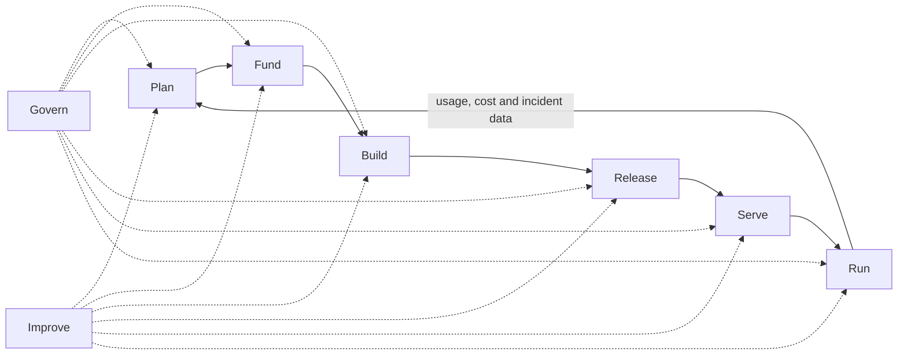
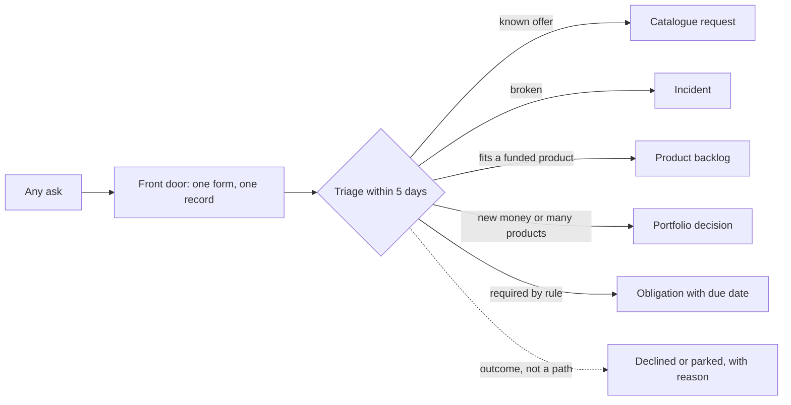
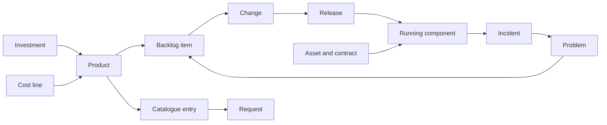
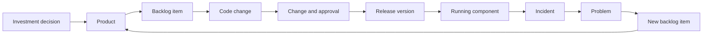
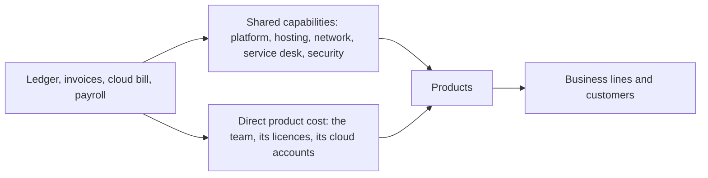
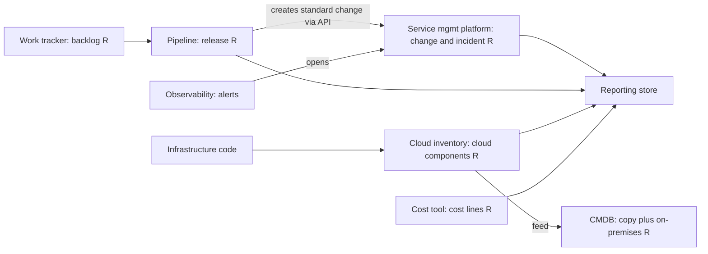
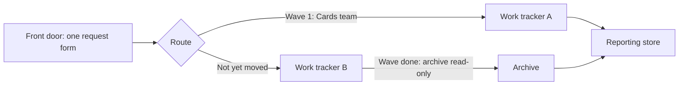
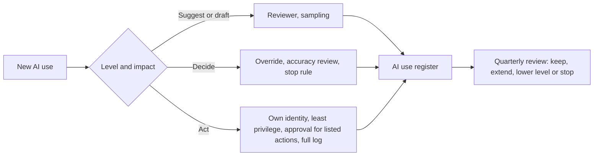

<!-- Generated by scripts/build-itbiz.mjs from itbiz/README.md and itbiz/modules/*.md. Do not edit by hand. -->
<!-- itbiz-source: 255241d80f455e76 -->

# Running IT as a Business — the complete course

*14 modules · 41 lessons · 220 templates and tools · plan → improve*

**How an IT division plans, funds, builds, releases, serves, runs and governs its digital products and services, and proves the value. A free, bilingual course for IT managers and enterprise architects.**

<!-- study-time -->
**Study time for the whole course: about 81 hours** (estimate: reading plus hands-on work, summed over every lesson). At about 6 hours a week that is roughly 13 weeks. Each lesson shows its own split; a pilot with real learners will replace these estimates.
<!-- /study-time -->

## What this is

Most IT divisions can describe what they are working on. Fewer can say what it is worth, what it costs, where work waits, which record is the true one, and who decides. This course teaches the management side of running technology: value streams and flow, products and the operating model, the portfolio and funding, demand, delivery, release and change, request fulfilment, operations and reliability, the records that tie it all together, money, suppliers and risk, tooling, and how to lead the change.

It is written for IT managers, enterprise architects, service and delivery leads, and the finance, risk and supplier people who work with them. You do not need to code. Where a lesson needs engineering depth it links to the companion courses, such as [*Cloud & DevOps: Zero to Hero*](../cloud/index.html), [*Software Testing: Zero to Hero in the AI Era*](../testing/index.html) and [*AI Governance: Zero to Hero*](../aigp/index.html), instead of re-teaching them.

## What this course is not

- **Not a framework course.** The course is original. It does not teach, summarise or follow the structure of any proprietary framework or standard, and it is not aligned with any certification exam. Lesson 12.1 names the main frameworks in the field, with their owners, and explains how to use one without becoming its servant.
- **Not a promise.** It does not promise a certification, a job, a promotion or savings.
- **Not endorsed or reviewed.** The material was drafted with AI and has not been reviewed by a subject expert. Tools, vendors and frameworks are named as examples, never as endorsements, and the course is not affiliated with any of them.
- **Not regulatory or legal advice.** Where a lesson touches regulation it names the kind of rule and the question to ask your risk or compliance function.

## How every lesson works

Every lesson has the same ten parts, so you always know where you are:

| Part | What you get |
|---|---|
| ⚡ **In 60 seconds** | The lesson in a few bullets: the idea, the rule that matters most and the biggest trap. |
| 🧭 **Why it matters** | A moment at Najm Bank's Technology division that makes the topic unavoidable. |
| 📐 **How it works** | The ideas, climbing a ladder: 🟢 *The essentials* → 🟡 *Going deeper* → 🔴 *Expert view*. |
| 🧰 **The toolkit** | The templates, checklists, measures and tools that apply: what each does and when to reach for it. |
| 🏛️ **In practice at Najm Bank** | The artefact this lesson produces, as a member of the cast used it. |
| 🛠️ **Exercises** | Three graded exercises (🟢 🟡 🔴), each with "done when" criteria and a model answer to check yourself against. |
| ⚠️ **Mistakes and traps** | What goes wrong in practice, and what to do instead. |
| 🧾 **Recap** | The takeaways worth remembering. |
| ✍️ **Check yourself** | Five questions, mostly scenarios, with hidden answers and explanations. |
| 📚 **References** | Research, guidance and reputable sources, and links into the rest of the library. |

Every lesson is tagged with its **step** in running IT: Plan, Fund, Build, Release, Serve, Run, Govern or Improve. The [toolkit catalogue](#appendix-the-repo-catalog) collects every template and checklist in one place.

## The running case: Najm Bank's Technology division (fictional)

**Najm Bank** is the library's fictional mid-sized Gulf bank. This course sits in its Technology division, about 600 staff plus suppliers, as it moves from a project-and-ticket IT department to a product-aligned one. The bank, its people and all its figures are invented for teaching; the numbers are illustrative, not benchmarks.

- **Omar**, Chief Information Officer, sponsor of the change.
- **Huda**, Head of Enterprise Architecture.
- **Yousef**, Head of IT Operations.
- **Reem**, Product Manager for Cards & Payments.
- **Sami**, Platform Engineering Lead.
- **Tariq**, IT Finance Business Partner.
- **Lina**, Vendor and Sourcing Manager.
- **Nour**, IT Risk and Controls Lead.

## The plan: 41 lessons in 14 modules

| Module | Lessons |
|---|---|
| 0 Orientation | 0.1 What it means to run IT as a business, and what digital products and AI change · 0.2 Meet Najm Bank's Technology division and the eight steps · 0.3 How to use this course, and what it is not |
| 1 Value and flow | 1.1 From projects to value: outcomes, value streams and flow · 1.2 Mapping a value stream end to end: lead time, waits and hand-offs · 1.3 Flow and delivery metrics that matter, and the ones that mislead |
| 2 Products, services and the operating model | 2.1 Digital products, services and projects: what each is and who owns it · 2.2 Designing a product-aligned operating model: product, platform and enabling teams · 2.3 The service catalogue: the offer the business actually sees |
| 3 Strategy and portfolio | 3.1 From strategy to an investment portfolio · 3.2 Prioritising and funding work: business cases, cost of delay and funding products not projects · 3.3 Portfolio governance: reviewing, re-planning and stopping work |
| 4 Demand and requirements | 4.1 Intake and demand management: one front door for ideas and requests · 4.2 From requirement to backlog, with traceability · 4.3 Architecture, non-functional requirements and the runway |
| 5 Build and integrate | 5.1 Delivery pipelines as a managed capability · 5.2 Quality gates and evidence a manager can trust · 5.3 Third-party, SaaS and open-source components in the product |
| 6 Release and change | 6.1 Release versus deployment, and who decides each · 6.2 Change control that protects stability without stopping flow · 6.3 Environments, configuration and the record of what is running |
| 7 Serve: requests, access and consumption | 7.1 Request fulfilment and self-service · 7.2 Subscriptions, entitlements and access rights · 7.3 Usage, showback and chargeback |
| 8 Run: operations and reliability | 8.1 Monitoring, events and incident management · 8.2 Problem management and learning from failure · 8.3 Service levels, SLOs and error budgets as a management tool |
| 9 The records that run IT | 9.1 The information model: the few records that matter and how they link · 9.2 Configuration and asset data quality: ownership, reconciliation and decay · 9.3 Traceability from investment to incident and back |
| 10 Money, suppliers and risk | 10.1 IT financial management: cost models, unit costs and the cost of a product · 10.2 Sourcing, suppliers and multi-supplier integration · 10.3 Risk, controls and audit in a regulated bank |
| 11 Tooling and automation | 11.1 The toolchain map: which tool is the system of record for what · 11.2 Integrating and rationalising tools without a big bang · 11.3 AI in IT operations and delivery, with controls |
| 12 Frameworks and transformation | 12.1 The frameworks landscape: what each is for, and how to use them without becoming their servant · 12.2 Assessing where you are: a maturity and evidence review · 12.3 A transformation roadmap and leading the change |
| 13 Capstone and practice | 13.1 Capstone: Najm Bank's IT operating blueprint · 13.2 Practice exam: 40 scenario questions |

## The path from zero to hero

| Stage | Modules | You will be able to… |
|---|---|---|
| 🟢 **Foundations** | 0–3 | See IT as a set of value streams, map one and measure its flow, design a product-aligned operating model and service catalogue, and turn strategy into a funded portfolio. |
| 🟡 **Practitioner** | 4–9 | Run one front door for demand, manage delivery, release and change on evidence, serve requests and access, run operations with service levels, and keep the few records that tie it together. |
| 🔴 **Advanced** | 10–13 | Manage IT money, suppliers and risk in a regulated bank, rationalise the toolchain, use AI with controls, lead the transformation, and finish with Najm Bank's operating blueprint and a 40-question practice exam. |

## Two languages

Every lesson is available in English and Arabic. In the Arabic edition, technical terms carry their English name in parentheses the first time they appear in a lesson, for example «مسار القيمة (value stream)».

## Where to go next

Open the course map, or start with lesson 0.1.

## Contents

- **[Module 0 — Orientation](#m0)**
  - [0.1 — What it means to run IT as a business, and what digital products and AI change](#l0-1) · 🟢 Beginner
  - [0.2 — Meet Najm Bank's Technology division and the eight steps](#l0-2) · 🟢 Beginner
  - [0.3 — How to use this course, and what it is not](#l0-3) · 🟢 Beginner
- **[Module 1 — Value and flow](#m1)**
  - [1.1 — From projects to value: outcomes, value streams and flow](#l1-1) · 🟢 Beginner
  - [1.2 — Mapping a value stream end to end: lead time, waits and hand-offs](#l1-2) · 🟢 Beginner
  - [1.3 — Flow and delivery metrics that matter, and the ones that mislead](#l1-3) · 🟢 Beginner
- **[Module 2 — Products, services and the operating model](#m2)**
  - [2.1 — Digital products, services and projects: what each is and who owns it](#l2-1) · 🟢 Beginner
  - [2.2 — Designing a product-aligned operating model: product, platform and enabling teams](#l2-2) · 🟢 Beginner
  - [2.3 — The service catalogue: the offer the business actually sees](#l2-3) · 🟢 Beginner
- **[Module 3 — Strategy and portfolio](#m3)**
  - [3.1 — From strategy to an investment portfolio](#l3-1) · 🟡 Intermediate
  - [3.2 — Prioritising and funding work: business cases, cost of delay and funding products not projects](#l3-2) · 🟡 Intermediate
  - [3.3 — Portfolio governance: reviewing, re-planning and stopping work](#l3-3) · 🟡 Intermediate
- **[Module 4 — Demand and requirements](#m4)**
  - [4.1 — Intake and demand management: one front door for ideas and requests](#l4-1) · 🟡 Intermediate
  - [4.2 — From requirement to backlog, with traceability](#l4-2) · 🟡 Intermediate
  - [4.3 — Architecture, non-functional requirements and the runway](#l4-3) · 🟡 Intermediate
- **[Module 5 — Build and integrate](#m5)**
  - [5.1 — Delivery pipelines as a managed capability](#l5-1) · 🟡 Intermediate
  - [5.2 — Quality gates and evidence a manager can trust](#l5-2) · 🟡 Intermediate
  - [5.3 — Third-party, SaaS and open-source components in the product](#l5-3) · 🟡 Intermediate
- **[Module 6 — Release and change](#m6)**
  - [6.1 — Release versus deployment, and who decides each](#l6-1) · 🟡 Intermediate
  - [6.2 — Change control that protects stability without stopping flow](#l6-2) · 🟡 Intermediate
  - [6.3 — Environments, configuration and the record of what is running](#l6-3) · 🟡 Intermediate
- **[Module 7 — Serve: requests, access and consumption](#m7)**
  - [7.1 — Request fulfilment and self-service](#l7-1) · 🟡 Intermediate
  - [7.2 — Subscriptions, entitlements and access rights](#l7-2) · 🟡 Intermediate
  - [7.3 — Usage, showback and chargeback](#l7-3) · 🟡 Intermediate
- **[Module 8 — Run: operations and reliability](#m8)**
  - [8.1 — Monitoring, events and incident management](#l8-1) · 🟡 Intermediate
  - [8.2 — Problem management and learning from failure](#l8-2) · 🟡 Intermediate
  - [8.3 — Service levels, SLOs and error budgets as a management tool](#l8-3) · 🟡 Intermediate
- **[Module 9 — The records that run IT](#m9)**
  - [9.1 — The information model: the few records that matter and how they link](#l9-1) · 🔴 Advanced
  - [9.2 — Configuration and asset data quality: ownership, reconciliation and decay](#l9-2) · 🔴 Advanced
  - [9.3 — Traceability from investment to incident and back](#l9-3) · 🔴 Advanced
- **[Module 10 — Money, suppliers and risk](#m10)**
  - [10.1 — IT financial management: cost models, unit costs and the cost of a product](#l10-1) · 🔴 Advanced
  - [10.2 — Sourcing, suppliers and multi-supplier integration](#l10-2) · 🔴 Advanced
  - [10.3 — Risk, controls and audit in a regulated bank](#l10-3) · 🔴 Advanced
- **[Module 11 — Tooling and automation](#m11)**
  - [11.1 — The toolchain map: which tool is the system of record for what](#l11-1) · 🔴 Advanced
  - [11.2 — Integrating and rationalising tools without a big bang](#l11-2) · 🔴 Advanced
  - [11.3 — AI in IT operations and delivery, with controls](#l11-3) · 🔴 Advanced
- **[Module 12 — Frameworks and transformation](#m12)**
  - [12.1 — The frameworks landscape: what each is for, and how to use them without becoming their servant](#l12-1) · 🔴 Advanced
  - [12.2 — Assessing where you are: a maturity and evidence review](#l12-2) · 🔴 Advanced
  - [12.3 — A transformation roadmap and leading the change](#l12-3) · 🔴 Advanced
- **[Module 13 — Capstone and practice](#m13)**
  - [13.1 — Capstone: Najm Bank's IT operating blueprint](#l13-1) · 🔴 Advanced
  - [13.2 — Practice exam: 40 scenario questions](#l13-2) · 🔴 Advanced
- **[Appendix — The toolkit catalogue](#appendix-the-repo-catalog)**

---

# Module 0 — Orientation

*Most IT departments are judged on two things nobody planned to be judged on: how much they cost and how often they break. Najm Bank's Technology division is no exception. The board asks Omar, the CIO, why the budget keeps rising, why a simple change to the cards app takes a quarter, and why the same outages keep reaching customers. This module sets the ground for the whole course. It explains what "running IT as a business" means in practice, and what digital products and AI change about it; it introduces Najm Bank's Technology division, its cast and the eight steps of the IT operating cycle that every later lesson uses; and it says plainly how to use the course and what it is not. Each lesson leaves you with a one-page artefact: a diagnosis of your own IT organisation, a map of its operating cycle, and a learning plan.*

> **Steps:** Plan — look at the whole operating cycle, and at your own organisation's place in it, before changing any part of it.

## 0.1 — What it means to run IT as a business, and what digital products and AI change

*Level: 🟢 Beginner* · *Prerequisites: none* · *Step: Plan*

**After this you can** write a one-page "IT as a business" diagnosis of your own IT organisation that names its customers, what they consume, how money and work flow, and three questions you cannot yet answer with evidence. *Study time: reading about 15 min, hands-on about 60 min (estimate).*

### ⚡ In 60 seconds
- **Running IT as a business** does not mean profit from colleagues or outsourcing everything. It means knowing IT's customers, offer, costs, performance and risks, and being able to show the evidence.
- Five questions sum it up: **who are our customers, what do they consume, what does it cost, how fast and safely does change flow, and who decides with what record?**
- **Digital products** change the picture: when the bank's product *is* software, IT is part of what customers buy, and it changes every week.
- **AI** makes writing code cheaper, not deciding, reviewing, releasing, running or governing. Published research so far suggests it amplifies the operating model you already have.
- The rule that matters most: **every claim about IT needs a customer, a number and a record.** Without all three, you have an opinion, not a fact.
- Biggest trap: treating "IT as a business" as an accounting exercise (charging for everything) rather than making value, cost and risk visible enough to decide.

### 🧭 Why it matters
Najm Bank and everyone in it are fictional. All numbers about Najm Bank in this lesson are illustrative figures, not benchmarks.

Omar, Najm Bank's Chief Information Officer (CIO), leaves a board meeting with three questions he could not answer. Why has the technology budget risen again (by about a tenth in two years) while the cards app is still slow to get new features? How many of last year's projects delivered the benefits in their business cases? Why did the same payment outage happen three times in six months?

Omar knew the answers in outline: regulatory work, cloud migration, supplier price rises; benefits "mostly delivered, we think"; the outage "a supplier problem". None came with a checkable number, a record of who decided, or a link from money spent to value received. The board did not doubt Omar's honesty. It doubted that the Technology division could see itself.

The lending business can say who its customers are, what they buy and what each loan costs. Running IT as a business means IT can do the same for its own work, with evidence.

### 📐 How it works

#### 🟢 The essentials

**What "as a business" means.** In this course it means five things.

| Question | A well-run IT organisation can show | A struggling one says |
|---|---|---|
| **Who are our customers?** | Named business units and end customers, and what each relies on | "The business" |
| **What do they consume?** | A short list of products and services, each with an owner and a service level | "We support 400 applications" |
| **What does it cost?** | The cost of each product or service, and a unit cost where it helps (per account, per payment) | One total, no breakdown |
| **How fast and safely does change flow?** | Time from idea to customer, how often changes go out, fail and recover | "Projects are mostly on time" |
| **Who decides, with what record?** | Funding, priority, release and risk decisions, each with an owner and a findable record | "It was agreed in a meeting" |

It does **not** mean that IT must make a profit, that every service must be charged back, or that IT should behave like an outside supplier to the rest of the bank. Those are design choices that later modules examine. The core idea is simpler: **manage IT with the same discipline about customers, value, cost and risk that you expect of any other part of the business.**

**Terms you will meet throughout.** Each is treated fully later.

- A **digital product** is something customers (inside or outside the bank) use, delivered mostly through software, with a long life and a team that keeps improving it, such as the Najm Bank cards app.
- A **service** is an offer IT keeps running for others at an agreed level of performance, such as "laptop provisioning" or "the payments platform".
- A **project** is temporary work with a start, an end and a budget, used to deliver a defined change.
- A **value stream** is the end-to-end sequence of steps, across teams, that turns a need into something a customer values.
- The **operating model** is how the organisation is arranged: who does what, who decides, how work is funded and measured, and which records and tools hold it together.
- A **record** is information that proves something happened or was decided: an approved investment, a change record, an incident ticket, a cost report.

**From order-taker to accountable owner.** In many IT departments the business writes requirements, IT delivers a project, the project closes, and nobody answers for whether customers got value. This course teaches the alternative: long-lived teams that own products and services, funded for outcomes and measured on value, flow, reliability and cost together.

| Project-and-ticket IT | Product-aligned IT |
|---|---|
| Work arrives as projects and tickets | Work arrives as outcomes for a product or service |
| Teams form for a project and disband | Teams stay with a product and learn from it |
| Funding per project, approved once a year | Funding per product or capacity, reviewed regularly |
| Success = delivered on time and budget | Success = customer and business outcome, at known cost and risk |
| Operations inherits whatever was built | The team that builds also cares how it runs |
| Records scattered across tools | A small set of linked records shows idea to incident |

Some work is genuinely a project (a data-centre exit, a regulatory deadline). The point is to choose deliberately, not by habit.

#### 🟡 Going deeper

**What digital products change.** IT once mostly supported products that lived elsewhere: a loan was a contract and a branch process, and the system recorded it. Today, for many retail customers, the bank *is* an app, a card and a payment that works or does not. Three things follow.

1. **Change never stops.** A digital product is never "finished", and an operating model built around projects that end struggles with work that does not.
2. **Structure shapes the product.** In a 1968 paper, "How Do Committees Invent?", Melvin Conway argued that organisations which design systems tend to produce designs that copy their own communication structure (now known as Conway's law). If cards, payments and fraud sit in three departments with three backlogs, expect the customer journey to feel like three systems (lesson 2.2).
3. **Delivery performance becomes a business measure.** The DORA research programme (DevOps Research and Assessment, part of Google Cloud) is reported to group its five current software delivery metrics as throughput (change lead time, deployment frequency, failed deployment recovery time) and instability (change fail rate, deployment rework rate). Behind them are a manager's questions: how quickly can we respond, and how often does responding hurt us? Lesson 1.3 covers which measures help and which mislead.

**What AI changes.** Generative AI tools now draft code, tests, documentation and incident summaries. That lowers the cost of producing, not of deciding what to produce, checking it, releasing it safely, running it or proving it was controlled. Research so far reflects this:

- The announcement of the 2024 DORA report says that as AI adoption increased, it was accompanied by an estimated 1.5% decrease in delivery throughput and an estimated 7.2% reduction in delivery stability.
- The 2025 DORA report, *State of AI-Assisted Software Development*, drew on nearly 5,000 technology professionals. Its announcement says 90% of respondents use AI at work, that AI adoption now had a positive relationship with throughput but still a negative one with stability, and that "AI doesn't fix a team; it amplifies what's already there."

These are correlational survey findings for particular years, not laws. The practical reading: **if AI speeds up writing code, the bottleneck moves to everything after it** (review, testing, release, operations, records). Weak flow plus AI produces more, faster, and breaks more. That is why this course is about the operating model, not the tools.

AI also becomes part of the bank's own products, which brings governance duties (see [*AI Governance*, lesson 0.1 — What AI governance is, and what the AIGP proves](../aigp/index.html#/0.1)), and a tool inside IT that needs controls of its own (lesson 11.3).

#### 🔴 Expert view

**Three ways "IT as a business" goes wrong.**

- **The internal market.** IT charges for everything, invoices are argued line by line, and allocation costs more than the information is worth. Showback (showing cost without charging) is lighter; see lesson 7.3.
- **The utilisation trap.** Measuring how busy people are, not how fast value flows. Busy teams with long queues are slow: lean practice commonly finds that work spends much of its lead time waiting (lesson 1.2).
- **The reporting factory.** Dashboards arrive before decisions. Start from the decision (fund, stop, release, fix), then find the smallest record that supports it.

**The rule for this course.** Every claim about IT needs a **customer** (who is affected), a **number** (how much, how fast, how often, at what cost) and a **record** (where the evidence lives, who owns it). Often the honest answer is "we do not know yet; here is the record we will create to find out", which builds more trust than a confident guess.

### 🧰 The toolkit
| Resource, tool or template | What it is and does | When to reach for it |
|---|---|---|
| **IT-as-a-business diagnosis** | One page answering the five questions, each rated "evidence / partial / opinion" | Before any change or board conversation |
| **Money map** | Where the IT budget goes (run vs change; people, suppliers, cloud), unknowns marked | When only one cost total exists |
| **Flow snapshot** | Rough lead time, deployment frequency and change failure for one product, with the source of each number | To start a factual conversation about speed and stability |
| **Decision-and-record log** | Recent decisions (fund, release, accept risk), who decided and where the record is | When "agreed in a meeting" is the usual answer |
| **AI change note** | Where AI is used in delivery and operations, and which downstream steps have not changed to match | Before scaling AI tools across teams |

### 🏛️ In practice at Najm Bank
Omar asked Huda (Head of Enterprise Architecture) and Tariq (IT Finance Business Partner) for a one-page diagnosis before the next board. Illustrative and fictional:

> **Najm Bank Technology: IT-as-a-business diagnosis (draft 1)**
>
> | Question | What we can show | Evidence rating |
> |---|---|---|
> | Customers | Retail, SME and corporate banking; internal functions; end customers via digital channels | Partial: no map of who relies on which systems |
> | Consumption | About 400 applications in the inventory; no agreed product or service list | Opinion |
> | Cost | Total known; run versus change only roughly; no cost per product | Partial |
> | Flow | Project dates known; nobody measures idea-to-customer time | Opinion |
> | Decisions and records | Investment decisions minuted; release and risk decisions spread across email and three tools | Partial |
>
> **Three questions we cannot answer with evidence today:**
> 1. What does Cards & Payments cost a year, including shared platforms and suppliers?
> 2. How long does a typical cards-app change take from approval to customers, and where does it wait?
> 3. Which changes or supplier events were behind last year's three payment outages, and what did we change?
>
> **AI note:** two teams use AI coding assistants; approval, testing and release are unchanged. Risk: more changes queued at the same gates.

Tariq first rated cost "evidence" on one line: "IT is about 8% of bank costs". Huda pointed out that a total answers no decision, and he downgraded it. Yousef, Head of IT Operations, objected to the flow row: "Operations is measured on stability, not speed." Omar kept it; lesson 1.3 explains why the two are measured together.

### 🛠️ Exercises
**🟢 Answer the five questions.** For your own IT organisation (or Najm Bank's), answer each of the five questions in a sentence or two and rate it "evidence", "partial" or "opinion".
*Done when:* all five rows have a rating, and every "evidence" rating names the record (report, tool, register) that holds it.

Model answer and self-check

**Model answer.** Honest beats impressive: customers "partial" (dependencies not mapped); consumption "opinion" (no product list); cost "partial" (not by product); flow "opinion" (no lead time); decisions "partial" (release and risk scattered). Few rows deserve "evidence".

**Self-check.**
- Did you write about customers and consumption, not your team's activities?
- Is each "evidence" rating backed by a record someone else could open?
- Did you resist rating a single total (budget, headcount) as evidence?

**🟡 List three unanswerable questions.** Write three questions an executive could reasonably ask that you cannot answer with evidence today. For each, name the record that would answer it and its owner.
*Done when:* each question is tied to a decision (fund, stop, release, fix, accept risk) and has a named record and owner role.

Model answer and self-check

**Model answer.** (1) "What does product X cost per year?" Decision: invest further or not. Record: a cost model by product. Owner: IT finance with the product manager. (2) "How long does a change take from approval to customers?" Decision: where to invest in flow. Record: timestamps on backlog items and releases. Owner: the product team. (3) "Which changes were involved in last quarter's major incidents?" Decision: what to fix. Record: incident records linked to change records. Owner: operations.

**Self-check.**
- Is each question tied to a real decision?
- Is the record specific (fields, tool or register), not "better data"?
- Could you start collecting it within a month without a new tool?

**🔴 Write the AI change note.** For one team, say where AI tools are used today and rate each downstream step (review, testing, change approval, release, operations, records) "changed to match", "unchanged" or "unknown". Name the likely bottleneck and one action for it.
*Done when:* all six steps are rated, one bottleneck is named with a reason, and one action has an owner and a date.

Model answer and self-check

**Model answer.** Cards & Payments: AI drafts code and unit tests; review "unchanged" (same two reviewers); testing "partly changed"; change approval and release "unchanged" (weekly board, monthly window); operations "unknown"; records "unchanged". Bottleneck: review, because volume rises and reviewers do not. Action: Reem and Sami agree a smaller-change rule and a review rota by month end.

**Self-check.**
- Did you name a step after code writing as the likely bottleneck?
- Is your action about rules, roles or records rather than another tool?
- Did you avoid stating any productivity gain you cannot source?

### ⚠️ Mistakes and traps
- **Reading "business" as "profit".** Aim for visible value, cost and risk; decide later whether to charge anything.
- **Starting with a tool or a framework.** Adopting either before you know which decisions it must support produces records nobody uses. Start from the five questions.
- **Assuming AI will fix slow delivery.** Faster drafting with unchanged downstream steps lengthens queues. Fix the flow, then scale the tool.
- **Over-claiming evidence.** A single total or a meeting memory is not evidence; "we don't know yet" with a plan is a respectable answer.

### 🧾 Recap
- Running IT as a business means showing customers, consumption, cost, flow and decisions, with evidence; not profit or compulsory chargeback.
- Digital products make change continuous, mirror the organisation's structure, and make delivery performance a business measure.
- DORA research so far links AI adoption with lower delivery stability and calls AI an amplifier; the bottleneck moves downstream.
- The course rule: every claim needs a customer, a number and a record.

### ✍️ Check yourself
**1. A board member tells Omar: "Running IT as a business means every department should pay IT for what it uses." What is the best response?**

- A. Agree, because charging every department for usage is the defining feature of IT as a business.
- B. Agree in part, and start invoicing the largest users first to show quick and visible progress.
- C. Explain that the aim is visible value, cost and risk, and that charging is a later design choice.
- D. Disagree, because IT is a cost centre and should never show its costs to other departments.

Answer

**C.** Running IT as a business means answering the five questions with evidence; charging is a later design choice. A and B make chargeback the goal (the "internal market" trap); D hides cost, so the cost question cannot be answered. See "What 'as a business' means".

**2. Tariq's draft says: "Cost: IT is about 8% of bank costs (evidence)." Why did Huda ask him to downgrade it?**

- A. A single total does not support any decision about a product, service or investment.
- B. The figure is too high for a mid-sized bank and should be checked against benchmarks.
- C. Cost figures belong to the finance department and should not appear in an IT diagnosis.
- D. The board asked about flow and outages, so cost evidence is not relevant to the meeting.

Answer

**A.** A total answers no "fund, stop or fix" question; the cost question asks what each product or service costs. B invents a benchmark, C contradicts the diagnosis's purpose, and D ignores that the board asked about the budget. See "In practice at Najm Bank".

**3. Which statement about AI fits the DORA findings described in the lesson?**

- A. AI adoption reliably improves both delivery speed and stability once teams are trained.
- B. AI has no measurable link with delivery performance, so it can be ignored in operating design.
- C. AI adoption has been linked with lower stability, which proves AI tools should be banned.
- D. AI adoption has gone with lower stability so far, and the 2025 report calls AI an amplifier.

Answer

**D.** Both years report a negative relationship with stability, and the 2025 report calls AI an amplifier. A overstates the findings, B contradicts them, and C turns a correlational finding into a conclusion the reports do not draw. See "What AI changes".

**4. Three Najm Bank departments (cards, payments, fraud) build the cards app from separate backlogs, and customers say it "feels like three apps". Which idea explains this best?**

- A. The utilisation trap, because the three departments are measured on how busy they are.
- B. Conway's law: systems tend to copy the communication structure of the organisation.
- C. The internal market, because each department charges the others for its services.
- D. The reporting factory, because the departments produce dashboards instead of decisions.

Answer

**B.** Conway observed that designs mirror the organisation's communication structure: three departments, three experiences. A, C and D are real traps, but none explains why the product's shape follows the organisation's. See "What digital products change".

**5. Omar is asked how long a typical change to the cards app takes, and nobody measures it. What is the best answer to the board?**

- A. "We do not know yet; here is the record we will create and who will own it."
- B. "About six weeks", based on the project manager's impression from recent releases.
- C. "It depends on the change", since every change is different and cannot be compared.
- D. "Faster than last year", because the team has started using AI coding assistants.

Answer

**A.** Without a record, the honest answer names the gap and the plan. B is an opinion dressed as a number, C avoids the question, and D assumes AI improved flow without evidence. See "The rule for this course".

### 📚 References
- Google Cloud blog, announcement of the *2025 DORA Report: State of AI-Assisted Software Development* (opened 2026-11-19): https://cloud.google.com/blog/products/ai-machine-learning/announcing-the-2025-dora-report
- Google Cloud blog, announcement of the 2024 DORA report (opened 2026-11-19): https://cloud.google.com/blog/products/devops-sre/announcing-the-2024-dora-report
- DORA, history of its software delivery metrics, on dora.dev (as reported in search summaries; not opened): https://dora.dev/guides/dora-metrics/history/
- Rother, M. and Shook, J., *Learning to See* (Lean Enterprise Institute, 1999): the lean practice of mapping a value stream and its waits.
- Conway, M. E., "How Do Committees Invent?", *Datamation*, April 1968 (full citation; the paper itself was not opened for this lesson).
- Forsgren, N., Humble, J. and Kim, G., *Accelerate* (IT Revolution, 2018): the research behind the delivery metrics.
- Kersten, M., *Project to Product* (IT Revolution, 2018): a practitioner's case for moving IT from projects to products.
- Library: [*Cloud & DevOps: Zero to Hero*, lesson 0.1 — What cloud, DevOps, platform engineering and SRE are](../cloud/index.html#/0.1) (the engineering vocabulary behind this course).

## 0.2 — Meet Najm Bank's Technology division and the eight steps

*Level: 🟢 Beginner* · *Prerequisites: 0.1* · *Step: Plan*

**After this you can** draw your own organisation's IT operating cycle on one page using the eight steps, name an owner, a main record and one measure for each step, and mark the two weakest hand-offs. *Study time: reading about 15 min, hands-on about 60 min (estimate).*

### ⚡ In 60 seconds
- Najm Bank is a **fictional** mid-sized Gulf bank. This course sits in its **Technology division** (about 600 staff plus suppliers, an illustrative figure), which is moving from project-and-ticket IT to product-aligned IT.
- Eight people carry the story: **Omar** (CIO), **Huda** (architecture), **Yousef** (operations), **Reem** (Cards & Payments product), **Sami** (platform), **Tariq** (IT finance), **Lina** (sourcing) and **Nour** (risk and controls). Each makes realistic mistakes.
- The **eight steps** of the IT operating cycle, **Plan · Fund · Build · Release · Serve · Run · Govern · Improve**, are this course's own plain words, not any framework's terms.
- Each step answers a question, leaves a main **record** and has an **owner**. Value is often lost at the **hand-offs** between steps.
- The rule that matters most: **the steps are a loop, not a sequence of departments.** Data from Serve and Run must flow back into Plan and Fund.
- Biggest trap: mapping the steps onto the org chart ("Build is development, Run is operations") and calling the map finished.

### 🧭 Why it matters
Najm Bank and all its people are fictional. All numbers about Najm Bank in this lesson are illustrative figures, not benchmarks.

At Omar's first operating-model workshop, each leader described how a change to the cards app reaches customers. Reem described two-week sprints. Sami described a pipeline that could deploy many times a day. Yousef described a weekly change board and a monthly release window. Tariq described an annual budget in which the cards work was a line inside a "digital channels" project. Nour described a quarterly control test. Lina described a card-processing supplier that needs ten working days' notice for any interface change.

Every description was accurate; none was the whole picture. Huda drew them on a whiteboard as a loop and saw it at once: the daily-capable pipeline waited for a monthly window, the window waited for a supplier's notice period, and the money had been decided eight months earlier on a business case nobody had reopened.

That is why the course starts with a shared map. The eight steps give everyone the same words for the same parts of the cycle, so the hand-offs, where value waits, gets lost or gets re-checked, become visible.

### 📐 How it works

#### 🟢 The essentials

**Najm Bank's Technology division.** Najm Bank offers retail, SME and corporate banking and is supervised by a central bank. Its Technology division (about 600 staff plus suppliers) is organised mostly by function: application development, IT operations, architecture, security, a project management office, IT finance and vendor management. A few product teams have started, including Cards & Payments. The board wants lower cost, fewer outages and faster change, and doubts it can have all three.

**The cast.** The same people appear in every module.

| Person | Role | What they care about | The mistake they tend to make |
|---|---|---|---|
| **Omar** | Chief Information Officer; sponsor of the change | Board confidence on cost and outages | Promising the board a date for the transformation before the evidence exists |
| **Huda** | Head of Enterprise Architecture | The target operating model and the design of IT's records | Designing a complete model on paper before testing it with one product |
| **Yousef** | Head of IT Operations (service desk, operations centre, infrastructure) | Stability; sceptical of "product" talk | Treating every change as a risk to block rather than to manage |
| **Reem** | Product Manager, Cards & Payments | Customer outcomes and speed | Treating operations and controls as someone else's problem |
| **Sami** | Platform Engineering Lead (pipelines, environments, internal developer platform) | Fast, safe, self-service delivery | Building platform features nobody asked for |
| **Tariq** | IT Finance Business Partner (budgets, cost allocation, business cases) | Predictable spend and credible business cases | Allocating costs so precisely that nobody trusts or uses the numbers |
| **Lina** | Vendor and Sourcing Manager (contracts, suppliers, multi-supplier integration) | Value and risk in supplier contracts | Signing contracts whose terms slow the bank's own release cycle |
| **Nour** | IT Risk and Controls Lead (second-line liaison, audit, regulatory reporting) | Evidence that controls work | Asking for evidence in a form only a manual process can produce |

Najm Bank teams from other library courses (platform, quality engineering, security, data, AI products) appear briefly when a lesson links to them.

**The eight steps.** Each step answers one management question.

| Step | The question it answers | Main record it leaves | One useful measure | Owner at Najm Bank |
|---|---|---|---|---|
| **Plan** | What should we work on, and why? | Link from stated outcomes to approved work; prioritised demand | Share of work traceable to a stated outcome | Omar, Huda, product managers |
| **Fund** | How much money and capacity goes where? | Funding decision per product or investment | Time from proposal to decision | Tariq, with the investment committee |
| **Build** | How do we turn a need into working, tested software or configuration? | Backlog items, code changes, test evidence | Lead time from start of work to ready to release | Product teams, Sami's platform |
| **Release** | When and how does a change reach customers, and who decides? | Change and release records | Deployment frequency; change failure | Product owners, Yousef for change control |
| **Serve** | How do people request, get and use what IT offers? | Service catalogue entries, requests, entitlements | Time to fulfil a standard request | Yousef's service desk, product teams |
| **Run** | How do we keep it working and recover when it fails? | Monitoring events, incidents, problems | Time to restore service; service-level performance | Yousef's operations, product teams |
| **Govern** | Who is allowed to decide what, and how do we prove control? | Policies, risk register, control evidence | Share of controls with automated evidence | Nour, with Omar and Huda |
| **Improve** | What did we learn, and what will we change? | Reviews, improvement backlog, maturity evidence | Improvements completed and their measured effect | Everyone; Huda coordinates |

**Two kinds of steps.** Plan, Fund, Build, Release, Serve and Run follow a piece of work, roughly in that order. **Govern** and **Improve** run across all of them: Govern sets rules and checks evidence at every step; Improve feeds back what was learned anywhere.

The arrow from Run back to Plan matters most. Without it, the organisation keeps funding and building without learning whether anything worked.

#### 🟡 Going deeper

**Steps are not departments.** "Build is development, Run is operations" is the project-and-ticket model drawn as a loop. In a product-aligned organisation one product team touches Build, Release, Serve and Run for its product, while a platform team provides shared means. The steps say *what must happen*; the operating model (Module 2) decides *who does it*.

**Steps are not phases.** A large project may pass through each step once; a digital product passes through all of them every week, in small batches.

**Where value leaks: the hand-offs.** A **hand-off** is any point where work, information or responsibility passes between people, teams or tools. Each risks a **wait** (work sits in a queue), a **loss** (context does not travel) or a **re-check** (the receiver does not trust the sender's evidence). Huda's whiteboard showed four:

| Hand-off | What goes wrong | Lesson that addresses it |
|---|---|---|
| Fund → Build | Money approved for a project scope months ago; the team cannot change course without a new business case | 3.2 |
| Build → Release | Pipeline ready daily; change board weekly; release window monthly | 6.1, 6.2 |
| Release → Run | Operations learns about a change after it fails | 6.3, 8.1 |
| Run → Plan | Incident and usage data never reach the people who prioritise work | 8.2, 9.3 |

**The chain of records.** Each step leaves a record, and the records should link: investment decision to backlog items, to the changes that delivered them, to the service they changed, to the incidents and costs that followed. With those links Omar answers the board in minutes; without them, every answer is a reconstruction project. Module 9 builds that chain.

#### 🔴 Expert view

**Why this course uses its own words.** Published frameworks describe parts of this cycle in their own vocabularies. This course uses eight plain words so you can map *your* organisation without first adopting someone else's model. Lesson 12.1 compares the well-known frameworks.

**Disagreement is a feature.** Yousef sees Release and Run as one stability concern and wants a single gate; Reem sees Release as a product decision for her team. Nour wants evidence at every step; Sami wants the pipeline, not forms, to produce it. A good operating model does not pick a winner; it decides who decides each thing, on what evidence, and makes the record do the work. Modules 6 and 10 settle these two arguments.

**Map what happens, not what the manual says.** Trace the last three real changes. The gap between the documented and the real cycle is often the most useful finding.

### 🧰 The toolkit
| Resource, tool or template | What it is and does | When to reach for it |
|---|---|---|
| **Eight-step cycle sheet** | Each step's question, owner, main record and one measure | First artefact of any operating-model change; update each module |
| **Hand-off map** | Every hand-off marked with its typical wait, loss or re-check | When nobody can say where work waits |
| **Cast table** | Who owns each step, what they care about, the mistake they tend to make | Before a workshop, to plan who must attend |
| **Real-example trace** | Three recent changes followed through the steps, dated at each hand-off | To check your map against reality |
| **Record chain sketch** | Which record at each step should link to which at the next | Before buying or changing any IT management tool |

Any whiteboard, diagram or spreadsheet tool will do.

### 🏛️ In practice at Najm Bank
After the workshop, Huda turned her whiteboard into an eight-step cycle sheet for the Cards & Payments product. Illustrative and fictional:

> **Cards & Payments: eight-step cycle sheet (draft)**
>
> | Step | Owner today | Main record today | Measure today |
> |---|---|---|---|
> | Plan | Digital channels steering group | Annual plan slide | None |
> | Fund | Investment committee, via Tariq | Project business case | Budget versus spend |
> | Build | Reem's team, plus two supplier teams | Backlog in the delivery tool | Sprint velocity |
> | Release | Weekly change board (Yousef chairs) | Change ticket | Number of changes approved |
> | Serve | Service desk | Request tickets | Tickets closed |
> | Run | Operations centre; card-processing supplier | Incident tickets in two tools | Monthly availability |
> | Govern | Nour, quarterly control test | Spreadsheet of sampled changes | Control test pass rate |
> | Improve | None assigned | Post-incident reports, not tracked | None |
>
> **Weakest hand-offs:** (1) Build → Release: a change ready in two days waits a median of about three weeks for the change board and release window (illustrative figure, from tracing three recent changes). (2) Run → Plan: last year's three payment incidents produced reports, but none of their actions reached the cards backlog.

Huda's first draft listed "IT operations" as owner of Serve and Run. Reem pointed out that the app's customer-facing behaviour was hers to answer for, whoever ran the servers, so both were marked "shared, to be decided in Module 2". Sami noticed that the measure column held three counts of activity (velocity, changes approved, tickets closed) and no measure of flow or outcome: the starting point for Module 1.

### 🛠️ Exercises
**🟢 Fill in the cycle sheet.** For one product or service you know, fill in the eight-step cycle sheet: owner, main record and current measure for each step. Write "none" where nothing exists.
*Done when:* all eight rows are filled in, at least one row honestly says "none", and every owner is a named role or body, not "IT".

Model answer and self-check

**Model answer.** A typical first sheet resembles Huda's: Plan and Improve weakest (an annual slide, no owner); Fund a project business case; Build a backlog measured by velocity; Release counted change tickets; Serve and Run tickets and availability; Govern a sampled control test. The value is in the "none" cells and the activity measures.

**Self-check.**
- Did you describe what actually happens, not what the manual says?
- Is each owner a role or body you could invite to a meeting?
- Did you fill in Govern and Improve too?

**🟡 Trace three real changes.** Pick three changes that reached customers in the last quarter. For each, find the date at each hand-off (approved, funded, started, ready, released, in use) and mark the longest wait.
*Done when:* three changes are traced with dates (or "unknown" where no record exists), the longest wait for each is marked, and you have written one sentence on what the three have in common.

Model answer and self-check

**Model answer.** Reem traced a fee-display change, a card-freeze feature and a supplier interface update. All three were ready within days and waited longest between "ready" and "released" (change board, monthly window, and once the supplier's notice period). Common thread: Release, not Build, is the bottleneck. Two had "unknown" funding dates, because the work sat inside a larger project budget.

**Self-check.**
- Did you use records (ticket dates, release notes) rather than memory?
- Did you mark "unknown" honestly instead of estimating silently?
- Is your common-thread sentence about a hand-off, not a person?

**🔴 Mark the two weakest hand-offs and propose a record link.** Name your two weakest hand-offs. For each, say whether the problem is a wait, a loss or a re-check, and propose one link between records that would show it every month without a manual trace.
*Done when:* each hand-off has a problem type, evidence from your traces, and a record link (from which record, to which, owned by whom).

Model answer and self-check

**Model answer.** Najm Bank: (1) Build → Release is a **wait**; link each change record to the backlog item it delivers, with "ready" and "released" timestamps, owned by Reem's team, so the wait is measured automatically. (2) Run → Plan is a **loss**; link each major incident's actions to items in the product backlog, owned by Yousef's problem manager with Reem, so the monthly review shows which actions are planned, done or dropped.

**Self-check.**
- Did you distinguish a wait (time) from a loss (information) and a re-check (duplicated control)?
- Is the link small enough to start without a new tool?
- Does it feed a regular decision, not just a report?

### ⚠️ Mistakes and traps
- **Mapping the org chart, not the work.** "Development = Build" hides the hand-offs. Trace real changes instead.
- **Forgetting the return arrow.** Without Run → Plan feedback you have a production line, not a loop. Name who carries usage, cost and incident data back.
- **Leaving Govern and Improve unowned.** They cut across everything, so they often belong to nobody. Assign an owner, even provisionally.
- **Measuring activity at every step.** Tickets closed and changes approved show effort, not flow or outcome. Look for one flow or outcome measure per step.
- **Treating disagreement as an obstacle.** Yousef and Reem are both partly right. Use their argument to find which decisions need a clear owner and record.

### 🧾 Recap
- Najm Bank is fictional; its Technology division is moving from project-and-ticket to product-aligned IT.
- The eight steps are **Plan, Fund, Build, Release, Serve, Run, Govern, Improve**: six follow the work, two cut across it.
- Each step answers a question, leaves a record and has an owner; value often leaks at hand-offs, as waits, losses and re-checks.
- The steps are a loop: data from Serve and Run must return to Plan and Fund.
- Map the real cycle by tracing real changes, not by copying the process document.

### ✍️ Check yourself
**1. In the workshop, Sami's pipeline can deploy daily, but changes reach customers about monthly. Which step's hand-off is the most likely first place to look?**

- A. Plan → Fund, because money for the work was approved months before work started.
- B. Build → Release, because ready changes wait for the change board and release window.
- C. Serve → Run, because the service desk must be trained before any change goes live.
- D. Run → Plan, because incident data does not reach the people who set priorities.

Answer

**B.** A daily-capable pipeline with monthly releases points to the Build → Release hand-off, as Huda's whiteboard and Reem's traces showed. A and D are real weak hand-offs but do not explain why ready changes wait; C is not in the case. See "Where value leaks: the hand-offs".

**2. Huda's first draft lists "IT operations" as the owner of Serve and Run for Cards & Payments. What does the lesson suggest about this?**

- A. It is correct, because Serve and Run are by definition the operations department's steps.
- B. It is wrong, because product managers must always own Serve and Run in a modern bank.
- C. It is incomplete, because a supplier runs the card-processing system and should own both.
- D. It confuses steps with departments; the owner is a design decision still to be made.

Answer

**D.** Steps say what must happen; the operating model decides who does it, so both were marked "shared, to be decided in Module 2". A is the steps-as-departments trap, B states a rule the lesson does not make, and C confuses running a component with answering for the product. See "Steps are not departments".

**3. Which pair of steps does the lesson describe as cutting across all the others?**

- A. Plan and Fund, because every piece of work starts with a decision and a budget.
- B. Release and Run, because together they decide the stability that customers see.
- C. Govern and Improve, because rules and learning apply at every other step.
- D. Build and Serve, because they produce and deliver everything the customer uses.

Answer

**C.** Govern sets rules and checks evidence at each step, and Improve feeds learning back from anywhere; the diagram links both to every other step. A, B and D are life-cycle steps that follow the work. See "Two kinds of steps".

**4. Last year's payment incidents produced reports, but none of their actions reached the cards backlog. What kind of hand-off failure is this?**

- A. A loss: information from Run never reached the people who plan the work.
- B. A wait: the actions sat in a queue for the change board to approve them.
- C. A re-check: Plan repeated the incident analysis because it distrusted Run.
- D. A funding gap: no money was approved, so the actions could not be planned.

Answer

**A.** The actions existed but never reached Plan: a loss of information at the Run → Plan hand-off. B is a wait, C a duplicated control, and D is not in the case. See "Where value leaks".

**5. Sami notices that the "measure today" column shows velocity, changes approved and tickets closed. Why is this a concern?**

- A. These measures are hard to collect, so the teams spend too long on reporting.
- B. These measures belong to other courses in the library, not to IT management.
- C. These numbers are too low, which shows the teams are not working hard enough.
- D. These measures count activity, and say nothing about flow or customer outcome.

Answer

**D.** All three count effort; none shows how fast value reaches customers or whether it helped. A and C make claims the lesson does not, and B is wrong because measures are a management concern. See "Mistakes and traps".

### 📚 References
- Rother, M. and Shook, J., *Learning to See* (Lean Enterprise Institute, 1999): a classic introduction to mapping a value stream and its waits.
- Library: [*Cloud & DevOps: Zero to Hero*, lesson 0.3 — Meet Najm Bank's platform team, and how to use this course](../cloud/index.html#/0.3) (the platform side of Najm Bank, from the engineering view); [*Cloud & DevOps: Zero to Hero*, lesson 0.2 — The path to production: from a commit to a customer, and everything that can break on the way](../cloud/index.html#/0.2) (the engineering view of Build and Release).

## 0.3 — How to use this course, and what it is not

*Level: 🟢 Beginner* · *Prerequisites: 0.1, 0.2* · *Step: Plan*

**After this you can** write a one-page learning plan that sets your path through the modules for your role, your artefact folder, the people in your organisation you will check facts with, and three limits you will keep. *Study time: reading about 15 min, hands-on about 60 min (estimate).*

### ⚡ In 60 seconds
- The course teaches the **operating-model view** of IT: who decides, what record proves it, how it is measured, funded and governed. It is **not an engineering course**; it links to the library's engineering courses for depth.
- It is **original**: written from general management and engineering practice, **not based on, derived from or aligned with any proprietary framework or certification**, and **not training for any exam**.
- It is **not professional advice**. Accounting, procurement law, regulation and audit differ by country and organisation. The course names the kind of rule and the question to ask finance, legal, risk or the regulator.
- It is AI-drafted and not expert-reviewed, and every Najm Bank number is **illustrative**. Check before you act.
- The rule that matters most: **every lesson ends in an artefact.** Build your own operating blueprint, one page at a time, in one folder.
- Biggest trap: reading the course as a recipe to install. Your organisation's context decides; the course gives you questions, structures and evidence habits.

### 🧭 Why it matters
Najm Bank and everyone in it are fictional.

Tariq, Najm Bank's IT Finance Business Partner, liked the example cost split in a later lesson on cost models. He copied it into his budget proposal, labelled it "industry practice", and sent it to the Chief Financial Officer's office. The CFO's team asked: which industry, which source, and does the bank's accounting policy allow the capitalisation treatment the example assumes? Tariq could not answer. The example was illustrative, the accounting question belonged to his finance colleagues, and "industry practice" was his phrase, not the course's.

Nour, the IT Risk and Controls Lead, made the opposite mistake: she assumed that adopting the course's control examples would satisfy the auditors and the central bank. It would not, and the course never says it would.

Both expected the wrong thing of a course. This lesson says what the course is and is not, how a lesson is built, and how to use the next 40 lessons at work without overclaiming to your CFO, auditor or board.

### 📐 How it works

#### 🟢 The essentials

**What the course is.** *Running IT as a Business: Products, Value Streams and the IT Operating Model* is a free, bilingual (English and Arabic) course for IT managers, enterprise and solution architects, heads of IT operations, service and delivery managers, IT finance and vendor managers, and engineers moving into those roles. Some IT background is assumed, but every term is defined on first use. It follows Najm Bank's Technology division through the eight steps of the operating cycle introduced in lesson 0.2, across 14 modules and 41 lessons.

**What the course is not.**

| It is not | What that means for you |
|---|---|
| **An engineering course** | It teaches who decides about pipelines, tests, platforms and data, and how they are funded, measured and governed; the library's engineering courses teach the how |
| **Based on any proprietary framework** | It is written from general practice in its own words and structure, not derived from, aligned with or a substitute for any standard, body of knowledge or certification. Lesson 12.1 names the well-known frameworks and points to their owners |
| **Exam or certification training** | It prepares you for no exam and promises no results, jobs or careers. Its practice questions test this course only |
| **Accounting, legal, procurement or regulatory advice** | It names the kind of rule (capitalisation, outsourcing, operational resilience, data protection) and the question to ask; your specialists and the regulator's own texts give the answer |
| **Expert-reviewed** | It is AI-drafted and not reviewed by subject experts. Treat every statement as a starting point to check |
| **A benchmark** | Najm Bank's budgets, headcounts, counts and timings are illustrative, never targets |
| **An endorsement** | Tool categories are named with at most one or two examples, as illustrations |

**How a lesson is built.** Every lesson has the same layout, so you can skim to what you need.

| Section | What you get |
|---|---|
| Header and "After this you can" | Level, prerequisites, step(s), the measurable outcome and a time estimate |
| In 60 seconds | The rule that matters most, the decision cue, the biggest trap |
| Why it matters | A Najm Bank situation that makes the topic unavoidable |
| How it works | Essentials, then going deeper, then an expert view |
| The toolkit; In practice at Najm Bank | Templates and records, then the lesson's artefact as the cast produced it, mistakes included |
| Exercises | Three graded exercises with "Done when" lines and model answers |
| Mistakes, Recap, Check yourself, References | What to avoid, what to remember, five questions, and the sources |

**Levels.** Modules 0 to 2 are 🟢 Beginner, 3 to 8 🟡 Intermediate, 9 to 13 🔴 Advanced. "Going deeper" and "Expert view" can be skipped on a first pass.

#### 🟡 Going deeper

**Choose a path for your role.** Reading in order is best for a first full pass. With a pressing problem, read Modules 0, 1 and 2 first, because most later lessons assume them, then go where your role points.

| If you are… | After 0, 1 and 2, start with | Then | The artefact you are likely to need first |
|---|---|---|---|
| CIO or IT manager | 3, 12 | 10 | Portfolio board and transformation roadmap |
| Enterprise or solution architect | 9, 11 | 4 | Information model and toolchain map |
| Head of IT operations | 8, 6 | 7 | Change model and SLO sheet |
| Service or delivery manager | 7, 4 | 6 | Service catalogue entry and intake form |
| IT finance or vendor manager | 3, 10 | 7 | Cost model and vendor scorecard |
| Engineer moving into management | 5, 6 | 8 | Value-stream map and release policy |

Module 13's capstone assembles Najm Bank's IT operating blueprint from all the modules' artefacts, so keep everything you produce.

**Your artefact folder.** Create one folder, say "operating blueprint". Each lesson adds a dated page: here, your diagnosis (0.1), cycle sheet (0.2) and learning plan (0.3). Keep Najm Bank practice versions apart from private versions for your own organisation.

**Keep confidential data out.** Before using an AI assistant or sharing exercises with a peer, remove customer data, supplier contract terms, security details, unreleased financials and internal incident details, and check your organisation's AI policy.

**How facts are handled.** Every number about delivery performance, cost, failure rates or adoption has a source in the lesson's References, stated with who found it, for whom and when ("the 2025 DORA report found…"), because findings describe a population in a period, not universal laws. Facts confirmed only from secondary reports are marked "reported". At work, cite the source, not the course.

**Where the library goes deeper.** For technical depth on Build and Release, start with [*Cloud & DevOps: Zero to Hero*, lesson 0.2 — The path to production: from a commit to a customer, and everything that can break on the way](../cloud/index.html#/0.2); for quality, [*Software Testing*, lesson 0.1 — What software testing is, and what it is not: quality, risk and the AI-era shift](../testing/index.html#/0.1); for security, [*Secure AI & Application Security*, lesson 0.1 — What application and AI security is: assets, attackers and risk](../secai/index.html#/0.1).

#### 🔴 Expert view

**Questions, not conclusions, for specialists.** Many lessons touch areas where specialists hold authority: accounting for software spend, procurement and contract law, outsourcing and resilience regulation, data protection, audit. The course helps you arrive with short, precise questions and the evidence to answer them. Examples:

| Topic | A good question to bring | Who answers it |
|---|---|---|
| Funding products instead of projects | "Does our accounting policy allow us to capitalise ongoing product development, and what evidence would you need per team?" | Finance and accounting |
| A new cloud or SaaS supplier for a banking service | "Does this count as material outsourcing under our regulator's rules, and what notice or approval does it need?" | Risk, compliance, legal |
| Automated change approval | "Which control objective does the current change board meet, and what evidence would show an automated check meets it too?" | Risk and controls, internal audit |
| An AI tool in operations | "Which of our AI policy's and our regulator's requirements apply to this use, and who signs it off?" | Risk, data protection, the AI governance function |

**Using frameworks without being used by them.** Your organisation may already use well-known frameworks for service management, IT governance, architecture or agile delivery at scale. Nothing here asks you to drop them. Lesson 12.1 explains what each is for and who owns it, and suggests using them as references rather than templates. Where a framework you use and this course describe the same idea, use your organisation's terms at work and this course's map to see how the pieces fit.

**Pace.** For a working manager, one or two lessons a week with the exercises done the same week is realistic. The hands-on estimates cover exercises and quiz, not the calendar time to collect real data at work, so start data requests early and keep reading.

### 🧰 The toolkit
| Resource, tool or template | What it is and does | When to reach for it |
|---|---|---|
| **Learning plan** | One page: role path, pace, artefact folder, specialists and three limits | Now; review after each module |
| **Artefact folder** | One dated folder for every page the lessons produce, building to the capstone | From lesson 0.1 to 13.1 |
| **Specialist question list** | Running questions for finance, legal, procurement, risk and audit, each tied to a decision | When a lesson touches an area where you lack authority |
| **Source note** | For each number you reuse: source, year, population, verified or reported | Before a figure goes into a paper for executives or auditors |
| **Confidentiality checklist** | What to remove before using AI tools or sharing exercises | Before pasting anything into an AI assistant |

### 🏛️ In practice at Najm Bank
After the cost-model episode, Omar asked each leader for a one-page learning plan. Tariq's, illustrative and fictional:

> **Learning plan: Tariq, IT Finance Business Partner**
>
> - **Path:** Modules 0, 1 and 2 first; then 3 and 10; then 7 (usage and chargeback). The rest in order afterwards.
> - **Pace:** two lessons a week, exercises in the same week, Thursday mornings blocked in the calendar.
> - **Artefact folder:** "Operating blueprint – Tariq" on the team drive, one page per lesson, Najm practice and real versions kept apart.
> - **Specialists:** the bank's financial controller (capitalisation and cost allocation policy); procurement (supplier contract terms, with Lina); Nour (control evidence for any change in funding approvals).
> - **Three limits I will keep:**
>   1. No course example goes into a finance paper without a source note; illustrative numbers stay out.
>   2. Any question about accounting treatment goes to the financial controller as a question, never as a course conclusion.
>   3. No bank cost data or supplier terms go into an AI assistant unless the bank's AI policy allows it.

Nour added: "For each control topic, I will read the regulatory text or internal policy myself and note the clause." Yousef, still sceptical, wrote: Modules 0, 1, 2, 8 and 6, "and after Module 2 I decide whether the rest is worth my Thursdays". Omar accepted; a sceptic with a plan beats an enthusiast without one.

### 🛠️ Exercises
**🟢 Choose your path.** Using the role table, write your path through the modules and the first artefact you expect to need at work, with two sentences on why.
*Done when:* the path lists at least five modules in order, names one artefact, and gives a reason tied to a current problem at work.

Model answer and self-check

**Model answer.** A head of IT operations: "Path: 0, 1, 2, then 8, 6, then 7, then the rest. First artefact: an SLO sheet for the payments platform, because the board counts outages and I have no agreed measure of 'good enough' to discuss with product managers."

**Self-check.**
- Does your path include Modules 1 and 2 early?
- Is your artefact a lesson output, not a wish ("better processes")?
- Is your reason a real decision you face?

**🟡 Write your specialist question list.** Write three questions you expect to ask a specialist (finance, legal, procurement, risk, audit or data protection), each with the specialist role and the decision the answer affects.
*Done when:* all three are real questions with a role and a decision, and none asserts a legal or accounting conclusion.

Model answer and self-check

**Model answer.** (1) To the financial controller: "Can the cost of a long-lived product team be capitalised under our policy, and what time-recording evidence would you need?" Decision: product funding model. (2) To compliance: "Does moving our card-dispute workflow to a SaaS platform count as material outsourcing for our regulator, and what notice applies?" Decision: sourcing. (3) To internal audit: "If change approval for low-risk changes were automated, what evidence would you accept that the control still works?" Decision: change model.

**Self-check.**
- Is each a genuine question, open to an answer you do not expect?
- Did you avoid phrasing like "the rule says we can…"?
- Is the specialist a real role in your organisation?

**🔴 Write your learning plan and three limits.** Assemble your one-page plan: path, pace, artefact folder, specialists and three limits (on facts, on professional advice, on confidential data). Share it with a colleague or, studying alone, reread it the next day as a stranger would.
*Done when:* the plan fits one page with all five parts, each limit is specific enough to tell whether you broke it, and you noted one change after the second reading.

Model answer and self-check

**Model answer.** Tariq's plan above is a good model because its limits are testable: each can be checked against his papers, emails or tool use. A weak limit would be "I will be careful with facts".

**Self-check.**
- Could someone else check whether you kept each limit?
- Does the pace fit a real week, with a named time slot?
- Did the second reading change anything? If not, read it as a sceptical manager would.

### ⚠️ Mistakes and traps
- **Treating examples as benchmarks.** Najm Bank's figures are illustrative. Learn the method, then gather your own numbers.
- **Turning a question into a conclusion.** "The course says we can capitalise this" is never true. Bring the question to the specialist with evidence.
- **Expecting the course to satisfy auditors or regulators.** Read the actual rule or policy; let risk, compliance and audit decide what evidence is enough.
- **Reading without producing.** Do the exercises in the same week and file the artefact.
- **Pasting confidential data into AI tools.** Remove sensitive details first and follow your organisation's AI policy.

### 🧾 Recap
- The course teaches the operating-model view of IT and links to engineering courses for depth.
- It is original, not derived from any proprietary framework, and not exam training; lesson 12.1 compares frameworks.
- It is not professional advice, it is AI-drafted and not expert-reviewed, and Najm Bank numbers are illustrative.
- Every lesson ends in an artefact; keep them in one folder for the capstone.
- Keep a specialist question list and source notes, and keep confidential data out of AI tools.

### ✍️ Check yourself
**1. Tariq wants to put a course example's cost split into a paper for the CFO, labelled "industry practice". What should he do?**

- A. Use it as written, because the course is a published source and can stand for practice.
- B. Use it but remove the label, so the figures appear to be his own team's analysis.
- C. Use it only after a vendor or consultant confirms that the split is typical of banks.
- D. Leave the illustrative figures out and cite real sources, or ask finance for policy.

Answer

**D.** Najm Bank figures are illustrative, and accounting treatment is a question for finance. A treats an illustration as evidence, B hides its origin, and C swaps one unverified source for another. See "What the course is not".

**2. Nour asks whether adopting the course's change-control examples will satisfy the bank's auditors and the central bank. What is the best answer?**

- A. Yes, because the course is designed around regulatory expectations for Gulf banks.
- B. No; the course gives questions, and the actual rules and auditors decide on evidence.
- C. Yes, provided every example is applied in full and without any local changes.
- D. No, because the course does not cover controls; she should use a different course.

Answer

**B.** The course helps you prepare questions; risk, compliance and audit decide what evidence is enough under the actual rules. A and C overclaim, and D is wrong because controls are covered (lesson 10.3), just not as advice. See "Mistakes and traps".

**3. Which statement best describes how this course relates to well-known IT frameworks?**

- A. It is written in its own words, is not derived from any of them, and compares them in 12.1.
- B. It is a summary of the main frameworks, arranged in the order of a common certification.
- C. It replaces the frameworks, so organisations using one should stop using it after the course.
- D. It follows one leading framework closely and adds Najm Bank examples to each of its parts.

Answer

**A.** The course is original, and lesson 12.1 is where frameworks are named and compared. B and D describe derived material, and C contradicts the advice to use frameworks as references. See "Using frameworks without being used by them".

**4. Yousef, Head of IT Operations, has a pressing problem: outages the board keeps counting. Which path best fits the course's advice?**

- A. Start with Module 13, so he sees the finished blueprint before reading anything else.
- B. Read only Module 8, because the other modules are about product teams, not operations.
- C. Read Modules 0, 1 and 2, which later lessons assume, then start with 8 and 6.
- D. Skip Module 0, because orientation material is not relevant to an experienced manager.

Answer

**C.** Every path reads Modules 0, 1 and 2 first; the role table then gives 8 and 6, then 7, for a head of operations. A starts at a capstone that needs earlier artefacts, B ignores flow and release, and D skips the shared map and limits. See "Choose a path for your role".

**5. Reem wants to paste last month's incident report for the cards app into an AI assistant to help with an exercise. What should she do first?**

- A. Nothing extra, because the exercise is for learning and not for production use.
- B. Remove confidential details and check the bank's AI policy allows the use.
- C. Ask the supplier named in the report for written permission to share it.
- D. Paste only the first half, so that the most sensitive parts are not included.

Answer

**B.** Remove confidential details and follow the organisation's AI policy. A ignores the risk, C covers only one party's interest, and D is arbitrary: sensitive details can sit anywhere. See "Keep confidential data out".

### 📚 References
- Google Cloud blog, announcement of the 2025 DORA report, cited as the example of how research findings are stated: https://cloud.google.com/blog/products/ai-machine-learning/announcing-the-2025-dora-report
- Library: [*AI Product Management*, lesson 0.1 — What AI product management is, and what it is not](../aipm/index.html#/0.1) (product thinking for AI products); [*Data Engineering & Analytics*, lesson 0.1 — What data engineering, analytics and data science are — and how they fit together](../data/index.html#/0.1) (data platforms). The engineering links in "Where the library goes deeper" are not repeated here.

---

# Module 1 — Value and flow

*Najm Bank's Technology division delivers a lot of work: projects close, tickets are resolved, releases go out. The board still asks why a small change to the cards app takes a quarter and what all that work bought. This module gives you three tools for answering. First, a way to describe work by the outcome it is meant to cause, and to see the value stream it travels through, rather than by the project that funded it. Second, a method for mapping one value stream end to end, with real timings, so you can see where work waits and where it is handed off. Third, a short list of flow and delivery measures that help a manager decide, and a longer list of popular ones that mislead. Each lesson leaves an artefact: an outcome statement and value-stream canvas, a current-state value-stream map, and a measurement sheet for one product.*

> **Steps:** Improve — see how value actually flows from an idea to a customer, measure where it waits, and choose the few numbers that tell you whether a change helped.

## 1.1 — From projects to value: outcomes, value streams and flow

*Level: 🟢 Beginner* · *Prerequisites: 0.1, 0.2* · *Step: Improve*

**After this you can** rewrite one piece of planned work as an outcome statement with a measure and a date, place it in the value stream it travels through (trigger, customer, end point, main steps, owner), and name the most likely place where its flow is stuck. *Study time: reading about 15 min, hands-on about 75 min (estimate).*

### ⚡ In 60 seconds
- An **output** is what a team produces (a feature, a release). An **outcome** is the change in what people do because of it. **Value** is what the bank gains from that change: revenue, lower cost, lower risk, a met obligation or a better experience.
- A **value stream** is the end-to-end sequence of steps, across teams and tools, that turns a trigger (a need, an idea, a request) into something a customer values. It ignores the org chart on purpose.
- **Flow** is how smoothly work moves along that stream. In many organisations work spends more time waiting than being worked on; lesson 1.2 shows how to check your own stream.
- The rule that matters most: **name the customer and the change in their behaviour before you name the work.**
- Decision cue: ask of any project "which value stream does this improve, and how will we know?" If nobody can answer, pause before approving more money.
- Biggest trap: declaring success when a project closes on time and on budget. Closing is an output, not an outcome.

### 🧭 Why it matters
Najm Bank and everyone in it are fictional. All numbers about Najm Bank in this lesson are illustrative figures, not benchmarks.

Last year Najm Bank ran a project called "Cards App 2.0". It had a budget, a project manager, a steering committee and a closing report that said "delivered on time, 4% under budget". The steering committee congratulated the team, the project team was disbanded, and its contractors left.

Six months later Reem, the new Product Manager for Cards & Payments, looked closer. The app had eleven new screens. Calls to the contact centre to block lost cards had not fallen, ratings were flat, and two new screens were almost unused. A small change she wanted, a temporary card-limit increase for travel, had waited nine weeks for the next funding round, and the people who knew the code had left with the project.

Nobody broke the rules. The rules measured outputs (screens, dates, budget), stopped measuring at closing, and treated a product that changes every month like a building that gets finished. This lesson describes work instead by outcome, by value stream and by flow.

### 📐 How it works

#### 🟢 The essentials

**Output, outcome, value.** Three words that are often used as if they meant the same thing.

| Term | Plain meaning | Cards app example | Who can see it |
|---|---|---|---|
| **Output** | What a team produces | "Card controls screen released" | The team, on the day it ships |
| **Outcome** | A change in what people do because of the output | "Customers who lose a card block it in the app instead of phoning" | Product and operations data, weeks later |
| **Value** | What the bank gains from that change | Fewer contact-centre calls, less fraud loss on lost cards, happier customers | Finance, risk and customer data, months later |

Joshua Seiden's book *Outcomes Over Output* defines an outcome as "a change in human behavior that drives business results" (as reported in summaries of the book). The key word is *behaviour*: it can be observed and counted, so the outcome can be checked. "Improve the customer experience" cannot.

**Writing an outcome statement.** Use four parts:

1. **Who** changes their behaviour (a named customer group, internal or external).
2. **What** they will do differently (an observable behaviour).
3. **How much, by when** (a measure, a baseline and a date).
4. **Why it matters** (the value to the bank: revenue, cost, risk, obligation or experience).

| Weak | Strong |
|---|---|
| "Deliver the new card controls screen in Q2." | "Retail customers who lose a card block it in the app rather than by phone: from about 30% of blocks today to 60% by year end (illustrative figures), reducing contact-centre calls and the time a lost card stays usable." |
| "Upgrade the payments platform." | "Corporate customers' bulk payment files go through without manual repair: repairs per thousand files halved within two quarters." |

The strong versions do not say how, leaving the team free to find the cheapest route.

**What a value stream is.** A **value stream** is every step, in order, from a trigger to the moment a customer receives value, whoever performs it. For a cards-app change the trigger might be "a need or idea is raised" and the end "customers use the change in the live app". In between sit many teams, each seeing only its own part. The value stream is the view nobody's job description contains. This module maps how a change gets made, not how customers use the live service day to day (that is Module 8).

**What flow means.** **Flow** is how smoothly work items (ideas, features, fixes, requests) move along the value stream. Good flow means small pieces, little waiting, quick and safe arrival. Poor flow means queues: for a funding round, a specialist, an environment, an approval or a release window. A useful working hypothesis is that your work waits more than it is worked on; lesson 1.2 shows how to test it with real dates.

#### 🟡 Going deeper

**From projects to products.** A **project** is temporary work with a start, an end and a budget: right for closing a data centre, a poor fit for a digital product that will change for years.

| Project habit | Effect on value |
|---|---|
| Success judged at closing | Nobody owns the outcome afterwards |
| Team disbanded at the end | Knowledge leaves; the next change starts slowly |
| Scope and funding fixed up front | Learning needs a new business case |
| Result handed to operations | The builders are gone when it fails |

A **product-aligned** organisation keeps a long-lived team, funds it for a period rather than a scope, and judges it on outcomes, flow, reliability and cost (Modules 2 and 3). The point here: you cannot see value if your unit of management ends before value arrives.

**Which value stream to start with.** Do not try to list every value stream in the bank. Pick one that matters and that someone already complains about, and describe it in plain words: the steps a cards-app change goes through before customers use it, how a colleague gets access to a system, or how the bank gets a broken service working again. Give it a trigger, an end point where someone receives value, and one owner.

**Linking outcomes to the value stream.** An outcome says *where* you want to go; the value stream says *how long each attempt takes*. A team needing four months per change can test three ideas a year; one needing two weeks can test many more. Flow sets how fast the bank learns what works. For how product teams measure outcomes for AI features, see [*AI Product Management*, lesson 8.1 — Product metrics for AI: value, quality, adoption, trust](../aipm/index.html#/8.1).

#### 🔴 Expert view

**Outcomes need an owner.** Give each outcome one accountable owner (usually a product manager) and name the contributing teams.

**Leading and lagging measures.** Value (fraud loss avoided, cost saved) shows up months later and has many causes; outcomes show up sooner. Use the outcome as the **leading** signal and value as the **lagging** confirmation.

**Not all work has a customer outcome, and that is fine.** Some work is an obligation (a regulatory report), some reduces risk (patching), some keeps the lights on. Label it honestly as obligation, risk or run work and measure it on its own terms ("submitted on time with no findings"). Dressing compliance up as customer value erodes trust in every outcome statement.

**Stable priorities are part of flow.** The announcement of the 2024 DORA report (DevOps Research and Assessment, a research programme now part of Google Cloud) says that unstable priorities "can significantly hinder progress". A known outcome gives each new idea the same target.

**The memorable rule.** Name the customer and the change in their behaviour before you name the work.

### 🧰 The toolkit
| Resource, tool or template | What it is and does | When to reach for it |
|---|---|---|
| **Outcome statement** | Who, what they will do differently, how much by when, why it matters | Before approving or prioritising any work |
| **Output-to-value ladder** | Output, outcome and value rows, each with a measure and when it is first visible | When a plan lists only deliverables and dates |
| **Value-stream canvas** | Name, trigger, end point, customer, five to ten main steps, owner, pain points | Before mapping a stream in detail (lesson 1.2) |
| **Work-type label** | Each item marked as outcome, obligation, risk or run work | When building a backlog, so compliance work is not disguised as value |

### 🏛️ In practice at Najm Bank
Reem started with the Cards App 2.0 closing report and the travel card-limit request. Illustrative and fictional.

> **Cards & Payments: output-to-value ladder (draft)**
>
> | Level | Statement | Measure and source | First visible |
> |---|---|---|---|
> | Output | Temporary card-limit increase available in the app | Release record | Day of release |
> | Outcome | Retail customers travelling abroad raise their limit in the app instead of phoning: from 0% to 50% of such requests within six months | Share of temporary-limit changes by channel, from the card system | Four to six weeks after release |
> | Value | Fewer contact-centre calls; fewer declined card payments abroad | Call volumes by reason code; decline reports | One to two quarters |
>
> **Value stream:** Small changes to the cards app, from idea raised to customers using it. Trigger: customer need or business idea raised. End: customers use the change in the live app. Owner: Reem.
>
> **Main steps as people describe them:** idea raised → monthly demand review → quarterly funding → requirements → architecture review → build → test → security review → weekly change board → monthly release window → live.
>
> **Likely stuck:** quarterly funding and the monthly release window (to be measured in lesson 1.2).

Reem's first draft said "improve the travel experience"; Huda asked what customers would do differently. Tariq wanted a money figure in the value row; Reem refused to invent one and agreed to estimate the call-cost saving once outcome data existed. Yousef asked why the end point was "live" and not "stable for a month"; they kept it and agreed a stability measure for lesson 1.3.

### 🛠️ Exercises
**🟢 Rewrite one item as an outcome.** Take one project, feature or request from your own organisation (or use Najm Bank's "new service desk tool"). Write it as an outcome statement with the four parts, and label it as outcome, obligation, risk or run work.
*Done when:* the statement names a customer group, an observable behaviour, a measure with a baseline (or "baseline unknown") and a date, and a reason the bank cares, without saying how.

Model answer and self-check

**Model answer.** "New service desk tool" becomes: "Branch staff fix the five most common laptop issues through self-service, without a ticket: from about 10% today to 50% within two quarters (baseline from service desk records), freeing desk staff and cutting branch downtime." Label: outcome. A better knowledge base might get there sooner than a new tool.

**Self-check.**
- Could someone count the behaviour from a record that exists or could exist?
- If the work is really an obligation or risk reduction, did you label it so?

**🟡 Build an output-to-value ladder.** For one initiative, fill in the three rows (output, outcome, value) with a measure, its source record and when it can first be seen.
*Done when:* each row has a measure and a named source (system, report or register), the outcome row can be seen within one quarter of release, and any value you cannot estimate yet is marked "to be estimated once outcome data exists" rather than guessed.

Model answer and self-check

**Model answer.** Corporate bulk payments. Output: "file validation rules released" (release record, day of release). Outcome: "files processed without manual repair rise from 80% to 95% within two quarters" (operations repair log, from month one). Value: "less repair effort; fewer late corporate payments" (time records and complaints, one to two quarters; estimated with finance once the outcome is seen). Illustrative figures.

**Self-check.**
- Does the outcome row describe behaviour or results that customers or colleagues produce, not a feature?
- Is every measure tied to a record someone can open?
- Is the timing of each row realistic, so nobody expects value on release day?

**🔴 Draw a value-stream canvas and name the stuck point.** For the value stream your item travels through, write the canvas: name, trigger, end point, customer, five to ten main steps across teams, owner. Then mark the one step where you believe work waits longest, and say what evidence would confirm it.
*Done when:* the steps cross at least three teams, the stream ends where the customer receives value, and one stuck point is marked with a reason and a record you could pull (dates, tickets, minutes).

Model answer and self-check

**Model answer.** Changes to SME internet banking, from customer request to customers using the change. Trigger: a relationship manager logs a customer request. End: SME customers use the change in production. Steps: request logged → analyst triage → monthly demand board → funding → design → build → integration test → change board → release weekend → live. Owner: SME digital product manager. Stuck point: between demand board and funding, because funding is quarterly. Evidence: dates on the last ten approved items in the demand log and funding minutes.

**Self-check.**
- Does your stream end with the customer, not with IT finishing its part?
- Did you include steps outside IT (business approval, funding)?
- Is your stuck point a wait (queue, cadence, approval) rather than a complaint about a person?

### ⚠️ Mistakes and traps
- **Calling an output an outcome.** Ask "who will do what differently, and how will we count it?"
- **Vague outcomes that cannot fail.** "Improve experience" guides nothing. Add a behaviour, a measure and a date.
- **Ending the value stream at IT's door.** "Deployed" hides whether customers got anything. End where value is received.
- **Inventing value numbers.** A made-up money figure undermines every honest one. Estimate value once outcome data exists.

### 🧾 Recap
- Outputs are what teams produce; outcomes are changes in behaviour; value is what the bank gains. Manage by outcome, check with value.
- An outcome statement has four parts: who, what they do differently, how much by when, and why it matters.
- A value stream follows work from trigger to customer value across every team, whatever the org chart says.
- Projects end before value arrives; flow (how smoothly work moves) sets how fast the bank learns which ideas work.
- Rule: name the customer and the change in their behaviour before you name the work.

### ✍️ Check yourself
**1. The Cards App 2.0 closing report says "delivered on time, 4% under budget". What does it tell Omar about value?**

- A. That value was delivered, because a project on time and budget meets its business case.
- B. Very little, because it reports outputs and cost, not whether customers changed their behaviour.
- C. That value was partly delivered, and the remainder will appear when the screens are used.
- D. That delivery capability is strong, so the next initiative can be approved on the same basis.

Answer

**B.** On time and on budget are output and cost facts; value depends on whether customers changed what they do. A confuses closing with value, C assumes outcomes will follow despite flat call volumes, and D reads a cost-and-schedule fact as proof the approach works. See "Output, outcome, value".

**2. Which of these is the best outcome statement for Reem's travel card-limit feature?**

- A. Release the temporary card-limit feature to 100% of app users by the end of June this year.
- B. Improve the travel experience for retail customers by offering more self-service features.
- C. Raise app ratings among travelling customers to 4.5 stars by year end with new limit screens.
- D. Half of travelling customers raise limits in the app instead of phoning, within six months.

Answer

**D.** It names who, an observable behaviour, a measure and a date, and leaves the how open. A has a number and a date but measures an output (a release), B cannot be counted, and C measures a rating rather than a behaviour and prescribes the solution. See "Writing an outcome statement".

**3. Huda asks Reem where the value stream for small cards-app changes should end. What is the best answer?**

- A. When customers are using the change in the live cards app.
- B. When the code is merged and the tests pass in the pipeline.
- C. When the change board approves the release for production.
- D. When the project manager signs the project closing report.

Answer

**A.** A value stream ends where the customer receives value. B and C are internal milestones that hide everything after them, and D measures the project, not the product. See "What a value stream is".

**4. Tariq asks Reem to put a money figure for value in her ladder now, before any outcome data exists. What should Reem do?**

- A. Use the highest plausible figure, because funding committees discount every estimate anyway.
- B. Copy a figure from a vendor's case study, since it is published and therefore credible.
- C. Write the measures and source records; estimate value once outcome data exists.
- D. Drop the value row, because only outcomes matter and money is the finance team's concern.

Answer

**C.** Value is a lagging measure; inventing it now damages trust. A and B introduce unsupported numbers, and D removes the link to what the bank gains. See "In practice at Najm Bank" and "Leading and lagging measures".

**5. Nour's team must deliver a new regulatory report by a fixed date. How should it appear in the portfolio?**

- A. As customer-value work, with a satisfaction outcome, so it competes fairly for priority.
- B. As obligation work, measured by on-time submission with no findings from the regulator.
- C. As run work, because regulatory reporting is a recurring duty of the operations teams.
- D. Outside the portfolio, funded and tracked by the risk function as a compliance cost.

Answer

**B.** Obligations are legitimate work and should be labelled and measured honestly. A disguises compliance as customer value, C mislabels a new deliverable with a fixed date as routine run work, and D hides real IT capacity use from the portfolio. See "Not all work has a customer outcome".

### 📚 References
- Google Cloud blog, "Announcing the 2024 DORA report", 22 October 2024 (opened 2026-11-20): https://cloud.google.com/blog/products/devops-sre/announcing-the-2024-dora-report — source of the finding on unstable priorities.
- Seiden, J., *Outcomes Over Output* (Sense & Respond Press, 2019). The outcome definition is quoted as reported in summaries; the book was not opened.
- Rother, M. and Shook, J., *Learning to See: Value Stream Mapping to Add Value and Eliminate Muda* (Lean Enterprise Institute; first published 1998, later versions 1999 and 2003, as reported in search summaries): following a value stream across departments (not opened).
- Kersten, M., *Project to Product* (IT Revolution, 2018): a practitioner's case for managing software by products rather than projects (full citation; not opened).
- Library course: [*AI Product Management*, lesson 8.1 — Product metrics for AI: value, quality, adoption, trust](../aipm/index.html#/8.1) (measuring outcomes for product features).
- Library course: [*Cloud & DevOps: Zero to Hero*, lesson 0.2 — The path to production: from a commit to a customer, and everything that can break on the way](../cloud/index.html#/0.2) (the engineering steps inside the change stream).

## 1.2 — Mapping a value stream end to end: lead time, waits and hand-offs

*Level: 🟢 Beginner* · *Prerequisites: 1.1* · *Step: Improve*

**After this you can** map one value stream from trigger to customer with the process time, wait time and first-pass quality (%C&A) of each step, taken from real records, then calculate its lead time and flow efficiency and choose the one wait to attack first. *Study time: reading about 15 min, hands-on about 120 min (estimate).*

### ⚡ In 60 seconds
- A **value-stream map** is a one-page picture of every step work passes through: how long it is worked on, how long it waits, and how often it arrives usable.
- **Lead time** is elapsed time from trigger to value; **process time** is time actually worked. The difference is **waiting**, and in many streams it is the larger part; your map will show whether yours is one.
- The rule that matters most: **shorten the longest wait, not the busiest step.**
- Decision cue: trace five to ten real items through the records before anyone argues about causes. Dates from tickets and minutes beat memories.
- Biggest trap: mapping the process as the manual describes it, without the people who do the work. You get the official story, not the stream.

### 🧭 Why it matters
Najm Bank and everyone in it are fictional. All numbers about Najm Bank in this lesson are illustrative figures, not benchmarks.

The board asked Omar why a small change to the cards app "takes a quarter". Development blamed booked test environments; testing blamed incomplete requirements; Yousef said the change board "approves in one meeting"; Tariq said funding was quick once the paperwork was right. Each answer was true from where the speaker stood, and none explained the quarter.

Huda pulled the real dates for Reem's travel card-limit change and eight similar ones, with one person from each step in the room. Within three hours everyone could see it: the change had been worked on for about four weeks and had spent the rest of five months waiting. The longest wait was not in engineering at all.

### 📐 How it works

#### 🟢 The essentials

**The measures on a map.** Five terms do most of the work.

| Term | Plain meaning | How to get it |
|---|---|---|
| **Process time** | Hands-on time a step spends on the item (touch time) | Ask the doers; check effort records if any |
| **Wait time** | Time the item sits before a step starts: for a meeting, person, environment or approval | Gaps between timestamps |
| **Lead time** | Elapsed time from trigger to value: all process time plus all wait time | First and last timestamps of real items |
| **Flow efficiency** | Process time ÷ lead time, as a percentage | From the two totals |
| **Percent complete and accurate (%C&A)** | Share of items a step receives that it can use without correcting or sending back | Ask each step: "How much of what you receive can you use as is?" |

Process time, lead time and %C&A are reported to be the core metrics in Karen Martin and Mike Osterling's value-stream mapping method. Multiplying each step's %C&A gives a **rolled %C&A**: roughly, the share of items that pass every step without rework.

A **hand-off** is any point where work or responsibility moves between people, teams or tools. Each risks a wait, lost context and a re-check.

**Seven steps to map a value stream.**

1. **Scope it.** One product, one kind of work, one trigger, one end point. "Small cards-app changes, from idea raised to customers using it" is a scope; "how IT works" is not.
2. **Name an owner and a facilitator.** The owner (usually the product manager) acts on the result; the facilitator keeps the room neutral.
3. **Invite the doers** from every step, including those outside IT (business approval, funding).
4. **Trace real items:** five to ten recent, finished ones, with dates from the records.
5. **Walk the stream.** Per step: process time, wait before it, %C&A, team, record. Mark hand-offs and loops back.
6. **Total it.** Lead time, flow efficiency, rolled %C&A; circle the three longest waits and the lowest %C&A.
7. **Decide** one to three improvements aimed at the biggest waits, each with an owner, a date and a measure.

With dates pulled beforehand, a first map fits in a three-hour workshop; without them, it becomes a debate about memories. The Najm Bank map below shows the result.

#### 🟡 Going deeper

**Where waits come from.** Tag each long wait with a family; the family points to the fix.

| Wait family | What it looks like | Typical fix (later lesson) |
|---|---|---|
| **Cadence wait** | Work arrives any day; the decision meets monthly or quarterly | Decide more often, or delegate small decisions (3.2, 3.3) |
| **Specialist queue** | One shared team (architecture, security) serves everyone | Standards and self-service checks, or embed the skill (4.3, 5.2) |
| **Batch wait** | Changes held for a release window | Smaller, more frequent releases with automated evidence (6.1, 6.2) |
| **Environment or access wait** | Waiting for a test environment, data or permissions | Self-service environments (6.3, 7.1) |
| **Rework loop** | Low %C&A sends work back upstream | Clearer intake and acceptance criteria (4.1, 4.2) |
| **Approval stack** | Several approvals checking the same thing in sequence | One risk-based approval with evidence (6.2) |

**Little's Law: why too much work in progress makes everything slow.** In 1961 John Little published a proof that, in a stable queuing system, the average number of items in it equals the arrival rate times the average time each item spends there. Read the other way round:

> **average lead time = average work in progress ÷ average throughput**

**Work in progress (WIP)** is items started but not finished; **throughput** is items finished per week. With 45 items in progress and about 2 finished a week, the average item takes about 22 weeks (illustrative figures). Adding people raises throughput slowly and at a cost. Starting less work lets WIP fall as the queue drains, which shortens average lead time over the following weeks without new hires, as long as throughput holds. The law describes averages in a reasonably stable system: a rule of thumb, not a forecast.

**Use records, not memory, and look at the spread.** People recall their own step's process time well and waits poorly, because waits happen while they do something else. Timestamps fix that. Look at the range too: the item that took 40 weeks when most took 15 usually has a specific cause.

**Do not stop at "released".** Late hand-offs to operations and support cause incidents; add a "first week live" step if they are common. For the engineering view, see [*Cloud & DevOps: Zero to Hero*, lesson 0.2 — The path to production: from a commit to a customer, and everything that can break on the way](../cloud/index.html#/0.2).

#### 🔴 Expert view

**Do not speed up a step that is not the constraint.** One step or wait limits the whole stream (Eliyahu Goldratt's novel *The Goal* popularised this as the theory of constraints). A faster build while work waits thirty days for funding changes nothing customers see.

**AI moves the constraint.** If AI assistants shorten build, the waits around it become a larger share of lead time. The 2025 DORA report, *State of AI-Assisted Software Development*, is reported to describe value stream management as a "force multiplier" that turns individual AI gains into team and product results. Map before you scale AI tools.

**Make mapping safe.** If people fear blame, the numbers soften. The map describes the system, not people; keep it out of performance reviews.

**A future-state map is a hypothesis.** Attach a measure to each change, run the changes as experiments and re-map.

**The memorable rule.** Shorten the longest wait, not the busiest step.

### 🧰 The toolkit
| Resource, tool or template | What it is and does | When to reach for it |
|---|---|---|
| **Value-stream map (current state)** | Steps with process time, wait, %C&A and record; totals | The first look at a stream, and yearly after |
| **Item trace sheet** | Five to ten real items with dates per step and source records | Before the workshop |
| **Wait-family tag** | Each long wait tagged cadence, specialist, batch, environment, rework or approval | To match the fix to the cause |
| **WIP and throughput count** | Items in progress today and items finished per week | When lead time is long and everyone feels busy |

### 🏛️ In practice at Najm Bank
Huda facilitated; Reem owned the result. Sami and Yousef's operations analysts pulled the dates beforehand, and Nour confirmed that the change and approval records used were complete. Illustrative and fictional; times are medians in working days.

> **Current-state map: small changes to the cards app (idea raised → customers use it)**
>
> | Step | Wait before (days) | Process time (days) | %C&A | Record |
> |---|---|---|---|---|
> | Demand review (monthly) | 10 | 0.5 | 60% | Demand log |
> | Funding decision (quarterly) | 30 | 1 | 90% | Investment minutes |
> | Requirements | 5 | 5 | 70% | Backlog |
> | Architecture review | 8 | 1 | 90% | Review register |
> | Build | 4 | 8 | 85% | Code repository |
> | Test (shared environment) | 6 | 4 | 70% | Test tool |
> | Security review | 7 | 1 | 90% | Security tickets |
> | Change board (weekly) | 3 | 0.5 | 95% | Change records |
> | Release window (monthly) | 12 | 0.5 | 100% | Release notes |
> | **Total** | **85** | **21.5** | rolled about 17% | |
>
> Lead time about 106 working days (around five months). Flow efficiency about 20%. Hand-offs: 9. WIP: 45 items; throughput about 2 a week.
>
> **Biggest waits:** funding (30 days, cadence), release window (12 days, batch), demand review (10 days, cadence). **Lowest %C&A:** demand review (60%), then requirements and test (70%).
>
> **Agreed experiments:** (1) Changes under an agreed size funded monthly from the product's capacity budget (measure: funding wait; owner Tariq; review in two months). (2) A weekly release slot for low-risk changes with automated test evidence (measure: release wait and change failure; owner Yousef, with Sami). (3) An intake checklist for demand requests (measure: %C&A at demand review; owner Reem).

Yousef came ready to defend the change board; it was a short wait, and he volunteered the weekly release slot. Tariq, surprised the longest wait was his, checked the trace sheet; the dates held.

### 🛠️ Exercises
**🟢 Scope a stream and trace five items.** Choose one value stream in your organisation (or use Najm Bank's). Write its scope (product, kind of work, trigger, end point) and trace five real, finished items through it, with the date each entered and left each step and the record each date came from.
*Done when:* the scope fits on one line, five items have dates for every step (or "no record" where none exists), and every date names its source record.

Model answer and self-check

**Model answer.** Scope: "Standard access requests for the payments platform, from request raised to user able to log in." Five requests traced in the service desk tool (raised, manager approval, platform-owner approval, provisioned, confirmed). Two owner approvals existed only in email: marked "no record", itself a finding for Module 9.

**Self-check.**
- Is the end point where the customer receives value, not where IT finishes?
- Did you mark gaps honestly rather than fill them from memory?

**🟡 Build the current-state map and do the arithmetic.** Lay out the steps with wait time, process time and %C&A. Calculate lead time, flow efficiency and rolled %C&A. Tag the three longest waits with their family.
*Done when:* the totals are calculated and shown, each of the three longest waits has a family tag, and at least one %C&A figure came from asking the people at that step.

Model answer and self-check

**Model answer.** Access requests (illustrative): waits 2 + 4 + 3 + 1 = 10 days; process 0.5 days; lead time 10.5 days; flow efficiency about 5%. %C&A by step: manager approval 95%, owner approval 60% (role missing), provisioning 90%, confirmation 95%; rolled 0.95 × 0.60 × 0.90 × 0.95 ≈ 49%. Longest waits: owner approval (4 days, approval stack), provisioning (3 days, specialist queue), manager approval (2 days, cadence).

**Self-check.**
- Does lead time equal the sum of all waits and process times?
- Is your flow efficiency calculated from the totals, not guessed?
- Did each long wait get a family that suggests a fix?

**🔴 Apply Little's Law and design one experiment.** Count today's WIP and last month's average weekly throughput for your stream. Calculate the implied average lead time and compare it with your map. Then design one experiment against the biggest wait, with an owner, a date and a measure.
*Done when:* the Little's Law estimate and mapped lead time are both written, with a sentence on any difference, and the experiment names its target wait, measure, owner and review date.

Model answer and self-check

**Model answer.** WIP 30; throughput 15 a week; implied lead time 2 weeks (10 working days), close to the mapped 10.5, so the map is credible. Experiment: drop the platform-owner approval for pre-approved standard roles (Module 7), with Nour checking the control still holds. Target: owner-approval wait from 4 days to 0. Owner: platform service owner. Review after 30 days.

**Self-check.**
- Did the experiment target a wait, not a busy step?
- Did you check that removing a step keeps any control it provided?
- Is there a review date when the experiment is kept or dropped?

### ⚠️ Mistakes and traps
- **Mapping the manual.** Map real items from records, with the people who do the work.
- **Optimising the busiest step.** Faster build does nothing while work waits for funding. Find the constraint first.
- **Stopping at "released".** Extend the map to the first week live if hand-offs to support cause incidents.
- **No re-map.** Re-map within six months, or nobody knows if the experiments worked.

### 🧾 Recap
- Lead time = all process time + all wait time; flow efficiency = process time ÷ lead time; rolled %C&A shows how much work flows without rework.
- Tag each long wait by family (cadence, specialist, batch, environment, rework, approval) to find its fix.
- Little's Law: average lead time = WIP ÷ throughput, so starting less work shortens lead time as WIP drains, if throughput holds.
- Rule: shorten the longest wait, not the busiest step; then re-map to check.

### ✍️ Check yourself
**1. On Najm Bank's map, process time totals 21.5 days and lead time about 106 days. What is the flow efficiency, and what does it suggest?**

- A. About 20%, so most of the lead time is waiting rather than work on the change.
- B. About 80%, so the teams are busy and the change is worked on most of the time.
- C. About 20%, so each team works slowly and needs more people to speed up its step.
- D. About 50%, so waiting and working take roughly equal shares of the lead time.

Answer

**A.** 21.5 ÷ 106 is about 20%: the change waits about four days in five. C has the right number but the wrong reading (low flow efficiency points to waits); B and D are miscalculations. See "The measures on a map".

**2. Sami proposes buying a faster build server to cut the cards app's lead time. What does the map suggest?**

- A. Go ahead, because build is the longest step by process time and so the obvious target.
- B. Go ahead, but only after the build team has been measured on its individual output.
- C. Hold off, because build is not the constraint; the funding and release waits dominate.
- D. Hold off, because build servers are an operations decision, not a platform decision.

Answer

**C.** Speeding up a non-constraint changes little that customers see; the funding and release waits dominate. A targets the busiest step, B adds an irrelevant individual measure, and D is about ownership, not flow. See "Do not speed up a step that is not the constraint".

**3. The cards team has 45 items in progress and finishes about 2 a week. Using Little's Law, what is the average lead time, and what is the quickest lever?**

- A. About 90 weeks; the quickest lever is to double the team so throughput rises.
- B. About 2 weeks; the quickest lever is to add more items so the team stays busy.
- C. About 45 weeks; the quickest lever is to shorten every step by the same amount.
- D. About 22 weeks; the quickest lever is to start less work so that WIP falls.

Answer

**D.** Lead time = WIP ÷ throughput = 45 ÷ 2, about 22 weeks. Starting less work lets WIP fall without hiring or waiting for new people to learn the system. A and C are miscalculations, and B confuses throughput with lead time and would make things worse. See "Little's Law".

**4. Before the workshop, Yousef suggests the team skip pulling dates from records and "just agree the numbers in the room". Why does Huda refuse?**

- A. Records give more precise process times than people can recall for their own step.
- B. People recall their own work time well but waits poorly, so records keep the waits honest.
- C. Agreeing numbers in the room would let senior people's views outweigh the doers' views.
- D. The workshop would take too long if people had to discuss numbers instead of causes.

Answer

**B.** Waits happen while people do other things, so memory understates them. A gets it backwards: people recall their own process time well; it is waits they misjudge. C is a real risk in workshops but not why records are needed, and D is a side effect, not the reason. See "Use records, not memory".

**5. Test receives only 70% of items in a usable state. What should the map owner conclude?**

- A. The test team needs more training, because its own step is producing errors and delays.
- B. The test step should be removed, because it adds delay without changing the outcome.
- C. Upstream steps send incomplete work, causing rework loops; fix intake and test data.
- D. 70% is normal for testing, so the figure can be ignored when choosing improvements.

Answer

**C.** %C&A measures the quality of what a step *receives*, so a low figure points upstream. A blames the receiver, B removes a control, and D dismisses a rework loop without evidence. See "The measures on a map" and "Where waits come from".

### 📚 References
- Little, J. D. C., "A Proof for the Queuing Formula: L = λW", *Operations Research* 9(3): 383–387 (1961) (as reported in search summaries; not opened): https://doi.org/10.1287/opre.9.3.383
- Martin, K. and Osterling, M., *Value Stream Mapping: How to Visualize Work and Align Leadership for Organizational Transformation* (McGraw-Hill Education, 2014; ISBN 978-0-07-182891-8; year and ISBN as reported in publisher and library listings). Source of the process time, lead time and %C&A metrics, as reported in summaries; not opened.
- Rother, M. and Shook, J., *Learning to See: Value Stream Mapping to Add Value and Eliminate Muda* (Lean Enterprise Institute; first published 1998, later versions 1999 and 2003, as reported in search summaries): the original lean value-stream mapping workbook (not opened).
- Goldratt, E. M. and Cox, J., *The Goal* (North River Press, 1984): the theory of constraints in novel form (full citation; not opened).
- DORA, *2025 State of AI-Assisted Software Development* report (PDF; the "force multiplier" description of value stream management is as reported in search summaries; the full report was not opened): https://services.google.com/fh/files/misc/2025_state_of_ai_assisted_software_development.pdf
- Library course: [*Cloud & DevOps: Zero to Hero*, lesson 0.2 — The path to production: from a commit to a customer, and everything that can break on the way](../cloud/index.html#/0.2).
- Library course: [*System Design for Vibe Coders*, lesson 4.4 — Rollback, staging, and release gates](../vibe/index.en.html#l4-4) (what a release gate looks like from the engineering side).

## 1.3 — Flow and delivery metrics that matter, and the ones that mislead

*Level: 🟢 Beginner* · *Prerequisites: 1.1, 1.2* · *Step: Improve*

**After this you can** build a one-page measurement sheet for one product, with six to eight measures covering outcome, flow, delivery and reliability, each with a definition, source record, owner, the decision it serves and a paired measure, and retire two misleading measures with a reason the board will accept. *Study time: reading about 15 min, hands-on about 90 min (estimate).*

### ⚡ In 60 seconds
- A useful measure is tied to a **decision**, comes from a **record**, has an **owner**, is read as a **trend**, and is **paired** with a measure that would catch gaming.
- Use four families: **outcome** (did customers change behaviour?), **flow** (how long, how much in progress?), **delivery** (how often and how safely do changes reach production?) and **reliability** (is the service working for customers?).
- DORA's delivery metrics are reported to group throughput and instability, and DORA's guide is reported to warn against using them as targets or league tables.
- The rule that matters most: **measure speed and stability together, and never one without the other.**
- Biggest trap: reporting activity (tickets closed, story points, utilisation, changes approved) as performance. Activity is easy to inflate.

### 🧭 Why it matters
Najm Bank and everyone in it are fictional. All numbers about Najm Bank in this lesson are illustrative figures, not benchmarks.

Omar's monthly IT report runs to forty numbers: tickets closed, story points, utilisation at 92%, eighteen of twenty projects "green", 340 changes approved, availability of 99.9%. The board still cannot answer its three questions: are we getting faster, are we getting safer, and is the money buying anything?

Lesson 1.2's map made it worse. The cards team's story points had risen by almost a third in a year, yet lead time had not moved. Availability of 99.9% was an average across all systems, while the payment outage customers remembered lasted four hours. Yousef said: "Operations is measured on stability, not speed." Reem replied that customers felt both. This lesson settles it with a short sheet of measures that each serve a decision.

### 📐 How it works

#### 🟢 The essentials

**Five tests for a measure.** A number on any report should pass all five.

| Test | Question | Fails when |
|---|---|---|
| **Decision** | Which decision would change if this number moved? | Nobody can name one ("it's good to know") |
| **Record** | Which record produces it, without manual rework? | Someone compiles it by hand each month |
| **Owner** | Who explains it and acts on it? | It belongs to "IT" |
| **Trend** | Is it read over time, against its own past? | It is a single snapshot or a comparison across unlike teams |
| **Pair** | Which other measure would show if this one were being gamed? | It stands alone |

**Four families of measures.**

| Family | The question | Examples |
|---|---|---|
| **Outcome** | Did customers or colleagues change behaviour, and did the bank gain? | Share of card blocks done in the app; calls per thousand customers (lesson 1.1) |
| **Flow** | How long does work take from trigger to value, and how much is in progress? | Idea-to-live lead time; WIP; throughput; flow efficiency; age of items in progress (lesson 1.2) |
| **Delivery** | How often and how safely do changes reach production? | DORA's software delivery metrics (below) |
| **Reliability** | Is the service working for customers right now? | A **service level objective** (SLO: a target for how often a customer journey must succeed, such as 99.5% of card payments approved in a month, illustrative) for each journey that matters (Module 8) |

**DORA's software delivery metrics.** DORA (DevOps Research and Assessment, now part of Google Cloud) is a long-running research programme on software delivery. Its guide on dora.dev is reported to group five metrics: **throughput** (change lead time, deployment frequency, failed deployment recovery time) and **instability** (change fail rate, deployment rework rate). The original four appear in *Accelerate* (2018); DORA reportedly renamed "time to restore service" in 2023 and added deployment rework rate in 2024. For the definitions, how to compute each one, and why lines of code or the share of AI-written code mislead, see [*A Practical Guide to Becoming an AI-Native Engineer*, lesson 12.1 — Team practice: conventions, review norms, ownership, juniors, metrics and policy](../ainative/index.html#/12.1). Use DORA's own definitions and say which version you report. This lesson adds the operating-model questions: what each measure covers, what it is paired with, and which decision it serves.

**Note the scope.** DORA's change lead time starts at commit; lesson 1.2's lead time starts when the idea is raised. Most of Najm Bank's 106 days passed before build began. Report both: one tells engineering where the pipeline stands, the other tells the board how long customers wait.

**Speed and stability belong together.** The research summarised in *Accelerate* reported that higher-performing teams tended to do well on both speed and stability, rather than trading one for the other. For Yousef, a sheet showing deployment frequency beside change fail rate and recovery time makes any stability loss visible.

#### 🟡 Going deeper

**Measures that mislead** when reported as performance:

| Measure | Why it misleads | Use instead |
|---|---|---|
| **Utilisation** (share of people's time that is busy) | High utilisation creates queues; work waits for busy people (lesson 1.2) | Flow efficiency, WIP and lead time |
| **Story points or velocity across teams** | Points are a team's private estimating unit; they inflate under pressure and mean nothing across teams | Throughput of finished items; lead time |
| **Lines of code, commits, pull requests, share of code written by AI** | Activity or usage, not value; AI tools can multiply them (see the AI-Native lesson linked above) | Outcome measures; delivery and stability measures, before and after |
| **Changes approved by the change board** | Counts paperwork, not safety | Change fail rate; failed deployment recovery time |
| **Projects "green"** | Self-reported progress against plans, not outcomes | Outcome measures and lead time |
| **Average availability across all systems** | Averages hide the outage customers remember | Reliability per customer journey, against an agreed objective |

**Why measures go wrong: targets.** The anthropologist Marilyn Strathern, writing in 1997, put the economist Charles Goodhart's observation in its best-known form: "When a measure becomes a target, it ceases to be a good measure" (as reported in sources on the history of the phrase). DORA's own guide is reported to warn of the same pitfalls: setting its metrics as goals (for example, ordering every application to deploy several times a day), comparing very different applications (a mobile app and a mainframe system), and using them to make teams compete rather than to help each team improve against its own past. The guide is also reported to say the metrics are meant for a team and its application or service, not for ranking individuals.

**Productivity is not one number.** "The SPACE of Developer Productivity" (Forsgren, Storey and colleagues, *ACM Queue*, 2021) is reported to argue that productivity cannot be reduced to a single metric and that activity is only one of five dimensions. Read it before anyone asks for a developer-productivity score.

**Read distributions, not averages.** Lead times are skewed. Report the median and the 85th percentile (the time within which 85% of items finish). A falling median with a rising 85th percentile often means small changes got faster and big ones got stuck.

#### 🔴 Expert view

**Start from the decision.** Write the decision each measure serves ("move capacity to stability", "change the release cadence"). With no decision, the measure stays on the team's own board.

**Pair every measure.** Speed with stability, throughput with rework, cost with outcome. A pair exposes gaming.

**Different levels need different sheets.** Teams use many measures daily; product managers a handful monthly; the board a few, quarterly.

**AI makes stability measures more important.** The 2024 DORA report's announcement says increased AI adoption was accompanied by an estimated 1.5% decrease in delivery throughput and an estimated 7.2% reduction in delivery stability. The 2025 announcement says AI adoption now had a positive relationship with throughput but still a negative one with stability. These are correlational survey findings; keep stability beside throughput and compare before and after AI tools arrive.

**The memorable rule.** Measure speed and stability together, and never one without the other.

### 🧰 The toolkit
| Resource, tool or template | What it is and does | When to reach for it |
|---|---|---|
| **Measure card** | Name, definition (and source), record, owner, decision, pair, cadence | For every number that reaches a report |
| **Product measurement sheet** | Six to eight measure cards across outcome, flow, delivery and reliability for one product | Monthly product review; the input to the board summary |
| **Retire list** | Measures removed from reports, with reason and replacement | When a report has outgrown its readers |
| **Distribution view** | Median and 85th percentile of lead time, plotted over time | Whenever lead time is reported |

### 🏛️ In practice at Najm Bank
Reem drafted the sheet; Yousef co-owned the stability rows; Tariq checked the sources existed. Illustrative and fictional.

> **Cards & Payments: measurement sheet v1 (monthly)**
>
> | Family | Measure | Record | Owner | Decision it serves | Paired with |
> |---|---|---|---|---|---|
> | Outcome | Share of temporary-limit changes made in the app | Card system channel data | Reem | Keep investing in self-service, or change approach | Contact-centre calls on the same reason codes |
> | Flow | Idea-to-live lead time, median and 85th percentile | Demand log and release records | Reem | Where to act on waits (lesson 1.2) | WIP |
> | Flow | WIP (items started, not live) | Backlog tool | Reem | Whether to stop starting new work | Throughput |
> | Delivery | Deployment frequency | CI/CD system | Sami | Release cadence and automation investment | Change fail rate |
> | Delivery | Change fail rate | Change and incident records | Yousef | Whether to slow down and invest in testing | Deployment frequency |
> | Delivery | Failed deployment recovery time | Incident records | Yousef | Rollback and on-call investment | Change fail rate |
> | Reliability | Card-payment success rate against its objective | Monitoring platform | Yousef and Reem | Feature work versus reliability work (Module 8) | Customer complaints about failed card payments |
>
> **Retired from the board report:** story points (a team estimating tool, now kept inside the team); count of changes approved (replaced by change fail rate); utilisation (replaced by WIP and lead time).

Omar asked for a single "IT performance score". Huda argued that one number would hide the trade-offs; they agreed a quarterly board page with four rows per product (outcome, lead time, change fail rate, reliability). Yousef, who had expected "product metrics" to mean speed at any price, took ownership of three stability rows.

### 🛠️ Exercises
**🟢 Audit a report.** Take an IT report you receive or send (or Omar's forty numbers). Classify each measure as outcome, flow, delivery, reliability or activity, and mark whether it passes the decision test.
*Done when:* every measure is classified, each "passes decision" has the decision written next to it, and you can say what share of the report is activity.

Model answer and self-check

**Model answer.** Tickets closed, story points, utilisation, projects green and changes approved: activity, no decision. Average availability: reliability, but it hides the journeys. Of forty numbers, about thirty were activity and none was an outcome.

**Self-check.**
- For each "passes", is the decision specific (fund, stop, change cadence, invest in stability)?
- Did you find any outcome measure at all? If not, say so.

**🟡 Write three measure cards with pairs.** For one product, write cards for one flow, one delivery and one reliability measure, each with definition, record, owner, decision and paired measure. For any DORA metric, use DORA's definition and name the source.
*Done when:* all three cards have every field filled, each pair would expose gaming of its partner, and every record exists today or has a named owner to create it.

Model answer and self-check

**Model answer.** (1) Idea-to-live lead time (median, 85th percentile); demand and release records; product manager; decision: which wait to attack; paired with WIP. (2) Change fail rate (DORA's definition); change and incident records; head of operations; decision: invest in testing; paired with deployment frequency. (3) Payment success rate against its objective; monitoring platform; operations and product; decision: feature versus reliability work; paired with customer complaints about failed payments, which would rise if the success measure were narrowed to look good.

**Self-check.**
- Would someone gaming one measure in each pair show up in the other?
- Is the source record real, or does it need building (and is that written down)?
- Did you name the version of any DORA definition you used?

**🔴 Build the sheet and retire two measures.** Build a six-to-eight-measure sheet across all four families for one product. Then choose two measures to retire from your organisation's reports and write a short note (under 200 words) to an executive explaining why and what replaces them.
*Done when:* each row has a definition, source record, owner, decision served and paired measure, all four families are covered, and the note names each retired measure, its reason (activity, gaming, averaging or no decision) and its replacement.

Model answer and self-check

**Model answer.** Sheet as Najm Bank's, adapted. Note: "From next month we stop reporting story points and changes approved. Story points are a team's private estimating unit; the cards team's rose by almost a third while lead time did not move. Approvals count paperwork, not safety. In their place: lead time (median and 85th percentile) and change fail rate, from system records, read together."

**Self-check.**
- Is each retired measure replaced by one that serves a decision?
- Did you avoid a single combined score?

### ⚠️ Mistakes and traps
- **Reporting activity as performance.** Report outcomes, flow and stability instead.
- **Setting metrics as targets.** A deployment-frequency target invites tiny meaningless deployments. Set targets on outcomes, with pairs.
- **League tables.** Comparing a mobile team with a mainframe team misleads. Compare each team with its own past.
- **One combined score.** It hides the trade-offs. Keep the pairs visible.
- **Averages of skewed data.** Report median and 85th percentile for lead time.

### 🧾 Recap
- A good measure passes five tests: decision, record, owner, trend and pair.
- Use four families: outcome, flow, delivery and reliability; activity counts are not performance.
- DORA's delivery metrics are reported to group throughput and instability; its guide is reported to warn against targets and comparing unlike teams.
- End-to-end lead time (idea to live) and DORA's change lead time (commit to production) answer different questions; report both.
- Rule: measure speed and stability together, and never one without the other.

### ✍️ Check yourself
**1. The cards team's story points rose by almost a third in a year, but idea-to-live lead time did not change. What is the best reading?**

- A. The team became more productive, and lead time will follow once the new work is released.
- B. Lead time is the wrong measure, because story points capture the team's real output better.
- C. The team is under-reporting its lead time, so the measure should be audited before use.
- D. Points are activity in a team's own unit; customers saw no change in how fast work arrives.

Answer

**D.** Story points are a private estimating unit that inflates under pressure; lead time shows what customers experience. A assumes the points mean value, B reverses the lesson, and C invents a data problem without evidence. See "Measures that mislead".

**2. Omar wants every Najm Bank team to deploy daily by year end, and to rank teams by deployment frequency. What does DORA's guidance, as reported, suggest?**

- A. Avoid both: mandated metric targets invite gaming, and comparing unlike teams misleads.
- B. Keep the target but drop the ranking, since targets are fine as long as teams do not compete.
- C. Keep the ranking but drop the target, since a visible comparison gives teams a reason to improve.
- D. Accept both, because DORA's metrics were designed for benchmarking teams against each other.

Answer

**A.** DORA's guide is reported to warn against metrics as goals and against comparing unlike applications or making teams compete. B and C each keep one pitfall; D misstates the purpose. See "Why measures go wrong: targets".

**3. Yousef says: "Operations is measured on stability, not speed." Which sheet design best answers his concern?**

- A. Separate sheets for product teams (speed) and operations (stability), reviewed at different meetings.
- B. Speed measures first, with stability added once deployment frequency has reached daily.
- C. Speed and stability measures paired on the same sheet, with Yousef owning the stability rows.
- D. Stability measures only, until the change failure rate has reached a level the board accepts.

Answer

**C.** Pairing deployment frequency with change fail rate and recovery time makes stability loss visible. A splits what belongs together, B leaves stability unwatched while speed rises, and D gives up on speed. See "Speed and stability belong together" and "In practice at Najm Bank".

**4. Reem reports DORA change lead time of four days for the cards app. Tariq says customers still wait months. How can both be true?**

- A. Reem's figure is probably an average, which hides the few slow changes customers notice.
- B. DORA's change lead time starts at commit; most of the months are spent before build begins.
- C. DORA's change lead time excludes weekends, which explains the difference between the figures.
- D. Customers count from the board meeting, whereas lead time counts from the funding decision.

Answer

**B.** DORA's change lead time covers commit to production, while idea-to-live lead time also covers intake, funding and the waits before build. A names a real reporting risk but cannot turn four days into months, C invents a rule, and D misstates where either measure starts. See "Note the scope".

**5. After AI coding assistants are introduced, Sami's deployment frequency doubles. What should the measurement sheet show before anyone celebrates?**

- A. Change lead time beside it, since DORA groups it with deployment frequency as throughput.
- B. The number of pull requests merged each week, to confirm that more work is being finished.
- C. Staff utilisation, to check that the engineers are still fully occupied with valuable work.
- D. Change fail rate and recovery time beside it, since DORA has linked AI use with lower stability.

Answer

**D.** The 2024 and 2025 DORA findings both report a negative relationship between AI adoption and stability, so the pair must be read together. A adds a second speed measure, not a stability check; B and C are activity measures that would rise whether or not customers benefit. See "AI makes stability measures more important".

### 📚 References
- DORA, "DORA's software delivery performance metrics", dora.dev guide (names, groups and pitfalls as reported in search summaries; not opened): https://dora.dev/guides/dora-metrics/
- DORA, history of its software delivery metrics (renaming and additions as reported in search summaries; not opened): https://dora.dev/guides/dora-metrics/history/
- Google Cloud blog, "Announcing the 2024 DORA report", 22 October 2024 (opened 2026-11-20): https://cloud.google.com/blog/products/devops-sre/announcing-the-2024-dora-report
- Google Cloud blog, announcement of the *2025 DORA Report: State of AI-Assisted Software Development*, 23 September 2025 (opened 2026-11-20): https://cloud.google.com/blog/products/ai-machine-learning/announcing-the-2025-dora-report
- Forsgren, N., Storey, M.-A. and others, "The SPACE of Developer Productivity", *ACM Queue* 19(1), 2021 (as reported in summaries; not opened; queue.acm.org was blocked in this session): https://queue.acm.org/detail.cfm?id=3454124
- Strathern, M., "'Improving ratings': audit in the British University system", *European Review* 5(3): 305–321 (1997) (wording as reported in sources on the history of Goodhart's law; not opened).
- Forsgren, N., Humble, J. and Kim, G., *Accelerate* (IT Revolution, 2018): the research behind the original four delivery metrics (full citation; not opened).
- Library course: [*A Practical Guide to Becoming an AI-Native Engineer*, lesson 12.1 — Team practice: conventions, review norms, ownership, juniors, metrics and policy](../ainative/index.html#/12.1) (DORA's metrics defined measurably; vanity and guard metrics).
- Library course: [*Cloud & DevOps: Zero to Hero*, lesson 4.1 — Continuous integration: pipelines, tests, artefacts and fast feedback](../cloud/index.html#/4.1) (where delivery metrics come from in the pipeline).
- Library course: [*Cloud & DevOps: Zero to Hero*, lesson 5.2 — SLOs, error budgets, alerting and on-call that people can sustain](../cloud/index.html#/5.2) (reliability objectives in depth).

---

# Module 2 — Products, services and the operating model

*Module 1 showed that Najm Bank's Technology division cannot see value while its unit of management is a project that ends before value arrives. This module decides what the division manages instead, and who does the managing. First, three words used loosely in every bank, product, service and project, are pinned down, and each gets one accountable owner. Second, teams are arranged around those products: long-lived product teams, platform teams that serve them, and enabling teams that help and then move on, with clear rules for who decides what. Third, the division writes down what it actually offers in a service catalogue, in words the business and its own engineers recognise. Each lesson leaves an artefact: a product and service inventory with named owners and one product canvas, a team map with a decision-rights table, and catalogue entries that pass a test with real users.*

> **Steps:** Plan, Serve — decide what IT manages as products and services, who owns each one, how teams are arranged around them, and how the offer is shown to the people who use it.

## 2.1 — Digital products, services and projects: what each is and who owns it

*Level: 🟢 Beginner* · *Prerequisites: 1.1* · *Step: Plan, Serve*

**After this you can** sort ten to twenty items from your organisation's application list, project list and request forms into products, services, projects and components, name one accountable owner for each product and service, and write a one-page canvas for one product. *Study time: reading about 15 min, hands-on about 95 min (estimate).*

### ⚡ In 60 seconds
- A **digital product** is something people use (customers or colleagues) that the bank keeps changing for years, owned by a long-lived team and judged on outcomes, reliability and cost together.
- A **service** is the offer through which people get and use something: what they get, how to ask, what level of service to expect, what it costs and where to get help.
- A **project** is temporary work with a start, an end, a budget and a defined result. It is still the right tool for some work, and the wrong container for a product.
- The rule that matters most: **every product and every service has exactly one accountable name; every project has an end date.**
- Decision cue: call something a product only if users recognise it, you can measure what it changes, and one team could own most of it.
- Biggest trap: renaming the application list "the product list". Four hundred applications are not four hundred products, and a committee is not an owner.

### 🧭 Why it matters
Najm Bank, its Technology division and the people in it are fictional. All numbers about Najm Bank in this lesson are illustrative figures, not benchmarks.

Omar asked a simple question at the monthly leadership meeting: "Who owns the cards app?" Reem said she owned the backlog for new features. Yousef said his operations centre owned it when it broke. Sami said his platform ran its pipelines. Tariq said its costs sat inside the "Digital Channels Programme", a project that had closed last year. Lina said the card-processing supplier owned the part that authorised payments. Nour said the risk register named "Head of Digital Channels", a role that no longer existed.

Then Omar asked what the cards app had cost last year and whether it was improving. Nobody could answer. Each slice was well managed, but the thing customers used had no owner. The same week, the head of SME banking complained that the service desk had eleven request forms with "payments" in the name, and none said what a new relationship manager would get or how long it would take. A missing **product** owner and a missing **service** are two faces of the same gap. This lesson names both, and separates them from **projects**.

### 📐 How it works

#### 🟢 The essentials

**Three words, three jobs.** In this course:

| Term | Plain meaning | Judged on | Lifetime | Accountable person |
|---|---|---|---|---|
| **Digital product** | Something people use, which the bank keeps changing to improve outcomes | Outcomes, reliability, cost, risk | Years; ends only when retired | Product manager (or product owner) |
| **Service** | The offer through which people get and use something, with its terms | Whether people get what was promised, on the terms promised | As long as it is offered | Service owner |
| **Project** | Temporary work to produce a defined result by a date, within a budget | Result, date, budget | Months; ends by design | Project manager, with a sponsor |

The Project Management Institute describes a project in similar terms, as temporary work to create a unique product, service or result (as reported on its public pages). "Temporary" is the important word: a project is designed to end; a product is designed to keep going.

**How the three relate.** They are three views of the same work. The Cards & Payments app is a **product**: the thing that is built, run and changed. "Card controls for retail customers" and "Test environment, small" are **services**: offers with terms. Moving the card-processing interface to a new supplier by a contract date could be a **project**; when it ends, the product carries on. One product can sit behind several services, and one service ("New employee setup") can draw on several products.

**Who is accountable for what.** The product manager is the one person who can give Omar a joined-up answer at any time: what the product is for, whether it is changing its outcomes, what comes next and why, how reliable it is, and what it costs. Engineers build, operations staff run and finance counts; the product manager answers for the whole. The service owner answers narrower questions: what exactly people get, who may have it, how they ask, how long it takes, what it costs and where they get help. The two can be the same person (Reem can own "Card controls" as a service) or different people (the service desk can own a request service).

**Accountable is not the same as responsible.** Many people are **responsible**: they do parts of the work. One person is **accountable**: they answer for the result and decide trade-offs. A steering group or a role title cannot be accountable, because it cannot be called at 2 a.m. or asked why a decision was made. Put a person's name and role title on every product and every service.

#### 🟡 Going deeper

**Products are not applications.** Most banks keep an application list: every system IT installs, licenses or builds. Najm Bank's has about 420 entries. It is a list of **components**, the technical parts that run. A product usually spans several components, and some components serve many products.

| Item on the application list | A product? | Better description |
|---|---|---|
| Cards mobile front end | Not on its own | A component of Cards & Payments |
| Core banking system | Usually not | A shared component behind many products (see the expert view) |
| Corporate payments portal | Yes, with its interfaces and back-office tools | The Corporate Payments product |
| Internal developer platform | Yes | A platform product whose users are other teams (lesson 2.2) |
| Contract management tool (SaaS) | Yes, as a bought service with a bank owner | An enterprise service the bank configures but does not code |

A first product list for a division of Najm Bank's size might hold twenty to forty products. Each application is then mapped to the products it serves; lesson 9.1 makes that mapping a record with a short product identifier.

**Five tests for a product boundary.**

| Test | Question | Fails when |
|---|---|---|
| **Recognised** | Would users recognise it by name and say what it does for them? | Only engineers know the name ("ESB-2") |
| **Measurable** | Can you name an outcome it changes and measure it? | The only measures are uptime and tickets closed |
| **Ownable** | Could one team, perhaps with help, understand and change most of it? | Every change needs five teams to agree |
| **Releasable** | Can changes reach users without waiting for unrelated products? | It is always released with something else |
| **Costable** | Can most of its costs be attributed to it? | Costs are spread over many shared budget lines |

No boundary passes perfectly. A candidate failing three or more is usually too big (a "Digital Channels" product that is really six) or too small (a "card block screen" that is a feature).

**When a project is still the right tool.** Closing a data centre, switching card processor by a contract date, a one-off regulatory submission: genuinely temporary work suits a project. Two rules keep projects from undermining products. Every project names the products it changes, and their owners agree to receive what it leaves behind. When it ends, its knowledge and running costs go somewhere named. Funding is lesson 3.2.

#### 🔴 Expert view

**Shared systems are the hard case.** Core banking, the payments switch and mainframe batch serve almost every product, and changing them is slow and risky. Banks usually mix three patterns:

| Pattern | How it works | Works when | Risk |
|---|---|---|---|
| **Platform product** | A team owns the system and offers it through clear interfaces and a catalogue (lesson 2.3) | It can be wrapped in stable interfaces | The team becomes a queue if interfaces are poor |
| **Specialist component team** | A few experts own the internals and work with product teams on changes | Expertise is scarce and change is rare | Every product waits for the same experts |
| **Supplier-owned, bank-governed** | The supplier owns the code; a bank owner manages contract, roadmap and service levels | It is a bought package | Change runs at the vendor's pace (lesson 10.2) |

Whatever the pattern, the shared system still needs one accountable name inside the bank.

**Owners need authority, not just a title.** Before naming owners, run an **ownership check**: can they decide the order of work within an agreed budget? Do they see the product's costs and incidents? Do they have a say in when changes go live? Three "no" answers make the owner a coordinator with a new title (decision rights: 2.2; funding: 3.2; owner records: 9.1). For the product manager's discovery work, see [*AI Product Management*, lesson 2.1 — Discovery for AI: jobs, workflows and where AI fits](../aipm/index.html#/2.1).

### 🧰 The toolkit
| Resource, tool or template | What it is and does | When to reach for it |
|---|---|---|
| **Product and service inventory** | Products, services and live projects, each with type, owner, role title and identifier; a spreadsheet will do | First artefact; review quarterly |
| **Product boundary test** | Five questions: recognised, measurable, ownable, releasable, costable | When drawing or redrawing a product's edges |
| **Application-to-product map** | Each application linked to the products it serves | After the first inventory, to find orphans and shared components |
| **Product canvas** | One page: purpose, users, outcomes, services, components, dependencies, owner, costs, top risks | For every product, before funding or a team change |
| **Ownership check** | Three questions on order of work, visibility of cost and incidents, and say in release timing | Before naming an owner, and a year later |

### 🏛️ In practice at Najm Bank
Fictional and illustrative. Huda ran a two-day sorting workshop with Reem, Yousef, Sami and Tariq. They produced a first inventory of 31 products and 58 services, and found 46 applications nobody could map to a product. Reem wrote the first canvas:

> **Product canvas: Cards & Payments (draft v1)**
>
> - **Identifier:** CARDS-PAY. **Owner:** Reem, Product Manager. **Kind:** customer-facing.
> - **Purpose:** let retail and SME customers manage cards and everyday payments themselves, safely, without calling the bank.
> - **Outcomes:** share of lost-card blocks done in the app; card calls to the contact centre per thousand customers; fraud losses on lost cards.
> - **Services:** card controls in the app (retail); card administration portal (SME); card controls, contact-centre view.
> - **Components:** cards mobile front end, card-limit rules engine, notification service, card-processor interface (supplier-run).
> - **Depends on:** core banking (platform pattern), identity platform, developer platform, card-processing supplier.
> - **Costs:** open, with Tariq. **Top risk:** the supplier's change notice period.

Yousef asked: "If Reem owns it, is she woken when card payments fail at midnight?" Huda recorded it for lesson 2.2 and Module 8: the team would be on call for its own components, the operations centre would watch shared ones, and incidents would be recorded against CARDS-PAY either way. Tariq's blank cost line became the starting point for lesson 10.1.

### 🛠️ Exercises
**🟢 Sort ten to twenty items.** Take ten to twenty items from your application list, project list and request forms (or these ten Najm Bank items: cards app, core banking, test environment, new joiner laptop, data centre exit, card-limit rules engine, corporate payments portal, password reset, dispute-handling tool, card-processor migration). Label each product, service, project or component, with one line of reasoning. Mark any item you are unsure of and say what would decide it.
*Done when:* every item has a label and a reason, every "project" has an end date and names the products it changes, and every "unsure" item names the fact that would settle it.

Model answer and self-check

**Model answer.** Cards app and corporate payments portal: products. Dispute-handling tool: product (internal users), though unsure until a business owner is agreed. Core banking and card-limit rules engine: components (core banking under a shared-system pattern). Test environment, new joiner laptop, password reset: services. Data centre exit and card-processor migration: projects with dates, naming the products whose hosting or interfaces change.

**Self-check.**
- Did you avoid calling every application a product?
- Does every service name what people get, not the system behind it?
- Did each "unsure" item name the fact that would decide it?

**🟡 Name the owners.** For the products and services from the first exercise, write one accountable name (or "none") and a role title. Run the ownership check on two products.
*Done when:* each line has one person or an explicit "none", no line names a committee or team, and the check is answered yes, partly or no for two products.

Model answer and self-check

**Model answer.** Cards & Payments: Reem; test environment: Sami; new joiner setup: a named service owner in Yousef's service desk; core banking: the head of its platform team; dispute tool: "none" until a business owner is agreed. The check for Cards & Payments: order of work, yes; cost and incidents, partly (incidents yes, cost no); release timing, partly (the weekly change board decides).

**Self-check.**
- Is there exactly one person per line?
- Did you write "none" instead of guessing?
- Did the check expose at least one owner without real authority, and say who must grant it?

**🔴 Write one product canvas.** Write a one-page canvas for one product. Show it to one user and one engineer, and record what each would change.
*Done when:* it fits one page, has at least two measurable outcomes, separates services from components, and records both reviewers' comments and what you changed.

Model answer and self-check

**Model answer.** Reem's canvas is a model: purpose in users' words, countable outcomes, services separate from components, dependencies with owners, honest blanks such as cost. Users usually change purpose and service names; engineers add forgotten components.

**Self-check.**
- Are outcomes changes in behaviour, not outputs?
- Are blank cells open questions with a name attached?
- Did a reviewer's comment actually change the canvas?

### ⚠️ Mistakes and traps
- **Renaming the application list.** Hundreds of "products" with no owners. Group components into products users recognise, then map them.
- **Naming a committee as owner.** Name a person and a role title; let the committee advise.
- **Owners without authority.** Run the ownership check before announcing names.
- **Abolishing projects entirely.** Keep projects for genuinely temporary work, and make them name the products they change.
- **Confusing the service with the system.** "ERP access" is a system; "Raise and approve purchase orders" is a service. Describe what people get.

### 🧾 Recap
- A **product** is something people use that the bank keeps changing; a **service** is the offer through which they get it; a **project** is temporary work with an end date.
- **Every product and every service has exactly one accountable name; every project has an end date.**
- Products are not applications: test boundaries for being recognised, measurable, ownable, releasable and costable.
- Shared systems need a deliberate pattern and still one name inside the bank.
- An owner needs authority over order of work, sight of cost and incidents, and a say in release timing.

### ✍️ Check yourself
**1. Omar asks Huda for "the product list". She has the application list with about 420 entries. What should she do first?**

- A. Publish the 420 applications as products, listing each one's current support team as owner.
- B. Ask each department head to nominate a committee to own the applications in their own area.
- C. Group the applications into products that users would recognise, then map each one to them.
- D. Wait for a new portfolio tool to be bought, because a spreadsheet cannot hold a product list.

Answer

**C.** Applications are components; products are what users recognise, and components are mapped to them. A renames the application list, B names committees, and D delays a decision a spreadsheet can start. See "Products are not applications".

**2. Tariq asks whether "Card controls in the app" and "Cards & Payments" should each have a budget line and an owner. Which is the product, which is the service, and why?**

- A. Cards & Payments is the product, built and changed for years; card controls is a service people use it through.
- B. Card controls is the product, because customers see it; Cards & Payments is a service shared by several teams.
- C. Both are services, because both are offered to customers; the product is the card-limit rules engine behind them.
- D. Cards & Payments is a project, because it has a budget line; card controls is the product that project delivers.

Answer

**A.** The product is what is built, run and changed over years, with one owner and a cost; the service is an offer with terms that the product sits behind. B judges by visibility, C confuses a component with the product, and D treats a long-lived product as temporary work. See "Three words, three jobs" and "How the three relate".

**3. The risk register names "Digital Steering Group" as owner of the corporate payments portal. Nour asks whether that is acceptable. What is the best answer?**

- A. Yes, because a group spreads the risk and gives each decision more senior support.
- B. Yes, provided the group meets at least monthly and keeps minutes of each meeting.
- C. No, because only the head of operations may own a system running in production.
- D. No, because a group cannot be accountable; name a person and let the group advise.

Answer

**D.** Accountability needs one person who answers for the result. A and B confuse support with accountability, and C ties ownership to operations instead of the product. See "Accountable is not the same as responsible".

**4. Najm Bank must move its card-processing interface to a new supplier by a fixed contract date. How should this work be organised?**

- A. As a new product with a permanent team that keeps the migration work going after the date.
- B. As a project with a date and budget, naming the products it changes and who receives them.
- C. As a catalogue service, so that product teams can request the migration when they need it.
- D. As backlog work only, with no date at all, because products should never contain projects.

Answer

**B.** Temporary work with a fixed date fits a project that names the products it changes and hands over to their owners. A makes temporary work permanent, C misuses the catalogue, and D ignores a real deadline. See "When a project is still the right tool".

**5. Huda proposes a product called "Digital Channels" covering the cards app, internet banking, the SME portal and the chatbot. Applying the boundary tests, what is the most likely problem?**

- A. It is too big: many teams must agree on each change, and outcomes cannot be measured as one.
- B. It passes, because one owner for every channel gives customers a consistent experience.
- C. It fails only the costable test, which a single shared budget line would be enough to fix.
- D. The chatbot should become its own product first; the other three can then stay grouped as one.

Answer

**A.** A boundary that fails the ownable, releasable and measurable tests is usually too big. B ignores the ownable and releasable tests, C hides a structural problem behind a budget line, and D removes the smallest part while the rest stays too big. See "Five tests for a product boundary".

### 📚 References
- Project Management Institute, "What is a project?" (definition reported in search results, 2026-11-19; the page could not be opened from this environment): https://www.pmi.org/about/what-is-a-project
- Kersten, M., *Project to Product* (IT Revolution, 2018): a practitioner's case for managing software by products rather than projects (full citation; not opened).
- Library course: [*AI Product Management*, lesson 2.1 — Discovery for AI: jobs, workflows and where AI fits](../aipm/index.html#/2.1).

## 2.2 — Designing a product-aligned operating model: product, platform and enabling teams

*Level: 🟢 Beginner* · *Prerequisites: 1.2, 2.1* · *Step: Plan*

**After this you can** place the recurring work of one value stream, draw its team map with product, platform and enabling teams, write a decision-rights table for eight recurring decisions, and plan which functional teams change first. *Study time: reading about 15 min, hands-on about 110 min (estimate).*

### ⚡ In 60 seconds
- An **operating model** is how an organisation is set up to work: teams, ownership, decision rights, records, funding and measures. This lesson covers teams and decision rights.
- Start from the work: place each recurring piece **with the product**, **as a self-service capability**, or as **time-limited help**. Product, platform and enabling teams follow from the answers.
- The rule that matters most: **design teams around the products and flow you want, because the structure you choose will show up in what gets built.**
- Decision cue: if a typical change needs more than two teams to agree, the boundaries or interfaces are wrong.
- Biggest trap: reorganising the whole division on one date from a chart drawn on paper.

### 🧭 Why it matters
Najm Bank, its Technology division and the people in it are fictional. All numbers about Najm Bank in this lesson are illustrative figures, not benchmarks.

Huda went back to the map from lesson 1.2: small changes to the cards app took about 21.5 days of work and about 106 working days (around five months) from idea to customers, with nine hand-offs. This time she asked who owned each step. The nine steps belonged to eight groups: demand review, investment committee, Reem's team (requirements and build), architecture, testing centre, security, change board and the operations team running the release window. Only one answered for the outcome. Nobody was slow; each group had its own queue and served dozens of others.

Omar wanted to announce product teams division-wide next quarter, from a chart drawn in a weekend. Yousef warned that moving people without changing decisions, records and money would just rename the queues. This lesson starts from the work and starts small enough to learn.

### 📐 How it works

#### 🟢 The essentials

**Structure shapes the product.** In a 1968 paper in *Datamation*, "How Do Committees Invent?", Melvin Conway argued that organisations which design systems are constrained to produce designs that copy their own communication structures (as reported; now called Conway's law, introduced in lesson 0.1). If cards, fraud and payments sit in three departments with three backlogs, customers feel three systems. Choose team structure with the product and the flow in mind, not only reporting lines.

**Start from the work, not the boxes.** List the recurring work in one value stream (the lesson 1.2 steps, plus running the product) and ask of each piece: *where should this sit so a typical change need not wait for it?*

| Where the work sits | Choose it when | Example in the cards stream | Warning sign |
|---|---|---|---|
| **With the product** | It changes with the product's outcomes, is needed most weeks and needs product knowledge | Requirements, build, most testing, routine releases | The team cannot explain parts of what it owns |
| **As a self-service capability** | Many teams need it in the same way, and it can be offered without a conversation | Environments, pipelines, databases, standard access roles | Each use still needs a ticket |
| **As time-limited help** | A team lacks a skill it will need for good and can learn within months | Automated testing, threat modelling | Helpers still there a year later, doing the work |

Some work (security policy, second-line risk, major-incident command) stays central by written choice. Shared systems such as core banking take a pattern from lesson 2.1.

**The teams follow from the answers.** A long-lived **product team** holds the first row for one product: product management, design, engineering, testing and enough operations knowledge to run what it builds, free of other teams' queues for routine work. A **platform team** runs the second row as internal products. An **enabling team** gives the third: it helps a team until it can work alone, then moves on.

These three names are widely used; their best-known source is *Team Topologies* by Matthew Skelton and Manuel Pais (IT Revolution, 2019), which defines a fuller model of team types and named ways for teams to interact. This lesson does not teach that model; it starts from where each piece of work sits.

**Every line between teams says how work crosses, and when it ends.** A line on a team map means one team needs something from another. Write two things on it:

| On the line | Options | Healthy when |
|---|---|---|
| **Route** | Self-service; request (ticket, form or meeting); joint work | Routine needs go by self-service |
| **End** | None (stable self-service); a date | Every request and joint-work line has a date to become self-service or stop |

This course's test: **a request line with no end date is a queue**, the lesson 1.2 hand-off renamed. Joint work suits a new interface or a hard problem, but is costly if it never ends.

#### 🟡 Going deeper

**What happens to functional teams.** Each function lands in one or more of four places.

| Function at Najm Bank | Into product teams | Platform (self-service) | Enabling (time-limited help) | Stays central |
|---|---|---|---|---|
| Testing centre | Testers join teams | Test tooling in pipelines | Small coaching team | — |
| Database team | Routine schema changes | Database-as-a-service | Performance coaching | Production data access controls |
| Security | Security champions | Scanning in pipelines | Threat-modelling coaching | Policy, monitoring, second-line liaison |
| IT operations | On-call for own components | Monitoring tools | Reliability coaching | Service desk, major incidents, shared-systems operations |

**On-call** means being reachable out of hours to restore a service. "Stays central" is legitimate in a regulated bank, but it should be a written choice, not a side effect of who argues hardest.

**Platform teams must act like product teams.** Google Cloud's announcement of the 2024 DORA report lists platform-engineering findings: internal developer platforms increased developer productivity; a platform initiative might bring a temporary dip in performance before improvements show; and results were best with user-centred design, developer independence and a product-oriented approach. So each platform team needs a product manager, a catalogue (lesson 2.3), users it talks to and an adoption measure. For the engineering view, see [*Cloud & DevOps: Zero to Hero*, lesson 0.1 — What cloud, DevOps, platform engineering and SRE are](../cloud/index.html#/0.1).

**Decision rights.** A **decision-rights table** lists recurring decisions with who decides, who is consulted, and a **guardrail**: a rule set in advance that lets a team decide alone while inside it. A **standard change** is a low-risk change of a pre-approved kind. The **change authority** is the person or body that approves risky changes (both in lesson 6.2). **Least privilege** means only the access needed, for only as long as needed (lesson 7.2).

| Decision | Decides | Consulted | Guardrail |
|---|---|---|---|
| What the product team works on next | Product manager | Users, operations, risk for regulated features | Agreed outcomes and budget (Module 3) |
| How to build a change | Product team | Architecture, for shared interfaces | Standards and approved patterns |
| When a change goes live | Product team for standard changes; change authority for high-risk ones | Operations, for shared components | The change policy (lesson 6.2) |
| Who can access production | System owner | Security, risk | Least privilege, time-limited, logged |
| Accepting a risk above appetite | A named senior risk owner, not the team | Nour's team (second line) | The bank's risk policy |
| Changing a platform service | Platform product manager | Teams that use it | Published deprecation notice period |

Review it after the first three disputes; disputes are its test.

**Team load check.** This course's check of whether a team owns too much: can it explain everything it owns, how much time goes to keeping things running, and how often does it wait on experts for routine changes? Move routine needs to a self-service capability, narrow the boundary or split the team; adding people to one large team rarely helps. The *Team Topologies* authors are reported to frame a related idea as team cognitive load, the mental effort a team can carry.

#### 🔴 Expert view

**Start with one value stream.** Reorganising 600 people on one date teaches little, because everything changes at once. Pick one stream people complain about, design its teams, decision rights, records and measures, run it for a quarter or two, compare lead time, change failure and team load before and after, then extend.

**Controls must move with the work.** When product teams release their own changes, risk functions worry about **segregation of duties**: one person both writing and releasing a change. The answer is usually controls built into the flow, not a team back in the path: recorded peer review, automated gates, deployment by the pipeline rather than personal access, and evidence kept automatically. Agree them with Nour's team first (lessons 6.2, 10.3); [*Cloud & DevOps: Zero to Hero*, lesson 4.3 — Securing the pipeline: secrets, signed artefacts and least-privilege deploys](../cloud/index.html#/4.3) covers the engineering. Draw suppliers on the map too: a contract with ten days' notice per change is a hand-off (lesson 10.2).

### 🧰 The toolkit
| Resource, tool or template | What it is and does | When to reach for it |
|---|---|---|
| **Work placement sheet** | Each recurring piece of work: with the product, self-service, time-limited help, or central | First step of any team design |
| **Team map** | The teams in a value stream, what each owns, and every line labelled with its route and its end | Before and after any team change |
| **Decision-rights table** | Recurring decisions with one decider, consulted parties and a guardrail | When disputes repeat |
| **Function landing table** | Where each functional team's work lands | Planning the transition with function heads |
| **Team load check** | Can the team explain what it owns; time spent keeping things running; how often it waits on experts | Quarterly, and before adding scope |
| **Pilot scorecard** | Lead time, change failure, team load and user feedback, before and after | Before extending the pilot |

### 🏛️ In practice at Najm Bank
Fictional and illustrative. Omar agreed to pilot the cards change stream. Huda, Reem, Sami and Yousef wrote the target map:

> **Team map: cards change stream (pilot)**
>
> - **Cards & Payments product team** (Reem): requirements, build, testing and routine releases for the app, rules engine and notifications; two testers join; on-call for its own components from month three.
> - **Platform team** (Sami): pipelines, environments, observability, databases. Line: *self-service*, no end; has a platform product manager.
> - **Quality coaching** (enabling): line *time-limited help*, twelve weeks, on automated tests in the pipeline.
> - **Core banking platform team**: *self-service* for existing interfaces; *joint work* ending after eight weeks on the new card-limit interface.
> - **Card-processing supplier**: line *request* by contract, ten days' notice per change; Lina to renegotiate by the end of the pilot.
> - **Stays central:** security policy, major incidents, shared-systems operations (Yousef), second-line risk (Nour).
> - **Decision rights:** standard changes go live on the team's decision through the pipeline, with evidence recorded automatically; high-risk changes go to the change authority. Nour's team agreed the pipeline controls first.
> - **Baseline (from the lesson 1.2 map):** lead time about 106 working days for a small change; nine hand-offs across eight groups.

Yousef's condition, that operations can stop releases during a major incident, went into the decision-rights table. Omar announced the pilot and its scorecard, not a division-wide model.

### 🛠️ Exercises
**🟢 Draw today's team map.** For one value stream (or the cards stream on the lesson 1.2 map), list every team one real recent change touched, what each did, and how work reached it (ticket, meeting, shared tool, conversation).
*Done when:* every team is listed with its role and arrival route, and you have counted teams and hand-offs.

Model answer and self-check

**Model answer.** Najm Bank today, from the lesson 1.2 map: eight groups and nine hand-offs, mostly scheduled meetings or windows (demand review, funding, architecture review, change board, release) or tickets into shared queues (testing, security). Only Reem's team answers for the outcome. Add the card-processing supplier for changes that touch its interface.

**Self-check.**
- Did you trace a real change, not the documented process?
- Did you include suppliers and approval bodies?
- Can you see which hand-offs are tickets?

**🟡 Design the target map.** Place each piece of recurring work, then redesign the stream with product, platform and enabling teams, labelling every line with its route and end.
*Done when:* a typical change needs no more than two teams to agree, every line has a route and an end, every request or joint-work line has a date, and what stays central has a reason.

Model answer and self-check

**Model answer.** Huda's pilot map is a model: a product team that takes routine changes to production, a self-service platform, twelve weeks of coaching, joint work with core banking ending after eight weeks, a dated supplier line, and a short central list with reasons.

**Self-check.**
- Could the product team take a routine change live without another team's queue?
- Does every request and joint-work line have a date?
- Is everything left central there for a reason, not habit?

**🔴 Decision rights and the first step.** Write a decision-rights table for eight recurring decisions, and a one-page pilot plan: which functional teams change first, the scorecard baseline, and who in risk and controls must agree before it starts.
*Done when:* each decision has one decider, consulted parties and a checkable guardrail; the plan names each affected function and what happens to it; the baseline is recorded; and the risk agreement has a name and a date.

Model answer and self-check

**Model answer.** Keep the six rows in "Decision rights" and add local ones, for example:

| Decision | Decides | Consulted | Guardrail |
|---|---|---|---|
| Change a fraud rule threshold | Fraud operations lead | Reem; Nour's team | Within the approved range, logged, reviewed weekly |
| Retire a catalogue entry | The entry's owner | Its recent users; service desk | Notice period announced to users (lesson 2.3) |

The plan mirrors Huda's pilot, with operations keeping a right to stop releases during a major incident. Baseline: the lesson 1.2 figures, taken before anything moves. Risk agreement, one line: "Nour, IT Risk and Controls Lead: pipeline control set v1 agreed, signed by <date>; pilot starts only after this." 

**Self-check.**
- Does any decision have two deciders or a committee?
- Is each guardrail a rule someone can check?
- Is the risk agreement a precondition, not an afterthought?

### ⚠️ Mistakes and traps
- **Big-bang reorganisation.** Pilot one value stream, measure, then extend.
- **Renaming queues.** A "platform" that needs a ticket for every use is the old team renamed. Offer self-service, and date every request line.
- **Enabling teams that never leave.** Set an end date and a test of when the receiving team is ready.
- **Overloaded product teams.** Run the team load check.
- **Forgetting the controls.** Agree pipeline controls with risk before moving release decisions.

### 🧾 Recap
- Start from the work: place it **with the product**, **as a self-service capability**, as **time-limited help**, or central by written choice; the teams follow.
- Label every line between teams with its route and its end; a request line with no end date is a queue.
- **Design teams around the products and flow you want, because the structure you choose will show up in what gets built.**
- Pilot one value stream, and move controls into the flow with risk's agreement.

### ✍️ Check yourself
**1. Omar wants to announce product teams across the whole Technology division on the first day of next quarter. What does this lesson recommend instead?**

- A. Announce the full model now, but delay team moves for a year until all tools are replaced.
- B. Pilot one value stream, measure lead time and team load before and after, then scale it up.
- C. Ask each department head to redesign their own department separately, then report back.
- D. Hire an outside firm to run the reorganisation so that internal disagreement stays minimal.

Answer

**B.** A measured pilot lets the division learn before scaling. A delays without learning, C repeats the functional split, and D outsources decisions without reducing big-bang risk. See "Start with one value stream".

**2. Sami's team renames itself "the platform", but every environment still needs a ticket and a five-day wait. What is missing?**

- A. A larger budget, since a platform needs more money than the old infrastructure team had.
- B. A coaching engagement with each product team before it may use any environment.
- C. A separate team of environment experts, so that the platform team can focus on pipelines.
- D. Self-service through a clear interface, run like a product with real users and measures.

Answer

**D.** Environments are a routine shared need, so they belong in a self-service capability run like a product. A, B and C add money, a gate or another team without fixing the queue. See "Start from the work, not the boxes" and "Platform teams must act like product teams".

**3. Testing-centre coaches were sent to help Reem's team adopt automated testing. Six months later they write most of the tests themselves. What has gone wrong?**

- A. Nothing serious: tests are being written, and coaches can hand over once quality improves.
- B. The coaches should have joined the platform team so the tests run in the pipeline.
- C. Coaching has turned into doing the work; it needs an end date and a readiness test.
- D. The product team was too small and should merge with the testing centre for good.

Answer

**C.** Time-limited help should leave the team able to work alone. A accepts a dependency with no end, B confuses tooling with skill, and D undoes the product team. See "Every line between teams".

**4. Nour worries that if Reem's team releases its own changes, the bank loses segregation of duties. Which response fits this lesson?**

- A. Agree pipeline controls with risk first: recorded review, automated gates, pipeline deploys.
- B. A release manager in the operations team countersigns each change before it goes live.
- C. Reem, as product manager, approves her own team's releases in place of a second reviewer.
- D. Supplier engineers release the changes, since they sit outside the bank's reporting lines.

Answer

**A.** Controls move into the flow, agreed with risk first. B puts a queue back in every change's path, C is not segregation because Reem leads the team that wrote the change, and D shifts risk to a supplier without a control. See "Controls must move with the work".

**5. Huda drafts four rows for the cards stream's decision-rights table. Which row is written well?**

- A. "Production access. Decides: Sami and Yousef jointly. Consulted: security. Guardrail: least privilege, logged."
- B. "Risk above appetite. Decides: Reem. Consulted: Nour's team. Guardrail: the bank's risk policy."
- C. "How to build a change. Decides: product team. Consulted: architecture. Guardrail: good engineering judgement."
- D. "Next work for cards. Decides: Reem. Consulted: users and risk. Guardrail: agreed outcomes and budget."

Answer

**D.** One decider, named consulted parties and a checkable guardrail. A has two deciders, B gives Reem a decision that belongs to a named senior risk owner, and C's guardrail cannot be checked. See "Decision rights".

### 📚 References
- Google Cloud blog, "Announcing the 2024 DORA report" (22 October 2024; opened 2026-11-19), platform engineering section: https://cloud.google.com/blog/products/devops-sre/announcing-the-2024-dora-report
- Team Topologies, "Team Shape Templates" (GitHub, CC BY-SA 4.0; the model's team types and interaction modes; opened 2026-11-20): https://github.com/TeamTopologies/Team-Shape-Templates
- Skelton, M. and Pais, M., *Team Topologies: Organizing Business and Technology Teams for Fast Flow* (IT Revolution, 2019); site https://teamtopologies.com (full citation; the site could not be opened from this environment). Its use of team cognitive load is reported from search summaries.
- Conway, M. E., "How Do Committees Invent?", *Datamation* 14(4), 28–31, April 1968 (citation as reported in search results, including BibBase: https://bibbase.org/network/publication/conway-howdocommitteesinvent-1968; not opened).
- Library course: [*AI Product Management*, lesson 9.3 — Teams, roles and operating model for AI products](../aipm/index.html#/9.3).

## 2.3 — The service catalogue: the offer the business actually sees

*Level: 🟢 Beginner* · *Prerequisites: 2.1, 2.2* · *Step: Serve*

**After this you can** write catalogue entries for one product and one platform service using a standard set of fields, test them with three real users, and set the rules for adding, changing and retiring entries. *Study time: reading about 15 min, hands-on about 100 min (estimate).*

### ⚡ In 60 seconds
- A **service catalogue** is the published list of what IT offers, in the words of the people who use it: what you get, who may have it, how to ask, what service level to expect, what it costs, where to get help and who owns it.
- At Najm Bank it has two front doors: staff use the service portal, engineers the developer portal. It is still one catalogue, with one set of fields.
- An entry is a **promise**. It is not the list of systems (the inventory) and not the steps IT follows to deliver (the recipe in lesson 7.1).
- The rule that matters most: **if a user cannot find it, understand it and order it without calling someone, it is not in the catalogue yet.**
- Decision cue: an entry with no owner, no requests in six months, or a promise IT does not keep should be fixed or retired.
- Biggest trap: hundreds of entries copied from the system list, in IT's language, with no service levels and no owner.

### 🧭 Why it matters
Najm Bank, its Technology division and the people in it are fictional. All numbers about Najm Bank in this lesson are illustrative figures, not benchmarks.

Najm Bank already had a "service catalogue" in its service management platform: 312 entries, built five years earlier by copying the application list and adding a form to each line. When Yousef's team checked, 190 entries had no requests in the past year, 41 had owners who had left the bank, and the three most requested items (new joiner setup, shared mailbox, report access) were each split across several confusingly named entries. The eleven "payments" forms from lesson 2.1 came straight from it.

Meanwhile Sami's platform team kept its own list of offers for engineers on a wiki page: clearer, but invisible to the service desk. The bank had two catalogues, one too big and one too hidden. A catalogue that promises what IT does not deliver teaches the business to distrust IT's promises. This lesson rebuilds it from the products and services named in lesson 2.1.

### 📐 How it works

#### 🟢 The essentials

**What the catalogue is, and what it is not.**

| List | What one entry means | Who reads it | Lesson |
|---|---|---|---|
| **Service catalogue** | One thing a person or team can request, subscribe to or use, with its terms | Staff, business lines, engineers | This lesson |
| **Product list** | One product with its owner, purpose and outcomes | Leaders, product managers, finance | 2.1 |
| **Component inventory** | One running system, application or asset | Engineers, operations, audit | 9.1, 9.2 |
| **Request recipe** | How IT fulfils one kind of request, step by step | The people and tools that deliver | 7.1 |

They link: a product offers entries; each entry is delivered through a recipe; the recipe touches components. But each has a different reader and job.

**Two front doors, one catalogue.** Najm Bank's problem was two lists: the service desk's for staff and Sami's wiki for engineers. The fix was not to force one audience into the other's tool, but to make both front doors show the same kind of entry.

| Front door | Who comes in | Typical entries at Najm Bank | Tool |
|---|---|---|---|
| **Service portal** | Bank staff and business lines | New joiner setup; Corporate payments portal access; Report access | Service management platform |
| **Developer portal** | Engineers in product and platform teams | Test environment, small; Pipeline for a new service; Managed database | Developer portal |

Both use the same fields, owners and product identifiers, so requests, costs and incidents can be traced (lesson 9.1).

**The fields of an entry**, in the order a user asks:

| Field | The user's question | Example: Test environment, small |
|---|---|---|
| **Name** | What is it called? | Test environment, small |
| **What you get** | What exactly will I have? | A working environment for one service, with masked test data, monitoring and network rules already set |
| **Not included** | What should I not expect? | Production data; full-scale performance testing |
| **Who may have it** | Am I allowed? | Product team leads |
| **How to get it** | How do I ask? | Self-service in the developer portal; give product identifier, cost centre, end date |
| **Service level** | How fast and reliable? | Ready within one working day; supported in working hours |
| **Cost** | What will it cost my team? | Shown monthly to the product's cost centre (lesson 7.3) |
| **Help** | Where do I go if it fails? | Platform support channel; incidents through the service desk |
| **Owner** | Who answers for it? | Sami, Platform Engineering Lead |
| **Status and review date** | Is it current? | Live; review in six months |

**Service levels in plain words.** A **service level** is what the user can expect: support hours, fulfilment time, availability, response to problems. A level agreed in writing with a business line is often called a **service level agreement (SLA)**; a team's internal reliability target, a **service level objective (SLO)**. Lesson 8.3 covers both, and [*Cloud & DevOps: Zero to Hero*, lesson 5.2 — SLOs, error budgets, alerting and on-call that people can sustain](../cloud/index.html#/5.2) covers the engineering. For the catalogue: publish only a level you measure and usually meet.

#### 🟡 Going deeper

**Start from users, not systems.** Group three months of requests, emails and chat messages to the service desk and platform team by what people wanted, in their words. The largest groups become the first entries. Only then link each entry to its product and components.

**Bundle what people need together.** Users want to do something, not obtain a system. "New joiner setup" bundles a laptop, accounts, standard software and team folders. "Corporate payments portal access" bundles an account, a role, a hardware token and training. Several teams may work behind a bundle; the user sees one entry.

**Retire as carefully as you add.**

1. **Adding:** a new entry needs a named owner, a product identifier, a recipe and a service level the owner measures. No owner, no entry.
2. **Changing:** anything that reduces what users get, raises their cost or slows the service level is announced to current users with notice.
3. **Retiring:** an entry with no requests for a set period (Najm Bank chose six months), or whose owner left without a replacement, is fixed or retired, and its users are told what replaces it.

**Measure the catalogue itself.**

| Measure | Warning sign |
|---|---|
| Share of requests made through a catalogue entry | Many requests still arrive by email or chat |
| Entries with no current named owner | Any above zero |
| Entries with no requests in six months | A large share of the catalogue |
| Entries whose service level was met last quarter | Published levels routinely missed |
| Users' rating of finding and understanding entries | "I called someone instead" |

#### 🔴 Expert view

**The catalogue is where products meet money and records.** An entry is the unit people consume, so it is where **showback** (showing each team what it used and what that cost, without billing it) or **chargeback** (actually billing it) appears (lesson 7.3); it is what a subscription refers to, so **entitlements** (records of what a person or team is allowed to have) and access rights hang from it (lesson 7.2); and it is what a service level is promised for, so incidents should be recorded against it and its product (Module 8). A catalogue built with product identifiers links all three; a list of forms links none.

**Developer portals.** Many engineering organisations keep the engineers' front door in a **developer portal**, where engineers find services, documentation, templates and owners. One open-source example is Backstage, which its repository describes as a framework for building developer portals around a central software catalogue, hosted by the Cloud Native Computing Foundation as an Incubation-level project (at the time of writing); an illustration, not an endorsement. The operating-model point: the portal and the business catalogue must share product identifiers and owners, or the bank has two disconnected lists again. Lesson 11.1 decides which tool is the system of record for what.

**Customer-facing offers.** Customers see the feature itself, under commitments the business sets; ask what was promised externally before writing a weaker internal level.

**Do not let the catalogue become a wall.** Keep one route for "I need something that is not here", leading to demand management (lesson 4.1); review those asks monthly.

### 🧰 The toolkit
| Resource, tool or template | What it is and does | When to reach for it |
|---|---|---|
| **Catalogue entry template** | The ten fields, from name to status and review date | For every entry, business or technical |
| **Request grouping sheet** | Three months of requests grouped by what users wanted, in their words, with counts | Before building or rebuilding a catalogue |
| **Catalogue rules** | Add, change and retire rules with notice and review periods | When the catalogue is published; review yearly |
| **Catalogue health measures** | Requests through the catalogue, ownerless and unused entries, levels met, user rating | Monthly or quarterly with entry owners |
| **User test script** | Three users try to find, understand and order an entry while you note where they stop | Before publishing a new or rewritten entry |
| **Service management platform or developer portal** | Front doors for staff and for engineers; Backstage is one open-source portal | Examples only, not endorsements; share identifiers across tools |

### 🏛️ In practice at Najm Bank
Fictional and illustrative. Yousef, Sami and Reem rebuilt the catalogue for the cards stream first. Yousef found 18 request groups covering most of the volume; Sami moved his wiki list into the developer portal with the same fields; Reem wrote a service-portal entry:

> **Catalogue entry: Card controls, contact-centre view (v1)**, the name used in Reem's canvas (lesson 2.1)
>
> - **What you get:** agents see a customer's card status and limits, block and unblock cards, and see the last ten card events, in the agent desktop.
> - **Not included:** credit-limit changes (credit team); disputes (dispute-handling tool).
> - **Who may have it:** contact-centre agents and team leaders, through the "card agent" role.
> - **How to get it:** the team leader orders the role in the service portal; granted the same day once training is complete.
> - **Service level:** available whenever the cards app is; availability published monthly; problems answered within 30 minutes in contact-centre hours.
> - **Cost:** inside the Cards & Payments product cost; shown to the contact-centre cost centre quarterly.
> - **Help:** service desk, category "Cards". **Owner:** Reem (CARDS-PAY). **Status:** live; review in six months.

Reem tested it with three team leaders. Two searched for "block card", so she added that keyword; one asked what to do when the app is down, so she added the fallback route to Help. Yousef retired eleven old entries it replaced and told their 40 recent users what to use instead. Nour linked the "card agent" role to the access reviews of lesson 7.2.

### 🛠️ Exercises
**🟢 Write one entry.** Pick something people often ask your organisation for (or the Najm Bank test environment) and write its entry with the ten fields.
*Done when:* every field is filled or marked "unknown" with a name for who will find out, "what you get" uses the user's words, and the owner confirms the service level is measured.

Model answer and self-check

**Model answer.** The "Test environment, small" example is a model: what users get and do not get, who may order it and how, a measured level, cost, help, a named owner and a review date. Templates and network rules stay in the recipe.

**Self-check.**
- Could a user order it from the entry alone, without calling anyone?
- Does "what you get" describe an outcome, not a system name?
- Is the owner a named person with a role title?

**🟡 Audit twenty entries.** Take twenty entries from your catalogue (or request forms). For each record the current owner, requests in six months, whether a service level is published and met, and any duplicate. Decide keep, fix, merge or retire.
*Done when:* all twenty have the four facts and a decision, every "retire" says what replaces it and how users will be told, and one sentence states the biggest pattern.

Model answer and self-check

**Model answer.** A typical Najm Bank result: six keep, five fix (missing owner or level), five merge into two bundles, four retire. The pattern: entries named after systems, not what users want, which caused the duplicates.

**Self-check.**
- Did you check request counts rather than guess?
- Are merged entries named in users' words?
- Did you resist keeping entries "just in case"?

**🔴 Design both front doors for one product.** Write the service-portal entries for one product's main offers and the developer-portal entries for the platform services its team uses. Write the add, change and retire rules, and run the user test with three real users.
*Done when:* both sets of entries share fields and the product identifier, the rules state notice and review periods, and you have recorded where each of three users stopped and what you changed.

Model answer and self-check

**Model answer.** For Cards & Payments: service portal, card controls in the app (internal view of the customer offer), card controls, contact-centre view, and card administration portal (SME) access; developer portal, test environment, pipeline for a new service, managed database, log and metrics collection, each with CARDS-PAY or the platform identifier and a named owner. Rules: owner, identifier, recipe and measured level to add; 30 days' notice for reductions (illustrative); review after six months without requests. User tests usually change names and search words and add missing help routes.

**Self-check.**
- Could a request, a cost line and an incident all be traced to the same entry?
- Did the user test change at least one entry?
- Can the service desk see the technical entries too?

### ⚠️ Mistakes and traps
- **Copying the system list.** Start from what users ask for, in their words.
- **Promising what you do not measure.** Publish only levels you measure and usually meet.
- **Two disconnected catalogues.** Share product identifiers and owners across the service portal and the developer portal.
- **Never retiring.** Set a retirement rule and use it.
- **The catalogue as a wall.** Keep a clear route to demand management for needs with no entry.

### 🧾 Recap
- The **service catalogue** is IT's offer in users' words: what you get, who may have it, how to ask, service level, cost, help and owner.
- It differs from the product list, the component inventory and the request recipe, and links to all three through product identifiers.
- Staff and engineers may use different front doors (service portal, developer portal), but the entries share fields, owners and identifiers.
- **If a user cannot find it, understand it and order it without calling someone, it is not in the catalogue yet.**
- Build from real requests, bundle, retire as carefully as you add, and measure the catalogue itself.

### ✍️ Check yourself
**1. Yousef finds that 190 of the catalogue's 312 entries had no requests last year. What should he do?**

- A. Ask each listed owner to confirm at the next quarterly review whether the entry is still needed.
- B. Move them to an "archived" section of the portal, where they can still be ordered if needed.
- C. Apply a retirement rule, retire or merge them, and tell their recent users what replaces them.
- D. Rename them in users' words and feature them on the portal home page for one quarter.

Answer

**C.** A retirement rule with announced replacements reduces clutter without surprising anyone. A relies on owners, 41 of whom have left the bank; B keeps the clutter under another heading; and D promotes entries before checking anyone needs them. See "Retire as carefully as you add".

**2. Sami's draft entry for "Test environment, small" lists: (1) a working environment for one service, with masked test data; (2) the template version and network rules used to build it; (3) ready within one working day; (4) the five tool steps that run after a request arrives. What should he move into the request recipe?**

- A. Item 1 only, because the kind of test data is a technical detail that users do not need.
- B. Item 3 only, because a fulfilment time belongs in a service level agreement, not an entry.
- C. Items 1 and 3, because an entry should hold only the name, the owner and the cost.
- D. Items 2 and 4, because they describe how IT delivers it, not what the user gets.

Answer

**D.** The entry states what users get and on what terms (items 1 and 3); the template, network rules and tool steps are delivery details for the recipe (lesson 7.1). A and C remove what users need to decide, and B moves the service level out of the field built for it. See "What the catalogue is, and what it is not".

**3. Sami's developer portal lists "Managed database" and Yousef's service portal lists "DB provisioning (Oracle/Postgres)" for the same offer, with different owners. What is the best fix?**

- A. One entry named in users' words, with one owner and the same identifiers in both tools.
- B. Keep both, since engineers and business users search with different names for it.
- C. Delete the developer portal entry, because the service portal is the official catalogue.
- D. Let users choose whichever entry they prefer, and track which one gets more requests.

Answer

**A.** The front doors can be different tools but must share the entry, owner and identifiers. B keeps duplicate owners, C removes engineers' front door, and D makes design a popularity contest. See "Two front doors, one catalogue" and "Developer portals".

**4. Reem wants to publish "99.99% availability" for the contact-centre card view. Her team does not yet measure its availability. What does the lesson advise?**

- A. Publish it, because a high target motivates the team and reassures the contact centre.
- B. Publish only a level the team measures and usually meets, and start measuring first.
- C. Publish no level at all, because service levels belong only in supplier contracts.
- D. Copy the level from the card processor's contract, since it runs part of the service.

Answer

**B.** A published level is a promise the owner should measure and usually meet. A risks a broken promise, C removes a field users need, and D borrows a supplier number that does not cover the whole service. See "Service levels in plain words".

**5. Three months after the new catalogue launched, many requests still arrive by email and chat. Which measure shows most directly whether this is improving?**

- A. The total number of entries published across the service portal and the developer portal.
- B. The number of service desk staff assigned to answering email and chat each day.
- C. The share of requests made through a catalogue entry rather than email or chat.
- D. The number of new entries that product owners added during the last quarter.

Answer

**C.** It directly shows whether people use the catalogue instead of going around it. A and D count entries, which can grow while use falls, and B measures staffing. See "Measure the catalogue itself".

### 📚 References
- Backstage, GitHub repository README (open-source framework for building developer portals with a central software catalogue; hosted by the CNCF as an Incubation-level project; opened 2026-11-19): https://github.com/backstage/backstage
- Library course: [*Cloud & DevOps: Zero to Hero*, lesson 5.2 — SLOs, error budgets, alerting and on-call that people can sustain](../cloud/index.html#/5.2).
- Library course: [*Cloud & DevOps: Zero to Hero*, lesson 0.3 — Meet Najm Bank's platform team, and how to use this course](../cloud/index.html#/0.3) (the platform team behind the developer portal).

---

# Module 3 — Strategy and portfolio

*Module 2 gave Najm Bank's Technology division products with named owners and teams arranged around them. That raises the next question: how much money and how many teams should each product and each new idea get, and who decides? Today the answer is an annual budget built from more than a hundred project requests, approved once a year and rarely changed. This module replaces it in three steps. First, the bank's strategy is turned into a few outcome themes, and every piece of IT spend and work is placed on one page, the investment portfolio, so that leaders can see whether the money says the same thing as the strategy. Second, work is prioritised by what delay costs, business cases are sized to the decision, and long-lived products are funded as teams with guardrails rather than as a string of projects. Third, the portfolio is reviewed on a steady cadence with evidence, and investments are re-planned or stopped by rules written before the money was spent. Each lesson leaves an artefact: a portfolio one-pager, a prioritised list with a product funding memo, and a review pack with a decision log.*

> **Steps:** Plan, Fund — decide what IT invests in and why, how money and team capacity follow the strategy, and how those choices are reviewed, changed and stopped.

## 3.1 — From strategy to an investment portfolio

*Level: 🟡 Intermediate* · *Prerequisites: 1.1, 2.1, 2.2* · *Step: Plan, Fund*

**After this you can** turn a stated business strategy into three to five outcome themes with measures, place every product, initiative and obligation of one IT area on a one-page investment portfolio by category and horizon, and show in one chart where the money and team capacity disagree with the strategy. *Study time: reading about 15 min, hands-on about 100 min (estimate).*

### ⚡ In 60 seconds
- A **strategy** is a set of choices made in response to a clear diagnosis. A list of goals is not a strategy.
- An **investment portfolio** is everything IT spends money and team capacity on (products, initiatives, obligations), seen together so it can be balanced and changed.
- Turn the strategy into **three to five outcome themes** with measures; tag every investment with theme, **category** (run, change, obligation) and **horizon** (core, emerging, option).
- The rule that matters most: **your real strategy is what you fund.** If money and teams point elsewhere, the strategy document is a wish.
- Decision cue: if your portfolio cannot explain what it is *not* funding, it is a list, not a portfolio.
- Biggest trap: building next year's budget by adding up each business line's requests, then writing the strategy slide afterwards.

### 🧭 Why it matters
Najm Bank, its Technology division and the people in it are fictional. All numbers about Najm Bank in this lesson are illustrative figures, not benchmarks.

The board approved a three-year strategy for Najm Bank with three headlines: grow SME banking through digital channels, lower the cost to serve retail customers, and become more resilient after two payment outages last year. Omar, the Chief Information Officer, was asked to show how the Technology plan supports it.

Tariq, the IT Finance Business Partner, pulled the whole division's numbers: 143 approved projects and about 420 applications, with roughly seven in ten of every unit of money spent keeping existing systems running. The largest share of change money went to a corporate treasury upgrade no headline mentioned; SME digital work received less than a tenth, and resilience was not a theme at all.

Each project had been approved on its own merits, but no one had asked whether, taken together, they said what the board said. Huda, Head of Enterprise Architecture, put it plainly: "We have a strategy and a budget, and nothing that connects them." This lesson builds that connection.

### 📐 How it works

#### 🟢 The essentials

**Strategy, in a form you can fund.** Richard Rumelt's *Good Strategy Bad Strategy* describes the core of a good strategy as a **diagnosis**, a **guiding policy** and **coherent actions**, and warns against mistaking goals for strategy (as reported in summaries of the book). A strategy you can fund contains **choices**: what the bank will do more of, less of, and why. "Be the best digital bank in the region" is a goal. "SME customers leave because opening an account takes three weeks and a branch visit; we will make SME onboarding fully digital first" is a choice. You can fund the second.

**Outcome themes.** Between a board strategy and a team's work sits a small set of **outcome themes**: three to five statements of the change the bank wants to see, each with one or two measures. A theme is a result several investments contribute to, not a project or a department.

| Strategy headline | Outcome theme | Example measure |
|---|---|---|
| Grow SME banking digitally | SME customers can open and run accounts without a branch | Share of SME accounts opened digitally; time to open |
| Lower cost to serve retail | Retail customers solve routine needs themselves | Calls per active customer; cost per transaction |
| Become more resilient | Critical payment services recover quickly and fail rarely | Hours of critical service disruption; time to restore |

With ten themes, everything fits somewhere and nothing is excluded.

**The investment portfolio.** A **portfolio** is the whole set of investments seen together. An **investment** is any decision to spend money or team capacity for a purpose: a **product** (lesson 2.1, long-lived), an **initiative** (time-bound work with an end, such as a data-centre exit; the projects that remain legitimate) or an **obligation** (required by a law, regulator, audit finding, contract or end of support).

A **programme** (related projects managed together) is a delivery container; the portfolio is a decision tool. Tag every investment three ways:

- **Theme**: which outcome theme it serves, or "none".
- **Category**: **run** (keep an existing product or component working, safe and supported), **change** (improve a product or build something new), or **obligation** (must be done, by a date or condition, whatever its value).
- **Horizon**: **core** (improving what the bank does today), **emerging** (growing something new that is starting to work), or **option** (small bets that may matter later). These labels follow, in short form, the three horizons of *The Alchemy of Growth* by Baghai, Coley and White (as reported in summaries of the book).

#### 🟡 Going deeper

**The portfolio one-pager.** One page a board member can read in five minutes: the **themes** with measures; the **allocation** of money and teams by theme, category and horizon, this year beside proposed; the **gaps** (under-funded themes, untagged investments, run costs rising without a decision); and the **choices** (start, grow, shrink, stop, and what will not be funded).

An extract from the division-wide page (Cards & Payments grew from the pilot's one team in lesson 2.2 to three once the pilot was extended):

| Investment | Type | Theme | Category | Horizon | Money (share of division) | Teams | Owner |
|---|---|---|---|---|---|---|---|
| Cards & Payments app | Product | Retail self-service | Change and run | Core | 6% | 3 | Reem |
| SME digital onboarding | Product (new) | SME digital | Change | Emerging | 2% | 1 | To be named |
| Payments resilience | Initiative | Resilience | Change | Core | 3% | 2 | Yousef |
| Core banking end-of-support upgrade | Obligation | Resilience | Obligation | Core | 5% | 2 | Huda |
| Corporate treasury upgrade | Initiative | None | Change | Core | 7% | 3 | Treasury sponsor |

Illustrative figures, not benchmarks. The treasury upgrade is the largest change item and serves no theme. That does not mean it should stop; someone must explain the choice in the open.

**Money and capacity are two currencies.** Banks budget in money, but software work is limited by **team capacity**: the number of stable teams able to do it. A theme can be funded and still starve because no team is free. Show both columns.

**Run is a decision too.** Run spend grows when nothing is retired, when old versions need extended support, and when **technical debt** (the accumulated cost of earlier shortcuts that makes change slower or riskier) is left alone. Show run cost per product and ask, for the largest items, "keep, simplify, replace or retire?" (lesson 10.1 builds the cost model). Label obligations honestly too (lesson 1.1): the date may be fixed, but how much to do and how usually are not.

**Outcome measures, not activity.** "SME features delivered" is activity; "share of SME accounts opened digitally" is an outcome. Some organisations write these as **objectives and key results (OKRs)**, an objective with a few measurable key results, popularised by John Doerr's *Measure What Matters* (as reported in summaries). The label is optional; a measure the teams can move is not.

#### 🔴 Expert view

**The portfolio reveals the strategy you actually have.** Whatever the document says, the allocation table shows what the organisation has chosen. Try showing leaders the twenty largest investments and their money, with no theme tags, and ask them to guess the board's strategy. If nobody guesses the headlines, the gap is visible to everyone.

**Balance, not optimisation.** Ranking every investment by expected return fails. Run and obligation work is the cost of staying in business, and emerging and option work has returns too uncertain for one number. Decide the target **mix** first, then rank within each part (lesson 3.2).

**Stable priorities are an asset.** Google Cloud's announcement of the 2024 DORA report says that "instability in priorities, even with strong leadership, comprehensive documentation, and a user-centered approach … can significantly hinder progress." Google Cloud's post on the 2023 DORA report states that teams that focus on the user have 40% higher organizational performance than teams that don't. This course reads the two together as favouring a portfolio tied to user outcomes and changed on a steady cadence (lesson 3.3) over one re-planned whenever a senior person asks.

**Risk appetite belongs in the portfolio.** Show where the portfolio spends to reduce risk and where it takes risk, against the board's **risk appetite** (how much risk of what kinds it will take to meet its goals). Ask the risk function which investments touch operational resilience, outsourcing or technology risk rules. See [*AI Governance: Zero to Hero*, lesson 2.1 — From principles to strategy and risk appetite](../aigp/index.html#/2.1); for product strategy in the AI context, see [*AI Product Management*, lesson 9.1 — AI product strategy and defensibility](../aipm/index.html#/9.1).

### 🧰 The toolkit
| Resource, tool or template | What it is and does | When to reach for it |
|---|---|---|
| **Strategy kernel page** | Diagnosis, guiding policy and coherent actions, in half a page | Before writing themes |
| **Outcome theme sheet** | Three to five themes with measures, baselines and owners | Translating a board strategy into something IT can fund |
| **Portfolio one-pager** | Every investment with its tags, money, teams and owner, plus gaps and choices | Annual planning and each quarterly review (lesson 3.3) |
| **Allocation mix chart** | Money and teams by theme, category and horizon, current against target | Starting the leadership conversation about balance |
| **Spreadsheet or portfolio management tool** | Where the portfolio lives; a spreadsheet first, a tool later | When the spreadsheet has many editors (examples, not endorsements) |

### 🏛️ In practice at Najm Bank
Huda and Tariq built the first portfolio one-pager for the retail and SME area (24 teams and about 50 of the division's 143 projects). Illustrative and fictional:

> **Retail and SME technology portfolio: one-pager (draft for leadership)**
>
> **Themes:** (1) SME digital: share of SME accounts opened digitally, today about 10%. (2) Retail self-service: calls per active retail customer per year, today about 4. (3) Resilience: hours of disruption to critical payment services per quarter, last quarter about 9.
>
> **Allocation today (share of the area's money / teams):** Run 68% / 9 teams. Change 22% / 11 teams. Obligation 10% / 4 teams. By theme, change money: SME digital 8%, retail self-service 41%, resilience 12%, no theme 39%.
>
> **Gaps:** SME digital, the board's first headline, receives the smallest share. Thirty-one projects carry no theme. Run cost for the old internet-banking platform rose by about a fifth after extended support was bought; no decision was recorded.
>
> **Proposed choices:** grow SME digital onboarding to two teams; fund payments resilience as a named initiative with its own measure; decide keep, simplify or retire for the old internet-banking platform within one quarter; ask each sponsor of an untagged project to name its theme or obligation before the next review.
>
> **Not funded this year:** a new branch-queue system and a retail chatbot pilot, because neither moves a theme measure more than the work above.

Huda's first draft had eleven themes, one per business line. Omar sent it back: "Eleven themes means we are still funding departments." Tariq spent two weeks splitting shared costs to two decimal places before themes were agreed; Yousef pointed out that a rough split would do.

### 🛠️ Exercises
**🟢 Write the themes.** Take your organisation's strategy (or Najm Bank's three headlines). Write a half-page strategy kernel and three to five outcome themes, each with one measure and its current value or "unknown".
*Done when:* there are at most five themes, each measure is an outcome or reliability result rather than IT activity, and the kernel names at least one thing to do less of.

Model answer and self-check

**Model answer.** Diagnosis: "SME onboarding is slow and branch-bound; routine retail calls are high; two payment outages damaged trust". Guiding policy: "digital SME onboarding first; self-service for the ten commonest retail requests; payment resilience before new payment features". Less of: "new branch technology and projects without a theme". Themes as in the 🏛️ section.

**Self-check.**
- Could a stranger disagree with your guiding policy? If not, it is still a goal.
- Is every measure something a team's work could move within a year?
- Did you mark "unknown" rather than invent a baseline?

**🟡 Build the portfolio one-pager.** For one IT area (at least fifteen investments), list each with theme, category, horizon, share of money, teams and owner. Add the gaps and proposed choices.
*Done when:* every row has three tags and an owner (or "none", flagged as a gap), money and teams add up to the area total, and the page names at least one thing that will not be funded.

Model answer and self-check

**Model answer.** A first one-pager usually shows a large run share, several untagged items, an under-funded theme and teams spread thinly. Strong drafts make two or three clear proposals rather than reallocating everything.

**Self-check.**
- Did you include run and obligation work, not only new projects?
- Is the teams column in real, stable teams, not fractions of people?
- Did the "no theme" items get a question, not an automatic stop?

**🔴 Show the gap and propose a target mix.** Draw the allocation mix chart for today and a target for next year. Write five lines on what must change, and the risks it creates.
*Done when:* both mixes share one chart and scale, run and obligation work stay realistic, each line names an owner, and at least one line is a question for the risk function.

Model answer and self-check

**Model answer.** Najm Bank's target mix moves SME digital from 8% to about 20% of change money (illustrative), funds resilience as its own initiative, and cuts "no theme" change work from 39% to below 10%; run falls slightly through one retirement. The five lines: Omar agrees the mix with the business heads; Tariq moves two teams' funding at the next quarterly review; Huda leads the retire-or-keep decision on the old internet-banking platform; Reem shares one team with SME onboarding for a quarter; Nour asks whether the resilience work touches rules that need notice to the regulator.

**Self-check.**
- Is the target mix achievable within a year, given that teams cannot move overnight?
- Did you avoid cutting run or obligation work to flatter the chart?
- Did you ask the risk function a question rather than state a regulatory conclusion?

### ⚠️ Mistakes and traps
- **Budget by accumulation.** Adding up requests reproduces last year's politics. Start from themes and a target mix.
- **Too many themes.** Ten themes exclude nothing. Keep three to five.
- **Activity measures dressed as outcomes.** "Features delivered" rises whatever customers do. Measure outcomes.
- **Run treated as fixed.** Decide keep, simplify, replace or retire on the largest run items.
- **Precision before agreement.** Use rough cost shares until themes are agreed.

### 🧾 Recap
- A fundable strategy contains **choices**: diagnosis, guiding policy, coherent actions, and what to do less of.
- Translate it into **three to five outcome themes** with measures and baselines.
- The **portfolio** holds all products, initiatives and obligations, tagged by **theme, category and horizon**, with money and teams.
- **Your real strategy is what you fund.**
- Decide the **mix** before ranking, and change priorities on a **cadence**.

### ✍️ Check yourself
**1. The board's strategy says "be the leading digital bank for SMEs". Huda wants to turn it into something IT can fund. What should she do first?**

- A. Ask each business line for its project list and group the projects under the headline.
- B. Buy a portfolio management tool so that SME projects can be tracked in one place.
- C. Ask what is stopping SME customers today and agree the choices that follow from that.
- D. Set a target for the number of SME features the teams must deliver in the next year.

Answer

**C.** A fundable strategy starts from a diagnosis and the choices that follow. A is budgeting by accumulation, B buys a tool before the decision exists, and D is an activity target. See "Strategy, in a form you can fund".

**2. Tariq's portfolio shows that the SME theme has money for next year, but no team is free to work on it. What does this tell Omar?**

- A. The theme is under-resourced, because capacity as well as money limits what gets done.
- B. The theme is adequately resourced, since money can always be turned into people later.
- C. The theme should be removed, since a theme without a team cannot have a useful measure.
- D. The theme is a run cost and should be moved into the category that keeps systems going.

Answer

**A.** Money and team capacity are two currencies; a theme can be funded and still starve. B assumes moving teams is instant, C drops a strategic theme, and D confuses category with resourcing. See "Money and capacity are two currencies".

**3. Which of these is an outcome measure suitable for Najm Bank's retail self-service theme?**

- A. The number of self-service screens released in the retail app during the year.
- B. The share of the retail change budget that has been spent by the end of each quarter.
- C. The number of retail projects closed on time and within budget during the year.
- D. The number of calls per active retail customer for routine needs such as card limits.

Answer

**D.** It describes what customers do differently. A and C count IT activity that would rise whatever customers do, and B measures spending, not results. See "Outcome measures, not activity".

**4. A corporate treasury upgrade is the largest change item in the division's portfolio and serves no theme. What should the portfolio one-pager do with it?**

- A. Stop it at once, because any work without a theme is outside the strategy by definition.
- B. Flag it as a gap and ask its sponsor to explain it against a theme or as an obligation.
- C. Leave it off the page, because corporate work belongs to a different business line.
- D. Assign it to the resilience theme, since most upgrades make systems more reliable.

Answer

**B.** An item with no theme is a question to answer in the open, not an automatic stop. A acts without evidence, C hides spend, and D relabels the work to tidy the chart. See "The portfolio one-pager".

**5. Omar proposes ranking every investment, including run and obligation work, by expected financial return and funding from the top. What is the main problem?**

- A. Run and obligation work do not compete on return, and early bets would be unfairly ranked.
- B. Financial return cannot be estimated for any IT investment, so no ranking is possible.
- C. A ranking would take too long, because a portfolio has too many investments to compare.
- D. Ranking by return is reserved for the board and cannot be done by the IT leadership team.

Answer

**A.** Run and obligation work are the cost of staying in business, and early bets have returns too uncertain for one number. B overstates the problem, C is not the issue, and D invents a rule. See "Balance, not optimisation".

### 📚 References
- Google Cloud blog, "Announcing the 2024 DORA report", 22 October 2024 (opened 2026-11-20; source of the quoted finding on unstable priorities): https://cloud.google.com/blog/products/devops-sre/announcing-the-2024-dora-report
- Google Cloud blog, "2023 State of DevOps Report: Culture is everything", October 2023 (opened 2026-11-20; source of the 40% user-focus finding): https://cloud.google.com/blog/products/devops-sre/announcing-the-2023-state-of-devops-report
- Rumelt, R. P., *Good Strategy Bad Strategy: The Difference and Why It Matters* (Crown Business, 2011). The "kernel" (diagnosis, guiding policy, coherent action) as reported in summaries; book not opened.
- Baghai, M., Coley, S. and White, D., *The Alchemy of Growth* (Perseus Books, 1999; some sources give 2000). Three horizons as reported in summaries; book not opened.
- Doerr, J., *Measure What Matters* (Portfolio/Penguin, 2018). OKRs as reported in summaries; book not opened.
- Library course: [*AI Governance: Zero to Hero*, lesson 2.1 — From principles to strategy and risk appetite](../aigp/index.html#/2.1) (risk appetite set by the board, in the AI context).
- Library course: [*AI Product Management*, lesson 9.1 — AI product strategy and defensibility](../aipm/index.html#/9.1) (product strategy for one product, below the portfolio).

## 3.2 — Prioritising and funding work: business cases, cost of delay and funding products not projects

*Level: 🟡 Intermediate* · *Prerequisites: 1.2, 2.1, 3.1* · *Step: Fund*

**After this you can** size a business case to the decision it supports, estimate the cost of delay for five pieces of work and put them in order by cost of delay divided by duration, and write a one-page funding memo that funds a product as a team with guardrails and a review date. *Study time: reading about 15 min, hands-on about 110 min (estimate).*

### ⚡ In 60 seconds
- A **business case** is the argument for spending money: problem, options (including doing nothing), costs and benefits as ranges, risks, and deciding assumptions. Its size should match the decision.
- **Cost of delay** is the value lost for each week a piece of work is not in use. It turns "urgent" into a number people can challenge.
- When team capacity is the constraint, do first the work with the highest **cost of delay divided by duration** (**CD3**).
- The rule that matters most: **fund the team for the period, steer the work every week, and ask for a business case only in proportion to the decision.**
- Decision cue: if a two-week change waits two months for money, the funding model is the bottleneck.
- Biggest trap: precise-looking business cases built on single-point estimates, approved once and never checked again.

### 🧭 Why it matters
Najm Bank, its Technology division and the people in it are fictional. All numbers about Najm Bank in this lesson are illustrative figures, not benchmarks.

In lesson 1.2's value-stream map, the longest wait was the funding decision: the investment committee met quarterly and wanted a business case for every change above a modest threshold (the monthly small-change experiment agreed there covered only smaller items). Reem, Product Manager for Cards & Payments, had a card freeze feature above that threshold, three weeks of work: a temporary, reversible freeze for a mislaid card, unlike the existing permanent block. Most such customers phoned the contact centre to block the card outright, and the fraud team said lost-card fraud often happened before the call got through. The feature waited a quarter for money.

Reem's case ran to fourteen pages, with a five-year **net present value** (future cash flows converted to today's money) to the nearest thousand. Tariq, the IT Finance Business Partner, admitted most numbers were guesses with decimal places. Meanwhile, a corporate treasury upgrade approved two years earlier on an equally confident case was nearly twice its original cost, and no one had reopened it.

Small work waited because it was treated like a large investment; large, risky work kept going because approval was a one-time event. This lesson fixes both.

### 📐 How it works

#### 🟢 The essentials

**What a business case is for.** A **business case** argues that a use of money and people is worth it compared with the alternatives. It covers the **problem** (which outcome theme, lesson 3.1), the **options** (always including **doing nothing**, which has a cost too), **costs** to build, run and retire, **benefits** and how they will be measured, all as ranges, the **risks**, and the two or three **assumptions that would change the answer**. That last item tells reviewers what to check, and the portfolio review (lesson 3.3) what evidence would justify stopping.

**Size the case to the decision.** A simple tiering:

| Decision size | Example | What is needed | Who decides |
|---|---|---|---|
| Within a funded product's guardrails | Card freeze feature | A backlog item with outcome and cost of delay | Product manager |
| New, time-bound, moderate | Supplier interface migration | A one-page case with options and ranges | Portfolio board (lesson 3.3) |
| Large, new or high-risk | New SME onboarding platform | Full case, independent estimate review, staged funding | Investment committee, with risk input |

The thresholds are the bank's to set with finance.

**Cost of delay.** **Cost of delay** is the value lost, per unit of time, while work is not yet in use: money not earned, costs not saved, losses not prevented, risks left open. Don Reinertsen's *The Principles of Product Development Flow* (2009) made the idea widely known. Ask: "If this arrives one week later, what do we lose in that week?" For card freeze, Reem's team counted continuing contact-centre calls and the fraud losses attributed to slow blocking. The answer was a range, and that is fine.

**Shapes of urgency.** Cost of delay is not always constant:

| Shape | What it looks like | Example at Najm Bank |
|---|---|---|
| **Steady** | Each week of delay loses about the same amount | Card freeze: calls and fraud continue weekly |
| **Deadline** | Little loss until a date, then a large one | A card-scheme rule change with a fixed compliance date |
| **Closing window** | Value shrinks the later you arrive, then disappears | A seasonal SME campaign tied to a trade event |

Deadline work must start early enough to finish by the date, not necessarily first. Closing-window work goes first or not at all.

#### 🟡 Going deeper

**Ordering work by CD3.** When a team's capacity is the constraint, the order of work changes the total cost of waiting. Divide cost of delay by duration (the time the work occupies the team) and do the highest first. Joshua Arnold's Black Swan Farming site calls this **CD3**. Reinertsen's book calls the general idea weighted shortest job first; some variants divide by job size rather than duration (as reported in search summaries). Reem's four items (cost of delay in thousands of the bank's currency per week, illustrative):

| Item | Cost of delay per week | Duration (weeks) | CD3 |
|---|---|---|---|
| Card freeze | 30 | 3 | 10.0 |
| Fee display fix | 8 | 1 | 8.0 |
| Mobile wallet support | 50 | 10 | 5.0 |
| Rewards card design | 20 | 8 | 2.5 |

One at a time, the total cost of waiting (each item's weekly cost of delay times its finishing week) is about 1,262 in CD3 order, 1,486 biggest-first and 1,468 shortest-first (illustrative).

Three cautions. CD3 orders work within one constraint; it does not set the mix (lesson 3.1). Deadline and obligation work is scheduled to its date. And the inputs are estimates: use ranges or relative scales (1, 2, 5, 10, 20) when people cannot agree on money.

**Estimates as ranges, and the outside view.** A single-point estimate ("4.2 million, nine months") hides uncertainty. Ask for low, likely and high figures, and compare with similar past work. This **outside view**, **reference class forecasting**, was proposed for project management by Bent Flyvbjerg, building on Daniel Kahneman and Amos Tversky's work (as reported in search summaries). It counters **optimism bias**, the tendency to expect things to go better than they usually do.

Flyvbjerg and Alexander Budzier (*Harvard Business Review*, 2011) reported on 1,471 IT projects: the average cost overrun was 27%, but one in six had a cost overrun averaging 200% and a schedule overrun of almost 70% (as reported; the figures match the SSRN abstract). Averages hide a fat tail, so stage large investments.

**Three ways to fund work.**

| Funding model | How it works | Fits | Watch out for |
|---|---|---|---|
| **Project funding** | Money for a scope, date and budget; the team disbands at the end | Truly time-bound work, such as a data-centre exit | Re-approval to change course; knowledge leaves |
| **Product (team) funding** | A stable team and its run costs funded for a period, reviewed quarterly | Long-lived products and platforms | Funding becomes permanent by habit |
| **Staged (metered) funding** | A small amount to test the riskiest assumptions; more money follows evidence | New products; emerging and option horizons | "Prove it" with no time or money to do so |

Apart from the small-change experiment, Najm Bank used project funding for everything. The target: product funding for products and platforms, staged funding for new bets, project funding only where work really ends.

**Guardrails make product funding safe.** **Guardrails** (lesson 2.2) are rules set in advance inside which the product manager decides alone: outcome measures reported quarterly, a spending envelope, a ceiling on run-cost growth, a size threshold above which new initiatives go to the portfolio board, and the bank's risk appetite and change policy, unchanged. Inside them, the product manager reorders the backlog weekly by cost of delay.

#### 🔴 Expert view

**Annual budgets and changing priorities.** Product funding keeps the annual budget but changes what it buys (teams and envelopes, not project scopes) and adds quarterly re-allocation.

**Questions for finance, not conclusions.** Ask Tariq and the finance function: under the bank's accounting policy, which development costs may be capitalised (recorded as an asset and spread over years), and does that depend on project or product-team work? How is time evidenced without project timesheets? How does quarterly re-allocation fit approval rules? Finance decides; the operating model makes the evidence easy.

**Check the case after the fact.** Keep each case's key assumptions in the investment record (lesson 9.1) and review them quarterly; this builds the bank's own reference class, and stops sponsors being rewarded for large promises. For AI use cases with risk tiers, see [*AI Governance: Zero to Hero*, lesson 8.1 — Use-case intake, business case and risk tiering](../aigp/index.html#/8.1); for planning bets when the technology itself is uncertain, see [*AI Product Management*, lesson 9.2 — Roadmaps under uncertainty: bets, platforms and model change](../aipm/index.html#/9.2).

### 🧰 The toolkit
| Resource, tool or template | What it is and does | When to reach for it |
|---|---|---|
| **Business case tiers** | Decision sizes, what each needs and who decides | When small changes wait for large-investment paperwork |
| **One-page business case** | Problem, options, ranges, risks, deciding assumptions | Moderate, time-bound investments |
| **Cost of delay sheet** | Each item's cost of delay, urgency shape, duration and CD3 | Ordering a backlog or competing initiatives |
| **Product funding memo** | Team, period, envelope, measures, guardrails, review date | Moving a product to team funding |
| **Finance question list** | Capitalisation, time evidence, re-allocation and approval rules | Before the first funding memo is signed |

### 🏛️ In practice at Najm Bank
Tariq and Reem wrote Najm Bank's first product funding memo for Cards & Payments. Illustrative and fictional:

> **Product funding memo: Cards & Payments (draft for the investment committee)**
>
> **What is funded:** three stable product teams (about 24 people, two from a supplier; the product grew from one team after the lesson 2.2 pilot), the product's run costs and its share of the card-processing contract, for one year, reviewed quarterly.
>
> **Outcome measures (theme: retail self-service):** routine card calls per active card customer, today about 1.1 a year; lost-card fraud losses per quarter. Reliability: card payment availability against its service level (lesson 8.3).
>
> **Guardrails:** spend within the agreed envelope; run cost growth above 10% in a quarter, or any new initiative above about eight team-weeks or touching another product's interface, goes to the portfolio board; change policy and risk appetite unchanged.
>
> **How work is ordered:** weekly by CD3, obligations scheduled to their dates; the sheet is visible to the portfolio office (the team, formerly the project office, that prepares portfolio evidence).
>
> **Questions agreed with finance before signing:** which development costs the bank will capitalise; how team time is evidenced from the delivery tool rather than timesheets; how a quarterly re-allocation is approved.
>
> **Review:** quarterly at the portfolio board, with outcome, cost and flow evidence (lesson 3.3); first in three months.

Reem's first guardrail said "spend as needed within the product's goals"; Tariq rejected it as a blank cheque. His first threshold, two team-weeks, would have sent half the backlog back to the committee; they settled on eight. The committee approved a one-year pilot, and card freeze was built in the first three weeks.

### 🛠️ Exercises
**🟢 Tier your decisions.** Write a three-tier business case table (size, example, what is needed, who decides) and place five recent funding requests in it.
*Done when:* each tier has a checkable threshold (money, team-weeks or risk), the five requests are placed, and any over- or under-scrutinised are marked.

Model answer and self-check

**Model answer.** Najm Bank's table is the one in "Size the case to the decision". Two small card changes had full cases (over-scrutinised); one large supplier extension was renewed with no case (under-scrutinised).

**Self-check.**
- Is each threshold measurable, not "significant" or "strategic"?
- Did you find at least one request treated wrongly for its size?
- Does every tier name one decider?

**🟡 Order five items by CD3.** Take five items competing for one team (or Reem's four plus one). Estimate each one's cost of delay, shape, duration and CD3. Order them and compare the total cost of waiting with one other order.
*Done when:* each item has a reasoned cost of delay, a shape, a duration and a CD3; deadline items are scheduled to their date; and both totals are shown.

Model answer and self-check

**Model answer.** CD3 order for Reem's four items is card freeze, fee display fix, mobile wallet, rewards design: about 1,262 against about 1,486 for "biggest first". A card-scheme rule change due in twelve weeks, taking four, is not ranked; it must start by week eight, so it goes after the fee fix and before the wallet, delaying the wallet four weeks, a cost the plan should state.

**Self-check.**
- Did you write down why each cost of delay is what it is?
- Did you treat deadline work separately?
- Is duration the time the item occupies the team?

**🔴 Write a product funding memo.** For one product (yours or Najm Bank's corporate payments product), write a one-page memo: what is funded, outcome measures, guardrails, how work is ordered, questions for finance, review date.
*Done when:* it fits on one page, every guardrail is checkable, measures have baselines or "unknown", finance items are questions not conclusions, and the review is within three months.

Model answer and self-check

**Model answer.** A good memo resembles the Cards & Payments one: a stable team funded for a year, reviewed quarterly; two or three outcome measures plus a reliability measure; four or five checkable guardrails; weekly ordering by cost of delay; finance questions; a first review date.

**Self-check.**
- Could finance tell from your guardrails when the product manager must come back?
- Is any guardrail really a principle in disguise ("act responsibly")?
- Did you leave the accounting answers to finance?

### ⚠️ Mistakes and traps
- **One process for every size.** A three-week change treated like a three-year programme waits. Tier the case to the decision.
- **False precision.** A net present value to the nearest thousand built on guesses misleads. Use ranges and past actuals.
- **Ranking without cost of delay.** "High, medium, low" labels hide the reasons. Estimate what a week of delay costs, even roughly.
- **Product funding without guardrails.** A team funded "to deliver value" with no thresholds loses finance's trust. Write checkable guardrails.
- **IT deciding accounting.** Capitalisation and budget rules belong to finance. Bring questions.

### 🧾 Recap
- A **business case** compares options (including doing nothing) with ranges and names the deciding assumptions; its effort matches the **size of the decision**.
- **Cost of delay** is the value lost per week of waiting; order work by **CD3** and schedule deadline work to its date.
- Use **ranges and the outside view**; IT work has a fat tail of overruns, so stage large investments.
- **Fund products as teams** with **guardrails**, new bets in **stages**, and only truly temporary work as **projects**.
- Bring **questions** to finance, and **re-read** every case against what happened.

### ✍️ Check yourself
**1. Reem's card freeze feature takes three weeks to build but waited a full quarter for a funding decision. What change addresses the cause?**

- A. Ask Reem's team to build faster, so that the funding wait matters less in the total time.
- B. Require a longer business case, so that the investment committee can approve it sooner.
- C. Move the feature to a separate project with its own budget, manager and steering group.
- D. Fund the product as a team within guardrails, so small items need no committee decision.

Answer

**D.** The wait was in funding; guardrails let the product manager decide small items. A targets the wrong step, B adds effort, and C adds overhead to a three-week change. See "Size the case to the decision".

**2. Two items compete for one team. Item X has a cost of delay of 40 a week and takes 8 weeks. Item Y has 15 a week and takes 2 weeks. Which goes first by CD3, and why?**

- A. X, because its cost of delay per week is the larger of the two and that alone decides.
- B. Y, because its cost of delay divided by its duration is the higher of the two items.
- C. X, because longer items should start first so that they are not left until the end.
- D. Y, because shorter items should always go first whatever their cost of delay may be.

Answer

**B.** CD3 is 40/8 = 5.0 for X and 15/2 = 7.5 for Y. A ignores duration, C has no basis, and D ignores cost of delay. See "Ordering work by CD3".

**3. A card-scheme rule must be met by a fixed date in twelve weeks; the work takes four weeks. How should Reem schedule it?**

- A. Rank it by CD3 with everything else, since all items should be compared by one rule.
- B. Put it first in the queue, since anything with a regulatory deadline must start at once.
- C. Schedule it to start early enough to finish by the date, and state what it delays.
- D. Leave it until the last four weeks, since starting earlier gains nothing for the bank.

Answer

**C.** Deadline work is scheduled to its date, with a margin, and its effect on other work is shown. A misapplies CD3, B wastes the slack, and D leaves no margin. See "Shapes of urgency".

**4. The sponsor of a large new platform presents a single estimate: "4.2 million, nine months". What should Tariq ask for first?**

- A. A low, likely and high range, and a comparison with what similar past work cost and took.
- B. A second estimate from the same team, to confirm the first figure is correct to the unit.
- C. A longer list of benefits, so that the case stays positive even if costs turn out higher.
- D. Approval of the full amount now, so the team does not lose time during later reviews.

Answer

**A.** Ranges and the outside view (reference class forecasting) counter optimism bias. B repeats the inside view, C inflates the case, and D removes the chance to stop early. See "Estimates as ranges, and the outside view".

**5. Finance worries that funding Cards & Payments as a team for a year is a blank cheque. Which addition best answers the concern?**

- A. A promise from Reem that the team will spend responsibly and deliver as much value as it can.
- B. A monthly report of story points delivered, compared against the team's planned total.
- C. A set of outcome measures, a spending envelope, a run-cost ceiling and a size threshold.
- D. A decision to keep project funding until the product has proven itself for several years.

Answer

**C.** These checkable guardrails tell finance when the product manager must come back for a decision. A is a principle, not a rule; B measures activity, not outcomes or spend; D never lets the product prove itself. See "Guardrails make product funding safe".

### 📚 References
- Reinertsen, D. G., *The Principles of Product Development Flow* (Celeritas, 2009). Cost of delay, as reported in summaries; book not opened.
- Black Swan Farming (Joshua Arnold), "Cost of Delay Divided by Duration" (CD3 and its relation to weighted shortest job first, as reported in search summaries; not opened): https://blackswanfarming.com/cost-of-delay-divided-by-duration/
- Flyvbjerg, B., "From Nobel Prize to Project Management: Getting Risks Right", *Project Management Journal* 37(3): 5–15 (2006) (as reported in search summaries; not opened): https://doi.org/10.1177/875697280603700302
- Flyvbjerg, B. and Budzier, A., "Why Your IT Project May Be Riskier Than You Think", *Harvard Business Review* 89(9), September 2011 (page range differs between sources). Figures reported; they match the SSRN abstract: https://papers.ssrn.com/abstract=2229735. Author preprint: arXiv:1304.0265, https://arxiv.org/abs/1304.0265
- Library course: [*AI Governance: Zero to Hero*, lesson 8.1 — Use-case intake, business case and risk tiering](../aigp/index.html#/8.1).
- Library course: [*AI Product Management*, lesson 9.2 — Roadmaps under uncertainty: bets, platforms and model change](../aipm/index.html#/9.2).

## 3.3 — Portfolio governance: reviewing, re-planning and stopping work

*Level: 🟡 Intermediate* · *Prerequisites: 3.1, 3.2* · *Step: Plan, Fund*

**After this you can** design a quarterly portfolio review with a fixed evidence pack, write a stop rule for every investment before it is funded, apply continue, change course, scale or stop decisions to a real list of investments, and keep a decision log that shows what was stopped and where the freed capacity went. *Study time: reading about 15 min, hands-on about 105 min (estimate).*

### ⚡ In 60 seconds
- **Portfolio governance** reviews investments together, on a steady cadence, and decides what to continue, change, grow or stop. Its output is decisions, not status reports.
- Each review uses the same **evidence pack** for every investment: outcomes, spend, flow, run cost, incidents, risks and assumptions.
- Four decisions: **continue**, **change course**, **scale up**, **stop**. Obligations are re-planned, not stopped.
- The rule that matters most: **every investment carries its own stop rule, written before the money is spent.**
- Decision cue: if your portfolio has stopped nothing in a year, it is being accumulated, not governed.
- Biggest trap: "we have spent too much to stop now". Spent money is gone; the only question is whether the *next* spend is worth it.

### 🧭 Why it matters
Najm Bank, its Technology division and the people in it are fictional. All numbers about Najm Bank in this lesson are illustrative figures, not benchmarks.

Najm Bank's loan origination replacement started three years ago with an eighteen-month plan. It has reported "amber" for seven quarters, costs about 1.8 times the original business case, and its first release has slipped three times; the old loan system still runs. When Omar, the CIO, asked whether to stop it, the sponsor replied that the bank had spent too much to walk away, and the team was "nearly there".

It was not alone. Huda and Tariq's one-pager (lesson 3.1) showed twelve investments older than two years with no measure of what they had achieved, and Yousef's teams supported six systems that closed projects were meant to have retired. Nobody had decided to keep these going or to stop them.

The portfolio had a front door for money (lesson 3.2) but no exit. This lesson builds one: regular review of evidence, allowed decisions, stop rules written in advance, and a decision log.

### 📐 How it works

#### 🟢 The essentials

**What portfolio governance is.** **Portfolio governance** is the meetings, rules, evidence and decision rights through which an organisation reviews its investments together and changes them. **Project governance** asks whether one project is on plan. Portfolio governance asks: given what we now know, is this still the best use of this money and these teams?

**The portfolio board.** The **portfolio board** makes those decisions for an area. Najm Bank's first board covers the retail and SME area: Omar chairs it, with the retail and SME business heads, Huda, Tariq and Yousef. Nour observes, so the **second line** (the risk and compliance functions that set and check risk rules) sees decisions as they are made. Its written decision rights (lesson 2.2): the mix across themes, initiatives above product guardrails, and continue, change, scale or stop. It does not reorder product backlogs; product managers do that within their guardrails (lesson 3.2).

**Cadence and triggers.** Reviews happen on a fixed **cadence**, usually quarterly, so priorities stay stable between them. A short list of **triggers** brings an item early: a guardrail breached, a stop rule met, a major incident with a structural cause, a regulatory change. Everything else waits.

**The evidence pack.** Every investment comes with the same page:

| Evidence | Question it answers | Where it comes from |
|---|---|---|
| Outcome measures against expected | Is it changing what it was funded to change? | Product analytics, business data |
| Spend against envelope and forecast | Is the money going where we agreed? | Finance system, investment record |
| Flow: lead time and work in progress | Is work moving, or piling up? | Delivery tool (lessons 1.2, 1.3) |
| Run cost and incidents | What does it cost to keep, and how reliable is it? | Cost model, incident records (lesson 9.3) |
| Risks and obligations | What could hurt us, and what must be done by when? | Risk register, obligation list |
| Key assumptions | Are the assumptions that would change the answer holding? | Business case (lesson 3.2) |

The same page makes investments comparable. Produce it from records, not for the meeting.

**Four decisions.** For each investment the board makes one, and writes down why:

| Decision | When | What happens next |
|---|---|---|
| **Continue** | Evidence is on track or improving | Nothing changes; next review as normal |
| **Change course** | The goal still matters, but the approach is not working | New approach, scope or team, with a new stop rule and an early review |
| **Scale up** | Evidence is strong and more capacity would speed results | More teams or money, taken from somewhere named |
| **Stop** | The stop rule is met, or the goal no longer matters | Stop new work, close down well, move people and money, record it |

The board cannot stop an obligation, but it can change how the bank meets it: scope, approach, supplier or timing within the deadline.

#### 🟡 Going deeper

**Write the stop rule at the start.** A **stop rule** (often called a kill criterion) is a sentence written at funding that names a measure, a threshold and a date: "If fewer than 30% of new SME accounts are opened digitally two quarters after launch, we reconsider the approach." The team knows the test, the sponsor has agreed it, and nobody argues about what failure means after the money is spent.

**Why stopping is hard.** The **sunk cost effect** is the tendency to keep investing because of what has been spent; Hal Arkes and Catherine Blumer's 1985 paper "The psychology of sunk cost" reported, for example, that theatre-goers who paid full price for season tickets attended more performances in the first half of the season than those given a discount (as reported in search summaries). **Escalation of commitment** is the tendency to put more into a failing course, especially by those who chose it; Barry Staw's 1976 paper "Knee-deep in the big muddy" is credited with the idea (as reported in search summaries). The defences: stop rules written in advance, evidence from records, and a question only about the *next* spend.

**Limit what runs at once.** Too many active investments split specialists and make everything wait. Lesson 1.2 showed that lead time grows with work in progress when **throughput** (items finished per week) stays the same; the same holds for a portfolio. Set a **limit on active initiatives** per area, based on teams available, and start new work only when something finishes or stops. For the retail and SME area, Huda proposed cutting about 50 active projects to at most 10 active initiatives plus the funded products (illustrative); most small projects were folded into product backlogs.

**Stopping well.** Stopping is work with a checklist: **users** (what will they do instead?), **data** (what must be kept, and for how long? ask the data protection and records functions), **contracts** (notice and exit terms; ask Lina, the Vendor and Sourcing Manager), **components** (switched off and removed from the configuration records), **regulation** (does it affect a critical service or a known outsourcing arrangement? ask Nour whether notification is needed), **people** (where they go, what knowledge to write down) and **learning** (which assumptions were wrong).

**The decision log.** A **decision log** records each decision: date, investment, decision, evidence, dissent, stop rule, and where freed money and teams went. It shows auditors that decisions were deliberate, and gives a health measure: investments stopped or changed each year.

#### 🔴 Expert view

**Status colours are not evidence.** Red, amber and green ratings set by the project manager can show green while users ignore what is delivered, a "watermelon" report (green outside, red inside; lesson 1.3). Require that every colour points to a measure, or drop colours.

**Stable priorities, deliberate change.** Google Cloud's announcement of the 2024 DORA report says that instability in priorities "can significantly hinder progress", even with strong leadership and good documentation. A quarterly cadence with a few triggers lets the board change the portfolio on purpose and protects teams between reviews.

**Separate the evidence from the advocate.** The sponsor is the worst-placed person to judge whether their investment should stop. The portfolio office (lesson 3.2) prepares the evidence from records, and the largest investments get an independent review before more money is released.

**Governance and assurance in a bank.** The portfolio board is a first-line management body; Nour's seat does not make it a risk committee. Ask the risk function which decisions they must be told about (lesson 10.3). For killing ideas before they become investments, see [*AI Product Management*, lesson 2.3 — When not to use AI, and killing ideas early](../aipm/index.html#/2.3); for the same habit at the scale of a small business, see [*Founder's Playbook for AI-First Builders*, lesson 2.1 — One job, one customer: scope and the kill list](../founder/index.html#/2.1).

### 🧰 The toolkit
| Resource, tool or template | What it is and does | When to reach for it |
|---|---|---|
| **Portfolio board charter** | Members, decision rights, cadence, triggers, and what the board does not decide | Before the first review |
| **Evidence pack** | One page per investment, the same for all, produced from records | Each quarterly review |
| **Stop rule line** | Measure, threshold and date that would end the investment | At funding and at each change of course |
| **Active initiative limit** | Maximum initiatives running at once per area, set from team numbers | When specialists are split across too many items |
| **Stopping checklist** | Users, data, contracts, components, regulation, people, learning | Every stop or replacement |
| **Decision log** | Date, investment, decision, evidence, dissent, stop rule, where capacity went | Every board decision |

### 🏛️ In practice at Najm Bank
After the first quarterly review under the new model, Tariq's portfolio office published the decision log. Illustrative and fictional:

> **Retail and SME portfolio board: decision log, first quarter (extract; area figures)**
>
> | Investment | Decision | Evidence | Stop rule from now | Capacity |
> |---|---|---|---|---|
> | Loan origination replacement | **Change course**: stop the custom build; ten-week comparison of a packaged system against extending the current one | 1.8 times original cost; three slips; two key assumptions (data migration, supplier staffing) failed | No costed option in ten weeks: stop and keep the current system with a support plan | Two of four teams to SME onboarding |
> | Cards & Payments | **Continue** | Routine card calls down from about 1.1 to 0.9 per customer a year; run cost within guardrail | Unchanged | No change |
> | SME digital onboarding | **Scale up** | Digital share of new SME accounts up from 10% to 18% in a pilot region | Below 30% two quarters after full launch: reconsider | Two teams added |
> | Branch queue system | **Stop** | No theme; pilot adoption stop rule not met | — | Supplier notice; checklist owner Lina |
> | Core banking end-of-support upgrade | **Re-plan** (obligation) | On track, but testing capacity short | Deadline fixed | Platform team provides test environments |
>
> **Dissent recorded:** the loan origination sponsor asked that completing the current build be compared too; the board agreed.
>
> **Active initiatives in the area:** 21, down from about 50 projects (most folded into product backlogs). Target: 10 by year end.

Omar's first instinct was to stop loan origination outright; Huda pointed out that no alternative was costed. Tariq's first evidence pack was written by the sponsors, and three items arrived green with no measures; the second was produced from records. Nour had the branch queue stop checked against the outsourcing register before notice went out.

### 🛠️ Exercises
**🟢 Write stop rules.** For five investments (yours or Najm Bank's), write a stop rule with a measure, a threshold and a date.
*Done when:* each rule's measure can be collected from records, each has a threshold and a date within twelve months, and none says only "if it is not delivering value".

Model answer and self-check

**Model answer.** For Najm Bank: payments resilience, "if critical payment disruption is not below six hours a quarter by the end of the third quarter, return with options"; branch queue pilot, "if fewer than half of pilot branches use it daily after three months, stop". Obligations get a date-and-scope rule instead.

**Self-check.**
- Could someone not in the room tell whether the rule has been met?
- Is the measure an outcome or reliability measure, not a delivery milestone only?
- Did you agree the rule with the sponsor, or would they dispute it later?

**🟡 Run a mock portfolio review.** Prepare an evidence pack for five investments from real records where you can. With two colleagues as board members, make one of the four decisions for each and fill in the decision log.
*Done when:* each pack covers all six evidence rows (or says "no record"); every decision has evidence, dissent if any, and a stop rule; and at least one decision is not "continue".

Model answer and self-check

**Model answer.** A first mock review usually finds most packs lack outcome data, so the commonest decision is "continue, with a measure in place by next review". Usually one item meets its stop rule, and one strong product is a candidate to scale. The log shows which evidence was missing.

**Self-check.**
- Were the packs produced from records, or written by the sponsors?
- For any "scale up", did you name where the capacity comes from?
- For any "stop", did you start the stopping checklist?

**🔴 Design the governance and set an initiative limit.** Write a one-page board charter for one area (members, decision rights, cadence, triggers, evidence pack, what the board does not decide). Set an active initiative limit from team numbers, and say which current initiatives fold into backlogs, finish or stop.
*Done when:* each trigger is a checkable event, the limit is justified by team numbers, every current initiative is accounted for, and the charter names which decisions the risk function must see (agreed with them, or as an open question).

Model answer and self-check

**Model answer.** Najm Bank's charter follows "The portfolio board" and "Cadence and triggers"; the board does not approve individual changes. Limit (illustrative): the area has 24 teams; 14 are funded as product or platform teams, leaving 10 for initiatives. At most one active initiative per available team gives 10. Of the area's 52 projects, 30 fold into product backlogs, 8 finish this quarter, 4 stop and 10 remain. Open question to Nour: which stops and supplier exits need second-line review before notice.

**Self-check.**
- Does the charter say what the board does *not* decide?
- Is the limit based on capacity, not a round number?
- Did you leave the regulatory judgement to the risk function?

### ⚠️ Mistakes and traps
- **Reviews that only report.** Every item ends with a decision and the reason.
- **Stop rules written after the fact.** Defining failure once the money is spent invites sunk-cost argument. Write the rule at funding.
- **Sponsor-written evidence.** Produce packs from records; review the largest items independently.
- **Stopping without a plan.** Abrupt stops orphan users, data and contracts. Use the checklist.
- **Re-planning on request.** Use a fixed cadence and a short list of triggers.

### 🧾 Recap
- **Portfolio governance** reviews investments together on a **cadence**, with **triggers**, and produces **decisions** from the same **evidence pack**, produced from records.
- Four decisions: **continue, change course, scale up, stop**; obligations are re-planned.
- **Write the stop rule at funding**; it counters sunk cost and escalation of commitment.
- **Limit active initiatives**, **stop well**, and keep a **decision log**; agree with the risk function which decisions it must see.

### ✍️ Check yourself
**1. The loan origination sponsor argues that the bank has already spent too much to stop. What question should the board ask instead?**

- A. How much more must be spent to recover the money already invested in the work?
- B. Whether the next spend is worth it, given what we now know and the alternatives.
- C. Whether the sponsor still has confidence that the team is nearly finished with it.
- D. How the money already spent can be shown as an asset so that stopping costs less.

Answer

**B.** Money already spent is gone whatever the board decides. A and D are sunk-cost reasoning, and C relies on the person most exposed to escalation of commitment. See "Why stopping is hard".

**2. Which is a well-written stop rule for SME digital onboarding?**

- A. If the work stops delivering value for SME customers, the board will consider stopping it.
- B. If the sponsor loses confidence in the approach, the team will bring options to the board.
- C. If the project is reported amber or red for two quarters, it will be reviewed for stopping.
- D. If digital share of new SME accounts is below 30% two quarters after launch, reconsider.

Answer

**D.** It names a measure, a threshold and a date that anyone can check. A is vague, B depends on one person's view, and C relies on self-reported colours rather than outcomes. See "Write the stop rule at the start".

**3. The board decides to scale up SME onboarding by adding two teams. What must the decision also record?**

- A. Where the two teams come from, so the capacity is taken from somewhere named.
- B. A new business case of full length, since any increase needs a full approval cycle.
- C. A shorter review date, with no change to where the extra capacity comes from.
- D. The total spent on onboarding so far, so the scale-up can be judged against it.

Answer

**A.** Scaling up is a reallocation, so the log records where capacity comes from. B ignores the tiering in lesson 3.2, C leaves the capacity question open, and D looks back at sunk cost. See "Four decisions".

**4. Tariq's first evidence pack is a set of status reports written by each sponsor, and three items arrive green with no measures. What should change?**

- A. Ask the sponsors to add more detail and commentary to explain each of their colours.
- B. Drop the evidence pack and let each sponsor present their investment in person instead.
- C. Produce the pack from records, with the same page of measures for every investment.
- D. Accept green items without discussion, so the board can spend its time on red items.

Answer

**C.** A common page produced from records makes investments comparable and separates the evidence from the advocate. A and B keep the sponsor in control of the evidence, and D trusts colours. See "The evidence pack" and "Status colours are not evidence".

**5. Between quarterly reviews, the head of retail banking asks Omar to switch two teams to a new retail project at once. No trigger has been met. What should Omar do?**

- A. Agree, because the retail project is new and early work is cheapest to start now.
- B. Bring it to the next quarterly review, unless it meets one of the agreed triggers.
- C. Call an extra board meeting this week, so that the request can be decided quickly.
- D. Ask the two teams to split their time between both pieces of work until the review.

Answer

**B.** A fixed cadence with defined triggers keeps priorities stable. A re-plans for a reason that is not a trigger, C turns a senior request into an extra meeting, and D splits teams and raises work in progress. See "Cadence and triggers".

### 📚 References
- Google Cloud blog, "Announcing the 2024 DORA report", 22 October 2024 (opened 2026-11-20; source of the quoted finding on unstable priorities): https://cloud.google.com/blog/products/devops-sre/announcing-the-2024-dora-report
- Arkes, H. R. and Blumer, C., "The psychology of sunk cost", *Organizational Behavior and Human Decision Processes* 35(1): 124–140 (1985). Citation and the season-ticket finding as reported in search summaries; paper not opened.
- Staw, B. M., "Knee-deep in the big muddy: A study of escalating commitment to a chosen course of action", *Organizational Behavior and Human Performance* 16: 27–44 (1976). Citation as reported in search summaries; paper not opened.
- Library course: [*AI Product Management*, lesson 2.3 — When not to use AI, and killing ideas early](../aipm/index.html#/2.3).
- Library course: [*Founder's Playbook for AI-First Builders*, lesson 2.1 — One job, one customer: scope and the kill list](../founder/index.html#/2.1).

---

# Module 4 — Demand and requirements

*Module 3 decided where Najm Bank's Technology division puts its money and its teams. This module deals with what arrives every day once those decisions are made: ideas, requests, complaints, regulatory obligations and "small changes" from every corner of the bank. Today they reach IT through many doors, and nobody can say how many there are or how old they are. This module puts that flow in order in three steps: one front door with fast triage and honest answers, including "no"; the path from a demand to a backlog item a team can build, test and trace; and the quality requirements and shared foundations nobody writes down until something breaks. Each lesson leaves an artefact: an intake form with triage rules and a demand board, a trace from one demand to its tests, and a quality-requirements sheet with a runway plan and a decision record.*

> **Steps:** Plan, Build — turn every ask into a visible, decided piece of demand, then into work a team can build, test and trace, with the quality requirements and foundations that keep it safe to run.

## 4.1 — Intake and demand management: one front door for ideas and requests

*Level: 🟡 Intermediate* · *Prerequisites: 1.2, 2.3, 3.2* · *Step: Plan*

**After this you can** design a single intake for one IT area (a form of no more than ten fields), write triage rules that route each ask to one of five paths within a set time, and run a demand board showing age, status and decision for every open item. *Study time: reading about 15 min, hands-on about 100 min (estimate).*

### ⚡ In 60 seconds
- **Demand** is every ask that would consume IT capacity or money; **demand management** captures, sorts, decides and tracks it.
- One **front door** means one place to ask, one record per ask and one set of routing rules, not one team that does everything.
- Triage sorts asks into five paths: **catalogue request**, **incident**, **product backlog** (fits a funded product), **portfolio decision** (needs new money or a new team) and **obligation** (must be done; only the how and when are open).
- The rule that matters most: **every ask gets a decision and a date, and "no" is a decision.**
- Decision cue: if you cannot say how many asks are open, how old the oldest is and who owns each next step, you have an inbox.
- Biggest trap: a forty-field form "to improve quality". It drives people to side doors and fills records with guesses.

### 🧭 Why it matters
Najm Bank, its Technology division and the people in it are fictional. All numbers about Najm Bank in this lesson are illustrative figures, not benchmarks.

When Omar, the Chief Information Officer, asked how much work was waiting, he got four answers. The request tool showed about 1,900 open tickets, mostly access and environment requests (lesson 7.1). The project office listed 140 ideas waiting for a business case. Reem, Product Manager for Cards & Payments, kept her own list of 60 asks. Yousef, Head of IT Operations, said his teams spent "maybe a day a week" on changes asked of engineers directly, which appeared in no list.

No list showed age. When Huda, Head of Enterprise Architecture, sampled 30 project office ideas, the median one was seven months old, and nine had already been bought by the business as software-as-a-service (SaaS) subscriptions while they waited. The business had been ignored, and had found another door.

Undecided asks create duplicate work, push the business toward tools Nour's risk team cannot see, and starve portfolio discussions (Module 3) of data. The fix is not a bigger committee but an easy front door, fast triage and a visible queue.

### 📐 How it works

#### 🟢 The essentials

**What counts as demand.** Anything that would consume IT capacity or money and is not already on a team's backlog: ideas, changes, reports, obligations, end-of-life replacements, asks outside the service catalogue (lesson 2.3), and demand IT raises itself, such as a platform upgrade.

**One front door, five paths.** The front door is one form, one record and one reference number the asker can follow. Behind it, triage sends each ask down one of five paths:

| Path | Test | Where it goes | Who decides |
|---|---|---|---|
| **Catalogue request** | We already offer this in a known way | Request fulfilment (lesson 7.1) | The recipe; no further decision |
| **Incident** | Something that worked has stopped working | Operations (lesson 8.1) | Operations, at once |
| **Product backlog** | Fits the purpose and budget of a funded product | That product's backlog (lesson 4.2) | The product manager |
| **Portfolio decision** | Needs new money, a new team or crosses several products | The portfolio cycle (lessons 3.1–3.3) | The portfolio forum |
| **Obligation** | Required by law, regulator, auditor or contract | The owning product, with a due date | Risk confirms the obligation; the product owner plans the how |

The asker need not know the path; triage does.

**The intake form: short on purpose.** Ask only what triage needs; the receiving path can ask for more. Ten fields at most:

1. What do you want to be able to do, and for whom?
2. What happens today without it?
3. Which business area and product, if known?
4. Is it required by a regulator, auditor, law or contract? The reference.
5. Is there a date that matters, and why?
6. Roughly what is it worth? (a range or "don't know"; lesson 3.2)
7. Does it involve customer or personal data?
8. Are you already using a tool for this?
9. Who is the sponsor who can decide?
10. Your name (filled from the login)

Field 8 surfaces shadow IT (technology used without IT's knowledge) without blame.

**Every ask gets a decision and a date.** Publish two promises: an **acknowledgement time** (a reference number and a named triager, for example within one working day) and a **triage time** (on a path with a named owner, for example within five working days). A portfolio decision may wait for the quarterly review if the asker is told so on day five. Silence is not acceptable.

**"No" and "not now" are decisions.** Every ask reaches one of five outcomes: done, routed into a backlog, merged with a similar ask, declined with a reason, or parked with a review date. Declining and parking are triage results, not a sixth path. A decline says why ("the corporate payments portal already does this; here is how to get access") and what would change the answer. A clear no beats an endless maybe.

#### 🟡 Going deeper

**The demand board.** One card per ask, in columns by state: **New**, **Triage**, **Shaping** (being clarified or sized), **Waiting for decision**, **Decided**. Each card shows the path, the next-step owner and its **age** in days. Sort by age, not by who shouted. Three measures are worth a monthly look:

| Measure | What it tells you | Warning sign |
|---|---|---|
| **Open asks by state and age** | Where demand is stuck | Asks older than their promise |
| **Arrivals versus decisions** | Whether the front door keeps up | More arrive than are decided |
| **Side-door share** | Whether people trust the front door | Direct asks to engineers; tools bought first |

**Why a long queue makes everything slower.** Little's Law (John D. C. Little, *Operations Research*, 1961) states that, in a stable system, the average number of items equals the arrival rate multiplied by the average time each item spends there. For managers: at a steady decision rate, the more undecided asks you hold, the longer each waits. 140 ideas decided at about 20 a month means a wait of around seven months (illustrative). Declining or parking stale asks is the quickest way to shorten the wait for the asks that matter.

**Limit the work in shaping.** Shaping (clarifying, sizing, estimating cost of delay) needs scarce people. Cap it, for example two asks per product manager, so the next ask waits visibly instead of twelve being half-worked.

**Stable priorities protect flow.** The executive summary of the 2024 DORA report (DevOps Research and Assessment, a research programme now part of Google Cloud) is reported to say that unstable organisational priorities led to meaningful decreases in productivity and substantial increases in burnout. Google Cloud's announcement puts it differently: such instability "can significantly hinder progress", even with strong leadership and good documentation. A front door helps: asks enter at one point and are decided at a known cadence, not mid-week.

**Triage is a role, not a committee.** Named triagers with written rules route most asks in minutes; hard cases go to a short weekly huddle with architecture, risk and finance. A monthly board for every ask turns a five-day promise into thirty.

#### 🔴 Expert view

**Demand shaping, not demand suppression.** The aim is better asks, not fewer: help the asker describe an outcome rather than a solution ("supplier payments fail at month end", not "we need a new payments system"), find what exists, and merge similar asks. Huda's team found that a third of the sampled ideas were variations of five needs (illustrative).

**One owner, and AI only as an assistant.** Give the front door one owner, with its own measures; without one, fields are added and promises slip. A language model can suggest a path or spot duplicates, but a named triager accepts each suggestion, and Nour's team decides what ask text may go to an external model (lesson 11.3).

**Obligations deserve their own lane.** Regulatory and audit demands have a fixed date and an external scope. Record the source, have the risk function confirm what it requires, and route it to the owning product with the due date visible. When an ask involves AI, add the AI-specific intake questions from [*AI Governance: Zero to Hero*, lesson 8.1 — Use-case intake, business case and risk tiering](../aigp/index.html#/8.1).

### 🧰 The toolkit
| Resource, tool or template | What it is and does | When to reach for it |
|---|---|---|
| **Intake form** | Up to ten fields; one demand record per ask | Whenever anyone wants IT to do something new |
| **Triage rules** | A one-page table sending each ask to one of five paths | Every ask, within the triage promise |
| **Demand board** | Open demand by state, path, next-step owner and age | Weekly huddle; monthly review with the CIO |
| **Decline note** | The decision, why, what exists instead, what would change it | Every decline or park |
| **Service management or work-tracking platform** | Holds demand records and the board | After the form, rules and board work on paper |

Tools named are categories; any product mentioned is an example, not an endorsement.

### 🏛️ In practice at Najm Bank
Huda and Reem piloted the front door for retail and cards for one quarter. Illustrative, fictional:

> **Najm Bank front door, retail and cards pilot (v1)**
> - **Form:** nine fields (the value field was dropped after testing showed most askers wrote "don't know"; product managers estimate it in shaping).
> - **Promises:** acknowledged within one working day; on a path with a named owner within five working days; portfolio items told the date of the next quarterly review.
> - **Triagers:** one demand manager, a product manager on call; weekly 30-minute huddle with Huda, Tariq and Nour's team.
> - **Shaping limit:** two asks per product manager.
> - **Board:** five columns; cards show age in days; anything over its promise is shown in red.

On day one the board held 212 asks: the retail and cards share of the old lists (routine access tickets stayed with request fulfilment). The first sweep routed 41 as catalogue requests, 9 as incidents, 63 to product backlogs, 18 to the portfolio and 7 as obligations; 22 were merged and 52 declined or parked with a reason (all illustrative). The first mistake came quickly: Yousef's team kept taking change asks from branch managers by phone. Rather than ban it, Huda asked them to raise each call at the front door while the caller was on the line, which takes two minutes. After two months about 90 asks were open, none older than its promise.

### 🛠️ Exercises
**🟢 Map your doors.** For one IT area, list every way an ask reaches a team today (forms, email, steering groups, chat, corridors), with estimated asks per month and whether they are recorded.
*Done when:* a table lists at least five doors with volume and "recorded" yes or no, each marked close, keep or redirect.

Model answer and self-check

**Model answer.** For example (illustrative): request tool (about 600 a month, recorded, keep as the base); project office pipeline (about 10, spreadsheet, merge); emails to the product manager (about 30, not recorded, redirect); direct asks to engineers (perhaps 40, not recorded, redirect with the two-minute rule); steering committee actions (about 5, in minutes, record each). **Self-check.**
- Is each volume an estimate with its basis?
- Is there exactly one door you would keep as the front door?

**🟡 Write the form and the triage rules.** Draft an intake form (up to ten fields) and a triage table with five paths, a test for each and who decides. Route ten recent real asks with it.
*Done when:* each ask lands on exactly one path, you have noted any ask the rules could not place and how you changed them, and the form states an acknowledgement time and a triage time with a named triager.

Model answer and self-check

**Model answer.** Typically about half become catalogue requests or backlog items, a few portfolio decisions or obligations, and some are merged or declined. The form promises acknowledgement in one working day and triage in five, by a named triager. Common rule changes: "if it touches more than one product, it is a portfolio decision" and "if a regulator or auditor reference is given, risk confirms within five days". **Self-check.**
- Could someone who is not in IT fill in the form in under five minutes?
- Does each path have a test a triager can apply without a meeting?
- Does every path name who decides, not just where the ask goes?

**🔴 Build the board and measure the queue.** Set up a demand board for one area (a spreadsheet is fine) with the five states, next-step owner and age. Load the open asks, compute the three measures and use Little's Law to estimate the average wait at the current decision rate.
*Done when:* the board holds every open ask with an age, the three measures are written with their numbers, and you have a one-paragraph proposal stating how many asks to decline or park now and what wait that would give.

Model answer and self-check

**Model answer.** For example: 140 open asks at about 20 decisions a month means a wait of around seven months (illustrative). Declining or parking 60 stale asks brings it to about four; declining or parking those 60 and then deciding 30 a month brings it below three. **Self-check.**
- Did you note that the estimate assumes arrivals and decisions roughly balance, and that the wait grows if they do not?
- Is age measured from when the ask was first raised, not from when it entered your board?
- Does your proposal tell askers what happened?

### ⚠️ Mistakes and traps
- **A form that interrogates.** Ask only what triage needs; let shaping gather the rest.
- **Triage by committee.** Name triagers and write rules; keep the huddle for hard cases.
- **No age on the board.** Loud asks move and quiet ones rot. Show age; review the oldest first.
- **Never saying no.** Decline or park with a reason and a review date.
- **Treating obligations as optional.** Regulatory and audit demands need their own lane, a confirmed source and a visible due date.

### 🧾 Recap
- One front door, one record per ask, and triage into five paths: catalogue request, incident, product backlog, portfolio decision, obligation.
- Publish acknowledgement and triage promises; every ask gets a decision and a date, and "no" is one.
- Run a demand board sorted by age; watch open asks, arrivals versus decisions, and side-door share.
- Shape demand into outcomes, merge duplicates, and keep a named triager accountable for AI suggestions.

### ✍️ Check yourself
**1. A branch manager asks Yousef's team for a new report that the reporting service already offers in a standard form. Under the five-path triage, where should the ask go?**

- A. To the portfolio forum, because it was raised by a business unit and not by IT.
- B. To request fulfilment, because it is a known offer delivered in a known way.
- C. To the reporting product's backlog, as a small change to an existing report.
- D. To the obligation lane, because branch reporting is often reviewed by auditors.

Answer

**B.** The report is already offered in a standard form, so it is a catalogue request. C is tempting, but the backlog path is for changes to a product, and this ask needs none. A is for new money, and D needs a confirmed rule, not a guess. See "One front door, five paths".

**2. Najm Bank's portfolio forum decides about 20 ideas a month, and 160 ideas are waiting. Roughly how long does a new idea wait, on average, and what is the quickest way to shorten that wait?**

- A. About two months; add more fields to the form so each idea is better prepared.
- B. About three months; ask sponsors to resubmit every idea in the next annual cycle.
- C. About five months; ask the forum to meet less often but review longer lists.
- D. About eight months; decline or park stale ideas so that fewer wait in the queue.

Answer

**D.** By Little's Law, 160 waiting at 20 a month is about eight months. More fields (A) slow intake, an annual cycle (B) lengthens waits, and fewer meetings (C) lower the decision rate. See "Why a long queue makes everything slower".

**3. Tariq proposes a 35-field mandatory intake form "so that finance gets complete business-case data". What is the main risk?**

- A. People go back to side doors and fill the required fields with guesses.
- B. The demand board will show too few cards for a useful monthly review.
- C. The triage promise becomes impossible because forms arrive too quickly.
- D. Obligations can no longer be told apart from catalogue requests at triage.

Answer

**A.** A heavy form discourages use of the front door and fills it with guesses; business-case detail belongs in shaping. B and C reverse the likely effect, and D does not follow: one field is enough to spot obligations. See "The intake form: short on purpose".

**4. Nour's team receives an audit finding that requires stronger logging on the card authorisation system by a fixed date. How should the front door treat it?**

- A. As a portfolio decision, ranked against other ideas at the next quarterly review.
- B. As a catalogue request, because logging is already a standard platform offer.
- C. As an obligation routed to the owning product, with source and due date shown.
- D. As a parked ask, until the business sponsor confirms that the value is worth it.

Answer

**C.** An audit finding with a fixed date is an obligation; only how and when are open. Ranking (A) or parking (D) risks the date, and B assumes a standard offer covers a specific finding. See "Obligations deserve their own lane".

**5. Sami finds that his platform engineers receive about 30 asks a month from product teams over the chat tool, and none reach the demand board. What should he do first?**

- A. Tell engineers to answer chat asks only with a link to the intake form.
- B. Hold chat asks until the weekly triage huddle has reviewed each of them.
- C. Stop counting chat asks, since most are small and quickly finished anyway.
- D. Let engineers turn a chat message into a demand record with one action.

Answer

**D.** People use a side door because it is quicker; the fix is to make recording just as quick, so the ask is visible without slowing the asker. A sends askers away and pushes them to other doors, B makes the front door slower than the chat it replaces, and C hides demand the board should show. See the side-door share and "In practice at Najm Bank".

### 📚 References
The Google Cloud blog post was opened; the other pages could not be opened from this session, and facts from them are as reported in search summaries.
- Google Cloud blog, "Announcing the 2024 DORA report", October 2024: https://cloud.google.com/blog/products/devops-sre/announcing-the-2024-dora-report — the quoted wording on instability in priorities (page opened).
- DORA, *2024 Accelerate State of DevOps Report* (PDF): https://services.google.com/fh/files/misc/2024_final_dora_report.pdf — the executive summary's wording on productivity and burnout, as reported in search summaries.
- Little, J. D. C., "A Proof for the Queuing Formula: L = λW", *Operations Research* 9(3), 1961, pp. 383–387, doi:10.1287/opre.9.3.383 (bibliographic record: https://ideas.repec.org/a/inm/oropre/v9y1961i3p383-387.html).
- Library course: [*AI Governance: Zero to Hero*, lesson 8.1 — Use-case intake, business case and risk tiering](../aigp/index.html#/8.1) (intake for AI use cases).

## 4.2 — From requirement to backlog, with traceability

*Level: 🟡 Intermediate* · *Prerequisites: 2.1, 4.1* · *Step: Plan, Build*

**After this you can** break one decided demand into an outcome, features and backlog items with testable acceptance criteria, set shared "ready" and "done" checks for a product team, and record the minimum links that trace any requirement to its tests and release, proved with a five-item trace test. *Study time: reading about 15 min, hands-on about 110 min (estimate).*

### ⚡ In 60 seconds
- A **requirement** states something the product must do or a quality it must have. A **backlog** is the ordered list of work a product team will do next. The craft is turning one into the other without losing the "why".
- Work in four levels: **outcome** (the change we want), **feature** (a capability that serves it), **backlog item** (a slice a team can finish in days) and **acceptance criteria** (the checks that say it is done).
- **Traceability** means following a requirement forward to the work, tests and release that met it, and backward from any change to the requirement behind it.
- The rule that matters most: **link at the moment of work, not after it.** A link recorded during the work costs seconds; one rebuilt for an audit costs weeks.
- Decision cue: if you cannot trace five random requirements to items, tests and release in ten minutes, your traceability is a document, not a property of your records.
- Biggest trap: a 200-page requirements document written up front, traceable only to itself.

### 🧭 Why it matters
Najm Bank, its Technology division and the people in it are fictional. All numbers about Najm Bank in this lesson are illustrative figures, not benchmarks.

Six weeks after Reem's team released card freeze in the mobile app, the bank's internal auditors asked: "Show us the requirement that a frozen card must decline payments, the test that proved it, and the release that put it in production." The team had tested carefully. But the requirement lived in a workshop slide deck, the test was one of 1,400 automated tests named like `test_freeze_03`, and the release notes said "card freeze improvements". It took Nour, IT Risk and Controls Lead, and two engineers four days to assemble the evidence from commit histories and memory.

Then an incident: some frozen cards still worked at one merchant type. The reviewer asked from the other end: "Which requirement covered this case, and was it tested?" Nobody could say whether the requirement, the tests or the code had missed it.

In a regulated bank these questions come every week. Not answering them costs senior time, audit findings and incidents nobody learns from. This lesson makes the chain part of everyday work, cheaply.

### 📐 How it works

#### 🟢 The essentials

**Four levels, one chain.** Break a decided demand (lesson 4.1) into four levels, each linked to the one above:

| Level | What it states | Example (card freeze) | Who owns it |
|---|---|---|---|
| **Outcome** | The change we want, with a measure | Fewer contact-centre calls to block a misplaced card | Product manager, with the business sponsor |
| **Feature** | A capability that serves the outcome | Customers can freeze and unfreeze a card in the app | Product manager |
| **Backlog item** | A slice of the feature a team can finish in a few days | A frozen card declines every new payment: online, in shop and at ATMs | Product team |
| **Acceptance criteria** | Checks that decide whether the item is done | Given a frozen card, when an in-shop payment is attempted, then it is declined with reason "card frozen" (one criterion per payment channel) | Product team, agreed with the product manager |

The outcome says why, the feature what, the item what next, and the criteria how we will know.

**The backlog.** The Scrum Guide (2020), the short public definition of Scrum by Ken Schwaber and Jeff Sutherland, is reported to describe the Product Backlog as "an emergent, ordered list of what is needed to improve the product". You need not use Scrum to use the idea. **Emergent** means it changes as you learn; **ordered** means one item is first, not a dozen marked "high". The product manager owns the order, informed by cost of delay (lesson 3.2).

**Good backlog items.** Bill Wake's INVEST checklist (2003) is a common test for backlog items: **Independent**, **Negotiable**, **Valuable**, **Estimable**, **Small** and **Testable**. For a manager, **Small** and **Testable** matter most. Many teams write user stories ("As a cardholder, I want to freeze my card, so that nobody can use it while I look for it"). The format is optional; the "so that" is not, because it links to the outcome.

**Acceptance criteria that can be checked.** A useful form, made popular by Dan North and others in behaviour-driven development (BDD), is **Given** (the starting situation), **When** (the event), **Then** (the expected result). Everyone can read it, and each criterion can become an automated test. Compare:

| Weak criterion | Checkable criterion |
|---|---|
| Freezing should work properly | Given an active card, when the customer taps Freeze, then the card's status is "frozen" within 5 seconds |
| Frozen cards should be secure | Given a frozen card, when a card-not-present payment (online or by phone, card not physically used) is attempted, then it is declined with reason "card frozen" |
| Unfreezing should be easy | Given a frozen card, when the customer taps Unfreeze and confirms with their app passcode, then the card is active again |

The 5 seconds is illustrative. For the tester's side, see [*Software Testing*, lesson 1.3 — Requirements, test cases and bug reports: from acceptance criteria to a defect someone can fix](../testing/index.html#/1.3).

**"Ready" and "done".** Two shared checks:

- **Ready** (before work starts): a "so that" linked to a feature, acceptance criteria, data or risk flags, and no unknown dependency. The Scrum Guide does not define a "Definition of Ready"; if you use one, keep it short or it becomes a gate.
- **Done** (before the item counts as finished): the Scrum Guide (2020) is reported to describe the **Definition of Done** as "a formal description of the state of the Increment when it meets the quality measures required for the product"; the Increment is the usable piece of product the work adds. Najm Bank's version is below.

#### 🟡 Going deeper

**What traceability is for.** Three readers, three directions:

| Reader | Their question | Direction |
|---|---|---|
| **Auditor or regulator** | Was this rule met, tested and approved? | Requirement forward to tests, approval and release |
| **Incident reviewer** | Was this behaviour intended? | Change backward to item and requirement |
| **Product manager or sponsor** | Did the funded work deliver the outcome? | Outcome forward to releases and measures |

**Minimum viable traceability.** Four links, each recorded by whoever already touches the work:

1. **Backlog item to feature and outcome**: set when the item is created (a parent field in the work-tracking tool).
2. **Acceptance criterion to test**: each criterion has its own key, the item key plus a number (for example `CARDS-412-AC2`), and the test's tag carries it, set when the test is written. Item keys alone cannot show which criterion lacks a test.
3. **Code change to backlog item**: the item key in the commit message or pull request, checked by the pipeline.
4. **Release to backlog items**: the release record lists its item keys, generated from the commits.

A query then answers the auditor in minutes. Lesson 9.3 extends the identifiers from investment to incident; [*A Practical Guide to Becoming an AI-Native Engineer*, lesson 3.1 — Spec-driven development: from ticket to acceptance criteria, constraints, non-goals and a plan](../ainative/index.html#/3.1) covers the engineer's side.

**Regulatory and quality requirements in the same backlog.** Kept in separate documents, obligations and quality requirements (lesson 4.3) get missed. Put them where the team works: as backlog items for one-off work (adding an audit log), or as constraints in Done or on a feature (response time). Tag each with its source. Where an obligation needs a **traceability matrix** (each clause mapped to items and tests), generate it from the links, and ask Nour's team what form of evidence is expected (lesson 9.3).

#### 🔴 Expert view

**Granularity is a choice.** Tracing every line of code costs more than it returns. Trace where decisions and evidence matter: outcome to feature for funding, item to test and release for audit and incidents. Agree levels per product with Huda and Nour.

**Requirements decay; tests complain.** A document goes stale silently; an automated test encoding a criterion fails. Treat the tagged tests as part of the requirements record, and review deleted or disabled tests like changed requirements.

**AI drafting, human owning.** Language models draft items and criteria from a workshop transcript and spot missing cases ("what happens to a recurring payment when the card is frozen?"). They also invent plausible wrong rules, so the product manager accepts each item and the team checks each criterion. For specifications of AI products, see [*AI Product Management: Zero to Hero*, lesson 5.1 — The AI product spec: behaviour, quality bars and evals as requirements](../aipm/index.html#/5.1).

**Change to a requirement is a change to the chain.** Everything linked to a changed requirement needs review. Links make this a query ("show everything traced to R-17"), not a memory exercise.

### 🧰 The toolkit
| Resource, tool or template | What it is and does | When to reach for it |
|---|---|---|
| **Four-level breakdown** | Outcome, feature, backlog item, acceptance criteria, each linked upward | When a decided demand reaches a product team |
| **Acceptance criteria in Given–When–Then** | A readable, testable form for the checks that decide "done" | Every item that changes behaviour |
| **Ready and Done checks** | Short shared lists for before work starts and before it counts as finished | Agreed per team; reviewed quarterly |
| **Item key convention** | One key per item and per criterion, carried in tests, commits and releases | From the first item |
| **Five-item trace test** | Five random requirements traced to tests and release, timed | Monthly, and before any audit |
| **Work-tracking tool** | System of record for the backlog, parent links and item keys | One per product area; lesson 11.1 maps the toolchain |

Tools named are categories; any product mentioned is an example, not an endorsement.

### 🏛️ In practice at Najm Bank
After the audit, Reem and Nour agreed a traceability convention for Cards & Payments and tested it on the next feature, travel notice. Illustrative, fictional:

> **Cards & Payments traceability convention (v1)**
> - **Levels traced:** outcome → feature → item → criteria → test → release. Code is traced to items, not criteria.
> - **Keys:** every item has a key (`CARDS-nnn`) and every criterion a sub-key (`CARDS-nnn-ACn`); tests are tagged with criterion keys, commits carry item keys, and the pipeline rejects a commit without one (emergency override logged and reviewed weekly).
> - **Release records** list item keys generated from commits.
> - **Obligations:** each regulatory or audit requirement has its own item, tagged `OBL` with its source, in a generated matrix for Nour's team.
> - **Ready:** "so that" linked to a feature; acceptance criteria written; data and risk flags set.
> - **Done:** criteria automated and passing; review recorded; security checks passed; quality requirements from lesson 4.3 met; key present in release record.

"Travel notice" broke down into one outcome, two features, eleven items and 38 criteria (illustrative). The first trace test took eight minutes for five requirements, against four days before. It found a gap: two criterion keys had no tagged test, because a contractor wrote those tests before the convention. Reem added "every criterion key has a tagged test" to Done, and Sami, Platform Engineering Lead, made the commit-key check a standard pipeline step.

The frozen-card trace showed the requirement covered every payment channel, and the in-shop criterion had tests, but only through the main authorisation path. An older system routed one merchant type through a separate path that no test exercised. The requirement was right; the boundary case was untested. The fix became a payments-platform backlog item linked to the incident (lesson 8.2).

### 🛠️ Exercises
**🟢 Break one demand down.** For one decided demand (yours or card freeze), write an outcome with a measure, two features, at least four items with a "so that", and two Given–When–Then criteria per item.
*Done when:* every item links to a feature and the outcome, and a colleague can say how they would test each criterion.

Model answer and self-check

**Model answer.** Outcome: "calls to block misplaced cards fall by a third in six months" (illustrative). Features: freeze and unfreeze in app; notification on a declined attempt. Items: freeze; unfreeze with passcode; decline every new payment when frozen (online, in shop, ATM); notify on decline. Criterion example: "Given a frozen card, when a recurring payment arrives, then it is declined and the customer is notified". **Self-check.**
- Is each item small enough to finish in days?
- Could each criterion become a test without asking what it means?
- Did you think of at least one boundary case (recurring payments, a card used in two apps)?

**🟡 Write Ready and Done.** For one product team, write a Ready check (up to five lines) and a Done check (up to eight), covering obligations, quality requirements and the item key.
*Done when:* each line can be checked yes or no, and the product manager has reviewed both and noted any line they would drop.

Model answer and self-check

**Model answer.** Ready: linked "so that"; criteria written; data and risk flags set; dependencies agreed. Done: as in the Najm Bank convention above, plus support notes updated where behaviour changed. **Self-check.**
- Is Ready short enough that it does not become a gate?
- Is every Done line checkable by a tool or a person in minutes?
- Do obligations and quality requirements appear explicitly?

**🔴 Run a five-item trace test.** Pick five random requirements from a product you know, at least one regulatory. Trace each to backlog items, tests and release, and time it.
*Done when:* a table shows each requirement, what was found at each step, the time and the gaps, plus one change to the convention that would close the largest gap.

Model answer and self-check

**Model answer.** A typical first result: two of five traced fully, two reached items but not tests, and one regulatory requirement existed only in a document. Change: an `OBL` item for every regulatory requirement, with the matrix generated from links. **Self-check.**
- Is each gap tied to a specific missing link (item, criterion key, commit key, release list)?
- Does your proposed change make the link part of the work, not an extra step afterwards?

### ⚠️ Mistakes and traps
- **The giant document.** It goes stale. Keep requirements in the backlog and criteria in tests.
- **Rebuilding links for audits.** Slow and unreliable. Record links during the work.
- **Losing the "why".** Unlinked items cannot be prioritised. Keep the "so that" and the parent link.
- **Vague criteria.** Write Given–When–Then with real values agreed by the product manager.
- **A Ready check that stops flow.** Twenty conditions recreate the old approval gate. Keep it short.

### 🧾 Recap
- Break demand into four linked levels: outcome, feature, backlog item, acceptance criteria.
- The backlog is ordered and emergent; good items are small, testable and keep their "so that".
- Write acceptance criteria that can become tests, for example Given–When–Then.
- Agree short Ready and Done checks, and put obligations and quality requirements into them.
- Four links recorded during the work give most of the traceability value; test them with five random requirements.

### ✍️ Check yourself
**1. Reem's team has written: "Frozen cards should be secure." Which rewrite is the best acceptance criterion?**

- A. Frozen cards must meet the bank's security policy and the relevant payment rules.
- B. The team will review the freeze feature with the security team before go-live.
- C. Given a frozen card, when a payment is tried online, it is declined as frozen.
- D. Frozen cards should be very hard to misuse, with no known weakness at release.

Answer

**C.** It names a starting state, an event and an observable result, so it can become a test. A points to policies without a checkable result, B describes an activity rather than a condition, and D cannot be verified. See "Acceptance criteria that can be checked".

**2. An auditor asks Nour for evidence that a regulatory requirement was tested and released. Which set of links answers this fastest?**

- A. Keys carried in tests, commits and release records by whoever does each step.
- B. A traceability spreadsheet updated by a business analyst at the end of every quarter.
- C. A detailed requirements document signed by the sponsor before the work began.
- D. Release notes written by the team lead that describe each change in plain language.

Answer

**A.** Keys added by the people doing the work let a query answer in minutes. A quarterly spreadsheet (B) is slow and often wrong, a signed document (C) proves intent only, and free text (D) cannot be queried. See "Minimum viable traceability".

**3. Huda proposes that every line of code at Najm Bank be traced to a specific requirement. What is the best response?**

- A. Agree, because complete tracing is required for any regulated bank to pass audits.
- B. Agree for systems in audit scope, tracing each of their lines to a requirement.
- C. Decline, because traceability is a documentation task the auditors should do.
- D. Trace at the levels where decisions and evidence matter, agreed for each product.

Answer

**D.** Line-level tracing costs more than it returns. B is tempting, but audit needs item, test and release links, not line-level ones; A asserts a rule the lesson does not support (ask the risk function), and C misplaces ownership. See "Granularity is a choice".

**4. Yousef's team proposes a Definition of Ready with 22 conditions, including sign-offs from four departments. What is the main risk?**

- A. The team will finish items too quickly, before testers can review the criteria.
- B. It recreates an approval gate that holds work back before anyone starts on it.
- C. Product managers will no longer be able to order the backlog by cost of delay.
- D. Acceptance criteria will become too detailed to be written in Given–When–Then.

Answer

**B.** A long Ready check stops flow at the start; keep it short and put quality into Done. A reverses the effect, C confuses ordering with readiness, and D does not follow. See "Ready and done" and "Mistakes and traps".

**5. A requirement for card freeze changes: recurring payments must now be allowed while a card is frozen. What do linked records make possible?**

- A. Updating the requirement document and rerunning the full regression suite.
- B. Asking the team lead which tests are affected, from memory of the work.
- C. Adding a new item for recurring payments and leaving existing tests as they are.
- D. Listing exactly what depends on the changed rule, so nothing is missed.

Answer

**D.** Links turn impact analysis into a query: every item, criterion and test traced to the requirement can be found and reviewed. A finds only what existing tests happen to catch and says nothing about items or criteria; B relies on memory; C leaves tests that now contradict the requirement. See "Change to a requirement is a change to the chain".

### 📚 References
Pages could not be opened from this session; facts are as reported in search summaries.
- Schwaber, K. and Sutherland, J., *The 2020 Scrum Guide*: https://scrumguides.org/scrum-guide.html — the Product Backlog and Definition of Done descriptions, as reported.
- Wake, B., "INVEST in Good Stories, and SMART Tasks", xp123.com, 17 August 2003 — the INVEST checklist, as reported.
- North, D., "What's in a Story?", dannorth.net: https://dannorth.net/whats-in-a-story/ — the Given–When–Then scenario form, as reported.
- Library course: [*Software Testing*, lesson 1.3 — Requirements, test cases and bug reports: from acceptance criteria to a defect someone can fix](../testing/index.html#/1.3).
- Library course: [*A Practical Guide to Becoming an AI-Native Engineer*, lesson 3.1 — Spec-driven development: from ticket to acceptance criteria, constraints, non-goals and a plan](../ainative/index.html#/3.1).
- Library course: [*AI Product Management: Zero to Hero*, lesson 5.1 — The AI product spec: behaviour, quality bars and evals as requirements](../aipm/index.html#/5.1).

## 4.3 — Architecture, non-functional requirements and the runway

*Level: 🟡 Intermediate* · *Prerequisites: 2.2, 4.2* · *Step: Plan, Build*

**After this you can** write five measurable quality requirements for one product as testable scenarios, set a protected share of team capacity for foundations and technical debt with a spending rule, and record one significant architecture decision as a one-page decision record. *Study time: reading about 15 min, hands-on about 110 min (estimate).*

### ⚡ In 60 seconds
- **Non-functional requirements**, better called **quality requirements**, state how well a product must work: how fast, available, secure, changeable and costly.
- A quality requirement is useful only when **measurable and testable**: "95% of payments confirmed within 2 seconds at 500 per second" (illustrative), not "fast".
- Treat shared foundations (platforms, common services, patterns, debt paid down) as a stock, judged by how much of next quarter's plan they can carry. This course calls that stock the **runway**.
- The rule that matters most: **architecture is a service to the teams, delivered as guardrails (automated limits that stop unsafe choices without a meeting), paved paths (supported default ways to build and run, with standards built in) and recorded decisions, not as a review board at the end.**
- Decision cue: if your architecture review mostly says "no" late in delivery, move that knowledge into platform defaults and automated checks.
- Biggest trap: foundation work competing with features without a protected share. It loses every week until an outage wins the argument.

### 🧭 Why it matters
Najm Bank, its Technology division and the people in it are fictional. All numbers about Najm Bank in this lesson are illustrative figures, not benchmarks.

At the end of a salary month, Najm Bank's mobile app slowed to a crawl for two hours. Payments timed out and customer retries made it worse. The post-incident review (lesson 8.2) found that nobody had written down the peak payments per second the app must handle, so nobody had tested for it. The requirement was one line: "the system shall perform adequately under expected load".

There was a second problem. Three product teams had each built their own customer notifications, because the shared notification service had been "on the roadmap" for two years and never funded, so the incident needed three fixes. Sami, Platform Engineering Lead, had asked for it in four planning rounds; each time it lost to a feature.

Huda, Head of Enterprise Architecture, saw that her monthly review board, which saw designs late in delivery, had prevented neither problem.

### 📐 How it works

#### 🟢 The essentials

**Two kinds of requirement.** A **functional requirement** says what the product does ("a customer can freeze a card"). A **quality requirement** says how well: how fast, reliably, securely and cheaply, and how easy to change. They cut across features, so no single item owns them.

**A checklist of qualities.** The standard ISO/IEC 25010:2023 is reported to describe a product quality model of nine characteristics: functional suitability, performance efficiency, compatibility, interaction capability, reliability, security, maintainability, flexibility and safety. Use such a list as a prompt ("have we said anything about this?"), not a form. Add two that banks often miss: **operability** (can operations run, monitor and recover it?) and **cost to run**.

**Make each quality measurable.** Write each one as a short scenario with five parts:

| Part | Question | Example (payments at peak) |
|---|---|---|
| **Situation** | Under what conditions? | Salary-day peak |
| **Event** | What happens? | Customers submit payments |
| **Response** | What must the product do? | Accept and confirm each payment |
| **Measure** | How well, in numbers? | 95% confirmed within 2 seconds at 500 payments per second |
| **Evidence** | How will we know? | Load test before each major release; live dashboard |

Figures are illustrative; real ones come from the business owner, operations and past peaks.

| Weak | Measurable |
|---|---|
| The system must be highly available | Card authorisation is available 99.95% of each month (illustrative) |
| The system must be easy to change | Fee rules can be changed and released by the product team within one day, without code changes |
| Costs must be reasonable | Running cost stays below an agreed amount per thousand transactions, reviewed monthly with Tariq |

Availability targets connect to service levels and error budgets (lesson 8.3); for the engineering side, see [*Cloud & DevOps: Zero to Hero*, lesson 5.2 — SLOs, error budgets, alerting and on-call that people can sustain](../cloud/index.html#/5.2).

**Where quality requirements live.** Where the team works (lesson 4.2): on a feature, in Done, or as their own backlog items. Each needs an owner and a check, ideally automated. For load testing, see [*Software Testing*, lesson 4.1 — Performance testing: load, stress, soak and spike, percentiles and SLOs](../testing/index.html#/4.1).

**The runway: foundations as a stock.** Every product leans on things no single feature owns: Sami's internal developer platform, common services such as identity and notifications, agreed patterns, and debt already paid down. Each quarter, count: of the features planned next, how many can be built on today's foundations, and how many first need something new underneath? When the second number grows, teams build their own foundations, as the three notification services show.

The word "runway" for this stock also appears in SAFe® (the Scaled Agile Framework, for running agile delivery across many teams; SAFe is a registered trademark of Scaled Agile, Inc.).

#### 🟡 Going deeper

**Protect capacity, then let teams spend it.** Foundation and debt work lose item-by-item contests with features, because their value is spread over many future items. So set a **protected foundation share**: part of each team's capacity kept for foundations, debt and quality work, agreed with the product manager and reviewed quarterly. Najm Bank started with 20% plus a separately funded platform team (illustrative). A short rule guides spending: incident causes first, then what slows delivery most, then what next quarter's features need.

**Technical debt, named honestly.** Ward Cunningham introduced the technical debt metaphor in a 1992 OOPSLA experience report on the WyCash portfolio system, as reported: shipping not-quite-right code is like borrowing, which speeds things up if repaid soon; the extra effort it causes later is the interest. Martin Fowler notes the metaphor is sometimes used to justify neglecting internal quality, as reported. Keep a short **debt register** per product: the debt, its cost (incidents, slower changes, risk), the repayment effort and the owner.

**Decisions, recorded.** Architecture choices made in meetings get lost. An **architecture decision record (ADR)** is a short document, one per significant decision. Michael Nygard proposed the format in 2011; it is reported to have sections for **title**, **status** (proposed, accepted, deprecated or superseded), **context** (the forces at play), **decision** and **consequences** (good and bad). Keep ADRs searchable; supersede an accepted one rather than editing it.

**When the decision is "buy".** Many foundation decisions are sourcing decisions that change who meets the targets, who patches and where data lives. See [*System Design for Vibe Coders*, lesson 0.3 — Build vs Buy: the Highest-Leverage Decision You'll Make](../vibe/index.en.html#l0-3), and lessons 5.3 and 10.2. In a bank this may fall under outsourcing, operational resilience or data protection rules; ask Nour's team what applies before deciding.

#### 🔴 Expert view

**From review board to guardrails.** A late review can only reject or add conditions when change costs most. Move the knowledge earlier:

| Before | After |
|---|---|
| Monthly board reviews every design near the end | Board reviews only cross-product, shared-foundation or high-risk decisions |
| Standards in a document nobody reads | Standards built into platform templates and defaults (the paved path) |
| Conditions agreed in minutes and forgotten | Each significant decision has an ADR with an owner and a review date |
| Quality checked by opinion | Key qualities checked automatically in the pipeline |

The last row has a name. Neal Ford, Rebecca Parsons and Patrick Kua's *Building Evolutionary Architectures* (2017) is reported to define an **architectural fitness function** as an objective integrity assessment of one or more architectural characteristics. In practice it is an automated check, such as a load test, a dependency rule or a cost alert, that turns a quality requirement into evidence on every change.

**Architecture's own measures.** Teams on the paved path, time from design question to decision, incidents traced to missing quality requirements, the debt trend, and the runway count above.

**Security is a quality requirement too.** A threat model (a structured look at how a design could be attacked) feeds the same backlog; see [*Secure AI & Application Security: Zero to Hero*, lesson 1.1 — Threat modelling: data flows, trust boundaries and STRIDE](../secai/index.html#/1.1). When AI writes much of the code, see [*System Design for Vibe Coders*, lesson 9.1 — You Are the Architect Now](../vibe/index.en.html#l9-1).

### 🧰 The toolkit
| Resource, tool or template | What it is and does | When to reach for it |
|---|---|---|
| **Quality requirements sheet** | Five to ten quality scenarios for one product, with measure and evidence | New product; before a major release or sourcing decision |
| **Quality checklist** | Characteristics (for example ISO/IEC 25010) plus operability and cost to run | At the start of a feature |
| **Protected foundation share** | Capacity kept for foundations, debt and quality work, with a spending rule | Quarterly, in the funding memo (lesson 3.2) |
| **Debt register** | Per product: the debt, its cost, the repayment effort, the owner | Reviewed monthly with the product manager |
| **Architecture decision record** | One page per significant decision | When a decision is hard to reverse or crosses products |
| **Fitness functions** | Automated pipeline checks that a quality requirement still holds | For the two or three qualities that matter most |

Tools named are categories; any product mentioned is an example, not an endorsement.

### 🏛️ In practice at Najm Bank
After the incident, Huda, Reem and Sami produced three artefacts. Illustrative, fictional:

> **Quality requirements sheet, Cards & Payments (v1, extract)**
> - **Peak load:** as in the scenario table above.
> - **Availability:** card authorisation 99.95% of each month; monthly service report (lesson 8.3).
> - **Recovery:** after a data-centre failure, payments resume within 30 minutes, no confirmed payment lost; twice-yearly test.
> - **Changeability:** fee rules released by the product team within one day, without code changes.
> - **Cost to run:** below an agreed amount per thousand transactions; monthly with Tariq.

> **Protected foundation share:** 20% of each Cards & Payments team's capacity for foundations, debt and quality work; rule: incident causes first, then delivery slowers, then next quarter's needs. Runway count for next quarter: 9 of 14 planned features buildable on today's foundations. Shared notification service funded as a platform item in the portfolio (lesson 3.1).

> **ADR-014: One shared notification service.** Status: accepted. Context: three teams built their own notification paths, so the incident needed three fixes; a SaaS provider would hold customer contact data, which Nour's team said needed an outsourcing assessment first. Decision: build one shared service on the internal platform; teams migrate within two quarters. Consequences: one place to fix and monitor. Negative: the platform team becomes a single point of failure for notifications, covered by a service level; migration takes capacity from the 20% share and delays two planned features.

Huda's board now meets fortnightly, sees only cross-product or shared-foundation decisions, and records every outcome as an ADR. A mistake surfaced in the first quarter: Reem's team spent the 20% on refactors they liked while the debt behind incidents stayed. The spending rule is now checked monthly against the debt register.

### 🛠️ Exercises
**🟢 Make five qualities measurable.** For one product, write five quality scenarios (situation, event, response, measure, evidence) covering performance, availability and one of security, changeability or cost.
*Done when:* each has a number and a named check, and operations agrees each measure can be observed.

Model answer and self-check

**Model answer.** One complete scenario (illustrative): *situation* salary-day peak; *event* customers submit payments; *response* accept and confirm each; *measure* 95% confirmed within 2 seconds at 500 per second, set from last year's peak plus 30%; *evidence* a load test per major release and a live dashboard owned by operations. **Self-check.**
- Does each scenario have a number, not an adjective?
- Is the evidence real or buildable, not "we will check"?
- Did you include operability or cost to run?

**🟡 Set a protected foundation share and a debt register.** For one team, propose a protected capacity share with a spending rule, and a debt register of at least five entries (cost, repayment effort, owner) ranked by your rule.
*Done when:* the product manager has seen it, and the top two entries state their cost today in incidents, delay or risk.

Model answer and self-check

**Model answer.** For example: 20% of capacity with the spending rule above. Top entries: "retry logic causes duplicate attempts under load (two incidents last quarter)"; "manual environment set-up adds about three days per release" (illustrative). **Self-check.**
- Is each debt item described by its cost, not only its technical nature?
- Does the rule stop the share going to favourite refactors?
- Is the share written into the funding memo, not just promised?

**🔴 Write one ADR and move one check left.** Write a one-page ADR for a significant decision in your area, with the sourcing and regulatory questions it raises. Then turn one quality requirement checked by review today into a fitness function.
*Done when:* the ADR lists at least two negative consequences, regulatory points are questions for the risk function (not conclusions), and the fitness function names its trigger, pass condition and who acts on failure.

Model answer and self-check

**Model answer.** ADR-014 above shows the shape, with two negative consequences. A fitness function example: "On every merge to the payments service, run a 10-minute load test at 500 payments per second; pass if 95% confirm within 2 seconds; a failure blocks release and alerts the product team" (illustrative). **Self-check.**
- Are regulatory points phrased as questions for Nour's team?
- Is the fitness function objective (a number, a rule), not a judgement?

### ⚠️ Mistakes and traps
- **Adjectives instead of numbers.** "Fast" cannot be tested. Write scenarios with measures and evidence.
- **Quality requirements in a separate document.** Put them in Done, on features or as items, with owners.
- **No protected share for foundations.** Reserve capacity and write a spending rule.
- **A late review board.** Build standards into the paved path; review only cross-product or high-risk decisions, each as an ADR.
- **Treating sourcing as purely technical.** It can trigger outsourcing or resilience rules. Ask the risk function first.

### 🧾 Recap
- Make each quality requirement a scenario with a number and a check, kept where the team works.
- Count the runway each quarter against the plan, and keep it healthy with a protected foundation share.
- Record significant decisions as ADRs, and turn key qualities into fitness functions.
- Architecture serves teams through guardrails, paved paths and recorded decisions, not a late gate.

### ✍️ Check yourself
**1. The payments design document says: "The system shall perform adequately under expected load." What should Huda ask for instead?**

- A. A scenario with peak conditions, a response-time target and load-test evidence.
- B. A written promise from the supplier that performance will be reviewed after go-live.
- C. A longer description of the expected load, written by the business sponsor.
- D. An architecture board review of the design, held just before the first release.

Answer

**A.** A scenario names the situation, target and check. B defers the problem, C adds words without a measure, and D is a late review. See "Make each quality measurable".

**2. Sami's request to build a shared notification service has lost to features in four planning rounds. What is the best structural fix?**

- A. Ask the CIO to rank the service above all features in the next planning round.
- B. Let each product team keep its own notification path to avoid any dependency.
- C. Protect a share of capacity or funding for foundations, with a spending rule.
- D. Fund it as a one-off project in the next portfolio cycle, closed at go-live.

Answer

**C.** Foundation work loses item-by-item contests, so it needs protected capacity or funding and a spending rule. D is tempting, but a project closed at go-live leaves nobody funded to run or renew the service; A wins once, and B repeats the triplicated services. See "Protect capacity, then let teams spend it".

**3. Huda's architecture board meets monthly and reviews every design near the end of delivery. What change best follows this lesson?**

- A. Meet weekly instead, so that every design is reviewed sooner and in much more depth.
- B. Stop reviewing designs altogether and let each product team decide on its own.
- C. Keep reviewing every design, but ask teams to submit at the start of delivery.
- D. Review only cross-product or high-risk decisions; put standards in the platform.

Answer

**D.** Standards in platform defaults let most work flow; the board takes only cross-product or high-risk decisions. C is earlier but still sends every design through one board; A keeps that bottleneck, and B drops shared decisions. See "From review board to guardrails".

**4. Reem's team considers moving notifications to a SaaS provider that would hold customer contact data. What should happen before the decision?**

- A. Ask Nour's team which outsourcing, resilience or data rules apply and what follows.
- B. Send the provider the bank's security questionnaire and decide if the answers pass.
- C. Check the provider's security certifications, and proceed if they are current.
- D. Record the decision in an ADR, which on its own meets the bank's regulatory duties.

Answer

**A.** Placing a service and customer data with a provider may trigger outsourcing, resilience or data rules, so ask risk first. B and C are useful security checks but do not say which rules apply; an ADR (D) meets no regulatory duty by itself. See "When the decision is 'buy'".

**5. Sami wants to make sure the payments peak-load requirement still holds after every change. What is the best tool?**

- A. A clause in the debt register that describes the performance risk in full detail.
- B. A fitness function: an automated pipeline load test with a pass condition.
- C. A quarterly architecture review in which engineers confirm performance is fine.
- D. A note in the ADR stating that the design was intended to meet the target.

Answer

**B.** A fitness function checks the quality on every change. A and D describe intent, and a quarterly opinion (C) is late and subjective. See "From review board to guardrails".

### 📚 References
Pages could not be opened from this session; facts are as reported in search summaries.
- ISO, *ISO/IEC 25010:2023 Systems and software engineering — Systems and software Quality Requirements and Evaluation (SQuaRE) — Product quality model*: https://www.iso.org/standard/78176.html — the nine-characteristic product quality model, as reported (paid standard; not read).
- Nygard, M., "Documenting Architecture Decisions", 15 November 2011: https://cognitect.com/blog/2011/11/15/documenting-architecture-decisions — the ADR format, as reported.
- Cunningham, W., "The WyCash Portfolio Management System", OOPSLA '92 experience report: https://c2.com/doc/oopsla92.html — origin of the technical debt metaphor, as reported.
- Fowler, M., "Technical Debt" (bliki): https://martinfowler.com/bliki/TechnicalDebt.html — that the metaphor is "sometimes used to justify neglecting internal quality", as reported.
- Ford, N., Parsons, R. and Kua, P., *Building Evolutionary Architectures* (O'Reilly, 2017; second edition with P. Sadalage, 2022), chapter 2 "Fitness Functions": https://www.oreilly.com/library/view/building-evolutionary-architectures/9781491986356/ch02.html — the fitness function definition, as reported.
- Scaled Agile, Inc., "Architectural Runway": https://www.scaledagileframework.com/architectural-runway — named only as a framework that uses the word; this lesson does not follow its definition or practices.
- Library course: [*System Design for Vibe Coders*, lesson 0.3 — Build vs Buy: the Highest-Leverage Decision You'll Make](../vibe/index.en.html#l0-3).
- Library course: [*System Design for Vibe Coders*, lesson 9.1 — You Are the Architect Now](../vibe/index.en.html#l9-1).
- Library course: [*Software Testing*, lesson 4.1 — Performance testing: load, stress, soak and spike, percentiles and SLOs](../testing/index.html#/4.1).
- Library course: [*Cloud & DevOps: Zero to Hero*, lesson 5.2 — SLOs, error budgets, alerting and on-call that people can sustain](../cloud/index.html#/5.2).
- Library course: [*Secure AI & Application Security: Zero to Hero*, lesson 1.1 — Threat modelling: data flows, trust boundaries and STRIDE](../secai/index.html#/1.1).

---

# Module 5 — Build and integrate

*Module 4 turned asks into backlog items with quality requirements and a runway. This module is about the stretch between "a team starts building" and "a tested, trusted piece of software is ready to release". At Najm Bank's Technology division that stretch is where much of the hidden cost sits: many home-grown pipelines, test results nobody outside the team can read, audit evidence assembled by hand the week before a review, and products that quietly depend on hundreds of open-source libraries and outside services nobody has listed. This is not an engineering module; the engineering is taught elsewhere in the library, and each lesson links to it. Here you make the operating-model decisions: who owns the delivery pipeline and how it is run and funded as a product; which quality gates a change must pass, who sets them, and what evidence they leave that a manager, a risk officer or an auditor can trust; and how the bank knows, owns and manages every third-party, SaaS and open-source component inside its products. Each lesson leaves an artefact: a pipeline service card and scorecard, a gate card set with an evidence checklist, and a component policy with an inventory and a response playbook.*

> **Steps:** Build — run the path from code to tested, recorded, releasable software as a managed capability, with gates that produce trustworthy evidence and components that someone owns.

## 5.1 — Delivery pipelines as a managed capability

*Level: 🟡 Intermediate* · *Prerequisites: 2.2, 4.3* · *Step: Build*

**After this you can** write a service card for a shared delivery pipeline (owner, customers, standard steps, service levels, funding and the records it leaves), and a one-page pipeline scorecard with five measures, each paired with a measure that keeps it honest. *Study time: reading about 15 min, hands-on about 90 min (estimate).*

### ⚡ In 60 seconds
- A **delivery pipeline** is the automated path that takes a change from version control to a tested, recorded artefact ready to deploy. It is a production system for the people who build software, and deserves an owner.
- Run the shared pipeline **as a product**: a named owner, known customers (the product teams), a standard path most teams use, published service levels, a roadmap and stable funding.
- Separate what is **standard and mandatory** (build once, test, scan, record, sign) from what each team **chooses** (languages, test tools, extra checks). Standardise the evidence, not the taste.
- The rule that matters most: **a pipeline nobody owns is a pipeline everybody works around.**
- Decision cue: if a broken build agent can stop a team for a day and nobody is paged, the pipeline is not yet managed.
- Biggest trap: measuring the platform team by how many teams it forced onto the platform, not by how much faster and safer they deliver.

### 🧭 Why it matters
Najm Bank, its Technology division and the people in it are fictional. All numbers about Najm Bank in this lesson are illustrative figures, not benchmarks.

When Sami, Platform Engineering Lead, counted the ways code reached production at Najm Bank, he found fourteen: a hosted CI/CD system, an old build server whose author had left, and a script a senior developer ran from his laptop on release night, among others.

Then the old build server failed and Reem's Cards & Payments team could not build for three days while a card-declines fix waited. Internal audit told Nour, IT Risk and Controls Lead, that for sampled changes the bank could not show which tests had run against the deployed version. Tariq, IT Finance Business Partner, found four overlapping CI/CD licences. Omar, the Chief Information Officer, asked: "Who owns the way we build software?" Nobody answered. This lesson turns a collection of scripts into a capability with an owner, a standard, a budget and a record.

### 📐 How it works

#### 🟢 The essentials

**What a pipeline is.** A **delivery pipeline** (often called a CI/CD pipeline) is a sequence of automated steps that runs whenever a developer submits a change to **version control** (the system that stores every version of the code and who changed it). It builds the software, runs tests and security checks, packages an **artefact** (the deployable package, such as a container image) with a unique version, and records what happened. **Continuous integration** (CI) means merging everyone's changes into a shared main line often, each merge checked automatically. Deployment and release are Module 6.

**Why a manager should care.** The pipeline sits on the path of every change: when it is slow, every team is slow; when it records nothing, every audit is manual archaeology. Many controls (review, testing, scanning) run inside it, so its design is a risk question too.

**From many scripts to a managed capability.** Five questions a manager can check:

| Question | Weak answer (Najm Bank before) | Strong answer (managed capability) |
|---|---|---|
| **Who owns it?** | "Each team owns its own" | The platform team owns the shared pipeline; product teams own the steps they add |
| **What is standard?** | Fourteen variants | A standard path (a **golden path** or **paved road**) with documented mandatory steps |
| **How good is it?** | Nobody measures | Published service levels and a scorecard reviewed with customers |
| **Who pays?** | Project budgets and four licences | A stable product budget (lesson 3.2), usage shown back to teams (lesson 7.3) |
| **What does it leave behind?** | Logs that expire in a week | A run record per change (who, version, checks, results, artefact), kept as long as risk requires |

**The platform team and its customers.** The pipeline is the classic platform product (lesson 2.2); its customers are the product teams, and it succeeds when they choose it because it makes their work easier, a view popularised by the book *Team Topologies* (Skelton and Pais).

**Standard versus chosen steps.** A standard pipeline should be strict about a small number of things and relaxed about the rest:

| Mandatory for every production change (the platform provides it) | Chosen by the product team (the platform supports it) |
|---|---|
| Build from version control only, never from a laptop | Programming language and build tool |
| Build the artefact **once** and promote that same artefact through every environment | Unit and integration test frameworks |
| Peer review recorded before merge to the main line | Extra tests (performance, accessibility, contract) |
| Automated tests run, with results stored | Thresholds above the bank's minimum |
| Dependency and code security scans run, with results stored | Extra quality tools |
| Artefact stored with a unique version and its run record | Notification and dashboard preferences |

"Build once" matters: if the tested artefact is rebuilt for production, nobody can prove that what was tested is what runs. Lesson 6.3 returns to this; [*Cloud & DevOps: Zero to Hero*, lesson 4.1 — Continuous integration: pipelines, tests, artefacts and fast feedback](../cloud/index.html#/4.1) shows the engineering.

#### 🟡 Going deeper

**Service levels for a pipeline.** A product's customers can expect stated service levels (lesson 8.3 goes deeper). Keep them few, visible and measured from the customer's side: **availability** (share of working hours in which teams can run the pipeline), **feedback time** (from submitting a change to knowing whether it passed, median and 90th percentile), **queue time** (how long a run waits for a free build agent, often worst at month end), **platform-caused failure rate** (failed runs caused by the pipeline, not the team's code; trust falls fast when "red" is the platform's fault) and **support response**. Sami's service card below shows illustrative targets.

**Pair every measure.** Lesson 1.3 showed that a single measure becomes a target and stops telling the truth. Pair fast feedback with escaped defects (problems found in production that the pipeline should have caught): deleting slow tests improves the first and worsens the second. Pair adoption (share of teams on the standard path) with developer satisfaction: forced adoption raises one and drops the other. Report the scorecard separately from DORA's delivery metrics (lesson 1.3): they describe the whole delivery system, and a great pipeline can coexist with changes waiting weeks for a change board (Module 6).

**What the research says about platforms.** Google's announcement of the 2024 DORA report (DORA is DevOps Research and Assessment, a research programme now part of Google Cloud) says internal developer platforms "effectively increase productivity", may bring a temporary performance drop before gains, and work best when user-centred and product-oriented. The 2025 announcement says 90% of organisations had adopted at least one platform and links platform quality to the ability to unlock the value of AI. These are survey findings for particular years. The reading for a manager: expect a dip, run the platform as a product, measure what it does for customers.

**Funding, mandate or attract?** A platform funded as projects decays between them, so fund it as a product (lesson 3.2) and show each team its share of the cost (lesson 7.3). Mandate outcomes: every production change goes through a pipeline that produces the required evidence. Attract teams to the standard path by making it the easiest way to meet them. A team may run its own pipeline if it meets the same evidence standard and pays for its upkeep; most stop wanting to once they see the cost.

#### 🔴 Expert view

**The pipeline is a control, so control the pipeline.** Once review, testing and scanning happen inside the pipeline, its definition becomes a control the risk function relies on. Three consequences follow.

1. **Changes to the pipeline are changes.** The definition lives in version control, is reviewed by someone other than its author, and leaves a record. A developer who can quietly remove the security scan has defeated the control.
2. **Segregation of duties is enforced by the system.** Many banks expect that no one person can write a change and put it into production unreviewed. The pipeline can enforce and record this, which beats a signature on a form. Ask your risk function what policy requires.
3. **Break-glass is designed, not improvised.** **Break-glass** is a pre-agreed emergency bypass. Decide in advance who may bypass which step, which steps can never be bypassed, how each use is logged, and who reviews it within a set time.

**The pipeline has its own supply chain.** Build agents, plug-ins, base images and deployment credentials are attractive targets: compromise them and you compromise everything built through them. Apply lesson 5.3 to them; see [*Cloud & DevOps: Zero to Hero*, lesson 4.3 — Securing the pipeline: secrets, signed artefacts and least-privilege deploys](../cloud/index.html#/4.3).

**The run record as the backbone of traceability.** Each run can link a backlog item (lesson 4.2) to a review, test and scan results and an artefact version; lesson 9.3 builds on it. More changes from AI coding tools make feedback and queue time the constraint (lesson 1.2), so plan pipeline capacity first.

### 🧰 The toolkit
| Resource, tool or template | What it is and does | When to reach for it |
|---|---|---|
| **Pipeline service card** | One page: owner, customers, steps, service levels, funding, records | When declaring the pipeline a product; twice a year |
| **Pipeline scorecard** | Five measures with definitions, targets and pairs | Monthly review with customers |
| **Golden path template** | Ready-to-use pipeline definition with mandatory steps built in | New services and migrations |
| **Pipeline inventory** | Every path to production, owner, evidence standard met or not | First step of rationalisation; yearly |
| **Break-glass procedure** | Who may bypass which step, logging, review deadline | Agreed with risk before the first emergency |
| **CI/CD system** | The tool that runs pipelines, such as GitHub Actions or GitLab CI (examples, not endorsements) | Chosen by the platform team with its customers |

### 🏛️ In practice at Najm Bank
Illustrative and fictional. Sami drafted the service card with Huda and Nour, then reviewed it with product managers including Reem.

> **Pipeline service card — Najm Delivery Pipeline v1**
> **Owner:** Sami (Platform Engineering). **Customers:** 22 product teams (illustrative figure).
> **Standard steps (mandatory for production):** build from main line; recorded peer review; unit and integration tests; dependency and code scans; build once, store artefact with version; signed run record.
> **Service levels:** availability 99.5% in working hours; median feedback under 15 min; platform-caused failures under 2% of runs; highest-priority (P1) platform ticket response 30 min (all illustrative targets).
> **Funding:** product budget line for a team of eight (illustrative); usage shown back to teams quarterly.
> **Records:** run record per change, retained for the period Nour's team confirms with the bank's record-retention policy.
> **Break-glass:** Head of IT Operations or delegate may bypass a mandatory step; every use reviewed by risk within two working days. Peer review on tier 1 changes (lesson 5.2) is never skipped: in an emergency the on-call senior engineer reviews before merge.

Yousef, Head of IT Operations, asked for operations to own break-glass, since his team runs the operations centre at night; the card changed. Tariq used the inventory to retire two of the four licences. The audit finding closed when Nour's team pulled the run record for five random changes in minutes.

One mistake stayed in version 1: the scorecard counted adoption but not satisfaction, so the platform team celebrated 80% adoption while two teams kept laptop scripts for urgent fixes. A paired survey revealed it a quarter later.

### 🛠️ Exercises
**🟢 Inventory your paths to production.** For one IT area (or Najm Bank's Cards & Payments), list every way code reaches production: tool, owner, users, and whether test and review results are stored per change.
*Done when:* every path you can find is listed (at least three), each with an owner or "nobody" and a yes/no for stored evidence.

Model answer and self-check

**Model answer.** Cards & Payments: hosted CI/CD (platform team; evidence yes); old build server (owner nobody; evidence no, logs expire in seven days); laptop release script (one developer; evidence no); vendor-run deployment of the card package (vendor under Lina's contract; evidence unknown). **Self-check.**
- Did you include informal paths (laptop scripts, vendor deployments, hotfixes)? That is where the risk usually is.
- Did you check evidence storage rather than assume it?

**🟡 Write a pipeline service card.** Write a service card for a shared pipeline: owner, customers, mandatory and chosen steps, three to five service levels, funding, records, break-glass.
*Done when:* it fits on one page, every mandatory step is checkable in a run record, and every service level has a number and a definition.

Model answer and self-check

**Model answer.** See Sami's card: a named owner, a few mandatory steps each tied to evidence, service levels the customer feels, a budget line, retention set with risk, and break-glass with an approver, steps it cannot skip and a review deadline. **Self-check.**
- Did you leave tool choices to teams?
- Are service levels measured from the customer's side (time to feedback), not the platform's (servers up)?
- Are retention and break-glass agreed with risk, or marked "to confirm"?

**🔴 Build a paired scorecard and a mandate decision.** Write a five-measure scorecard (definition, illustrative target, paired measure). Then write a half-page decision: what you mandate, how you attract teams to the standard path, and when a team may run its own pipeline.
*Done when:* every measure has a pair that would expose gaming, the scorecard is kept apart from DORA's delivery metrics, and the decision separates mandated outcomes from encouraged tools.

Model answer and self-check

**Model answer.** Feedback time with escaped defects; availability with platform-caused failures; month-end queue time with build cost per team; adoption with developer satisfaction; support time to fix with repeat tickets; DORA metrics reported separately. Decision: mandate the run record for every production change; attract with a template that sets up a new service in a day; allow own pipelines that meet the evidence standard and fund their upkeep. **Self-check.**
- Would each pair catch the obvious way to game its measure?
- Did you mandate outcomes (evidence) rather than a tool?

### ⚠️ Mistakes and traps
- **Treating the pipeline as a project.** The project closes and the pipeline decays. Fund it as a product.
- **Standardising everything.** A mandated language or test tool breeds side doors. Standardise the evidence.
- **Celebrating adoption alone.** High adoption with low satisfaction is compliance, not benefit. Pair it.
- **Leaving the pipeline definition unguarded.** If mandatory steps can be removed unreviewed, the control is decorative.
- **Expecting gains on day one.** Plan for a dip and measure through it.

### 🧾 Recap
- Run the shared pipeline as a **product**: owner, customers, service levels, roadmap, stable funding.
- Keep a short list of **mandatory, evidence-producing steps**; let teams choose tools; **build once**.
- Use a small **paired scorecard**, reported separately from DORA's delivery metrics.
- The pipeline is a **control**: protect its definition, enforce segregation of duties, design break-glass in advance.
- Each run leaves a **complete, retained run record**, the backbone of traceability.

### ✍️ Check yourself
**1. Omar asks who owns the way Najm Bank builds software. Fourteen pipelines exist, each run by the team that built it. What is the best first step?**

- A. Ask every team to document its own pipeline in a shared wiki and leave ownership as it is.
- B. Buy one new CI/CD tool and order every team to migrate to it before the next quarter starts.
- C. Name the platform team as owner of a shared pipeline product and inventory every path first.
- D. Ask internal audit to review all fourteen pipelines and rank them from strongest to weakest.

Answer

**C.** A managed capability starts with an owner and an inventory. A changes nothing, B forces a tool before knowing what exists, D ranks but names no owner. See "From many scripts to a managed capability".

**2. Through Lina, the card package vendor's delivery lead proposes rebuilding the artefact for production "to pick up the latest settings". Sami objects. Why is Sami right?**

- A. Rebuilding means the test evidence is about a different artefact from the one deployed.
- B. Rebuilding is slower, and the bank's service level for feedback time would then be missed.
- C. Rebuilding uses more build capacity, so the cost shown back to product teams would rise.
- D. Rebuilding for production needs a separate licence from the vendor, which Lina has not bought.

Answer

**A.** Building once lets the bank prove that what was tested is what runs. B and C are side effects, not the reason; D is a commercial detail that misses the evidence problem. See "Standard versus chosen steps".

**3. After a year, 80% of teams use the standard pipeline, but a survey shows developers find it slow and two teams still use laptop scripts for urgent fixes. What does this most likely show?**

- A. The platform is a success, because the adoption target of 80% has now been reached.
- B. The laptop scripts should be ignored, since they are only used for urgent fixes.
- C. The survey is unreliable, because developers usually complain about any shared tool.
- D. Adoption was measured without its paired customer measure, so it hid real problems.

Answer

**D.** Adoption can rise through compliance while customers suffer. A trusts one measure, B ignores the riskiest path, C dismisses the paired evidence. See "Pair every measure".

**4. Two quarters after the standard pipeline launches, Tariq sees that feedback time has worsened for the teams that migrated. What is the best reading?**

- A. The platform has failed, so roll the migrated teams back to their old pipelines.
- B. Adoption is too low to show gains, so mandate the platform for every remaining team.
- C. An early dip is expected, so keep running it as a product and measure through the dip.
- D. The numbers are unreliable while teams migrate, so stop measuring until things settle.

Answer

**C.** The 2024 DORA announcement says platforms may bring a temporary drop before gains and work best when run as user-centred products. A gives up before the gains, B forces adoption without fixing the cause, D removes the evidence needed to see the recovery. See "What the research says about platforms".

**5. A developer edits his team's pipeline definition to skip the dependency scan "to save time", with no review. What is the main operating-model problem?**

- A. The scan is too slow, so the platform team should simply remove it for every team.
- B. A control the bank relies on was removed unreviewed, so pipeline changes need review.
- C. The platform team should re-add the scan to that team's pipeline and remind the developer.
- D. The security team should run the dependency scan by hand for that team every month.

Answer

**B.** The pipeline definition is itself a control, so changes to it need review and a record. A removes the control for all; C fixes this one symptom but leaves the definition open to the next unreviewed edit; D replaces an automatic control with a slower manual one. See "The pipeline is a control, so control the pipeline".

### 📚 References
- Google Cloud blog, "Announcing the 2024 DORA report", 22 October 2024 (opened 2026-11-20): https://cloud.google.com/blog/products/devops-sre/announcing-the-2024-dora-report — platform findings (productivity, temporary dip, user-centred and product-oriented platforms).
- Google Cloud blog, "Announcing the 2025 DORA Report: State of AI-Assisted Software Development", 23 September 2025 (opened 2026-11-20): https://cloud.google.com/blog/products/ai-machine-learning/announcing-the-2025-dora-report — "90% of organizations have adopted at least one platform" and the link between platform quality and AI value.
- Skelton, M. and Pais, M., *Team Topologies* (IT Revolution, 2019). Background on platform teams and the "thinnest viable platform".
- Humble, J. and Farley, D., *Continuous Delivery* (Addison-Wesley, 2010). Background on the deployment pipeline and building artefacts once.

## 5.2 — Quality gates and evidence a manager can trust

*Level: 🟡 Intermediate* · *Prerequisites: 4.2, 5.1* · *Step: Build*

**After this you can** write gate cards for the checks a change must pass (purpose, check, threshold, owner, override rule and evidence), set them in proportion to risk with a three-tier gate matrix, and test any piece of delivery evidence against a six-point trust checklist. *Study time: reading about 15 min, hands-on about 100 min (estimate).*

### ⚡ In 60 seconds
- A **quality gate** is a point on the path to production where a defined check must pass. Which gates exist, their thresholds and overrides are **management decisions**.
- **Evidence** is the record that a check ran, on what, with what result. Trustworthy evidence is generated by the work itself and tied to the exact artefact.
- Set gates **in proportion to risk**: a payment change and an internal report tweak need different gates.
- The rule that matters most: **evidence is a by-product of doing the work, never a separate document written about it.**
- Decision cue: if audit proof takes a week to assemble, it is being written, not generated.
- Biggest trap: gates that are green because they check little, or red so often (flaky tests) that people ignore them.

### 🧭 Why it matters
Najm Bank, its Technology division and the people in it are fictional. All numbers about Najm Bank in this lesson are illustrative figures, not benchmarks.

Nour, IT Risk and Controls Lead, sampled a March change to card limit rules for an internal audit and asked for proof it had been tested. The Cards & Payments team sent a spreadsheet of forty cases marked "passed" by hand and an email saying "QA signed off". The spreadsheet named no software version, the pipeline logs had expired after seven days, and the email predated the final code change by two days.

Nobody had lied, and the team had tested carefully, but the bank could not show it. Meanwhile the team spent about two days per release on sign-off templates that mostly repeated what the pipeline already knew: heavy paperwork, weak proof. Reem, Product Manager for Cards & Payments, wanted fewer forms; Nour wanted stronger evidence. This lesson shows how both are possible: gates inside the pipeline, set in proportion to risk, whose evidence is generated as the work happens.

### 📐 How it works

#### 🟢 The essentials

**Gates, checks and evidence.** Three often-blurred terms:

| Term | Meaning | Example |
|---|---|---|
| **Check** | A test or inspection that produces a result | Run the test suite; scan dependencies |
| **Gate** | A rule the check's result must meet before the change moves on, with an owner and an override rule | "No merge unless all tests pass and a second person approved" |
| **Evidence** | The stored record of the check: which artefact, what result, passed or overridden | The run record for build 4.12.3 |

A check without a gate is information; a gate without evidence is a promise.

**The common gates.** The engineering of each is taught elsewhere (see References); here the question is what each gate is for and who sets its threshold.

| Gate | What it protects against | Typical threshold owner |
|---|---|---|
| **Peer review** | Mistakes and unreviewed changes; one person acting alone | Engineering lead, with risk agreeing the minimum |
| **Automated tests** | Regressions (things that used to work breaking) | Product team, within a bank minimum |
| **Security scans** | Known vulnerable code patterns (found by static and dynamic analysis, SAST and DAST) and components (software composition analysis, SCA) | Security, with product teams |
| **Component policy** | Banned or unapproved libraries and licences (lesson 5.3) | Platform and legal |
| **Quality requirements** | Breaking the speed, resilience or capacity targets of lesson 4.3 | Product manager and architect |
| **Human judgement** | Risks no automation sees: usability, a new regulatory rule | Product manager, with risk where needed |

**The gate card.** Every gate should be describable on one card. If nobody can fill it in, the gate is folklore.

| Field | Example (peer review gate, Cards & Payments) |
|---|---|
| **Purpose** | No change reaches the main line unread by a second competent person |
| **Check** | Approval in version control by someone other than the author |
| **Threshold** | One approval for tiers 2 and 3; two for tier 1 (see below) |
| **Owner** | Product team's engineering lead; minimum set by risk |
| **Override** | Tier 1: never skipped; in an emergency the on-call senior engineer reviews before merge. Tier 2 and 3: break-glass under lesson 5.1's procedure, reviewed by risk within two working days |
| **Evidence** | Approval linked to the change and artefact version, kept with the run record |
| **Measures** | Override rate; time in gate; reviews approved in under two minutes (rubber-stamping) |

#### 🟡 Going deeper

**What makes evidence trustworthy.** An auditor or a busy manager must be able to rely on evidence without redoing the work. Six properties make that possible:

1. **Generated, not written.** The system that did the work produced the record. A hand-typed "passed" is a claim.
2. **Tied to the exact artefact.** The record names the version (or unique fingerprint, a hash) of what was tested, matching what was deployed (lesson 5.1's "build once").
3. **Time-stamped and tamper-evident.** Stored where its producers cannot quietly edit it.
4. **Complete.** Failures, overrides and re-runs are kept, not only the final green run.
5. **Retained.** Kept as long as the bank's retention rules require; ask the risk function.
6. **Meaningful.** The check tests something that matters. Coverage from tests that assert nothing passes points 1 to 5 and fails this one.

The March evidence failed points 1, 2, 4 and 5. It passed point 3, and its dates are what exposed the stale sign-off. The fix was moving the work into the pipeline so the record appears on its own.

**Proportion to risk: the gate matrix.** Payment-grade gates on every internal tool slow everything and teach that gates are bureaucracy. Set tiers with risk and product owners by impact of failure:

| Gate | Tier 1: customer money or regulated data | Tier 2: customer-facing, no money movement | Tier 3: internal, low impact |
|---|---|---|---|
| Peer review | Two reviewers, one senior | One reviewer | One reviewer |
| Automated tests | Full suite plus contract tests (checks that two services still agree on their interface) | Full suite | Unit and smoke tests (a quick check that the main functions start and respond) |
| Security scans | Code, dependency and container scans (checks of the packaged image); no unresolved critical findings | Code and dependency scans; critical findings need an owner and date | Dependency scan |
| Quality requirements | Performance test against lesson 4.3 targets for each release | Performance test when the risky path changes | Not required |
| Human judgement | Product manager acceptance; risk consulted for regulatory changes | Product manager acceptance | Team decides |

Tiers and thresholds are illustrative. What matters is that the matrix is written and agreed, so nobody argues gate by gate on release night.

**Flaky tests destroy gates.** A **flaky test** sometimes passes and sometimes fails on the same code. A 2016 Google Testing Blog post reported that almost 16% of Google's tests had some level of flakiness. When a gate is often red for no reason, people re-run it until green and it means nothing. Track the flaky rate, quarantine flaky tests with a named owner and a deadline, and do not let quarantine become a graveyard. See [*Software Testing: Zero to Hero in the AI Era*, lesson 2.3 — Are your tests any good? Coverage, mutation testing, property-based testing and flaky tests](../testing/index.html#/2.3).

**Measure the gates themselves.** Beyond each card's measures, watch **escaped defects** (production problems a gate should have caught, the truest test of a gate) and **evidence retrieval time** for a sampled change.

**Targets on gate numbers.** A mandated coverage percentage is the classic case of lesson 1.3's warning: teams reach it with tests that check nothing. Use coverage as information; escaped defects and mutation testing (checking whether tests catch deliberately introduced faults) are stronger signals.

#### 🔴 Expert view

**From controls to gates.** The risk function keeps a list of **controls** (activities that reduce a risk, such as "changes are reviewed before production"), many written for manual steps such as a signed form. Nour's most valuable move is to map each delivery control to the gate that now performs it and the evidence it produces. Auditors and the second line (the independent risk function) can then test controls by sampling run records, not by interviewing people. Lesson 10.3 builds the full control matrix. NIST's *Secure Software Development Framework* (SSDF, SP 800-218, version 1.1, 2022; NIST has since published a draft version 1.2 for comment) is one public reference for secure development practices, not a requirement this course claims for your bank.

**Human gates that add value.** A product manager accepting that a change meets customer needs is judgement no tool provides. Keep such gates fast (a named decider and a time limit), record them in the run record, and remove human gates that only re-confirm what a machine proved.

**AI-written code and AI reviewers.** Google's announcement of the 2024 DORA report says 39% of respondents reported little to no trust in AI-generated code. The evidence must show which checks ran and which human accepted the change: an AI reviewer can be a check, not the only gate on a tier 1 change. See [*Software Testing: Zero to Hero in the AI Era*, lesson 6.1 — Verifying AI-generated code: how coding agents fail and a reviewer's checklist](../testing/index.html#/6.1).

**Evidence the regulator may ask for.** Rules differ by country. Ask the risk function which expectations apply to change and testing evidence, how long it must be kept, and whether system-generated evidence is accepted in place of signatures.

### 🧰 The toolkit
| Resource, tool or template | What it is and does | When to reach for it |
|---|---|---|
| **Gate card** | Purpose, check, threshold, owner, override, evidence, measures | Adding, changing or questioning a gate |
| **Risk-tier gate matrix** | Gates and thresholds per risk tier, agreed with risk and product owners | Setting up a product's pipeline; yearly |
| **Evidence trust checklist** | The six properties of trustworthy evidence | Before relying on evidence or designing a gate |
| **Override log** | Every bypass: who, why, which gate, review | Monthly review with risk |
| **Flaky-test quarantine list** | Quarantined tests with owner and fix-by date | Weekly team review |
| **Control-to-gate map** | Each delivery control linked to its gate and evidence | Before audits |

### 🏛️ In practice at Najm Bank
Illustrative and fictional. After the March sample, Nour, Reem and Sami rebuilt the Cards & Payments gates.

Card limits and payments became tier 1, card-benefits pages tier 2, an internal dashboard tier 3. Of the old release checklist's 34 items, 22 were already covered by the pipeline and dropped, 7 became automated checks and 5 stayed as human decisions with a named decider.

Nour's control-to-gate map for "changes are tested before production" reads: gates, automated tests plus performance tests for tier 1; evidence, reports in the run record for the deployed version; test method, sample five changes a quarter.

Reem made one mistake: a 90% coverage target. Coverage hit 91% within a month; escaped defects did not move, because many new tests checked nothing. Escaped defects and a quarterly mutation-testing sample became the measures.

The next audit sample took 20 minutes for five changes, against about a week before. Yousef also asked that tier 1 changes in the last three days of the month wait for operations to confirm capacity. That is a release-time change check, not build evidence, so it went to the change model of lesson 6.2.

### 🛠️ Exercises
**🟢 Test evidence against the checklist.** Score one piece of delivery evidence (yours, or Najm Bank's March spreadsheet and email) on the six-point checklist, one line per point.
*Done when:* all six points are marked pass or fail with a reason, plus one change that fixes the weakest.

Model answer and self-check

**Model answer.** March evidence: generated, fail (typed); tied to artefact, fail (no version); time-stamped, pass (the dates exist and show the sign-off predates the final change); complete, fail (no failures or re-runs); retained, fail (logs expired); meaningful, unknown. Fix: run tests in the pipeline and store the report with the deployed version's run record. **Self-check.**
- Did you separate "the testing was poor" from "the evidence is poor"? They are different problems.
- Is your fix a change in how the work is done, not a better template?

**🟡 Write three gate cards and a tier matrix.** For one product, write gate cards for peer review, automated tests and one other gate, then draft a three-tier gate matrix with at least four rows.
*Done when:* each card has all seven fields filled, each gate has an override rule (even if it is "none"), and the matrix gives a different treatment to at least two tiers for every row.

Model answer and self-check

**Model answer.** See "The gate card" and the tier matrix. A strong third card is security scans: thresholds from the matrix; owner security with the product team; override by the security lead with a dated risk acceptance; scan reports in the run record; measures override rate and age of open critical findings. **Self-check.**
- Does every card name an owner who can change the threshold?
- Is tier 3 genuinely lighter?

**🔴 Map controls to gates and fix one manual control.** Take three delivery controls (yours, or Najm Bank's "changes are reviewed", "changes are tested", "emergency changes are reviewed after the fact"). For each, name the gate, the evidence and a sampling test. Then rewrite one manual control so a gate performs it.
*Done when:* each control has a gate, an evidence description that meets the six-point checklist, and a sampling test; and the rewritten control no longer depends on a signature or meeting.

Model answer and self-check

**Model answer.** (1) "Changes are reviewed": peer review gate; non-author approval linked to the artefact; sample five deployed versions. (2) "Changes are tested": test gate, plus performance for tier 1; reports in the run record; check sampled reports match the deployed fingerprint. (3) "Emergency changes are reviewed after the fact": override log; check every override in the quarter was reviewed within two working days. Rewritten: "A second person signs the change form" becomes "The pipeline blocks merge until a non-author approves in version control; the approval is kept with the run record." **Self-check.**
- Could an auditor test each control without interviewing anyone?
- Did you avoid claiming what a specific regulation requires?

### ⚠️ Mistakes and traps
- **Writing evidence after the fact.** Sign-off emails assembled before an audit are claims.
- **One set of gates for everything.** It teaches people that gates are bureaucracy. Write a tier matrix.
- **Living with flaky tests.** Re-run until green and the gate means nothing. Quarantine with an owner, then fix.
- **Targets on coverage.** Met with tests that check nothing. Manage escaped defects instead.
- **An AI reviewer as the only gate on tier 1 changes.** Keep a named human accountable.

### 🧾 Recap
- A **check** produces a result, a **gate** decides on it, **evidence** proves it.
- Describe every gate on a **gate card**. Trustworthy evidence is **generated, tied to the artefact, time-stamped, complete, retained and meaningful**.
- Set gates **in proportion to risk**; keep human gates where judgement is the point.
- Map delivery **controls to gates** so they can be tested by sampling records.

### ✍️ Check yourself
**1. Nour samples a March change. The team provides a hand-filled spreadsheet marked "passed" and a sign-off email dated before the final code change. What is the core problem?**

- A. The spreadsheet has too few test cases, so the change was clearly not tested well enough.
- B. The evidence was written by hand and is not tied to the version that actually went live.
- C. The email should have come from the product manager, not from the test lead on the team itself.
- D. Spreadsheets are not allowed for testing, so the team broke a rule of the risk function.

Answer

**B.** The evidence fails "generated" and "tied to the exact artefact". A judges the testing, not the evidence; C changes the signer; D invents a rule. See "What makes evidence trustworthy".

**2. The Cards & Payments team wants one set of gates for every change, "to be safe". Reem worries this will slow internal tools. What does the lesson recommend?**

- A. Apply the strictest gates everywhere, because any change in a bank can harm customers.
- B. Let each developer choose the gates for each change, since they know the code best.
- C. Keep one set of gates, but let teams skip some for internal tools when time is short.
- D. Agree a written tier matrix with risk and product owners that sets gates by impact.

Answer

**D.** Written, agreed tiers avoid both bureaucracy and gaps. A treats everything as tier 1, B removes the standard, C turns every skip into an unrecorded negotiation. See "Proportion to risk: the gate matrix".

**3. The tier 1 test gate fails about once a day and passes when re-run with no code change. Developers now re-run it by habit. What should the team do?**

- A. Track the flaky rate, quarantine flaky tests with an owner and date, and then fix.
- B. Remove the test gate for tier 1, because a gate that fails randomly has no real value.
- C. Allow unlimited re-runs and record only the final green result in the run record.
- D. Raise the gate's threshold so that a few failed tests no longer block the change.

Answer

**A.** Quarantine with an owner and deadline, then fix, so red means something again. B drops a tier 1 control, C breaks "complete", D hides real failures. See "Flaky tests destroy gates".

**4. Reem sets a 90% code coverage target. A month later coverage is 91% but escaped defects have not changed. What is the best reading?**

- A. The target worked, and escaped defects will fall once the new tests have time to settle.
- B. Raise the target to 95% next quarter so the extra tests reach the riskiest code paths.
- C. The target was met with tests that check little, so manage escaped defects in future.
- D. Escaped defects are the wrong measure, because production problems have many causes.

Answer

**C.** Coverage targets can be met by tests that check nothing. A and B trust the target; D discards the truest signal. See "Targets on gate numbers".

**5. Nour wants auditors to test the control "changes are reviewed before production" without interviewing staff. What should she build?**

- A. A quarterly meeting where engineering leads confirm that every change was reviewed.
- B. A new form that each developer signs to say a colleague has looked at the change.
- C. A quarterly sample of change tickets whose "reviewed" box was ticked by the developer.
- D. A control-to-gate map linking the control to the review gate and its run records.

Answer

**D.** The map lets auditors test by sampling generated records. A, B and C all rely on people's statements, not on records the system produced. See "From controls to gates".

### 📚 References
- Google Cloud blog, "Announcing the 2024 DORA report", 22 October 2024 (opened 2026-11-20): https://cloud.google.com/blog/products/devops-sre/announcing-the-2024-dora-report — the 39% trust figure.
- Micco, J., "Flaky Tests at Google and How We Mitigate Them", Google Testing Blog, May 2016 (the "almost 16%" figure as reported in search results; the page could not be opened from this environment): https://testing.googleblog.com/2016/05/flaky-tests-at-google-and-how-we.html
- NIST, SP 800-218, *Secure Software Development Framework (SSDF) Version 1.1*, February 2022: https://csrc.nist.gov/pubs/sp/800/218/final
- NIST, SP 800-218 Rev. 1 (initial public draft), *SSDF Version 1.2*, 17 December 2025 (as reported in search results): https://csrc.nist.gov/pubs/sp/800/218/r1/ipd
- Library course: [*Software Testing: Zero to Hero in the AI Era*, lesson 5.2 — Testing in CI/CD and in production: fast pipelines, flaky-test policy, feature flags, canaries and synthetic monitoring](../testing/index.html#/5.2).
- Library course: [*Secure AI & Application Security: Zero to Hero*, lesson 6.1 — A secure development life cycle: requirements, review and testing (SAST, DAST, SCA)](../secai/index.html#/6.1).

## 5.3 — Third-party, SaaS and open-source components in the product

*Level: 🟡 Intermediate* · *Prerequisites: 4.3, 5.1, 5.2* · *Step: Build*

**After this you can** write a component policy (what may enter a product, on what conditions, and who decides), set up a component inventory that answers "where do we use X?" in minutes, and draft a response playbook for the day a widely used component turns out to be vulnerable. *Study time: reading about 20 min, hands-on about 105 min (estimate).*

### ⚡ In 60 seconds
- Products are mostly made of things the bank did not write: **open-source libraries**, **commercial components** and **outside services** (SaaS and APIs).
- Each brings five exposures: **security**, **licence**, **continuity**, **data** and **cost**.
- Keep a pipeline-generated **component inventory**; a **software bill of materials** (SBOM) is its standard form.
- The rule that matters most: **if it runs in your product, it is in your inventory, and someone by name owns it.**
- Decision cue: when the next big vulnerability is announced, can you list affected products and owners within an hour?
- Biggest trap: treating open source as "free" and SaaS as "the vendor's problem".

### 🧭 Why it matters
Najm Bank, its Technology division and the people in it are fictional. All numbers about Najm Bank in this lesson are illustrative figures, not benchmarks.

In December 2021 a critical vulnerability in Apache Log4j, a widely used open-source Java logging library, was disclosed as CVE-2021-44228, "Log4Shell" (a CVE is the public ID given to a known vulnerability). The US Cybersecurity and Infrastructure Security Agency (CISA) urged organisations to upgrade or apply mitigations, and on 22 December 2021 it and partner agencies issued a joint advisory (AA21-356A) warning that malicious actors were actively scanning for and exploiting it. For many organisations the hard part was "where do we use it?": the library often arrived inside other libraries and commercial products.

In March 2024 CISA reported malicious code in versions 5.6.0 and 5.6.1 of XZ Utils, a data compression package that may be present in Linux distributions (CVE-2024-3094): a deliberate backdoor, not a bug.

When Nour, IT Risk and Controls Lead, ran a Log4Shell-style desk exercise, Najm Bank took nine days to confirm which products were affected. Reem's Cards & Payments app depended on more than 600 open-source packages, most never chosen directly, and seven outside services, such as fraud scoring and SMS, that Lina, Vendor and Sourcing Manager, had contracted but nobody had linked to the product.This lesson makes such components visible, owned and managed.

### 📐 How it works

#### 🟢 The essentials

**Three kinds of component.**

| Kind | What it is | Example at Najm Bank (fictional) |
|---|---|---|
| **Open-source library** | Code anyone may use on its licence's terms; a developer adds it, and it brings its own dependencies | A date-handling library |
| **Commercial component** | Code or a package bought and run inside the bank | The card management package |
| **Outside service (SaaS or API)** | A function another company runs, called over the network at run time | Fraud scoring, SMS one-time passwords |

A **direct dependency** is a library your team chose; a **transitive dependency** is one your libraries depend on, and so on down. Most components are transitive, so "we never chose that" is no defence.

**Five exposures.** Questions the product owner must be able to answer for each component:

| Exposure | The question | Who helps answer it |
|---|---|---|
| **Security** | Known vulnerabilities, and how fast are they fixed? | Security, with the product team |
| **Licence** | What do the terms allow and require? | Legal |
| **Continuity** | Maintained? Still offered? What is our exit? | Product team; Lina for contracts |
| **Data** | Does customer data flow to it, and where? | Data protection officer and Nour |
| **Cost** | Cost now and at scale, including staying current | Tariq |

**Who owns what.** Write the split down:

- The **product team** owns the components in its product, transitive ones included: it keeps them current and responds when they are vulnerable.
- The **platform team** (lesson 5.1) provides the tools: inventory generation, scanning, and a mirror of approved packages (an internal copy of vetted libraries that builds fetch from).
- **Security** sets vulnerability thresholds and leads response to major events.
- **Lina** owns commercial relationships (lesson 10.2); **Nour** owns the third-party risk view (lesson 10.3); **legal** interprets licences and contracts.

**The inventory.** A **software bill of materials** (SBOM) lists the components in a piece of software and how they relate. The US National Telecommunications and Information Administration (NTIA) published *The Minimum Elements for a Software Bill of Materials* in July 2021, which uses the definition from US Executive Order 14028: "a formal record containing the details and supply chain relationships of various components used in building software". The SBOM should be **generated by the pipeline on every build**, **stored with the run record** (lesson 5.2) so it describes what was deployed, and **searchable across products**, so "where do we use X?" is a query.

Outside services do not appear in an SBOM built from code, so keep a **third-party service register** per product: service, supplier, contract, data sent, owner, exit plan. SBOM plus register is the full inventory.

#### 🟡 Going deeper

**A component policy: allowed, conditional, blocked.** Decide in advance what may enter a product, so teams are not blocked case by case:

| Category | Meaning | Example conditions (illustrative) |
|---|---|---|
| **Allowed** | Use without asking | Approved licence; maintained; no unresolved critical vulnerability |
| **Conditional** | Short recorded review | Licence needs legal view; single maintainer; tier 1 product; customer data leaves the bank |
| **Blocked** | The pipeline gate stops it (lesson 5.2) | Known malicious; licence ruled out by legal; unsupported end-of-life |

The pipeline's component gate (lesson 5.2) enforces it: conditional items need a recorded approval, and everything lands in the SBOM.

**Licences: ask, do not decide.** Some open-source licences (often called **permissive**) mainly ask for attribution; others (often called **copyleft**) can require sharing software built with them under the same terms in some distribution situations. Code with no licence is not free to use. Whether an obligation applies is a legal question. Black Duck, a tools vendor, reported in its 2026 *Open Source Security and Risk Analysis* that 68% of the 947 commercial codebases it audited had licence conflicts, up from 56% a year earlier (vendor research on its own audits, not a census). Catch licence questions at intake, with legal setting the approved list.

**Judging the health of an open-source project.** An excellent library is still risky if one tired volunteer maintains it. Look at recent releases, active maintainers and speed of security fixes. The OpenSSF (Open Source Security Foundation) runs **Scorecard**, a tool for "security health metrics for Open Source" that scores projects 0 to 10 on automated checks such as Maintained and Code-Review. Use scores as input to a conditional review, never as a verdict.

**Outside services in the product.** A SaaS or API in the critical path is a runtime dependency: when it is down, your product is down. Settle four things:

- **Service levels** matching the product's quality requirements (lesson 4.3), monitored on the real service (lesson 8.1), and notice of API changes.
- **Data**: what customer data is sent and where it is processed; ask the data protection officer.
- **Exit**: how you would replace it, how long it would take, whether the data comes back.
- **Regulation**: whether a service counts as outsourcing under the bank's rules, and what approval it needs, is for Nour's team to decide.

For the build-or-buy decision behind a service, see [*System Design for Vibe Coders*, lesson 0.3 — Build vs Buy: the Highest-Leverage Decision You'll Make](../vibe/index.en.html#l0-3).

#### 🔴 Expert view

**Vulnerability response as a measured process.** What decides the outcome is speed from "advisory published" to "fixed everywhere it matters". Treat it as a value stream (lesson 1.2) with four stages: know (needs the inventory), decide (needs owners and tiers), fix (needs a fast pipeline, lesson 5.1), confirm (needs the new SBOM). Agree targets by severity and tier with security, and measure real events against them.

**Provenance and integrity.** XZ Utils showed that a component can be malicious. **SLSA** (Supply-chain Levels for Software Artifacts, an OpenSSF project) describes levels of assurance for how an artefact was built and its provenance record (who built it, how, from which inputs). Signing, the approved-package mirror and pinned versions all make a tampered component harder to slip in. See [*Secure AI & Application Security: Zero to Hero*, lesson 6.2 — The software supply chain: dependencies, SBOMs, SLSA and signing](../secai/index.html#/6.2). The manager's decision is which products must meet which level, and by when.

**AI assistants add components too.** The policy and gate apply equally to components a coding agent suggests; see [*A Practical Guide to Becoming an AI-Native Engineer*, lesson 8.1 — When an agent has your keyboard: injection, secrets, destructive commands, hallucinated packages, permissions and sandboxes](../ainative/index.html#/8.1) for how agents can suggest packages that do not exist.

**Commercial products contain open source too.** Ask suppliers, through Lina's contracts, for an SBOM or equivalent and vulnerability response commitments; otherwise the inventory has a hole where you have least control.

### 🧰 The toolkit
| Resource, tool or template | What it is and does | When to reach for it |
|---|---|---|
| **Component policy** | Allowed, conditional and blocked categories with conditions and deciders | Written with security, legal and risk; yearly |
| **SBOM (software bill of materials)** | Machine-readable list of components and their relationships, generated per build (formats such as SPDX and CycloneDX) | Every build; stored with the run record |
| **Third-party service register** | Each outside service per product: supplier, contract, data sent, owner, service levels, exit plan | When adding a service; reviewed with Lina and Nour; an exit plan for every tier 1 service |
| **Software composition analysis (SCA) tool** | Scans dependencies for known vulnerabilities and licences, often producing the SBOM | In the component gate |
| **Vulnerability response playbook** | Stages, owners, targets by severity and tier | Rehearsed twice a year |

### 🏛️ In practice at Najm Bank
Illustrative and fictional. After the desk exercise, Sami, Nour, Lina and Reem produced three artefacts.

**The component policy (extract).**

> **Allowed:** licence on legal's approved list, a release in the last 12 months, no unresolved critical vulnerability.
> **Conditional (recorded approval by the product's engineering lead and security):** licence not on the list (legal decides); single active maintainer; any library in a tier 1 payment path; any outside service that receives customer data (Nour and the data protection officer consulted).
> **Blocked:** security's blocklist; versions with known malicious code; components past end of support without an agreed exception.
> **Owner of the policy:** Huda, Head of Enterprise Architecture; reviewed yearly.

**The inventory.** Sami's team added SBOM generation to the golden path, with a search page for "which products contain library X at version Y?". Lina and Reem built the Cards & Payments service register: seven services, each with an owner, a data note and an exit note. It showed the SMS provider in the payment path with no fallback.

**The playbook.** Know, decide, fix, confirm, with targets for critical tier 1 issues: affected list in four hours, decision in one working day, fix or mitigation in five, confirmation by new SBOM. Security leads; product teams fix; Yousef's operations team coordinates out-of-hours deployment. Six months later the desk exercise took 40 minutes for golden-path products.

One mistake: Reem's team first blocked every library below a fixed Scorecard result. Developers copied a small, well-run library's code into the app, making it invisible to the inventory. Low scores now trigger a conditional review instead.

### 🛠️ Exercises
**🟢 Find what is in one product.** For one product (or Najm Bank's Cards & Payments), list its outside services and its direct and transitive dependency counts, from an SBOM or dependency list if you can, otherwise by asking the team.
*Done when:* each service has an owner or "unknown", each count is a number or an honest "unknown" with how you would find out, and you have recorded where the product's SBOM is stored and timed one "where do we use library X?" search across products.

Model answer and self-check

**Model answer.** Cards & Payments (fictional): fraud scoring (owner Reem), SMS one-time passwords (owner unclear), address lookup (Reem), card network link (operations), cloud monitoring (platform), and two more found only in network configuration. Open source: about 40 direct and over 600 total dependencies. SBOM: none stored, so the "where do we use X?" search took two days of emails; with SBOMs in the golden path it took minutes. **Self-check.**
- Did you count transitive dependencies, or only the ones the team chose?
- Did you time the search, rather than estimate it?

**🟡 Write a component policy.** Draft a one-page policy: allowed, conditional and blocked categories, their conditions, who decides conditional cases, and how the pipeline enforces it.
*Done when:* each category has at least two concrete conditions, every conditional case names a decider, licence questions route to legal, and outside services are covered as well as libraries.

Model answer and self-check

**Model answer.** See the Najm Bank extract. A strong policy also stores conditional approvals with the run record and sends low-scoring libraries to review rather than blocking them. **Self-check.**
- Did you avoid deciding licence questions yourself?
- Does any rule give people a reason to hide components? Soften it.
- Are services receiving customer data conditional, with risk and data protection consulted?

**🔴 Draft a response playbook and rehearse it.** Write a playbook with four stages (know, decide, fix, confirm), owners and targets by severity and tier. Then run a 30-minute desk exercise: assume a critical vulnerability in a widely used library today, and time how long listing affected products and owners takes.
*Done when:* each stage has an owner and target, the "know" stage has a recorded time, and you have named the change that would most shorten it.

Model answer and self-check

**Model answer.** Know (security, via SBOM search and service register), decide (product owners with security, by tier), fix (product teams via the pipeline), confirm (security, via new SBOMs), with targets as in Najm Bank's playbook. Risk informs management and, where rules require, the regulator; Lina contacts suppliers. A first run often cannot finish in 30 minutes; the usual fix is SBOMs in every pipeline. **Self-check.**
- Did you include commercial products and outside services, not just your own code?
- Is your improvement a change to records or the pipeline, not a promise to "be faster"?

### ⚠️ Mistakes and traps
- **"The vendor handles it."** A SaaS outage is your outage. Contract for service levels and an SBOM; plan your exit.
- **Hand-written inventories.** Stale the next day. Generate the SBOM on every build.
- **Deciding licence questions in IT.** Route them to legal.
- **Policies so strict that people hide components.** Use conditional review instead.
- **Falling years behind on updates.** The urgent fix becomes a risky big upgrade on the worst day. Update in small steps and budget upkeep as run cost (lesson 10.1).

### 🧾 Recap
- Products are built largely from **open-source libraries, commercial components and outside services**; the **product team owns** them all, transitive dependencies included.
- Keep a **component inventory**: pipeline-generated **SBOMs** plus a **third-party service register**.
- Use a **component policy** (allowed, conditional, blocked) enforced by the pipeline.
- Treat **vulnerability response as a measured value stream**.

### ✍️ Check yourself
**1. A critical vulnerability is announced in a popular open-source library. Omar asks which Najm Bank products are affected. What makes this answerable within an hour?**

- A. Searchable SBOMs generated by the pipeline on every build, plus the service register.
- B. A request to every team lead to check the code and report back by email within a week.
- C. The commercial contracts for each product, which list the open-source libraries used.
- D. A search of the bank's own source code for the library's name in import lines.

Answer

**A.** SBOMs cover direct and transitive dependencies of what was built; the register covers services. B is slow, C rarely lists open source, D misses transitive and commercial components. See "The inventory".

**2. A developer says the cards app does not use a library because "we never added it". The SBOM shows it is there. How is that possible?**

- A. The SBOM tool is wrong, because a library cannot be in a product unless someone added it.
- B. It is a transitive dependency, brought in by another library that the team did choose.
- C. A supplier installed it on the servers, so it belongs to the vendor, not the bank.
- D. It was added by the platform team, so the product team is not responsible for keeping it.

Answer

**B.** Most components arrive transitively, and the product team still owns them. A denies how dependencies work; C and D move ownership away. See "Three kinds of component".

**3. Reem's team blocks every library with a low Scorecard result. Developers start copying a small library's code into the app to get past the gate. What should change?**

- A. Raise the blocking score further, so developers pick larger, better-maintained libraries.
- B. Add the small library to an exception list so it passes the gate without further review.
- C. Send low-scoring libraries to a recorded conditional review rather than blocking them.
- D. Scan the copied code with the security tools and leave the gate and its threshold as they are.

Answer

**C.** Scores should trigger review, not a verdict; rules that drive hiding blind the inventory. A worsens the hiding, B fixes one case but keeps the rule, D leaves copied code outside the SBOM. See "Judging the health of an open-source project".

**4. The cards app uses an outside SMS service for one-time passwords in the payment path. Lina has the contract. What is the most important gap if there is no exit plan?**

- A. Lina has no documented alternative supplier to use as leverage at the next price review.
- B. The bank cannot show auditors that the SMS supplier holds current security certifications.
- C. The SMS service is missing from the SBOM, so a vulnerability in it would not be found.
- D. If the service fails or is replaced, the bank has no known way to keep payments working.

Answer

**D.** A critical service is a runtime dependency; without an exit plan the payment path has no fallback. A is a smaller commercial point, B a different gap, and C confuses the SBOM with the service register. See "Outside services in the product".

**5. A team asks IT management whether a library's copyleft licence obliges the bank to publish its app's source code. What is the right response?**

- A. Ask the security team to decide, since it already runs the licence scan in the pipeline.
- B. Route the question to legal, which decides by how the software is used and distributed.
- C. Let the product's engineering lead decide, since the team knows how the app is distributed.
- D. Replace the library with a permissively licensed one now, without asking anyone else.

Answer

**B.** Whether an obligation applies depends on use and distribution, a legal question. A and C hand a legal conclusion to people who cannot interpret the licence; D may be costly and unnecessary, and still skips legal. See "Licences: ask, do not decide".

### 📚 References
- CISA, FBI, NSA and international partners, "Mitigating Log4Shell and Other Log4j-Related Vulnerabilities", advisory AA21-356A, 22 December 2021 (as reported in search results): https://www.cisa.gov/news-events/alerts/2021/12/22/mitigating-log4shell-and-other-log4j-related-vulnerabilities
- CISA, "Reported Supply Chain Compromise Affecting XZ Utils Data Compression Library, CVE-2024-3094", alert, 29 March 2024 (as reported in search results): https://www.cisa.gov/news-events/alerts/2024/03/29/reported-supply-chain-compromise-affecting-xz-utils-data-compression-library-cve-2024-3094
- NTIA, *The Minimum Elements for a Software Bill of Materials (SBOM)*, July 2021 (as reported in search results): https://www.ntia.gov/report/2021/minimum-elements-software-bill-materials-sbom
- Federal Register, "Software Bill of Materials Elements and Considerations", 2 June 2021, quoting the Executive Order 14028 SBOM definition (as reported in search results): https://www.federalregister.gov/documents/2021/06/02/2021-11592/software-bill-of-materials-elements-and-considerations
- OpenSSF, Scorecard project repository (opened 2026-11-20): https://github.com/ossf/scorecard — description, 0 to 10 scoring and check names.
- SLSA, "Security levels" (OpenSSF; as reported in search results): https://slsa.dev/spec/v1.0/levels
- Black Duck, *2026 Open Source Security and Risk Analysis* (OSSRA) report page, March 2026 (68% of 947 audited codebases with licence conflicts, against 56% the year before, as reported in search results; vendor research): https://www.blackduck.com/resources/analyst-reports/open-source-security-risk-analysis.html

---

# Module 6 — Release and change

*Module 5 produced tested, recorded, releasable software. This module is about the moment that software meets production and customers, which is where most of an IT department's arguments about speed and stability happen. At Najm Bank's Technology division the arguments are familiar: features that are finished but wait weeks for a monthly release window; a weekly change board that reads forty change forms in ninety minutes and still misses the one that causes the outage; a month-end freeze that pushes risk into the days after it; test environments that are booked out and patched by hand; and nobody able to say with confidence which version of the cards platform is running right now. This is not an engineering module. Release techniques, environments and infrastructure as code are taught elsewhere in the library, and each lesson links to them. Here you make the operating-model decisions: who decides to put software into production and who decides to give it to customers; how change control can judge risk by evidence rather than by meeting; and which environments the bank needs, who owns them, and how it keeps a trustworthy record of what is running where. Each lesson leaves an artefact: a release policy, a change model, and an environment map with a "what is running" record.*

> **Steps:** Release — move changes into production safely and often, decide separately when customers get them, approve by risk and evidence, and always know what is running.

## 6.1 — Release versus deployment, and who decides each

*Level: 🟡 Intermediate* · *Prerequisites: 5.1, 5.2* · *Step: Release*

**After this you can** write a one-page release policy for one product that separates the deployment decision from the release decision, names who makes each, sets release classes and their sign-offs, and states when a rollout is paused or rolled back. *Study time: reading about 20 min, hands-on about 95 min (estimate).*

### ⚡ In 60 seconds
- A **deployment** puts a version of software into an environment, such as production. A **release** makes a capability available to customers or users. They can happen at different times.
- Separated, each decision has the right owner: the **product team** deploys, within the change policy; the **product manager**, with the business, releases.
- The tools that separate them are ordinary: **feature flags**, **progressive rollouts** and **dark launches**.
- The rule that matters most: **deploy when it is ready; release when the business is ready.**
- Decision cue: if a marketing date forces a deployment date, the two decisions are still glued together.
- Biggest trap: treating feature flags as free. Each is a live control on production that needs an owner and an end date.

### 🧭 Why it matters
Najm Bank, its Technology division and the people in it are fictional. All numbers about Najm Bank in this lesson are illustrative figures, not benchmarks.

Reem, Product Manager for Cards & Payments, had promised a "split a card purchase into instalments" feature for the summer travel season. Her team finished six weeks early, then waited: Najm Bank deployed customer-facing systems in a monthly Saturday-night window, and the campaign was fixed for the window after that. The code sat unused for six weeks, and on the night thirty-one changes from eleven teams went out together (illustrative figures).

The instalment feature worked. A change to the card authorisation service did not; it slowed responses at Monday's peak. Yousef, Head of IT Operations, faced an awkward choice: roll back the whole batch and withdraw a feature just advertised on television, or find one faulty change among thirty-one under pressure. It took nine hours.

At the review, Omar, the Chief Information Officer, asked why a feature finished in May shared a fate with an unrelated change in July. The bank had one decision ("go live on Saturday") where it needed two: "is this software safe in production?" and "do we want customers to have it now?". This lesson gives each an owner.

### 📐 How it works

#### 🟢 The essentials

**Four words people mix up.** Write these definitions into the release policy; most arguments about "the release" are about which one is meant.

| Term | Plain meaning | Question it answers | Typical decider |
|---|---|---|---|
| **Deployment** | Installing a specific version of software (and its configuration) into an environment | Is this version safe to run in production? | The product team, within the change policy (lesson 6.2) |
| **Release** | Making a capability available to users, all or some | Do we want these customers to have this now? | The product manager, with the business owner |
| **Rollout** | The steps by which a deployment or release reaches everyone (for example 1%, 10%, 100%) | How fast, and how do we stop if it goes wrong? | The product team, with operations |
| **Launch** | The business event around a release: campaign, communications, training | Are customers, staff and channels ready? | The business owner, with marketing |

When deployment and release are one event, every release carries technical risk and every deployment carries business risk.

**How they are separated.** Three ordinary techniques:

- **Feature flags** (also called feature toggles): a setting the software checks at run time to decide whether a capability is on, off, or on for some users. The code is deployed with the flag off; the release is the moment someone turns it on.
- **Progressive rollout** (called a canary when the first step is small): the new version or capability goes to a small share of users or servers, is watched, then expands, or stops and reverses.
- **Dark launch**: the new code runs on real production traffic, but its results are not shown to users.

The engineering is taught in [*Cloud & DevOps: Zero to Hero*, lesson 4.2 — Release strategies: rolling, blue-green, canary, feature flags and rollback](../cloud/index.html#/4.2) and [*SaaS Building Blocks*, lesson 6.3 — Feature flags and experiments](../saas/index.html#/6.3).

**Who decides each.** A decision-rights table prevents most release-night arguments:

| Decision | Decides | Must be consulted | Record |
|---|---|---|---|
| Deploy a version to production | Product team (engineer on duty), within the change policy | Operations, if shared components or a busy period are affected | Deployment record from the pipeline |
| Release a capability to some or all customers | Product manager | Business owner; compliance where customer terms, fees or disclosures change | Flag change record with the decision and who made it |
| Pause or roll back a rollout | Anyone on the product team or in operations, without asking | Product manager informed straight away | Rollback record with the trigger that fired |
| Launch (campaign, communications) | Business owner | Product manager, marketing, service desk | Launch plan with its date and the release it depends on |

Two lines matter most. **Stopping is always allowed**: anyone who sees the agreed warning signs may pause or roll back, and the record follows. And **some releases carry regulatory weight**: a change to fees, terms or disclosures may need compliance or legal sign-off; which ones is for Nour's risk team and compliance to say.

#### 🟡 Going deeper

**Release classes.** Three or four classes work better than one rule for everything:

| Class | Example at Najm Bank | Release sign-off | Rollout |
|---|---|---|---|
| **Invisible** | Performance fix, refactoring, a deployment with all new capability flagged off | None beyond the deployment record | Progressive deployment, automatic stop on error signals |
| **Visible, low impact** | New wording on a screen, a new filter in transaction history | Product manager | Staff first, then a small share of customers, then all |
| **Visible, customer-affecting** | Instalment plans, a new card control, changed limits | Product manager and business owner; service desk briefed | Staged by customer segment, with a named owner watching agreed signals |
| **Regulated or contractual** | Fee changes, new terms, changes to disclosures or consent | Adds compliance (or legal) as the bank's policy requires | On the agreed effective date, often to all at once, after deployment was proven earlier |

Even a fixed-date release does not fix the deployment date: deploy weeks earlier with the capability off, and release by flag on the effective date.

**Watching a rollout.** A rollout is only as good as its signals and stopping rule. Google's site reliability engineers, writing on the Google Cloud blog in 2017, suggested a first canary step of "normally somewhere between 1% and 10%" depending on the user base, and at least 24 hours between stages because traffic often follows a daily pattern. That is one organisation's practice, not a standard. For a manager the output is a **rollout rule** per release class: steps, signals (error rate, response time, failed payments, contact-centre calls), the stop threshold, and who is told.

**Rollback as a normal act.** A companion post argues that "rollbacks are normal": roll back first, investigate second. If rollback feels like failure, people fix forward at 3 a.m. under pressure. Make it the expected first move, practise it, and record it without blame. It has limits (a database change or a message sent to a customer cannot always be undone); see [*System Design for Vibe Coders*, lesson 4.4 — Rollback, staging, and release gates](../vibe/index.en.html#l4-4).

**Feature flags are a managed inventory.** Pete Hodgson's article "Feature Toggles (aka Feature Flags)" is reported to sort flags into release, experiment, ops and permissioning toggles, each with a different lifespan. In operating-model terms:

- **Every flag has an owner, a purpose, a class and an expiry date.** Release flags go within weeks of full release; a permanent ops flag belongs in the runbook.
- **Changing a flag in production is a change.** It needs a record (who, when, why). How it fits the change model is set out in lesson 6.2: a flag change that follows the agreed rollout rule is pre-approved, and a regulated-class flag change takes the high-risk route.
- **Old flags are risk.** They can be reused by mistake; lesson 6.3 tells a public story of exactly that.

#### 🔴 Expert view

**Trains and windows.** A **release train** (a fixed, frequent schedule on which whatever is ready departs) beats monthly batches but still ties deployment to a calendar. Keep fixed windows only for a real constraint, such as a core banking batch, and write the reason into the policy.

**Where you do not control deployment.** **Mobile apps** pass app-store review and customers update when they choose, so server-side flags matter more and old versions must keep working. **Vendor-run SaaS** is deployed by the supplier; the bank controls enablement and configuration. Ask, through Lina's contracts, for notice, new capabilities delivered off, and a test tenant that gets changes first (lesson 10.2).

**Measuring the separation.** DORA (DevOps Research and Assessment, the research programme in lesson 1.3) defines deployment frequency, in a Google Cloud post on its "Four Keys" metrics, as "how often an organization successfully releases to production". That measure does not distinguish deploying from releasing to customers, so report both: deployment frequency and change fail rate show the delivery system's health; time from "deployed" to "released" and flags past expiry show whether unreleased work is piling up as inventory (lesson 1.2).

### 🧰 The toolkit
| Resource, tool or template | What it is and does | When to reach for it |
|---|---|---|
| **Release policy** | One page: definitions, decision rights, release classes, rollout rules, stop rights, records | When a team starts deploying independently; review twice a year |
| **Decision-rights table** | Who decides deploy, release, pause and launch, who is consulted, and what record is made | Before the first argument on a release night |
| **Rollout rule card** | Per release class: steps, signals, stop thresholds, who is told | For every visible release; agreed with operations |
| **Flag register** | Every flag with owner, purpose, class, expiry date and current state per environment | From the first flag; reviewed monthly |
| **Feature-flag service** | A tool that stores flags, targets users and records changes (open-source and hosted options exist) | When flags outgrow configuration files |

### 🏛️ In practice at Najm Bank
Illustrative and fictional. After the nine-hour incident, Reem drafted a release policy for Cards & Payments with Sami, Yousef and Nour:

> **Release policy — Cards & Payments v1**
> **Deploy:** any working day, by the engineer on duty, through the standard pipeline, within the change model (lesson 6.2). New capabilities ship with their flag off.
> **Release classes and sign-offs:** invisible (none); visible low impact (product manager); customer-affecting (plus business owner); regulated (plus compliance).
> **Rollout rule (customer-affecting):** staff, then 5%, 25%, all customers, at least one business day per step (illustrative). Stop if authorisation errors or response times exceed agreed thresholds, or contact-centre calls about the feature double.
> **Stop rights:** anyone on the team or in the operations centre; product manager informed at once.
> **Fit with the change model (lesson 6.2):** a flag change that follows this rollout rule is a pre-approved (standard) change, with Reem as its change authority; a regulated-class flag change takes the high-risk route, with compliance as an approver.
> **Flags:** registered with owner and expiry; release flags removed within 30 days of full release (illustrative).
> **Fixed windows:** only for changes touching the overnight card settlement batch.

Yousef asked to see everything deployed that day, so a 2 a.m. alert can be matched to recent changes; Sami put the pipeline's deployment records on the operations centre's screen. Nour asked that every regulated flag change carry the compliance approval reference.

The next instalment change was deployed on a Tuesday with the flag off, released to staff on Wednesday and to customers in steps that week. One mistake survived: the register had no expiry dates at first, and by month three the team had 47 flags, nine for features long released (illustrative). A monthly review removed them.

### 🛠️ Exercises
**🟢 Separate the decisions in a recent go-live.** For a recent change (or Najm Bank's instalment feature), write down when it was deployed, when it was released, who decided each, and what record exists for each.
*Done when:* you have two dates (or a note that they were one event), a named decider for each, and a yes/no for whether a record of each decision exists.

Model answer and self-check

**Model answer.** Before: deployed and released together in the Saturday window, decided in effect by the marketing calendar; records: one batch change form and an email. After: deployed Tuesday by the engineer on duty (pipeline record), released by Reem in steps from Wednesday (flag change records with her name). **Self-check.**
- Did you separate the two events even if they happened at once?
- Did you name a person or role for each decision, not "IT"?
- Did you find an actual record, not assume one?

**🟡 Write a release policy.** Using the toolkit, write a one-page release policy for one product: definitions, decision rights, three or four release classes with sign-offs, one rollout rule, stop rights, flag rules and any fixed windows with their reason.
*Done when:* the page fits on one side, each class has a named sign-off, the rollout rule has a measurable stop threshold, and every fixed window states its constraint.

Model answer and self-check

**Model answer.** For a mobile banking product: deploy any working day through the pipeline, flags off. Classes: invisible (no sign-off), low impact (product manager), customer-affecting (plus business owner), regulated (plus compliance). Rollout: staff, 5%, 25%, all; stop if login failures rise above 2% or app-store complaints double (illustrative). Anyone may stop. Flags owned, with an expiry date. One fixed window, for the core banking batch. **Self-check.**
- Is "stop" open to anyone, with the record afterwards?
- Did you keep compliance for the regulated class rather than every release?
- Are thresholds numbers on a screen, not "if it looks bad"?

**🔴 Design for a release you do not control.** For a vendor-run SaaS or a mobile app in your estate, write what the bank controls and what the supplier or app store controls, the contract terms or settings that would return the release decision to you, and how you would know which version users have.
*Done when:* you have a two-column table (we control / they control), at least three contract or configuration asks, and a way to see the version in use.

Model answer and self-check

**Model answer.** Card dispute SaaS: the supplier controls deployment timing and version; the bank controls enabled capabilities, roles and configuration. Asks for Lina: 30 days' notice of visible changes (illustrative), new capabilities delivered off, a test tenant that gets releases first, a right to defer non-security changes. Version: read from the admin console after each update. **Self-check.**
- Did you separate what you decide from what you can only request?
- Are the asks specific enough for Lina to negotiate?
- Did you plan to see the version in use, not just the version published?

### ⚠️ Mistakes and traps
- **Letting the launch date set the deployment date.** It forces big batches. Deploy early with the capability off; release on the date.
- **Asking permission to stop.** Damage grows while people look for an approver. Give everyone stop rights.
- **Flags without owners or expiry.** They pile up. Keep a register and review it monthly.
- **Assuming you control vendor releases.** You often control only enablement. Write what you need into the contract.

### 🧾 Recap
- **Deployment** puts software into production; **release** gives a capability to users. Deploy when ready; release when the business is ready.
- The team deploys within the change policy; the product manager releases with the business; **anyone may stop**.
- **Release classes** match sign-offs to risk, adding compliance where terms, fees or disclosures change.
- Write a **rollout rule** with steps, signals and stop thresholds; treat **rollback as normal**.
- Keep a **flag register** with owner, class and expiry; a flag change is a recorded change.

### ✍️ Check yourself
**1. Reem's instalment feature is finished six weeks before the marketing campaign. Under a policy that separates deployment from release, what should happen?**

- A. Deploy it to pre-production now and keep it there until campaign week, then promote it.
- B. Deploy it soon with the flag off, prove it, and release it when the campaign starts.
- C. Release it to all customers now, and ask marketing to bring the campaign date forward.
- D. Deploy it in the next monthly window with the other teams, so that operations can watch it.

Answer

**B.** Deploying early with the capability hidden keeps batches small and proves the software; the release waits for the business. A and D keep the two decisions glued together (A also leaves the code unproven in production), and C lets deployment drive the launch. See "How they are separated".

**2. During a progressive rollout of a new card control, an operations analyst sees authorisation errors cross the agreed threshold at 2 a.m. Reem is asleep. What does a good release policy say?**

- A. Call Reem first, since a release decision belongs to the product manager, then act on it.
- B. Hold the rollout at its current step without rolling back, and let the team decide in the morning.
- C. Ask the change board for an emergency approval before taking any action on the rollout.
- D. Pause or roll back now, inform Reem straight away, and record the trigger that fired.

Answer

**D.** Stopping is always allowed on agreed signs; the record follows. A and C add delay while customers suffer, and B leaves the customers already on the new control exposed after the threshold fired. See "Who decides each".

**3. Najm Bank must change card fees for all customers on a fixed date, after compliance approval. Which approach fits the lesson?**

- A. Deploy the fee logic early with its flag off; release it on the date after compliance signs.
- B. Deploy and release on the date in one step, since a fixed date means they cannot be separated.
- C. Release the new fees to 5% of customers first, as with any customer-affecting rollout.
- D. Let the product team set the date, because releases belong to the people who built the change.

Answer

**A.** The regulated release is fixed in time, but the deployment can come earlier and be proven first. B misses that, C leaves customers on different fees, and D hands a compliance decision to the team. See "Release classes".

**4. After three months the Cards & Payments team has 47 feature flags, nine for features long since released. What is the main operating-model problem?**

- A. The flag tool shows no usage data, so the team should buy one that reports unused flags.
- B. The engineers should clean up flags once a year, as part of the annual technical debt sprint.
- C. Nobody was accountable for retiring each flag by a set date, so stale switches stayed live.
- D. Flags should be replaced by separate deployments for each feature, so nothing stays hidden.

Answer

**C.** Without an owner and expiry, flags accumulate and can be reused by mistake. A changes the tool, not the ownership; B leaves stale flags live for up to a year; D gives up separating deployment from release. See "Feature flags are a managed inventory".

**5. Najm Bank uses a vendor-run SaaS for card disputes. The supplier deploys updates on its own schedule. What can the bank most usefully control?**

- A. The supplier's deployment dates, by asking it to follow the bank's monthly release window.
- B. Which new capabilities are switched on, plus contract terms for notice and a test tenant.
- C. Its own regression tests, run after each update has reached the production tenant.
- D. The supplier's source code, by requiring every change to pass the bank's own pipeline.

Answer

**B.** The bank usually controls enablement and configuration, and can negotiate notice and a test tenant. A and D ask for control the model does not give; C is useful but finds problems only after customers may have met them. See "Where you do not control deployment".

### 📚 References
- Hilton, A., "How release canaries can save your bacon—CRE life lessons", Google Cloud blog, 31 March 2017 (opened 2026-11-20): https://cloud.google.com/blog/products/gcp/how-release-canaries-can-save-your-bacon-cre-life-lessons — first canary step "between 1% and 10%", at least 24 hours between stages, automated canary analysis.
- Hilton, A., "Reliable releases and rollbacks—CRE life lessons", Google Cloud blog, 24 March 2017 (opened 2026-11-20): https://cloud.google.com/blog/products/gcp/reliable-releases-and-rollbacks-cre-life-lessons/ — "rollbacks are normal"; roll back first, investigate second.
- Hodgson, P., "Feature Toggles (aka Feature Flags)", martinfowler.com (four toggle categories as reported): https://martinfowler.com/articles/feature-toggles.html
- Google Cloud blog, "Using the Four Keys to measure your DevOps performance" (opened 2026-11-20): https://cloud.google.com/blog/products/devops-sre/using-the-four-keys-to-measure-your-devops-performance — deployment frequency: "How often an organization successfully releases to production"; change failure rate: "The percentage of deployments causing a failure in production".
- Library course: [*Cloud & DevOps: Zero to Hero*, lesson 4.2 — Release strategies: rolling, blue-green, canary, feature flags and rollback](../cloud/index.html#/4.2).
- Library course: [*SaaS Building Blocks*, lesson 6.3 — Feature flags and experiments](../saas/index.html#/6.3).
- Library course: [*System Design for Vibe Coders*, lesson 4.4 — Rollback, staging, and release gates](../vibe/index.en.html#l4-4).
- Library course: [*Software Testing: Zero to Hero in the AI Era*, lesson 5.2 — Testing in CI/CD and in production: fast pipelines, flaky-test policy, feature flags, canaries and synthetic monitoring](../testing/index.html#/5.2).

## 6.2 — Change control that protects stability without stopping flow

*Level: 🟡 Intermediate* · *Prerequisites: 6.1, 2.2* · *Step: Release*

**After this you can** design a change model for one product area with four approval routes, the risk questions that place a change on a route, the evidence and approver for each, and five measures that show whether the model protects stability without slowing flow. *Study time: reading about 20 min, hands-on about 100 min (estimate).*

### ⚡ In 60 seconds
- A **change** is anything added, modified or removed that could affect a live service: code, configuration, infrastructure, a feature flag, a supplier's update. **Change control** decides which changes go ahead, on what evidence, and keeps a record.
- Spend human attention where risk is. Most changes are routine and can be **pre-approved by kind**; a few deserve a real decision by people who understand them.
- *Accelerate* (2018, using 2014–2017 survey data from DORA, the DevOps Research and Assessment programme in lesson 1.3) is reported to have found external approval linked to slower delivery and not to fewer failed changes; DORA's guidance favours peer review plus automated checks.
- The rule that matters most: **approve the kind, not every instance, and let evidence do the approving.**
- Decision cue: if your change board approves almost everything it sees and still misses the changes that cause outages, it is reading descriptions, not judging risk.
- Biggest trap: answering an outage with another approval layer. It brings delay and bigger batches, themselves a risk.

### 🧭 Why it matters
Najm Bank and its people are fictional. All numbers about Najm Bank in this lesson are illustrative figures, not benchmarks.

Every Thursday Najm Bank's change advisory board, chaired by Yousef, spent ninety minutes on about forty change requests, mostly routine, and approved almost all. Changes waited about eight days, so teams bundled them, and emergency changes, the only fast route, had grown to a fifth of the total.

Then a firewall rule change, approved on a two-line description, cut the link between the mobile app and the card authorisation service for forty minutes on a Saturday. Nobody on the board had known the rule was shared. Omar asked: "What did the board actually check?" and "How do we make changes safer without making them slower?". Nour added audit's question: how will the bank show who approved each change, and that its author did not approve it alone? This lesson answers all three.

### 📐 How it works

#### 🟢 The essentials

**Terms.** A **change authority** is the person or group allowed to approve a kind of change. A **change advisory board** (CAB) is a meeting that advises on or approves changes. **Segregation of duties** means no single person can both make and approve a change. **Blast radius** is how much of the business a failed change could affect.

**Four approval routes.** This course sorts changes onto four routes by who must approve them. (Standard, normal and emergency are common service-management labels, used for example in ITIL® (PeopleCert); the routes and questions here are this course's own, and lesson 12.1 compares frameworks.)

| Route | What travels on it | Who approves | Evidence |
|---|---|---|---|
| **Pre-approved (standard)** | A repeatable, low-risk change with a proven procedure, approved once as a kind (certificate renewal, a flag change that follows its rollout rule) | Nobody per instance | Automated record of each use; the kind is reviewed if one fails |
| **Peer-reviewed (low risk)** | A change to one product, reversible, with no regulated impact | A peer reviewer on the team, recorded in the delivery platform | Pipeline record: review, tests, scans, deployment |
| **Authority-decided (high risk)** | Wide blast radius, hard to reverse, new to the bank, or with customer-money, data or regulatory impact | A named change authority with the right knowledge (operations for shared network; compliance too for regulated releases) | Pipeline record plus a short risk note, rollback plan and timing |
| **Emergency** | A change needed now to restore service or close an exploited weakness | The on-duty incident lead, with a second person | Recorded at the time; reviewed within a set number of working days |

Aim to move most changes onto the first two routes, where the pipeline produces the evidence, so human judgement goes to the third.

**Segregation of duties without a board.** Peer review recorded in the delivery platform, which stops authors approving their own change, is a form of segregation of duties. Deployment by the pipeline, not personal production access, adds another. An auditor can test these by sampling records, often stronger evidence than meeting minutes. Agree the design with risk and internal audit before switching (lessons 5.1 and 10.3).

#### 🟡 Going deeper

**What the research says.** Nicole Forsgren's announcement of the 2019 Accelerate State of DevOps report on the Google Cloud blog said that "heavyweight change processes don't work". Explaining why, in the 2019 data, organisations with more than 5,000 employees were lower performers, it named heavyweight process and controls among the reasons for "slower speed and the associated instability". The same post lists "clear change management" among capabilities that can positively affect software delivery performance: clear and light, not absent.

DORA's capability guide on streamlining change approval is reported to recommend peer review backed by automated checks, and to name reliance on a central change approval board as a pitfall. *Accelerate* (Forsgren, Humble and Kim, 2018) is reported to have found, from 2014–2017 survey data, that approval by an external body was associated with slower lead times, lower deployment frequency and slower restoration, and not with lower change failure rates. These are survey findings, not a law, and they do not say "remove all approval".

Yet change is where risk lives: the Google SRE book's introduction is reported to state that roughly 70% of outages are due to changes in a live system. So put the control where it works: small, reviewed, tested, reversible changes, with people judging the few risky ones.

**Placing a change on a route.** Five questions decide the route. Write them into the change tool so that the answers, not the author's optimism, set it:

1. **Blast radius**: one product, or shared components and many products?
2. **Reversibility**: can it be rolled back in minutes, or not at all (data migrations, customer messages)?
3. **Novelty**: has this kind of change been done safely here before?
4. **Impact class**: does it touch customer money, personal data, regulated reporting or customer terms?
5. **Evidence quality**: did the pipeline produce a complete record (review, tests, scans)?

Any "shared", "irreversible", "new" or regulated answer sends the change to the high-risk route; missing evidence sends it back to the team.

**How release decisions fit (lesson 6.1).** A flag change is a change, so the two policies must agree. A customer-affecting flag change that follows an approved rollout rule card answered the five questions when the card was approved; it is pre-approved, with the product manager as its change authority. A regulated-class flag change (fees, terms, disclosures) takes the high-risk route, with compliance as an approver. A flag change outside its card is judged afresh.

**Freezes and calendars.** A **change freeze** stops changes for a period, such as month end. It feels safe but pushes changes into bigger batches afterwards. Prefer a narrower rule: in busy periods close the high-risk route except for emergencies. Keep a **change calendar** so teams see busy periods and each other's high-risk changes.

**What the board becomes.** The CAB can become a weekly forum that reviews the few high-risk changes, spots collisions between teams, and reviews failures to withdraw or approve pre-approved kinds.

#### 🔴 Expert view

**Configuration and supplier changes are changes.** Many change models miss configuration, flags, infrastructure settings and supplier updates. The July 2024 outage caused by a faulty CrowdStrike content update for Windows hosts is a widely reported example: CrowdStrike's preliminary post-incident review, as reported, described a content configuration update (Channel File 291) and committed to staggered deployment starting with a canary, and to giving customers more control over when such content is delivered; its Root Cause Analysis followed on 6 August 2024. For every supplier that can change software in your estate, ask how updates are staged, whether a test ring can get them first, and who is told; Lina writes the answers into contracts (lesson 10.2).

**Measure the change model.** Five measures show whether it works. Change fail rate is DORA's: "the percentage of deployments causing a failure in production" (lesson 1.3).

| Measure | What it shows | Warning sign |
|---|---|---|
| Approval wait (raised to approved), by route | Whether the route is fast where it should be | Low-risk changes waiting days |
| Share of changes pre-approved or peer-reviewed | Whether routine work has left the board | Falling, or flat for a year |
| Change fail rate by route | Whether routes are set correctly | A pre-approved kind that fails often should be withdrawn |
| Share of emergency changes | Whether people use emergency as a fast lane | Rising while incidents are flat |
| Unrecorded changes found | Whether the model covers reality | Deployments with no change record (lesson 6.3) |

**Regulation.** What Najm Bank's supervisor expects of change management is a question for Nour's team. Do not confuse DORA the research programme with the EU's Digital Operational Resilience Act, which shares the acronym.

### 🧰 The toolkit
| Resource, tool or template | What it is and does | When to reach for it |
|---|---|---|
| **Change model** | One page: the four routes, who approves each, evidence required, and the five risk questions | When redesigning change control; reviewed twice a year with risk |
| **Standard change catalogue** | The list of pre-approved kinds of change, each with its procedure, owner and failure history | Grow it monthly from the most frequent low-risk changes |
| **Risk questions in the change tool** | The five questions as required fields that route the change automatically | When configuring the change tool |
| **Change calendar** | Busy periods, freezes and scheduled high-risk changes | Weekly, by teams and operations |
| **Change measures sheet** | The five measures above with owners and warning signs | Monthly operations and risk review |
| **Service management platform** | Holds change records and links them to deployments and incidents (for example ServiceNow; an example, not an endorsement) | Integrate it with the pipeline rather than re-typing records |

### 🏛️ In practice at Najm Bank
Illustrative and fictional. Yousef and Nour drafted the change model, and Sami and Reem tested it on a month of changes.

> **Change model — Technology division v1**
> **Risk questions (required fields):** blast radius (one product or shared); reversible in minutes (yes/no); done safely here before (yes/no); impact class (customer money, personal data, regulated reporting, customer terms, none); evidence complete (yes/no).
> **Pre-approved (standard):** 18 kinds at launch, including certificate renewal, scaling within agreed limits, and flag changes that follow an approved rollout rule card (lesson 6.1; the product manager is change authority). Each kind has an owner; any failure triggers a review.
> **Peer-reviewed (low risk):** peer review in the delivery platform (author cannot approve), full pipeline record. No board.
> **Authority-decided (high risk):** shared network, core banking interfaces, data migrations, regulated releases including regulated flag changes (compliance approves). Decided by the named change authority for that area; reviewed at the Thursday forum if it affects more than one product.
> **Emergency:** incident lead plus a second person; reviewed by the forum within two working days.
> **Freeze:** month-end close and the two days of salary payment, high-risk route only by exception.
> **Measures:** approval wait by route; share pre-approved or peer-reviewed; change fail rate by route; emergency share; unrecorded changes found.

The Saturday firewall change would now be high risk, because the rule was shared. In month one the wait for low-risk changes fell from eight days to under one, and emergency changes from a fifth to a twentieth of the total (illustrative). Audit asked for one addition: a monthly sample of twenty low-risk changes checked for recorded peer review.

One mistake: the first catalogue pre-approved "database index change". One such change locked a payments table for twelve minutes, and the forum withdrew the kind until a safer procedure was proven.

### 🛠️ Exercises
**🟢 Sort a month of changes.** Take twenty recent changes (or invent twenty for Najm Bank). Place each on one of the four routes using the five risk questions.
*Done when:* every change has a route and the answers to the five questions, and you can say what share would no longer need a board.

Model answer and self-check

**Model answer.** Two worked rows: *shared firewall rule*: blast radius shared; reversible yes; done before yes; impact none; evidence partial → high risk, and back for evidence. *Wording change on a card screen*: one product; reversible yes; done before yes; impact none; evidence complete → peer-reviewed. Across the month: about a third pre-approved, half peer-reviewed, the rest high risk plus one emergency patch (illustrative). **Self-check.**
- Did every shared, irreversible, new or regulated change go to the high-risk route?
- Did you count configuration and flag changes, not only code?

**🟡 Write a change model.** Using the toolkit, write a one-page change model for one area: the four routes with approver and evidence, the five risk questions, freeze rules, and the board's new role.
*Done when:* each route names a role that approves it (or "none per instance"), each evidence item can be pulled from a record, and the freeze rule is narrower than "no changes".

Model answer and self-check

**Model answer.** For internet banking: the five risk questions as required fields (as in Najm Bank's model); pre-approved kinds with owners; recorded peer review for low risk; named authorities for high risk (operations for shared network, compliance for regulated releases); incident lead plus a second person for emergencies, reviewed within two working days; at month end only the high-risk route closes; the board reviews high-risk changes and failures weekly. **Self-check.**
- Does the author ever approve their own change? It should be impossible.
- Did you plan how a pre-approved kind is withdrawn after a failure?

**🔴 Set measures and test with audit's eyes.** Write the five measures with an owner and a warning sign each. Then write five questions an auditor would ask, and the record that answers each.
*Done when:* every measure has a data source, and every audit question is answered by a record that exists or a note of what must be built.

Model answer and self-check

**Model answer.** Measures, owner and source: approval wait by route (Yousef; change tool timestamps); share pre-approved or peer-reviewed (Yousef; change tool route field); change fail rate by route (Nour; deployment records joined to incident records); emergency share (Yousef; change tool); unrecorded changes found (Sami; deployment and configuration events reconciled with change records). Audit questions and records: who approved (platform review record); could the author self-approve (platform setting and a sample); was it tested (pipeline record); how are pre-approved kinds approved and withdrawn (catalogue history); are all changes recorded (deployments and configuration changes reconciled with change records). **Self-check.**
- Is every measure computed from records, not surveys?
- Could an auditor sample, not interview?
- Did you avoid claiming the design satisfies the regulator without asking?

### ⚠️ Mistakes and traps
- **One route for every change.** Routine changes queue behind risky ones. Pre-approve the routine.
- **Adding approvals after an outage.** More sign-offs mean bigger, slower batches. Fix the route, the evidence or the test that failed.
- **Trusting the author's risk rating.** Free-text "low risk" is optimism. Use the five questions as required fields.
- **Freezing everything.** It moves risk to the days after. Close only the high-risk route.
- **Covering code only.** Configuration, flags and supplier updates break services too. Bring them in.
- **Assuming audit agrees.** Confirm the design with risk and audit first.

### 🧾 Recap
- A **change** is anything that could affect a live service, including flags and supplier updates.
- Use **four routes**: pre-approved, peer-reviewed (with pipeline evidence), authority-decided (high risk), emergency.
- *Accelerate* (2018) reportedly linked **external approval** with slower delivery, not fewer failed changes; DORA favours **peer review plus automated checks**.
- Five **risk questions** set the route: blast radius, reversibility, novelty, impact class, evidence quality.
- **Measure** wait by route, share routine, fail rate by route, emergency share and unrecorded changes.

### ✍️ Check yourself
**1. Najm Bank's change board approves almost every request it reviews, yet a firewall change it approved caused an outage. What does this most likely show?**

- A. The board needs more time per change, so it should meet twice a week instead of once.
- B. The review judged a two-line description; nothing made it ask whether the rule was shared.
- C. The board lacked a network specialist, so one should join to review every network change.
- D. Changes need a fuller written risk assessment from their authors before the board sees them.

Answer

**B.** Approving nearly everything while missing the dangerous change shows the review rested on descriptions, not on questions such as blast radius. A adds time, not judgement. C keeps every network change at the board instead of routing shared ones to a named authority. D relies on the author's own rating. See "Why it matters" and "Placing a change on a route".

**2. Reem's team wants to change the wording on a card-control screen. The change touches one product, is reversible in minutes and has full pipeline evidence. Which route fits?**

- A. Peer-reviewed: a recorded peer review and the pipeline record are enough.
- B. Authority-decided: any change customers can see goes to a named change authority.
- C. Board pre-review: add a CAB look at customer-visible changes, then peer review.
- D. Emergency: the change is small, so the fastest available route is the right one.

Answer

**A.** Single product, reversible and well evidenced: the low-risk route. B and C confuse visibility with risk and bring routine work back to an approver who adds little; D misuses emergency as a fast lane. See "Four approval routes".

**3. Internal audit asks how Najm Bank can show segregation of duties without the weekly board. Which answer fits?**

- A. Restrict production access to operations staff, who deploy every change on the teams' behalf.
- B. Have each team lead sign a monthly attestation that every change was reviewed by someone else.
- C. Keep the board for approval but let it sign off changes in batches by email between meetings.
- D. Record peer review in the platform, block self-approval, and agree the design with audit first.

Answer

**D.** Recorded peer review with self-approval blocked gives sampled evidence of two people per change, agreed with audit first. A adds a hand-off queue and a deployer who did not review the code. B is an attestation, not per-change evidence, and C keeps the board's weak review. See "Segregation of duties without a board".

**4. After a bad month, Omar proposes freezing all changes for the last week of every month. What does the lesson suggest instead?**

- A. Freeze the last week but let teams apply for exceptions through the weekly board.
- B. Move all changes to weekends during that week, when customer traffic is lower.
- C. Close only the high-risk route in busy periods, except for emergencies.
- D. Freeze the whole week but double the pipeline tests on changes made just before it.

Answer

**C.** Broad freezes push changes into bigger batches afterwards; a narrow rule keeps low-risk work moving. A keeps the broad freeze and sends routine work back to the board, B changes timing without judging risk, and D still bunches changes before and after. See "Freezes and calendars".

**5. Najm Bank's change model covers its own teams' code. A security supplier can push content updates to every bank laptop. What should Yousef and Lina do?**

- A. Add the supplier's maintenance window to the bank's change calendar so updates are visible.
- B. Bring supplier updates into the model: ask how they are staged, and get a test ring first.
- C. Require each supplier update to go to the weekly board before it reaches any laptop.
- D. Accept the supplier's assurance of testing, recorded as a clause in the contract.

Answer

**B.** Supplier changes inside the estate are changes; know how they are staged and get a test ring first where possible. A shows when updates arrive, not how they are staged. C could hold up urgent security content, and D relies on a promise rather than staging the bank can see. See "Configuration and supplier changes are changes".

### 📚 References
- Forsgren, N., "The 2019 Accelerate State of DevOps: Elite performance, productivity, and scaling", Google Cloud blog, 22 August 2019 (opened 2026-11-20): https://cloud.google.com/blog/products/devops-sre/the-2019-accelerate-state-of-devops-elite-performance-productivity-and-scaling — "heavyweight change processes don't work"; enterprise organisations (more than 5,000 employees) lower performers, with heavyweight process and controls among the reasons for "slower speed and the associated instability"; "clear change management" among positive capabilities.
- Google Cloud blog, "Using the Four Keys to measure your DevOps performance" (opened 2026-11-20): https://cloud.google.com/blog/products/devops-sre/using-the-four-keys-to-measure-your-devops-performance — change failure rate: "The percentage of deployments causing a failure in production".
- DORA, "Streamlining change approval", capability guide (as reported): https://dora.dev/capabilities/streamlining-change-approval/
- Forsgren, N., Humble, J. and Kim, G., *Accelerate: The Science of Lean Software and DevOps* (IT Revolution, 2018). External-approval findings as reported.
- Beyer, B., Jones, C., Petoff, J. and Murphy, N. R. (eds.), *Site Reliability Engineering* (O'Reilly, 2016), Introduction (the "roughly 70% of outages" statement as reported): https://sre.google/sre-book/introduction/
- CrowdStrike, "Falcon Content Update Preliminary Post Incident Report" (as reported): https://www.crowdstrike.com/en-us/blog/falcon-content-update-preliminary-post-incident-report/
- CrowdStrike, "Executive Summary: Root Cause Analysis, Channel File 291", 6 August 2024 (as reported): https://crowdstrike.com/wp-content/uploads/2024/08/Executive-Summary_Root-Cause-Analysis_Channel-File-291.pdf
- Library course: [*Cloud & DevOps: Zero to Hero*, lesson 4.3 — Securing the pipeline: secrets, signed artefacts and least-privilege deploys](../cloud/index.html#/4.3).

## 6.3 — Environments, configuration and the record of what is running

*Level: 🟡 Intermediate* · *Prerequisites: 6.1, 5.1* · *Step: Release*

**After this you can** draw an environment map for one product (each environment's purpose, owner, data, who may change it and how close it is to production), specify a "what is running" record that is produced automatically from deployments, and set a drift check with an owner. *Study time: reading about 20 min, hands-on about 100 min (estimate).*

### ⚡ In 60 seconds
- An **environment** is a place where software runs for a purpose: development, testing, pre-production, production. **Configuration** is the set of settings that change how the same software behaves in each place (addresses, limits, flags, credentials).
- Promote the **same artefact** from environment to environment; only configuration should differ, and configuration is versioned, reviewed and deployed like code.
- Keep a **record of what is running**: for each service in each environment, the artefact version, configuration version, flag state and the change that put it there, written by the pipeline at deployment.
- The rule that matters most: **if the record of what is running is typed by hand, it is already wrong.**
- Decision cue: if three people give three answers to "which version is in production?", you do not have a record, you have opinions.
- Biggest trap: **drift**, the slow gap between what you think is running and what is, grown from hand fixes and console changes.

### 🧭 Why it matters
Najm Bank and its people are fictional. All numbers about Najm Bank in this lesson are illustrative figures, not benchmarks.

An internal auditor asked Nour a simple question: "Which version of the card authorisation service is running in production, and since when?" Nour asked three people. The configuration management database (CMDB, the register of IT components and how they relate) said version 4.2. Sami's pipeline showed 4.6 deployed three weeks earlier. Yousef's team knew of a hotfix a supplier engineer had applied by hand to one of the four servers during an incident. All three were partly right, which meant the bank could not answer.

The same month, a change passed every test in pre-production and failed in production, because a timeout setting differed; someone had changed one by hand a year earlier. And Reem's team waited nine working days (illustrative) to book the shared test environment, so they tested less and later.

Omar's question to Huda, Head of Enterprise Architecture, was blunt: "Why don't we know what we are running?" This lesson answers it with three artefacts: an environment map, a configuration rule, and a record of what is running that nobody types.

### 📐 How it works

#### 🟢 The essentials

**Environments and their jobs.** Most products need fewer environments than they have, each with a clear job:

| Environment | Job | Typical owner | Data |
|---|---|---|---|
| **Development** | Where engineers build and try changes | The product team | Synthetic or small fake data |
| **Integration or test** | Where automated tests run against other services | The product team, on a platform from Sami's team | Synthetic or masked data |
| **Pre-production** (also called staging) | A close copy of production for final checks, performance and rehearsal | Platform or operations, shared | Masked data; real customer data only with approval |
| **Production** | Where customers are served | Operations with the product team | Real data, fully controlled |
| **Ephemeral** | Short-lived copies created for one change or test, then destroyed | Created by the pipeline | Synthetic data |

Ephemeral environments remove the booking queue for many tests, often the cheapest way to cut a wait on the value-stream map (lesson 1.2).

**The environment map.** For one product, write one row per environment with: purpose, owner, data, who may change it and how, and **parity** (how closely it matches production in versions, configuration and capacity). "How" is normally the pipeline, plus **break-glass**: emergency access outside the pipeline, logged and reviewed afterwards. Parity matters because a test only proves something about the environment it ran in; where parity is deliberately low, write that down.

**Configuration separate from code.** The Twelve-Factor App, a widely used set of principles for building services, is reported to call for "strict separation of config from code", because configuration varies between deployments while code does not. Two rules follow:

- **The same artefact everywhere.** The artefact tested is the artefact deployed (lesson 5.1's "build once"). Only configuration differs between environments.
- **Configuration is a change.** It is stored in version control, reviewed, deployed through the pipeline and recorded, like code. Secrets (passwords, keys, certificates) are configuration too, but they live in a **secrets vault** and are never written into code or ordinary configuration files.

**The record of what is running.** For each service in each environment, the record holds: artefact version, configuration version, feature-flag state, infrastructure version, when it was deployed, by which pipeline run, and which change record authorised it. The pipeline writes it at every deployment. That record answers the auditor in seconds and feeds the CMDB, rather than relying on someone to update it (lesson 9.2).

#### 🟡 Going deeper

**Desired state and actual state.** Modern practice describes what should be running (servers, network rules, versions, settings) in files kept in version control, and lets tools make reality match. This is **infrastructure as code**; when a tool continuously compares the files with what is running and applies the difference, it is often called **GitOps**. Engineering: [*Cloud & DevOps: Zero to Hero*, lesson 3.1 — Infrastructure as code with Terraform/OpenTofu: state, modules and plans](../cloud/index.html#/3.1) and [*Cloud & DevOps: Zero to Hero*, lesson 3.2 — Environments and GitOps: promoting changes from dev to production](../cloud/index.html#/3.2). The operating-model gain is that "what should be running" becomes a reviewable record, and "what is running" can be compared with it.

**Baselines.** A **baseline** is an agreed snapshot of a system's configuration that later changes are measured against. A NIST (US National Institute of Standards and Technology) glossary entry is reported to describe a baseline configuration as a documented set of specifications, formally reviewed and agreed at a point in time, which can be changed only through change control. In infrastructure as code, the reviewed files in version control are the baseline.

**Drift.** **Drift** is any difference between the baseline and what is actually running. It comes from hand fixes during incidents, settings changed in a console, a supplier engineer's patch, or a deployment that reached some servers but not others. Manage it like this:

| Step | What to decide | Najm Bank example |
|---|---|---|
| Detect | How often actual state is compared with desired state, and by what tool | Nightly comparison for production, weekly for pre-production |
| Alert | Who is told, and how fast | The product team's on-duty engineer, next working morning |
| Decide | Restore the baseline, or accept the change into it through change control | Hotfix accepted into code within two days, or removed |
| Measure | How much drift is found and how long it lives | Drift items open, median age, repeat sources |

Drift found is also a test of the change model: every drift item is a change that went around it (lesson 6.2's "unrecorded changes found").

**Test data.** Copying production data into test puts real customers' personal data where controls are weaker. Prefer synthetic or masked data; real data outside production is a decision for the bank's data protection officer.

**Environments cost money.** Give each an owner and a budget line, show its cost to the teams that use it (lesson 7.3), and switch off ephemeral ones automatically.

#### 🔴 Expert view

**A public case: Knight Capital, 2012.** In October 2013 the US Securities and Exchange Commission (SEC) announced that Knight Capital Americas would pay $12 million to settle charges of violating the SEC's market access rule (Rule 15c3-5) after a trading incident on 1 August 2012, in which the firm reportedly lost more than $460 million. The SEC's order (Release No. 34-70694) is reported to say that new code was not copied to one of eight servers running an order router, and that a repurposed flag then activated old, unused code on that server.

Read it as an operating-model story, not one about a technician:

- **Deployment was not verified.** Nothing confirmed that every target received the new version. A record of what is running per server, checked after each deployment, would have shown seven matching and one not.
- **An old flag was reused, and old code was left in place.** Lesson 6.1's flag register and expiry rule exist for exactly this.

The engineering habit behind the first point is taught in [*System Design for Vibe Coders*, lesson 4.5 — Verify the artifact, not the source](../vibe/index.en.html#l4-5).

**Where the record lives.** Do not build a second CMDB. The pipeline writes the "what is running" events; the CMDB (Module 9) consumes them and links them to services, changes and incidents. Huda's records design (lesson 9.1) should name the pipeline as the **system of record** for deployed versions.

### 🧰 The toolkit
| Resource, tool or template | What it is and does | When to reach for it |
|---|---|---|
| **Environment map** | One row per environment: purpose, owner, data, who may change it, parity with production, cost | When a product is set up or audited; reviewed yearly |
| **Configuration rule** | One page: same artefact everywhere; configuration in version control, reviewed and deployed; secrets in a vault | Agreed once across the division; checked in pipeline reviews |
| **What-is-running record** | Per service and environment: artefact, configuration, flags, infrastructure version, when, pipeline run, change reference | Specified with Sami and Huda; written by the pipeline |
| **Drift check** | Scheduled comparison of desired and actual state, with an owner and a decision rule | For production first, then pre-production |
| **Infrastructure-as-code tool** | Describes environments in files and applies them (examples include Terraform and OpenTofu) | When environments are still built by hand; examples, not endorsements |
| **Secrets vault** | Stores and rotates passwords, keys and certificates, and records who used them | Before any secret is found in code or a shared document |

### 🏛️ In practice at Najm Bank
Illustrative and fictional. Huda and Sami wrote the environment map for the card authorisation service, and Nour reviewed it.

**Environment map — card authorisation service v1**

| Environment | Owner | Data | Changed by | Parity |
|---|---|---|---|---|
| Ephemeral test | Pipeline | Synthetic | Pipeline only | Same versions, small capacity |
| Integration | Cards & Payments team | Synthetic | Pipeline only | Same versions and configuration keys |
| Pre-production | Platform team | Masked, approved by the data protection officer | Pipeline; break-glass logged | Same versions and configuration; half capacity (written down) |
| Production | Operations with the team | Real | Pipeline; break-glass logged | Not applicable |

> **What-is-running record:** written by the pipeline at every deployment, per server; checked after deployment that every server reports the new version. Fed to the CMDB nightly.
> **Drift:** nightly for production; findings to the team's on-duty engineer; restore or accept through change within two working days.

The first nightly drift check found eleven differences in production (illustrative), including the supplier's hand-applied hotfix and the timeout that had caused the pre-production pass and production failure. Lina added a clause to the supplier's contract: no changes by hand without a change record, and every emergency fix brought back into the supplier's release within a set period. Reem's team stopped booking the shared environment for most tests once ephemeral environments arrived; the nine-day wait disappeared from their value-stream map.

The mistake: the first version recorded versions per service, not per server, and so would not have caught a deployment that missed one server. Nour spotted it after reading about the Knight Capital case; the record changed to per-server.

### 🛠️ Exercises
**🟢 Ask the three-answer question.** For one important service, ask three sources (the CMDB, the pipeline or deployment tool, and the operations team) which version is running in production and since when. Write down the answers and the differences.
*Done when:* you have three answers with their source and date, and a sentence explaining any difference.

Model answer and self-check

**Model answer.** For Najm Bank's card authorisation service: CMDB 4.2 (last updated by hand eight months ago); pipeline 4.6 deployed three weeks ago; operations: 4.6 on three servers, 4.6 plus a supplier hotfix on the fourth. Explanation: the CMDB is updated by hand and is stale; the pipeline does not see hand-applied fixes. **Self-check.**
- Did you ask at the level of each server or instance, not only the service?
- Did you note how each source gets its data (typed or automatic)?
- Did you find any change that no record shows?

**🟡 Draw the environment map.** For one product, write the environment map: one row per environment with purpose, owner, data, who may change it and parity with production. Mark any environment you could replace with ephemeral ones.
*Done when:* every environment has an owner and a data rule, parity gaps are written down, and you have named at least one wait the map would remove.

Model answer and self-check

**Model answer.** See the Najm Bank map above: one owner per environment, synthetic or masked data outside production, changes only through the pipeline (break-glass logged), parity gaps stated ("half capacity: not valid for performance sign-off"), and ephemeral environments instead of shared booking where possible. **Self-check.**
- Did you name a person or team, not "IT", as owner?
- Did you decide the data rule with the data protection function?
- Did you write parity gaps down rather than hide them?

**🔴 Specify the record and the drift check.** Write the fields of a "what is running" record for one service, where each field comes from, how deployment completeness is verified, and a drift check with frequency, owner and decision rule. Add one paragraph on how the record feeds the CMDB.
*Done when:* every field has an automatic source, the record works per server or instance, and the drift rule says who decides between restoring and accepting.

Model answer and self-check

**Model answer.** Fields: service, environment, server or instance, artefact version and digest (a fingerprint that proves the exact build; from the pipeline), configuration version (from the configuration repository), flag state (from the flag service), infrastructure version (from infrastructure as code), deployed at, pipeline run, change reference. Completeness: after deployment, each instance reports its version and the pipeline fails the deployment if any differ. Drift: nightly for production, owner the product's on-duty engineer, restore or accept through change within two working days, monthly drift report to Yousef. CMDB: consumes deployment events nightly and links them to the service, change and incident records; nobody edits versions by hand. **Self-check.**
- Is any field typed by a person? It should not be.
- Would your record catch one server out of eight on the old version?
- Does every drift item end in a decision and a record?
- Did you name the pipeline as system of record for deployed versions?

### ⚠️ Mistakes and traps
- **Rebuilding for each environment.** Then tests prove nothing about production. Promote one artefact; vary only configuration.
- **Configuration changed by hand.** It creates silent differences between environments. Version, review and deploy configuration like code.
- **A CMDB typed by people.** It goes stale within weeks. Feed it from deployment events.
- **Recording per service, not per server.** A partial deployment hides inside "version 4.6". Record and verify every instance.
- **Real customer data in test.** It moves personal data to weaker controls. Use synthetic or masked data; ask the data protection function.
- **Ignoring drift.** Every drift item is an unrecorded change. Detect it, decide on it, and measure it.

### 🧾 Recap
- Give every **environment** a job, an owner, a data rule and a stated parity with production; use **ephemeral** environments to remove booking waits.
- Promote the **same artefact**; only **configuration** differs, and it is versioned, reviewed and deployed like code, with secrets in a vault.
- Keep a **what-is-running record** per service, environment and instance, written by the pipeline and verified after each deployment.
- Detect and decide on **drift** against an agreed **baseline**; drift is an unrecorded change.
- The pipeline is the **system of record** for deployed versions; the CMDB joins them to everything else.

### ✍️ Check yourself
**1. An auditor asks which version of the card authorisation service runs in production. The CMDB, the pipeline and operations give three different answers. What is the root problem?**

- A. Make the CMDB the system of record, with a post-deployment checklist owned by operations.
- B. The supplier's hand-applied hotfix broke the rules, so the contract needs a clause banning hand changes.
- C. The pipeline cannot see hand fixes, so a quarterly manual audit of every server should be the reference.
- D. Nothing writes a per-server record at deployment and checks it later, so sources drift apart.

Answer

**D.** The record should be written by the deployment itself, per instance, checked for drift, and fed to the CMDB. A keeps people typing the record, so it still goes stale. B is a useful clause (Najm Bank added one) but fixes one source of drift, not the missing record. C gives a snapshot that is out of date the day after. See "The record of what is running".

**2. A change passed every test in pre-production and failed in production because a timeout setting differed. What rule would most likely have prevented it?**

- A. Run every test twice in pre-production, so that rare failures have more chances to show.
- B. Version configuration, deploy and record it like code, and check environment parity.
- C. Ask the change board to review every configuration file before each production deployment.
- D. Copy all production data into pre-production, so tests run against real customer records.

Answer

**B.** The difference came from an unrecorded hand change; versioned configuration and a drift check would have exposed it. A repeats tests in the wrong setting, C adds approval without fixing the source, and D creates a data protection problem. See "Configuration separate from code" and "Drift".

**3. Reem's team waits nine working days to book the shared test environment. Which change best fits the lesson?**

- A. Add a second shared test environment and assign a coordinator to manage both booking queues.
- B. Ask teams to plan their testing further ahead, so bookings are made weeks before they are needed.
- C. Use ephemeral environments created by the pipeline for most tests, and destroyed after use.
- D. Give each team a fixed weekly slot in the shared environment, published on the change calendar.

Answer

**C.** On-demand, short-lived environments remove the queue for most tests and are switched off automatically. A, B and D manage the queue rather than removing it. See "Environments and their jobs".

**4. The nightly drift check finds that a supplier engineer applied a hotfix by hand to one production server. What should happen next?**

- A. Keep it, since it fixed an incident, and ask the supplier to include it in its next release.
- B. Roll it back at the next maintenance window, because hand changes are against the policy.
- C. Update the CMDB by hand to show the hotfix, so the register matches what is running.
- D. Decide through change control to restore the baseline or accept the fix into the code.

Answer

**D.** Drift needs a decision and a record: either restore the agreed baseline or bring the change into it properly. A leaves an unrecorded difference until some later release, B may reopen the incident without anyone deciding, and C records the drift by hand without resolving it. See "Drift".

**5. Huda is designing where the "what is running" record lives. Which design fits the lesson?**

- A. The pipeline writes deployment events per instance, and the CMDB consumes and links them.
- B. A new, separate register is built for deployed versions, kept apart from the existing CMDB.
- C. The CMDB is the system of record, and operations reconcile it with the pipeline each week.
- D. Each product team keeps its own spreadsheet of deployed versions and shares it on request.

Answer

**A.** The pipeline is the system of record for deployed versions; the CMDB joins them to services, changes and incidents. B duplicates registers, C makes a weekly hand reconciliation the source of truth, and D depends on people typing records. See "Where the record lives".

### 📚 References
- US Securities and Exchange Commission, press release 2013-222, Knight Capital Americas settlement (as reported): https://www.sec.gov/news/press-release/2013-222 — and the order, SEC Release No. 34-70694, 16 October 2013, Administrative Proceeding File No. 3-15570 (as reported).
- The Twelve-Factor App, "III. Config" (as reported): https://12factor.net/config
- NIST Computer Security Resource Center glossary, "baseline configuration" (as reported): https://csrc.nist.gov/glossary/term/baseline_configuration
- Library course: [*Cloud & DevOps: Zero to Hero*, lesson 3.1 — Infrastructure as code with Terraform/OpenTofu: state, modules and plans](../cloud/index.html#/3.1).
- Library course: [*Cloud & DevOps: Zero to Hero*, lesson 3.2 — Environments and GitOps: promoting changes from dev to production](../cloud/index.html#/3.2).
- Library course: [*System Design for Vibe Coders*, lesson 4.5 — Verify the artifact, not the source](../vibe/index.en.html#l4-5).

---

# Module 7 — Serve: requests, access and consumption

*Once a product or platform is running, people inside the bank start to use it: they ask for things, sign up for things, get access to things and consume things that cost money. This module is about that everyday exchange between Najm Bank's Technology division and the people it serves. You will turn slow, ticket-driven asks into repeatable recipes and self-service, keep a clear and reviewable picture of who has signed up for what and who can do what, and make consumption and its cost visible to the business lines that drive it, before deciding whether to bill them.*

> **Steps:** Serve — make it easy, safe and visible for the business to ask for, use and pay for what IT provides.

## 7.1 — Request fulfilment and self-service

*Level: 🟡 Intermediate* · *Prerequisites: 2.3, 6.2* · *Step: Serve*

**After this you can** pick the five most frequent asks reaching your Technology division, write a recipe for each (steps, checks, approver, evidence, target time) and decide which ones move to self-service first. *Study time: reading about 15 min, hands-on about 90 min (estimate).*

### ⚡ In 60 seconds
- A **request** here means any ask from a person or team for something IT already knows how to provide: a test environment, a software licence, a shared mailbox, a database copy, a report extract. It is not a fault and it is not a new piece of work.
- Most delay in fulfilling requests is **waiting**, not working: waiting in a queue, waiting for an approver, waiting for a hand-off between teams.
- The rule that matters most: **a request you fulfil more than a few times a month deserves a recipe, and a recipe that never needs judgement deserves self-service.**
- A **recipe** is the written, agreed way to fulfil one kind of request: inputs, steps, checks, who approves (if anyone), what evidence is kept, and the target time.
- Decision cue: if the approver approves almost everything, the approval is a delay, not a control. Move the check into the recipe or the tool.
- Biggest trap: putting a web form in front of the same slow manual process and calling it self-service.

### 🧭 Why it matters
Najm Bank, its Technology division and the people in it are fictional. All numbers in this lesson are illustrative figures, not benchmarks.

Reem's Cards & Payments team needed a new test environment to try a change to card limits. She raised a ticket on Sunday. It reached Yousef's service desk, which passed it to the infrastructure team, which asked the security team to approve firewall rules, which asked Reem's team for a diagram, which went back to infrastructure. The environment arrived on the ninth day. When Huda later traced the ticket, the actual work (building the servers, opening the ports, loading the data) took about six hours. The rest was queues and hand-offs.

Meanwhile Sami's platform team had built a template that creates the same kind of environment in under an hour, with the approved network rules already in it. Hardly anyone used it, because nobody had told the service desk it existed, the security team had never formally agreed that the template's rules were acceptable, and there was no record linking environments built by the template to a product, an owner or a cost.

Omar heard about the nine days from the head of retail banking, not from IT. That is the point of this lesson: the business experiences IT through its requests. A slow, opaque request process makes even a good platform look like a bottleneck, and a fast but uncontrolled one creates risk and cost nobody can trace.

### 📐 How it works

#### 🟢 The essentials

**Three kinds of ask.** Before you design anything, sort what arrives at the front door (lesson 4.1) into three plain groups:

| What the person wants | Example at Najm Bank | Where it goes |
|---|---|---|
| Something IT already provides, in a known way | A test environment, a licence, access to a report | **Request fulfilment** (this lesson) |
| Something that used to work and now does not | The payments dashboard will not load | Operations and incident handling (lesson 8.1) |
| Something new, or a change to what exists | A new card-limit feature | Demand and backlog (lessons 4.1, 4.2) |

The test is simple: "Do we already know exactly how to do this, and have we done it before?" If yes, it is a request. Mixing the three in one queue is a common cause of delay, because a five-minute licence waits behind a three-week feature.

**The recipe.** For each frequent kind of request, write one page:

1. **Name and who may ask** (for example, "Test environment, small; any product team lead").
2. **Inputs** the asker must give (product, owner, cost centre, data class, end date).
3. **Steps**, with which team or tool does each one.
4. **Checks** that must pass, and whether a person or the tool makes them.
5. **Approver**, if any, and why that person.
6. **Evidence kept** (what record shows it was done properly).
7. **Target time** and how it is measured.

The recipe is the management artefact. The service catalogue entry (lesson 2.3) is what the business sees; the recipe is how IT delivers it.

**Measure the wait, not just the work.** For each recipe, track two times: **elapsed time** (from ask to done, as the asker experiences it) and **touch time** (the minutes someone actually worked on it). The gap is waiting. In Reem's case the elapsed time was about nine days and the touch time about six hours (illustrative). Lesson 1.2 shows how to map this; here you only need the two numbers per recipe.

#### 🟡 Going deeper

**From recipe to self-service.** Self-service means the asker gets the result directly from a portal, a command or an API, without a person in the middle. A recipe is ready for self-service when:

- the inputs can be checked by the tool (is the cost centre valid? is the product registered?);
- the checks are rules, not judgement (data class "test" with masked data only);
- any approval is either not needed, or can be replaced by a rule agreed once with its owner;
- the steps are already automated, or can be;
- the evidence is written automatically to the right record.

If any item fails, fix that item first. Do not build a portal over a manual process.

**Pre-agree the checks once.** Many approvals exist because someone needed assurance once, years ago. Security wanted to see firewall rules; finance wanted to know who pays. Instead of asking every time, agree the rule once and build it into the recipe or template: "environments built from template v3 use only these network rules, reviewed by security on this date and re-reviewed every six months." The approver moves from approving each request to approving the recipe. That is usually a stronger control, because the rule is applied the same way every time and leaves evidence every time.

**Rank by volume times wait.** You cannot fix every request. List the kinds of request from the last three months, with count and median elapsed time. Multiply them. The top five usually account for a large share of the total waiting, and they are where recipes and self-service pay back first.

| Request kind | Count per quarter | Median elapsed days | Count × days | First move |
|---|---|---|---|---|
| Test environment | 120 | 9 | 1,080 | Template self-service |
| Read access to a reporting database | 300 | 3 | 900 | Pre-agreed rule for non-sensitive data |
| Software licence | 400 | 2 | 800 | Self-service from licence pool |
| Shared mailbox | 80 | 4 | 320 | Recipe, keep manual for now |
| Firewall change for a new partner | 15 | 12 | 180 | Keep as reviewed work |

Illustrative figures, not benchmarks. Note the last row: rare, risky asks with real judgement stay with people. Self-service is for the routine.

#### 🔴 Expert view

**A platform is a product, and its users are your colleagues.** Sami's template failed not because it was technically poor but because nobody treated it as something to be adopted. Google Cloud's announcement of the 2024 DORA report lists four findings on platform engineering: internal developer platforms increased developer productivity; they were more common in larger organisations; a platform initiative might bring a temporary dip in performance before improvements show as the platform matures; and results were best when platform work put user-centred design, developer independence and a product-oriented approach first. For the engineering side, see [*Cloud & DevOps: Zero to Hero*, lesson 0.1 — What cloud, DevOps, platform engineering and SRE are](../cloud/index.html#/0.1). The operating-model point is that the platform team needs a named owner, users it talks to, an adoption measure, and a place in the service catalogue, like any other product.

**Self-service still needs records.** A request fulfilled in one click must still answer the questions an auditor or a cost owner will ask later: who asked, for which product, under which rule, at what cost, until when. If self-service skips the record, you have traded a slow, traceable process for a fast, untraceable one. Lesson 9.1 covers the records; lesson 7.3 covers the cost.

**End dates are part of the request.** Environments, licences and access granted "for now" tend to stay forever. Make an end date or a review date a required input, and let the platform remind the owner and then reclaim the item. This is one of the cheapest cost and risk controls available.

### 🧰 The toolkit
| Resource, tool or template | What it is and does | When to reach for it |
|---|---|---|
| **Request recipe** | One page per request kind: who may ask, inputs, steps, checks, approver, evidence, target time | For every request kind you see more than a few times a month |
| **Request ranking sheet** | Request kinds with count, median elapsed time and count × time | Quarterly, to choose which recipes to improve or automate |
| **Elapsed vs touch time chart** | For each recipe, the asker's wait against the minutes of work | To show where waiting, not effort, is the problem |
| **Self-service readiness check** | The five tests: inputs, rule-based checks, approvals, automation, automatic evidence | Before building any portal or form |
| **Pre-agreed rule record** | A short note of a check agreed once, its owner and its review date | When replacing a per-request approval |
| **Service management platform or developer portal** | Where recipes are run and recorded; examples include a service management platform or an internal developer portal | To run and record requests; examples only, not endorsements |

### 🏛️ In practice at Najm Bank
Fictional and illustrative. Yousef and Sami ran the ranking sheet together for one quarter. Test environments came out first. They wrote this recipe:

> **Recipe: test environment, small (v1).** *Who may ask:* product team leads. *Inputs:* product name (must exist in the product list), owner, cost centre, data class (test, masked only), end date (maximum 90 days, renewable). *Steps:* platform template v3 builds the environment; network rules come from the template. *Checks:* the tool validates product, cost centre and data class; no production data allowed. *Approver:* none per request; Nour's team and security reviewed template v3 once and will re-review it every six months. *Evidence:* the platform writes the environment, its owner, product, cost centre and end date to the environment record. *Target:* ready in under one working day; measured from submission to ready.

Yousef objected at first: "If nobody approves, who is accountable?" Nour answered that the accountability moved to the template review and the automatic record, which were easier to audit than nine e-mails. Within the next quarter, the median elapsed time for this request fell to under a day, and the service desk stopped handling it at all (illustrative). The firewall-change request stayed with people, as it should.

### 🛠️ Exercises
**🟢 Sort the asks.** Take 30 recent tickets from your service desk (or invent 30 realistic ones for Najm Bank). Sort each into "request", "something broken" or "something new".
*Done when:* every item is sorted, and you have written one sentence on how many of the "requests" were waiting in the same queue as the other two kinds.

Model answer and self-check

**Model answer.** A typical sort finds most items are requests, a smaller share are faults, and a few are disguised new work ("can you add a field to the report"). The useful finding is usually that all three share one queue and one priority scheme. **Self-check.**
- Did you apply the test "do we already know exactly how to do this"?
- Did you put disguised new work in "something new", even if it was raised as a request?
- Did you note any item that did not fit, rather than forcing it?

**🟡 Write two recipes.** For the two most frequent request kinds, write a one-page recipe with all seven parts, and record the current elapsed and touch time for each.
*Done when:* both recipes have all seven parts filled in, each approval has a stated reason, and each has an elapsed and touch time (measured or estimated, and labelled which).

Model answer and self-check

**Model answer.** See the Najm Bank recipe above for the shape. A good recipe is short, names the tool or team for each step, and states whose rule each check enforces. **Self-check.**
- Could a new service desk analyst follow it without asking anyone?
- Is every approver there for a reason you could explain to an auditor?
- Is the evidence written to a record someone else can find?
- Is there an end date or review date where one is needed?

**🔴 Make the self-service case.** For one recipe, apply the five readiness tests, list what fails, and write a half-page proposal to move it to self-service, including which approval becomes a pre-agreed rule and who must sign it.
*Done when:* the proposal names each failing test and its fix, names the rule owner, and states the measure you will use to show it worked.

Model answer and self-check

**Model answer.** A strong proposal says, for example: "Inputs: product list exists, cost centre check needs a finance feed (fix: API from the finance system). Checks: rule-based. Approval: security per request becomes a template review every six months, owner Head of Security. Automation: template exists. Evidence: platform must write to the environment record (fix: two weeks of work). Measure: median elapsed time and share of requests self-served." **Self-check.**
- Did you avoid building a form over a manual step?
- Is the replaced approval stronger, not weaker, as a control?
- Did you choose a measure the asker would recognise?

### ⚠️ Mistakes and traps
- **A form over a slow process.** A portal that creates the same ticket for the same queues changes nothing. Fix the steps and approvals first, then add the portal.
- **Approvals nobody refuses.** If an approver approves nearly everything, the approval is ceremony. Turn it into a rule agreed once and reviewed on a schedule.
- **One queue for everything.** Requests waiting behind faults and new work inflate every wait. Separate them at the front door.
- **Measuring only the work.** Teams report touch time and look efficient while askers wait days. Report elapsed time too.
- **Self-service without records.** Fast but untraceable creates cost and audit problems later. Every self-service path writes its evidence automatically.
- **No end dates.** Items granted "for now" stay forever. Make end or review dates a required input.

### 🧾 Recap
- A request is an ask for something IT already knows how to provide; keep it apart from faults and new work.
- Write a **recipe** for each frequent request kind: who may ask, inputs, steps, checks, approver, evidence, target time.
- Most of the delay is **waiting**: track elapsed and touch time per recipe.
- Move a recipe to **self-service** only when inputs, checks, approvals, automation and evidence are all ready.
- Replace per-request approvals with **rules agreed once** and reviewed on a schedule.
- Treat the platform as a **product** with users, an owner and an adoption measure.

### ✍️ Check yourself
**1. A product team asks for read access to a non-sensitive reporting database. The service desk has handled this ask hundreds of times. How should it be treated?**

- A. As new work for the backlog, because each team's needs differ and must be analysed.
- B. As a fault, because the team cannot do its job until it has the access it needs.
- C. As a request with a recipe, because IT already knows exactly how to provide it.
- D. As a portfolio item, because access affects risk and must go to the review board.

Answer

**C.** IT knows exactly how to provide it and has done it many times, which is the test for a request. A treats a routine ask as new work, B confuses "I am blocked" with "something broke", and D sends routine work to a board meant for investments. See "Three kinds of ask".

**2. Huda finds that Reem's environment took nine days, but the actual work took about six hours. What does this mainly show?**

- A. Most of the elapsed time was waiting in queues, approvals and hand-offs.
- B. The infrastructure team needs more staff to handle the volume of requests.
- C. The environment was too complex and should have been split into smaller asks.
- D. The service desk recorded the wrong times and the real work took much longer.

Answer

**A.** The gap between elapsed time and touch time is waiting. B assumes the work was the constraint, which the numbers do not show. C and D have no support in the scene. See "Measure the wait, not just the work".

**3. Security approves every test-environment request and has refused none in two years. What is the best change?**

- A. Remove the security approval with no replacement, since it never finds anything.
- B. Add a second approver from operations, so two teams share the accountability.
- C. Ask security to approve faster by setting a target time of one working day.
- D. Agree the network rules once in the template, reviewed by security on a schedule.

Answer

**D.** A rule agreed once and built into the template is applied every time, leaves evidence and is reviewed periodically. A drops the assurance entirely, B adds more waiting, and C keeps a step that adds delay but no control. See "Pre-agree the checks once".

**4. Sami proposes a new portal page for shared mailboxes. Behind it, the same three teams will still pass a ticket between them by hand. What is the main problem?**

- A. Portals are expensive to build, and shared mailboxes are too rare to justify one.
- B. It is a form over a manual process, so the asker will still wait for the same hand-offs.
- C. Shared mailboxes should be classed as new work, not as a request with a recipe.
- D. The service desk will lose visibility of the request once the portal is in place.

Answer

**B.** Self-service means the asker gets the result without people in the middle; a portal that feeds the same manual hand-offs does not change the wait. A may be true for some cases but is not the main issue, C misclassifies a routine ask, and D is not implied. See "From recipe to self-service".

**5. Which fact should decide which request kinds Najm Bank automates first?**

- A. The count of each request kind multiplied by its median elapsed time.
- B. Which request kinds the most senior business leaders complain about most.
- C. Which request kinds the platform team finds most interesting to automate.
- D. Which request kinds have the longest recipe, since those take the most effort.

Answer

**A.** Volume times wait shows where total waiting is concentrated and where automation pays back first. B and C rank by noise or preference, and D ranks by document length rather than delay. See "Rank by volume times wait".

### 📚 References
- Google Cloud blog, "Announcing the 2024 DORA report" (2024), section on platform engineering: https://cloud.google.com/blog/products/devops-sre/announcing-the-2024-dora-report
- Library course: [*Cloud & DevOps: Zero to Hero*, lesson 0.1 — What cloud, DevOps, platform engineering and SRE are](../cloud/index.html#/0.1).

## 7.2 — Subscriptions, entitlements and access rights

*Level: 🟡 Intermediate* · *Prerequisites: 7.1* · *Step: Serve*

**After this you can** write, for one product or platform, a one-page register that answers who has signed up to use it, what each sign-up allows, and who holds which technical access, and set the review rhythm that keeps those three answers true. *Study time: reading about 15 min, hands-on about 90 min (estimate).*

### ⚡ In 60 seconds
- Three different questions get mixed up under the word "access": **who has signed up to use this?**, **what does that sign-up allow?**, and **which named person or system can technically do what?**
- In this course: a **subscription** is what a business line or team has signed up to use, and keeps using until someone ends it. An **entitlement** is what that sign-up allows (a tier, a quantity, a set of features). An **access right** is the technical grant that lets one named person or system act.
- Each question has a different owner: the business owner of the sign-up, the product or service owner for what it allows, and the system owner for technical access.
- The rule that matters most: **every grant has an owner, a reason and an end; anything without all three is a finding waiting to happen.**
- Decision cue: when someone changes role or leaves, can you list everything they could do within an hour? If not, the records are not good enough.
- Biggest trap: reviewing access rights once a year by sending managers long spreadsheets they approve without reading.

### 🧭 Why it matters
Najm Bank, its Technology division and the people in it are fictional. All numbers in this lesson are illustrative figures, not benchmarks.

Nour's team prepared for an internal audit of the card-dispute system. The auditors asked three questions. Which business units use the system? What are they allowed to use it for? Who can change a dispute outcome? The first answer came from a two-year-old spreadsheet. The second was in a contract with the system's supplier that nobody in IT had read. The third came from the system itself: 140 people could change outcomes, of whom 31 had moved to other roles and 6 had left the bank, though their accounts were disabled in the directory (illustrative).

Nobody had done anything wrong on purpose. People joined, moved and left; business units signed up and later stopped using parts of the system; the supplier licence was renewed at a higher tier "just in case". Each change was small. Together they made a picture that could not be explained.

Lina added a fourth problem: the bank was paying for 400 named-user licences, but only about 250 people had logged in during the last quarter (illustrative). The same missing records that worried Nour were costing Tariq's budget money. Access and consumption are two views of the same facts.

### 📐 How it works

#### 🟢 The essentials

**Three questions, three owners.** Keep the three ideas apart. They answer different questions, are owned by different people, and change at different speeds.

| Question | The term in this course | Who owns the answer | Example at Najm Bank |
|---|---|---|---|
| Who has signed up to use this? | **Subscription** | The business owner who signed up (often a head of a business line or team) | Retail Cards has signed up to use the card-dispute system |
| What does that sign-up allow? | **Entitlement** | The product or service owner | Retail Cards may log disputes and see their outcomes, for up to 200 users, standard support hours |
| Which named person or system can do what? | **Access right** | The owner of the system, under rules from risk and security | Agent 1043 may change a dispute outcome up to a set amount |

A subscription is a business decision; it changes a few times a year. An entitlement is a product decision; it changes when the offer or the contract changes. Access rights change every day as people join, move and leave.

**Least privilege, in plain words.** Give each person or system only the access needed for their current job, for as long as they need it, and no more. It is simple to say and hard to keep, because access is easy to add and nobody is asked to remove it.

**Joiners, movers and leavers.** Most access problems come from three moments:

- **Joiner:** a new person needs access. The risk is copying a colleague's access ("give her what Ali has"), which copies years of extras.
- **Mover:** a person changes role. The risk is that they get the new role's access and keep the old one. Movers are where access builds up the most.
- **Leaver:** a person leaves. The risk is accounts that stay active in systems not connected to the central directory, or shared and service accounts that nobody owns.

Tie each moment to a trigger from the HR record, not to a manager remembering to raise a ticket.

#### 🟡 Going deeper

**Roles, not individual grants.** Instead of granting access item by item, group access into roles that match real jobs ("dispute agent", "dispute supervisor"). Then the request in lesson 7.1 becomes "give this person the dispute agent role", the recipe is simple, and reviews ask a clear question: "should this person still be a dispute agent?" Keep the number of roles small and named in business language. Hundreds of technical roles nobody understands defeat the purpose.

**Separating duties.** Some combinations are risky even if each part is fine: the same person able to create a payment and approve it, or change a dispute outcome and approve the refund. List the risky pairs for each important system with Nour's team, and check them when roles are granted, not only at review time.

**Reviews that people actually do.** An access review asks the owner of each grant to confirm it is still needed. Reviews fail when they are huge, generic and annual. Make them work by:

- **Reviewing by exception:** show the reviewer what changed or looks unusual (a mover, a high-risk role, an account unused for 90 days), not every line.
- **Reviewing at events:** trigger a review when a person moves, not only once a year.
- **Making removal the default** for unused high-risk access: if nobody confirms, it ends.
- **Keeping evidence:** who reviewed, what they decided, when, and what was removed.

The frequency of reviews for important systems is often set by the bank's policies and, through them, by what its supervisor expects. Ask Nour's team and the risk function what applies; do not guess.

**Entitlements and contracts.** Entitlements often live in a supplier contract or a licence agreement: how many users, which modules, what tier. Lina should be able to answer "what are we entitled to, and how much of it do we use?" for each major supplier. Lesson 10.2 covers the supplier side; here the point is that the entitlement is recorded where IT can see it, next to the subscription it serves.

**Machine access counts too.** Service accounts, API keys and the identities of automated jobs and AI agents are access rights. Each needs an owner, a reason and an end like any person's. For how this is done in cloud platforms, see [*Cloud & DevOps: Zero to Hero*, lesson 1.3 — Identity and access in the cloud: users, roles, policies and workload identity](../cloud/index.html#/1.3); for how access control fails inside applications, see [*Secure AI & Application Security*, lesson 3.3 — Authorisation: broken access control, IDOR and multi-tenancy](../secai/index.html#/3.3).

#### 🔴 Expert view

**Make sign-ups visible and reversible.** When a business line stops using part of a product, that should end the subscription, which should reduce the entitlement at the next renewal and remove access rights that only existed for it. In most banks these three changes happen in different teams with no link between them, so nothing ends. One owner per product (lesson 2.1) who sees all three is the simplest fix.

**Design for the questions you will be asked.** The auditors' three questions at Najm Bank are the questions any auditor, supervisor or finance partner will ask. Design the register so each one is answered from records in minutes, not reconstructed in weeks. That is a records question as much as an access question; lesson 9.1 picks it up.

**Unused is a signal.** Access that has not been used for a long time is either not needed (remove it) or needed rarely (consider a time-limited grant on request instead). Licences that have not been used are money. Both come from the same usage data, which lesson 7.3 uses for cost.

### 🧰 The toolkit
| Resource, tool or template | What it is and does | When to reach for it |
|---|---|---|
| **Three-question register** | For one product: who has signed up, what each sign-up allows, who holds which access, with owners | When a product or platform has more than one business user, or before an audit |
| **Role catalogue** | A short list of named roles per system, in business language, with the access each includes | Before simplifying access requests and reviews |
| **Risky-pair list** | Combinations of access that one person must not hold together, agreed with risk | For any system that moves money or changes customer outcomes |
| **Joiner-mover-leaver triggers** | Rules linking HR events to access changes | To stop access building up when people move |
| **Exception-based review pack** | A review that shows only changes, high-risk roles and unused access | To replace long annual spreadsheets |
| **Identity governance or service management platform** | Tools that hold roles, run reviews and keep evidence; examples include identity governance tools and service management platforms | When manual reviews no longer scale; examples only, not endorsements |

### 🏛️ In practice at Najm Bank
Fictional and illustrative. After the audit, Nour and Reem built a three-question register for the card-dispute system:

| Subscription (signed up) | Owner | Entitlement (allowed) | Roles in use | Review |
|---|---|---|---|---|
| Retail Cards | Head of Retail Cards | Log disputes, see outcomes; up to 200 users | Dispute agent, dispute supervisor | Quarterly, by exception |
| SME Banking | Head of SME | Log disputes only; up to 40 users | Dispute agent | Quarterly, by exception |
| Fraud Operations | Head of Fraud Ops | Read-only view of all disputes | Fraud viewer | Half-yearly |

They cut 23 technical permissions down to five roles, agreed one risky pair with Nour (no one may hold both "dispute supervisor" and "refund approver"), and linked role removal to the HR mover and leaver events. Lina used the same register to reduce the licence tier at the next renewal from 400 to 280 named users (illustrative). Yousef's only request was that the role changes go through the release process (lesson 6.2), which they did.

### 🛠️ Exercises
**🟢 Separate the three questions.** For one system you know (or the Najm Bank card-dispute system), write down who has signed up, what each sign-up allows and how many people hold access, with the owner of each answer.
*Done when:* you have three separate answers, each with a named owner, and you have marked any answer you could not find.

Model answer and self-check

**Model answer.** A good answer looks like the Najm Bank register: business units with owners, what each may do and how much, and the number of people per role. Often one of the three is missing; finding that gap is the result. **Self-check.**
- Did you keep "signed up", "allowed" and "can technically do" apart?
- Did each answer have a different owner where it should?
- Did you mark unknowns rather than guess?

**🟡 Design the roles and risky pairs.** For the same system, propose at most six roles in business language and list at least one risky pair to check with risk.
*Done when:* each role has a name a business manager would understand and the access it includes, and the risky pair is written with the reason it is risky.

Model answer and self-check

**Model answer.** For example: agent, supervisor, viewer, administrator, auditor (read-only). Risky pair: "can change an outcome" with "can approve the refund", because one person could then pay themselves or a friend without a second check. **Self-check.**
- Could a business manager review these roles without IT help?
- Did you avoid one role per person?
- Did you name who must agree the risky pair?

**🔴 Replace the annual review.** Write a half-page design for an exception-based review of the system: what is shown, to whom, when it is triggered, what happens if nobody responds, and what evidence is kept.
*Done when:* the design covers all five points and names the function you would ask about the required review frequency.

Model answer and self-check

**Model answer.** Shown: movers in the last quarter, high-risk roles, accounts unused for 90 days. To: the business owner of each subscription. Triggered: quarterly and on each mover event. No response: unused high-risk access is removed after a reminder. Evidence: reviewer, decision, date, items removed, kept with the system's records. Frequency: confirmed with the risk function. **Self-check.**
- Is the review small enough that someone will read it?
- Does silence lead to removal for high-risk access?
- Did you avoid stating a regulatory frequency you have not checked?

### ⚠️ Mistakes and traps
- **One word for three things.** Treating "access" as one question leaves sign-ups, entitlements and grants unowned. Keep the three apart, each with its owner.
- **Copying a colleague's access.** "Same as Ali" copies years of extras. Grant by role.
- **Forgetting movers.** Leavers get attention; movers quietly collect access. Trigger changes from HR events.
- **Rubber-stamp reviews.** Huge annual spreadsheets get approved unread. Review by exception, at events, with removal as the default for unused high-risk access.
- **Ignoring machine identities.** Service accounts and agent identities need owners and ends too.
- **Paying for unused entitlements.** Licences nobody uses are money. Check usage before renewal.

### 🧾 Recap
- **Subscription** (who signed up), **entitlement** (what it allows) and **access right** (who can technically do what) answer three different questions with three different owners.
- **Least privilege**: only the access needed for the current job, for as long as it is needed.
- Most problems come at **joiner, mover and leaver** moments; tie them to HR events.
- Use a small set of **business-named roles** and a list of **risky pairs**.
- Make reviews **exception-based and event-driven**, with evidence; ask risk about required frequency.
- Unused access is a risk; unused licences are a cost. The same usage data shows both.

### ✍️ Check yourself
**1. The auditors ask Nour, "What are SME Banking users allowed to do in the card-dispute system?" Which record answers this?**

- A. The subscription, which shows that SME Banking signed up to use the system.
- B. The entitlement, which shows what SME Banking's sign-up allows and how much.
- C. The access rights, which list each SME user and their technical permissions.
- D. The supplier invoice, which shows the number of licences the bank paid for.

Answer

**B.** What a sign-up allows is the entitlement. A answers who signed up, not what they may do; C shows what individuals can technically do, which may differ from what is allowed; D shows cost, not permitted use. See "Three questions, three owners".

**2. A dispute agent is promoted to supervisor in the same team. Six months later she still holds both roles. Which moment failed?**

- A. The joiner moment, because her first access should have been smaller.
- B. The leaver moment, because her old role should have been formally closed.
- C. The review moment, because annual reviews are the only place to catch this.
- D. The mover moment, because her old access was not removed when she changed role.

Answer

**D.** Changing role is a mover event, and the risk is keeping the old access. A and B name the wrong moment, and C treats the annual review as the only control when the change should have been triggered by the move itself. See "Joiners, movers and leavers".

**3. Managers at Najm Bank approve a 3,000-line access spreadsheet each year in minutes. What is the best improvement?**

- A. Show reviewers only changes, high-risk roles and unused accounts, triggered by events too.
- B. Send the spreadsheet twice a year, so each manager has more chances to spot problems.
- C. Ask IT security to review all 3,000 lines instead, since they understand the systems.
- D. Require managers to sign a statement that they read every line before they approve.

Answer

**A.** An exception-based, event-driven review is small enough to be read and focuses on what is risky. B doubles a review nobody reads, C moves the decision away from the people who know whether access is needed, and D adds paperwork without making the review readable. See "Reviews that people actually do".

**4. Which pair of access rights should Nour's team most want to prevent one person holding together?**

- A. Viewing dispute outcomes and logging a new dispute for a customer.
- B. Reading the dispute report and exporting it to a spreadsheet for analysis.
- C. Changing a dispute outcome and approving the resulting refund payment.
- D. Logging a dispute and adding a note to an existing dispute record.

Answer

**C.** Changing an outcome and approving the refund lets one person move money without a second check. The other pairs carry less risk of a single person causing a loss on their own. See "Separating duties".

**5. The bank pays for 400 named-user licences, but about 250 people logged in last quarter. What should Lina do before renewal?**

- A. Renew at 400, since unused licences give a buffer for future growth.
- B. Check usage with the owners and adjust the entitlement to real need.
- C. Remove all users who did not log in, then renew at the same tier.
- D. Ask the supplier which tier is usual for a bank of Najm Bank's size.

Answer

**B.** Usage data, checked with the owners of each sign-up, shows the real need, and the entitlement should match it. A pays for unused capacity, C removes access without checking and then wastes the saving, and D replaces your own evidence with the seller's view. See "Entitlements and contracts" and "Unused is a signal".

### 📚 References
- Library course: [*Cloud & DevOps: Zero to Hero*, lesson 1.3 — Identity and access in the cloud: users, roles, policies and workload identity](../cloud/index.html#/1.3).
- Library course: [*Secure AI & Application Security*, lesson 3.3 — Authorisation: broken access control, IDOR and multi-tenancy](../secai/index.html#/3.3).

## 7.3 — Usage, showback and chargeback

*Level: 🟡 Intermediate* · *Prerequisites: 7.2* · *Step: Serve*

**After this you can** design a monthly usage-and-cost report for one shared platform, choose between showback and chargeback for it with reasons, and list the questions to take to finance before any charge is made. *Study time: reading about 15 min, hands-on about 90 min (estimate).*

### ⚡ In 60 seconds
- **Usage** is how much of a service someone consumed: environments, storage, licences, API calls, compute hours.
- **Showback** shows each business line or product what its usage cost, without moving money. **Chargeback** actually moves the cost into their budget through the bank's internal accounting.
- The rule that matters most: **show before you charge; nobody accepts a bill they cannot read or influence.**
- A unit of usage is only useful if the consumer can **understand it and change it** ("test environments × days"), not if it is a technical unit they cannot control.
- Decision cue: if a business line cannot name one decision it would make differently after seeing its usage, the report is not ready.
- Biggest trap: allocating shared costs by a formula nobody can explain, then spending more time arguing about the formula than reducing the cost.

### 🧭 Why it matters
Najm Bank, its Technology division and the people in it are fictional. All numbers in this lesson are illustrative figures, not benchmarks.

Each year Tariq spread the cost of the Technology division across the business lines by headcount. Retail, with the most staff, paid the most. Corporate Banking, with fewer staff but three heavy data platforms, paid little. Nobody believed the numbers, and nobody changed behaviour, because the charge had no link to anything they did.

Then the board asked Omar why cloud and platform costs had grown faster than the bank's revenue. Omar asked Tariq which products drove the growth. Tariq could not say. Sami could see which environments existed, but not which product or business line each one served. After lesson 7.1, the new environments carried a product, an owner and a cost centre. Most of the older ones did not.

The business lines wanted to know why their IT charge went up. IT wanted the business lines to use less. Neither side had the facts to talk about it. This lesson builds those facts first, and only then asks whether money should move.

### 📐 How it works

#### 🟢 The essentials

**Three steps, in order.**

1. **Measure usage** with a link to who used it: each environment, licence, data store or account tagged with a product, an owner and a cost centre (the records from lessons 7.1 and 7.2).
2. **Show the cost** of that usage to the people who drive it (**showback**), every month, in units they recognise.
3. **Charge** it to their budgets (**chargeback**) only if the bank decides that moving money will improve decisions, and only after finance agrees the method.

Skipping step 1 makes steps 2 and 3 arguments. Skipping step 2 makes step 3 a surprise.

**Direct and shared cost.** Some cost belongs clearly to one consumer: a test environment tagged to Cards & Payments. Some is shared: the network, the security operations centre, the service desk, the platform team itself. Direct cost is easy to show. Shared cost must be **allocated**, meaning split by a rule (by usage, by number of users, evenly). The rule should be simple enough that a business line can check its own share and see how to change it.

**Choose units people can act on.** "Compute core-hours" is a unit the platform understands; Reem cannot act on it. "Test environments kept open per month" or "cost per thousand card transactions processed" are units she can change. Pick one or two units per service that the consumer can both read and influence. Lesson 10.1 goes deeper on unit costs.

#### 🟡 Going deeper

**Showback or chargeback?** Both are legitimate. The choice depends on the bank's accounting policy, its budgeting culture and what behaviour it wants to change.

| Question | Points to showback | Points to chargeback |
|---|---|---|
| Is the usage data complete and trusted? | Not yet | Yes, for this service |
| Can consumers change their usage? | Only a little | Yes, clearly |
| Does finance's internal accounting support moving the cost? | Not set up, or costly to run | Yes, with an agreed method |
| Is the aim awareness or accountability? | Awareness first | Budget accountability |
| Will the argument about the method cost more than the saving? | Likely | Unlikely |

The FinOps Foundation, the body that publishes the FinOps Framework for cloud financial management, is reported (from search summaries; the page was not opened for this lesson) to say on its invoicing and chargeback capability page that showback is needed in every FinOps practice while chargeback depends on an organisation's accounting policies. That fits the order in this lesson: show always, charge when the accounting supports it. For the cloud engineering side of allocating cost, see [*Cloud & DevOps: Zero to Hero*, lesson 6.2 — FinOps: understanding, allocating and cutting cloud cost](../cloud/index.html#/6.2).

**What to ask finance.** Moving money between budgets is an accounting decision, not an IT one. Questions to take to Tariq and the finance function:

- Does our internal accounting allow costs to be recharged between business lines, and how?
- Is there a policy on how shared costs are allocated, and who approves changes to it?
- Do any recharges cross legal entities or countries, and does that raise tax or transfer-pricing questions?
- How are capital and operating costs treated in a recharge?
- What happens to disputes, and who settles them?

Do not answer these yourself. Bring the usage data and the proposed method, and let finance decide.

**A good monthly report.** One page per business line or product:

- the top five cost lines, in units they recognise, with this month, last month and the trend;
- what changed and why (new environments, a licence renewal, a spike);
- untagged or unexplained cost, shown honestly as its own line;
- two or three suggested actions with an estimated saving (close idle environments, reduce a licence tier);
- who to talk to.

The untagged line matters. Hiding it inside an allocation makes the report look complete and teaches nobody to fix the tagging.

#### 🔴 Expert view

**Chargeback changes behaviour, not always for the better.** When a business line pays directly, it may reduce waste. It may also avoid shared services, buy its own tools outside IT, or argue for months about the formula. Watch for these effects after any change, and keep shared, protective services (security monitoring, backup) out of any charge that might push people to skip them, or charge them as a fixed, non-optional amount.

**Showback without action is decoration.** A report nobody acts on costs time and earns nothing. Each month, ask each business line for one decision: keep, reduce, or explain. Track those decisions. If three months pass with none, change the units or the audience before adding more detail.

**Consumption and access share their data.** The same tags and records that tell you who holds which access (lesson 7.2) tell you who consumes what. Build them once. An environment, licence or account without an owner is a risk in lesson 7.2 and an unallocated cost here.

### 🧰 The toolkit
| Resource, tool or template | What it is and does | When to reach for it |
|---|---|---|
| **Tagging rule** | The required tags (product, owner, cost centre, end date) for every resource or licence, enforced at creation | Before any showback; it is the basis of all the numbers |
| **Monthly showback page** | One page per business line: top cost lines in usable units, trend, changes, untagged cost, suggested actions | Every month, once tagging covers most cost |
| **Allocation rule sheet** | For each shared cost, the split rule, its owner and its review date | When shared cost is a large part of the total |
| **Showback-or-chargeback table** | The five questions that point one way or the other, per service | Before proposing any chargeback to finance |
| **Finance question list** | The questions on recharging, allocation policy, entities, capital and operating cost, disputes | Before any money moves between budgets |
| **Cloud cost tool or IT financial management platform** | Tools that collect usage, apply tags and produce allocation reports; examples include cloud providers' own cost tools and IT financial management platforms | When spreadsheets can no longer keep up; examples only, not endorsements |

### 🏛️ In practice at Najm Bank
Fictional and illustrative. Tariq and Sami started with the shared platform. They set a tagging rule (product, owner, cost centre, end date) enforced by the platform template from lesson 7.1, and spent a month tagging older environments. About 80 percent of platform cost was tagged after that month; the rest stayed on the report as "untagged" (illustrative).

Their first monthly page for Cards & Payments showed:

| Cost line (unit) | Last month | This month | Note |
|---|---|---|---|
| Test environments (environments × days) | 38 | 52 | 11 environments past their end date |
| Card analytics data store (TB-months) | 14 | 15 | Steady |
| Developer tool licences (named users) | 60 | 60 | 18 unused for 90 days |
| Share of platform team (fixed share) | 1 | 1 | Allocated by number of products |
| Untagged cost attributed by owner guess | — | 4 | To be confirmed |

Reem closed nine of the eleven expired environments in a week and released the unused licences at renewal. Tariq proposed keeping showback for six months, then asking finance whether test environments, and only those, should move to chargeback. Omar agreed and told the board that platform cost was now visible by product, with the first reductions underway.

### 🛠️ Exercises
**🟢 Pick usable units.** For one shared service you know (or Najm Bank's platform), list its three largest cost lines and propose a unit for each that a business line could read and change.
*Done when:* each cost line has a unit, and for each unit you have written one action a consumer could take to reduce it.

Model answer and self-check

**Model answer.** For example: environments × days (close idle ones), data store TB-months (archive old data), named-user licences (release unused seats). **Self-check.**
- Could a business manager understand each unit without IT help?
- Did each unit come with a real action?
- Did you avoid purely technical units such as core-hours?

**🟡 Draft the monthly page.** Using real or illustrative data, draft a one-page showback report for one business line with the five elements from "A good monthly report".
*Done when:* the page has top cost lines with trend, what changed, an untagged line, at least two actions with estimated savings, and a contact.

Model answer and self-check

**Model answer.** See the Cards & Payments page above. A good page is short, shows the untagged cost openly, and ends with actions. **Self-check.**
- Is the untagged cost visible, not hidden in an allocation?
- Does each action name an owner?
- Is every number labelled as real or illustrative?

**🔴 Make the case to finance.** For one service, fill in the showback-or-chargeback table, write a recommendation, and list the questions you will ask finance before any charge.
*Done when:* all five table questions are answered with evidence, the recommendation states showback or chargeback and why, and the question list covers recharging, allocation policy, entities, capital and operating cost, and disputes.

Model answer and self-check

**Model answer.** For example: "Test environments: data trusted (95 percent tagged), consumers can change usage, finance can recharge between business lines within one entity, aim is accountability, method dispute unlikely. Recommend chargeback after six months of showback, subject to finance agreeing the method." **Self-check.**
- Did you avoid stating an accounting or tax conclusion yourself?
- Did you consider behaviour effects such as avoiding protective shared services?
- Did you show before you charge?

### ⚠️ Mistakes and traps
- **Charging before showing.** A bill with no history becomes a dispute. Show usage for several months first.
- **Units nobody can act on.** Technical units produce reports nobody reads. Use units the consumer can change.
- **Hiding untagged cost.** Spreading it silently makes the report look complete and stops anyone fixing tags. Show it as its own line.
- **Formulas nobody can explain.** Complex allocation invites months of argument. Prefer a simple rule each business line can check.
- **Charging for protective services in a way that discourages them.** People will skip backup or monitoring to save money. Make those fixed and non-optional.
- **Deciding accounting questions in IT.** Recharging rules belong to finance. Bring data and questions, not conclusions.

### 🧾 Recap
- **Usage** with an owner is the basis of everything; tag at creation.
- **Showback** shows the cost of usage without moving money; **chargeback** moves it into budgets.
- Show before you charge, in **units people can read and change**.
- Allocate shared cost by a **simple, checkable rule**, and show untagged cost openly.
- The choice between showback and chargeback depends on data quality, the consumer's control, the bank's accounting and the behaviour you want; **finance decides** on moving money.
- The same records serve access (7.2) and cost (7.3): build them once.

### ✍️ Check yourself
**1. What is the difference between showback and chargeback?**

- A. Showback covers only cloud costs, while chargeback covers all of IT's costs.
- B. Showback is calculated monthly, while chargeback is calculated once each year.
- C. Showback uses estimates, while chargeback uses only exact invoice amounts.
- D. Showback shows the cost of usage, while chargeback moves it into budgets.

Answer

**D.** Showback makes cost visible without moving money; chargeback moves it into the consumer's budget through internal accounting. A, B and C describe differences of scope, frequency or precision that are not what separates the two. See "Three steps, in order".

**2. Tariq wants to start chargeback for the platform next month. About half the platform cost is not tagged to any product. What should he do first?**

- A. Charge all untagged cost to IT, so the business lines see only clean figures.
- B. Improve tagging and run showback for some months before proposing a charge.
- C. Allocate untagged cost by headcount, since that was the previous method used.
- D. Start chargeback now, since charging will push teams to fix their own tagging.

Answer

**B.** Untrusted data makes any charge an argument; tag first and show before charging. A and C hide the untagged cost inside an allocation, and D charges before the data or the consumers are ready. See "Showback or chargeback?" and "Charging before showing".

**3. Which unit is most useful in a showback report for Reem's Cards & Payments team?**

- A. Total compute core-hours used across all the platform's clusters.
- B. The percentage of the platform's yearly budget that has been spent so far.
- C. Test environments kept open per month, multiplied by the number of days.
- D. The number of tickets the service desk handled for the whole bank.

Answer

**C.** Reem can read it and change it by closing idle environments. A is a technical unit she cannot act on, B is a budget figure with no link to her usage, and D is not about her product. See "Choose units people can act on".

**4. After chargeback starts for security monitoring, two business lines ask to switch it off for their test systems to save money. What does this show?**

- A. Charging for a protective service can push people to skip it; charge it as fixed.
- B. The business lines are right, because test systems never need security monitoring.
- C. Chargeback is working, because the business lines are now looking for savings.
- D. Security monitoring should be moved under each business line's own budget.

Answer

**A.** Chargeback can change behaviour in harmful ways; protective services should be fixed and non-optional. B is a security judgement the lesson does not support, C mistakes harmful saving for a good result, and D makes skipping even easier. See "Chargeback changes behaviour, not always for the better".

**5. Tariq's proposal would recharge platform cost to a business line in another legal entity of the group. What should IT do?**

- A. Apply the same rule as for other business lines, since the cost is the same.
- B. Leave that entity out of the report, since recharges across entities are not allowed.
- C. Bring the data and method to finance and ask how cross-entity recharges are handled.
- D. Ask the platform team to decide the rule, since they understand the costs best.

Answer

**C.** Recharges across entities can raise accounting and tax questions that finance must answer. A and D make an accounting decision in IT, and B states a rule the lesson does not claim. See "What to ask finance".

### 📚 References
- FinOps Foundation, FinOps Framework capability "Invoicing & Chargeback" (reported from search summaries; page not opened for this lesson): https://www.finops.org/framework/capabilities/invoicing-chargeback/
- Library course: [*Cloud & DevOps: Zero to Hero*, lesson 6.2 — FinOps: understanding, allocating and cutting cloud cost](../cloud/index.html#/6.2).

---

# Module 8 — Run: operations and reliability

*Everything the earlier modules built ends up running somewhere, and sooner or later it fails. This module is about the part of the operating model that keeps Najm Bank's services working and restores them quickly when they break: what the Technology division watches and who gets woken, how a major incident is led and recorded, how the bank finds and removes the causes behind repeated failures, and how an agreed level of reliability, written as a service level objective with an error budget, becomes a tool that product, operations and finance use to decide between new features and stability work. The engineering of monitoring and on-call is taught elsewhere in the library; here you design who decides, what record proves it and how it is measured.*

> **Steps:** Run — keep services working, restore them fast when they fail, and make each failure cheaper than the last.

## 8.1 — Monitoring, events and incident management

*Level: 🟡 Intermediate* · *Prerequisites: 2.3, 6.3* · *Step: Run*

**After this you can** write an incident model for one service: the customer symptoms that page someone, four severity levels in business terms, major-incident roles and rhythm, the incident record, and three measures of how well the model works. *Study time: reading about 15 min, hands-on about 95 min (estimate).*

### ⚡ In 60 seconds
- **Monitoring** produces signals; most are only logged, a few become **alerts**, fewer still **incidents** that people outside IT would notice. Design that funnel on purpose.
- The rule that matters most: **page on what customers feel; record what explains it.**
- Severity is a **business** judgement written in advance. It decides who is called, how often people hear and whether the regulator is told.
- A major incident needs **one incident commander** who coordinates rather than fixes.
- Decision cue: if customers or branch staff report outages before your monitoring does, fix detection first.
- Biggest trap: judging the model by one average such as mean time to restore.

### 🧭 Why it matters
Najm Bank, its people and every figure in this lesson are fictional and illustrative, not benchmarks.

On a Thursday evening before a public holiday, card payments at Najm Bank started failing for about one customer in five. The operations centre received around 3,000 alerts a day, and the night shift acknowledged them in bulk. A branch manager whose own card was declined raised the alarm, forty minutes in.

Then Yousef's team opened a bridge (a standing conference call for the incident) for infrastructure, the card-processing supplier opened its own, and Reem's team started a chat channel. Two groups restarted the same service at once; nobody told the contact centre what to say; Omar heard from a board member. After almost four hours the ticket said "payment issue, resolved", with no timeline or count of customers affected. Nour rebuilt it by hand when the central bank asked.

None of this needed better technology. It needed an operating model.

### 📐 How it works

#### 🟢 The essentials

**From signal to incident.** Define these words once, division-wide. They are common in service management, where frameworks give formal definitions (lesson 12.1); here each is defined by what it asks someone to do.

| Term | Meaning in this course | Example at Najm Bank |
|---|---|---|
| **Monitoring** | Tools checking the estate's data against what we expect | A check that payment success stays above an agreed rate |
| **Event** | Something the tools noticed and logged; kept for later, nobody acts now | A server restarted; a certificate expires in 20 days |
| **Alert** | An event routed to a person or queue to look at | Disk at 85% on a database server (ticket) |
| **Page** | An alert urgent enough to interrupt a person now | Payment success below the agreed level for five minutes |
| **Incident** | Customers or staff can see something has stopped working or got worse; the job is to get it back | One customer in five cannot pay by card |
| **Major incident** | An incident serious enough to run with the special procedure below | A national payment outage on a holiday weekend |

A **service request** (a laptop, an access right) is not an incident (lesson 7.1).

**The funnel.** Many signals, fewer events kept, few alerts, very few pages. At Najm Bank almost everything reached a screen and nothing was trusted. Decide, for each kind of signal, which layer it stops at.

**Symptoms before causes.** Monitoring can watch **symptoms** (payments failing, pages slow) or **causes** (memory, disk, a busy database). Google's site reliability engineering (SRE) book is widely reported to recommend four "golden signals" for a user-facing system (**latency, traffic, errors and saturation**) and to favour alerting on symptoms. A cause alert fires whether or not anyone is hurt, which is why cause alerts make the most noise.

**The memorable rule: page on what customers feel; record what explains it.** Keep cause signals as events and dashboards, so responders can find the explanation once a symptom page fires.

**Severity in business terms.** Agree severity levels with the business before the next incident, in words a branch manager would understand.

| Severity | Business criteria (any one is enough) | Who is called | Update rhythm |
|---|---|---|---|
| **Sev 1** | Critical journey (payments, logins, transfers) down or badly degraded for many; data lost or exposed; likely regulatory notification | Commander, product and platform on-call, communications lead, duty executive | Every 30 minutes |
| **Sev 2** | Critical journey degraded for some, or a minor journey down for many; workaround exists | Product on-call and commander | Hourly |
| **Sev 3** | One branch or team affected, workaround in place | Owning team, working hours | At resolution |
| **Sev 4** | A non-critical journey, or a single customer or user, affected, with a workaround | Owning team's queue | At resolution |

Illustrative levels. A risk with no impact yet (a failed backup) is not an incident: raise a ticket, or a problem record (lesson 8.2). Two details matter most: **anyone may declare a higher severity** (downgrading is cheaper than discovering an hour late that an incident was major), and each change of severity is recorded with a time and a name.

**Who owns what.** In a product-aligned division (lesson 2.2): product teams watch their own components; Yousef's operations centre watches shared systems; the service desk links calls to open incidents; a trained rota (a rostered schedule) of incident commanders runs major incidents; Lina's contracts bind suppliers to the process (lesson 10.2); Nour, with the risk function, decides on regulatory notification.

#### 🟡 Going deeper

**The roles in a major incident.** Google's SRE book is reported to base its incident roles on the Incident Command System used by emergency services. Four roles cover most bank incidents:

| Role | Does | Does not |
|---|---|---|
| **Incident commander** | Holds the incident, sets priorities, assigns people, decides on rollback (undoing a change) or failover (switching to a standby), holds any role not handed out | Debug; once the commander is fixing, nobody is commanding |
| **Operations lead** | Directs the people changing systems; keeps changes to one plan | Talk to executives |
| **Communications lead** | Sends updates on the agreed rhythm; drafts customer and regulator messages for approval | Promise times the operations lead has not given |
| **Scribe** | Keeps the timeline: what was seen, decided and done, by whom, when | Interpret; that comes in the review (lesson 8.2) |

Incident roles follow skill, not hierarchy: Omar, if he joins, receives updates; he is not the commander.

**One bridge, one channel, one record.** Decide in advance where a major incident lives. Suppliers join the bank's bridge rather than running their own; that obligation, with a joining time and a duty to share their timeline, is a contract point for Lina.

**The communication rhythm.** Silence makes everyone call the commander. A short update on a fixed rhythm (affected, known, doing, next update time) frees the team to work. Customer and regulator messages need an approver named in advance. Rules on reporting technology incidents to supervisors differ by country, so ask the risk function: which incidents must be reported, to whom, how fast, and who signs.

**The incident record.** It is what lets lessons 8.2 and 9.3 work. Keep mandatory fields few and fill most automatically: affected catalogue entry (lesson 2.3); severity with its history; times of impact start, detection, declaration, mitigation and resolution; how it was detected (monitoring, staff, customer, supplier); customers or transactions affected, with the estimation method; recent changes, pulled from lesson 6.3's records; the linked problem record (lesson 8.2); and the review due date.

**Alert hygiene as a management habit.** Tired people miss real incidents and leave. Review paging monthly per team: pages per shift, share that needed a human, rules to delete. The engineering detail is in [*Cloud & DevOps: Zero to Hero*, lesson 5.2 — SLOs, error budgets, alerting and on-call that people can sustain](../cloud/index.html#/5.2).

#### 🔴 Expert view

**Measuring the model, not just the incidents.** Treat mean time to restore (MTTR) with care: one long outage moves the average more than any improvement. Štěpán Davidovič's report *Incident Metrics in SRE*, published by Google, is reported to use simulations to show that mean-time metrics are poorly suited to spotting trends or judging whether a change helped. Use instead:

| Measure | Why it helps | Pair it with |
|---|---|---|
| **Share of Sev 1–2 detected by monitoring** | Tests whether you watch the right symptoms | Pages per shift |
| **Time to declare and to mitigate, as a distribution** (median, slowest tenth) | Shows the process, not one event's luck | Customer impact |
| **Customer impact in SLO terms** (failed payments) | Measures harm, not clock time | Lesson 8.3's error budget |
| **Share of major incidents with complete record and timely review** | Tests whether learning can happen | Repeat incidents (lesson 8.2) |

A 2019 Google Cloud blog post puts it plainly: during an incident, SLOs "tell you when something is bad, and, more importantly, exactly how bad it is" (lesson 8.3).

**Detection is mostly a design decision.** If customers detect many of your Sev 1 incidents, the cure is usually two or three owned journey symptoms per product, not another tool. For synthetic checks, see [*Software Testing: Zero to Hero in the AI Era*, lesson 5.2 — Testing in CI/CD and in production: fast pipelines, flaky-test policy, feature flags, canaries and synthetic monitoring](../testing/index.html#/5.2).

**Changes and incidents meet here.** "What changed recently on these components?" should be answerable in a minute from lesson 6.3's records, and during a Sev 1 the commander can stop further releases. Security incidents add containment and evidence; see [*Secure AI & Application Security: Zero to Hero*, lesson 10.2 — Incident response: prepare, detect, contain, recover, learn](../secai/index.html#/10.2). AI assistants may draft updates, but not declare severity or approve messages (lesson 11.3).

### 🧰 The toolkit
| Resource, tool or template | What it is and does | When to reach for it |
|---|---|---|
| **Signal funnel sheet** | Each kind of signal marked event, ticket or page, with owner | When the operations centre is drowning |
| **Severity matrix** | Four business-terms levels, who is called, rhythm, notification check | Before the next incident; after each Sev 1 |
| **Incident role cards** | One page per role: does, does not, first actions | Commander rota and drills |
| **Incident record template** | The fields above, mostly filled automatically | Configured in the service management platform (a category, not a product) |
| **Paging review** | Monthly pages per shift, actionable share, rules to delete | Team and operations reviews |
| **Incident drill** | A simulated Sev 1 with a real bridge and roles | Twice a year per critical product |

### 🏛️ In practice at Najm Bank
After the holiday outage, Yousef and Reem wrote an incident model for Cards & Payments. Fictional and illustrative:

> **Incident model: Cards & Payments (v1).**
> **Symptoms paged:** authorisation success below the agreed level for 5 minutes; median authorisation time above 2 seconds for 10 minutes; app login failures above the agreed level for 5 minutes. All page Reem's on-call; the first two also page the commander rota.
> **Demoted:** 41 cause alerts (CPU, memory, disk, queue depth) moved to dashboards and tickets.
> **Roles:** commander from a rota of eight trained managers; operations lead is the on-call engineer; communications lead from the service desk; supplier joins the bank bridge within 15 minutes (Lina to add at contract renewal).
> **Record:** auto-filled with recent changes from the deployment log; review due in 5 working days for Sev 1, 10 for Sev 2.
> **Measures:** share of Sev 1–2 detected by monitoring; time to declare and mitigate (median, slowest tenth); failed authorisations per incident.

Yousef objected: "If the disk fills, payments stop." Reem replied that a disk trending towards full should be a ticket days earlier, not a 3 a.m. page. They agreed a one-quarter trial. In the first drill Omar started questioning engineers; the commander moved him to the executive update, and he wrote that into the role cards himself.

### 🛠️ Exercises
**🟢 Sort the signals.** For one service you know (or Najm Bank's Cards & Payments), list ten monitored signals and mark each as event only, ticket, or page. For each page, name the customer symptom.
*Done when:* ten signals are classified, and every page names a customer-visible symptom (any that cannot is moved to event or ticket).

Model answer and self-check

**Model answer.** Page: authorisation success, authorisation time, login failures. Ticket: disk trending full, certificate expiring in 20 days, failed nightly batch with a morning deadline. Event only: server restarts, autoscaling, a successful deployment, a supplier heartbeat that recovered. **Self-check.**
- Does each page describe something a customer or staff member would notice?
- Did you keep cause signals as events rather than deleting them?
- Is there a ticket path for slow-building risks?

**🟡 Write the severity matrix.** Write four severity levels in business terms, with criteria, who is called, update rhythm and a regulatory notification check. Test it against three past incidents.
*Done when:* the matrix has four levels, each criterion could be judged by a non-engineer, and each of three past incidents maps to exactly one level (or you have noted why the matrix needs changing).

Model answer and self-check

**Model answer.** Start from the lesson's table, name your journeys, and add "ask risk (Nour) within 30 minutes" for Sev 1. The holiday outage is Sev 1; one customer unable to download a statement, with a branch copy as workaround, is Sev 4; a failed backup with no impact yet is not an incident but a ticket with a due date. **Self-check.**
- Are criteria about customers, money and regulation rather than servers?
- May anyone raise severity, with changes recorded?
- Is the regulatory step "ask the named person", not a legal conclusion?

**🔴 Design and drill the major incident model.** Write role cards for commander, operations lead, communications lead and scribe; name the bridge, channel and record; list the incident record's mandatory fields, marking which are filled automatically; choose three measures from "Measuring the model"; then run a 45-minute tabletop drill of a Sev 1 with real colleagues.
*Done when:* four role cards exist; the record's fields are listed with the automatic ones marked; three measures are chosen, each with what it is paired with; a drill has been held with a written timeline; and at least three improvements from the drill have owners and dates.

Model answer and self-check

**Model answer.** Record fields: catalogue entry, recent changes and the five timestamps filled by the tools; severity history logged on each change; detection source, customers affected (with method), problem link and review date filled by people. Measures: share of Sev 1–2 detected by monitoring (with pages per shift), time to declare and mitigate as median and slowest tenth (with customer impact), and failed authorisations per incident (with the error budget). Drill trigger: "authorisation success falls to 80% at 19:40 on a holiday eve", with a complication every ten minutes (the supplier opens its own bridge, an executive joins). Typical findings: no named message approver, stale supplier contacts, a commander who started debugging. **Self-check.**
- Did the commander coordinate rather than fix?
- Are most record fields automatic?
- Do the improvements have owners, dates and backlog items?

### ⚠️ Mistakes and traps
- **Paging on causes.** Thousands of alerts teach people to ignore them all. Page on journey symptoms.
- **No one in charge.** Several bridges and senior people produce conflicting actions. Name one incident commander who coordinates.
- **Severity defined by IT alone.** Engineers rate by technical drama, the business by customers and money. Write severity together.
- **A record written from memory.** "Resolved" teaches nothing and cannot answer the regulator. Keep a timeline as you go; fill fields automatically.

### 🧾 Recap
- Design the funnel from signal to incident; very few signals should wake a person.
- **Page on what customers feel; record what explains it.**
- Write four severity levels in business terms, with a notification check owned by risk.
- Run major incidents with named roles, one bridge, one channel and one record; suppliers join the bank's process.
- Measure the model with detection source, time distributions and customer impact, not one average.

### ✍️ Check yourself
**1. Najm Bank's operations centre receives about 3,000 alerts a day, and the night shift acknowledges them in bulk. What should Yousef change first?**

- A. Hire more night-shift operators so that every alert can be read and handled.
- B. Buy a second monitoring tool that groups the alerts into fewer events.
- C. Page only on journey symptoms, and turn cause alerts into events or tickets.
- D. Raise every alert threshold by a fixed amount so fewer fire each night.

Answer

**C.** Cause alerts fire whether or not customers are hurt; paging on symptoms fixes the funnel. A adds cost, B keeps the same design, and D cuts noise blindly. See "Symptoms before causes".

**2. During a Sev 1 payment outage, the incident commander starts reading logs and testing fixes herself. Why is this a problem?**

- A. While she debugs, nobody is coordinating people, decisions and updates.
- B. Commanders do not normally have the skills to read production logs.
- C. Only the supplier may change payment systems during a major incident.
- D. Reading logs during an incident breaks segregation of duties controls.

Answer

**A.** Once the commander is fixing, the command role is empty. B is not the reason, C is not a rule in the lesson, and D confuses incident roles with change controls. See "The roles in a major incident".

**3. Omar wants one headline measure for the board pack to show that incident management is improving. Which choice best follows the lesson?**

- A. Mean time to restore across all incidents in the quarter, compared with last quarter.
- B. The total number of incidents raised in the quarter, since fewer means more stability.
- C. The number of alerts the operations centre acknowledged within five minutes.
- D. How many serious outages our own tools spotted before anyone else, with customers hurt.

Answer

**D.** Who detected serious incidents, read with how many customers were affected, shows whether the model works and what failures cost. A is swamped by one long outage, B falls if people stop raising incidents, and C rewards acknowledging noise. See "Measuring the model, not just the incidents".

**4. The card processor opens its own bridge during a Najm Bank outage and restarts a service without telling the bank's team. What is the best lasting fix?**

- A. Ask the operations centre to watch the supplier's systems more closely in future.
- B. Agree in the contract and role cards that the supplier joins the bank's single bridge.
- C. Replace the processor at the next renewal with a supplier that has fewer incidents.
- D. Let the supplier lead future incidents on its systems and send the bank a summary.

Answer

**B.** One bridge, one channel and one record keep actions coordinated, and the obligation belongs in the contract. A does not stop parallel actions, C does not fix the process, and D splits the facts again. See "One bridge, one channel, one record".

**5. Reem's team proposes severity levels based on how many servers are affected. Nour objects. What should the levels be based on instead?**

- A. The number of affected systems, weighted by each system's criticality tier.
- B. Customer, money and regulatory impact, agreed with the business in advance.
- C. The regulator's own incident categories, so the bank needs no levels of its own.
- D. The on-call engineer's judgement, since they see the technical detail first.

Answer

**B.** Severity decides who is called and whether a notification is needed, so it must reflect business impact. A still counts systems, not harm; C confuses reporting rules with the bank's own levels; D rates by technical drama. See "Severity in business terms".

### 📚 References
Pages on sre.google could not be opened from this environment; what this lesson says of them is as reported in search summaries.
- Taylor, M., "Shrinking the impact of production incidents using SRE principles—CRE Life Lessons", Google Cloud blog, 9 September 2019 (opened 2026-11-20): https://cloud.google.com/blog/products/devops-sre/shrinking-the-impact-of-production-incidents-using-sre-principles-cre-life-lessons/
- Beyer, B., Jones, C., Petoff, J. and Murphy, N. R. (eds.), *Site Reliability Engineering* (O'Reilly, 2016), chapter 6, "Monitoring Distributed Systems": https://sre.google/sre-book/monitoring-distributed-systems/ (golden signals; symptom-based alerting).
- *Site Reliability Engineering*, chapter 14, "Managing Incidents": https://sre.google/sre-book/incident-response/ (roles; basis in the Incident Command System).
- Davidovič, Š., *Incident Metrics in SRE* (O'Reilly/Google, 2021): https://sre.google/resources/practices-and-processes/incident-metrics-in-sre/ (mean-time metrics).
- Library lessons are linked where they are used in the text.

## 8.2 — Problem management and learning from failure

*Level: 🟡 Intermediate* · *Prerequisites: 8.1* · *Step: Run, Improve*

**After this you can** run a blameless post-incident review, open a problem record that links repeated incidents to their causes, and get the resulting fixes into a product backlog with an owner, a date and funding. *Study time: reading about 15 min, hands-on about 100 min (estimate).*

### ⚡ In 60 seconds
- An **incident** is about getting service back; a **problem** is what must change so it stops happening, usually several things. Incident management restores service; problem management makes failure rarer or smaller.
- A **post-incident review** is **blameless**: it asks what made each action seem sensible at the time, not who to punish.
- The rule that matters most: **an action without an owner, a date and a backlog link is a wish.**
- Look for **contributing factors**; a single "root cause" usually means the analysis stopped early.
- Decision cue: three similar incidents in a quarter, each "resolved by restart", is an unmanaged problem, not bad luck.
- Biggest trap: problem work as unfunded spare-time work. Reserve capacity for it.

### 🧭 Why it matters
Najm Bank, its people and every figure in this lesson are fictional and illustrative, not benchmarks.

Every month-end for five months, card authorisations at Najm Bank slowed for about twenty minutes. Each time, the on-call engineer restarted a connection pool (a shared set of open database connections) and the symptom went away. Seven incidents, seven closed "resolved by restart". Different people handled each, and none was severe enough for a review, so nobody connected them. They were separate from the two-hour salary-day app slowdown of lesson 4.3, which was reviewed and had a different cause: a peak load nobody had specified or tested.

The bigger incidents had formal reports. Nour counted them for an internal audit: eleven reports, 63 actions, 14 completed. The rest sat in documents, assigned to "IT operations" or to people who had changed role. The holiday outage of lesson 8.1 shared two contributing factors with a report from the previous spring, whose action "add a timeout on the processor connection" had never been done.

The division did not lack analysis. It lacked a path from analysis to funded work, and a habit of looking across incidents.

### 📐 How it works

#### 🟢 The essentials

**Four words, used consistently.** These words are common in service management, and the frameworks compared in lesson 12.1 define them formally; this course defines each by the work it asks for.

| Term | What it means here | Example |
|---|---|---|
| **Incident** | Customers or staff can see something has stopped working or got worse; get it back (lesson 8.1) | Month-end authorisation slowdown on 31 May |
| **Problem** | The thing we must change so this stops happening; often several things, and at first unknown | Something makes authorisations slow under month-end load |
| **Workaround** | What the on-call engineer does to get service back today | Restart the connection pool |
| **Cause understood** | A problem status: we know why, the workaround is written down, the fix waits in the backlog | A batch job exhausts the pool; restart works; fix planned |

Incident management is measured on **restoring service fast**, problem management on **making failures rarer or smaller**. Mixing them gives either slow restoration (debugging while customers wait) or no learning.

**Two ways problems are found.**
- **Found from incidents:** every Sev 1 and Sev 2 opens or links to a problem record; so does any pattern of smaller incidents (three similar ones in a quarter is a reasonable starting threshold).
- **Found from trends and risks:** rising error rates, a component near end of support, a lucky near miss, a risk with no impact yet.

**The problem record.** Like the incident record, keep it short and linked.

| Field | Purpose |
|---|---|
| Linked incidents | Frequency and total impact |
| Affected service and components | Links to the catalogue and what is running (lessons 2.3, 6.3) |
| Contributing factors so far | Current understanding, updated as it improves |
| Workaround | So the next on-call engineer does not rediscover it |
| Actions, each with owner, due date and backlog link | The path to a fix |
| Problem owner | One named person, usually in the owning product or platform team |
| Status | Open, cause understood, fix in progress, closed with evidence |

**The post-incident review** (often called a postmortem). A structured meeting soon after a qualifying incident, producing a written report. Google's SRE book is reported to list triggers such as user-visible downtime beyond a threshold and data loss of any kind, and to let any stakeholder request a review. A bank should add regulatory triggers and serious near misses, all set in advance.

A useful report has six parts:
1. **Summary** in plain words: what happened, impact, duration.
2. **Timeline** from the scribe's record (lesson 8.1), with what people knew at each point.
3. **Contributing factors:** technical, process, information, organisational.
4. **What went well,** so it is kept.
5. **Where we got lucky,** because luck hides risks.
6. **Actions,** each with owner, date and backlog link.

**Blameless, and why.** John Allspaw, then at Etsy, described in a widely cited 2012 post engineers who made mistakes giving a detailed account of what they did, expected and assumed, without fear of punishment, because that account is how the organisation learns. Expecting blame, people give thin accounts. Blameless does not mean unaccountable: accountability here means **giving an account**, fully and honestly. Deliberate misconduct goes through a separate HR process.

**The memorable rule: an action without an owner, a date and a backlog link is a wish.** Put it at the top of the report template.

#### 🟡 Going deeper

**Contributing factors, not a root cause.** The physician and safety researcher Richard Cook, in *How Complex Systems Fail* (1998), is widely quoted for the point that attributing an accident to a single "root cause" is fundamentally wrong, because failures in complex systems need several faults together. A review ending "root cause: engineer applied wrong configuration" has stopped too early. Better questions:

| Instead of | Ask |
|---|---|
| Who made the mistake? | What made that action look right at the time? |
| Why didn't they follow the procedure? | Was the procedure findable, current and workable at 2 a.m.? |
| What was the root cause? | Which conditions had to be true together for this to happen? |
| Why wasn't it caught? | Which checks existed, and why did each not stop it? |
| How do we stop people doing that? | How do we make the safe action the easy one? |

The "five whys" technique digs past the first answer, but alone it follows one chain and tends to end at a person.

**Four kinds of action.** Sort actions so the set is balanced:

| Kind | Aim | Example from the month-end slowdown |
|---|---|---|
| **Prevent** | Make the failure less likely | Move the batch job off the shared pool |
| **Detect** | Find it sooner | Page on authorisation time at month-end, not only on failures |
| **Mitigate** | Make it smaller when it happens | A feature flag (a switch that turns a function off without a release) to shed non-urgent work |
| **Recover and learn** | Restore faster, spread the lesson | Add the workaround to the runbook (step-by-step operating instructions); share the review |

**From action to funded work.**
- **Actions go into the owning team's backlog,** linked to the problem record (lesson 9.3), not a spreadsheet.
- **Capacity is reserved** for reliability and problem work, reviewed quarterly; lesson 8.3 shows how the error budget can move it.
- **Large fixes go to portfolio review** (lesson 3.3), with incident history as evidence and Tariq sizing them.
- **Open actions are reviewed monthly** by age, chaired by someone senior enough to unblock them.

**Culture is measurable enough to matter.** DORA's capability guidance on culture draws on the sociologist Ron Westrum's typology of pathological, bureaucratic and generative organisations: in a generative culture, failure leads to inquiry; in a pathological one, to scapegoating. DORA reports that a high-trust culture with good information flow predicts better software delivery and organisational performance. The practical test: when someone reports a near miss, are they thanked or questioned?

#### 🔴 Expert view

**Look across incidents, not only at each one.** Once a quarter, run a **trend review**: group incidents by service, component, time pattern, change link and supplier, and ask which groups have no problem record.

**Measuring problem management.** The headline is the **repeat incident rate**: incidents linked to an already-known problem, which falls only when fixes work (audit a sample, because it also falls if people stop linking). Add the age of open problems and actions by owner (where to unblock or fund), the share of actions done by their due date, and the share of qualifying incidents reviewed on time. Do not set targets on the number of problems closed: closing is easy, fixing is not.

**Sharing, suppliers and audit.** Publish review summaries internally. When a supplier contributes, the problem record still belongs to the bank, with the supplier's action tracked in Lina's supplier review (lesson 10.2); "supplier issue" never closes a record without evidence of a fix. The chain of incident, review, problem and completed actions is also audit evidence: ask Nour which incidents need a formal cause analysis for the supervisor, and by when.

**AI in reviews.** AI tools can draft a timeline or cluster similar incidents. Treat output as a checked draft, keep incident data in approved tools, and never let it replace people's own account. For an engineering view of the review practice, see [*Cloud & DevOps: Zero to Hero*, lesson 5.3 — Incidents and blameless postmortems](../cloud/index.html#/5.3); for turning AI system incidents into tests, see [*Software Testing: Zero to Hero in the AI Era*, lesson 7.3 — Safety, robustness, fairness and monitoring: red-teaming, metamorphic tests, drift and turning incidents into tests](../testing/index.html#/7.3).

### 🧰 The toolkit
| Resource, tool or template | What it is and does | When to reach for it |
|---|---|---|
| **Problem record template** | The fields above | Every Sev 1–2, and any pattern of three similar incidents |
| **Post-incident review template** | The six parts above | After each qualifying incident |
| **Review triggers list** | The conditions that require a review, set in advance, including regulatory ones | Once, then reviewed yearly with risk |
| **Facilitator question card** | The "instead of / ask" questions above | Handed to whoever runs the review |
| **Action balance check** | Sort actions into prevent, detect, mitigate, recover and learn | Before the report is signed off |
| **Trend review** | Quarterly grouping of incidents by pattern | To find problems no single incident shows |
| **Open actions review** | Monthly list of problem actions by age, owner and blocker | Chaired by someone who can unblock |

### 🏛️ In practice at Najm Bank
Huda's first trend review found the seven month-end incidents in ten minutes. Yousef opened a problem record; Reem named an engineer from her team as owner. Fictional and illustrative:

> **PRB-0142: Card authorisation slow at month-end.**
> **Linked incidents:** 7 in 5 months, each about 20 minutes, plus a contributing factor in the holiday Sev 1.
> **Contributing factors:** (1) a month-end reporting batch, added last year by another team, holds connections from the same pool as live authorisations; (2) the pool size was set years ago and never reviewed; (3) no alert on authorisation time, only on failures; (4) restarts worked, so nobody escalated; (5) the earlier action "add a timeout on the processor connection" was never done because it had no backlog item.
> **Workaround:** restart the pool; now in the runbook with a "link to PRB-0142" step.
> **Actions:** move the batch to its own pool (prevent; Sami's platform team; backlog item CP-881; 3 weeks); page on authorisation time (detect; Reem's team; CP-882; 1 week); add the processor timeout (mitigate; CP-883; 2 weeks); share the review with the other payment teams (learn; Reem; next month's session).
> **Funding:** fits in the 20% of Cards & Payments capacity now reserved for reliability (agreed with Tariq for a two-quarter trial).

The engineer who had added the batch job expected blame. Huda asked what he knew when he chose the shared pool: the platform documentation showed one pool and no limits. That produced a fifth action, updated guidance from Sami's team. Nour closed her audit finding three months later, when the repeat incidents had stopped.

### 🛠️ Exercises
**🟢 Find a hidden problem.** Take the last three months of incidents for one service (or invent a realistic list of fifteen). Group them by component and time pattern. Name at least one group that has no problem record.
*Done when:* you have a grouped list, at least one group of two or more related incidents, and a one-line problem statement for it.

Model answer and self-check

**Model answer.** Typical findings: "slow login" every Monday morning; certificate expiries on different servers; incidents after every release of one component. A problem statement: "Login slows every Monday 08:00–08:30; four incidents in a quarter; cause unknown; workaround: none." **Self-check.**
- Did you group by pattern, not just by service name?
- Is the problem statement about a cause to be found, not a fix already chosen?
- Would any single incident have shown the group? If not, that is the point.

**🟡 Run a blameless review.** Hold a 60-minute review of a real recent incident (or the holiday payment outage in lesson 8.1) using the six-part template and the facilitator question card.
*Done when:* a report exists with a timeline, at least four contributing factors across at least two categories (technical, process, information, organisational), and actions sorted into the four kinds.

Model answer and self-check

**Model answer.** For the holiday outage: cause alerts flooded the operations centre (information); no single commander (process); supplier ran its own bridge (organisational); a missing processor timeout (technical); an unfinished action from an earlier review (organisational). Actions: page on symptoms (detect), commander rota (recover), supplier clause (mitigate), add the timeout (prevent), share the review (learn). **Self-check.**
- Does the report name conditions, not culprits?
- Did you include "what went well" and "where we got lucky"?
- Is every action owned by a person, not a department?

**🔴 Build the path from action to funded work.** For one product, design how problem actions become backlog items, how much capacity is reserved, who reviews open actions monthly, and when a fix goes to portfolio review instead. Agree it with the product owner and finance partner.
*Done when:* a one-page policy exists, the product owner and finance partner have commented on it, and at least three existing open actions have been moved into the backlog with owners and dates.

Model answer and self-check

**Model answer.** Every action becomes a linked backlog item within five working days; 15–20% of capacity is reserved for two quarters, then reviewed using repeat incidents and error budget use (lesson 8.3); fixes beyond a quarter's capacity go to portfolio review; the business head who owns the product (at Najm Bank, the head of retail banking) and the head of operations review open actions monthly. **Self-check.**
- Is the reserved capacity explicit and time-limited?
- Is there a route for fixes too big for one team?
- Did the old open actions really move, or only get re-listed?

### ⚠️ Mistakes and traps
- **Closing incidents "resolved by restart" and moving on.** Patterns stay invisible. Run a quarterly trend review.
- **Hunting a single root cause.** The analysis stops at the first convenient answer, often a person. List contributing factors of every kind.
- **Blame dressed as accountability.** People stop giving full accounts. Keep discipline out of reviews.
- **Actions in a document, not a backlog.** They are never weighed against features. Link each to a backlog item.

### 🧾 Recap
- Incidents are about getting service back; problems are what must change, found from incidents and from trends and risks.
- Run blameless reviews against triggers set in advance; find contributing factors and balance the four kinds of action.
- **An action without an owner, a date and a backlog link is a wish.**
- Reserve product capacity for problem work, send large fixes to portfolio review, and review open actions monthly.
- Measure repeat incidents, action completion and review timeliness, not the number of problems closed.

### ✍️ Check yourself
**1. Seven month-end slowdowns at Najm Bank were each closed "resolved by restart". What practice would most likely have found the pattern earlier?**

- A. Raising the severity of every slowdown so that each one received a full review.
- B. A quarterly trend review grouping incidents by component and time pattern.
- C. Asking the on-call engineers to write longer resolution notes on each ticket.
- D. Replacing the connection pool with a newer product during the next release.

Answer

**B.** The pattern was invisible in any single incident; grouping shows it. A overloads reviews, C still looks at one ticket at a time, and D picks a fix before knowing the causes. See "Look across incidents, not only at each one".

**2. A review concludes: "Root cause: engineer applied the wrong configuration. Action: retrain the engineer." What is the main weakness?**

- A. The action is too weak; a second approver for every configuration change is needed.
- B. It names the engineer, so the report must be anonymised before it is shared.
- C. It needs a five-whys analysis to trace the error down to its one true root cause.
- D. It stops at a person and ignores the conditions that made the error easy to make.

Answer

**D.** Asking what made the action look right, and why checks missed it, leads to fixes that help everyone. A adds a control before anyone knows why the error looked right; B hides the name but keeps the flawed analysis; C still hunts a single root cause along one chain. See "Contributing factors, not a root cause".

**3. Nour finds that 14 of 63 post-incident actions from the past year were completed. Which change best addresses this?**

- A. Ask each review to produce fewer actions so the completion rate looks better.
- B. Move the actions to a shared spreadsheet that the operations centre maintains.
- C. Put each action in the owning team's backlog, with capacity reserved for the work.
- D. Hold the reviews sooner after each incident, while the details are still fresh.

Answer

**C.** Actions outside the backlog compete for no capacity and are lost. A games the measure, B keeps them outside the backlog, and D improves reviews but not their actions. See "From action to funded work".

**4. In the month-end slowdown review, the engineer who added the batch job expects blame. How should Huda run it to learn the most?**

- A. Ask what information he had when he chose the shared pool, and record it.
- B. Exclude him from the meeting so that others can speak more freely about the error.
- C. Agree beforehand that nobody is accountable, so the review can be kept short.
- D. Note the error in his file, then focus the rest of the meeting on technical fixes.

Answer

**A.** A blameless review seeks a full account of what people knew; that found the documentation gap. B loses the best witness, C confuses blameless with unaccountable, and D brings blame into learning. See "Blameless, and why".

**5. Which measure best shows whether Najm Bank's problem management is actually working?**

- A. The number of problem records closed each month across all product teams.
- B. The number of post-incident reviews held, whatever the length of their reports.
- C. The average number of actions each review produces across the whole division.
- D. The rate of incidents linked to already-known problems, checked by sample audit.

Answer

**D.** Repeat incidents fall only when fixes work; a sample audit guards against people not linking. A rewards closing without fixing, B counts activity, and C rewards long lists. See "Measuring problem management".

### 📚 References
None of these sources could be opened from this environment; what this lesson says of them is as reported in search summaries.
- Beyer, B., Jones, C., Petoff, J. and Murphy, N. R. (eds.), *Site Reliability Engineering* (O'Reilly, 2016), chapter 15, "Postmortem Culture: Learning from Failure": https://sre.google/sre-book/postmortem-culture/ (review triggers; any stakeholder may ask for one).
- Allspaw, J., "Blameless PostMortems and a Just Culture", Etsy Code as Craft blog, May 2012: https://www.etsy.com/codeascraft/blameless-postmortems
- Cook, R. I., *How Complex Systems Fail* (Cognitive Technologies Laboratory, University of Chicago, 1998, revised 2000) (the point on "root cause").
- DORA, "Generative organizational culture", capability guide: https://dora.dev/capabilities/generative-organizational-culture/ (Westrum typology; culture finding).
- Westrum, R., "A typology of organisational cultures", *Quality and Safety in Health Care* 13 (suppl. 2), 2004 (citation as given in DORA's guidance).

## 8.3 — Service levels, SLOs and error budgets as a management tool

*Level: 🟡 Intermediate* · *Prerequisites: 1.3, 2.3, 8.1* · *Step: Run*

**After this you can** write an SLO sheet for two customer journeys (indicator, exclusions, target, window, error budget, owner, data source) and agree with the business, operations and finance an error budget policy that says what changes when the budget runs low. *Study time: reading about 15 min, hands-on about 100 min (estimate).*

### ⚡ In 60 seconds
- A **service level indicator (SLI)** measures how the service behaves for users; a **service level objective (SLO)** is its target over a window; a **service level agreement (SLA)** is a promise with a penalty.
- The **error budget** is the unreliability the SLO allows: at 99.9%, 0.1% of requests may fail in the window.
- The rule that matters most: **the SLO is a business decision written as a number.**
- A budget only manages anything if a **policy**, agreed in advance, says what changes when it runs low.
- Decision cue: if product and operations argue about release pace with opinions, write the SLO and policy.
- Biggest trap: measuring servers, or averaging across systems; "99.9% availability" can hide a four-hour payment outage.

### 🧭 Why it matters
Najm Bank, its people and every figure in this lesson are fictional and illustrative, not benchmarks.

Omar's report showed 99.9% availability for the quarter of the holiday outage (lesson 8.1): an average over 140 systems, measured by whether servers answered a ping. The four-hour card failure did not show. A board member asked why the number was green.

Meanwhile Reem wanted weekly releases of Cards & Payments; Yousef wanted fewer, because the last two had each caused an incident. Neither had a number. Tariq, asked to fund a resilience project, wanted to know how much reliability the bank was buying.

An SLO with an error budget gives all three the same number: how reliable each journey must be, and how much unreliability is left this month.

### 📐 How it works

#### 🟢 The essentials

**Three terms.** A 2018 Google Cloud blog post by two Google product managers gives short definitions, restated here in this course's words:

| Term | In plain words | Najm Bank example |
|---|---|---|
| **SLI** | A direct measurement of how the service behaves | Share of card authorisations answered within 2 seconds |
| **SLO** | The target for an SLI over a time window | 99.9% good, over a rolling 30 days |
| **SLA** | A promise to someone using the service, with a penalty if missed | A supplier contract term with service credits (a fee reduction when the target is missed) |

The same post notes that an SLA's target is normally **looser** than the internal SLO, so the internal objective warns before the external promise breaks.

**The error budget** is one minus the SLO: the share of events (or time) allowed to be bad in the window.

| SLO over 30 days | Error budget | As time, if the SLI were time-based | As failed requests, at 10 million requests a month |
|---|---|---|---|
| 99% | 1% | about 7.2 hours | 100,000 |
| 99.5% | 0.5% | about 3.6 hours | 50,000 |
| 99.9% | 0.1% | about 43 minutes | 10,000 |
| 99.95% | 0.05% | about 22 minutes | 5,000 |
| 99.99% | 0.01% | about 4.3 minutes | 1,000 |

The request volume is an illustrative figure. Each extra "nine" cuts the budget by a factor of ten, and in practice raises the cost of running the service. A 2019 Google Cloud blog post on production incidents states that reliability costs "tend to be exponential", and that it "can be 100 times more expensive to run a service that is 10 times more reliable". That is why 100% is the wrong target. Google's SRE book is reported to add that users cannot tell the difference between very high and perfect, because their own devices are less reliable still: a user on a 99%-reliable smartphone cannot tell 99.99% from 99.999%.

**Choose journeys, not systems.** Write SLOs for the few **customer journeys** that matter (pay by card, log in, transfer money), measured as close to the customer as practical, not for each server.

**Good SLIs share four features.** These are this course's recommendations.
- **User-centred:** it would move if customers had a worse experience.
- **Ratio of events:** good events over valid events, which handles busy and quiet hours fairly.
- **Clear exclusions:** for example, a decline because the card is blocked is a "good" outcome; say so in writing.
- **From an existing record:** the data comes from logs or monitoring already collected, not a monthly spreadsheet.

**The memorable rule: the SLO is a business decision written as a number.** Engineers propose what is measurable and achievable; product, operations and finance agree what is worth paying for.

#### 🟡 Going deeper

**The error budget policy.** An SLO without a policy is a dashboard. Google's *Site Reliability Workbook* has an example policy, reported to pause changes other than urgent and security fixes when a service has exceeded its budget over the previous four weeks, and to require a postmortem (the post-incident review of lesson 8.2) when one incident consumes more than 20% of that budget. A 2018 Google Cloud blog post, "Good housekeeping for error budgets", calls a release freeze "a last-resort action", suggests alternatives such as moving the team from mostly feature work to an even split while out of SLO, and warns that changes pile up during a freeze.

A bank's policy can have four bands:

| Budget remaining in the window | What changes | Who decides |
|---|---|---|
| **More than half** | Normal release pace; risky experiments allowed | Product team |
| **A quarter to a half** | Larger changes need a reviewed rollback plan; reliability items move up | Product manager with on-call lead |
| **Less than a quarter** | Only small or reliability-improving changes; agreed capacity shifts to reliability | Product manager and head of operations |
| **Exhausted** | Pause feature releases and hold a review; urgent, regulatory and security fixes go ahead only with Omar's approval, logged as exceptions | Head of retail banking with Yousef; Omar for exceptions |

Illustrative bands. The policy is **signed before it is needed** by the product owner, head of operations and finance partner, with the business head consulted. Budget left over is information too: release more boldly, or lower an unneeded target.

**SLOs connect to the change model.** Lesson 6.2 set scrutiny by change risk; the budget adds a second input, replacing "operations says no" with a rule both sides wrote.

**Dependencies limit what you can promise.** A journey that depends in sequence on core banking, the network and the processor can be no more reliable than the weakest of them, and is usually less. That tells Reem which dependency to tackle first. The engineering is in [*Cloud & DevOps: Zero to Hero*, lesson 5.2 — SLOs, error budgets, alerting and on-call that people can sustain](../cloud/index.html#/5.2).

**SLAs, SLOs and suppliers.** Keep three numbers distinct: the internal SLO (tight, to steer), any SLA to customers or business lines (looser), and supplier SLAs (what the bank is promised). If a supplier SLA is looser than a dependent journey's SLO, the bank carries that gap: a sourcing and risk question for Lina and Nour.

#### 🔴 Expert view

**SLOs as a management tool, not an engineering metric.** In its 2021 report, DORA expanded a measure it had previously called availability into reliability, asking respondents to rate their ability to meet or exceed their reliability targets. The Google Cloud announcement says teams "see better outcomes when they also prioritize operational performance", and names the SLI/SLO framework as a practical technique. The same budget then serves several forums: backlog capacity (lesson 8.2), the change path (lesson 6.2), portfolio funding of platform fixes (lesson 3.3), cost reviews (lesson 10.1), supplier reviews (lesson 10.2) and board risk reporting (lesson 10.3).

**How SLOs get gamed, and the defence.**

| Gaming pattern | Defence |
|---|---|
| Excluding "maintenance" or "supplier incidents" | Exclusions listed and reviewed by Nour |
| Targets set at last quarter's result | Start from customer need and cost |
| Redefining "good" after a bad month | Version the SLO sheet; approve changes |

**Reliability and regulation.** Operational resilience rules, where a supervisor has them, may ask how much disruption important services can tolerate. That differs from an SLO, which steers day-to-day work, so do not relabel one as the other. Ask Nour: which services does our supervisor treat as important, and how should SLO data feed that evidence?

**Reporting to the board.** Replace estate-wide availability with five to eight journeys, each with its SLO, met or not, budget left and one sentence of action.

### 🧰 The toolkit
| Resource, tool or template | What it is and does | When to reach for it |
|---|---|---|
| **SLO sheet** | Per journey: SLI, exclusions, target, window, budget, data source, owner, version | Each critical journey; review twice a year |
| **Error budget table** | Each target as time and failed events at your volume | When agreeing a target |
| **Error budget policy** | Budget bands, what changes, who decides, exception log | Signed before the first SLO goes live |
| **Dependency chain sketch** | In-sequence dependencies and each one's SLO or SLA | Before setting targets |
| **Budget burn report** | Budget used, by cause (releases, incidents, suppliers) | Weekly in the team |
| **Board reliability table** | Journeys, SLO met, budget left, trend, action | Executive reports |

### 🏛️ In practice at Najm Bank
Reem drafted two SLO sheets; Yousef checked the data; Tariq priced the targets; Nour reviewed the exclusions. Fictional and illustrative:

> **SLO sheet: Pay by card (v1).**
> **SLI:** share of card authorisation requests that receive a valid answer (approve or decline) within 2 seconds, measured at the bank's authorisation gateway.
> **Valid events:** all authorisation requests reaching the gateway. **Good:** answered within 2 seconds. Declines for customer reasons (insufficient funds, blocked card) count as good.
> **Exclusions:** none for planned maintenance; processor failures count, and are reported separately for Lina's supplier review.
> **Target and window:** 99.9% over a rolling 30 days. At about 10 million requests a month, the budget is about 10,000 bad requests.
> **Owner:** Reem (product); data from the gateway logs (Sami's platform).
>
> **SLO sheet: Log in to the app (v1).** SLI: share of login attempts with valid credentials that succeed within 3 seconds; target 99.5% over 30 days; owner Reem.
>
> **Error budget policy:** the four bands in this lesson, signed by Reem, Yousef and Tariq, with the head of retail banking consulted; exceptions approved by Omar and logged.

Lesson 4.3's quality requirements sheet had asked for 99.95% of each calendar month. Tariq priced it: Sami estimated that 99.95% needed a second processor link and faster failover, and 99.99% a second active processing site as well, several times today's running cost. The head of retail banking chose 99.9% over a rolling 30 days for now; Huda updated the 4.3 requirement and recorded why. By the 20th of the first month 60% of the card budget was used, mostly by one release; the team entered the "quarter to a half" band, reviewed rollback plans and brought forward the processor timeout from lesson 8.2. The release argument now took ten minutes.

### 🛠️ Exercises
**🟢 Turn availability into journey SLIs.** Pick two customer journeys in your organisation. For each, write the SLI as a ratio of good events to valid events, with what counts as good, what is valid, what is excluded, where the data comes from and who owns it.
*Done when:* both SLIs name an owner and a data source, and a peer outside IT can say whether their last use of each journey would have counted as good.

Model answer and self-check

**Model answer.** "Transfer money: share of valid transfer submissions confirmed within 5 seconds, measured at the mobile API gateway. Rejections for customer reasons (limit reached) count as good. No exclusions. Data: gateway logs. Owner: the payments product manager." "Log in: share of logins with valid credentials that succeed within 3 seconds; data from the identity service logs; owner: the app product manager." **Self-check.**
- Would the SLI move if customers had a worse experience?
- Is it a ratio of events rather than server uptime?
- Are exclusions few, and does the data already exist?

**🟡 Price the nines and finish the sheets.** For each of your two journeys, fill the error budget table for three possible targets at your real monthly volume, estimate roughly with a finance or operations colleague what each higher target would need, and recommend one. Then complete both SLO sheets.
*Done when:* each journey has three targets with budgets as events and as time over 30 days, each with a rough cost note, and two complete SLO sheets (SLI, exclusions, target, window, budget, owner, data source) name who must agree.

Model answer and self-check

**Model answer.** Transfers, at 2 million a month (illustrative): 99.5% allows about 10,000 failures or 3.6 hours; 99.9% about 2,000 or 43 minutes; 99.95% about 1,000 or 22 minutes. 99.9% may need better alerting and a rehearsed rollback (modest cost); 99.95% a second active site (major cost). Sheet: the 🟢 SLI, 99.9% over a rolling 30 days. Login, at 4 million a month (illustrative): 99.5%, about 20,000 failures or 3.6 hours. Both agreed by the product owner, head of operations and finance partner. **Self-check.**
- Did you use your real volumes, labelled as such?
- Does each step up have a cost note, and did you avoid 100%?
- Does each sheet have every field, with named approvers?

**🔴 Agree the error budget policy.** Draft a four-band policy for one product, including how exceptions are approved and recorded. Walk it through with the product owner, head of operations and finance partner, using one realistic month of budget data.
*Done when:* the policy is signed or has written comments from all three, and you have shown what it would have changed in the sample month.

Model answer and self-check

**Model answer.** Start from the four bands and add the window, the weekly burn report, what counts as reliability work, who grants and logs exceptions, and a review date. For the sample month, show when each band was crossed and what would have changed. **Self-check.**
- Were all three parties involved before the policy was needed?
- Does exhaustion change something real, with exceptions recorded?
- Did you avoid making a freeze the only response?

### ⚠️ Mistakes and traps
- **Measuring servers, not journeys.** Servers can be up while customers fail. Define SLIs at the journey.
- **Averaging everything.** An estate-wide figure hides the outage that matters. One SLO per journey, on a rolling window.
- **Chasing 100%.** Each extra nine costs far more and customers often cannot tell. Price the targets and choose.
- **An SLO with no policy.** A number nobody acts on changes nothing. Sign the policy first.
- **Excluding what hurts.** "Supplier incidents excluded" flatters the number while customers suffer. Keep exclusions few and reviewed.

### 🧾 Recap
- An SLI measures the journey as good over valid events; an SLO is its target over a window; an SLA is an external promise, usually looser.
- The error budget is one minus the SLO; each extra nine shrinks it tenfold and raises cost steeply.
- **The SLO is a business decision written as a number**, agreed by product, operations and finance.
- An error budget policy, signed in advance, says what changes as the budget runs low; a freeze is a last resort.
- Use SLOs in backlog, change, portfolio, cost, supplier and board decisions.

### ✍️ Check yourself
**1. Omar's report shows 99.9% availability across 140 systems for a quarter in which card payments failed for four hours. What is the main flaw?**

- A. The quarter is too short a window to calculate a reliable availability figure.
- B. Availability should be reported as downtime in minutes rather than as a percentage.
- C. The target of 99.9% is too low for a bank, so it should be raised to 99.99%.
- D. It averages server checks across systems instead of measuring customer journeys.

Answer

**D.** The figure averages server checks across the estate, so one journey's failure disappears. A and B change presentation, not what is measured; C raises a target on a meaningless indicator. See "Choose journeys, not systems".

**2. The card journey's SLO is 99.9% over 30 days, at about 10 million requests a month. Roughly how many bad requests does the error budget allow?**

- A. About 1,000 bad requests in the window.
- B. About 10,000 bad requests in the window.
- C. About 100,000 bad requests in the window.
- D. About 43,000 bad requests in the window.

Answer

**B.** 0.1% of 10 million is 10,000. A is the budget at 99.99%, C at 99%, and D confuses the 43 minutes of a time-based budget with a request count. See "The error budget".

**3. Reem's card budget is exhausted by the 25th. The new policy says feature releases pause. A regulatory change must go live on the 28th. What should happen?**

- A. Release it as an exception approved by the named executive and recorded.
- B. Delay it until the new window starts, because the policy allows no exceptions.
- C. Release it quietly through the standard path, since regulatory work is not a feature.
- D. Lower the SLO for this month so that the budget is no longer shown as exhausted.

Answer

**A.** The policy's "Exhausted" band lets an urgent, regulatory or security fix go ahead only with Omar's approval, logged as an exception. B ignores that, C skips the approval the band requires, and D games the target. See "The error budget policy".

**4. Tariq asks whether the bank should simply set every critical journey's SLO at 99.99%. Which response best follows the lesson?**

- A. No: higher targets cannot be measured with the bank's current observability tools.
- B. Yes: set 99.99% now, and lower it later if the cost proves too high in practice.
- C. No: each extra nine costs far more and customers may not notice; price, then choose.
- D. No: a higher SLO would make the error budget larger and allow too many failures.

Answer

**C.** Reliability costs rise steeply with each nine, so the target is a priced business decision. A is not a claim the lesson makes, B commits spending before anyone has priced the target, and D reverses the arithmetic. See "The error budget".

**5. The processor's contract promises 99.5% availability, but Reem's internal SLO for card payments is 99.9%. What is the right next step?**

- A. Exclude processor failures from the SLO so that the bank's own figure stays accurate.
- B. Treat the gap as a sourcing and risk question for Lina and Nour, with evidence.
- C. Lower the internal SLO to 99.5% so that it matches the supplier's promise exactly.
- D. Accept the gap, since the contract's service credits compensate for any shortfall.

Answer

**B.** The bank carries the gap between what it is promised and what customers need. A hides harm, C lets the supplier set the target, and D confuses money back with reliability customers can feel. See "SLAs, SLOs and suppliers".

### 📚 References
The Google Cloud posts were opened on 2026-11-20. Pages on sre.google could not be opened; what this lesson says of them is as reported in search summaries.
- Judkowitz, J. and Carter, M., "SRE fundamentals: SLIs, SLAs and SLOs", Google Cloud blog, 19 July 2018: https://cloud.google.com/blog/products/devops-sre/sre-fundamentals-slis-slas-and-slos (definitions; SLA looser than internal SLO).
- Warner, A. and Bramley, A., "Good housekeeping for error budgets—CRE life lessons", Google Cloud blog, 28 June 2018: https://cloud.google.com/blog/products/devops-sre/good-housekeeping-error-budgetscre-life-lessons (freeze as a last resort).
- Taylor, M., "Shrinking the impact of production incidents using SRE principles—CRE Life Lessons", Google Cloud blog, 9 September 2019: https://cloud.google.com/blog/products/devops-sre/shrinking-the-impact-of-production-incidents-using-sre-principles-cre-life-lessons/ (cost of reliability).
- Smith, D., "2021 Accelerate State of DevOps report addresses burnout, team performance", Google Cloud blog, 21 September 2021: https://cloud.google.com/blog/products/devops-sre/announcing-dora-2021-accelerate-state-of-devops-report
- Thurgood, S., "Example Error Budget Policy", *The Site Reliability Workbook* (O'Reilly, 2018), Appendix B: https://sre.google/workbook/error-budget-policy/ (the example policy).
- *Site Reliability Engineering* (O'Reilly, 2016), chapter 3, "Embracing Risk": https://sre.google/sre-book/embracing-risk/ (error budget; users cannot tell very high from perfect), and chapter 4, "Service Level Objectives": https://sre.google/sre-book/service-level-objectives/

---

# Module 9 — The records that run IT

*After the third payment outage in six months, a board member asked Omar, Najm Bank's CIO, a simple question: "Which systems did this outage touch, which change caused it, which investment paid for that change, and what did the outage cost us?" Four teams produced four answers from four tools, and none of them agreed. Najm Bank's Technology division had plenty of data. It did not have records that linked. This module is about the small set of records that let an IT organisation see itself: what they are and how they connect (9.1), how to keep configuration and asset data true enough to trust (9.2), and how to trace from an investment to an incident and back again (9.3). Huda, Head of Enterprise Architecture, owns the records design; Yousef, Nour, Reem and Tariq each depend on it, and each makes a mistake you can avoid.*

> **Steps:** Govern — decide which records exist, who owns each one, how they link, and what evidence they must be able to produce on demand.

## 9.1 — The information model: the few records that matter and how they link

*Level: 🔴 Advanced* · *Prerequisites: 2.1, 6.3* · *Step: Govern*

**After this you can** draw a one-page information model for your IT organisation that names about ten core records, gives each an owner and a system of record, states the decision each one serves, and shows the links between them. *Study time: reading about 15 min, hands-on about 90 min (estimate).*

### ⚡ In 60 seconds
- An **information model** is a plain map of the records an organisation keeps, what each one means, who owns it and how the records link. It is a management artefact, not a database design.
- Most IT organisations need about ten **core records**: investment, product, catalogue entry, backlog item, change, release, running component, asset and contract, request, incident and problem, and cost line.
- The rule that matters most: **a record earns its place only if a named decision reads it.** If no decision reads it, stop collecting it.
- Every core record has exactly one **system of record**: the one place where it is created and corrected. Every other copy is a reporting copy.
- The links matter more than the records. A shared **product identifier** that appears on every record is the cheapest, most powerful link you can add.
- Biggest trap: launching a "single source of truth" programme that tries to model everything. Model the decisions first, then only the records and links they need.

### 🧭 Why it matters
Najm Bank and everyone in it are fictional. All numbers about Najm Bank in this lesson are illustrative figures, not benchmarks.

When the board asked Omar which change caused the outage and which investment paid for it, the answers sat in different places. The change record lived in the service management platform. The code change lived in the source repository. The deployed version was in the pipeline logs. The investment was in a portfolio spreadsheet kept by Tariq, IT Finance Business Partner. The incident record named a "payments server", but nobody could say which product that server belonged to, because the configuration management database (CMDB, a database of the components IT runs and how they relate) used server names and the portfolio used project codes.

Each record was accurate in its own tool. What was missing was the **model**: an agreed list of which records exist, what each means, and which fields link them. Without it, every cross-cutting question becomes a two-week manual project with an answer nobody fully trusts.

Huda took the question as her brief. Her first move was not to buy a tool or start a data programme. It was to ask: which decisions does the Technology division make every month, and which records does each one need?

### 📐 How it works

#### 🟢 The essentials

**Start from decisions, not data.** List the recurring decisions the Technology division makes, then ask what record each decision reads. A short list for most IT organisations:

| Decision | Who makes it | Record it must read |
|---|---|---|
| Fund or stop this work | Portfolio board | Investment record, cost lines, product outcomes |
| What to build next | Product manager | Backlog items linked to the product |
| Approve or release this change | Change authority or product owner | Change record, release record, test evidence |
| Restore this service | Incident manager | Incident record, running components, recent changes |
| Fix the cause | Problem owner | Problem record, linked incidents and changes |
| Renew this contract | Vendor manager | Asset and contract record, usage, incidents by supplier |
| Grant this access | Service owner | Request record, entitlement, catalogue entry |
| Report this cost | Finance partner | Cost lines mapped to products |

**The core records.** In this course's own words, these are the records that answer those questions. Names vary across tools; the meaning is what matters.

| Record | What one record means | Typical system of record |
|---|---|---|
| **Investment** | A funding decision: amount, period, expected outcome, owner | Portfolio tool or finance system |
| **Product** | A digital product or service that a team owns and a customer uses | Product or service catalogue |
| **Catalogue entry** | One thing a consumer can request or subscribe to, with its terms | Service catalogue in the service management platform |
| **Backlog item** | A unit of planned work: a feature, fix or requirement | Work-tracking tool |
| **Change** | A decision to alter something running, with its risk and approval | Service management platform or pipeline |
| **Release** | A specific version of a product made available to users | Pipeline and artefact repository |
| **Running component** | Something that runs and can fail: an application instance, database, cluster, network device (often called a configuration item) | CMDB, ideally fed by discovery and infrastructure code |
| **Asset and contract** | Something the bank owns or licenses, with its cost and terms | Asset management tool, contract repository |
| **Request** | A consumer asking for something from the catalogue | Service management platform |
| **Incident and problem** | An interruption to service; the underlying cause behind one or more of them | Service management platform |
| **Cost line** | A unit of spend: an invoice line, a cloud bill line, a staff cost allocation | Finance system, cloud billing |

**Links are the point.** A record with no links answers only questions about itself. The minimum links that make cross-cutting questions answerable:

Read it as sentences: an investment funds a product; work on the product is a backlog item; a backlog item is delivered through a change and a release; a release runs on running components; an incident affects a running component; a problem explains incidents and creates new backlog items. Cost lines map to products. Assets and contracts underpin running components.

**One identifier per product.** The single most useful design decision is a short, stable **product identifier** (for example `CARDS-PAY`) that appears as a field or tag on every record in the chain: on the investment, the backlog, the repository, the pipeline, the cloud resources, the CMDB entries, the incidents and the cost lines. It costs almost nothing, it survives tool changes, and it turns many two-week investigations into a filter.

#### 🟡 Going deeper

**System of record, system of engagement, reporting copy.** Three roles a tool can play for a record:

- **System of record:** the one place where the record is created, changed and corrected. If two tools disagree, this one wins.
- **System of engagement:** where people interact with the record day to day. An engineer may raise a change from the pipeline (engagement) while the service management platform holds the change record (record).
- **Reporting copy:** a copy pulled into a dashboard, data warehouse or spreadsheet. Useful, never edited, always dated.

Write the system of record for each core record on the model. Most data-quality arguments at Najm Bank turned out to be two tools both acting as the system of record for the same thing.

**Ownership has three layers.** For each record: a **record owner** who decides what the record means and which fields are mandatory (often Huda's team or a process owner); a **data steward** who watches its quality (9.2); and the **creators** who fill it in as part of their work. Without a record owner, definitions drift. Without a steward, quality decays. Without creators who see value in the record, it is filled in badly or not at all.

**Define each record in one line, with its grain.** "Grain" means what one row represents. "One incident record per interruption to a service, not per alert" is a grain decision. "One running-component record per application instance, not per container" is another. Grain decisions shape every report built on the record, so make them explicitly and write them down.

**Mandatory fields: as few as possible.** For each record, pick the handful of fields the decisions need (owner, product identifier, status, dates, the link fields) and make only those mandatory. Every extra mandatory field lowers the quality of all the others, because people under time pressure fill forms to get past them.

#### 🔴 Expert view

**Avoid the universal data model.** Large organisations are tempted to define every entity and attribute IT could ever need, then buy one platform to hold them all. These programmes tend to run for years and deliver a model nobody uses. A model of ten records and fifteen links that is used every week beats a model of two hundred entities that is used for an audit once a year. Grow the model only when a new decision needs a new record.

**Federate the records, centralise the links.** You will not get one tool for everything, and you should not try. Let each record live in the tool that suits its creators, and invest instead in the **link fields** (shared identifiers) and a small **integration layer** or reporting store that joins them. Module 11 covers the toolchain view; here the decision is which identifiers are mandatory in which tool.

**Granularity is a cost decision.** Every additional record type and every finer grain must be created, linked and kept accurate. Ask "what decision changes if we know this?" before adding it. A model in the bank's own words, with its own identifiers, also survives the next change of tool; the vendor's default schema does not.

**AI raises the stakes.** AI tools that summarise incidents or answer "what changed?" are only as good as the links they can follow; lesson 11.3 returns to this.

**The memorable rule:** *a record earns its place only if a named decision reads it.*

### 🧰 The toolkit
| Resource, tool or template | What it is and does | When to reach for it |
|---|---|---|
| **Decision-to-record table** | Lists each recurring decision, its owner and the record it reads | First, before drawing any model |
| **Record card** | One card per record: one-line meaning, grain, owner, steward, system of record, mandatory fields, states | When defining or reviewing a record |
| **Link map** | A one-page diagram of records and the fields that link them | To agree the model with every team |
| **Product identifier register** | The list of product identifiers, their owners and their status | When creating a product, retiring one, or tagging resources |
| **Orphan report** | A query listing records with no link (changes with no product, incidents with no running component) | Monthly, as the simplest health check |
| **Service management platform or CMDB** | Category of tool holding changes, incidents, requests and running components; ServiceNow and Jira Service Management are examples | Where most of the operational records live |

Tools named are examples, not endorsements.

### 🏛️ In practice at Najm Bank
Illustrative and fictional. Huda ran two workshops: one with Omar's leadership team to list decisions, one with record creators (engineers, service desk, finance) to check what they actually fill in.

Her one-page **record map** for the Technology division named eleven records, each with a card. Three findings changed the plan:

1. **Two systems of record for running components.** The CMDB and the cloud inventory both claimed to be authoritative for cloud servers. Huda made the cloud inventory (fed by infrastructure code) the system of record for cloud resources and the CMDB a consumer of it.
2. **No product on incidents.** Incident records had a "service" field with 340 free-text values (illustrative figure). Huda replaced it with the product identifier, chosen from a list of 48 products.
3. **Cost lines mapped to projects, not products.** Tariq's cost reports used project codes that ended when projects closed. They agreed to add the product identifier to every cost line from the next quarter, keeping project codes for capital accounting questions, which Tariq would confirm with the finance function.

Her first mistake was making fourteen fields mandatory on the change record. Within a month, Sami, Platform Engineering Lead, showed her that engineers were pasting the same text into six fields. She cut it to five mandatory fields and had the pipeline fill three of them automatically.

### 🛠️ Exercises
**🟢 List decisions and records.** Write the eight to twelve recurring decisions your IT organisation makes. For each, name its owner and the record it reads.
*Done when:* a table exists with at least eight decisions, each with an owner and a record, and you have marked any decision whose record does not exist today.

Model answer and self-check

**Model answer.** A good table looks like the decision table in "The essentials", adapted to your organisation, with at least one gap marked, for example "Renew contract: no record links incidents to supplier". **Self-check.**
- Is every decision one that is actually made on a schedule or a trigger?
- Does every decision have a named role as owner, not "IT"?
- Did you name a record, not a tool?
- Did you find at least one decision made without a record?

**🟡 Draw your link map.** Draw your core records (no more than twelve) and the links between them. Write the linking field on each arrow and mark each link as "exists", "partial" or "missing".
*Done when:* a one-page diagram shows every record, every link has a named field, and every link has a status.

Model answer and self-check

**Model answer.** Close to the diagram in this lesson, with link fields such as "product identifier", "change number in release notes", "running component on incident". Most organisations find that the change-to-release and incident-to-change links are partial. **Self-check.**
- Is there a path from investment to incident?
- Is there a path from cost line to product?
- Does every arrow name a field, not just an intention?
- Did you resist adding records that no decision reads?

**🔴 Find the orphans.** Pick two links marked "partial". For each, pull a sample of 20 recent records and count how many have the link filled in correctly. Write the system of record and record owner for each record type, and one change that would raise the link rate.
*Done when:* you have two counts out of 20, two named owners, and two proposed changes, each one small enough to make in a month.

Model answer and self-check

**Model answer.** For example: "12 of 20 incidents named the correct running component; owner: Head of IT Operations; change: pick from a list filtered by product instead of free text." "7 of 20 changes linked to a backlog item; owner: platform lead; change: pipeline fills the link from the commit message." **Self-check.**
- Did you check correctness, not just whether the field was filled?
- Is each proposed change automatic or built into the work, rather than a reminder to "fill it in"?
- Did you name one owner, not a committee?

### ⚠️ Mistakes and traps
- **Starting with the tool's default schema.** It models what the vendor sells, not what you decide. Start with your decisions and map to the tool afterwards.
- **Two systems of record for one record.** This causes most data-quality fights. Name one, make the other a consumer.
- **Too many mandatory fields.** People fill them with junk. Keep mandatory fields to what decisions need and let automation fill the rest.
- **Records without links.** Accurate but unlinked records answer no cross-cutting question. Add the product identifier everywhere first.
- **Free-text where a list belongs.** Free-text product or service names cannot be joined. Use controlled lists owned by the record owner.
- **A model nobody reviews.** Review the record map twice a year and after any tool change.

### 🧾 Recap
- An information model names the core records, their meaning, owner, system of record and links.
- Start from **decisions**; a record earns its place only if a named decision reads it.
- About ten records cover most IT organisations; links matter more than the records themselves.
- Each record has **one** system of record; everything else is a reporting copy.
- A stable **product identifier** on every record is the cheapest high-value link.
- Keep the model small, in your own words, and grow it only when a decision needs it.

### ✍️ Check yourself
**1. Huda finds that both the CMDB and the cloud inventory claim to be authoritative for cloud servers, and they disagree. What should she do first?**

- A. Ask both teams to reconcile the two lists by hand at the end of every month.
- B. Build a dashboard that shows both lists side by side so people can choose.
- C. Name one system of record for cloud resources and make the other a consumer.
- D. Move all cloud server records into the CMDB and switch off the cloud inventory.

Answer

**C.** One record type needs exactly one system of record; the other tool should consume it. A and B keep two sources alive and push the conflict onto people. D picks a winner without asking which tool is closest to the truth; at Najm Bank the cloud inventory, fed by infrastructure code, was. See "System of record, system of engagement, reporting copy".

**2. Which test best decides whether a proposed new record type belongs in the information model?**

- A. A named, recurring decision needs it and cannot be made well without it.
- B. The service management platform already provides a table for it by default.
- C. Another bank of similar size is known to track the same record in its CMDB.
- D. The data can be collected automatically, so collecting it costs very little.

Answer

**A.** The lesson's rule is that a record earns its place only if a named decision reads it. A vendor default (B), a peer's practice (C) or cheap collection (D) do not show that anyone will use it; cheap data still has to be linked and kept accurate. See "The essentials".

**3. Reem, Product Manager for Cards & Payments, wants to know how many incidents last quarter followed a release of her product. Records exist in four tools. Which single design choice most directly makes this answerable?**

- A. A weekly meeting where each tool owner reports their numbers for her product.
- B. A data warehouse that copies every table from all four tools each night.
- C. A new mandatory free-text field on incidents describing the affected release.
- D. A shared product identifier present on releases, running components and incidents.

Answer

**D.** A shared identifier lets the records be joined by a filter. B copies data but does not make it joinable; without shared identifiers the warehouse holds four unlinked sets. C adds free text that cannot be joined reliably, and A is manual. See "One identifier per product".

**4. What does "grain" mean when defining a record?**

- A. The level of detail allowed in the record's free-text description field.
- B. What one record represents, such as one incident per interruption, not per alert.
- C. How often the record is copied from its system of record into reports.
- D. The number of mandatory fields a creator must fill before saving it.

Answer

**B.** Grain is what one row represents, and it shapes every report built on the record. The other options describe free text, reporting frequency and form design. See "Define each record in one line, with its grain".

**5. A month after Huda made fourteen change-record fields mandatory, Sami shows that engineers paste the same text into six of them. What is the best response?**

- A. Cut mandatory fields to what decisions need and let the pipeline fill what it can.
- B. Add validation rules that reject any change where two fields contain the same text.
- C. Keep all fourteen fields and run training so engineers understand why each matters.
- D. Make the fields optional for engineers but keep them mandatory for the service desk.

Answer

**A.** Too many mandatory fields lower the quality of all of them; the fix is fewer fields and automation. B pushes people to vary the junk, C treats a design problem as a training problem, and D makes the record inconsistent by who creates it. See "Mandatory fields: as few as possible".

### 📚 References
- DORA, *Accelerate State of DevOps Report 2023* (Google Cloud). Reported (search summary) to find that "high-quality documentation amplifies the impact that technical capabilities have on organizational performance". https://dora.dev/research/2023/dora-report/2023-dora-accelerate-state-of-devops-report.pdf
- Library course: [*Data Engineering & Analytics: Zero to Hero*, lesson 6.1 — Data governance that works: ownership, catalogue, lineage and data contracts](../data/index.html#/6.1) (ownership and lineage for data platforms, which apply here to IT's own records).
- Library course: [*Cloud & DevOps: Zero to Hero*, lesson 3.3 — Policy as code, drift and guardrails](../cloud/index.html#/3.3) (infrastructure code as the declared source for cloud resources).

## 9.2 — Configuration and asset data quality: ownership, reconciliation and decay

*Level: 🔴 Advanced* · *Prerequisites: 9.1, 6.3* · *Step: Govern*

**After this you can** set up a data-quality scorecard for configuration and asset records: name an owner for each attribute, set reconciliation rules between discovered and declared data, measure completeness, accuracy and freshness from a sample, and decide what to fix first. *Study time: reading about 15 min, hands-on about 90 min (estimate).*

### ⚡ In 60 seconds
- **Configuration data** describes what runs and how it connects; **asset data** describes what the organisation owns or licenses, its cost and its terms. They overlap but answer different questions.
- Data in a CMDB **decays**: every change, migration and retirement makes some records wrong unless the update is part of the work.
- Two sources feed the records: **discovered** data (what scanning tools find running) and **declared** data (what infrastructure code, contracts and people say should exist). **Reconciliation** compares them and decides which wins, attribute by attribute.
- The rule that matters most: **every attribute has one owner and one trusted source.** Ownership by record is not enough; the IP address and the business owner of the same server come from different places.
- Measure quality with a **sample**, not a feeling: completeness, accuracy, freshness and uniqueness.
- Biggest trap: a big clean-up project. Without changing how data enters, the CMDB decays back within months.

### 🧭 Why it matters
Najm Bank and everyone in it are fictional. All numbers about Najm Bank in this lesson are illustrative figures, not benchmarks.

During the third payment outage, the incident team opened the CMDB to see what depended on the failing database. It listed six applications. Two had been retired a year earlier. The one that actually failed, a new card-tokenisation service, was not there at all, because it had been built on the cloud platform and nobody had told the CMDB. The team spent forty minutes finding the dependency by reading code and asking people in chat.

Yousef, Head of IT Operations, had heard this story before. His team had cleaned the CMDB eighteen months earlier: a six-month project, a consultant, a celebration. A sample check this year found about a third of server records had at least one wrong key attribute. The clean-up had fixed the data once. It had not changed how data got in.

At the same time Lina, Vendor and Sourcing Manager, was preparing a software licence renewal. Her asset tool said the bank had 1,200 installations of a database product; the supplier's audit letter said 1,450. She could not say which number was right, and the difference was a negotiating position worth real money.

### 📐 How it works

#### 🟢 The essentials

**Configuration data and asset data.** They often sit in the same tool but answer different questions.

| | Configuration data | Asset data |
|---|---|---|
| Question it answers | What runs, how is it set up, what depends on what? | What do we own or license, what did it cost, what are the terms? |
| Main users | Operations, incident, change, security | Finance, sourcing, vendor management, audit |
| Unit | Running component (configuration item) | Asset (device, licence, subscription, contract) |
| What goes wrong | Missing dependencies, stale records, retired items still listed | Licences not matched to installs, assets with no owner, contracts lapsing unseen |

**Definitions you can cite.** NIST's glossary is reported (search summary; the page could not be opened for this lesson) to define a **configuration item** as an aggregation of information system components "designated for configuration management and treated as a single entity in the configuration management process", citing NIST SP 800-128. **IT asset management (ITAM)** is the discipline of managing IT assets across their life; ISO/IEC 19770-1:2017 is reported to set requirements for an IT asset management system. The Center for Internet Security's CIS Critical Security Controls (v8) are reported to open with two inventory controls: Control 1, "Inventory and Control of Enterprise Assets", and Control 2, "Inventory and Control of Software Assets".
**Why data decays.** A CMDB record is right on the day it is written. After that, every change, scaling event, migration, licence transfer and retirement can make it wrong. If the update depends on someone remembering to edit a form afterwards, a share of updates will not happen. Decay is not a moral failing of the operations team; it is the predictable result of a process in which updating the record is separate from doing the work.

**The four quality measures.** Keep them simple and measured from samples:

| Measure | Question | How to check |
|---|---|---|
| **Completeness** | Are the mandatory attributes filled? | Query: share of records with all mandatory fields |
| **Accuracy** | Do the values match reality? | Sample 20–50 records; check each against the live system |
| **Freshness** | When was it last confirmed? | Share of records confirmed by discovery or an owner in the last 30 or 90 days |
| **Uniqueness** | Is each real thing recorded once? | Query for likely duplicates (same serial number, same host name) |

Completeness is easy to measure and the least important. A record can be complete and wrong. Accuracy needs a sample checked by a person or against a live source, and it is the measure that matters most.

#### 🟡 Going deeper

**Discovered versus declared.** Two kinds of source feed configuration and asset records:

- **Discovered data** comes from tools that scan networks, cloud accounts and endpoints and report what is actually running and how it is set up. It is good for technical attributes (host name, operating system, installed software, connections) and bad for meaning (who owns it, which product it serves, whether it should exist).
- **Declared data** comes from what people and systems say should exist: infrastructure code, deployment manifests, purchase orders, contracts, the product catalogue. It is good for meaning and intent and can be stale or wrong about what is really running.

Neither is enough alone. A discovered server nobody declared may be shadow IT or an attack. A declared server that discovery cannot find may have been deleted without the record being retired.

**Reconciliation rules, attribute by attribute.** Reconciliation is the rule set that decides, for each attribute, which source is trusted, and what happens when sources disagree. Write it as a table:

| Attribute | Trusted source | If another source disagrees |
|---|---|---|
| Host name, operating system, IP address | Discovery | Discovery wins; log the difference |
| Product identifier | Infrastructure code tag or catalogue | Declared wins; flag untagged resources to the product owner |
| Business owner | Product catalogue | Declared wins; no owner means escalate within 10 working days |
| Installed software and version | Discovery | Discovery wins; feeds the licence position |
| Licence entitlement | Contract record | Contract wins; differences go to the vendor manager |
| Lifecycle status (active, retired) | Change record closing a retirement | Discovery finding a "retired" item running raises an incident |

**Attribute ownership.** Each row in that table has an owner: the person accountable for that attribute being right, not for typing it. Yousef's team owns technical attributes; product managers own product and business-owner attributes; Lina's team owns entitlement attributes. Ownership by attribute ends the argument "the CMDB is wrong, so it is operations' fault".

**Make the update part of the work.** The durable fixes are structural:

- Create and retire running components **from the pipeline and infrastructure code**, not by hand afterwards.
- Make **closing a change** update the records it touched.
- Require the **product identifier as a tag** at resource creation; deny creation without it where the cloud platform allows (policy as code; see the library link below).
- Treat **discovery differences as work items** with owners and due dates, not as a report nobody reads.

**Software and component inventories.** For the software inside products, a **software bill of materials (SBOM)** lists the components and versions a piece of software contains. Two open formats are common. SPDX was reported (Linux Foundation announcement, September 2021) to have been published as the international standard ISO/IEC 5962:2021. CycloneDX is reported (search summary) to have been published by Ecma International as ECMA-424, first edition June 2024. For the operating-model view, the decision is simple: SBOMs produced by the pipeline become an attribute source for "installed software and version" and link releases to components. The engineering detail is in the security course.

#### 🔴 Expert view

**Not everything belongs in the CMDB.** Decide scope by decision, as in 9.1. A useful test: put a component in the CMDB only if an incident, change or cost decision needs to know about it **and** you can keep it accurate automatically. Short-lived containers usually fail the second test; the cluster, the service and its product usually pass both.

**Sample-based assurance beats completeness dashboards.** A dashboard showing "98% complete" invites trust that is not earned. A monthly sample of 30 records, checked against the live system by someone outside the owning team, gives an accuracy figure that is cheap, repeatable and convincing to auditors.

**Licence positions need both sides.** A licence position compares entitlements (what contracts allow) with deployments (what discovery finds), using the supplier's licence metric (per core, per user, per instance). It is only as good as the weakest of the three inputs. Never send a position to a supplier until the asset owner, the vendor manager and, where needed, the legal function have agreed it; contract interpretation is a legal question, not a data question.

**The memorable rule:** *every attribute has one owner and one trusted source, and the update is part of the work.*

### 🧰 The toolkit
| Resource, tool or template | What it is and does | When to reach for it |
|---|---|---|
| **Attribute ownership table** | Each key attribute with its trusted source, owner and disagreement rule | When designing reconciliation or settling a dispute |
| **Monthly accuracy sample** | 30 random records checked against live systems by an independent checker | Every month, reported with the scorecard |
| **Data-quality scorecard** | Completeness, accuracy, freshness and uniqueness by record type and by owner | Monthly operations and governance review |
| **Discovery difference queue** | Differences between discovered and declared data, raised as owned work items | Continuously; reviewed weekly |
| **Licence position sheet** | Entitlements, deployments and licence metric per product, with sign-offs | Before any renewal or supplier audit |
| **Discovery and CMDB tools** | Category of tool that scans environments and holds configuration records; the cloud provider's own inventory is one example source | To feed discovered attributes automatically |
| **SBOM generator** | Pipeline step that lists software components in SPDX or CycloneDX format | To link releases to components and versions |

Tools named are examples, not endorsements.

### 🏛️ In practice at Najm Bank
Illustrative and fictional. Yousef refused a second clean-up project. Instead, with Huda, he built a one-page **CMDB data-quality scorecard**:

| Record type | Completeness | Accuracy (sample of 30) | Freshness (confirmed in 30 days) | Owner |
|---|---|---|---|---|
| Cloud resources | 96% | 27 of 30 | 99% | Sami |
| Data-centre servers | 91% | 19 of 30 | 54% | Yousef |
| Network devices | 88% | 16 of 30 | 31% | Yousef |
| Software licences | 79% | 21 of 30 | 62% | Lina |

The figures told him where to act. Cloud resources were good because they were created from infrastructure code with a mandatory product tag; Sami's pipeline also retired them. Network devices were worst because every change was recorded by hand. Yousef's first fix was to make closing a network change trigger a discovery scan of the device and raise a difference if the record disagreed.

Lina's licence gap turned out to have three causes found in one afternoon with the attribute table: retired virtual machines still listed as installations, test environments counted under a production metric, and 60 installations discovery had missed on an isolated network. She did not send a number to the supplier until Nour, IT Risk and Controls Lead, and the legal function had reviewed the position.

Yousef's mistake: he first set the accuracy sample to be checked by his own team. Nour pointed out that an owner checking its own records is not independent evidence. They swapped samples between teams.

### 🛠️ Exercises
**🟢 Write the attribute ownership table.** For one record type you manage (servers, cloud resources, applications or licences), list eight key attributes with their trusted source and owner.
*Done when:* eight attributes each have one trusted source and one named owner role, and any attribute with two candidate sources is marked for a decision.

Model answer and self-check

**Model answer.** Close to the reconciliation table in "Going deeper": technical attributes from discovery, meaning attributes (product, business owner) from declared sources, entitlements from contracts. **Self-check.**
- Does each attribute have exactly one trusted source?
- Are meaning attributes owned by the business or product side, not only by operations?
- Did you write what happens when sources disagree?

**🟡 Run an accuracy sample.** Pick 20 random records of one type. Check each key attribute against the live system or its owner. Record completeness, accuracy and freshness.
*Done when:* you have three numbers for the sample, a list of the wrong attributes, and a note of which wrong values came from manual updates.

Model answer and self-check

**Model answer.** A result like "18 of 20 complete, 13 of 20 accurate, 9 of 20 confirmed in 30 days; 6 of 7 errors were in attributes updated by hand". **Self-check.**
- Did you choose records at random, not the ones you know are good?
- Did you check against reality, not against another report?
- Did you separate missing values from wrong values?
- Can you name the process step where each error entered?

**🔴 Design one structural fix.** From your sample, pick the attribute with the most errors. Design one change that makes its update part of the work (pipeline, change closure, tagging policy, discovery difference queue). Estimate how you will know it worked.
*Done when:* a half-page proposal names the attribute, the change, the owner, the date, and the sample result that would show success within three months.

Model answer and self-check

**Model answer.** For example: "Product identifier on cloud resources; deny resource creation without the tag through cloud policy; owner Sami; by end of quarter; success: 29 of 30 sampled resources carry a valid product identifier." **Self-check.**
- Does the fix remove a manual step rather than add a reminder?
- Is the success measure a sample result, not a completeness percentage?
- Did you check that the fix does not block urgent work without an exception route?

### ⚠️ Mistakes and traps
- **The big clean-up.** It fixes data once and decays back. Change how data enters first; clean up only what the new process will keep clean.
- **Trusting completeness.** Full fields can be full of wrong values. Report accuracy from samples alongside completeness.
- **One owner for the whole CMDB.** Nobody can be accountable for every attribute. Assign owners by attribute and source.
- **Discovery as a report, not a queue.** Differences nobody owns are ignored. Raise them as work items with due dates.
- **Owners checking their own records.** That is not independent evidence. Swap samples between teams or use a second-line reviewer.
- **Sending a licence number before it is agreed.** Data, sourcing and legal must agree a position before any supplier sees it.

### 🧾 Recap
- Configuration data describes what runs; asset data describes what you own and what it costs. Both decay unless updates are part of the work.
- Combine **discovered** and **declared** data, with **reconciliation rules by attribute**.
- Every attribute has **one owner and one trusted source**.
- Measure **completeness, accuracy, freshness and uniqueness**; accuracy from an independent sample matters most.
- Fix structurally: pipelines, change closure, mandatory tags and discovery queues, not clean-up projects.
- Keep CMDB scope to what decisions need and what you can keep accurate automatically.

### ✍️ Check yourself
**1. Yousef's CMDB was cleaned eighteen months ago and is again about a third wrong. What should he do first?**

- A. Commission a second clean-up project with a larger budget and a stricter deadline.
- B. Change how records are created and retired so updates happen as part of the work.
- C. Replace the CMDB with a newer platform that offers better default discovery.
- D. Add a monthly reminder asking every engineer to review records they own.

Answer

**B.** Decay comes from updates being separate from the work; structural fixes stop it. A repeats what failed, C changes the tool without changing the process, and D relies on memory, which is what caused the decay. See "Why data decays" and "Make the update part of the work".

**2. Which source should normally be trusted for the "product identifier" attribute on a cloud resource?**

- A. The discovery scan, because it reports what is actually running in the account.
- B. The service desk, because it receives the first calls when the resource fails.
- C. The monthly cost report, because finance maps every bill line to a product.
- D. The declared tag set in infrastructure code or the product catalogue.

Answer

**D.** Meaning attributes such as product come from declared sources. Discovery (A) is trusted for technical attributes but cannot know which product a resource serves. B and C are consumers of the attribute, not its source. See "Reconciliation rules, attribute by attribute".

**3. A dashboard shows the CMDB is 98% complete. What is the main weakness of using this as evidence of quality?**

- A. Complete records can still hold wrong values; accuracy needs a sample checked against reality.
- B. Completeness should be measured weekly, so a monthly figure is too old to be useful.
- C. The figure should exclude cloud resources, which are created automatically and skew it.
- D. Ninety-eight percent is below the level most auditors would expect for a bank.

Answer

**A.** Completeness says fields are filled, not that they are right. B, C and D argue about frequency, scope or a threshold the lesson never gives, while missing the real point. See "The four quality measures" and "Sample-based assurance".

**4. Lina's asset tool shows 1,200 installations of a database product; the supplier's letter says 1,450. What should she do before replying?**

- A. Reply with the asset tool's figure, since it is the bank's system of record.
- B. Accept the supplier's figure to avoid a dispute and negotiate on price instead.
- C. Agree a licence position with the asset owner, sourcing and legal before sending any number.
- D. Ask the supplier to run a fresh scan of the bank's environment to settle it.

Answer

**C.** A licence position combines entitlements, deployments and the licence metric, and contract interpretation is a legal question. A trusts a figure that has not been checked, B concedes without evidence, and D hands control of the evidence to the other party. See "Licence positions need both sides".

**5. Yousef's team checks the monthly accuracy sample of its own records. Why did Nour object?**

- A. The sample was too small to give any meaningful accuracy figure for the CMDB.
- B. An owner checking its own records does not give independent evidence of quality.
- C. Accuracy should be measured by a tool, never by people looking at live systems.
- D. Operations teams are not allowed to see configuration data owned by product teams.

Answer

**B.** Independence is what makes a sample convincing as evidence. A 30-record sample is reasonable for this purpose (A), people checking against live systems is the method the lesson recommends (C), and D is not a rule in the lesson. See "In practice at Najm Bank".

### 📚 References
Pages marked "reported" were known only from search summaries for this lesson; their hosts could not be opened from the writing environment.
- NIST Computer Security Resource Center, Glossary, "configuration item" (citing NIST SP 800-128). Reported. https://csrc.nist.gov/glossary/term/configuration_item
- ISO, *ISO/IEC 19770-1:2017 Information technology — IT asset management — Part 1: IT asset management systems — Requirements*. Reported. https://www.iso.org/standard/68531.html
- Center for Internet Security, CIS Critical Security Controls Navigator (v8). Reported. https://www.cisecurity.org/controls/cis-controls-navigator
- Linux Foundation, "SPDX Becomes Internationally Recognized Standard for Software Bill of Materials" (September 2021). Reported. https://www.linuxfoundation.org/press/featured/spdx-becomes-internationally-recognized-standard-for-software-bill-of-materials
- Ecma International, ECMA-424, CycloneDX Bill of Materials specification. Reported. https://ecma-international.org/publications-and-standards/standards/ecma-424/
- Library course: [*Secure AI & Application Security: Zero to Hero*, lesson 6.2 — The software supply chain: dependencies, SBOMs, SLSA and signing](../secai/index.html#/6.2) (SBOMs and component inventories in depth).
- Library course: [*Cloud & DevOps: Zero to Hero*, lesson 3.3 — Policy as code, drift and guardrails](../cloud/index.html#/3.3) (mandatory tags and drift detection).

## 9.3 — Traceability from investment to incident and back

*Level: 🔴 Advanced* · *Prerequisites: 9.1, 9.2, 4.2, 8.1* · *Step: Govern, Run*

**After this you can** define the minimum shared identifiers that let you trace any incident back to the change, release, backlog item and investment behind it, and any investment forward to the incidents and costs it produced, then run a five-incident trace test and report the result. *Study time: reading about 15 min, hands-on about 90 min (estimate).*

### ⚡ In 60 seconds
- **Traceability** is the ability to follow links between records from one end of the operating cycle to the other: from a funding decision to what runs, and from an incident back to the decision that changed it.
- It runs in two directions. **Backward** answers "why is this broken and who decided?". **Forward** answers "what did this investment produce, and what did it cost to run?".
- The rule that matters most: **a trace is only as strong as its weakest link, so put shared identifiers in the work, not in a form filled in afterwards.**
- Four identifiers carry most traces: the **product identifier**, the **backlog item key**, the **change or release identifier**, and the **running-component identifier**.
- Test traceability the way an auditor would: pick real incidents at random and try to trace them. Report the share that trace end to end.
- Biggest trap: building a traceability matrix by hand for an audit. It is out of date the week after it is signed.

### 🧭 Why it matters
Najm Bank and everyone in it are fictional. All numbers about Najm Bank in this lesson are illustrative figures, not benchmarks.

Six weeks after the board meeting, Nour, IT Risk and Controls Lead, received a request from internal audit: for the last three payment incidents, show the change that caused each, who approved it, what testing was done, and which approved investment funded the work. Nour asked four teams. It took eleven working days. For one incident the change record existed, but it named a release that the pipeline had overwritten. For another, the change linked to a project code that had been closed, so nobody could find the business case.

Meanwhile Tariq was asked the forward question by Omar: the bank had invested in a new card-tokenisation capability the year before. Did it deliver what the business case promised, and what did it now cost to run, including its incidents? Tariq could find the spend. He could not find which running components, releases and incidents belonged to it.

Both questions are routine for a bank. Supervisors, auditors and boards ask them. The answer should be a query, not a project.

### 📐 How it works

#### 🟢 The essentials

**The trace chain.** Using the records from 9.1, a complete trace looks like this:

**Backward trace (incident to investment).** Start from an incident. Which running component failed? Which release was running on it? Which change deployed that release, who approved it and what evidence was attached? Which backlog items did the release contain? Which product and investment did they belong to? This is the auditor's and the incident reviewer's question.

**Forward trace (investment to outcome).** Start from an investment. Which product did it fund? Which backlog items were delivered, in which releases? What runs today because of it, and what did those components cost and suffer in incidents? Did the outcome in the business case move? This is the board's and the finance partner's question.

**The four identifiers that carry most traces.**

| Identifier | Where it must appear | Who makes it appear |
|---|---|---|
| **Product identifier** | Investment, backlog, repository, cloud tags, CMDB, incidents, cost lines | Product owner sets it; platform enforces tags |
| **Backlog item key** | Commit messages or pull requests, release notes | Engineers, enforced by a pipeline check |
| **Change or release identifier** | Change record, pipeline run, deployed artefact, running component | Pipeline creates and records it automatically |
| **Running-component identifier** | CMDB, monitoring alerts, incident record | Discovery and monitoring tools, chosen from a list on the incident |

If each of these appears where the table says, most traces become joins between records rather than investigations.

**Put links in the work.** Links typed into forms after the fact are the ones that break. Links created by the act of doing the work survive: the pipeline rejects a merge without a backlog key; the pipeline creates the change record with the release identifier; the deployment tags the running component with the release; the monitoring alert carries the component identifier into the incident.

#### 🟡 Going deeper

**Trace questions by audience.** Different people need different slices of the same chain. Design for the questions, not for a generic matrix:

| Audience | Typical question | Direction |
|---|---|---|
| Board, CIO | What did this investment deliver and cost to run? | Forward |
| Internal audit, risk | Was this change approved and tested before it reached customers? | Backward |
| Incident and problem managers | What changed recently on the failing component? | Backward |
| Product manager | Which of my releases created incidents, and which problems are in my backlog? | Both |
| Finance partner | What does this product cost, including incidents and support? | Forward |
| Vendor manager | Which incidents involved this supplier's components? | Backward |

**When the chain breaks.** Common breaks, and the fix for each:

- **Project codes end, products do not.** A change linked only to a project becomes untraceable when the project closes. Link work to the product identifier as well.
- **Releases overwritten.** If a pipeline reuses version labels, the change record points to something that no longer exists. Make release identifiers immutable.
- **Emergency changes.** Urgent fixes skip the normal path and lose their links. Make the emergency path create the same records, filled in automatically, and review them within a set time.
- **Supplier-run components.** A SaaS service or managed platform may not appear in discovery. Record it as a running component with the supplier as owner, and link its incidents through the supplier's incident references.

**The bank angle.** Banks face a specific expectation about data that feeds risk reporting. The Basel Committee on Banking Supervision's *Principles for effective risk data aggregation and risk reporting* (often called BCBS 239), dated 9 January 2013, are reported (search summary of the BIS page) to set out 14 principles, including principles on governance and on data architecture and IT infrastructure. They concern risk data rather than IT operating records, and whether and how they apply to a given bank is a question for its supervisor and risk function. The idea transfers, though: be able to show where a reported number came from and how it was produced. For Najm Bank, the question for Nour to ask the risk function is: "Which of our IT records feed regulatory or risk reporting, and what lineage evidence do we need to keep for them?" Do not assume an answer; ask.

**Measuring traceability.** Use a **trace test**: pick a random sample of incidents (backward) and investments (forward) each quarter, try to trace each end to end using only the records, and report the share that trace completely, plus where each failed trace broke. The break points tell you which link to fix next.

#### 🔴 Expert view

**Traceability is evidence, not paperwork.** A good trace lets a manager answer a hard question in minutes and lets an auditor test a control by sampling rather than by interviewing. That changes the cost of governance. When traces are cheap, controls can be tested continuously, and change approval can rely more on automated evidence (tests passed, peer review recorded, release linked) than on meetings. This is how traceability supports faster flow rather than slowing it; lesson 6.2 covers the change-control side.

**Close the loop to funding.** The forward trace matters only if it reaches the funding review. Each quarter, the portfolio board (lesson 3.3) should see, for each funded product, outcome measures, run cost and incident load from the traced records. A product whose investment produced rising incidents and flat outcomes is a candidate for re-planning or stopping. Without the trace, that conversation runs on opinion.

**Problems are the return path.** The arrow from problem back to backlog item is the one most often missing. When a problem record identifies a cause, the fix must become a backlog item on the owning product, visible to the product manager and weighed against features. Otherwise reliability work is invisible to funding decisions and loses every prioritisation argument.

**Don't trace everything at the same depth.** Apply the full chain to products that are customer-facing, regulated or high-risk. For internal low-risk tools, product identifier plus release identifier may be enough. Write the depth rule down so auditors see a decision, not a gap.

**The memorable rule:** *a trace is only as strong as its weakest link, so put shared identifiers in the work, not in a form filled in afterwards.*

### 🧰 The toolkit
| Resource, tool or template | What it is and does | When to reach for it |
|---|---|---|
| **Trace chain diagram** | The records and identifiers from investment to incident and back, for your organisation | To agree what "traceable" means with audit and product teams |
| **Identifier placement table** | Where each of the four identifiers must appear and who or what puts it there | When designing pipelines, tags and incident forms |
| **Pipeline link checks** | Automated checks that reject merges or deployments missing a backlog key or product identifier | To make links part of the work |
| **Quarterly trace test** | A random sample of incidents and investments traced end to end, with the break point for each failure | Every quarter, reported to governance |
| **Product run-cost and incident view** | A report joining cost lines, releases and incidents by product identifier | For the portfolio funding review |
| **Depth rule** | A one-page statement of which products need full traceability and which need less | When scoping traceability and explaining it to auditors |

Tools named are examples, not endorsements.

### 🏛️ In practice at Najm Bank
Illustrative and fictional. Nour designed the **five-incident trace test**: each quarter, internal audit picks five incidents at random from customer-facing products; Nour's team tries to trace each one back to its investment using only records, with a one-hour limit per incident.

The first run:

| Incident | Running component | Release | Change and approval | Backlog item | Investment | Result |
|---|---|---|---|---|---|---|
| 1 | Found | Found | Found | Found | Found | Traced |
| 2 | Found | Overwritten label | Found | Not found | Not found | Broke at release |
| 3 | Not in CMDB | — | — | — | — | Broke at component |
| 4 | Found | Found | Emergency, no link | Not found | Not found | Broke at change |
| 5 | Found | Found | Found | Found | Closed project code | Broke at investment |

One of five traced. Each break pointed to a specific fix: Sami made release identifiers immutable and made the pipeline write them to the change record; Yousef's discovery queue (9.2) took the missing component; the emergency change path was changed to create the same links automatically; Tariq added product identifiers to investments alongside project codes.

Reem's mistake came next. Keen to show progress, she asked her team to add the missing backlog keys to last quarter's changes by hand before the next test. Nour stopped it: back-filling links before a test measures effort, not the process. The second run, a quarter later, traced four of five with no back-filling, and the board received its first product view of Cards & Payments showing investment, run cost, releases and incidents on one page.

### 🛠️ Exercises
**🟢 Draw your trace chain.** Draw the chain from investment to incident for one product you know, naming the record and the linking identifier at each step.
*Done when:* every step has a record and an identifier, and every identifier is marked "in the work" (created automatically or by a check) or "in a form" (typed afterwards).

Model answer and self-check

**Model answer.** Close to the diagram in "The trace chain", with identifiers such as product code, backlog key in commit messages, release identifier from the pipeline, component identifier from monitoring. **Self-check.**
- Does the chain reach both funding and incidents?
- Does it include the return path from problem to backlog?
- Did you mark honestly which links depend on someone typing?

**🟡 Run a trace test.** Pick five recent incidents at random. Try to trace each back to its investment using only records, with a one-hour limit per incident. Record where each trace broke.
*Done when:* a table shows five incidents, the step reached for each, and the break point for every failed trace.

Model answer and self-check

**Model answer.** A table like Nour's, with a count such as "2 of 5 traced" and break points such as "release label reused" or "component missing from CMDB". **Self-check.**
- Were the incidents chosen at random, not picked because they were easy?
- Did you use only records, not people's memories?
- Did you stop at the time limit rather than investigating heroically?
- Is each break point specific enough to fix?

**🔴 Fix the weakest link and report forward.** Choose the most common break point from your test and design a fix that puts the link in the work. Then, for one product, write a one-page forward view: investment, delivered releases, run cost and incidents for the last quarter, and note which numbers you could not trace.
*Done when:* the fix names an owner, a date and the trace-test result that would show it worked, and the forward view exists with every untraceable number marked.

Model answer and self-check

**Model answer.** For example: "Release labels overwritten; fix: immutable release identifiers written by the pipeline to the change record; owner: platform lead; next quarter; success: no break at release in the next test." The forward view lists the investment amount, releases with dates, run cost by product identifier, and incident count, with "run cost before tagging: not traceable" marked. **Self-check.**
- Does the fix remove a manual step?
- Did you avoid back-filling old records to improve the next test?
- Did you show gaps in the forward view rather than estimating them silently?

### ⚠️ Mistakes and traps
- **A hand-built traceability matrix for the audit.** It is stale within weeks. Build links into the pipeline and records, and test them by sampling.
- **Linking only to project codes.** Projects close; products continue. Link to the product identifier as well.
- **Mutable release labels.** Reused labels break every backward trace. Make release identifiers immutable.
- **Emergency changes off the record.** The riskiest changes become the least traceable. Make the emergency path create the same links.
- **Back-filling before a test.** It hides the process failure. Test the process as it is.
- **Stopping the trace at deployment.** Without the incident-to-problem-to-backlog return path, reliability work never reaches funding.

### 🧾 Recap
- Traceability links records from investment to incident (backward) and from investment to outcome and cost (forward).
- Four identifiers carry most traces: **product, backlog item, change or release, running component**.
- Links created by the work (pipelines, tags, monitoring) survive; links typed afterwards break.
- Measure traceability with a random **trace test** and fix the most common break point.
- Close the loop: traced outcomes, run cost and incidents should reach the funding review.
- In a bank, ask the risk function which records feed risk reporting and what lineage evidence they need; do not assume.

### ✍️ Check yourself
**1. Internal audit asks Nour to show, for three payment incidents, the change, its approval and the funding behind it. Which is the most durable way to make this routine?**

- A. Keep a traceability spreadsheet that the change board updates after every meeting.
- B. Assign an analyst to answer audit trace requests within five working days each time.
- C. Ask each team to send a monthly list of changes and investments to the risk team.
- D. Put shared identifiers into the work through pipelines, tags and monitoring, then test by sampling.

Answer

**D.** Links created by the work survive, and sampling tests them as an auditor would. A, B and C all rely on people assembling links after the fact, which goes stale and costs effort every time. See "Put links in the work" and "Measuring traceability".

**2. In Nour's first trace test, incident 2 broke because the release label had been reused and overwritten. What is the right fix?**

- A. Ask engineers to note the old label in the change record before reusing it.
- B. Make release identifiers immutable and have the pipeline record them on the change.
- C. Remove releases from the trace and link incidents straight to backlog items.
- D. Add a field to the incident record for the engineer's memory of the release.

Answer

**B.** Immutable identifiers written automatically remove the break. A and D rely on people typing or remembering, and C drops the link that tells you what was actually running. See "When the chain breaks".

**3. Before the second trace test, Reem asks her team to add missing backlog keys to last quarter's changes by hand. Why does Nour stop it?**

- A. Backlog keys may only be added by the change authority, not by product teams.
- B. The trace test only uses incidents, so changes are outside its scope entirely.
- C. Back-filling improves the test result without fixing the process that lost the links.
- D. Editing old change records is never allowed under the bank's audit rules.

Answer

**C.** The test measures whether the process creates links; back-filling hides that it does not. A and D invent rules the lesson does not state, and B is wrong because the backward trace runs through changes. See "In practice at Najm Bank".

**4. Omar asks Tariq what last year's tokenisation investment delivered and what it now costs to run, including incidents. Which trace is this, and which link is most essential?**

- A. A forward trace, relying on the product identifier on investments, cost lines and incidents.
- B. A backward trace, relying on the running-component identifier on each incident.
- C. A forward trace, relying on the backlog item key in each commit message.
- D. A backward trace, relying on the approval recorded on each change record.

Answer

**A.** Starting from an investment and moving to outcomes and costs is a forward trace, and the product identifier is what joins investment, cost lines and incidents. C is a forward link but only reaches code, not run cost; B and D describe backward traces. See "Forward trace" and "The four identifiers".

**5. Nour wants to know whether the BCBS 239 principles apply to Najm Bank's IT records. What is the right next step according to this lesson?**

- A. Treat all IT records as in scope, since the principles cover every bank system.
- B. Treat IT records as out of scope, since the principles concern only risk data.
- C. Wait for the next supervisory inspection and let the inspectors decide the scope.
- D. Ask the risk function which IT records feed risk reporting and what lineage evidence is needed.

Answer

**D.** The lesson names the kind of rule and the question to ask, without stating a legal or regulatory conclusion. A and B each assert a scope conclusion the lesson does not make, and C leaves the bank unprepared. See "The bank angle".

### 📚 References
Pages marked "reported" were known only from search summaries for this lesson; their hosts could not be opened from the writing environment.
- Basel Committee on Banking Supervision, *Principles for effective risk data aggregation and risk reporting* (BCBS 239), 9 January 2013. Reported. https://www.bis.org/publ/bcbs239.htm
- DORA, *Accelerate State of DevOps Report 2023*. Reported. https://dora.dev/research/2023/dora-report/2023-dora-accelerate-state-of-devops-report.pdf
- Library course: [*Cloud & DevOps: Zero to Hero*, lesson 5.3 — Incidents and blameless postmortems](../cloud/index.html#/5.3) (incident and post-incident practice behind the backward trace).
- Library course: [*Data Engineering & Analytics: Zero to Hero*, lesson 6.1 — Data governance that works: ownership, catalogue, lineage and data contracts](../data/index.html#/6.1) (lineage for data platforms).
- Library course: [*AI Governance: Zero to Hero*, lesson 0.3 — Meet Najm Bank: an AI inventory from day one](../aigp/index.html#/0.3) (the same bank's AI inventory, a record that should link to products in the same way).

---

# Module 10 — Money, suppliers and risk

*By the time the board asks Omar, Najm Bank's CIO, about cost and outages, it is no longer asking about technology. It is asking three business questions. What does each product cost us, and is that cost going in the right direction? Which suppliers do we depend on, and are we managing them or are they managing us? Which risks are we carrying, and can we prove our controls work? This module answers them with the operating-model view: a cost model that reaches products and units people can act on (10.1), a sourcing and supplier model in which the bank stays accountable for services built from many suppliers' parts (10.2), and a risk and control model that produces evidence an auditor and a supervisor can trust without stopping delivery (10.3). Tariq, Lina and Nour each lead one lesson, and each makes a mistake you can avoid. Accounting, procurement law and regulation vary by country and bank; the course teaches the questions, and your finance, legal and risk specialists give the answers.*

> **Steps:** Fund, Govern — know what each product costs and why, buy from suppliers without giving away accountability, and run controls that protect the bank and leave evidence behind them.

## 10.1 — IT financial management: cost models, unit costs and the cost of a product

*Level: 🔴 Advanced* · *Prerequisites: 3.2, 7.3, 9.1* · *Step: Fund*

**After this you can** build a one-page cost model for one digital product that traces every material cost line to that product, splits direct from shared and fixed from variable, states one or two unit costs with their numerator, denominator and data source, and lists the questions finance must answer before the numbers are used for decisions. *Study time: reading about 15 min, hands-on about 100 min (estimate).*

### ⚡ In 60 seconds
- **IT financial management** is knowing what technology costs, why and for whom, so funding and stop-or-continue decisions rest on trusted numbers.
- A **cost model** traces money from the ledger, invoices, cloud bill and payroll, through shared platforms and services, to **products** and the business lines that use them.
- A **unit cost** divides a cost by a volume someone can influence, such as cost per thousand card authorisations.
- The rule that matters most: **cost every product fully, allocate shared cost simply, and never let the allocation method become the argument.**
- Decision cue: if a product manager cannot name her three biggest cost lines and which she can change, the model is not yet useful.
- Biggest trap: reading a falling average unit cost as efficiency; growth over a fixed cost lowers it by itself.

### 🧭 Why it matters
Najm Bank and everyone in it are fictional. All numbers about Najm Bank in this lesson are illustrative figures, not benchmarks.

The board's audit committee asked Omar: "What does the Cards & Payments digital product cost each year, and what would we save if we retired the old card platform?" Tariq, IT Finance Business Partner, opened the **general ledger** (the bank's master accounting record). It showed spending by **cost centre** (the organisational unit a budget is assigned to) and by **account** (salaries, licences, **depreciation** (spreading an asset's cost over its useful life), cloud, consultants), but not by product. Reem's team, the cloud bill, three supplier contracts and part of the data centre all served Cards & Payments; none said so.

Tariq's first attempt made things worse. He divided shared platform and infrastructure cost by headcount. Cards & Payments, a small team running a heavy, always-on workload, came out cheap; the branch-staff portal, a large team running a light workload, came out expensive. Everyone knew it was wrong, and the next meeting argued about the method, not the cost.

Without a cost model, lesson 3.2's product funding, 7.3's showback, 8.3's priced reliability targets and 10.2's renewals all fall back to opinion.

### 📐 How it works

#### 🟢 The essentials

**Re-reading the ledger.** Finance records cost by cost centre and account, because that is how budgets are approved; technology decisions are made about products, platforms and suppliers. A cost model does not replace the ledger; it re-reads it in the shape of those decisions, tracing what money buys through shared capabilities to the products whose cost you want to know:

Money buys either something one product uses alone (**direct cost**) or something many products share (**shared cost**). Shared cost reaches products through an **allocation driver**, a measurable quantity that rises when a product uses more of the shared thing.

**Four splits to make on every cost line.**

| Split | Question | Why it matters |
|---|---|---|
| **Direct or shared** | Does one product use it alone? | Shared cost needs a driver |
| **Fixed or variable** | Does it change with volume within a year? | Most IT cost is fixed in the short run |
| **Run or change** | Does it keep today's service working, or change it? | Run cost grows quietly if nobody owns it (lesson 3.1) |
| **Capital or operating** | Recorded as an asset spread over years, or as an expense now? | Affects budgets and profit; **finance decides** |

The last split is an accounting question. Under IFRS (International Financial Reporting Standards, set by the International Accounting Standards Board, IASB), IAS 38 *Intangible Assets* is reported to require research spending to be expensed and to require development spending to be recognised as an asset if, and only if, specified criteria are met. IASB staff papers for its October 2026 meeting were reported to use agile software development as a test case for how those criteria apply. Do not decide the treatment yourself. Ask the financial controller, and make the evidence (time on qualifying work, the product it served) easy to produce from delivery tools (lesson 3.2).

**The cost of a product.** A digital product's yearly **full cost** is **its team**, **its own technology** (licences and tagged cloud accounts), **its share of platforms** and **of operations**, **its suppliers** and **its legacy tail**: old systems kept alive because the product still depends on them. Retiring a system saves only what disappears when it goes, rarely its whole allocated cost.

**Unit costs people can act on.** A **unit cost** is a cost divided by a volume. Good units are counted reliably, influenced by the product owner and recognised by the business.

| Product or service | Useful unit | Weak unit |
|---|---|---|
| Card authorisation service | Cost per thousand authorisations | Cost per server |
| Digital banking app | Cost per monthly active customer | Cost per release |
| Test environments | Cost per environment-month kept open | Cost per core-hour |

Weak units describe the provider's own resources; useful ones describe the consumer's behaviour, which someone can change.

#### 🟡 Going deeper

**Choosing allocation drivers.** For each shared cost, pick the simplest driver that moves when real use moves.

| Shared cost | Reasonable driver | Driver to avoid |
|---|---|---|
| Container platform | Requested CPU and memory per product namespace | Headcount of the product team |
| Hosting and storage | Tagged storage and compute consumed | Number of applications |
| Service desk | Contacts logged against the product identifier | Revenue of the business line |
| Security tooling | Repositories or workloads scanned | An equal split |

Headcount and equal splits are easy to compute and rarely defensible: they move cost from heavy users to light ones. Where no good driver exists yet, show **unallocated shared cost** on its own line; an honest "not yet allocated" beats a precise-looking wrong number.

**Time-driven costing.** For services that are mostly people's time (service desk, access administration), estimate the cost of one minute of the team's capacity and the minutes each type of work takes. Kaplan and Anderson described this as **time-driven activity-based costing** in *Harvard Business Review* in November 2004. A password reset or a major-incident hour can then be priced and traced to products.

**Average versus marginal.** The **average unit cost** is total cost divided by total volume; the **marginal cost** is what one more unit adds. On a mostly fixed-cost platform, the average falls as volume rises with no efficiency gain, while marginal cost stays near zero until capacity runs out, then jumps. Use averages for trends, marginal cost for new volume, and label which a chart shows.

**Consumption-priced services.** Cloud, SaaS and AI services are often priced per use, so cost follows engineering decisions within days. The FinOps Foundation is reported to define FinOps as an operational framework and cultural practice that maximises the business value of technology, having widened its scope beyond public cloud in recent years. Variable spend needs fast feedback to the people who cause it (lesson 7.3). For the engineering, see [*Cloud & DevOps: Zero to Hero*, lesson 6.2 — FinOps: understanding, allocating and cutting cloud cost](../cloud/index.html#/6.2); for AI products priced per call, see [*AI Product Management: Zero to Hero*, lesson 8.2 — Unit economics: cost to serve, pricing models and margins](../aipm/index.html#/8.2).

#### 🔴 Expert view

**Precision is a cost too.** Ten simple shared pools that product owners understand beat eighty only their author can run.

**Freeze the method, then argue about the numbers.** Agree drivers with product owners and finance once a year and do not change them mid-year because someone dislikes a result; changing method destroys the trends.

**Connect cost to the records.** Put lesson 9.1's product identifier on every cloud resource, licence and invoice line, so the direct layer builds itself.

**Known frameworks.** The TBM Council publishes the Technology Business Management (TBM) framework and taxonomy for IT cost, and the FinOps Foundation publishes the FinOps Framework. This course follows neither's structure; lesson 12.1 compares them.

**The memorable rule:** *cost every product fully, allocate shared cost simply, and never let the allocation method become the argument.*

### 🧰 The toolkit
| Resource, tool or template | What it is and does | When to reach for it |
|---|---|---|
| **Product cost sheet** | One page per product: direct lines, shared lines with drivers, unallocated shared cost, fixed and variable, run and change | Yearly for funding, quarterly for review |
| **Driver register** | Each shared pool's driver, data source, owner and date agreed | Before publishing any allocated number |
| **Unit cost card** | One or two units per product with numerator, denominator, source and trend | Monthly reviews and funding memos |
| **Finance question list** | Capital treatment, time evidence, allocation policy, recharges | Before numbers are used for budgets or charges |
| **Retirement savings sheet** | What disappears, what stays, and when, if a system is switched off | Every stop-or-retire decision (lesson 3.3) |
| **Cost and usage tools** | Categories: cloud cost tools, IT financial management modules, tagged billing data in a warehouse (not endorsements) | When the spreadsheet takes more than a day to refresh |

### 🏛️ In practice at Najm Bank
Illustrative and fictional. Tariq started again with Reem for one product, using Huda's product identifier `CARDS-PAY`.

**The sheet.** Direct lines came first, then shared lines with drivers agreed with the platform owners. Security tooling had no reliable driver yet, so it stayed unallocated, with an owner. Amounts are shares of full cost (illustrative figures, not benchmarks):

| Line | Direct or shared | Driver | Fixed or variable | Run or change | Amount |
|---|---|---|---|---|---|
| Reem's team | Direct | — | Fixed | Mostly change | 38% |
| Card-processing licence | Direct | — | Fixed | Run | 12% |
| Two tagged cloud accounts | Direct | — | Variable | Run | 7% |
| Card switch support contract | Direct | — | Fixed | Run | 5% |
| Container platform | Shared | Requested CPU and memory | Fixed in year | Run | 9% |
| Hosting and storage | Shared | Tagged consumption | Mostly variable | Run | 8% |
| Service desk | Shared | Contacts logged against `CARDS-PAY` | Fixed | Run | 4% |
| Operations centre | Shared | Incident hours | Fixed | Run | 5% |
| Security tooling | Unallocated shared | None agreed yet (owner named) | Fixed | Run | 4% |
| Old card platform (legacy tail) | Shared | Batch jobs run | Fixed | Run | 8% |
| **Total full cost** | | | | | **100%** |

**The unit cost card.** Cost per thousand card authorisations. Numerator: the month's full cost of the authorisation service from the sheet. Denominator: authorisations counted by the card switch. Source: the sheet and the switch's transaction log.

**The legacy tail** surprised everyone. The old card platform still served one batch reconciliation job. Its allocated cost looked large, but Tariq's **retirement savings sheet** showed the hardware fully depreciated and the licence committed to the end of next year. Retiring it would save the support contract and two operators' time from next year. Omar gave the audit committee that number, with its date.

In the first quarter the authorisation unit cost fell; Tariq noted beside the chart that volume had grown over a flat cost base. Reem added cost per test environment-month, a unit she could act on at once.

Tariq asked the financial controller whether the tokenisation work could be capitalised under bank policy, with what evidence, and how platform costs crossing two legal entities should be recharged. He used no capital figure until the answers came back.

### 🛠️ Exercises
**🟢 Classify ten cost lines.** Take ten cost lines serving one product (or Cards & Payments). Mark each direct or shared, fixed or variable, run or change, and write "ask finance" for capital or operating.
*Done when:* ten lines are classified, each shared line names a candidate driver, and no capital cell holds your own conclusion.

Model answer and self-check

**Model answer.** For example: "Team salaries: direct, fixed, mostly change. Container platform: shared (requested capacity), fixed in year, run. Cloud account: direct, variable, run. Service desk: shared (contacts by product identifier), fixed, run." Capital: "ask finance" throughout. **Self-check.**
- Did you avoid headcount or equal splits as drivers?
- Could you measure every driver today?

**🟡 Draft a product cost sheet.** Build a one-page cost sheet for one product: direct lines, shared lines with drivers, unallocated shared cost and the legacy tail, plus one unit cost with its data source.
*Done when:* the sheet totals to a full cost, shows unallocated cost as its own line, and the product owner has named the three lines she can change.

Model answer and self-check

**Model answer.** Compare with Tariq's `CARDS-PAY` sheet and unit cost card in "In practice at Najm Bank": about ten rows, each with its split and driver, one unallocated row with an owner, a legacy-tail row, a total, and a unit whose numerator, denominator and source are named. **Self-check.**
- Could the product owner explain every driver in one sentence?
- Is the unit's volume counted by a system, not estimated?
- Did she name lines she controls, not just lines she dislikes?

**🔴 Size a retirement saving.** For one system due to retire, list each cost line, whether it disappears, shrinks or stays, and from which date. Compare the total with its allocated cost.
*Done when:* every line has a status and a date, the gap to allocated cost is stated, and your questions for finance on depreciation and contract dates are written.

Model answer and self-check

**Model answer.** For example: "Support contract: disappears at renewal. Hardware: fully depreciated, no saving. Licence: committed to year end. Two operators: saving only if not backfilled. Hosting share: stays unless capacity is released. Real saving: about 40% of allocated cost, from next year (illustrative)." **Self-check.**
- Did you separate cost that disappears from cost merely re-allocated to other products?
- Did you check notice periods with your vendor manager and depreciation with finance, and state the date?

### ⚠️ Mistakes and traps
- **Allocating by headcount or equal split.** It shifts cost to light users. Use drivers that move with use; show unallocated cost honestly.
- **Reading average unit cost as efficiency.** Growth alone lowers it. Show volume and fixed cost beside it; use marginal cost for new volume.
- **Promising the whole allocated cost as a saving.** Retiring a system saves only what disappears. Build a retirement savings sheet with dates.
- **IT deciding accounting treatment.** Capitalisation and recharging are finance decisions. Bring questions and make evidence easy to produce.

### 🧾 Recap
- Split every line: direct or shared, fixed or variable, run or change, capital or operating (finance decides the last).
- A product's full cost includes its team, its technology, shares of platforms and operations, suppliers and its legacy tail.
- Use unit costs the consumer can influence, and distinguish average from marginal cost.
- Allocate shared cost simply, freeze the method for the year, and size retirements on real savings with dates.

### ✍️ Check yourself
**1. Tariq allocates shared platform cost to products in proportion to each product team's headcount. Cards & Payments, a small team with a heavy always-on workload, comes out cheap. What is the core problem?**

- A. Headcount data is held by human resources, so it is usually too out of date to use.
- B. The driver does not move with use, so cost shifts from heavy users to light users.
- C. Platform cost should never reach products and should stay in a central budget.
- D. Shared cost should be split equally, since every product benefits from the platform.

Answer

**B.** A good driver rises with use of the shared thing; headcount does not. A may be true somewhere but is not the core problem, C abandons full product cost, and D, like headcount, ignores how much each product uses. See "Choosing allocation drivers".

**2. Which unit cost is most useful for Reem to manage the Cards & Payments payment service?**

- A. Cost per server in the card platform's production cluster.
- B. Cost per release deployed to the card platform each month.
- C. Cost per agent working on the service desk for card queries.
- D. Cost per thousand card authorisations processed.

Answer

**D.** Its volume is counted reliably, recognised by the business and influenced by the product. A and C count the provider's resources; B counts activity, not service. See "Unit costs people can act on".

**3. Over a quarter, the cost per thousand authorisations fell by a sixth while fixed platform cost stayed flat and transaction volume grew. What should Tariq write beside the chart?**

- A. Volume rose over a flat cost base, so the drop is not evidence of efficiency.
- B. The fall proves the platform team's efficiency programme is working well.
- C. The fall means the marginal cost of new transactions has also dropped by a sixth.
- D. The fall shows the allocation method is wrong and must be changed this quarter.

Answer

**A.** Spreading an unchanged cost over more transactions lowers the average by itself. B claims a cause the data does not show, C confuses average with marginal cost, and D breaks the trend. See "Average versus marginal".

**4. The audit committee asks what retiring the old card platform would save. Its allocated cost is large. What is the best answer to prepare?**

- A. The whole allocated cost, because all of it is attributable to the old platform.
- B. Only the cost that disappears, line by line, with the date each saving arrives.
- C. Nothing until finance has decided the accounting treatment of the full platform.
- D. Half of the allocated cost, since shared costs tend to stay after a retirement.

Answer

**B.** Depreciated hardware and committed licences may save nothing at first. A overstates the saving, C delays an answer that can be prepared now, and D is arbitrary. See "The cost of a product".

**5. Reem asks whether her team's work on the new tokenisation feature can be capitalised. What should Tariq do?**

- A. Capitalise it, because new features are development work and qualify under the standard.
- B. Ask the financial controller at year end, and rebuild the time spent from estimates.
- C. Ask the financial controller now, and capture qualifying time as it happens.
- D. Expense it, because agile teams cannot separate research from development reliably.

Answer

**C.** The treatment is finance's call under bank policy, and the evidence is cheapest when captured as the work happens. B asks the right person too late, with weak evidence; A and D state accounting conclusions IT should not make. See "Four splits to make on every cost line".

### 📚 References
- Kaplan, R. S. and Anderson, S. R., "Time-Driven Activity-Based Costing", *Harvard Business Review*, November 2004 (publication details and summary as reported in search summaries; not opened): https://store.hbr.org/product/time-driven-activity-based-costing/R0411J
- IFRS Foundation, IAS 38 *Intangible Assets*, standard summary page (research and development treatment as reported in search summaries; not opened): https://www.ifrs.org/issued-standards/list-of-standards/ias-38-intangible-assets/
- IFRS Foundation, IASB meeting 27–28 October 2026, Agenda Paper 17A, "Recognition of an intangible asset and supporting requirements (agile software development test case)" (staff paper; does not represent the IASB's views; as reported in search summaries, not opened): https://www.ifrs.org/content/dam/ifrs/meetings/2026/october/iasb/ap17a-recognition-intangible-asset-supp-requirements.pdf
- FinOps Foundation, "What is FinOps?" (definition, "business value of technology", as reported in search summaries; the page could not be opened from this environment): https://www.finops.org/introduction/what-is-finops/
- TBM Council, "About the Council" (as reported in search summaries; not opened): https://www.tbmcouncil.org/about/
- Library course: [*Cloud & DevOps: Zero to Hero*, lesson 6.2 — FinOps: understanding, allocating and cutting cloud cost](../cloud/index.html#/6.2).
- Library course: [*AI Product Management: Zero to Hero*, lesson 8.2 — Unit economics: cost to serve, pricing models and margins](../aipm/index.html#/8.2).

## 10.2 — Sourcing, suppliers and multi-supplier integration

*Level: 🔴 Advanced* · *Prerequisites: 2.2, 5.3, 8.3* · *Step: Fund, Govern*

**After this you can** choose a sourcing model for one capability with reasons, list the operating-model terms its contract must contain, tier your suppliers by criticality, and design how several suppliers' work is integrated into one service the bank stays accountable for. *Study time: reading about 15 min, hands-on about 110 min (estimate).*

### ⚡ In 60 seconds
- **Sourcing** is deciding who does a piece of work: your staff, a supplier's people under your direction, a supplier running a service, or a supplier's product.
- **Multi-supplier integration** makes several suppliers' parts behave as one service, with one incident process, one change view and one owner.
- The rule that matters most: **you can outsource the work, never the accountability.** The bank's customers and supervisor see one bank.
- Decision cue: keep in-house what differentiates you and the knowledge you must not lose; buy commodity; tier suppliers by the service they support.
- Biggest trap: suppliers meeting their own service levels while the customer journey fails. Measure the journey.

### 🧭 Why it matters
Najm Bank and everyone in it are fictional. All numbers about Najm Bank in this lesson are illustrative figures, not benchmarks.

On a Tuesday afternoon, card payments failed for fifty-five minutes (illustrative figure). Three suppliers were involved: the card-processing software vendor, the managed hosting provider and the network carrier. Each opened a ticket in its own tool and reported, correctly, that its component had met its contractual availability. Yousef's operations centre spent twenty minutes finding out whom to call; no contract required any supplier to join the bank's **bridge** (the live call where responders coordinate a major incident).

Lina, Vendor and Sourcing Manager, had negotiated all three contracts at good prices, separately. None said how the suppliers would work together, and nobody had asked Reem, whose product failed, about the service levels. Nour, IT Risk and Controls Lead, then asked: if the hosting provider failed for a month, how would the bank leave it, and had anyone tried?

Sourcing is an operating-model decision dressed as a procurement one: it decides how fast the bank can change and who is woken at midnight.

### 📐 How it works

#### 🟢 The essentials

**Four ways to source a capability.**

| Model | What the bank gets | Who carries delivery risk | Typical fit |
|---|---|---|---|
| **In-house** | Its own staff do the work | The bank | Differentiating products, core knowledge, integration |
| **Staff augmentation** | A supplier's people under the bank's direction | Mostly the bank | Temporary capacity or a scarce skill |
| **Managed service** | A supplier runs a defined service to agreed levels | Shared | Stable operations such as hosting |
| **Product or SaaS** | A supplier's product, run by the supplier | Supplier for the product; bank for its use | Commodity capabilities such as email or HR |

Five questions decide:

1. **Does it differentiate us?** If so, keep the product decisions in-house.
2. **Is the knowledge critical?** If losing it would leave the bank unable to change or recover the service, keep enough inside.
3. **Is it well defined and stable?** Managed services need a service that can be specified and measured.
4. **How fast must it change?** A supplier's release cycle becomes the product's speed.
5. **What do rules require?** Approvals, notifications or contract terms.

For the engineering angle, see [*System Design for Vibe Coders*, lesson 0.3 — Build vs Buy: the Highest-Leverage Decision You'll Make](../vibe/index.en.html#l0-3).

**Contract types.** Time and materials pays for effort; fixed price for a deliverable, so change becomes a negotiation; service-level contracts for a running service, with **service credits** (price reductions when targets are missed); subscriptions per user or transaction. Service credits rarely match an outage's business impact: treat them as a signal, not insurance.

**The operating terms every material contract needs.** Operating-model owners must add these, because procurement will not know to ask:

| Term | What to write | Why (lesson) |
|---|---|---|
| **Service levels tied to journeys** | Component targets that let the journey's SLO be met | Lesson 8.3 |
| **Incident participation** | Join the bank's bridge within an agreed time; share timelines; join post-incident reviews | Lessons 8.1, 8.2 |
| **Change notification and staging** | Notice of changes, a test ring that gets updates first, new features delivered switched off | Lessons 6.1, 6.2 |
| **Records and data feeds** | Tickets, changes and usage against the bank's product identifier | Lessons 9.1, 9.3 |
| **Data location and return** | Where data is held, and how it is returned or destroyed | Lesson 10.3 |
| **Audit and information rights** | The bank, its auditors and, where required, its supervisor can obtain information and audit | Lesson 10.3 |
| **Subcontracting** | What may be subcontracted; notice of changes in key subcontractors | This lesson |
| **Exit and transition** | Exit plan, transition assistance, timelines | This lesson |

#### 🟡 Going deeper

**Tiering suppliers.** Tier suppliers by the criticality of what they support, not by spend: a cheap component in the card authorisation path can matter more than an expensive consultancy.

| Tier | Typical test | Management |
|---|---|---|
| **Critical** | Supports a critical or important business service; failure would quickly hurt customers or breach an obligation | Named owner, monthly review, tested exit plan, risk assessment before signing and yearly |
| **Important** | Supports a product, with workarounds or time before harm | Quarterly review, documented exit plan |
| **Standard** | Commodity, easily replaced | Review at renewal |

**What regulators commonly expect, as examples.** Rules differ by jurisdiction; whether any apply to Najm Bank is for Nour's team, with compliance and the second line, to decide. Three public examples:

- The **European Banking Authority**'s 2019 outsourcing guidelines (EBA/GL/2019/02) are reported to be replaced by its *Guidelines on the sound management of third-party risk* (EBA/GL/2026/09, published 18 September 2026), which cover non-ICT third-party arrangements, from risk assessment to exit; check the EBA site for when they apply.
- ICT arrangements fall under the EU's **Digital Operational Resilience Act** (Regulation (EU) 2022/2554, applying from 17 January 2025; not DORA the DevOps research programme), reported to require a register of ICT third-party contracts (Article 28(3)) and exit strategies for ICT services supporting critical or important functions (Article 28(8)).
- The **Basel Committee on Banking Supervision** published *Principles for the sound management of third-party risk* on 10 December 2025, a common baseline following a third-party arrangement's life cycle.

For AI suppliers, the QCB Artificial Intelligence Guideline, as cited in the library, requires QCB approval before signing a high-risk AI purchase, licensing or outsourcing agreement (§11.2); see [*AI Governance: Zero to Hero*, lesson 5.3 — Consumer protection, product liability and sector rules](../aigp/index.html#/5.3) and [*AI Governance: Zero to Hero*, lesson 11.2 — Buying AI: vendor due diligence and contracts](../aigp/index.html#/11.2). Ask the risk function: "Is this arrangement in scope of any outsourcing, third-party or resilience rule, and what approvals, notifications, terms and register entries does it need?"

**Multi-supplier integration.** When a service is built from several suppliers' parts, someone must be the **integrator**: owning the end-to-end service and holding each supplier to its part. The practice is often called service integration and management (SIAM); lesson 12.1 places it among the frameworks. The integrator role can sit **in the bank** (keeps accountability and knowledge inside, needs skilled people), **with a lead supplier** (simpler to contract, but gives one supplier power over its competitors' work) or **with a separate integration supplier** (the bank still owns the outcome and must manage the integrator).

Four mechanisms make integration real:

1. **One incident record per customer impact**, in the bank's tool, with suppliers' tickets linked and each supplier bound to join the bridge.
2. **One change view**: supplier changes that touch the service appear on the bank's change calendar (lesson 6.2).
3. **Shared service levels** derived from the journey's SLO; the monthly review shows the journey first, then each supplier's contribution.
4. **Collaboration terms** in every contract: cooperate with the bank's other suppliers, share information, join joint reviews.

**Supplier performance management.** A short **supplier scorecard** turns the relationship into evidence: service (journey impact, incidents caused), delivery, risk (open findings, subcontractor changes), commercial and relationship.

#### 🔴 Expert view

**Concentration risk.** If many services depend on one provider or subcontractor, one failure hurts them all. Map the dependency, design for degraded operation and have an exit plan you believe.

**Exit plans you have tried.** An unrehearsed exit plan is a hope. For each critical supplier, write what the bank would do on a sudden failure and on an orderly exit: how long, where the data goes, which skills are needed. Rehearse the hardest part, often data extraction into a usable form.

**Lock-in is a price, not a sin.** Accept switching costs knowingly, and record them for the next renewal.

**Keep an intelligent customer.** Keep people who can specify the service, judge the supplier and take the service back.

**The memorable rule:** *you can outsource the work, never the accountability.*

### 🧰 The toolkit
| Resource, tool or template | What it is and does | When to reach for it |
|---|---|---|
| **Sourcing decision record** | The five questions answered, the model chosen, the alternative rejected and why | Before any material sourcing decision |
| **Operating terms checklist** | The eight operating terms for material contracts | At drafting and every renewal |
| **Supplier tiering register** | Each supplier's tier, services supported, owner and next review | Reviewed quarterly with Nour |
| **Supplier scorecard** | Service, delivery, risk, commercial and relationship measures, journey first | Monthly for critical suppliers |
| **Integration model** | Who integrates, and how incidents, changes and records cross suppliers | When a service has more than one supplier |
| **Exit plan** | Sudden and orderly scenarios, timelines, data, skills, last rehearsal | Every critical supplier |
| **Supplier management tools** | Categories: contract repositories, third-party risk tools (not endorsements) | When supplier data outgrows spreadsheets |

### 🏛️ In practice at Najm Bank
Illustrative and fictional. After the outage, Omar asked Lina, Yousef, Reem and Nour to redesign card payments' supplier management before renewal.

**Integration model.** The integrator role stayed in the bank: Yousef's operations centre runs every card-payments major incident in the bank's tool; Reem owns the journey SLO and the monthly supplier review. Lina drafted a **collaboration schedule** for all three contracts: join the bank's bridge within fifteen minutes for a severity-1 incident, share timelines within two days, contribute to post-incident reviews, and log tickets against `CARDS-PAY`.

**Service levels.** Reem worked back from the journey SLO (lesson 8.3). Hosting gained a measure of no interruption longer than ten minutes; the carrier's availability is now measured at the bank's data centre, not its own edge.

**Tiering.** Lina's register held 214 suppliers (illustrative figure), all managed alike. With Nour she tiered them: nineteen critical, forty-one important, the rest standard. Two critical suppliers turned out to share one subcontractor for data centre space; Nour recorded a concentration risk.

**Exit.** Sami, Platform Engineering Lead, rehearsed leaving the hosting provider by standing up its configuration and a month of data in the bank's own cloud account. It took eleven days, not the two the plan assumed, because the export format was undocumented. Lina added a data-format clause.

**Lina's mistake.** Her collaboration schedule first went only to the card suppliers. Yousef pointed out the app's five suppliers needed it too; it became a standard annex for every critical supplier.

### 🛠️ Exercises
**🟢 Write one sourcing decision record.** For one capability (or the card-processing service), answer the five sourcing questions, choose a model, and name the alternative you rejected and why.
*Done when:* the record answers all five questions with evidence, names the model and one rejected alternative, and includes the question you will put to the risk function about applicable rules.

Model answer and self-check

**Model answer.** For example: "Card processing. Differentiates? The customer experience does, the engine does not. Critical knowledge? Integration and configuration. Well defined? Yes. Speed? Quarterly is enough for the engine. Rules? Ask Nour whether it is a critical or important function. Model: supplier product, configured and integrated in-house. Rejected: full managed service, which would move configuration knowledge outside." **Self-check.**
- Did you keep the knowledge needed to change and recover the service?
- Is the regulatory question asked, not answered by you?

**🟡 Check a contract against the operating terms.** Take one existing supplier contract (or a summary from your vendor manager) and check it against the eight operating terms. Mark each present, partial or missing, and draft wording for the two most important gaps.
*Done when:* all eight terms are marked with a clause reference or "missing", and two gaps have draft wording reviewed by your vendor manager.

Model answer and self-check

**Model answer.** Typical findings: service levels measured at the supplier's edge; no incident participation; no records feed; exit without assistance. Draft: "The Supplier shall join the Bank's major-incident bridge within 15 minutes of notification of a Severity 1 incident and contribute to the Bank's post-incident review." **Self-check.**
- Are service levels measured where the customer experiences them?
- Did you include cooperation with other suppliers?

**🔴 Tier the suppliers of one service and design its integration model.** Pick one service built from several suppliers' parts (or card payments). Tier each supplier by the business service it supports. Name the integrator (the bank, a lead supplier or a separate integrator) and give the reason. Then specify the four mechanisms: the single incident record, the change view, the journey-derived service levels and the collaboration terms.
*Done when:* each supplier has a tier and a named owner, the integrator choice has a reason and a rejected alternative, and each of the four mechanisms has an owner and a named record (tool, calendar, report or contract clause).

Model answer and self-check

**Model answer.** For example, card payments: card-processing vendor, hosting provider and network carrier all critical, because each sits in the authorisation path. Integrator: the bank, because the journey is core and the knowledge must stay inside; a lead supplier was rejected because it would control its competitors' work. Incident record: Yousef's team, a major-incident record in the bank's service management tool with supplier tickets linked. Change view: Yousef's team, supplier changes on the bank's change calendar under `CARDS-PAY`. Service levels: Reem, the journey SLO report with each supplier's contribution, reviewed monthly. Collaboration terms: Lina, the collaboration schedule annexed to each contract. **Self-check.**
- Did you tier by business impact rather than spend?
- Does every mechanism name a record a reviewer could open, not only a meeting?
- Would each supplier find its duties in its own contract?
- As a next step, could you run a tabletop exit for the most critical supplier?

### ⚠️ Mistakes and traps
- **Buying components, forgetting the service.** Name an integrator, measure the journey, add collaboration terms.
- **Tiering by spend.** Tier by the business service supported.
- **Treating service credits as protection.** Use them as a signal; design resilience separately.
- **An exit plan on paper only.** Rehearse the hardest step and fix what breaks.
- **Deciding regulatory scope yourself.** Ask the risk function and compliance.

### 🧾 Recap
- Choose a sourcing model by differentiation, knowledge, definition, speed of change and rules.
- Every material contract needs operating terms, not only a price.
- Tier suppliers by the criticality of the service they support; rehearse exits for critical ones.
- In multi-supplier services, name the integrator: one incident record, one change view, journey-derived service levels.
- You can outsource the work, never the accountability.

### ✍️ Check yourself
**1. During the Tuesday outage, all three card suppliers met their contractual availability for the month while card payments failed for fifty-five minutes. What is the most important change for the next renewal?**

- A. Raise every supplier's monthly availability target by a tenth of a percentage point.
- B. Increase service credits so that each supplier pays more for every missed target.
- C. Derive supplier targets from the journey SLO and add collaboration and bridge terms.
- D. Replace the three suppliers with one lead supplier that is paid to manage the others.

Answer

**C.** The failure was integration: per-component targets and no duty to work together. A and B tighten the same component measures, and D alone does not fix how targets are set. See "Multi-supplier integration".

**2. Lina is tiering two suppliers. A small tokenisation provider costs little but sits in the card authorisation path. A large consultancy costs ten times more and advises on a strategy review. Which should be tiered critical?**

- A. The consultancy, because the bank spends far more with it each year.
- B. Both, because every supplier with a signed contract carries some risk.
- C. Neither, until each has caused at least one incident affecting customers.
- D. The tokenisation provider, because its failure would quickly stop payments.

Answer

**D.** Tier follows the harm a failure would do to the service it supports, not the spend. A tiers by spend, B makes the critical tier meaningless, and C waits for harm before managing it. See "Tiering suppliers".

**3. Sami's rehearsal of the hosting exit took eleven days instead of the two the plan assumed. What does this show?**

- A. The plan was untested; what the trial exposed should be fixed, in the contract too.
- B. Rehearsals cause disruption, so exits should be checked by a desk review instead.
- C. The plan was sound, since an exit only needs to work during a real failure.
- D. The hosting provider breached its contract by delaying the bank's data export.

Answer

**A.** Trying the exit exposed an undocumented export format, which Lina turned into a clause. D assumes a breach, B gives up the evidence, and C confuses having a plan with being able to use it. See "Exit plans you have tried".

**4. Reem proposes moving the card-processing engine to a full managed service, including all configuration. Which sourcing question most challenges that proposal?**

- A. Whether the supplier's price is lower than the bank's current internal cost for it.
- B. Whether moving configuration out would leave the bank unable to change it later.
- C. Whether the supplier has other banking customers who already use this service.
- D. Whether the supplier's service levels are higher than the bank's current ones.

Answer

**B.** "Is the knowledge critical?" asks whether the bank could still change or recover the service. A needs total cost of ownership, not price alone, and C and D compare suppliers without asking what the bank would lose. See "Four ways to source a capability".

**5. Najm Bank plans to buy an AI service that would score customers' credit applications. Who should decide which regulatory approvals and contract terms apply?**

- A. Nour's team with compliance, at the first yearly review after signing.
- B. Nour's team with compliance, from the rules, before signing.
- C. The supplier, because it sells the same service to other regulated banks.
- D. Lina, because she negotiates the contract and knows the supplier best.

Answer

**B.** Scope is for the risk function and compliance, and it must be settled before signing: the QCB guideline, as cited in the library, requires approval before a high-risk AI outsourcing agreement is signed (§11.2). A has the right people at the wrong time, the supplier cannot decide the bank's obligations, and Lina drafts terms once scope is known. See "What regulators commonly expect, as examples".

### 📚 References
- European Banking Authority, press release announcing its final Guidelines on the sound management of third-party risk, 18 September 2026 (EBA/GL/2026/09; scope, replacement of EBA/GL/2019/02 and transition as reported in search summaries; not opened): https://www.eba.europa.eu/publications-and-media/press-releases/eba-publishes-its-final-guidelines-management-third-party-risk-delivering-more-proportionate-and
- Regulation (EU) 2022/2554 on digital operational resilience for the financial sector (DORA), EUR-Lex (application date and Article 28 content as reported in search summaries; not opened): https://eur-lex.europa.eu/eli/reg/2022/2554/oj
- Basel Committee on Banking Supervision, *Principles for the sound management of third-party risk*, 10 December 2025 (as reported in search summaries; not opened): https://www.bis.org/bcbs/publ/d605.htm
- Library course: [*AI Governance: Zero to Hero*, lesson 5.3 — Consumer protection, product liability and sector rules](../aigp/index.html#/5.3) (the QCB AI guideline clauses cited here).
- Library course: [*AI Governance: Zero to Hero*, lesson 11.2 — Buying AI: vendor due diligence and contracts](../aigp/index.html#/11.2).
- Library course: [*System Design for Vibe Coders*, lesson 0.3 — Build vs Buy: the Highest-Leverage Decision You'll Make](../vibe/index.en.html#l0-3).

## 10.3 — Risk, controls and audit in a regulated bank

*Level: 🔴 Advanced* · *Prerequisites: 5.2, 6.2, 9.3* · *Step: Govern*

**After this you can** build a control matrix for one technology risk area that links each risk to its controls, owners and evidence, decide which controls can be automated in the delivery flow, and prepare the evidence pack an internal auditor would sample. *Study time: reading about 15 min, hands-on about 120 min (estimate).*

### ⚡ In 60 seconds
- A **control** is an activity that reduces a **risk** (an uncertain event that could affect objectives) by preventing, detecting or correcting it.
- A **control matrix** links each risk to its controls, owners, evidence and tests: the shared language of delivery teams, risk and audit.
- The rule that matters most: **a control you cannot evidence is a control you do not have.**
- Decision cue: for every control, ask "what record does this leave without anyone writing a report?"
- Auditors test whether a control is **designed** to address the risk and whether it **operated** as designed over a period.
- Biggest trap: answering every finding with another manual sign-off instead of redesigning the flow.

### 🧭 Why it matters
Najm Bank and everyone in it are fictional. All numbers about Najm Bank in this lesson are illustrative figures, not benchmarks.

Internal audit's report on technology change management arrived the month the Technology division celebrated weekly card releases. It had four findings. The auditors could not find evidence that changes released through Sami's pipeline had been reviewed by someone other than the author; production access for three engineers had not been reviewed for a year; change advisory board minutes approved changes already deployed; and a supplier had changed a load-balancer setting with no change record.

Nour, IT Risk and Controls Lead, knew the first finding was about evidence, not practice: the pipeline enforced peer review, but nobody had shown the auditors where the records were. The access finding was right. Omar's first instinct was a monthly sign-off form for every release. Nour argued for redesign: if the flow produced the evidence, auditors could sample it with no form.

The question is where controls live: in meetings and forms, or in the flow of work with evidence as a by-product.

### 📐 How it works

#### 🟢 The essentials

**Risk words, defined.**

| Term | Meaning | Najm Bank example |
|---|---|---|
| **Risk** | An uncertain event that could affect objectives | An unauthorised change reaches card payments |
| **Inherent risk** | The risk before controls | High: many changes, critical service |
| **Control** | An activity that reduces likelihood or impact | Pipeline blocks deployment without an independent approval |
| **Residual risk** | The risk left after controls | Medium-low, if the control works |
| **Risk appetite** | How much risk the board will accept in pursuit of objectives | Low tolerance for customer-facing payment outages |
| **Risk register** | The record of risks, owners, ratings and actions | Kept by Nour's team with first-line owners |

For how security risk appetite and key risk indicators are reported to a board, see [*Secure AI & Application Security: Zero to Hero*, lesson 11.3 — Building a security programme and culture: champions, metrics and budgets](../secai/index.html#/11.3).

**Kinds of control.** **Preventive** controls stop the event (a pipeline that refuses unreviewed code; **break-glass access**, emergency elevated access that is used rarely, logged and expires). **Detective** controls find it afterwards (a daily comparison of what is running against approved releases, lesson 6.3). **Corrective** controls limit the damage (rollback, restore, revoking access). **Manual** controls depend on a person; **automated** controls are performed by a system and leave better evidence, but must themselves be controlled. A **key control** is one the bank relies on most for a risk; testing effort goes there.

**Who does what: three lines.** Many banks use the Institute of Internal Auditors' **Three Lines Model**, updated in July 2020. As reported, it describes **first-line** roles, which deliver products and services and own and manage risk; **second-line** roles, which assist with managing risk (compliance, internal control, information security and similar); and **internal audit**, the third line, giving independent and objective assurance to the governing body. Reem's and Sami's teams are first line. Nour's IT risk and controls team sits in the Technology division and supports first-line owners, so it is not independent of them: it coordinates with the bank's second-line risk and compliance functions, and it is not internal audit. The point: the people who own a risk and those who check it independently are distinct.

**The control matrix.** One row per control. A minimal set of columns:

| Risk | Control objective | Control | Type | Frequency | Owner | Evidence | Test |
|---|---|---|---|---|---|---|---|
| Unauthorised change to card payments | Only reviewed, approved changes reach production | Pipeline requires approval by someone other than the author before production deployment | Preventive, automated | Every change | Sami | Pipeline log: change, author, approver, timestamp | Sample 25 deployments; confirm approver differs from author |
| Unauthorised change outside the pipeline | Changes outside the pipeline are detected | Daily comparison of running versions against releases; alert on difference | Detective, automated | Daily | Yousef | Comparison report and alert tickets | Inspect 10 days' reports and follow each alert |
| Excessive production access | Access matches current need | Quarterly access review by product owners; break-glass access logged and expires | Preventive and detective, partly manual | Quarterly; every use | Reem with Yousef | Review records with decisions; break-glass log | Re-perform one review; sample break-glass uses |

The **control objective** says what must be true, the **control** how, the **evidence** what record proves it, and the **test** how an auditor would check it. An empty evidence cell means a control nobody can rely on.

#### 🟡 Going deeper

**Design effectiveness and operating effectiveness.** Is the control **designed** so that, if performed, it would address the risk? Did it **operate** as designed throughout the period? A pipeline rule that lets authors approve their own changes fails on design; a good rule switched off for two weeks fails on operation. Supplier assurance reports draw the same line. A **SOC 2** report (System and Organization Controls, a report on a service organisation's controls from the American Institute of CPAs, AICPA) comes in two kinds, commonly called Type 1 (design at a point in time) and Type 2 (also operation over a period). For critical suppliers (lesson 10.2), ask for the report that covers operation, read its exceptions, and check which controls it expects the bank to operate.

**Common technology control areas.** Auditors of bank technology usually look at **access**, **change** and **operations** (often called IT general controls) and, increasingly, **third parties** and **resilience**. Earlier lessons already produce the evidence: change (pipeline logs, peer review, change records; 5.1, 5.2, 6.2), configuration (6.3), access (entitlement records and review decisions, 7.2; break-glass logs, this lesson), operations (8.1–8.3), traceability (9.3) and third parties (10.2).

**Controls in the flow.** Four steps: (1) list control objectives, not old procedures; (2) find where in the flow a system can meet each one; (3) make that system keep the evidence for the retention period; (4) protect the control itself, because whoever can change a pipeline rule can switch a control off. Agree the design with the second line and internal audit before relying on it.

**Regulatory obligations to controls.** Keep an **obligations register** (the rule, the requirement in plain words, the owner), map each obligation to control objectives, and let the controls produce the evidence. Public reference points, as examples only:

- The **Basel Committee's Principles for operational resilience** (31 March 2021), as reported, on delivering critical operations through disruption.
- The EU's **Digital Operational Resilience Act** (Regulation (EU) 2022/2554, from 17 January 2025): ICT risk, incident reporting, resilience testing and third-party risk; see [*Secure AI & Application Security: Zero to Hero*, lesson 11.2 — Regulation that touches security: GDPR, PDPPL, the EU AI Act and financial-sector rules](../secai/index.html#/11.2).
- The **QCB Artificial Intelligence Guideline** (in force 4 September 2024, as cited in the library's AI governance course): for example, a register of AI systems (§10.1).

Which rules apply to Najm Bank, and what exactly they require, is for Nour's team, compliance and legal to determine from current texts.

#### 🔴 Expert view

**Fewer, stronger controls.** Control sets grow after every finding and never shrink. Review the matrix yearly with the second line: merge duplicates, retire controls whose risk has gone, automate where evidence improves.

**Audit findings as problems, not tasks.** Treat a finding like a problem record (lesson 8.2): find why the control failed (design, operation, ownership or evidence), fix the cause, and agree with audit what evidence will show it is fixed in the **management action plan**.

**Continuous control monitoring.** With automated controls, the second line can watch a daily dashboard (deployments with an independent approver, changes outside the pipeline, overdue access reviews, break-glass uses), and audit can test the monitoring instead of re-performing everything.

**Frameworks and AI.** Many organisations describe internal control using COSO's *Internal Control — Integrated Framework* (2013), from the Committee of Sponsoring Organizations of the Treadway Commission. This course follows no framework's structure; lesson 12.1 explains what each is for. AI tools in control work need owners and evidence too (lesson 11.3).

**The memorable rule:** *a control you cannot evidence is a control you do not have.*

### 🧰 The toolkit
| Resource, tool or template | What it is and does | When to reach for it |
|---|---|---|
| **Control matrix** | Risk, control objective, control, type, frequency, owner, evidence, test | The working document for each risk area, agreed with the second line |
| **Obligations register** | Each applicable rule, the requirement in plain words, the owner, the linked control objectives | When a rule is new or changes; reviewed yearly |
| **Evidence pack** | For one control and period: the evidence location, a sample, and how to re-perform it | Before every audit or second-line review |
| **Finding root-cause note** | Why a control failed: design, operation, ownership or evidence, and the fix | For every audit finding before agreeing the action plan |
| **Control monitoring dashboard** | Daily measures of automated controls with exceptions as tickets | Once key controls are automated |
| **Risk and compliance tools** | Category: governance, risk and compliance (GRC) platforms that hold registers, controls and findings | When the matrix outgrows a spreadsheet; link to, do not copy, operational records |

Tools are categories, not endorsements.

### 🏛️ In practice at Najm Bank
Illustrative and fictional. Nour used the four findings to build the change and access control matrix, with Sami, Yousef and Reem as control owners.

**Finding 1: no evidence of independent review.** The design was sound; the gap was evidence. Sami exported every production deployment for the quarter with author, approver and time, and showed the auditors how to sample it themselves. The finding closed with an agreed evidence pack, not a new control.

**Finding 2: access not reviewed.** A real operating failure: after the move to product teams, nobody owned the review. Reem now owns her product's production access, Yousef shared platforms; break-glass access expires after eight hours and every use creates a ticket.

**Finding 3: approvals after deployment.** Lesson 6.2's change model applied: standard changes through the pipeline with automated evidence, the board only for high-risk changes, before deployment.

**Finding 4: supplier change with no record.** The daily comparison of running configuration against approved changes was extended to load balancers and network devices, and Lina added change notification to the supplier's contract (lesson 10.2).

**Nour's mistake.** Her first matrix copied 160 controls from a published catalogue. Teams could not tell which applied, and the evidence column was mostly blank. She cut it to twenty-two key controls, each with evidence the flow already produced, keeping the catalogue for coverage checks.

Omar took one page to the audit committee: key controls, the share operating as designed, and open actions with dates.

### 🛠️ Exercises
**🟢 Classify five controls.** List five controls in your change or access process. Classify each as preventive, detective or corrective, manual or automated, and name the record it leaves.
*Done when:* five controls are classified and each has a named record or "no record" marked as a gap.

Model answer and self-check

**Model answer.** For example: "Pipeline approval rule: preventive, automated, pipeline log. Change board: preventive, manual, minutes. Daily drift report: detective, automated, report and alerts. Rollback: corrective, partly automated, release records. Access review: detective, manual, decisions spreadsheet." **Self-check.**
- Did you find at least one control with no reliable record?
- Did you ask who can change each automated control?
- Did you avoid listing policies (statements) as controls (activities)?

**🟡 Build a control matrix for one risk area.** For change or access on one product, write six to ten rows with all eight columns, marking key controls.
*Done when:* every row has an agreed owner, an evidence location you have checked, and a test an auditor could perform without your help.

Model answer and self-check

**Model answer.** Close to this lesson's matrix, with rows for independent approval, changes outside the pipeline, emergency changes, supplier changes, production access, break-glass access and changes to pipeline rules. **Self-check.**
- Does each objective say what must be true, not how?
- Did you check the evidence exists rather than assume it?
- Is there a control over changes to the controls themselves?

**🔴 Prepare an evidence pack and redesign one manual control.** For one key control, prepare last quarter's evidence pack. Then redesign one manual control so it runs in the flow of work with evidence produced automatically.
*Done when:* someone else can draw and check a sample of 25 items from the pack, and the redesign names the system, the evidence record, who can change the rule, and the question for the second line and audit.

Model answer and self-check

**Model answer.** For example: "Pack: export of the quarter's production deployments with author, approver and time; the query; sampling instructions. Redesign: replace the monthly sign-off form with the pipeline's independent-approval rule; evidence is the deployment log; rule changes need two platform approvers and are logged. Question for audit: will you accept sampled pipeline records as evidence of review for standard changes?" **Self-check.**
- Could the auditor re-perform the sample without asking you?
- Is the new control protected against being switched off silently?
- Did you remove the old manual step once the new one was agreed?

### ⚠️ Mistakes and traps
- **Controls without evidence.** Design the evidence with the control.
- **Answering each finding with a new form.** Fix the root cause and move the control into the flow.
- **Copying a whole control catalogue.** Start from your risks and keep a short list of key controls.
- **Forgetting to control the controls.** Treat changes to pipeline rules as controlled changes.
- **Blurring the lines.** Keep independent challenge and assurance separate from risk owners, and leave regulatory applicability to compliance, legal and the risk function.

### 🧾 Recap
- The control matrix links risk, objective, control, type, frequency, owner, evidence and test.
- Auditors test design and operation; both need evidence over a period.
- The first line owns risk, the second line supports and challenges, internal audit gives independent assurance.
- Build controls into the flow so evidence is a by-product, protect the controls themselves, and agree the design with the second line and audit.

### ✍️ Check yourself
**1. Internal audit cannot find evidence that pipeline changes were reviewed by someone other than the author. The delivery platform does block self-approval. What should Nour do first?**

- A. Add a monthly sign-off form in which each team confirms its changes were reviewed.
- B. Accept the finding and plan a new independent review control for next quarter.
- C. Ask the auditors to rely on engineers' written statements that reviews happen.
- D. Show the auditors the deployment records and agree a pack they can sample there.

Answer

**D.** The control was well designed; the gap was evidence the auditors could reach. A adds a manual control on top of a working one, B accepts a gap that does not exist, and C offers assertion instead of evidence. See "In practice at Najm Bank".

**2. A pipeline rule requires an approver before production deployment, but the author can approve their own change. How would an auditor describe this?**

- A. An operating failure, because the rule did not run on every change in the period.
- B. A design failure, because even when it is performed it does not ensure independence.
- C. An acceptable control, because an approval is recorded for every single deployment made.
- D. A detective control, because each approval can be reviewed after the deployment.

Answer

**B.** Design asks whether the control, if performed, addresses the risk; self-approval is not independent. A describes a good control not performed, C confuses a record with a working control, and D misclassifies a preventive control. See "Design effectiveness and operating effectiveness".

**3. Yousef's operations centre runs the daily comparison of running versions against approved releases and follows up each alert. Where does that work sit in the three lines?**

- A. In the second line, because detecting unauthorised change is a monitoring activity.
- B. In the third line, because it checks other teams' changes after they have happened.
- C. In the first line, because the team runs the service and operates the control itself.
- D. Outside the model, because the comparison is automated rather than done by people.

Answer

**C.** Operating a control within the service you deliver is part of owning and managing its risk. A and B mistake "checking" for independence: the second line supports and challenges from outside the delivery chain, and internal audit gives independent assurance. D is wrong because automated controls still have owners. See "Who does what: three lines".

**4. Nour's first control matrix copied 160 controls from a published catalogue, and the evidence column was mostly blank. What is the best next step?**

- A. Cut to a short list of key controls for the bank's risks, each with evidence.
- B. Keep all 160 and ask each product team to fill in the evidence by a deadline.
- C. Replace the catalogue with another published catalogue that has fewer controls.
- D. Remove the evidence column so the matrix can be approved and used sooner.

Answer

**A.** Key controls tied to real risks, each with evidence, are usable; the catalogue stays a coverage reference. B keeps controls nobody can evidence, C repeats the mistake, and D removes what makes a control real. See "Fewer, stronger controls".

**5. Sami automates the independent-approval control in the pipeline. What else must the control matrix cover so the control can be relied on?**

- A. A yearly reminder email to engineers on why independent review matters most.
- B. Control over who can change the pipeline rule, each change logged.
- C. A second manual approval by the change board for every standard change.
- D. A policy statement that the pipeline rule must never be switched off.

Answer

**B.** Whoever can change the rule can switch the control off, so changes to controls must be controlled and evidenced. A and D are statements, not controls, and C duplicates a working control manually. See "Controls in the flow".

### 📚 References
- The Institute of Internal Auditors, *The IIA's Three Lines Model: An update of the Three Lines of Defense*, July 2020 (content as reported in search summaries; the page could not be opened from this environment): https://www.theiia.org/globalassets/documents/resources/the-iias-three-lines-model-an-update-of-the-three-lines-of-defense-july-2020/three-lines-model-updated-english.pdf
- Basel Committee on Banking Supervision, *Principles for operational resilience*, 31 March 2021 (as reported in search summaries; not opened): https://www.bis.org/bcbs/publ/d516.htm
- Regulation (EU) 2022/2554 on digital operational resilience for the financial sector (DORA), EUR-Lex (application date as reported in search summaries; not opened): https://eur-lex.europa.eu/eli/reg/2022/2554/oj
- Committee of Sponsoring Organizations of the Treadway Commission (COSO), *Internal Control — Integrated Framework* (2013); publication as reported in coverage such as the *Journal of Accountancy*, May 2013 (not opened): https://www.journalofaccountancy.com/news/2013/may/20137970.html
- Library course: [*Secure AI & Application Security: Zero to Hero*, lesson 11.2 — Regulation that touches security: GDPR, PDPPL, the EU AI Act and financial-sector rules](../secai/index.html#/11.2).
- Library course: [*Secure AI & Application Security: Zero to Hero*, lesson 11.3 — Building a security programme and culture: champions, metrics and budgets](../secai/index.html#/11.3).
- Library course: [*AI Governance: Zero to Hero*, lesson 5.3 — Consumer protection, product liability and sector rules](../aigp/index.html#/5.3) (the QCB AI guideline clauses cited here).

---

# Module 11 — Tooling and automation

*Najm Bank's Technology division runs on dozens of tools: a portfolio spreadsheet, two work-tracking tools, source repositories, a delivery pipeline, a service management platform, a configuration database, cloud consoles, an observability platform, a cost tool, a contract repository and more. Each was bought for a good reason by someone who has since moved on. Together they decide how fast work flows, whether records link and how much of everyone's day is spent copying data from one screen to another. This module treats the toolchain as part of the operating model, not as a shopping list. You will map which tool is the system of record for what (11.1), integrate and retire tools step by step instead of in one risky replacement (11.2), and put AI to work in delivery and operations with controls a regulated bank can defend (11.3). The engineering of pipelines, telemetry and AI agents is taught elsewhere in the library; here you decide what each tool is for, who owns it, how tools connect and what evidence they must produce.*

> **Steps:** Build, Run — choose, connect and automate the tools that carry work from idea to running service, so that records stay linked and people spend their time on decisions, not on re-keying.

## 11.1 — The toolchain map: which tool is the system of record for what

*Level: 🔴 Advanced* · *Prerequisites: 5.1, 9.1* · *Step: Build, Run*

**After this you can** draw a one-page toolchain map that names, for each core record, its single system of record, its systems of engagement, its reporting copies and the integration that feeds each copy, with an owner for every tool and every feed, and a list of the overlaps to resolve first. *Study time: reading about 15 min, hands-on about 110 min (estimate).*

### ⚡ In 60 seconds
- A **toolchain** is the set of tools that carries work from idea to running service. A **toolchain map** shows, record by record, which tool creates and corrects it, which tools people work in, and which only copy it.
- The rule that matters most: **one record, one home.** Each core record from lesson 9.1 has exactly one system of record; every other tool reads it, links to it or holds a dated copy.
- Every tool needs a **tool owner** (who runs and funds it) and every record a **record owner** (who decides what it means). Name both.
- Decision cue: if two tools can both create or edit the same record, or nobody can say where a record is corrected, that is your first overlap to resolve.
- Biggest trap: making one platform "the single source of truth for everything". Federate the records, centralise the links.

### 🧭 Why it matters
Najm Bank and everyone in it are fictional. All numbers about Najm Bank in this lesson are illustrative figures, not benchmarks.

When Omar, the CIO, asked for a list of the Technology division's tools, Sami, Platform Engineering Lead, expected about a dozen. The list came back with 31 entries (illustrative figure), not counting the spreadsheets several teams treated as their real records. Two work-tracking tools held backlogs for the same products. The pipeline and the service management platform both created change records, numbered differently. The configuration management database (CMDB, a database of the components IT runs and how they relate) and the cloud inventory both listed cloud servers.

Each tool had solved a local problem. But no one had decided, record by record, which tool was the home of the truth, so every cross-cutting question became a manual project. Huda, Head of Enterprise Architecture, had the information model from lesson 9.1. She lacked the second half: where each record lives, and how tools pass it along. That is the toolchain map.

### 📐 How it works

#### 🟢 The essentials

**Start from the records, not the tools.** Take the core records from lesson 9.1 and ask four questions of each:

1. **Where is it created and corrected?** The **system of record**; if tools disagree, it wins.
2. **Where do people work with it daily?** **Systems of engagement**, such as raising a change from the pipeline.
3. **Where is it copied for reporting?** **Reporting copies**: dashboards, a warehouse; read-only and dated.
4. **How does each copy get there?** The **integration**: an automatic feed, a scheduled export, or a person re-typing.

**Draw it as a grid.** Put records down the side and tools across the top. In each cell write one letter: **R** (system of record), **E** (system of engagement), **C** (reporting copy) or leave it blank. A small example:

| Record | Portfolio tool | Work tracker | Pipeline | Service mgmt platform | CMDB | Cloud inventory | Observability | Cost tool | Data warehouse |
|---|---|---|---|---|---|---|---|---|---|
| Investment | **R** | | | | | | | C | C |
| Backlog item | | **R** | E | | | | | | C |
| Change | | E | E | **R** | | | | | C |
| Release | | | **R** | C | | | | | C |
| Running component (cloud) | | | E | C | C | **R** | C | C | C |
| Incident | | E | | **R** | | | E | | C |
| Cost line | C | | | | | | | **R** | C |

Two checks make the grid useful. **Every row has exactly one R**: no R means nobody knows where the record is corrected; two Rs is a conflict waiting for an audit finding. **Every C has a named feed**: a copy filled by hand is a manual process.

**Tool owner and record owner.** Two jobs:

| Role | Decides | Example at Najm Bank |
|---|---|---|
| **Tool owner** | Licences, upgrades, availability, access, configuration standards, budget | Sami owns the pipeline; Yousef, Head of IT Operations, owns the service management platform |
| **Record owner** | What the record means, its grain, its mandatory fields, its link fields | Huda's team owns the change record definition, wherever it lives |

When one person holds both, definitions drift towards what the tool makes easy. Keep the roles separate on the map.

**Name categories first, products second:** portfolio tool, work tracker, CI/CD system (the pipeline that builds, tests and deploys), cloud inventory, service management platform, CMDB, observability platform, cost tool, contract repository, developer portal.

#### 🟡 Going deeper

**Overlaps are where the cost hides.** Three kinds appear on almost every first map:

- **Two systems of record.** Two tools both create the same record. Fix: pick one home; the other writes through its interface.
- **Shadow systems of record.** A spreadsheet is where the record is *actually* kept; the official tool holds a stale copy. Fix: move the work, or admit the spreadsheet is home for now, give it an owner and plan the move (lesson 11.2).
- **Engagement tools that write freely.** A bot or portal edits records without the home's rules (mandatory fields, approvals). Fix: write only through the home's interface.

**Write the integration on every arrow.** For each feed, record the source, target, fields, trigger (event, schedule or manual) and the owner told when it breaks. An unwatched feed fails silently, and the copy goes stale while looking authoritative. Add **one writer per field**: two tools may hold the same record, but only one may write any given field.

**Manual feeds are a finding, not a footnote.** Where a person re-types data between tools, mark it with an estimate of hours per month. Manual feeds are both expensive and a main source of mismatched records.

**The map is also an access map.** Approvals are enforced in the system of record. If an engagement tool can edit a record directly, the change control of lesson 6.2 has a hole.

**Organisation shapes toolchain.** **Conway's law**, from Melvin Conway's paper "How Do Committees Invent?" (*Datamation*, April 1968, as reported in secondary sources), holds that organisations tend to produce designs that copy their communication structures. Departments that do not talk buy tools that do not talk. Moving to product-aligned teams (lesson 2.2) is a chance to redraw the map on purpose.

#### 🔴 Expert view

**Decide the home by decision, not by feature.** Most platforms can hold most records. Ask which tool sits closest to the moment the record is truly known: a deployment in the pipeline, a cloud server in the infrastructure code and cloud inventory, a request where the customer makes it. Put the system of record where the truth is generated, and let people-facing tools engage with it.

**Federate records, centralise links.** As lesson 9.1 argued, one tool for everything usually means re-typing data another tool already knows. Invest instead in **shared identifiers**, **one writer per field**, and a **reporting store** that joins records from their homes. A developer portal or warehouse can then answer "show me everything about CARDS-PAY" without becoming the home of any of it.

**The evidence path.** For a regulated bank the map is also an audit artefact: for each control in lesson 10.3 it shows where the evidence is produced and kept. Nour, IT Risk and Controls Lead, will ask whether the people the evidence describes can alter it, and how long each tool keeps it. Ask risk and records management what retention policy requires; do not assume a tool's default.

**Cost and exit are part of the map.** Add per tool: annual cost (licence plus run effort), contract end date and **exit difficulty** (low, medium, high). High exit difficulty on a core system of record is a risk to discuss with Lina, Vendor and Sourcing Manager (lesson 10.2); ask risk and legal which outsourcing and data-location rules apply.

**AI changes the stakes, not the rule.** An assistant that answers "what changed?" reads across tools; with two homes for changes, it gives two answers (lesson 11.3).

**The memorable rule:** *one record, one home; every other tool reads, links or copies with a date.*

### 🧰 The toolkit
| Resource, tool or template | What it is and does | When to reach for it |
|---|---|---|
| **Toolchain grid** | Records down the side, tools across the top, one letter per cell: R, E, C or blank | First, to see overlaps and gaps on one page |
| **Tool card** | One card per tool: category, tool owner, cost, contract end, users, records it is home for, exit difficulty | When reviewing a tool or before renewing it |
| **Integration register** | One row per feed: source, target, fields, trigger, owner, failure alert | Whenever a C appears on the grid |
| **Overlap list** | Each row with zero or two Rs, each shadow spreadsheet, each free-writing engagement tool | To pick the first fixes, in order of pain |
| **Evidence path** | For each control, where its evidence is produced and kept | Before an audit or a tool change |
| **Service management platform, developer portal** | Categories that hold or show core records; ServiceNow and Backstage are examples | When naming tools on the map |

Tools named are examples, not endorsements.

### 🏛️ In practice at Najm Bank
Illustrative and fictional. Huda and Sami built the map and checked it with each tool owner. Of eleven core records, seven had exactly one R. Four did not:

| Record | Problem | Decision |
|---|---|---|
| Change | Pipeline and platform both created changes | Platform is home; the pipeline creates standard changes (pre-approved, low-risk change types, lesson 6.2) in it through its interface, with test evidence |
| Backlog item | Two work trackers used for Cards & Payments | Keep one; move the other in lesson 11.2's plan |
| Running component (cloud) | CMDB and cloud inventory both edited | Cloud inventory is home (lesson 9.1); CMDB gets a nightly feed |
| Investment | The portfolio tool and a spreadsheet both held funding figures; the spreadsheet was more current | Spreadsheet accepted as a shadow record for one quarter, owned by Tariq, then moved into the portfolio tool |

**Mistakes along the way.** Yousef first proposed the service management platform as home for everything, including deployments, "because that's where audit looks". Sami showed that deployments would then be re-typed after the fact, weaker evidence than a pipeline log. Sami's mistake was the reverse: he wanted the developer portal to be home for products, although the product record already lived in the service catalogue (lesson 2.3). The portal now displays it.

**Manual feeds.** The map found nine. The largest was Tariq, IT Finance Business Partner, re-typing cloud costs into a finance spreadsheet each month, about two days of work (illustrative). It became the first integration in lesson 11.2.

### 🛠️ Exercises
**🟢 List your tools by category.** List every tool your IT organisation uses to plan, build, release, serve and run, including spreadsheets that act as records. Give each a category and a tool owner.
*Done when:* every tool you can find has a category and a named owner, and you have marked tools with no owner and spreadsheets acting as records.

Model answer and self-check

**Model answer.** A table of 15 to 40 rows, for example "Work tracker B — work tracker — owner: none since the reorganisation" and "Release calendar.xlsx — acting as release record — owner: release manager". **Self-check.**
- Did you include spreadsheets and slide decks treated as the real record?
- Does every owner name a role or person, not a department?

**🟡 Fill the toolchain grid.** Take your core records from lesson 9.1 (or the eleven on Najm Bank's record map in lesson 9.1; this lesson's grid shows seven of them) and fill a grid with R, E, C or blank for each tool. Add the feed for every C.
*Done when:* every row is filled and checked for "exactly one R", every C names its feed, its trigger and the owner alerted when it breaks, and all rows breaking the rule are listed.

Model answer and self-check

**Model answer.** Similar to Najm Bank's grid, with changes and running components most often showing two Rs, and the investment record most often held in a spreadsheet. Manual feeds are marked separately with hours per month. **Self-check.**
- Does each row have exactly one R, or is it on the overlap list?
- Does every feed name an owner, and is every C fed by a person marked as a manual feed?
- Is the portal or warehouse an R anywhere? Are records really corrected there?

**🔴 Resolve one overlap and write the evidence path.** Pick one row with two Rs. Decide the single home using the "closest to the truth" test, write how the other tool will engage with it (through which interface, carrying which fields, one writer per field), and write the evidence path for one control that depends on the record.
*Done when:* one page names the home and the reason, the integration with fields and owner, the field-by-field writer, and the evidence path; and the record owner and both tool owners have reviewed it.

Model answer and self-check

**Model answer.** For changes, home is the service management platform, where approvals and the change model live; the pipeline creates standard changes through its interface, writing product identifier, release version, test results and deployer; the platform writes status and approval fields only. Evidence path for "every production change is peer reviewed": review in the source repository, linked by commit to the release, release linked to the change record; retention per the bank's records policy, confirmed by Nour. **Self-check.**
- Is the reason where the truth is generated, not popularity?
- Does every field have one writer?
- Did you ask about retention instead of assuming?

### ⚠️ Mistakes and traps
- **Mapping features instead of records.** What a platform *can* hold says nothing about where records live. Map what each tool actually holds, and put the home where the truth is generated.
- **Forgetting spreadsheets.** Shadow records are often the most important. Include them, give them owners, plan their move.
- **Unwatched feeds.** A silent failure makes a stale copy look current. Name an owner for every feed.
- **Letting engagement tools bypass rules.** A portal or bot that edits records directly skips approvals. Write through the home's interface.
- **A map drawn once.** Review it at every tool purchase, contract renewal and reorganisation.

### 🧾 Recap
- A **toolchain map** shows, for every core record, one home (R), its engagement tools (E) and its dated, fed copies (C).
- Name a **tool owner** and a **record owner** separately.
- Fix overlaps (two Rs, shadow spreadsheets, free-writing engagement tools) and manual feeds first.
- Put the home where the truth is generated; connect the rest with shared identifiers and **one writer per field**.
- The map is also an access map and an **evidence path** for audit, with cost, contract end and exit difficulty per tool.

### ✍️ Check yourself
**1. Huda's grid shows that both the pipeline and the service management platform create change records, with different numbers for the same change. Which fix follows the lesson?**

- A. Keep both and reconcile the two sets of change numbers by hand each month end.
- B. Make the platform home; the pipeline writes changes via its interface.
- C. Stop pipeline change records; engineers type changes into the platform.
- D. Copy both sets into the warehouse and let each report pick a source.

Answer

**B.** One home; the pipeline engages through its interface, keeping automation while the platform's rules apply. C throws away automation; A and D keep two homes. See "Overlaps are where the cost hides".

**2. Tariq's finance dashboard shows cloud cost lines loaded each night by an automatic feed from the cost tool. Nobody edits them in the dashboard; finance decides budgets from it. Which letter goes in the dashboard's cell on the cost-line row?**

- A. R, because finance makes its budget decisions from the figures it shows.
- B. E, because Tariq and his team work with the figures in it every day.
- C. C, because it holds a read-only copy filled by a named nightly feed.
- D. Blank, because a dashboard only displays data and holds no record.

Answer

**C.** Cost lines are corrected in the cost tool; the dashboard holds a dated, read-only copy from a named feed. A confuses where a record is used with where it is corrected, B means people work on the record there, D hides a copy whose feed needs an owner. See "The essentials".

**3. Sami proposes making the developer portal the system of record for products and their owners. The product record already lives in the service catalogue (lesson 2.3), with a named owner for each entry. What should Huda say?**

- A. Let the portal display the catalogue's product records, not hold its own.
- B. Move product records into the portal, since engineers visit it most often.
- C. Keep product records in both, with a weekly sync agreed by the two owners.
- D. Move the catalogue's product entries into the portal and phase out the catalogue.

Answer

**A.** The record already has a home and owner; the portal can show it. B and D move the home for convenience; C creates two homes. See "Federate records, centralise links".

**4. Sami's teams create cloud databases only through infrastructure code, which updates the cloud inventory automatically. Huda must choose the system of record for these databases as running components. Which choice follows the lesson?**

- A. The CMDB, because operations staff and auditors already look there every day.
- B. The service management platform, because the change approving each database is there.
- C. The developer portal, because engineers search it first when they need a database.
- D. The cloud inventory, because it is updated where each database is actually created.

Answer

**D.** The home sits where the truth is generated: the cloud inventory knows a database exists the moment it is created. A and C pick the home by who looks; B confuses the change record with the running component. See "Decide the home by decision, not by feature".

**5. Tariq re-types cloud costs from the cost tool into a finance spreadsheet every month. How should the toolchain map treat this?**

- A. Leave it off the map, as a personal working file rather than a tool.
- B. Mark it as a manual feed with hours per month, a candidate for integration.
- C. Mark the spreadsheet as home for cost lines, because finance relies on it.
- D. Record the spreadsheet as a system of engagement that Tariq works in daily.

Answer

**B.** Re-typing between tools is a manual feed. A hides it, C moves the home away from where cost is known, D mislabels a copy. See "Manual feeds are a finding, not a footnote".

### 📚 References
- Conway, M. E., "How Do Committees Invent?", *Datamation*, April 1968. Publication details and the paraphrase of the thesis are as reported in secondary sources (search summary); the original was not opened for this lesson. A widely read commentary (found by search, not opened): Colyer, A., "How do committees invent?", *the morning paper*, December 2019: https://blog.acolyer.org/2019/12/13/how-do-committees-invent/
- Library course: [*Cloud & DevOps: Zero to Hero*, lesson 4.1 — Continuous integration: pipelines, tests, artefacts and fast feedback](../cloud/index.html#/4.1) (what the pipeline knows and records).
- Library course: [*Cloud & DevOps: Zero to Hero*, lesson 3.1 — Infrastructure as code with Terraform/OpenTofu: state, modules and plans](../cloud/index.html#/3.1) (why infrastructure code is a natural home for cloud resources).
- Library course: [*Data Engineering & Analytics: Zero to Hero*, lesson 6.1 — Data governance that works: ownership, catalogue, lineage and data contracts](../data/index.html#/6.1) (ownership and contracts between data producers and consumers, which apply to tool feeds).

## 11.2 — Integrating and rationalising tools without a big bang

*Level: 🔴 Advanced* · *Prerequisites: 9.2, 10.2, 11.1* · *Step: Build, Run*

**After this you can** write a tool rationalisation register that gives each tool you review a keep, consolidate, replace or retire decision with a reason, and a wave plan that moves one record type or one team at a time, with one integration designed by the integration rules, a migrate-or-archive decision, a contract date check and a measure of success that is not "number of tools". *Study time: reading about 15 min, hands-on about 105 min (estimate).*

### ⚡ In 60 seconds
- **Rationalising** means deciding, tool by tool, to keep, consolidate, replace or retire; **integrating** means connecting what you keep so records flow without re-keying.
- The rule that matters most: **move one record type or one team at a time, and switch the old tool off at the end of each step.**
- Integrate in order: shared identifiers, one-way feeds, events, two-way only where unavoidable, always **one writer per field**.
- Check the contract notice period before you plan. Decision cue: success is fewer manual feeds, fewer conflicting records and faster answers, not a shorter tool list.
- Biggest trap: the "one platform to replace them all" programme that configures a suite for years while the old tools keep running.

### 🧭 Why it matters
Najm Bank and everyone in it are fictional. All numbers about Najm Bank in this lesson are illustrative figures, not benchmarks.

Lesson 11.1's map gave Omar, the CIO, 31 tools and four records with no single home. Under board pressure on cost, his first instinct was one enterprise suite, everything moved within eighteen months, a dozen licences saved.

Huda, Head of Enterprise Architecture, had seen such a programme elsewhere. Its plan assumed every team would move on one weekend. Configuration grew, the date slipped, and teams kept the old tools "until the new one is ready". Years later both sets were running and costs had risen. She asked Omar for a different brief: fix the overlaps first, connect what the bank keeps, retire tools one at a time as contracts allow, and measure how quickly the division answers its real questions.

### 📐 How it works

#### 🟢 The essentials

**Four decisions per tool.** For every tool on the toolchain map, choose one:

| Decision | Meaning | Typical signal |
|---|---|---|
| **Keep** | Stays, perhaps better integrated | Home for a record, well used, fair price, acceptable exit difficulty |
| **Consolidate** | Its work moves into a tool you already own | Two tools do one job for different teams |
| **Replace** | A new tool takes over | It fails a real need (security, scale, support) and nothing you own can meet it |
| **Retire** | Its job stops | Few users, no record lives there, or its decision no longer exists |

Write a **reason** in terms of records and decisions. "Consolidate Work tracker B into A: same records, two teams, nothing we need only in B" is a reason; "A is more modern" is not.

**The rationalisation register.** One row per tool, using lesson 11.1's tool cards plus the decision:

| Tool | Records it is home for | Users | Annual cost | Contract end and notice period | Integrations | Exit difficulty | Decision | Reason | Wave |
|---|---|---|---|---|---|---|---|---|---|

The **contract end and notice period** column is most often missing and most often decisive: an automatic renewal with a notice deadline sets the timetable. Lina, Vendor and Sourcing Manager, owns it; where terms are unclear, ask the legal function.

**Waves, not a big bang.** A **wave** is one bounded move: one record type, or one team, from one tool to another, finished with the old tool switched off for that scope. Each has an owner, dates, a success test and a rollback plan. Small waves are easier to fund, stop and learn from (lesson 1.2).

**Integration order.** Connect the tools you keep in this order:

1. **Shared identifiers**: the product identifier (lesson 9.1) and other tools' record numbers, carried as fields. This alone turns many questions into a filter.
2. **One-way automatic feeds** from each home to tools needing a copy: one source, one direction, one owner.
3. **Event-driven updates** where timing matters: an alert opens an incident; a deployment creates a standard change.
4. **Two-way synchronisation** only where people truly work on one record in two tools, with **one writer per field**. Starting here tends to produce tools overwriting each other.

#### 🟡 Going deeper

**The strangler approach, applied to tools.** In software, the **strangler fig** pattern described by Martin Fowler replaces an old system gradually, the new one taking over piece by piece until the old one can be removed (as reported in search summaries of Fowler's article; see References). For tools:

- Put a **front door** before the old tool: a request portal, interface layer or single form people use whichever tool is behind it.
- Move one route at a time (one request type, team or record type) to the new tool.
- When no route uses the old tool, archive its records and switch it off.

People keep the same front door, and each move can be reversed while the old tool still runs.

**What to migrate, what to archive.** Not every old record needs to move. Sort them:

| Record state | Usual choice | Ask first |
|---|---|---|
| Open or active records (open incidents, live backlog items) | Migrate, with their links and identifiers | Which fields does the new home need? |
| Closed records still used for analysis (last year's incidents for problem management) | Migrate a summary or keep a read-only copy in the reporting store | Which questions will be asked of them? |
| Closed records kept only for evidence | Archive read-only, searchable, with access control | What retention does the bank's records policy require? Ask risk and records management |
| Junk and duplicates | Do not migrate | Who agrees they are junk? The record owner |

Clean what moves in this wave (lesson 9.2); cleaning everything first is another way never to start.

**Configure, do not customise.** *Configuring* uses settings the vendor supports; *customising* adds bespoke code inside the platform, making every upgrade a project and raising exit difficulty. Register customisations with owners and reasons, and ask of each: is our process really different, or just familiar?

**Integration is a product, too.** Feeds need an owner, monitoring, a backlog and a budget; often the platform team (lesson 2.2) runs the integration layer as a service.

#### 🔴 Expert view

**Measure outcomes, not tool counts.** Answer the board's "how many tools did we remove?", but also report re-keying hours per month, grid rows with exactly one home, orphan rate on key links (lesson 9.1), time to answer three standard cross-cutting questions, and total toolchain cost including run and integration effort. Removing a tool while adding manual work elsewhere is a cost transfer, not a saving.

**Count the full cost of a change.** Licence savings alone are not a business case. Add migration, integration build and run, training, parallel running and the productivity dip. Tariq, IT Finance Business Partner, owns the arithmetic; the finance function decides the accounting treatment.

**Beware the suite effect.** One vendor's suite can simplify integration, but concentrates exit difficulty and pricing power in one supplier: a risk to weigh with Lina and Nour (lessons 10.2 and 10.3).

**Prefer open, documented interfaces.** Favour tools that publish documented interfaces and export records in usable formats. For telemetry, open standards such as OpenTelemetry aim to keep signals independent of one vendor (see References). An exit you can execute is your best position at renewal.

**Stop rules.** Each wave states in advance what would pause or reverse it, for example "if more than a tenth of migrated incidents lose their component link, stop". Like lesson 3.3's investment stop rules, it stops you reading bad signs as teething problems.

**The memorable rule:** *move one slice, switch the old one off, then move the next.*

### 🧰 The toolkit
| Resource, tool or template | What it is and does | When to reach for it |
|---|---|---|
| **Rationalisation register** | One row per tool with records, users, cost, contract dates, integrations, exit difficulty, decision, reason and wave | After the toolchain map, before any purchase |
| **Wave plan** | One bounded move per wave, with owner, dates, success test, stop rule and rollback | When sequencing the work |
| **Integration rules** | Identifiers first, one-way feeds, events, two-way only field by field, one writer per field | When designing any connection between tools |
| **Migrate-or-archive table** | Sorts old records into migrate, summarise, archive or discard, with the question to ask for each | At the start of each wave |
| **Customisation register** | Every bespoke change inside a platform, with owner and reason | Before approving a customisation and before an upgrade |
| **Integration platform** | Category of tool for building and monitoring feeds; MuleSoft is one example | When feeds outgrow a handful of scripts |

Tools named are examples, not endorsements.

### 🏛️ In practice at Najm Bank
Illustrative and fictional. Huda wrote the register with Sami, Yousef, Lina and Tariq, then checked each decision with its tool owner. Of 31 tools: 19 keep, 5 consolidate, 2 replace, 5 retire. Four waves for the first year:

| Wave | Move | Owner | Why now | Stop rule |
|---|---|---|---|---|
| 1 | Feed cloud costs from the cost tool to the finance reporting store | Sami | Two days of manual work a month | Totals differ from the invoice beyond tolerance for two months |
| 2 | Cards & Payments backlog from Work tracker B to A | Reem | B's notice period closes in ten weeks | More than a tenth of items lose their parent link |
| 3 | Pipeline creates standard changes in the platform | Sami, Yousef | Two homes for changes (lesson 11.1) | Any change reaches production without a change record |
| 4 | Retire the old monitoring tool for cloud services | Yousef | Observability platform covers them | Any Sev 1 (top severity, lesson 8.1) symptom loses its alert |

**Mistakes along the way.** Tariq's first business case counted only licence savings; adding migration, parallel running and training roughly halved the return (illustrative). Lina found that B's contract renewed automatically for two years unless notice was given, so wave 2 moved ahead of wave 3. In wave 4, Yousef planned to switch off the old monitoring tool for every cloud service on one day. Nour, IT Risk and Controls Lead, asked how the bank would prove every critical alert had moved. Yousef split the wave by service and ran both tools side by side for two weeks per service, comparing alerts.

**What they reported.** After two waves, re-keying had fallen by about three days a month, and "which changes touched Cards & Payments last month?" took minutes instead of two days (illustrative). The board heard those numbers as well as "two tools removed".

### 🛠️ Exercises
**🟢 Decide for five tools.** Take five tools from your toolchain map. For each, choose keep, consolidate, replace or retire, and write the reason in terms of records and decisions.
*Done when:* five rows exist, each with a decision and a reason that names a record or a decision, and none of the reasons is only about features or age.

Model answer and self-check

**Model answer.** For example: "Service management platform — keep — home for incidents, requests and changes." "Work tracker B — consolidate into A — same records for two teams; no unique need." "Old monitoring tool — retire for cloud services — observability platform covers them; keep for mainframe for now." **Self-check.**
- Does every reason mention a record, a decision or a user need?
- Is at least one decision other than "keep"?
- Did you mark decisions that depend on an unknown contract date?

**🟡 Plan two waves and one integration.** For one consolidation from the previous exercise, write two waves, each with its scope (one team or one record type), owner, dates, stop rule, rollback and a migrate-or-archive decision for the old records. Then design one integration between two tools you keep, following the integration order.
*Done when:* both waves fit on one page, each ends with the old tool switched off for its scope and has a stop rule in numbers; the contract notice date is confirmed with the vendor manager; and the integration names its shared identifier, its one-way feed or event, and one writer for every field it carries.

Model answer and self-check

**Model answer.** Wave A: Cards team backlog moves from B to A; owner Reem; open items migrated with parent links; last year's closed items kept read-only in the reporting store; earlier items archived; stop if more than a tenth of items lose their parent link; rollback by reopening B for Cards for two weeks. Wave B: the remaining teams, same rules; B switched off at the confirmed notice date. Integration: work tracker A and the service management platform share the product identifier and the change number; a one-way event creates a change when a release is approved; A writes scope and release fields, the platform writes status and approval. **Self-check.**
- Does each wave end with something switched off, and is its stop rule a number?
- Does every field in the integration have exactly one writer?
- Did you ask about retention instead of choosing a period yourself?

**🔴 Write the honest business case and the outcome measures.** For the same consolidation, list all costs (licences saved, migration, integration build and run, parallel running, training, productivity dip) and the outcome measures you will report after each wave.
*Done when:* the case shows costs and savings by year with every line labelled as an estimate, at least three outcome measures with a baseline, and a note of which items the finance function must confirm.

Model answer and self-check

**Model answer.** Year one: licence savings partly offset by migration, parallel licences, training and integration build; year two: savings minus integration run cost. Measures: re-keying hours (baseline from the map), rows with one home, time to answer three standard questions. A note that the accounting treatment of migration effort is for finance. **Self-check.**
- Did you include parallel running and the productivity dip?
- Is any line a hidden transfer of work to another team?
- Did you avoid stating an accounting treatment as fact?

### ⚠️ Mistakes and traps
- **The big-bang suite.** It tends to leave old and new tools running for years. Move one slice at a time and switch each off.
- **Ignoring the notice period.** An automatic renewal can lock in a tool you meant to retire. Put contract dates in the register first.
- **Two-way sync by default.** It creates loops and silent overwrites. Start with identifiers and one-way feeds; one writer per field.
- **Migrating everything.** It slows each wave and drags junk along. Migrate open records; archive the rest by policy.
- **Counting licences only, or tool count only.** Build the whole cost case, and report re-keying hours, record conflicts and time to answer.

### 🧾 Recap
- Give every tool a **keep, consolidate, replace or retire** decision, with a reason in terms of records and decisions.
- Plan **waves**: one record type or team at a time, each ending with the old tool switched off for that scope, each with a stop rule.
- Integrate in order: **identifiers, one-way feeds, events, two-way only where unavoidable**, with one writer per field.
- Use a **front door** so tools can change behind it (the strangler approach); migrate open records, archive the rest by policy, and **check contract dates** first.
- Report **outcomes** (re-keying hours, single-home rows, time to answer, full cost), not just the number of tools removed.

### ✍️ Check yourself
**1. Omar is offered a programme to move all 31 tools into one suite over eighteen months. Which response best fits the lesson?**

- A. Accept, but keep the old tools under maintenance until every team has moved across.
- B. Accept, but ask every team to move on one agreed weekend so no tools run in parallel.
- C. Fix overlaps first, then move one record type or team per wave, switching each off.
- D. Defer any change until the records in all 31 tools have been cleaned up first.

Answer

**C.** Small waves that each end with something switched off are easier to finish, stop and learn from. A is how old and new tools end up running for years; B is the big bang the lesson warns against; D cleans everything first, another way never to start. See "Waves, not a big bang".

**2. Sami needs to connect the work tracker and the service management platform. In what order should he build the integration?**

- A. Identifiers, then one-way feeds, then events, then two-way only where needed.
- B. Two-way sync of the main fields first, so that both tools are complete from day one.
- C. A nightly spreadsheet export that each team loads into the tool it needs.
- D. Events first, then identifiers once the events show which links are useful.

Answer

**A.** Identifiers make most questions answerable cheaply; two-way sync is a last resort, field by field. B invites overwrites, C is a manual feed, D builds events with nothing reliable to join them on. See "Integration order".

**3. Lina finds that Work tracker B's contract renews automatically for two years unless notice is given within ten weeks. What does this change?**

- A. Little: procurement handles the notice, and the waves keep their current order.
- B. The wave plan, since the notice date sets when B's consolidation must be decided.
- C. The decision for B, which becomes "keep" for another two years to avoid a rush.
- D. The integration design, so that B is synced two-way with A during the notice period.

Answer

**B.** The notice date is often the decisive column; at Najm Bank the waves were reordered around it. A ignores the deadline, C gives up a decision the notice still allows, D does not follow from a contract date. See "The rationalisation register".

**4. Tariq's business case for consolidation counts only licence savings. Which addition matters most to make it honest?**

- A. The new features the remaining tool offers over the one being removed.
- B. The number of tools removed, the figure the board will ask for first.
- C. Licence prices other banks are said to pay for the same suite.
- D. Migration, parallel running, training, integration, the learning dip.

Answer

**D.** The full cost includes these; at Najm Bank they roughly halved the return. Features (A) and tool counts (B) are not costs; C relies on hearsay prices. See "Count the full cost of a change".

**5. Yousef plans to retire the old monitoring tool for every cloud service on the same day. Nour asks how the bank will prove that every critical alert moved. What is the best change to the plan?**

- A. Split the wave by service and run both tools briefly, comparing alerts.
- B. Keep the single date but have each team sign that all its alerts were moved.
- C. Postpone retirement until the new tool matches every feature of the old one.
- D. Retire as planned and let the incident process reveal any missing alerts.

Answer

**A.** Smaller slices with a short parallel run produce evidence and allow a reversal. B replaces evidence with a signature, C waits for parity that may never come, D lets customers find the gap. See "In practice at Najm Bank".

### 📚 References
- Fowler, M., "Strangler Fig", martinfowler.com (bliki; first published 2004 and later revised, as reported in search summaries; the page could not be opened from this environment): https://martinfowler.com/bliki/StranglerFigApplication.html
- Library course: [*A Practical Guide to Becoming an AI-Native Engineer*, lesson 7.1 — Changing code you do not understand: characterization tests, seams, incremental refactors and agent-sized migrations](../ainative/index.html#/7.1) (the strangler fig applied to code).
- Library course: [*Cloud & DevOps: Zero to Hero*, lesson 5.1 — Telemetry: logs, metrics, traces and OpenTelemetry](../cloud/index.html#/5.1) (open telemetry standards and avoiding lock-in to one observability tool).
- Library course: [*Data Engineering & Analytics: Zero to Hero*, lesson 2.1 — Getting data in: ETL vs ELT, connectors, incremental loads and change data capture](../data/index.html#/2.1) (patterns for feeding a reporting store).

## 11.3 — AI in IT operations and delivery, with controls

*Level: 🔴 Advanced* · *Prerequisites: 8.1, 10.3, 11.1* · *Step: Build, Run*

**After this you can** write an AI use register that gives every AI use in delivery and operations a purpose, a level of automation, the data and actions it can reach, an accountable person, matching controls and paired measures, and decide for each whether to keep, extend, lower its level or stop it. *Study time: reading about 15 min, hands-on about 115 min (estimate).*

### ⚡ In 60 seconds
- AI is already inside most IT organisations: coding assistants, alert grouping, incident summaries, service desk chat. Treat each as a **use** with an owner and controls.
- Sort every use by **level of automation** (suggest, draft, decide, act); controls strengthen as the level and the impact of a mistake rise.
- The rule that matters most: **an AI may do the work, but a named person stays accountable for the result, and the record shows both.**
- DORA's 2025 research reports that AI amplifies what is already there (lesson 0.1). Fix flow and records before scaling AI.
- Decision cue: any AI that can **change** something running needs least-privilege credentials (only the access its task needs), approval for high-impact actions and a full log before it leaves a pilot.
- Biggest trap: a pilot that runs with an administrator's credentials "just for now" and quietly becomes production.

### 🧭 Why it matters
Najm Bank and everyone in it are fictional. All numbers about Najm Bank in this lesson are illustrative figures, not benchmarks.

When Omar, the CIO, asked for a list of AI uses in the Technology division, there were already several. Engineers used coding assistants; the service desk was trialling a chat assistant; Yousef, Head of IT Operations, had switched on alert grouping; Sami, Platform Engineering Lead, was building an agent to restart failed services at night. Nobody had a list or knew what data each use could see.

Nour, IT Risk and Controls Lead, asked two questions. If an AI action breaks a payment service, whose decision was it, and where is the record? And the Qatar Central Bank's AI guideline, in force since 4 September 2024, applies, as cited in the library's AI Governance course, to every regulated entity that develops, buys or outsources AI: which internal uses does it touch, and who decides?

### 📐 How it works

#### 🟢 The essentials

**Where AI shows up in IT**, by step:

| Step | Typical AI use | What it touches |
|---|---|---|
| Plan | Finding duplicate requests (lesson 4.1) | Intake records |
| Build | Coding assistants, generated tests, review comments | Source code, tests |
| Release | Change risk hints, release notes | Change and release records |
| Serve | Service desk chat, request routing | Requests, sometimes staff or customer data |
| Run | Alert grouping, incident summaries, "what changed?", automated remediation | Alerts, incidents, production systems |

**Four levels of automation.** Each use sits at one level (see [*AI Product Management*, lesson 4.1 — Levels of automation: suggest, draft, decide, act](../aipm/index.html#/4.1)):

| Level | What the AI does | Example in IT | Who acts |
|---|---|---|---|
| **Suggest** | Offers an option a person may ignore | "These alerts may be one incident" | A person |
| **Draft** | Produces output a person edits and approves | Incident summary; code change in a pull request | A person, after approval |
| **Decide** | Makes a choice that stands unless overridden | Auto-routing requests; auto-closing duplicates | The AI; a person can override |
| **Act** | Changes something running | Restarting a service; granting access | The AI, within set limits |

**Controls rise with level and impact.** Auto-routing a printer request and a fraud alert are both "decide", with very different risk. Rate each use on **level** and **impact if wrong**, and apply the cell's controls:

| | Low impact | Medium impact | High impact |
|---|---|---|---|
| **Suggest / Draft** | Within AI policy; occasional sample | Named reviewer; monthly sample | Skilled reviewer; recorded approval |
| **Decide** | Override; weekly sample | Override; monthly accuracy review; stop rule | Usually avoid; else review first by the second line (risk and compliance, lesson 10.3) |
| **Act** | Least privilege; full log; scope and rate limits | Plus approval for listed actions; tested rollback | Approval for every action, or do not automate |

The grid is an illustration; agree the real one with Nour and the risk function.

**The AI use register.** One row per use, feeding the bank's wider AI inventory if it has one:

| Field | Example |
|---|---|
| Use and purpose | Incident summariser: drafts a timeline for Sev 1 and Sev 2 incidents |
| Level and impact | Draft; medium |
| Data it can read | Incident records, linked changes and alerts; no customer data fields |
| Actions it can take | None; writes a draft note only |
| Accountable person | Incident manager on duty approves the summary |
| Controls | Draft label; human approval; monthly sample of ten summaries against the facts |
| Measures | Accuracy rate in sample, time saved, edits needed |
| Review and stop rule | Quarterly; stop if sampled accuracy falls below the agreed threshold |

#### 🟡 Going deeper

**What the research says, and for whom.** Lesson 0.1 set out DORA's AI findings and lesson 1.3 its delivery measures; read them as correlations for the people surveyed in a given year, not laws. In short, the announcement of the 2025 report found AI adoption had a positive relationship with throughput but still a negative one with stability. So watch stability measures (change fail rate, rework) as AI use grows.

**Seven capabilities that amplify AI.** In September 2025 DORA introduced an AI Capabilities Model naming seven capabilities that, in its research, amplify AI's benefits: a clear and communicated AI stance; healthy data ecosystems; AI-accessible internal data; strong version control practices; working in small batches; a user-centric focus; and quality internal platforms. This course has asked you to build several: linked records (Module 9), a clear toolchain (11.1), platforms (5.1). An AI can only follow links that exist.

**Agents that act: excessive agency.** The OWASP Top 10 for LLM Applications (2025) lists **excessive agency**: damaging actions taken on unexpected, ambiguous or manipulated model output. Its entry, as summarised in search results, names three root causes: **excessive functionality** (tools the agent does not need), **excessive permissions** (credentials broader than the task) and **excessive autonomy** (high-impact actions without independent approval). For every "act" use, ask: which tools does it need, what is the narrowest credential, and which actions need a person's approval? Engineering detail: [*Secure AI & Application Security: Zero to Hero*, lesson 9.2 — Agents and tools: excessive agency, least-privilege tools and MCP](../secai/index.html#/9.2).

**AI actions go through the same doors as people's.** An AI that deploys, changes configuration or grants access uses the same change model (lesson 6.2), access process (lesson 7.2) and records as a person. Give each agent its own identity, never a shared or personal account, and mark AI involvement on the record ("AI-drafted", "AI-executed").

#### 🔴 Expert view

**Regulation: ask, do not assume.** As cited in the library's AI Governance course, the QCB AI guideline covers, among other things, governance and accountability (§7) and human oversight (§13), and requires QCB approval before signing a high-risk AI purchase, licensing or outsourcing agreement (§11.2). Whether an internal IT use, such as a summariser inside a bought platform, is in scope or high risk is a question for Nour, the risk and compliance functions and, where personal data is involved, the data protection officer. See [*AI Governance: Zero to Hero*, lesson 5.3 — Consumer protection, product liability and sector rules](../aigp/index.html#/5.3).

**AI features arrive inside tools you already own.** Often a vendor simply switches one on. Treat it as a change to the supplier relationship (lesson 10.2): what data does it send, where is it processed, can it be switched off, does the contract cover it? Record the answers in the register. See [*AI Governance: Zero to Hero*, lesson 11.2 — Buying AI: vendor due diligence and contracts](../aigp/index.html#/11.2).

**Models change under you.** A supplier can update the model behind a feature without notice. Keep a test set for each "decide" or "act" use (say twenty past alerts with known correct grouping) and re-run it after updates; if results move, lower the use's level until understood.

**Measure help, not usage.** Seats and prompts say nothing about value. Pair a benefit with a cost: time saved with edits needed; incidents grouped with wrong merges; auto-routed tickets with re-routes. Keep watching stability.

**Keep people able to do the job.** Run some drills without the assistant, and keep review real: approving every draft in five seconds is not a control.

**The memorable rule:** *the AI may do the work; a named person owns the result, and the record shows both.*

### 🧰 The toolkit
| Resource, tool or template | What it is and does | When to reach for it |
|---|---|---|
| **AI use register** | One row per use: purpose, tool, level, impact, data, actions, accountable person, controls, measures, review date | When a use is proposed or a vendor switches on a feature |
| **Level-and-impact grid** | Maps each use to a control set by level of automation and impact if wrong | When deciding controls for a use |
| **Agent permission sheet** | For each "act" use: identity, allowed tools and actions, actions needing approval, limits | Before any agent touches production |
| **Use test set** | Twenty or so past cases with known correct answers | Before go-live and after supplier model changes |
| **Paired measures** | A benefit and a cost measure per use, plus the division's stability measures | Monthly and at the quarterly review |
| **Coding assistant** | Tool category; GitHub Copilot is one example, not an endorsement | When listing Build-step uses |

### 🏛️ In practice at Najm Bank
Illustrative and fictional. Nour and Yousef built the first register in a week by asking every team lead: "Where does AI touch your work, including features your tools switched on?" It found nine uses. Three are below; the restart agent is rated per service, because impact differs by service:

| Use | Level, impact | Key controls agreed | Decision |
|---|---|---|---|
| Incident summariser | Draft, medium | Incident manager approves; monthly sample of ten; customer data excluded | Keep |
| Alert grouping | Decide, medium | On-call can split groups; weekly sample; test set re-run after updates | Keep, with stop rule |
| Restart agent, non-payment services | Act, medium | Own identity; listed services only; tested rollback; full log | Extend only after the fixes below |
| Restart agent, payment services | Act, high | As above, plus on-call approval for every restart | Keep at this level |

**Sami's agent.** In the pilot the restart agent ran with Sami's own administrator credentials, because that was quicker. It could have deleted resources or changed network rules. Sami gave it its own identity, allowed only to restart listed services, added approval for every payment-service restart, and made each restart write to the incident record marked "AI-executed".

**Yousef's measure.** Yousef first reported "the summariser was used on 95% of incidents" (illustrative). Huda asked what the sample showed: two of ten summaries had events in the wrong order. After a prompt and data change, the next sample had none. The register now reports accuracy and edits.

**The regulatory question.** Nour took the register to compliance and the data protection officer with one question per use: does the QCB guideline or data protection law apply, and is any use high risk? Their answer, not IT's, set which uses needed second-line review.

### 🛠️ Exercises
**🟢 Find the AI uses.** List every AI use in your IT organisation's delivery and operations, including AI features switched on inside existing tools. For each, write the step, the tool and the level (suggest, draft, decide, act).
*Done when:* every use you can find has a step, a tool and a level, and you have asked at least three team leads "where does AI touch your work?".

Model answer and self-check

**Model answer.** Five to fifteen uses, for example "Build — coding assistant — draft", "Run — alert grouping — decide", "Run — model-driven restart script — act". **Self-check.**
- Did you include features vendors switched on?
- Is each use at the level of what it actually does, not what it was meant to do?

**🟡 Fill the register for three uses and decide.** Pick one "draft", one "decide" and one "act" use (or the closest you have), fill every register field with controls from the level-and-impact grid, and decide for each: keep, extend, lower its level or stop.
*Done when:* three complete rows exist, each with a named accountable role, controls matching its grid cell, one benefit and one cost measure, a stop rule in numbers, and a decision with its reason.

Model answer and self-check

**Model answer.** Close to Najm Bank's rows: the summariser (draft, medium; approval and sampling; keep), alert grouping (decide, medium; override, sample, test set; keep with stop rule) and the restart agent (act; own identity, listed actions, full log, approval for every payment-service restart; extend only after its credential is fixed). **Self-check.**
- Does each "act" use have its own identity and a list of allowed actions?
- Can each accountable person actually judge the output?
- Did you send regulatory questions to risk, compliance or data protection?

**🔴 Review one "act" use against excessive agency.** For one use that can change something running, answer the three questions (functions it needs, narrowest credential, actions needing approval), write the agent permission sheet, design a test set of at least ten past cases, and state when the use would drop back to a lower level.
*Done when:* one page holds the three answers, the permission sheet, the test set, the drop-back rule and each action's link to a record, reviewed by the tool owner and your risk lead.

Model answer and self-check

**Model answer.** Restart agent: only "restart service" on twelve listed services; credential limited to that; approval for every payment-service restart and any second restart within an hour; test set of fifteen past failures; drop back to "suggest" if it attempts an unlisted action or its test result falls below threshold after an update; every action logged on the incident as "AI-executed". **Self-check.**
- Could the agent do anything not on its list? Then the permission is too broad.
- Is the drop-back rule a checkable trigger?
- Did a risk or controls person review it, not only the builder?

### ⚠️ Mistakes and traps
- **No list of uses.** You cannot control what you have not found; include vendor-enabled features.
- **One control set for every use.** Use level and impact.
- **Pilots on personal or admin credentials.** Give every agent its own least-privilege identity from day one.
- **Measuring usage, or rubber-stamp review.** Pair each benefit with a cost measure; sample approval times as well as outputs.
- **Deciding regulatory scope inside IT.** Ask risk, compliance and data protection a clear question per use, and record the answer.

### 🧾 Recap
- Keep an **AI use register** of every use, vendor-enabled features included: purpose, level, impact, accountable person, controls.
- Controls rise with **level and impact**; any use that **acts** needs its own identity, least privilege, approval for high-impact actions and a full log.
- DORA's research reports that AI **amplifies** existing strengths and weaknesses; fix flow and records first, and watch stability.
- AI actions use the **same change, access and record processes** as people's, marked as AI.
- Measure **help, not usage**, re-test after supplier updates, and send regulatory questions to the right function.

### ✍️ Check yourself
**1. Sami's restart agent ran in its pilot with his own administrator credentials. Which change matters most before it is extended?**

- A. Have Sami review the agent's actions each morning until the pilot formally ends.
- B. Move it to a shared operations account so the whole team can monitor it.
- C. Keep the credentials but add a monthly report of everything it did.
- D. Give it its own identity, limited to listed restarts, with approvals.

Answer

**D.** Excessive permissions are a root cause of excessive agency; an own, least-privilege identity with approvals fixes it and shows the AI's actions on the record. A relies on vigilance, B hides who acted, C keeps the broad permissions. See "Agents that act: excessive agency".

**2. Six months after rolling out coding assistants, Omar sees deployment frequency rise across the division. Which measure should he watch most closely next?**

- A. Seats in use and prompts per engineer, to see whether adoption is spreading.
- B. Change fail rate and rework, where DORA reports AI's cost has shown.
- C. Lines of code merged per engineer, to see how much more each person produces.
- D. Deployment frequency per team, to find which teams gained the most speed.

Answer

**B.** DORA's 2025 findings tie AI adoption to higher throughput but lower stability, so the next question is whether faster delivery is hurting. A measures usage, C volume, and D throughput again. See "What the research says, and for whom".

**3. Yousef reports that the incident summariser "was used on 95% of incidents". What should the register report instead?**

- A. Licences bought compared with the number of on-call staff.
- B. The share of incidents summarised within one minute.
- C. Sampled accuracy and edits needed, alongside time saved.
- D. A monthly satisfaction score from engineers who used it.

Answer

**C.** Usage does not show value; a benefit paired with a quality measure does. A and B measure spend and speed, D feelings; none measures accuracy. See "Measure help, not usage".

**4. The observability platform's supplier switches on a new AI feature that groups alerts and auto-closes duplicates. How should the division treat it?**

- A. As a new use: register it, rate it, and check its data and contract terms.
- B. As an update for the tool owner to test, registered at the next quarterly review.
- C. As a supplier matter for Lina to raise at renewal, leaving it on meanwhile.
- D. As covered by the platform's existing register row, as the tool is unchanged.

Answer

**A.** Vendor-enabled features are uses like any other; auto-closing is a "decide" use that needs its controls before it runs. B and C leave it running uncontrolled for months, and D ignores that the tool now decides things it did not before. See "AI features arrive inside tools you already own".

**5. Nour asks whether the QCB AI guideline applies to the incident summariser inside a bought platform. Who should answer?**

- A. The tool owner, who runs the platform the summariser sits in.
- B. The supplier, who built the feature and knows how its model works.
- C. Risk and compliance, with data protection where personal data is used.
- D. Omar, as CIO, since the use sits inside the Technology division's tools.

Answer

**C.** Regulatory scope and risk classification belong to risk and compliance (and data protection where relevant). A, B and D give the judgement to someone not accountable for it. See "Regulation: ask, do not assume".

### 📚 References
- Harvey, N. and DeBellis, D., "Announcing the 2025 DORA Report: State of AI-Assisted Software Development", Google Cloud blog, 23 September 2025 (opened 2026-11-20): https://cloud.google.com/blog/products/ai-machine-learning/announcing-the-2025-dora-report
- Storer, K. M. and DeBellis, D., "Introducing DORA's inaugural AI Capabilities Model", Google Cloud blog, 23 September 2025 (opened 2026-11-20; source of the seven capability names): https://cloud.google.com/blog/products/ai-machine-learning/introducing-doras-inaugural-ai-capabilities-model
- OWASP, "LLM06:2025 Excessive Agency", OWASP Top 10 for LLM Applications 2025 (definition and three root causes as reported in search summaries; the page could not be opened from this environment): https://genai.owasp.org/llmrisk/llm062025-excessive-agency/
- Qatar Central Bank (for its AI guideline; clauses as cited in the library's AI Governance course): https://www.qcb.gov.qa/
- Library course: [*Building AI Applications & Agents: Zero to Hero*, lesson 10.1 — The Model Context Protocol: servers, tools, resources, authorisation and least privilege](../aiapps/index.html#/10.1) (how agents are connected to tools).
- Library course: [*A Practical Guide to Becoming an AI-Native Engineer*, lesson 12.1 — Team practice: conventions, review norms, ownership, juniors, metrics and policy](../ainative/index.html#/12.1).

---

# Module 12 — Frameworks and transformation

*By now Najm Bank's Technology division has the pieces of a product-aligned operating model on paper: value streams, products and platforms, a portfolio, one front door, managed pipelines, a change model, a catalogue, service levels, linked records, cost models, a supplier approach, controls and a toolchain map. Three questions remain before any of it becomes real. Which published frameworks should the bank use, and how, without letting them run the bank? Where does the division actually stand today, on evidence rather than opinion? And in what order should it change, and how should its leaders bring 600 people and their suppliers with them? This module answers those three questions. You will build a framework register (12.1), run an evidence-based maturity review (12.2) and write a transformation roadmap with a plan for leading the change (12.3). Lesson 12.1 is the one place in this course that names and compares frameworks; everywhere else the course uses its own words.*

> **Steps:** Improve, Govern — choose the references you borrow from, measure where you stand on evidence, and change the operating model in waves that people can follow and auditors can trace.

## 12.1 — The frameworks landscape: what each is for, and how to use them without becoming their servant

*Level: 🔴 Advanced* · *Prerequisites: 0.3, 2.2, 10.3* · *Step: Govern, Improve*

**After this you can** build a one-page framework register for your organisation that names, for each framework in use or proposed, its owner, the question it helps answer, where it is used, its internal owner, any licence or certification question to take to legal, and a decision (reference, selective use, certify against, or retire). *Study time: reading about 15 min, hands-on about 100 min (estimate).*

### ⚡ In 60 seconds
- A **framework** here is any published guidance, standard, reference model or research programme about managing IT. The kind matters: guidance you adapt, standards you certify against, research you learn from.
- The rule that matters most: **borrow the question, keep your own map.** Use a framework to check that you have not missed something, not as the design of your organisation.
- Each well-known framework is strongest on one question. Overlaps are normal.
- Decision cue: before adopting a framework, write the question it must answer and the decision it will change. If you cannot, you are buying vocabulary.
- Frameworks are owned. Ask legal before copying text, diagrams or structures.
- Biggest trap: becoming the framework's servant, where titles and tool menus follow the book and no outcome improves.

### 🧭 Why it matters
Najm Bank and everyone in it are fictional. All numbers about Najm Bank in this lesson are illustrative figures, not benchmarks.

At the first steering meeting of the operating-model programme, Omar, the CIO, asked: "Which framework are we following?" He got four answers. Yousef, Head of IT Operations, named the service desk's service management framework. Nour, IT Risk and Controls Lead, named the governance framework internal audit uses. Huda, Head of Enterprise Architecture, named her architects' certification. Reem, Product Manager for Cards & Payments, named the scaling framework a supplier was piloting with her teams.

Nobody was wrong, and nobody was answering the same question. Each framework had arrived to solve one group's problem, so "change", "service" and "product" meant different things on different floors. Omar wanted one framework for everyone. Huda argued instead for listing what is in use, keeping the bank's own operating model as the map, and using each framework for the question it answers best. This lesson gives you the method.

### 📐 How it works

#### 🟢 The essentials

**Kinds of framework.** The kind tells you how to use it. **Guidance** describes practices you adapt. A **management-system standard** states requirements you can be certified against. A **governance standard** gives the board principles. An **architecture method** helps you check completeness. A **scaling framework** gives structures for many teams. **Research** publishes findings, not prescriptions. **Domain practice** covers one topic, such as cost or suppliers.

**What each well-known framework is for.** Owners, editions and dates below are as reported in search summaries (November 2026), not read on the owners' pages. Read the owner's own page before relying on any detail; versions change.

| Framework | Kind | Owner | What it is for, in one line |
|---|---|---|---|
| **ITIL®** | Guidance | PeopleCert (which acquired AXELOS, the previous owner, in 2021) | Guidance on designing, delivering, supporting and improving IT-enabled services |
| **COBIT®** | Guidance | ISACA | A framework for the governance and management of enterprise information and technology |
| **ISO/IEC 20000-1** | Management-system standard | ISO and IEC | Requirements for establishing, running and improving a service management system; certifiable |
| **ISO/IEC 38500** | Governance standard | ISO and IEC | Guidance for governing bodies on the effective, efficient and acceptable use of IT; a 2024 edition is reported as current |
| **TOGAF®** | Architecture method | The Open Group | An enterprise architecture methodology and framework; a 10th Edition was reported released in 2022 |
| **The Open Group IT4IT™ Standard** | Reference architecture | The Open Group | A reference architecture for managing the business of IT. IT4IT is a trademark of The Open Group; see its own site. This course is not based on it and does not describe it |
| **VeriSM™** | Guidance | IFDC (International Foundation for Digital Competences) | A service management approach for digital services that combines existing practices rather than replacing them |
| **SAFe®** | Scaling framework | Scaled Agile, Inc. | Patterns for running lean and agile delivery across many teams and a portfolio |
| **TBM framework and taxonomy** | Domain practice | TBM Council | A shared way to classify and report technology cost (see lesson 10.1) |
| **FinOps Framework** | Domain practice | FinOps Foundation | Practices for managing cloud and wider technology spend (see lesson 10.1) |
| **SIAM** | Domain practice | Body of knowledge published by Scopism, among others | Governing and coordinating services from several suppliers (see lesson 10.2) |
| **DORA research** | Research | DORA, now part of Google Cloud | Annual research on software delivery performance and the capabilities linked to it (see lesson 1.3) |

Security and AI frameworks are compared elsewhere: see [*Secure AI & Application Security: Zero to Hero*, lesson 11.1 — Frameworks: NIST CSF 2.0, ISO/IEC 27001, NIST SSDF and OWASP SAMM](../secai/index.html#/11.1) and [*AI Governance: Zero to Hero*, lesson 7.3 — The global map: other frameworks that shape practice](../aigp/index.html#/7.3). Internal control frameworks are introduced in lesson 10.3.

**Start from questions, not from frameworks.** List the questions your operating model must answer and note which reference helps with each:

| Question your operating model must answer | Course lessons | References that address it |
|---|---|---|
| How do we decide what IT should do and who is accountable to the board? | 3.1, 3.3, 10.3 | COBIT, ISO/IEC 38500 |
| How do we design, deliver and support services people can rely on? | 2.3, 7.x, 8.x | ITIL, ISO/IEC 20000-1, VeriSM |
| How do we shape the architecture and the target state? | 4.3, 9.1 | TOGAF |
| How do many teams deliver together without a coordination tax? | 2.2, 5.1 | SAFe, *Team Topologies*, Scrum |
| How fast and safely do we deliver, and what capabilities drive that? | 1.3, 5.x, 6.x | DORA research |
| What does IT cost, per product and per unit? | 7.3, 10.1 | TBM, FinOps Framework |
| How do we run one service across many suppliers? | 10.2 | SIAM |

No single reference answers every row. The right question is "which reference for which decision, and who owns that choice?"

#### 🟡 Going deeper

**The framework register.** One row per framework in use or proposed, kept by enterprise architecture and reviewed yearly:

| Field | What to write |
|---|---|
| **Framework and version** | Name, owner, edition in use |
| **Question it answers here** | The decision it informs at your organisation, in one sentence |
| **Where it is used** | Teams, processes, tools, contracts, audits |
| **Internal owner** | Who decides how it is applied here |
| **Use decision** | One of the four below |
| **Terms and licences** | Open questions for legal: trademarks, copying, training, vendor "alignment" claims |
| **Mapping** | Where its terms differ from the bank's own words, and the bank's word to use |
| **Evidence of value** | What outcome improved since it was adopted, or "unknown" |

**Four use decisions.** Most organisations need only these four:

- **Reference.** Consulted when designing; no training programme. Cheapest, and usually right.
- **Selective use.** Named practices adopted and adapted (say, for major incidents). Write down which and why.
- **Certify against.** A formal scope is audited, usually because a customer, contract or regulator asks. Scope it tightly: a certificate proves only that its scope conforms.
- **Retire.** It no longer answers a live question. Remove its vocabulary from tools and titles over time.

**Your words, mapped to theirs.** Write the operating model in your own words. A **term map** shows where a reference uses a different word for the same idea, or the same word for a different idea ("change", "release", "service" and "product" usually collide). It maps *your* model to each reference, so you never reconcile two books with each other.

**Certification and training are businesses.** Most proprietary frameworks come with certification schemes, trainers and consultancies. That is legitimate, with two cautions. A count of certified staff is an input, not an outcome. And owners publish terms on the use of their names, text, diagrams and training material: ask legal to read them before building internal training, templates or tool configurations from a framework's content.

**Regulators and frameworks.** Do not assume. Ask the risk function: "Does our supervisor expect certification to any specific standard, or only outcomes under its rules?" The answer decides between "certify against" and "reference".

#### 🔴 Expert view

**How to tell you have become the framework's servant.** Warning signs:

| Sign | What to do instead |
|---|---|
| **Process count as progress** ("18 of 22 practices implemented") | Report the outcome each practice was meant to improve |
| **Tool shaped by the book** (menus for processes nobody performs) | Configure tools around your records and decisions (lesson 11.1) |
| **Titles follow the framework**, not how work flows | Name roles after the decisions they own (lesson 2.2) |
| **Audit by conformance only** | Test controls against risk and evidence (lesson 10.3) |
| **"The framework says so"** ends debates | Ask what outcome the practice protects, and test it |
| **Several frameworks, no map** | Keep one operating model and a term map per reference |

**Research is not prescription.** DORA's findings are associations in survey data. Use them to choose capabilities and measures, and never turn its measures into team targets (lesson 1.3).

**Frameworks and AI tools.** AI assistants can generate a "framework-aligned" process document in minutes: the servant trap at speed, with the added risk of reproducing protected wording or structures. Use AI on your own register and term map, and treat any generated policy as a draft a named owner checks (lesson 11.3).

### 🧰 The toolkit
| Resource, tool or template | What it is and does | When to reach for it |
|---|---|---|
| **Framework register** | One row per framework: owner, question, use, internal owner, decision, terms, mapping, evidence of value | At the start of an operating-model change, then yearly |
| **Question-to-reference grid** | Your key questions, and the references that help with each | When someone asks "which framework are we following?" |
| **Term map** | Your word, each reference's word for the same idea, and collisions | Before configuring tools, writing policies or training |
| **Use-decision rules** | Reference, selective use, certify against, retire, with criteria | When a team proposes a new framework or training |

Frameworks are named factually; none is endorsed, and this course is not derived from any of them.

### 🏛️ In practice at Najm Bank
Huda built the register in two weeks. Illustrative, fictional extract:

| Framework | Question it answers here | Internal owner | Use decision | Evidence of value |
|---|---|---|---|---|
| ITIL® | How we design and support services | Yousef | Selective use: incident, request and major-incident practices | Faster major-incident reviews since training |
| COBIT® | How internal audit frames IT governance reviews | Nour | Reference | No outcome measure |
| TOGAF® | How architecture work is structured | Huda | Reference | Unknown; review in 12.2 |
| SAFe® | How four Cards teams plan together | Reem | Under review: pilot ends in Q2 | Pilot measures not yet defined |
| ISO/IEC 27001 | Security management, data centre scope | Nour | Certify against | Required by two client contracts |
| DORA research | What to measure in delivery | Sami | Reference | Baseline in 12.2 |

The register settled three arguments. Omar stopped looking for one framework. Reem agreed the scaling pilot needed outcome measures before it expanded. Yousef found three configured service-platform processes nobody used and planned their retirement (lesson 11.2). Huda's term map records that the bank uses "release" for making a feature available to customers (lesson 6.1).

### 🛠️ Exercises
**🟢 List and classify.** List every framework, standard or method named in your organisation's policies, job descriptions, tool configurations and contracts. Classify each by kind and name its owner.
*Done when:* you have a list of at least five entries, each with a kind and an owner checked against the owner's own website.

Model answer and self-check

**Model answer.** A typical bank list: service management guidance, a governance framework used by audit, a security standard with a certified scope, an architecture framework, a scaling framework in one area, an internal-control framework used by the second line (the risk function that oversees IT, lesson 10.3), and DORA research, each with kind, owner and where you found it.

**Self-check.**
- Did you look beyond policies, at tools and job titles?
- Did you check each owner on its own site?
- Did you separate certifiable standards from guidance?

**🟡 Fill the register.** For three of those entries, complete every field of the register row.
*Done when:* three complete rows exist, each with a single use decision, a named internal owner and at least one open question for legal or "none" with a reason.

Model answer and self-check

**Model answer.** For a service management reference: question "how we design and support services"; used by the service desk; owner the Head of IT Operations; decision "selective use" of incident and major-incident practices; legal question "may we build internal training from guidance we purchased?"; evidence "major-incident review times since adoption". The other rows follow the pattern.

**Self-check.**
- Is each question one the bank actually has to answer, not the framework's own purpose statement?
- Does each row have exactly one use decision?
- Is "evidence of value" an outcome, not a count of trained staff?

**🔴 Find the servant signs.** Review one area (say, change management) against the warning signs. Find two, and for each propose a change that puts an outcome in place of conformance.
*Done when:* a short note names two signs with evidence (a report title, a meeting name) and two proposed changes, each with the outcome measure it protects.

Model answer and self-check

**Model answer.** "Sign 1, process count: the quarterly report shows '14 of 16 change practices implemented'. Proposal: report change lead time and change failure rate for the top five products (lessons 1.3, 6.2). Sign 2, tool shaped by the book: a configured process with no records in a year. Proposal: retire it."

**Self-check.**
- Is each sign backed by something you can show, not an impression?
- Does each proposal name an outcome measure?
- Did you avoid replacing one framework's vocabulary with another's?

### ⚠️ Mistakes and traps
- **Picking one framework for everything.** No single reference answers every operating-model question. Keep your own model and use each reference for the question it answers best.
- **Counting certifications as progress.** Trained staff are inputs. Report outcomes: lead time, stability, cost, audit findings closed.
- **Copying content without checking terms.** Framework text, diagrams and structures are owned. Ask legal first.
- **Assuming the regulator's expectation.** Ask the risk function what the rules actually require.

### 🧾 Recap
- Frameworks differ in kind, and the kind tells you how to use it.
- **Borrow the question, keep your own map.** Your operating model is the map; each framework is a reference for the question it answers best.
- The **framework register** records owner, question, use, internal owner, use decision, terms, term map and evidence of value.
- Four use decisions are enough: reference, selective use, certify against, retire.
- Watch for servant signs: process counts, tools shaped by the book, framework titles, conformance-only audits.

### ✍️ Check yourself
**1. Omar asks the steering group, "Which framework are we following?" What is the most useful response?**

- A. Choose the framework with the most certified staff at the bank and make all teams adopt it.
- B. Tell him the bank follows no framework at all, so the existing ones should be removed.
- C. List the questions the model must answer, and record which reference helps with each one.
- D. Ask the largest supplier which framework it prefers, since it delivers most of the work.

Answer

**C.** No single framework answers every operating-model question. A treats a count of certifications as a reason, which the lesson calls an input. B throws away useful references, and D hands an internal design decision to a supplier. See "Start from questions, not from frameworks".

**2. Nour wants the data centre to hold a formal certificate because two corporate clients require one in their contracts. Which use decision fits?**

- A. Certify against a management-system standard, with a tightly defined audit scope.
- B. Selective use of the standard's practices, telling the clients no certificate will be issued.
- C. Certify against the standard for the whole Technology division, so the certificate covers everything.
- D. Reference only, and send the clients a mapping of the bank's practices to the standard.

Answer

**A.** A contract that requires certification is the classic reason to certify against a standard, and a tight scope keeps the cost and claim honest. B and D do not give the clients what the contract requires. C is tempting but widens the scope: a certificate proves only that its scope conforms, and a division-wide scope costs more without proving more. See "Four use decisions".

**3. A team proposes using an AI assistant to generate a complete set of "framework-aligned" process documents for the service desk in one afternoon. What is the main concern?**

- A. AI tools cannot write process documents to the quality a regulated bank needs.
- B. The documents would be ready too quickly for the steering group to review them.
- C. The service desk would need new tooling before it could follow any new processes.
- D. It speeds up the servant trap and may reproduce protected wording or structures.

Answer

**D.** Generated framework content creates conformance documents without outcomes, faster, and may copy owned material. A overstates the tool's limits; the issue is purpose and rights. B and C are not the risks the lesson names. See "Frameworks and AI tools".

**4. Huda's term map shows that the bank uses "release" to mean making a feature available to customers, while one reference uses a related word differently. What should the bank do?**

- A. Rename the bank's term to match the reference, so that new staff find it familiar.
- B. Keep the bank's meaning, and note where the reference uses the word differently.
- C. Build a crosswalk between the two references and use whichever term wins the vote.
- D. Avoid the word "release" altogether, so that no confusion can arise in future.

Answer

**B.** The operating model is written in the organisation's words; noting each reference's usage is what a term map does. A lets the framework redesign the bank's vocabulary, C reconciles books with each other, and D removes a word the bank needs. See "Your words, mapped to theirs".

**5. The quarterly report for the change process says "14 of 16 practices implemented". What would make it a better management report?**

- A. Add the number of staff trained in the framework that the practices came from.
- B. Add a comparison with the number of practices other banks report implementing.
- C. Add the date each practice was implemented and the name of the person responsible.
- D. Replace the count with measures such as change lead time and change failure rate.

Answer

**D.** A practice count measures conformance; managers need the outcomes each practice protects. A and C add inputs, and B compares conformance counts, which says nothing about this bank's results. See "How to tell you have become the framework's servant".

### 📚 References
Owners' sites could not be opened from this environment; owners, editions and dates are as reported in search summaries (November 2026), and URLs are as found in search. Check each owner's page for current versions and terms.
- PeopleCert, ITIL: https://www.peoplecert.org/ITIL-4
- ISACA, COBIT: https://www.isaca.org/cobit
- ISO, "ISO/IEC 20000-1:2018 Information technology — Service management — Part 1: Service management system requirements": https://www.iso.org/standard/70636.html
- ISO, "ISO/IEC 38500:2024 Information technology — Governance of IT for the organization": https://www.iso.org/standard/81684.html
- The Open Group, TOGAF Standard page: https://www.opengroup.org/togaf
- The Open Group, IT4IT™ page: https://www.opengroup.org/about-it4it%E2%84%A2
- IFDC, "About VeriSM": https://verism.global/about/
- Scopism, "SIAM Body of Knowledge (BoK)": https://www.scopism.com/products-services/siam-body-of-knowledge-bok/
- FinOps Foundation, "What is FinOps?": https://www.finops.org/introduction/what-is-finops/
- TBM Council, "About the Council": https://www.tbmcouncil.org/about/
- Skelton, M. and Pais, M., *Team Topologies* (IT Revolution, 2019). Full citation.
- Library course: [*Secure AI & Application Security: Zero to Hero*, lesson 11.1 — Frameworks: NIST CSF 2.0, ISO/IEC 27001, NIST SSDF and OWASP SAMM](../secai/index.html#/11.1)
- Library course: [*AI Governance: Zero to Hero*, lesson 7.3 — The global map: other frameworks that shape practice](../aigp/index.html#/7.3)

## 12.2 — Assessing where you are: a maturity and evidence review

*Level: 🔴 Advanced* · *Prerequisites: 1.3, 9.3, 10.3, 12.1* · *Step: Improve, Govern*

**After this you can** run an evidence-based review of your IT operating model across twelve capabilities, score each from 0 to 3 only on evidence you have seen, trace a sample of real work end to end, and produce a heat map, a baseline of outcome measures and a statement of the top three constraints. *Study time: reading about 15 min, hands-on about 125 min (estimate).*

### ⚡ In 60 seconds
- An **evidence review** asks "how well do we do this?" for each capability, with one rule: no score without evidence you have seen.
- The rule that matters most: **score what you can show, not what you say.** A policy shows something is defined; only records of real work show it happens.
- Assess **capabilities linked to outcomes**, not a ladder of levels. The aim is to find today's constraint, not to reach "level 4".
- Pair scores with **outcome measures** such as lead time, service levels and unit cost.
- Decision cue: the review is done when you can name the top three constraints, each with evidence, and the owner who will act on each.
- Biggest trap: a generous self-assessment survey presented as a heat map and used to compare teams.

### 🧭 Why it matters
Najm Bank and everyone in it are fictional. All numbers about Najm Bank in this lesson are illustrative figures, not benchmarks.

Six months into the programme, Omar asked for a board progress report. The programme office sent department heads a survey: rate your area from 1 to 5 on twelve capabilities. Product ownership scored 4, change management 4, records 3.

Nour, IT Risk and Controls Lead, was uneasy. Internal audit had just found sampled Cards & Payments changes with no link between change record, deployment and tested build. Reem, Product Manager for Cards & Payments, admitted her "product" was still funded project by project. Omar wanted a review that would hold up if the board, internal audit or the regulator asked "how do you know?". Huda and Nour designed it. This lesson is their method.

### 📐 How it works

#### 🟢 The essentials

**Maturity versus capability.** Many maturity models describe levels to climb, implying everyone climbs the same steps and improvement ends at the top. *Accelerate* (Forsgren, Humble and Kim, 2018), which reports DORA's research, is reported to argue for **capabilities, not maturity**: improve the capabilities that move the outcomes you need, and keep going, because technology and business keep changing. This lesson follows that view; the 0–3 scale below shows gaps, it is not a ladder.

**The twelve capabilities.** Use the course's modules as the checklist:

| Capability | Lesson | Question the review answers |
|---|---|---|
| **Value-stream visibility** | 1.1, 1.2 | Can we see lead time and waits for our main value streams? |
| **Product and platform ownership** | 2.1, 2.2 | Does each product and platform have an owner with a funded team? |
| **Service catalogue** | 2.3 | Does the business see a current catalogue with owners and service levels? |
| **Portfolio and funding** | 3.1–3.3 | Is money allocated to products and outcomes, reviewed and re-planned? |
| **Intake and demand** | 4.1, 4.2 | Is there one front door, with decisions at a known cadence? |
| **Pipelines and quality evidence** | 5.1, 5.2 | Do pipelines produce evidence a manager can trust? |
| **Release and change** | 6.1–6.3 | Are changes risk-based, with fast paths for standard changes? |
| **Requests and access** | 7.1, 7.2 | Are common requests self-service with clear entitlements? |
| **Incidents, problems and service levels** | 8.1–8.3 | Do we restore quickly, learn from failure and manage to SLOs? |
| **Records and traceability** | 9.1–9.3 | Can we trace investment to change to running service to incident? |
| **Money, suppliers and controls** | 10.1–10.3 | Do we know product cost, manage suppliers as one service, and evidence controls? |
| **Toolchain and automation** | 11.1–11.3 | Does each record have one system of record, and is AI use controlled? |

**The scale: 0 to 3, on evidence.** Each level is defined by what you can see:

| Score | Meaning | Evidence required |
|---|---|---|
| **0 Absent** | Not done, or done only by individual heroics | Nothing, or only people's descriptions |
| **1 Defined** | Written down: policy, process, role, template | The document, approved and current |
| **2 Practised** | Happens in real work, most of the time | A sample of real records showing it happened |
| **3 Measured and improving** | Measured, reviewed and changed on the results | A measure over time and a decision made because of it |

**For a control, "most of the time" is not enough.** Before sampling, agree a pass bar with the second line (the risk function that oversees IT, lesson 10.3), for example 9 of 10 sampled items complying, with any exception explained. Below the bar, a defined control scores 1.

The scale's key move is separating **defined** (1) from **practised** (2): a common failure in self-assessments is scoring a policy as if it were practice.

**Three sources of evidence.** Use all three and compare them:

- **Artefacts:** documents, records, tool configurations. They show what is defined and what happened.
- **Data:** measures from tools. They show how often and how well.
- **Conversations:** short interviews with people who do the work and those they serve. They explain why.

Disagreement among them is itself a finding.

#### 🟡 Going deeper

**Trace a sample of real work.** The most revealing test is to follow a few recent items end to end (lesson 9.3). Take five changes deployed last month for one product and find for each: backlog item and investment, build and quality evidence, change record and approval, deployment record, components affected, and any incident after. Every missing link is evidence for several capabilities. Five items give no statistics, but they show whether records link at all.

**Outcome baseline.** Record a few outcome measures, with source and date, for the roadmap (12.3) to move:

| Outcome area | Example measures | Source lesson |
|---|---|---|
| **Flow** | Lead time from approved idea to customer use | 1.2 |
| **Delivery** | DORA's software delivery measures | 1.3 |
| **Reliability** | SLO attainment and time to restore | 8.3 |
| **Cost** | Cost per product and one or two unit costs | 10.1 |
| **Control** | Open audit findings by age; control tests passed | 10.3 |
| **People** | Staff and user satisfaction from existing surveys | 2.2, 7.1 |

DORA's online Quick Check is reported to use five questions and to be meant as a conversation starter for one team and one service. Treat it as one input, not as the review.

**Running the review.** A practical sequence:

1. **Scope and sponsor.** Agree with the CIO the scope and who signs off the findings.
2. **Evidence request.** Ask each capability owner for evidence, not scores.
3. **Sample trace.** Trace two or three products end to end.
4. **Data pull.** Extract the outcome measures, with caveats.
5. **Conversations.** Short interviews, including people who consume IT services.
6. **Calibration.** A panel (for example, enterprise architecture and the second-line liaison) agrees scores across capabilities, so a 2 means the same everywhere.
7. **Findings.** Heat map, outcome baseline and the top three constraints, each with evidence and an owner.

**Finding the constraint.** You cannot fix every gap. Look for the **constraint**: the capability whose weakness limits outcomes most, often because others depend on it. Weak records weaken change, controls, cost and incident learning at once. Write each constraint as a sentence: "Because X, we cannot Y, as shown by Z."

#### 🔴 Expert view

**The review must survive "how do you know?".** If the board, internal audit or a supervisor might read the results, design the review like a control test (lesson 10.3): documented method, defined scale, sampled evidence, calibration, and a record of who decided each score. Ask internal audit early whether they would rely on it. Never present a self-assessment survey as an independent review.

**Do not turn scores into targets.** Once the board sees a heat map, managers will want to improve their colour, which can reward writing documents (0 to 1) instead of changing practice (1 to 2). Rule: **only outcome measures go on the board's dashboard**; capability scores stay with the teams as a diagnostic. And never rank teams against each other on scores or on DORA measures; lesson 1.3 explains why DORA's own guidance warns against that use.

**Assessing with AI help.** AI tools can collate evidence fast, and can also invent a plausible link that does not exist. Use them to find and organise evidence; have a person check every item that changes a score, and record in the method how AI was used and checked (lesson 11.3).

**Repeat, but not too often.** This course suggests a full review yearly, with a light quarterly re-score of the top three constraints.

### 🧰 The toolkit
| Resource, tool or template | What it is and does | When to reach for it |
|---|---|---|
| **Capability list** | Twelve capabilities, each with its question and source lesson | At the start; adapt once and keep stable |
| **Evidence scale** | 0–3, each level with the evidence it requires, plus the control pass bar | For every score; publish it with the results |
| **Evidence request** | A short form asking owners for artefacts and samples, not self-scores | Week one of the review |
| **Sample trace sheet** | Per sampled change: investment, backlog item, build evidence, change, deployment, components, incidents | To test records, change and controls together |
| **Outcome baseline sheet** | Flow, delivery, reliability, cost, control and people measures, with source and date | Before the roadmap; repeat at each review |
| **Heat map and constraint statements** | Scores on one page, plus "Because X, we cannot Y, as shown by Z" for the top three | To report findings and hand them to the roadmap |

For a security programme's version of the same idea, see [*Secure AI & Application Security: Zero to Hero*, lesson 11.3 — Building a security programme and culture: champions, metrics and budgets](../secai/index.html#/11.3).

### 🏛️ In practice at Najm Bank
Huda and Nour ran a five-week review: five traced changes each from Cards & Payments and the corporate lending platform, outcome data for both, and twenty interviews. Illustrative, fictional extract:

| Capability | Survey score (1–5) | Evidence score (0–3) | Key evidence |
|---|---|---|---|
| Product and platform ownership | 4 | 1 | Product owners named; funding still per project, no product budget (portfolio records) |
| Release and change | 4 | 1 | Policy current; 4 of 10 sampled changes had approvals recorded after deployment, against an agreed bar of 9 of 10 |
| Records and traceability | 3 | 1 | 3 of 10 sampled changes linked from backlog item to deployment record (Cards 1 of 5, lending 2 of 5) |
| Incidents, problems and service levels | 3 | 2 | Major-incident reviews held for all major incidents in the quarter; SLOs exist for 2 services only |
| Pipelines and quality evidence | 3 | 2 | Pipeline stores test and scan evidence for Cards; lending platform builds by hand |
| Portfolio and funding | 3 | 1 | Quarterly review defined; no work stopped or re-planned in the past year |

The constraint statements:

1. Because the portfolio funds projects, product owners cannot move money to the most valuable work, as shown by twelve change requests to business cases last year.
2. Because change, deployment and backlog records are not linked, we cannot show what is running and why, as shown by 3 of 10 traceable samples.
3. Because the lending platform has no managed pipeline, its changes are slow and carry no quality evidence, as shown by a change lead time (approved change to production) of about 40 days against about 9 for Cards.

Yousef challenged the change score; Nour showed him the samples, and he asked to own the fix. Omar took only the outcome baseline and the three constraints to the board.

### 🛠️ Exercises
**🟢 Re-score with evidence.** Take one capability your organisation rates itself on (or use "release and change"). Write its current self-rating, then score it 0–3 on the evidence scale, listing each artefact or record you looked at.
*Done when:* one capability has an evidence score with at least three named pieces of evidence, and a sentence explaining any gap from the self-rating.

Model answer and self-check

**Model answer.** "Release and change: self-rating 4 of 5. Evidence: the change policy (current: supports 1); 10 change records from last month (6 with approvals before deployment, below the agreed control bar of 9 of 10, so not 2); no change-outcome measure reviewed in any meeting minutes (so not 3). Evidence score: 1. Gap: the self-rating counted the policy as practice."

**Self-check.**
- Did each piece of evidence come from a record you saw?
- Did you keep "defined" and "practised" apart, using a pass bar for controls?
- Did you avoid scoring 3 without a measure and a decision on it?

**🟡 Trace five items.** Pick five recent changes for one product and trace each end to end: investment, backlog item, build evidence, change record, deployment, running components, any incident after.
*Done when:* a sample trace sheet has five rows with each link marked found, missing or partial, and a count of fully traceable items.

Model answer and self-check

**Model answer.** Five rows, seven link columns. A typical mid-change result: build evidence for all five; change records for all five but linked to the backlog item for two; deployment linked to change for three; running components identified for one; investment link for none. Fully traceable: zero of five. Finding: records exist but do not link, which affects records, change, controls and cost at once.

**Self-check.**
- Did you choose the five items before looking at them?
- Did you mark "partial" where a link exists only in free text?
- Did you note which capability each missing link affects?

**🔴 Write the constraint statements.** Using a full or partial heat map and your outcome baseline, write the top three constraints in the form "Because X, we cannot Y, as shown by Z", and name an owner for each.
*Done when:* three statements exist, each citing evidence and an outcome measure, each with a named owner, and none is simply "low score on capability N".

Model answer and self-check

**Model answer.** "Because a weekly board approves changes at all risk levels, we cannot deploy low-risk fixes in under a week, as shown by a median change lead time of 8 days and 70% of changes classed as low risk (illustrative). Owner: Head of IT Operations." Two more follow the same form, typically on funding and records.

**Self-check.**
- Does each name a cause, an effect on outcomes and evidence?
- Are the three really different constraints?
- Can each owner change the cause?

### ⚠️ Mistakes and traps
- **Survey scores presented as findings.** Self-ratings can be generous. Ask for evidence and sample real work.
- **Scoring policy as practice.** A current document earns "defined". Only records of real work earn "practised".
- **Climbing levels for their own sake.** Remove the constraint on outcomes instead.
- **Putting capability scores on the board's dashboard.** They become targets. Show outcomes to the board; keep scores as a diagnostic.
- **Comparing teams in a league table.** It rewards gaming. Compare each area with itself over time.
- **Trusting AI-collated evidence unchecked.** Have a person verify anything that changes a score.

### 🧾 Recap
- An evidence review scores capabilities only on what can be shown: **score what you can show, not what you say.**
- Use a short list of capabilities from your operating model and a 0–3 scale that separates **defined** from **practised**.
- Combine artefacts, data and conversations, and trace a small sample of real work end to end.
- Pair scores with an **outcome baseline**, and name the top three **constraints** with evidence and owners.
- Show the board outcomes, not scores; never rank teams; design the review to survive "how do you know?".

### ✍️ Check yourself
**1. The survey rates change management 4 of 5, and the policy is current. Nour agreed a bar of 9 of 10 with the second line; her sample shows 4 of 10 changes approved after deployment. What evidence score fits?**

- A. 3, because the policy is current and approved, and the change board meets weekly.
- B. 1, because the process is defined, but the sample shows it is not consistently practised.
- C. 2, because more than half of the sampled changes were approved before deployment.
- D. 0, because any late approval means the process does not exist in any meaningful way.

Answer

**B.** A current policy earns "defined", and 6 of 10 compliant is below the agreed bar of 9 of 10, so the control is not yet "practised". C is tempting because 6 of 10 is a majority, but for a control the lesson sets the bar in advance, not at "most of the time". A scores policy as measurement, and D ignores the defined policy. See "The scale: 0 to 3, on evidence".

**2. A consultant offers Omar a five-level maturity ladder and a target of "level 4 in every capability by year end". What should Huda propose instead?**

- A. A target of level 3 in every capability, which is more realistic for a division mid-change.
- B. The consultant's ladder, scored on evidence rather than self-rating, with the same target.
- C. A target only for the lowest-scoring capability, whatever outcomes the bank needs to move.
- D. Improve the capabilities that limit the outcomes the bank needs, and keep improving.

Answer

**D.** The capability view, reported from *Accelerate*, improves the capabilities that move needed outcomes, and keeps going. A and B still aim at a level everywhere; evidence scoring does not fix that. C is tempting, but the lowest score is not always the constraint on outcomes. See "Maturity versus capability" and "Finding the constraint".

**3. Huda wants one test that reveals weaknesses in records, change and controls at the same time. What should she do?**

- A. Trace a small sample of recent changes end to end through their linked records.
- B. Send a longer survey with separate questions for records, change and controls.
- C. Ask the tool vendor for a report on how many processes are configured in the tool.
- D. Interview each department head about the links they believe their records have.

Answer

**A.** Following real work through its records shows every missing link, each tied to several capabilities. B and D collect opinions, and C counts configuration, not practice. See "Trace a sample of real work".

**4. Omar is preparing the board report after the review. What should go on the board's dashboard?**

- A. The full heat map of capability scores, coloured by department, to show where effort goes.
- B. A ranking of product teams by their DORA measures, to encourage healthy competition.
- C. Outcome measures from the baseline, plus the top constraints and their named owners.
- D. The number of documents written since the last review, as proof of visible progress.

Answer

**C.** Outcomes and named constraints are what the board needs; capability scores stay as a diagnostic so they do not become targets. A turns scores into targets, B ranks teams, which the lesson warns against, and D rewards documents over practice. See "Do not turn scores into targets".

**5. The team used an AI assistant to scan 200 change records for missing links. It flagged 30 records as fully linked that Nour had not seen. What should happen before scores change?**

- A. A person checks the flagged records, and the method records how the AI was used.
- B. Scores change at once, since the assistant scanned far more records than people.
- C. A person spot-checks five of the 30, and if those hold, the rest are accepted.
- D. The scores change, and the method notes that an AI assistant was used for the scan.

Answer

**A.** AI can report links that do not exist; a person verifies anything that changes a score, and the method records the use. B trusts it unchecked. C and D are tempting but leave unchecked items changing scores; D records the AI use without the check. See "Assessing with AI help".

### 📚 References
- Forsgren, N., Humble, J. and Kim, G., *Accelerate: The Science of Lean Software and DevOps* (IT Revolution, 2018). Full citation; the "capabilities, not maturity" argument is as reported in search summaries of excerpts, and the book was not opened for this lesson.
- DORA, "Take the DORA Quick Check" (five questions and conversation-starter purpose as reported in search summaries; not opened): https://dora.dev/quickcheck/
- DORA, "DORA's software delivery performance metrics" (as reported; not opened): https://dora.dev/guides/dora-metrics/
- Library course: [*Secure AI & Application Security: Zero to Hero*, lesson 11.3 — Building a security programme and culture: champions, metrics and budgets](../secai/index.html#/11.3)

## 12.3 — A transformation roadmap and leading the change

*Level: 🔴 Advanced* · *Prerequisites: 3.3, 12.1, 12.2* · *Step: Improve, Govern*

**After this you can** write a 12–18-month transformation roadmap in three waves, each with the outcome it must move, a pilot value stream, the things to stop doing, the decisions and records it needs, and a stop-or-continue review; and pair it with a change-leadership plan that names the sponsor's actions, the managers' role, what changes for each affected group, and how resistance is heard. *Study time: reading about 20 min, hands-on about 120 min (estimate).*

### ⚡ In 60 seconds
- A **transformation roadmap** is a plan of outcome-driven waves, not a list of deliverables.
- The rule that matters most: **change one value stream end to end before changing one layer everywhere.**
- Sequence by dependency: funding and ownership before renaming roles; records and definitions before tool replacements; a working pilot before scaling.
- Plan for a possible **dip before the gain** (this course's advice); explain it in advance and measure through it.
- Middle managers decide whether change happens. Give each affected group answers to five questions.
- Biggest trap: announcing the target model, renaming everyone, and calling it done.

### 🧭 Why it matters
Najm Bank and everyone in it are fictional. All numbers about Najm Bank in this lesson are illustrative figures, not benchmarks.

With the 12.2 review in hand, Omar wanted to move quickly. A consultancy's plan had 47 workstreams starting together in January: a new service platform, new job titles, a scaled agile rollout, a CMDB (configuration management database, the record of what is running; lesson 9.2) clean-up and a cost model. Lina, Vendor and Sourcing Manager, counted six suppliers changing processes at once.

Yousef said what many thought: "If everything changes at once and something breaks, nobody will know which change broke it." Huda agreed with the destination, not the route. She proposed three waves over eighteen months, one pilot value stream to prove the model, and things to stop in each wave. Omar's job was to keep priorities stable and be seen leading. This lesson shows how.

### 📐 How it works

#### 🟢 The essentials

**Outcomes, not deliverables.** A deliverable roadmap says "Q2: new service platform live". An outcome roadmap says "by end of wave 1: Cards & Payments change lead time halved, with nearly every change traceable". If the tool goes live and the outcome does not move, the wave is not done.

**The shape of a wave.** Each wave has seven parts:

| Part | What to write |
|---|---|
| **Outcome** | One or two baseline measures (12.2) to move, with a target range |
| **Constraint addressed** | Which top constraint from the review it attacks |
| **Where** | Value streams, products or departments in scope |
| **Changes** | Funding, roles, process, records, tools, suppliers |
| **Stops** | Reports, meetings, approvals or tools that stop |
| **Decisions and records** | Decision rights and records the change needs (lessons 9.1, 10.3) |
| **Review** | Date, measures and who decides to continue, adjust or stop |

The **Stops** row is most often left empty. If nothing old stops, the new practice is added on top and people drift back.

**Pilot first: one value stream end to end.** Choose a pilot important enough to matter, small enough to change in months, and led by willing people. Change every layer together: product funding, a stable team, a managed pipeline, a risk-based change path, linked records, catalogue entries with SLOs, and a cost view. The pilot proves the pieces fit and produces numbers others can believe.

**Sequencing rules.** Dependencies decide order:

| Rule | Why |
|---|---|
| **Funding and ownership before renaming** | A product manager without a product budget is a project manager renamed (lesson 3.2) |
| **Definitions and records before tools** | A new tool on undefined records copies old confusion faster (lessons 9.1, 11.2) |
| **Risk-based change before more deployments** | Faster pipelines into a weekly board create queues (lesson 6.2) |
| **One working pilot before scaling** | Scaling an untested model multiplies its defects |
| **Controls redesigned with the second line** | Late controls block go-live (lesson 10.3) |
| **Suppliers in the plan, not informed of it** | Supplier contracts often set the real pace (lesson 10.2) |

#### 🟡 Going deeper

**Three waves, a typical shape.**

| Wave | Typical focus | Typical outcomes to move |
|---|---|---|
| **Wave 1: prove** (months 0–6) | One pilot value stream end to end | Lead time, change failure rate and traceability for the pilot |
| **Wave 2: extend** (months 6–12) | Two to four more value streams; platform as a product; a portfolio review that can stop work | Same measures; share of spend funded as products; SLO attainment |
| **Wave 3: embed** (months 12–18) | Remaining value streams; cost per product; supplier contracts; tool rationalisation; retire old boards | Unit costs; audit findings closed; reports and tools retired |

Treat the dates as a hypothesis; each wave review can move the next wave's scope.

**Plan for the dip.** DORA's announcement of its 2024 report says that implementing a platform engineering initiative "might lead to a temporary decrease in performance before improvements manifest as the platform matures". That finding is about platform engineering. This course's advice is to plan for a similar possible dip in any operating-model change: tell the sponsor and business in advance, agree what size and length of dip triggers a review, and keep the old path available until the new one is proven.

**Keep priorities stable.** The same 2024 announcement says that "instability in priorities, even with strong leadership, comprehensive documentation, and a user-centered approach — all known to be highly beneficial — can significantly hinder progress". So fix each wave's scope at its start, change it only at wave reviews barring an emergency, and make the sponsor the person who says no mid-wave.

**AI amplifies what is already there.** DORA's announcement of its 2025 report says: "AI doesn't fix a team; it amplifies what's already there." It also reports a direct correlation between a high-quality internal platform and an organisation's ability to unlock the value of AI. So add AI tools where pipeline, records and controls are already sound (lesson 11.3).

**Governing the transformation itself.** Govern the roadmap like a portfolio (lesson 3.3): a monthly **transformation board** chaired by the sponsor, a **decision log** of scope changes and exceptions, and **wave reviews** that can stop a failing workstream. Ask the risk function early whether any change (to outsourcing or critical services, say) needs notifying to the supervisor. Do not assume.

#### 🔴 Expert view

**Leading the change: five questions every person asks.** Published change models include John Kotter's eight-step process, from his 1996 book *Leading Change*, which works at the level of the organisation, and Prosci's ADKAR® model, which describes individual change through five elements. This course follows neither; it uses one plain test. Each affected group must be able to answer five questions:

| Question | What leaders provide |
|---|---|
| **Why now?** | The outcome problem in numbers from the 12.2 baseline, explained by the sponsor in person |
| **What changes for me?** | A one-page "before and after" per group: decisions, meetings, records, tools |
| **What do I stop doing?** | The wave's Stops list, explicitly |
| **Who helps me learn?** | Named coaches, time set aside, practice on real work |
| **How will we know it worked?** | The outcome measures, shown openly at each review, even when worse |

Where a group cannot answer one, expect resistance, usually reasonable.

**Middle managers decide.** Sponsors announce change; middle managers make it happen or quietly stop it, and their own roles often change most. Involve them in designing their part, give them their "before and after" first, and settle grades and titles with HR before announcing. Never promise what HR has not agreed.

**Turn sceptics into owners.** The person most worried about a change often knows its real risk. Give them ownership of the part that addresses it, with authority to stop it if the risk appears. A **resistance log** records concerns, who raised them, the answer and any change made; reviewing it at the board shows people they were heard.

**Sponsor behaviour is the message.** People watch what the sponsor does: attending pilot reviews, refusing a mid-wave initiative, talking openly about the dip. A sponsor who still asks for the old status report signals the old model is the real one.

For enterprise adoption, see [*AI Product Management: Zero to Hero*, lesson 7.3 — Adoption and change management inside the enterprise](../aipm/index.html#/7.3); for roadmaps under uncertainty, see [*AI Product Management: Zero to Hero*, lesson 9.2 — Roadmaps under uncertainty: bets, platforms and model change](../aipm/index.html#/9.2).

### 🧰 The toolkit
| Resource, tool or template | What it is and does | When to reach for it |
|---|---|---|
| **Wave sheet** | One page per wave with the seven parts | For each wave, before it starts |
| **Sequencing checklist** | The six dependency rules, checked against each wave | Before approving the roadmap |
| **Before-and-after sheet** | Per affected group: decisions, meetings, records and tools | Before announcing each wave to that group |
| **Five-questions check** | The five questions, answered per group | Before and during each wave |
| **Resistance log and decision log** | Concerns and answers; scope changes and exceptions, with who decided | Reviewed at each transformation board |

### 🏛️ In practice at Najm Bank
Omar adopted Huda's three-wave roadmap. Illustrative, fictional extract of wave 1:

| Part | Wave 1: prove (months 0–6) |
|---|---|
| **Outcome** | Cards & Payments: change lead time from about 9 days to 3–5 days; traceable sampled changes from 1 of 5 (the Cards share of the 12.2 trace) to at least 9 of 10; change failure rate not worse than baseline |
| **Constraint addressed** | Project funding (constraint 1) and unlinked records (constraint 2), for the pilot only |
| **Where** | Cards & Payments value stream: four teams, two suppliers |
| **Changes** | Product budget agreed with Tariq; risk-based change path with a catalogue of standard changes (pre-approved, low-risk change types; lesson 6.2) owned by Yousef; linked backlog, build, change and deployment records designed by Huda; the Cards service catalogue entry published by Yousef with two SLOs; a first Cards cost view from Tariq; new change-notification terms with both suppliers, agreed by Lina |
| **Stops** | Weekly change board for Cards' standard changes; the monthly project status report for Cards; the separate supplier change spreadsheet |
| **Decisions and records** | Reem can move up to an agreed share of the Cards budget between features; Nour agrees the control redesign and the evidence the auditors will test |
| **Review** | Month 6, transformation board: continue to wave 2, adjust, or stop |

The leadership plan named Omar's actions: open each wave in person, attend two pilot reviews, and refuse mid-wave initiatives (he refused two, and said why). Yousef, the loudest sceptic, owned the standard-change catalogue, with authority to put any change type back on the board if failures rose.

In weeks three to six, Cards' lead time got worse while teams learned; Omar had warned the board. By month six, lead time was about 4 days and 9 of 10 sampled changes were traceable (illustrative figures). The board approved wave 2 but moved one value stream to wave 3, because its supplier contract could not change in time.

### 🛠️ Exercises
**🟢 Write the Stops list.** For one planned improvement (or wave 1 at Najm Bank), list at least three things that will stop, and who must agree to each.
*Done when:* a list of at least three Stops exists, each with the person who must agree and the date it stops.

Model answer and self-check

**Model answer.** For a pilot moving to risk-based change: stop the weekly change board for standard changes (Head of IT Operations, month 2); stop the monthly project status report (portfolio office and CIO, month 1); stop the supplier change spreadsheet (vendor manager and suppliers, month 2, once the change record replaces it).

**Self-check.**
- Do people actually spend time on each item today?
- Does each have someone with authority to stop it?
- Is there a date, not "eventually"?

**🟡 Draft the three waves.** Using a constraint from your own review (or from 12.2 at Najm Bank), write a wave sheet with all seven parts for a pilot value stream. Then sketch waves 2 and 3 on one page: focus, outcome measures, value streams in scope, and what each depends on from the wave before. Check all three waves against the sequencing checklist.
*Done when:* wave 1 has all seven parts (a baselined outcome with target range, changes across at least three layers, at least three Stops, a dated review that can stop it); three dated waves span 12–18 months, each with an outcome measure and a review date; and each of the six sequencing rules is marked met or not met, with a reason.

Model answer and self-check

**Model answer.** Wave 1 (months 0–6) shaped like the Najm Bank extract, with changes in funding, change process, records, catalogue and SLOs, cost view and supplier terms, and a month-6 review. Wave 2 (months 6–12): three more value streams including the lending platform, which first needs a managed pipeline; measures: lead time, traceability, share of spend funded as products; depends on wave 1's change model and records design; review month 12. Wave 3 (months 12–18): remaining value streams, supplier contracts, tool rationalisation; measures: unit costs, audit findings closed, reports retired; review month 18. Checklist: all six rules met except "suppliers in the plan" for one wave-2 supplier whose contract renews late, so that value stream moves to wave 3.

**Self-check.**
- Does each wave's outcome come from a baseline you can measure today?
- Does the pilot change several layers together, not one?
- Is every sequencing rule marked, with a reason where it is not met?

**🔴 Plan the people side.** For the same wave, write a before-and-after sheet for one affected group and answer the five questions for them. Name the sceptic you expect, what part you would give them to own, and two visible actions for the sponsor.
*Done when:* the sheet exists, all five questions have specific answers, the sceptic has ownership with authority, and two sponsor actions have dates.

Model answer and self-check

**Model answer.** Group: change managers. Before: a weekly board reviewing every change. After: they own the standard-change catalogue, review normal changes by risk and analyse failures monthly. Why now: 9-day change lead time. What stops: the weekly board for standard changes. Who helps: a platform coach, four hours a week for two months. How we know: lead time and change failure rate. Sceptic: the head of operations, owning the catalogue with authority to return any change type to full review. Sponsor: opens the wave on day one; attends the month-3 review.

**Self-check.**
- Would someone in that group recognise their own week in the sheet?
- Are the answers specific, not slogans?
- Does the sceptic have real authority, not a token role?

### ⚠️ Mistakes and traps
- **A deliverable roadmap.** "Tool live in Q2" can succeed while nothing improves. Write each wave as an outcome to move, with a baseline.
- **No Stops list.** New practices on top of old ones double the work, and people drift back. Stop something in every wave.
- **Hiding the dip.** Explain it in advance and set a review trigger.
- **Shifting priorities mid-wave.** Fix scope per wave; change it at reviews.
- **Leading by announcement.** Slides and new titles are not change. Answer the five questions for each group and involve middle managers early.

### 🧾 Recap
- A transformation roadmap is a sequence of **outcome-driven waves**, each with Stops and a review.
- **Change one value stream end to end before changing one layer everywhere**; scale only a model that has worked.
- Sequence by dependency: funding before titles, records before tools, controls and suppliers inside the plan.
- Plan for a possible dip, keep priorities stable, and add AI tools where foundations are sound.
- Lead people with five answered questions, middle managers as designers, sceptics as owners and a sponsor whose actions match the plan.

### ✍️ Check yourself
**1. The consultancy's plan starts 47 workstreams in January. Which change to its shape best follows this lesson?**

- A. Keep all 47 workstreams but add a second programme office to manage the reporting load.
- B. Start with the tool workstreams first, since tools are the easiest part to measure early.
- C. Run the workstreams in alphabetical order, so that each department has a predictable slot.
- D. Prove the model in one value stream across every layer, then extend it in later waves.

Answer

**D.** A thin slice through every layer tests the model before it scales. A adds governance to the same risk, B puts tools before records, and C sequences by name, not dependency. See "Pilot first: one value stream end to end".

**2. Reem has been made a "product manager", but every budget change still needs a new business case. Which sequencing rule has been broken?**

- A. Definitions and records before tools.
- B. Funding and ownership before renaming.
- C. Risk-based change before more deployments.
- D. Suppliers in the plan, not informed of it.

Answer

**B.** A product manager without a product budget is a project manager with a new title. The other rules address different dependencies. See "Sequencing rules".

**3. In weeks three to six of wave 1, Cards' lead time gets worse. What should have been done beforehand?**

- A. Shorten the pilot from six months to three, so that any slowdown ends sooner.
- B. Report lead time to the board only at the month-6 review, once the new path settles.
- C. Warn the sponsor and board of a likely dip and agree what size would trigger a review.
- D. Switch the pilot to a different value stream, since this one is clearly not suitable.

Answer

**C.** The course advises planning for a possible dip (DORA reported one for platform engineering initiatives in 2024); explaining it in advance and agreeing a review trigger keeps trust. A cuts the time the pilot needs to prove the model without managing the dip. B is tempting but hides evidence the board needs to judge the dip, and D abandons the pilot without a review. See "Plan for the dip".

**4. Yousef is openly sceptical of the new change path. What does the lesson recommend?**

- A. Give him ownership of the standard-change catalogue, with authority to pull change types back.
- B. Move him out of the programme so that his doubts do not slow the pilot's early progress.
- C. Ask him to sign a statement of support before the wave begins, so the board sees unity.
- D. Wait for the month-6 review, when the measures will either convince him or prove him right.

Answer

**A.** The sceptic often knows the real risk; giving him that part, with authority, turns the concern into a control. B loses that knowledge, C buys agreement without addressing the concern, and D leaves resistance unheard for months. See "Turn sceptics into owners".

**5. Midway through wave 1, a business unit asks Omar to add a new chatbot project to the pilot team's scope. What should he do?**

- A. Accept it, because new initiatives show the business that the transformation is working.
- B. Decline it for this wave and bring it to the wave review, to keep priorities stable.
- C. Accept it, but ask the pilot team to fit it in alongside the work already planned.
- D. Accept it, but only if the business unit funds an extra person for the pilot team.

Answer

**B.** DORA's 2024 announcement reports that instability in priorities can significantly hinder progress; the sponsor protects each wave's scope and considers changes at reviews. A and C add work mid-wave. D is tempting, but extra money still changes the pilot's scope and focus mid-wave. See "Keep priorities stable".

### 📚 References
- Harvey, N. and DeBellis, D., "Highlights from the 10th DORA report" (announcing the 2024 DORA report), Google Cloud blog, 22 October 2024 (opened 2026-11-20; source of the quotes on the temporary decrease in performance and on instability in priorities): https://cloud.google.com/blog/products/devops-sre/announcing-the-2024-dora-report
- Harvey, N. and DeBellis, D., "Announcing the 2025 DORA Report: State of AI-Assisted Software Development", Google Cloud blog, 23 September 2025 (opened 2026-11-20; source of the "amplifies" quote and the platform finding): https://cloud.google.com/blog/products/ai-machine-learning/announcing-the-2025-dora-report
- Kotter, J. P., *Leading Change* (Harvard Business School Press, 1996). Full citation; the eight-step process as reported in search summaries.
- Prosci, "ADKAR vs Kotter" (ADKAR's five elements and its individual focus as reported in search summaries; not opened): https://prosci.com/blog/adkar-vs-kotter
- Library course: [*AI Product Management: Zero to Hero*, lesson 7.3 — Adoption and change management inside the enterprise](../aipm/index.html#/7.3)
- Library course: [*AI Product Management: Zero to Hero*, lesson 9.2 — Roadmaps under uncertainty: bets, platforms and model change](../aipm/index.html#/9.2)

---

# Module 13 — Capstone and practice

*Najm Bank's Technology division has now produced more than forty artefacts: value-stream maps, a product canvas, a team map, catalogue entries, a portfolio one-pager, a funding memo, an intake form, a traceability convention, a pipeline service card, a release policy, a change model, recipes, SLO sheets, an information model, a cost model, a supplier register, a control matrix, a toolchain map, an AI use register, a framework register, an evidence review and a roadmap. Each was useful alone. Together they are only useful if they agree with each other and with how the division actually works. This module puts them together. In lesson 13.1 Huda assembles the division's IT operating blueprint, tests it for coherence by walking real work through it, and presents it to the board with the decisions it needs; you do the same for your own organisation. Lesson 13.2 is a practice exam of forty scenario questions across the whole course, so you can find the lessons worth rereading.*

> **Steps:** Plan, Fund, Build, Release, Serve, Run, Govern, Improve — join the pieces into one operating blueprint that a board can decide on, an auditor can follow and a team can work by, then check what you have learned.

## 13.1 — Capstone: Najm Bank's IT operating blueprint

*Level: 🔴 Advanced* · *Prerequisites: 12.2, 12.3* · *Step: Plan, Fund, Build, Release, Serve, Run, Govern, Improve*

**After this you can** assemble your organisation's IT operating blueprint from the artefacts of this course, with a one-page spine that names, for each of the eight steps, the decision, the decider, the record and its home, and the measure; run five coherence tests on it, including a walk-through of one real change and one real incident; and present a one-page board summary that asks for named decisions. *Study time: reading about 15 min, hands-on about 4 h (estimate).*

### ⚡ In 60 seconds
- An **IT operating blueprint** describes how your IT organisation works: who decides what, with which record, how it is measured, funded and governed. You assemble it from this course's artefacts, not from scratch.
- Its centre is the **spine**: one page, one row per step (Plan, Fund, Build, Release, Serve, Run, Govern, Improve), naming the decision, decider, record and home, measure and artefact.
- Test it before anyone relies on it: **one name**, **one identifier**, **closed loop**, **no contradictions**, and a **walk-through** of one real change and one real incident.
- The rule that matters most: **if two pages of the blueprint disagree, the organisation already does.**
- Decision cue: the blueprint is ready for the board when it asks for named, dated decisions, not applause.
- Biggest trap: a thick "target operating model" that describes a future nobody works in and nobody opens again.

### 🧭 Why it matters
Najm Bank and everyone in it are fictional. All numbers about Najm Bank in this lesson are illustrative figures, not benchmarks.

Six months into the roadmap of lesson 12.3, wave 1 had worked for Cards & Payments: change lead time was about 4 days and 9 of 10 sampled changes could be traced. Then the chair of the audit committee asked Omar, Chief Information Officer: "If I join a Cards team tomorrow, or the supervisor asks, what do I read to learn how your division now works?"

Omar's honest answer was "about forty documents in a shared folder", several of which disagreed. The access register said card-dispute roles were reviewed quarterly; Nour's draft control matrix for the card-dispute system said half-yearly. The cost model used the product identifier `CARDS-PAY`; the platform usage report still said "Cards". Wave 2 would copy every misfit to three more value streams.

Omar asked Huda, Head of Enterprise Architecture, to assemble the blueprint: short enough for a new manager to read in an afternoon, exact enough for an auditor to follow, honest about what was still only on paper.

### 📐 How it works

#### 🟢 The essentials

**What it is, and is not.** The blueprint is the operating model written down: decisions, deciders, records, measures, money and controls, linked. It is not an org chart, a process manual or a copy of any framework's structure (lesson 12.1: borrow the question, keep your own map).

**Three layers**, so each reader finds their level fast:

| Layer | Length | Reader | What it holds |
|---|---|---|---|
| **Board summary** | One page | Board, audit committee | The five questions of lesson 0.1 with evidence, top three constraints, decisions requested |
| **Spine** | One page | Managers, auditors, new joiners | One row per step |
| **Artefact pages** | One page each | Teams who work by them | Current artefacts from Modules 1–12, with owner and status |

Detail beyond a page stays in the team's tools, linked.

**The spine.** One row per step. Najm Bank's, in short:

| Step | Main decision | Decider | Record and home | Measure | Artefacts (lesson) |
|---|---|---|---|---|---|
| **Plan** | Themes, and what we will not do | CIO with business heads | Portfolio, portfolio tool | Change money by theme | 3.1, 4.1 |
| **Fund** | What each product gets; review date | Investment committee; product manager within guardrails | Investment record with product identifier | Funding wait | 3.2, 10.1 |
| **Build** | What enters the product; evidence required | Product team within policy and gates | Backlog item; pipeline run record | Change lead time | 4.2, 5.1, 5.2, 5.3 |
| **Release** | Route of a change; when users get it | Team deploys; product manager releases; change authority for high risk | Change and release records, written by the pipeline | Change fail rate by route | 6.1, 6.2, 6.3 |
| **Serve** | What we offer, to whom, at what level and cost | Product and service owners | Catalogue entry; access register | Request elapsed time | 2.3, 7.1, 7.2, 7.3 |
| **Run** | What pages; how severe; what we fix for good | Incident commander; problem owner | Incident, problem and SLO records | SLO attainment; repeat incidents | 8.1, 8.2, 8.3 |
| **Govern** | Which risks, controls, suppliers and records we rely on | Control owners; second line (the risk function overseeing IT, lesson 10.3) challenges | Control matrix; supplier register | Key controls operating; trace-test result | 9.1, 10.2, 10.3, 11.1, 11.3 |
| **Improve** | What changes next in the model, and what stops | Sponsor at the transformation board | Evidence review; decision log | Outcome baseline over time | 12.1, 12.2, 12.3 |

Your spine will differ. The rule behind each cell must not: **one decision, one named decider, one home for the record, one measure someone reads.**

**Five labels on every artefact page:** owner, version and date, source, records read or written, and **status**: defined, practised in one value stream, or practised widely (the same distinction as lesson 12.2's 0–3 scale). A page marked "defined" promises nothing yet.

#### 🟡 Going deeper

**Five coherence tests.** Find the gaps on paper before people find them at 2 a.m.

| Test | Question | Typical finding |
|---|---|---|
| **One name** | Does every product, service, record, tool and control have exactly one accountable person? | A tool owner but no record owner (lesson 11.1) |
| **One identifier** | Does each product carry the same identifier on every page? | "Cards" on one page, `CARDS-PAY` on another |
| **Closed loop** | Do Serve and Run data reach Plan and Fund on a schedule? | Problem actions needing money with no route to the portfolio review |
| **No contradictions** | Do targets, frequencies, thresholds and terms agree across pages? | Access review quarterly on one page, half-yearly on another |
| **Walk-through** | Can one real change and one real incident pass through, page by page, without improvising? | A kind of work with no route |

The walk-through matters most and is skipped most. It is lesson 9.3's trace test applied to the operating model: does the description match what people did? Walk it with the doers, not the authors.

**Where contradictions come from.** Usually real disagreements each team settled alone, not typing errors: risk wrote the frequency it needs, the product team the one it can manage. The blueprint does not choose for them. It names who decides and keeps the value on **one home page** that other pages point to: lesson 11.1's "one record, one home", applied to the blueprint itself.

**What stays the same.** Add a page of fixed points: risk appetite, security policy, central major-incident command, obligations. It steadies people who fear everything is moving.

**Decision records and upkeep.** Record each trade-off (showback rather than chargeback, which work stays central) as a one-page decision record, like the architecture decision records of lesson 4.3. Give the blueprint one owner, a version and a change log; owners update their page when they change their practice; rerun the walk-through quarterly.

#### 🔴 Expert view

**The board summary asks for decisions.** Answer lesson 0.1's five questions (customers, consumption, cost, flow, decisions and records) with one line of evidence each, marked measured, sampled or estimated. Then list decisions requested, each with an owner and a date. Without them it is a status report (lesson 3.3). Show a gap yourself rather than let the board find it.

**The blueprint is what AI will amplify.** DORA's announcement of its 2025 report says "AI doesn't fix a team; it amplifies what's already there" and reports "a direct correlation between a high quality internal platform and an organization's ability to unlock the value of AI". Show where AI is used (lesson 11.3) and which foundations it depends on.

**Scale only what has worked.** Wave 2 should copy the blueprint that worked in wave 1, gaps marked, not an improved version nobody has tried. DORA's announcement of its 2024 report says that instability in priorities "can significantly hinder progress". By analogy (our inference, not DORA's finding), a blueprint rewritten monthly unsettles the teams working by it. Batch revisions into wave reviews, except error fixes.

For the same work from the team's side, see [*Cloud & DevOps: Zero to Hero*, lesson 7.1 — Capstone: take a new Najm service from empty repo to production with an SLO](../cloud/index.html#/7.1).

### 🧰 The toolkit
| Resource, tool or template | What it is and does | When to reach for it |
|---|---|---|
| **Blueprint index** | Every artefact page with its five labels | First, to see what you have and what is missing |
| **Spine** | One row per step: decision, decider, record and home, measure, artefact | Next; most people read only this page |
| **Coherence test sheet** | The five tests, with findings, owners and dates | Before anyone outside the authors relies on it |
| **Walk-through log** | One real change and one real incident, with every point of improvisation | Before first use, then quarterly |
| **Operating-model decision record** | Context, decision, consequences, status | When a choice will be questioned later |
| **Board summary** | Five questions with evidence, constraints, dated decisions requested | For the board or audit committee |

Any document tool or wiki works; these are templates, not products.

### 🏛️ In practice at Najm Bank
Illustrative and fictional. Huda's first draft was 140 pages, every artefact pasted in full. Omar read four. She cut it to a board summary, the spine and 34 one-page artefact pages: 12 "practised widely", 15 "practised in one value stream" and 7 "defined" (illustrative). Sami, Platform Engineering Lead, wanted his pipeline card marked "practised widely" because 22 teams used the pipeline; only Cards produced the full run record, so it stayed at one value stream.

**Coherence findings** (three of nine):

| Test | Finding | Resolution |
|---|---|---|
| One identifier | Usage report and two catalogue entries said "Cards" | Product identifier mandatory in the tagging template (Sami) |
| No contradictions | Access review quarterly in the register (7.2), half-yearly in Nour's draft control matrix for the card-dispute system | Nour confirmed with the second line that quarterly is required; the register holds the value, the matrix points to it |
| No contradictions | "Change fail rate" on one page, "change failure rate" on another | One term and definition in the term map of lesson 12.1 (Huda) |

**The walk-through.** Yousef, Head of IT Operations, picked awkward examples: a month-end slowdown linked to problem record PRB-0142, and an update pushed by the card-processing supplier. The incident passed cleanly. The supplier change did not: it arrived by contract notice, not the front door (4.1) or the pipeline, so the change model (6.2) had no route. Huda added "supplier-originated change" to the change model, owned by Lina, Vendor and Sourcing Manager, on the high-risk route by default.

**The board summary** asked for four decisions: confirm wave 2's scope and dates; fund two more products on the Cards guardrails; keep chargeback out of scope this year; and make the five-incident trace test a standing audit sample. The board agreed three and deferred funding one quarter, asking Tariq, IT Finance Business Partner, for two quarters of Cards cost trend.

### 🛠️ Exercises
**🟢 Write your spine.** For your organisation (or Najm Bank), write one row per step: decision, decider, record and home, measure, artefact. Mark gaps "unknown".
*Done when:* all eight rows exist; each decider is a named role, not a committee with no named chair; each record names one home; each unknown has a person to ask.

Model answer and self-check

**Model answer.** First spines are usually strong on Release and Run, where change and incident records exist, and weak on Fund and Improve. Example Improve row: "decision: next change to the model; decider: unknown, no sponsor named; record: unknown; measure: none".

**Self-check.**
- One decider per row, not "IT" or "the business"?
- One home per record, where it is created?
- Is each measure read for a decision (lesson 1.3)?

**🟡 Assemble and test.** Build the index (at least ten artefacts with five labels each), then run the one-name, one-identifier, closed-loop and no-contradiction tests.
*Done when:* the index is complete; each test's method is noted; at least three findings have an owner and date; each contradiction names its home page.

Model answer and self-check

**Model answer.** Twelve pages: four practised widely, six in one value stream, two defined. Findings: (1) cost reports use project codes that end with projects; the finance partner adds product identifiers by quarter-end (lesson 9.1). (2) Problem actions needing money have no route to the portfolio; the portfolio office adds a "needs funding" flag, read by the evidence pack, before the next review (lessons 3.3, 8.2). (3) The SLO sheet says 99.9% of requests answered within 2 seconds over 30 days; the quality requirements say 99.95% monthly availability. They use different indicators, so the product manager and the head of operations decide by month-end on one definition and one number; the SLO sheet becomes home (lessons 4.3, 8.3).

**Self-check.**
- Is each status based on evidence you have seen?
- Does each contradiction name a decider and one home instead of copying the value?
- Did the closed-loop test follow real data, not a diagram?

**🔴 Walk it through and take it to the board.** Walk one recent, awkward real change and one real incident through the blueprint with the people who handled them, logging every improvisation. Then write the board summary with decisions requested.
*Done when:* both walks are logged with fix owners; at least one fix changed a page (new version); every board claim has a customer, number and record, marked measured, sampled or estimated; three to five decisions have owners and dates.

Model answer and self-check

**Model answer.** An emergency database fix during a Sev 2: the emergency route worked, but the fix was typed on the server, with no backlog key; the nightly drift check (lesson 6.3) flagged it and nobody followed up. Fix: the emergency route opens a backlog item, owned by the on-duty engineer (change model v1.3, a new version). Board summary: Cards lead time about 9 to 4 days (measured), other streams not yet measured (stated); decisions: wave 2 scope by month 7 (CIO), product funding for two products (investment committee), trace test as a standing audit sample (audit committee chair).

**Self-check.**
- Did the doers walk it, not the authors?
- Is each board number's status marked?
- Can the board actually decide each item by its date?

### ⚠️ Mistakes and traps
- **The 140-page blueprint.** Nobody works by what nobody reads. Use three short layers.
- **Describing the future as today.** "Defined" is a plan, not a practice; label status from evidence.
- **Settling contradictions by editing text.** Name who decides, keep the value in one home, point to it.
- **Skipping the walk-through.** Coherent on paper is not coherent in practice.
- **Freezing it, or rewriting it monthly.** Update pages with practice; batch revisions into wave reviews.

### 🧾 Recap
- The **blueprint** has three layers: board summary, spine, artefact pages.
- The **spine** names, per step, decision, decider, record and home, measure and artefact.
- Run **five coherence tests**, above all the walk-through of real work.
- **If two pages of the blueprint disagree, the organisation already does**; keep each value in one home.
- The **board summary** asks for named, dated decisions.

### ✍️ Check yourself
**1. Huda's first blueprint pasted every artefact in full: 140 pages. Omar read four. What should she change first?**

- A. Add a glossary and a colour-coded index, so that readers find their pages faster.
- B. Ask each artefact owner to cut their own page by half, keeping the structure.
- C. Build a one-page summary and spine, keep one page per artefact, link to detail.
- D. Send it as it is, since an audit committee prefers a complete document.

Answer

**C.** Three layers let each reader find their level. A and B make a long document easier to search or shorter, but still nobody's starting point; D confuses completeness with use. See "Three layers".

**2. The access register says card-dispute roles are reviewed quarterly; a draft control matrix says half-yearly. What does the lesson recommend?**

- A. Have the right person decide, keep the value on one home page, and point to it.
- B. Use the stricter frequency on both pages, since reviewing more often is safe.
- C. Leave both as they are, because each team wrote what suits its own work.
- D. Remove the frequency from both and let each reviewer choose it at the time.

Answer

**A.** A contradiction is a real disagreement: name who decides, record the value once, refer to it. B skips the decision and copies the value into two places that will drift; C keeps the dispute; D removes the control. See "Where contradictions come from".

**3. Before go-live of a new blueprint, Lina's team receives a supplier's certificate-rotation notice that matches no route in the change model. Which test would have shown this gap first?**

- A. The one-identifier test, because the notice does not carry the product's code.
- B. The one-name test, because no owner is listed for the supplier's certificates.
- C. The closed-loop test, because supplier data never reaches the portfolio review.
- D. A walk-through of a real supplier change, with the people who actually handled it.

Answer

**D.** Only walking real work through the pages shows whether a kind of work has a route. The other three tests compare pages with each other, so a kind of work that no page mentions passes them all. See "Five coherence tests".

**4. Sami wants his pipeline card marked "practised widely" because 22 teams use the pipeline; only Cards produces the full run record. Which status fits?**

- A. Practised widely, because adoption by 22 teams is itself strong evidence.
- B. Practised in one value stream, until other teams produce the full record.
- C. Defined, because only internal audit can confirm that a page is practised.
- D. None, because status labels belong on the board summary, not on pages.

Answer

**B.** Status comes from evidence of the practice, not tool adoption (lesson 12.2: score what you can show). A confuses use of the tool with the practice; C sets a bar the lesson does not; D is wrong, since every page carries a status. See "Five labels on every artefact page".

**5. Tariq's draft board summary on IT cost ends: "The committee is asked to note progress." What should change?**

- A. Attach every artefact finished this year, so the committee can see the work done.
- B. Replace the ending with one maturity score, averaged and tracked each quarter.
- C. Ask the committee to endorse the blueprint as a whole, rather than note progress.
- D. End with decisions requested, each with a named owner and a date to decide by.

Answer

**D.** A board summary exists to get decisions; "note progress" makes it a status report. A reports activity, B hides trade-offs in one number (lessons 1.3, 12.2), and C still asks for approval of everything rather than a decision on anything. See "The board summary asks for decisions".

### 📚 References
- Harvey, N. and DeBellis, D., "Announcing the 2025 DORA Report: State of AI-Assisted Software Development", Google Cloud blog, 23 September 2025 (opened 2026-11-20; source of the "amplifies" quote and the internal platform finding): https://cloud.google.com/blog/products/ai-machine-learning/announcing-the-2025-dora-report
- Harvey, N. and DeBellis, D., "Highlights from the 10th DORA report" (announcing the 2024 DORA report), Google Cloud blog, 22 October 2024 (opened 2026-11-20; source of the quote on instability in priorities): https://cloud.google.com/blog/products/devops-sre/announcing-the-2024-dora-report
- Library course: [*Cloud & DevOps: Zero to Hero*, lesson 7.1 — Capstone: take a new Najm service from empty repo to production with an SLO](../cloud/index.html#/7.1)
- Library course: [*AI Product Management: Zero to Hero*, lesson 10.1 — Capstone: take Najm Assist from idea to scale](../aipm/index.html#/10.1)
- Library course: [*Secure AI & Application Security: Zero to Hero*, lesson 12.1 — Capstone: secure Najm Assist from threat model to incident drill](../secai/index.html#/12.1)

## 13.2 — Practice exam: 40 scenario questions

*Level: 🔴 Advanced* · *Prerequisites: 13.1* · *Step: Plan, Fund, Build, Release, Serve, Run, Govern, Improve*

**After this you can** answer forty scenario questions across all thirteen modules in about an hour, mark them, and list the lessons your wrong answers send you back to. *Study time: reading about 30 min, hands-on about 105 min (estimate).*

### ⚡ In 60 seconds
- After this lesson you can answer forty scenario questions spread across the whole course, and use your wrong answers to choose the lessons to reread.
- It is practice on this course only. It is not preparation for any certification or framework exam, and a score here proves nothing to an employer or an auditor.
- Set it up like this: cover the answers, give yourself about an hour, answer all forty before you open any explanation, then mark them.
- Read every explanation, including for questions you got right: the wrong options are common real mistakes.
- Questions follow the course: 1 to 3 on Module 0, then three for each of Modules 1 to 12 (4 to 39), and 40 on the capstone. Each explanation names the lesson to reread.
- Najm Bank, its people and its figures are fictional and illustrative. Questions on finance, law, audit and regulation test the concept and the question to ask the right function, never a rule for your organisation.

### ✍️ Practice exam
**1. A board member asks whether IT is good value. Tariq replies: "IT is about 8% of bank costs." By the course rule, what is missing from his answer?**

- A. A comparison with other banks' IT spending, so the board can see where Najm sits
- B. A customer, a decision the number serves, and the record the number comes from
- C. A five-year trend, so the board can see whether the 8% figure is rising or falling
- D. A split by department, so each head of IT can explain their own share of the total

Answer

**B.** Every claim about IT needs a customer, a number and a record; a total answers no decision. A and C add context to the same unanchored number, and D splits it by org chart rather than by what customers consume. (Lesson 0.1.)

**2. Huda maps the eight steps onto departments ("Build is development, Run is operations") and calls the map finished. What is the main objection?**

- A. The map should use the terms of a recognised framework so that auditors can follow it
- B. The steps need more detail, so each department should add its own sub-steps first
- C. Departments should be merged until each one of the eight steps has a single team
- D. The steps are a loop, so trace real changes and show data from Run reaching Plan

Answer

**D.** The steps are a loop, not a sequence of departments, and value often leaks at hand-offs; tracing real work shows the real cycle. A adopts someone else's map, B adds detail to the wrong picture, and C reorganises before understanding the flow. (Lesson 0.2.)

**3. Tariq wants to quote the course's Najm Bank cost shares as benchmarks in a paper for the finance committee. What should he do?**

- A. Use them, but round each figure to the nearest five per cent so that they look less exact
- B. Leave them out, as they are illustrative, and take his questions to the finance controller
- C. Use them as benchmarks, since they come from a course built on general management practice
- D. Use them only if an AI assistant confirms they are in line with typical figures for banks

Answer

**B.** Najm Bank numbers are illustrative, not benchmarks, and the course is not professional advice; accounting questions go to the right function. A and C still present invented figures as evidence, and D treats an AI answer as a source. (Lesson 0.3.)

**4. Cards App 2.0 closes on time and on budget, and Omar announces it as a success. What would the course ask before agreeing?**

- A. Whether the supplier invoices were all paid before the project's closing date
- B. Whether the team's velocity rose during the final three sprints of the project
- C. What customers now do differently, measured against a baseline and a date
- D. Whether the project board signed the closure report with every box ticked

Answer

**C.** Closing on time and budget is an output; success is an outcome (a change in what people do) and then value. A, B and D all measure the project's activity or paperwork, not its effect. (Lesson 1.1.)

**5. The cards value-stream map shows a 30-day wait for the quarterly funding decision, while build is the busiest step at 8 days of work. Where should the team act first?**

- A. On the funding wait, because the rule is to shorten the longest wait first
- B. On the build step, because it has the most process time of any single step
- C. On the test step, because shared environments are always the bottleneck
- D. On every step at once, so that the whole stream improves at the same pace

Answer

**A.** Shorten the longest wait, not the busiest step: waiting usually dominates lead time. B is the tempting trap of optimising the busy step; C assumes a cause the data did not show; D spreads effort and hides which change worked. (Lesson 1.2.)

**6. Omar wants a single target for every product team: double deployment frequency this year. What is the main problem with it?**

- A. It should target change lead time instead, the better single measure of speed
- B. Teams should be ranked against each other instead, to create competition
- C. Targets should be set only by the platform team, who own the pipelines
- D. It measures speed alone; pair it with stability, and never as a target

Answer

**D.** Measure speed and stability together, never one without the other; DORA's guide is reported to warn against using its measures as targets or league tables. A swaps one speed target for another, B is the league-table trap, and C changes who sets the target, not the problem. (Lesson 1.3.)

**7. After a workshop, someone proposes renaming the 400-application inventory "the product list". What does the course recommend instead?**

- A. Test each candidate: recognised by users, measurable, ownable, with one owner's name
- B. Keep all 400 names, but assign each one a product manager from the business side
- C. Group the applications by technology platform and call each platform a product
- D. Wait until the CMDB has been fully cleaned before deciding what the products are

Answer

**A.** Products are not applications; a boundary must be recognised by users, measurable, ownable, releasable and costable, with exactly one accountable name. B makes 400 products and a crowd of owners, C groups by technology, and D waits for a clean-up that never finishes. (Lesson 2.1.)

**8. A typical change to the cards app needs four teams to agree before it can ship. What does this most likely tell Huda?**

- A. The teams need a weekly coordination meeting with minutes and an action log
- B. The change process needs another approval step to manage the risk of hand-offs
- C. The team boundaries or the interfaces between teams are drawn in the wrong place
- D. The product needs a larger single team that absorbs all four of the other teams

Answer

**C.** If a typical change needs more than two teams to agree, the boundaries or interfaces are wrong; structure shows up in what gets built. A and B add coordination to a design problem, and D is a guess that may create a team too large to work as one. (Lesson 2.2.)

**9. A catalogue entry has no named owner and no requests in the last six months. What should happen to it?**

- A. Keep it, since removing entries confuses users who might need it one day
- B. Move it to a hidden section of the portal where only IT staff can see it
- C. Leave it until the annual catalogue review, when all entries are checked
- D. Fix it with an owner and a real promise, or retire it and tell its users

Answer

**D.** An entry with no owner, no requests in six months or a broken promise should be fixed or retired, and retired as carefully as it was added. A and C keep a dead promise, and B hides it without deciding anything. (Lesson 2.3.)

**10. Next year's IT budget is being built by adding up each business line's requests; the strategy slide will be written afterwards. What is the course's main objection?**

- A. Your real strategy is what you fund, so set themes and the mix before the requests
- B. Business lines should submit fewer requests, so the total stays within last year's
- C. The strategy slide should come first only because the board expects it on top
- D. Requests should be ranked by the seniority of the sponsor who submitted them

Answer

**A.** If money and teams point elsewhere, the strategy is a wish; translate strategy into three to five outcome themes and decide the mix by category and horizon before ranking. B caps spending without choosing, C is about presentation, and D ranks by rank. (Lesson 3.1.)

**11. Three items compete for one team. Fraud rule: cost of delay 20 a week, 2 weeks of work. Statement redesign: 30 a week, 6 weeks. Limit alert: 12 a week, 1 week (illustrative units). Which goes first by CD3?**

- A. The statement redesign, because it has the highest cost of delay of the three
- B. The fraud rule, because it sits in the middle on both cost of delay and duration
- C. The limit alert, because 12 divided by 1 week gives the highest CD3 of the three
- D. The fraud rule and the limit alert together, since both are under three weeks

Answer

**C.** CD3 is cost of delay divided by duration: limit alert 12, fraud rule 10, statement redesign 5. A ignores duration, which is the trap; B and D are not the CD3 order. (Lesson 3.2.)

**12. At the portfolio review, a sponsor says: "We have spent too much on loan origination to stop now." How should the board treat that argument?**

- A. As decisive, because stopping now would waste everything that has been spent so far
- B. As a reason to double the budget, so that the project finishes sooner than planned
- C. As sunk cost: spent money is gone, so ask only whether the next spend is worth it
- D. As a matter for the sponsor alone, since the board should not overrule sponsors

Answer

**C.** The only question is whether the next spend is worth it; a stop rule written at funding counters sunk cost and escalation of commitment. A and B are escalation of commitment, and D gives up governance. (Lesson 3.3.)

**13. A new regulatory report must be changed by a fixed date set by the supervisor. Which triage path does it take at the front door?**

- A. Catalogue request, because the reporting team already knows how to change reports
- B. Portfolio decision, because every regulatory item must be approved by the board
- C. Product backlog, ranked by CD3 against the product's other features in the queue
- D. Obligation: it must be done, and only how and when it is delivered remain open

Answer

**D.** An obligation must be done; only the how and when are open, and it is scheduled to its date. A treats new work as a known request, B sends it for a decision that is not open, and C ranks it as if it could lose. (Lesson 4.1.)

**14. Nobody can trace five random requirements to their tests and release in ten minutes. What change does the lesson recommend?**

- A. Link at the moment of work: keys on items and commits, checked by the pipeline
- B. Hire an analyst to build a traceability matrix before each audit takes place
- C. Write a fuller requirements document up front, so every item has a source
- D. Ask teams to add links to last quarter's work before the next audit sample

Answer

**A.** A link recorded during the work costs seconds; one rebuilt for an audit costs weeks. B and D rebuild links after the fact, and C produces a document traceable only to itself. (Lesson 4.2.)

**15. The cards app's requirements say "the app must be fast". What makes this a useful quality requirement?**

- A. Adding "very" and asking the architecture board to approve the wording before build
- B. Moving it to the non-functional section, where architects review it at the end
- C. A testable scenario with a number, like 95% of payments confirmed within 2 seconds
- D. Leaving it to the supplier, who knows best what speed their platform can achieve

Answer

**C.** A quality requirement is useful only when measurable and testable, written as a scenario with a number and a check. A and B change wording or place, not testability, and D gives away a decision the product owns. (Lesson 4.3.)

**16. A broken build agent stops a product team for a whole day and nobody is paged. What does this say about the pipeline?**

- A. That teams should keep their own build scripts on laptops as a backup route
- B. That the platform team should force every remaining team onto the pipeline
- C. That the build agents should be replaced with a different vendor's product
- D. It is not yet managed: it needs an owner, customers, service levels and funding

Answer

**D.** A pipeline nobody owns is a pipeline everybody works around; run it as a product with an owner, service levels and stable funding. A is the workaround the rule warns about; B pushes adoption, which lesson 5.1 warns is the wrong thing to measure a platform by; and C changes the tool, not the management. (Lesson 5.1.)

**17. Reem's team set a 90% test coverage target. Coverage reached 91% in a month; escaped defects did not change. What should she measure instead?**

- A. Escaped defects, with a regular mutation-testing sample to show tests check something
- B. Coverage at 95%, since the 90% target was clearly set too low to make a difference
- C. The number of tests written per sprint, reported to the board as a quality measure
- D. Nothing new; the coverage target is met, so the quality gate is working as designed

Answer

**A.** Evidence must be meaningful: coverage rose because new tests checked nothing. Outcome measures (escaped defects) and a mutation sample test whether tests work. B and C raise activity targets, and D trusts a green gate that checks little. (Lesson 5.2.)

**18. Reem's team blocked every library below a fixed score; developers then copied a small library's code into the app. What does the lesson's fix look like?**

- A. Lower the fixed score threshold, so that the small library can pass the check
- B. Ban copying code into the app, and discipline anyone found doing it in future
- C. Remove the component policy entirely, because it slows teams without benefit
- D. Make a low score trigger a conditional review by a named owner, not a block

Answer

**D.** If it runs in your product, it is in your inventory with a named owner; a blanket block pushed code out of sight, while a conditional review keeps it visible. A moves the line without fixing the incentive, B punishes the symptom, and C removes the control. (Lesson 5.3.)

**19. Marketing has fixed a launch date, so the team plans to deploy the new instalment feature that same morning. What does the release lesson recommend?**

- A. Move the launch date to suit the next monthly release window for the cards app
- B. Deploy on the launch morning, but add an extra approval from the change board
- C. Deploy earlier with the flag off, then release to customers on the business date
- D. Deploy and release on the launch morning, with every engineer on standby all day

Answer

**C.** Deploy when it is ready; release when the business is ready. A feature flag separates the two, so the marketing date sets the release, not the deployment. A and D keep the decisions glued together, and B adds approval to the same risk. (Lesson 6.1.)

**20. After an outage caused by a weekend firewall change, Omar proposes that every change, however small, go to the weekly change board. What is the course's view?**

- A. Route by risk instead: another approval layer adds delay and bigger batches
- B. Agree, because a single board reviewing every change gives one consistent view
- C. Require a second engineer to sign off every weekend change, whatever its size
- D. Ban all changes at weekends, so that every change happens during working hours

Answer

**A.** Approve the kind, not every instance; *Accelerate* is reported to have linked external approval with slower delivery and not with fewer failed changes. The firewall change was a shared, high-risk change and belongs on the high-risk route. B and C add the approval layer the lesson calls the biggest trap, and D bans a kind of change instead of routing it by risk. (Lesson 6.2.)

**21. Three people give three different answers to "which version is in production?". What does the lesson recommend?**

- A. A shared spreadsheet that each engineer updates after every deployment they do
- B. A what-is-running record written by the pipeline at each deployment, per server
- C. A weekly meeting where teams confirm the versions that they believe are running
- D. A quarterly audit of production servers by an independent external firm

Answer

**B.** If the record of what is running is typed by hand, it is already wrong; the pipeline writes it at deployment and checks every server. A and C are hand-typed opinions, and D finds drift months late. (Lesson 6.3.)

**22. The approver for test environments approves 99% of requests, and each approval adds two days. What should Yousef and Sami do?**

- A. Add a second approver, so that the rare bad request is caught by one of them
- B. Ask the approver to respond faster, with a service level of four working hours
- C. Remove the checks entirely, since nearly every request turns out to be fine
- D. Move the checks into a reviewed template and recipe, and drop the approval

Answer

**D.** If the approver approves almost everything, the approval is a delay, not a control; agree the rules once, build them into the recipe or tool, and review them on a schedule. A doubles the delay, B shortens a wait that adds nothing, and C drops the control instead of moving it. (Lesson 7.1.)

**23. Each year managers receive long spreadsheets of their staff's access and approve them without reading. What does the lesson suggest?**

- A. Send the spreadsheets twice a year instead, so that each one is shorter
- B. Ask internal audit to perform the review on the managers' behalf each year
- C. Event-driven reviews at join, move and leave, plus exception-based checks
- D. Grant broader standard roles, so that there are fewer rows to review each time

Answer

**C.** Most problems come at joiner, mover and leaver moments; make reviews event-driven and exception-based, with evidence, and ask risk about the required frequency. A repeats the ritual, B moves the first line's job to audit, and D breaks least privilege. (Lesson 7.2.)

**24. Tariq wants to start charging business lines for the shared platform next month, using an allocation formula. What should come first?**

- A. A more detailed formula, so that each business line's share is exact to two decimals
- B. Showback in units they can read and change, then finance's decision on moving money
- C. A memo to business heads explaining that the charges are not open to negotiation
- D. Chargeback straight away, since showing costs without charging changes nothing

Answer

**B.** Show before you charge: nobody accepts a bill they cannot read or influence, and finance decides on moving money. A makes the formula the argument, C removes influence, and D skips the step that builds trust in the data. (Lesson 7.3.)

**25. The on-call engineer is paged at 3 a.m. for high CPU on a server while card payments are working normally. What does the incident lesson recommend?**

- A. Keep the page, but raise the CPU threshold from 80% to 95% before it fires again
- B. Page on customer symptoms; move cause alerts such as CPU to dashboards and tickets
- C. Page the whole team at once, so that the alert is handled faster by more people
- D. Remove CPU monitoring altogether, since it does not affect card payments directly

Answer

**B.** Page on what customers feel; record what explains it. A server's CPU explains, it does not page. A still pages on a cause, C wakes more people for the same noise, and D loses the data needed to explain incidents. (Lesson 8.1.)

**26. Card authorisation was slow three times this quarter at month-end; each time it was "resolved by restart". What should happen?**

- A. Open a problem record, find the contributing factors, give actions owners and dates
- B. Ask the operations centre to restart the service at the start of every month-end
- C. Add the restart to the runbook as the standard fix and close all three incidents
- D. Find the engineer who made the last change and ask them to explain what went wrong

Answer

**A.** Repeated incidents resolved by restart are an unmanaged problem; an action without an owner, a date and a backlog link is a wish. B and C make the workaround permanent, and D seeks blame instead of contributing factors. (Lesson 8.2.)

**27. The "Pay by card" SLO is 99.9% of requests answered within 2 seconds, over 30 days, at about 10 million requests a month. What is the error budget?**

- A. About 1,000 bad requests in each rolling 30-day window
- B. About 10,000 bad requests in each rolling 30-day window
- C. About 100,000 bad requests in each rolling 30-day window
- D. Zero bad requests, since any failure breaks the objective

Answer

**B.** The error budget is one minus the SLO: 0.1% of 10 million is 10,000. A and C are a factor of ten off, the common slip when counting nines, and D confuses an objective with perfection. (Lesson 8.3.)

**28. A consultant proposes a "single source of truth" programme to model every entity IT could ever need. What does the information-model lesson recommend?**

- A. Approve it, provided it delivers a complete model within the first year
- B. Approve it, but buy one platform first so that the model has a home
- C. Let each team design its own records, so that nobody imposes a model
- D. Start from decisions; a record earns its place only if a decision reads it

Answer

**D.** Model the decisions first, then only the records and links they need; about ten core records cover most IT organisations. A and B are the universal-model trap, and C gives up the shared identifiers that make records link. (Lesson 9.1.)

**29. Yousef's team checks the accuracy sample of its own CMDB records each month. What did Nour object to, and why?**

- A. Accuracy matters less than completeness, so the team should measure that instead
- B. A sample of thirty records is too small, so every record should be checked instead
- C. An owner checking its own records is not independent evidence, so swap the samples
- D. The sample should be checked once a year by audit rather than every month by teams

Answer

**C.** Accuracy from an independent sample matters most; an owner checking itself is not independent. A swaps in a weaker measure, B wastes effort a sample avoids, and D makes the check rare and late. (Lesson 9.2.)

**30. Before the next five-incident trace test, Reem asks her team to add missing backlog keys to last quarter's changes by hand. What should happen?**

- A. Stop it: back-filling measures effort, not the process; fix how links are made
- B. Allow it, because the links are correct and will make the trace test pass
- C. Back-fill only the changes linked to incidents that audit is likely to pick
- D. Postpone the trace test until every change has been fully back-filled by the team

Answer

**A.** A trace is only as strong as its weakest link; put identifiers in the work. Back-filling before a test hides the broken process the test is meant to find. B, C and D all spend effort on passing the test instead of fixing how links are made. (Lesson 9.3.)

**31. The cost per thousand card authorisations fell this quarter, and the product team calls it an efficiency gain. What should Tariq check first?**

- A. Whether the cost model used the most recent exchange rates for supplier invoices
- B. Whether the team's headcount fell during the quarter, since staff are the main cost
- C. Whether volume grew over a fixed cost base, which lowers the average by itself
- D. Whether the authorisation count came from the card switch or from the app itself

Answer

**C.** A falling average unit cost is not efficiency if growth over a fixed cost explains it; distinguish average from marginal cost. A and D check data details that may matter but do not answer the efficiency claim, and B looks at one line only. (Lesson 10.1.)

**32. Each card supplier meets its own service levels, yet customers cannot pay for twenty minutes. What does the sourcing lesson say to fix first?**

- A. Add penalties to every supplier contract, so each one tightens its own targets
- B. Keep the integrator role in the bank and set service levels from the journey
- C. Replace the supplier whose component failed last, as a warning to the others
- D. Hand the whole journey to one supplier, so that it becomes accountable for it

Answer

**B.** You can outsource the work, never the accountability; name the integrator, run one incident process, and derive service levels from the customer journey. A tightens targets that already pass, C punishes without fixing the gap, and D still leaves the bank accountable. (Lesson 10.2.)

**33. Audit finds no evidence of independent review for production changes, although peer review is built into the pipeline. What is the best response?**

- A. Add a manual sign-off by a manager for every production change from now on
- B. Show auditors how to sample pipeline records of author and approver themselves
- C. Ask the auditors to accept a written statement that review always happens
- D. Replace the pipeline with one that has a stronger, more detailed audit log

Answer

**B.** The design was sound; the gap was evidence. A control you cannot evidence is a control you do not have, and evidence the flow already produces can close the finding. A is the manual sign-off trap, C is assertion, and D replaces a tool that already holds the evidence. (Lesson 10.3.)

**34. Both the pipeline and the service platform can create change records for Cards & Payments. What does the toolchain map tell Huda to do?**

- A. Keep both, and reconcile the two sets of change records at each month-end
- B. Move all change records into a new tool that replaces both the existing ones
- C. Give the record one home; the other tool writes to it through an interface
- D. Let each team choose which of the two tools it uses to record its changes

Answer

**C.** One record, one home: each core record has exactly one system of record, and other tools read, link or feed it, with one writer per field. A institutionalises the overlap, B is a big-bang replacement, and D makes the overlap permanent. (Lesson 11.1.)

**35. A tool rationalisation programme reports success as "eight tools removed". What should it report instead?**

- A. Fewer manual feeds and conflicting records, and faster answers, at full cost
- B. The number of tools that will be removed next year, to show continued momentum
- C. The size of the new platform's configuration, to show how much it now covers
- D. The share of licences now with one vendor, as a sign of better negotiating power

Answer

**A.** Success is fewer manual feeds, fewer conflicting records and faster answers, with full cost counted, not a shorter tool list. B, C and D all report activity or scale rather than outcomes. (Lesson 11.2.)

**36. In a pilot, an AI restart agent runs with Sami's own administrator credentials "just for now". What must change before it leaves the pilot?**

- A. The agent should be moved to run only at night, when fewer customers are online
- B. Its own least-privilege identity, approval for high-impact actions, a full log
- C. A vendor certificate stating that the AI model is safe to use in production
- D. A rule that Sami personally reviews all of the agent's actions once a quarter

Answer

**B.** Any AI that can change something running needs its own least-privilege identity, approval for high-impact actions and a full log, and a named person stays accountable. A limits timing, not power; C is not a control the bank operates; D reviews too late. (Lesson 11.3.)

**37. Omar is offered a framework to adopt "wholesale" across the division. What should Huda ask first?**

- A. Which question must it answer here, and which decision will it change for us?
- B. How many of our staff will need to be certified in it in the first year?
- C. Which tool vendors have built their menus around this framework's structure?
- D. Whether the board would prefer this framework or a rival one with more users

Answer

**A.** Borrow the question, keep your own map: if you cannot name the question and the decision, you are buying vocabulary. B, C and D are the servant signs: certificates, tool menus shaped by the book, and popularity. (Lesson 12.1.)

**38. A self-assessment survey scores release and change at 4 out of 5, but sampled records show approvals logged after deployment. What score should the review use?**

- A. The survey score, because it reflects the views of the people who do the work
- B. An average of the survey score and the sample, to balance views and evidence
- C. No score at all, because surveys and samples cannot be compared on one scale
- D. The evidence score from the samples: you score what you can show, not say

Answer

**D.** Score what you can show, not what you say; a policy shows definition, only records of real work show practice. A trusts opinion, B dilutes evidence with it, and C abandons the review. (Lesson 12.2.)

**39. The executive team plans to announce the target operating model, rename all roles on one date and call the change done. What does the roadmap lesson advise?**

- A. Go ahead, but hire a larger programme office to manage the reporting load
- B. Change one value stream end to end first; put funding before renaming roles
- C. Rename the roles first, since titles signal change and the work follows titles
- D. Delay the whole announcement until all the existing tools have been replaced

Answer

**B.** Change one value stream end to end before changing one layer everywhere; sequence funding and ownership before renaming. A adds overhead to the same plan, C reverses the sequencing rule, and D puts tools before records and funding. (Lesson 12.3.)

**40. Before wave 2, Huda's team wants to rewrite the blueprint into an improved version, using ideas no value stream has tried yet. What does the capstone lesson advise?**

- A. Rewrite it now, since wave 2 is the cheapest moment to adopt the better design
- B. Let each new value stream write its own blueprint, then merge them all at year-end
- C. Publish monthly revisions during wave 2, so teams always have the latest ideas
- D. Copy the version that worked in wave 1, gaps marked; batch changes into reviews

Answer

**D.** Scale only what has worked: wave 2 copies the blueprint that worked in wave 1, with its gaps marked, and revisions are batched into wave reviews, except error fixes. A spreads an untried design to three value streams at once, B gives up the one identifier and one name across streams, and C keeps rewriting the pages teams work by. (Lesson 13.1.)

### 📚 References
- This course, lessons 0.1 to 13.1: each explanation names the lesson that answers it. The sources behind any research finding mentioned in an explanation are listed in that lesson's References.
- Harvey, N. and DeBellis, D., "Announcing the 2025 DORA Report: State of AI-Assisted Software Development", Google Cloud blog, 23 September 2025 (opened 2026-11-20): https://cloud.google.com/blog/products/ai-machine-learning/announcing-the-2025-dora-report
- Harvey, N. and DeBellis, D., "Highlights from the 10th DORA report" (announcing the 2024 DORA report), Google Cloud blog, 22 October 2024 (opened 2026-11-20): https://cloud.google.com/blog/products/devops-sre/announcing-the-2024-dora-report

---

# Appendix — The toolkit catalogue

Every template, checklist and tool taught in **Running IT as a Business** — 220 of them — grouped by
the lesson that teaches it, with what it does and when to reach for it.

## Module 0 — Orientation

### 0.1 — What it means to run IT as a business, and what digital products and AI change

| Resource, tool or template | What it is and does | When to reach for it |
|---|---|---|
| **IT-as-a-business diagnosis** | One page answering the five questions, each rated "evidence / partial / opinion" | Before any change or board conversation |
| **Money map** | Where the IT budget goes (run vs change; people, suppliers, cloud), unknowns marked | When only one cost total exists |
| **Flow snapshot** | Rough lead time, deployment frequency and change failure for one product, with the source of each number | To start a factual conversation about speed and stability |
| **Decision-and-record log** | Recent decisions (fund, release, accept risk), who decided and where the record is | When "agreed in a meeting" is the usual answer |
| **AI change note** | Where AI is used in delivery and operations, and which downstream steps have not changed to match | Before scaling AI tools across teams |

### 0.2 — Meet Najm Bank's Technology division and the eight steps

| Resource, tool or template | What it is and does | When to reach for it |
|---|---|---|
| **Eight-step cycle sheet** | Each step's question, owner, main record and one measure | First artefact of any operating-model change; update each module |
| **Hand-off map** | Every hand-off marked with its typical wait, loss or re-check | When nobody can say where work waits |
| **Cast table** | Who owns each step, what they care about, the mistake they tend to make | Before a workshop, to plan who must attend |
| **Real-example trace** | Three recent changes followed through the steps, dated at each hand-off | To check your map against reality |
| **Record chain sketch** | Which record at each step should link to which at the next | Before buying or changing any IT management tool |

### 0.3 — How to use this course, and what it is not

| Resource, tool or template | What it is and does | When to reach for it |
|---|---|---|
| **Learning plan** | One page: role path, pace, artefact folder, specialists and three limits | Now; review after each module |
| **Artefact folder** | One dated folder for every page the lessons produce, building to the capstone | From lesson 0.1 to 13.1 |
| **Specialist question list** | Running questions for finance, legal, procurement, risk and audit, each tied to a decision | When a lesson touches an area where you lack authority |
| **Source note** | For each number you reuse: source, year, population, verified or reported | Before a figure goes into a paper for executives or auditors |
| **Confidentiality checklist** | What to remove before using AI tools or sharing exercises | Before pasting anything into an AI assistant |

## Module 1 — Value and flow

### 1.1 — From projects to value: outcomes, value streams and flow

| Resource, tool or template | What it is and does | When to reach for it |
|---|---|---|
| **Outcome statement** | Who, what they will do differently, how much by when, why it matters | Before approving or prioritising any work |
| **Output-to-value ladder** | Output, outcome and value rows, each with a measure and when it is first visible | When a plan lists only deliverables and dates |
| **Value-stream canvas** | Name, trigger, end point, customer, five to ten main steps, owner, pain points | Before mapping a stream in detail (lesson 1.2) |
| **Work-type label** | Each item marked as outcome, obligation, risk or run work | When building a backlog, so compliance work is not disguised as value |

### 1.2 — Mapping a value stream end to end: lead time, waits and hand-offs

| Resource, tool or template | What it is and does | When to reach for it |
|---|---|---|
| **Value-stream map (current state)** | Steps with process time, wait, %C&A and record; totals | The first look at a stream, and yearly after |
| **Item trace sheet** | Five to ten real items with dates per step and source records | Before the workshop |
| **Wait-family tag** | Each long wait tagged cadence, specialist, batch, environment, rework or approval | To match the fix to the cause |
| **WIP and throughput count** | Items in progress today and items finished per week | When lead time is long and everyone feels busy |

### 1.3 — Flow and delivery metrics that matter, and the ones that mislead

| Resource, tool or template | What it is and does | When to reach for it |
|---|---|---|
| **Measure card** | Name, definition (and source), record, owner, decision, pair, cadence | For every number that reaches a report |
| **Product measurement sheet** | Six to eight measure cards across outcome, flow, delivery and reliability for one product | Monthly product review; the input to the board summary |
| **Retire list** | Measures removed from reports, with reason and replacement | When a report has outgrown its readers |
| **Distribution view** | Median and 85th percentile of lead time, plotted over time | Whenever lead time is reported |

## Module 2 — Products, services and the operating model

### 2.1 — Digital products, services and projects: what each is and who owns it

| Resource, tool or template | What it is and does | When to reach for it |
|---|---|---|
| **Product and service inventory** | Products, services and live projects, each with type, owner, role title and identifier; a spreadsheet will do | First artefact; review quarterly |
| **Product boundary test** | Five questions: recognised, measurable, ownable, releasable, costable | When drawing or redrawing a product's edges |
| **Application-to-product map** | Each application linked to the products it serves | After the first inventory, to find orphans and shared components |
| **Product canvas** | One page: purpose, users, outcomes, services, components, dependencies, owner, costs, top risks | For every product, before funding or a team change |
| **Ownership check** | Three questions on order of work, visibility of cost and incidents, and say in release timing | Before naming an owner, and a year later |

### 2.2 — Designing a product-aligned operating model: product, platform and enabling teams

| Resource, tool or template | What it is and does | When to reach for it |
|---|---|---|
| **Work placement sheet** | Each recurring piece of work: with the product, self-service, time-limited help, or central | First step of any team design |
| **Team map** | The teams in a value stream, what each owns, and every line labelled with its route and its end | Before and after any team change |
| **Decision-rights table** | Recurring decisions with one decider, consulted parties and a guardrail | When disputes repeat |
| **Function landing table** | Where each functional team's work lands | Planning the transition with function heads |
| **Team load check** | Can the team explain what it owns; time spent keeping things running; how often it waits on experts | Quarterly, and before adding scope |
| **Pilot scorecard** | Lead time, change failure, team load and user feedback, before and after | Before extending the pilot |

### 2.3 — The service catalogue: the offer the business actually sees

| Resource, tool or template | What it is and does | When to reach for it |
|---|---|---|
| **Catalogue entry template** | The ten fields, from name to status and review date | For every entry, business or technical |
| **Request grouping sheet** | Three months of requests grouped by what users wanted, in their words, with counts | Before building or rebuilding a catalogue |
| **Catalogue rules** | Add, change and retire rules with notice and review periods | When the catalogue is published; review yearly |
| **Catalogue health measures** | Requests through the catalogue, ownerless and unused entries, levels met, user rating | Monthly or quarterly with entry owners |
| **User test script** | Three users try to find, understand and order an entry while you note where they stop | Before publishing a new or rewritten entry |
| **Service management platform or developer portal** | Front doors for staff and for engineers; Backstage is one open-source portal | Examples only, not endorsements; share identifiers across tools |

## Module 3 — Strategy and portfolio

### 3.1 — From strategy to an investment portfolio

| Resource, tool or template | What it is and does | When to reach for it |
|---|---|---|
| **Strategy kernel page** | Diagnosis, guiding policy and coherent actions, in half a page | Before writing themes |
| **Outcome theme sheet** | Three to five themes with measures, baselines and owners | Translating a board strategy into something IT can fund |
| **Portfolio one-pager** | Every investment with its tags, money, teams and owner, plus gaps and choices | Annual planning and each quarterly review (lesson 3.3) |
| **Allocation mix chart** | Money and teams by theme, category and horizon, current against target | Starting the leadership conversation about balance |
| **Spreadsheet or portfolio management tool** | Where the portfolio lives; a spreadsheet first, a tool later | When the spreadsheet has many editors (examples, not endorsements) |

### 3.2 — Prioritising and funding work: business cases, cost of delay and funding products not projects

| Resource, tool or template | What it is and does | When to reach for it |
|---|---|---|
| **Business case tiers** | Decision sizes, what each needs and who decides | When small changes wait for large-investment paperwork |
| **One-page business case** | Problem, options, ranges, risks, deciding assumptions | Moderate, time-bound investments |
| **Cost of delay sheet** | Each item's cost of delay, urgency shape, duration and CD3 | Ordering a backlog or competing initiatives |
| **Product funding memo** | Team, period, envelope, measures, guardrails, review date | Moving a product to team funding |
| **Finance question list** | Capitalisation, time evidence, re-allocation and approval rules | Before the first funding memo is signed |

### 3.3 — Portfolio governance: reviewing, re-planning and stopping work

| Resource, tool or template | What it is and does | When to reach for it |
|---|---|---|
| **Portfolio board charter** | Members, decision rights, cadence, triggers, and what the board does not decide | Before the first review |
| **Evidence pack** | One page per investment, the same for all, produced from records | Each quarterly review |
| **Stop rule line** | Measure, threshold and date that would end the investment | At funding and at each change of course |
| **Active initiative limit** | Maximum initiatives running at once per area, set from team numbers | When specialists are split across too many items |
| **Stopping checklist** | Users, data, contracts, components, regulation, people, learning | Every stop or replacement |
| **Decision log** | Date, investment, decision, evidence, dissent, stop rule, where capacity went | Every board decision |

## Module 4 — Demand and requirements

### 4.1 — Intake and demand management: one front door for ideas and requests

| Resource, tool or template | What it is and does | When to reach for it |
|---|---|---|
| **Intake form** | Up to ten fields; one demand record per ask | Whenever anyone wants IT to do something new |
| **Triage rules** | A one-page table sending each ask to one of five paths | Every ask, within the triage promise |
| **Demand board** | Open demand by state, path, next-step owner and age | Weekly huddle; monthly review with the CIO |
| **Decline note** | The decision, why, what exists instead, what would change it | Every decline or park |
| **Service management or work-tracking platform** | Holds demand records and the board | After the form, rules and board work on paper |

### 4.2 — From requirement to backlog, with traceability

| Resource, tool or template | What it is and does | When to reach for it |
|---|---|---|
| **Four-level breakdown** | Outcome, feature, backlog item, acceptance criteria, each linked upward | When a decided demand reaches a product team |
| **Acceptance criteria in Given–When–Then** | A readable, testable form for the checks that decide "done" | Every item that changes behaviour |
| **Ready and Done checks** | Short shared lists for before work starts and before it counts as finished | Agreed per team; reviewed quarterly |
| **Item key convention** | One key per item and per criterion, carried in tests, commits and releases | From the first item |
| **Five-item trace test** | Five random requirements traced to tests and release, timed | Monthly, and before any audit |
| **Work-tracking tool** | System of record for the backlog, parent links and item keys | One per product area; lesson 11.1 maps the toolchain |

### 4.3 — Architecture, non-functional requirements and the runway

| Resource, tool or template | What it is and does | When to reach for it |
|---|---|---|
| **Quality requirements sheet** | Five to ten quality scenarios for one product, with measure and evidence | New product; before a major release or sourcing decision |
| **Quality checklist** | Characteristics (for example ISO/IEC 25010) plus operability and cost to run | At the start of a feature |
| **Protected foundation share** | Capacity kept for foundations, debt and quality work, with a spending rule | Quarterly, in the funding memo (lesson 3.2) |
| **Debt register** | Per product: the debt, its cost, the repayment effort, the owner | Reviewed monthly with the product manager |
| **Architecture decision record** | One page per significant decision | When a decision is hard to reverse or crosses products |
| **Fitness functions** | Automated pipeline checks that a quality requirement still holds | For the two or three qualities that matter most |

## Module 5 — Build and integrate

### 5.1 — Delivery pipelines as a managed capability

| Resource, tool or template | What it is and does | When to reach for it |
|---|---|---|
| **Pipeline service card** | One page: owner, customers, steps, service levels, funding, records | When declaring the pipeline a product; twice a year |
| **Pipeline scorecard** | Five measures with definitions, targets and pairs | Monthly review with customers |
| **Golden path template** | Ready-to-use pipeline definition with mandatory steps built in | New services and migrations |
| **Pipeline inventory** | Every path to production, owner, evidence standard met or not | First step of rationalisation; yearly |
| **Break-glass procedure** | Who may bypass which step, logging, review deadline | Agreed with risk before the first emergency |
| **CI/CD system** | The tool that runs pipelines, such as GitHub Actions or GitLab CI (examples, not endorsements) | Chosen by the platform team with its customers |

### 5.2 — Quality gates and evidence a manager can trust

| Resource, tool or template | What it is and does | When to reach for it |
|---|---|---|
| **Gate card** | Purpose, check, threshold, owner, override, evidence, measures | Adding, changing or questioning a gate |
| **Risk-tier gate matrix** | Gates and thresholds per risk tier, agreed with risk and product owners | Setting up a product's pipeline; yearly |
| **Evidence trust checklist** | The six properties of trustworthy evidence | Before relying on evidence or designing a gate |
| **Override log** | Every bypass: who, why, which gate, review | Monthly review with risk |
| **Flaky-test quarantine list** | Quarantined tests with owner and fix-by date | Weekly team review |
| **Control-to-gate map** | Each delivery control linked to its gate and evidence | Before audits |

### 5.3 — Third-party, SaaS and open-source components in the product

| Resource, tool or template | What it is and does | When to reach for it |
|---|---|---|
| **Component policy** | Allowed, conditional and blocked categories with conditions and deciders | Written with security, legal and risk; yearly |
| **SBOM (software bill of materials)** | Machine-readable list of components and their relationships, generated per build (formats such as SPDX and CycloneDX) | Every build; stored with the run record |
| **Third-party service register** | Each outside service per product: supplier, contract, data sent, owner, service levels, exit plan | When adding a service; reviewed with Lina and Nour; an exit plan for every tier 1 service |
| **Software composition analysis (SCA) tool** | Scans dependencies for known vulnerabilities and licences, often producing the SBOM | In the component gate |
| **Vulnerability response playbook** | Stages, owners, targets by severity and tier | Rehearsed twice a year |

## Module 6 — Release and change

### 6.1 — Release versus deployment, and who decides each

| Resource, tool or template | What it is and does | When to reach for it |
|---|---|---|
| **Release policy** | One page: definitions, decision rights, release classes, rollout rules, stop rights, records | When a team starts deploying independently; review twice a year |
| **Decision-rights table** | Who decides deploy, release, pause and launch, who is consulted, and what record is made | Before the first argument on a release night |
| **Rollout rule card** | Per release class: steps, signals, stop thresholds, who is told | For every visible release; agreed with operations |
| **Flag register** | Every flag with owner, purpose, class, expiry date and current state per environment | From the first flag; reviewed monthly |
| **Feature-flag service** | A tool that stores flags, targets users and records changes (open-source and hosted options exist) | When flags outgrow configuration files |

### 6.2 — Change control that protects stability without stopping flow

| Resource, tool or template | What it is and does | When to reach for it |
|---|---|---|
| **Change model** | One page: the four routes, who approves each, evidence required, and the five risk questions | When redesigning change control; reviewed twice a year with risk |
| **Standard change catalogue** | The list of pre-approved kinds of change, each with its procedure, owner and failure history | Grow it monthly from the most frequent low-risk changes |
| **Risk questions in the change tool** | The five questions as required fields that route the change automatically | When configuring the change tool |
| **Change calendar** | Busy periods, freezes and scheduled high-risk changes | Weekly, by teams and operations |
| **Change measures sheet** | The five measures above with owners and warning signs | Monthly operations and risk review |
| **Service management platform** | Holds change records and links them to deployments and incidents (for example ServiceNow; an example, not an endorsement) | Integrate it with the pipeline rather than re-typing records |

### 6.3 — Environments, configuration and the record of what is running

| Resource, tool or template | What it is and does | When to reach for it |
|---|---|---|
| **Environment map** | One row per environment: purpose, owner, data, who may change it, parity with production, cost | When a product is set up or audited; reviewed yearly |
| **Configuration rule** | One page: same artefact everywhere; configuration in version control, reviewed and deployed; secrets in a vault | Agreed once across the division; checked in pipeline reviews |
| **What-is-running record** | Per service and environment: artefact, configuration, flags, infrastructure version, when, pipeline run, change reference | Specified with Sami and Huda; written by the pipeline |
| **Drift check** | Scheduled comparison of desired and actual state, with an owner and a decision rule | For production first, then pre-production |
| **Infrastructure-as-code tool** | Describes environments in files and applies them (examples include Terraform and OpenTofu) | When environments are still built by hand; examples, not endorsements |
| **Secrets vault** | Stores and rotates passwords, keys and certificates, and records who used them | Before any secret is found in code or a shared document |

## Module 7 — Serve: requests, access and consumption

### 7.1 — Request fulfilment and self-service

| Resource, tool or template | What it is and does | When to reach for it |
|---|---|---|
| **Request recipe** | One page per request kind: who may ask, inputs, steps, checks, approver, evidence, target time | For every request kind you see more than a few times a month |
| **Request ranking sheet** | Request kinds with count, median elapsed time and count × time | Quarterly, to choose which recipes to improve or automate |
| **Elapsed vs touch time chart** | For each recipe, the asker's wait against the minutes of work | To show where waiting, not effort, is the problem |
| **Self-service readiness check** | The five tests: inputs, rule-based checks, approvals, automation, automatic evidence | Before building any portal or form |
| **Pre-agreed rule record** | A short note of a check agreed once, its owner and its review date | When replacing a per-request approval |
| **Service management platform or developer portal** | Where recipes are run and recorded; examples include a service management platform or an internal developer portal | To run and record requests; examples only, not endorsements |

### 7.2 — Subscriptions, entitlements and access rights

| Resource, tool or template | What it is and does | When to reach for it |
|---|---|---|
| **Three-question register** | For one product: who has signed up, what each sign-up allows, who holds which access, with owners | When a product or platform has more than one business user, or before an audit |
| **Role catalogue** | A short list of named roles per system, in business language, with the access each includes | Before simplifying access requests and reviews |
| **Risky-pair list** | Combinations of access that one person must not hold together, agreed with risk | For any system that moves money or changes customer outcomes |
| **Joiner-mover-leaver triggers** | Rules linking HR events to access changes | To stop access building up when people move |
| **Exception-based review pack** | A review that shows only changes, high-risk roles and unused access | To replace long annual spreadsheets |
| **Identity governance or service management platform** | Tools that hold roles, run reviews and keep evidence; examples include identity governance tools and service management platforms | When manual reviews no longer scale; examples only, not endorsements |

### 7.3 — Usage, showback and chargeback

| Resource, tool or template | What it is and does | When to reach for it |
|---|---|---|
| **Tagging rule** | The required tags (product, owner, cost centre, end date) for every resource or licence, enforced at creation | Before any showback; it is the basis of all the numbers |
| **Monthly showback page** | One page per business line: top cost lines in usable units, trend, changes, untagged cost, suggested actions | Every month, once tagging covers most cost |
| **Allocation rule sheet** | For each shared cost, the split rule, its owner and its review date | When shared cost is a large part of the total |
| **Showback-or-chargeback table** | The five questions that point one way or the other, per service | Before proposing any chargeback to finance |
| **Finance question list** | The questions on recharging, allocation policy, entities, capital and operating cost, disputes | Before any money moves between budgets |
| **Cloud cost tool or IT financial management platform** | Tools that collect usage, apply tags and produce allocation reports; examples include cloud providers' own cost tools and IT financial management platforms | When spreadsheets can no longer keep up; examples only, not endorsements |

## Module 8 — Run: operations and reliability

### 8.1 — Monitoring, events and incident management

| Resource, tool or template | What it is and does | When to reach for it |
|---|---|---|
| **Signal funnel sheet** | Each kind of signal marked event, ticket or page, with owner | When the operations centre is drowning |
| **Severity matrix** | Four business-terms levels, who is called, rhythm, notification check | Before the next incident; after each Sev 1 |
| **Incident role cards** | One page per role: does, does not, first actions | Commander rota and drills |
| **Incident record template** | The fields above, mostly filled automatically | Configured in the service management platform (a category, not a product) |
| **Paging review** | Monthly pages per shift, actionable share, rules to delete | Team and operations reviews |
| **Incident drill** | A simulated Sev 1 with a real bridge and roles | Twice a year per critical product |

### 8.2 — Problem management and learning from failure

| Resource, tool or template | What it is and does | When to reach for it |
|---|---|---|
| **Problem record template** | The fields above | Every Sev 1–2, and any pattern of three similar incidents |
| **Post-incident review template** | The six parts above | After each qualifying incident |
| **Review triggers list** | The conditions that require a review, set in advance, including regulatory ones | Once, then reviewed yearly with risk |
| **Facilitator question card** | The "instead of / ask" questions above | Handed to whoever runs the review |
| **Action balance check** | Sort actions into prevent, detect, mitigate, recover and learn | Before the report is signed off |
| **Trend review** | Quarterly grouping of incidents by pattern | To find problems no single incident shows |
| **Open actions review** | Monthly list of problem actions by age, owner and blocker | Chaired by someone who can unblock |

### 8.3 — Service levels, SLOs and error budgets as a management tool

| Resource, tool or template | What it is and does | When to reach for it |
|---|---|---|
| **SLO sheet** | Per journey: SLI, exclusions, target, window, budget, data source, owner, version | Each critical journey; review twice a year |
| **Error budget table** | Each target as time and failed events at your volume | When agreeing a target |
| **Error budget policy** | Budget bands, what changes, who decides, exception log | Signed before the first SLO goes live |
| **Dependency chain sketch** | In-sequence dependencies and each one's SLO or SLA | Before setting targets |
| **Budget burn report** | Budget used, by cause (releases, incidents, suppliers) | Weekly in the team |
| **Board reliability table** | Journeys, SLO met, budget left, trend, action | Executive reports |

## Module 9 — The records that run IT

### 9.1 — The information model: the few records that matter and how they link

| Resource, tool or template | What it is and does | When to reach for it |
|---|---|---|
| **Decision-to-record table** | Lists each recurring decision, its owner and the record it reads | First, before drawing any model |
| **Record card** | One card per record: one-line meaning, grain, owner, steward, system of record, mandatory fields, states | When defining or reviewing a record |
| **Link map** | A one-page diagram of records and the fields that link them | To agree the model with every team |
| **Product identifier register** | The list of product identifiers, their owners and their status | When creating a product, retiring one, or tagging resources |
| **Orphan report** | A query listing records with no link (changes with no product, incidents with no running component) | Monthly, as the simplest health check |
| **Service management platform or CMDB** | Category of tool holding changes, incidents, requests and running components; ServiceNow and Jira Service Management are examples | Where most of the operational records live |

### 9.2 — Configuration and asset data quality: ownership, reconciliation and decay

| Resource, tool or template | What it is and does | When to reach for it |
|---|---|---|
| **Attribute ownership table** | Each key attribute with its trusted source, owner and disagreement rule | When designing reconciliation or settling a dispute |
| **Monthly accuracy sample** | 30 random records checked against live systems by an independent checker | Every month, reported with the scorecard |
| **Data-quality scorecard** | Completeness, accuracy, freshness and uniqueness by record type and by owner | Monthly operations and governance review |
| **Discovery difference queue** | Differences between discovered and declared data, raised as owned work items | Continuously; reviewed weekly |
| **Licence position sheet** | Entitlements, deployments and licence metric per product, with sign-offs | Before any renewal or supplier audit |
| **Discovery and CMDB tools** | Category of tool that scans environments and holds configuration records; the cloud provider's own inventory is one example source | To feed discovered attributes automatically |
| **SBOM generator** | Pipeline step that lists software components in SPDX or CycloneDX format | To link releases to components and versions |

### 9.3 — Traceability from investment to incident and back

| Resource, tool or template | What it is and does | When to reach for it |
|---|---|---|
| **Trace chain diagram** | The records and identifiers from investment to incident and back, for your organisation | To agree what "traceable" means with audit and product teams |
| **Identifier placement table** | Where each of the four identifiers must appear and who or what puts it there | When designing pipelines, tags and incident forms |
| **Pipeline link checks** | Automated checks that reject merges or deployments missing a backlog key or product identifier | To make links part of the work |
| **Quarterly trace test** | A random sample of incidents and investments traced end to end, with the break point for each failure | Every quarter, reported to governance |
| **Product run-cost and incident view** | A report joining cost lines, releases and incidents by product identifier | For the portfolio funding review |
| **Depth rule** | A one-page statement of which products need full traceability and which need less | When scoping traceability and explaining it to auditors |

## Module 10 — Money, suppliers and risk

### 10.1 — IT financial management: cost models, unit costs and the cost of a product

| Resource, tool or template | What it is and does | When to reach for it |
|---|---|---|
| **Product cost sheet** | One page per product: direct lines, shared lines with drivers, unallocated shared cost, fixed and variable, run and change | Yearly for funding, quarterly for review |
| **Driver register** | Each shared pool's driver, data source, owner and date agreed | Before publishing any allocated number |
| **Unit cost card** | One or two units per product with numerator, denominator, source and trend | Monthly reviews and funding memos |
| **Finance question list** | Capital treatment, time evidence, allocation policy, recharges | Before numbers are used for budgets or charges |
| **Retirement savings sheet** | What disappears, what stays, and when, if a system is switched off | Every stop-or-retire decision (lesson 3.3) |
| **Cost and usage tools** | Categories: cloud cost tools, IT financial management modules, tagged billing data in a warehouse (not endorsements) | When the spreadsheet takes more than a day to refresh |

### 10.2 — Sourcing, suppliers and multi-supplier integration

| Resource, tool or template | What it is and does | When to reach for it |
|---|---|---|
| **Sourcing decision record** | The five questions answered, the model chosen, the alternative rejected and why | Before any material sourcing decision |
| **Operating terms checklist** | The eight operating terms for material contracts | At drafting and every renewal |
| **Supplier tiering register** | Each supplier's tier, services supported, owner and next review | Reviewed quarterly with Nour |
| **Supplier scorecard** | Service, delivery, risk, commercial and relationship measures, journey first | Monthly for critical suppliers |
| **Integration model** | Who integrates, and how incidents, changes and records cross suppliers | When a service has more than one supplier |
| **Exit plan** | Sudden and orderly scenarios, timelines, data, skills, last rehearsal | Every critical supplier |
| **Supplier management tools** | Categories: contract repositories, third-party risk tools (not endorsements) | When supplier data outgrows spreadsheets |

### 10.3 — Risk, controls and audit in a regulated bank

| Resource, tool or template | What it is and does | When to reach for it |
|---|---|---|
| **Control matrix** | Risk, control objective, control, type, frequency, owner, evidence, test | The working document for each risk area, agreed with the second line |
| **Obligations register** | Each applicable rule, the requirement in plain words, the owner, the linked control objectives | When a rule is new or changes; reviewed yearly |
| **Evidence pack** | For one control and period: the evidence location, a sample, and how to re-perform it | Before every audit or second-line review |
| **Finding root-cause note** | Why a control failed: design, operation, ownership or evidence, and the fix | For every audit finding before agreeing the action plan |
| **Control monitoring dashboard** | Daily measures of automated controls with exceptions as tickets | Once key controls are automated |
| **Risk and compliance tools** | Category: governance, risk and compliance (GRC) platforms that hold registers, controls and findings | When the matrix outgrows a spreadsheet; link to, do not copy, operational records |

## Module 11 — Tooling and automation

### 11.1 — The toolchain map: which tool is the system of record for what

| Resource, tool or template | What it is and does | When to reach for it |
|---|---|---|
| **Toolchain grid** | Records down the side, tools across the top, one letter per cell: R, E, C or blank | First, to see overlaps and gaps on one page |
| **Tool card** | One card per tool: category, tool owner, cost, contract end, users, records it is home for, exit difficulty | When reviewing a tool or before renewing it |
| **Integration register** | One row per feed: source, target, fields, trigger, owner, failure alert | Whenever a C appears on the grid |
| **Overlap list** | Each row with zero or two Rs, each shadow spreadsheet, each free-writing engagement tool | To pick the first fixes, in order of pain |
| **Evidence path** | For each control, where its evidence is produced and kept | Before an audit or a tool change |
| **Service management platform, developer portal** | Categories that hold or show core records; ServiceNow and Backstage are examples | When naming tools on the map |

### 11.2 — Integrating and rationalising tools without a big bang

| Resource, tool or template | What it is and does | When to reach for it |
|---|---|---|
| **Rationalisation register** | One row per tool with records, users, cost, contract dates, integrations, exit difficulty, decision, reason and wave | After the toolchain map, before any purchase |
| **Wave plan** | One bounded move per wave, with owner, dates, success test, stop rule and rollback | When sequencing the work |
| **Integration rules** | Identifiers first, one-way feeds, events, two-way only field by field, one writer per field | When designing any connection between tools |
| **Migrate-or-archive table** | Sorts old records into migrate, summarise, archive or discard, with the question to ask for each | At the start of each wave |
| **Customisation register** | Every bespoke change inside a platform, with owner and reason | Before approving a customisation and before an upgrade |
| **Integration platform** | Category of tool for building and monitoring feeds; MuleSoft is one example | When feeds outgrow a handful of scripts |

### 11.3 — AI in IT operations and delivery, with controls

| Resource, tool or template | What it is and does | When to reach for it |
|---|---|---|
| **AI use register** | One row per use: purpose, tool, level, impact, data, actions, accountable person, controls, measures, review date | When a use is proposed or a vendor switches on a feature |
| **Level-and-impact grid** | Maps each use to a control set by level of automation and impact if wrong | When deciding controls for a use |
| **Agent permission sheet** | For each "act" use: identity, allowed tools and actions, actions needing approval, limits | Before any agent touches production |
| **Use test set** | Twenty or so past cases with known correct answers | Before go-live and after supplier model changes |
| **Paired measures** | A benefit and a cost measure per use, plus the division's stability measures | Monthly and at the quarterly review |
| **Coding assistant** | Tool category; GitHub Copilot is one example, not an endorsement | When listing Build-step uses |

## Module 12 — Frameworks and transformation

### 12.1 — The frameworks landscape: what each is for, and how to use them without becoming their servant

| Resource, tool or template | What it is and does | When to reach for it |
|---|---|---|
| **Framework register** | One row per framework: owner, question, use, internal owner, decision, terms, mapping, evidence of value | At the start of an operating-model change, then yearly |
| **Question-to-reference grid** | Your key questions, and the references that help with each | When someone asks "which framework are we following?" |
| **Term map** | Your word, each reference's word for the same idea, and collisions | Before configuring tools, writing policies or training |
| **Use-decision rules** | Reference, selective use, certify against, retire, with criteria | When a team proposes a new framework or training |

### 12.2 — Assessing where you are: a maturity and evidence review

| Resource, tool or template | What it is and does | When to reach for it |
|---|---|---|
| **Capability list** | Twelve capabilities, each with its question and source lesson | At the start; adapt once and keep stable |
| **Evidence scale** | 0–3, each level with the evidence it requires, plus the control pass bar | For every score; publish it with the results |
| **Evidence request** | A short form asking owners for artefacts and samples, not self-scores | Week one of the review |
| **Sample trace sheet** | Per sampled change: investment, backlog item, build evidence, change, deployment, components, incidents | To test records, change and controls together |
| **Outcome baseline sheet** | Flow, delivery, reliability, cost, control and people measures, with source and date | Before the roadmap; repeat at each review |
| **Heat map and constraint statements** | Scores on one page, plus "Because X, we cannot Y, as shown by Z" for the top three | To report findings and hand them to the roadmap |

### 12.3 — A transformation roadmap and leading the change

| Resource, tool or template | What it is and does | When to reach for it |
|---|---|---|
| **Wave sheet** | One page per wave with the seven parts | For each wave, before it starts |
| **Sequencing checklist** | The six dependency rules, checked against each wave | Before approving the roadmap |
| **Before-and-after sheet** | Per affected group: decisions, meetings, records and tools | Before announcing each wave to that group |
| **Five-questions check** | The five questions, answered per group | Before and during each wave |
| **Resistance log and decision log** | Concerns and answers; scope changes and exceptions, with who decided | Reviewed at each transformation board |

## Module 13 — Capstone and practice

### 13.1 — Capstone: Najm Bank's IT operating blueprint

| Resource, tool or template | What it is and does | When to reach for it |
|---|---|---|
| **Blueprint index** | Every artefact page with its five labels | First, to see what you have and what is missing |
| **Spine** | One row per step: decision, decider, record and home, measure, artefact | Next; most people read only this page |
| **Coherence test sheet** | The five tests, with findings, owners and dates | Before anyone outside the authors relies on it |
| **Walk-through log** | One real change and one real incident, with every point of improvisation | Before first use, then quarterly |
| **Operating-model decision record** | Context, decision, consequences, status | When a choice will be questioned later |
| **Board summary** | Five questions with evidence, constraints, dated decisions requested | For the board or audit committee |

## A–Z index

- **Acceptance criteria in Given–When–Then** — 4.2
- **Action balance check** — 8.2
- **Active initiative limit** — 3.3
- **Agent permission sheet** — 11.3
- **AI change note** — 0.1
- **AI use register** — 11.3
- **Allocation mix chart** — 3.1
- **Allocation rule sheet** — 7.3
- **Application-to-product map** — 2.1
- **Architecture decision record** — 4.3
- **Artefact folder** — 0.3
- **Attribute ownership table** — 9.2
- **Before-and-after sheet** — 12.3
- **Blueprint index** — 13.1
- **Board reliability table** — 8.3
- **Board summary** — 13.1
- **Break-glass procedure** — 5.1
- **Budget burn report** — 8.3
- **Business case tiers** — 3.2
- **Capability list** — 12.2
- **Cast table** — 0.2
- **Catalogue entry template** — 2.3
- **Catalogue health measures** — 2.3
- **Catalogue rules** — 2.3
- **Change calendar** — 6.2
- **Change measures sheet** — 6.2
- **Change model** — 6.2
- **CI/CD system** — 5.1
- **Cloud cost tool or IT financial management platform** — 7.3
- **Coding assistant** — 11.3
- **Coherence test sheet** — 13.1
- **Component policy** — 5.3
- **Confidentiality checklist** — 0.3
- **Configuration rule** — 6.3
- **Control matrix** — 10.3
- **Control monitoring dashboard** — 10.3
- **Control-to-gate map** — 5.2
- **Cost and usage tools** — 10.1
- **Cost of delay sheet** — 3.2
- **Customisation register** — 11.2
- **Data-quality scorecard** — 9.2
- **Debt register** — 4.3
- **Decision log** — 3.3
- **Decision-and-record log** — 0.1
- **Decision-rights table** — 2.2, 6.1
- **Decision-to-record table** — 9.1
- **Decline note** — 4.1
- **Demand board** — 4.1
- **Dependency chain sketch** — 8.3
- **Depth rule** — 9.3
- **Discovery and CMDB tools** — 9.2
- **Discovery difference queue** — 9.2
- **Distribution view** — 1.3
- **Drift check** — 6.3
- **Driver register** — 10.1
- **Eight-step cycle sheet** — 0.2
- **Elapsed vs touch time chart** — 7.1
- **Environment map** — 6.3
- **Error budget policy** — 8.3
- **Error budget table** — 8.3
- **Evidence pack** — 3.3, 10.3
- **Evidence path** — 11.1
- **Evidence request** — 12.2
- **Evidence scale** — 12.2
- **Evidence trust checklist** — 5.2
- **Exception-based review pack** — 7.2
- **Exit plan** — 10.2
- **Facilitator question card** — 8.2
- **Feature-flag service** — 6.1
- **Finance question list** — 3.2, 7.3, 10.1
- **Finding root-cause note** — 10.3
- **Fitness functions** — 4.3
- **Five-item trace test** — 4.2
- **Five-questions check** — 12.3
- **Flag register** — 6.1
- **Flaky-test quarantine list** — 5.2
- **Flow snapshot** — 0.1
- **Four-level breakdown** — 4.2
- **Framework register** — 12.1
- **Function landing table** — 2.2
- **Gate card** — 5.2
- **Golden path template** — 5.1
- **Hand-off map** — 0.2
- **Heat map and constraint statements** — 12.2
- **Identifier placement table** — 9.3
- **Identity governance or service management platform** — 7.2
- **Incident drill** — 8.1
- **Incident record template** — 8.1
- **Incident role cards** — 8.1
- **Infrastructure-as-code tool** — 6.3
- **Intake form** — 4.1
- **Integration model** — 10.2
- **Integration platform** — 11.2
- **Integration register** — 11.1
- **Integration rules** — 11.2
- **IT-as-a-business diagnosis** — 0.1
- **Item key convention** — 4.2
- **Item trace sheet** — 1.2
- **Joiner-mover-leaver triggers** — 7.2
- **Learning plan** — 0.3
- **Level-and-impact grid** — 11.3
- **Licence position sheet** — 9.2
- **Link map** — 9.1
- **Measure card** — 1.3
- **Migrate-or-archive table** — 11.2
- **Money map** — 0.1
- **Monthly accuracy sample** — 9.2
- **Monthly showback page** — 7.3
- **Obligations register** — 10.3
- **One-page business case** — 3.2
- **Open actions review** — 8.2
- **Operating terms checklist** — 10.2
- **Operating-model decision record** — 13.1
- **Orphan report** — 9.1
- **Outcome baseline sheet** — 12.2
- **Outcome statement** — 1.1
- **Outcome theme sheet** — 3.1
- **Output-to-value ladder** — 1.1
- **Overlap list** — 11.1
- **Override log** — 5.2
- **Ownership check** — 2.1
- **Paging review** — 8.1
- **Paired measures** — 11.3
- **Pilot scorecard** — 2.2
- **Pipeline inventory** — 5.1
- **Pipeline link checks** — 9.3
- **Pipeline scorecard** — 5.1
- **Pipeline service card** — 5.1
- **Portfolio board charter** — 3.3
- **Portfolio one-pager** — 3.1
- **Post-incident review template** — 8.2
- **Pre-agreed rule record** — 7.1
- **Problem record template** — 8.2
- **Product and service inventory** — 2.1
- **Product boundary test** — 2.1
- **Product canvas** — 2.1
- **Product cost sheet** — 10.1
- **Product funding memo** — 3.2
- **Product identifier register** — 9.1
- **Product measurement sheet** — 1.3
- **Product run-cost and incident view** — 9.3
- **Protected foundation share** — 4.3
- **Quality checklist** — 4.3
- **Quality requirements sheet** — 4.3
- **Quarterly trace test** — 9.3
- **Question-to-reference grid** — 12.1
- **Rationalisation register** — 11.2
- **Ready and Done checks** — 4.2
- **Real-example trace** — 0.2
- **Record card** — 9.1
- **Record chain sketch** — 0.2
- **Release policy** — 6.1
- **Request grouping sheet** — 2.3
- **Request ranking sheet** — 7.1
- **Request recipe** — 7.1
- **Resistance log and decision log** — 12.3
- **Retire list** — 1.3
- **Retirement savings sheet** — 10.1
- **Review triggers list** — 8.2
- **Risk and compliance tools** — 10.3
- **Risk questions in the change tool** — 6.2
- **Risk-tier gate matrix** — 5.2
- **Risky-pair list** — 7.2
- **Role catalogue** — 7.2
- **Rollout rule card** — 6.1
- **Sample trace sheet** — 12.2
- **SBOM (software bill of materials)** — 5.3
- **SBOM generator** — 9.2
- **Secrets vault** — 6.3
- **Self-service readiness check** — 7.1
- **Sequencing checklist** — 12.3
- **Service management or work-tracking platform** — 4.1
- **Service management platform** — 6.2
- **Service management platform or CMDB** — 9.1
- **Service management platform or developer portal** — 2.3, 7.1
- **Service management platform, developer portal** — 11.1
- **Severity matrix** — 8.1
- **Showback-or-chargeback table** — 7.3
- **Signal funnel sheet** — 8.1
- **SLO sheet** — 8.3
- **Software composition analysis (SCA) tool** — 5.3
- **Source note** — 0.3
- **Sourcing decision record** — 10.2
- **Specialist question list** — 0.3
- **Spine** — 13.1
- **Spreadsheet or portfolio management tool** — 3.1
- **Standard change catalogue** — 6.2
- **Stop rule line** — 3.3
- **Stopping checklist** — 3.3
- **Strategy kernel page** — 3.1
- **Supplier management tools** — 10.2
- **Supplier scorecard** — 10.2
- **Supplier tiering register** — 10.2
- **Tagging rule** — 7.3
- **Team load check** — 2.2
- **Team map** — 2.2
- **Term map** — 12.1
- **Third-party service register** — 5.3
- **Three-question register** — 7.2
- **Tool card** — 11.1
- **Toolchain grid** — 11.1
- **Trace chain diagram** — 9.3
- **Trend review** — 8.2
- **Triage rules** — 4.1
- **Unit cost card** — 10.1
- **Use test set** — 11.3
- **Use-decision rules** — 12.1
- **User test script** — 2.3
- **Value-stream canvas** — 1.1
- **Value-stream map (current state)** — 1.2
- **Vulnerability response playbook** — 5.3
- **Wait-family tag** — 1.2
- **Walk-through log** — 13.1
- **Wave plan** — 11.2
- **Wave sheet** — 12.3
- **What-is-running record** — 6.3
- **WIP and throughput count** — 1.2
- **Work placement sheet** — 2.2
- **Work-tracking tool** — 4.2
- **Work-type label** — 1.1
