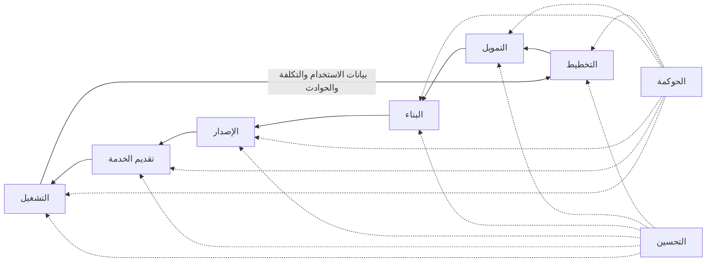

# الوحدة 0 — التوجيه

*تُحاسَب معظم إدارات تقنية المعلومات على أمرين لم يخطط أحد لأن تُحاسَب عليهما: كم تكلّف، وكم مرة تتعطل. ولا يختلف قطاع التقنية في بنك نجم عن غيره. يسأل مجلس الإدارة عمر، الرئيس التنفيذي للمعلومات، لماذا ترتفع الميزانية عامًا بعد عام، ولماذا يستغرق تغيير بسيط في تطبيق البطاقات ربع سنة، ولماذا تعود الأعطال نفسها لتصل إلى العملاء. تضع هذه الوحدة الأساس للدورة كلها. فهي تشرح ما تعنيه «إدارة تقنية المعلومات كعمل تجاري» في الواقع، وما الذي تغيّره فيها المنتجات الرقمية والذكاء الاصطناعي؛ وتعرّفك بقطاع التقنية في بنك نجم وشخصياته والخطوات الثماني لدورة تشغيل تقنية المعلومات التي يعتمد عليها كل درس لاحق؛ وتقول بوضوح كيف تستخدم الدورة وما ليست عليه. ويخرج كل درس بوثيقة من صفحة واحدة: تشخيص لمؤسسة تقنية المعلومات التي تعمل فيها، وخريطة لدورة تشغيلها، وخطة للتعلّم.*

> **الخطوات:** Plan — انظر إلى دورة التشغيل كلها، وإلى موقع مؤسستك منها، قبل أن تغيّر أي جزء منها.

---

# 0.1 — ما معنى إدارة تقنية المعلومات كعمل تجاري، وما الذي تغيّره المنتجات الرقمية والذكاء الاصطناعي
*المستوى (Level): 🟢 مبتدئ (Beginner)* · *المتطلبات (Prerequisites): لا يوجد* · *الخطوة (Step): Plan*

**بعد هذا الدرس تستطيع** أن تكتب تشخيصًا من صفحة واحدة لمؤسسة تقنية المعلومات التي تعمل فيها بعنوان «تقنية المعلومات كعمل تجاري»، يسمّي عملاءها، وما يستهلكونه، وكيف يتدفق المال والعمل، وثلاثة أسئلة لا تستطيع بعدُ أن تجيب عنها بدليل. *مدة الدراسة: قراءة نحو 15 دقيقةً، وعمل تطبيقي نحو 60 دقيقةً (تقدير).*

## ⚡ الدرس في دقيقة (In 60 seconds)
- **إدارة تقنية المعلومات كعمل تجاري** لا تعني تحقيق ربح من الزملاء، ولا إسناد كل شيء إلى جهات خارجية. معناها أن تعرف عملاء تقنية المعلومات وما تقدّمه لهم وتكاليفها وأداءها ومخاطرها، وأن تستطيع إظهار الدليل على ذلك.
- تلخّص الفكرةَ خمسةُ أسئلة: **من عملاؤنا؟ وماذا يستهلكون؟ وكم يكلّف ذلك؟ وما سرعة التغيير وما أمانه؟ ومن يقرر، وبأي سجل؟**
- **المنتجات الرقمية (digital products)** تغيّر الصورة: حين يكون منتج البنك نفسه برمجيات، تصبح تقنية المعلومات جزءًا مما يشتريه العملاء، ويتغير هذا الجزء كل أسبوع.
- **الذكاء الاصطناعي** يجعل كتابة الشيفرة أرخص، لكنه لا يجعل اتخاذ القرار ولا المراجعة ولا الإصدار ولا التشغيل ولا الحوكمة أرخص. وتشير الأبحاث المنشورة حتى الآن إلى أنه يضخّم نموذج التشغيل (operating model) الموجود لديك أصلًا.
- القاعدة الأهم: **كل ادعاء عن تقنية المعلومات يحتاج إلى عميل ورقم وسجل.** إن غاب واحد منها فلديك رأي، لا حقيقة.
- أكبر فخ: أن تتعامل مع «تقنية المعلومات كعمل تجاري» كأنها تمرين محاسبي (تحميل كل شيء على من يستخدمه)، بدل أن تجعل القيمة والتكلفة والمخاطر واضحة بما يكفي لاتخاذ القرار.

## 🧭 لماذا يهم (Why it matters)
بنك نجم وكل من فيه شخصيات خيالية. وكل الأرقام عن بنك نجم في هذا الدرس أرقام توضيحية، لا معايير مرجعية.

يخرج عمر، الرئيس التنفيذي للمعلومات (CIO) في بنك نجم، من اجتماع لمجلس الإدارة ومعه ثلاثة أسئلة لم يستطع الإجابة عنها. لماذا ارتفعت ميزانية التقنية مرة أخرى (بنحو العُشر في عامين)، بينما ما زال تطبيق البطاقات بطيئًا في الحصول على ميزات جديدة؟ كم مشروعًا من مشاريع العام الماضي حقق المنافع المذكورة في دراسة جدواه (business case)؟ ولماذا وقع العطل نفسه في المدفوعات ثلاث مرات في ستة أشهر؟

كان عمر يعرف الإجابات في خطوطها العامة: أعمال تنظيمية، وانتقال إلى السحابة، وارتفاع أسعار المورّدين؛ والمنافع «تحققت في معظمها على ما نظن»؛ والعطل «مشكلة لدى المورّد». لكن أيًّا منها لم يأتِ معه رقم يمكن التحقق منه، ولا سجل يبيّن من قرر، ولا رابط بين المال المنفَق والقيمة المتحققة. لم يشكّ المجلس في نزاهة عمر. شكّ في أن قطاع التقنية يرى نفسه.

يستطيع قطاع الإقراض أن يقول من عملاؤه، وماذا يشترون، وكم يكلّف كل قرض. وإدارة تقنية المعلومات كعمل تجاري تعني أن تستطيع تقنية المعلومات أن تفعل الشيء نفسه مع عملها، بالدليل.

## 📐 كيف يعمل (How it works)

### 🟢 الأساسيات (The essentials)

**ما معنى «كعمل تجاري».** تعني العبارة في هذه الدورة خمسة أمور.

| السؤال | ما تستطيع مؤسسة تقنية معلومات جيدة الإدارة أن تُظهره | ما تقوله المؤسسة المتعثرة |
|---|---|---|
| **من عملاؤنا؟** | وحدات أعمال وعملاء نهائيون بأسمائهم، وما يعتمد عليه كل منهم | «الأعمال» |
| **ماذا يستهلكون؟** | قائمة قصيرة من المنتجات والخدمات، لكل منها مالك ومستوى خدمة | «ندعم 400 تطبيق» |
| **كم يكلّف ذلك؟** | تكلفة كل منتج أو خدمة، وتكلفة الوحدة (unit cost) حيث تفيد (لكل حساب، لكل عملية دفع) | رقم إجمالي واحد بلا تفصيل |
| **ما سرعة التغيير وما أمانه؟** | الوقت من الفكرة إلى العميل، وكم مرة تُطرح التغييرات، وكم مرة تفشل، وكيف تتعافى | «المشاريع في موعدها غالبًا» |
| **من يقرر، وبأي سجل؟** | قرارات التمويل والأولوية والإصدار والمخاطر، لكل منها مالك وسجل يمكن العثور عليه | «اتُّفق عليه في اجتماع» |

ولا تعني العبارة أن على تقنية المعلومات أن تربح، ولا أن تُحمَّل كل خدمة على من يستخدمها، ولا أن تتصرف تقنية المعلومات كأنها مورّد خارجي لبقية البنك. تلك خيارات تصميم تدرسها وحدات لاحقة. الفكرة الأساسية أبسط: **أدِر تقنية المعلومات بالانضباط نفسه في العملاء والقيمة والتكلفة والمخاطر الذي تنتظره من أي جزء آخر من العمل.**

**مصطلحات ستلقاها طوال الدورة.** يُشرح كل منها بالتفصيل لاحقًا.

- **المنتج الرقمي** شيء يستخدمه العملاء (داخل البنك أو خارجه)، ويُقدَّم في الغالب عبر البرمجيات، وله عمر طويل وفريق يواصل تحسينه، مثل تطبيق البطاقات في بنك نجم.
- **الخدمة** عرض تُبقيه تقنية المعلومات قائمًا لغيرها بمستوى أداء متفق عليه، مثل «تجهيز الحواسيب المحمولة» أو «منصة المدفوعات».
- **المشروع** عمل مؤقت له بداية ونهاية وميزانية، يُستخدم لإحداث تغيير محدد.
- **مسار القيمة (value stream)** هو سلسلة الخطوات من أولها إلى آخرها، عبر الفرق، التي تحوّل حاجةً إلى شيء يقدّره العميل.
- **نموذج التشغيل** هو طريقة ترتيب المؤسسة: من يفعل ماذا، ومن يقرر، وكيف يُموَّل العمل ويُقاس، وأي السجلات والأدوات تربط ذلك كله.
- **السجل** معلومة تُثبت أن شيئًا حدث أو تقرر: استثمار معتمد، أو سجل تغيير، أو تذكرة حادثة، أو تقرير تكلفة.

**من منفّذ للطلبات إلى مالك مسؤول.** في كثير من إدارات تقنية المعلومات تكتب الأعمالُ المتطلبات، وتنفّذ تقنية المعلومات مشروعًا، ثم يُغلق المشروع، ولا يُسأل أحد هل حصل العملاء على قيمة. تعلّم هذه الدورة البديل: فرق دائمة تملك منتجات وخدمات، تُموَّل من أجل نتائج، وتُقاس على القيمة والتدفق والموثوقية والتكلفة معًا.

| تقنية معلومات المشاريع والتذاكر | تقنية معلومات محاذية للمنتجات |
|---|---|
| يصل العمل في صورة مشاريع وتذاكر | يصل العمل في صورة نتائج مطلوبة لمنتج أو خدمة |
| تتشكل الفرق لمشروع ثم تتفكك | تبقى الفرق مع المنتج وتتعلم منه |
| تمويل لكل مشروع، يُعتمد مرة في السنة | تمويل لكل منتج أو لسعة عمل، يُراجَع بانتظام |
| النجاح = التسليم في الموعد وضمن الميزانية | النجاح = نتيجة للعميل وللعمل، بتكلفة ومخاطر معروفة |
| ترث العمليات كل ما بُني | الفريق الذي يبني يهتم أيضًا بكيف يعمل ما بناه |
| السجلات مبعثرة بين الأدوات | مجموعة صغيرة من السجلات المترابطة تُظهر الطريق من الفكرة إلى الحادثة |

بعض الأعمال مشاريع بحق (الخروج من مركز بيانات، أو موعد نهائي تنظيمي). المهم أن تختار عن قصد، لا بحكم العادة.

### 🟡 التعمق أكثر (Going deeper)

**ما الذي تغيّره المنتجات الرقمية.** كانت تقنية المعلومات في الماضي تدعم في الغالب منتجات تعيش في مكان آخر: كان القرض عقدًا وإجراءً في الفرع، وكان النظام يسجّله. أما اليوم فالبنك، عند كثير من عملاء التجزئة، *هو* تطبيق وبطاقة وعملية دفع تنجح أو لا تنجح. ويترتب على ذلك ثلاثة أمور.

1. **التغيير لا يتوقف.** المنتج الرقمي لا «يكتمل» أبدًا، ونموذج التشغيل المبني على مشاريع تنتهي يتعثر أمام عمل لا ينتهي.
2. **البنية تشكّل المنتج.** في ورقة نُشرت عام 1968 بعنوان "How Do Committees Invent?"، رأى ملفن كونواي أن المؤسسات التي تصمم الأنظمة تميل إلى إنتاج تصاميم تنسخ بنية التواصل فيها، وهو ما يُعرف اليوم بقانون كونواي (Conway's law). فإن كانت البطاقات والمدفوعات والاحتيال في ثلاث إدارات لكل منها قائمة أعمال متراكمة (backlog) مستقلة، فتوقّع أن تبدو رحلة العميل كأنها ثلاثة أنظمة (الدرس 2.2).
3. **يصبح أداء التسليم مقياسًا للأعمال.** يُذكر أن برنامج أبحاث DORA (DevOps Research and Assessment، وهو جزء من Google Cloud) يجمع مقاييسه الخمسة الحالية لتسليم البرمجيات في مجموعتين: معدل الإنجاز (throughput)، ويضم زمن التسليم الكلي للتغيير (change lead time) وتكرار النشر وزمن التعافي من النشر الفاشل؛ وعدم الاستقرار (instability)، ويضم معدل فشل التغيير ومعدل إعادة العمل بعد النشر. ووراءها سؤالان يطرحهما أي مدير: ما سرعة استجابتنا؟ وكم مرة تؤذينا الاستجابة؟ ويتناول الدرس 1.3 المقاييس التي تفيد والتي تضلّل.

**ما الذي يغيّره الذكاء الاصطناعي.** صارت أدوات الذكاء الاصطناعي التوليدي تكتب مسودات الشيفرة والاختبارات والتوثيق وملخصات الحوادث. وهذا يخفّض تكلفة الإنتاج، لا تكلفة تقرير ما يُنتَج، ولا فحصه، ولا إصداره بأمان، ولا تشغيله، ولا إثبات أنه كان تحت السيطرة. والأبحاث حتى الآن تعكس ذلك:

- يقول إعلان تقرير DORA لعام 2024 إن زيادة اعتماد الذكاء الاصطناعي رافقها انخفاض تقديري بنسبة 1.5% في معدل إنجاز التسليم، وتراجع تقديري بنسبة 7.2% في استقرار التسليم.
- واعتمد تقرير DORA لعام 2025، *State of AI-Assisted Software Development*، على ما يقل قليلًا عن 5,000 من المتخصصين في التقنية. ويقول إعلانه إن 90% من المشاركين يستخدمون الذكاء الاصطناعي في العمل، وإن اعتماد الذكاء الاصطناعي صارت له علاقة إيجابية بمعدل الإنجاز، لكن علاقته بالاستقرار ما زالت سلبية، وإن «الذكاء الاصطناعي لا يُصلح الفريق، بل يضخّم ما هو موجود فيه أصلًا».

هذه نتائج استبيانات ارتباطية تخص سنوات بعينها، لا قوانين ثابتة. والقراءة العملية لها: **إذا سرّع الذكاء الاصطناعي كتابة الشيفرة، انتقل عنق الزجاجة إلى كل ما يأتي بعدها** (المراجعة، والاختبار، والإصدار، والعمليات، والسجلات). والتدفق الضعيف مع الذكاء الاصطناعي ينتج أكثر وأسرع، ويكسر أكثر. ولهذا تتناول هذه الدورة نموذج التشغيل، لا الأدوات.

ويصبح الذكاء الاصطناعي أيضًا جزءًا من منتجات البنك نفسها، وهذا يجلب واجبات حوكمة (انظر [*حوكمة الذكاء الاصطناعي*، الدرس 0.1 — ما هي حوكمة الذكاء الاصطناعي، وما الذي تثبته شهادة AIGP](../aigp/index.ar.html#/0.1))، ويصبح أداة داخل تقنية المعلومات تحتاج إلى ضوابط خاصة بها (الدرس 11.3).

### 🔴 نظرة الخبير (Expert view)

**ثلاث طرق تفشل بها «تقنية المعلومات كعمل تجاري».**

- **السوق الداخلية.** تحمّل تقنية المعلومات كل شيء على مستخدميه، وتُناقَش الفواتير بندًا بندًا، ويكلّف التوزيع أكثر مما تساويه المعلومة. وعرض التكلفة (showback)، أي إظهار التكلفة دون تحميلها، أخف عبئًا؛ انظر الدرس 7.3.
- **فخ نسبة الإشغال.** أن تقيس مدى انشغال الناس، لا سرعة تدفق القيمة. الفرق المشغولة ذات الطوابير الطويلة بطيئة: كثيرًا ما تجد الممارسة الرشيقة (lean) أن العمل يقضي جزءًا كبيرًا من زمن التسليم الكلي في الانتظار (الدرس 1.2).
- **مصنع التقارير.** تصل لوحات المعلومات قبل القرارات. ابدأ من القرار (موّل، أوقف، أصدر، أصلح)، ثم ابحث عن أصغر سجل يدعمه.

**قاعدة هذه الدورة.** كل ادعاء عن تقنية المعلومات يحتاج إلى **عميل** (من يتأثر)، و**رقم** (كم، وبأي سرعة، وكم مرة، وبأي تكلفة)، و**سجل** (أين يوجد الدليل، ومن يملكه). وكثيرًا ما تكون الإجابة الصادقة: «لا نعرف بعدُ، وهذا هو السجل الذي سننشئه لنعرف»، وهي تبني ثقة أكبر من تخمين واثق.

## 🧰 الأدوات (The toolkit)
| المصدر أو الأداة أو القالب (Resource, tool or template) | ما هو وماذا يفعل (What it is and does) | متى تلجأ إليه (When to reach for it) |
|---|---|---|
| **IT-as-a-business diagnosis** — تشخيص «تقنية المعلومات كعمل تجاري» | صفحة واحدة تجيب عن الأسئلة الخمسة، ويُقيَّم كل منها «دليل / جزئي / رأي» | قبل أي تغيير أو حديث مع مجلس الإدارة |
| **Money map** — خريطة المال | أين تذهب ميزانية تقنية المعلومات (التشغيل مقابل التغيير؛ الأفراد والمورّدون والسحابة)، مع تعليم المجهول | حين لا يوجد إلا رقم إجمالي واحد للتكلفة |
| **Flow snapshot** — لقطة التدفق | تقدير تقريبي لزمن التسليم الكلي وتكرار النشر وفشل التغيير لمنتج واحد، مع مصدر كل رقم | لبدء حديث قائم على الوقائع عن السرعة والاستقرار |
| **Decision-and-record log** — سجل القرارات ومواضعها | القرارات الأخيرة (تمويل، إصدار، قبول مخاطرة)، ومن اتخذها، وأين سجلها | حين يكون «اتُّفق عليه في اجتماع» هو الجواب المعتاد |
| **AI change note** — مذكرة أثر الذكاء الاصطناعي | أين يُستخدم الذكاء الاصطناعي في التسليم والعمليات، وأي الخطوات اللاحقة لم تتغير لتواكبه | قبل توسيع أدوات الذكاء الاصطناعي على الفرق |

## 🏛️ عمليًا في بنك نجم (In practice at Najm Bank)
طلب عمر من هدى (رئيسة الهندسة المؤسسية) وطارق (الشريك المالي لتقنية المعلومات) تشخيصًا من صفحة واحدة قبل اجتماع المجلس التالي. المثال توضيحي وخيالي:

> **قطاع التقنية في بنك نجم: تشخيص «تقنية المعلومات كعمل تجاري» (المسودة 1)**
>
> | السؤال | ما نستطيع إظهاره | تقييم الدليل |
> |---|---|---|
> | العملاء | الأفراد والمنشآت الصغيرة والمتوسطة والشركات؛ الإدارات الداخلية؛ العملاء النهائيون عبر القنوات الرقمية | جزئي: لا توجد خريطة لمن يعتمد على أي نظام |
> | الاستهلاك | نحو 400 تطبيق في الجرد؛ لا توجد قائمة متفق عليها للمنتجات أو الخدمات | رأي |
> | التكلفة | الإجمالي معروف؛ التشغيل مقابل التغيير معروف تقريبًا فقط؛ لا تكلفة لكل منتج | جزئي |
> | التدفق | تواريخ المشاريع معروفة؛ لا أحد يقيس الوقت من الفكرة إلى العميل | رأي |
> | القرارات والسجلات | قرارات الاستثمار موثقة في محاضر؛ قرارات الإصدار والمخاطر موزعة بين البريد الإلكتروني وثلاث أدوات | جزئي |
>
> **ثلاثة أسئلة لا نستطيع اليوم الإجابة عنها بدليل:**
> 1. كم تكلّف البطاقات والمدفوعات في السنة، بما في ذلك المنصات المشتركة والمورّدون؟
> 2. كم يستغرق تغيير معتاد في تطبيق البطاقات من الاعتماد إلى العملاء، وأين ينتظر؟
> 3. أي التغييرات أو أحداث المورّدين كانت وراء أعطال المدفوعات الثلاثة في العام الماضي، وماذا غيّرنا بعدها؟
>
> **ملاحظة عن الذكاء الاصطناعي:** فريقان يستخدمان مساعدات برمجة بالذكاء الاصطناعي؛ والاعتماد والاختبار والإصدار لم تتغير. المخاطرة: تراكم مزيد من التغييرات عند البوابات نفسها.

قيّم طارق في البداية التكلفة «دليلًا» بسطر واحد: «تقنية المعلومات نحو 8% من تكاليف البنك». فنبّهته هدى إلى أن الرقم الإجمالي لا يجيب عن أي قرار، فخفّض التقييم. واعترض يوسف، رئيس عمليات تقنية المعلومات، على صف التدفق: «العمليات تُقاس بالاستقرار، لا بالسرعة». لكن عمر أبقاه؛ ويشرح الدرس 1.3 لماذا يُقاس الاثنان معًا.

## 🛠️ التمارين (Exercises)
**🟢 أجب عن الأسئلة الخمسة.** لمؤسسة تقنية المعلومات التي تعمل فيها (أو لبنك نجم)، أجب عن كل سؤال من الأسئلة الخمسة في جملة أو جملتين، وقيّم كل إجابة «دليل» أو «جزئي» أو «رأي».
*يكتمل عندما (Done when):* يكون لكل صف من الصفوف الخمسة تقييم، ويسمّي كل تقييم «دليل» السجل (تقريرًا أو أداة أو سجلًا رسميًا) الذي يحفظه.

الإجابة النموذجية والتحقق الذاتي

**الإجابة النموذجية.** الصدق أفضل من الإبهار: العملاء «جزئي» (الاعتماديات غير مرسومة)؛ والاستهلاك «رأي» (لا قائمة منتجات)؛ والتكلفة «جزئي» (ليست لكل منتج)؛ والتدفق «رأي» (لا قياس لزمن التسليم الكلي)؛ والقرارات «جزئي» (الإصدار والمخاطر مبعثرة). وقليل من الصفوف يستحق «دليل».

**التحقق الذاتي.**
- هل كتبت عن العملاء وما يستهلكونه، لا عن أنشطة فريقك؟
- هل يستند كل تقييم «دليل» إلى سجل يستطيع شخص آخر أن يفتحه؟
- هل قاومت تقييم رقم إجمالي واحد (الميزانية أو عدد الموظفين) على أنه دليل؟

**🟡 اكتب ثلاثة أسئلة بلا إجابة.** اكتب ثلاثة أسئلة قد يطرحها مسؤول تنفيذي بشكل معقول ولا تستطيع اليوم الإجابة عنها بدليل. وسمِّ لكل سؤال السجل الذي يجيب عنه ومالكه.
*يكتمل عندما (Done when):* يرتبط كل سؤال بقرار (تمويل، إيقاف، إصدار، إصلاح، قبول مخاطرة)، ويكون له سجل مسمّى ودور مالك مسمّى.

الإجابة النموذجية والتحقق الذاتي

**الإجابة النموذجية.** (1) «كم يكلّف المنتج س في السنة؟» القرار: هل نستثمر فيه أكثر أم لا. السجل: نموذج تكلفة لكل منتج. المالك: مالية تقنية المعلومات مع مدير المنتج. (2) «كم يستغرق التغيير من الاعتماد إلى العملاء؟» القرار: أين نستثمر في التدفق. السجل: طوابع زمنية على بنود قائمة الأعمال وعلى الإصدارات. المالك: فريق المنتج. (3) «أي التغييرات كان لها دور في الحوادث الكبرى في الربع الماضي؟» القرار: ماذا نصلح. السجل: سجلات حوادث مرتبطة بسجلات التغيير. المالك: العمليات.

**التحقق الذاتي.**
- هل يرتبط كل سؤال بقرار حقيقي؟
- هل السجل محدد (حقول أو أداة أو سجل رسمي)، لا مجرد «بيانات أفضل»؟
- هل تستطيع أن تبدأ جمعه خلال شهر دون أداة جديدة؟

**🔴 اكتب مذكرة أثر الذكاء الاصطناعي.** لفريق واحد، اذكر أين تُستخدم أدوات الذكاء الاصطناعي اليوم، وقيّم كل خطوة لاحقة (المراجعة، والاختبار، واعتماد التغيير، والإصدار، والعمليات، والسجلات) بأنها «تغيرت لتواكب» أو «لم تتغير» أو «غير معروف». وسمِّ عنق الزجاجة المرجّح وإجراءً واحدًا لمعالجته.
*يكتمل عندما (Done when):* تُقيَّم الخطوات الست كلها، ويُسمّى عنق زجاجة واحد مع سببه، ويكون لإجراء واحد مالك وتاريخ.

الإجابة النموذجية والتحقق الذاتي

**الإجابة النموذجية.** البطاقات والمدفوعات: يكتب الذكاء الاصطناعي مسودات الشيفرة واختبارات الوحدات؛ المراجعة «لم تتغير» (المراجعان أنفسهما)؛ الاختبار «تغير جزئيًا»؛ اعتماد التغيير والإصدار «لم يتغيرا» (مجلس أسبوعي ونافذة شهرية)؛ العمليات «غير معروف»؛ السجلات «لم تتغير». عنق الزجاجة: المراجعة، لأن الحجم يزيد والمراجعين لا يزيدون. الإجراء: تتفق ريم وسامي على قاعدة للتغييرات الأصغر وعلى جدول مناوبة للمراجعة بنهاية الشهر.

**التحقق الذاتي.**
- هل سمّيت خطوة تأتي بعد كتابة الشيفرة على أنها عنق الزجاجة المرجّح؟
- هل يتعلق إجراؤك بالقواعد أو الأدوار أو السجلات، لا بأداة أخرى؟
- هل تجنّبت ذكر أي مكسب في الإنتاجية لا تستطيع ذكر مصدره؟

## ⚠️ أخطاء وفخاخ (Mistakes and traps)
- **فهم «العمل التجاري» على أنه «ربح».** استهدف وضوح القيمة والتكلفة والمخاطر؛ وقرّر لاحقًا هل تحمّل أي شيء على أحد.
- **البدء بأداة أو إطار عمل.** إن تبنّيت أيًّا منهما قبل أن تعرف أي القرارات يجب أن يدعمها، أنتجت سجلات لا يستخدمها أحد. ابدأ من الأسئلة الخمسة.
- **افتراض أن الذكاء الاصطناعي سيعالج بطء التسليم.** كتابة المسودات أسرع مع خطوات لاحقة لم تتغير تعني طوابير أطول. أصلح التدفق أولًا، ثم وسّع استخدام الأداة.
- **المبالغة في ادعاء الدليل.** الرقم الإجمالي الواحد أو ما يتذكره الحاضرون من اجتماع ليس دليلًا؛ و«لا نعرف بعدُ» مع خطة إجابة محترمة.

## 🧾 الخلاصة (Recap)
- إدارة تقنية المعلومات كعمل تجاري تعني إظهار العملاء والاستهلاك والتكلفة والتدفق والقرارات بالدليل؛ لا الربح ولا تحميل التكلفة (chargeback) الإلزامي.
- المنتجات الرقمية تجعل التغيير مستمرًا، وتعكس بنية المؤسسة، وتجعل أداء التسليم مقياسًا للأعمال.
- تربط أبحاث DORA حتى الآن اعتماد الذكاء الاصطناعي بانخفاض استقرار التسليم، وتصف الذكاء الاصطناعي بأنه مُضخِّم؛ وعنق الزجاجة ينتقل إلى ما بعد كتابة الشيفرة.
- قاعدة الدورة: كل ادعاء يحتاج إلى عميل ورقم وسجل.

## ✍️ اختبر نفسك (Check yourself)
**1. يقول عضو في مجلس الإدارة لعمر: «إدارة تقنية المعلومات كعمل تجاري تعني أن تدفع كل إدارة لتقنية المعلومات مقابل ما تستخدمه». ما أفضل رد؟**

- A. الموافقة، لأن تحميل كل إدارة كلفة استخدامها هو السمة المميزة لتقنية المعلومات كعمل تجاري.
- B. الموافقة جزئيًا، والبدء بإصدار فواتير لأكبر المستخدمين أولًا لإظهار تقدم سريع وواضح.
- C. توضيح أن الهدف وضوح القيمة والتكلفة والمخاطر، وأن تحميل التكلفة خيار تصميم يأتي لاحقًا.
- D. الرفض، لأن تقنية المعلومات مركز تكلفة ولا ينبغي لها أبدًا أن تُظهر تكاليفها للإدارات الأخرى.

الإجابة

**C.** إدارة تقنية المعلومات كعمل تجاري تعني الإجابة عن الأسئلة الخمسة بالدليل؛ وتحميل التكلفة خيار تصميم لاحق. أما A وB فتجعلان تحميل التكلفة هو الهدف (فخ «السوق الداخلية»)؛ وD تخفي التكلفة، فلا يمكن الإجابة عن سؤال التكلفة. (انظر «ما معنى "كعمل تجاري"».)

**2. في مسودة طارق: «التكلفة: تقنية المعلومات نحو 8% من تكاليف البنك (دليل)». لماذا طلبت منه هدى أن يخفّض التقييم؟**

- A. لأن الرقم الإجمالي الواحد لا يدعم أي قرار عن منتج أو خدمة أو استثمار.
- B. لأن الرقم مرتفع جدًا لبنك متوسط الحجم ويجب مقارنته بالمعايير المرجعية.
- C. لأن أرقام التكلفة تخص الإدارة المالية ولا مكان لها في تشخيص تقنية المعلومات.
- D. لأن المجلس سأل عن التدفق والأعطال، فدليل التكلفة لا علاقة له بالاجتماع.

الإجابة

**A.** الرقم الإجمالي لا يجيب عن أي سؤال من نوع «موّل أو أوقف أو أصلح»؛ وسؤال التكلفة يسأل كم يكلّف كل منتج أو خدمة. أما B فتخترع معيارًا مرجعيًا، وC تناقض الغرض من التشخيص، وD تتجاهل أن المجلس سأل عن الميزانية. (انظر «عمليًا في بنك نجم».)

**3. أي العبارات الآتية عن الذكاء الاصطناعي تتفق مع نتائج DORA الموصوفة في الدرس؟**

- A. اعتماد الذكاء الاصطناعي يحسّن سرعة التسليم واستقراره معًا بشكل موثوق بعد تدريب الفرق.
- B. لا صلة قابلة للقياس بين الذكاء الاصطناعي وأداء التسليم، فيمكن تجاهله في تصميم التشغيل.
- C. ارتبط اعتماد الذكاء الاصطناعي بانخفاض الاستقرار، وهذا يثبت وجوب حظر أدواته.
- D. اقترن اعتماد الذكاء الاصطناعي حتى الآن بانخفاض الاستقرار، ويصفه تقرير 2025 بالمُضخِّم.

الإجابة

**D.** يذكر تقريرا العامين كلاهما علاقة سلبية بالاستقرار، ويصف تقرير 2025 الذكاء الاصطناعي بأنه مُضخِّم. أما A فتبالغ في النتائج، وB تناقضها، وC تحوّل نتيجة ارتباطية إلى خلاصة لا يستخلصها التقريران. (انظر «ما الذي يغيّره الذكاء الاصطناعي».)

**4. ثلاث إدارات في بنك نجم (البطاقات والمدفوعات والاحتيال) تبني تطبيق البطاقات من قوائم أعمال متراكمة منفصلة، ويقول العملاء إنه «يبدو كثلاثة تطبيقات». أي فكرة تفسّر ذلك أفضل تفسير؟**

- A. فخ نسبة الإشغال، لأن الإدارات الثلاث تُقاس بمدى انشغالها.
- B. قانون كونواي: تميل الأنظمة إلى نسخ بنية التواصل في المؤسسة.
- C. السوق الداخلية، لأن كل إدارة تحمّل الأخريين كلفة خدماتها.
- D. مصنع التقارير، لأن الإدارات تنتج لوحات معلومات بدل القرارات.

الإجابة

**B.** لاحظ كونواي أن التصاميم تعكس بنية التواصل في المؤسسة: ثلاث إدارات، ثلاث تجارب. أما A وC وD ففخاخ حقيقية، لكن أيًّا منها لا يفسّر لماذا يتبع شكلُ المنتج شكلَ المؤسسة. (انظر «ما الذي تغيّره المنتجات الرقمية».)

**5. سُئل عمر كم يستغرق تغيير معتاد في تطبيق البطاقات، ولا أحد يقيس ذلك. ما أفضل جواب يقدّمه للمجلس؟**

- A. «لا نعرف بعدُ؛ وهذا هو السجل الذي سننشئه، ومن سيملكه».
- B. «نحو ستة أسابيع»، استنادًا إلى انطباع مدير المشروع عن الإصدارات الأخيرة.
- C. «يتوقف على التغيير»، فكل تغيير مختلف ولا يمكن مقارنة التغييرات ببعضها.
- D. «أسرع من العام الماضي»، لأن الفريق بدأ يستخدم مساعدات برمجة بالذكاء الاصطناعي.

الإجابة

**A.** حين لا يوجد سجل، تسمّي الإجابة الصادقة الفجوة والخطة. أما B فرأي في ثوب رقم، وC تتهرب من السؤال، وD تفترض أن الذكاء الاصطناعي حسّن التدفق دون دليل. (انظر «قاعدة هذه الدورة».)

## 📚 المراجع (References)
- مدونة Google Cloud، إعلان *2025 DORA Report: State of AI-Assisted Software Development* (فُتح في 2026-11-19): https://cloud.google.com/blog/products/ai-machine-learning/announcing-the-2025-dora-report
- مدونة Google Cloud، إعلان تقرير DORA لعام 2024 (فُتح في 2026-11-19): https://cloud.google.com/blog/products/devops-sre/announcing-the-2024-dora-report
- DORA، تاريخ مقاييسها لتسليم البرمجيات، على موقع dora.dev (كما ورد في ملخصات البحث؛ لم يُفتح): https://dora.dev/guides/dora-metrics/history/
- Rother, M. and Shook, J., *Learning to See* (Lean Enterprise Institute, 1999): الممارسة الرشيقة في رسم مسار القيمة وفترات الانتظار فيه.
- Conway, M. E., "How Do Committees Invent?", *Datamation*, April 1968 (إحالة كاملة؛ لم تُفتح الورقة نفسها لهذا الدرس).
- Forsgren, N., Humble, J. and Kim, G., *Accelerate* (IT Revolution, 2018): البحث الذي تقوم عليه مقاييس التسليم.
- Kersten, M., *Project to Product* (IT Revolution, 2018): حجة ممارس لنقل تقنية المعلومات من المشاريع إلى المنتجات.
- من المكتبة: [*السحابة وDevOps: من الصفر إلى الاحتراف*، الدرس 0.1 — ما هي السحابة وDevOps وهندسة المنصات وهندسة موثوقية المواقع (SRE)](../cloud/index.ar.html#/0.1) (المفردات الهندسية التي تقوم عليها هذه الدورة).

---

# 0.2 — تعرّف على قطاع التقنية في بنك نجم والخطوات الثماني
*المستوى (Level): 🟢 مبتدئ (Beginner)* · *المتطلبات (Prerequisites): 0.1* · *الخطوة (Step): Plan*

**بعد هذا الدرس تستطيع** أن ترسم دورة تشغيل تقنية المعلومات في مؤسستك على صفحة واحدة باستخدام الخطوات الثماني، وتسمّي لكل خطوة مالكًا وسجلًا رئيسيًا ومقياسًا واحدًا، وتعلّم أضعف نقطتي تسليم (hand-offs). *مدة الدراسة: قراءة نحو 15 دقيقةً، وعمل تطبيقي نحو 60 دقيقةً (تقدير).*

## ⚡ الدرس في دقيقة (In 60 seconds)
- بنك نجم بنك خليجي **خيالي** متوسط الحجم. وتدور هذه الدورة في **قطاع التقنية** فيه (نحو 600 موظف إضافة إلى المورّدين، وهو رقم توضيحي)، الذي ينتقل من تقنية معلومات قائمة على المشاريع والتذاكر إلى تقنية معلومات محاذية للمنتجات.
- ثمانية أشخاص يحملون القصة: **عمر** (الرئيس التنفيذي للمعلومات)، و**هدى** (الهندسة المؤسسية)، و**يوسف** (العمليات)، و**ريم** (منتج البطاقات والمدفوعات)، و**سامي** (المنصة)، و**طارق** (مالية تقنية المعلومات)، و**لينا** (التوريد)، و**نور** (المخاطر والضوابط). وكل منهم يرتكب أخطاء واقعية.
- **الخطوات الثماني** لدورة تشغيل تقنية المعلومات، **التخطيط (Plan) · التمويل (Fund) · البناء (Build) · الإصدار (Release) · تقديم الخدمة (Serve) · التشغيل (Run) · الحوكمة (Govern) · التحسين (Improve)**، كلمات هذه الدورة البسيطة الخاصة بها، لا مصطلحات أي إطار عمل.
- كل خطوة تجيب عن سؤال، وتترك **سجلًا** رئيسيًا، ولها **مالك**. وكثيرًا ما تضيع القيمة عند **نقاط التسليم** الواقعة بين الخطوات.
- القاعدة الأهم: **الخطوات حلقة، لا تسلسل من الإدارات.** يجب أن تعود البيانات من تقديم الخدمة والتشغيل إلى التخطيط والتمويل.
- أكبر فخ: أن تُسقط الخطوات على الهيكل التنظيمي («البناء هو التطوير، والتشغيل هو العمليات») ثم تعدّ الخريطة مكتملة.

## 🧭 لماذا يهم (Why it matters)
بنك نجم وكل من فيه شخصيات خيالية. وكل الأرقام عن بنك نجم في هذا الدرس أرقام توضيحية، لا معايير مرجعية.

في أول ورشة عمل يعقدها عمر عن نموذج التشغيل (operating model)، وصف كل قائد كيف يصل تغيير في تطبيق البطاقات إلى العملاء. وصفت ريم دورات عمل (sprints) مدتها أسبوعان. ووصف سامي خط نشر (pipeline) قادرًا على النشر مرات كثيرة في اليوم. ووصف يوسف مجلسًا أسبوعيًا للتغيير ونافذة إصدار شهرية. ووصف طارق ميزانية سنوية كان فيها عمل البطاقات بندًا داخل مشروع «القنوات الرقمية». ووصفت نور اختبارًا ربع سنوي للضوابط. ووصفت لينا مورّدًا لمعالجة البطاقات يطلب إشعارًا قبل عشرة أيام عمل لأي تغيير في الواجهة البينية.

كان كل وصف صحيحًا، ولم يكن أيٌّ منها الصورة كاملة. رسمتها هدى على السبورة حلقةً واحدة، فرأت المشكلة فورًا: خط النشر القادر على العمل يوميًا ينتظر نافذة شهرية، والنافذة تنتظر مهلة إشعار المورّد، والمال تقرر قبل ثمانية أشهر بناءً على دراسة جدوى (business case) لم يُعِد أحد فتحها.

لهذا تبدأ الدورة بخريطة مشتركة. تمنح الخطوات الثماني الجميعَ الكلمات نفسها للأجزاء نفسها من الدورة، فتصبح نقاط التسليم، حيث تنتظر القيمة أو تضيع أو يُعاد فحصها، مرئية.

## 📐 كيف يعمل (How it works)

### 🟢 الأساسيات (The essentials)

**قطاع التقنية في بنك نجم.** يقدّم بنك نجم خدمات مصرفية للأفراد وللمنشآت الصغيرة والمتوسطة وللشركات، ويخضع لإشراف بنك مركزي. ويُنظَّم قطاع التقنية فيه (نحو 600 موظف إضافة إلى المورّدين) في معظمه حسب الوظيفة: تطوير التطبيقات، وعمليات تقنية المعلومات، والهندسة المؤسسية، والأمن، ومكتب إدارة المشاريع، ومالية تقنية المعلومات، وإدارة المورّدين. وقد بدأت بضعة فرق منتجات عملها، منها فريق البطاقات والمدفوعات. ويريد مجلس الإدارة تكلفة أقل، وأعطالًا أقل، وتغييرًا أسرع، ويشك في إمكان الجمع بين الثلاثة.

**الشخصيات.** يظهر الأشخاص أنفسهم في كل وحدة.

| الشخص | الدور | ما يهمّه | الخطأ الذي يميل إلى ارتكابه |
|---|---|---|---|
| **عمر** | الرئيس التنفيذي للمعلومات (CIO)؛ راعي التغيير | ثقة المجلس في التكلفة والأعطال | أن يَعِد المجلس بموعد للتحول قبل أن يوجد الدليل |
| **هدى** | رئيسة الهندسة المؤسسية | نموذج التشغيل المستهدف وتصميم سجلات تقنية المعلومات | أن تصمم نموذجًا كاملًا على الورق قبل أن تختبره مع منتج واحد |
| **يوسف** | رئيس عمليات تقنية المعلومات (مكتب الخدمة، ومركز العمليات، والبنية التحتية) | الاستقرار؛ ويتشكك في الحديث عن «المنتج» | أن يعامل كل تغيير على أنه مخاطرة يجب منعها لا إدارتها |
| **ريم** | مديرة المنتج، البطاقات والمدفوعات | نتائج العملاء والسرعة | أن تعامل العمليات والضوابط كأنها مشكلة شخص آخر |
| **سامي** | قائد هندسة المنصات (خطوط النشر، والبيئات، ومنصة المطورين الداخلية) | تسليم سريع وآمن بالخدمة الذاتية | أن يبني ميزات للمنصة لم يطلبها أحد |
| **طارق** | الشريك المالي لتقنية المعلومات (الميزانيات، وتوزيع التكاليف، ودراسات الجدوى) | إنفاق يمكن توقعه ودراسات جدوى ذات مصداقية | أن يوزّع التكاليف بدقة مفرطة حتى لا يثق أحد بالأرقام ولا يستخدمها |
| **لينا** | مديرة المورّدين والتوريد (العقود، والمورّدون، وتكامل المورّدين المتعددين) | القيمة والمخاطر في عقود المورّدين | أن توقّع عقودًا تُبطئ شروطها دورة الإصدار في البنك نفسه |
| **نور** | قائدة مخاطر وضوابط تقنية المعلومات (التنسيق مع خط الدفاع الثاني، والتدقيق، والتقارير التنظيمية) | دليل على أن الضوابط تعمل | أن تطلب الدليل في صيغة لا يُنتجها إلا إجراء يدوي |

وتظهر فرق بنك نجم من دورات المكتبة الأخرى (المنصة، وهندسة الجودة، والأمن، والبيانات، ومنتجات الذكاء الاصطناعي) لفترة قصيرة حين يحيل الدرس إليها.

**الخطوات الثماني.** تجيب كل خطوة عن سؤال إداري واحد.

| الخطوة | السؤال الذي تجيب عنه | السجل الرئيسي الذي تتركه | مقياس واحد مفيد | المالك في بنك نجم |
|---|---|---|---|---|
| **Plan** — التخطيط | على ماذا نعمل، ولماذا؟ | ربط بين النتائج المعلنة والعمل المعتمد؛ طلبات مرتبة حسب الأولوية | نسبة العمل الذي يمكن تتبّعه إلى نتيجة معلنة | عمر وهدى ومديرو المنتجات |
| **Fund** — التمويل | كم من المال والسعة يذهب إلى أين؟ | قرار تمويل لكل منتج أو استثمار | الوقت من تقديم المقترح إلى القرار | طارق، مع لجنة الاستثمار |
| **Build** — البناء | كيف نحوّل حاجة إلى برمجيات أو إعدادات تعمل ومختبرة؟ | بنود قائمة الأعمال المتراكمة، وتغييرات الشيفرة، وأدلة الاختبار | زمن التسليم الكلي (lead time) من بدء العمل إلى الجاهزية للإصدار | فرق المنتجات، ومنصة سامي |
| **Release** — الإصدار | متى يصل التغيير إلى العملاء وكيف، ومن يقرر؟ | سجلات التغيير والإصدار | تكرار النشر؛ فشل التغيير | مالكو المنتجات (product owner)، ويوسف لضبط التغيير |
| **Serve** — تقديم الخدمة | كيف يطلب الناس ما تقدّمه تقنية المعلومات ويحصلون عليه ويستخدمونه؟ | مدخلات دليل الخدمات (service catalogue)، والطلبات، والاستحقاقات (entitlement) | الوقت اللازم لتلبية طلب قياسي | مكتب الخدمة لدى يوسف، وفرق المنتجات |
| **Run** — التشغيل | كيف نُبقيه يعمل، ونتعافى حين يفشل؟ | أحداث المراقبة (event)، والحوادث (incident)، والمشكلات (problem) | زمن استعادة الخدمة؛ الأداء مقابل مستوى الخدمة | عمليات يوسف، وفرق المنتجات |
| **Govern** — الحوكمة | من يحق له أن يقرر ماذا، وكيف نثبت السيطرة؟ | السياسات، وسجل المخاطر، وأدلة الضوابط | نسبة الضوابط التي تُنتج أدلتها آليًا | نور، مع عمر وهدى |
| **Improve** — التحسين | ماذا تعلّمنا، وماذا سنغيّر؟ | المراجعات، وقائمة أعمال التحسين، وأدلة النضج | التحسينات المنجزة وأثرها المقيس | الجميع؛ وتنسّق هدى |

**نوعان من الخطوات.** تتبع خطوات التخطيط والتمويل والبناء والإصدار وتقديم الخدمة والتشغيل قطعةً من العمل، بهذا الترتيب تقريبًا. أما **الحوكمة** و**التحسين** فتمتدان عبرها كلها: الحوكمة تضع القواعد وتفحص الأدلة عند كل خطوة، والتحسين يعيد ما تعلّمناه من أي مكان.

السهم العائد من التشغيل إلى التخطيط هو الأهم. فبدونه تواصل المؤسسة التمويل والبناء دون أن تعرف هل نجح أي شيء.

### 🟡 التعمق أكثر (Going deeper)

**الخطوات ليست إدارات.** عبارة «البناء هو التطوير، والتشغيل هو العمليات» هي نموذج المشاريع والتذاكر نفسه مرسومًا على شكل حلقة. في المؤسسة المحاذية للمنتجات يتولى فريق منتج واحد البناء والإصدار وتقديم الخدمة والتشغيل لمنتجه، بينما يوفّر فريق المنصة (platform team) الوسائل المشتركة. الخطوات تقول *ما الذي يجب أن يحدث*؛ ونموذج التشغيل (الوحدة 2) يقرر *من يفعله*.

**الخطوات ليست مراحل.** قد يمر مشروع كبير بكل خطوة مرة واحدة؛ أما المنتج الرقمي (digital product) فيمر بها كلها كل أسبوع، على دفعات صغيرة.

**حيث تتسرب القيمة: نقاط التسليم.** **نقطة التسليم** هي أي موضع ينتقل فيه العمل أو المعلومات أو المسؤولية بين أشخاص أو فرق أو أدوات. وكل نقطة تحمل خطر **انتظار** (يبقى العمل في طابور)، أو **فقد** (لا ينتقل السياق)، أو **إعادة فحص** (لا يثق المستلم بدليل المرسِل). وأظهرت سبورة هدى أربعًا منها:

| نقطة التسليم | ما الذي يسوء | الدرس الذي يعالجها |
|---|---|---|
| التمويل ← البناء | مال اعتُمد لنطاق مشروع قبل أشهر؛ ولا يستطيع الفريق تغيير الاتجاه دون دراسة جدوى جديدة | 3.2 |
| البناء ← الإصدار | خط النشر جاهز يوميًا؛ ومجلس التغيير أسبوعي؛ ونافذة الإصدار شهرية | 6.1، 6.2 |
| الإصدار ← التشغيل | تعلم العمليات بالتغيير بعد أن يفشل | 6.3، 8.1 |
| التشغيل ← التخطيط | بيانات الحوادث والاستخدام لا تصل أبدًا إلى من يحددون أولويات العمل | 8.2، 9.3 |

**سلسلة السجلات.** تترك كل خطوة سجلًا، وينبغي أن تترابط السجلات: قرار الاستثمار ببنود قائمة الأعمال، وهذه بالتغييرات التي سلّمتها، وتلك بالخدمة التي غيّرتها، ثم بالحوادث والتكاليف التي تلت. مع هذه الروابط يجيب عمر المجلس في دقائق؛ وبدونها تصبح كل إجابة مشروع إعادة بناء. وتبني الوحدة 9 هذه السلسلة.

### 🔴 نظرة الخبير (Expert view)

**لماذا تستخدم هذه الدورة كلماتها الخاصة.** تصف أطر العمل المنشورة أجزاءً من هذه الدورة بمفرداتها الخاصة. وتستخدم هذه الدورة ثماني كلمات بسيطة لتستطيع أن ترسم مؤسستك *أنت* دون أن تتبنى أولًا نموذج غيرك. ويقارن الدرس 12.1 بين أطر العمل المعروفة.

**الخلاف ميزة.** يرى يوسف الإصدار والتشغيل همًّا واحدًا يخص الاستقرار، ويريد بوابة واحدة؛ وترى ريم الإصدار قرارًا يخص المنتج ويعود إلى فريقها. وتريد نور دليلًا عند كل خطوة؛ ويريد سامي أن يُنتج خط النشر هذا الدليل، لا النماذج الورقية. نموذج التشغيل الجيد لا يختار فائزًا؛ بل يقرر من يقرر كل أمر، وبأي دليل، ويجعل السجل يقوم بالعمل. وتحسم الوحدتان 6 و10 هذين الخلافين.

**ارسم ما يحدث، لا ما يقوله الدليل الإجرائي.** تتبّع آخر ثلاثة تغييرات حقيقية. فالفجوة بين الدورة الموثقة والدورة الحقيقية كثيرًا ما تكون أنفع ما تكتشفه.

## 🧰 الأدوات (The toolkit)
| المصدر أو الأداة أو القالب (Resource, tool or template) | ما هو وماذا يفعل (What it is and does) | متى تلجأ إليه (When to reach for it) |
|---|---|---|
| **Eight-step cycle sheet** — ورقة الدورة ذات الخطوات الثماني | سؤال كل خطوة ومالكها وسجلها الرئيسي ومقياس واحد لها | أول وثيقة في أي تغيير لنموذج التشغيل؛ تُحدَّث مع كل وحدة |
| **Hand-off map** — خريطة نقاط التسليم | كل نقطة تسليم معلَّمة بما يحدث عندها عادةً: انتظار أو فقد أو إعادة فحص | حين لا يستطيع أحد أن يقول أين ينتظر العمل |
| **Cast table** — جدول الشخصيات | من يملك كل خطوة، وما يهمّه، والخطأ الذي يميل إلى ارتكابه | قبل ورشة عمل، لتحدد من يجب أن يحضر |
| **Real-example trace** — تتبّع أمثلة حقيقية | ثلاثة تغييرات حديثة تُتتبَّع عبر الخطوات، مع تاريخ عند كل نقطة تسليم | للتحقق من خريطتك مقابل الواقع |
| **Record chain sketch** — مخطط سلسلة السجلات | أي سجل في كل خطوة ينبغي أن يرتبط بأي سجل في الخطوة التالية | قبل شراء أي أداة لإدارة تقنية المعلومات أو تغييرها |

تكفي أي سبورة أو أداة رسم أو جدول بيانات.

## 🏛️ عمليًا في بنك نجم (In practice at Najm Bank)
بعد الورشة حوّلت هدى ما رسمته على السبورة إلى ورقة دورة من ثماني خطوات لمنتج البطاقات والمدفوعات. المثال توضيحي وخيالي:

> **البطاقات والمدفوعات: ورقة الدورة ذات الخطوات الثماني (مسودة)**
>
> | الخطوة | المالك اليوم | السجل الرئيسي اليوم | المقياس اليوم |
> |---|---|---|---|
> | التخطيط | لجنة توجيه القنوات الرقمية | شريحة الخطة السنوية | لا يوجد |
> | التمويل | لجنة الاستثمار، عبر طارق | دراسة جدوى المشروع | الميزانية مقابل الإنفاق |
> | البناء | فريق ريم، ومعه فريقان من المورّدين | قائمة الأعمال في أداة التسليم | سرعة الدورة (sprint velocity) |
> | الإصدار | مجلس التغيير الأسبوعي (يرأسه يوسف) | تذكرة التغيير | عدد التغييرات المعتمدة |
> | تقديم الخدمة | مكتب الخدمة | تذاكر الطلبات | التذاكر المغلقة |
> | التشغيل | مركز العمليات؛ مورّد معالجة البطاقات | تذاكر الحوادث في أداتين | التوافر الشهري |
> | الحوكمة | نور، اختبار ربع سنوي للضوابط | جدول بيانات لعينة من التغييرات | نسبة النجاح في اختبار الضوابط |
> | التحسين | لم يُعيَّن أحد | تقارير ما بعد الحوادث، دون متابعة | لا يوجد |
>
> **أضعف نقطتي تسليم:** (1) البناء ← الإصدار: تغيير يجهز في يومين ينتظر في الوسيط نحو ثلاثة أسابيع لمجلس التغيير ونافذة الإصدار (رقم توضيحي، من تتبّع ثلاثة تغييرات حديثة). (2) التشغيل ← التخطيط: أنتجت حوادث المدفوعات الثلاث في العام الماضي تقارير، لكن أيًّا من إجراءاتها لم يصل إلى قائمة أعمال البطاقات.

في المسودة الأولى كتبت هدى «عمليات تقنية المعلومات» مالكًا لتقديم الخدمة وللتشغيل. فنبّهتها ريم إلى أن سلوك التطبيق أمام العملاء مسؤوليتها هي، أيًّا كان من يشغّل الخوادم، فعُلِّمت الخطوتان «مشتركة، يُحسم أمرها في الوحدة 2». ولاحظ سامي أن عمود المقياس يضم ثلاثة أعداد للنشاط (سرعة الدورة، والتغييرات المعتمدة، والتذاكر المغلقة)، ولا يضم أي مقياس للتدفق أو للنتيجة: وهذه نقطة انطلاق الوحدة 1.

## 🛠️ التمارين (Exercises)
**🟢 املأ ورقة الدورة.** لمنتج أو خدمة تعرفها، املأ ورقة الدورة ذات الخطوات الثماني: المالك والسجل الرئيسي والمقياس الحالي لكل خطوة. واكتب «لا يوجد» حيث لا يوجد شيء.
*يكتمل عندما (Done when):* تمتلئ الصفوف الثمانية كلها، ويقول صف واحد على الأقل بصدق «لا يوجد»، ويكون كل مالك دورًا أو جهة مسمّاة، لا «تقنية المعلومات».

الإجابة النموذجية والتحقق الذاتي

**الإجابة النموذجية.** تشبه الورقة الأولى المعتادة ورقة هدى: التخطيط والتحسين أضعف الخطوات (شريحة سنوية، ولا مالك)؛ والتمويل دراسة جدوى لمشروع؛ والبناء قائمة أعمال تُقاس بسرعة الدورة؛ والإصدار عدد تذاكر التغيير؛ وتقديم الخدمة والتشغيل تذاكر ونسبة توافر؛ والحوكمة اختبار ضوابط على عينة. والقيمة كامنة في خانات «لا يوجد» وفي مقاييس النشاط.

**التحقق الذاتي.**
- هل وصفت ما يحدث فعلًا، لا ما يقوله الدليل الإجرائي؟
- هل كل مالك دور أو جهة تستطيع أن تدعوها إلى اجتماع؟
- هل ملأت الحوكمة والتحسين أيضًا؟

**🟡 تتبّع ثلاثة تغييرات حقيقية.** اختر ثلاثة تغييرات وصلت إلى العملاء في الربع الماضي. وجد لكل منها التاريخ عند كل نقطة تسليم (الاعتماد، والتمويل، والبدء، والجاهزية، والإصدار، والاستخدام)، وعلّم أطول فترة انتظار.
*يكتمل عندما (Done when):* تُتتبَّع التغييرات الثلاثة بتواريخها (أو «غير معروف» حيث لا يوجد سجل)، وتُعلَّم أطول فترة انتظار لكل منها، وتكتب جملة واحدة عمّا يجمع بينها.

الإجابة النموذجية والتحقق الذاتي

**الإجابة النموذجية.** تتبّعت ريم تغييرًا في عرض الرسوم، وميزة لتجميد البطاقة، وتحديثًا لواجهة بينية مع مورّد. جهزت الثلاثة خلال أيام، وكان أطول انتظار لها بين «جاهز» و«أُصدر» (مجلس التغيير، والنافذة الشهرية، ومرة واحدة مهلة إشعار المورّد). القاسم المشترك: عنق الزجاجة هو الإصدار، لا البناء. واثنان منها كان تاريخ تمويلهما «غير معروف»، لأن العمل كان داخل ميزانية مشروع أكبر.

**التحقق الذاتي.**
- هل استخدمت السجلات (تواريخ التذاكر وملاحظات الإصدار) لا الذاكرة؟
- هل كتبت «غير معروف» بصدق بدل أن تقدّر بصمت؟
- هل جملة القاسم المشترك عن نقطة تسليم، لا عن شخص؟

**🔴 علّم أضعف نقطتي تسليم واقترح ربطًا بين السجلات.** سمِّ أضعف نقطتي تسليم لديك. وقل لكل منهما هل المشكلة انتظار أم فقد أم إعادة فحص، واقترح ربطًا واحدًا بين السجلات يُظهرها كل شهر دون تتبّع يدوي.
*يكتمل عندما (Done when):* يكون لكل نقطة تسليم نوع مشكلة، ودليل من عمليات التتبّع التي أجريتها، وربط بين سجلين (من أي سجل، إلى أي سجل، ومن يملكه).

الإجابة النموذجية والتحقق الذاتي

**الإجابة النموذجية.** بنك نجم: (1) البناء ← الإصدار **انتظار**؛ اربط كل سجل تغيير ببند قائمة الأعمال الذي يسلّمه، مع طابعين زمنيين «جاهز» و«أُصدر»، ويملكه فريق ريم، فيُقاس الانتظار آليًا. (2) التشغيل ← التخطيط **فقد**؛ اربط إجراءات كل حادثة كبرى ببنود في قائمة أعمال المنتج، ويملكه مدير المشكلات لدى يوسف مع ريم، فتُظهر المراجعة الشهرية أي الإجراءات خُطِّط لها، وأيها أُنجز، وأيها أُسقط.

**التحقق الذاتي.**
- هل ميّزت الانتظار (وقت) من الفقد (معلومات) ومن إعادة الفحص (ضابط مكرر)؟
- هل الربط صغير بما يكفي لتبدأ به دون أداة جديدة؟
- هل يغذّي قرارًا منتظمًا، لا مجرد تقرير؟

## ⚠️ أخطاء وفخاخ (Mistakes and traps)
- **رسم الهيكل التنظيمي بدل العمل.** عبارة «التطوير = البناء» تُخفي نقاط التسليم. تتبّع تغييرات حقيقية بدلًا من ذلك.
- **نسيان السهم العائد.** بدون العودة من التشغيل إلى التخطيط لديك خط إنتاج، لا حلقة. سمِّ من يعيد بيانات الاستخدام والتكلفة والحوادث.
- **ترك الحوكمة والتحسين بلا مالك.** لأنهما تمتدان عبر كل شيء، كثيرًا ما لا تكونان لأحد. عيّن مالكًا، ولو مؤقتًا.
- **قياس النشاط في كل خطوة.** التذاكر المغلقة والتغييرات المعتمدة تُظهر الجهد، لا التدفق ولا النتيجة. ابحث عن مقياس واحد للتدفق أو للنتيجة في كل خطوة.
- **معاملة الخلاف على أنه عقبة.** يوسف وريم على حق جزئيًا كلاهما. استخدم خلافهما لتعرف أي القرارات تحتاج إلى مالك واضح وسجل.

## 🧾 الخلاصة (Recap)
- بنك نجم خيالي؛ وقطاع التقنية فيه ينتقل من تقنية معلومات المشاريع والتذاكر إلى تقنية معلومات محاذية للمنتجات.
- الخطوات الثماني هي **التخطيط، والتمويل، والبناء، والإصدار، وتقديم الخدمة، والتشغيل، والحوكمة، والتحسين**: ست منها تتبع العمل، واثنتان تمتدان عبره.
- كل خطوة تجيب عن سؤال، وتترك سجلًا، ولها مالك؛ وكثيرًا ما تتسرب القيمة عند نقاط التسليم، في صورة انتظار أو فقد أو إعادة فحص.
- الخطوات حلقة: يجب أن تعود البيانات من تقديم الخدمة والتشغيل إلى التخطيط والتمويل.
- ارسم الدورة الحقيقية بتتبّع تغييرات حقيقية، لا بنسخ وثيقة الإجراءات.

## ✍️ اختبر نفسك (Check yourself)
**1. في الورشة، يستطيع خط النشر لدى سامي أن ينشر يوميًا، لكن التغييرات تصل إلى العملاء شهريًا تقريبًا. عند أي نقطة تسليم بين خطوتين ينبغي أن تبحث أولًا على الأرجح؟**

- A. التخطيط ← التمويل، لأن مال العمل اعتُمد قبل بدء العمل بأشهر.
- B. البناء ← الإصدار، لأن التغييرات الجاهزة تنتظر مجلس التغيير ونافذة الإصدار.
- C. تقديم الخدمة ← التشغيل، لأن مكتب الخدمة يجب أن يُدرَّب قبل نشر أي تغيير.
- D. التشغيل ← التخطيط، لأن بيانات الحوادث لا تصل إلى من يحددون الأولويات.

الإجابة

**B.** خط نشر قادر على العمل يوميًا مع إصدارات شهرية يشير إلى نقطة التسليم بين البناء والإصدار، كما أظهرت سبورة هدى وتتبّعات ريم. أما A وD فنقطتا تسليم ضعيفتان فعلًا، لكنهما لا تفسران لماذا تنتظر التغييرات الجاهزة؛ وC ليست في الحالة. (انظر «حيث تتسرب القيمة: نقاط التسليم».)

**2. في المسودة الأولى لهدى، «عمليات تقنية المعلومات» هي مالك تقديم الخدمة والتشغيل للبطاقات والمدفوعات. ماذا يقول الدرس عن ذلك؟**

- A. هذا صحيح، لأن تقديم الخدمة والتشغيل بحكم تعريفهما خطوتان تخصان إدارة العمليات.
- B. هذا خطأ، لأن مديري المنتجات يجب أن يملكوا دائمًا تقديم الخدمة والتشغيل في البنوك الحديثة.
- C. هذا ناقص، لأن مورّدًا يشغّل نظام معالجة البطاقات وينبغي أن يملك الخطوتين كلتيهما.
- D. هذا يخلط بين الخطوات والإدارات؛ فالمالك قرار تصميم لم يُتخذ بعد.

الإجابة

**D.** الخطوات تقول ما يجب أن يحدث، ونموذج التشغيل يقرر من يفعله، ولذلك عُلِّمت الخطوتان «مشتركة، يُحسم أمرها في الوحدة 2». أما A ففخ «الخطوات هي الإدارات»، وB تذكر قاعدة لا يضعها الدرس، وC تخلط بين تشغيل مكوّن والمسؤولية عن المنتج. (انظر «الخطوات ليست إدارات».)

**3. أي زوج من الخطوات يصفه الدرس بأنه يمتد عبر الخطوات الأخرى كلها؟**

- A. التخطيط والتمويل، لأن كل قطعة عمل تبدأ بقرار وميزانية.
- B. الإصدار والتشغيل، لأنهما معًا يحددان الاستقرار الذي يراه العملاء.
- C. الحوكمة والتحسين، لأن القواعد والتعلّم ينطبقان عند كل خطوة أخرى.
- D. البناء وتقديم الخدمة، لأنهما ينتجان ويسلّمان كل ما يستخدمه العميل.

الإجابة

**C.** الحوكمة تضع القواعد وتفحص الأدلة عند كل خطوة، والتحسين يعيد التعلّم من أي مكان؛ ويربط المخطط كلتيهما بكل خطوة أخرى. أما A وB وD فخطوات من دورة الحياة تتبع العمل. (انظر «نوعان من الخطوات».)

**4. أنتجت حوادث المدفوعات في العام الماضي تقارير، لكن أيًّا من إجراءاتها لم يصل إلى قائمة أعمال البطاقات. ما نوع الفشل في نقطة التسليم هنا؟**

- A. فقد: معلومات التشغيل لم تصل أبدًا إلى من يخططون العمل.
- B. انتظار: بقيت الإجراءات في طابور حتى يعتمدها مجلس التغيير.
- C. إعادة فحص: كرر التخطيط تحليل الحادثة لأنه لا يثق بالتشغيل.
- D. فجوة تمويل: لم يُعتمد مال، فتعذّر التخطيط لتلك الإجراءات.

الإجابة

**A.** كانت الإجراءات موجودة لكنها لم تصل إلى التخطيط: فقدٌ للمعلومات عند نقطة التسليم بين التشغيل والتخطيط. أما B فانتظار، وC ضابط مكرر، وD ليست في الحالة. (انظر «حيث تتسرب القيمة».)

**5. يلاحظ سامي أن عمود «المقياس اليوم» يُظهر سرعة الدورة والتغييرات المعتمدة والتذاكر المغلقة. لماذا يثير هذا القلق؟**

- A. لأن جمع هذه المقاييس صعب، فتقضي الفرق وقتًا أطول مما ينبغي في إعداد التقارير.
- B. لأن هذه المقاييس تخص دورات أخرى في المكتبة، لا إدارة تقنية المعلومات.
- C. لأن هذه الأرقام منخفضة جدًا، وهذا يُظهر أن الفرق لا تعمل بجد كافٍ.
- D. لأن هذه المقاييس تعدّ النشاط، ولا تقول شيئًا عن التدفق أو نتيجة العميل.

الإجابة

**D.** الثلاثة كلها تعدّ الجهد؛ ولا يُظهر أيٌّ منها سرعة وصول القيمة إلى العملاء ولا هل أفادتهم. أما A وC فتدّعيان ما لا يقوله الدرس، وB خطأ لأن المقاييس شأن إداري. (انظر «أخطاء وفخاخ».)

## 📚 المراجع (References)
- Rother, M. and Shook, J., *Learning to See* (Lean Enterprise Institute, 1999): مدخل كلاسيكي إلى رسم مسار القيمة وفترات الانتظار فيه.
- من المكتبة: [*السحابة وDevOps: من الصفر إلى الاحتراف*، الدرس 0.3 — تعرّف على فريق المنصة في بنك نجم، وكيف تستخدم هذه الدورة](../cloud/index.ar.html#/0.3) (جانب المنصة في بنك نجم، من المنظور الهندسي)؛ [*السحابة وDevOps: من الصفر إلى الاحتراف*، الدرس 0.2 — المسار إلى الإنتاج: من الإيداع إلى العميل، وكل ما قد ينكسر في الطريق](../cloud/index.ar.html#/0.2) (المنظور الهندسي للبناء والإصدار).

---

# 0.3 — كيف تستخدم هذه الدورة، وما ليست عليه
*المستوى (Level): 🟢 مبتدئ (Beginner)* · *المتطلبات (Prerequisites): 0.1، 0.2* · *الخطوة (Step): Plan*

**بعد هذا الدرس تستطيع** أن تكتب خطة تعلّم من صفحة واحدة تحدد مسارك عبر الوحدات بحسب دورك، ومجلد الوثائق الخاص بك، والأشخاص في مؤسستك الذين ستتحقق معهم من الوقائع، وثلاثة حدود ستلتزم بها. *مدة الدراسة: قراءة نحو 15 دقيقةً، وعمل تطبيقي نحو 60 دقيقةً (تقدير).*

## ⚡ الدرس في دقيقة (In 60 seconds)
- تعلّم الدورة **منظور نموذج التشغيل (operating model)** لتقنية المعلومات: من يقرر، وأي سجل يثبت القرار، وكيف يُقاس العمل ويُموَّل ويُحكَم. وهي **ليست دورة هندسية**؛ بل تحيل إلى الدورات الهندسية في المكتبة لمن يريد التعمق.
- وهي **أصلية**: مكتوبة من الممارسة العامة في الإدارة والهندسة، و**ليست مبنية على أي إطار عمل أو شهادة مملوكة، ولا مشتقة منه، ولا متوافقة معه**، و**ليست تدريبًا لأي امتحان**.
- وهي **ليست مشورة مهنية**. فالمحاسبة وقانون المشتريات والتنظيم والتدقيق تختلف من بلد إلى بلد ومن مؤسسة إلى أخرى. تسمّي الدورة نوع القاعدة والسؤال الذي يُطرح على المالية أو الشؤون القانونية أو المخاطر أو الجهة التنظيمية.
- كتبها الذكاء الاصطناعي ولم يراجعها خبراء، وكل رقم عن بنك نجم **توضيحي**. تحقّق قبل أن تتصرف.
- القاعدة الأهم: **كل درس ينتهي بوثيقة.** ابنِ مخطط التشغيل الخاص بك صفحةً بعد صفحة، في مجلد واحد.
- أكبر فخ: أن تقرأ الدورة كأنها وصفة جاهزة للتركيب. سياق مؤسستك هو الذي يقرر؛ والدورة تمنحك أسئلة وبُنى وعادات في التعامل مع الأدلة.

## 🧭 لماذا يهم (Why it matters)
بنك نجم وكل من فيه شخصيات خيالية.

أُعجب طارق، الشريك المالي لتقنية المعلومات في بنك نجم، بمثال لتقسيم التكاليف في درس لاحق عن نماذج التكلفة. فنسخه في مقترح ميزانيته، ووصفه بأنه «ممارسة شائعة في القطاع»، وأرسله إلى مكتب المدير المالي (CFO). فسأله فريق المدير المالي: أي قطاع؟ وما المصدر؟ وهل تسمح السياسة المحاسبية للبنك بمعاملة الرسملة التي يفترضها المثال؟ لم يستطع طارق الإجابة. كان المثال توضيحيًا، وكان السؤال المحاسبي من اختصاص زملائه في المالية، وكانت عبارة «ممارسة شائعة في القطاع» عبارته هو، لا عبارة الدورة.

وارتكبت نور، قائدة مخاطر وضوابط تقنية المعلومات، الخطأ المعاكس: افترضت أن تبنّي أمثلة الضوابط في الدورة سيُرضي المدققين والبنك المركزي. لن يُرضيهم، والدورة لا تقول ذلك في أي موضع.

كلاهما انتظر من الدورة ما ليس فيها. ويقول هذا الدرس ما الدورة وما ليست عليه، وكيف يُبنى الدرس، وكيف تستخدم الدروس الـ40 التالية في العمل دون أن تدّعي أمام مديرك المالي أو مدققك أو مجلس إدارتك أكثر مما تملك.

## 📐 كيف يعمل (How it works)

### 🟢 الأساسيات (The essentials)

**ما هي الدورة.** دورة *إدارة تقنية المعلومات كعمل تجاري: المنتجات ومسارات القيمة ونموذج التشغيل* دورة مجانية ثنائية اللغة (العربية والإنجليزية)، موجهة إلى مديري تقنية المعلومات، ومهندسي المؤسسات والحلول، ورؤساء عمليات تقنية المعلومات، ومديري الخدمات والتسليم، ومديري مالية تقنية المعلومات والمورّدين، والمهندسين الذين ينتقلون إلى هذه الأدوار. تفترض الدورة بعض الخلفية في تقنية المعلومات، لكنها تعرّف كل مصطلح عند أول استخدام له. وهي تتبع قطاع التقنية في بنك نجم عبر الخطوات الثماني لدورة التشغيل التي عرضها الدرس 0.2، في 14 وحدة و41 درسًا.

**ما ليست الدورة.**

| ليست | ماذا يعني ذلك لك |
|---|---|
| **دورة هندسية** | تعلّم من يقرر في خطوط النشر والاختبارات والمنصات والبيانات، وكيف تُموَّل وتُقاس وتُحكَم؛ أما دورات المكتبة الهندسية فتعلّم كيف تُبنى |
| **مبنية على أي إطار عمل مملوك** | مكتوبة من الممارسة العامة بكلماتها وبنيتها الخاصة، وليست مشتقة من أي معيار أو مجموعة معارف أو شهادة، ولا متوافقة معه، ولا بديلًا عنه. ويسمّي الدرس 12.1 أطر العمل المعروفة ويحيل إلى مالكيها |
| **تدريبًا لامتحان أو شهادة** | لا تُعدّك لأي امتحان، ولا تعد بنتائج أو وظائف أو مسارات مهنية. وأسئلتها التدريبية تختبر هذه الدورة وحدها |
| **مشورة محاسبية أو قانونية أو في المشتريات أو تنظيمية** | تسمّي نوع القاعدة (الرسملة، والإسناد الخارجي، والمرونة التشغيلية، وحماية البيانات) والسؤال الذي يُطرح؛ والجواب عند المختصين لديك وفي نصوص الجهة التنظيمية نفسها |
| **مراجَعة من خبراء** | كتبها الذكاء الاصطناعي ولم يراجعها خبراء في الموضوع. فتعامل مع كل عبارة فيها على أنها نقطة بداية تتحقق منها |
| **معيارًا مرجعيًا** | ميزانيات بنك نجم وأعداد موظفيه وأرقامه وأزمنته توضيحية، وليست أهدافًا أبدًا |
| **تزكية لأي منتج** | تُسمّى فئات الأدوات مع مثال أو مثالين على الأكثر، للتوضيح فقط |

**كيف يُبنى الدرس.** لكل درس الترتيب نفسه، فتستطيع أن تقفز إلى ما تحتاجه.

| القسم | ما تحصل عليه |
|---|---|
| الترويسة و«بعد هذا الدرس تستطيع» | المستوى، والمتطلبات، والخطوة أو الخطوات، والنتيجة القابلة للقياس، وتقدير للوقت |
| الدرس في دقيقة | القاعدة الأهم، وإشارة القرار، وأكبر فخ |
| لماذا يهم | موقف في بنك نجم يجعل الموضوع أمرًا لا مفر منه |
| كيف يعمل | الأساسيات، ثم التعمق أكثر، ثم نظرة الخبير |
| الأدوات؛ عمليًا في بنك نجم | القوالب والسجلات، ثم وثيقة الدرس كما أنتجتها الشخصيات، بأخطائها |
| التمارين | ثلاثة تمارين متدرجة، لكل منها سطر «يكتمل عندما» وإجابة نموذجية |
| الأخطاء، والخلاصة، واختبر نفسك، والمراجع | ما تتجنبه، وما تتذكره، وخمسة أسئلة، والمصادر |

**المستويات.** الوحدات من 0 إلى 2 🟢 للمبتدئين، ومن 3 إلى 8 🟡 للمستوى المتوسط، ومن 9 إلى 13 🔴 للمستوى المتقدم. ويمكن تخطي «التعمق أكثر» و«نظرة الخبير» في القراءة الأولى.

### 🟡 التعمق أكثر (Going deeper)

**اختر مسارًا يناسب دورك.** القراءة بالترتيب أفضل في المرور الكامل الأول. فإن كانت لديك مشكلة ملحّة، فاقرأ الوحدات 0 و1 و2 أولًا، لأن معظم الدروس اللاحقة تفترضها، ثم اذهب حيث يشير دورك.

| إن كنت… | بعد 0 و1 و2، ابدأ بـ | ثم | الوثيقة التي يُرجَّح أن تحتاجها أولًا |
|---|---|---|---|
| رئيسًا تنفيذيًا للمعلومات أو مديرًا لتقنية المعلومات | 3، 12 | 10 | لوحة المحفظة (portfolio) وخارطة طريق التحول |
| مهندس مؤسسة أو حلول | 9، 11 | 4 | نموذج المعلومات وخريطة سلسلة الأدوات (toolchain) |
| رئيسًا لعمليات تقنية المعلومات | 8، 6 | 7 | نموذج التغيير وورقة أهداف مستوى الخدمة (SLO) |
| مدير خدمة أو تسليم | 7، 4 | 6 | مدخل دليل الخدمات (service catalogue) واستمارة بوابة الاستقبال (intake) |
| مدير مالية تقنية المعلومات أو مدير مورّدين | 3، 10 | 7 | نموذج التكلفة وبطاقة أداء المورّد |
| مهندسًا ينتقل إلى الإدارة | 5، 6 | 8 | خريطة مسار القيمة (value-stream map) وسياسة الإصدار |

ويجمع المشروع الختامي (capstone) في الوحدة 13 مخطط تشغيل تقنية المعلومات في بنك نجم من وثائق الوحدات كلها، فاحتفظ بكل ما تنتجه.

**مجلد الوثائق الخاص بك.** أنشئ مجلدًا واحدًا، وليكن اسمه «مخطط التشغيل». يضيف كل درس صفحة مؤرخة: هنا، تشخيصك (0.1)، وورقة دورتك (0.2)، وخطة تعلّمك (0.3). وافصل نسخ التمرين على بنك نجم عن النسخ الخاصة بمؤسستك.

**لا تشارك البيانات السرية.** قبل أن تستخدم مساعدًا للذكاء الاصطناعي أو تشارك تمارينك مع زميل، أزِل بيانات العملاء، وشروط عقود المورّدين، وتفاصيل الأمن، والبيانات المالية غير المعلنة، وتفاصيل الحوادث الداخلية، وتحقق من سياسة مؤسستك في استخدام الذكاء الاصطناعي.

**كيف تُعامَل الوقائع.** لكل رقم عن أداء التسليم أو التكلفة أو معدلات الفشل أو الاعتماد مصدرٌ في مراجع الدرس، ويُذكر مع من توصّل إليه، وعلى من، ومتى («وجد تقرير DORA لعام 2025…»)، لأن النتائج تصف فئة من الناس في فترة محددة، وليست قوانين عامة. والوقائع التي لم تُؤكَّد إلا من تقارير ثانوية توصف بأنها «وردت في تقارير». وفي العمل، استشهد بالمصدر، لا بالدورة.

**حيث تتعمق المكتبة أكثر.** للتعمق التقني في البناء والإصدار، ابدأ بـ [*السحابة وDevOps: من الصفر إلى الاحتراف*، الدرس 0.2 — المسار إلى الإنتاج: من الإيداع إلى العميل، وكل ما قد ينكسر في الطريق](../cloud/index.ar.html#/0.2)؛ وللجودة، [*اختبار البرمجيات*، الدرس 0.1 — ما هو اختبار البرمجيات، وما ليس هو: الجودة والمخاطر وتحوّل عصر الذكاء الاصطناعي](../testing/index.ar.html#/0.1)؛ وللأمن، [*الذكاء الاصطناعي الآمن وأمن التطبيقات*، الدرس 0.1 — ما هو أمن التطبيقات والذكاء الاصطناعي: الأصول والمهاجمون والمخاطر](../secai/index.ar.html#/0.1).

### 🔴 نظرة الخبير (Expert view)

**أسئلة، لا خلاصات، للمختصين.** تلامس دروس كثيرة مجالات يملك فيها المختصون السلطة: المحاسبة عن الإنفاق على البرمجيات، وقانون المشتريات والعقود، وتنظيم الإسناد الخارجي والمرونة التشغيلية، وحماية البيانات، والتدقيق. وتساعدك الدورة على أن تصل إليهم بأسئلة قصيرة دقيقة ومعك الدليل الذي يلزم للإجابة عنها. أمثلة:

| الموضوع | سؤال جيد تحمله معك | من يجيب عنه |
|---|---|---|
| تمويل المنتجات بدل المشاريع | «هل تسمح سياستنا المحاسبية برسملة التطوير المستمر للمنتج، وما الدليل الذي تحتاجونه لكل فريق؟» | المالية والمحاسبة |
| مورّد سحابي أو مورّد SaaS جديد لخدمة مصرفية | «هل يُعدّ هذا إسنادًا خارجيًا جوهريًا بموجب قواعد الجهة التنظيمية لدينا، وأي إشعار أو موافقة يتطلب؟» | المخاطر، والالتزام، والشؤون القانونية |
| الاعتماد الآلي للتغييرات | «أي هدف رقابي يحققه مجلس التغيير الحالي، وما الدليل الذي يُظهر أن فحصًا آليًا يحققه أيضًا؟» | المخاطر والضوابط، والتدقيق الداخلي |
| أداة ذكاء اصطناعي في العمليات | «أي متطلبات في سياستنا للذكاء الاصطناعي ولدى الجهة التنظيمية تنطبق على هذا الاستخدام، ومن يعتمده؟» | المخاطر، وحماية البيانات، ووظيفة حوكمة الذكاء الاصطناعي |

**استخدم أطر العمل دون أن تستخدمك.** قد تستخدم مؤسستك بالفعل أطر عمل معروفة لإدارة الخدمات، أو حوكمة تقنية المعلومات، أو الهندسة المؤسسية، أو التسليم الأجايل (agile) على نطاق واسع. ولا شيء هنا يطلب منك التخلي عنها. ويشرح الدرس 12.1 الغرض من كل منها ومن يملكه، ويقترح استخدامها مراجعَ لا قوالبَ. وحيث يصف إطارٌ تستخدمه أنت وهذه الدورةُ الفكرةَ نفسها، فاستخدم مصطلحات مؤسستك في العمل، وخريطة هذه الدورة لترى كيف تتكامل الأجزاء.

**الوتيرة.** لمدير منشغل بعمله، درس أو درسان في الأسبوع مع إنجاز التمارين في الأسبوع نفسه وتيرة واقعية. وتقديرات العمل التطبيقي تشمل التمارين والاختبار، لا الوقت الفعلي اللازم لجمع بيانات حقيقية في العمل، فابدأ طلبات البيانات مبكرًا وواصل القراءة.

## 🧰 الأدوات (The toolkit)
| المصدر أو الأداة أو القالب (Resource, tool or template) | ما هو وماذا يفعل (What it is and does) | متى تلجأ إليه (When to reach for it) |
|---|---|---|
| **Learning plan** — خطة التعلّم | صفحة واحدة: مسار الدور، والوتيرة، ومجلد الوثائق، والمختصون، وثلاثة حدود | الآن؛ وراجعها بعد كل وحدة |
| **Artefact folder** — مجلد الوثائق | مجلد واحد مؤرخ لكل صفحة تنتجها الدروس، يتراكم حتى المشروع الختامي | من الدرس 0.1 إلى الدرس 13.1 |
| **Specialist question list** — قائمة أسئلة المختصين | أسئلة متجددة للمالية والشؤون القانونية والمشتريات والمخاطر والتدقيق، يرتبط كل منها بقرار | حين يلامس درس مجالًا لا تملك فيه السلطة |
| **Source note** — بطاقة المصدر | لكل رقم تعيد استخدامه: المصدر، والسنة، والفئة المدروسة، ومُتحقَّق منه أم وارد في تقارير | قبل أن يدخل رقم في ورقة للإدارة التنفيذية أو للمدققين |
| **Confidentiality checklist** — قائمة فحص السرية | ما يجب إزالته قبل استخدام أدوات الذكاء الاصطناعي أو مشاركة التمارين | قبل أن تلصق أي شيء في مساعد ذكاء اصطناعي |

## 🏛️ عمليًا في بنك نجم (In practice at Najm Bank)
بعد ما جرى مع نموذج التكلفة، طلب عمر من كل قائد خطة تعلّم من صفحة واحدة. وهذه خطة طارق، وهي توضيحية وخيالية:

> **خطة التعلّم: طارق، الشريك المالي لتقنية المعلومات**
>
> - **المسار:** الوحدات 0 و1 و2 أولًا؛ ثم 3 و10؛ ثم 7 عن الاستخدام وتحميل التكلفة (chargeback). وبقية الوحدات بالترتيب بعد ذلك.
> - **الوتيرة:** درسان في الأسبوع، والتمارين في الأسبوع نفسه، وصباح كل خميس محجوز في التقويم.
> - **مجلد الوثائق:** «مخطط التشغيل – طارق» على مساحة الفريق المشتركة، صفحة لكل درس، ونسخ تمرين بنك نجم منفصلة عن النسخ الحقيقية.
> - **المختصون:** المراقب المالي في البنك (سياسة الرسملة وتوزيع التكاليف)؛ والمشتريات (شروط عقود المورّدين، مع لينا)؛ ونور (أدلة الضوابط لأي تغيير في اعتمادات التمويل).
> - **ثلاثة حدود سألتزم بها:**
>   1. لا يدخل أي مثال من الدورة في ورقة مالية دون بطاقة مصدر؛ والأرقام التوضيحية تبقى خارجها.
>   2. أي سؤال عن المعاملة المحاسبية يذهب إلى المراقب المالي سؤالًا، لا خلاصةً من الدورة.
>   3. لا تدخل بيانات تكلفة البنك ولا شروط المورّدين في مساعد ذكاء اصطناعي ما لم تسمح بذلك سياسة البنك للذكاء الاصطناعي.

وأضافت نور: «لكل موضوع رقابي سأقرأ النص التنظيمي أو السياسة الداخلية بنفسي وأسجّل البند». أما يوسف، الذي ما زال متشككًا، فكتب: الوحدات 0 و1 و2 و8 و6، «وبعد الوحدة 2 أقرر هل يستحق الباقي صباحات الخميس». ووافق عمر؛ فمتشكك لديه خطة خير من متحمس بلا خطة.

## 🛠️ التمارين (Exercises)
**🟢 اختر مسارك.** مستعينًا بجدول الأدوار، اكتب مسارك عبر الوحدات، وأول وثيقة تتوقع أن تحتاجها في العمل، مع جملتين عن السبب.
*يكتمل عندما (Done when):* يذكر المسار خمس وحدات على الأقل بالترتيب، ويسمّي وثيقة واحدة، ويقدّم سببًا مرتبطًا بمشكلة حالية في العمل.

الإجابة النموذجية والتحقق الذاتي

**الإجابة النموذجية.** رئيس لعمليات تقنية المعلومات: «المسار: 0 و1 و2، ثم 8 و6، ثم 7، ثم الباقي. أول وثيقة: ورقة أهداف مستوى الخدمة لمنصة المدفوعات، لأن المجلس يعدّ الأعطال، وليس لديّ مقياس متفق عليه لما هو "جيد بما يكفي" أناقشه مع مديري المنتجات».

**التحقق الذاتي.**
- هل يتضمن مسارك الوحدتين 1 و2 مبكرًا؟
- هل وثيقتك مُخرَج من مخرجات الدروس، لا أمنية («إجراءات أفضل»)؟
- هل سببك قرار حقيقي تواجهه؟

**🟡 اكتب قائمة أسئلة المختصين.** اكتب ثلاثة أسئلة تتوقع أن تطرحها على مختص (في المالية أو الشؤون القانونية أو المشتريات أو المخاطر أو التدقيق أو حماية البيانات)، ومع كل سؤال دور المختص والقرار الذي يؤثر فيه الجواب.
*يكتمل عندما (Done when):* تكون الأسئلة الثلاثة أسئلة حقيقية لكل منها دور وقرار، ولا يقرر أيٌّ منها خلاصة قانونية أو محاسبية.

الإجابة النموذجية والتحقق الذاتي

**الإجابة النموذجية.** (1) إلى المراقب المالي: «هل يمكن رسملة تكلفة فريق منتج دائم بموجب سياستنا، وما الدليل الذي تحتاجونه من تسجيل الوقت؟» القرار: نموذج تمويل المنتجات. (2) إلى الالتزام: «هل يُعدّ نقل سير عمل اعتراضات البطاقات إلى منصة SaaS إسنادًا خارجيًا جوهريًا لدى الجهة التنظيمية، وأي إشعار ينطبق؟» القرار: التوريد. (3) إلى التدقيق الداخلي: «لو أصبح اعتماد التغييرات منخفضة المخاطر آليًا، فما الدليل الذي تقبلونه على أن الضابط ما زال يعمل؟» القرار: نموذج التغيير.

**التحقق الذاتي.**
- هل كل سؤال سؤال حقيقي، مفتوح على جواب لا تتوقعه؟
- هل تجنبت صياغات مثل «القاعدة تقول إننا نستطيع…»؟
- هل المختص دور حقيقي في مؤسستك؟

**🔴 اكتب خطة تعلّمك وحدودك الثلاثة.** اجمع خطتك في صفحة واحدة: المسار، والوتيرة، ومجلد الوثائق، والمختصون، وثلاثة حدود (في الوقائع، وفي المشورة المهنية، وفي البيانات السرية). شاركها مع زميل، أو إن كنت تدرس وحدك فأعد قراءتها في اليوم التالي كما يقرؤها شخص غريب.
*يكتمل عندما (Done when):* تتسع الخطة لصفحة واحدة بأجزائها الخمسة، ويكون كل حد محددًا بما يكفي لتعرف هل خرقته، وتسجّل تغييرًا واحدًا بعد القراءة الثانية.

الإجابة النموذجية والتحقق الذاتي

**الإجابة النموذجية.** خطة طارق أعلاه نموذج جيد لأن حدودها قابلة للاختبار: يمكن التحقق من كل حد بالرجوع إلى أوراقه أو رسائله أو استخدامه للأدوات. أما الحد الضعيف فمثل «سأكون حذرًا مع الوقائع».

**التحقق الذاتي.**
- هل يستطيع شخص آخر أن يتحقق هل التزمت بكل حد؟
- هل تناسب الوتيرة أسبوعًا حقيقيًا، مع موعد محدد؟
- هل غيّرت القراءة الثانية شيئًا؟ إن لم تغيّر، فاقرأها كما يقرؤها مدير متشكك.

## ⚠️ أخطاء وفخاخ (Mistakes and traps)
- **معاملة الأمثلة على أنها معايير مرجعية.** أرقام بنك نجم توضيحية. تعلّم الطريقة، ثم اجمع أرقامك أنت.
- **تحويل السؤال إلى خلاصة.** عبارة «الدورة تقول إننا نستطيع رسملة هذا» ليست صحيحة أبدًا. احمل السؤال إلى المختص ومعه الدليل.
- **انتظار أن تُرضي الدورةُ المدققين أو الجهات التنظيمية.** اقرأ القاعدة أو السياسة الفعلية، ودع المخاطر والالتزام والتدقيق يقررون أي دليل يكفي.
- **القراءة دون إنتاج.** أنجز التمارين في الأسبوع نفسه واحفظ الوثيقة في المجلد.
- **لصق بيانات سرية في أدوات الذكاء الاصطناعي.** أزِل التفاصيل الحساسة أولًا، واتبع سياسة مؤسستك للذكاء الاصطناعي.

## 🧾 الخلاصة (Recap)
- تعلّم الدورة منظور نموذج التشغيل لتقنية المعلومات، وتحيل إلى الدورات الهندسية لمن يريد التعمق.
- وهي أصلية، غير مشتقة من أي إطار عمل مملوك، وليست تدريبًا لامتحان؛ ويقارن الدرس 12.1 بين أطر العمل.
- وليست مشورة مهنية، وقد كتبها الذكاء الاصطناعي ولم يراجعها خبراء، وأرقام بنك نجم توضيحية.
- كل درس ينتهي بوثيقة؛ احفظ الوثائق كلها في مجلد واحد من أجل المشروع الختامي.
- احتفظ بقائمة أسئلة للمختصين وببطاقات مصادر، وأبقِ البيانات السرية خارج أدوات الذكاء الاصطناعي.

## ✍️ اختبر نفسك (Check yourself)
**1. يريد طارق أن يضع تقسيم التكاليف من مثال في الدورة في ورقة للمدير المالي، بوصف «ممارسة شائعة في القطاع». ماذا ينبغي أن يفعل؟**

- A. يستخدمه كما هو، لأن الدورة مصدر منشور ويمكن أن تمثّل الممارسة الشائعة.
- B. يستخدمه بعد حذف الوصف، فتبدو الأرقام كأنها تحليل أجراه فريقه هو.
- C. يستخدمه فقط بعد أن يؤكد مورّد أو مستشار أن التقسيم معتاد في البنوك.
- D. يُسقط الأرقام التوضيحية ويستشهد بمصادر حقيقية أو يسأل المالية.

الإجابة

**D.** أرقام بنك نجم توضيحية، والمعاملة المحاسبية سؤال يُطرح على المالية. أما A فتعامل المثال التوضيحي على أنه دليل، وB تُخفي مصدره، وC تستبدل مصدرًا غير متحقَّق منه بآخر. (انظر «ما ليست الدورة».)

**2. تسأل نور هل يُرضي تبنّي أمثلة ضبط التغيير في الدورة مدققي البنك والبنك المركزي. ما أفضل جواب؟**

- A. نعم، لأن الدورة مصممة حول التوقعات التنظيمية للبنوك الخليجية.
- B. لا؛ الدورة تطرح أسئلة، والقواعد الفعلية والمدققون يحسمون الأدلة.
- C. نعم، بشرط أن يُطبَّق كل مثال كاملًا ودون أي تعديلات محلية.
- D. لا، لأن الدورة لا تتناول الضوابط؛ وعليها أن تلجأ إلى دورة أخرى.

الإجابة

**B.** تساعدك الدورة على إعداد الأسئلة؛ أما المخاطر والالتزام والتدقيق فيقررون أي دليل يكفي بموجب القواعد الفعلية. وA وC تبالغان في الادعاء، وD خطأ لأن الدورة تتناول الضوابط (الدرس 10.3)، لكن ليس بوصفها مشورة. (انظر «أخطاء وفخاخ».)

**3. أي العبارات الآتية أدق وصفًا لعلاقة هذه الدورة بأطر العمل المعروفة في تقنية المعلومات؟**

- A. مكتوبة بكلماتها، غير مشتقة من أيٍّ منها، وتقارن بينها في 12.1.
- B. ملخص لأطر العمل الرئيسية، مرتب بحسب ترتيب إحدى الشهادات الشائعة.
- C. تحل محل أطر العمل، فعلى المؤسسات التي تستخدم أحدها أن تتوقف عنه بعدها.
- D. تتبع إطار عمل رائدًا واحدًا عن قرب، وتضيف أمثلة بنك نجم إلى كل جزء منه.

الإجابة

**A.** الدورة أصلية، والدرس 12.1 هو الموضع الذي تُسمّى فيه أطر العمل وتُقارن. أما B وD فتصفان مادة مشتقة، وC تناقض النصيحة باستخدام أطر العمل مراجعَ. (انظر «استخدم أطر العمل دون أن تستخدمك».)

**4. لدى يوسف، رئيس عمليات تقنية المعلومات، مشكلة ملحّة: أعطال يواصل المجلس عدّها. أي مسار يناسب نصيحة الدورة أكثر؟**

- A. أن يبدأ بالوحدة 13، ليرى المخطط المكتمل قبل أن يقرأ أي شيء آخر.
- B. أن يقرأ الوحدة 8 وحدها، لأن الوحدات الأخرى عن فرق المنتجات لا عن العمليات.
- C. أن يقرأ الوحدات 0 و1 و2 التي تفترضها الدروس اللاحقة، ثم الوحدتين 8 و6.
- D. أن يتخطى الوحدة 0، لأن مادة التوجيه لا تعني مديرًا صاحب خبرة.

الإجابة

**C.** كل المسارات تبدأ بالوحدات 0 و1 و2؛ ثم يعطي جدول الأدوار رئيسَ العمليات الوحدتين 8 و6، ثم 7. أما A فتبدأ بمشروع ختامي يحتاج إلى وثائق سابقة، وB تتجاهل التدفق والإصدار، وD تتخطى الخريطة المشتركة والحدود. (انظر «اختر مسارًا يناسب دورك».)

**5. تريد ريم أن تلصق تقرير حادثة الشهر الماضي في تطبيق البطاقات في مساعد ذكاء اصطناعي ليساعدها في تمرين. ماذا ينبغي أن تفعل أولًا؟**

- A. لا شيء إضافي، لأن التمرين للتعلّم وليس للاستخدام في بيئة الإنتاج.
- B. تزيل التفاصيل السرية وتتأكد أن سياسة البنك للذكاء الاصطناعي تسمح.
- C. تطلب من المورّد المذكور في التقرير إذنًا مكتوبًا بمشاركة التقرير.
- D. تلصق النصف الأول فقط، حتى لا تدخل الأجزاء الأكثر حساسية فيه.

الإجابة

**B.** أزِل التفاصيل السرية واتبع سياسة المؤسسة للذكاء الاصطناعي. أما A فتتجاهل المخاطرة، وC لا تحمي إلا مصلحة طرف واحد، وD اعتباطية: فالتفاصيل الحساسة قد تكون في أي موضع. (انظر «لا تشارك البيانات السرية».)

## 📚 المراجع (References)
- مدونة Google Cloud، إعلان تقرير DORA لعام 2025، مذكور مثالًا على طريقة عرض نتائج الأبحاث: https://cloud.google.com/blog/products/ai-machine-learning/announcing-the-2025-dora-report
- من المكتبة: [*إدارة منتجات الذكاء الاصطناعي*، الدرس 0.1 — ما هي إدارة منتجات الذكاء الاصطناعي، وما ليست هي](../aipm/index.ar.html#/0.1) (التفكير بعقلية المنتج في منتجات الذكاء الاصطناعي)؛ [*هندسة البيانات والتحليلات*، الدرس 0.1 — ما هندسة البيانات والتحليلات وعلم البيانات، وكيف تتكامل معًا](../data/index.ar.html#/0.1) (منصات البيانات). ولا تتكرر هنا الروابط الهندسية الواردة في «حيث تتعمق المكتبة أكثر».
