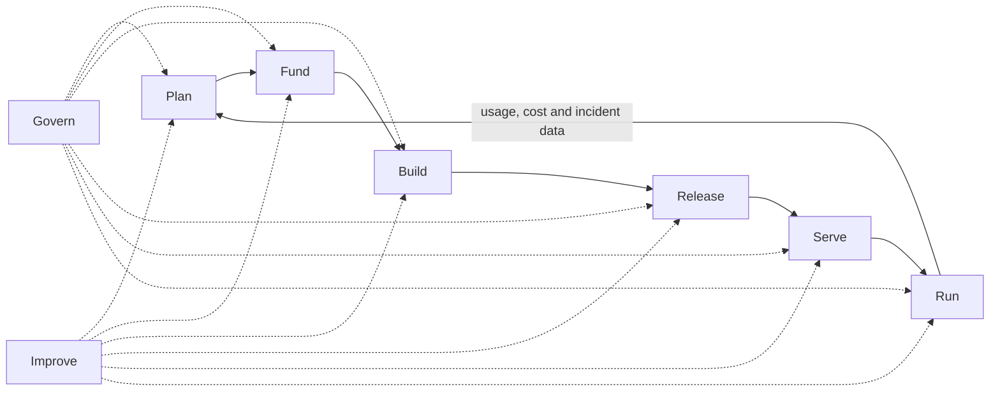

# Module 0 — Orientation

*Most IT departments are judged on two things nobody planned to be judged on: how much they cost and how often they break. Najm Bank's Technology division is no exception. The board asks Omar, the CIO, why the budget keeps rising, why a simple change to the cards app takes a quarter, and why the same outages keep reaching customers. This module sets the ground for the whole course. It explains what "running IT as a business" means in practice, and what digital products and AI change about it; it introduces Najm Bank's Technology division, its cast and the eight steps of the IT operating cycle that every later lesson uses; and it says plainly how to use the course and what it is not. Each lesson leaves you with a one-page artefact: a diagnosis of your own IT organisation, a map of its operating cycle, and a learning plan.*

> **Steps:** Plan — look at the whole operating cycle, and at your own organisation's place in it, before changing any part of it.

---

# 0.1 — What it means to run IT as a business, and what digital products and AI change
*Level: 🟢 Beginner* · *Prerequisites: none* · *Step: Plan*

**After this you can** write a one-page "IT as a business" diagnosis of your own IT organisation that names its customers, what they consume, how money and work flow, and three questions you cannot yet answer with evidence. *Study time: reading about 15 min, hands-on about 60 min (estimate).*

## ⚡ In 60 seconds
- **Running IT as a business** does not mean profit from colleagues or outsourcing everything. It means knowing IT's customers, offer, costs, performance and risks, and being able to show the evidence.
- Five questions sum it up: **who are our customers, what do they consume, what does it cost, how fast and safely does change flow, and who decides with what record?**
- **Digital products** change the picture: when the bank's product *is* software, IT is part of what customers buy, and it changes every week.
- **AI** makes writing code cheaper, not deciding, reviewing, releasing, running or governing. Published research so far suggests it amplifies the operating model you already have.
- The rule that matters most: **every claim about IT needs a customer, a number and a record.** Without all three, you have an opinion, not a fact.
- Biggest trap: treating "IT as a business" as an accounting exercise (charging for everything) rather than making value, cost and risk visible enough to decide.

## 🧭 Why it matters
Najm Bank and everyone in it are fictional. All numbers about Najm Bank in this lesson are illustrative figures, not benchmarks.

Omar, Najm Bank's Chief Information Officer (CIO), leaves a board meeting with three questions he could not answer. Why has the technology budget risen again (by about a tenth in two years) while the cards app is still slow to get new features? How many of last year's projects delivered the benefits in their business cases? Why did the same payment outage happen three times in six months?

Omar knew the answers in outline: regulatory work, cloud migration, supplier price rises; benefits "mostly delivered, we think"; the outage "a supplier problem". None came with a checkable number, a record of who decided, or a link from money spent to value received. The board did not doubt Omar's honesty. It doubted that the Technology division could see itself.

The lending business can say who its customers are, what they buy and what each loan costs. Running IT as a business means IT can do the same for its own work, with evidence.

## 📐 How it works

### 🟢 The essentials

**What "as a business" means.** In this course it means five things.

| Question | A well-run IT organisation can show | A struggling one says |
|---|---|---|
| **Who are our customers?** | Named business units and end customers, and what each relies on | "The business" |
| **What do they consume?** | A short list of products and services, each with an owner and a service level | "We support 400 applications" |
| **What does it cost?** | The cost of each product or service, and a unit cost where it helps (per account, per payment) | One total, no breakdown |
| **How fast and safely does change flow?** | Time from idea to customer, how often changes go out, fail and recover | "Projects are mostly on time" |
| **Who decides, with what record?** | Funding, priority, release and risk decisions, each with an owner and a findable record | "It was agreed in a meeting" |

It does **not** mean that IT must make a profit, that every service must be charged back, or that IT should behave like an outside supplier to the rest of the bank. Those are design choices that later modules examine. The core idea is simpler: **manage IT with the same discipline about customers, value, cost and risk that you expect of any other part of the business.**

**Terms you will meet throughout.** Each is treated fully later.

- A **digital product** is something customers (inside or outside the bank) use, delivered mostly through software, with a long life and a team that keeps improving it, such as the Najm Bank cards app.
- A **service** is an offer IT keeps running for others at an agreed level of performance, such as "laptop provisioning" or "the payments platform".
- A **project** is temporary work with a start, an end and a budget, used to deliver a defined change.
- A **value stream** is the end-to-end sequence of steps, across teams, that turns a need into something a customer values.
- The **operating model** is how the organisation is arranged: who does what, who decides, how work is funded and measured, and which records and tools hold it together.
- A **record** is information that proves something happened or was decided: an approved investment, a change record, an incident ticket, a cost report.

**From order-taker to accountable owner.** In many IT departments the business writes requirements, IT delivers a project, the project closes, and nobody answers for whether customers got value. This course teaches the alternative: long-lived teams that own products and services, funded for outcomes and measured on value, flow, reliability and cost together.

| Project-and-ticket IT | Product-aligned IT |
|---|---|
| Work arrives as projects and tickets | Work arrives as outcomes for a product or service |
| Teams form for a project and disband | Teams stay with a product and learn from it |
| Funding per project, approved once a year | Funding per product or capacity, reviewed regularly |
| Success = delivered on time and budget | Success = customer and business outcome, at known cost and risk |
| Operations inherits whatever was built | The team that builds also cares how it runs |
| Records scattered across tools | A small set of linked records shows idea to incident |

Some work is genuinely a project (a data-centre exit, a regulatory deadline). The point is to choose deliberately, not by habit.

### 🟡 Going deeper

**What digital products change.** IT once mostly supported products that lived elsewhere: a loan was a contract and a branch process, and the system recorded it. Today, for many retail customers, the bank *is* an app, a card and a payment that works or does not. Three things follow.

1. **Change never stops.** A digital product is never "finished", and an operating model built around projects that end struggles with work that does not.
2. **Structure shapes the product.** In a 1968 paper, "How Do Committees Invent?", Melvin Conway argued that organisations which design systems tend to produce designs that copy their own communication structure (now known as Conway's law). If cards, payments and fraud sit in three departments with three backlogs, expect the customer journey to feel like three systems (lesson 2.2).
3. **Delivery performance becomes a business measure.** The DORA research programme (DevOps Research and Assessment, part of Google Cloud) is reported to group its five current software delivery metrics as throughput (change lead time, deployment frequency, failed deployment recovery time) and instability (change fail rate, deployment rework rate). Behind them are a manager's questions: how quickly can we respond, and how often does responding hurt us? Lesson 1.3 covers which measures help and which mislead.

**What AI changes.** Generative AI tools now draft code, tests, documentation and incident summaries. That lowers the cost of producing, not of deciding what to produce, checking it, releasing it safely, running it or proving it was controlled. Research so far reflects this:

- The announcement of the 2024 DORA report says that as AI adoption increased, it was accompanied by an estimated 1.5% decrease in delivery throughput and an estimated 7.2% reduction in delivery stability.
- The 2025 DORA report, *State of AI-Assisted Software Development*, drew on nearly 5,000 technology professionals. Its announcement says 90% of respondents use AI at work, that AI adoption now had a positive relationship with throughput but still a negative one with stability, and that "AI doesn't fix a team; it amplifies what's already there."

These are correlational survey findings for particular years, not laws. The practical reading: **if AI speeds up writing code, the bottleneck moves to everything after it** (review, testing, release, operations, records). Weak flow plus AI produces more, faster, and breaks more. That is why this course is about the operating model, not the tools.

AI also becomes part of the bank's own products, which brings governance duties (see [*AI Governance*, lesson 0.1 — What AI governance is, and what the AIGP proves](../aigp/index.html#/0.1)), and a tool inside IT that needs controls of its own (lesson 11.3).

### 🔴 Expert view

**Three ways "IT as a business" goes wrong.**

- **The internal market.** IT charges for everything, invoices are argued line by line, and allocation costs more than the information is worth. Showback (showing cost without charging) is lighter; see lesson 7.3.
- **The utilisation trap.** Measuring how busy people are, not how fast value flows. Busy teams with long queues are slow: lean practice commonly finds that work spends much of its lead time waiting (lesson 1.2).
- **The reporting factory.** Dashboards arrive before decisions. Start from the decision (fund, stop, release, fix), then find the smallest record that supports it.

**The rule for this course.** Every claim about IT needs a **customer** (who is affected), a **number** (how much, how fast, how often, at what cost) and a **record** (where the evidence lives, who owns it). Often the honest answer is "we do not know yet; here is the record we will create to find out", which builds more trust than a confident guess.

## 🧰 The toolkit
| Resource, tool or template | What it is and does | When to reach for it |
|---|---|---|
| **IT-as-a-business diagnosis** | One page answering the five questions, each rated "evidence / partial / opinion" | Before any change or board conversation |
| **Money map** | Where the IT budget goes (run vs change; people, suppliers, cloud), unknowns marked | When only one cost total exists |
| **Flow snapshot** | Rough lead time, deployment frequency and change failure for one product, with the source of each number | To start a factual conversation about speed and stability |
| **Decision-and-record log** | Recent decisions (fund, release, accept risk), who decided and where the record is | When "agreed in a meeting" is the usual answer |
| **AI change note** | Where AI is used in delivery and operations, and which downstream steps have not changed to match | Before scaling AI tools across teams |

## 🏛️ In practice at Najm Bank
Omar asked Huda (Head of Enterprise Architecture) and Tariq (IT Finance Business Partner) for a one-page diagnosis before the next board. Illustrative and fictional:

> **Najm Bank Technology: IT-as-a-business diagnosis (draft 1)**
>
> | Question | What we can show | Evidence rating |
> |---|---|---|
> | Customers | Retail, SME and corporate banking; internal functions; end customers via digital channels | Partial: no map of who relies on which systems |
> | Consumption | About 400 applications in the inventory; no agreed product or service list | Opinion |
> | Cost | Total known; run versus change only roughly; no cost per product | Partial |
> | Flow | Project dates known; nobody measures idea-to-customer time | Opinion |
> | Decisions and records | Investment decisions minuted; release and risk decisions spread across email and three tools | Partial |
>
> **Three questions we cannot answer with evidence today:**
> 1. What does Cards & Payments cost a year, including shared platforms and suppliers?
> 2. How long does a typical cards-app change take from approval to customers, and where does it wait?
> 3. Which changes or supplier events were behind last year's three payment outages, and what did we change?
>
> **AI note:** two teams use AI coding assistants; approval, testing and release are unchanged. Risk: more changes queued at the same gates.

Tariq first rated cost "evidence" on one line: "IT is about 8% of bank costs". Huda pointed out that a total answers no decision, and he downgraded it. Yousef, Head of IT Operations, objected to the flow row: "Operations is measured on stability, not speed." Omar kept it; lesson 1.3 explains why the two are measured together.

## 🛠️ Exercises
**🟢 Answer the five questions.** For your own IT organisation (or Najm Bank's), answer each of the five questions in a sentence or two and rate it "evidence", "partial" or "opinion".
*Done when:* all five rows have a rating, and every "evidence" rating names the record (report, tool, register) that holds it.

Model answer and self-check

**Model answer.** Honest beats impressive: customers "partial" (dependencies not mapped); consumption "opinion" (no product list); cost "partial" (not by product); flow "opinion" (no lead time); decisions "partial" (release and risk scattered). Few rows deserve "evidence".

**Self-check.**
- Did you write about customers and consumption, not your team's activities?
- Is each "evidence" rating backed by a record someone else could open?
- Did you resist rating a single total (budget, headcount) as evidence?

**🟡 List three unanswerable questions.** Write three questions an executive could reasonably ask that you cannot answer with evidence today. For each, name the record that would answer it and its owner.
*Done when:* each question is tied to a decision (fund, stop, release, fix, accept risk) and has a named record and owner role.

Model answer and self-check

**Model answer.** (1) "What does product X cost per year?" Decision: invest further or not. Record: a cost model by product. Owner: IT finance with the product manager. (2) "How long does a change take from approval to customers?" Decision: where to invest in flow. Record: timestamps on backlog items and releases. Owner: the product team. (3) "Which changes were involved in last quarter's major incidents?" Decision: what to fix. Record: incident records linked to change records. Owner: operations.

**Self-check.**
- Is each question tied to a real decision?
- Is the record specific (fields, tool or register), not "better data"?
- Could you start collecting it within a month without a new tool?

**🔴 Write the AI change note.** For one team, say where AI tools are used today and rate each downstream step (review, testing, change approval, release, operations, records) "changed to match", "unchanged" or "unknown". Name the likely bottleneck and one action for it.
*Done when:* all six steps are rated, one bottleneck is named with a reason, and one action has an owner and a date.

Model answer and self-check

**Model answer.** Cards & Payments: AI drafts code and unit tests; review "unchanged" (same two reviewers); testing "partly changed"; change approval and release "unchanged" (weekly board, monthly window); operations "unknown"; records "unchanged". Bottleneck: review, because volume rises and reviewers do not. Action: Reem and Sami agree a smaller-change rule and a review rota by month end.

**Self-check.**
- Did you name a step after code writing as the likely bottleneck?
- Is your action about rules, roles or records rather than another tool?
- Did you avoid stating any productivity gain you cannot source?

## ⚠️ Mistakes and traps
- **Reading "business" as "profit".** Aim for visible value, cost and risk; decide later whether to charge anything.
- **Starting with a tool or a framework.** Adopting either before you know which decisions it must support produces records nobody uses. Start from the five questions.
- **Assuming AI will fix slow delivery.** Faster drafting with unchanged downstream steps lengthens queues. Fix the flow, then scale the tool.
- **Over-claiming evidence.** A single total or a meeting memory is not evidence; "we don't know yet" with a plan is a respectable answer.

## 🧾 Recap
- Running IT as a business means showing customers, consumption, cost, flow and decisions, with evidence; not profit or compulsory chargeback.
- Digital products make change continuous, mirror the organisation's structure, and make delivery performance a business measure.
- DORA research so far links AI adoption with lower delivery stability and calls AI an amplifier; the bottleneck moves downstream.
- The course rule: every claim needs a customer, a number and a record.

## ✍️ Check yourself
**1. A board member tells Omar: "Running IT as a business means every department should pay IT for what it uses." What is the best response?**

- A. Agree, because charging every department for usage is the defining feature of IT as a business.
- B. Agree in part, and start invoicing the largest users first to show quick and visible progress.
- C. Explain that the aim is visible value, cost and risk, and that charging is a later design choice.
- D. Disagree, because IT is a cost centre and should never show its costs to other departments.

Answer

**C.** Running IT as a business means answering the five questions with evidence; charging is a later design choice. A and B make chargeback the goal (the "internal market" trap); D hides cost, so the cost question cannot be answered. See "What 'as a business' means".

**2. Tariq's draft says: "Cost: IT is about 8% of bank costs (evidence)." Why did Huda ask him to downgrade it?**

- A. A single total does not support any decision about a product, service or investment.
- B. The figure is too high for a mid-sized bank and should be checked against benchmarks.
- C. Cost figures belong to the finance department and should not appear in an IT diagnosis.
- D. The board asked about flow and outages, so cost evidence is not relevant to the meeting.

Answer

**A.** A total answers no "fund, stop or fix" question; the cost question asks what each product or service costs. B invents a benchmark, C contradicts the diagnosis's purpose, and D ignores that the board asked about the budget. See "In practice at Najm Bank".

**3. Which statement about AI fits the DORA findings described in the lesson?**

- A. AI adoption reliably improves both delivery speed and stability once teams are trained.
- B. AI has no measurable link with delivery performance, so it can be ignored in operating design.
- C. AI adoption has been linked with lower stability, which proves AI tools should be banned.
- D. AI adoption has gone with lower stability so far, and the 2025 report calls AI an amplifier.

Answer

**D.** Both years report a negative relationship with stability, and the 2025 report calls AI an amplifier. A overstates the findings, B contradicts them, and C turns a correlational finding into a conclusion the reports do not draw. See "What AI changes".

**4. Three Najm Bank departments (cards, payments, fraud) build the cards app from separate backlogs, and customers say it "feels like three apps". Which idea explains this best?**

- A. The utilisation trap, because the three departments are measured on how busy they are.
- B. Conway's law: systems tend to copy the communication structure of the organisation.
- C. The internal market, because each department charges the others for its services.
- D. The reporting factory, because the departments produce dashboards instead of decisions.

Answer

**B.** Conway observed that designs mirror the organisation's communication structure: three departments, three experiences. A, C and D are real traps, but none explains why the product's shape follows the organisation's. See "What digital products change".

**5. Omar is asked how long a typical change to the cards app takes, and nobody measures it. What is the best answer to the board?**

- A. "We do not know yet; here is the record we will create and who will own it."
- B. "About six weeks", based on the project manager's impression from recent releases.
- C. "It depends on the change", since every change is different and cannot be compared.
- D. "Faster than last year", because the team has started using AI coding assistants.

Answer

**A.** Without a record, the honest answer names the gap and the plan. B is an opinion dressed as a number, C avoids the question, and D assumes AI improved flow without evidence. See "The rule for this course".

## 📚 References
- Google Cloud blog, announcement of the *2025 DORA Report: State of AI-Assisted Software Development* (opened 2026-11-19): https://cloud.google.com/blog/products/ai-machine-learning/announcing-the-2025-dora-report
- Google Cloud blog, announcement of the 2024 DORA report (opened 2026-11-19): https://cloud.google.com/blog/products/devops-sre/announcing-the-2024-dora-report
- DORA, history of its software delivery metrics, on dora.dev (as reported in search summaries; not opened): https://dora.dev/guides/dora-metrics/history/
- Rother, M. and Shook, J., *Learning to See* (Lean Enterprise Institute, 1999): the lean practice of mapping a value stream and its waits.
- Conway, M. E., "How Do Committees Invent?", *Datamation*, April 1968 (full citation; the paper itself was not opened for this lesson).
- Forsgren, N., Humble, J. and Kim, G., *Accelerate* (IT Revolution, 2018): the research behind the delivery metrics.
- Kersten, M., *Project to Product* (IT Revolution, 2018): a practitioner's case for moving IT from projects to products.
- Library: [*Cloud & DevOps: Zero to Hero*, lesson 0.1 — What cloud, DevOps, platform engineering and SRE are](../cloud/index.html#/0.1) (the engineering vocabulary behind this course).

---

# 0.2 — Meet Najm Bank's Technology division and the eight steps
*Level: 🟢 Beginner* · *Prerequisites: 0.1* · *Step: Plan*

**After this you can** draw your own organisation's IT operating cycle on one page using the eight steps, name an owner, a main record and one measure for each step, and mark the two weakest hand-offs. *Study time: reading about 15 min, hands-on about 60 min (estimate).*

## ⚡ In 60 seconds
- Najm Bank is a **fictional** mid-sized Gulf bank. This course sits in its **Technology division** (about 600 staff plus suppliers, an illustrative figure), which is moving from project-and-ticket IT to product-aligned IT.
- Eight people carry the story: **Omar** (CIO), **Huda** (architecture), **Yousef** (operations), **Reem** (Cards & Payments product), **Sami** (platform), **Tariq** (IT finance), **Lina** (sourcing) and **Nour** (risk and controls). Each makes realistic mistakes.
- The **eight steps** of the IT operating cycle, **Plan · Fund · Build · Release · Serve · Run · Govern · Improve**, are this course's own plain words, not any framework's terms.
- Each step answers a question, leaves a main **record** and has an **owner**. Value is often lost at the **hand-offs** between steps.
- The rule that matters most: **the steps are a loop, not a sequence of departments.** Data from Serve and Run must flow back into Plan and Fund.
- Biggest trap: mapping the steps onto the org chart ("Build is development, Run is operations") and calling the map finished.

## 🧭 Why it matters
Najm Bank and all its people are fictional. All numbers about Najm Bank in this lesson are illustrative figures, not benchmarks.

At Omar's first operating-model workshop, each leader described how a change to the cards app reaches customers. Reem described two-week sprints. Sami described a pipeline that could deploy many times a day. Yousef described a weekly change board and a monthly release window. Tariq described an annual budget in which the cards work was a line inside a "digital channels" project. Nour described a quarterly control test. Lina described a card-processing supplier that needs ten working days' notice for any interface change.

Every description was accurate; none was the whole picture. Huda drew them on a whiteboard as a loop and saw it at once: the daily-capable pipeline waited for a monthly window, the window waited for a supplier's notice period, and the money had been decided eight months earlier on a business case nobody had reopened.

That is why the course starts with a shared map. The eight steps give everyone the same words for the same parts of the cycle, so the hand-offs, where value waits, gets lost or gets re-checked, become visible.

## 📐 How it works

### 🟢 The essentials

**Najm Bank's Technology division.** Najm Bank offers retail, SME and corporate banking and is supervised by a central bank. Its Technology division (about 600 staff plus suppliers) is organised mostly by function: application development, IT operations, architecture, security, a project management office, IT finance and vendor management. A few product teams have started, including Cards & Payments. The board wants lower cost, fewer outages and faster change, and doubts it can have all three.

**The cast.** The same people appear in every module.

| Person | Role | What they care about | The mistake they tend to make |
|---|---|---|---|
| **Omar** | Chief Information Officer; sponsor of the change | Board confidence on cost and outages | Promising the board a date for the transformation before the evidence exists |
| **Huda** | Head of Enterprise Architecture | The target operating model and the design of IT's records | Designing a complete model on paper before testing it with one product |
| **Yousef** | Head of IT Operations (service desk, operations centre, infrastructure) | Stability; sceptical of "product" talk | Treating every change as a risk to block rather than to manage |
| **Reem** | Product Manager, Cards & Payments | Customer outcomes and speed | Treating operations and controls as someone else's problem |
| **Sami** | Platform Engineering Lead (pipelines, environments, internal developer platform) | Fast, safe, self-service delivery | Building platform features nobody asked for |
| **Tariq** | IT Finance Business Partner (budgets, cost allocation, business cases) | Predictable spend and credible business cases | Allocating costs so precisely that nobody trusts or uses the numbers |
| **Lina** | Vendor and Sourcing Manager (contracts, suppliers, multi-supplier integration) | Value and risk in supplier contracts | Signing contracts whose terms slow the bank's own release cycle |
| **Nour** | IT Risk and Controls Lead (second-line liaison, audit, regulatory reporting) | Evidence that controls work | Asking for evidence in a form only a manual process can produce |

Najm Bank teams from other library courses (platform, quality engineering, security, data, AI products) appear briefly when a lesson links to them.

**The eight steps.** Each step answers one management question.

| Step | The question it answers | Main record it leaves | One useful measure | Owner at Najm Bank |
|---|---|---|---|---|
| **Plan** | What should we work on, and why? | Link from stated outcomes to approved work; prioritised demand | Share of work traceable to a stated outcome | Omar, Huda, product managers |
| **Fund** | How much money and capacity goes where? | Funding decision per product or investment | Time from proposal to decision | Tariq, with the investment committee |
| **Build** | How do we turn a need into working, tested software or configuration? | Backlog items, code changes, test evidence | Lead time from start of work to ready to release | Product teams, Sami's platform |
| **Release** | When and how does a change reach customers, and who decides? | Change and release records | Deployment frequency; change failure | Product owners, Yousef for change control |
| **Serve** | How do people request, get and use what IT offers? | Service catalogue entries, requests, entitlements | Time to fulfil a standard request | Yousef's service desk, product teams |
| **Run** | How do we keep it working and recover when it fails? | Monitoring events, incidents, problems | Time to restore service; service-level performance | Yousef's operations, product teams |
| **Govern** | Who is allowed to decide what, and how do we prove control? | Policies, risk register, control evidence | Share of controls with automated evidence | Nour, with Omar and Huda |
| **Improve** | What did we learn, and what will we change? | Reviews, improvement backlog, maturity evidence | Improvements completed and their measured effect | Everyone; Huda coordinates |

**Two kinds of steps.** Plan, Fund, Build, Release, Serve and Run follow a piece of work, roughly in that order. **Govern** and **Improve** run across all of them: Govern sets rules and checks evidence at every step; Improve feeds back what was learned anywhere.

The arrow from Run back to Plan matters most. Without it, the organisation keeps funding and building without learning whether anything worked.

### 🟡 Going deeper

**Steps are not departments.** "Build is development, Run is operations" is the project-and-ticket model drawn as a loop. In a product-aligned organisation one product team touches Build, Release, Serve and Run for its product, while a platform team provides shared means. The steps say *what must happen*; the operating model (Module 2) decides *who does it*.

**Steps are not phases.** A large project may pass through each step once; a digital product passes through all of them every week, in small batches.

**Where value leaks: the hand-offs.** A **hand-off** is any point where work, information or responsibility passes between people, teams or tools. Each risks a **wait** (work sits in a queue), a **loss** (context does not travel) or a **re-check** (the receiver does not trust the sender's evidence). Huda's whiteboard showed four:

| Hand-off | What goes wrong | Lesson that addresses it |
|---|---|---|
| Fund → Build | Money approved for a project scope months ago; the team cannot change course without a new business case | 3.2 |
| Build → Release | Pipeline ready daily; change board weekly; release window monthly | 6.1, 6.2 |
| Release → Run | Operations learns about a change after it fails | 6.3, 8.1 |
| Run → Plan | Incident and usage data never reach the people who prioritise work | 8.2, 9.3 |

**The chain of records.** Each step leaves a record, and the records should link: investment decision to backlog items, to the changes that delivered them, to the service they changed, to the incidents and costs that followed. With those links Omar answers the board in minutes; without them, every answer is a reconstruction project. Module 9 builds that chain.

### 🔴 Expert view

**Why this course uses its own words.** Published frameworks describe parts of this cycle in their own vocabularies. This course uses eight plain words so you can map *your* organisation without first adopting someone else's model. Lesson 12.1 compares the well-known frameworks.

**Disagreement is a feature.** Yousef sees Release and Run as one stability concern and wants a single gate; Reem sees Release as a product decision for her team. Nour wants evidence at every step; Sami wants the pipeline, not forms, to produce it. A good operating model does not pick a winner; it decides who decides each thing, on what evidence, and makes the record do the work. Modules 6 and 10 settle these two arguments.

**Map what happens, not what the manual says.** Trace the last three real changes. The gap between the documented and the real cycle is often the most useful finding.

## 🧰 The toolkit
| Resource, tool or template | What it is and does | When to reach for it |
|---|---|---|
| **Eight-step cycle sheet** | Each step's question, owner, main record and one measure | First artefact of any operating-model change; update each module |
| **Hand-off map** | Every hand-off marked with its typical wait, loss or re-check | When nobody can say where work waits |
| **Cast table** | Who owns each step, what they care about, the mistake they tend to make | Before a workshop, to plan who must attend |
| **Real-example trace** | Three recent changes followed through the steps, dated at each hand-off | To check your map against reality |
| **Record chain sketch** | Which record at each step should link to which at the next | Before buying or changing any IT management tool |

Any whiteboard, diagram or spreadsheet tool will do.

## 🏛️ In practice at Najm Bank
After the workshop, Huda turned her whiteboard into an eight-step cycle sheet for the Cards & Payments product. Illustrative and fictional:

> **Cards & Payments: eight-step cycle sheet (draft)**
>
> | Step | Owner today | Main record today | Measure today |
> |---|---|---|---|
> | Plan | Digital channels steering group | Annual plan slide | None |
> | Fund | Investment committee, via Tariq | Project business case | Budget versus spend |
> | Build | Reem's team, plus two supplier teams | Backlog in the delivery tool | Sprint velocity |
> | Release | Weekly change board (Yousef chairs) | Change ticket | Number of changes approved |
> | Serve | Service desk | Request tickets | Tickets closed |
> | Run | Operations centre; card-processing supplier | Incident tickets in two tools | Monthly availability |
> | Govern | Nour, quarterly control test | Spreadsheet of sampled changes | Control test pass rate |
> | Improve | None assigned | Post-incident reports, not tracked | None |
>
> **Weakest hand-offs:** (1) Build → Release: a change ready in two days waits a median of about three weeks for the change board and release window (illustrative figure, from tracing three recent changes). (2) Run → Plan: last year's three payment incidents produced reports, but none of their actions reached the cards backlog.

Huda's first draft listed "IT operations" as owner of Serve and Run. Reem pointed out that the app's customer-facing behaviour was hers to answer for, whoever ran the servers, so both were marked "shared, to be decided in Module 2". Sami noticed that the measure column held three counts of activity (velocity, changes approved, tickets closed) and no measure of flow or outcome: the starting point for Module 1.

## 🛠️ Exercises
**🟢 Fill in the cycle sheet.** For one product or service you know, fill in the eight-step cycle sheet: owner, main record and current measure for each step. Write "none" where nothing exists.
*Done when:* all eight rows are filled in, at least one row honestly says "none", and every owner is a named role or body, not "IT".

Model answer and self-check

**Model answer.** A typical first sheet resembles Huda's: Plan and Improve weakest (an annual slide, no owner); Fund a project business case; Build a backlog measured by velocity; Release counted change tickets; Serve and Run tickets and availability; Govern a sampled control test. The value is in the "none" cells and the activity measures.

**Self-check.**
- Did you describe what actually happens, not what the manual says?
- Is each owner a role or body you could invite to a meeting?
- Did you fill in Govern and Improve too?

**🟡 Trace three real changes.** Pick three changes that reached customers in the last quarter. For each, find the date at each hand-off (approved, funded, started, ready, released, in use) and mark the longest wait.
*Done when:* three changes are traced with dates (or "unknown" where no record exists), the longest wait for each is marked, and you have written one sentence on what the three have in common.

Model answer and self-check

**Model answer.** Reem traced a fee-display change, a card-freeze feature and a supplier interface update. All three were ready within days and waited longest between "ready" and "released" (change board, monthly window, and once the supplier's notice period). Common thread: Release, not Build, is the bottleneck. Two had "unknown" funding dates, because the work sat inside a larger project budget.

**Self-check.**
- Did you use records (ticket dates, release notes) rather than memory?
- Did you mark "unknown" honestly instead of estimating silently?
- Is your common-thread sentence about a hand-off, not a person?

**🔴 Mark the two weakest hand-offs and propose a record link.** Name your two weakest hand-offs. For each, say whether the problem is a wait, a loss or a re-check, and propose one link between records that would show it every month without a manual trace.
*Done when:* each hand-off has a problem type, evidence from your traces, and a record link (from which record, to which, owned by whom).

Model answer and self-check

**Model answer.** Najm Bank: (1) Build → Release is a **wait**; link each change record to the backlog item it delivers, with "ready" and "released" timestamps, owned by Reem's team, so the wait is measured automatically. (2) Run → Plan is a **loss**; link each major incident's actions to items in the product backlog, owned by Yousef's problem manager with Reem, so the monthly review shows which actions are planned, done or dropped.

**Self-check.**
- Did you distinguish a wait (time) from a loss (information) and a re-check (duplicated control)?
- Is the link small enough to start without a new tool?
- Does it feed a regular decision, not just a report?

## ⚠️ Mistakes and traps
- **Mapping the org chart, not the work.** "Development = Build" hides the hand-offs. Trace real changes instead.
- **Forgetting the return arrow.** Without Run → Plan feedback you have a production line, not a loop. Name who carries usage, cost and incident data back.
- **Leaving Govern and Improve unowned.** They cut across everything, so they often belong to nobody. Assign an owner, even provisionally.
- **Measuring activity at every step.** Tickets closed and changes approved show effort, not flow or outcome. Look for one flow or outcome measure per step.
- **Treating disagreement as an obstacle.** Yousef and Reem are both partly right. Use their argument to find which decisions need a clear owner and record.

## 🧾 Recap
- Najm Bank is fictional; its Technology division is moving from project-and-ticket to product-aligned IT.
- The eight steps are **Plan, Fund, Build, Release, Serve, Run, Govern, Improve**: six follow the work, two cut across it.
- Each step answers a question, leaves a record and has an owner; value often leaks at hand-offs, as waits, losses and re-checks.
- The steps are a loop: data from Serve and Run must return to Plan and Fund.
- Map the real cycle by tracing real changes, not by copying the process document.

## ✍️ Check yourself
**1. In the workshop, Sami's pipeline can deploy daily, but changes reach customers about monthly. Which step's hand-off is the most likely first place to look?**

- A. Plan → Fund, because money for the work was approved months before work started.
- B. Build → Release, because ready changes wait for the change board and release window.
- C. Serve → Run, because the service desk must be trained before any change goes live.
- D. Run → Plan, because incident data does not reach the people who set priorities.

Answer

**B.** A daily-capable pipeline with monthly releases points to the Build → Release hand-off, as Huda's whiteboard and Reem's traces showed. A and D are real weak hand-offs but do not explain why ready changes wait; C is not in the case. See "Where value leaks: the hand-offs".

**2. Huda's first draft lists "IT operations" as the owner of Serve and Run for Cards & Payments. What does the lesson suggest about this?**

- A. It is correct, because Serve and Run are by definition the operations department's steps.
- B. It is wrong, because product managers must always own Serve and Run in a modern bank.
- C. It is incomplete, because a supplier runs the card-processing system and should own both.
- D. It confuses steps with departments; the owner is a design decision still to be made.

Answer

**D.** Steps say what must happen; the operating model decides who does it, so both were marked "shared, to be decided in Module 2". A is the steps-as-departments trap, B states a rule the lesson does not make, and C confuses running a component with answering for the product. See "Steps are not departments".

**3. Which pair of steps does the lesson describe as cutting across all the others?**

- A. Plan and Fund, because every piece of work starts with a decision and a budget.
- B. Release and Run, because together they decide the stability that customers see.
- C. Govern and Improve, because rules and learning apply at every other step.
- D. Build and Serve, because they produce and deliver everything the customer uses.

Answer

**C.** Govern sets rules and checks evidence at each step, and Improve feeds learning back from anywhere; the diagram links both to every other step. A, B and D are life-cycle steps that follow the work. See "Two kinds of steps".

**4. Last year's payment incidents produced reports, but none of their actions reached the cards backlog. What kind of hand-off failure is this?**

- A. A loss: information from Run never reached the people who plan the work.
- B. A wait: the actions sat in a queue for the change board to approve them.
- C. A re-check: Plan repeated the incident analysis because it distrusted Run.
- D. A funding gap: no money was approved, so the actions could not be planned.

Answer

**A.** The actions existed but never reached Plan: a loss of information at the Run → Plan hand-off. B is a wait, C a duplicated control, and D is not in the case. See "Where value leaks".

**5. Sami notices that the "measure today" column shows velocity, changes approved and tickets closed. Why is this a concern?**

- A. These measures are hard to collect, so the teams spend too long on reporting.
- B. These measures belong to other courses in the library, not to IT management.
- C. These numbers are too low, which shows the teams are not working hard enough.
- D. These measures count activity, and say nothing about flow or customer outcome.

Answer

**D.** All three count effort; none shows how fast value reaches customers or whether it helped. A and C make claims the lesson does not, and B is wrong because measures are a management concern. See "Mistakes and traps".

## 📚 References
- Rother, M. and Shook, J., *Learning to See* (Lean Enterprise Institute, 1999): a classic introduction to mapping a value stream and its waits.
- Library: [*Cloud & DevOps: Zero to Hero*, lesson 0.3 — Meet Najm Bank's platform team, and how to use this course](../cloud/index.html#/0.3) (the platform side of Najm Bank, from the engineering view); [*Cloud & DevOps: Zero to Hero*, lesson 0.2 — The path to production: from a commit to a customer, and everything that can break on the way](../cloud/index.html#/0.2) (the engineering view of Build and Release).

---

# 0.3 — How to use this course, and what it is not
*Level: 🟢 Beginner* · *Prerequisites: 0.1, 0.2* · *Step: Plan*

**After this you can** write a one-page learning plan that sets your path through the modules for your role, your artefact folder, the people in your organisation you will check facts with, and three limits you will keep. *Study time: reading about 15 min, hands-on about 60 min (estimate).*

## ⚡ In 60 seconds
- The course teaches the **operating-model view** of IT: who decides, what record proves it, how it is measured, funded and governed. It is **not an engineering course**; it links to the library's engineering courses for depth.
- It is **original**: written from general management and engineering practice, **not based on, derived from or aligned with any proprietary framework or certification**, and **not training for any exam**.
- It is **not professional advice**. Accounting, procurement law, regulation and audit differ by country and organisation. The course names the kind of rule and the question to ask finance, legal, risk or the regulator.
- It is AI-drafted and not expert-reviewed, and every Najm Bank number is **illustrative**. Check before you act.
- The rule that matters most: **every lesson ends in an artefact.** Build your own operating blueprint, one page at a time, in one folder.
- Biggest trap: reading the course as a recipe to install. Your organisation's context decides; the course gives you questions, structures and evidence habits.

## 🧭 Why it matters
Najm Bank and everyone in it are fictional.

Tariq, Najm Bank's IT Finance Business Partner, liked the example cost split in a later lesson on cost models. He copied it into his budget proposal, labelled it "industry practice", and sent it to the Chief Financial Officer's office. The CFO's team asked: which industry, which source, and does the bank's accounting policy allow the capitalisation treatment the example assumes? Tariq could not answer. The example was illustrative, the accounting question belonged to his finance colleagues, and "industry practice" was his phrase, not the course's.

Nour, the IT Risk and Controls Lead, made the opposite mistake: she assumed that adopting the course's control examples would satisfy the auditors and the central bank. It would not, and the course never says it would.

Both expected the wrong thing of a course. This lesson says what the course is and is not, how a lesson is built, and how to use the next 40 lessons at work without overclaiming to your CFO, auditor or board.

## 📐 How it works

### 🟢 The essentials

**What the course is.** *Running IT as a Business: Products, Value Streams and the IT Operating Model* is a free, bilingual (English and Arabic) course for IT managers, enterprise and solution architects, heads of IT operations, service and delivery managers, IT finance and vendor managers, and engineers moving into those roles. Some IT background is assumed, but every term is defined on first use. It follows Najm Bank's Technology division through the eight steps of the operating cycle introduced in lesson 0.2, across 14 modules and 41 lessons.

**What the course is not.**

| It is not | What that means for you |
|---|---|
| **An engineering course** | It teaches who decides about pipelines, tests, platforms and data, and how they are funded, measured and governed; the library's engineering courses teach the how |
| **Based on any proprietary framework** | It is written from general practice in its own words and structure, not derived from, aligned with or a substitute for any standard, body of knowledge or certification. Lesson 12.1 names the well-known frameworks and points to their owners |
| **Exam or certification training** | It prepares you for no exam and promises no results, jobs or careers. Its practice questions test this course only |
| **Accounting, legal, procurement or regulatory advice** | It names the kind of rule (capitalisation, outsourcing, operational resilience, data protection) and the question to ask; your specialists and the regulator's own texts give the answer |
| **Expert-reviewed** | It is AI-drafted and not reviewed by subject experts. Treat every statement as a starting point to check |
| **A benchmark** | Najm Bank's budgets, headcounts, counts and timings are illustrative, never targets |
| **An endorsement** | Tool categories are named with at most one or two examples, as illustrations |

**How a lesson is built.** Every lesson has the same layout, so you can skim to what you need.

| Section | What you get |
|---|---|
| Header and "After this you can" | Level, prerequisites, step(s), the measurable outcome and a time estimate |
| In 60 seconds | The rule that matters most, the decision cue, the biggest trap |
| Why it matters | A Najm Bank situation that makes the topic unavoidable |
| How it works | Essentials, then going deeper, then an expert view |
| The toolkit; In practice at Najm Bank | Templates and records, then the lesson's artefact as the cast produced it, mistakes included |
| Exercises | Three graded exercises with "Done when" lines and model answers |
| Mistakes, Recap, Check yourself, References | What to avoid, what to remember, five questions, and the sources |

**Levels.** Modules 0 to 2 are 🟢 Beginner, 3 to 8 🟡 Intermediate, 9 to 13 🔴 Advanced. "Going deeper" and "Expert view" can be skipped on a first pass.

### 🟡 Going deeper

**Choose a path for your role.** Reading in order is best for a first full pass. With a pressing problem, read Modules 0, 1 and 2 first, because most later lessons assume them, then go where your role points.

| If you are… | After 0, 1 and 2, start with | Then | The artefact you are likely to need first |
|---|---|---|---|
| CIO or IT manager | 3, 12 | 10 | Portfolio board and transformation roadmap |
| Enterprise or solution architect | 9, 11 | 4 | Information model and toolchain map |
| Head of IT operations | 8, 6 | 7 | Change model and SLO sheet |
| Service or delivery manager | 7, 4 | 6 | Service catalogue entry and intake form |
| IT finance or vendor manager | 3, 10 | 7 | Cost model and vendor scorecard |
| Engineer moving into management | 5, 6 | 8 | Value-stream map and release policy |

Module 13's capstone assembles Najm Bank's IT operating blueprint from all the modules' artefacts, so keep everything you produce.

**Your artefact folder.** Create one folder, say "operating blueprint". Each lesson adds a dated page: here, your diagnosis (0.1), cycle sheet (0.2) and learning plan (0.3). Keep Najm Bank practice versions apart from private versions for your own organisation.

**Keep confidential data out.** Before using an AI assistant or sharing exercises with a peer, remove customer data, supplier contract terms, security details, unreleased financials and internal incident details, and check your organisation's AI policy.

**How facts are handled.** Every number about delivery performance, cost, failure rates or adoption has a source in the lesson's References, stated with who found it, for whom and when ("the 2025 DORA report found…"), because findings describe a population in a period, not universal laws. Facts confirmed only from secondary reports are marked "reported". At work, cite the source, not the course.

**Where the library goes deeper.** For technical depth on Build and Release, start with [*Cloud & DevOps: Zero to Hero*, lesson 0.2 — The path to production: from a commit to a customer, and everything that can break on the way](../cloud/index.html#/0.2); for quality, [*Software Testing*, lesson 0.1 — What software testing is, and what it is not: quality, risk and the AI-era shift](../testing/index.html#/0.1); for security, [*Secure AI & Application Security*, lesson 0.1 — What application and AI security is: assets, attackers and risk](../secai/index.html#/0.1).

### 🔴 Expert view

**Questions, not conclusions, for specialists.** Many lessons touch areas where specialists hold authority: accounting for software spend, procurement and contract law, outsourcing and resilience regulation, data protection, audit. The course helps you arrive with short, precise questions and the evidence to answer them. Examples:

| Topic | A good question to bring | Who answers it |
|---|---|---|
| Funding products instead of projects | "Does our accounting policy allow us to capitalise ongoing product development, and what evidence would you need per team?" | Finance and accounting |
| A new cloud or SaaS supplier for a banking service | "Does this count as material outsourcing under our regulator's rules, and what notice or approval does it need?" | Risk, compliance, legal |
| Automated change approval | "Which control objective does the current change board meet, and what evidence would show an automated check meets it too?" | Risk and controls, internal audit |
| An AI tool in operations | "Which of our AI policy's and our regulator's requirements apply to this use, and who signs it off?" | Risk, data protection, the AI governance function |

**Using frameworks without being used by them.** Your organisation may already use well-known frameworks for service management, IT governance, architecture or agile delivery at scale. Nothing here asks you to drop them. Lesson 12.1 explains what each is for and who owns it, and suggests using them as references rather than templates. Where a framework you use and this course describe the same idea, use your organisation's terms at work and this course's map to see how the pieces fit.

**Pace.** For a working manager, one or two lessons a week with the exercises done the same week is realistic. The hands-on estimates cover exercises and quiz, not the calendar time to collect real data at work, so start data requests early and keep reading.

## 🧰 The toolkit
| Resource, tool or template | What it is and does | When to reach for it |
|---|---|---|
| **Learning plan** | One page: role path, pace, artefact folder, specialists and three limits | Now; review after each module |
| **Artefact folder** | One dated folder for every page the lessons produce, building to the capstone | From lesson 0.1 to 13.1 |
| **Specialist question list** | Running questions for finance, legal, procurement, risk and audit, each tied to a decision | When a lesson touches an area where you lack authority |
| **Source note** | For each number you reuse: source, year, population, verified or reported | Before a figure goes into a paper for executives or auditors |
| **Confidentiality checklist** | What to remove before using AI tools or sharing exercises | Before pasting anything into an AI assistant |

## 🏛️ In practice at Najm Bank
After the cost-model episode, Omar asked each leader for a one-page learning plan. Tariq's, illustrative and fictional:

> **Learning plan: Tariq, IT Finance Business Partner**
>
> - **Path:** Modules 0, 1 and 2 first; then 3 and 10; then 7 (usage and chargeback). The rest in order afterwards.
> - **Pace:** two lessons a week, exercises in the same week, Thursday mornings blocked in the calendar.
> - **Artefact folder:** "Operating blueprint – Tariq" on the team drive, one page per lesson, Najm practice and real versions kept apart.
> - **Specialists:** the bank's financial controller (capitalisation and cost allocation policy); procurement (supplier contract terms, with Lina); Nour (control evidence for any change in funding approvals).
> - **Three limits I will keep:**
>   1. No course example goes into a finance paper without a source note; illustrative numbers stay out.
>   2. Any question about accounting treatment goes to the financial controller as a question, never as a course conclusion.
>   3. No bank cost data or supplier terms go into an AI assistant unless the bank's AI policy allows it.

Nour added: "For each control topic, I will read the regulatory text or internal policy myself and note the clause." Yousef, still sceptical, wrote: Modules 0, 1, 2, 8 and 6, "and after Module 2 I decide whether the rest is worth my Thursdays". Omar accepted; a sceptic with a plan beats an enthusiast without one.

## 🛠️ Exercises
**🟢 Choose your path.** Using the role table, write your path through the modules and the first artefact you expect to need at work, with two sentences on why.
*Done when:* the path lists at least five modules in order, names one artefact, and gives a reason tied to a current problem at work.

Model answer and self-check

**Model answer.** A head of IT operations: "Path: 0, 1, 2, then 8, 6, then 7, then the rest. First artefact: an SLO sheet for the payments platform, because the board counts outages and I have no agreed measure of 'good enough' to discuss with product managers."

**Self-check.**
- Does your path include Modules 1 and 2 early?
- Is your artefact a lesson output, not a wish ("better processes")?
- Is your reason a real decision you face?

**🟡 Write your specialist question list.** Write three questions you expect to ask a specialist (finance, legal, procurement, risk, audit or data protection), each with the specialist role and the decision the answer affects.
*Done when:* all three are real questions with a role and a decision, and none asserts a legal or accounting conclusion.

Model answer and self-check

**Model answer.** (1) To the financial controller: "Can the cost of a long-lived product team be capitalised under our policy, and what time-recording evidence would you need?" Decision: product funding model. (2) To compliance: "Does moving our card-dispute workflow to a SaaS platform count as material outsourcing for our regulator, and what notice applies?" Decision: sourcing. (3) To internal audit: "If change approval for low-risk changes were automated, what evidence would you accept that the control still works?" Decision: change model.

**Self-check.**
- Is each a genuine question, open to an answer you do not expect?
- Did you avoid phrasing like "the rule says we can…"?
- Is the specialist a real role in your organisation?

**🔴 Write your learning plan and three limits.** Assemble your one-page plan: path, pace, artefact folder, specialists and three limits (on facts, on professional advice, on confidential data). Share it with a colleague or, studying alone, reread it the next day as a stranger would.
*Done when:* the plan fits one page with all five parts, each limit is specific enough to tell whether you broke it, and you noted one change after the second reading.

Model answer and self-check

**Model answer.** Tariq's plan above is a good model because its limits are testable: each can be checked against his papers, emails or tool use. A weak limit would be "I will be careful with facts".

**Self-check.**
- Could someone else check whether you kept each limit?
- Does the pace fit a real week, with a named time slot?
- Did the second reading change anything? If not, read it as a sceptical manager would.

## ⚠️ Mistakes and traps
- **Treating examples as benchmarks.** Najm Bank's figures are illustrative. Learn the method, then gather your own numbers.
- **Turning a question into a conclusion.** "The course says we can capitalise this" is never true. Bring the question to the specialist with evidence.
- **Expecting the course to satisfy auditors or regulators.** Read the actual rule or policy; let risk, compliance and audit decide what evidence is enough.
- **Reading without producing.** Do the exercises in the same week and file the artefact.
- **Pasting confidential data into AI tools.** Remove sensitive details first and follow your organisation's AI policy.

## 🧾 Recap
- The course teaches the operating-model view of IT and links to engineering courses for depth.
- It is original, not derived from any proprietary framework, and not exam training; lesson 12.1 compares frameworks.
- It is not professional advice, it is AI-drafted and not expert-reviewed, and Najm Bank numbers are illustrative.
- Every lesson ends in an artefact; keep them in one folder for the capstone.
- Keep a specialist question list and source notes, and keep confidential data out of AI tools.

## ✍️ Check yourself
**1. Tariq wants to put a course example's cost split into a paper for the CFO, labelled "industry practice". What should he do?**

- A. Use it as written, because the course is a published source and can stand for practice.
- B. Use it but remove the label, so the figures appear to be his own team's analysis.
- C. Use it only after a vendor or consultant confirms that the split is typical of banks.
- D. Leave the illustrative figures out and cite real sources, or ask finance for policy.

Answer

**D.** Najm Bank figures are illustrative, and accounting treatment is a question for finance. A treats an illustration as evidence, B hides its origin, and C swaps one unverified source for another. See "What the course is not".

**2. Nour asks whether adopting the course's change-control examples will satisfy the bank's auditors and the central bank. What is the best answer?**

- A. Yes, because the course is designed around regulatory expectations for Gulf banks.
- B. No; the course gives questions, and the actual rules and auditors decide on evidence.
- C. Yes, provided every example is applied in full and without any local changes.
- D. No, because the course does not cover controls; she should use a different course.

Answer

**B.** The course helps you prepare questions; risk, compliance and audit decide what evidence is enough under the actual rules. A and C overclaim, and D is wrong because controls are covered (lesson 10.3), just not as advice. See "Mistakes and traps".

**3. Which statement best describes how this course relates to well-known IT frameworks?**

- A. It is written in its own words, is not derived from any of them, and compares them in 12.1.
- B. It is a summary of the main frameworks, arranged in the order of a common certification.
- C. It replaces the frameworks, so organisations using one should stop using it after the course.
- D. It follows one leading framework closely and adds Najm Bank examples to each of its parts.

Answer

**A.** The course is original, and lesson 12.1 is where frameworks are named and compared. B and D describe derived material, and C contradicts the advice to use frameworks as references. See "Using frameworks without being used by them".

**4. Yousef, Head of IT Operations, has a pressing problem: outages the board keeps counting. Which path best fits the course's advice?**

- A. Start with Module 13, so he sees the finished blueprint before reading anything else.
- B. Read only Module 8, because the other modules are about product teams, not operations.
- C. Read Modules 0, 1 and 2, which later lessons assume, then start with 8 and 6.
- D. Skip Module 0, because orientation material is not relevant to an experienced manager.

Answer

**C.** Every path reads Modules 0, 1 and 2 first; the role table then gives 8 and 6, then 7, for a head of operations. A starts at a capstone that needs earlier artefacts, B ignores flow and release, and D skips the shared map and limits. See "Choose a path for your role".

**5. Reem wants to paste last month's incident report for the cards app into an AI assistant to help with an exercise. What should she do first?**

- A. Nothing extra, because the exercise is for learning and not for production use.
- B. Remove confidential details and check the bank's AI policy allows the use.
- C. Ask the supplier named in the report for written permission to share it.
- D. Paste only the first half, so that the most sensitive parts are not included.

Answer

**B.** Remove confidential details and follow the organisation's AI policy. A ignores the risk, C covers only one party's interest, and D is arbitrary: sensitive details can sit anywhere. See "Keep confidential data out".

## 📚 References
- Google Cloud blog, announcement of the 2025 DORA report, cited as the example of how research findings are stated: https://cloud.google.com/blog/products/ai-machine-learning/announcing-the-2025-dora-report
- Library: [*AI Product Management*, lesson 0.1 — What AI product management is, and what it is not](../aipm/index.html#/0.1) (product thinking for AI products); [*Data Engineering & Analytics*, lesson 0.1 — What data engineering, analytics and data science are — and how they fit together](../data/index.html#/0.1) (data platforms). The engineering links in "Where the library goes deeper" are not repeated here.
