# Module 1 — Value and flow

*Najm Bank's Technology division delivers a lot of work: projects close, tickets are resolved, releases go out. The board still asks why a small change to the cards app takes a quarter and what all that work bought. This module gives you three tools for answering. First, a way to describe work by the outcome it is meant to cause, and to see the value stream it travels through, rather than by the project that funded it. Second, a method for mapping one value stream end to end, with real timings, so you can see where work waits and where it is handed off. Third, a short list of flow and delivery measures that help a manager decide, and a longer list of popular ones that mislead. Each lesson leaves an artefact: an outcome statement and value-stream canvas, a current-state value-stream map, and a measurement sheet for one product.*

> **Steps:** Improve — see how value actually flows from an idea to a customer, measure where it waits, and choose the few numbers that tell you whether a change helped.

---

# 1.1 — From projects to value: outcomes, value streams and flow
*Level: 🟢 Beginner* · *Prerequisites: 0.1, 0.2* · *Step: Improve*

**After this you can** rewrite one piece of planned work as an outcome statement with a measure and a date, place it in the value stream it travels through (trigger, customer, end point, main steps, owner), and name the most likely place where its flow is stuck. *Study time: reading about 20 min, hands-on about 75 min (estimate).*

## ⚡ In 60 seconds
- An **output** is what a team produces (a feature, a release). An **outcome** is the change in what people do because of it. **Value** is what the bank gains from that change: revenue, lower cost, lower risk, a met obligation or a better experience.
- A **value stream** is the end-to-end sequence of steps, across teams and tools, that turns a trigger (a need, an idea, a request) into something a customer values. It ignores the org chart on purpose.
- **Flow** is how smoothly work moves along that stream. Much of the time work spends in a typical IT organisation is waiting.
- The rule that matters most: **name the customer and the change in their behaviour before you name the work.**
- Decision cue: ask of any project "which value stream does this improve, and how will we know?" If nobody can answer, pause before approving more money.
- Biggest trap: declaring success when a project closes on time and on budget. Closing is an output, not an outcome.

## 🧭 Why it matters
Najm Bank and everyone in it are fictional. All numbers about Najm Bank in this lesson are illustrative figures, not benchmarks.

Last year Najm Bank ran a project called "Cards App 2.0". It had a budget, a project manager, a steering committee and a closing report that said "delivered on time, 4% under budget". The steering committee congratulated the team, the project team was disbanded, and its contractors left.

Six months later Reem, the new Product Manager for Cards & Payments, looked at what had happened. The app had eleven new screens. Calls to the contact centre to block lost cards had not fallen, ratings were flat, and two new screens were almost unused. A small change she wanted, a temporary card-limit increase for travel, had waited nine weeks for the next funding round, and the people who knew the code had left with the project.

Nobody broke the rules. The rules measured outputs (screens, dates, budget) and stopped measuring the day the project closed. They never asked what customers should do differently, never followed the work across teams, and treated a product that changes every month like a building that gets finished. This lesson gives a different way to describe work: by outcome, by value stream and by flow.

## 📐 How it works

### 🟢 The essentials

**Output, outcome, value.** Three words that are often used as if they meant the same thing.

| Term | Plain meaning | Cards app example | Who can see it |
|---|---|---|---|
| **Output** | What a team produces | "Card controls screen released" | The team, on the day it ships |
| **Outcome** | A change in what people do because of the output | "Customers who lose a card block it in the app instead of phoning" | Product and operations data, weeks later |
| **Value** | What the bank gains from that change | Fewer contact-centre calls, less fraud loss on lost cards, happier customers | Finance, risk and customer data, months later |

Joshua Seiden's book *Outcomes Over Output* defines an outcome as "a change in human behavior that drives business results" (as reported in summaries of the book). The key word is *behaviour*: it can be observed and counted, so the outcome can be checked. "Improve the customer experience" cannot.

**Writing an outcome statement.** Use four parts:

1. **Who** changes their behaviour (a named customer group, internal or external).
2. **What** they will do differently (an observable behaviour).
3. **How much, by when** (a measure, a baseline and a date).
4. **Why it matters** (the value to the bank: revenue, cost, risk, obligation or experience).

| Weak | Strong |
|---|---|
| "Deliver the new card controls screen in Q2." | "Retail customers who lose a card block it in the app rather than by phone: from about 30% of blocks today to 60% by year end (illustrative figures), reducing contact-centre calls and the time a lost card stays usable." |
| "Upgrade the payments platform." | "Corporate customers' bulk payment files go through without manual repair: repairs per thousand files halved within two quarters." |

The strong versions do not say how, leaving the team free to find the cheapest route.

**What a value stream is.** A **value stream** is every step, in order, from a trigger to the moment a customer receives value, whoever performs it. For a cards-app change the trigger might be "a need or idea is raised" and the end "customers use the change in the live app". In between sit many teams, each seeing only its own part. The value stream is the view nobody's job description contains.

Keep two kinds of flow apart: **customers using the product** (the daily service, Module 8) and **the organisation changing the product** (an idea becoming a live change). Most delay lives in the second, which this module maps.

**What flow means.** **Flow** is how smoothly work items (ideas, features, fixes, requests) move along the value stream. Good flow means small pieces, little waiting, quick and safe arrival. Poor flow means queues: for a funding round, a specialist, an environment, an approval or a release window. Lean practice has long observed that the time work spends being worked on is usually a small share of its total time; lesson 1.2 shows how to measure that share.

### 🟡 Going deeper

**From projects to products.** A **project** is temporary work with a start, an end and a budget: right for closing a data centre, a poor fit for a digital product that will change for years.

| What the project model does | What happens to value |
|---|---|
| Measures success at closing (on time, on budget, in scope) | Nobody is accountable for the outcome after closing |
| Disbands the team when the project ends | Knowledge leaves; the next change starts slowly |
| Fixes scope and funding up front | Learning cannot change the plan without a new business case |
| Hands the result to operations | The people who built it are not there when it fails |

A **product-aligned** organisation keeps a long-lived team with a product, funds it for a period rather than a scope, and judges it on outcomes, flow, reliability and cost together (Modules 2 and 3). The point here is narrower: you cannot see value if your unit of management ends before value arrives.

**Which value streams to name.** Do not list every value stream in the bank. Start with one that matters and that someone already complains about. Three families cover most IT work:

| Value stream (this course's words) | Trigger | Ends when | Typical owner |
|---|---|---|---|
| **Idea to live change** | A need or idea for a product | Customers use the change in production | Product manager |
| **Request to fulfilment** | A colleague or customer asks for something standard (access, a laptop, a new environment) | They have it and can use it | Service owner (Module 7) |
| **Detection to recovery** | Something breaks or degrades | Service is restored and the cause is being addressed | Operations and product team together (Module 8) |

**Linking outcomes to the value stream.** An outcome says *where* you want to go; the value stream says *how long each attempt takes*. A team that needs four months per change can test three ideas a year against its outcome; one that needs two weeks can test many more. Flow is not an engineering detail: it sets the speed at which the bank learns what works. For how product teams measure outcomes for AI features, see [*AI Product Management*, lesson 8.1 — Product metrics for AI: value, quality, adoption, trust](../aipm/index.html#/8.1).

### 🔴 Expert view

**Outcomes need an owner.** An outcome that belongs to everyone belongs to no one. Give each one accountable owner (usually a product manager) and name the contributing teams.

**Leading and lagging measures.** Value (fraud loss avoided, cost saved) shows up months later and has many causes. Outcomes show up sooner. Use the outcome as the **leading** signal and value as the **lagging** confirmation; wait for the lagging one and you decide too late.

**Not all work has a customer outcome, and that is fine.** Some work is an obligation (a regulatory report), some reduces risk (patching), some keeps the lights on. Label it honestly as obligation, risk or run work and measure it on its own terms ("submitted on time with no findings"). Dressing compliance up as customer value erodes trust in every other outcome statement.

**Stable priorities are part of flow.** The announcement of the 2024 DORA report (DevOps Research and Assessment, a research programme now part of Google Cloud) says that instability in priorities "can significantly hinder progress", even with strong leadership, good documentation and a user-centred approach. A known outcome lets a team judge each new idea against the same target instead of restarting.

**The memorable rule.** Name the customer and the change in their behaviour before you name the work.

## 🧰 The toolkit
| Resource, tool or template | What it is and does | When to reach for it |
|---|---|---|
| **Outcome statement** | Who, what they will do differently, how much by when, why it matters | Before approving or prioritising any work |
| **Output-to-value ladder** | Output, outcome and value rows, each with a measure and when it is first visible | When a plan lists only deliverables and dates |
| **Value-stream canvas** | Name, trigger, end point, customer, five to ten main steps, owner, pain points | Before mapping a stream in detail (lesson 1.2) |
| **Work-type label** | Each item marked as outcome, obligation, risk or run work | When building a backlog, so compliance work is not disguised as value |
| **Project-to-product check** | Who owns the outcome after closing, where the knowledge goes, can learning change the plan, who runs it | When a project for a long-lived product is proposed |

## 🏛️ In practice at Najm Bank
Reem started with the Cards App 2.0 closing report and the travel card-limit request. Illustrative and fictional.

> **Cards & Payments: output-to-value ladder (draft)**
>
> | Level | Statement | Measure and source | First visible |
> |---|---|---|---|
> | Output | Temporary card-limit increase available in the app | Release record | Day of release |
> | Outcome | Retail customers travelling abroad raise their limit in the app instead of phoning: from 0% to 50% of such requests within six months | Share of temporary-limit changes by channel, from the card system | Four to six weeks after release |
> | Value | Fewer contact-centre calls; fewer declined card payments abroad | Call volumes by reason code; decline reports | One to two quarters |
>
> **Value stream:** Idea to live change, Cards app. Trigger: customer need or business idea raised. End: customers use the change in the live app. Owner: Reem.
>
> **Main steps as people describe them:** idea raised → monthly demand review → quarterly funding → requirements → architecture review → build → test → security review → weekly change board → monthly release window → live.
>
> **Likely stuck:** quarterly funding and the monthly release window (to be measured in lesson 1.2).

Reem's first draft said "improve the travel experience"; Huda asked what customers would do differently, and Reem rewrote it. Tariq wanted a money figure in the value row; Reem refused to invent one and agreed to estimate the call-cost saving once outcome data existed. Yousef asked why the end point was "live" and not "stable for a month"; they kept the end point and agreed to add a stability measure in lesson 1.3.

## 🛠️ Exercises
**🟢 Rewrite one item as an outcome.** Take one project, feature or request from your own organisation (or use Najm Bank's "new service desk tool"). Write it as an outcome statement with the four parts, and label it as outcome, obligation, risk or run work.
*Done when:* the statement names a customer group, an observable behaviour, a measure with a baseline (or "baseline unknown") and a date, and a reason the bank cares, without saying how.

Model answer and self-check

**Model answer.** "New service desk tool" becomes: "Branch staff fix the five most common laptop issues through self-service, without a ticket: from about 10% today to 50% within two quarters (baseline from service desk records), freeing desk staff and cutting branch downtime." Label: outcome. A better knowledge base and automated password reset might get there sooner than a new tool.

**Self-check.**
- Could someone count the behaviour from a record that exists or could exist?
- If the work is really an obligation or risk reduction, did you label it so?

**🟡 Build an output-to-value ladder.** For one initiative, fill in the three rows (output, outcome, value) with a measure, its source record and when it can first be seen.
*Done when:* each row has a measure and a named source (system, report or register), the outcome row can be seen within one quarter of release, and any value you cannot estimate yet is marked "to be estimated once outcome data exists" rather than guessed.

Model answer and self-check

**Model answer.** Corporate bulk payments. Output: "file validation rules released" (release record, day of release). Outcome: "files processed without manual repair rise from 80% to 95% within two quarters" (operations repair log, from month one). Value: "less repair effort; fewer late corporate payments" (time records and complaints, one to two quarters; estimated with finance once the outcome is seen). Illustrative figures.

**Self-check.**
- Does the outcome row describe behaviour or results that customers or colleagues produce, not a feature?
- Is every measure tied to a record someone can open?
- Is the timing of each row realistic, so nobody expects value on release day?

**🔴 Draw a value-stream canvas and name the stuck point.** For the value stream your item travels through, write the canvas: name, trigger, end point, customer, five to ten main steps across teams, owner. Then mark the one step where you believe work waits longest, and say what evidence would confirm it.
*Done when:* the steps cross at least three teams, the stream ends where the customer receives value, and one stuck point is marked with a reason and a record you could pull (dates, tickets, minutes).

Model answer and self-check

**Model answer.** Idea to live change, SME internet banking. Trigger: a relationship manager logs a customer request. End: SME customers use the change in production. Steps: request logged → analyst triage → monthly demand board → funding → design → build → integration test → change board → release weekend → live. Owner: SME digital product manager. Stuck point: between demand board and funding, because funding is quarterly. Evidence: dates on the last ten approved items in the demand log and funding minutes.

**Self-check.**
- Does your stream end with the customer, not with IT finishing its part?
- Did you include steps outside IT (business approval, funding)?
- Is your stuck point a wait (queue, cadence, approval) rather than a complaint about a person?

## ⚠️ Mistakes and traps
- **Calling an output an outcome.** Ask "who will do what differently, and how will we count it?"
- **Vague outcomes that cannot fail.** "Improve experience" guides nothing. Add a behaviour, a measure and a date.
- **Ending the value stream at IT's door.** "Deployed" hides whether customers got anything. End where value is received.
- **Mapping the org chart.** Boxes per department show structure, not flow. Follow one piece of work instead.
- **Inventing value numbers.** A made-up money figure undermines every honest one. Estimate value once outcome data exists.

## 🧾 Recap
- Outputs are what teams produce; outcomes are changes in behaviour; value is what the bank gains. Manage by outcome, check with value.
- An outcome statement has four parts: who, what they do differently, how much by when, and why it matters.
- A value stream follows work from trigger to customer value across every team; the change stream is where most delay hides.
- Projects end before value arrives; flow (how smoothly work moves) sets how fast the bank learns which ideas work.
- Rule: name the customer and the change in their behaviour before you name the work.

## ✍️ Check yourself
**1. The Cards App 2.0 closing report says "delivered on time, 4% under budget". What does it tell Omar about value?**

- A. That value was delivered, because a project on time and budget meets its business case.
- B. Very little, because it reports outputs and cost, not whether customers changed behaviour.
- C. That value was partly delivered, and the remainder will appear when the screens are used.
- D. Nothing useful at all, because budget and schedule data are irrelevant to the business.

Answer

**B.** On time and on budget are output and cost facts; value depends on whether customers changed what they do. A confuses closing with value, C assumes outcomes will follow despite flat call volumes, and D goes too far: cost and schedule matter, they just do not show value. See "Output, outcome, value".

**2. Which of these is the best outcome statement for Reem's travel card-limit feature?**

- A. Release the temporary card-limit increase feature in the app before the summer holiday season.
- B. Improve the travel experience for retail customers by offering more self-service features.
- C. Build a modern, flexible limits service that other channels can reuse in the next two years.
- D. Half of travelling customers raise their limit in the app instead of phoning, within six months.

Answer

**D.** It names who, an observable behaviour, a measure and a date. A is an output with a deadline, B cannot be counted, and C describes a technical output, however useful. See "Writing an outcome statement".

**3. Huda asks Reem where the "idea to live change" value stream for the cards app should end. What is the best answer?**

- A. When customers are using the change in the live app.
- B. When the code is merged and the tests pass in the pipeline.
- C. When the change board approves the release for production.
- D. When the project manager signs the project closing report.

Answer

**A.** A value stream ends where the customer receives value. B and C are internal milestones that hide everything after them, and D measures the project, not the product. See "What a value stream is".

**4. Tariq asks Reem to put a money figure for value in her ladder now, before any outcome data exists. What should Reem do?**

- A. Use the highest plausible figure, because funding committees discount every estimate anyway.
- B. Copy a figure from a vendor's case study, since it is published and therefore credible.
- C. Write the measures and source records, and estimate the value once outcome data exists.
- D. Drop the value row, because only outcomes matter and money is finance's concern.

Answer

**C.** Value is a lagging measure; inventing it now damages trust. A and B introduce unsupported numbers, and D removes the link to what the bank gains. See "In practice at Najm Bank" and "Leading and lagging measures".

**5. Nour's team must deliver a new regulatory report by a fixed date. How should it appear in the portfolio?**

- A. As customer-value work, with a satisfaction outcome, so it competes fairly for priority.
- B. As obligation work, measured by on-time submission with no findings from the regulator.
- C. As run work only, because regulatory reports are routine and never change customer behaviour.
- D. Left out of the portfolio, since mandatory work is not a decision and needs no measure at all.

Answer

**B.** Obligations are legitimate work and should be labelled and measured honestly. A disguises compliance as customer value, C mislabels a new deliverable, and D hides real capacity use from the portfolio. See "Not all work has a customer outcome".

## 📚 References
- Google Cloud blog, "Announcing the 2024 DORA report", 22 October 2024 (opened 2026-11-20): https://cloud.google.com/blog/products/devops-sre/announcing-the-2024-dora-report — source of the finding on unstable priorities.
- Seiden, J., *Outcomes Over Output* (Sense & Respond Press, 2019). The outcome definition is quoted as reported in summaries; the book was not opened.
- Rother, M. and Shook, J., *Learning to See* (Lean Enterprise Institute, 1999): following a value stream across departments (full citation; not opened).
- Kersten, M., *Project to Product* (IT Revolution, 2018): a practitioner's case for managing software by products rather than projects (full citation; not opened).
- Library course: [*AI Product Management*, lesson 8.1 — Product metrics for AI: value, quality, adoption, trust](../aipm/index.html#/8.1) (measuring outcomes for product features).
- Library course: [*Cloud & DevOps: Zero to Hero*, lesson 0.2 — The path to production: from a commit to a customer, and everything that can break on the way](../cloud/index.html#/0.2) (the engineering steps inside the change stream).

---

# 1.2 — Mapping a value stream end to end: lead time, waits and hand-offs
*Level: 🟢 Beginner* · *Prerequisites: 1.1* · *Step: Improve*

**After this you can** map one value stream from trigger to customer with the process time, wait time and first-pass quality of each step, taken from real records, then calculate its lead time and flow efficiency and choose the one wait to attack first. *Study time: reading about 20 min, hands-on about 120 min (estimate).*

## ⚡ In 60 seconds
- A **value-stream map** is a one-page picture of every step a piece of work passes through, with how long it is worked on, how long it waits before each step, and how often it arrives in a usable state.
- **Lead time** is the elapsed time from trigger to value. **Process time** is the time someone actually works on it. The difference is **waiting**, and in most IT value streams waiting is the larger part.
- The rule that matters most: **shorten the longest wait, not the busiest step.** Making a step faster does nothing for lead time if work then queues for a monthly meeting.
- Decision cue: trace five to ten real items through the records before anyone argues about causes. Dates from tickets and minutes beat memories.
- Biggest trap: mapping the process as the manual describes it, in a meeting room, without the people who do the work. You get the official story, not the stream.

## 🧭 Why it matters
Najm Bank and everyone in it are fictional. All numbers about Najm Bank in this lesson are illustrative figures, not benchmarks.

The board asked Omar why a small change to the cards app "takes a quarter". Each of his managers pointed elsewhere. Development blamed booked test environments; testing blamed incomplete requirements; Yousef said the change board "approves in one meeting"; Tariq said funding was quick once the paperwork was right. Every answer was true from where the speaker stood, and none explained the quarter.

Huda proposed pulling the real dates for Reem's travel card-limit change and eight similar ones, and laying them on one wall with one person from each step in the room. Within three hours everyone could see it: the change had been worked on for about four weeks and had spent the rest of five months waiting. The longest wait was not in engineering at all.

## 📐 How it works

### 🟢 The essentials

**The measures on a map.** Five terms do most of the work.

| Term | Plain meaning | How to get it |
|---|---|---|
| **Process time** | Hands-on time a step spends on the item (touch time) | Ask the doers; check effort records if any |
| **Wait time** | Time the item sits before a step starts: for a meeting, person, environment or approval | Gaps between timestamps |
| **Lead time** | Elapsed time from trigger to value: all process time plus all wait time | First and last timestamps of real items |
| **Flow efficiency** | Process time ÷ lead time, as a percentage | From the two totals |
| **Percent complete and accurate (%C&A)** | Share of items a step receives that it can use without correcting or sending back | Ask each step: "How much of what you receive can you use as is?" |

Process time, lead time and %C&A are the core metrics in the value-stream mapping method described by Karen Martin and Mike Osterling (as reported in summaries of their book and of their firm's teaching material). Multiplying each step's %C&A gives a **rolled %C&A**: roughly, the share of items that pass through every step without rework anywhere.

A **hand-off** is any point where work, information or responsibility moves between people, teams or tools. Count them: each risks a wait, a loss of context and a re-check.

**Seven steps to map a value stream.**

1. **Scope it.** One product, one kind of work, one trigger, one end point. "Small cards-app changes, from idea raised to customers using it" is a scope; "how IT works" is not.
2. **Name an owner and a facilitator.** The owner (usually the product manager) acts on the result; the facilitator keeps the room neutral.
3. **Invite the doers.** One person who does the work at each step, including steps outside IT (business approval, funding).
4. **Trace real items.** Five to ten recent, finished items, with dates pulled from the records.
5. **Walk the stream.** For each step write process time, wait before it, %C&A, team and record. Mark hand-offs and loops back.
6. **Total it.** Compute lead time, flow efficiency and rolled %C&A; circle the three longest waits and the lowest %C&A.
7. **Decide.** Agree one to three improvements aimed at the biggest waits, each with an owner, a date and a measure.

With dates pulled beforehand, a first map fits in a three-hour workshop; without them, the workshop becomes a debate about memories. Sticky notes or a diagram both work; what matters is the waits between the boxes.

```mermaid
flowchart LR
  A[Idea raised] -- wait 10d --> B[Demand review<br/>PT 0.5d]
  B -- wait 30d --> C[Funding<br/>PT 1d]
  C -- wait 5d --> D[Requirements<br/>PT 5d]
  D -- wait 8d --> E[Architecture review<br/>PT 1d]
  E -- wait 4d --> F[Build<br/>PT 8d]
  F -- wait 6d --> G[Test<br/>PT 4d]
  G -- wait 7d --> H[Security review<br/>PT 1d]
  H -- wait 3d --> I[Change board<br/>PT 0.5d]
  I -- wait 12d --> J[Release window<br/>PT 0.5d]
  J --> K[Customers use it]
```

### 🟡 Going deeper

**Where waits come from.** Most IT waits fall into six families, and the family points to the fix.

| Wait family | What it looks like | Typical fix (later lesson) |
|---|---|---|
| **Cadence wait** | Work arrives any day but the decision meets monthly or quarterly | Decide more often, or delegate small decisions (3.2, 3.3) |
| **Specialist queue** | One shared team (architecture, security, a database expert) serves everyone | Standards and self-service checks, or embed the skill (4.3, 5.2) |
| **Batch wait** | Changes are held until a release window to go out together | Smaller, more frequent releases with automated evidence (6.1, 6.2) |
| **Environment or access wait** | Waiting for a test environment, data or permissions | Self-service environments (6.3, 7.1) |
| **Rework loop** | Low %C&A sends work back upstream | Clearer intake and acceptance criteria (4.1, 4.2) |
| **Approval stack** | Several approvals that check the same thing in sequence | One risk-based approval with evidence (6.2) |

**Little's Law: why too much work in progress makes everything slow.** In 1961 John Little published a proof that, in a stable queuing system, the average number of items in the system equals the average arrival rate times the average time each item spends in it. For a value stream, read it the other way round:

> **average lead time = average work in progress ÷ average throughput**

**Work in progress (WIP)** is items started but not finished; **throughput** is items finished per week. With 45 items in progress and about 2 finished a week, the average item takes about 22 weeks (illustrative figures). Adding people raises throughput slowly and at a cost; starting less work cuts lead time at once. The law assumes a reasonably stable system, so treat it as a strong rule of thumb, not a forecast.

**Use records, not memory, and look at the spread.** People recall their own step's process time well and waits poorly, because waits happen while they do something else. Timestamps fix that. Look at the range too: the item that took 40 weeks when most took 15 usually reveals a specific cause worth its own fix.

**Do not stop at "released".** Hand-offs to operations and support (late notice of a change, monitoring added afterwards) cause incidents; add a "first week live" step if they are common. For the engineering view, see [*Cloud & DevOps: Zero to Hero*, lesson 0.2 — The path to production: from a commit to a customer, and everything that can break on the way](../cloud/index.html#/0.2).

### 🔴 Expert view

**Do not speed up a step that is not the constraint.** In any stream, one step or wait limits the whole (Eliyahu Goldratt's novel *The Goal* popularised this as the theory of constraints). A faster build while work waits thirty days for funding changes nothing a customer sees.

**AI moves the constraint.** If AI assistants shorten build, the waits around it become a larger share of lead time. The 2025 DORA report, *State of AI-Assisted Software Development*, is reported to describe value stream management as a "force multiplier" that helps turn individual AI productivity gains into team and product results. Map before you scale AI tools, so you know where the faster work will queue.

**Mapping is political, so make it safe.** If people fear blame, the numbers soften. Say the map describes the system, not people; let each step correct its own numbers; keep the map out of performance reviews.

**A future-state map is a hypothesis.** Draw the state reachable in six to twelve months, attach a measure to each change, run the changes as experiments and re-map. A future state with no measure is a wish.

**The memorable rule.** Shorten the longest wait, not the busiest step.

## 🧰 The toolkit
| Resource, tool or template | What it is and does | When to reach for it |
|---|---|---|
| **Value-stream map (current state)** | Steps with process time, wait before, %C&A, team and record; totals for lead time, flow efficiency, rolled %C&A | The first look at a stream, and yearly after |
| **Item trace sheet** | Five to ten real items with entry and exit dates per step and their source records | Before the workshop, so the room argues causes, not dates |
| **Wait-family tag** | Each long wait tagged cadence, specialist, batch, environment, rework or approval | To match the fix to the cause |
| **WIP and throughput count** | Items in progress today and items finished per week | When lead time is long and everyone feels busy |
| **Future-state map** | The target map, each change tied to a measure, owner and date | After agreeing the current state |

## 🏛️ In practice at Najm Bank
Huda facilitated; Reem owned the result. Sami and Nour pulled the dates beforehand. Illustrative and fictional; times are medians in working days.

> **Current-state map: small changes to the cards app (idea raised → customers use it)**
>
> | Step | Wait before (days) | Process time (days) | %C&A | Record |
> |---|---|---|---|---|
> | Demand review (monthly) | 10 | 0.5 | 60% | Demand log |
> | Funding decision (quarterly) | 30 | 1 | 90% | Investment minutes |
> | Requirements | 5 | 5 | 70% | Backlog |
> | Architecture review | 8 | 1 | 90% | Review register |
> | Build | 4 | 8 | 85% | Code repository |
> | Test (shared environment) | 6 | 4 | 70% | Test tool |
> | Security review | 7 | 1 | 90% | Security tickets |
> | Change board (weekly) | 3 | 0.5 | 95% | Change records |
> | Release window (monthly) | 12 | 0.5 | 100% | Release notes |
> | **Total** | **85** | **21.5** | rolled about 17% | |
>
> Lead time about 106 working days (around five months). Flow efficiency about 20%. Hand-offs: 9. WIP: 45 items; throughput about 2 a week.
>
> **Biggest waits:** funding (30 days, cadence), release window (12 days, batch), demand review (10 days, cadence). **Lowest %C&A:** demand review (60%), then requirements and test (70%), from incomplete requests and missing test data.
>
> **Agreed experiments:** (1) Tariq: changes under an agreed size are funded monthly from the product's capacity budget, not quarterly (measure: funding wait; owner Tariq; review in two months). (2) Sami and Yousef: a weekly release slot for low-risk changes with automated test evidence (measure: release wait and change failure; owner Yousef). (3) Reem: an intake checklist for demand requests (measure: %C&A at demand review).

Yousef came ready to defend the change board; the data showed it was a short wait, and he then volunteered the weekly release slot, since his team's monthly window was the second-longest wait. Tariq, surprised the longest wait was his, checked the trace sheet; the dates held.

## 🛠️ Exercises
**🟢 Scope a stream and trace five items.** Choose one value stream in your organisation (or use Najm Bank's). Write its scope (product, kind of work, trigger, end point) and trace five real, finished items through it, with the date each entered and left each step and the record each date came from.
*Done when:* the scope fits on one line, five items have dates for every step (or "no record" where none exists), and every date names its source record.

Model answer and self-check

**Model answer.** Scope: "Standard access requests for the payments platform, from request raised to user able to log in." Five requests traced in the service desk tool (raised, manager approval, platform-owner approval, provisioned, confirmed). Two owner approvals existed only in email: marked "no record", itself a finding for Module 9.

**Self-check.**
- Is the end point where the customer receives value, not where IT finishes?
- Did you mark gaps honestly rather than fill them from memory?

**🟡 Build the current-state map and do the arithmetic.** Lay out the steps with wait time, process time and %C&A. Calculate lead time, flow efficiency and rolled %C&A. Tag the three longest waits with their family.
*Done when:* the totals are calculated and shown, each of the three longest waits has a family tag, and at least one %C&A figure came from asking the people at that step.

Model answer and self-check

**Model answer.** Access requests (illustrative): waits 2 + 4 + 3 + 1 = 10 days; process 0.5 days; lead time 10.5 days; flow efficiency about 5%; owner approval %C&A 60% (role missing), rolled about 50%. Longest waits: owner approval (4 days, approval stack), provisioning (3 days, specialist queue), manager approval (2 days, cadence).

**Self-check.**
- Does lead time equal the sum of all waits and process times?
- Is your flow efficiency calculated from the totals, not guessed?
- Did each long wait get a family that suggests a fix?

**🔴 Apply Little's Law and design one experiment.** Count today's WIP and last month's average weekly throughput for your stream. Calculate the implied average lead time and compare it with your map. Then design one experiment against the biggest wait, with an owner, a date and a measure.
*Done when:* the Little's Law estimate and mapped lead time are both written, with a sentence on any difference, and the experiment names its target wait, measure, owner and review date.

Model answer and self-check

**Model answer.** WIP 30; throughput 15 a week; implied lead time 2 weeks (10 working days), close to the mapped 10.5, so the map is credible. Experiment: drop the platform-owner approval for pre-approved standard roles (Module 7), with Nour checking the control still holds. Target: owner-approval wait from 4 days to 0. Owner: platform service owner. Review after 30 days.

**Self-check.**
- Did the experiment target a wait, not a busy step?
- Did you check that removing a step keeps any control it provided?
- Is there a review date when the experiment is kept or dropped?

## ⚠️ Mistakes and traps
- **Mapping the manual.** The documented process is the intended stream. Map real items from records with the people who do the work.
- **Optimising the busiest step.** Faster build does nothing while work waits for funding. Find the constraint first.
- **Stopping at "released".** Hand-offs to operations and support cause incidents. Extend the map to the first week live if needed.
- **Blame.** A map that names culprits will be fudged next time. Describe the system.
- **No re-map.** Re-map within six months, or nobody knows if the experiments worked.

## 🧾 Recap
- A value-stream map shows each step's process time, wait before it and %C&A, from trigger to customer.
- Lead time = all process time + all wait time; flow efficiency = process time ÷ lead time; rolled %C&A shows how much work flows without rework.
- Tag each long wait by family (cadence, specialist, batch, environment, rework, approval) to find its fix.
- Little's Law: average lead time = WIP ÷ throughput, so starting less work shortens lead time.
- Rule: shorten the longest wait, not the busiest step; then re-map to check.

## ✍️ Check yourself
**1. On Najm Bank's map, process time totals 21.5 days and lead time about 106 days. What is the flow efficiency, and what does it suggest?**

- A. About 20%, so most of the lead time is waiting rather than work on the change.
- B. About 80%, so the teams are busy and the change is worked on most of the time.
- C. About 20%, so each team works slowly and needs more people to speed up its step.
- D. About 50%, so waiting and working take roughly equal shares of the lead time.

Answer

**A.** 21.5 ÷ 106 is about 20%: the change waits about four days in five. C has the right number but the wrong reading (low flow efficiency points to waits); B and D are miscalculations. See "The measures on a map".

**2. Sami proposes buying a faster build server to cut the cards app's lead time. What does the map suggest?**

- A. Go ahead, because build is the longest step by process time and so the obvious target.
- B. Go ahead, but only after the build team has been measured on its individual output.
- C. Hold off, because build is not the constraint; the funding and release waits dominate.
- D. Hold off, because build servers are an operations decision, not a platform decision.

Answer

**C.** Speeding up a non-constraint changes little that customers see; the funding and release waits dominate. A targets the busiest step, B adds an irrelevant individual measure, and D is about ownership, not flow. See "Do not speed up a step that is not the constraint".

**3. The cards team has 45 items in progress and finishes about 2 a week. Using Little's Law, what is the average lead time, and what is the quickest lever?**

- A. About 90 weeks; the quickest lever is to double the team so throughput rises.
- B. About 2 weeks; the quickest lever is to add more items so the team stays busy.
- C. About 45 weeks; the quickest lever is to shorten every step by the same amount.
- D. About 22 weeks; the quickest lever is to start less work so WIP falls.

Answer

**D.** Lead time = WIP ÷ throughput = 45 ÷ 2, about 22 weeks. Starting less work lowers WIP at once. A and C are miscalculations, and B confuses throughput with lead time and would make things worse. See "Little's Law".

**4. Before the workshop, Yousef suggests the team skip pulling dates from records and "just agree the numbers in the room". Why does Huda refuse?**

- A. Records are always accurate, while people's memories of their own work are always wrong.
- B. People recall their own work time well but waits poorly, so records keep waits honest.
- C. Auditors require that every value-stream map be built only from system timestamps.
- D. The workshop would take too long if people had to discuss numbers instead of causes.

Answer

**B.** Waits happen while people do other things, so memory understates them. A overstates both sides, C invents an audit rule, and D is a side effect, not the reason. See "Use records, not memory".

**5. Test receives only 70% of items in a usable state. What should the map owner conclude?**

- A. The test team needs more training, because its own step is producing errors and delays.
- B. The test step should be removed, because it adds delay without changing the outcome.
- C. Upstream steps send incomplete work, causing rework loops; fix intake and test data.
- D. 70% is normal for testing, so the figure can be ignored when choosing improvements.

Answer

**C.** %C&A measures the quality of what a step *receives*, so a low figure points upstream: incomplete requirements and missing test data. A blames the receiver, B removes a control, and D dismisses a rework loop without evidence. See "The measures on a map" and "Where waits come from".

## 📚 References
- Little, J. D. C., "A Proof for the Queuing Formula: L = λW", *Operations Research* 9(3): 383–387 (1961), DOI 10.1287/opre.9.3.383 (citation and statement of the result as reported in search summaries; paper not opened): https://doi.org/10.1287/opre.9.3.383
- Martin, K. and Osterling, M., *Value Stream Mapping: How to Visualize Work and Align Leadership for Organizational Transformation* (McGraw-Hill). Source of the process time, lead time and %C&A metrics, as reported in summaries of the book and its authors' teaching material; book not opened.
- Rother, M. and Shook, J., *Learning to See* (Lean Enterprise Institute, 1999): the original lean value-stream mapping workbook (full citation; not opened).
- Goldratt, E. M. and Cox, J., *The Goal* (North River Press, 1984): the theory of constraints in novel form (full citation; not opened).
- DORA, *2025 State of AI-Assisted Software Development* report (PDF; the "force multiplier" description of value stream management is as reported in search summaries; the full report was not opened): https://services.google.com/fh/files/misc/2025_state_of_ai_assisted_software_development.pdf
- Library course: [*Cloud & DevOps: Zero to Hero*, lesson 0.2 — The path to production: from a commit to a customer, and everything that can break on the way](../cloud/index.html#/0.2).
- Library course: [*System Design for Vibe Coders*, lesson 4.4 — Rollback, staging, and release gates](../vibe/index.en.html#l4-4) (what a release gate looks like from the engineering side).

---

# 1.3 — Flow and delivery metrics that matter, and the ones that mislead
*Level: 🟢 Beginner* · *Prerequisites: 1.1, 1.2* · *Step: Improve*

**After this you can** build a one-page measurement sheet for one product, with six to eight measures covering outcome, flow, delivery and reliability, each with a definition, source record, owner, the decision it serves and a paired measure, and retire two misleading measures with a reason the board will accept. *Study time: reading about 20 min, hands-on about 90 min (estimate).*

## ⚡ In 60 seconds
- A useful measure is tied to a **decision**, comes from a **record**, has an **owner**, is read as a **trend**, and is **paired** with a measure that would catch gaming.
- Four families cover most needs: **outcome** (did customers change behaviour?), **flow** (how long, how much in progress?), **delivery** (how often and how safely do changes reach production?) and **reliability** (is the service working for customers?).
- The DORA research programme's delivery metrics measure throughput and instability together, and DORA's own guidance warns against turning them into targets or league tables.
- The rule that matters most: **measure speed and stability together, and never one without the other.**
- Biggest trap: reporting activity (tickets closed, story points, utilisation, changes approved) as if it were performance. Activity is easy to count and easy to inflate.

## 🧭 Why it matters
Najm Bank and everyone in it are fictional. All numbers about Najm Bank in this lesson are illustrative figures, not benchmarks.

Omar's monthly IT report runs to forty numbers: tickets closed, story points delivered, staff utilisation at 92%, eighteen of twenty projects "green", 340 changes approved by the change board, availability of 99.9%. The board reads it and still cannot answer its three questions: are we getting faster, are we getting safer, and is the money buying anything?

Lesson 1.2's map made it worse. The cards team's story points had risen by almost a third in a year, yet lead time had not moved. High utilisation explained the queues. Availability of 99.9% was an average across all systems, while the payment outage customers remembered lasted four hours. Yousef defended his numbers: "Operations is measured on stability, not speed." Reem replied that customers felt both. This lesson settles the argument with a short sheet of measures that each serve a decision.

## 📐 How it works

### 🟢 The essentials

**Five tests for a measure.** Before a number goes on any report, it should pass all five.

| Test | Question | Fails when |
|---|---|---|
| **Decision** | Which decision would change if this number moved? | Nobody can name one ("it's good to know") |
| **Record** | Which record produces it, without manual rework? | Someone compiles it by hand each month |
| **Owner** | Who explains it and acts on it? | It belongs to "IT" |
| **Trend** | Is it read over time, against its own past? | It is a single snapshot or a comparison across unlike teams |
| **Pair** | Which other measure would show if this one were being gamed? | It stands alone |

**Four families of measures.**

| Family | The question | Examples |
|---|---|---|
| **Outcome** | Did customers or colleagues change behaviour, and did the bank gain? | Share of card blocks done in the app; calls per thousand customers (lesson 1.1) |
| **Flow** | How long does work take from trigger to value, and how much is in progress? | Idea-to-live lead time; WIP; throughput; flow efficiency; age of items in progress (lesson 1.2) |
| **Delivery** | How often and how safely do changes reach production? | DORA's software delivery metrics (below) |
| **Reliability** | Is the service working for customers right now? | Service level objectives for the journeys that matter (Module 8) |

**DORA's software delivery metrics.** DORA (DevOps Research and Assessment, now part of Google Cloud) has studied software delivery through annual surveys for over a decade. Its guide on dora.dev is reported to describe five metrics in two groups:

| Group | Metric | What it measures, in plain words |
|---|---|---|
| **Throughput** | **Change lead time** | Time from a code change being committed to it running successfully in production |
| | **Deployment frequency** | How often changes are deployed to production |
| | **Failed deployment recovery time** | How long it takes to recover when a deployment fails and needs immediate action |
| **Instability** | **Change fail rate** | Share of deployments that need immediate intervention, such as a rollback or a hotfix |
| | **Deployment rework rate** | Share of deployments that are unplanned and made to fix an incident in production |

The list is as reported in search summaries of DORA's pages. The original four metrics appear in *Accelerate* (2018); DORA reportedly renamed "time to restore service" in 2023 and added deployment rework rate in 2024. Use DORA's own definitions and say which version you report.

**Note the scope.** DORA's change lead time starts at commit; lesson 1.2's lead time starts when the idea is raised. Most of Najm Bank's 106 days passed before build began, outside DORA's measure. Report both: one tells engineering where the pipeline stands, the other tells the board how long customers wait.

**Speed and stability belong together.** The research summarised in *Accelerate* reported that higher-performing teams tended to do well on both speed and stability, rather than trading one for the other. For Yousef this matters: a sheet that shows deployment frequency beside change fail rate and recovery time makes any stability loss visible at once.

### 🟡 Going deeper

**Measures that mislead.** Each of these is popular, easy to collect, and dangerous when reported as performance.

| Measure | Why it misleads | Use instead |
|---|---|---|
| **Utilisation** (share of people's time that is busy) | High utilisation creates queues; work waits for busy people (lesson 1.2) | Flow efficiency, WIP and lead time |
| **Story points or velocity across teams** | Points are a team's private estimating unit; they inflate under pressure and mean nothing across teams | Throughput of finished items; lead time |
| **Lines of code, commits, pull requests** | Activity, not value; AI tools can multiply them at no extra value | Outcome measures; change fail rate alongside throughput |
| **Changes approved by the change board** | Counts paperwork, not safety | Change fail rate; failed deployment recovery time |
| **Projects "green" or "on time and budget"** | Measures plans, not outcomes; status colours are self-reported | Outcome measures and lead time |
| **Average availability across all systems** | Averages hide the outage customers remember | Reliability per customer journey, against an agreed objective |
| **Share of code written by AI** | Says nothing about value, quality or stability | The delivery and stability measures, before and after |

**Why measures go wrong: targets.** The anthropologist Marilyn Strathern, writing in 1997 about audit in British universities, put the economist Charles Goodhart's earlier observation in its best-known form: "When a measure becomes a target, it ceases to be a good measure" (as reported in sources on the history of the phrase). DORA's own guide is reported to warn of the same pitfalls: setting its metrics as goals (for example, ordering every application to deploy several times a day), comparing very different applications (a mobile app and a mainframe system), and using them to make teams compete rather than to help each team improve against its own past. DORA's metrics are meant for a team and its application or service, not for ranking individuals.

**Productivity is not one number.** "The SPACE of Developer Productivity" (Forsgren, Storey and colleagues, *ACM Queue*, 2021) argues that productivity cannot be reduced to a single metric, names "productivity is all about activity" as a common myth, and proposes five dimensions: satisfaction and well-being, performance, activity, communication and collaboration, and efficiency and flow (as reported in summaries). A dashboard of activity alone shows the least informative part.

**Read distributions, not averages.** Lead times are skewed. Report the median and the 85th percentile (the time within which 85% of items finish). A falling median with a rising 85th percentile usually means small changes got faster and big ones got stuck.

### 🔴 Expert view

**Start from the decision.** Write the decision each measure serves ("move capacity to stability", "change the release cadence"). With no decision, the measure belongs on a team's own board, not the executive report.

**Pair every measure.** Speed with stability, throughput with rework, cost with outcome. A single measure invites gaming; a pair exposes it.

**Different levels need different sheets.** Teams use many measures daily; product managers a handful monthly; the board a few, quarterly. Summarise upward; do not push team measures to the board.

**AI makes stability measures more important.** The 2024 DORA report's announcement says that, as AI adoption increased, it was accompanied by an estimated 1.5% decrease in delivery throughput and an estimated 7.2% reduction in delivery stability. The 2025 report's announcement says AI adoption now had a positive relationship with throughput but continued to have a negative relationship with stability. These are correlational survey findings for particular years; the practical reading is to keep stability beside throughput and compare before and after AI tools arrive.

**The memorable rule.** Measure speed and stability together, and never one without the other.

## 🧰 The toolkit
| Resource, tool or template | What it is and does | When to reach for it |
|---|---|---|
| **Measure card** | Name, definition (with source if external), record, owner, decision served, paired measure, review cadence | For every number that reaches a report |
| **Product measurement sheet** | Six to eight measure cards across outcome, flow, delivery and reliability for one product | Monthly product review; the input to the board summary |
| **Retire list** | Measures removed from reports, each with the reason and what replaced it | When a report has grown past what anyone reads |
| **Distribution view** | Median and 85th percentile of lead time, plotted over time | Whenever lead time is reported |
| **Delivery data sources** | CI/CD system, change and incident records that produce delivery metrics automatically | Before reporting delivery measures (Module 9) |

## 🏛️ In practice at Najm Bank
Reem drafted the sheet; Yousef co-owned the stability and reliability rows; Tariq checked that the sources existed. Illustrative and fictional.

> **Cards & Payments: measurement sheet v1 (monthly)**
>
> | Family | Measure | Record | Owner | Decision it serves | Paired with |
> |---|---|---|---|---|---|
> | Outcome | Share of temporary-limit changes made in the app | Card system channel data | Reem | Keep investing in self-service, or change approach | Contact-centre calls on the same reason codes |
> | Flow | Idea-to-live lead time, median and 85th percentile | Demand log and release records | Reem | Where to act on waits (lesson 1.2) | WIP |
> | Flow | WIP (items started, not live) | Backlog tool | Reem | Whether to stop starting new work | Throughput |
> | Delivery | Deployment frequency | CI/CD system | Sami | Release cadence and automation investment | Change fail rate |
> | Delivery | Change fail rate | Change and incident records | Yousef | Whether to slow down and invest in testing | Deployment frequency |
> | Delivery | Failed deployment recovery time | Incident records | Yousef | Rollback and on-call investment | Change fail rate |
> | Reliability | Card-payment success rate against its objective | Monitoring platform | Yousef and Reem | Feature work versus reliability work (Module 8) | Deployment frequency |
>
> **Retired from the board report:** story points (a team estimating tool, now kept inside the team); count of changes approved (replaced by change fail rate); utilisation (replaced by WIP and lead time).

Omar asked for a single "IT performance score". Huda argued that one number would hide the trade-offs the pairs show; they agreed a quarterly board page with four rows per product (outcome, lead time, change fail rate, reliability). Yousef, who had expected "product metrics" to mean speed at any price, accepted ownership of three stability rows.

## 🛠️ Exercises
**🟢 Audit a report.** Take an IT report you receive or send (or Omar's forty numbers). Classify each measure as outcome, flow, delivery, reliability or activity, and mark whether it passes the decision test.
*Done when:* every measure is classified, each "passes decision" has the decision written next to it, and you can say what share of the report is activity.

Model answer and self-check

**Model answer.** Tickets closed, story points, utilisation, projects green and changes approved: activity, no decision. Average availability: reliability, but it hides the journeys, so no decision. Of forty numbers, about thirty were activity and none was an outcome.

**Self-check.**
- For each "passes", is the decision specific (fund, stop, change cadence, invest in stability)?
- Did you find any outcome measure at all? If not, say so.

**🟡 Write three measure cards with pairs.** For one product, write cards for one flow, one delivery and one reliability measure, each with definition, record, owner, decision and paired measure. For any DORA metric, use DORA's definition and name the source.
*Done when:* all three cards have every field filled, each pair would expose gaming of its partner, and every record exists today or has a named owner to create it.

Model answer and self-check

**Model answer.** (1) Idea-to-live lead time (median, 85th percentile); demand and release records; product manager; decision: which wait to attack; paired with WIP. (2) Change fail rate (DORA's definition); change and incident records; head of operations; decision: invest in testing; paired with deployment frequency. (3) Payment success rate against its objective; monitoring platform; operations and product; decision: feature versus reliability work; paired with deployment frequency.

**Self-check.**
- Would someone gaming one measure in each pair show up in the other?
- Is the source record real, or does it need building (and is that written down)?
- Did you name the version of any DORA definition you used?

**🔴 Build the sheet and retire two measures.** Build a six-to-eight-measure sheet across all four families for one product. Then choose two measures to retire from your organisation's reports and write a short note (under 200 words) to an executive explaining why and what replaces them.
*Done when:* the sheet covers all four families with an owner per row, and the note names each retired measure, its reason (activity, gaming, averaging or no decision) and its replacement.

Model answer and self-check

**Model answer.** Sheet as Najm Bank's, adapted. Note: "From next month we stop reporting story points and changes approved. Story points are a team's private estimating unit; the cards team's rose by almost a third while lead time did not move. Approvals count paperwork, not safety. In their place: lead time (median and 85th percentile) and change fail rate, from system records, read together."

**Self-check.**
- Is each retired measure replaced by one that serves a decision?
- Did you avoid a single combined score?

## ⚠️ Mistakes and traps
- **Reporting activity as performance.** Counts of work done are easy to inflate. Report outcomes, flow and stability instead.
- **Setting metrics as targets.** A target on deployment frequency invites tiny meaningless deployments. Use measures to learn and set targets on outcomes, with pairs.
- **League tables.** Comparing a mobile team with a mainframe team misleads and breeds gaming. Compare each team with its own past.
- **One combined score.** It hides the trade-offs. Keep the pairs visible.
- **Averages of skewed data.** Report median and 85th percentile for lead time.

## 🧾 Recap
- A good measure passes five tests: decision, record, owner, trend and pair.
- Use four families: outcome, flow, delivery and reliability; activity counts are not performance.
- DORA's delivery metrics group throughput and instability together; DORA warns against using them as targets or for comparing unlike teams.
- End-to-end lead time (idea to live) and DORA's change lead time (commit to production) answer different questions; report both.
- Rule: measure speed and stability together, and never one without the other.

## ✍️ Check yourself
**1. The cards team's story points rose by almost a third in a year, but idea-to-live lead time did not change. What is the best reading?**

- A. The team became more productive, and lead time will follow once the new work is released.
- B. Lead time is the wrong measure, because story points capture the team's real output better.
- C. The team is under-reporting its lead time, so the measure should be audited before use.
- D. Points measure activity in a team's own unit; customers saw no change in how fast work arrives.

Answer

**D.** Story points are a private estimating unit that inflates under pressure; lead time shows what customers experience. A assumes the points mean value, B reverses the lesson, and C invents a data problem without evidence. See "Measures that mislead".

**2. Omar wants every Najm Bank team to deploy daily by year end, and to rank teams by deployment frequency. What does DORA's guidance, as reported, suggest?**

- A. Avoid both: mandated metric targets invite gaming, and comparing unlike teams misleads.
- B. Keep the target but drop the ranking, since targets are fine as long as teams do not compete.
- C. Keep the ranking but drop the target, since comparison motivates teams without any gaming.
- D. Accept both, because DORA's metrics were designed for benchmarking teams against each other.

Answer

**A.** DORA's guide is reported to warn against metrics as goals and against comparing unlike applications or making teams compete. B and C each keep one pitfall; D misstates the purpose. See "Why measures go wrong: targets".

**3. Yousef says: "Operations is measured on stability, not speed." Which sheet design best answers his concern?**

- A. Separate sheets for product teams (speed) and operations (stability), reviewed at different meetings.
- B. Speed measures only, because DORA found that speed always improves stability on its own.
- C. Speed and stability measures paired on the same sheet, with Yousef owning the stability rows.
- D. Stability measures only, until the change failure rate has reached a level the board accepts.

Answer

**C.** Pairing deployment frequency with change fail rate and recovery time makes stability loss visible. A splits what belongs together, B overstates the finding, and D gives up on speed. See "Speed and stability belong together" and "In practice at Najm Bank".

**4. Reem reports DORA change lead time of four days for the cards app. Tariq says customers still wait months. How can both be true?**

- A. One of the two figures must be wrong, because both measure the same thing over the same stream.
- B. DORA's change lead time starts at commit; most of the months are spent before build begins.
- C. DORA's change lead time excludes weekends, which explains the difference between the figures.
- D. Customers count from the board meeting, whereas lead time counts from the funding decision.

Answer

**B.** DORA's change lead time covers commit to production, while idea-to-live lead time also covers intake, funding and the waits before build. A ignores the different scopes, C invents a rule, and D misstates where either measure starts. See "Note the scope".

**5. After AI coding assistants are introduced, Sami's deployment frequency doubles. What should the measurement sheet show before anyone celebrates?**

- A. The share of code written by AI, to confirm the tools caused the rise in deployment frequency.
- B. The number of pull requests merged each week, to confirm that more work is being finished.
- C. Staff utilisation, to check that the engineers are still fully occupied with valuable work.
- D. Change fail rate and recovery time beside it, since DORA has linked AI use with lower stability.

Answer

**D.** The 2024 and 2025 DORA findings both report a negative relationship between AI adoption and stability, so the pair must be read together. A, B and C are activity measures that would rise whether or not customers benefit. See "AI makes stability measures more important".

## 📚 References
- DORA, "DORA's software delivery performance metrics", dora.dev guide (names, groups and pitfalls as reported in search summaries; not opened): https://dora.dev/guides/dora-metrics/
- DORA, history of its software delivery metrics (renaming and additions as reported in search summaries; not opened): https://dora.dev/guides/dora-metrics/history/
- Google Cloud blog, "Announcing the 2024 DORA report", 22 October 2024 (opened 2026-11-20): https://cloud.google.com/blog/products/devops-sre/announcing-the-2024-dora-report
- Google Cloud blog, announcement of the *2025 DORA Report: State of AI-Assisted Software Development*, 23 September 2025 (opened 2026-11-20): https://cloud.google.com/blog/products/ai-machine-learning/announcing-the-2025-dora-report
- Forsgren, N., Storey, M.-A. and others, "The SPACE of Developer Productivity", *ACM Queue* 19(1), 2021 (as reported in summaries; not opened): https://queue.acm.org/detail.cfm?id=3454124
- Strathern, M., "'Improving ratings': audit in the British University system", *European Review* 5(3): 305–321 (1997) (wording as reported in sources on the history of Goodhart's law; not opened).
- Forsgren, N., Humble, J. and Kim, G., *Accelerate* (IT Revolution, 2018): the research behind the original four delivery metrics (full citation; not opened).
- Library course: [*Cloud & DevOps: Zero to Hero*, lesson 4.1 — Continuous integration: pipelines, tests, artefacts and fast feedback](../cloud/index.html#/4.1) (where delivery metrics come from in the pipeline).
- Library course: [*Cloud & DevOps: Zero to Hero*, lesson 5.2 — SLOs, error budgets, alerting and on-call that people can sustain](../cloud/index.html#/5.2) (reliability objectives in depth).

---
