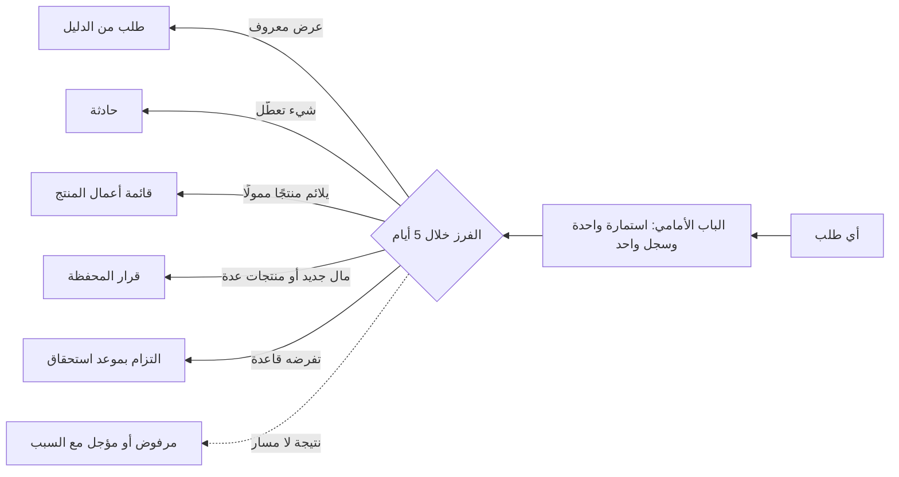

# الوحدة 4 — الطلب والمتطلبات

*حسمت الوحدة 3 أين يضع قطاع التقنية في بنك نجم ماله وفرقه. أما هذه الوحدة فتتناول ما يصل كل يوم بعد اتخاذ تلك القرارات: أفكار وطلبات وشكاوى والتزامات تنظيمية و«تغييرات صغيرة» من كل ركن في البنك. واليوم تصل هذه كلها إلى تقنية المعلومات من أبواب كثيرة، ولا يستطيع أحد أن يقول كم عددها ولا كم عمرها. وترتّب الوحدة هذا التدفق في ثلاث خطوات: باب أمامي واحد بفرز سريع وأجوبة صادقة، منها «لا»؛ ثم الطريق من طلب إلى بند في قائمة الأعمال يستطيع فريق أن يبنيه ويختبره ويتتبّعه؛ ثم متطلبات الجودة والأسس المشتركة التي لا يكتبها أحد حتى يتعطل شيء. ويترك كل درس أثرًا عمليًا: استمارة استقبال مع قواعد فرز ولوحة للطلب، وتتبّعًا لطلب واحد حتى اختباراته، وورقة لمتطلبات الجودة مع خطة للمدرج وسجل قرار.*

> **الخطوات:** Plan, Build — حوّل كل طلب إلى طلب ظاهر محسوم، ثم إلى عمل يستطيع فريق أن يبنيه ويختبره ويتتبّعه، مع متطلبات الجودة والأسس التي تُبقي تشغيله آمنًا.

---

# 4.1 — الاستقبال وإدارة الطلب: باب أمامي واحد للأفكار والطلبات
*المستوى (Level): 🟡 متوسط (Intermediate)* · *المتطلبات (Prerequisites): 1.2، 2.3، 3.2* · *الخطوة (Step): Plan*

**بعد هذا الدرس تستطيع** أن تصمّم بوابة استقبال واحدة لمجال واحد من مجالات تقنية المعلومات (استمارة لا تزيد على عشرة حقول)، وأن تكتب قواعد فرز توجّه كل طلب إلى واحد من خمسة مسارات خلال وقت محدد، وأن تدير لوحة للطلب تُظهر عمر كل بند مفتوح وحالته والقرار فيه. *مدة الدراسة: قراءة نحو 15 دقيقةً، وعمل تطبيقي نحو 100 دقيقة (تقدير).*

## ⚡ الدرس في دقيقة (In 60 seconds)
- **الطلب (demand)** هو كل ما يُطلب من تقنية المعلومات ويستهلك من طاقتها أو مالها؛ و**إدارة الطلب (demand management)** تلتقطه وتفرزه وتحسمه وتتابعه.
- يعني **الباب الأمامي (front door)** الواحد مكانًا واحدًا للطلب، وسجلًا واحدًا لكل طلب، ومجموعة واحدة من قواعد التوجيه؛ ولا يعني فريقًا واحدًا يفعل كل شيء.
- يوزّع الفرز (triage) الطلبات على خمسة مسارات: **طلب من الدليل**، و**حادثة** (incident)، و**قائمة أعمال المنتج** (product backlog)، أي ما يلائم منتجًا ممولًا، و**قرار المحفظة** (portfolio decision)، أي ما يحتاج إلى مال جديد أو فريق جديد، و**التزام** (يجب تنفيذه؛ ولا يبقى مفتوحًا إلا الكيف والمتى).
- القاعدة الأهم: **لكل طلب قرار وتاريخ، و«لا» قرار.**
- إشارة القرار: إن لم تستطع أن تقول كم طلبًا مفتوحًا لديك، وكم عمر أقدمها، ومن يملك الخطوة التالية في كل منها، فما لديك صندوق بريد.
- أكبر فخ: استمارة من أربعين حقلًا «لتحسين الجودة». فهي تدفع الناس إلى الأبواب الجانبية وتملأ السجلات بالتخمين.

## 🧭 لماذا يهم (Why it matters)
بنك نجم وقطاع التقنية فيه وكل من فيه شخصيات خيالية. وكل الأرقام عن بنك نجم في هذا الدرس أرقام توضيحية، لا معايير مرجعية.

حين سأل عمر، الرئيس التنفيذي للمعلومات، كم من العمل ينتظر، تلقّى أربعة أجوبة. أظهرت أداة الطلبات نحو 1,900 تذكرة مفتوحة، معظمها طلبات صلاحيات وبيئات (الدرس 7.1). وأدرج مكتب المشاريع 140 فكرة تنتظر دراسة جدوى. واحتفظت ريم، مديرة منتج البطاقات والمدفوعات، بقائمتها الخاصة من 60 طلبًا. وقال يوسف، رئيس عمليات تقنية المعلومات، إن فرقه تقضي «ربما يومًا في الأسبوع» على تغييرات تُطلب من المهندسين مباشرة، ولا تظهر في أي قائمة.

ولم تُظهر أي قائمة عمر الطلبات. وحين أخذت هدى، رئيسة البنية المؤسسية، عينة من 30 فكرة لدى مكتب المشاريع، كان عمر الفكرة الوسيطة سبعة أشهر، وكانت تسع منها قد اشتراها قطاع الأعمال بنفسه اشتراكاتٍ في البرمجيات كخدمة (SaaS) أثناء انتظارها. تجاهلت تقنية المعلومات قطاع الأعمال، فوجد بابًا آخر.

الطلبات التي لا تُحسم تصنع عملًا مكررًا، وتدفع قطاع الأعمال نحو أدوات لا يراها فريق المخاطر لدى نور، وتحرم نقاشات المحفظة (الوحدة 3) من البيانات. والحل ليس لجنة أكبر، بل باب أمامي سهل، وفرز سريع، وطابور ظاهر للجميع.

## 📐 كيف يعمل (How it works)

### 🟢 الأساسيات (The essentials)

**ما الذي يُعدّ طلبًا.** كل ما يستهلك طاقة تقنية المعلومات أو مالها وليس في قائمة الأعمال المتراكمة لدى فريق بعد: أفكار، وتغييرات، وتقارير، والتزامات، واستبدال أنظمة بلغت نهاية عمرها، وطلبات من خارج دليل الخدمات (service catalogue) الذي يشرحه الدرس 2.3، وطلبات تُنشئها تقنية المعلومات نفسها، مثل ترقية منصة.

**باب أمامي واحد، وخمسة مسارات.** الباب الأمامي استمارة واحدة، وسجل واحد، ورقم مرجعي واحد يتابع به صاحب الطلب طلبه. وخلفه يرسل الفرز كل طلب في واحد من خمسة مسارات:

| المسار | الاختبار | إلى أين يذهب | من يقرر |
|---|---|---|---|
| **طلب من الدليل** | نقدّم هذا أصلًا بطريقة معروفة | تلبية الطلبات (request fulfilment)، انظر الدرس 7.1 | الوصفة المعتمدة؛ لا حاجة إلى قرار آخر |
| **حادثة** | شيء كان يعمل وتوقف | العمليات (الدرس 8.1) | العمليات، فورًا |
| **قائمة أعمال المنتج** | يلائم غرض منتج ممول وميزانيته | قائمة أعمال ذلك المنتج (الدرس 4.2) | مدير المنتج |
| **قرار المحفظة** | يحتاج إلى مال جديد أو فريق جديد، أو يمتد على عدة منتجات | دورة المحفظة (الدروس 3.1–3.3) | منتدى المحفظة |
| **التزام** | يفرضه قانون أو جهة رقابية أو مدقق أو عقد | المنتج المالك، مع موعد استحقاق | المخاطر تؤكد الالتزام؛ ومالك المنتج يخطط للكيف |

لا يلزم صاحب الطلب أن يعرف المسار؛ فهذه مهمة الفرز.

**استمارة الاستقبال: قصيرة عن قصد.** اسأل فقط عمّا يحتاجه الفرز؛ ويستطيع المسار المستقبِل أن يسأل عن المزيد. عشرة حقول على الأكثر:

1. ماذا تريد أن تستطيع فعله، ولمن؟
2. ماذا يحدث اليوم من دونه؟
3. أي مجال أعمال وأي منتج، إن كنت تعرف؟
4. هل تفرضه جهة رقابية أو مدقق أو قانون أو عقد؟ اذكر المرجع.
5. هل هناك تاريخ مهم، ولماذا؟
6. كم يساوي تقريبًا؟ (نطاق أو «لا أعرف»؛ الدرس 3.2)
7. هل يمسّ بيانات العملاء أو بيانات شخصية؟
8. هل تستخدم أداة لهذا الغرض حاليًا؟
9. من الراعي الذي يستطيع أن يقرر؟
10. اسمك (يُملأ تلقائيًا من تسجيل الدخول)

يكشف الحقل 8 عن تقنية المعلومات الظلية (shadow IT)، أي التقنية المستخدمة دون علم تقنية المعلومات، من غير لوم.

**لكل طلب قرار وتاريخ.** انشر وعدين: **وقت الإقرار** (رقم مرجعي وشخص مسمّى يتولى الفرز، مثلًا خلال يوم عمل واحد) و**وقت الفرز** (الطلب على مسار له مالك مسمّى، مثلًا خلال خمسة أيام عمل). ويجوز لقرار المحفظة أن ينتظر المراجعة الفصلية، بشرط أن يُبلَّغ صاحب الطلب بذلك في اليوم الخامس. أما الصمت فغير مقبول.

**«لا» و«ليس الآن» قراران.** ينتهي كل طلب إلى واحدة من خمس نتائج: أُنجز، أو وُجّه إلى قائمة أعمال، أو دُمج مع طلب مشابه، أو رُفض مع السبب، أو أُجّل مع تاريخ مراجعة. والرفض والتأجيل نتيجتان للفرز، لا مسار سادس. ويقول الرفض لماذا («بوابة مدفوعات الشركات تفعل هذا أصلًا؛ وهذه طريقة الحصول على صلاحية الدخول إليها») وما الذي قد يغيّر الجواب. و«لا» واضحة خير من «ربما» لا تنتهي.

### 🟡 التعمق أكثر (Going deeper)

**لوحة الطلب.** بطاقة لكل طلب، في أعمدة بحسب الحالة: **جديد**، و**فرز**، و**تشكيل** (قيد التوضيح أو التقدير)، و**بانتظار القرار**، و**محسوم**. وتُظهر كل بطاقة المسار، ومالك الخطوة التالية، و**عمر** الطلب بالأيام. رتّب بحسب العمر، لا بحسب من رفع صوته أكثر. وثلاثة مقاييس تستحق نظرة شهرية:

| المقياس | ماذا يخبرك | علامة التحذير |
|---|---|---|
| **الطلبات المفتوحة بحسب الحالة والعمر** | أين يعلق الطلب | طلبات تجاوزت وعدها |
| **الوارد مقابل المحسوم** | هل يواكب الباب الأمامي ما يصله | ما يصل أكثر مما يُحسم |
| **حصة الأبواب الجانبية** | هل يثق الناس بالباب الأمامي | طلبات مباشرة إلى المهندسين؛ أدوات تُشترى أولًا |

**لماذا يبطئ الطابور الطويل كل شيء.** ينص قانون ليتل (Little's Law)، الذي نشره John D. C. Little في مجلة *Operations Research* عام 1961، على أن متوسط عدد البنود في نظام مستقر يساوي معدل الوصول مضروبًا في متوسط الوقت الذي يقضيه كل بند فيه. وبلغة المدير: عند معدل حسم ثابت، كلما زاد عدد الطلبات المعلّقة لديك، طال انتظار كل منها. فإذا كانت لديك 140 فكرة تُحسم بمعدل 20 تقريبًا في الشهر، فالانتظار نحو سبعة أشهر (أرقام توضيحية). ورفض الطلبات القديمة الراكدة أو تأجيلها أسرع طريق لتقصير الانتظار على الطلبات المهمة.

**حدّد سقفًا للعمل قيد التشكيل.** يحتاج التشكيل، أي التوضيح والتقدير وتقدير كلفة التأخير (cost of delay)، إلى أشخاص قليلين ومطلوبين. ضع له سقفًا، مثلًا طلبين لكل مدير منتج، كي ينتظر الطلب التالي انتظارًا ظاهرًا بدل أن يُعمل في اثني عشر طلبًا نصف عمل.

**الأولويات المستقرة تحمي التدفق.** يُذكر أن الملخص التنفيذي لتقرير DORA لعام 2024 (DevOps Research and Assessment، وهو برنامج بحثي أصبح جزءًا من Google Cloud) يقول إن عدم استقرار الأولويات في المؤسسة أدى إلى انخفاض ملموس في الإنتاجية وزيادة كبيرة في الاحتراق الوظيفي. ويصوغ إعلان Google Cloud الفكرة بطريقة أخرى: هذا الاضطراب «يمكن أن يعيق التقدم إعاقة كبيرة»، حتى مع قيادة قوية وتوثيق جيد. والباب الأمامي يساعد هنا: تدخل الطلبات من نقطة واحدة وتُحسم بإيقاع معروف، لا في منتصف الأسبوع.

**الفرز دور لا لجنة.** يوجّه أشخاص مسمّون للفرز، بقواعد مكتوبة، معظم الطلبات في دقائق؛ وتذهب الحالات الصعبة إلى اجتماع أسبوعي قصير مع البنية والمخاطر والمالية. أما مجلس شهري ينظر في كل طلب فيحوّل وعد الأيام الخمسة إلى ثلاثين يومًا.

### 🔴 نظرة الخبير (Expert view)

**تشكيل الطلب لا كبته.** الهدف طلبات أفضل، لا طلبات أقل: ساعد صاحب الطلب على وصف نتيجة لا حل («مدفوعات الموردين تفشل في نهاية الشهر»، لا «نحتاج إلى نظام مدفوعات جديد»)، وابحث عمّا هو موجود، وادمج الطلبات المتشابهة. ووجد فريق هدى أن ثلث الأفكار في العينة تنويعات على خمس حاجات فقط (رقم توضيحي).

**مالك واحد، والذكاء الاصطناعي مساعد فقط.** اجعل للباب الأمامي مالكًا واحدًا له مقاييسه؛ فمن دونه تُضاف الحقول وتتراخى الوعود. ويستطيع نموذج لغوي أن يقترح مسارًا أو يكتشف الطلبات المكررة، لكن شخصًا مسمّى للفرز يقبل كل اقتراح، وفريق نور يقرر أي نص من نصوص الطلبات يجوز إرساله إلى نموذج خارجي (الدرس 11.3).

**الالتزامات تستحق مسارًا خاصًا بها.** للطلبات التنظيمية وطلبات التدقيق موعد ثابت ونطاق يحدده طرف خارجي. سجّل المصدر، واطلب من وظيفة المخاطر أن تؤكد ما يقتضيه، ثم وجّهه إلى المنتج المالك مع إظهار موعد الاستحقاق. وحين يتضمن الطلب ذكاءً اصطناعيًا، أضف أسئلة الاستقبال الخاصة به من [*حوكمة الذكاء الاصطناعي: من الصفر إلى الاحتراف*، الدرس 8.1 — استقبال حالات الاستخدام ودراسة الجدوى وتحديد مستوى المخاطر](../aigp/index.ar.html#/8.1).

## 🧰 الأدوات (The toolkit)
| المصدر أو الأداة أو القالب (Resource, tool or template) | ما هو وماذا يفعل (What it is and does) | متى تلجأ إليه (When to reach for it) |
|---|---|---|
| **Intake form** — استمارة الاستقبال | عشرة حقول على الأكثر؛ سجل طلب واحد لكل طلب | كلما أراد أحد أن تفعل تقنية المعلومات شيئًا جديدًا |
| **Triage rules** — قواعد الفرز | جدول من صفحة واحدة يرسل كل طلب إلى واحد من خمسة مسارات | لكل طلب، ضمن وعد الفرز |
| **Demand board** — لوحة الطلب | الطلب المفتوح بحسب الحالة والمسار ومالك الخطوة التالية والعمر | الاجتماع الأسبوعي؛ والمراجعة الشهرية مع الرئيس التنفيذي للمعلومات |
| **Decline note** — مذكرة الرفض | القرار، وسببه، والبديل الموجود، وما الذي قد يغيّره | مع كل رفض أو تأجيل |
| **Service management or work-tracking platform** — منصة إدارة الخدمات أو تتبّع العمل | تحفظ سجلات الطلب واللوحة | بعد أن تنجح الاستمارة والقواعد واللوحة على الورق |

الأدوات المذكورة فئات؛ وأي منتج يُذكر مثال، لا تزكية.

## 🏛️ عمليًا في بنك نجم (In practice at Najm Bank)
أجرت هدى وريم تجربة تشغيلية للباب الأمامي في قطاعي الأفراد والبطاقات مدة ربع سنة. مثال توضيحي خيالي:

> **الباب الأمامي لبنك نجم، التجربة التشغيلية للأفراد والبطاقات (الإصدار 1)**
> - **الاستمارة:** تسعة حقول (حُذف حقل القيمة بعد أن أظهرت التجربة أن معظم أصحاب الطلبات كتبوا «لا أعرف»؛ ويقدّرها مديرو المنتجات أثناء التشكيل).
> - **الوعود:** الإقرار خلال يوم عمل واحد؛ والطلب على مسار له مالك مسمّى خلال خمسة أيام عمل؛ وبنود المحفظة تُبلَّغ بموعد المراجعة الفصلية التالية.
> - **القائمون على الفرز:** مدير واحد لإدارة الطلب، ومدير منتج مناوب؛ واجتماع أسبوعي مدته 30 دقيقة مع هدى وطارق وفريق نور.
> - **سقف التشكيل:** طلبان لكل مدير منتج.
> - **اللوحة:** خمسة أعمدة؛ تُظهر البطاقات العمر بالأيام؛ وكل ما تجاوز وعده يظهر باللون الأحمر.

في اليوم الأول حملت اللوحة 212 طلبًا: نصيب الأفراد والبطاقات من القوائم القديمة (وبقيت تذاكر الصلاحيات الروتينية لدى تلبية الطلبات). ووجّهت الجولة الأولى 41 طلبًا بوصفها طلبات من الدليل، و9 بوصفها حوادث، و63 إلى قوائم أعمال المنتجات، و18 إلى المحفظة، و7 بوصفها التزامات؛ ودُمج 22، ورُفض أو أُجّل 52 مع السبب (كلها أرقام توضيحية). وجاء الخطأ الأول سريعًا: واصل فريق يوسف قبول طلبات التغيير من مديري الفروع بالهاتف. وبدل منع ذلك، طلبت هدى منهم أن يسجّلوا كل مكالمة في الباب الأمامي والمتصل ما زال على الخط، وهذا يستغرق دقيقتين. وبعد شهرين كان نحو 90 طلبًا مفتوحًا، ولم يتجاوز أي منها وعده.

## 🛠️ التمارين (Exercises)
**🟢 ارسم خريطة أبوابك.** لمجال واحد من مجالات تقنية المعلومات، اذكر كل طريق يصل به طلب إلى فريق اليوم (استمارات، بريد إلكتروني، لجان توجيه، محادثات، أحاديث الممرات)، مع العدد التقديري للطلبات شهريًا، وهل تُسجَّل أم لا.
*يكتمل عندما (Done when):* يسرد جدولٌ خمسة أبواب على الأقل مع حجمها وخانة «مسجّل» بنعم أو لا، وكل باب موسوم بـ: يُغلق، أو يُبقى، أو يُعاد توجيهه.

الإجابة النموذجية والتحقق الذاتي

**الإجابة النموذجية.** مثلًا (توضيحي): أداة الطلبات (نحو 600 شهريًا، مسجّلة، تُبقى أساسًا)؛ وقناة مكتب المشاريع (نحو 10، في جدول بيانات، تُدمج)؛ ورسائل البريد إلى مدير المنتج (نحو 30، غير مسجّلة، يُعاد توجيهها)؛ والطلبات الموجّهة مباشرة إلى المهندسين (ربما 40، غير مسجّلة، يُعاد توجيهها بقاعدة الدقيقتين)؛ وإجراءات لجنة التوجيه (نحو 5، في المحاضر، يُسجَّل كل منها). **التحقق الذاتي.**
- هل كل حجم تقدير مع أساسه؟
- هل هناك باب واحد بالضبط ستُبقيه بابًا أماميًا؟

**🟡 اكتب الاستمارة وقواعد الفرز.** صُغ استمارة استقبال (عشرة حقول على الأكثر) وجدول فرز بخمسة مسارات، لكل مسار اختباره ومن يقرر فيه. ثم وجّه به عشرة طلبات حقيقية حديثة.
*يكتمل عندما (Done when):* يقع كل طلب على مسار واحد بالضبط، وتكون قد دوّنت أي طلب عجزت القواعد عن تصنيفه وكيف عدّلتها، وتنص الاستمارة على وقت للإقرار ووقت للفرز مع شخص مسمّى للفرز.

الإجابة النموذجية والتحقق الذاتي

**الإجابة النموذجية.** في العادة يصبح نحو النصف طلبات من الدليل أو بنودًا في قوائم الأعمال، وقلة منها قرارات محفظة أو التزامات، ويُدمج بعضها أو يُرفض. وتعد الاستمارة بالإقرار خلال يوم عمل واحد وبالفرز خلال خمسة، على يد شخص مسمّى. ومن التعديلات الشائعة على القواعد: «إذا مسّ أكثر من منتج واحد، فهو قرار محفظة»، و«إذا ذُكر مرجع لجهة رقابية أو مدقق، تؤكد المخاطر خلال خمسة أيام». **التحقق الذاتي.**
- هل يستطيع شخص من خارج تقنية المعلومات أن يملأ الاستمارة في أقل من خمس دقائق؟
- هل لكل مسار اختبار يطبّقه القائم على الفرز دون اجتماع؟
- هل يسمّي كل مسار من يقرر، لا إلى أين يذهب الطلب فقط؟

**🔴 ابنِ اللوحة وقِس الطابور.** أنشئ لوحة طلب لمجال واحد (يكفي جدول بيانات) بالحالات الخمس ومالك الخطوة التالية والعمر. حمّل الطلبات المفتوحة، واحسب المقاييس الثلاثة، واستخدم قانون ليتل لتقدير متوسط الانتظار عند معدل الحسم الحالي.
*يكتمل عندما (Done when):* تحمل اللوحة كل طلب مفتوح مع عمره، وتُكتب المقاييس الثلاثة بأرقامها، ويكون لديك مقترح في فقرة واحدة يحدد كم طلبًا تُرفض أو تؤجَّل الآن وما الانتظار الذي ينتج عن ذلك.

الإجابة النموذجية والتحقق الذاتي

**الإجابة النموذجية.** مثلًا: 140 طلبًا مفتوحًا بمعدل حسم نحو 20 في الشهر تعني انتظارًا يقارب سبعة أشهر (توضيحي). ورفض 60 طلبًا راكدًا أو تأجيلها يخفضه إلى نحو أربعة أشهر؛ ورفض تلك الستين أو تأجيلها ثم حسم 30 طلبًا في الشهر يخفضه إلى أقل من ثلاثة. **التحقق الذاتي.**
- هل ذكرت أن التقدير يفترض توازنًا تقريبيًا بين الوارد والمحسوم، وأن الانتظار يطول إن لم يتوازنا؟
- هل يُقاس العمر من أول رفع للطلب، لا من دخوله لوحتك؟
- هل يُبلغ مقترحك أصحاب الطلبات بما حدث لطلباتهم؟

## ⚠️ أخطاء وفخاخ (Mistakes and traps)
- **استمارة تستجوب.** اسأل فقط عمّا يحتاجه الفرز؛ ودع التشكيل يجمع الباقي.
- **الفرز عبر لجنة.** سمِّ القائمين على الفرز واكتب القواعد؛ واحتفظ بالاجتماع للحالات الصعبة.
- **لوحة بلا عمر.** الطلبات الصاخبة تتحرك والهادئة تتعفن. أظهر العمر، وراجع الأقدم أولًا.
- **ألّا تقول «لا» أبدًا.** ارفض أو أجّل مع سبب وتاريخ مراجعة.
- **معاملة الالتزامات كأنها اختيارية.** تحتاج الطلبات التنظيمية وطلبات التدقيق إلى مسار خاص، ومصدر مؤكد، وموعد استحقاق ظاهر.

## 🧾 الخلاصة (Recap)
- باب أمامي واحد، وسجل واحد لكل طلب، وفرز إلى خمسة مسارات: طلب من الدليل، وحادثة، وقائمة أعمال المنتج، وقرار المحفظة، والتزام.
- انشر وعدي الإقرار والفرز؛ فلكل طلب قرار وتاريخ، و«لا» واحد منها.
- أدِر لوحة طلب مرتبة بحسب العمر؛ وراقب الطلبات المفتوحة، والوارد مقابل المحسوم، وحصة الأبواب الجانبية.
- شكّل الطلب في صورة نتائج، وادمج المكرر، واجعل شخصًا مسمّى للفرز مساءلًا عن اقتراحات الذكاء الاصطناعي.

## ✍️ اختبر نفسك (Check yourself)
**1. يطلب مدير فرع من فريق يوسف تقريرًا جديدًا تقدّمه خدمة التقارير أصلًا بصيغة قياسية. وفق الفرز إلى خمسة مسارات، إلى أين ينبغي أن يذهب الطلب؟**

- A. إلى منتدى المحفظة، لأن الطلب رفعته وحدة أعمال وليس تقنية المعلومات.
- B. إلى تلبية الطلبات، لأنه عرض قائم يُقدَّم ويُسلَّم بطريقة معروفة.
- C. إلى قائمة أعمال منتج التقارير، بوصفه تغييرًا صغيرًا على تقرير قائم.
- D. إلى مسار الالتزامات، لأن تقارير الفروع كثيرًا ما يراجعها المدققون.

الإجابة

**B.** التقرير معروض أصلًا بصيغة قياسية، فهو طلب من الدليل. وC مغرية، لكن مسار قائمة الأعمال مخصص لتغييرات على منتج، وهذا الطلب لا يحتاج إلى أي تغيير. وA للمال الجديد، وD تحتاج إلى قاعدة مؤكدة لا إلى تخمين. (انظر «باب أمامي واحد، وخمسة مسارات».)

**2. يحسم منتدى المحفظة في بنك نجم نحو 20 فكرة في الشهر، وتنتظر 160 فكرة. كم تنتظر الفكرة الجديدة في المتوسط تقريبًا، وما أسرع طريق لتقصير هذا الانتظار؟**

- A. نحو شهرين؛ أضف حقولًا إلى الاستمارة كي تصل كل فكرة أفضل إعدادًا.
- B. نحو ثلاثة أشهر؛ اطلب من الرعاة إعادة تقديم كل فكرة في الدورة السنوية التالية.
- C. نحو خمسة أشهر؛ اطلب من المنتدى أن يجتمع أقل وأن يراجع قوائم أطول.
- D. نحو ثمانية أشهر؛ ارفض الأفكار الراكدة أو أجّلها كي ينتظر عدد أقل في الطابور.

الإجابة

**D.** وفق قانون ليتل، 160 فكرة تنتظر بمعدل 20 في الشهر تعني نحو ثمانية أشهر. والحقول الإضافية (A) تبطئ الاستقبال، والدورة السنوية (B) تطيل الانتظار، وقلة الاجتماعات (C) تخفض معدل الحسم. (انظر «لماذا يبطئ الطابور الطويل كل شيء».)

**3. يقترح طارق استمارة استقبال إلزامية من 35 حقلًا «كي تحصل المالية على بيانات كاملة لدراسة الجدوى». ما الخطر الرئيسي؟**

- A. يعود الناس إلى الأبواب الجانبية ويملؤون الحقول الإلزامية تخمينًا.
- B. ستُظهر لوحة الطلب بطاقات أقل من أن تفيد في المراجعة الشهرية للطلب.
- C. يصبح وعد الفرز مستحيلًا لأن الاستمارات تصل بسرعة تفوق طاقة الفرز.
- D. لا يعود ممكنًا تمييز الالتزامات من الطلبات من الدليل عند الفرز.

الإجابة

**A.** الاستمارة الثقيلة تنفّر من استخدام الباب الأمامي وتملؤه بالتخمين؛ وتفاصيل دراسة الجدوى مكانها التشكيل. أما B وC فتعكسان الأثر المرجّح، وD لا تترتب على ذلك: حقل واحد يكفي لاكتشاف الالتزامات. (انظر «استمارة الاستقبال: قصيرة عن قصد».)

**4. يتلقى فريق نور ملاحظة تدقيق تفرض تعزيز السجلات في نظام إجازة البطاقات بحلول تاريخ ثابت. كيف ينبغي أن يتعامل الباب الأمامي معها؟**

- A. بوصفها قرار محفظة يُرتَّب مقابل الأفكار الأخرى في المراجعة الفصلية التالية.
- B. بوصفها طلبًا من الدليل، لأن السجلات عرض قياسي على المنصة أصلًا.
- C. بوصفها التزامًا يوجَّه إلى المنتج المالك، مع إظهار المصدر وموعد الاستحقاق.
- D. بوصفها طلبًا مؤجلًا، إلى أن يؤكد راعي الأعمال أن قيمته تستحق العناء.

الإجابة

**C.** ملاحظة التدقيق ذات التاريخ الثابت التزام؛ ولا يبقى مفتوحًا إلا الكيف والمتى. والترتيب (A) أو التأجيل (D) يعرّض التاريخ للخطر، وB تفترض أن عرضًا قياسيًا يغطي ملاحظة محددة. (انظر «الالتزامات تستحق مسارًا خاصًا بها».)

**5. يكتشف سامي أن مهندسي منصته يتلقون نحو 30 طلبًا شهريًا من فرق المنتجات عبر أداة المحادثة، ولا يصل أي منها إلى لوحة الطلب. ماذا يفعل أولًا؟**

- A. يطلب من المهندسين الرد على طلبات المحادثة برابط استمارة الاستقبال فقط.
- B. يوقف طلبات المحادثة حتى يراجع اجتماع الفرز الأسبوعي كل واحد منها.
- C. يتوقف عن عدّ طلبات المحادثة، لأن معظمها صغير وينتهي سريعًا على أي حال.
- D. يمكّن المهندسين من تحويل رسالة المحادثة إلى سجل طلب بإجراء واحد.

الإجابة

**D.** يلجأ الناس إلى الباب الجانبي لأنه أسرع؛ والحل أن يصبح التسجيل بالسرعة نفسها، فيظهر الطلب دون إبطاء صاحبه. أما A فتصرف أصحاب الطلبات وتدفعهم إلى أبواب أخرى، وB تجعل الباب الأمامي أبطأ من المحادثة التي يحل محلها، وC تخفي طلبًا ينبغي أن تُظهره اللوحة. (انظر حصة الأبواب الجانبية و«عمليًا في بنك نجم».)

## 📚 المراجع (References)
فُتحت تدوينة Google Cloud؛ أما الصفحات الأخرى فتعذّر فتحها من هذه البيئة، والحقائق المأخوذة منها كما وردت في ملخصات نتائج البحث.
- مدونة Google Cloud، «Announcing the 2024 DORA report»، أكتوبر 2024: https://cloud.google.com/blog/products/devops-sre/announcing-the-2024-dora-report — العبارة المقتبسة عن عدم استقرار الأولويات (فُتحت الصفحة).
- DORA، *2024 Accelerate State of DevOps Report* (ملف PDF): https://services.google.com/fh/files/misc/2024_final_dora_report.pdf — صياغة الملخص التنفيذي عن الإنتاجية والاحتراق الوظيفي، كما وردت في ملخصات نتائج البحث.
- Little, J. D. C., "A Proof for the Queuing Formula: L = λW", *Operations Research* 9(3), 1961, pp. 383–387, doi:10.1287/opre.9.3.383 (السجل الببليوغرافي: https://ideas.repec.org/a/inm/oropre/v9y1961i3p383-387.html).
- من المكتبة: [*حوكمة الذكاء الاصطناعي: من الصفر إلى الاحتراف*، الدرس 8.1 — استقبال حالات الاستخدام ودراسة الجدوى وتحديد مستوى المخاطر](../aigp/index.ar.html#/8.1) (الاستقبال لحالات استخدام الذكاء الاصطناعي).

---

# 4.2 — من المتطلب إلى قائمة الأعمال، مع التتبّع
*المستوى (Level): 🟡 متوسط (Intermediate)* · *المتطلبات (Prerequisites): 2.1، 4.1* · *الخطوة (Step): Plan, Build*

**بعد هذا الدرس تستطيع** أن تقسّم طلبًا محسومًا إلى نتيجة وميزات وبنود في قائمة الأعمال لها معايير قبول قابلة للاختبار، وأن تضع فحصين مشتركين لـ«الجاهزية» و«الإنجاز» لفريق منتج، وأن تسجّل الحد الأدنى من الروابط التي تتبّع أي متطلب حتى اختباراته وإصداره، وتثبت ذلك باختبار تتبّع لخمسة بنود. *مدة الدراسة: قراءة نحو 15 دقيقةً، وعمل تطبيقي نحو 110 دقائق (تقدير).*

## ⚡ الدرس في دقيقة (In 60 seconds)
- **المتطلب (requirement)** يحدد شيئًا يجب أن يفعله المنتج أو صفة يجب أن يتحلى بها. و**قائمة الأعمال المتراكمة (backlog)** هي القائمة المرتبة للعمل الذي سينجزه فريق المنتج تاليًا. والحرفة أن تحوّل الأول إلى الثانية دون أن تضيع «لماذا».
- اعمل على أربعة مستويات: **النتيجة** (التغيير الذي نريده)، و**الميزة** (قدرة تخدم النتيجة)، و**بند قائمة الأعمال** (شريحة ينهيها الفريق في أيام)، و**معايير القبول (acceptance criteria)**، أي الفحوص التي تقول إنه أُنجز.
- **التتبّع (traceability)** يعني أن تتبع المتطلب إلى الأمام حتى العمل والاختبارات والإصدار الذي حققه، وإلى الخلف من أي تغيير حتى المتطلب الذي وراءه.
- القاعدة الأهم: **سجّل الرابط لحظة العمل، لا بعده.** الرابط الذي يُسجَّل أثناء العمل يكلّف ثواني؛ والرابط الذي يُعاد بناؤه من أجل تدقيق يكلّف أسابيع.
- إشارة القرار: إن لم تستطع أن تتتبّع خمسة متطلبات عشوائية حتى البنود والاختبارات والإصدار في عشر دقائق، فالتتبّع لديك وثيقة، لا خاصية في سجلاتك.
- أكبر فخ: وثيقة متطلبات من 200 صفحة تُكتب مقدمًا، ولا يمكن تتبّعها إلا إلى نفسها.

## 🧭 لماذا يهم (Why it matters)
بنك نجم وقطاع التقنية فيه وكل من فيه شخصيات خيالية. وكل الأرقام عن بنك نجم في هذا الدرس أرقام توضيحية، لا معايير مرجعية.

بعد ستة أسابيع من إطلاق فريق ريم ميزة تجميد البطاقة في تطبيق الجوال، سأل المدققون الداخليون في البنك: «أرونا المتطلب الذي ينص على أن البطاقة المجمّدة يجب أن ترفض المدفوعات، والاختبار الذي أثبت ذلك، والإصدار الذي أدخله إلى بيئة الإنتاج.» كان الفريق قد اختبر بعناية. لكن المتطلب كان في عرض شرائح من ورشة عمل، والاختبار واحد من 1,400 اختبار آلي بأسماء مثل `test_freeze_03`، وملاحظات الإصدار تقول «تحسينات على تجميد البطاقة». واحتاجت نور، مسؤولة مخاطر وضوابط تقنية المعلومات، ومعها مهندسان، أربعة أيام لتجميع الدليل من سجلات الإيداع ومن الذاكرة.

ثم وقعت حادثة: بعض البطاقات المجمّدة ظلت تعمل لدى نوع واحد من التجار. وسأل مراجع الحادثة من الطرف الآخر: «أي متطلب كان يغطي هذه الحالة، وهل اختُبرت؟» ولم يستطع أحد أن يقول هل الخلل في المتطلب أم في الاختبارات أم في الشيفرة.

في بنك خاضع للرقابة تأتي هذه الأسئلة كل أسبوع. والعجز عن إجابتها يكلّف وقت كبار الموظفين، وملاحظات تدقيق، وحوادث لا يتعلم منها أحد. ويجعل هذا الدرس السلسلة جزءًا من العمل اليومي، بتكلفة زهيدة.

## 📐 كيف يعمل (How it works)

### 🟢 الأساسيات (The essentials)

**أربعة مستويات، وسلسلة واحدة.** قسّم الطلب المحسوم (الدرس 4.1) إلى أربعة مستويات، يرتبط كل منها بالمستوى الذي فوقه:

| المستوى | ماذا يحدد | مثال (تجميد البطاقة) | من يملكه |
|---|---|---|---|
| **النتيجة** | التغيير الذي نريده، مع مقياس | مكالمات أقل لمركز الاتصال لإيقاف بطاقة ضائعة | مدير المنتج، مع راعي الأعمال |
| **الميزة** | قدرة تخدم النتيجة | يستطيع العملاء تجميد البطاقة وإلغاء تجميدها في التطبيق | مدير المنتج |
| **بند قائمة الأعمال** | شريحة من الميزة ينهيها الفريق في أيام قليلة | البطاقة المجمّدة ترفض كل دفعة جديدة: عبر الإنترنت، وفي المتجر، وفي أجهزة الصراف الآلي | فريق المنتج |
| **معايير القبول** | فحوص تحسم هل أُنجز البند | بافتراض بطاقة مجمّدة، عندما تُجرى دفعة في متجر، فإنها تُرفض بسبب «البطاقة مجمّدة» (معيار واحد لكل قناة دفع) | فريق المنتج، بالاتفاق مع مدير المنتج |

النتيجة تقول لماذا، والميزة ماذا، والبند ما التالي، والمعايير كيف سنعرف.

**قائمة الأعمال.** يُذكر أن دليل Scrum لعام 2020 (Scrum Guide)، وهو التعريف العام الموجز لإطار Scrum الذي وضعه Ken Schwaber وJeff Sutherland، يصف قائمة أعمال المنتج بأنها «قائمة ناشئة ومرتبة بما يلزم لتحسين المنتج». ولا يلزمك استخدام Scrum كي تستفيد من الفكرة. **ناشئة** تعني أنها تتغير كلما تعلمت؛ و**مرتبة** تعني أن بندًا واحدًا هو الأول، لا اثنا عشر بندًا موسومة «عالية». ومدير المنتج يملك الترتيب، مستنيرًا بكلفة التأخير (cost of delay) التي يشرحها الدرس 3.2.

**بنود جيدة في قائمة الأعمال.** قائمة INVEST التي وضعها Bill Wake (2003) اختبار شائع لبنود قائمة الأعمال: **مستقل** (Independent)، و**قابل للتفاوض** (Negotiable)، و**ذو قيمة** (Valuable)، و**قابل للتقدير** (Estimable)، و**صغير** (Small)، و**قابل للاختبار** (Testable). وأهمها للمدير **صغير** و**قابل للاختبار**. وتكتب فرق كثيرة قصص مستخدمين (user stories) من قبيل: «بصفتي حامل بطاقة، أريد أن أجمّد بطاقتي، كي لا يستخدمها أحد بينما أبحث عنها». والصيغة اختيارية؛ أما «كي» فليست اختيارية، لأنها تربط البند بالنتيجة.

**معايير قبول يمكن فحصها.** من الصيغ المفيدة، وقد روّج لها Dan North وآخرون في التطوير الموجَّه بالسلوك (BDD)، صيغة **Given** (الوضع الابتدائي)، و**When** (الحدث)، و**Then** (النتيجة المتوقعة). يستطيع الجميع قراءتها، ويمكن أن يصبح كل معيار اختبارًا آليًا. قارن:

| معيار ضعيف | معيار قابل للفحص |
|---|---|
| يجب أن يعمل التجميد كما ينبغي | بافتراض بطاقة نشطة، عندما ينقر العميل «تجميد»، فإن حالة البطاقة تصبح «مجمّدة» خلال 5 ثوانٍ |
| يجب أن تكون البطاقات المجمّدة آمنة | بافتراض بطاقة مجمّدة، عندما تُجرى دفعة دون حضور البطاقة (عبر الإنترنت أو الهاتف، دون استخدام البطاقة فعليًا)، فإنها تُرفض بسبب «البطاقة مجمّدة» |
| يجب أن يكون إلغاء التجميد سهلًا | بافتراض بطاقة مجمّدة، عندما ينقر العميل «إلغاء التجميد» ويؤكد برمز التطبيق، فإن البطاقة تعود نشطة |

الثواني الخمس رقم توضيحي. ولجانب المختبِر، انظر [*اختبار البرمجيات*، الدرس 1.3 — المتطلبات وحالات الاختبار وتقارير العيوب: من معايير القبول إلى عيب يستطيع أحدهم إصلاحه](../testing/index.ar.html#/1.3).

**«الجاهزية» و«الإنجاز».** فحصان مشتركان:

- **الجاهزية** (قبل بدء العمل): «كي» مربوطة بميزة، ومعايير قبول، وعلامات للبيانات أو المخاطر، ولا اعتماد مجهول على طرف آخر. ولا يعرّف دليل Scrum «تعريفًا للجاهزية»؛ فإن استخدمت واحدًا فاجعله قصيرًا، وإلا صار بوابة.
- **الإنجاز** (قبل أن يُحتسب البند منتهيًا): يُذكر أن دليل Scrum لعام 2020 يصف **تعريف الإنجاز** (Definition of Done) بأنه «وصف رسمي لحالة الزيادة حين تستوفي مقاييس الجودة المطلوبة للمنتج»؛ والزيادة (Increment) هي القطعة القابلة للاستخدام التي يضيفها العمل إلى المنتج. وصيغة بنك نجم أدناه.

### 🟡 التعمق أكثر (Going deeper)

**لماذا التتبّع.** ثلاثة قرّاء، وثلاثة اتجاهات:

| القارئ | سؤاله | الاتجاه |
|---|---|---|
| **المدقق أو الجهة الرقابية** | هل استُوفيت هذه القاعدة واختُبرت واعتُمدت؟ | من المتطلب إلى الأمام: الاختبارات والاعتماد والإصدار |
| **مراجع الحادثة** | هل كان هذا السلوك مقصودًا؟ | من التغيير إلى الخلف: البند والمتطلب |
| **مدير المنتج أو الراعي** | هل حقق العمل الممول النتيجة؟ | من النتيجة إلى الأمام: الإصدارات والمقاييس |

**الحد الأدنى المجدي من التتبّع.** أربعة روابط، يسجّل كلًا منها من يلمس العمل أصلًا:

1. **من بند قائمة الأعمال إلى الميزة والنتيجة**: يُضبط عند إنشاء البند (حقل الأصل في أداة تتبّع العمل).
2. **من معيار القبول إلى الاختبار**: لكل معيار مفتاحه الخاص، وهو مفتاح البند مع رقم (مثلًا `CARDS-412-AC2`)، ويحمله وسم الاختبار، ويُضبط عند كتابة الاختبار. فمفاتيح البنود وحدها لا تُظهر أي معيار يفتقر إلى اختبار.
3. **من تغيير الشيفرة إلى بند قائمة الأعمال**: مفتاح البند في رسالة الإيداع أو طلب الدمج، ويتحقق منه خط النشر (pipeline).
4. **من الإصدار إلى بنود قائمة الأعمال**: يسرد سجل الإصدار مفاتيح بنوده، مولَّدة من الإيداعات.

عندها يجيب استعلام واحد المدقق في دقائق. ويوسّع الدرس 9.3 المعرّفات من الاستثمار حتى الحادثة؛ ويغطي [*دليل عملي لتصبح مهندسًا أصيلًا في الذكاء الاصطناعي*، الدرس 3.1 — التطوير الموجَّه بالمواصفات: من التذكرة إلى معايير القبول والقيود وما ليس من الأهداف وخطة](../ainative/index.ar.html#/3.1) جانب المهندس.

**المتطلبات التنظيمية ومتطلبات الجودة في قائمة الأعمال نفسها.** إذا حُفظت الالتزامات ومتطلبات الجودة (الدرس 4.3) في وثائق منفصلة فإنها تُنسى. ضعها حيث يعمل الفريق: بنودًا في قائمة الأعمال للعمل الذي يُنجز مرة واحدة (إضافة سجل تدقيق)، أو قيودًا في تعريف الإنجاز أو على ميزة (زمن الاستجابة). ووسم كلًا منها بمصدره. وحيث يحتاج التزام إلى **مصفوفة تتبّع** (traceability matrix)، أي كل فقرة من النص التنظيمي مقابل البنود والاختبارات، ولّدها من الروابط، واسأل فريق نور عن شكل الدليل المتوقع (الدرس 9.3).

### 🔴 نظرة الخبير (Expert view)

**مستوى التفصيل خيار.** تتبّع كل سطر من الشيفرة يكلّف أكثر مما يعود به. تتبّع حيث تهم القرارات والأدلة: من النتيجة إلى الميزة من أجل التمويل، ومن البند إلى الاختبار والإصدار من أجل التدقيق والحوادث. واتفق على المستويات لكل منتج مع هدى ونور.

**المتطلبات تتقادم؛ والاختبارات تحتج.** الوثيقة تتقادم بصمت؛ أما الاختبار الآلي الذي يجسّد معيارًا فيفشل. عامل الاختبارات الموسومة بوصفها جزءًا من سجل المتطلبات، وراجع الاختبارات المحذوفة أو المعطّلة كما تراجع المتطلبات المتغيرة.

**الذكاء الاصطناعي يصوغ، والإنسان يملك.** تصوغ النماذج اللغوية البنود والمعايير من نص ورشة عمل، وتكتشف الحالات الناقصة («ماذا يحدث للدفعة المتكررة حين تُجمَّد البطاقة؟»). لكنها تخترع أيضًا قواعد خاطئة تبدو معقولة، لذلك يقبل مدير المنتج كل بند ويفحص الفريق كل معيار. ولمواصفات منتجات الذكاء الاصطناعي، انظر [*إدارة منتجات الذكاء الاصطناعي: من الصفر إلى الاحتراف*، الدرس 5.1 — مواصفات منتج الذكاء الاصطناعي: السلوك ومعايير الجودة والتقييمات بوصفها متطلبات](../aipm/index.ar.html#/5.1).

**تغيير المتطلب تغيير في السلسلة.** كل ما يرتبط بمتطلب تغيّر يحتاج إلى مراجعة. والروابط تجعل هذا استعلامًا («أظهر كل ما يُتتبّع إلى R-17»)، لا تمرينًا للذاكرة.

## 🧰 الأدوات (The toolkit)
| المصدر أو الأداة أو القالب (Resource, tool or template) | ما هو وماذا يفعل (What it is and does) | متى تلجأ إليه (When to reach for it) |
|---|---|---|
| **Four-level breakdown** — التقسيم إلى أربعة مستويات | النتيجة والميزة وبند قائمة الأعمال ومعايير القبول، وكل منها مربوط بما فوقه | حين يصل طلب محسوم إلى فريق منتج |
| **Acceptance criteria in Given–When–Then** — معايير القبول بصيغة Given–When–Then | صيغة مقروءة قابلة للاختبار للفحوص التي تحسم «أُنجز» | لكل بند يغيّر السلوك |
| **Ready and Done checks** — فحصا الجاهزية والإنجاز | قائمتان قصيرتان مشتركتان: قبل بدء العمل، وقبل أن يُحتسب منتهيًا | يُتفق عليهما لكل فريق؛ ويُراجعان كل ربع سنة |
| **Item key convention** — اصطلاح مفاتيح البنود | مفتاح واحد لكل بند ولكل معيار، يُحمل في الاختبارات والإيداعات والإصدارات | من أول بند |
| **Five-item trace test** — اختبار التتبّع لخمسة بنود | خمسة متطلبات عشوائية تُتتبّع حتى الاختبارات والإصدار، مع قياس الوقت | شهريًا، وقبل أي تدقيق |
| **Work-tracking tool** — أداة تتبّع العمل | نظام السجل المرجعي (system of record) لقائمة الأعمال وروابط الأصل ومفاتيح البنود | أداة واحدة لكل مجال منتجات؛ والدرس 11.1 يرسم خريطة سلسلة الأدوات |

الأدوات المذكورة فئات؛ وأي منتج يُذكر مثال، لا تزكية.

## 🏛️ عمليًا في بنك نجم (In practice at Najm Bank)
بعد التدقيق، اتفقت ريم ونور على اصطلاح للتتبّع في البطاقات والمدفوعات، وجرّباه على الميزة التالية: إشعار السفر. مثال توضيحي خيالي:

> **اصطلاح التتبّع في البطاقات والمدفوعات (الإصدار 1)**
> - **المستويات المتتبَّعة:** النتيجة ← الميزة ← البند ← المعايير ← الاختبار ← الإصدار. وتُتتبّع الشيفرة إلى البنود، لا إلى المعايير.
> - **المفاتيح:** لكل بند مفتاح (`CARDS-nnn`) ولكل معيار مفتاح فرعي (`CARDS-nnn-ACn`)؛ وتوسم الاختبارات بمفاتيح المعايير، وتحمل الإيداعات مفاتيح البنود، ويرفض خط النشر أي إيداع بلا مفتاح (مع تجاوز طارئ يُسجَّل ويُراجع أسبوعيًا).
> - **سجلات الإصدار** تسرد مفاتيح البنود مولَّدة من الإيداعات.
> - **الالتزامات:** لكل متطلب تنظيمي أو متطلب تدقيق بنده الخاص، موسوم بـ`OBL` مع مصدره، في مصفوفة مولَّدة لفريق نور.
> - **الجاهزية:** «كي» مربوطة بميزة؛ ومعايير قبول مكتوبة؛ وعلامات البيانات والمخاطر مضبوطة.
> - **الإنجاز:** المعايير مؤتمتة وناجحة؛ والمراجعة مسجّلة؛ والفحوص الأمنية ناجحة؛ ومتطلبات الجودة من الدرس 4.3 مستوفاة؛ والمفتاح موجود في سجل الإصدار.

انقسم «إشعار السفر» إلى نتيجة واحدة، وميزتين، وأحد عشر بندًا، و38 معيارًا (أرقام توضيحية). واستغرق أول اختبار تتبّع ثماني دقائق لخمسة متطلبات، مقابل أربعة أيام من قبل. وكشف ثغرة: مفتاحان لمعيارين بلا اختبار موسوم، لأن متعاقدًا كتب تلك الاختبارات قبل الاصطلاح. فأضافت ريم «لكل مفتاح معيار اختبار موسوم» إلى تعريف الإنجاز، وجعل سامي، قائد هندسة المنصات، فحص مفتاح الإيداع خطوة قياسية في خط النشر.

وأظهر تتبّع البطاقة المجمّدة أن المتطلب غطّى كل قنوات الدفع، وأن معيار المتجر له اختبارات، لكن عبر مسار الإجازة الرئيسي وحده. أما نظام أقدم فكان يوجّه نوعًا واحدًا من التجار عبر مسار منفصل لا يمرّ به أي اختبار. كان المتطلب صحيحًا؛ والحالة الحدّية غير مختبرة. وصار الإصلاح بندًا في قائمة أعمال منصة المدفوعات، مربوطًا بالحادثة (الدرس 8.2).

## 🛠️ التمارين (Exercises)
**🟢 قسّم طلبًا واحدًا.** لطلب محسوم واحد (طلبك أو تجميد البطاقة)، اكتب نتيجة مع مقياس، وميزتين، وأربعة بنود على الأقل لكل منها «كي»، ومعيارين بصيغة Given–When–Then لكل بند.
*يكتمل عندما (Done when):* يرتبط كل بند بميزة وبالنتيجة، ويستطيع زميل أن يقول كيف سيختبر كل معيار.

الإجابة النموذجية والتحقق الذاتي

**الإجابة النموذجية.** النتيجة: «تنخفض المكالمات لإيقاف البطاقات الضائعة بمقدار الثلث خلال ستة أشهر» (توضيحي). الميزات: التجميد وإلغاء التجميد في التطبيق؛ وإشعار عند رفض محاولة دفع. البنود: التجميد؛ وإلغاء التجميد برمز التطبيق؛ ورفض كل دفعة جديدة حين تكون البطاقة مجمّدة (عبر الإنترنت، وفي المتجر، وفي الصراف الآلي)؛ والإشعار عند الرفض. مثال معيار: «بافتراض بطاقة مجمّدة، عندما تصل دفعة متكررة، فإنها تُرفض ويُشعَر العميل». **التحقق الذاتي.**
- هل كل بند صغير بما يكفي لإنهائه في أيام؟
- هل يمكن أن يصبح كل معيار اختبارًا دون السؤال عن معناه؟
- هل فكرت في حالة حدّية واحدة على الأقل (الدفعات المتكررة، بطاقة مستخدمة في تطبيقين)؟

**🟡 اكتب فحصي الجاهزية والإنجاز.** لفريق منتج واحد، اكتب فحص جاهزية (خمسة أسطر على الأكثر) وفحص إنجاز (ثمانية على الأكثر)، يغطيان الالتزامات ومتطلبات الجودة ومفتاح البند.
*يكتمل عندما (Done when):* يمكن فحص كل سطر بنعم أو لا، ويكون مدير المنتج قد راجع الفحصين ودوّن أي سطر قد يحذفه.

الإجابة النموذجية والتحقق الذاتي

**الإجابة النموذجية.** الجاهزية: «كي» مربوطة؛ ومعايير مكتوبة؛ وعلامات البيانات والمخاطر مضبوطة؛ والاعتمادات على الآخرين متفق عليها. الإنجاز: كما في اصطلاح بنك نجم أعلاه، مع تحديث ملاحظات الدعم حيث تغيّر السلوك. **التحقق الذاتي.**
- هل فحص الجاهزية قصير بما يكفي كي لا يصير بوابة؟
- هل يمكن لأداة أو شخص فحص كل سطر من سطور الإنجاز في دقائق؟
- هل تظهر الالتزامات ومتطلبات الجودة صراحةً؟

**🔴 أجرِ اختبار تتبّع لخمسة بنود.** اختر خمسة متطلبات عشوائية من منتج تعرفه، أحدها تنظيمي على الأقل. تتبّع كلًا منها حتى بنود قائمة الأعمال والاختبارات والإصدار، وقِس الوقت.
*يكتمل عندما (Done when):* يُظهر جدولٌ كل متطلب، وما وُجد في كل خطوة، والوقت، والثغرات، مع تغيير واحد في الاصطلاح يسد أكبر ثغرة.

الإجابة النموذجية والتحقق الذاتي

**الإجابة النموذجية.** نتيجة أولى نموذجية: تُتبّع اثنان من خمسة بالكامل، ووصل اثنان إلى البنود لا إلى الاختبارات، وكان متطلب تنظيمي واحد موجودًا في وثيقة فقط. التغيير: بند `OBL` لكل متطلب تنظيمي، مع مصفوفة مولَّدة من الروابط. **التحقق الذاتي.**
- هل ترتبط كل ثغرة برابط ناقص محدد (البند، أو مفتاح المعيار، أو مفتاح الإيداع، أو قائمة الإصدار)؟
- هل يجعل التغيير الذي تقترحه الرابطَ جزءًا من العمل، لا خطوة إضافية بعده؟

## ⚠️ أخطاء وفخاخ (Mistakes and traps)
- **الوثيقة العملاقة.** تتقادم. أبقِ المتطلبات في قائمة الأعمال والمعايير في الاختبارات.
- **إعادة بناء الروابط من أجل التدقيق.** بطيئة وغير موثوقة. سجّل الروابط أثناء العمل.
- **ضياع «لماذا».** البنود غير المربوطة لا يمكن ترتيب أولوياتها. احتفظ بـ«كي» وبرابط الأصل.
- **معايير مبهمة.** اكتب بصيغة Given–When–Then بقيم حقيقية يتفق عليها مدير المنتج.
- **فحص جاهزية يوقف التدفق.** عشرون شرطًا تعيد بوابة الاعتماد القديمة. اجعله قصيرًا.

## 🧾 الخلاصة (Recap)
- قسّم الطلب إلى أربعة مستويات مترابطة: النتيجة، والميزة، وبند قائمة الأعمال، ومعايير القبول.
- قائمة الأعمال مرتبة وناشئة؛ والبنود الجيدة صغيرة وقابلة للاختبار وتحتفظ بـ«كي».
- اكتب معايير قبول يمكن أن تصبح اختبارات، مثلًا بصيغة Given–When–Then.
- اتفق على فحصين قصيرين للجاهزية والإنجاز، وأدرج فيهما الالتزامات ومتطلبات الجودة.
- أربعة روابط تُسجَّل أثناء العمل تعطي معظم قيمة التتبّع؛ واختبرها بخمسة متطلبات عشوائية.

## ✍️ اختبر نفسك (Check yourself)
**1. كتب فريق ريم: «يجب أن تكون البطاقات المجمّدة آمنة.» أي إعادة صياغة هي أفضل معيار قبول؟**

- A. يجب أن تستوفي البطاقات المجمّدة سياسة أمن البنك وقواعد الدفع ذات الصلة.
- B. سيراجع الفريق ميزة التجميد مع فريق الأمن قبل الإطلاق في بيئة الإنتاج.
- C. بافتراض بطاقة مجمّدة، عندما تُجرى دفعة عبر الإنترنت، تُرفض بسبب التجميد.
- D. يجب أن يصعب جدًا إساءة استخدام البطاقات المجمّدة، بلا ثغرة معروفة عند الإصدار.

الإجابة

**C.** فهو يسمّي حالة ابتدائية وحدثًا ونتيجة يمكن ملاحظتها، فيمكن أن يصبح اختبارًا. أما A فتشير إلى سياسات دون نتيجة قابلة للفحص، وB تصف نشاطًا لا شرطًا، وD لا يمكن التحقق منها. (انظر «معايير قبول يمكن فحصها».)

**2. يطلب مدقق من نور دليلًا على أن متطلبًا تنظيميًا اختُبر وأُصدر. أي مجموعة من الروابط تجيب أسرع؟**

- A. مفاتيح يضعها منفّذ كل خطوة في الاختبارات والإيداعات وسجلات الإصدار.
- B. جدول بيانات للتتبّع، يحدّثه أحد محللي الأعمال في نهاية كل ربع من السنة.
- C. وثيقة متطلبات مفصلة وقّعها الراعي قبل أن يبدأ أي عمل على المنتج.
- D. ملاحظات إصدار يكتبها قائد الفريق، ويصف فيها كل تغيير بلغة بسيطة غير تقنية.

الإجابة

**A.** المفاتيح التي يضيفها من ينجزون العمل تتيح لاستعلام أن يجيب في دقائق. أما جدول البيانات الفصلي (B) فبطيء وكثيرًا ما يكون خاطئًا، والوثيقة الموقعة (C) تثبت النية فقط، والنص الحر (D) لا يمكن الاستعلام عنه. (انظر «الحد الأدنى المجدي من التتبّع».)

**3. تقترح هدى أن يُتتبّع كل سطر من الشيفرة في بنك نجم إلى متطلب محدد. ما أفضل رد؟**

- A. الموافقة، لأن التتبّع الكامل شرط لأي بنك خاضع للرقابة كي يجتاز التدقيق.
- B. الموافقة للأنظمة الداخلة في نطاق التدقيق، بتتبّع كل سطر فيها إلى متطلب.
- C. الرفض، لأن التتبّع مهمة توثيق ينبغي أن يتولاها المدققون أنفسهم.
- D. التتبّع على المستويات التي تهم فيها القرارات والأدلة، باتفاق لكل منتج.

الإجابة

**D.** تتبّع مستوى السطر يكلّف أكثر مما يعود به. وB مغرية، لكن التدقيق يحتاج إلى روابط البند والاختبار والإصدار، لا روابط على مستوى السطر؛ وA تدّعي قاعدة لا يدعمها الدرس (اسأل وظيفة المخاطر)، وC تضع الملكية في غير موضعها. (انظر «مستوى التفصيل خيار».)

**4. يقترح فريق يوسف تعريفًا للجاهزية من 22 شرطًا، منها اعتمادات من أربع إدارات. ما الخطر الرئيسي؟**

- A. سينهي الفريق البنود بسرعة مفرطة قبل أن يراجع المختبِرون المعايير.
- B. يعيد إنشاء بوابة اعتماد تحتجز العمل قبل أن يبدأ أحد فيه.
- C. لن يستطيع مديرو المنتجات ترتيب قائمة الأعمال بحسب كلفة التأخير.
- D. ستصبح معايير القبول مفصلة أكثر من أن تُكتب بصيغة Given–When–Then.

الإجابة

**B.** فحص الجاهزية الطويل يوقف التدفق من البداية؛ فاجعله قصيرًا وضع الجودة في تعريف الإنجاز. أما A فتعكس الأثر، وC تخلط بين الترتيب والجاهزية، وD لا تترتب على ذلك. (انظر «الجاهزية» و«الإنجاز»، و«أخطاء وفخاخ».)

**5. يتغير متطلب في تجميد البطاقة: صار يجب السماح بالدفعات المتكررة أثناء تجميد البطاقة. ما الذي تتيحه السجلات المترابطة؟**

- A. تحديث وثيقة المتطلبات وإعادة تشغيل مجموعة اختبارات الانحدار كاملة.
- B. سؤال قائد الفريق عن الاختبارات المتأثرة، اعتمادًا على ذاكرته للعمل.
- C. إضافة بند جديد للدفعات المتكررة وترك الاختبارات القائمة كما هي دون تغيير.
- D. سرد كل ما يعتمد على القاعدة المتغيرة بدقة، كي لا يفوتك شيء منه.

الإجابة

**D.** الروابط تحوّل تحليل الأثر إلى استعلام: يمكن العثور على كل بند ومعيار واختبار يُتتبّع إلى المتطلب ومراجعته. أما A فلا تجد إلا ما تلتقطه الاختبارات القائمة مصادفةً، ولا تقول شيئًا عن البنود أو المعايير؛ وB تعتمد على الذاكرة؛ وC تترك اختبارات صارت تناقض المتطلب. (انظر «تغيير المتطلب تغيير في السلسلة».)

## 📚 المراجع (References)
تعذّر فتح الصفحات من هذه البيئة؛ والحقائق كما وردت في ملخصات نتائج البحث.
- Schwaber, K. and Sutherland, J., *The 2020 Scrum Guide*: https://scrumguides.org/scrum-guide.html — وصفا قائمة أعمال المنتج وتعريف الإنجاز، كما وردا.
- Wake, B., "INVEST in Good Stories, and SMART Tasks"، xp123.com، 17 أغسطس 2003 — قائمة INVEST، كما وردت.
- North, D., "What's in a Story?"، dannorth.net: https://dannorth.net/whats-in-a-story/ — صيغة السيناريو Given–When–Then، كما وردت.
- من المكتبة: [*اختبار البرمجيات*، الدرس 1.3 — المتطلبات وحالات الاختبار وتقارير العيوب: من معايير القبول إلى عيب يستطيع أحدهم إصلاحه](../testing/index.ar.html#/1.3).
- من المكتبة: [*دليل عملي لتصبح مهندسًا أصيلًا في الذكاء الاصطناعي*، الدرس 3.1 — التطوير الموجَّه بالمواصفات: من التذكرة إلى معايير القبول والقيود وما ليس من الأهداف وخطة](../ainative/index.ar.html#/3.1).
- من المكتبة: [*إدارة منتجات الذكاء الاصطناعي: من الصفر إلى الاحتراف*، الدرس 5.1 — مواصفات منتج الذكاء الاصطناعي: السلوك ومعايير الجودة والتقييمات بوصفها متطلبات](../aipm/index.ar.html#/5.1).

---

# 4.3 — البنية والمتطلبات غير الوظيفية والمدرج
*المستوى (Level): 🟡 متوسط (Intermediate)* · *المتطلبات (Prerequisites): 2.2، 4.2* · *الخطوة (Step): Plan, Build*

**بعد هذا الدرس تستطيع** أن تكتب خمسة متطلبات جودة قابلة للقياس لمنتج واحد في صورة سيناريوهات قابلة للاختبار، وأن تحدد حصة محمية من طاقة الفريق للأسس والدين التقني مع قاعدة للإنفاق منها، وأن تسجّل قرارًا معماريًا مهمًا واحدًا في سجل قرار من صفحة واحدة. *مدة الدراسة: قراءة نحو 15 دقيقةً، وعمل تطبيقي نحو 110 دقائق (تقدير).*

## ⚡ الدرس في دقيقة (In 60 seconds)
- **المتطلبات غير الوظيفية (non-functional requirements)**، والأدق أن تسمّى **متطلبات الجودة**، تحدد مدى جودة عمل المنتج: سرعته، وتوافره، وأمنه، وسهولة تغييره، وتكلفته.
- لا يفيد متطلب الجودة إلا إذا كان **قابلًا للقياس والاختبار**: «تأكيد 95% من المدفوعات خلال ثانيتين بمعدل 500 دفعة في الثانية» (توضيحي)، لا «سريع».
- عامل الأسس المشتركة (المنصات، والخدمات المشتركة، والأنماط، والدين المسدَّد) بوصفها مخزونًا، يُحكم عليه بقدر ما يستطيع أن يحمل من خطة الربع القادم. وتسمّي هذه الدورة ذلك المخزون **المدرج** (runway).
- القاعدة الأهم: **البنية خدمة للفرق، تُقدَّم في صورة حواجز حماية (guardrails)، أي حدود آلية تمنع الخيارات غير الآمنة دون اجتماع، ومسارات معبّدة (paved paths)، أي طرق افتراضية مدعومة للبناء والتشغيل مدمجة فيها المعايير، وقرارات مسجّلة؛ لا مجلس مراجعة في النهاية.**
- إشارة القرار: إن كانت مراجعة البنية لديك تقول «لا» في الغالب، ومتأخرة في مرحلة التسليم، فانقل تلك المعرفة إلى إعدادات المنصة الافتراضية وإلى فحوص آلية.
- أكبر فخ: أن ينافس عمل الأسس الميزات دون حصة محمية. فهو يخسر كل أسبوع، حتى يحسم انقطاعٌ في الخدمة الجدال.

## 🧭 لماذا يهم (Why it matters)
بنك نجم وقطاع التقنية فيه وكل من فيه شخصيات خيالية. وكل الأرقام عن بنك نجم في هذا الدرس أرقام توضيحية، لا معايير مرجعية.

في نهاية شهر صرف الرواتب، تباطأ تطبيق الجوال في بنك نجم حتى كاد يتوقف مدة ساعتين. انتهت مهلة المدفوعات، وزادت محاولات العملاء المتكررة الأمر سوءًا. ووجدت مراجعة ما بعد الحادثة (الدرس 8.2) أن أحدًا لم يكتب ذروة المدفوعات في الثانية التي يجب أن يتحملها التطبيق، فلم يختبرها أحد. كان المتطلب سطرًا واحدًا: «يجب أن يؤدي النظام أداءً مناسبًا تحت الحمل المتوقع».

وكانت هناك مشكلة ثانية. بنى كل من ثلاثة فرق منتجات إشعارات العملاء الخاصة به، لأن خدمة الإشعارات المشتركة ظلت «على خارطة الطريق» عامين ولم تُموَّل قط، فاحتاجت الحادثة إلى ثلاثة إصلاحات. وكان سامي، قائد هندسة المنصات، قد طلبها في أربع جولات تخطيط؛ وفي كل مرة خسرت أمام ميزة.

ورأت هدى، رئيسة البنية المؤسسية، أن مجلس المراجعة الشهري لديها، الذي يرى التصاميم متأخرًا في مرحلة التسليم، لم يمنع أيًا من المشكلتين.

## 📐 كيف يعمل (How it works)

### 🟢 الأساسيات (The essentials)

**نوعان من المتطلبات.** **المتطلب الوظيفي** يقول ماذا يفعل المنتج («يستطيع العميل تجميد بطاقته»). و**متطلب الجودة** يقول بأي جودة: بأي سرعة وموثوقية وأمن وتكلفة، وبأي سهولة يتغير. وهي تمتد عبر الميزات كلها، فلا يملكها بند واحد.

**قائمة مرجعية للجودة.** يُذكر أن المعيار ISO/IEC 25010:2023 يصف نموذجًا لجودة المنتج من تسع خصائص: الملاءمة الوظيفية، وكفاءة الأداء، والتوافق، والقدرة على التفاعل، والموثوقية، والأمن، وقابلية الصيانة، والمرونة، والسلامة. استخدم مثل هذه القائمة منبّهًا («هل قلنا شيئًا عن هذا؟»)، لا استمارة. وأضف خاصيتين تغفل عنهما البنوك كثيرًا: **قابلية التشغيل** (هل تستطيع العمليات أن تشغّله وتراقبه وتستعيده؟) و**تكلفة التشغيل**.

**اجعل كل صفة قابلة للقياس.** اكتب كل واحدة في صورة سيناريو قصير من خمسة أجزاء:

| الجزء | السؤال | مثال (المدفوعات وقت الذروة) |
|---|---|---|
| **الوضع** | تحت أي ظروف؟ | ذروة يوم صرف الرواتب |
| **الحدث** | ماذا يحدث؟ | يرسل العملاء مدفوعات |
| **الاستجابة** | ماذا يجب أن يفعل المنتج؟ | يقبل كل دفعة ويؤكدها |
| **المقياس** | بأي جودة، بالأرقام؟ | تأكيد 95% خلال ثانيتين بمعدل 500 دفعة في الثانية |
| **الدليل** | كيف سنعرف؟ | اختبار حمل قبل كل إصدار رئيسي؛ ولوحة متابعة حية |

الأرقام توضيحية؛ والأرقام الحقيقية تأتي من مالك الأعمال والعمليات والذُّرى السابقة.

| ضعيف | قابل للقياس |
|---|---|
| يجب أن يكون النظام عالي التوافر | إجازة البطاقات متاحة 99.95% من كل شهر (توضيحي) |
| يجب أن يكون النظام سهل التغيير | يستطيع فريق المنتج تغيير قواعد الرسوم وإصدارها خلال يوم واحد، دون تغيير في الشيفرة |
| يجب أن تكون التكاليف معقولة | تبقى تكلفة التشغيل دون مبلغ متفق عليه لكل ألف معاملة، وتُراجع شهريًا مع طارق |

ترتبط أهداف التوافر بمستويات الخدمة وميزانيات الخطأ (error budgets)، كما يشرح الدرس 8.3؛ وللجانب الهندسي، انظر [*السحابة وDevOps: من الصفر إلى الاحتراف*، الدرس 5.2 — أهداف مستوى الخدمة وميزانيات الأخطاء والتنبيه ومناوبةٌ يستطيع الناس تحمّلها](../cloud/index.ar.html#/5.2).

**أين تعيش متطلبات الجودة.** حيث يعمل الفريق (الدرس 4.2): على ميزة، أو في تعريف الإنجاز، أو بنودًا مستقلة. ولكل منها مالك وفحص، ويُفضَّل أن يكون آليًا. ولاختبار الحمل، انظر [*اختبار البرمجيات*، الدرس 4.1 — اختبار الأداء: الحِمل والضغط والتحمّل الطويل والذروة المفاجئة، والنسب المئوية وأهداف مستوى الخدمة](../testing/index.ar.html#/4.1).

**المدرج: الأسس بوصفها مخزونًا.** يستند كل منتج إلى أشياء لا تملكها ميزة بعينها: منصة المطورين الداخلية لدى سامي، والخدمات المشتركة مثل الهوية والإشعارات، والأنماط المتفق عليها، والدين الذي سُدِّد. وفي كل ربع سنة، احسب: من الميزات المخطط لها تاليًا، كم يمكن بناؤه على أسس اليوم، وكم يحتاج أولًا إلى شيء جديد تحته؟ وحين يكبر الرقم الثاني، تبني الفرق أسسها بنفسها، كما تُظهر خدمات الإشعارات الثلاث.

وكلمة «runway» لهذا المخزون تظهر أيضًا في SAFe® (Scaled Agile Framework)، وهو إطار لإدارة التسليم الرشيق عبر فرق كثيرة؛ وSAFe علامة تجارية مسجلة لشركة Scaled Agile, Inc.

### 🟡 التعمق أكثر (Going deeper)

**احمِ الطاقة، ثم دع الفرق تنفق منها.** يخسر عمل الأسس والدين المنافسة مع الميزات بندًا ببند، لأن قيمته موزعة على بنود مستقبلية كثيرة. لذلك حدّد **حصة محمية للأسس**: جزءًا من طاقة كل فريق يُحجز للأسس والدين وأعمال الجودة، يُتفق عليه مع مدير المنتج ويُراجع كل ربع سنة. وبدأ بنك نجم بـ20% مع فريق منصة ممول على حدة (توضيحي). وتوجّه الإنفاقَ قاعدةٌ قصيرة: أسباب الحوادث أولًا، ثم أكثر ما يبطئ التسليم، ثم ما تحتاجه ميزات الربع القادم.

**الدين التقني، بتسمية صادقة.** يُذكر أن Ward Cunningham قدّم استعارة الدين التقني (technical debt) في تقرير تجربة قدّمه في مؤتمر OOPSLA عام 1992 عن نظام WyCash للمحافظ: إطلاق شيفرة ليست صحيحة تمامًا يشبه الاقتراض، فهو يسرّع العمل إن سُدِّد قريبًا؛ والجهد الإضافي الذي يسببه لاحقًا هو الفائدة. ويُذكر أن Martin Fowler ينبّه إلى أن الاستعارة تُستخدم أحيانًا لتبرير إهمال الجودة الداخلية. احتفظ بـ**سجل ديون** قصير لكل منتج: الدين، وتكلفته (حوادث، وتغييرات أبطأ، ومخاطر)، وجهد السداد، والمالك.

**القرارات، مسجّلة.** الخيارات المعمارية التي تُتخذ في الاجتماعات تضيع. و**سجل القرار المعماري (ADR)** وثيقة قصيرة، واحدة لكل قرار مهم. اقترح Michael Nygard هذه الصيغة عام 2011؛ ويُذكر أن لها أقسامًا هي: **العنوان**، و**الحالة** (مقترح، أو مقبول، أو متروك، أو مستبدَل)، و**السياق** (القوى المؤثرة)، و**القرار**، و**العواقب** (الجيدة والسيئة). اجعل سجلات القرار قابلة للبحث؛ واستبدل السجل المقبول بسجل جديد بدل تعديله.

**حين يكون القرار «اشترِ».** كثير من قرارات الأسس قرارات توريد (sourcing) تغيّر من يحقق الأهداف، ومن يطبّق التحديثات، وأين تقيم البيانات. انظر [*تصميم الأنظمة لمبرمجي الفايب*، الدرس 0.3 — البناء أم الشراء: القرار الأعلى أثرًا الذي ستتخذه](../vibe/index.ar.html#l0-3)، والدرسين 5.3 و10.2. وفي بنك قد يقع هذا تحت قواعد الإسناد الخارجي أو المرونة التشغيلية أو حماية البيانات؛ فاسأل فريق نور عمّا ينطبق قبل أن تقرر.

### 🔴 نظرة الخبير (Expert view)

**من مجلس المراجعة إلى حواجز الحماية.** المراجعة المتأخرة لا تملك إلا الرفض أو إضافة الشروط، في الوقت الذي يكون فيه التغيير أغلى ما يكون. انقل المعرفة إلى وقت أبكر:

| قبل | بعد |
|---|---|
| مجلس شهري يراجع كل تصميم قرب النهاية | لا يراجع المجلس إلا القرارات العابرة للمنتجات، أو الخاصة بالأسس المشتركة، أو عالية المخاطر |
| معايير في وثيقة لا يقرؤها أحد | معايير مدمجة في قوالب المنصة وإعداداتها الافتراضية (المسار المعبّد) |
| شروط يُتفق عليها في المحاضر ثم تُنسى | لكل قرار مهم سجل قرار له مالك وتاريخ مراجعة |
| الجودة تُفحص بالرأي | الصفات الأساسية تُفحص آليًا في خط النشر (pipeline) |

وللسطر الأخير اسم. يُذكر أن كتاب *Building Evolutionary Architectures* (2017) لـNeal Ford وRebecca Parsons وPatrick Kua يعرّف **دالة الملاءمة المعمارية** (architectural fitness function) بأنها تقييم موضوعي لسلامة خاصية معمارية واحدة أو أكثر. وعمليًا هي فحص آلي، مثل اختبار حمل أو قاعدة اعتماديات أو تنبيه تكلفة، يحوّل متطلب الجودة إلى دليل مع كل تغيير.

**مقاييس البنية نفسها.** الفرق التي تسير على المسار المعبّد، والوقت من سؤال التصميم إلى القرار، والحوادث التي تُتتبّع إلى متطلبات جودة ناقصة، واتجاه الدين، وحساب المدرج المذكور أعلاه.

**الأمن متطلب جودة أيضًا.** نمذجة التهديدات (threat model)، أي نظرة منظمة في كيفية مهاجمة تصميم ما، تغذّي قائمة الأعمال نفسها؛ انظر [*أمن الذكاء الاصطناعي وأمن التطبيقات: من الصفر إلى الاحتراف*، الدرس 1.1 — نمذجة التهديدات: تدفقات البيانات وحدود الثقة وSTRIDE](../secai/index.ar.html#/1.1). وحين يكتب الذكاء الاصطناعي جزءًا كبيرًا من الشيفرة، انظر [*تصميم الأنظمة لمبرمجي الفايب*، الدرس 9.1 — أنت المعماري الآن](../vibe/index.ar.html#l9-1).

## 🧰 الأدوات (The toolkit)
| المصدر أو الأداة أو القالب (Resource, tool or template) | ما هو وماذا يفعل (What it is and does) | متى تلجأ إليه (When to reach for it) |
|---|---|---|
| **Quality requirements sheet** — ورقة متطلبات الجودة | خمسة إلى عشرة سيناريوهات جودة لمنتج واحد، مع المقياس والدليل | منتج جديد؛ وقبل إصدار رئيسي أو قرار توريد |
| **Quality checklist** — قائمة الجودة المرجعية | الخصائص (مثلًا ISO/IEC 25010) مع قابلية التشغيل وتكلفة التشغيل | في بداية ميزة |
| **Protected foundation share** — الحصة المحمية للأسس | طاقة محجوزة للأسس والدين وأعمال الجودة، مع قاعدة للإنفاق | كل ربع سنة، في مذكرة التمويل (الدرس 3.2) |
| **Debt register** — سجل الديون | لكل منتج: الدين، وتكلفته، وجهد السداد، والمالك | يُراجع شهريًا مع مدير المنتج |
| **Architecture decision record** — سجل القرار المعماري | صفحة واحدة لكل قرار مهم | حين يصعب التراجع عن القرار أو يمتد عبر منتجات |
| **Fitness functions** — دوال الملاءمة | فحوص آلية في خط النشر تتحقق من أن متطلب الجودة ما زال مستوفى | للصفتين أو الثلاث الأهم |

الأدوات المذكورة فئات؛ وأي منتج يُذكر مثال، لا تزكية.

## 🏛️ عمليًا في بنك نجم (In practice at Najm Bank)
بعد الحادثة، أنتجت هدى وريم وسامي ثلاثة آثار عملية. مثال توضيحي خيالي:

> **ورقة متطلبات الجودة، البطاقات والمدفوعات (الإصدار 1، مقتطف)**
> - **حمل الذروة:** كما في جدول السيناريو أعلاه.
> - **التوافر:** إجازة البطاقات 99.95% من كل شهر؛ وتقرير خدمة شهري (الدرس 8.3).
> - **الاستعادة:** بعد تعطل مركز بيانات، تُستأنف المدفوعات خلال 30 دقيقة، دون فقد أي دفعة مؤكدة؛ واختبار مرتين في السنة.
> - **قابلية التغيير:** يُصدر فريق المنتج قواعد الرسوم خلال يوم واحد، دون تغيير في الشيفرة.
> - **تكلفة التشغيل:** دون مبلغ متفق عليه لكل ألف معاملة؛ وتُراجع شهريًا مع طارق.

> **الحصة المحمية للأسس:** 20% من طاقة كل فريق في البطاقات والمدفوعات للأسس والدين وأعمال الجودة؛ والقاعدة: أسباب الحوادث أولًا، ثم ما يبطئ التسليم، ثم حاجات الربع القادم. حساب المدرج للربع القادم: 9 من 14 ميزة مخطط لها يمكن بناؤها على أسس اليوم. وتُموَّل خدمة الإشعارات المشتركة بندًا للمنصة في المحفظة (الدرس 3.1).

> **ADR-014: خدمة إشعارات مشتركة واحدة.** الحالة: مقبول. السياق: بنت ثلاثة فرق مسارات إشعارات خاصة بها، فاحتاجت الحادثة إلى ثلاثة إصلاحات؛ ومزوّد SaaS سيحتفظ ببيانات الاتصال بالعملاء، وقال فريق نور إن ذلك يحتاج أولًا إلى تقييم للإسناد الخارجي. القرار: بناء خدمة مشتركة واحدة على المنصة الداخلية؛ وتنتقل الفرق إليها خلال ربعين. العواقب: مكان واحد للإصلاح والمراقبة. أما العواقب السلبية: يصبح فريق المنصة نقطة فشل وحيدة للإشعارات، يغطيها مستوى خدمة؛ ويأخذ الانتقال طاقة من حصة الـ20% ويؤخر ميزتين مخططًا لهما.

صار مجلس هدى يجتمع كل أسبوعين، ولا يرى إلا القرارات العابرة للمنتجات أو الخاصة بالأسس المشتركة، ويسجّل كل نتيجة في سجل قرار. وظهر خطأ في الربع الأول: أنفق فريق ريم حصة الـ20% على إعادة هيكلة أحبّها، بينما بقي الدين الذي يقف خلف الحوادث. وصارت قاعدة الإنفاق تُفحص شهريًا مقابل سجل الديون.

## 🛠️ التمارين (Exercises)
**🟢 اجعل خمس صفات قابلة للقياس.** لمنتج واحد، اكتب خمسة سيناريوهات جودة (الوضع، والحدث، والاستجابة، والمقياس، والدليل) تغطي الأداء والتوافر وواحدة من: الأمن، أو قابلية التغيير، أو التكلفة.
*يكتمل عندما (Done when):* يكون لكل سيناريو رقم وفحص مسمّى، وتوافق العمليات على أن كل مقياس يمكن رصده.

الإجابة النموذجية والتحقق الذاتي

**الإجابة النموذجية.** سيناريو كامل واحد (توضيحي): *الوضع* ذروة يوم صرف الرواتب؛ *الحدث* يرسل العملاء مدفوعات؛ *الاستجابة* قبول كل دفعة وتأكيدها؛ *المقياس* تأكيد 95% خلال ثانيتين بمعدل 500 في الثانية، محددًا من ذروة العام الماضي مضافًا إليها 30%؛ *الدليل* اختبار حمل لكل إصدار رئيسي ولوحة متابعة حية تملكها العمليات. **التحقق الذاتي.**
- هل لكل سيناريو رقم، لا صفة لغوية؟
- هل الدليل حقيقي أو قابل للبناء، لا «سنتحقق»؟
- هل أدرجت قابلية التشغيل أو تكلفة التشغيل؟

**🟡 حدّد حصة محمية للأسس وسجلًا للديون.** لفريق واحد، اقترح حصة محمية من الطاقة مع قاعدة للإنفاق، وسجل ديون من خمسة مدخلات على الأقل (التكلفة، وجهد السداد، والمالك) مرتبة وفق قاعدتك.
*يكتمل عندما (Done when):* يكون مدير المنتج قد اطلع عليه، ويذكر المدخلان الأولان تكلفتهما اليوم بالحوادث أو التأخير أو المخاطر.

الإجابة النموذجية والتحقق الذاتي

**الإجابة النموذجية.** مثلًا: 20% من الطاقة مع قاعدة الإنفاق أعلاه. المدخلات الأولى: «منطق إعادة المحاولة يسبب محاولات مكررة تحت الحمل (حادثتان في الربع الماضي)»؛ و«التهيئة اليدوية للبيئات تضيف نحو ثلاثة أيام لكل إصدار» (توضيحي). **التحقق الذاتي.**
- هل وُصف كل بند دين بتكلفته، لا بطبيعته التقنية فقط؟
- هل تمنع القاعدة ذهاب الحصة إلى إعادة الهيكلة المفضلة لدى الفريق؟
- هل كُتبت الحصة في مذكرة التمويل، لا مجرد وعد؟

**🔴 اكتب سجل قرار واحدًا وانقل فحصًا واحدًا إلى وقت أبكر.** اكتب سجل قرار معماري من صفحة واحدة لقرار مهم في مجالك، مع أسئلة التوريد والأسئلة التنظيمية التي يثيرها. ثم حوّل متطلب جودة يُفحص اليوم بالمراجعة إلى دالة ملاءمة.
*يكتمل عندما (Done when):* يسرد سجل القرار عاقبتين سلبيتين على الأقل، وتُصاغ النقاط التنظيمية أسئلةً لوظيفة المخاطر (لا استنتاجات)، وتسمّي دالة الملاءمة مُطلِقها وشرط نجاحها ومن يتصرف عند فشلها.

الإجابة النموذجية والتحقق الذاتي

**الإجابة النموذجية.** يُظهر ADR-014 أعلاه الشكل، مع عاقبتين سلبيتين. ومثال دالة ملاءمة: «مع كل دمج في خدمة المدفوعات، شغّل اختبار حمل مدته 10 دقائق بمعدل 500 دفعة في الثانية؛ وينجح إذا تأكدت 95% خلال ثانيتين؛ والفشل يوقف الإصدار وينبّه فريق المنتج» (توضيحي). **التحقق الذاتي.**
- هل صيغت النقاط التنظيمية أسئلةً لفريق نور؟
- هل دالة الملاءمة موضوعية (رقم، قاعدة)، لا حكم شخصي؟

## ⚠️ أخطاء وفخاخ (Mistakes and traps)
- **صفات لغوية بدل الأرقام.** «سريع» لا يمكن اختباره. اكتب سيناريوهات بمقاييس وأدلة.
- **متطلبات الجودة في وثيقة منفصلة.** ضعها في تعريف الإنجاز، أو على الميزات، أو بنودًا مستقلة، ولكل منها مالك.
- **لا حصة محمية للأسس.** احجز طاقة واكتب قاعدة للإنفاق.
- **مجلس مراجعة متأخر.** أدمج المعايير في المسار المعبّد؛ ولا تراجع إلا القرارات العابرة للمنتجات أو عالية المخاطر، وسجّل كلًا منها في سجل قرار.
- **معاملة التوريد بوصفه مسألة تقنية بحتة.** قد يستدعي قواعد الإسناد الخارجي أو المرونة. اسأل وظيفة المخاطر أولًا.

## 🧾 الخلاصة (Recap)
- اجعل كل متطلب جودة سيناريو برقم وفحص، محفوظًا حيث يعمل الفريق.
- احسب المدرج كل ربع سنة مقابل الخطة، وحافظ على سلامته بحصة محمية للأسس.
- سجّل القرارات المهمة في سجلات قرار معماري، وحوّل الصفات الأساسية إلى دوال ملاءمة.
- تخدم البنية الفرق عبر حواجز الحماية والمسارات المعبّدة والقرارات المسجّلة، لا عبر بوابة متأخرة.

## ✍️ اختبر نفسك (Check yourself)
**1. تقول وثيقة تصميم المدفوعات: «يجب أن يؤدي النظام أداءً مناسبًا تحت الحمل المتوقع.» ماذا ينبغي أن تطلب هدى بدلًا من ذلك؟**

- A. سيناريو بظروف الذروة وهدف لزمن الاستجابة ودليل اختبار حمل.
- B. وعدًا مكتوبًا من المورّد بأن يُراجَع الأداء بعد الإطلاق في بيئة الإنتاج.
- C. وصفًا أطول للحمل المتوقع، يكتبه راعي قطاع الأعمال.
- D. مراجعة يجريها مجلس البنية للتصميم، وتُعقد قبيل الإصدار الأول.

الإجابة

**A.** السيناريو يسمّي الوضع والهدف والفحص. أما B فتؤجل المشكلة، وC تضيف كلمات دون مقياس، وD مراجعة متأخرة. (انظر «اجعل كل صفة قابلة للقياس».)

**2. خسر طلب سامي لبناء خدمة إشعارات مشتركة أمام الميزات في أربع جولات تخطيط. ما أفضل إصلاح بنيوي؟**

- A. أن يرتّب الرئيس التنفيذي للمعلومات الخدمة فوق كل الميزات في جولة التخطيط التالية.
- B. أن يحتفظ كل فريق منتج بمسار إشعاراته الخاص تجنبًا لأي اعتماد على غيره.
- C. أن تُحمى حصة من الطاقة أو التمويل للأسس، مع قاعدة للإنفاق.
- D. أن تُموَّل مشروعًا لمرة واحدة في دورة المحفظة القادمة، يُغلق عند الإطلاق.

الإجابة

**C.** يخسر عمل الأسس المنافسة بندًا ببند، لذلك يحتاج إلى طاقة أو تمويل محمي وقاعدة للإنفاق. وD مغرية، لكن المشروع الذي يُغلق عند الإطلاق لا يترك أحدًا ممولًا لتشغيل الخدمة أو تجديدها؛ وA تفوز مرة واحدة، وB تكرر الخدمات المثلّثة. (انظر «احمِ الطاقة، ثم دع الفرق تنفق منها».)

**3. يجتمع مجلس البنية لدى هدى شهريًا ويراجع كل تصميم قرب نهاية التسليم. أي تغيير ينسجم أكثر مع هذا الدرس؟**

- A. الاجتماع أسبوعيًا بدلًا من ذلك، كي يُراجَع كل تصميم في وقت أبكر وبعمق أكبر بكثير.
- B. التوقف عن مراجعة التصاميم كليًا، وترك كل فريق منتج يقرر بمفرده.
- C. الاستمرار في مراجعة كل تصميم، مع مطالبة الفرق بالتقديم في بداية التسليم.
- D. مراجعة القرارات العابرة للمنتجات أو عالية المخاطر فقط؛ ووضع المعايير في المنصة.

الإجابة

**D.** المعايير المدمجة في الإعدادات الافتراضية للمنصة تتيح لمعظم العمل أن يتدفق؛ ولا يتولى المجلس إلا القرارات العابرة للمنتجات أو عالية المخاطر. وC أبكر، لكنها ما زالت تمرّر كل تصميم عبر مجلس واحد؛ وA تُبقي عنق الزجاجة نفسه، وB تُسقط القرارات المشتركة. (انظر «من مجلس المراجعة إلى حواجز الحماية».)

**4. يدرس فريق ريم نقل الإشعارات إلى مزوّد SaaS سيحتفظ ببيانات الاتصال بالعملاء. ماذا يجب أن يحدث قبل القرار؟**

- A. سؤال فريق نور أي قواعد للإسناد أو المرونة أو البيانات تنطبق، وما أثرها.
- B. إرسال استبيان الأمن الخاص بالبنك إلى المزوّد، والقرار بحسب نجاح إجاباته.
- C. فحص شهادات الأمن لدى المزوّد، والمضي قدمًا إن كانت سارية المفعول.
- D. تسجيل القرار في سجل قرار معماري، وهذا وحده يفي بواجبات البنك التنظيمية.

الإجابة

**A.** وضع خدمة وبيانات عملاء لدى مزوّد قد يستدعي قواعد الإسناد الخارجي أو المرونة أو البيانات، فاسأل المخاطر أولًا. أما B وC ففحصان أمنيان مفيدان، لكنهما لا يقولان أي القواعد تنطبق؛ وسجل القرار (D) لا يفي بأي واجب تنظيمي وحده. (انظر «حين يكون القرار "اشترِ"».)

**5. يريد سامي أن يتأكد من أن متطلب حمل الذروة للمدفوعات ما زال مستوفى بعد كل تغيير. ما أفضل أداة؟**

- A. فقرة في سجل الديون تصف خطر الأداء بكل تفاصيله.
- B. دالة ملاءمة: اختبار حمل آلي في خط النشر بشرط نجاح.
- C. مراجعة فصلية للبنية يؤكد فيها المهندسون أن الأداء جيد.
- D. ملاحظة في سجل القرار تذكر أن التصميم قُصد به تحقيق الهدف.

الإجابة

**B.** دالة الملاءمة تفحص الصفة مع كل تغيير. أما A وD فتصفان النية، والرأي الفصلي (C) متأخر وذاتي. (انظر «من مجلس المراجعة إلى حواجز الحماية».)

## 📚 المراجع (References)
تعذّر فتح الصفحات من هذه البيئة؛ والحقائق كما وردت في ملخصات نتائج البحث.
- ISO, *ISO/IEC 25010:2023 Systems and software engineering — Systems and software Quality Requirements and Evaluation (SQuaRE) — Product quality model*: https://www.iso.org/standard/78176.html — نموذج جودة المنتج ذو الخصائص التسع، كما ورد (معيار مدفوع؛ لم يُقرأ).
- Nygard, M., "Documenting Architecture Decisions"، 15 نوفمبر 2011: https://cognitect.com/blog/2011/11/15/documenting-architecture-decisions — صيغة سجل القرار المعماري، كما وردت.
- Cunningham, W., "The WyCash Portfolio Management System"، تقرير تجربة في OOPSLA '92: https://c2.com/doc/oopsla92.html — أصل استعارة الدين التقني، كما ورد.
- Fowler, M., "Technical Debt" (bliki): https://martinfowler.com/bliki/TechnicalDebt.html — أن الاستعارة «sometimes used to justify neglecting internal quality»، كما ورد.
- Ford, N., Parsons, R. and Kua, P., *Building Evolutionary Architectures* (O'Reilly, 2017; second edition with P. Sadalage, 2022)، الفصل 2 «Fitness Functions»: https://www.oreilly.com/library/view/building-evolutionary-architectures/9781491986356/ch02.html — تعريف دالة الملاءمة، كما ورد.
- Scaled Agile, Inc., "Architectural Runway": https://www.scaledagileframework.com/architectural-runway — يُذكر فقط بوصفه إطارًا يستخدم الكلمة؛ ولا يتبع هذا الدرس تعريفه ولا ممارساته.
- من المكتبة: [*تصميم الأنظمة لمبرمجي الفايب*، الدرس 0.3 — البناء أم الشراء: القرار الأعلى أثرًا الذي ستتخذه](../vibe/index.ar.html#l0-3).
- من المكتبة: [*تصميم الأنظمة لمبرمجي الفايب*، الدرس 9.1 — أنت المعماري الآن](../vibe/index.ar.html#l9-1).
- من المكتبة: [*اختبار البرمجيات*، الدرس 4.1 — اختبار الأداء: الحِمل والضغط والتحمّل الطويل والذروة المفاجئة، والنسب المئوية وأهداف مستوى الخدمة](../testing/index.ar.html#/4.1).
- من المكتبة: [*السحابة وDevOps: من الصفر إلى الاحتراف*، الدرس 5.2 — أهداف مستوى الخدمة وميزانيات الأخطاء والتنبيه ومناوبةٌ يستطيع الناس تحمّلها](../cloud/index.ar.html#/5.2).
- من المكتبة: [*أمن الذكاء الاصطناعي وأمن التطبيقات: من الصفر إلى الاحتراف*، الدرس 1.1 — نمذجة التهديدات: تدفقات البيانات وحدود الثقة وSTRIDE](../secai/index.ar.html#/1.1).
