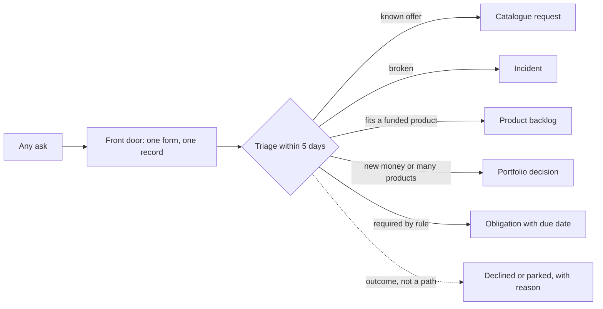

# Module 4 — Demand and requirements

*Module 3 decided where Najm Bank's Technology division puts its money and its teams. This module deals with what arrives every day once those decisions are made: ideas, requests, complaints, regulatory obligations and "small changes" from every corner of the bank. Today they reach IT through many doors, and nobody can say how many there are or how old they are. This module puts that flow in order in three steps: one front door with fast triage and honest answers, including "no"; the path from a demand to a backlog item a team can build, test and trace; and the quality requirements and shared foundations nobody writes down until something breaks. Each lesson leaves an artefact: an intake form with triage rules and a demand board, a trace from one demand to its tests, and a quality-requirements sheet with a runway plan and a decision record.*

> **Steps:** Plan, Build — turn every ask into a visible, decided piece of demand, then into work a team can build, test and trace, with the quality requirements and foundations that keep it safe to run.

---

# 4.1 — Intake and demand management: one front door for ideas and requests
*Level: 🟡 Intermediate* · *Prerequisites: 1.2, 2.3, 3.2* · *Step: Plan*

**After this you can** design a single intake for one IT area (a form of no more than ten fields), write triage rules that route each ask to one of five paths within a set time, and run a demand board showing age, status and decision for every open item. *Study time: reading about 15 min, hands-on about 100 min (estimate).*

## ⚡ In 60 seconds
- **Demand** is every ask that would consume IT capacity or money; **demand management** captures, sorts, decides and tracks it.
- One **front door** means one place to ask, one record per ask and one set of routing rules, not one team that does everything.
- Triage sorts asks into five paths: **catalogue request**, **incident**, **product backlog** (fits a funded product), **portfolio decision** (needs new money or a new team) and **obligation** (must be done; only the how and when are open).
- The rule that matters most: **every ask gets a decision and a date, and "no" is a decision.**
- Decision cue: if you cannot say how many asks are open, how old the oldest is and who owns each next step, you have an inbox.
- Biggest trap: a forty-field form "to improve quality". It drives people to side doors and fills records with guesses.

## 🧭 Why it matters
Najm Bank, its Technology division and the people in it are fictional. All numbers about Najm Bank in this lesson are illustrative figures, not benchmarks.

When Omar, the Chief Information Officer, asked how much work was waiting, he got four answers. The request tool showed about 1,900 open tickets, mostly access and environment requests (lesson 7.1). The project office listed 140 ideas waiting for a business case. Reem, Product Manager for Cards & Payments, kept her own list of 60 asks. Yousef, Head of IT Operations, said his teams spent "maybe a day a week" on changes asked of engineers directly, which appeared in no list.

No list showed age. When Huda, Head of Enterprise Architecture, sampled 30 project office ideas, the median one was seven months old, and nine had already been bought by the business as software-as-a-service (SaaS) subscriptions while they waited. The business had been ignored, and had found another door.

Undecided asks create duplicate work, push the business toward tools Nour's risk team cannot see, and starve portfolio discussions (Module 3) of data. The fix is not a bigger committee but an easy front door, fast triage and a visible queue.

## 📐 How it works

### 🟢 The essentials

**What counts as demand.** Anything that would consume IT capacity or money and is not already on a team's backlog: ideas, changes, reports, obligations, end-of-life replacements, asks outside the service catalogue (lesson 2.3), and demand IT raises itself, such as a platform upgrade.

**One front door, five paths.** The front door is one form, one record and one reference number the asker can follow. Behind it, triage sends each ask down one of five paths:

| Path | Test | Where it goes | Who decides |
|---|---|---|---|
| **Catalogue request** | We already offer this in a known way | Request fulfilment (lesson 7.1) | The recipe; no further decision |
| **Incident** | Something that worked has stopped working | Operations (lesson 8.1) | Operations, at once |
| **Product backlog** | Fits the purpose and budget of a funded product | That product's backlog (lesson 4.2) | The product manager |
| **Portfolio decision** | Needs new money, a new team or crosses several products | The portfolio cycle (lessons 3.1–3.3) | The portfolio board |
| **Obligation** | Required by law, regulator, auditor or contract | The owning product, with a due date | Risk confirms the obligation; the product manager plans the how |

The asker need not know the path; triage does.

**The intake form: short on purpose.** Ask only what triage needs; the receiving path can ask for more. Ten fields at most:

1. What do you want to be able to do, and for whom?
2. What happens today without it?
3. Which business area and product, if known?
4. Is it required by a regulator, auditor, law or contract? The reference.
5. Is there a date that matters, and why?
6. Roughly what is it worth? (a range or "don't know"; lesson 3.2)
7. Does it involve customer or personal data?
8. Are you already using a tool for this?
9. Who is the sponsor who can decide?
10. Your name (filled from the login)

Field 8 surfaces shadow IT (technology used without IT's knowledge) without blame.

**Every ask gets a decision and a date.** Publish two promises: an **acknowledgement time** (a reference number and a named triager, for example within one working day) and a **triage time** (on a path with a named owner, for example within five working days). A portfolio decision may wait for the quarterly review if the asker is told so on day five. Silence is not acceptable.

**"No" and "not now" are decisions.** Every ask reaches one of five outcomes: done, routed into a backlog, merged with a similar ask, declined with a reason, or parked with a review date. Declining and parking are triage results, not a sixth path. A decline says why ("the corporate payments portal already does this; here is how to get access") and what would change the answer. A clear no beats an endless maybe.

### 🟡 Going deeper

**The demand board.** One card per ask, in columns by state: **New**, **Triage**, **Shaping** (being clarified or sized), **Waiting for decision**, **Decided**. Each card shows the path, the next-step owner and its **age** in days. Sort by age, not by who shouted. Three measures are worth a monthly look:

| Measure | What it tells you | Warning sign |
|---|---|---|
| **Open asks by state and age** | Where demand is stuck | Asks older than their promise |
| **Arrivals versus decisions** | Whether the front door keeps up | More arrive than are decided |
| **Side-door share** | Whether people trust the front door | Direct asks to engineers; tools bought first |

**Why a long queue makes everything slower.** Little's Law (John D. C. Little, *Operations Research*, 1961) states that, in a stable system, the average number of items equals the arrival rate multiplied by the average time each item spends there. For managers: at a steady decision rate, the more undecided asks you hold, the longer each waits. 140 ideas decided at about 20 a month means a wait of around seven months (illustrative). Declining or parking stale asks is the quickest way to shorten the wait for the asks that matter.

**Limit the work in shaping.** Shaping (clarifying, sizing, estimating cost of delay) needs scarce people. Cap it, for example two asks per product manager, so the next ask waits visibly instead of twelve being half-worked.

**Stable priorities protect flow.** The executive summary of the 2024 DORA report (DevOps Research and Assessment, a research programme now part of Google Cloud) is reported to say that unstable organisational priorities led to meaningful decreases in productivity and substantial increases in burnout. Google Cloud's announcement puts it differently: such instability "can significantly hinder progress", even with strong leadership and good documentation. A front door helps: asks enter at one point and are decided at a known cadence, not mid-week.

**Triage is a role, not a committee.** Named triagers with written rules route most asks in minutes; hard cases go to a short weekly huddle with architecture, risk and finance. A monthly board for every ask turns a five-day promise into thirty.

### 🔴 Expert view

**Demand shaping, not demand suppression.** The aim is better asks, not fewer: help the asker describe an outcome rather than a solution ("supplier payments fail at month end", not "we need a new payments system"), find what exists, and merge similar asks. Huda's team found that a third of the sampled ideas were variations of five needs (illustrative).

**One owner, and AI only as an assistant.** Give the front door one owner, with its own measures; without one, fields are added and promises slip. A language model can suggest a path or spot duplicates, but a named triager accepts each suggestion, and Nour's team decides what ask text may go to an external model (lesson 11.3).

**Obligations deserve their own lane.** Regulatory and audit demands have a fixed date and an external scope. Record the source, have the risk function confirm what it requires, and route it to the owning product with the due date visible. When an ask involves AI, add the AI-specific intake questions from [*AI Governance: Zero to Hero*, lesson 8.1 — Use-case intake, business case and risk tiering](../aigp/index.html#/8.1).

## 🧰 The toolkit
| Resource, tool or template | What it is and does | When to reach for it |
|---|---|---|
| **Intake form** | Up to ten fields; one demand record per ask | Whenever anyone wants IT to do something new |
| **Triage rules** | A one-page table sending each ask to one of five paths | Every ask, within the triage promise |
| **Demand board** | Open demand by state, path, next-step owner and age | Weekly huddle; monthly review with the CIO |
| **Decline note** | The decision, why, what exists instead, what would change it | Every decline or park |
| **Service management or work-tracking platform** | Holds demand records and the board | After the form, rules and board work on paper |

Tools named are categories; any product mentioned is an example, not an endorsement.

## 🏛️ In practice at Najm Bank
Huda and Reem piloted the front door for retail and cards for one quarter. Illustrative, fictional:

> **Najm Bank front door, retail and cards pilot (v1)**
> - **Form:** nine fields (the value field was dropped after testing showed most askers wrote "don't know"; product managers estimate it in shaping).
> - **Promises:** acknowledged within one working day; on a path with a named owner within five working days; portfolio items told the date of the next quarterly review.
> - **Triagers:** one demand manager, a product manager on call; weekly 30-minute huddle with Huda, Tariq and Nour's team.
> - **Shaping limit:** two asks per product manager.
> - **Board:** five columns; cards show age in days; anything over its promise is shown in red.

On day one the board held 212 asks: the retail and cards share of the old lists (routine access tickets stayed with request fulfilment). The first sweep routed 41 as catalogue requests, 9 as incidents, 63 to product backlogs, 18 to the portfolio and 7 as obligations; 22 were merged and 52 declined or parked with a reason (all illustrative). The first mistake came quickly: Yousef's team kept taking change asks from branch managers by phone. Rather than ban it, Huda asked them to raise each call at the front door while the caller was on the line, which takes two minutes. After two months about 90 asks were open, none older than its promise.

## 🛠️ Exercises
**🟢 Map your doors.** For one IT area, list every way an ask reaches a team today (forms, email, steering groups, chat, corridors), with estimated asks per month and whether they are recorded.
*Done when:* a table lists at least five doors with volume and "recorded" yes or no, each marked close, keep or redirect.

Model answer and self-check

**Model answer.** For example (illustrative): request tool (about 600 a month, recorded, keep as the base); project office pipeline (about 10, spreadsheet, merge); emails to the product manager (about 30, not recorded, redirect); direct asks to engineers (perhaps 40, not recorded, redirect with the two-minute rule); steering committee actions (about 5, in minutes, record each). **Self-check.**
- Is each volume an estimate with its basis?
- Is there exactly one door you would keep as the front door?

**🟡 Write the form and the triage rules.** Draft an intake form (up to ten fields) and a triage table with five paths, a test for each and who decides. Route ten recent real asks with it.
*Done when:* each ask lands on exactly one path, you have noted any ask the rules could not place and how you changed them, and the form states an acknowledgement time and a triage time with a named triager.

Model answer and self-check

**Model answer.** Typically about half become catalogue requests or backlog items, a few portfolio decisions or obligations, and some are merged or declined. The form promises acknowledgement in one working day and triage in five, by a named triager. Common rule changes: "if it touches more than one product, it is a portfolio decision" and "if a regulator or auditor reference is given, risk confirms within five days". **Self-check.**
- Could someone who is not in IT fill in the form in under five minutes?
- Does each path have a test a triager can apply without a meeting?
- Does every path name who decides, not just where the ask goes?

**🔴 Build the board and measure the queue.** Set up a demand board for one area (a spreadsheet is fine) with the five states, next-step owner and age. Load the open asks, compute the three measures and use Little's Law to estimate the average wait at the current decision rate.
*Done when:* the board holds every open ask with an age, the three measures are written with their numbers, and you have a one-paragraph proposal stating how many asks to decline or park now and what wait that would give.

Model answer and self-check

**Model answer.** For example: 140 open asks at about 20 decisions a month means a wait of around seven months (illustrative). Declining or parking 60 stale asks brings it to about four; declining or parking those 60 and then deciding 30 a month brings it below three. **Self-check.**
- Did you note that the estimate assumes arrivals and decisions roughly balance, and that the wait grows if they do not?
- Is age measured from when the ask was first raised, not from when it entered your board?
- Does your proposal tell askers what happened?

## ⚠️ Mistakes and traps
- **A form that interrogates.** Ask only what triage needs; let shaping gather the rest.
- **Triage by committee.** Name triagers and write rules; keep the huddle for hard cases.
- **No age on the board.** Loud asks move and quiet ones rot. Show age; review the oldest first.
- **Never saying no.** Decline or park with a reason and a review date.
- **Treating obligations as optional.** Regulatory and audit demands need their own lane, a confirmed source and a visible due date.

## 🧾 Recap
- One front door, one record per ask, and triage into five paths: catalogue request, incident, product backlog, portfolio decision, obligation.
- Publish acknowledgement and triage promises; every ask gets a decision and a date, and "no" is one.
- Run a demand board sorted by age; watch open asks, arrivals versus decisions, and side-door share.
- Shape demand into outcomes, merge duplicates, and keep a named triager accountable for AI suggestions.

## ✍️ Check yourself
**1. A branch manager asks Yousef's team for a new report that the reporting service already offers in a standard form. Under the five-path triage, where should the ask go?**

- A. To the portfolio board, because it was raised by a business unit and not by IT.
- B. To request fulfilment, because it is a known offer delivered in a known way.
- C. To the reporting product's backlog, as a small change to an existing report.
- D. To the obligation lane, because branch reporting is often reviewed by auditors.

Answer

**B.** The report is already offered in a standard form, so it is a catalogue request. C is tempting, but the backlog path is for changes to a product, and this ask needs none. A is for new money, and D needs a confirmed rule, not a guess. See "One front door, five paths".

**2. Najm Bank's portfolio board decides about 20 ideas a month, and 160 ideas are waiting. Roughly how long does a new idea wait, on average, and what is the quickest way to shorten that wait?**

- A. About two months; add more fields to the form so each idea is better prepared.
- B. About three months; ask sponsors to resubmit every idea in the next annual cycle.
- C. About five months; ask the board to meet less often but review longer lists.
- D. About eight months; decline or park stale ideas so that fewer wait in the queue.

Answer

**D.** By Little's Law, 160 waiting at 20 a month is about eight months. More fields (A) slow intake, an annual cycle (B) lengthens waits, and fewer meetings (C) lower the decision rate. See "Why a long queue makes everything slower".

**3. Tariq proposes a 35-field mandatory intake form "so that finance gets complete business-case data". What is the main risk?**

- A. People go back to side doors and fill the required fields with guesses.
- B. The demand board will show too few cards for a useful monthly review.
- C. The triage promise becomes impossible because forms arrive too quickly.
- D. Obligations can no longer be told apart from catalogue requests at triage.

Answer

**A.** A heavy form discourages use of the front door and fills it with guesses; business-case detail belongs in shaping. B and C reverse the likely effect, and D does not follow: one field is enough to spot obligations. See "The intake form: short on purpose".

**4. Nour's team receives an audit finding that requires stronger logging on the card authorisation system by a fixed date. How should the front door treat it?**

- A. As a portfolio decision, ranked against other ideas at the next quarterly review.
- B. As a catalogue request, because logging is already a standard platform offer.
- C. As an obligation routed to the owning product, with source and due date shown.
- D. As a parked ask, until the business sponsor confirms that the value is worth it.

Answer

**C.** An audit finding with a fixed date is an obligation; only how and when are open. Ranking (A) or parking (D) risks the date, and B assumes a standard offer covers a specific finding. See "Obligations deserve their own lane".

**5. Sami finds that his platform engineers receive about 30 asks a month from product teams over the chat tool, and none reach the demand board. What should he do first?**

- A. Tell engineers to answer chat asks only with a link to the intake form.
- B. Hold chat asks until the weekly triage huddle has reviewed each of them.
- C. Stop counting chat asks, since most are small and quickly finished anyway.
- D. Let engineers turn a chat message into a demand record with one action.

Answer

**D.** People use a side door because it is quicker; the fix is to make recording just as quick, so the ask is visible without slowing the asker. A sends askers away and pushes them to other doors, B makes the front door slower than the chat it replaces, and C hides demand the board should show. See the side-door share and "In practice at Najm Bank".

## 📚 References
The Google Cloud blog post was opened; the other pages could not be opened from this session, and facts from them are as reported in search summaries.
- Google Cloud blog, "Announcing the 2024 DORA report", October 2024: https://cloud.google.com/blog/products/devops-sre/announcing-the-2024-dora-report — the quoted wording on instability in priorities (page opened).
- DORA, *2024 Accelerate State of DevOps Report* (PDF): https://services.google.com/fh/files/misc/2024_final_dora_report.pdf — the executive summary's wording on productivity and burnout, as reported in search summaries.
- Little, J. D. C., "A Proof for the Queuing Formula: L = λW", *Operations Research* 9(3), 1961, pp. 383–387, doi:10.1287/opre.9.3.383 (bibliographic record: https://ideas.repec.org/a/inm/oropre/v9y1961i3p383-387.html).
- Library course: [*AI Governance: Zero to Hero*, lesson 8.1 — Use-case intake, business case and risk tiering](../aigp/index.html#/8.1) (intake for AI use cases).

---

# 4.2 — From requirement to backlog, with traceability
*Level: 🟡 Intermediate* · *Prerequisites: 2.1, 4.1* · *Step: Plan, Build*

**After this you can** break one decided demand into an outcome, features and backlog items with testable acceptance criteria, set shared "ready" and "done" checks for a product team, and record the minimum links that trace any requirement to its tests and release, proved with a five-item trace test. *Study time: reading about 15 min, hands-on about 110 min (estimate).*

## ⚡ In 60 seconds
- A **requirement** states something the product must do or a quality it must have. A **backlog** is the ordered list of work a product team will do next. The craft is turning one into the other without losing the "why".
- Work in four levels: **outcome** (the change we want), **feature** (a capability that serves it), **backlog item** (a slice a team can finish in days) and **acceptance criteria** (the checks that say it is done).
- **Traceability** means following a requirement forward to the work, tests and release that met it, and backward from any change to the requirement behind it.
- The rule that matters most: **link at the moment of work, not after it.** A link recorded during the work costs seconds; one rebuilt for an audit costs weeks.
- Decision cue: if you cannot trace five random requirements to items, tests and release in ten minutes, your traceability is a document, not a property of your records.
- Biggest trap: a 200-page requirements document written up front, traceable only to itself.

## 🧭 Why it matters
Najm Bank, its Technology division and the people in it are fictional. All numbers about Najm Bank in this lesson are illustrative figures, not benchmarks.

Six weeks after Reem's team released card freeze in the mobile app, the bank's internal auditors asked: "Show us the requirement that a frozen card must decline payments, the test that proved it, and the release that put it in production." The team had tested carefully. But the requirement lived in a workshop slide deck, the test was one of 1,400 automated tests named like `test_freeze_03`, and the release notes said "card freeze improvements". It took Nour, IT Risk and Controls Lead, and two engineers four days to assemble the evidence from commit histories and memory.

Then an incident: some frozen cards still worked at one merchant type. The reviewer asked from the other end: "Which requirement covered this case, and was it tested?" Nobody could say whether the requirement, the tests or the code had missed it.

In a regulated bank these questions come every week. Not answering them costs senior time, audit findings and incidents nobody learns from. This lesson makes the chain part of everyday work, cheaply.

## 📐 How it works

### 🟢 The essentials

**Four levels, one chain.** Break a decided demand (lesson 4.1) into four levels, each linked to the one above:

| Level | What it states | Example (card freeze) | Who owns it |
|---|---|---|---|
| **Outcome** | The change we want, with a measure | Fewer contact-centre calls to block a misplaced card | Product manager, with the business sponsor |
| **Feature** | A capability that serves the outcome | Customers can freeze and unfreeze a card in the app | Product manager |
| **Backlog item** | A slice of the feature a team can finish in a few days | A frozen card declines every new payment: online, in shop and at ATMs | Product team |
| **Acceptance criteria** | Checks that decide whether the item is done | Given a frozen card, when an in-shop payment is attempted, then it is declined with reason "card frozen" (one criterion per payment channel) | Product team, agreed with the product manager |

The outcome says why, the feature what, the item what next, and the criteria how we will know.

**The backlog.** The Scrum Guide (2020), the short public definition of Scrum by Ken Schwaber and Jeff Sutherland, is reported to describe the Product Backlog as "an emergent, ordered list of what is needed to improve the product". You need not use Scrum to use the idea. **Emergent** means it changes as you learn; **ordered** means one item is first, not a dozen marked "high". The product manager owns the order, informed by cost of delay (lesson 3.2).

**Good backlog items.** Bill Wake's INVEST checklist (2003) is a common test for backlog items: **Independent**, **Negotiable**, **Valuable**, **Estimable**, **Small** and **Testable**. For a manager, **Small** and **Testable** matter most. Many teams write user stories ("As a cardholder, I want to freeze my card, so that nobody can use it while I look for it"). The format is optional; the "so that" is not, because it links to the outcome.

**Acceptance criteria that can be checked.** A useful form, made popular by Dan North and others in behaviour-driven development (BDD), is **Given** (the starting situation), **When** (the event), **Then** (the expected result). Everyone can read it, and each criterion can become an automated test. Compare:

| Weak criterion | Checkable criterion |
|---|---|
| Freezing should work properly | Given an active card, when the customer taps Freeze, then the card's status is "frozen" within 5 seconds |
| Frozen cards should be secure | Given a frozen card, when a card-not-present payment (online or by phone, card not physically used) is attempted, then it is declined with reason "card frozen" |
| Unfreezing should be easy | Given a frozen card, when the customer taps Unfreeze and confirms with their app passcode, then the card is active again |

The 5 seconds is illustrative. For the tester's side, see [*Software Testing*, lesson 1.3 — Requirements, test cases and bug reports: from acceptance criteria to a defect someone can fix](../testing/index.html#/1.3).

**"Ready" and "done".** Two shared checks:

- **Ready** (before work starts): a "so that" linked to a feature, acceptance criteria, data or risk flags, and no unknown dependency. The Scrum Guide does not define a "Definition of Ready"; if you use one, keep it short or it becomes a gate.
- **Done** (before the item counts as finished): the Scrum Guide (2020) is reported to describe the **Definition of Done** as "a formal description of the state of the Increment when it meets the quality measures required for the product"; the Increment is the usable piece of product the work adds. Najm Bank's version is below.

### 🟡 Going deeper

**What traceability is for.** Three readers, three directions:

| Reader | Their question | Direction |
|---|---|---|
| **Auditor or regulator** | Was this rule met, tested and approved? | Requirement forward to tests, approval and release |
| **Incident reviewer** | Was this behaviour intended? | Change backward to item and requirement |
| **Product manager or sponsor** | Did the funded work deliver the outcome? | Outcome forward to releases and measures |

**Minimum viable traceability.** Four links, each recorded by whoever already touches the work:

1. **Backlog item to feature and outcome**: set when the item is created (a parent field in the work-tracking tool).
2. **Acceptance criterion to test**: each criterion has its own key, the item key plus a number (for example `CARDS-412-AC2`), and the test's tag carries it, set when the test is written. Item keys alone cannot show which criterion lacks a test.
3. **Code change to backlog item**: the item key in the commit message or pull request, checked by the pipeline.
4. **Release to backlog items**: the release record lists its item keys, generated from the commits.

A query then answers the auditor in minutes. Lesson 9.3 extends the identifiers from investment to incident; [*A Practical Guide to Becoming an AI-Native Engineer*, lesson 3.1 — Spec-driven development: from ticket to acceptance criteria, constraints, non-goals and a plan](../ainative/index.html#/3.1) covers the engineer's side.

**Regulatory and quality requirements in the same backlog.** Kept in separate documents, obligations and quality requirements (lesson 4.3) get missed. Put them where the team works: as backlog items for one-off work (adding an audit log), or as constraints in Done or on a feature (response time). Tag each with its source. Where an obligation needs a **traceability matrix** (each clause mapped to items and tests), generate it from the links, and ask Nour's team what form of evidence is expected (lesson 9.3).

### 🔴 Expert view

**Granularity is a choice.** Tracing every line of code costs more than it returns. Trace where decisions and evidence matter: outcome to feature for funding, item to test and release for audit and incidents. Agree levels per product with Huda and Nour.

**Requirements decay; tests complain.** A document goes stale silently; an automated test encoding a criterion fails. Treat the tagged tests as part of the requirements record, and review deleted or disabled tests like changed requirements.

**AI drafting, human owning.** Language models draft items and criteria from a workshop transcript and spot missing cases ("what happens to a recurring payment when the card is frozen?"). They also invent plausible wrong rules, so the product manager accepts each item and the team checks each criterion. For specifications of AI products, see [*AI Product Management: Zero to Hero*, lesson 5.1 — The AI product spec: behaviour, quality bars and evals as requirements](../aipm/index.html#/5.1).

**Change to a requirement is a change to the chain.** Everything linked to a changed requirement needs review. Links make this a query ("show everything traced to R-17"), not a memory exercise.

## 🧰 The toolkit
| Resource, tool or template | What it is and does | When to reach for it |
|---|---|---|
| **Four-level breakdown** | Outcome, feature, backlog item, acceptance criteria, each linked upward | When a decided demand reaches a product team |
| **Acceptance criteria in Given–When–Then** | A readable, testable form for the checks that decide "done" | Every item that changes behaviour |
| **Ready and Done checks** | Short shared lists for before work starts and before it counts as finished | Agreed per team; reviewed quarterly |
| **Item key convention** | One key per item and per criterion, carried in tests, commits and releases | From the first item |
| **Five-item trace test** | Five random requirements traced to tests and release, timed | Monthly, and before any audit |
| **Work-tracking tool** | System of record for the backlog, parent links and item keys | One per product area; lesson 11.1 maps the toolchain |

Tools named are categories; any product mentioned is an example, not an endorsement.

## 🏛️ In practice at Najm Bank
After the audit, Reem and Nour agreed a traceability convention for Cards & Payments and tested it on the next feature, travel notice. Illustrative, fictional:

> **Cards & Payments traceability convention (v1)**
> - **Levels traced:** outcome → feature → item → criteria → test → release. Code is traced to items, not criteria.
> - **Keys:** every item has a key (`CARDS-nnn`) and every criterion a sub-key (`CARDS-nnn-ACn`); tests are tagged with criterion keys, commits carry item keys, and the pipeline rejects a commit without one (emergency override logged and reviewed weekly).
> - **Release records** list item keys generated from commits.
> - **Obligations:** each regulatory or audit requirement has its own item, tagged `OBL` with its source, in a generated matrix for Nour's team.
> - **Ready:** "so that" linked to a feature; acceptance criteria written; data and risk flags set.
> - **Done:** criteria automated and passing; review recorded; security checks passed; quality requirements from lesson 4.3 met; key present in release record.

"Travel notice" broke down into one outcome, two features, eleven items and 38 criteria (illustrative). The first trace test took eight minutes for five requirements, against four days before. It found a gap: two criterion keys had no tagged test, because a contractor wrote those tests before the convention. Reem added "every criterion key has a tagged test" to Done, and Sami, Platform Engineering Lead, made the commit-key check a standard pipeline step.

The frozen-card trace showed the requirement covered every payment channel, and the in-shop criterion had tests, but only through the main authorisation path. An older system routed one merchant type through a separate path that no test exercised. The requirement was right; the boundary case was untested. The fix became a payments-platform backlog item linked to the incident (lesson 8.2).

## 🛠️ Exercises
**🟢 Break one demand down.** For one decided demand (yours or card freeze), write an outcome with a measure, two features, at least four items with a "so that", and two Given–When–Then criteria per item.
*Done when:* every item links to a feature and the outcome, and a colleague can say how they would test each criterion.

Model answer and self-check

**Model answer.** Outcome: "calls to block misplaced cards fall by a third in six months" (illustrative). Features: freeze and unfreeze in app; notification on a declined attempt. Items: freeze; unfreeze with passcode; decline every new payment when frozen (online, in shop, ATM); notify on decline. Criterion example: "Given a frozen card, when a recurring payment arrives, then it is declined and the customer is notified". **Self-check.**
- Is each item small enough to finish in days?
- Could each criterion become a test without asking what it means?
- Did you think of at least one boundary case (recurring payments, a card used in two apps)?

**🟡 Write Ready and Done.** For one product team, write a Ready check (up to five lines) and a Done check (up to eight), covering obligations, quality requirements and the item key.
*Done when:* each line can be checked yes or no, and the product manager has reviewed both and noted any line they would drop.

Model answer and self-check

**Model answer.** Ready: linked "so that"; criteria written; data and risk flags set; dependencies agreed. Done: as in the Najm Bank convention above, plus support notes updated where behaviour changed. **Self-check.**
- Is Ready short enough that it does not become a gate?
- Is every Done line checkable by a tool or a person in minutes?
- Do obligations and quality requirements appear explicitly?

**🔴 Run a five-item trace test.** Pick five random requirements from a product you know, at least one regulatory. Trace each to backlog items, tests and release, and time it.
*Done when:* a table shows each requirement, what was found at each step, the time and the gaps, plus one change to the convention that would close the largest gap.

Model answer and self-check

**Model answer.** A typical first result: two of five traced fully, two reached items but not tests, and one regulatory requirement existed only in a document. Change: an `OBL` item for every regulatory requirement, with the matrix generated from links. **Self-check.**
- Is each gap tied to a specific missing link (item, criterion key, commit key, release list)?
- Does your proposed change make the link part of the work, not an extra step afterwards?

## ⚠️ Mistakes and traps
- **The giant document.** It goes stale. Keep requirements in the backlog and criteria in tests.
- **Rebuilding links for audits.** Slow and unreliable. Record links during the work.
- **Losing the "why".** Unlinked items cannot be prioritised. Keep the "so that" and the parent link.
- **Vague criteria.** Write Given–When–Then with real values agreed by the product manager.
- **A Ready check that stops flow.** Twenty conditions recreate the old approval gate. Keep it short.

## 🧾 Recap
- Break demand into four linked levels: outcome, feature, backlog item, acceptance criteria.
- The backlog is ordered and emergent; good items are small, testable and keep their "so that".
- Write acceptance criteria that can become tests, for example Given–When–Then.
- Agree short Ready and Done checks, and put obligations and quality requirements into them.
- Four links recorded during the work give most of the traceability value; test them with five random requirements.

## ✍️ Check yourself
**1. Reem's team has written: "Frozen cards should be secure." Which rewrite is the best acceptance criterion?**

- A. Frozen cards must meet the bank's security policy and the relevant payment rules.
- B. The team will review the freeze feature with the security team before go-live.
- C. Given a frozen card, when a payment is tried online, it is declined as frozen.
- D. Frozen cards should be very hard to misuse, with no known weakness at release.

Answer

**C.** It names a starting state, an event and an observable result, so it can become a test. A points to policies without a checkable result, B describes an activity rather than a condition, and D cannot be verified. See "Acceptance criteria that can be checked".

**2. An auditor asks Nour for evidence that a regulatory requirement was tested and released. Which set of links answers this fastest?**

- A. Keys carried in tests, commits and release records by whoever does each step.
- B. A traceability spreadsheet updated by a business analyst at the end of every quarter.
- C. A detailed requirements document signed by the sponsor before the work began.
- D. Release notes written by the team lead that describe each change in plain language.

Answer

**A.** Keys added by the people doing the work let a query answer in minutes. A quarterly spreadsheet (B) is slow and often wrong, a signed document (C) proves intent only, and free text (D) cannot be queried. See "Minimum viable traceability".

**3. Huda proposes that every line of code at Najm Bank be traced to a specific requirement. What is the best response?**

- A. Agree, because complete tracing is required for any regulated bank to pass audits.
- B. Agree for systems in audit scope, tracing each of their lines to a requirement.
- C. Decline, because traceability is a documentation task the auditors should do.
- D. Trace at the levels where decisions and evidence matter, agreed for each product.

Answer

**D.** Line-level tracing costs more than it returns. B is tempting, but audit needs item, test and release links, not line-level ones; A asserts a rule the lesson does not support (ask the risk function), and C misplaces ownership. See "Granularity is a choice".

**4. Yousef's team proposes a Definition of Ready with 22 conditions, including sign-offs from four departments. What is the main risk?**

- A. The team will finish items too quickly, before testers can review the criteria.
- B. It recreates an approval gate that holds work back before anyone starts on it.
- C. Product managers will no longer be able to order the backlog by cost of delay.
- D. Acceptance criteria will become too detailed to be written in Given–When–Then.

Answer

**B.** A long Ready check stops flow at the start; keep it short and put quality into Done. A reverses the effect, C confuses ordering with readiness, and D does not follow. See "Ready and done" and "Mistakes and traps".

**5. A requirement for card freeze changes: recurring payments must now be allowed while a card is frozen. What do linked records make possible?**

- A. Updating the requirement document and rerunning the full regression suite.
- B. Asking the team lead which tests are affected, from memory of the work.
- C. Adding a new item for recurring payments and leaving existing tests as they are.
- D. Listing exactly what depends on the changed rule, so nothing is missed.

Answer

**D.** Links turn impact analysis into a query: every item, criterion and test traced to the requirement can be found and reviewed. A finds only what existing tests happen to catch and says nothing about items or criteria; B relies on memory; C leaves tests that now contradict the requirement. See "Change to a requirement is a change to the chain".

## 📚 References
Pages could not be opened from this session; facts are as reported in search summaries.
- Schwaber, K. and Sutherland, J., *The 2020 Scrum Guide*: https://scrumguides.org/scrum-guide.html — the Product Backlog and Definition of Done descriptions, as reported.
- Wake, B., "INVEST in Good Stories, and SMART Tasks", xp123.com, 17 August 2003 — the INVEST checklist, as reported.
- North, D., "What's in a Story?", dannorth.net: https://dannorth.net/whats-in-a-story/ — the Given–When–Then scenario form, as reported.
- Library course: [*Software Testing*, lesson 1.3 — Requirements, test cases and bug reports: from acceptance criteria to a defect someone can fix](../testing/index.html#/1.3).
- Library course: [*A Practical Guide to Becoming an AI-Native Engineer*, lesson 3.1 — Spec-driven development: from ticket to acceptance criteria, constraints, non-goals and a plan](../ainative/index.html#/3.1).
- Library course: [*AI Product Management: Zero to Hero*, lesson 5.1 — The AI product spec: behaviour, quality bars and evals as requirements](../aipm/index.html#/5.1).

---

# 4.3 — Architecture, non-functional requirements and the runway
*Level: 🟡 Intermediate* · *Prerequisites: 2.2, 4.2* · *Step: Plan, Build*

**After this you can** write five measurable quality requirements for one product as testable scenarios, set a protected share of team capacity for foundations and technical debt with a spending rule, and record one significant architecture decision as a one-page decision record. *Study time: reading about 15 min, hands-on about 110 min (estimate).*

## ⚡ In 60 seconds
- **Non-functional requirements**, better called **quality requirements**, state how well a product must work: how fast, available, secure, changeable and costly.
- A quality requirement is useful only when **measurable and testable**: "95% of payments confirmed within 2 seconds at 500 per second" (illustrative), not "fast".
- Treat shared foundations (platforms, common services, patterns, debt paid down) as a stock, judged by how much of next quarter's plan they can carry. This course calls that stock the **runway**.
- The rule that matters most: **architecture is a service to the teams, delivered as guardrails (automated limits that stop unsafe choices without a meeting), paved paths (supported default ways to build and run, with standards built in) and recorded decisions, not as a review board at the end.**
- Decision cue: if your architecture review mostly says "no" late in delivery, move that knowledge into platform defaults and automated checks.
- Biggest trap: foundation work competing with features without a protected share. It loses every week until an outage wins the argument.

## 🧭 Why it matters
Najm Bank, its Technology division and the people in it are fictional. All numbers about Najm Bank in this lesson are illustrative figures, not benchmarks.

At the end of a salary month, Najm Bank's mobile app slowed to a crawl for two hours. Payments timed out and customer retries made it worse. The post-incident review (lesson 8.2) found that nobody had written down the peak payments per second the app must handle, so nobody had tested for it. The requirement was one line: "the system shall perform adequately under expected load".

There was a second problem. Three product teams had each built their own customer notifications, because the shared notification service had been "on the roadmap" for two years and never funded, so the incident needed three fixes. Sami, Platform Engineering Lead, had asked for it in four planning rounds; each time it lost to a feature.

Huda, Head of Enterprise Architecture, saw that her monthly review board, which saw designs late in delivery, had prevented neither problem.

## 📐 How it works

### 🟢 The essentials

**Two kinds of requirement.** A **functional requirement** says what the product does ("a customer can freeze a card"). A **quality requirement** says how well: how fast, reliably, securely and cheaply, and how easy to change. They cut across features, so no single item owns them.

**A checklist of qualities.** The standard ISO/IEC 25010:2023 is reported to describe a product quality model of nine characteristics: functional suitability, performance efficiency, compatibility, interaction capability, reliability, security, maintainability, flexibility and safety. Use such a list as a prompt ("have we said anything about this?"), not a form. Add two that banks often miss: **operability** (can operations run, monitor and recover it?) and **cost to run**.

**Make each quality measurable.** Write each one as a short scenario with five parts:

| Part | Question | Example (payments at peak) |
|---|---|---|
| **Situation** | Under what conditions? | Salary-day peak |
| **Event** | What happens? | Customers submit payments |
| **Response** | What must the product do? | Accept and confirm each payment |
| **Measure** | How well, in numbers? | 95% confirmed within 2 seconds at 500 payments per second |
| **Evidence** | How will we know? | Load test before each major release; live dashboard |

Figures are illustrative; real ones come from the business owner, operations and past peaks.

| Weak | Measurable |
|---|---|
| The system must be highly available | Card authorisation is available 99.95% of each month (illustrative) |
| The system must be easy to change | Fee rules can be changed and released by the product team within one day, without code changes |
| Costs must be reasonable | Running cost stays below an agreed amount per thousand transactions, reviewed monthly with Tariq |

Availability targets connect to service levels and error budgets (lesson 8.3); for the engineering side, see [*Cloud & DevOps: Zero to Hero*, lesson 5.2 — SLOs, error budgets, alerting and on-call that people can sustain](../cloud/index.html#/5.2).

**Where quality requirements live.** Where the team works (lesson 4.2): on a feature, in Done, or as their own backlog items. Each needs an owner and a check, ideally automated. For load testing, see [*Software Testing*, lesson 4.1 — Performance testing: load, stress, soak and spike, percentiles and SLOs](../testing/index.html#/4.1).

**The runway: foundations as a stock.** Every product leans on things no single feature owns: Sami's internal developer platform, common services such as identity and notifications, agreed patterns, and debt already paid down. Each quarter, count: of the features planned next, how many can be built on today's foundations, and how many first need something new underneath? When the second number grows, teams build their own foundations, as the three notification services show.

The word "runway" for this stock also appears in SAFe® (the Scaled Agile Framework, for running agile delivery across many teams; SAFe is a registered trademark of Scaled Agile, Inc.).

### 🟡 Going deeper

**Protect capacity, then let teams spend it.** Foundation and debt work lose item-by-item contests with features, because their value is spread over many future items. So set a **protected foundation share**: part of each team's capacity kept for foundations, debt and quality work, agreed with the product manager and reviewed quarterly. Najm Bank started with 20% plus a separately funded platform team (illustrative). A short rule guides spending: incident causes first, then what slows delivery most, then what next quarter's features need.

**Technical debt, named honestly.** Ward Cunningham introduced the technical debt metaphor in a 1992 OOPSLA experience report on the WyCash portfolio system, as reported: shipping not-quite-right code is like borrowing, which speeds things up if repaid soon; the extra effort it causes later is the interest. Martin Fowler notes the metaphor is sometimes used to justify neglecting internal quality, as reported. Keep a short **debt register** per product: the debt, its cost (incidents, slower changes, risk), the repayment effort and the owner.

**Decisions, recorded.** Architecture choices made in meetings get lost. An **architecture decision record (ADR)** is a short document, one per significant decision. Michael Nygard proposed the format in 2011; it is reported to have sections for **title**, **status** (proposed, accepted, deprecated or superseded), **context** (the forces at play), **decision** and **consequences** (good and bad). Keep ADRs searchable; supersede an accepted one rather than editing it.

**When the decision is "buy".** Many foundation decisions are sourcing decisions that change who meets the targets, who patches and where data lives. See [*System Design for Vibe Coders*, lesson 0.3 — Build vs Buy: the Highest-Leverage Decision You'll Make](../vibe/index.en.html#l0-3), and lessons 5.3 and 10.2. In a bank this may fall under outsourcing, operational resilience or data protection rules; ask Nour's team what applies before deciding.

### 🔴 Expert view

**From review board to guardrails.** A late review can only reject or add conditions when change costs most. Move the knowledge earlier:

| Before | After |
|---|---|
| Monthly board reviews every design near the end | Board reviews only cross-product, shared-foundation or high-risk decisions |
| Standards in a document nobody reads | Standards built into platform templates and defaults (the paved path) |
| Conditions agreed in minutes and forgotten | Each significant decision has an ADR with an owner and a review date |
| Quality checked by opinion | Key qualities checked automatically in the pipeline |

The last row has a name. Neal Ford, Rebecca Parsons and Patrick Kua's *Building Evolutionary Architectures* (2017) is reported to define an **architectural fitness function** as an objective integrity assessment of one or more architectural characteristics. In practice it is an automated check, such as a load test, a dependency rule or a cost alert, that turns a quality requirement into evidence on every change.

**Architecture's own measures.** Teams on the paved path, time from design question to decision, incidents traced to missing quality requirements, the debt trend, and the runway count above.

**Security is a quality requirement too.** A threat model (a structured look at how a design could be attacked) feeds the same backlog; see [*Secure AI & Application Security: Zero to Hero*, lesson 1.1 — Threat modelling: data flows, trust boundaries and STRIDE](../secai/index.html#/1.1). When AI writes much of the code, see [*System Design for Vibe Coders*, lesson 9.1 — You Are the Architect Now](../vibe/index.en.html#l9-1).

## 🧰 The toolkit
| Resource, tool or template | What it is and does | When to reach for it |
|---|---|---|
| **Quality requirements sheet** | Five to ten quality scenarios for one product, with measure and evidence | New product; before a major release or sourcing decision |
| **Quality checklist** | Characteristics (for example ISO/IEC 25010) plus operability and cost to run | At the start of a feature |
| **Protected foundation share** | Capacity kept for foundations, debt and quality work, with a spending rule | Quarterly, in the funding memo (lesson 3.2) |
| **Debt register** | Per product: the debt, its cost, the repayment effort, the owner | Reviewed monthly with the product manager |
| **Architecture decision record** | One page per significant decision | When a decision is hard to reverse or crosses products |
| **Fitness functions** | Automated pipeline checks that a quality requirement still holds | For the two or three qualities that matter most |

Tools named are categories; any product mentioned is an example, not an endorsement.

## 🏛️ In practice at Najm Bank
After the incident, Huda, Reem and Sami produced three artefacts. Illustrative, fictional:

> **Quality requirements sheet, Cards & Payments (v1, extract)**
> - **Peak load:** as in the scenario table above.
> - **Availability:** card authorisation 99.95% of each month; monthly service report (lesson 8.3).
> - **Recovery:** after a data-centre failure, payments resume within 30 minutes, no confirmed payment lost; twice-yearly test.
> - **Changeability:** fee rules released by the product team within one day, without code changes.
> - **Cost to run:** below an agreed amount per thousand transactions; monthly with Tariq.

> **Protected foundation share:** 20% of each Cards & Payments team's capacity for foundations, debt and quality work; rule: incident causes first, then delivery slowers, then next quarter's needs. Runway count for next quarter: 9 of 14 planned features buildable on today's foundations. Shared notification service funded as a platform item in the portfolio (lesson 3.1).

> **ADR-014: One shared notification service.** Status: accepted. Context: three teams built their own notification paths, so the incident needed three fixes; a SaaS provider would hold customer contact data, which Nour's team said needed an outsourcing assessment first. Decision: build one shared service on the internal platform; teams migrate within two quarters. Consequences: one place to fix and monitor. Negative: the platform team becomes a single point of failure for notifications, covered by a service level; migration takes capacity from the 20% share and delays two planned features.

Huda's board now meets fortnightly, sees only cross-product or shared-foundation decisions, and records every outcome as an ADR. A mistake surfaced in the first quarter: Reem's team spent the 20% on refactors they liked while the debt behind incidents stayed. The spending rule is now checked monthly against the debt register.

## 🛠️ Exercises
**🟢 Make five qualities measurable.** For one product, write five quality scenarios (situation, event, response, measure, evidence) covering performance, availability and one of security, changeability or cost.
*Done when:* each has a number and a named check, and operations agrees each measure can be observed.

Model answer and self-check

**Model answer.** One complete scenario (illustrative): *situation* salary-day peak; *event* customers submit payments; *response* accept and confirm each; *measure* 95% confirmed within 2 seconds at 500 per second, set from last year's peak plus 30%; *evidence* a load test per major release and a live dashboard owned by operations. **Self-check.**
- Does each scenario have a number, not an adjective?
- Is the evidence real or buildable, not "we will check"?
- Did you include operability or cost to run?

**🟡 Set a protected foundation share and a debt register.** For one team, propose a protected capacity share with a spending rule, and a debt register of at least five entries (cost, repayment effort, owner) ranked by your rule.
*Done when:* the product manager has seen it, and the top two entries state their cost today in incidents, delay or risk.

Model answer and self-check

**Model answer.** For example: 20% of capacity with the spending rule above. Top entries: "retry logic causes duplicate attempts under load (two incidents last quarter)"; "manual environment set-up adds about three days per release" (illustrative). **Self-check.**
- Is each debt item described by its cost, not only its technical nature?
- Does the rule stop the share going to favourite refactors?
- Is the share written into the funding memo, not just promised?

**🔴 Write one ADR and move one check left.** Write a one-page ADR for a significant decision in your area, with the sourcing and regulatory questions it raises. Then turn one quality requirement checked by review today into a fitness function.
*Done when:* the ADR lists at least two negative consequences, regulatory points are questions for the risk function (not conclusions), and the fitness function names its trigger, pass condition and who acts on failure.

Model answer and self-check

**Model answer.** ADR-014 above shows the shape, with two negative consequences. A fitness function example: "On every merge to the payments service, run a 10-minute load test at 500 payments per second; pass if 95% confirm within 2 seconds; a failure blocks release and alerts the product team" (illustrative). **Self-check.**
- Are regulatory points phrased as questions for Nour's team?
- Is the fitness function objective (a number, a rule), not a judgement?

## ⚠️ Mistakes and traps
- **Adjectives instead of numbers.** "Fast" cannot be tested. Write scenarios with measures and evidence.
- **Quality requirements in a separate document.** Put them in Done, on features or as items, with owners.
- **No protected share for foundations.** Reserve capacity and write a spending rule.
- **A late review board.** Build standards into the paved path; review only cross-product or high-risk decisions, each as an ADR.
- **Treating sourcing as purely technical.** It can trigger outsourcing or resilience rules. Ask the risk function first.

## 🧾 Recap
- Make each quality requirement a scenario with a number and a check, kept where the team works.
- Count the runway each quarter against the plan, and keep it healthy with a protected foundation share.
- Record significant decisions as ADRs, and turn key qualities into fitness functions.
- Architecture serves teams through guardrails, paved paths and recorded decisions, not a late gate.

## ✍️ Check yourself
**1. The payments design document says: "The system shall perform adequately under expected load." What should Huda ask for instead?**

- A. A scenario with peak conditions, a response-time target and load-test evidence.
- B. A written promise from the supplier that performance will be reviewed after go-live.
- C. A longer description of the expected load, written by the business sponsor.
- D. An architecture board review of the design, held just before the first release.

Answer

**A.** A scenario names the situation, target and check. B defers the problem, C adds words without a measure, and D is a late review. See "Make each quality measurable".

**2. Sami's request to build a shared notification service has lost to features in four planning rounds. What is the best structural fix?**

- A. Ask the CIO to rank the service above all features in the next planning round.
- B. Let each product team keep its own notification path to avoid any dependency.
- C. Protect a share of capacity or funding for foundations, with a spending rule.
- D. Fund it as a one-off project in the next portfolio cycle, closed at go-live.

Answer

**C.** Foundation work loses item-by-item contests, so it needs protected capacity or funding and a spending rule. D is tempting, but a project closed at go-live leaves nobody funded to run or renew the service; A wins once, and B repeats the triplicated services. See "Protect capacity, then let teams spend it".

**3. Huda's architecture board meets monthly and reviews every design near the end of delivery. What change best follows this lesson?**

- A. Meet weekly instead, so that every design is reviewed sooner and in much more depth.
- B. Stop reviewing designs altogether and let each product team decide on its own.
- C. Keep reviewing every design, but ask teams to submit at the start of delivery.
- D. Review only cross-product or high-risk decisions; put standards in the platform.

Answer

**D.** Standards in platform defaults let most work flow; the board takes only cross-product or high-risk decisions. C is earlier but still sends every design through one board; A keeps that bottleneck, and B drops shared decisions. See "From review board to guardrails".

**4. Reem's team considers moving notifications to a SaaS provider that would hold customer contact data. What should happen before the decision?**

- A. Ask Nour's team which outsourcing, resilience or data rules apply and what follows.
- B. Send the provider the bank's security questionnaire and decide if the answers pass.
- C. Check the provider's security certifications, and proceed if they are current.
- D. Record the decision in an ADR, which on its own meets the bank's regulatory duties.

Answer

**A.** Placing a service and customer data with a provider may trigger outsourcing, resilience or data rules, so ask risk first. B and C are useful security checks but do not say which rules apply; an ADR (D) meets no regulatory duty by itself. See "When the decision is 'buy'".

**5. Sami wants to make sure the payments peak-load requirement still holds after every change. What is the best tool?**

- A. A clause in the debt register that describes the performance risk in full detail.
- B. A fitness function: an automated pipeline load test with a pass condition.
- C. A quarterly architecture review in which engineers confirm performance is fine.
- D. A note in the ADR stating that the design was intended to meet the target.

Answer

**B.** A fitness function checks the quality on every change. A and D describe intent, and a quarterly opinion (C) is late and subjective. See "From review board to guardrails".

## 📚 References
Pages could not be opened from this session; facts are as reported in search summaries.
- ISO, *ISO/IEC 25010:2023 Systems and software engineering — Systems and software Quality Requirements and Evaluation (SQuaRE) — Product quality model*: https://www.iso.org/standard/78176.html — the nine-characteristic product quality model, as reported (paid standard; not read).
- Nygard, M., "Documenting Architecture Decisions", 15 November 2011: https://cognitect.com/blog/2011/11/15/documenting-architecture-decisions — the ADR format, as reported.
- Cunningham, W., "The WyCash Portfolio Management System", OOPSLA '92 experience report: https://c2.com/doc/oopsla92.html — origin of the technical debt metaphor, as reported.
- Fowler, M., "Technical Debt" (bliki): https://martinfowler.com/bliki/TechnicalDebt.html — that the metaphor is "sometimes used to justify neglecting internal quality", as reported.
- Ford, N., Parsons, R. and Kua, P., *Building Evolutionary Architectures* (O'Reilly, 2017; second edition with P. Sadalage, 2022), chapter 2 "Fitness Functions": https://www.oreilly.com/library/view/building-evolutionary-architectures/9781491986356/ch02.html — the fitness function definition, as reported.
- Scaled Agile, Inc., "Architectural Runway": https://www.scaledagileframework.com/architectural-runway — named only as a framework that uses the word; this lesson does not follow its definition or practices.
- Library course: [*System Design for Vibe Coders*, lesson 0.3 — Build vs Buy: the Highest-Leverage Decision You'll Make](../vibe/index.en.html#l0-3).
- Library course: [*System Design for Vibe Coders*, lesson 9.1 — You Are the Architect Now](../vibe/index.en.html#l9-1).
- Library course: [*Software Testing*, lesson 4.1 — Performance testing: load, stress, soak and spike, percentiles and SLOs](../testing/index.html#/4.1).
- Library course: [*Cloud & DevOps: Zero to Hero*, lesson 5.2 — SLOs, error budgets, alerting and on-call that people can sustain](../cloud/index.html#/5.2).
- Library course: [*Secure AI & Application Security: Zero to Hero*, lesson 1.1 — Threat modelling: data flows, trust boundaries and STRIDE](../secai/index.html#/1.1).
