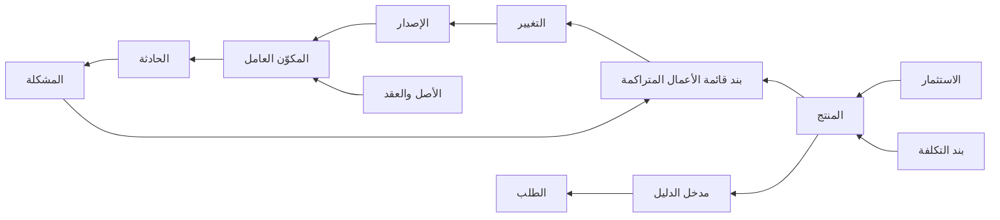
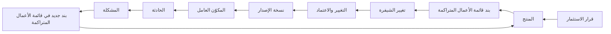

# الوحدة 9 — السجلات التي تدير تقنية المعلومات

*بعد ثالث انقطاع في خدمة المدفوعات خلال ستة أشهر، طرح أحد أعضاء مجلس الإدارة على عمر، الرئيس التنفيذي للمعلومات في بنك نجم، سؤالًا بسيطًا: «ما الأنظمة التي مسّها هذا الانقطاع، وأي تغيير تسبّب فيه، وأي استثمار موّل ذلك التغيير، وكم كلّفنا الانقطاع؟» قدّمت أربعة فرق أربع إجابات من أربع أدوات، ولم تتفق منها اثنتان. لم يكن قطاع التقنية في بنك نجم يفتقر إلى البيانات، بل كان يفتقر إلى سجلات يرتبط بعضها ببعض. تتناول هذه الوحدة المجموعة الصغيرة من السجلات التي تتيح لمؤسسة تقنية المعلومات أن ترى نفسها: ما هذه السجلات وكيف تترابط (9.1)، وكيف تُبقي بيانات التهيئة والأصول صحيحة بما يكفي لتثق بها (9.2)، وكيف تتتبّع الطريق من الاستثمار إلى الحادثة ثم تعود (9.3). تملك هدى، رئيسة البنية المؤسسية، تصميم السجلات؛ ويعتمد عليه يوسف ونور وريم وطارق، ويقع كل منهم في خطأ تستطيع أنت أن تتجنّبه.*

> **الخطوات:** Govern — قرّر أي السجلات توجد، ومن يملك كلًّا منها، وكيف تترابط، وأي دليل يجب أن تقدّمه عند الطلب.

---

# 9.1 — نموذج المعلومات: السجلات القليلة المهمة وكيف تترابط
*المستوى (Level): 🔴 متقدم (Advanced)* · *المتطلبات (Prerequisites): 2.1، 6.3* · *الخطوة (Step): Govern*

**بعد هذا الدرس تستطيع** أن ترسم في صفحة واحدة نموذج معلومات لمؤسسة تقنية المعلومات لديك، يسمّي نحو عشرة سجلات أساسية، ويعطي كلًّا منها مالكًا ونظام سجل مرجعيًا، ويذكر القرار الذي يخدمه كل سجل، ويُظهر الروابط بينها. *مدة الدراسة: قراءة نحو 15 دقيقةً، وعمل تطبيقي نحو 150 دقيقةً (تقدير).*

## ⚡ الدرس في دقيقة (In 60 seconds)
- **نموذج المعلومات (information model)** خريطة بسيطة للسجلات التي تحتفظ بها المؤسسة: ماذا يعني كل سجل، ومن يملكه، وكيف ترتبط السجلات. إنه أداة إدارية، لا تصميم لقاعدة بيانات.
- تحتاج معظم مؤسسات تقنية المعلومات إلى نحو عشرة **سجلات أساسية (core records)**: الاستثمار، والمنتج، ومدخل الدليل، وبند قائمة الأعمال المتراكمة، والتغيير، والإصدار، والمكوّن العامل، والأصل والعقد، والطلب، والحادثة والمشكلة، وبند التكلفة.
- القاعدة الأهم: **لا يستحق السجل مكانه إلا إذا قرأه قرار مسمّى.** إن لم يقرأه أي قرار، فتوقّف عن جمعه.
- لكل سجل أساسي **نظام سجل مرجعي (system of record)** واحد بالضبط: المكان الوحيد الذي يُنشأ فيه السجل ويُصحَّح. وكل نسخة أخرى نسخةُ تقارير.
- الروابط أهم من السجلات. و**معرّف المنتج (product identifier)** المشترك الذي يظهر على كل سجل هو أرخص رابط تستطيع إضافته وأقواها أثرًا.
- أكبر فخ: إطلاق برنامج «مصدر واحد للحقيقة» يحاول أن ينمذج كل شيء. نمذج القرارات أولًا، ثم السجلات والروابط التي تحتاجها فقط.

## 🧭 لماذا يهم (Why it matters)
بنك نجم وكل من فيه شخصيات خيالية. وكل الأرقام عن بنك نجم في هذا الدرس أرقام توضيحية، لا معايير مرجعية.

حين سأل مجلس الإدارة عمر عن التغيير الذي تسبّب في الانقطاع وعن الاستثمار الذي موّله، كانت الإجابات موزّعة على أماكن مختلفة. سجل التغيير في منصة إدارة الخدمات. وتغيير الشيفرة في مستودع الشيفرة المصدرية. والنسخة المنشورة في سجلات خط النشر (pipeline). والاستثمار في جدول بيانات للمحفظة يحتفظ به طارق، شريك الأعمال المالي لتقنية المعلومات. أما سجل الحادثة فذكر «خادم المدفوعات»، ولم يستطع أحد أن يقول إلى أي منتج ينتمي هذا الخادم، لأن قاعدة بيانات إدارة التهيئة (CMDB)، وهي قاعدة بيانات للمكوّنات التي تشغّلها تقنية المعلومات وعلاقاتها، تستخدم أسماء الخوادم، بينما تستخدم المحفظة رموز المشاريع.

كان كل سجل صحيحًا داخل أداته. وما كان ينقص هو **النموذج**: قائمة متفق عليها بالسجلات الموجودة، وما يعنيه كل منها، والحقول التي تربط بينها. ومن دونه يصبح كل سؤال يعبر أكثر من سجل مشروعًا يدويًا يستغرق أسبوعين، وينتهي بإجابة لا يثق بها أحد تمامًا.

اتخذت هدى السؤال مهمةً لها. ولم تكن خطوتها الأولى شراء أداة أو إطلاق برنامج بيانات، بل سؤالًا: ما القرارات التي يتخذها قطاع التقنية كل شهر، وأي السجلات يحتاجها كل قرار؟

## 📐 كيف يعمل (How it works)

### 🟢 الأساسيات (The essentials)

**ابدأ من القرارات، لا من البيانات.** اكتب القرارات المتكررة التي يتخذها قطاع التقنية، ثم اسأل أي سجل يقرؤه كل قرار. هذه قائمة قصيرة تناسب معظم مؤسسات تقنية المعلومات:

| القرار | من يتخذه | السجل الذي يجب أن يقرأه |
|---|---|---|
| تمويل هذا العمل أو إيقافه | مجلس المحفظة | سجل الاستثمار، وبنود التكلفة، ونتائج المنتج |
| ماذا نبني بعد ذلك | مدير المنتج | بنود قائمة الأعمال المتراكمة المرتبطة بالمنتج |
| اعتماد هذا التغيير أو إصداره | سلطة التغيير أو مالك المنتج | سجل التغيير، وسجل الإصدار، وأدلة الاختبار |
| استعادة هذه الخدمة | مدير الحوادث | سجل الحادثة، والمكوّنات العاملة، والتغييرات الأخيرة |
| إصلاح السبب | مالك المشكلة | سجل المشكلة، والحوادث والتغييرات المرتبطة بها |
| تجديد هذا العقد | مدير المورّدين | سجل الأصل والعقد، والاستخدام، والحوادث بحسب المورّد |
| منح هذه الصلاحية | مالك الخدمة | سجل الطلب، والاستحقاق، ومدخل الدليل |
| الإبلاغ عن هذه التكلفة | الشريك المالي | بنود التكلفة موزّعة على المنتجات |

**السجلات الأساسية.** هذه، بكلمات هذا المقرر، هي السجلات التي تجيب عن تلك الأسئلة. تختلف الأسماء من أداة إلى أخرى؛ والمهم هو المعنى.

| السجل | ماذا يعني السجل الواحد | نظام السجل المرجعي المعتاد |
|---|---|---|
| **الاستثمار** | قرار تمويل: المبلغ، والفترة، والنتيجة المتوقعة، والمالك | أداة المحفظة أو النظام المالي |
| **المنتج** | منتج رقمي أو خدمة يملكها فريق ويستخدمها عميل | دليل المنتجات أو دليل الخدمات |
| **مدخل الدليل** | شيء واحد يستطيع المستهلك طلبه أو الاشتراك فيه، مع شروطه | دليل الخدمات في منصة إدارة الخدمات |
| **بند قائمة الأعمال المتراكمة** | وحدة من العمل المخطط: ميزة أو إصلاح أو متطلب | أداة تتبّع العمل |
| **التغيير** | قرار بتعديل شيء عامل، مع مخاطره واعتماده | منصة إدارة الخدمات أو خط النشر |
| **الإصدار** | نسخة محددة من منتج أُتيحت للمستخدمين | خط النشر ومستودع المخرجات |
| **المكوّن العامل** | شيء يعمل ويمكن أن يتعطل: نسخة تطبيق، أو قاعدة بيانات، أو عنقود، أو جهاز شبكة؛ ويُسمّى غالبًا عنصر التهيئة (configuration item) | قاعدة CMDB، ويُفضَّل أن تغذّيها أدوات الاكتشاف وشيفرة البنية التحتية |
| **الأصل والعقد** | شيء يملكه البنك أو يرخّصه، مع تكلفته وشروطه | أداة إدارة الأصول، ومستودع العقود |
| **الطلب** | مستهلك يطلب شيئًا من الدليل | منصة إدارة الخدمات |
| **الحادثة والمشكلة** | انقطاع في الخدمة؛ والسبب الكامن وراء واحدة أو أكثر من هذه الانقطاعات | منصة إدارة الخدمات |
| **بند التكلفة** | وحدة إنفاق: سطر في فاتورة، أو سطر في فاتورة السحابة، أو حصة من تكلفة الموظفين | النظام المالي، وفوترة السحابة |

**الروابط هي الغاية.** السجل الذي لا روابط له لا يجيب إلا عن أسئلة تخصّه وحده. وهذه أقل الروابط التي تجعل الأسئلة العابرة للسجلات قابلة للإجابة:

اقرأ المخطط جملًا: الاستثمار يموّل منتجًا؛ والعمل على المنتج بند في قائمة الأعمال المتراكمة؛ والبند يُسلَّم عبر تغيير وإصدار؛ والإصدار يعمل على مكوّنات عاملة؛ والحادثة تصيب مكوّنًا عاملًا؛ والمشكلة تفسّر الحوادث وتُنشئ بنودًا جديدة في قائمة الأعمال المتراكمة. وبنود التكلفة تُوزَّع على المنتجات. والأصول والعقود تقوم عليها المكوّنات العاملة.

**معرّف واحد لكل منتج.** أنفع قرار تصميمي على الإطلاق هو **معرّف منتج** قصير ثابت (مثلًا `CARDS-PAY`) يظهر حقلًا أو وسمًا على كل سجل في السلسلة: على الاستثمار، وقائمة الأعمال المتراكمة، والمستودع، وخط النشر، وموارد السحابة، ومدخلات CMDB، والحوادث، وبنود التكلفة. لا يكاد يكلّف شيئًا، ويصمد أمام تغيير الأدوات، ويحوّل كثيرًا من التحقيقات التي تستغرق أسبوعين إلى عامل تصفية.

### 🟡 التعمق أكثر (Going deeper)

**نظام السجل المرجعي، ونظام التفاعل، ونسخة التقارير.** ثلاثة أدوار يمكن أن تؤديها أداة تجاه سجل ما:

- **نظام السجل المرجعي:** المكان الوحيد الذي يُنشأ فيه السجل ويُعدَّل ويُصحَّح. إذا اختلفت أداتان، فهذه هي التي يُؤخذ بقولها.
- **نظام التفاعل (system of engagement):** حيث يتعامل الناس مع السجل يومًا بيوم. قد يفتح مهندس تغييرًا من خط النشر (التفاعل)، بينما تحتفظ منصة إدارة الخدمات بسجل التغيير (السجل المرجعي).
- **نسخة التقارير (reporting copy):** نسخة تُسحب إلى لوحة متابعة أو مستودع بيانات أو جدول بيانات. مفيدة، ولا تُعدَّل أبدًا، ويُذكر تاريخها دائمًا.

اكتب نظام السجل المرجعي لكل سجل أساسي على النموذج.

**للملكية ثلاث طبقات.** لكل سجل: **مالك السجل (record owner)** الذي يقرر ما يعنيه السجل وأي الحقول إلزامية (وغالبًا يكون فريق هدى أو مالك العملية)؛ و**أمين البيانات (data steward)** الذي يراقب جودته (9.2)؛ و**المُنشِئون** الذين يملؤونه جزءًا من عملهم. من دون مالك للسجل تنجرف التعريفات. ومن دون أمين تتراجع الجودة. ومن دون مُنشئين يرون قيمة في السجل، يُملأ بسوء أو لا يُملأ أصلًا.

**عرّف كل سجل في سطر واحد، مع حُبيبيته.** تعني **الحُبيبية (grain)** ما يمثّله الصف الواحد. فعبارة «سجل حادثة واحد لكل انقطاع في الخدمة، لا لكل تنبيه» قرار حُبيبية. وعبارة «سجل مكوّن عامل واحد لكل نسخة تطبيق، لا لكل حاوية» قرار آخر. تشكّل قرارات الحُبيبية كل تقرير يُبنى على السجل، فاتخذها صراحةً ودوّنها.

**الحقول الإلزامية: أقل ما يمكن.** اختر لكل سجل الحقول القليلة التي تحتاجها القرارات (المالك، ومعرّف المنتج، والحالة، والتواريخ، وحقول الربط)، واجعلها وحدها إلزامية. فكل حقل إلزامي إضافي يُضعف جودة الحقول الأخرى كلها، لأن الناس تحت ضغط الوقت يملؤون الاستمارات ليتجاوزوها.

### 🔴 نظرة الخبير (Expert view)

**تجنّب نموذج البيانات الشامل.** تميل المؤسسات الكبيرة إلى تعريف كل كيان وسمة قد تحتاجها تقنية المعلومات يومًا ما، ثم شراء منصة واحدة تضمّها كلها. وتمتد هذه البرامج عادةً سنوات، وتنتهي بنموذج لا يستخدمه أحد. فنموذج من عشرة سجلات وخمسة عشر رابطًا يُستخدم كل أسبوع أفضل من نموذج من مئتي كيان يُستخدم لتدقيق مرة في السنة.

**وزّع السجلات، ومركِز الروابط.** لن تحصل على أداة واحدة لكل شيء، ولا ينبغي أن تحاول. دع كل سجل يعيش في الأداة التي تناسب مُنشئيه، واستثمر بدلًا من ذلك في **حقول الربط** (المعرّفات المشتركة) وفي **طبقة تكامل** صغيرة أو مخزن تقارير يجمع بينها. تتناول الوحدة 11 منظور سلسلة الأدوات (toolchain)؛ أما القرار هنا فهو أي المعرّفات إلزامية في أي أداة.

**الحُبيبية قرار تكلفة.** كل نوع سجل إضافي وكل حُبيبية أدق يجب أن يُنشأ ويُربط ويُبقى صحيحًا. اسأل «أي قرار يتغير إذا عرفنا هذا؟» قبل أن تضيفه.

**الذكاء الاصطناعي يرفع المخاطر.** أدوات الذكاء الاصطناعي التي تلخّص الحوادث أو تجيب عن سؤال «ما الذي تغيّر؟» لا تكون أفضل من الروابط التي تستطيع أن تتبعها؛ ويعود الدرس 11.3 إلى هذا.

**القاعدة التي تُحفظ:** *لا يستحق السجل مكانه إلا إذا قرأه قرار مسمّى.*

## 🧰 الأدوات (The toolkit)
| المصدر أو الأداة أو القالب (Resource, tool or template) | ما هو وماذا يفعل (What it is and does) | متى تلجأ إليه (When to reach for it) |
|---|---|---|
| **Decision-to-record table** — جدول القرارات والسجلات | يسرد كل قرار متكرر ومالكه والسجل الذي يقرؤه | أولًا، قبل رسم أي نموذج |
| **Record card** — بطاقة السجل | بطاقة لكل سجل: معناه في سطر، وحُبيبيته، ومالكه، وأمينه، ونظام سجله المرجعي، وحقوله الإلزامية، وحالاته | عند تعريف سجل أو مراجعته |
| **Link map** — خريطة الروابط | مخطط من صفحة واحدة للسجلات والحقول التي تربط بينها | للاتفاق على النموذج مع كل الفرق |
| **Product identifier register** — سجل معرّفات المنتجات | قائمة معرّفات المنتجات ومالكيها وحالتها | عند إنشاء منتج أو إيقافه، أو عند وسم الموارد |
| **Orphan report** — تقرير السجلات اليتيمة | استعلام يسرد السجلات التي لا روابط لها (تغييرات بلا منتج، وحوادث بلا مكوّن عامل) | شهريًا، بوصفه أبسط فحص للسلامة |
| **Service management platform or CMDB** — منصة إدارة الخدمات أو CMDB | فئة من الأدوات تحتفظ بالتغييرات والحوادث والطلبات والمكوّنات العاملة؛ ومن أمثلتها ServiceNow وJira Service Management | حيث تعيش معظم السجلات التشغيلية |

الأدوات المذكورة أمثلة، لا توصيات.

## 🏛️ عمليًا في بنك نجم (In practice at Najm Bank)
خيالي وتوضيحي. عقدت هدى ورشتي عمل: الأولى مع فريق عمر القيادي لسرد القرارات، والثانية مع مُنشئي السجلات (المهندسين، ومكتب الخدمة، والمالية) لتتحقق مما يملؤونه فعلًا.

سمّت **خريطة السجلات** التي أعدّتها في صفحة واحدة لقطاع التقنية أحد عشر سجلًا، لكل منها بطاقة. وغيّرت ثلاث نتائج الخطة:

1. **نظاما سجل مرجعي للمكوّنات العاملة.** كانت قاعدة CMDB ومخزون السحابة يدّعي كل منهما أنه المرجع لخوادم السحابة. فجعلت هدى مخزون السحابة (الذي تغذّيه شيفرة البنية التحتية) نظامَ السجل المرجعي لموارد السحابة، وجعلت CMDB مستهلكًا له.
2. **لا منتج على الحوادث.** كان في سجلات الحوادث حقل «الخدمة» فيه 340 قيمة نصية حرة (رقم توضيحي). فاستبدلت به هدى معرّف المنتج، يُختار من قائمة المنتجات الـ31 من الدرس 2.1.
3. **بنود التكلفة موزّعة على المشاريع لا على المنتجات.** كانت تقارير التكلفة لدى طارق تستخدم رموز مشاريع تنتهي بانتهاء المشاريع. فاتفقا على إضافة معرّف المنتج إلى كل بند تكلفة بدءًا من الربع التالي، مع الإبقاء على رموز المشاريع لأسئلة المحاسبة الرأسمالية، على أن يتأكد طارق من ذلك مع الإدارة المالية.

كان خطؤها الأول أن جعلت أربعة عشر حقلًا إلزاميًا في سجل التغيير. وخلال شهر أراها سامي، قائد هندسة المنصات، أن المهندسين يلصقون النص نفسه في ستة حقول. فخفّضتها إلى خمسة حقول إلزامية، وجعلت خط النشر يملأ ثلاثة منها تلقائيًا.

## 🛠️ التمارين (Exercises)
**🟢 اسرد القرارات والسجلات.** اكتب القرارات المتكررة التي تتخذها مؤسسة تقنية المعلومات لديك، من ثمانية إلى اثني عشر قرارًا. وسمِّ لكل منها مالكه والسجل الذي يقرؤه.
*يكتمل عندما (Done when):* يوجد جدول فيه ثمانية قرارات على الأقل، لكل منها مالك وسجل، وتكون قد علّمت كل قرار لا يوجد سجله اليوم.

الإجابة النموذجية والتحقق الذاتي

**الإجابة النموذجية.** يشبه الجدول الجيد جدول القرارات في «الأساسيات» بعد تكييفه لمؤسستك، وفيه فجوة واحدة معلَّمة على الأقل، مثل «تجديد العقد: لا يوجد سجل يربط الحوادث بالمورّد». **التحقق الذاتي.**
- هل كل قرار قرارٌ يُتخذ فعلًا وفق جدول زمني أو عند حدث محدد؟
- هل لكل قرار دور مسمّى مالكًا له، لا «تقنية المعلومات»؟
- هل سمّيت سجلًا، لا أداة؟
- هل وجدت قرارًا واحدًا على الأقل يُتخذ بلا سجل؟

**🟡 ارسم خريطة الروابط لديك.** ارسم سجلاتك الأساسية (اثنا عشر سجلًا على الأكثر) والروابط بينها. اكتب حقل الربط على كل سهم، وعلّم كل رابط بأنه «موجود» أو «جزئي» أو «مفقود».
*يكتمل عندما (Done when):* يُظهر مخطط من صفحة واحدة كل السجلات، ولكل رابط حقل مسمّى، ولكل رابط حالة.

الإجابة النموذجية والتحقق الذاتي

**الإجابة النموذجية.** قريبة من المخطط في هذا الدرس، مع حقول ربط مثل «معرّف المنتج»، و«رقم التغيير في ملاحظات الإصدار»، و«المكوّن العامل في سجل الحادثة». وتجد معظم المؤسسات أن رابطَي التغيير بالإصدار والحادثة بالتغيير جزئيان. **التحقق الذاتي.**
- هل يوجد مسار من الاستثمار إلى الحادثة؟
- هل يوجد مسار من بند التكلفة إلى المنتج؟
- هل يسمّي كل سهم حقلًا، لا مجرد نية؟
- هل قاومت إضافة سجلات لا يقرؤها أي قرار؟

**🔴 اعثر على السجلات اليتيمة.** اختر رابطين معلَّمين «جزئي». واسحب لكل منهما عيّنة من 20 سجلًا حديثًا، وعُدّ كم منها مُلئ فيه الرابط بشكل صحيح. اكتب نظام السجل المرجعي ومالك السجل لكل نوع سجل، وتغييرًا واحدًا يرفع نسبة الربط.
*يكتمل عندما (Done when):* يكون لديك عدّان من 20، ومالكان مسمّيان، وتغييران مقترحان، كل منهما صغير بما يكفي لإنجازه في شهر.

الإجابة النموذجية والتحقق الذاتي

**الإجابة النموذجية.** مثلًا: «12 من 20 حادثة سمّت المكوّن العامل الصحيح؛ نظام السجل المرجعي: منصة إدارة الخدمات؛ المالك: رئيس عمليات تقنية المعلومات؛ التغيير: الاختيار من قائمة مصفّاة بحسب المنتج بدل النص الحر». «7 من 20 تغييرًا ارتبطت ببند في قائمة الأعمال المتراكمة؛ نظام السجل المرجعي: منصة إدارة الخدمات؛ المالك: قائد المنصة؛ التغيير: يملأ خط النشر الرابط من رسالة الإيداع». **التحقق الذاتي.**
- هل تحققت من صحة الرابط، لا من امتلاء الحقل فقط؟
- هل كل تغيير مقترح تلقائي أو مبني في العمل نفسه، لا تذكيرٌ بأن «املأه»؟
- هل سمّيت مالكًا واحدًا، لا لجنة؟

## ⚠️ أخطاء وفخاخ (Mistakes and traps)
- **البدء من المخطط الافتراضي للأداة.** إنه ينمذج ما يبيعه المورّد، لا ما تقرره أنت. ابدأ من قراراتك، ثم طابقها مع الأداة بعد ذلك.
- **نظاما سجل مرجعي لسجل واحد.** هذا سبب معظم المعارك حول جودة البيانات. سمِّ نظامًا واحدًا، واجعل الآخر مستهلكًا.
- **حقول إلزامية كثيرة.** يملؤها الناس بالحشو. اقصر الحقول الإلزامية على ما تحتاجه القرارات، ودع الأتمتة تملأ الباقي.
- **سجلات بلا روابط.** السجلات الصحيحة غير المترابطة لا تجيب عن أي سؤال عابر للسجلات. أضف معرّف المنتج في كل مكان أولًا.
- **نص حر حيث ينبغي أن تكون قائمة.** أسماء المنتجات أو الخدمات المكتوبة نصًا حرًا لا يمكن ربطها. استخدم قوائم مضبوطة يملكها مالك السجل.
- **نموذج لا يراجعه أحد.** راجع خريطة السجلات مرتين في السنة، وبعد أي تغيير في الأدوات.

## 🧾 الخلاصة (Recap)
- يسمّي نموذج المعلومات السجلات الأساسية، ومعناها، ومالكها، ونظام سجلها المرجعي، وروابطها.
- ابدأ من **القرارات**؛ لا يستحق السجل مكانه إلا إذا قرأه قرار مسمّى.
- نحو عشرة سجلات تكفي معظم مؤسسات تقنية المعلومات؛ والروابط أهم من السجلات نفسها.
- لكل سجل نظام سجل مرجعي **واحد**؛ وكل ما عداه نسخة تقارير.
- **معرّف المنتج** الثابت على كل سجل هو أرخص رابط عالي القيمة.
- أبقِ النموذج صغيرًا، وبكلماتك أنت، ولا توسّعه إلا حين يحتاج إليه قرار.

## ✍️ اختبر نفسك (Check yourself)
**1. تجد هدى أن قاعدة CMDB ومخزون السحابة يدّعي كل منهما أنه المرجع لخوادم السحابة، وأنهما مختلفان. ماذا ينبغي أن تفعل أولًا؟**

- A. تطلب من الفريقين مطابقة القائمتين يدويًا في نهاية كل شهر.
- B. تبني لوحة متابعة تعرض القائمتين جنبًا إلى جنب ليختار الناس منهما.
- C. تعتمد نظام سجل مرجعي واحدًا لموارد السحابة، والآخر مستهلك له.
- D. تنقل كل سجلات خوادم السحابة إلى CMDB وتوقف مخزون السحابة.

الإجابة

**C.** يحتاج نوع السجل الواحد إلى نظام سجل مرجعي واحد بالضبط؛ وينبغي للأداة الأخرى أن تستهلكه. يُبقي A وB مصدرين حيّين ويدفعان الخلاف إلى الناس. ويختار D فائزًا دون أن يسأل أي الأداتين أقرب إلى الحقيقة؛ وفي بنك نجم كان مخزون السحابة، الذي تغذّيه شيفرة البنية التحتية، هو الأقرب. انظر «نظام السجل المرجعي، ونظام التفاعل، ونسخة التقارير».

**2. أي اختبار هو الأفضل لتقرير ما إذا كان نوع سجل جديد مقترح ينتمي إلى نموذج المعلومات؟**

- A. أن يحتاج إليه قرار متكرر مسمّى لا يمكن اتخاذه جيدًا من دونه.
- B. أن توفّر له منصة إدارة الخدمات جدولًا جاهزًا في إعداداتها الافتراضية.
- C. أن يكون معروفًا أن بنكًا آخر بالحجم نفسه يتتبّع السجل نفسه في CMDB.
- D. أن يمكن جمع البيانات تلقائيًا، فلا يكلّف جمعها إلا القليل جدًا.

الإجابة

**A.** قاعدة الدرس أن السجل لا يستحق مكانه إلا إذا قرأه قرار مسمّى. أما الإعداد الافتراضي للمورّد (B)، أو ممارسة بنك نظير (C)، أو رخص الجمع (D)، فلا يُظهر أيٌّ منها أن أحدًا سيستخدم السجل؛ والبيانات الرخيصة يجب أيضًا أن تُربط وتُبقى صحيحة. انظر «الأساسيات».

**3. تريد ريم، مديرة منتج البطاقات والمدفوعات، أن تعرف كم حادثة في الربع الماضي جاءت بعد إصدار لمنتجها. السجلات موجودة في أربع أدوات. أي خيار تصميمي واحد يجعل هذا السؤال قابلًا للإجابة بأكثر الطرق مباشرة؟**

- A. اجتماع أسبوعي يعرض فيه مالك كل أداة أرقامه الخاصة بمنتجها.
- B. مستودع بيانات ينسخ كل جداول الأدوات الأربع في كل ليلة.
- C. حقل نصي حر إلزامي جديد في الحوادث يصف الإصدار المتأثر.
- D. معرّف منتج مشترك على الإصدارات والمكوّنات العاملة والحوادث.

الإجابة

**D.** المعرّف المشترك يتيح ربط السجلات بعامل تصفية. ينسخ B البيانات لكنه لا يجعلها قابلة للربط؛ فمن دون معرّفات مشتركة يحتفظ المستودع بأربع مجموعات غير مترابطة. ويضيف C نصًا حرًا لا يمكن ربطه بموثوقية، وA يدوي. انظر «معرّف واحد لكل منتج».

**4. ماذا تعني «الحُبيبية» عند تعريف سجل؟**

- A. مستوى التفصيل الذي يُسمح به في حقل الوصف النصي الحر للسجل.
- B. ما يمثّله السجل الواحد: حادثة لكل انقطاع، لا لكل تنبيه.
- C. عدد مرات نسخ السجل من نظام سجله المرجعي إلى التقارير الدورية.
- D. عدد الحقول الإلزامية التي يجب أن يملأها المُنشئ قبل حفظ السجل.

الإجابة

**B.** الحُبيبية هي ما يمثّله الصف الواحد، وهي تشكّل كل تقرير يُبنى على السجل. أما الخيارات الأخرى فتصف النص الحر، وتواتر التقارير، وتصميم الاستمارات. انظر «عرّف كل سجل في سطر واحد، مع حُبيبيته».

**5. بعد شهر من جعل هدى أربعة عشر حقلًا إلزاميًا في سجل التغيير، يُظهر سامي أن المهندسين يلصقون النص نفسه في ستة منها. ما أفضل استجابة؟**

- A. تقليص الحقول الإلزامية إلى حاجة القرارات، وترك خط النشر يملأ ما يستطيع.
- B. إضافة قواعد تحقق ترفض أي سجل تغيير يحتوي فيه حقلان على النص نفسه.
- C. الإبقاء على الحقول الأربعة عشر كلها وتدريب المهندسين ليفهموا أهمية كل حقل.
- D. جعل الحقول اختيارية للمهندسين مع إبقائها إلزامية على موظفي مكتب الخدمة.

الإجابة

**A.** كثرة الحقول الإلزامية تُضعف جودتها كلها؛ والعلاج حقول أقل وأتمتة. يدفع B الناس إلى تنويع الحشو، ويعامل C مشكلة تصميم كأنها مشكلة تدريب، ويجعل D السجل غير متسق بحسب من يُنشئه. انظر «الحقول الإلزامية: أقل ما يمكن».

## 📚 المراجع (References)
- DORA، *Accelerate State of DevOps Report 2023* (Google Cloud). يذكر إعلان Google Cloud عن التقرير (5 أكتوبر 2023) أن «التوثيق عالي الجودة يضخّم الأثر الذي تُحدثه القدرات التقنية في DevOps (مثل التكامل المستمر والتطوير على الفرع الرئيسي) في الأداء المؤسسي» (ترجمة بتصرّف). https://cloud.google.com/blog/products/devops-sre/announcing-the-2023-state-of-devops-report (التقرير الكامل: https://dora.dev/research/2023/dora-report/2023-dora-accelerate-state-of-devops-report.pdf)
- من المكتبة: [*هندسة البيانات والتحليلات: من الصفر إلى الاحتراف*، الدرس 6.1 — حوكمة بيانات تعمل فعلًا: الملكية والفهرس والنسب وعقود البيانات](../data/index.ar.html#/6.1) (الملكية والنسب في منصات البيانات، وهي تنطبق هنا على سجلات تقنية المعلومات نفسها).
- من المكتبة: [*السحابة وDevOps: من الصفر إلى الاحتراف*، الدرس 3.3 — السياسة بوصفها شيفرة والانحراف والحواجز الواقية](../cloud/index.ar.html#/3.3) (شيفرة البنية التحتية بوصفها المصدر المعلَن لموارد السحابة).

---

# 9.2 — جودة بيانات التهيئة والأصول: الملكية والمطابقة والتقادم
*المستوى (Level): 🔴 متقدم (Advanced)* · *المتطلبات (Prerequisites): 9.1، 6.3* · *الخطوة (Step): Govern*

**بعد هذا الدرس تستطيع** أن تُعدّ بطاقة أداء لجودة بيانات سجلات التهيئة والأصول: تسمّي مالكًا لكل سمة، وتضع قواعد مطابقة بين البيانات المكتشَفة والبيانات المعلَنة، وتقيس الاكتمال والصحة والحداثة من عيّنة، وتقرر ما تصلحه أولًا. *مدة الدراسة: قراءة نحو 15 دقيقةً، وعمل تطبيقي نحو 160 دقيقةً (تقدير).*

## ⚡ الدرس في دقيقة (In 60 seconds)
- **بيانات التهيئة (configuration data)** تصف ما يعمل وكيف يتصل بعضه ببعض؛ و**بيانات الأصول (asset data)** تصف ما تملكه المؤسسة أو ترخّصه، وتكلفته، وشروطه. تتداخلان، لكنهما تجيبان عن أسئلة مختلفة.
- البيانات في CMDB **تتقادم (decay)**: كل تغيير وكل ترحيل وكل إيقاف لمكوّن يجعل بعض السجلات خاطئة، ما لم يكن التحديث جزءًا من العمل.
- يغذّي السجلاتِ مصدران: البيانات **المكتشَفة** (ما تجده أدوات المسح عاملًا)، والبيانات **المعلَنة** (ما تقول شيفرة البنية التحتية والعقود والناس إنه ينبغي أن يوجد). و**المطابقة (reconciliation)** تقارن بينهما وتقرر أيهما يُعتمد، سمةً سمة.
- القاعدة الأهم: **لكل سمة مالك واحد ومصدر موثوق واحد.** لا تكفي الملكية على مستوى السجل؛ فعنوان IP لخادم ما ومالكه في الأعمال يأتيان من مكانين مختلفين.
- قِس الجودة بـ**عيّنة**، لا بانطباع: الاكتمال، والصحة، والحداثة، والتفرّد.
- أكبر فخ: مشروع تنظيف كبير. فما لم تغيّر طريقة دخول البيانات، تعود CMDB إلى التقادم خلال أشهر.

## 🧭 لماذا يهم (Why it matters)
بنك نجم وكل من فيه شخصيات خيالية. وكل الأرقام عن بنك نجم في هذا الدرس أرقام توضيحية، لا معايير مرجعية.

خلال انقطاع المدفوعات الثالث، فتح فريق الحادثة قاعدة CMDB ليعرف ما الذي يعتمد على قاعدة البيانات المتعطلة. أدرجت ستة تطبيقات. كان اثنان منها قد أُوقفا قبل سنة. أما التطبيق الذي تعطّل فعلًا، وهو خدمة جديدة لترميز البطاقات، فلم يكن مدرجًا أصلًا، لأنه بُني على المنصة السحابية ولم يُخبر أحدٌ CMDB به. وأمضى الفريق أربعين دقيقة يبحث عن هذا الاعتماد بقراءة الشيفرة وسؤال الناس في المحادثات.

كان يوسف، رئيس عمليات تقنية المعلومات، قد سمع هذه القصة من قبل. فقد نظّف فريقه CMDB قبل ثمانية عشر شهرًا: مشروع استمر ستة أشهر، ومستشار، واحتفال. ثم وجد فحص بالعيّنة هذا العام أن نحو ثلث سجلات الخوادم فيها سمة رئيسية واحدة خاطئة على الأقل. أصلح التنظيف البيانات مرة واحدة، لكنه لم يغيّر طريقة دخولها.

وفي الوقت نفسه كانت لينا، مديرة المورّدين والتوريد، تستعد لتجديد ترخيص برمجيات. كانت أداة الأصول لديها تقول إن لدى البنك 1,200 تثبيت لأحد منتجات قواعد البيانات؛ وكان خطاب التدقيق من المورّد يقول 1,450. لم تستطع أن تقول أي الرقمين صحيح.

## 📐 كيف يعمل (How it works)

### 🟢 الأساسيات (The essentials)

**بيانات التهيئة وبيانات الأصول.** كثيرًا ما تكونان في الأداة نفسها، لكنهما تجيبان عن أسئلة مختلفة.

| | بيانات التهيئة | بيانات الأصول |
|---|---|---|
| السؤال الذي تجيب عنه | ما الذي يعمل، وكيف هو مُعَدّ، وما الذي يعتمد على ماذا؟ | ماذا نملك أو نرخّص، وكم كلّف، وما شروطه؟ |
| المستخدمون الرئيسيون | العمليات، والحوادث، والتغيير، والأمن | المالية، والتوريد، وإدارة المورّدين، والتدقيق |
| الوحدة | المكوّن العامل، أي عنصر التهيئة (configuration item) | الأصل (جهاز، أو ترخيص، أو اشتراك، أو عقد) |
| ما الذي يخطئ | اعتماديات مفقودة، وسجلات قديمة، وعناصر موقوفة ما زالت مدرجة | تراخيص لا تطابق التثبيتات، وأصول بلا مالك، وعقود تنتهي دون أن يلاحظها أحد |

**تعريفات تستطيع الاستشهاد بها.** أفادت ملخصات البحث (ولم تُفتح الصفحة لهذا الدرس) بأن مسرد NIST يعرّف **عنصر التهيئة** بأنه تجميع لمكوّنات نظام معلومات «مخصّص لإدارة التهيئة ويُعامَل كيانًا واحدًا في عملية إدارة التهيئة» (ترجمة بتصرّف)، مستشهدًا بالوثيقة NIST SP 800-128. أما **إدارة أصول تقنية المعلومات (ITAM)** فهي الانضباط الذي يدير أصول تقنية المعلومات طوال دورة حياتها؛ وتفيد التقارير بأن المعيار ISO/IEC 19770-1:2017 يضع متطلبات نظام لإدارة أصول تقنية المعلومات. كما تفيد بأن ضوابط CIS Critical Security Controls (الإصدار 8) الصادرة عن Center for Internet Security تبدأ بضابطين للجرد: الضابط 1 «جرد أصول المؤسسة والتحكم فيها»، والضابط 2 «جرد الأصول البرمجية والتحكم فيها».

**لماذا تتقادم البيانات.** سجل CMDB صحيح في يوم كتابته. وبعد ذلك يمكن لكل تغيير، وكل توسّع، وكل ترحيل، وكل نقل ترخيص، وكل إيقاف أن يجعله خاطئًا. وإذا كان التحديث يعتمد على أن يتذكر أحدٌ تعديل استمارة بعد ذلك، فإن نسبة من التحديثات لن تحدث. التقادم ليس تقصيرًا أخلاقيًا من فريق العمليات؛ إنه النتيجة المتوقعة لعملية يكون فيها تحديث السجل منفصلًا عن أداء العمل.

**مقاييس الجودة الأربعة.** أبقِها بسيطة، وقِسها من عيّنات:

| المقياس | السؤال | كيف تتحقق |
|---|---|---|
| **الاكتمال (completeness)** | هل السمات الإلزامية مملوءة؟ | استعلام: نسبة السجلات التي اكتملت فيها كل الحقول الإلزامية |
| **الصحة (accuracy)** | هل القيم تطابق الواقع؟ | خذ عيّنة من 20 إلى 50 سجلًا؛ وتحقق من كل منها مقابل النظام الحي |
| **الحداثة (freshness)** | متى أُكّد السجل آخر مرة؟ | نسبة السجلات التي أكّدها الاكتشاف أو المالك في آخر 30 أو 90 يومًا |
| **التفرّد (uniqueness)** | هل كل شيء حقيقي مسجّل مرة واحدة؟ | استعلام عن التكرارات المحتملة (الرقم التسلسلي نفسه، واسم المضيف نفسه) |

الاكتمال سهل القياس، وهو الأقل أهمية. فقد يكون السجل مكتملًا وخاطئًا. أما الصحة فتحتاج إلى عيّنة يتحقق منها شخص أو مصدر حي، وهي المقياس الأهم.

### 🟡 التعمق أكثر (Going deeper)

**المكتشَف مقابل المعلَن.** نوعان من المصادر يغذّيان سجلات التهيئة والأصول:

- **البيانات المكتشَفة (discovered data)** تأتي من أدوات تمسح الشبكات والحسابات السحابية والأجهزة الطرفية، وتبلّغ عمّا يعمل فعلًا وكيف هو مُعَدّ. وهي جيدة للسمات التقنية (اسم المضيف، ونظام التشغيل، والبرمجيات المثبّتة، والاتصالات)، وضعيفة في المعنى (من يملكه، وأي منتج يخدم، وهل ينبغي أن يوجد أصلًا).
- **البيانات المعلَنة (declared data)** تأتي مما يقول الناس والأنظمة إنه ينبغي أن يوجد: شيفرة البنية التحتية، وملفات وصف النشر، وأوامر الشراء، والعقود، ودليل المنتجات. وهي جيدة للمعنى والقصد، وقد تكون قديمة أو خاطئة بشأن ما يعمل فعلًا.

لا يكفي أيٌّ منهما وحده. فالخادم المكتشَف الذي لم يعلنه أحد قد يكون من تقنية المعلومات الظلية (shadow IT) أو أثرًا لهجوم. والخادم المعلَن الذي لا يجده الاكتشاف ربما حُذف دون أن يُوقَف سجله.

**قواعد المطابقة، سمةً سمة.** المطابقة هي مجموعة القواعد التي تقرر، لكل سمة، أي مصدر موثوق، وماذا يحدث حين تختلف المصادر. اكتبها جدولًا:

| السمة | المصدر الموثوق | إذا خالفه مصدر آخر |
|---|---|---|
| اسم المضيف، ونظام التشغيل، وعنوان IP | الاكتشاف | يُعتمد الاكتشاف؛ ويُسجَّل الفرق |
| معرّف المنتج | وسم في شيفرة البنية التحتية أو الدليل | يُعتمد المعلَن؛ وتُرفع الموارد غير الموسومة إلى مالك المنتج |
| المالك في الأعمال | دليل المنتجات | يُعتمد المعلَن؛ وغياب المالك يعني التصعيد خلال 10 أيام عمل |
| البرمجيات المثبّتة ونسختها | الاكتشاف | يُعتمد الاكتشاف؛ ويغذّي الموقف الترخيصي |
| الاستحقاق الترخيصي | سجل العقد | يُعتمد العقد؛ وتذهب الفروق إلى مدير المورّدين |
| حالة دورة الحياة (عامل، موقوف) | سجل التغيير الذي يُغلق عملية الإيقاف | إذا وجد الاكتشاف عنصرًا «موقوفًا» يعمل، تُفتح حادثة |

**ملكية السمات.** لكل صف في هذا الجدول مالك: الشخص المساءل عن صحة تلك السمة، لا عن كتابتها. يملك فريق يوسف السمات التقنية؛ ويملك مديرو المنتجات سمات المنتج والمالك في الأعمال؛ ويملك فريق لينا سمات الاستحقاق. والملكية بحسب السمة تُنهي جدل «CMDB خاطئة، إذن الذنب ذنب العمليات».

**اجعل التحديث جزءًا من العمل.** الإصلاحات الدائمة إصلاحات بنيوية:

- أنشئ المكوّنات العاملة وأوقفها **من خط النشر وشيفرة البنية التحتية**، لا يدويًا بعد ذلك.
- اجعل **إغلاق التغيير** يحدّث السجلات التي مسّها.
- اشترط **معرّف المنتج وسمًا** عند إنشاء المورد؛ وارفض الإنشاء من دونه حيث تسمح المنصة السحابية بذلك (السياسة بوصفها شيفرة؛ انظر رابط المكتبة أدناه).
- عامل **فروق الاكتشاف بنودَ عمل** لها مالكون ومواعيد استحقاق، لا تقريرًا لا يقرؤه أحد.

**جرد البرمجيات ومكوّناتها.** للبرمجيات داخل المنتجات، تسرد **قائمة مكوّنات البرمجيات (SBOM)** المكوّنات والنسخ التي تحتويها قطعة برمجية. وهناك صيغتان مفتوحتان شائعتان. أفادت التقارير (إعلان من Linux Foundation، سبتمبر 2021) بأن SPDX نُشرت معيارًا دوليًا باسم ISO/IEC 5962:2021. وأفادت ملخصات البحث بأن Ecma International نشرت CycloneDX باسم ECMA-424، وكانت الطبعة الأولى في يونيو 2024. ومن منظور نموذج التشغيل (operating model) القرار بسيط: قوائم SBOM التي ينتجها خط النشر تصبح مصدرًا لسمة «البرمجيات المثبّتة ونسختها»، وتربط الإصدارات بالمكوّنات.

### 🔴 نظرة الخبير (Expert view)

**ليس كل شيء مكانه CMDB.** حدّد النطاق بحسب القرار، كما في 9.1. وهذا اختبار مفيد: لا تضع مكوّنًا في CMDB إلا إذا احتاج قرار حادثة أو تغيير أو تكلفة إلى معرفته، **و**كنت تستطيع إبقاءه صحيحًا تلقائيًا. الحاويات قصيرة العمر تفشل عادةً في الشرط الثاني؛ أما العنقود والخدمة ومنتجها فتنجح عادةً في الشرطين.

**الضمان بالعيّنة يتفوّق على لوحات الاكتمال.** لوحة متابعة تعرض «مكتمل بنسبة 98%» تستدعي ثقة لم تُكتسب. أما عيّنة شهرية من 30 سجلًا، يتحقق منها مقابل النظام الحي شخصٌ من خارج الفريق المالك، فتعطي رقمًا للصحة رخيصًا وقابلًا للتكرار ومقنعًا للمدققين.

**الموقف الترخيصي يحتاج إلى الجانبين.** يقارن **الموقف الترخيصي (licence position)** بين الاستحقاقات (ما تسمح به العقود) وعمليات النشر (ما يجده الاكتشاف)، باستخدام **مقياس الترخيص (licence metric)** الذي يعتمده المورّد (لكل نواة، أو لكل مستخدم، أو لكل نسخة). ولا يكون أفضل من أضعف مدخلاته الثلاثة. لا ترسل موقفًا إلى مورّد قبل أن يتفق عليه مالك الأصل ومدير المورّدين، والإدارة القانونية عند الحاجة؛ فتفسير العقد سؤال قانوني، لا سؤال بيانات.

**القاعدة التي تُحفظ:** *لكل سمة مالك واحد ومصدر موثوق واحد، والتحديث جزء من العمل.*

## 🧰 الأدوات (The toolkit)
| المصدر أو الأداة أو القالب (Resource, tool or template) | ما هو وماذا يفعل (What it is and does) | متى تلجأ إليه (When to reach for it) |
|---|---|---|
| **Attribute ownership table** — جدول ملكية السمات | كل سمة رئيسية مع مصدرها الموثوق ومالكها وقاعدة الخلاف | عند تصميم المطابقة أو حسم نزاع |
| **Monthly accuracy sample** — عيّنة الصحة الشهرية | 30 سجلًا عشوائيًا يتحقق منها مدقق مستقل مقابل الأنظمة الحية | كل شهر، وتُعرض مع بطاقة الأداء |
| **Data-quality scorecard** — بطاقة أداء جودة البيانات | الاكتمال والصحة والحداثة والتفرّد بحسب نوع السجل وبحسب المالك | في مراجعة العمليات والحوكمة الشهرية |
| **Discovery difference queue** — طابور فروق الاكتشاف | الفروق بين البيانات المكتشَفة والمعلَنة، تُرفع بنودَ عمل لها مالكون | باستمرار؛ وتُراجَع أسبوعيًا |
| **Licence position sheet** — ورقة الموقف الترخيصي | الاستحقاقات وعمليات النشر ومقياس الترخيص لكل منتج، مع التواقيع | قبل أي تجديد أو تدقيق من المورّد |
| **Discovery and CMDB tools** — أدوات الاكتشاف وCMDB | فئة من الأدوات تمسح البيئات وتحتفظ بسجلات التهيئة؛ ومخزون المزوّد السحابي نفسه مثال على مصدر | لتغذية السمات المكتشَفة تلقائيًا |
| **SBOM generator** — مولّد SBOM | خطوة في خط النشر تسرد المكوّنات البرمجية بصيغة SPDX أو CycloneDX | لربط الإصدارات بالمكوّنات ونسخها |

الأدوات المذكورة أمثلة، لا توصيات.

## 🏛️ عمليًا في بنك نجم (In practice at Najm Bank)
خيالي وتوضيحي. رفض يوسف مشروع تنظيف ثانيًا. وبدلًا منه بنى مع هدى **بطاقة أداء لجودة بيانات CMDB** في صفحة واحدة:

| نوع السجل | الاكتمال | الصحة (عيّنة من 30) | الحداثة (مؤكَّد خلال 30 يومًا) | المالك |
|---|---|---|---|---|
| موارد السحابة | 96% | 27 من 30 | 99% | سامي |
| خوادم مركز البيانات | 91% | 19 من 30 | 54% | يوسف |
| أجهزة الشبكة | 88% | 16 من 30 | 31% | يوسف |
| تراخيص البرمجيات | 79% | 21 من 30 | 62% | لينا |

أخبرته الأرقام أين يتصرف. كانت موارد السحابة جيدة لأنها تُنشأ من شيفرة البنية التحتية مع وسم منتج إلزامي؛ وكان خط النشر لدى سامي يوقفها أيضًا. وكانت أجهزة الشبكة الأسوأ لأن كل تغيير عليها كان يُسجَّل يدويًا. فكان أول إصلاح ليوسف أن يجعل إغلاق تغيير الشبكة يطلق مسحًا اكتشافيًا للجهاز، ويرفع فرقًا إذا خالفه السجل.

أما فجوة التراخيص لدى لينا فتبيّن أن لها ثلاثة أسباب، اكتُشفت خلال بعد ظهر يوم واحد باستخدام جدول السمات: أجهزة افتراضية موقوفة ما زالت مدرجة تثبيتات، وبيئات اختبار محسوبة بمقياس الإنتاج، و60 تثبيتًا فاتت الاكتشاف على شبكة معزولة. ولم ترسل رقمًا إلى المورّد حتى راجعت نور، قائدة مخاطر تقنية المعلومات والضوابط، والإدارة القانونية الموقف.

خطأ يوسف: جعل في البداية فريقه هو من يتحقق من عيّنة الصحة. فنبّهته نور إلى أن المالك الذي يتحقق من سجلاته لا يقدّم دليلًا مستقلًا. فتبادلوا العيّنات بين الفرق.

## 🛠️ التمارين (Exercises)
**🟢 اكتب جدول ملكية السمات.** لنوع سجل واحد تديره (الخوادم، أو موارد السحابة، أو التطبيقات، أو التراخيص)، اسرد ثماني سمات رئيسية مع مصدرها الموثوق ومالكها.
*يكتمل عندما (Done when):* يكون لكل سمة من الثماني مصدر موثوق واحد ودور مالك واحد مسمّى، وتُعلَّم كل سمة لها مصدران مرشحان لاتخاذ قرار بشأنها.

الإجابة النموذجية والتحقق الذاتي

**الإجابة النموذجية.** قريبة من جدول المطابقة في «التعمق أكثر»: السمات التقنية من الاكتشاف، وسمات المعنى (المنتج، والمالك في الأعمال) من المصادر المعلَنة، والاستحقاقات من العقود. **التحقق الذاتي.**
- هل لكل سمة مصدر موثوق واحد بالضبط؟
- هل يملك جانب الأعمال أو المنتج سمات المعنى، لا العمليات وحدها؟
- هل كتبت ما يحدث حين تختلف المصادر؟

**🟡 أجرِ عيّنة صحة.** اختر 20 سجلًا عشوائيًا من نوع واحد. وتحقق من كل سمة رئيسية مقابل النظام الحي أو مالكه. وسجّل الاكتمال والصحة والحداثة.
*يكتمل عندما (Done when):* يكون لديك ثلاثة أرقام للعيّنة، وقائمة بالسمات الخاطئة، وملاحظة بالقيم الخاطئة التي جاءت من تحديثات يدوية.

الإجابة النموذجية والتحقق الذاتي

**الإجابة النموذجية.** نتيجة مثل «18 من 20 مكتملة، و13 من 20 صحيحة، و9 من 20 مؤكَّدة خلال 30 يومًا؛ و6 من 7 أخطاء كانت في سمات تُحدَّث يدويًا». **التحقق الذاتي.**
- هل اخترت السجلات عشوائيًا، لا التي تعرف أنها جيدة؟
- هل تحققت مقابل الواقع، لا مقابل تقرير آخر؟
- هل فصلت القيم المفقودة عن القيم الخاطئة؟
- هل تستطيع أن تسمّي خطوة العملية التي دخل منها كل خطأ؟

**🔴 صمّم إصلاحًا بنيويًا واحدًا.** اختر من عيّنتك السمة الأكثر أخطاءً. وصمّم تغييرًا واحدًا يجعل تحديثها جزءًا من العمل (خط النشر، أو إغلاق التغيير، أو سياسة الوسم، أو طابور فروق الاكتشاف). وقدّر كيف ستعرف أنه نجح.
*يكتمل عندما (Done when):* يسمّي مقترح من نصف صفحة السمةَ، والتغييرَ، والمالكَ، والتاريخَ، ونتيجةَ العيّنة التي ستُظهر النجاح خلال ثلاثة أشهر.

الإجابة النموذجية والتحقق الذاتي

**الإجابة النموذجية.** مثلًا: «معرّف المنتج على موارد السحابة؛ رفض إنشاء المورد دون الوسم عبر سياسة السحابة؛ المالك سامي؛ بنهاية الربع؛ النجاح: 29 من 30 موردًا في العيّنة تحمل معرّف منتج صالحًا». **التحقق الذاتي.**
- هل يزيل الإصلاح خطوة يدوية بدل أن يضيف تذكيرًا؟
- هل مقياس النجاح نتيجة عيّنة، لا نسبة اكتمال؟
- هل تحققت من أن الإصلاح لا يعطّل العمل العاجل دون مسار للاستثناء؟

## ⚠️ أخطاء وفخاخ (Mistakes and traps)
- **التنظيف الكبير.** يصلح البيانات مرة ثم تتقادم من جديد. غيّر طريقة دخول البيانات أولًا؛ ولا تنظّف إلا ما ستُبقيه العملية الجديدة نظيفًا.
- **الثقة بالاكتمال.** الحقول الممتلئة قد تمتلئ بقيم خاطئة. اعرض الصحة المأخوذة من العيّنات إلى جانب الاكتمال.
- **مالك واحد لقاعدة CMDB كلها.** لا يستطيع أحد أن يكون مساءلًا عن كل سمة. عيّن المالكين بحسب السمة والمصدر.
- **الاكتشاف تقريرًا لا طابورًا.** الفروق التي لا يملكها أحد تُهمل. ارفعها بنودَ عمل لها مواعيد استحقاق.
- **المالكون يتحققون من سجلاتهم.** هذا ليس دليلًا مستقلًا. تبادل العيّنات بين الفرق، أو استعن بمراجع من خط الدفاع الثاني.
- **إرسال رقم الترخيص قبل الاتفاق عليه.** يجب أن تتفق البيانات والتوريد والإدارة القانونية على موقف قبل أن يراه أي مورّد.

## 🧾 الخلاصة (Recap)
- بيانات التهيئة تصف ما يعمل؛ وبيانات الأصول تصف ما تملكه وكم يكلّف. وكلتاهما تتقادم ما لم تكن التحديثات جزءًا من العمل.
- اجمع بين البيانات **المكتشَفة** و**المعلَنة**، مع **قواعد مطابقة بحسب السمة**.
- لكل سمة **مالك واحد ومصدر موثوق واحد**.
- قِس **الاكتمال والصحة والحداثة والتفرّد**؛ والصحة المأخوذة من عيّنة مستقلة هي الأهم.
- أصلح بنيويًا: خطوط النشر، وإغلاق التغييرات، والوسوم الإلزامية، وطوابير الاكتشاف، لا مشاريع التنظيف.
- اقصر نطاق CMDB على ما تحتاجه القرارات وما تستطيع إبقاءه صحيحًا تلقائيًا.

## ✍️ اختبر نفسك (Check yourself)
**1. نُظّفت قاعدة CMDB لدى يوسف قبل ثمانية عشر شهرًا، وعاد نحو ثلثها خاطئًا. ماذا ينبغي أن يفعل أولًا؟**

- A. يكلّف بمشروع تنظيف ثانٍ بميزانية أكبر وموعد نهائي أكثر صرامة.
- B. يغيّر طريقة إنشاء السجلات وإيقافها لتجري التحديثات ضمن العمل.
- C. يستبدل بقاعدة CMDB منصة أحدث تقدّم اكتشافًا افتراضيًا أفضل.
- D. يضيف تذكيرًا شهريًا يطلب من كل مهندس مراجعة السجلات التي يملكها.

الإجابة

**B.** يأتي التقادم من انفصال التحديثات عن العمل؛ والإصلاحات البنيوية توقفه. يكرر A ما فشل من قبل، ويغيّر C الأداة دون أن يغيّر العملية، ويعتمد D على الذاكرة، وهي سبب التقادم أصلًا. انظر «لماذا تتقادم البيانات» و«اجعل التحديث جزءًا من العمل».

**2. أي مصدر ينبغي أن يُعتمد عادةً لسمة «معرّف المنتج» على مورد سحابي؟**

- A. المسح الاكتشافي، لأنه يبلّغ عمّا يعمل فعلًا في الحساب.
- B. مكتب الخدمة، لأنه يتلقى أول الاتصالات حين يتعطل المورد.
- C. تقرير التكلفة الشهري، لأن المالية توزّع كل سطر فوترة على منتج.
- D. الوسم المعلَن في شيفرة البنية التحتية أو في دليل المنتجات.

الإجابة

**D.** سمات المعنى مثل المنتج تأتي من المصادر المعلَنة. يُعتمد الاكتشاف (A) للسمات التقنية، لكنه لا يستطيع أن يعرف أي منتج يخدمه المورد. أما B وC فمستهلكان للسمة، لا مصدر لها. انظر «قواعد المطابقة، سمةً سمة».

**3. تُظهر لوحة متابعة أن CMDB مكتملة بنسبة 98%. ما الضعف الرئيسي في استخدام هذا دليلًا على الجودة؟**

- A. السجل المكتمل قد يكون خاطئًا؛ والصحة تحتاج إلى عيّنة تُقارن بالواقع.
- B. ينبغي قياس الاكتمال أسبوعيًا، فالرقم الشهري أقدم من أن يكون مفيدًا.
- C. ينبغي أن يستبعد الرقم موارد السحابة، لأنها تُنشأ تلقائيًا.
- D. نسبة 98% أدنى من المستوى الذي يتوقعه معظم المدققين عادةً من أي بنك.

الإجابة

**A.** يقول الاكتمال إن الحقول مملوءة، لا إنها صحيحة. أما B وC وD فتجادل في التواتر أو النطاق أو عتبة لا يذكرها الدرس. انظر «مقاييس الجودة الأربعة» و«الضمان بالعيّنة».

**4. تُظهر أداة الأصول لدى لينا 1,200 تثبيت لأحد منتجات قواعد البيانات؛ ويقول خطاب المورّد 1,450. ماذا ينبغي أن تفعل قبل الرد؟**

- A. ترد برقم أداة الأصول، لأن الأداة هي نظام السجل المرجعي في البنك.
- B. تقبل رقم المورّد تفاديًا لأي نزاع، وتتفاوض على السعر بدلًا من ذلك.
- C. تتفق مع مالك الأصل والتوريد والقانونية على موقف ترخيصي قبل الرد.
- D. تطلب من المورّد إجراء مسح جديد لبيئة البنك كلها ليحسم المسألة.

الإجابة

**C.** يجمع الموقف الترخيصي بين الاستحقاقات وعمليات النشر ومقياس الترخيص، وتفسير العقد سؤال قانوني. يثق A برقم لم يُتحقق منه، ويتنازل B دون دليل، ويسلّم D السيطرة على الدليل للطرف الآخر. انظر «الموقف الترخيصي يحتاج إلى الجانبين».

**5. يتحقق فريق يوسف من عيّنة الصحة الشهرية لسجلاته هو. لماذا اعترضت نور؟**

- A. كانت العيّنة أصغر من أن تعطي أي رقم ذي معنى لصحة CMDB كلها.
- B. المالك الذي يتحقق من سجلاته لا يقدّم دليلًا مستقلًا على الجودة.
- C. ينبغي أن تقيس الصحةَ أداةٌ، لا أشخاص ينظرون إلى الأنظمة الحية نفسها.
- D. لا يُسمح لفرق العمليات برؤية بيانات التهيئة التي تملكها فرق المنتجات.

الإجابة

**B.** الاستقلالية هي ما يجعل العيّنة مقنعة دليلًا. عيّنة من 30 سجلًا معقولة لهذا الغرض (A)، وتحقق الأشخاص مقابل الأنظمة الحية هو الأسلوب الذي يوصي به الدرس (C)، وD ليست قاعدة في الدرس. انظر «عمليًا في بنك نجم».

## 📚 المراجع (References)
الصفحات الموسومة «وردت في ملخصات البحث» عُرفت من ملخصات البحث فقط لهذا الدرس؛ ولم يمكن فتح مواقعها من بيئة الكتابة.
- NIST Computer Security Resource Center، المسرد، "configuration item" (مستشهدًا بـ NIST SP 800-128). وردت في ملخصات البحث. https://csrc.nist.gov/glossary/term/configuration_item
- ISO، *ISO/IEC 19770-1:2017 Information technology — IT asset management — Part 1: IT asset management systems — Requirements*. وردت في ملخصات البحث. https://www.iso.org/standard/68531.html
- Center for Internet Security، CIS Critical Security Controls Navigator (الإصدار 8). وردت في ملخصات البحث. https://www.cisecurity.org/controls/cis-controls-navigator
- Linux Foundation، "SPDX Becomes Internationally Recognized Standard for Software Bill of Materials" (سبتمبر 2021). وردت في ملخصات البحث. https://www.linuxfoundation.org/press/featured/spdx-becomes-internationally-recognized-standard-for-software-bill-of-materials
- Ecma International، ECMA-424، مواصفة CycloneDX Bill of Materials. وردت في ملخصات البحث. https://ecma-international.org/publications-and-standards/standards/ecma-424/
- من المكتبة: [*أمن الذكاء الاصطناعي والتطبيقات: من الصفر إلى الاحتراف*، الدرس 6.2 — سلسلة توريد البرمجيات: الاعتماديات وقوائم SBOM وSLSA والتوقيع](../secai/index.ar.html#/6.2) (قوائم SBOM وجرد المكوّنات بتعمق).
- من المكتبة: [*السحابة وDevOps: من الصفر إلى الاحتراف*، الدرس 3.3 — السياسة بوصفها شيفرة والانحراف والحواجز الواقية](../cloud/index.ar.html#/3.3) (الوسوم الإلزامية وكشف الانحراف).

---

# 9.3 — التتبّع من الاستثمار إلى الحادثة والعودة
*المستوى (Level): 🔴 متقدم (Advanced)* · *المتطلبات (Prerequisites): 9.1، 9.2، 4.2، 8.1* · *الخطوة (Step): Govern, Run*

**بعد هذا الدرس تستطيع** أن تحدد أقل المعرّفات المشتركة التي تتيح لك تتبّع أي حادثة رجوعًا إلى التغيير والإصدار وبند قائمة الأعمال المتراكمة والاستثمار الذي يقف وراءها، وتتبّع أي استثمار تقدّمًا إلى الحوادث والتكاليف التي نتجت عنه، ثم أن تجري اختبار تتبّع على خمس حوادث وتعرض نتيجته. *مدة الدراسة: قراءة نحو 15 دقيقةً، وعمل تطبيقي نحو 4 ساعات (تقدير).*

## ⚡ الدرس في دقيقة (In 60 seconds)
- **التتبّع (traceability)** هو القدرة على اتباع الروابط بين السجلات من طرف دورة التشغيل إلى طرفها الآخر: من قرار تمويل إلى ما يعمل، ومن حادثة رجوعًا إلى القرار الذي غيّر ما تعطّل.
- يسير في اتجاهين. **التتبّع العكسي (backward trace)** يجيب عن «لماذا تعطّل هذا، ومن قرّر؟». و**التتبّع الأمامي (forward trace)** يجيب عن «ماذا أنتج هذا الاستثمار، وكم كلّف تشغيله؟».
- القاعدة الأهم: **التتبّع لا يكون أقوى من أضعف حلقاته، فضع المعرّفات المشتركة في العمل نفسه، لا في استمارة تُملأ بعده.**
- أربعة معرّفات تحمل معظم عمليات التتبّع: **معرّف المنتج**، و**مفتاح بند قائمة الأعمال المتراكمة**، و**معرّف التغيير أو الإصدار**، و**معرّف المكوّن العامل**.
- اختبر التتبّع كما يختبره المدقق: اختر حوادث حقيقية عشوائيًا وحاول تتبّعها. وأبلغ عن نسبة ما تتبّعته من أوله إلى آخره.
- أكبر فخ: بناء مصفوفة تتبّع يدويًا من أجل تدقيق. فهي قديمة بعد أسبوع من توقيعها.

## 🧭 لماذا يهم (Why it matters)
بنك نجم وكل من فيه شخصيات خيالية. وكل الأرقام عن بنك نجم في هذا الدرس أرقام توضيحية، لا معايير مرجعية.

بعد ستة أسابيع من اجتماع مجلس الإدارة، تلقّت نور، قائدة مخاطر تقنية المعلومات والضوابط، طلبًا من التدقيق الداخلي: لآخر ثلاث حوادث في المدفوعات، أظهري التغيير الذي تسبّب في كل منها، ومن اعتمده، وما الاختبارات التي أُجريت، وأي استثمار معتمد موّل العمل. سألت نور أربعة فرق. واستغرق الأمر أحد عشر يوم عمل. في إحدى الحوادث كان سجل التغيير موجودًا، لكنه يسمّي إصدارًا كتب خط النشر فوقه. وفي أخرى كان التغيير مرتبطًا برمز مشروع أُغلق، فلم يجد أحد دراسة الجدوى (business case).

وفي الأثناء طرح عمر على طارق السؤال الأمامي: استثمر البنك في السنة السابقة في قدرة جديدة لترميز البطاقات. هل حققت ما وعدت به دراسة الجدوى، وكم يكلّف تشغيلها الآن، بما في ذلك حوادثها؟ استطاع طارق أن يجد الإنفاق. لكنه لم يستطع أن يجد أي المكوّنات العاملة والإصدارات والحوادث تنتمي إليها.

السؤالان كلاهما روتينيان في أي بنك. يطرحهما المشرفون والمدققون ومجالس الإدارة. وينبغي أن تكون الإجابة استعلامًا، لا مشروعًا.

## 📐 كيف يعمل (How it works)

### 🟢 الأساسيات (The essentials)

**سلسلة التتبّع.** باستخدام السجلات من 9.1، يبدو التتبّع الكامل هكذا:

**التتبّع العكسي (من الحادثة إلى الاستثمار).** ابدأ من حادثة. أي مكوّن عامل تعطّل؟ أي إصدار كان يعمل عليه؟ أي تغيير نشر ذلك الإصدار، ومن اعتمده، وما الدليل المرفق به؟ أي بنود قائمة الأعمال المتراكمة احتواها الإصدار؟ وإلى أي منتج واستثمار تنتمي؟ هذا سؤال المدقق وسؤال من يراجع الحادثة.

**التتبّع الأمامي (من الاستثمار إلى النتيجة).** ابدأ من استثمار. أي منتج موّل؟ أي بنود قائمة الأعمال المتراكمة سُلّمت، وفي أي إصدارات؟ ما الذي يعمل اليوم بسببه، وكم كلّفت تلك المكوّنات وما الحوادث التي أصابتها؟ هل تحركت النتيجة الواردة في دراسة الجدوى؟ هذا سؤال مجلس الإدارة وسؤال الشريك المالي.

**المعرّفات الأربعة التي تحمل معظم عمليات التتبّع.**

| المعرّف | أين يجب أن يظهر | من يجعله يظهر |
|---|---|---|
| **معرّف المنتج** | الاستثمار، وقائمة الأعمال المتراكمة، والمستودع، ووسوم السحابة، وCMDB، والحوادث، وبنود التكلفة | يحدده مالك المنتج؛ وتفرض المنصة الوسوم |
| **مفتاح بند قائمة الأعمال المتراكمة** | رسائل الإيداع أو طلبات الدمج، وملاحظات الإصدار | المهندسون، ويفرضه فحص في خط النشر |
| **معرّف التغيير أو الإصدار** | سجل التغيير، وتشغيل خط النشر، والمُخرَج المنشور، والمكوّن العامل | يُنشئه خط النشر ويسجّله تلقائيًا |
| **معرّف المكوّن العامل** | CMDB، وتنبيهات المراقبة، وسجل الحادثة | أدوات الاكتشاف والمراقبة، ويُختار من قائمة في سجل الحادثة |

إذا ظهر كل معرّف حيث يقول الجدول، تصبح معظم عمليات التتبّع ربطًا بين سجلات بدل أن تكون تحقيقات.

**ضع الروابط في العمل.** الروابط التي تُكتب في الاستمارات بعد وقوع الأمر هي التي تنقطع. أما الروابط التي ينشئها أداء العمل نفسه فتصمد: يرفض خط النشر الدمج دون مفتاح البند؛ ويُنشئ خط النشر سجل التغيير مع معرّف الإصدار؛ ويَسِم النشرُ المكوّنَ العامل بالإصدار؛ ويحمل تنبيه المراقبة معرّف المكوّن إلى الحادثة.

### 🟡 التعمق أكثر (Going deeper)

**أسئلة التتبّع بحسب الجمهور.** يحتاج أناس مختلفون إلى شرائح مختلفة من السلسلة نفسها. صمّم للأسئلة، لا لمصفوفة عامة:

| الجمهور | السؤال المعتاد | الاتجاه |
|---|---|---|
| مجلس الإدارة، والرئيس التنفيذي للمعلومات | ماذا حقق هذا الاستثمار، وكم يكلّف تشغيله؟ | أمامي |
| التدقيق الداخلي، والمخاطر | هل اعتُمد هذا التغيير واختُبر قبل أن يصل إلى العملاء؟ | عكسي |
| مديرو الحوادث والمشكلات | ما الذي تغيّر مؤخرًا على المكوّن المتعطل؟ | عكسي |
| مدير المنتج | أي إصداراتي أحدثت حوادث، وأي المشكلات في قائمة أعمالي المتراكمة؟ | الاتجاهان |
| الشريك المالي | كم يكلّف هذا المنتج، بما في ذلك الحوادث والدعم؟ | أمامي |
| مدير المورّدين | أي الحوادث شملت مكوّنات هذا المورّد؟ | عكسي |

**حين تنقطع السلسلة.** هذه انقطاعات شائعة، وعلاج كل منها:

- **رموز المشاريع تنتهي، والمنتجات تبقى.** التغيير المرتبط بمشروع فقط يصبح غير قابل للتتبّع حين يُغلق المشروع. اربط العمل بمعرّف المنتج أيضًا.
- **إصدارات يُكتب فوقها.** إذا أعاد خط النشر استخدام تسميات النسخ، يشير سجل التغيير إلى شيء لم يعد موجودًا. اجعل معرّفات الإصدار غير قابلة للتغيير.
- **التغييرات الطارئة.** الإصلاحات العاجلة تتجاوز المسار المعتاد فتفقد روابطها. اجعل المسار الطارئ ينشئ السجلات نفسها، تُملأ تلقائيًا، وتُراجَع خلال مدة محددة.
- **مكوّنات يشغّلها مورّدون.** قد لا تظهر خدمة SaaS أو منصة مُدارة في الاكتشاف. سجّلها مكوّنًا عاملًا يملكه المورّد، واربط حوادثها عبر مراجع الحوادث لدى المورّد.

**زاوية البنوك.** تواجه البنوك توقعًا محددًا بشأن البيانات التي تغذّي تقارير المخاطر. فقد أفادت ملخصات البحث (لصفحة BIS) بأن *مبادئ التجميع الفعال لبيانات المخاطر والإبلاغ عنها* الصادرة عن لجنة بازل للرقابة المصرفية (وتُسمّى غالبًا BCBS 239)، المؤرخة في 9 يناير 2013، تضع 14 مبدأً، منها مبادئ عن الحوكمة وعن بنية البيانات والبنية التحتية لتقنية المعلومات. وهي تتعلق ببيانات المخاطر لا بسجلات تشغيل تقنية المعلومات، أما هل تنطبق على بنك بعينه وكيف، فسؤال لمشرفه ولإدارة المخاطر فيه. لكن الفكرة قابلة للنقل: أن تستطيع إظهار من أين جاء رقم وارد في التقارير وكيف أُنتج. وفي بنك نجم، السؤال الذي تطرحه نور على إدارة المخاطر هو: «أي سجلات تقنية المعلومات لدينا تغذّي التقارير التنظيمية أو تقارير المخاطر، وما أدلة النسب (lineage) التي نحتاج إلى الاحتفاظ بها لها؟» لا تفترض إجابة؛ اسأل.

**قياس التتبّع.** استخدم **اختبار التتبّع (trace test)**: اختر كل ربع سنة عيّنة عشوائية من الحوادث (عكسيًا) ومن الاستثمارات (أماميًا)، وحاول تتبّع كل منها من أوله إلى آخره باستخدام السجلات وحدها، وأبلغ عن نسبة ما تتبّعته كاملًا، وعن مكان انقطاع كل تتبّع فاشل. ونقاط الانقطاع تخبرك أي رابط تصلحه بعد ذلك.

### 🔴 نظرة الخبير (Expert view)

**التتبّع دليل، لا أوراق.** التتبّع الجيد يتيح للمدير أن يجيب عن سؤال صعب في دقائق، ويتيح للمدقق أن يختبر ضابطًا رقابيًا (control) بالعيّنات بدل المقابلات. وهذا يغيّر كلفة الحوكمة. فحين يكون التتبّع رخيصًا، يمكن اختبار الضوابط باستمرار، ويمكن أن يستند اعتماد التغييرات إلى الأدلة المؤتمتة (اختبارات نجحت، ومراجعة أقران مسجّلة، وإصدار مرتبط) أكثر من استناده إلى الاجتماعات. وهكذا يدعم التتبّعُ تدفّقًا أسرع بدل أن يبطئه؛ ويتناول الدرس 6.2 جانب ضبط التغيير.

**أغلق الحلقة حتى التمويل.** لا قيمة للتتبّع الأمامي إلا إذا وصل إلى مراجعة التمويل. ففي كل ربع سنة ينبغي أن يرى مجلس المحفظة (الدرس 3.3)، لكل منتج ممول، مقاييس النتائج، وتكلفة التشغيل، وعبء الحوادث، من السجلات المتتبَّعة. والمنتج الذي أنتج استثماره حوادث متزايدة ونتائج ثابتة مرشح لإعادة التخطيط أو الإيقاف. ومن دون التتبّع يقوم هذا النقاش على الآراء.

**المشكلات هي طريق العودة.** السهم من المشكلة رجوعًا إلى بند قائمة الأعمال المتراكمة هو الأكثر غيابًا. فحين يحدد سجل المشكلة سببًا، يجب أن يصبح الإصلاح بندًا في قائمة الأعمال المتراكمة للمنتج المالك، يراه مدير المنتج ويوازنه مع الميزات. وإلا بقي عمل الموثوقية غير مرئي لقرارات التمويل، وخسر كل نقاش حول الأولويات.

**لا تتبّع كل شيء بالعمق نفسه.** طبّق السلسلة الكاملة على المنتجات التي تخدم العملاء مباشرة، أو الخاضعة للتنظيم، أو عالية المخاطر. أما الأدوات الداخلية منخفضة المخاطر فقد يكفيها معرّف المنتج مع معرّف الإصدار. دوّن قاعدة العمق، ليرى المدققون قرارًا لا فجوة.

**القاعدة التي تُحفظ:** *التتبّع لا يكون أقوى من أضعف حلقاته، فضع المعرّفات المشتركة في العمل نفسه، لا في استمارة تُملأ بعده.*

## 🧰 الأدوات (The toolkit)
| المصدر أو الأداة أو القالب (Resource, tool or template) | ما هو وماذا يفعل (What it is and does) | متى تلجأ إليه (When to reach for it) |
|---|---|---|
| **Trace chain diagram** — مخطط سلسلة التتبّع | السجلات والمعرّفات من الاستثمار إلى الحادثة والعودة، لمؤسستك | للاتفاق مع التدقيق وفرق المنتجات على معنى «قابل للتتبّع» |
| **Identifier placement table** — جدول مواضع المعرّفات | أين يجب أن يظهر كل معرّف من المعرّفات الأربعة، ومن أو ما الذي يضعه هناك | عند تصميم خطوط النشر والوسوم واستمارات الحوادث |
| **Pipeline link checks** — فحوص الروابط في خط النشر | فحوص مؤتمتة ترفض الدمج أو النشر إذا غاب مفتاح البند أو معرّف المنتج | لجعل الروابط جزءًا من العمل |
| **Quarterly trace test** — اختبار التتبّع الفصلي | عيّنة عشوائية من الحوادث والاستثمارات تُتتبّع من أولها إلى آخرها، مع نقطة الانقطاع لكل فشل | كل ربع سنة، ويُعرض على الحوكمة |
| **Product run-cost and incident view** — عرض تكلفة تشغيل المنتج وحوادثه | تقرير يربط بنود التكلفة والإصدارات والحوادث بمعرّف المنتج | لمراجعة التمويل في المحفظة |
| **Depth rule** — قاعدة العمق | بيان من صفحة واحدة بالمنتجات التي تحتاج إلى تتبّع كامل وتلك التي تحتاج إلى أقل منه | عند تحديد نطاق التتبّع وشرحه للمدققين |

الأدوات المذكورة أمثلة، لا توصيات.

## 🏛️ عمليًا في بنك نجم (In practice at Najm Bank)
خيالي وتوضيحي. صمّمت نور **اختبار التتبّع على خمس حوادث**: في كل ربع سنة يختار التدقيق الداخلي خمس حوادث عشوائيًا من المنتجات التي تخدم العملاء؛ ويحاول فريق نور تتبّع كل منها رجوعًا إلى استثمارها باستخدام السجلات وحدها، بحد أقصى ساعة لكل حادثة.

الجولة الأولى:

| الحادثة | المكوّن العامل | الإصدار | التغيير والاعتماد | بند قائمة الأعمال المتراكمة | الاستثمار | النتيجة |
|---|---|---|---|---|---|---|
| 1 | وُجد | وُجد | وُجد | وُجد | وُجد | تُتُبّعت |
| 2 | وُجد | تسمية كُتب فوقها | وُجد | لم يوجد | لم يوجد | انقطعت عند الإصدار |
| 3 | ليس في CMDB | — | — | — | — | انقطعت عند المكوّن |
| 4 | وُجد | وُجد | طارئ، بلا رابط | لم يوجد | لم يوجد | انقطعت عند التغيير |
| 5 | وُجد | وُجد | وُجد | وُجد | رمز مشروع مُغلق | انقطعت عند الاستثمار |

تُتُبّعت حادثة واحدة من خمس. وأشار كل انقطاع إلى إصلاح محدد: جعل سامي معرّفات الإصدار غير قابلة للتغيير، وجعل خط النشر يكتبها في سجل التغيير؛ وتولّى طابور الاكتشاف لدى يوسف (9.2) المكوّن المفقود؛ وعُدّل مسار التغيير الطارئ لينشئ الروابط نفسها تلقائيًا؛ وأضاف طارق معرّفات المنتجات إلى الاستثمارات إلى جانب رموز المشاريع.

ثم جاء خطأ ريم. فقد أرادت أن تُظهر تقدّمًا، فطلبت من فريقها أن يضيف يدويًا مفاتيح البنود المفقودة إلى تغييرات الربع الماضي قبل الاختبار التالي. أوقفت نور ذلك: الملء بأثر رجعي قبل الاختبار يقيس الجهد، لا العملية. وفي الجولة الثانية، بعد ربع سنة، تُتُبّعت أربع حوادث من خمس دون أي ملء بأثر رجعي، وتلقّى مجلس الإدارة أول عرض على مستوى المنتج للبطاقات والمدفوعات، يُظهر الاستثمار وتكلفة التشغيل والإصدارات والحوادث في صفحة واحدة.

## 🛠️ التمارين (Exercises)
**🟢 ارسم سلسلة التتبّع لديك.** ارسم السلسلة من الاستثمار إلى الحادثة لمنتج واحد تعرفه، وسمِّ السجل ومعرّف الربط في كل خطوة.
*يكتمل عندما (Done when):* يكون لكل خطوة سجل ومعرّف، ويُعلَّم كل معرّف بأنه «في العمل» (يُنشأ تلقائيًا أو بفحص) أو «في استمارة» (يُكتب بعد ذلك).

الإجابة النموذجية والتحقق الذاتي

**الإجابة النموذجية.** قريبة من المخطط في «سلسلة التتبّع»، مع معرّفات مثل رمز المنتج، ومفتاح البند في رسائل الإيداع، ومعرّف الإصدار من خط النشر، ومعرّف المكوّن من المراقبة. **التحقق الذاتي.**
- هل تصل السلسلة إلى التمويل وإلى الحوادث كليهما؟
- هل تتضمن طريق العودة من المشكلة إلى قائمة الأعمال المتراكمة؟
- هل علّمت بصدق الروابط التي تعتمد على أن يكتب أحدٌ شيئًا؟

**🟡 أجرِ اختبار تتبّع.** اختر خمس حوادث حديثة عشوائيًا. وحاول تتبّع كل منها رجوعًا إلى استثمارها باستخدام السجلات وحدها، بحد أقصى ساعة لكل حادثة. وسجّل أين انقطع كل تتبّع.
*يكتمل عندما (Done when):* يُظهر جدول خمس حوادث، والخطوة التي بلغها تتبّع كل منها، ونقطة الانقطاع لكل تتبّع فاشل.

الإجابة النموذجية والتحقق الذاتي

**الإجابة النموذجية.** جدول مثل جدول نور، مع عدد مثل «تُتُبّعت 2 من 5» ونقاط انقطاع مثل «أُعيد استخدام تسمية الإصدار» أو «المكوّن غير موجود في CMDB». **التحقق الذاتي.**
- هل اختيرت الحوادث عشوائيًا، لا لأنها سهلة؟
- هل استخدمت السجلات وحدها، لا ذاكرة الناس؟
- هل توقفت عند الحد الزمني بدل التحقيق البطولي؟
- هل كل نقطة انقطاع محددة بما يكفي لإصلاحها؟

**🔴 أصلح الحلقة الأضعف وأعدّ العرض الأمامي.** اختر نقطة الانقطاع الأكثر تكرارًا في اختبارك، وصمّم إصلاحًا يضع الرابط في العمل. ثم اكتب لمنتج واحد عرضًا أماميًا من صفحة واحدة: الاستثمار، والإصدارات المسلَّمة، وتكلفة التشغيل، والحوادث في الربع الأخير، مع ملاحظة الأرقام التي لم تستطع تتبّعها.
*يكتمل عندما (Done when):* يسمّي الإصلاح مالكًا وتاريخًا ونتيجة اختبار التتبّع التي ستُظهر أنه نجح، ويوجد العرض الأمامي وقد عُلّم فيه كل رقم غير قابل للتتبّع.

الإجابة النموذجية والتحقق الذاتي

**الإجابة النموذجية.** مثلًا: «تسميات الإصدارات يُكتب فوقها؛ الإصلاح: معرّفات إصدار غير قابلة للتغيير يكتبها خط النشر في سجل التغيير؛ المالك: قائد المنصة؛ الربع القادم؛ النجاح: لا انقطاع عند الإصدار في الاختبار التالي». ويسرد العرض الأمامي مبلغ الاستثمار، والإصدارات مع تواريخها، وتكلفة التشغيل بحسب معرّف المنتج، وعدد الحوادث، مع تعليم «تكلفة التشغيل قبل الوسم: غير قابلة للتتبّع». **التحقق الذاتي.**
- هل يزيل الإصلاح خطوة يدوية؟
- هل تجنّبت ملء السجلات القديمة بأثر رجعي لتحسين الاختبار التالي؟
- هل أظهرت الفجوات في العرض الأمامي بدل تقديرها بصمت؟

## ⚠️ أخطاء وفخاخ (Mistakes and traps)
- **مصفوفة تتبّع مبنية يدويًا للتدقيق.** تتقادم خلال أسابيع. ابنِ الروابط في خط النشر والسجلات، واختبرها بالعيّنات.
- **الربط برموز المشاريع وحدها.** المشاريع تُغلق؛ والمنتجات تستمر. اربط بمعرّف المنتج أيضًا.
- **تسميات إصدارات قابلة للتغيير.** التسميات المعاد استخدامها تكسر كل تتبّع عكسي. اجعل معرّفات الإصدار غير قابلة للتغيير.
- **تغييرات طارئة خارج السجل.** تصبح أخطر التغييرات أقلها قابلية للتتبّع. اجعل المسار الطارئ ينشئ الروابط نفسها.
- **الملء بأثر رجعي قبل الاختبار.** يخفي فشل العملية. اختبر العملية كما هي.
- **إيقاف التتبّع عند النشر.** من دون طريق العودة من الحادثة إلى المشكلة إلى قائمة الأعمال المتراكمة، لا يصل عمل الموثوقية إلى التمويل أبدًا.

## 🧾 الخلاصة (Recap)
- يربط التتبّع السجلات من الاستثمار إلى الحادثة (عكسيًا) ومن الاستثمار إلى النتيجة والتكلفة (أماميًا).
- أربعة معرّفات تحمل معظم عمليات التتبّع: **المنتج، وبند قائمة الأعمال المتراكمة، والتغيير أو الإصدار، والمكوّن العامل**.
- الروابط التي ينشئها العمل (خطوط النشر، والوسوم، والمراقبة) تصمد؛ والروابط التي تُكتب بعده تنقطع.
- قِس التتبّع بـ**اختبار تتبّع** عشوائي، وأصلح نقطة الانقطاع الأكثر تكرارًا.
- أغلق الحلقة: ينبغي أن تصل النتائج وتكلفة التشغيل والحوادث المتتبَّعة إلى مراجعة التمويل.
- في البنوك، اسأل إدارة المخاطر أي السجلات تغذّي تقارير المخاطر وما أدلة النسب التي تحتاجها؛ ولا تفترض.

## ✍️ اختبر نفسك (Check yourself)
**1. يطلب التدقيق الداخلي من نور أن تُظهر، لثلاث حوادث في المدفوعات، التغيير واعتماده والتمويل الذي وراءه. ما أكثر الطرق دوامًا لجعل هذا أمرًا روتينيًا؟**

- A. الاحتفاظ بجدول بيانات للتتبّع يحدّثه مجلس التغيير بعد كل اجتماع.
- B. تكليف محلل بالرد على طلبات التتبّع من التدقيق خلال خمسة أيام عمل في كل مرة.
- C. مطالبة كل فريق بإرسال قائمة شهرية بالتغييرات والاستثمارات إلى فريق المخاطر.
- D. إدخال معرّفات مشتركة في العمل عبر خط النشر، ثم اختبارها بالعيّنات.

الإجابة

**D.** الروابط التي ينشئها العمل تصمد، والعيّنات تختبرها كما يفعل المدقق. أما A وB وC فتعتمد كلها على أناس يجمعون الروابط بعد وقوع الأمر، وهذا يتقادم ويكلّف جهدًا في كل مرة. انظر «ضع الروابط في العمل» و«قياس التتبّع».

**2. في اختبار التتبّع الأول لدى نور، انقطعت الحادثة 2 لأن تسمية الإصدار أُعيد استخدامها وكُتب فوقها. ما الإصلاح الصحيح؟**

- A. مطالبة المهندسين بتدوين التسمية القديمة في سجل التغيير قبل إعادة استخدامها.
- B. جعل معرّفات الإصدار غير قابلة للتغيير، وخط النشر يكتبها في سجل التغيير.
- C. إخراج الإصدارات من التتبّع، وربط الحوادث مباشرة ببنود قائمة الأعمال المتراكمة.
- D. إضافة حقل في سجل الحادثة لما يتذكره المهندس عن الإصدار الذي كان يعمل.

الإجابة

**B.** المعرّفات غير القابلة للتغيير التي تُكتب تلقائيًا تزيل الانقطاع. يعتمد A وD على أناس يكتبون أو يتذكرون، ويُسقط C الرابط الذي يخبرك بما كان يعمل فعلًا. انظر «حين تنقطع السلسلة».

**3. قبل اختبار التتبّع الثاني، تطلب ريم من فريقها إضافة مفاتيح البنود المفقودة يدويًا إلى تغييرات الربع الماضي. لماذا توقف نور ذلك؟**

- A. لا يجوز أن يضيف مفاتيح البنود إلا سلطة التغيير، لا فرق المنتجات.
- B. يستخدم اختبار التتبّع الحوادث وحدها، فالتغييرات خارج نطاقه تمامًا.
- C. الملء بأثر رجعي يحسّن النتيجة دون إصلاح العملية التي أضاعت الروابط.
- D. تعديل سجلات التغيير القديمة غير مسموح أبدًا وفق قواعد التدقيق الخاصة بالبنك.

الإجابة

**C.** يقيس الاختبار هل تنشئ العملية الروابط؛ والملء بأثر رجعي يخفي أنها لا تفعل. يخترع A وD قواعد لا يذكرها الدرس، وB خاطئ لأن التتبّع العكسي يمر عبر التغييرات. انظر «عمليًا في بنك نجم».

**4. يسأل عمر طارقَ عمّا حققه استثمار الترميز في السنة الماضية، وكم يكلّف تشغيله الآن بما في ذلك الحوادث. أي تتبّع هذا، وأي رابط هو الأكثر ضرورة؟**

- A. تتبّع أمامي، يعتمد على معرّف المنتج في الاستثمارات والتكاليف والحوادث.
- B. تتبّع عكسي، يعتمد على معرّف المكوّن العامل المسجّل في كل حادثة.
- C. تتبّع أمامي، يعتمد على مفتاح بند قائمة الأعمال في كل رسالة إيداع.
- D. تتبّع عكسي، يعتمد على الاعتماد المسجّل في كل سجل تغيير.

الإجابة

**A.** البدء من استثمار والتقدّم إلى النتائج والتكاليف تتبّع أمامي، ومعرّف المنتج هو ما يربط الاستثمار وبنود التكلفة والحوادث. C رابط أمامي لكنه لا يبلغ إلا الشيفرة، لا تكلفة التشغيل؛ أما B وD فيصفان تتبّعًا عكسيًا. انظر «التتبّع الأمامي» و«المعرّفات الأربعة».

**5. تريد نور أن تعرف هل تنطبق مبادئ BCBS 239 على سجلات تقنية المعلومات في بنك نجم. ما الخطوة التالية الصحيحة وفق هذا الدرس؟**

- A. اعتبار كل سجلات تقنية المعلومات داخل النطاق، لأن المبادئ تغطي كل الأنظمة في البنك.
- B. اعتبار سجلات تقنية المعلومات خارج النطاق، لأن المبادئ تخص بيانات المخاطر وحدها.
- C. انتظار التفتيش الرقابي التالي، وترك المفتشين أنفسهم يحددون النطاق المطلوب.
- D. سؤال إدارة المخاطر أي سجلات التقنية تغذّي تقاريرها، وما أدلة النسب اللازمة.

الإجابة

**D.** يسمّي الدرس نوع القاعدة والسؤال الذي يُطرح، دون أن يقرر نتيجة قانونية أو تنظيمية. يؤكد كل من A وB نتيجة عن النطاق لا يقررها الدرس، ويترك C البنك غير مستعد. انظر «زاوية البنوك».

## 📚 المراجع (References)
الصفحات الموسومة «وردت في ملخصات البحث» عُرفت من ملخصات البحث فقط لهذا الدرس؛ ولم يمكن فتح مواقعها من بيئة الكتابة.
- لجنة بازل للرقابة المصرفية، *Principles for effective risk data aggregation and risk reporting* (BCBS 239)، 9 يناير 2013. وردت في ملخصات البحث. https://www.bis.org/publ/bcbs239.htm
- DORA، *Accelerate State of DevOps Report 2023*. وردت في ملخصات البحث. https://dora.dev/research/2023/dora-report/2023-dora-accelerate-state-of-devops-report.pdf
- من المكتبة: [*السحابة وDevOps: من الصفر إلى الاحتراف*، الدرس 5.3 — الحوادث ومراجعات ما بعد الحادثة الخالية من اللوم](../cloud/index.ar.html#/5.3) (ممارسة الحوادث وما بعدها التي يقوم عليها التتبّع العكسي).
- من المكتبة: [*هندسة البيانات والتحليلات: من الصفر إلى الاحتراف*، الدرس 6.1 — حوكمة بيانات تعمل فعلًا: الملكية والفهرس والنسب وعقود البيانات](../data/index.ar.html#/6.1) (النسب في منصات البيانات).
- من المكتبة: [*حوكمة الذكاء الاصطناعي: من الصفر إلى الاحتراف*، الدرس 0.3 — تعرّف على بنك نجم: سجل أنظمة الذكاء الاصطناعي منذ اليوم الأول](../aigp/index.ar.html#/0.3) (سجل الذكاء الاصطناعي في البنك نفسه، وهو سجل ينبغي أن يرتبط بالمنتجات بالطريقة نفسها).
