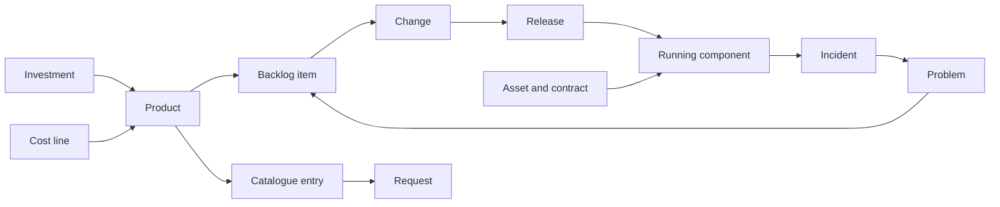
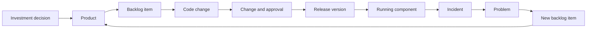

# Module 9 — The records that run IT

*After the third payment outage in six months, a board member asked Omar, Najm Bank's CIO, a simple question: "Which systems did this outage touch, which change caused it, which investment paid for that change, and what did the outage cost us?" Four teams produced four answers from four tools, and none of them agreed. Najm Bank's Technology division had plenty of data. It did not have records that linked. This module is about the small set of records that let an IT organisation see itself: what they are and how they connect (9.1), how to keep configuration and asset data true enough to trust (9.2), and how to trace from an investment to an incident and back again (9.3). Huda, Head of Enterprise Architecture, owns the records design; Yousef, Nour, Reem and Tariq each depend on it, and each makes a mistake you can avoid.*

> **Steps:** Govern — decide which records exist, who owns each one, how they link, and what evidence they must be able to produce on demand.

---

# 9.1 — The information model: the few records that matter and how they link
*Level: 🔴 Advanced* · *Prerequisites: 2.1, 6.3* · *Step: Govern*

**After this you can** draw a one-page information model for your IT organisation that names about ten core records, gives each an owner and a system of record, states the decision each one serves, and shows the links between them. *Study time: reading about 15 min, hands-on about 150 min (estimate).*

## ⚡ In 60 seconds
- An **information model** is a plain map of the records an organisation keeps, what each one means, who owns it and how the records link. It is a management artefact, not a database design.
- Most IT organisations need about ten **core records**: investment, product, catalogue entry, backlog item, change, release, running component, asset and contract, request, incident and problem, and cost line.
- The rule that matters most: **a record earns its place only if a named decision reads it.** If no decision reads it, stop collecting it.
- Every core record has exactly one **system of record**: the one place where it is created and corrected. Every other copy is a reporting copy.
- The links matter more than the records. A shared **product identifier** that appears on every record is the cheapest, most powerful link you can add.
- Biggest trap: launching a "single source of truth" programme that tries to model everything. Model the decisions first, then only the records and links they need.

## 🧭 Why it matters
Najm Bank and everyone in it are fictional. All numbers about Najm Bank in this lesson are illustrative figures, not benchmarks.

When the board asked Omar which change caused the outage and which investment paid for it, the answers sat in different places. The change record lived in the service management platform. The code change lived in the source repository. The deployed version was in the pipeline logs. The investment was in a portfolio spreadsheet kept by Tariq, IT Finance Business Partner. The incident record named a "payments server", but nobody could say which product that server belonged to, because the configuration management database (CMDB, a database of the components IT runs and how they relate) used server names and the portfolio used project codes.

Each record was accurate in its own tool. What was missing was the **model**: an agreed list of which records exist, what each means, and which fields link them. Without it, every cross-cutting question becomes a two-week manual project with an answer nobody fully trusts.

Huda took the question as her brief. Her first move was not to buy a tool or start a data programme. It was to ask: which decisions does the Technology division make every month, and which records does each one need?

## 📐 How it works

### 🟢 The essentials

**Start from decisions, not data.** List the recurring decisions the Technology division makes, then ask what record each decision reads. A short list for most IT organisations:

| Decision | Who makes it | Record it must read |
|---|---|---|
| Fund or stop this work | Portfolio board | Investment record, cost lines, product outcomes |
| What to build next | Product manager | Backlog items linked to the product |
| Approve or release this change | Change authority or product owner | Change record, release record, test evidence |
| Restore this service | Incident manager | Incident record, running components, recent changes |
| Fix the cause | Problem owner | Problem record, linked incidents and changes |
| Renew this contract | Vendor manager | Asset and contract record, usage, incidents by supplier |
| Grant this access | Service owner | Request record, entitlement, catalogue entry |
| Report this cost | Finance partner | Cost lines mapped to products |

**The core records.** In this course's own words, these are the records that answer those questions. Names vary across tools; the meaning is what matters.

| Record | What one record means | Typical system of record |
|---|---|---|
| **Investment** | A funding decision: amount, period, expected outcome, owner | Portfolio tool or finance system |
| **Product** | A digital product or service that a team owns and a customer uses | Product or service catalogue |
| **Catalogue entry** | One thing a consumer can request or subscribe to, with its terms | Service catalogue in the service management platform |
| **Backlog item** | A unit of planned work: a feature, fix or requirement | Work-tracking tool |
| **Change** | A decision to alter something running, with its risk and approval | Service management platform or pipeline |
| **Release** | A specific version of a product made available to users | Pipeline and artefact repository |
| **Running component** | Something that runs and can fail: an application instance, database, cluster, network device (often called a configuration item) | CMDB, ideally fed by discovery and infrastructure code |
| **Asset and contract** | Something the bank owns or licenses, with its cost and terms | Asset management tool, contract repository |
| **Request** | A consumer asking for something from the catalogue | Service management platform |
| **Incident and problem** | An interruption to service; the underlying cause behind one or more of them | Service management platform |
| **Cost line** | A unit of spend: an invoice line, a cloud bill line, a staff cost allocation | Finance system, cloud billing |

**Links are the point.** A record with no links answers only questions about itself. The minimum links that make cross-cutting questions answerable:

Read it as sentences: an investment funds a product; work on the product is a backlog item; a backlog item is delivered through a change and a release; a release runs on running components; an incident affects a running component; a problem explains incidents and creates new backlog items. Cost lines map to products. Assets and contracts underpin running components.

**One identifier per product.** The single most useful design decision is a short, stable **product identifier** (for example `CARDS-PAY`) that appears as a field or tag on every record in the chain: on the investment, the backlog, the repository, the pipeline, the cloud resources, the CMDB entries, the incidents and the cost lines. It costs almost nothing, it survives tool changes, and it turns many two-week investigations into a filter.

### 🟡 Going deeper

**System of record, system of engagement, reporting copy.** Three roles a tool can play for a record:

- **System of record:** the one place where the record is created, changed and corrected. If two tools disagree, this one wins.
- **System of engagement:** where people interact with the record day to day. An engineer may raise a change from the pipeline (engagement) while the service management platform holds the change record (record).
- **Reporting copy:** a copy pulled into a dashboard, data warehouse or spreadsheet. Useful, never edited, always dated.

Write the system of record for each core record on the model.

**Ownership has three layers.** For each record: a **record owner** who decides what the record means and which fields are mandatory (often Huda's team or a process owner); a **data steward** who watches its quality (9.2); and the **creators** who fill it in as part of their work. Without a record owner, definitions drift. Without a steward, quality decays. Without creators who see value in the record, it is filled in badly or not at all.

**Define each record in one line, with its grain.** "Grain" means what one row represents. "One incident record per interruption to a service, not per alert" is a grain decision. "One running-component record per application instance, not per container" is another. Grain decisions shape every report built on the record, so make them explicitly and write them down.

**Mandatory fields: as few as possible.** For each record, pick the handful of fields the decisions need (owner, product identifier, status, dates, the link fields) and make only those mandatory. Every extra mandatory field lowers the quality of all the others, because people under time pressure fill forms to get past them.

### 🔴 Expert view

**Avoid the universal data model.** Large organisations are tempted to define every entity and attribute IT could ever need, then buy one platform to hold them all. These programmes tend to run for years and deliver a model nobody uses. A model of ten records and fifteen links that is used every week beats a model of two hundred entities that is used for an audit once a year.

**Federate the records, centralise the links.** You will not get one tool for everything, and you should not try. Let each record live in the tool that suits its creators, and invest instead in the **link fields** (shared identifiers) and a small **integration layer** or reporting store that joins them. Module 11 covers the toolchain view; here the decision is which identifiers are mandatory in which tool.

**Granularity is a cost decision.** Every additional record type and every finer grain must be created, linked and kept accurate. Ask "what decision changes if we know this?" before adding it.

**AI raises the stakes.** AI tools that summarise incidents or answer "what changed?" are only as good as the links they can follow; lesson 11.3 returns to this.

**The memorable rule:** *a record earns its place only if a named decision reads it.*

## 🧰 The toolkit
| Resource, tool or template | What it is and does | When to reach for it |
|---|---|---|
| **Decision-to-record table** | Lists each recurring decision, its owner and the record it reads | First, before drawing any model |
| **Record card** | One card per record: one-line meaning, grain, owner, steward, system of record, mandatory fields, states | When defining or reviewing a record |
| **Link map** | A one-page diagram of records and the fields that link them | To agree the model with every team |
| **Product identifier register** | The list of product identifiers, their owners and their status | When creating a product, retiring one, or tagging resources |
| **Orphan report** | A query listing records with no link (changes with no product, incidents with no running component) | Monthly, as the simplest health check |
| **Service management platform or CMDB** | Category of tool holding changes, incidents, requests and running components; ServiceNow and Jira Service Management are examples | Where most of the operational records live |

Tools named are examples, not endorsements.

## 🏛️ In practice at Najm Bank
Illustrative and fictional. Huda ran two workshops: one with Omar's leadership team to list decisions, one with record creators (engineers, service desk, finance) to check what they actually fill in.

Her one-page **record map** for the Technology division named eleven records, each with a card. Three findings changed the plan:

1. **Two systems of record for running components.** The CMDB and the cloud inventory both claimed to be authoritative for cloud servers. Huda made the cloud inventory (fed by infrastructure code) the system of record for cloud resources and the CMDB a consumer of it.
2. **No product on incidents.** Incident records had a "service" field with 340 free-text values (illustrative figure). Huda replaced it with the product identifier, chosen from the list of 31 products from lesson 2.1.
3. **Cost lines mapped to projects, not products.** Tariq's cost reports used project codes that ended when projects closed. They agreed to add the product identifier to every cost line from the next quarter, keeping project codes for capital accounting questions, which Tariq would confirm with the finance function.

Her first mistake was making fourteen fields mandatory on the change record. Within a month, Sami, Platform Engineering Lead, showed her that engineers were pasting the same text into six fields. She cut it to five mandatory fields and had the pipeline fill three of them automatically.

## 🛠️ Exercises
**🟢 List decisions and records.** Write the eight to twelve recurring decisions your IT organisation makes. For each, name its owner and the record it reads.
*Done when:* a table exists with at least eight decisions, each with an owner and a record, and you have marked any decision whose record does not exist today.

Model answer and self-check

**Model answer.** A good table looks like the decision table in "The essentials", adapted to your organisation, with at least one gap marked, for example "Renew contract: no record links incidents to supplier". **Self-check.**
- Is every decision one that is actually made on a schedule or a trigger?
- Does every decision have a named role as owner, not "IT"?
- Did you name a record, not a tool?
- Did you find at least one decision made without a record?

**🟡 Draw your link map.** Draw your core records (no more than twelve) and the links between them. Write the linking field on each arrow and mark each link as "exists", "partial" or "missing".
*Done when:* a one-page diagram shows every record, every link has a named field, and every link has a status.

Model answer and self-check

**Model answer.** Close to the diagram in this lesson, with link fields such as "product identifier", "change number in release notes", "running component on incident". Most organisations find that the change-to-release and incident-to-change links are partial. **Self-check.**
- Is there a path from investment to incident?
- Is there a path from cost line to product?
- Does every arrow name a field, not just an intention?
- Did you resist adding records that no decision reads?

**🔴 Find the orphans.** Pick two links marked "partial". For each, pull a sample of 20 recent records and count how many have the link filled in correctly. Write the system of record and record owner for each record type, and one change that would raise the link rate.
*Done when:* you have two counts out of 20, two named owners, and two proposed changes, each one small enough to make in a month.

Model answer and self-check

**Model answer.** For example: "12 of 20 incidents named the correct running component; system of record: service management platform; owner: Head of IT Operations; change: pick from a list filtered by product instead of free text." "7 of 20 changes linked to a backlog item; system of record: service management platform; owner: platform lead; change: pipeline fills the link from the commit message." **Self-check.**
- Did you check correctness, not just whether the field was filled?
- Is each proposed change automatic or built into the work, rather than a reminder to "fill it in"?
- Did you name one owner, not a committee?

## ⚠️ Mistakes and traps
- **Starting with the tool's default schema.** It models what the vendor sells, not what you decide. Start with your decisions and map to the tool afterwards.
- **Two systems of record for one record.** This causes most data-quality fights. Name one, make the other a consumer.
- **Too many mandatory fields.** People fill them with junk. Keep mandatory fields to what decisions need and let automation fill the rest.
- **Records without links.** Accurate but unlinked records answer no cross-cutting question. Add the product identifier everywhere first.
- **Free-text where a list belongs.** Free-text product or service names cannot be joined. Use controlled lists owned by the record owner.
- **A model nobody reviews.** Review the record map twice a year and after any tool change.

## 🧾 Recap
- An information model names the core records, their meaning, owner, system of record and links.
- Start from **decisions**; a record earns its place only if a named decision reads it.
- About ten records cover most IT organisations; links matter more than the records themselves.
- Each record has **one** system of record; everything else is a reporting copy.
- A stable **product identifier** on every record is the cheapest high-value link.
- Keep the model small, in your own words, and grow it only when a decision needs it.

## ✍️ Check yourself
**1. Huda finds that both the CMDB and the cloud inventory claim to be authoritative for cloud servers, and they disagree. What should she do first?**

- A. Ask both teams to reconcile the two lists by hand at the end of every month.
- B. Build a dashboard that shows both lists side by side so people can choose.
- C. Name one system of record for cloud resources; make the other a consumer.
- D. Move all cloud server records into the CMDB and switch off the cloud inventory.

Answer

**C.** One record type needs exactly one system of record; the other tool should consume it. A and B keep two sources alive and push the conflict onto people. D picks a winner without asking which tool is closest to the truth; at Najm Bank the cloud inventory, fed by infrastructure code, was. See "System of record, system of engagement, reporting copy".

**2. Which test best decides whether a proposed new record type belongs in the information model?**

- A. A named, recurring decision needs it and cannot be made well without it.
- B. The service management platform already provides a table for it by default.
- C. Another bank of similar size is known to track the same record in its CMDB.
- D. The data can be collected automatically, so collecting it costs very little.

Answer

**A.** The lesson's rule is that a record earns its place only if a named decision reads it. A vendor default (B), a peer's practice (C) or cheap collection (D) do not show that anyone will use it; cheap data still has to be linked and kept accurate. See "The essentials".

**3. Reem, Product Manager for Cards & Payments, wants to know how many incidents last quarter followed a release of her product. Records exist in four tools. Which single design choice most directly makes this answerable?**

- A. A weekly meeting where each tool owner reports their numbers for her product.
- B. A data warehouse that copies every table from all four tools every night.
- C. A new mandatory free-text field on incidents describing the affected release.
- D. A shared product identifier on releases, running components and incidents.

Answer

**D.** A shared identifier lets the records be joined by a filter. B copies data but does not make it joinable; without shared identifiers the warehouse holds four unlinked sets. C adds free text that cannot be joined reliably, and A is manual. See "One identifier per product".

**4. What does "grain" mean when defining a record?**

- A. The level of detail that is allowed in the record's free-text description field.
- B. What one record represents: one incident per interruption, not per alert.
- C. How often the record is copied from its system of record into the reports.
- D. The number of mandatory fields that a creator must fill in before saving it.

Answer

**B.** Grain is what one row represents, and it shapes every report built on the record. The other options describe free text, reporting frequency and form design. See "Define each record in one line, with its grain".

**5. A month after Huda made fourteen change-record fields mandatory, Sami shows that engineers paste the same text into six of them. What is the best response?**

- A. Cut mandatory fields to what decisions need and let the pipeline fill what it can.
- B. Add validation rules that reject any change where two fields contain the same text.
- C. Keep all fourteen fields and run training so engineers understand why each matters.
- D. Make the fields optional for engineers but keep them mandatory for the service desk.

Answer

**A.** Too many mandatory fields lower the quality of all of them; the fix is fewer fields and automation. B pushes people to vary the junk, C treats a design problem as a training problem, and D makes the record inconsistent by who creates it. See "Mandatory fields: as few as possible".

## 📚 References
- DORA, *Accelerate State of DevOps Report 2023* (Google Cloud). Google Cloud's announcement of the report (5 October 2023) states that "high-quality documentation amplifies the impact that DevOps technical capabilities (for example, continuous integration and trunk-based development) have on organizational performance". https://cloud.google.com/blog/products/devops-sre/announcing-the-2023-state-of-devops-report (full report: https://dora.dev/research/2023/dora-report/2023-dora-accelerate-state-of-devops-report.pdf)
- Library course: [*Data Engineering & Analytics: Zero to Hero*, lesson 6.1 — Data governance that works: ownership, catalogue, lineage and data contracts](../data/index.html#/6.1) (ownership and lineage for data platforms, which apply here to IT's own records).
- Library course: [*Cloud & DevOps: Zero to Hero*, lesson 3.3 — Policy as code, drift and guardrails](../cloud/index.html#/3.3) (infrastructure code as the declared source for cloud resources).

---

# 9.2 — Configuration and asset data quality: ownership, reconciliation and decay
*Level: 🔴 Advanced* · *Prerequisites: 9.1, 6.3* · *Step: Govern*

**After this you can** set up a data-quality scorecard for configuration and asset records: name an owner for each attribute, set reconciliation rules between discovered and declared data, measure completeness, accuracy and freshness from a sample, and decide what to fix first. *Study time: reading about 15 min, hands-on about 160 min (estimate).*

## ⚡ In 60 seconds
- **Configuration data** describes what runs and how it connects; **asset data** describes what the organisation owns or licenses, its cost and its terms. They overlap but answer different questions.
- Data in a CMDB **decays**: every change, migration and retirement makes some records wrong unless the update is part of the work.
- Two sources feed the records: **discovered** data (what scanning tools find running) and **declared** data (what infrastructure code, contracts and people say should exist). **Reconciliation** compares them and decides which wins, attribute by attribute.
- The rule that matters most: **every attribute has one owner and one trusted source.** Ownership by record is not enough; the IP address and the business owner of the same server come from different places.
- Measure quality with a **sample**, not a feeling: completeness, accuracy, freshness and uniqueness.
- Biggest trap: a big clean-up project. Without changing how data enters, the CMDB decays back within months.

## 🧭 Why it matters
Najm Bank and everyone in it are fictional. All numbers about Najm Bank in this lesson are illustrative figures, not benchmarks.

During the third payment outage, the incident team opened the CMDB to see what depended on the failing database. It listed six applications. Two had been retired a year earlier. The one that actually failed, a new card-tokenisation service, was not there at all, because it had been built on the cloud platform and nobody had told the CMDB. The team spent forty minutes finding the dependency by reading code and asking people in chat.

Yousef, Head of IT Operations, had heard this story before. His team had cleaned the CMDB eighteen months earlier: a six-month project, a consultant, a celebration. A sample check this year found about a third of server records had at least one wrong key attribute. The clean-up had fixed the data once. It had not changed how data got in.

At the same time Lina, Vendor and Sourcing Manager, was preparing a software licence renewal. Her asset tool said the bank had 1,200 installations of a database product; the supplier's audit letter said 1,450. She could not say which number was right.

## 📐 How it works

### 🟢 The essentials

**Configuration data and asset data.** They often sit in the same tool but answer different questions.

| | Configuration data | Asset data |
|---|---|---|
| Question it answers | What runs, how is it set up, what depends on what? | What do we own or license, what did it cost, what are the terms? |
| Main users | Operations, incident, change, security | Finance, sourcing, vendor management, audit |
| Unit | Running component (configuration item) | Asset (device, licence, subscription, contract) |
| What goes wrong | Missing dependencies, stale records, retired items still listed | Licences not matched to installs, assets with no owner, contracts lapsing unseen |

**Definitions you can cite.** NIST's glossary is reported (search summary; the page could not be opened for this lesson) to define a **configuration item** as an aggregation of information system components "designated for configuration management and treated as a single entity in the configuration management process", citing NIST SP 800-128. **IT asset management (ITAM)** is the discipline of managing IT assets across their life; ISO/IEC 19770-1:2017 is reported to set requirements for an IT asset management system. The Center for Internet Security's CIS Critical Security Controls (v8) are reported to open with two inventory controls: Control 1, "Inventory and Control of Enterprise Assets", and Control 2, "Inventory and Control of Software Assets".

**Why data decays.** A CMDB record is right on the day it is written. After that, every change, scaling event, migration, licence transfer and retirement can make it wrong. If the update depends on someone remembering to edit a form afterwards, a share of updates will not happen. Decay is not a moral failing of the operations team; it is the predictable result of a process in which updating the record is separate from doing the work.

**The four quality measures.** Keep them simple and measured from samples:

| Measure | Question | How to check |
|---|---|---|
| **Completeness** | Are the mandatory attributes filled? | Query: share of records with all mandatory fields |
| **Accuracy** | Do the values match reality? | Sample 20–50 records; check each against the live system |
| **Freshness** | When was it last confirmed? | Share of records confirmed by discovery or an owner in the last 30 or 90 days |
| **Uniqueness** | Is each real thing recorded once? | Query for likely duplicates (same serial number, same host name) |

Completeness is easy to measure and the least important. A record can be complete and wrong. Accuracy needs a sample checked by a person or against a live source, and it is the measure that matters most.

### 🟡 Going deeper

**Discovered versus declared.** Two kinds of source feed configuration and asset records:

- **Discovered data** comes from tools that scan networks, cloud accounts and endpoints and report what is actually running and how it is set up. It is good for technical attributes (host name, operating system, installed software, connections) and bad for meaning (who owns it, which product it serves, whether it should exist).
- **Declared data** comes from what people and systems say should exist: infrastructure code, deployment manifests, purchase orders, contracts, the product catalogue. It is good for meaning and intent and can be stale or wrong about what is really running.

Neither is enough alone. A discovered server nobody declared may be shadow IT or an attack. A declared server that discovery cannot find may have been deleted without the record being retired.

**Reconciliation rules, attribute by attribute.** Reconciliation is the rule set that decides, for each attribute, which source is trusted, and what happens when sources disagree. Write it as a table:

| Attribute | Trusted source | If another source disagrees |
|---|---|---|
| Host name, operating system, IP address | Discovery | Discovery wins; log the difference |
| Product identifier | Infrastructure code tag or catalogue | Declared wins; flag untagged resources to the product owner |
| Business owner | Product catalogue | Declared wins; no owner means escalate within 10 working days |
| Installed software and version | Discovery | Discovery wins; feeds the licence position |
| Licence entitlement | Contract record | Contract wins; differences go to the vendor manager |
| Lifecycle status (active, retired) | Change record closing a retirement | Discovery finding a "retired" item running raises an incident |

**Attribute ownership.** Each row in that table has an owner: the person accountable for that attribute being right, not for typing it. Yousef's team owns technical attributes; product managers own product and business-owner attributes; Lina's team owns entitlement attributes. Ownership by attribute ends the argument "the CMDB is wrong, so it is operations' fault".

**Make the update part of the work.** The durable fixes are structural:

- Create and retire running components **from the pipeline and infrastructure code**, not by hand afterwards.
- Make **closing a change** update the records it touched.
- Require the **product identifier as a tag** at resource creation; deny creation without it where the cloud platform allows (policy as code; see the library link below).
- Treat **discovery differences as work items** with owners and due dates, not as a report nobody reads.

**Software and component inventories.** For the software inside products, a **software bill of materials (SBOM)** lists the components and versions a piece of software contains. Two open formats are common. SPDX was reported (Linux Foundation announcement, September 2021) to have been published as the international standard ISO/IEC 5962:2021. CycloneDX is reported (search summary) to have been published by Ecma International as ECMA-424, first edition June 2024. For the operating-model view, the decision is simple: SBOMs produced by the pipeline become an attribute source for "installed software and version" and link releases to components.

### 🔴 Expert view

**Not everything belongs in the CMDB.** Decide scope by decision, as in 9.1. A useful test: put a component in the CMDB only if an incident, change or cost decision needs to know about it **and** you can keep it accurate automatically. Short-lived containers usually fail the second test; the cluster, the service and its product usually pass both.

**Sample-based assurance beats completeness dashboards.** A dashboard showing "98% complete" invites trust that is not earned. A monthly sample of 30 records, checked against the live system by someone outside the owning team, gives an accuracy figure that is cheap, repeatable and convincing to auditors.

**Licence positions need both sides.** A licence position compares entitlements (what contracts allow) with deployments (what discovery finds), using the supplier's licence metric (per core, per user, per instance). It is only as good as the weakest of the three inputs. Never send a position to a supplier until the asset owner, the vendor manager and, where needed, the legal function have agreed it; contract interpretation is a legal question, not a data question.

**The memorable rule:** *every attribute has one owner and one trusted source, and the update is part of the work.*

## 🧰 The toolkit
| Resource, tool or template | What it is and does | When to reach for it |
|---|---|---|
| **Attribute ownership table** | Each key attribute with its trusted source, owner and disagreement rule | When designing reconciliation or settling a dispute |
| **Monthly accuracy sample** | 30 random records checked against live systems by an independent checker | Every month, reported with the scorecard |
| **Data-quality scorecard** | Completeness, accuracy, freshness and uniqueness by record type and by owner | Monthly operations and governance review |
| **Discovery difference queue** | Differences between discovered and declared data, raised as owned work items | Continuously; reviewed weekly |
| **Licence position sheet** | Entitlements, deployments and licence metric per product, with sign-offs | Before any renewal or supplier audit |
| **Discovery and CMDB tools** | Category of tool that scans environments and holds configuration records; the cloud provider's own inventory is one example source | To feed discovered attributes automatically |
| **SBOM generator** | Pipeline step that lists software components in SPDX or CycloneDX format | To link releases to components and versions |

Tools named are examples, not endorsements.

## 🏛️ In practice at Najm Bank
Illustrative and fictional. Yousef refused a second clean-up project. Instead, with Huda, he built a one-page **CMDB data-quality scorecard**:

| Record type | Completeness | Accuracy (sample of 30) | Freshness (confirmed in 30 days) | Owner |
|---|---|---|---|---|
| Cloud resources | 96% | 27 of 30 | 99% | Sami |
| Data-centre servers | 91% | 19 of 30 | 54% | Yousef |
| Network devices | 88% | 16 of 30 | 31% | Yousef |
| Software licences | 79% | 21 of 30 | 62% | Lina |

The figures told him where to act. Cloud resources were good because they were created from infrastructure code with a mandatory product tag; Sami's pipeline also retired them. Network devices were worst because every change was recorded by hand. Yousef's first fix was to make closing a network change trigger a discovery scan of the device and raise a difference if the record disagreed.

Lina's licence gap turned out to have three causes found in one afternoon with the attribute table: retired virtual machines still listed as installations, test environments counted under a production metric, and 60 installations discovery had missed on an isolated network. She did not send a number to the supplier until Nour, IT Risk and Controls Lead, and the legal function had reviewed the position.

Yousef's mistake: he first set the accuracy sample to be checked by his own team. Nour pointed out that an owner checking its own records is not independent evidence. They swapped samples between teams.

## 🛠️ Exercises
**🟢 Write the attribute ownership table.** For one record type you manage (servers, cloud resources, applications or licences), list eight key attributes with their trusted source and owner.
*Done when:* eight attributes each have one trusted source and one named owner role, and any attribute with two candidate sources is marked for a decision.

Model answer and self-check

**Model answer.** Close to the reconciliation table in "Going deeper": technical attributes from discovery, meaning attributes (product, business owner) from declared sources, entitlements from contracts. **Self-check.**
- Does each attribute have exactly one trusted source?
- Are meaning attributes owned by the business or product side, not only by operations?
- Did you write what happens when sources disagree?

**🟡 Run an accuracy sample.** Pick 20 random records of one type. Check each key attribute against the live system or its owner. Record completeness, accuracy and freshness.
*Done when:* you have three numbers for the sample, a list of the wrong attributes, and a note of which wrong values came from manual updates.

Model answer and self-check

**Model answer.** A result like "18 of 20 complete, 13 of 20 accurate, 9 of 20 confirmed in 30 days; 6 of 7 errors were in attributes updated by hand". **Self-check.**
- Did you choose records at random, not the ones you know are good?
- Did you check against reality, not against another report?
- Did you separate missing values from wrong values?
- Can you name the process step where each error entered?

**🔴 Design one structural fix.** From your sample, pick the attribute with the most errors. Design one change that makes its update part of the work (pipeline, change closure, tagging policy, discovery difference queue). Estimate how you will know it worked.
*Done when:* a half-page proposal names the attribute, the change, the owner, the date, and the sample result that would show success within three months.

Model answer and self-check

**Model answer.** For example: "Product identifier on cloud resources; deny resource creation without the tag through cloud policy; owner Sami; by end of quarter; success: 29 of 30 sampled resources carry a valid product identifier." **Self-check.**
- Does the fix remove a manual step rather than add a reminder?
- Is the success measure a sample result, not a completeness percentage?
- Did you check that the fix does not block urgent work without an exception route?

## ⚠️ Mistakes and traps
- **The big clean-up.** It fixes data once and decays back. Change how data enters first; clean up only what the new process will keep clean.
- **Trusting completeness.** Full fields can be full of wrong values. Report accuracy from samples alongside completeness.
- **One owner for the whole CMDB.** Nobody can be accountable for every attribute. Assign owners by attribute and source.
- **Discovery as a report, not a queue.** Differences nobody owns are ignored. Raise them as work items with due dates.
- **Owners checking their own records.** That is not independent evidence. Swap samples between teams or use a second-line reviewer.
- **Sending a licence number before it is agreed.** Data, sourcing and legal must agree a position before any supplier sees it.

## 🧾 Recap
- Configuration data describes what runs; asset data describes what you own and what it costs. Both decay unless updates are part of the work.
- Combine **discovered** and **declared** data, with **reconciliation rules by attribute**.
- Every attribute has **one owner and one trusted source**.
- Measure **completeness, accuracy, freshness and uniqueness**; accuracy from an independent sample matters most.
- Fix structurally: pipelines, change closure, mandatory tags and discovery queues, not clean-up projects.
- Keep CMDB scope to what decisions need and what you can keep accurate automatically.

## ✍️ Check yourself
**1. Yousef's CMDB was cleaned eighteen months ago and is again about a third wrong. What should he do first?**

- A. Commission a second clean-up project with a larger budget and a stricter deadline.
- B. Change how records are created and retired so updates happen as part of the work.
- C. Replace the CMDB with a newer platform that offers better default discovery.
- D. Add a monthly reminder asking every engineer to review records they own.

Answer

**B.** Decay comes from updates being separate from the work; structural fixes stop it. A repeats what failed, C changes the tool without changing the process, and D relies on memory, which is what caused the decay. See "Why data decays" and "Make the update part of the work".

**2. Which source should normally be trusted for the "product identifier" attribute on a cloud resource?**

- A. The discovery scan, because it reports what is actually running in the account.
- B. The service desk, because it receives the first calls when the resource fails.
- C. The monthly cost report, because finance maps every bill line to a product.
- D. The declared tag set in infrastructure code or the product catalogue.

Answer

**D.** Meaning attributes such as product come from declared sources. Discovery (A) is trusted for technical attributes but cannot know which product a resource serves. B and C are consumers of the attribute, not its source. See "Reconciliation rules, attribute by attribute".

**3. A dashboard shows the CMDB is 98% complete. What is the main weakness of using this as evidence of quality?**

- A. Complete records can still be wrong; accuracy needs a sample checked against reality.
- B. Completeness should be measured weekly, so a monthly figure is too old to be useful.
- C. The figure should exclude cloud resources, which are created automatically.
- D. Ninety-eight percent is below the level that most auditors would expect from a bank.

Answer

**A.** Completeness says fields are filled, not that they are right. B, C and D argue about frequency, scope or a threshold the lesson never gives. See "The four quality measures" and "Sample-based assurance".

**4. Lina's asset tool shows 1,200 installations of a database product; the supplier's letter says 1,450. What should she do before replying?**

- A. Reply with the asset tool's figure, since the tool is the bank's system of record.
- B. Accept the supplier's figure to avoid a dispute and negotiate on price instead.
- C. Agree a licence position with the asset owner, sourcing and legal before replying.
- D. Ask the supplier to run a fresh scan of the bank's whole environment to settle it.

Answer

**C.** A licence position combines entitlements, deployments and the licence metric, and contract interpretation is a legal question. A trusts a figure that has not been checked, B concedes without evidence, and D hands control of the evidence to the other party. See "Licence positions need both sides".

**5. Yousef's team checks the monthly accuracy sample of its own records. Why did Nour object?**

- A. The sample was too small to give any meaningful accuracy figure for the whole CMDB.
- B. An owner checking its own records does not give independent evidence of quality.
- C. Accuracy should be measured by a tool, never by people looking at the live systems.
- D. Operations teams are not allowed to see configuration data owned by product teams.

Answer

**B.** Independence is what makes a sample convincing as evidence. A 30-record sample is reasonable for this purpose (A), people checking against live systems is the method the lesson recommends (C), and D is not a rule in the lesson. See "In practice at Najm Bank".

## 📚 References
Pages marked "reported" were known only from search summaries for this lesson; their hosts could not be opened from the writing environment.
- NIST Computer Security Resource Center, Glossary, "configuration item" (citing NIST SP 800-128). Reported. https://csrc.nist.gov/glossary/term/configuration_item
- ISO, *ISO/IEC 19770-1:2017 Information technology — IT asset management — Part 1: IT asset management systems — Requirements*. Reported. https://www.iso.org/standard/68531.html
- Center for Internet Security, CIS Critical Security Controls Navigator (v8). Reported. https://www.cisecurity.org/controls/cis-controls-navigator
- Linux Foundation, "SPDX Becomes Internationally Recognized Standard for Software Bill of Materials" (September 2021). Reported. https://www.linuxfoundation.org/press/featured/spdx-becomes-internationally-recognized-standard-for-software-bill-of-materials
- Ecma International, ECMA-424, CycloneDX Bill of Materials specification. Reported. https://ecma-international.org/publications-and-standards/standards/ecma-424/
- Library course: [*Secure AI & Application Security: Zero to Hero*, lesson 6.2 — The software supply chain: dependencies, SBOMs, SLSA and signing](../secai/index.html#/6.2) (SBOMs and component inventories in depth).
- Library course: [*Cloud & DevOps: Zero to Hero*, lesson 3.3 — Policy as code, drift and guardrails](../cloud/index.html#/3.3) (mandatory tags and drift detection).

---

# 9.3 — Traceability from investment to incident and back
*Level: 🔴 Advanced* · *Prerequisites: 9.1, 9.2, 4.2, 8.1* · *Step: Govern, Run*

**After this you can** define the minimum shared identifiers that let you trace any incident back to the change, release, backlog item and investment behind it, and any investment forward to the incidents and costs it produced, then run a five-incident trace test and report the result. *Study time: reading about 15 min, hands-on about 4 h (estimate).*

## ⚡ In 60 seconds
- **Traceability** is the ability to follow links between records from one end of the operating cycle to the other: from a funding decision to what runs, and from an incident back to the decision that changed it.
- It runs in two directions. **Backward** answers "why is this broken and who decided?". **Forward** answers "what did this investment produce, and what did it cost to run?".
- The rule that matters most: **a trace is only as strong as its weakest link, so put shared identifiers in the work, not in a form filled in afterwards.**
- Four identifiers carry most traces: the **product identifier**, the **backlog item key**, the **change or release identifier**, and the **running-component identifier**.
- Test traceability the way an auditor would: pick real incidents at random and try to trace them. Report the share that trace end to end.
- Biggest trap: building a traceability matrix by hand for an audit. It is out of date the week after it is signed.

## 🧭 Why it matters
Najm Bank and everyone in it are fictional. All numbers about Najm Bank in this lesson are illustrative figures, not benchmarks.

Six weeks after the board meeting, Nour, IT Risk and Controls Lead, received a request from internal audit: for the last three payment incidents, show the change that caused each, who approved it, what testing was done, and which approved investment funded the work. Nour asked four teams. It took eleven working days. For one incident the change record existed, but it named a release that the pipeline had overwritten. For another, the change linked to a project code that had been closed, so nobody could find the business case.

Meanwhile Tariq was asked the forward question by Omar: the bank had invested in a new card-tokenisation capability the year before. Did it deliver what the business case promised, and what did it now cost to run, including its incidents? Tariq could find the spend. He could not find which running components, releases and incidents belonged to it.

Both questions are routine for a bank. Supervisors, auditors and boards ask them. The answer should be a query, not a project.

## 📐 How it works

### 🟢 The essentials

**The trace chain.** Using the records from 9.1, a complete trace looks like this:

**Backward trace (incident to investment).** Start from an incident. Which running component failed? Which release was running on it? Which change deployed that release, who approved it and what evidence was attached? Which backlog items did the release contain? Which product and investment did they belong to? This is the auditor's and the incident reviewer's question.

**Forward trace (investment to outcome).** Start from an investment. Which product did it fund? Which backlog items were delivered, in which releases? What runs today because of it, and what did those components cost and suffer in incidents? Did the outcome in the business case move? This is the board's and the finance partner's question.

**The four identifiers that carry most traces.**

| Identifier | Where it must appear | Who makes it appear |
|---|---|---|
| **Product identifier** | Investment, backlog, repository, cloud tags, CMDB, incidents, cost lines | Product owner sets it; platform enforces tags |
| **Backlog item key** | Commit messages or pull requests, release notes | Engineers, enforced by a pipeline check |
| **Change or release identifier** | Change record, pipeline run, deployed artefact, running component | Pipeline creates and records it automatically |
| **Running-component identifier** | CMDB, monitoring alerts, incident record | Discovery and monitoring tools, chosen from a list on the incident |

If each of these appears where the table says, most traces become joins between records rather than investigations.

**Put links in the work.** Links typed into forms after the fact are the ones that break. Links created by the act of doing the work survive: the pipeline rejects a merge without a backlog key; the pipeline creates the change record with the release identifier; the deployment tags the running component with the release; the monitoring alert carries the component identifier into the incident.

### 🟡 Going deeper

**Trace questions by audience.** Different people need different slices of the same chain. Design for the questions, not for a generic matrix:

| Audience | Typical question | Direction |
|---|---|---|
| Board, CIO | What did this investment deliver and cost to run? | Forward |
| Internal audit, risk | Was this change approved and tested before it reached customers? | Backward |
| Incident and problem managers | What changed recently on the failing component? | Backward |
| Product manager | Which of my releases created incidents, and which problems are in my backlog? | Both |
| Finance partner | What does this product cost, including incidents and support? | Forward |
| Vendor manager | Which incidents involved this supplier's components? | Backward |

**When the chain breaks.** Common breaks, and the fix for each:

- **Project codes end, products do not.** A change linked only to a project becomes untraceable when the project closes. Link work to the product identifier as well.
- **Releases overwritten.** If a pipeline reuses version labels, the change record points to something that no longer exists. Make release identifiers immutable.
- **Emergency changes.** Urgent fixes skip the normal path and lose their links. Make the emergency path create the same records, filled in automatically, and review them within a set time.
- **Supplier-run components.** A SaaS service or managed platform may not appear in discovery. Record it as a running component with the supplier as owner, and link its incidents through the supplier's incident references.

**The bank angle.** Banks face a specific expectation about data that feeds risk reporting. The Basel Committee on Banking Supervision's *Principles for effective risk data aggregation and risk reporting* (often called BCBS 239), dated 9 January 2013, are reported (search summary of the BIS page) to set out 14 principles, including principles on governance and on data architecture and IT infrastructure. They concern risk data rather than IT operating records, and whether and how they apply to a given bank is a question for its supervisor and risk function. The idea transfers, though: be able to show where a reported number came from and how it was produced. For Najm Bank, the question for Nour to ask the risk function is: "Which of our IT records feed regulatory or risk reporting, and what lineage evidence do we need to keep for them?" Do not assume an answer; ask.

**Measuring traceability.** Use a **trace test**: pick a random sample of incidents (backward) and investments (forward) each quarter, try to trace each end to end using only the records, and report the share that trace completely, plus where each failed trace broke. The break points tell you which link to fix next.

### 🔴 Expert view

**Traceability is evidence, not paperwork.** A good trace lets a manager answer a hard question in minutes and lets an auditor test a control by sampling rather than by interviewing. That changes the cost of governance. When traces are cheap, controls can be tested continuously, and change approval can rely more on automated evidence (tests passed, peer review recorded, release linked) than on meetings. This is how traceability supports faster flow rather than slowing it; lesson 6.2 covers the change-control side.

**Close the loop to funding.** The forward trace matters only if it reaches the funding review. Each quarter, the portfolio board (lesson 3.3) should see, for each funded product, outcome measures, run cost and incident load from the traced records. A product whose investment produced rising incidents and flat outcomes is a candidate for re-planning or stopping. Without the trace, that conversation runs on opinion.

**Problems are the return path.** The arrow from problem back to backlog item is the one most often missing. When a problem record identifies a cause, the fix must become a backlog item on the owning product, visible to the product manager and weighed against features. Otherwise reliability work is invisible to funding decisions and loses every prioritisation argument.

**Don't trace everything at the same depth.** Apply the full chain to products that are customer-facing, regulated or high-risk. For internal low-risk tools, product identifier plus release identifier may be enough. Write the depth rule down so auditors see a decision, not a gap.

**The memorable rule:** *a trace is only as strong as its weakest link, so put shared identifiers in the work, not in a form filled in afterwards.*

## 🧰 The toolkit
| Resource, tool or template | What it is and does | When to reach for it |
|---|---|---|
| **Trace chain diagram** | The records and identifiers from investment to incident and back, for your organisation | To agree what "traceable" means with audit and product teams |
| **Identifier placement table** | Where each of the four identifiers must appear and who or what puts it there | When designing pipelines, tags and incident forms |
| **Pipeline link checks** | Automated checks that reject merges or deployments missing a backlog key or product identifier | To make links part of the work |
| **Quarterly trace test** | A random sample of incidents and investments traced end to end, with the break point for each failure | Every quarter, reported to governance |
| **Product run-cost and incident view** | A report joining cost lines, releases and incidents by product identifier | For the portfolio funding review |
| **Depth rule** | A one-page statement of which products need full traceability and which need less | When scoping traceability and explaining it to auditors |

Tools named are examples, not endorsements.

## 🏛️ In practice at Najm Bank
Illustrative and fictional. Nour designed the **five-incident trace test**: each quarter, internal audit picks five incidents at random from customer-facing products; Nour's team tries to trace each one back to its investment using only records, with a one-hour limit per incident.

The first run:

| Incident | Running component | Release | Change and approval | Backlog item | Investment | Result |
|---|---|---|---|---|---|---|
| 1 | Found | Found | Found | Found | Found | Traced |
| 2 | Found | Overwritten label | Found | Not found | Not found | Broke at release |
| 3 | Not in CMDB | — | — | — | — | Broke at component |
| 4 | Found | Found | Emergency, no link | Not found | Not found | Broke at change |
| 5 | Found | Found | Found | Found | Closed project code | Broke at investment |

One of five traced. Each break pointed to a specific fix: Sami made release identifiers immutable and made the pipeline write them to the change record; Yousef's discovery queue (9.2) took the missing component; the emergency change path was changed to create the same links automatically; Tariq added product identifiers to investments alongside project codes.

Reem's mistake came next. Keen to show progress, she asked her team to add the missing backlog keys to last quarter's changes by hand before the next test. Nour stopped it: back-filling links before a test measures effort, not the process. The second run, a quarter later, traced four of five with no back-filling, and the board received its first product view of Cards & Payments showing investment, run cost, releases and incidents on one page.

## 🛠️ Exercises
**🟢 Draw your trace chain.** Draw the chain from investment to incident for one product you know, naming the record and the linking identifier at each step.
*Done when:* every step has a record and an identifier, and every identifier is marked "in the work" (created automatically or by a check) or "in a form" (typed afterwards).

Model answer and self-check

**Model answer.** Close to the diagram in "The trace chain", with identifiers such as product code, backlog key in commit messages, release identifier from the pipeline, component identifier from monitoring. **Self-check.**
- Does the chain reach both funding and incidents?
- Does it include the return path from problem to backlog?
- Did you mark honestly which links depend on someone typing?

**🟡 Run a trace test.** Pick five recent incidents at random. Try to trace each back to its investment using only records, with a one-hour limit per incident. Record where each trace broke.
*Done when:* a table shows five incidents, the step reached for each, and the break point for every failed trace.

Model answer and self-check

**Model answer.** A table like Nour's, with a count such as "2 of 5 traced" and break points such as "release label reused" or "component missing from CMDB". **Self-check.**
- Were the incidents chosen at random, not picked because they were easy?
- Did you use only records, not people's memories?
- Did you stop at the time limit rather than investigating heroically?
- Is each break point specific enough to fix?

**🔴 Fix the weakest link and report forward.** Choose the most common break point from your test and design a fix that puts the link in the work. Then, for one product, write a one-page forward view: investment, delivered releases, run cost and incidents for the last quarter, and note which numbers you could not trace.
*Done when:* the fix names an owner, a date and the trace-test result that would show it worked, and the forward view exists with every untraceable number marked.

Model answer and self-check

**Model answer.** For example: "Release labels overwritten; fix: immutable release identifiers written by the pipeline to the change record; owner: platform lead; next quarter; success: no break at release in the next test." The forward view lists the investment amount, releases with dates, run cost by product identifier, and incident count, with "run cost before tagging: not traceable" marked. **Self-check.**
- Does the fix remove a manual step?
- Did you avoid back-filling old records to improve the next test?
- Did you show gaps in the forward view rather than estimating them silently?

## ⚠️ Mistakes and traps
- **A hand-built traceability matrix for the audit.** It is stale within weeks. Build links into the pipeline and records, and test them by sampling.
- **Linking only to project codes.** Projects close; products continue. Link to the product identifier as well.
- **Mutable release labels.** Reused labels break every backward trace. Make release identifiers immutable.
- **Emergency changes off the record.** The riskiest changes become the least traceable. Make the emergency path create the same links.
- **Back-filling before a test.** It hides the process failure. Test the process as it is.
- **Stopping the trace at deployment.** Without the incident-to-problem-to-backlog return path, reliability work never reaches funding.

## 🧾 Recap
- Traceability links records from investment to incident (backward) and from investment to outcome and cost (forward).
- Four identifiers carry most traces: **product, backlog item, change or release, running component**.
- Links created by the work (pipelines, tags, monitoring) survive; links typed afterwards break.
- Measure traceability with a random **trace test** and fix the most common break point.
- Close the loop: traced outcomes, run cost and incidents should reach the funding review.
- In a bank, ask the risk function which records feed risk reporting and what lineage evidence they need; do not assume.

## ✍️ Check yourself
**1. Internal audit asks Nour to show, for three payment incidents, the change, its approval and the funding behind it. Which is the most durable way to make this routine?**

- A. Keep a traceability spreadsheet that the change board updates after every meeting.
- B. Assign an analyst to answer each audit trace request within five working days.
- C. Ask each team to send a monthly list of changes and investments to the risk team.
- D. Put shared identifiers into the work through pipelines, then test them by sampling.

Answer

**D.** Links created by the work survive, and sampling tests them as an auditor would. A, B and C all rely on people assembling links after the fact, which goes stale and costs effort every time. See "Put links in the work" and "Measuring traceability".

**2. In Nour's first trace test, incident 2 broke because the release label had been reused and overwritten. What is the right fix?**

- A. Ask engineers to note the old label in the change record before reusing it.
- B. Make release identifiers immutable; the pipeline writes them to the change.
- C. Remove releases from the trace and link incidents straight to backlog items.
- D. Add a field to the incident record for the engineer's memory of the release.

Answer

**B.** Immutable identifiers written automatically remove the break. A and D rely on people typing or remembering, and C drops the link that tells you what was actually running. See "When the chain breaks".

**3. Before the second trace test, Reem asks her team to add missing backlog keys to last quarter's changes by hand. Why does Nour stop it?**

- A. Backlog keys may only be added by the change authority, not by product teams.
- B. The trace test only uses incidents, so changes are outside its scope entirely.
- C. Back-filling lifts the score without fixing the process that lost the links.
- D. Editing old change records is never allowed under the bank's own audit rules.

Answer

**C.** The test measures whether the process creates links; back-filling hides that it does not. A and D invent rules the lesson does not state, and B is wrong because the backward trace runs through changes. See "In practice at Najm Bank".

**4. Omar asks Tariq what last year's tokenisation investment delivered and what it now costs to run, including incidents. Which trace is this, and which link is most essential?**

- A. A forward trace, using the product identifier on investments, costs and incidents.
- B. A backward trace, relying on the running-component identifier on every incident.
- C. A forward trace, relying on the backlog item key written in each commit message.
- D. A backward trace, relying on the approval recorded on every change record.

Answer

**A.** Starting from an investment and moving to outcomes and costs is a forward trace, and the product identifier is what joins investment, cost lines and incidents. C is a forward link but only reaches code, not run cost; B and D describe backward traces. See "Forward trace" and "The four identifiers".

**5. Nour wants to know whether the BCBS 239 principles apply to Najm Bank's IT records. What is the right next step according to this lesson?**

- A. Treat all IT records as in scope, since the principles cover every bank system.
- B. Treat IT records as out of scope, since the principles concern only risk data.
- C. Wait for the next supervisory inspection and let the inspectors decide on the scope.
- D. Ask the risk function which IT records feed its reports and what lineage it needs.

Answer

**D.** The lesson names the kind of rule and the question to ask, without stating a legal or regulatory conclusion. A and B each assert a scope conclusion the lesson does not make, and C leaves the bank unprepared. See "The bank angle".

## 📚 References
Pages marked "reported" were known only from search summaries for this lesson; their hosts could not be opened from the writing environment.
- Basel Committee on Banking Supervision, *Principles for effective risk data aggregation and risk reporting* (BCBS 239), 9 January 2013. Reported. https://www.bis.org/publ/bcbs239.htm
- DORA, *Accelerate State of DevOps Report 2023*. Reported. https://dora.dev/research/2023/dora-report/2023-dora-accelerate-state-of-devops-report.pdf
- Library course: [*Cloud & DevOps: Zero to Hero*, lesson 5.3 — Incidents and blameless postmortems](../cloud/index.html#/5.3) (incident and post-incident practice behind the backward trace).
- Library course: [*Data Engineering & Analytics: Zero to Hero*, lesson 6.1 — Data governance that works: ownership, catalogue, lineage and data contracts](../data/index.html#/6.1) (lineage for data platforms).
- Library course: [*AI Governance: Zero to Hero*, lesson 0.3 — Meet Najm Bank: an AI inventory from day one](../aigp/index.html#/0.3) (the same bank's AI inventory, a record that should link to products in the same way).
