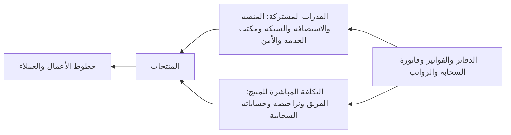

# الوحدة 10 — المال والمورّدون والمخاطر

*حين يسأل مجلس الإدارة عمر، الرئيس التنفيذي للمعلومات في بنك نجم، عن التكلفة والانقطاعات، فإنه لا يسأل عن التقنية. إنه يطرح ثلاثة أسئلة عمل: كم يكلّفنا كل منتج، وهل تسير تكلفته في الاتجاه الصحيح؟ على أي المورّدين نعتمد، وهل نديرهم أم يديروننا؟ ما المخاطر التي نحملها، وهل نستطيع أن نثبت أن ضوابطنا تعمل؟ تجيب هذه الوحدة عن الأسئلة الثلاثة من منظور نموذج التشغيل: نموذج تكلفة يصل إلى منتجات ووحدات يستطيع الناس التصرف بناءً عليها (10.1)، ونموذج توريد ومورّدين يبقى فيه البنك خاضعًا للمساءلة عن خدمات تُبنى من أجزاء يقدّمها مورّدون كثيرون (10.2)، ونموذج مخاطر وضوابط ينتج أدلة يثق بها المدقق والجهة الرقابية دون أن يوقف التسليم (10.3). يقود كلٌّ من طارق ولينا ونور درسًا واحدًا، ويقع كل منهم في خطأ تستطيع أن تتجنّبه. تختلف المحاسبة وقوانين المشتريات والتنظيم من بلد إلى بلد ومن بنك إلى بنك؛ تعلّمك الدورة الأسئلة، ويعطيك المختصون في المالية والشؤون القانونية والمخاطر الإجابات.*

> **الخطوات:** Fund, Govern — اعرف كم يكلّف كل منتج ولماذا، واشترِ من المورّدين دون أن تتخلى عن المساءلة، وشغّل ضوابط تحمي البنك وتترك وراءها أدلة.

---

# 10.1 — الإدارة المالية لتقنية المعلومات: نماذج التكلفة وتكاليف الوحدة وتكلفة المنتج
*المستوى (Level): 🔴 متقدم (Advanced)* · *المتطلبات (Prerequisites): 3.2، 7.3، 9.1* · *الخطوة (Step): Fund*

**بعد هذا الدرس تستطيع** أن تبني نموذج تكلفة من صفحة واحدة لمنتج رقمي واحد، يتتبّع كل بند تكلفة جوهري إلى ذلك المنتج، ويفصل التكلفة المباشرة عن المشتركة والثابتة عن المتغيرة، ويذكر تكلفة وحدة أو اثنتين مع البسط والمقام ومصدر البيانات لكل منهما، ويسرد الأسئلة التي يجب أن تجيب عنها الإدارة المالية قبل أن تُستخدم الأرقام في القرارات. *مدة الدراسة: قراءة نحو 15 دقيقةً، وعمل تطبيقي نحو 100 دقيقة (تقدير).*

## ⚡ الدرس في دقيقة (In 60 seconds)
- **الإدارة المالية لتقنية المعلومات (IT financial management)** هي أن تعرف كم تكلّف التقنية، ولماذا، ولمن، حتى تقوم قرارات التمويل وقرارات الإيقاف أو الاستمرار على أرقام موثوقة.
- **نموذج التكلفة (cost model)** يتتبّع المال من الدفاتر والفواتير وفاتورة السحابة والرواتب، مرورًا بالمنصات والخدمات المشتركة، وصولًا إلى **المنتجات** وخطوط الأعمال التي تستخدمها.
- **تكلفة الوحدة (unit cost)** تقسم تكلفةً على حجمٍ يستطيع أحدٌ أن يؤثر فيه، مثل التكلفة لكل ألف عملية تفويض للبطاقات.
- القاعدة الأهم: **احسب تكلفة كل منتج كاملةً، ووزّع التكلفة المشتركة ببساطة، ولا تدع طريقة التوزيع تصبح هي موضوع الخلاف.**
- إشارة القرار: إذا لم تستطع مديرة المنتج أن تسمّي أكبر ثلاثة بنود تكلفة لديها وأيها تستطيع تغييره، فالنموذج لم يصبح مفيدًا بعد.
- أكبر فخ: أن تقرأ انخفاض متوسط تكلفة الوحدة على أنه كفاءة؛ فالنمو فوق تكلفة ثابتة يخفّضه وحده.

## 🧭 لماذا يهم (Why it matters)
بنك نجم وكل من فيه شخصيات خيالية. وكل الأرقام عن بنك نجم في هذا الدرس أرقام توضيحية، لا معايير مرجعية.

سألت لجنة التدقيق في مجلس الإدارة عمر: «كم يكلّف المنتج الرقمي للبطاقات والمدفوعات كل سنة، وكم سنوفّر إذا أوقفنا منصة البطاقات القديمة؟» فتح طارق، شريك الأعمال المالي لتقنية المعلومات، **دفتر الأستاذ العام (general ledger)**، وهو السجل المحاسبي الرئيسي للبنك. كان الدفتر يُظهر الإنفاق بحسب **مركز التكلفة (cost centre)**، أي الوحدة التنظيمية التي تُخصَّص لها الميزانية، وبحسب **الحساب**: الرواتب، والتراخيص، و**الإهلاك (depreciation)** أي توزيع تكلفة الأصل على عمره النافع، والسحابة، والاستشاريين. لكنه لم يُظهره بحسب المنتج. فريق ريم، وفاتورة السحابة، وثلاثة عقود مورّدين، وجزء من مركز البيانات، كلها كانت تخدم البطاقات والمدفوعات، ولم يقل أيٌّ منها ذلك.

زادت محاولة طارق الأولى الأمر سوءًا. غطّى الوسم الذي بدأ في الدرس 7.3 معظم تكلفة المنصة، لكنه لم يغطِّ مركز البيانات ولا الشبكة ولا ما بقي دون وسم. وليسدّ الفجوة بسرعة، عاد إلى التقسيم القديم بحسب عدد الموظفين لتلك التكاليف المشتركة، وهي الطريقة التي تخلّى عنها في عرض التكلفة. فخرج منتج البطاقات والمدفوعات، وعدد موظفيه صغير قياسًا إلى حمل عمله الثقيل الذي يعمل دائمًا، رخيصًا؛ وخرجت بوابة موظفي الفروع، وعدد موظفيها كبير قياسًا إلى حمل عملها الخفيف، باهظة. عرف الجميع أن النتيجة خاطئة، ودار الاجتماع التالي حول الطريقة، لا حول التكلفة.

من دون نموذج تكلفة، يعود كلٌّ من تمويل المنتجات في الدرس 3.2، وعرض التكلفة (showback) في الدرس 7.3، وأهداف الموثوقية المسعّرة في الدرس 8.3، وتجديد العقود في الدرس 10.2، إلى الرأي الشخصي.

## 📐 كيف يعمل (How it works)

### 🟢 الأساسيات (The essentials)

**إعادة قراءة دفتر الأستاذ.** تسجّل المالية التكلفة بحسب مركز التكلفة والحساب، لأن الميزانيات تُعتمد بهذه الطريقة؛ أما قرارات التقنية فتُتخذ حول المنتجات والمنصات والمورّدين. لا يحلّ نموذج التكلفة محلّ الدفتر، بل يعيد قراءته على شكل تلك القرارات، فيتتبّع ما يشتريه المال عبر القدرات المشتركة إلى المنتجات التي تريد أن تعرف تكلفتها:

يشتري المال إما شيئًا يستخدمه منتج واحد وحده، وهذه **التكلفة المباشرة (direct cost)**، وإما شيئًا تتشاركه منتجات كثيرة، وهذه **التكلفة المشتركة (shared cost)**. وتصل التكلفة المشتركة إلى المنتجات عبر **محرّك توزيع (allocation driver)**، وهو كمية قابلة للقياس ترتفع حين يستخدم المنتج قدرًا أكبر من الشيء المشترك.

**أربعة تصنيفات لكل بند تكلفة.**

| التصنيف | السؤال | لماذا يهم |
|---|---|---|
| **مباشر أم مشترك** | هل يستخدمه منتج واحد وحده؟ | التكلفة المشتركة تحتاج إلى محرّك توزيع |
| **ثابت أم متغير** | هل يتغير مع الحجم خلال السنة؟ | معظم تكلفة تقنية المعلومات ثابتة على المدى القصير |
| **تشغيل أم تغيير** | هل يُبقي خدمة اليوم تعمل، أم يغيّرها؟ | تكلفة التشغيل تنمو بصمت إن لم يملكها أحد (الدرس 3.1) |
| **رأسمالي أم تشغيلي** | هل يُسجَّل أصلًا يُوزَّع على سنوات، أم مصروفًا الآن؟ | يؤثر في الميزانيات والأرباح؛ **والمالية هي التي تقرر** |

التصنيف الأخير سؤال محاسبي. فبموجب المعايير الدولية لإعداد التقارير المالية IFRS، التي يضعها مجلس معايير المحاسبة الدولية IASB، أفادت التقارير بأن المعيار IAS 38 *Intangible Assets* (الأصول غير الملموسة) يشترط أن يُعامَل الإنفاق على البحث مصروفًا، وأن يُعترف بالإنفاق على التطوير أصلًا إذا استوفى معايير محددة، وفقط إذا استوفاها. وأفادت التقارير أيضًا بأن أوراق موظفي IASB لاجتماعه في أكتوبر 2026 استخدمت تطوير البرمجيات بالأسلوب الرشيق (agile) حالةً اختباريةً لكيفية تطبيق تلك المعايير. لا تقرر المعاملة المحاسبية بنفسك. اسأل المراقب المالي، واجعل الأدلة (الوقت المصروف على العمل المؤهَّل، والمنتج الذي خدمه) سهلة الاستخراج من أدوات التسليم (الدرس 3.2).

**تكلفة المنتج.** **التكلفة الكاملة (full cost)** السنوية لمنتج رقمي هي: **فريقه**، و**تقنيته الخاصة** (التراخيص والحسابات السحابية الموسومة باسمه)، و**حصته من المنصات** و**من العمليات**، و**مورّدوه**، و**ذيله الموروث (legacy tail)**: الأنظمة القديمة التي تبقى حيّة لأن المنتج ما زال يعتمد عليها. وإيقاف نظام لا يوفّر إلا ما يختفي باختفائه، ونادرًا ما يوفّر كامل تكلفته الموزّعة.

**تكاليف وحدة يستطيع الناس التصرف بناءً عليها.** **تكلفة الوحدة** تكلفةٌ مقسومة على حجم. والوحدة الجيدة تُعدّ بموثوقية، ويؤثر فيها مالك المنتج، ويعرفها قطاع الأعمال.

| المنتج أو الخدمة | وحدة مفيدة | وحدة ضعيفة |
|---|---|---|
| خدمة تفويض البطاقات | التكلفة لكل ألف عملية تفويض | التكلفة لكل خادم |
| تطبيق الخدمات المصرفية الرقمية | التكلفة لكل عميل نشط شهريًا | التكلفة لكل إصدار |
| بيئات الاختبار | التكلفة لكل شهر تبقى فيه بيئة مفتوحة | التكلفة لكل ساعة نواة معالج |

الوحدات الضعيفة تصف موارد المزوّد نفسه؛ أما المفيدة فتصف سلوك المستهلك، وهو سلوك يستطيع أحدٌ أن يغيّره.

### 🟡 التعمق أكثر (Going deeper)

**اختيار محرّكات التوزيع.** اختر لكل تكلفة مشتركة أبسط محرّك يتحرك حين يتحرك الاستخدام الفعلي.

| التكلفة المشتركة | محرّك معقول | محرّك يُتجنَّب |
|---|---|---|
| منصة الحاويات | المعالج والذاكرة المطلوبان لكل مساحة أسماء (namespace) خاصة بالمنتج | عدد موظفي فريق المنتج |
| الاستضافة والتخزين | التخزين والحوسبة الموسومان والمستهلَكان | عدد التطبيقات |
| مكتب الخدمة | الاتصالات المسجّلة على معرّف المنتج | إيرادات خط الأعمال |
| أدوات الأمن | المستودعات أو أحمال العمل التي فُحصت | التقسيم بالتساوي |

عدد الموظفين والتقسيم بالتساوي سهلا الحساب، ونادرًا ما يمكن الدفاع عنهما: فهما ينقلان التكلفة من المستخدمين الكثيفين إلى الخفيفين. وحيث لا يوجد بعدُ محرّك جيد، اعرض **التكلفة المشتركة غير الموزّعة (unallocated shared cost)** في بند مستقل؛ فعبارة «لم تُوزَّع بعد» الصادقة خير من رقم خاطئ يبدو دقيقًا.

**حساب التكاليف الموجّه بالوقت.** في الخدمات التي يغلب عليها وقت الناس (مكتب الخدمة، وإدارة صلاحيات الوصول)، قدّر تكلفة دقيقة واحدة من طاقة الفريق، وعدد الدقائق التي يستغرقها كل نوع من العمل. وصف كابلان وأندرسون هذه الطريقة باسم **حساب التكاليف على أساس الأنشطة الموجّه بالوقت (time-driven activity-based costing)** في مجلة *Harvard Business Review* في نوفمبر 2004. وبها يمكن تسعير إعادة تعيين كلمة المرور أو ساعة من حادثة كبرى، وتتبّعهما إلى المنتجات.

**المتوسط مقابل الحدّي.** **متوسط تكلفة الوحدة** هو التكلفة الكلية مقسومةً على الحجم الكلي؛ و**التكلفة الحدّية (marginal cost)** هي ما تضيفه وحدة واحدة أخرى. على منصة تغلب عليها التكاليف الثابتة، ينخفض المتوسط مع ارتفاع الحجم دون أي مكسب في الكفاءة، بينما تبقى التكلفة الحدّية قريبة من الصفر حتى تنفد الطاقة، ثم تقفز. استخدم المتوسطات للاتجاهات، والتكلفة الحدّية للحجم الجديد، واكتب على كل رسم بياني أيهما يعرض.

**الخدمات المسعّرة بالاستهلاك.** كثيرًا ما تُسعَّر خدمات السحابة وSaaS والذكاء الاصطناعي بحسب الاستخدام، فتتبع التكلفة القرارات الهندسية خلال أيام. وأفادت التقارير بأن FinOps Foundation تعرّف FinOps بأنه إطار تشغيلي وممارسة ثقافية تعظّم قيمة التقنية للأعمال، بعد أن وسّعت نطاقه في السنوات الأخيرة إلى ما يتجاوز السحابة العامة. والإنفاق المتغير يحتاج إلى تغذية راجعة سريعة تصل إلى الأشخاص الذين يتسببون فيه (الدرس 7.3). وللجانب الهندسي، انظر [*السحابة وDevOps: من الصفر إلى الاحتراف*، الدرس 6.2 — FinOps: فهم تكلفة السحابة وتوزيعها وخفضها](../cloud/index.ar.html#/6.2)؛ ولمنتجات الذكاء الاصطناعي المسعّرة لكل استدعاء، انظر [*إدارة منتجات الذكاء الاصطناعي: من الصفر إلى الاحتراف*، الدرس 8.2 — اقتصاديات الوحدة: تكلفة الخدمة ونماذج التسعير والهوامش](../aipm/index.ar.html#/8.2).

### 🔴 نظرة الخبير (Expert view)

**للدقة تكلفة أيضًا.** عشرة مجمّعات مشتركة بسيطة يفهمها مالكو المنتجات خير من ثمانين لا يستطيع تشغيلها إلا من وضعها.

**جمّد الطريقة، ثم جادِل في الأرقام.** اتفق على محرّكات التوزيع مع مالكي المنتجات والمالية مرة في السنة، ولا تغيّرها في منتصف السنة لأن أحدًا لم تعجبه نتيجة؛ فتغيير الطريقة يدمّر الاتجاهات.

**اربط التكلفة بالسجلات.** ضع معرّف المنتج من الدرس 9.1 على كل مورد سحابي وكل ترخيص وكل بند في الفواتير، فتبني الطبقة المباشرة نفسها بنفسها.

**أطر معروفة.** ينشر TBM Council إطار Technology Business Management (TBM) وتصنيفه لتكاليف تقنية المعلومات، وتنشر FinOps Foundation إطار FinOps. لا تتبع هذه الدورة بنية أيٍّ منهما؛ ويقارن الدرس 12.1 بينهما.

**القاعدة التي تُحفظ:** *احسب تكلفة كل منتج كاملةً، ووزّع التكلفة المشتركة ببساطة، ولا تدع طريقة التوزيع تصبح هي موضوع الخلاف.*

## 🧰 الأدوات (The toolkit)
| المصدر أو الأداة أو القالب (Resource, tool or template) | ما هو وماذا يفعل (What it is and does) | متى تلجأ إليه (When to reach for it) |
|---|---|---|
| **Product cost sheet** — ورقة تكلفة المنتج | صفحة واحدة لكل منتج: البنود المباشرة، والبنود المشتركة مع محرّكاتها، والتكلفة المشتركة غير الموزّعة، والثابت والمتغير، والتشغيل والتغيير | سنويًا للتمويل، وفصليًا للمراجعة |
| **Driver register** — سجل محرّكات التوزيع | محرّك كل مجمّع مشترك، ومصدر بياناته، ومالكه، وتاريخ الاتفاق عليه | قبل نشر أي رقم موزَّع |
| **Unit cost card** — بطاقة تكلفة الوحدة | وحدة أو اثنتان لكل منتج، مع البسط والمقام والمصدر والاتجاه | في المراجعات الشهرية ومذكرات التمويل |
| **Finance question list** — قائمة أسئلة المالية | المعاملة الرأسمالية، وأدلة الوقت، وسياسة التوزيع، وإعادة التحميل بين الجهات | قبل استخدام الأرقام في الميزانيات أو الرسوم |
| **Retirement savings sheet** — ورقة وفورات الإيقاف | ما يختفي، وما يبقى، ومتى، إذا أُطفئ نظام | في كل قرار إيقاف أو إنهاء (الدرس 3.3) |
| **Cost and usage tools** — أدوات التكلفة والاستخدام | فئات: أدوات تكلفة السحابة، ووحدات الإدارة المالية لتقنية المعلومات، وبيانات الفوترة الموسومة في مستودع بيانات (ليست توصيات) | حين يستغرق تحديث جدول البيانات أكثر من يوم |

## 🏛️ عمليًا في بنك نجم (In practice at Najm Bank)
خيالي وتوضيحي. بدأ طارق من جديد مع ريم على منتج واحد، مستخدمًا معرّف المنتج الذي وضعته هدى: `CARDS-PAY`.

**الورقة.** جاءت البنود المباشرة أولًا، ثم البنود المشتركة مع محرّكات اتُّفق عليها مع مالكي المنصات. لم يكن لأدوات الأمن محرّك موثوق بعد، فبقيت غير موزّعة، مع مالك مسمّى. والمبالغ حصص من التكلفة الكاملة (أرقام توضيحية، لا معايير مرجعية):

| البند | مباشر أم مشترك | المحرّك | ثابت أم متغير | تشغيل أم تغيير | المبلغ |
|---|---|---|---|---|---|
| فريق ريم | مباشر | — | ثابت | تغيير في الغالب | 38% |
| ترخيص معالجة البطاقات | مباشر | — | ثابت | تشغيل | 12% |
| حسابان سحابيان موسومان | مباشر | — | متغير | تشغيل | 7% |
| عقد دعم محوّل البطاقات | مباشر | — | ثابت | تشغيل | 5% |
| منصة الحاويات | مشترك | المعالج والذاكرة المطلوبان | ثابت خلال السنة | تشغيل | 9% |
| الاستضافة والتخزين | مشترك | الاستهلاك الموسوم | متغير في الغالب | تشغيل | 8% |
| مكتب الخدمة | مشترك | الاتصالات المسجّلة على `CARDS-PAY` | ثابت | تشغيل | 4% |
| مركز العمليات | مشترك | ساعات الحوادث | ثابت | تشغيل | 5% |
| أدوات الأمن | مشترك غير موزّع | لم يُتفق على محرّك بعد (المالك مسمّى) | ثابت | تشغيل | 4% |
| منصة البطاقات القديمة (الذيل الموروث) | مشترك | المهام الدفعية المنفّذة | ثابت | تشغيل | 8% |
| **إجمالي التكلفة الكاملة** | | | | | **100%** |

**بطاقة تكلفة الوحدة.** التكلفة لكل ألف عملية تفويض للبطاقات. البسط: جزء من اثني عشر من التكلفة الكاملة السنوية لـ `CARDS-PAY` في الورقة، بكل بنودها، فيدخل فيه عمل التغيير الذي يقوم به فريق ريم أيضًا. المقام: عمليات التفويض التي يعدّها محوّل البطاقات. المصدر: الورقة وسجل معاملات المحوّل.

**الذيل الموروث** فاجأ الجميع. كانت منصة البطاقات القديمة ما زالت تخدم مهمة مطابقة دفعية واحدة. بدت تكلفتها الموزّعة كبيرة، لكن **ورقة وفورات الإيقاف** التي أعدّها طارق أظهرت أن الأجهزة مهلَكة بالكامل، وأن الترخيص ملتزَم به حتى نهاية السنة القادمة. فإيقافها يوفّر عقد الدعم ووقت مشغّلَين اثنين بدءًا من السنة القادمة. وأعطى عمر لجنة التدقيق هذا الرقم، مع تاريخه.

في الربع الأول انخفضت تكلفة وحدة التفويض؛ فكتب طارق بجانب الرسم البياني أن الحجم نما فوق قاعدة تكلفة ثابتة. وأضافت ريم التكلفة لكل شهر تبقى فيه بيئة اختبار مفتوحة، وهي وحدة تستطيع أن تتصرف بناءً عليها فورًا.

سأل طارق المراقب المالي هل يمكن رسملة العمل على الترميز (tokenisation) وفق سياسة البنك، وبأي أدلة، وكيف ينبغي إعادة تحميل تكاليف المنصات التي تعبر كيانين قانونيين. ولم يستخدم أي رقم رأسمالي حتى وصلت الإجابات.

## 🛠️ التمارين (Exercises)
**🟢 صنّف عشرة بنود تكلفة.** خذ عشرة بنود تكلفة تخدم منتجًا واحدًا (أو منتج البطاقات والمدفوعات). علّم كلًّا منها: مباشر أم مشترك، ثابت أم متغير، تشغيل أم تغيير، واكتب «اسأل المالية» في خانة رأسمالي أم تشغيلي.
*يكتمل عندما (Done when):* تكون البنود العشرة مصنّفة، ولكل بند مشترك محرّك مرشّح مسمّى، ولا تحمل أي خانة رأسمالية استنتاجك أنت.

الإجابة النموذجية والتحقق الذاتي

**الإجابة النموذجية.** مثلًا: «رواتب الفريق: مباشر، ثابت، تغيير في الغالب. منصة الحاويات: مشترك (الطاقة المطلوبة)، ثابت خلال السنة، تشغيل. الحساب السحابي: مباشر، متغير، تشغيل. مكتب الخدمة: مشترك (الاتصالات بحسب معرّف المنتج)، ثابت، تشغيل.» وفي الخانة الرأسمالية: «اسأل المالية» في كل البنود. **التحقق الذاتي.**
- هل تجنّبت عدد الموظفين والتقسيم بالتساوي محرّكاتٍ للتوزيع؟
- هل تستطيع قياس كل محرّك اليوم؟

**🟡 اكتب مسودة ورقة تكلفة منتج.** ابنِ ورقة تكلفة من صفحة واحدة لمنتج واحد: البنود المباشرة، والبنود المشتركة مع محرّكاتها، والتكلفة المشتركة غير الموزّعة، والذيل الموروث، إضافةً إلى تكلفة وحدة واحدة مع مصدر بياناتها.
*يكتمل عندما (Done when):* يصل مجموع الورقة إلى تكلفة كاملة، وتُظهر التكلفة غير الموزّعة في بند مستقل، وتكون مالكة المنتج قد سمّت البنود الثلاثة التي تستطيع تغييرها.

الإجابة النموذجية والتحقق الذاتي

**الإجابة النموذجية.** قارن بورقة طارق لـ `CARDS-PAY` وبطاقة تكلفة الوحدة في «عمليًا في بنك نجم»: نحو عشرة صفوف، لكل منها تصنيفه ومحرّكه، وصف واحد غير موزّع له مالك، وصف للذيل الموروث، ومجموع، ووحدة سُمّي بسطها ومقامها ومصدرها. **التحقق الذاتي.**
- هل تستطيع مالكة المنتج أن تشرح كل محرّك في جملة واحدة؟
- هل يعدّ نظامٌ حجمَ الوحدة، بدل أن يُقدَّر تقديرًا؟
- هل سمّت بنودًا تتحكم فيها، لا مجرد بنود لا تحبها؟

**🔴 قدّر وفورات إيقاف نظام.** لنظام واحد مقرّر إيقافه، اسرد كل بند تكلفة: هل يختفي أم يتقلص أم يبقى، ومن أي تاريخ. ثم قارن المجموع بتكلفته الموزّعة.
*يكتمل عندما (Done when):* يكون لكل بند حالة وتاريخ، وتُذكر الفجوة بينه وبين التكلفة الموزّعة، وتُكتب أسئلتك للمالية عن الإهلاك وتواريخ العقود.

الإجابة النموذجية والتحقق الذاتي

**الإجابة النموذجية.** مثلًا: «عقد الدعم: يختفي عند التجديد. الأجهزة: مهلَكة بالكامل، لا وفورات. الترخيص: ملتزَم به حتى نهاية السنة. المشغّلان: وفورات فقط إن لم يُعوَّضا بغيرهما. حصة الاستضافة: تبقى ما لم تُحرَّر الطاقة. الوفورات الحقيقية: نحو 40% من التكلفة الموزّعة، بدءًا من السنة القادمة (رقم توضيحي).» **التحقق الذاتي.**
- هل فصلت التكلفة التي تختفي عن التكلفة التي يُعاد توزيعها فقط على منتجات أخرى؟
- هل تحققت من فترات الإشعار مع مدير المورّدين لديك، ومن الإهلاك مع المالية، وذكرت التاريخ؟

## ⚠️ أخطاء وفخاخ (Mistakes and traps)
- **التوزيع بحسب عدد الموظفين أو بالتساوي.** ينقل التكلفة إلى المستخدمين الخفيفين. استخدم محرّكات تتحرك مع الاستخدام، واعرض التكلفة غير الموزّعة بصدق.
- **قراءة متوسط تكلفة الوحدة على أنه كفاءة.** النمو وحده يخفّضه. اعرض الحجم والتكلفة الثابتة بجانبه، واستخدم التكلفة الحدّية للحجم الجديد.
- **الوعد بكامل التكلفة الموزّعة وفوراتٍ.** إيقاف نظام لا يوفّر إلا ما يختفي. ابنِ ورقة وفورات إيقاف مع التواريخ.
- **أن تقرر تقنية المعلومات المعاملة المحاسبية.** الرسملة وإعادة التحميل قرارات للمالية. أحضر الأسئلة، واجعل الأدلة سهلة الاستخراج.

## 🧾 الخلاصة (Recap)
- صنّف كل بند: مباشر أم مشترك، ثابت أم متغير، تشغيل أم تغيير، رأسمالي أم تشغيلي (والمالية تقرر الأخير).
- تشمل التكلفة الكاملة للمنتج فريقه، وتقنيته، وحصصه من المنصات والعمليات، ومورّديه، وذيله الموروث.
- استخدم تكاليف وحدة يستطيع المستهلك أن يؤثر فيها، وميّز بين متوسط التكلفة والتكلفة الحدّية.
- وزّع التكلفة المشتركة ببساطة، وجمّد الطريقة للسنة، وقدّر وفورات الإيقاف على أساس الوفورات الحقيقية مع تواريخها.

## ✍️ اختبر نفسك (Check yourself)
**1. يوزّع طارق تكلفة المنصة المشتركة على المنتجات بنسبة عدد موظفي كل فريق منتج. فيخرج منتج البطاقات والمدفوعات، وعدد موظفيه صغير قياسًا إلى حمل عمله الثقيل الذي يعمل دائمًا، رخيصًا. ما المشكلة الجوهرية؟**

- A. بيانات عدد الموظفين تحتفظ بها الموارد البشرية، فتكون عادةً أقدم من أن تُستخدم.
- B. المحرّك لا يتحرك مع الاستخدام، فتنتقل التكلفة من الكثيفين إلى الخفيفين.
- C. ينبغي ألا تصل تكلفة المنصة إلى المنتجات أبدًا، وأن تبقى في ميزانية مركزية.
- D. ينبغي تقسيم التكلفة المشتركة بالتساوي، لأن كل منتج يستفيد من المنصة.

الإجابة

**B.** المحرّك الجيد يرتفع مع استخدام الشيء المشترك؛ وعدد الموظفين لا يفعل ذلك. قد يصحّ A في مكانٍ ما لكنه ليس المشكلة الجوهرية، ويتخلى C عن التكلفة الكاملة للمنتج، ويتجاهل D، مثل عدد الموظفين، مقدار ما يستخدمه كل منتج. انظر «اختيار محرّكات التوزيع».

**2. أي تكلفة وحدة هي الأنفع لريم في إدارة خدمة الدفع في منتج البطاقات والمدفوعات؟**

- A. التكلفة لكل خادم في عنقود الإنتاج لمنصة البطاقات.
- B. التكلفة لكل إصدار يُنشر على منصة البطاقات كل شهر.
- C. التكلفة لكل موظف في مكتب الخدمة يعمل على استفسارات البطاقات.
- D. التكلفة لكل ألف عملية تفويض بطاقات تُعالَج.

الإجابة

**D.** حجمها يُعدّ بموثوقية، ويعرفه قطاع الأعمال، ويؤثر فيه المنتج. يعدّ A وC موارد المزوّد؛ ويعدّ B نشاطًا، لا خدمة. انظر «تكاليف وحدة يستطيع الناس التصرف بناءً عليها».

**3. خلال ربع سنة، انخفضت التكلفة لكل ألف عملية تفويض بمقدار السدس، بينما بقيت تكلفة المنصة الثابتة على حالها ونما حجم المعاملات. ماذا ينبغي أن يكتب طارق بجانب الرسم البياني؟**

- A. ارتفع الحجم فوق قاعدة تكلفة ثابتة، فالانخفاض ليس دليلًا على الكفاءة.
- B. يثبت الانخفاض أن برنامج الكفاءة لدى فريق المنصة يعمل جيدًا.
- C. يعني الانخفاض أن التكلفة الحدّية للمعاملات الجديدة انخفضت أيضًا بالسدس.
- D. يُظهر الانخفاض أن طريقة التوزيع خاطئة ويجب تغييرها هذا الربع.

الإجابة

**A.** توزيع تكلفة لم تتغير على معاملات أكثر يخفّض المتوسط وحده. يدّعي B سببًا لا تُظهره البيانات، ويخلط C بين المتوسط والتكلفة الحدّية، ويكسر D الاتجاه. انظر «المتوسط مقابل الحدّي».

**4. تسأل لجنة التدقيق كم سيوفّر إيقاف منصة البطاقات القديمة. تكلفتها الموزّعة كبيرة. ما أفضل إجابة تُعِدّها؟**

- A. كامل التكلفة الموزّعة، لأنها كلها تُنسب إلى المنصة القديمة.
- B. التكلفة التي تختفي فقط، بندًا بندًا، مع تاريخ وصول كل وفر.
- C. لا شيء حتى تقرر المالية المعاملة المحاسبية للمنصة كلها.
- D. نصف التكلفة الموزّعة، لأن التكاليف المشتركة تميل إلى البقاء بعد الإيقاف.

الإجابة

**B.** الأجهزة المهلَكة والتراخيص الملتزَم بها قد لا توفّر شيئًا في البداية. يبالغ A في الوفورات، ويؤخر C إجابةً يمكن إعدادها الآن، وD اعتباطي. انظر «تكلفة المنتج».

**5. تسأل ريم هل يمكن رسملة عمل فريقها على ميزة الترميز الجديدة. ماذا ينبغي أن يفعل طارق؟**

- A. يرسملها، لأن الميزات الجديدة عمل تطويري يستوفي شروط المعيار.
- B. يسأل المراقب المالي في نهاية السنة، ويعيد بناء الوقت المصروف من التقديرات.
- C. يسأل المراقب المالي الآن، ويسجّل الوقت المؤهَّل أثناء حدوث العمل.
- D. يعاملها مصروفًا، لأن الفرق الرشيقة لا تستطيع فصل البحث عن التطوير بموثوقية.

الإجابة

**C.** المعاملة قرار للمالية وفق سياسة البنك، والأدلة أرخص ما تكون حين تُسجَّل أثناء حدوث العمل. يسأل B الشخص الصحيح بعد فوات الأوان وبأدلة ضعيفة؛ ويقرر A وD استنتاجات محاسبية لا ينبغي لتقنية المعلومات أن تقررها. انظر «أربعة تصنيفات لكل بند تكلفة».

## 📚 المراجع (References)
- Kaplan, R. S. and Anderson, S. R., "Time-Driven Activity-Based Costing", *Harvard Business Review*، نوفمبر 2004 (تفاصيل النشر والملخص كما وردت في ملخصات البحث؛ لم تُفتح الصفحة): https://store.hbr.org/product/time-driven-activity-based-costing/R0411J
- IFRS Foundation، IAS 38 *Intangible Assets*، صفحة ملخص المعيار (معاملة البحث والتطوير كما وردت في ملخصات البحث؛ لم تُفتح الصفحة): https://www.ifrs.org/issued-standards/list-of-standards/ias-38-intangible-assets/
- IFRS Foundation، اجتماع IASB في 27–28 أكتوبر 2026، الورقة 17A من جدول الأعمال، "Recognition of an intangible asset and supporting requirements (agile software development test case)" (ورقة موظفين لا تمثّل آراء IASB؛ كما وردت في ملخصات البحث، ولم تُفتح): https://www.ifrs.org/content/dam/ifrs/meetings/2026/october/iasb/ap17a-recognition-intangible-asset-supp-requirements.pdf
- FinOps Foundation، "What is FinOps?" (التعريف وعبارة "business value of technology" كما وردا في ملخصات البحث؛ تعذّر فتح الصفحة من هذه البيئة): https://www.finops.org/introduction/what-is-finops/
- TBM Council، "About the Council" (كما ورد في ملخصات البحث؛ لم تُفتح الصفحة): https://www.tbmcouncil.org/about/
- من المكتبة: [*السحابة وDevOps: من الصفر إلى الاحتراف*، الدرس 6.2 — FinOps: فهم تكلفة السحابة وتوزيعها وخفضها](../cloud/index.ar.html#/6.2).
- من المكتبة: [*إدارة منتجات الذكاء الاصطناعي: من الصفر إلى الاحتراف*، الدرس 8.2 — اقتصاديات الوحدة: تكلفة الخدمة ونماذج التسعير والهوامش](../aipm/index.ar.html#/8.2).

---

# 10.2 — التوريد والمورّدون وتكامل المورّدين المتعددين
*المستوى (Level): 🔴 متقدم (Advanced)* · *المتطلبات (Prerequisites): 2.2، 5.3، 8.3* · *الخطوة (Step): Fund, Govern*

**بعد هذا الدرس تستطيع** أن تختار نموذج توريد لقدرة واحدة مع أسبابه، وأن تسرد شروط نموذج التشغيل التي يجب أن يتضمنها عقدها، وأن تصنّف مورّديك في مستويات بحسب أهميتهم الحرجة، وأن تصمّم كيف يُدمج عمل عدة مورّدين في خدمة واحدة تبقى المساءلة عنها على البنك. *مدة الدراسة: قراءة نحو 15 دقيقةً، وعمل تطبيقي نحو 110 دقائق (تقدير).*

## ⚡ الدرس في دقيقة (In 60 seconds)
- **التوريد (sourcing)** هو أن تقرر من يؤدي جزءًا من العمل: موظفوك، أو موظفو مورّد تحت إدارتك، أو مورّد يشغّل خدمة، أو منتج يقدّمه مورّد.
- **تكامل المورّدين المتعددين (multi-supplier integration)** يجعل أجزاء عدة مورّدين تعمل خدمةً واحدة، بعملية حوادث واحدة، ورؤية واحدة للتغييرات، ومالك واحد.
- القاعدة الأهم: **تستطيع أن تُسند العمل إلى غيرك، لكنك لا تستطيع أبدًا أن تُسند المساءلة.** فعملاء البنك والجهة الرقابية يرون بنكًا واحدًا.
- إشارة القرار: احتفظ داخليًا بما يميّزك وبالمعرفة التي لا يجوز أن تفقدها؛ واشترِ ما هو سلعة عامة؛ وصنّف المورّدين بحسب الخدمة التي يدعمونها.
- أكبر فخ: أن يحقق المورّدون مستويات الخدمة الخاصة بهم بينما تفشل رحلة العميل. قِس الرحلة.

## 🧭 لماذا يهم (Why it matters)
بنك نجم وكل من فيه شخصيات خيالية. وكل الأرقام عن بنك نجم في هذا الدرس أرقام توضيحية، لا معايير مرجعية.

بعد ظهر يوم ثلاثاء، فشلت مدفوعات البطاقات خمسًا وخمسين دقيقة (رقم توضيحي). كان ثلاثة مورّدين معنيين: مورّد برمجيات معالجة البطاقات، ومزوّد الاستضافة المُدارة، ومشغّل الشبكة. فتح كل منهم تذكرة في أداته الخاصة، وأفاد، محقًّا، بأن مكوّنه حقق التوافر المنصوص عليه في عقده. وأمضى مركز العمليات لدى يوسف عشرين دقيقة ليعرف بمن يتصل؛ إذ لم يُلزم أي عقد أي مورّد بالانضمام إلى **جسر الحادثة (bridge)** لدى البنك، وهو الاتصال المباشر الذي ينسّق فيه المستجيبون حادثةً كبرى.

كانت لينا، مديرة المورّدين والتوريد، قد تفاوضت على العقود الثلاثة بأسعار جيدة، كلٌّ على حدة. ولم يذكر أيٌّ منها كيف سيعمل المورّدون معًا، ولم يسأل أحد ريم، التي فشل منتجها، عن مستويات الخدمة. ثم سألت نور، قائدة مخاطر وضوابط تقنية المعلومات: لو تعطّل مزوّد الاستضافة شهرًا كاملًا، كيف سيخرج البنك منه، وهل جرّب أحدٌ ذلك؟

التوريد قرارُ نموذجِ تشغيلٍ يرتدي ثوب قرار مشتريات: فهو يحدد مدى سرعة البنك في التغيير، ومن يُوقَظ في منتصف الليل.

## 📐 كيف يعمل (How it works)

### 🟢 الأساسيات (The essentials)

**أربع طرق لتوريد قدرة.**

| النموذج | ما يحصل عليه البنك | من يتحمل مخاطر التسليم | الملاءمة المعتادة |
|---|---|---|---|
| **داخلي** | موظفوه هم من يؤدون العمل | البنك | المنتجات المميِّزة، والمعرفة الجوهرية، والتكامل |
| **تعزيز الكوادر (staff augmentation)** | موظفو مورّد تحت إدارة البنك | البنك في الغالب | طاقة مؤقتة أو مهارة نادرة |
| **الخدمة المُدارة (managed service)** | مورّد يشغّل خدمة محددة وفق مستويات متفق عليها | مشتركة | العمليات المستقرة مثل الاستضافة |
| **منتج أو SaaS** | منتج المورّد، يشغّله المورّد | المورّد عن المنتج؛ والبنك عن استخدامه | القدرات العامة مثل البريد الإلكتروني أو الموارد البشرية |

خمسة أسئلة تحسم القرار:

1. **هل يميّزنا؟** إن كان كذلك، فاحتفظ بقرارات المنتج داخليًا.
2. **هل المعرفة حرجة؟** إن كان فقدانها سيترك البنك عاجزًا عن تغيير الخدمة أو استعادتها، فاحتفظ بما يكفي منها في الداخل.
3. **هل هو محدد جيدًا ومستقر؟** الخدمات المُدارة تحتاج إلى خدمة يمكن توصيفها وقياسها.
4. **ما السرعة التي يجب أن يتغير بها؟** دورة إصدار المورّد تصبح سرعة المنتج.
5. **ماذا تشترط القواعد؟** موافقات، أو إشعارات، أو شروط تعاقدية.

وللزاوية الهندسية، انظر [*تصميم الأنظمة لمبرمجي الفايب*، الدرس 0.3 — البناء أم الشراء: القرار الأعلى أثرًا الذي ستتخذه](../vibe/index.ar.html#l0-3).

**أنواع العقود.** عقد الوقت والمواد يدفع مقابل الجهد؛ والسعر الثابت يدفع مقابل مُخرَج، فيصبح أي تغيير موضوع تفاوض؛ وعقود مستوى الخدمة تخص خدمة عاملة، ومعها **أرصدة الخدمة (service credits)**، أي تخفيضات في السعر حين تُفوَّت الأهداف؛ والاشتراكات تكون لكل مستخدم أو لكل معاملة. ونادرًا ما تعادل أرصدة الخدمة الأثر الفعلي للانقطاع على الأعمال: عاملها إشارةً، لا تأمينًا.

**شروط التشغيل التي يحتاجها كل عقد جوهري.** يجب أن يضيفها مالكو نموذج التشغيل، لأن إدارة المشتريات لن تعرف أن تسأل عنها:

| الشرط | ماذا تكتب | لماذا (الدرس) |
|---|---|---|
| **مستويات خدمة مربوطة بالرحلات** | أهداف للمكوّنات تتيح تحقيق هدف مستوى الخدمة (SLO) للرحلة | الدرس 8.3 |
| **المشاركة في الحوادث** | الانضمام إلى جسر البنك خلال وقت متفق عليه؛ ومشاركة الجداول الزمنية؛ والمشاركة في مراجعات ما بعد الحادثة | الدرسان 8.1 و8.2 |
| **الإشعار بالتغييرات والتدرّج فيها** | إشعار مسبق بالتغييرات، وحلقة اختبار تتلقى التحديثات أولًا، وميزات جديدة تُسلَّم مطفأة | الدرسان 6.1 و6.2 |
| **السجلات وتغذيات البيانات** | التذاكر والتغييرات والاستخدام مسجّلة على معرّف المنتج لدى البنك | الدرسان 9.1 و9.3 |
| **موقع البيانات وإعادتها** | أين تُحفظ البيانات، وكيف تُعاد أو تُتلف | الدرس 10.3 |
| **حقوق التدقيق والمعلومات** | يستطيع البنك ومدققوه، والجهة الرقابية حيث يُشترط ذلك، الحصول على المعلومات والتدقيق | الدرس 10.3 |
| **التعاقد من الباطن** | ما يجوز التعاقد عليه من الباطن؛ والإشعار بتغيير المتعاقدين الرئيسيين من الباطن | هذا الدرس |
| **الخروج والانتقال** | خطة الخروج، والمساعدة في الانتقال، والجداول الزمنية | هذا الدرس |

### 🟡 التعمق أكثر (Going deeper)

**تصنيف المورّدين في مستويات.** صنّف المورّدين بحسب الأهمية الحرجة لما يدعمونه، لا بحسب الإنفاق: فمكوّن رخيص في مسار تفويض البطاقات قد يكون أهم من شركة استشارات باهظة.

| المستوى | الاختبار المعتاد | الإدارة |
|---|---|---|
| **حرج** | يدعم خدمة أعمال حرجة أو مهمة؛ وتعطّله يضرّ العملاء سريعًا أو يُخلّ بالتزام | مالك مسمّى، ومراجعة شهرية، وخطة خروج مُختبَرة، وتقييم مخاطر قبل التوقيع وكل سنة |
| **مهم** | يدعم منتجًا، مع وجود حلول بديلة أو وقت قبل وقوع الضرر | مراجعة فصلية، وخطة خروج موثّقة |
| **عادي** | سلعة عامة يسهل استبدالها | مراجعة عند التجديد |

**ما يتوقعه المنظمون عادةً، على سبيل المثال.** تختلف القواعد من ولاية قضائية إلى أخرى؛ وتقرير ما إذا كان أيٌّ منها ينطبق على بنك نجم مسؤولية فريق نور، مع إدارة الامتثال والخط الثاني. ثلاثة أمثلة عامة:

- أفادت التقارير بأن إرشادات التعهيد الصادرة عن **الهيئة المصرفية الأوروبية** عام 2019 (EBA/GL/2019/02) ستحلّ محلها إرشاداتها *Guidelines on the sound management of third-party risk* بشأن الإدارة السليمة لمخاطر الأطراف الثالثة (EBA/GL/2026/09، المنشورة في 18 سبتمبر 2026)، وهي تغطي ترتيبات الأطراف الثالثة غير المتعلقة بتقنية المعلومات والاتصالات، من تقييم المخاطر حتى الخروج؛ راجع موقع الهيئة لمعرفة موعد سريانها.
- تخضع ترتيبات تقنية المعلومات والاتصالات لـ **قانون المرونة التشغيلية الرقمية** الأوروبي (Digital Operational Resilience Act)، وهو اللائحة الأوروبية 2022/2554 التي تُطبَّق منذ 17 يناير 2025، ولا علاقة له ببرنامج أبحاث DORA في DevOps. وأفادت التقارير بأنه يشترط سجلًّا لعقود الأطراف الثالثة في تقنية المعلومات والاتصالات (المادة 28، الفقرة 3)، واستراتيجيات خروج لخدمات تقنية المعلومات والاتصالات التي تدعم وظائف حرجة أو مهمة (المادة 28، الفقرة 8).
- نشرت **لجنة بازل للرقابة المصرفية** وثيقة *Principles for the sound management of third-party risk* في 10 ديسمبر 2025، وهي أساس مشترك يتبع دورة حياة ترتيب الطرف الثالث.

وبالنسبة إلى مورّدي الذكاء الاصطناعي، تشترط إرشادات QCB بشأن الذكاء الاصطناعي، كما تستشهد بها المكتبة، الحصول على موافقة QCB قبل توقيع أي اتفاقية شراء أو ترخيص أو تعهيد لذكاء اصطناعي عالي المخاطر (البند 11.2)؛ انظر [*حوكمة الذكاء الاصطناعي: من الصفر إلى الاحتراف*، الدرس 5.3 — حماية المستهلك والمسؤولية عن المنتجات والقواعد القطاعية](../aigp/index.ar.html#/5.3) و[*حوكمة الذكاء الاصطناعي: من الصفر إلى الاحتراف*، الدرس 11.2 — شراء الذكاء الاصطناعي: العناية الواجبة تجاه المورّدين والعقود](../aigp/index.ar.html#/11.2). واسأل إدارة المخاطر: «هل يقع هذا الترتيب ضمن نطاق أي قاعدة للتعهيد أو للأطراف الثالثة أو للمرونة، وما الموافقات والإشعارات والشروط وقيود السجل التي يحتاجها؟»

**تكامل المورّدين المتعددين.** حين تُبنى خدمة من أجزاء يقدّمها عدة مورّدين، يجب أن يكون هناك **مُكامِل (integrator)**: جهة تملك الخدمة من طرفها إلى طرفها، وتُلزم كل مورّد بجزئه. وتُسمّى هذه الممارسة غالبًا إدارة تكامل الخدمات (service integration and management) أو SIAM؛ ويضعها الدرس 12.1 بين الأطر. ويمكن أن يكون دور المُكامِل **داخل البنك** (يُبقي المساءلة والمعرفة في الداخل، ويحتاج إلى أشخاص مهرة)، أو **لدى مورّد رئيسي** (أبسط تعاقديًا، لكنه يمنح مورّدًا واحدًا سلطةً على عمل منافسيه)، أو **لدى مورّد تكامل مستقل** (يبقى البنك مالكًا للنتيجة، ويجب أن يدير المُكامِل).

أربع آليات تجعل التكامل حقيقيًا:

1. **سجل حادثة واحد لكل أثر على العملاء**، في أداة البنك، مع ربط تذاكر المورّدين به، وإلزام كل مورّد بالانضمام إلى الجسر.
2. **رؤية واحدة للتغييرات**: تظهر تغييرات المورّدين التي تمسّ الخدمة في تقويم التغييرات لدى البنك (الدرس 6.2).
3. **مستويات خدمة مشتركة** مشتقة من هدف مستوى الخدمة للرحلة؛ وتُظهر المراجعة الشهرية الرحلة أولًا، ثم مساهمة كل مورّد.
4. **شروط تعاون** في كل عقد: التعاون مع مورّدي البنك الآخرين، ومشاركة المعلومات، والانضمام إلى المراجعات المشتركة.

**إدارة أداء المورّدين.** **بطاقة أداء المورّد (supplier scorecard)** قصيرة تحوّل العلاقة إلى أدلة: الخدمة (الأثر على الرحلة، والحوادث التي تسبّب فيها)، والتسليم، والمخاطر (الملاحظات المفتوحة، وتغييرات المتعاقدين من الباطن)، والجانب التجاري، والعلاقة.

### 🔴 نظرة الخبير (Expert view)

**مخاطر التركّز (concentration risk).** إذا اعتمدت خدمات كثيرة على مزوّد واحد أو متعاقد واحد من الباطن، فإن تعطّلًا واحدًا يضرّها كلها. ارسم خريطة الاعتماد، وصمّم للعمل في وضع متدهور، واحتفظ بخطة خروج تصدّقها.

**خطط خروج جرّبتها.** خطة الخروج التي لم تُجرَّب أمنية. اكتب لكل مورّد حرج ما سيفعله البنك عند تعطّل مفاجئ وعند خروج منظّم: كم يستغرق ذلك، وإلى أين تذهب البيانات، وما المهارات المطلوبة. ثم جرّب أصعب جزء، وهو غالبًا استخراج البيانات في شكل قابل للاستخدام.

**الارتهان للمورّد (lock-in) ثمنٌ، لا خطيئة.** اقبل تكاليف التحويل عن وعي، وسجّلها للتجديد القادم.

**احتفظ بعميل واعٍ (intelligent customer).** احتفظ بأشخاص يستطيعون توصيف الخدمة، والحكم على المورّد، واستعادة الخدمة إلى الداخل.

**القاعدة التي تُحفظ:** *تستطيع أن تُسند العمل إلى غيرك، لكنك لا تستطيع أبدًا أن تُسند المساءلة.*

## 🧰 الأدوات (The toolkit)
| المصدر أو الأداة أو القالب (Resource, tool or template) | ما هو وماذا يفعل (What it is and does) | متى تلجأ إليه (When to reach for it) |
|---|---|---|
| **Sourcing decision record** — سجل قرار التوريد | الإجابات عن الأسئلة الخمسة، والنموذج المختار، والبديل المرفوض وسبب رفضه | قبل أي قرار توريد جوهري |
| **Operating terms checklist** — قائمة تحقق شروط التشغيل | شروط التشغيل الثمانية للعقود الجوهرية | عند الصياغة وعند كل تجديد |
| **Supplier tiering register** — سجل مستويات المورّدين | مستوى كل مورّد، والخدمات التي يدعمها، ومالكه، وموعد مراجعته القادمة | يُراجَع فصليًا مع نور |
| **Supplier scorecard** — بطاقة أداء المورّد | مقاييس الخدمة والتسليم والمخاطر والجانب التجاري والعلاقة، والرحلة أولًا | شهريًا للمورّدين الحرجين |
| **Integration model** — نموذج التكامل | من يتولى التكامل، وكيف تعبر الحوادث والتغييرات والسجلات بين المورّدين | حين يكون للخدمة أكثر من مورّد |
| **Exit plan** — خطة الخروج | سيناريوهات الخروج المفاجئ والمنظّم، والجداول الزمنية، والبيانات، والمهارات، وآخر تجربة | لكل مورّد حرج |
| **Supplier management tools** — أدوات إدارة المورّدين | فئات: مستودعات العقود، وأدوات مخاطر الأطراف الثالثة (ليست توصيات) | حين تتجاوز بيانات المورّدين جداول البيانات |

## 🏛️ عمليًا في بنك نجم (In practice at Najm Bank)
خيالي وتوضيحي. بعد الانقطاع، طلب عمر من لينا ويوسف وريم ونور إعادة تصميم إدارة مورّدي مدفوعات البطاقات قبل التجديد.

**نموذج التكامل.** بقي دور المُكامِل داخل البنك: يدير مركز العمليات لدى يوسف كل حادثة كبرى في مدفوعات البطاقات في أداة البنك، وتملك ريم هدف مستوى الخدمة للرحلة والمراجعة الشهرية للمورّدين. وصاغت لينا **ملحق تعاون** للعقود الثلاثة: الانضمام إلى جسر البنك خلال خمس عشرة دقيقة في حوادث الخطورة الأولى، ومشاركة الجداول الزمنية خلال يومين، والمساهمة في مراجعات ما بعد الحادثة، وتسجيل التذاكر على `CARDS-PAY`.

**مستويات الخدمة.** انطلقت ريم عكسيًا من هدف مستوى الخدمة للرحلة (الدرس 8.3). فأُضيف إلى الاستضافة مقياس يشترط ألا يزيد أي انقطاع على عشر دقائق؛ وصار توافر مشغّل الشبكة يُقاس عند مركز بيانات البنك، لا عند حافة شبكة المشغّل نفسه.

**التصنيف.** كان سجل لينا يضم 214 مورّدًا (رقم توضيحي)، تُدار كلها بالطريقة نفسها. فصنّفتهم مع نور: تسعة عشر حرجًا، وواحد وأربعون مهمًا، والباقون عاديون. وتبيّن أن مورّدَين حرجين يتشاركان متعاقدًا واحدًا من الباطن لمساحة مركز البيانات؛ فسجّلت نور مخاطر تركّز.

**الخروج.** جرّب سامي، قائد هندسة المنصات، الخروج من مزوّد الاستضافة بإعادة إنشاء تهيئته وبيانات شهر كامل في الحساب السحابي الخاص بالبنك. استغرق ذلك أحد عشر يومًا، لا يومين كما افترضت الخطة، لأن صيغة التصدير لم تكن موثّقة. فأضافت لينا بندًا بشأن صيغة البيانات.

**خطأ لينا.** أرسلت ملحق التعاون أولًا إلى مورّدي البطاقات وحدهم. فنبّهها يوسف إلى أن مورّدي التطبيق الخمسة يحتاجون إليه أيضًا؛ فصار ملحقًا قياسيًا لكل مورّد حرج.

## 🛠️ التمارين (Exercises)
**🟢 اكتب سجل قرار توريد واحدًا.** لقدرة واحدة (أو لخدمة معالجة البطاقات)، أجب عن أسئلة التوريد الخمسة، واختر نموذجًا، وسمِّ البديل الذي رفضته وسبب رفضه.
*يكتمل عندما (Done when):* يجيب السجل عن الأسئلة الخمسة بأدلة، ويسمّي النموذج وبديلًا مرفوضًا واحدًا، ويتضمن السؤال الذي ستطرحه على إدارة المخاطر بشأن القواعد المنطبقة.

الإجابة النموذجية والتحقق الذاتي

**الإجابة النموذجية.** مثلًا: «معالجة البطاقات. هل تميّزنا؟ تجربة العميل تميّزنا، والمحرّك لا. المعرفة الحرجة؟ التكامل والتهيئة. محددة جيدًا؟ نعم. السرعة؟ الإصدار الفصلي يكفي للمحرّك. القواعد؟ اسأل نور هل هي وظيفة حرجة أو مهمة. النموذج: منتج مورّد، يُهيّأ ويُدمج داخليًا. المرفوض: خدمة مُدارة كاملة، لأنها ستنقل معرفة التهيئة إلى الخارج.» **التحقق الذاتي.**
- هل احتفظت بالمعرفة اللازمة لتغيير الخدمة واستعادتها؟
- هل طرحت السؤال التنظيمي، بدل أن تجيب عنه بنفسك؟

**🟡 افحص عقدًا مقابل شروط التشغيل.** خذ عقد مورّد قائمًا (أو ملخصًا من مدير المورّدين لديك) وافحصه مقابل شروط التشغيل الثمانية. علّم كل شرط: موجود، أو جزئي، أو مفقود، واكتب مسودة صياغة لأهم فجوتين.
*يكتمل عندما (Done when):* تكون الشروط الثمانية كلها معلّمة بمرجع بند أو بكلمة «مفقود»، ولفجوتين مسودة صياغة راجعها مدير المورّدين لديك.

الإجابة النموذجية والتحقق الذاتي

**الإجابة النموذجية.** نتائج معتادة: مستويات خدمة تُقاس عند حافة المورّد؛ ولا مشاركة في الحوادث؛ ولا تغذية للسجلات؛ وخروج بلا مساعدة. مسودة: «يلتزم المورّد بالانضمام إلى جسر الحوادث الكبرى لدى البنك خلال 15 دقيقة من إشعاره بحادثة من الخطورة الأولى، وبالمساهمة في مراجعة البنك لما بعد الحادثة.» **التحقق الذاتي.**
- هل تُقاس مستويات الخدمة حيث يعيشها العميل؟
- هل أدرجت التعاون مع المورّدين الآخرين؟

**🔴 صنّف مورّدي خدمة واحدة وصمّم نموذج تكاملها.** اختر خدمة واحدة مبنية من أجزاء عدة مورّدين (أو مدفوعات البطاقات). صنّف كل مورّد بحسب خدمة الأعمال التي يدعمها. سمِّ المُكامِل (البنك، أو مورّدًا رئيسيًا، أو مُكامِلًا مستقلًا) واذكر السبب. ثم حدّد الآليات الأربع: سجل الحادثة الواحد، ورؤية التغييرات، ومستويات الخدمة المشتقة من الرحلة، وشروط التعاون.
*يكتمل عندما (Done when):* يكون لكل مورّد مستوى ومالك مسمّى، ولاختيار المُكامِل سبب وبديل مرفوض، ولكل آلية من الآليات الأربع مالك وسجل مسمّى (أداة، أو تقويم، أو تقرير، أو بند تعاقدي).

الإجابة النموذجية والتحقق الذاتي

**الإجابة النموذجية.** مثلًا، في مدفوعات البطاقات: مورّد معالجة البطاقات ومزوّد الاستضافة ومشغّل الشبكة كلهم حرجون، لأن كلًّا منهم يقع في مسار التفويض. المُكامِل: البنك، لأن الرحلة جوهرية ويجب أن تبقى المعرفة في الداخل؛ ورُفض المورّد الرئيسي لأنه سيتحكم في عمل منافسيه. سجل الحادثة: فريق يوسف، سجل حادثة كبرى في أداة إدارة الخدمات لدى البنك مع ربط تذاكر المورّدين. رؤية التغييرات: فريق يوسف، تغييرات المورّدين على تقويم التغييرات لدى البنك تحت `CARDS-PAY`. مستويات الخدمة: ريم، تقرير هدف مستوى الخدمة للرحلة مع مساهمة كل مورّد، يُراجَع شهريًا. شروط التعاون: لينا، ملحق التعاون المرفق بكل عقد. **التحقق الذاتي.**
- هل صنّفت بحسب الأثر على الأعمال لا بحسب الإنفاق؟
- هل تسمّي كل آلية سجلًّا يستطيع المراجع فتحه، لا اجتماعًا فقط؟
- هل سيجد كل مورّد واجباته في عقده هو؟
- وكخطوة تالية، هل تستطيع إجراء تمرين خروج مكتبي لأكثر المورّدين حرجًا؟

## ⚠️ أخطاء وفخاخ (Mistakes and traps)
- **شراء المكوّنات ونسيان الخدمة.** سمِّ مُكامِلًا، وقِس الرحلة، وأضف شروط التعاون.
- **التصنيف بحسب الإنفاق.** صنّف بحسب خدمة الأعمال المدعومة.
- **معاملة أرصدة الخدمة حمايةً.** استخدمها إشارةً، وصمّم المرونة على حدة.
- **خطة خروج على الورق فقط.** جرّب أصعب خطوة، وأصلح ما ينكسر.
- **أن تقرر النطاق التنظيمي بنفسك.** اسأل إدارة المخاطر والامتثال.

## 🧾 الخلاصة (Recap)
- اختر نموذج التوريد بحسب التميّز، والمعرفة، ووضوح التحديد، وسرعة التغيير، والقواعد.
- كل عقد جوهري يحتاج إلى شروط تشغيل، لا إلى سعر فقط.
- صنّف المورّدين بحسب الأهمية الحرجة للخدمة التي يدعمونها، وجرّب الخروج من المورّدين الحرجين.
- في الخدمات متعددة المورّدين، سمِّ المُكامِل: سجل حادثة واحد، ورؤية واحدة للتغييرات، ومستويات خدمة مشتقة من الرحلة.
- تستطيع أن تُسند العمل إلى غيرك، لكنك لا تستطيع أبدًا أن تُسند المساءلة.

## ✍️ اختبر نفسك (Check yourself)
**1. خلال انقطاع يوم الثلاثاء، حقق مورّدو البطاقات الثلاثة التوافر المنصوص عليه في عقودهم للشهر، بينما فشلت مدفوعات البطاقات خمسًا وخمسين دقيقة. ما أهم تغيير للتجديد القادم؟**

- A. رفع هدف التوافر الشهري لكل واحد من المورّدين بمقدار عُشر نقطة مئوية.
- B. زيادة أرصدة الخدمة بحيث يدفع كل مورّد مبلغًا أكبر عن كل هدف يفوّته.
- C. اشتقاق أهداف المورّدين من هدف مستوى الخدمة للرحلة، وإضافة شروط التعاون والجسر.
- D. استبدال المورّدين الثلاثة بمورّد رئيسي واحد يُدفع له مقابل إدارة المورّدين الآخرين.

الإجابة

**C.** كان الفشل فشل تكامل: أهداف لكل مكوّن، ولا واجب للعمل معًا. يشدّد A وB مقاييس المكوّنات نفسها، ولا يصلح D وحده طريقة وضع الأهداف. انظر «تكامل المورّدين المتعددين».

**2. تصنّف لينا مورّدَين. مزوّد ترميز (tokenisation) صغير كلفته قليلة لكنه يقع في مسار تفويض البطاقات. وشركة استشارات كبيرة تكلّف عشرة أضعافه وتقدّم المشورة في مراجعة استراتيجية. أيهما ينبغي تصنيفه حرجًا؟**

- A. شركة الاستشارات، لأن البنك ينفق عليها أكثر بكثير كل سنة.
- B. كلاهما، لأن كل مورّد له عقد موقّع يحمل قدرًا من المخاطر.
- C. لا أحد منهما، حتى يتسبب كلٌّ منهما في حادثة واحدة تمسّ العملاء.
- D. مزوّد الترميز، لأن تعطّله سيوقف المدفوعات بسرعة.

الإجابة

**D.** المستوى يتبع الضرر الذي يُحدثه التعطّل في الخدمة المدعومة، لا الإنفاق. يصنّف A بحسب الإنفاق، ويُفرغ B المستوى الحرج من معناه، وينتظر C وقوع الضرر قبل أن يدير المورّد. انظر «تصنيف المورّدين في مستويات».

**3. استغرقت تجربة سامي للخروج من الاستضافة أحد عشر يومًا بدل اليومين اللذين افترضتهما الخطة. ماذا يُظهر هذا؟**

- A. الخطة لم تُختبر؛ وما كشفته التجربة يجب إصلاحه، في العقد أيضًا.
- B. التجارب تسبب اضطرابًا، فينبغي فحص الخروج بمراجعة مكتبية بدلًا منها.
- C. الخطة سليمة، لأن الخروج لا يلزم أن يعمل إلا عند تعطّل حقيقي.
- D. أخلّ مزوّد الاستضافة بعقده حين أخّر تصدير بيانات البنك.

الإجابة

**A.** كشفت تجربة الخروج صيغة تصدير غير موثّقة، فحوّلتها لينا إلى بند تعاقدي. يفترض D وجود إخلال، ويتخلى B عن الدليل، ويخلط C بين امتلاك خطة والقدرة على استخدامها. انظر «خطط خروج جرّبتها».

**4. تقترح ريم نقل محرّك معالجة البطاقات إلى خدمة مُدارة كاملة، بما في ذلك كل التهيئة. أي أسئلة التوريد يتحدى هذا الاقتراح أكثر من غيره؟**

- A. هل سعر المورّد أقل من التكلفة الداخلية الحالية للبنك لهذه الخدمة؟
- B. هل سيترك نقل التهيئة إلى الخارج البنكَ عاجزًا عن تغييرها لاحقًا؟
- C. هل لدى المورّد عملاء مصرفيون آخرون يستخدمون هذه الخدمة فعلًا؟
- D. هل مستويات خدمة المورّد أعلى من مستويات البنك الحالية؟

الإجابة

**B.** يسأل «هل المعرفة حرجة؟» هل سيظل البنك قادرًا على تغيير الخدمة أو استعادتها. يحتاج A إلى التكلفة الإجمالية للملكية لا إلى السعر وحده، ويقارن C وD بين المورّدين دون أن يسألا عما سيخسره البنك. انظر «أربع طرق لتوريد قدرة».

**5. يخطط بنك نجم لشراء خدمة ذكاء اصطناعي تقيّم طلبات الائتمان من العملاء. من ينبغي أن يقرر الموافقات التنظيمية والشروط التعاقدية المنطبقة؟**

- A. فريق نور مع الامتثال، في أول مراجعة سنوية بعد التوقيع.
- B. فريق نور مع الامتثال، استنادًا إلى القواعد، قبل التوقيع.
- C. المورّد، لأنه يبيع الخدمة نفسها لبنوك أخرى خاضعة للتنظيم.
- D. لينا، لأنها تتفاوض على العقد وتعرف المورّد أكثر من غيرها.

الإجابة

**B.** النطاق مسؤولية إدارة المخاطر والامتثال، ويجب حسمه قبل التوقيع: فإرشادات QCB، كما تستشهد بها المكتبة، تشترط الموافقة قبل توقيع اتفاقية تعهيد لذكاء اصطناعي عالي المخاطر (البند 11.2). يضع A الأشخاص الصحيحين في الوقت الخطأ، ولا يستطيع المورّد أن يقرر التزامات البنك، وتصوغ لينا الشروط بعد أن يُعرف النطاق. انظر «ما يتوقعه المنظمون عادةً، على سبيل المثال».

## 📚 المراجع (References)
- European Banking Authority، بيان صحفي يعلن إرشاداتها النهائية بشأن الإدارة السليمة لمخاطر الأطراف الثالثة، 18 سبتمبر 2026 (EBA/GL/2026/09؛ النطاق وحلولها محل EBA/GL/2019/02 والفترة الانتقالية كما وردت في ملخصات البحث؛ لم تُفتح الصفحة): https://www.eba.europa.eu/publications-and-media/press-releases/eba-publishes-its-final-guidelines-management-third-party-risk-delivering-more-proportionate-and
- اللائحة الأوروبية Regulation (EU) 2022/2554 بشأن المرونة التشغيلية الرقمية للقطاع المالي (DORA)، EUR-Lex (تاريخ التطبيق ومضمون المادة 28 كما وردا في ملخصات البحث؛ لم تُفتح الصفحة): https://eur-lex.europa.eu/eli/reg/2022/2554/oj
- Basel Committee on Banking Supervision، *Principles for the sound management of third-party risk*، 10 ديسمبر 2025 (كما وردت في ملخصات البحث؛ لم تُفتح الصفحة): https://www.bis.org/bcbs/publ/d605.htm
- من المكتبة: [*حوكمة الذكاء الاصطناعي: من الصفر إلى الاحتراف*، الدرس 5.3 — حماية المستهلك والمسؤولية عن المنتجات والقواعد القطاعية](../aigp/index.ar.html#/5.3) (بنود إرشادات QCB للذكاء الاصطناعي المستشهد بها هنا).
- من المكتبة: [*حوكمة الذكاء الاصطناعي: من الصفر إلى الاحتراف*، الدرس 11.2 — شراء الذكاء الاصطناعي: العناية الواجبة تجاه المورّدين والعقود](../aigp/index.ar.html#/11.2).
- من المكتبة: [*تصميم الأنظمة لمبرمجي الفايب*، الدرس 0.3 — البناء أم الشراء: القرار الأعلى أثرًا الذي ستتخذه](../vibe/index.ar.html#l0-3).

---

# 10.3 — المخاطر والضوابط والتدقيق في بنك خاضع للتنظيم
*المستوى (Level): 🔴 متقدم (Advanced)* · *المتطلبات (Prerequisites): 5.2، 6.2، 9.3* · *الخطوة (Step): Govern*

**بعد هذا الدرس تستطيع** أن تبني مصفوفة ضوابط لمجال واحد من مجالات المخاطر التقنية تربط كل مخاطرة بضوابطها ومالكيها وأدلتها، وأن تقرر أي الضوابط يمكن أتمتتها داخل تدفق التسليم، وأن تُعدّ حزمة الأدلة التي سيأخذ منها المدقق الداخلي عيّنته. *مدة الدراسة: قراءة نحو 15 دقيقةً، وعمل تطبيقي نحو 120 دقيقةً (تقدير).*

## ⚡ الدرس في دقيقة (In 60 seconds)
- **الضابط الرقابي (control)** نشاط يقلّل **مخاطرةً (risk)**، أي حدثًا غير مؤكد قد يؤثر في الأهداف، بمنعها أو كشفها أو تصحيحها.
- **مصفوفة الضوابط (control matrix)** تربط كل مخاطرة بضوابطها ومالكيها وأدلتها واختباراتها: إنها اللغة المشتركة بين فرق التسليم وإدارة المخاطر والتدقيق.
- القاعدة الأهم: **الضابط الذي لا تستطيع أن تقدّم دليله ضابطٌ لا تملكه.**
- إشارة القرار: اسأل عن كل ضابط: «أي سجل يتركه هذا الضابط دون أن يكتب أحد تقريرًا؟»
- يختبر المدققون هل **صُمّم** الضابط لمعالجة المخاطرة، وهل **عمل** كما صُمّم طوال فترة زمنية.
- أكبر فخ: الرد على كل ملاحظة تدقيق بتوقيع يدوي إضافي، بدل إعادة تصميم التدفق.

## 🧭 لماذا يهم (Why it matters)
بنك نجم وكل من فيه شخصيات خيالية. وكل الأرقام عن بنك نجم في هذا الدرس أرقام توضيحية، لا معايير مرجعية.

وصل تقرير التدقيق الداخلي عن إدارة التغيير التقني في الشهر الذي احتفل فيه قطاع التقنية بإصدارات أسبوعية للبطاقات. تضمّن أربع ملاحظات. لم يجد المدققون دليلًا على أن التغييرات التي صدرت عبر خط النشر لدى سامي راجعها شخص غير كاتبها؛ ولم تُراجَع صلاحيات وصول ثلاثة مهندسين إلى بيئة الإنتاج منذ سنة؛ وكانت محاضر مجلس استشارات التغيير (CAB) تعتمد تغييرات نُشرت بالفعل؛ وغيّر أحد المورّدين إعدادًا في موازن الأحمال دون أي سجل تغيير.

عرفت نور، قائدة مخاطر وضوابط تقنية المعلومات، أن الملاحظة الأولى تخص الأدلة لا الممارسة: فخط النشر كان يفرض مراجعة الأقران، لكن أحدًا لم يُرِ المدققين أين توجد السجلات. أما ملاحظة الصلاحيات فكانت صحيحة. كانت ردة فعل عمر الأولى استمارة توقيع شهرية لكل إصدار. ودافعت نور عن إعادة التصميم: إذا أنتج التدفق الأدلة، استطاع المدققون أخذ عيّناتهم منها دون أي استمارة.

السؤال هو أين تعيش الضوابط: في الاجتماعات والاستمارات، أم في تدفق العمل نفسه، والأدلة ناتج جانبي له.

## 📐 كيف يعمل (How it works)

### 🟢 الأساسيات (The essentials)

**مصطلحات المخاطر، معرّفة.**

| المصطلح | المعنى | مثال من بنك نجم |
|---|---|---|
| **المخاطرة** | حدث غير مؤكد قد يؤثر في الأهداف | تغيير غير مصرّح به يصل إلى مدفوعات البطاقات |
| **المخاطر الكامنة (inherent risk)** | المخاطر قبل الضوابط | عالية: تغييرات كثيرة وخدمة حرجة |
| **الضابط** | نشاط يقلّل الاحتمال أو الأثر | يمنع خط النشر النشر دون موافقة مستقلة |
| **المخاطر المتبقية (residual risk)** | المخاطر الباقية بعد الضوابط | متوسطة إلى منخفضة، إن عمل الضابط |
| **شهية المخاطر (risk appetite)** | مقدار المخاطر الذي يقبله مجلس الإدارة سعيًا إلى أهدافه | تسامح منخفض مع انقطاعات المدفوعات التي تمسّ العملاء |
| **سجل المخاطر (risk register)** | سجل المخاطر ومالكيها وتقييماتها وإجراءاتها | يحتفظ به فريق نور مع المالكين في الخط الأول |

ولمعرفة كيف تُرفع شهية المخاطر الأمنية ومؤشرات المخاطر الرئيسية إلى مجلس الإدارة، انظر [*أمن الذكاء الاصطناعي وأمن التطبيقات: من الصفر إلى الاحتراف*، الدرس 11.3 — بناء برنامجٍ وثقافةٍ للأمن: السفراء والمقاييس والميزانيات](../secai/index.ar.html#/11.3).

**أنواع الضوابط.** الضوابط **الوقائية** تمنع الحدث: خط نشر يرفض الشيفرة غير المراجَعة، أو **وصول كسر الزجاج (break-glass access)**، وهو وصول طارئ بصلاحيات مرتفعة يُستخدم نادرًا، ويُسجَّل، وتنتهي صلاحيته. والضوابط **الكاشفة** تجده بعد وقوعه: مقارنة يومية بين ما يعمل فعلًا والإصدارات المعتمدة (الدرس 6.3). والضوابط **التصحيحية** تحدّ من الضرر: التراجع، والاستعادة، وسحب الصلاحيات. والضوابط **اليدوية** تعتمد على شخص؛ أما **المؤتمتة** فينفّذها نظام وتترك أدلة أفضل، لكنها هي نفسها تحتاج إلى ضبط. و**الضابط الرئيسي (key control)** هو الضابط الذي يعتمد عليه البنك أكثر من غيره في مخاطرة ما؛ وإليه يتجه جهد الاختبار.

**من يفعل ماذا: الخطوط الثلاثة.** تستخدم بنوك كثيرة **نموذج الخطوط الثلاثة (Three Lines Model)** الصادر عن معهد المدققين الداخليين، والمحدَّث في يوليو 2020. ووفق ما أفادت به التقارير، يصف النموذج أدوار **الخط الأول**، التي تقدّم المنتجات والخدمات وتملك المخاطر وتديرها؛ وأدوار **الخط الثاني**، التي تساعد في إدارة المخاطر (الامتثال، والرقابة الداخلية، وأمن المعلومات، وما يشبهها)؛ و**التدقيق الداخلي**، وهو الخط الثالث، الذي يقدّم تأكيدًا مستقلًا وموضوعيًا إلى الجهة الحاكمة. فريقا ريم وسامي في الخط الأول. أما فريق مخاطر وضوابط تقنية المعلومات لدى نور فيقع داخل قطاع التقنية ويدعم المالكين في الخط الأول، فهو ليس مستقلًا عنهم: إنه ينسّق مع إدارتَي المخاطر والامتثال في الخط الثاني للبنك، وليس تدقيقًا داخليًا. والفكرة: من يملك المخاطرة يختلف عمّن يفحصها فحصًا مستقلًا.

**مصفوفة الضوابط.** صف واحد لكل ضابط. وهذه مجموعة دنيا من الأعمدة:

| المخاطرة | هدف الضابط | الضابط | النوع | التكرار | المالك | الدليل | الاختبار |
|---|---|---|---|---|---|---|---|
| تغيير غير مصرّح به في مدفوعات البطاقات | لا يصل إلى الإنتاج إلا التغيير المراجَع والمعتمد | يشترط خط النشر موافقة شخص غير الكاتب قبل النشر في الإنتاج | وقائي، مؤتمت | كل تغيير | سامي | سجل خط النشر: التغيير، والكاتب، والمعتمِد، والطابع الزمني | عيّنة من 25 عملية نشر؛ التأكد من أن المعتمِد غير الكاتب |
| تغيير غير مصرّح به خارج خط النشر | تُكشف التغييرات التي تتم خارج خط النشر | مقارنة يومية بين النسخ العاملة والإصدارات؛ وتنبيه عند أي اختلاف | كاشف، مؤتمت | يوميًا | يوسف | تقرير المقارنة وتذاكر التنبيه | فحص تقارير 10 أيام ومتابعة كل تنبيه |
| صلاحيات وصول مفرطة إلى الإنتاج | الصلاحيات تطابق الحاجة الحالية | مراجعة فصلية للصلاحيات يجريها مالكو المنتجات؛ ووصول كسر الزجاج مسجَّل وتنتهي صلاحيته | وقائي وكاشف، يدوي جزئيًا | فصليًا؛ وعند كل استخدام | ريم مع يوسف | سجلات المراجعة مع القرارات؛ وسجل وصول كسر الزجاج | إعادة إجراء مراجعة واحدة؛ وأخذ عيّنة من استخدامات كسر الزجاج |

**هدف الضابط (control objective)** يقول ما يجب أن يكون صحيحًا، و**الضابط** يقول كيف، و**الدليل** يقول أي سجل يثبت ذلك، و**الاختبار** يقول كيف سيفحصه المدقق. وخانة الدليل الفارغة تعني ضابطًا لا يستطيع أحد الاعتماد عليه.

### 🟡 التعمق أكثر (Going deeper)

**فعالية التصميم وفعالية التشغيل.** هل **صُمّم** الضابط بحيث يعالج المخاطرة إذا نُفّذ؟ وهل **عمل** كما صُمّم طوال الفترة؟ قاعدة في خط النشر تسمح للكاتب باعتماد تغييره بنفسه تفشل في **فعالية التصميم (design effectiveness)**؛ وقاعدة جيدة أُطفئت أسبوعين تفشل في **فعالية التشغيل (operating effectiveness)**. وتقارير التأكيد التي يقدّمها المورّدون ترسم الحدّ نفسه. فتقرير **SOC 2** (System and Organization Controls)، وهو تقرير عن ضوابط مؤسسة خدمية يصدر وفق إطار المعهد الأمريكي للمحاسبين القانونيين AICPA، يأتي بنوعين يُسمّيان عادةً Type 1 (التصميم في لحظة زمنية) وType 2 (والتشغيل أيضًا طوال فترة). اطلب من المورّدين الحرجين (الدرس 10.2) التقرير الذي يغطي التشغيل، واقرأ الاستثناءات فيه، وتحقق من الضوابط التي يتوقع أن يشغّلها البنك بنفسه.

**مجالات الضوابط التقنية الشائعة.** ينظر مدققو التقنية في البنوك عادةً إلى **الوصول** و**التغيير** و**العمليات**، وتُسمّى غالبًا الضوابط العامة لتقنية المعلومات (IT general controls)، وبصورة متزايدة إلى **الأطراف الثالثة** و**المرونة**. والدروس السابقة تنتج الأدلة بالفعل: التغيير (سجلات خط النشر، ومراجعة الأقران، وسجلات التغيير؛ الدروس 5.1 و5.2 و6.2)، والتهيئة (6.3)، والوصول (سجلات الاستحقاق وقرارات المراجعة، 7.2؛ وسجلات وصول كسر الزجاج، هذا الدرس)، والعمليات (8.1–8.3)، والتتبّع (9.3)، والأطراف الثالثة (10.2).

**الضوابط داخل التدفق.** أربع خطوات: (1) اسرد أهداف الضوابط، لا الإجراءات القديمة؛ (2) جد المكان في التدفق الذي يستطيع فيه نظامٌ أن يحقق كل هدف؛ (3) اجعل ذلك النظام يحتفظ بالدليل طوال فترة الاحتفاظ؛ (4) احمِ الضابط نفسه، لأن من يستطيع تغيير قاعدة في خط النشر يستطيع إطفاء الضابط. واتفق على التصميم مع الخط الثاني والتدقيق الداخلي قبل الاعتماد عليه.

**من الالتزامات التنظيمية إلى الضوابط.** احتفظ بـ **سجل التزامات (obligations register)**: القاعدة، والمتطلب بكلمات بسيطة، والمالك. واربط كل التزام بأهداف الضوابط، ودع الضوابط تنتج الأدلة. وهذه نقاط مرجعية عامة، على سبيل المثال فقط:

- **مبادئ لجنة بازل للمرونة التشغيلية** (31 مارس 2021)، وهي وفق ما أفادت به التقارير تتناول الاستمرار في تقديم العمليات الحرجة خلال الاضطرابات.
- **قانون المرونة التشغيلية الرقمية** الأوروبي، وهو اللائحة الأوروبية 2022/2554 المطبّقة منذ 17 يناير 2025: مخاطر تقنية المعلومات والاتصالات، والإبلاغ عن الحوادث، واختبار المرونة، ومخاطر الأطراف الثالثة؛ انظر [*أمن الذكاء الاصطناعي وأمن التطبيقات: من الصفر إلى الاحتراف*، الدرس 11.2 — التشريعات التي تمسّ الأمن: GDPR وPDPPL وقانون الذكاء الاصطناعي الأوروبي وقواعد القطاع المالي](../secai/index.ar.html#/11.2).
- **إرشادات QCB بشأن الذكاء الاصطناعي** (السارية منذ 4 سبتمبر 2024، كما تستشهد بها دورة حوكمة الذكاء الاصطناعي في المكتبة): ومنها مثلًا سجل لأنظمة الذكاء الاصطناعي (البند 10.1).

أما أي القواعد ينطبق على بنك نجم، وما الذي تشترطه بالضبط، فيحدده فريق نور مع الامتثال والشؤون القانونية من النصوص السارية.

### 🔴 نظرة الخبير (Expert view)

**ضوابط أقل وأقوى.** تكبر مجموعات الضوابط بعد كل ملاحظة تدقيق ولا تصغر أبدًا. راجع المصفوفة سنويًا مع الخط الثاني: ادمج المكرر، وأوقف الضوابط التي زالت مخاطرها، وأتمت حيث يتحسن الدليل.

**ملاحظات التدقيق مشكلات، لا مهام.** عامل ملاحظة التدقيق كما تعامل سجل مشكلة (الدرس 8.2): اعرف لماذا فشل الضابط (التصميم، أو التشغيل، أو الملكية، أو الدليل)، وأصلح السبب، واتفق مع التدقيق على الدليل الذي سيُظهر أنه أُصلح، ضمن **خطة الإجراءات الإدارية (management action plan)**.

**المراقبة المستمرة للضوابط.** مع الضوابط المؤتمتة، يستطيع الخط الثاني متابعة لوحة يومية (عمليات النشر التي لها معتمِد مستقل، والتغييرات خارج خط النشر، ومراجعات الصلاحيات المتأخرة، واستخدامات وصول كسر الزجاج)، ويستطيع التدقيق اختبار المراقبة نفسها بدل إعادة إجراء كل شيء.

**الأطر والذكاء الاصطناعي.** تصف مؤسسات كثيرة رقابتها الداخلية باستخدام *Internal Control — Integrated Framework* (2013) الصادر عن لجنة المنظمات الراعية للجنة تريدواي COSO. ولا تتبع هذه الدورة بنية أي إطار؛ ويشرح الدرس 12.1 الغرض من كلٍّ منها. وأدوات الذكاء الاصطناعي المستخدمة في أعمال الرقابة تحتاج هي أيضًا إلى مالكين وأدلة (الدرس 11.3).

**القاعدة التي تُحفظ:** *الضابط الذي لا تستطيع أن تقدّم دليله ضابطٌ لا تملكه.*

## 🧰 الأدوات (The toolkit)
| المصدر أو الأداة أو القالب (Resource, tool or template) | ما هو وماذا يفعل (What it is and does) | متى تلجأ إليه (When to reach for it) |
|---|---|---|
| **Control matrix** — مصفوفة الضوابط | المخاطرة، وهدف الضابط، والضابط، والنوع، والتكرار، والمالك، والدليل، والاختبار | وثيقة العمل لكل مجال مخاطر، بالاتفاق مع الخط الثاني |
| **Obligations register** — سجل الالتزامات | كل قاعدة منطبقة، والمتطلب بكلمات بسيطة، والمالك، وأهداف الضوابط المرتبطة | حين تصدر قاعدة جديدة أو تتغير؛ ويُراجَع سنويًا |
| **Evidence pack** — حزمة الأدلة | لضابط واحد وفترة واحدة: مكان الدليل، وعيّنة، وطريقة إعادة إجرائه | قبل كل تدقيق أو مراجعة من الخط الثاني |
| **Finding root-cause note** — مذكرة السبب الجذري للملاحظة | لماذا فشل الضابط: التصميم، أو التشغيل، أو الملكية، أو الدليل، والإصلاح | لكل ملاحظة تدقيق قبل الاتفاق على خطة الإجراءات |
| **Control monitoring dashboard** — لوحة مراقبة الضوابط | مقاييس يومية للضوابط المؤتمتة، والاستثناءات تذاكر | بعد أتمتة الضوابط الرئيسية |
| **Risk and compliance tools** — أدوات المخاطر والامتثال | فئة: منصات الحوكمة والمخاطر والامتثال GRC التي تحتفظ بالسجلات والضوابط والملاحظات | حين تتجاوز المصفوفة جدول البيانات؛ اربط بالسجلات التشغيلية ولا تنسخها |

الأدوات المذكورة فئات، لا توصيات.

## 🏛️ عمليًا في بنك نجم (In practice at Najm Bank)
خيالي وتوضيحي. استخدمت نور الملاحظات الأربع لبناء مصفوفة ضوابط التغيير والوصول، وجعلت سامي ويوسف وريم مالكين للضوابط.

**الملاحظة 1: لا دليل على مراجعة مستقلة.** كان التصميم سليمًا؛ والفجوة في الدليل. صدّر سامي كل عمليات النشر في الإنتاج خلال الربع مع الكاتب والمعتمِد والوقت، وأرى المدققين كيف يأخذون العيّنة بأنفسهم. وأُغلقت الملاحظة بحزمة أدلة متفق عليها، لا بضابط جديد.

**الملاحظة 2: الصلاحيات لم تُراجَع.** فشل تشغيلي حقيقي: بعد الانتقال إلى فرق المنتجات، لم يعد أحد يملك المراجعة. صارت ريم تملك صلاحيات الوصول إلى إنتاج منتجها، ويوسف المنصات المشتركة؛ وتنتهي صلاحية وصول كسر الزجاج بعد ثماني ساعات، وكل استخدام له يُنشئ تذكرة.

**الملاحظة 3: موافقات بعد النشر.** طُبّق نموذج التغيير من الدرس 6.2: التغييرات القياسية تمر عبر خط النشر مع أدلة مؤتمتة، ولا يُعرض على مجلس التغيير إلا التغيير عالي المخاطر، وقبل نشره.

**الملاحظة 4: تغيير من مورّد بلا سجل.** وُسّعت المقارنة اليومية بين التهيئة العاملة والتغييرات المعتمدة لتشمل موازنات الأحمال وأجهزة الشبكة، وأضافت لينا الإشعار بالتغييرات إلى عقد المورّد (الدرس 10.2).

**خطأ نور.** نسخت مصفوفتها الأولى 160 ضابطًا من فهرس ضوابط منشور. لم تستطع الفرق أن تعرف أيها ينطبق، وبقي عمود الدليل فارغًا في معظمه. فخفّضتها إلى اثنين وعشرين ضابطًا رئيسيًا، لكلٍّ منها دليل ينتجه التدفق أصلًا، واحتفظت بالفهرس المنشور لفحص التغطية.

وحمل عمر إلى لجنة التدقيق صفحة واحدة: الضوابط الرئيسية، ونسبة ما يعمل منها كما صُمّم، والإجراءات المفتوحة مع تواريخها.

## 🛠️ التمارين (Exercises)
**🟢 صنّف خمسة ضوابط.** اسرد خمسة ضوابط في عملية التغيير أو الوصول لديك. صنّف كلًّا منها: وقائي أم كاشف أم تصحيحي، يدوي أم مؤتمت، وسمِّ السجل الذي يتركه.
*يكتمل عندما (Done when):* تكون الضوابط الخمسة مصنّفة، ولكلٍّ منها سجل مسمّى أو علامة «لا سجل» بوصفها فجوة.

الإجابة النموذجية والتحقق الذاتي

**الإجابة النموذجية.** مثلًا: «قاعدة الموافقة في خط النشر: وقائي، مؤتمت، سجل خط النشر. مجلس التغيير: وقائي، يدوي، المحاضر. تقرير الانحراف اليومي: كاشف، مؤتمت، التقرير والتنبيهات. التراجع: تصحيحي، مؤتمت جزئيًا، سجلات الإصدار. مراجعة الصلاحيات: كاشف، يدوي، جدول بيانات القرارات.» **التحقق الذاتي.**
- هل وجدت ضابطًا واحدًا على الأقل بلا سجل موثوق؟
- هل سألت من يستطيع تغيير كل ضابط مؤتمت؟
- هل تجنّبت إدراج السياسات (وهي بيانات مكتوبة) على أنها ضوابط (وهي أنشطة)؟

**🟡 ابنِ مصفوفة ضوابط لمجال مخاطر واحد.** للتغيير أو الوصول في منتج واحد، اكتب من ستة إلى عشرة صفوف بالأعمدة الثمانية كلها، وعلّم الضوابط الرئيسية.
*يكتمل عندما (Done when):* يكون لكل صف مالك متفق عليه، ومكان دليل تحققت منه، واختبار يستطيع المدقق إجراءه دون مساعدتك.

الإجابة النموذجية والتحقق الذاتي

**الإجابة النموذجية.** قريبة من مصفوفة هذا الدرس، مع صفوف للموافقة المستقلة، والتغييرات خارج خط النشر، والتغييرات الطارئة، وتغييرات المورّدين، وصلاحيات الوصول إلى الإنتاج، ووصول كسر الزجاج، والتغييرات على قواعد خط النشر. **التحقق الذاتي.**
- هل يقول كل هدف ما يجب أن يكون صحيحًا، لا كيف؟
- هل تحققت من وجود الدليل بدل أن تفترضه؟
- هل يوجد ضابط على تغيير الضوابط نفسها؟

**🔴 أعدّ حزمة أدلة وأعد تصميم ضابط يدوي واحد.** لضابط رئيسي واحد، أعدّ حزمة أدلة الربع الماضي. ثم أعد تصميم ضابط يدوي واحد بحيث يعمل داخل تدفق العمل وينتج دليله تلقائيًا.
*يكتمل عندما (Done when):* يستطيع شخص آخر أن يسحب من الحزمة عيّنة من 25 عنصرًا ويفحصها، وتسمّي إعادة التصميم النظامَ، وسجلَّ الدليل، ومن يستطيع تغيير القاعدة، والسؤالَ الموجّه إلى الخط الثاني والتدقيق.

الإجابة النموذجية والتحقق الذاتي

**الإجابة النموذجية.** مثلًا: «الحزمة: تصدير لعمليات النشر في الإنتاج خلال الربع مع الكاتب والمعتمِد والوقت؛ والاستعلام المستخدم؛ وتعليمات أخذ العيّنة. إعادة التصميم: استبدال استمارة التوقيع الشهرية بقاعدة الموافقة المستقلة في خط النشر؛ والدليل هو سجل النشر؛ وتغيير القاعدة يحتاج إلى معتمِدَين اثنين من فريق المنصة ويُسجَّل. السؤال للتدقيق: هل تقبلون عيّنات سجلات خط النشر دليلًا على المراجعة في التغييرات القياسية؟» **التحقق الذاتي.**
- هل يستطيع المدقق إعادة إجراء العيّنة دون أن يسألك؟
- هل الضابط الجديد محميّ من أن يُطفأ بصمت؟
- هل أزلت الخطوة اليدوية القديمة بعد الاتفاق على الجديدة؟

## ⚠️ أخطاء وفخاخ (Mistakes and traps)
- **ضوابط بلا أدلة.** صمّم الدليل مع الضابط.
- **الرد على كل ملاحظة باستمارة جديدة.** أصلح السبب الجذري وانقل الضابط إلى داخل التدفق.
- **نسخ فهرس ضوابط كامل.** ابدأ من مخاطرك واحتفظ بقائمة قصيرة من الضوابط الرئيسية.
- **نسيان ضبط الضوابط نفسها.** عامل التغييرات على قواعد خط النشر تغييراتٍ خاضعة للضبط.
- **طمس الحدود بين الخطوط.** أبقِ التحدي والتأكيد المستقلين منفصلين عن مالكي المخاطر، واترك تحديد انطباق القواعد التنظيمية للامتثال والشؤون القانونية وإدارة المخاطر.

## 🧾 الخلاصة (Recap)
- تربط مصفوفة الضوابط بين المخاطرة، والهدف، والضابط، والنوع، والتكرار، والمالك، والدليل، والاختبار.
- يختبر المدققون التصميم والتشغيل؛ وكلاهما يحتاج إلى أدلة على امتداد فترة.
- الخط الأول يملك المخاطر، والخط الثاني يدعم ويتحدى، والتدقيق الداخلي يقدّم تأكيدًا مستقلًا.
- ابنِ الضوابط داخل التدفق لتصبح الأدلة ناتجًا جانبيًا، واحمِ الضوابط نفسها، واتفق على التصميم مع الخط الثاني والتدقيق.

## ✍️ اختبر نفسك (Check yourself)
**1. لا يجد التدقيق الداخلي دليلًا على أن تغييرات خط النشر راجعها شخص غير كاتبها. ومنصة التسليم تمنع فعلًا اعتماد الكاتب لتغييره. ماذا ينبغي أن تفعل نور أولًا؟**

- A. تضيف استمارة توقيع شهرية يؤكد فيها كل فريق أن تغييراته رُوجعت.
- B. تقبل الملاحظة وتخطط لضابط مراجعة مستقلة جديد في الربع القادم.
- C. تطلب من المدققين الاعتماد على إقرارات مكتوبة من المهندسين بأن المراجعات تتم.
- D. تُري المدققين سجلات النشر وتتفق معهم على حزمة يأخذون منها العيّنات.

الإجابة

**D.** كان الضابط مصمّمًا جيدًا؛ والفجوة دليلٌ لم يصل إليه المدققون. يضيف A ضابطًا يدويًا فوق ضابط يعمل، ويقبل B فجوةً غير موجودة، ويقدّم C ادعاءً بدل الدليل. انظر «عمليًا في بنك نجم».

**2. تشترط قاعدة في خط النشر وجود معتمِد قبل النشر في الإنتاج، لكن الكاتب يستطيع أن يعتمد تغييره بنفسه. كيف سيصف المدقق هذا؟**

- A. فشل في التشغيل، لأن القاعدة لم تعمل على كل تغيير خلال الفترة.
- B. فشل في التصميم، لأنها حتى حين تُنفَّذ لا تضمن الاستقلالية.
- C. ضابط مقبول، لأن الموافقة مسجّلة لكل عملية نشر تتم دون استثناء.
- D. ضابط كاشف، لأن كل موافقة يمكن مراجعتها بعد عملية النشر.

الإجابة

**B.** يسأل التصميم هل يعالج الضابط المخاطرة إذا نُفّذ؛ واعتماد الكاتب لتغييره ليس استقلالًا. يصف A ضابطًا جيدًا لم يُنفَّذ، ويخلط C بين وجود سجل ووجود ضابط يعمل، ويخطئ D في تصنيف ضابط وقائي. انظر «فعالية التصميم وفعالية التشغيل».

**3. يُجري مركز العمليات لدى يوسف المقارنة اليومية بين النسخ العاملة والإصدارات المعتمدة، ويتابع كل تنبيه. أين يقع هذا العمل في الخطوط الثلاثة؟**

- A. في الخط الثاني، لأن كشف التغيير غير المصرّح به من أنشطة الرقابة.
- B. في الخط الثالث، لأنه يفحص تغييرات الفرق الأخرى بعد وقوعها.
- C. في الخط الأول، لأن الفريق يشغّل الخدمة ويشغّل الضابط بنفسه.
- D. خارج النموذج، لأن المقارنة مؤتمتة بدلًا من أن يُجريها أشخاص.

الإجابة

**C.** تشغيل ضابط داخل الخدمة التي تقدّمها جزء من امتلاك مخاطرها وإدارتها. يخلط A وB بين «الفحص» والاستقلال: فالخط الثاني يدعم ويتحدى من خارج سلسلة التسليم، والتدقيق الداخلي يقدّم تأكيدًا مستقلًا. وD خاطئ لأن الضوابط المؤتمتة لها مالكون أيضًا. انظر «من يفعل ماذا: الخطوط الثلاثة».

**4. نسخت مصفوفة الضوابط الأولى لدى نور 160 ضابطًا من فهرس منشور، وبقي عمود الدليل فارغًا في معظمه. ما أفضل خطوة تالية؟**

- A. الاقتصار على قائمة قصيرة من الضوابط الرئيسية لمخاطر البنك، لكلٍّ منها دليل.
- B. الإبقاء على الضوابط الـ 160 كلها، ومطالبة كل فريق منتج بملء الأدلة قبل موعد محدد.
- C. استبدال الفهرس المنشور بفهرس منشور آخر يضم ضوابط أقل.
- D. حذف عمود الدليل حتى تُعتمد المصفوفة وتُستخدم أسرع.

الإجابة

**A.** الضوابط الرئيسية المرتبطة بمخاطر حقيقية، ولكلٍّ منها دليل، قابلة للاستخدام؛ ويبقى الفهرس المنشور مرجعًا للتغطية. يُبقي B ضوابط لا يستطيع أحد تقديم دليلها، ويكرر C الخطأ نفسه، ويحذف D ما يجعل الضابط حقيقيًا. انظر «ضوابط أقل وأقوى».

**5. يؤتمت سامي ضابط الموافقة المستقلة في خط النشر. ما الذي يجب أن تغطيه مصفوفة الضوابط أيضًا حتى يمكن الاعتماد على الضابط؟**

- A. بريد تذكير سنوي للمهندسين عن سبب أهمية المراجعة المستقلة.
- B. ضبط من يستطيع تغيير قاعدة خط النشر، مع تسجيل كل تغيير.
- C. موافقة يدوية ثانية من مجلس التغيير على كل تغيير قياسي.
- D. بيان سياسة ينص على ألا تُطفأ قاعدة خط النشر أبدًا.

الإجابة

**B.** من يستطيع تغيير القاعدة يستطيع إطفاء الضابط، لذا يجب أن تكون التغييرات على الضوابط خاضعة للضبط وموثّقة بالأدلة. A وD بيانات لا ضوابط، ويكرر C يدويًا ضابطًا يعمل. انظر «الضوابط داخل التدفق».

## 📚 المراجع (References)
- The Institute of Internal Auditors، *The IIA's Three Lines Model: An update of the Three Lines of Defense*، يوليو 2020 (المضمون كما ورد في ملخصات البحث؛ تعذّر فتح الصفحة من هذه البيئة): https://www.theiia.org/globalassets/documents/resources/the-iias-three-lines-model-an-update-of-the-three-lines-of-defense-july-2020/three-lines-model-updated-english.pdf
- Basel Committee on Banking Supervision، *Principles for operational resilience*، 31 مارس 2021 (كما وردت في ملخصات البحث؛ لم تُفتح الصفحة): https://www.bis.org/bcbs/publ/d516.htm
- اللائحة الأوروبية Regulation (EU) 2022/2554 بشأن المرونة التشغيلية الرقمية للقطاع المالي (DORA)، EUR-Lex (تاريخ التطبيق كما ورد في ملخصات البحث؛ لم تُفتح الصفحة): https://eur-lex.europa.eu/eli/reg/2022/2554/oj
- Committee of Sponsoring Organizations of the Treadway Commission (COSO)، *Internal Control — Integrated Framework* (2013)؛ النشر كما ورد في تغطيات مثل *Journal of Accountancy*، مايو 2013 (لم تُفتح الصفحة): https://www.journalofaccountancy.com/news/2013/may/20137970.html
- من المكتبة: [*أمن الذكاء الاصطناعي وأمن التطبيقات: من الصفر إلى الاحتراف*، الدرس 11.2 — التشريعات التي تمسّ الأمن: GDPR وPDPPL وقانون الذكاء الاصطناعي الأوروبي وقواعد القطاع المالي](../secai/index.ar.html#/11.2).
- من المكتبة: [*أمن الذكاء الاصطناعي وأمن التطبيقات: من الصفر إلى الاحتراف*، الدرس 11.3 — بناء برنامجٍ وثقافةٍ للأمن: السفراء والمقاييس والميزانيات](../secai/index.ar.html#/11.3).
- من المكتبة: [*حوكمة الذكاء الاصطناعي: من الصفر إلى الاحتراف*، الدرس 5.3 — حماية المستهلك والمسؤولية عن المنتجات والقواعد القطاعية](../aigp/index.ar.html#/5.3) (بنود إرشادات QCB للذكاء الاصطناعي المستشهد بها هنا).
