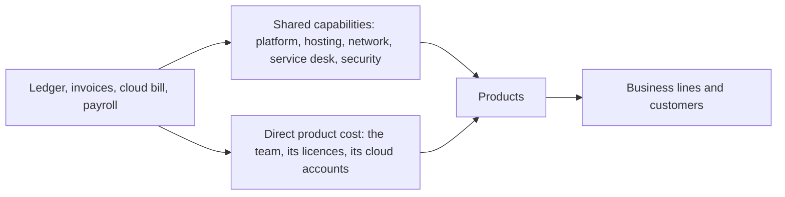

# Module 10 — Money, suppliers and risk

*By the time the board asks Omar, Najm Bank's CIO, about cost and outages, it is no longer asking about technology. It is asking three business questions. What does each product cost us, and is that cost going in the right direction? Which suppliers do we depend on, and are we managing them or are they managing us? Which risks are we carrying, and can we prove our controls work? This module answers them with the operating-model view: a cost model that reaches products and units people can act on (10.1), a sourcing and supplier model in which the bank stays accountable for services built from many suppliers' parts (10.2), and a risk and control model that produces evidence an auditor and a supervisor can trust without stopping delivery (10.3). Tariq, Lina and Nour each lead one lesson, and each makes a mistake you can avoid. Accounting, procurement law and regulation vary by country and bank; the course teaches the questions, and your finance, legal and risk specialists give the answers.*

> **Steps:** Fund, Govern — know what each product costs and why, buy from suppliers without giving away accountability, and run controls that protect the bank and leave evidence behind them.

---

# 10.1 — IT financial management: cost models, unit costs and the cost of a product
*Level: 🔴 Advanced* · *Prerequisites: 3.2, 7.3, 9.1* · *Step: Fund*

**After this you can** build a one-page cost model for one digital product that traces every material cost line to that product, splits direct from shared and fixed from variable, states one or two unit costs with their numerator, denominator and data source, and lists the questions finance must answer before the numbers are used for decisions. *Study time: reading about 15 min, hands-on about 100 min (estimate).*

## ⚡ In 60 seconds
- **IT financial management** is knowing what technology costs, why and for whom, so funding and stop-or-continue decisions rest on trusted numbers.
- A **cost model** traces money from the ledger, invoices, cloud bill and payroll, through shared platforms and services, to **products** and the business lines that use them.
- A **unit cost** divides a cost by a volume someone can influence, such as cost per thousand card authorisations.
- The rule that matters most: **cost every product fully, allocate shared cost simply, and never let the allocation method become the argument.**
- Decision cue: if a product manager cannot name her three biggest cost lines and which she can change, the model is not yet useful.
- Biggest trap: reading a falling average unit cost as efficiency; growth over a fixed cost lowers it by itself.

## 🧭 Why it matters
Najm Bank and everyone in it are fictional. All numbers about Najm Bank in this lesson are illustrative figures, not benchmarks.

The board's audit committee asked Omar: "What does the Cards & Payments digital product cost each year, and what would we save if we retired the old card platform?" Tariq, IT Finance Business Partner, opened the **general ledger** (the bank's master accounting record). It showed spending by **cost centre** (the organisational unit a budget is assigned to) and by **account** (salaries, licences, **depreciation** (spreading an asset's cost over its useful life), cloud, consultants), but not by product. Reem's team, the cloud bill, three supplier contracts and part of the data centre all served Cards & Payments; none said so.

Tariq's first attempt made things worse. He divided shared platform and infrastructure cost by headcount. Cards & Payments, a small team running a heavy, always-on workload, came out cheap; the branch-staff portal, a large team running a light workload, came out expensive. Everyone knew it was wrong, and the next meeting argued about the method, not the cost.

Without a cost model, lesson 3.2's product funding, 7.3's showback, 8.3's priced reliability targets and 10.2's renewals all fall back to opinion.

## 📐 How it works

### 🟢 The essentials

**Re-reading the ledger.** Finance records cost by cost centre and account, because that is how budgets are approved; technology decisions are made about products, platforms and suppliers. A cost model does not replace the ledger; it re-reads it in the shape of those decisions, tracing what money buys through shared capabilities to the products whose cost you want to know:

Money buys either something one product uses alone (**direct cost**) or something many products share (**shared cost**). Shared cost reaches products through an **allocation driver**, a measurable quantity that rises when a product uses more of the shared thing.

**Four splits to make on every cost line.**

| Split | Question | Why it matters |
|---|---|---|
| **Direct or shared** | Does one product use it alone? | Shared cost needs a driver |
| **Fixed or variable** | Does it change with volume within a year? | Most IT cost is fixed in the short run |
| **Run or change** | Does it keep today's service working, or change it? | Run cost grows quietly if nobody owns it (lesson 3.1) |
| **Capital or operating** | Recorded as an asset spread over years, or as an expense now? | Affects budgets and profit; **finance decides** |

The last split is an accounting question. Under IFRS (International Financial Reporting Standards, set by the International Accounting Standards Board, IASB), IAS 38 *Intangible Assets* is reported to require research spending to be expensed and to require development spending to be recognised as an asset if, and only if, specified criteria are met. IASB staff papers for its October 2026 meeting were reported to use agile software development as a test case for how those criteria apply. Do not decide the treatment yourself. Ask the financial controller, and make the evidence (time on qualifying work, the product it served) easy to produce from delivery tools (lesson 3.2).

**The cost of a product.** A digital product's yearly **full cost** is **its team**, **its own technology** (licences and tagged cloud accounts), **its share of platforms** and **of operations**, **its suppliers** and **its legacy tail**: old systems kept alive because the product still depends on them. Retiring a system saves only what disappears when it goes, rarely its whole allocated cost.

**Unit costs people can act on.** A **unit cost** is a cost divided by a volume. Good units are counted reliably, influenced by the product owner and recognised by the business.

| Product or service | Useful unit | Weak unit |
|---|---|---|
| Card authorisation service | Cost per thousand authorisations | Cost per server |
| Digital banking app | Cost per monthly active customer | Cost per release |
| Test environments | Cost per environment-month kept open | Cost per core-hour |

Weak units describe the provider's own resources; useful ones describe the consumer's behaviour, which someone can change.

### 🟡 Going deeper

**Choosing allocation drivers.** For each shared cost, pick the simplest driver that moves when real use moves.

| Shared cost | Reasonable driver | Driver to avoid |
|---|---|---|
| Container platform | Requested CPU and memory per product namespace | Headcount of the product team |
| Hosting and storage | Tagged storage and compute consumed | Number of applications |
| Service desk | Contacts logged against the product identifier | Revenue of the business line |
| Security tooling | Repositories or workloads scanned | An equal split |

Headcount and equal splits are easy to compute and rarely defensible: they move cost from heavy users to light ones. Where no good driver exists yet, show **unallocated shared cost** on its own line; an honest "not yet allocated" beats a precise-looking wrong number.

**Time-driven costing.** For services that are mostly people's time (service desk, access administration), estimate the cost of one minute of the team's capacity and the minutes each type of work takes. Kaplan and Anderson described this as **time-driven activity-based costing** in *Harvard Business Review* in November 2004. A password reset or a major-incident hour can then be priced and traced to products.

**Average versus marginal.** The **average unit cost** is total cost divided by total volume; the **marginal cost** is what one more unit adds. On a mostly fixed-cost platform, the average falls as volume rises with no efficiency gain, while marginal cost stays near zero until capacity runs out, then jumps. Use averages for trends, marginal cost for new volume, and label which a chart shows.

**Consumption-priced services.** Cloud, SaaS and AI services are often priced per use, so cost follows engineering decisions within days. The FinOps Foundation is reported to define FinOps as an operational framework and cultural practice that maximises the business value of technology, having widened its scope beyond public cloud in recent years. Variable spend needs fast feedback to the people who cause it (lesson 7.3). For the engineering, see [*Cloud & DevOps: Zero to Hero*, lesson 6.2 — FinOps: understanding, allocating and cutting cloud cost](../cloud/index.html#/6.2); for AI products priced per call, see [*AI Product Management: Zero to Hero*, lesson 8.2 — Unit economics: cost to serve, pricing models and margins](../aipm/index.html#/8.2).

### 🔴 Expert view

**Precision is a cost too.** Ten simple shared pools that product owners understand beat eighty only their author can run.

**Freeze the method, then argue about the numbers.** Agree drivers with product owners and finance once a year and do not change them mid-year because someone dislikes a result; changing method destroys the trends.

**Connect cost to the records.** Put lesson 9.1's product identifier on every cloud resource, licence and invoice line, so the direct layer builds itself.

**Known frameworks.** The TBM Council publishes the Technology Business Management (TBM) framework and taxonomy for IT cost, and the FinOps Foundation publishes the FinOps Framework. This course follows neither's structure; lesson 12.1 compares them.

**The memorable rule:** *cost every product fully, allocate shared cost simply, and never let the allocation method become the argument.*

## 🧰 The toolkit
| Resource, tool or template | What it is and does | When to reach for it |
|---|---|---|
| **Product cost sheet** | One page per product: direct lines, shared lines with drivers, unallocated shared cost, fixed and variable, run and change | Yearly for funding, quarterly for review |
| **Driver register** | Each shared pool's driver, data source, owner and date agreed | Before publishing any allocated number |
| **Unit cost card** | One or two units per product with numerator, denominator, source and trend | Monthly reviews and funding memos |
| **Finance question list** | Capital treatment, time evidence, allocation policy, recharges | Before numbers are used for budgets or charges |
| **Retirement savings sheet** | What disappears, what stays, and when, if a system is switched off | Every stop-or-retire decision (lesson 3.3) |
| **Cost and usage tools** | Categories: cloud cost tools, IT financial management modules, tagged billing data in a warehouse (not endorsements) | When the spreadsheet takes more than a day to refresh |

## 🏛️ In practice at Najm Bank
Illustrative and fictional. Tariq started again with Reem for one product, using Huda's product identifier `CARDS-PAY`.

**The sheet.** Direct lines came first, then shared lines with drivers agreed with the platform owners. Security tooling had no reliable driver yet, so it stayed unallocated, with an owner. Amounts are shares of full cost (illustrative figures, not benchmarks):

| Line | Direct or shared | Driver | Fixed or variable | Run or change | Amount |
|---|---|---|---|---|---|
| Reem's team | Direct | — | Fixed | Mostly change | 38% |
| Card-processing licence | Direct | — | Fixed | Run | 12% |
| Two tagged cloud accounts | Direct | — | Variable | Run | 7% |
| Card switch support contract | Direct | — | Fixed | Run | 5% |
| Container platform | Shared | Requested CPU and memory | Fixed in year | Run | 9% |
| Hosting and storage | Shared | Tagged consumption | Mostly variable | Run | 8% |
| Service desk | Shared | Contacts logged against `CARDS-PAY` | Fixed | Run | 4% |
| Operations centre | Shared | Incident hours | Fixed | Run | 5% |
| Security tooling | Unallocated shared | None agreed yet (owner named) | Fixed | Run | 4% |
| Old card platform (legacy tail) | Shared | Batch jobs run | Fixed | Run | 8% |
| **Total full cost** | | | | | **100%** |

**The unit cost card.** Cost per thousand card authorisations. Numerator: the month's full cost of the authorisation service from the sheet. Denominator: authorisations counted by the card switch. Source: the sheet and the switch's transaction log.

**The legacy tail** surprised everyone. The old card platform still served one batch reconciliation job. Its allocated cost looked large, but Tariq's **retirement savings sheet** showed the hardware fully depreciated and the licence committed to the end of next year. Retiring it would save the support contract and two operators' time from next year. Omar gave the audit committee that number, with its date.

In the first quarter the authorisation unit cost fell; Tariq noted beside the chart that volume had grown over a flat cost base. Reem added cost per test environment-month, a unit she could act on at once.

Tariq asked the financial controller whether the tokenisation work could be capitalised under bank policy, with what evidence, and how platform costs crossing two legal entities should be recharged. He used no capital figure until the answers came back.

## 🛠️ Exercises
**🟢 Classify ten cost lines.** Take ten cost lines serving one product (or Cards & Payments). Mark each direct or shared, fixed or variable, run or change, and write "ask finance" for capital or operating.
*Done when:* ten lines are classified, each shared line names a candidate driver, and no capital cell holds your own conclusion.

Model answer and self-check

**Model answer.** For example: "Team salaries: direct, fixed, mostly change. Container platform: shared (requested capacity), fixed in year, run. Cloud account: direct, variable, run. Service desk: shared (contacts by product identifier), fixed, run." Capital: "ask finance" throughout. **Self-check.**
- Did you avoid headcount or equal splits as drivers?
- Could you measure every driver today?

**🟡 Draft a product cost sheet.** Build a one-page cost sheet for one product: direct lines, shared lines with drivers, unallocated shared cost and the legacy tail, plus one unit cost with its data source.
*Done when:* the sheet totals to a full cost, shows unallocated cost as its own line, and the product owner has named the three lines she can change.

Model answer and self-check

**Model answer.** Compare with Tariq's `CARDS-PAY` sheet and unit cost card in "In practice at Najm Bank": about ten rows, each with its split and driver, one unallocated row with an owner, a legacy-tail row, a total, and a unit whose numerator, denominator and source are named. **Self-check.**
- Could the product owner explain every driver in one sentence?
- Is the unit's volume counted by a system, not estimated?
- Did she name lines she controls, not just lines she dislikes?

**🔴 Size a retirement saving.** For one system due to retire, list each cost line, whether it disappears, shrinks or stays, and from which date. Compare the total with its allocated cost.
*Done when:* every line has a status and a date, the gap to allocated cost is stated, and your questions for finance on depreciation and contract dates are written.

Model answer and self-check

**Model answer.** For example: "Support contract: disappears at renewal. Hardware: fully depreciated, no saving. Licence: committed to year end. Two operators: saving only if not backfilled. Hosting share: stays unless capacity is released. Real saving: about 40% of allocated cost, from next year (illustrative)." **Self-check.**
- Did you separate cost that disappears from cost merely re-allocated to other products?
- Did you check notice periods with your vendor manager and depreciation with finance, and state the date?

## ⚠️ Mistakes and traps
- **Allocating by headcount or equal split.** It shifts cost to light users. Use drivers that move with use; show unallocated cost honestly.
- **Reading average unit cost as efficiency.** Growth alone lowers it. Show volume and fixed cost beside it; use marginal cost for new volume.
- **Promising the whole allocated cost as a saving.** Retiring a system saves only what disappears. Build a retirement savings sheet with dates.
- **IT deciding accounting treatment.** Capitalisation and recharging are finance decisions. Bring questions and make evidence easy to produce.

## 🧾 Recap
- Split every line: direct or shared, fixed or variable, run or change, capital or operating (finance decides the last).
- A product's full cost includes its team, its technology, shares of platforms and operations, suppliers and its legacy tail.
- Use unit costs the consumer can influence, and distinguish average from marginal cost.
- Allocate shared cost simply, freeze the method for the year, and size retirements on real savings with dates.

## ✍️ Check yourself
**1. Tariq allocates shared platform cost to products in proportion to each product team's headcount. Cards & Payments, a small team with a heavy always-on workload, comes out cheap. What is the core problem?**

- A. Headcount data is held by human resources, so it is usually too out of date to use.
- B. The driver does not move with use, so cost shifts from heavy users to light users.
- C. Platform cost should never reach products and should stay in a central budget.
- D. Shared cost should be split equally, since every product benefits from the platform.

Answer

**B.** A good driver rises with use of the shared thing; headcount does not. A may be true somewhere but is not the core problem, C abandons full product cost, and D, like headcount, ignores how much each product uses. See "Choosing allocation drivers".

**2. Which unit cost is most useful for Reem to manage the Cards & Payments payment service?**

- A. Cost per server in the card platform's production cluster.
- B. Cost per release deployed to the card platform each month.
- C. Cost per agent working on the service desk for card queries.
- D. Cost per thousand card authorisations processed.

Answer

**D.** Its volume is counted reliably, recognised by the business and influenced by the product. A and C count the provider's resources; B counts activity, not service. See "Unit costs people can act on".

**3. Over a quarter, the cost per thousand authorisations fell by a sixth while fixed platform cost stayed flat and transaction volume grew. What should Tariq write beside the chart?**

- A. Volume rose over a flat cost base, so the drop is not evidence of efficiency.
- B. The fall proves the platform team's efficiency programme is working well.
- C. The fall means the marginal cost of new transactions has also dropped by a sixth.
- D. The fall shows the allocation method is wrong and must be changed this quarter.

Answer

**A.** Spreading an unchanged cost over more transactions lowers the average by itself. B claims a cause the data does not show, C confuses average with marginal cost, and D breaks the trend. See "Average versus marginal".

**4. The audit committee asks what retiring the old card platform would save. Its allocated cost is large. What is the best answer to prepare?**

- A. The whole allocated cost, because all of it is attributable to the old platform.
- B. Only the cost that disappears, line by line, with the date each saving arrives.
- C. Nothing until finance has decided the accounting treatment of the full platform.
- D. Half of the allocated cost, since shared costs tend to stay after a retirement.

Answer

**B.** Depreciated hardware and committed licences may save nothing at first. A overstates the saving, C delays an answer that can be prepared now, and D is arbitrary. See "The cost of a product".

**5. Reem asks whether her team's work on the new tokenisation feature can be capitalised. What should Tariq do?**

- A. Capitalise it, because new features are development work and qualify under the standard.
- B. Ask the financial controller at year end, and rebuild the time spent from estimates.
- C. Ask the financial controller now, and capture qualifying time as it happens.
- D. Expense it, because agile teams cannot separate research from development reliably.

Answer

**C.** The treatment is finance's call under bank policy, and the evidence is cheapest when captured as the work happens. B asks the right person too late, with weak evidence; A and D state accounting conclusions IT should not make. See "Four splits to make on every cost line".

## 📚 References
- Kaplan, R. S. and Anderson, S. R., "Time-Driven Activity-Based Costing", *Harvard Business Review*, November 2004 (publication details and summary as reported in search summaries; not opened): https://store.hbr.org/product/time-driven-activity-based-costing/R0411J
- IFRS Foundation, IAS 38 *Intangible Assets*, standard summary page (research and development treatment as reported in search summaries; not opened): https://www.ifrs.org/issued-standards/list-of-standards/ias-38-intangible-assets/
- IFRS Foundation, IASB meeting 27–28 October 2026, Agenda Paper 17A, "Recognition of an intangible asset and supporting requirements (agile software development test case)" (staff paper; does not represent the IASB's views; as reported in search summaries, not opened): https://www.ifrs.org/content/dam/ifrs/meetings/2026/october/iasb/ap17a-recognition-intangible-asset-supp-requirements.pdf
- FinOps Foundation, "What is FinOps?" (definition, "business value of technology", as reported in search summaries; the page could not be opened from this environment): https://www.finops.org/introduction/what-is-finops/
- TBM Council, "About the Council" (as reported in search summaries; not opened): https://www.tbmcouncil.org/about/
- Library course: [*Cloud & DevOps: Zero to Hero*, lesson 6.2 — FinOps: understanding, allocating and cutting cloud cost](../cloud/index.html#/6.2).
- Library course: [*AI Product Management: Zero to Hero*, lesson 8.2 — Unit economics: cost to serve, pricing models and margins](../aipm/index.html#/8.2).

---

# 10.2 — Sourcing, suppliers and multi-supplier integration
*Level: 🔴 Advanced* · *Prerequisites: 2.2, 5.3, 8.3* · *Step: Fund, Govern*

**After this you can** choose a sourcing model for one capability with reasons, list the operating-model terms its contract must contain, tier your suppliers by criticality, and design how several suppliers' work is integrated into one service the bank stays accountable for. *Study time: reading about 15 min, hands-on about 110 min (estimate).*

## ⚡ In 60 seconds
- **Sourcing** is deciding who does a piece of work: your staff, a supplier's people under your direction, a supplier running a service, or a supplier's product.
- **Multi-supplier integration** makes several suppliers' parts behave as one service, with one incident process, one change view and one owner.
- The rule that matters most: **you can outsource the work, never the accountability.** The bank's customers and supervisor see one bank.
- Decision cue: keep in-house what differentiates you and the knowledge you must not lose; buy commodity; tier suppliers by the service they support.
- Biggest trap: suppliers meeting their own service levels while the customer journey fails. Measure the journey.

## 🧭 Why it matters
Najm Bank and everyone in it are fictional. All numbers about Najm Bank in this lesson are illustrative figures, not benchmarks.

On a Tuesday afternoon, card payments failed for fifty-five minutes (illustrative figure). Three suppliers were involved: the card-processing software vendor, the managed hosting provider and the network carrier. Each opened a ticket in its own tool and reported, correctly, that its component had met its contractual availability. Yousef's operations centre spent twenty minutes finding out whom to call; no contract required any supplier to join the bank's **bridge** (the live call where responders coordinate a major incident).

Lina, Vendor and Sourcing Manager, had negotiated all three contracts at good prices, separately. None said how the suppliers would work together, and nobody had asked Reem, whose product failed, about the service levels. Nour, IT Risk and Controls Lead, then asked: if the hosting provider failed for a month, how would the bank leave it, and had anyone tried?

Sourcing is an operating-model decision dressed as a procurement one: it decides how fast the bank can change and who is woken at midnight.

## 📐 How it works

### 🟢 The essentials

**Four ways to source a capability.**

| Model | What the bank gets | Who carries delivery risk | Typical fit |
|---|---|---|---|
| **In-house** | Its own staff do the work | The bank | Differentiating products, core knowledge, integration |
| **Staff augmentation** | A supplier's people under the bank's direction | Mostly the bank | Temporary capacity or a scarce skill |
| **Managed service** | A supplier runs a defined service to agreed levels | Shared | Stable operations such as hosting |
| **Product or SaaS** | A supplier's product, run by the supplier | Supplier for the product; bank for its use | Commodity capabilities such as email or HR |

Five questions decide:

1. **Does it differentiate us?** If so, keep the product decisions in-house.
2. **Is the knowledge critical?** If losing it would leave the bank unable to change or recover the service, keep enough inside.
3. **Is it well defined and stable?** Managed services need a service that can be specified and measured.
4. **How fast must it change?** A supplier's release cycle becomes the product's speed.
5. **What do rules require?** Approvals, notifications or contract terms.

For the engineering angle, see [*System Design for Vibe Coders*, lesson 0.3 — Build vs Buy: the Highest-Leverage Decision You'll Make](../vibe/index.en.html#l0-3).

**Contract types.** Time and materials pays for effort; fixed price for a deliverable, so change becomes a negotiation; service-level contracts for a running service, with **service credits** (price reductions when targets are missed); subscriptions per user or transaction. Service credits rarely match an outage's business impact: treat them as a signal, not insurance.

**The operating terms every material contract needs.** Operating-model owners must add these, because procurement will not know to ask:

| Term | What to write | Why (lesson) |
|---|---|---|
| **Service levels tied to journeys** | Component targets that let the journey's SLO be met | Lesson 8.3 |
| **Incident participation** | Join the bank's bridge within an agreed time; share timelines; join post-incident reviews | Lessons 8.1, 8.2 |
| **Change notification and staging** | Notice of changes, a test ring that gets updates first, new features delivered switched off | Lessons 6.1, 6.2 |
| **Records and data feeds** | Tickets, changes and usage against the bank's product identifier | Lessons 9.1, 9.3 |
| **Data location and return** | Where data is held, and how it is returned or destroyed | Lesson 10.3 |
| **Audit and information rights** | The bank, its auditors and, where required, its supervisor can obtain information and audit | Lesson 10.3 |
| **Subcontracting** | What may be subcontracted; notice of changes in key subcontractors | This lesson |
| **Exit and transition** | Exit plan, transition assistance, timelines | This lesson |

### 🟡 Going deeper

**Tiering suppliers.** Tier suppliers by the criticality of what they support, not by spend: a cheap component in the card authorisation path can matter more than an expensive consultancy.

| Tier | Typical test | Management |
|---|---|---|
| **Critical** | Supports a critical or important business service; failure would quickly hurt customers or breach an obligation | Named owner, monthly review, tested exit plan, risk assessment before signing and yearly |
| **Important** | Supports a product, with workarounds or time before harm | Quarterly review, documented exit plan |
| **Standard** | Commodity, easily replaced | Review at renewal |

**What regulators commonly expect, as examples.** Rules differ by jurisdiction; whether any apply to Najm Bank is for Nour's team, with compliance and the second line, to decide. Three public examples:

- The **European Banking Authority**'s 2019 outsourcing guidelines (EBA/GL/2019/02) are reported to be replaced by its *Guidelines on the sound management of third-party risk* (EBA/GL/2026/09, published 18 September 2026), which cover non-ICT third-party arrangements, from risk assessment to exit; check the EBA site for when they apply.
- ICT arrangements fall under the EU's **Digital Operational Resilience Act** (Regulation (EU) 2022/2554, applying from 17 January 2025; not DORA the DevOps research programme), reported to require a register of ICT third-party contracts (Article 28(3)) and exit strategies for ICT services supporting critical or important functions (Article 28(8)).
- The **Basel Committee on Banking Supervision** published *Principles for the sound management of third-party risk* on 10 December 2025, a common baseline following a third-party arrangement's life cycle.

For AI suppliers, the QCB Artificial Intelligence Guideline, as cited in the library, requires QCB approval before signing a high-risk AI purchase, licensing or outsourcing agreement (§11.2); see [*AI Governance: Zero to Hero*, lesson 5.3 — Consumer protection, product liability and sector rules](../aigp/index.html#/5.3) and [*AI Governance: Zero to Hero*, lesson 11.2 — Buying AI: vendor due diligence and contracts](../aigp/index.html#/11.2). Ask the risk function: "Is this arrangement in scope of any outsourcing, third-party or resilience rule, and what approvals, notifications, terms and register entries does it need?"

**Multi-supplier integration.** When a service is built from several suppliers' parts, someone must be the **integrator**: owning the end-to-end service and holding each supplier to its part. The practice is often called service integration and management (SIAM); lesson 12.1 places it among the frameworks. The integrator role can sit **in the bank** (keeps accountability and knowledge inside, needs skilled people), **with a lead supplier** (simpler to contract, but gives one supplier power over its competitors' work) or **with a separate integration supplier** (the bank still owns the outcome and must manage the integrator).

Four mechanisms make integration real:

1. **One incident record per customer impact**, in the bank's tool, with suppliers' tickets linked and each supplier bound to join the bridge.
2. **One change view**: supplier changes that touch the service appear on the bank's change calendar (lesson 6.2).
3. **Shared service levels** derived from the journey's SLO; the monthly review shows the journey first, then each supplier's contribution.
4. **Collaboration terms** in every contract: cooperate with the bank's other suppliers, share information, join joint reviews.

**Supplier performance management.** A short **supplier scorecard** turns the relationship into evidence: service (journey impact, incidents caused), delivery, risk (open findings, subcontractor changes), commercial and relationship.

### 🔴 Expert view

**Concentration risk.** If many services depend on one provider or subcontractor, one failure hurts them all. Map the dependency, design for degraded operation and have an exit plan you believe.

**Exit plans you have tried.** An unrehearsed exit plan is a hope. For each critical supplier, write what the bank would do on a sudden failure and on an orderly exit: how long, where the data goes, which skills are needed. Rehearse the hardest part, often data extraction into a usable form.

**Lock-in is a price, not a sin.** Accept switching costs knowingly, and record them for the next renewal.

**Keep an intelligent customer.** Keep people who can specify the service, judge the supplier and take the service back.

**The memorable rule:** *you can outsource the work, never the accountability.*

## 🧰 The toolkit
| Resource, tool or template | What it is and does | When to reach for it |
|---|---|---|
| **Sourcing decision record** | The five questions answered, the model chosen, the alternative rejected and why | Before any material sourcing decision |
| **Operating terms checklist** | The eight operating terms for material contracts | At drafting and every renewal |
| **Supplier tiering register** | Each supplier's tier, services supported, owner and next review | Reviewed quarterly with Nour |
| **Supplier scorecard** | Service, delivery, risk, commercial and relationship measures, journey first | Monthly for critical suppliers |
| **Integration model** | Who integrates, and how incidents, changes and records cross suppliers | When a service has more than one supplier |
| **Exit plan** | Sudden and orderly scenarios, timelines, data, skills, last rehearsal | Every critical supplier |
| **Supplier management tools** | Categories: contract repositories, third-party risk tools (not endorsements) | When supplier data outgrows spreadsheets |

## 🏛️ In practice at Najm Bank
Illustrative and fictional. After the outage, Omar asked Lina, Yousef, Reem and Nour to redesign card payments' supplier management before renewal.

**Integration model.** The integrator role stayed in the bank: Yousef's operations centre runs every card-payments major incident in the bank's tool; Reem owns the journey SLO and the monthly supplier review. Lina drafted a **collaboration schedule** for all three contracts: join the bank's bridge within fifteen minutes for a severity-1 incident, share timelines within two days, contribute to post-incident reviews, and log tickets against `CARDS-PAY`.

**Service levels.** Reem worked back from the journey SLO (lesson 8.3). Hosting gained a measure of no interruption longer than ten minutes; the carrier's availability is now measured at the bank's data centre, not its own edge.

**Tiering.** Lina's register held 214 suppliers (illustrative figure), all managed alike. With Nour she tiered them: nineteen critical, forty-one important, the rest standard. Two critical suppliers turned out to share one subcontractor for data centre space; Nour recorded a concentration risk.

**Exit.** Sami, Platform Engineering Lead, rehearsed leaving the hosting provider by standing up its configuration and a month of data in the bank's own cloud account. It took eleven days, not the two the plan assumed, because the export format was undocumented. Lina added a data-format clause.

**Lina's mistake.** Her collaboration schedule first went only to the card suppliers. Yousef pointed out the app's five suppliers needed it too; it became a standard annex for every critical supplier.

## 🛠️ Exercises
**🟢 Write one sourcing decision record.** For one capability (or the card-processing service), answer the five sourcing questions, choose a model, and name the alternative you rejected and why.
*Done when:* the record answers all five questions with evidence, names the model and one rejected alternative, and includes the question you will put to the risk function about applicable rules.

Model answer and self-check

**Model answer.** For example: "Card processing. Differentiates? The customer experience does, the engine does not. Critical knowledge? Integration and configuration. Well defined? Yes. Speed? Quarterly is enough for the engine. Rules? Ask Nour whether it is a critical or important function. Model: supplier product, configured and integrated in-house. Rejected: full managed service, which would move configuration knowledge outside." **Self-check.**
- Did you keep the knowledge needed to change and recover the service?
- Is the regulatory question asked, not answered by you?

**🟡 Check a contract against the operating terms.** Take one existing supplier contract (or a summary from your vendor manager) and check it against the eight operating terms. Mark each present, partial or missing, and draft wording for the two most important gaps.
*Done when:* all eight terms are marked with a clause reference or "missing", and two gaps have draft wording reviewed by your vendor manager.

Model answer and self-check

**Model answer.** Typical findings: service levels measured at the supplier's edge; no incident participation; no records feed; exit without assistance. Draft: "The Supplier shall join the Bank's major-incident bridge within 15 minutes of notification of a Severity 1 incident and contribute to the Bank's post-incident review." **Self-check.**
- Are service levels measured where the customer experiences them?
- Did you include cooperation with other suppliers?

**🔴 Tier the suppliers of one service and design its integration model.** Pick one service built from several suppliers' parts (or card payments). Tier each supplier by the business service it supports. Name the integrator (the bank, a lead supplier or a separate integrator) and give the reason. Then specify the four mechanisms: the single incident record, the change view, the journey-derived service levels and the collaboration terms.
*Done when:* each supplier has a tier and a named owner, the integrator choice has a reason and a rejected alternative, and each of the four mechanisms has an owner and a named record (tool, calendar, report or contract clause).

Model answer and self-check

**Model answer.** For example, card payments: card-processing vendor, hosting provider and network carrier all critical, because each sits in the authorisation path. Integrator: the bank, because the journey is core and the knowledge must stay inside; a lead supplier was rejected because it would control its competitors' work. Incident record: Yousef's team, a major-incident record in the bank's service management tool with supplier tickets linked. Change view: Yousef's team, supplier changes on the bank's change calendar under `CARDS-PAY`. Service levels: Reem, the journey SLO report with each supplier's contribution, reviewed monthly. Collaboration terms: Lina, the collaboration schedule annexed to each contract. **Self-check.**
- Did you tier by business impact rather than spend?
- Does every mechanism name a record a reviewer could open, not only a meeting?
- Would each supplier find its duties in its own contract?
- As a next step, could you run a tabletop exit for the most critical supplier?

## ⚠️ Mistakes and traps
- **Buying components, forgetting the service.** Name an integrator, measure the journey, add collaboration terms.
- **Tiering by spend.** Tier by the business service supported.
- **Treating service credits as protection.** Use them as a signal; design resilience separately.
- **An exit plan on paper only.** Rehearse the hardest step and fix what breaks.
- **Deciding regulatory scope yourself.** Ask the risk function and compliance.

## 🧾 Recap
- Choose a sourcing model by differentiation, knowledge, definition, speed of change and rules.
- Every material contract needs operating terms, not only a price.
- Tier suppliers by the criticality of the service they support; rehearse exits for critical ones.
- In multi-supplier services, name the integrator: one incident record, one change view, journey-derived service levels.
- You can outsource the work, never the accountability.

## ✍️ Check yourself
**1. During the Tuesday outage, all three card suppliers met their contractual availability for the month while card payments failed for fifty-five minutes. What is the most important change for the next renewal?**

- A. Raise every supplier's monthly availability target by a tenth of a percentage point.
- B. Increase service credits so that each supplier pays more for every missed target.
- C. Derive supplier targets from the journey SLO and add collaboration and bridge terms.
- D. Replace the three suppliers with one lead supplier that is paid to manage the others.

Answer

**C.** The failure was integration: per-component targets and no duty to work together. A and B tighten the same component measures, and D alone does not fix how targets are set. See "Multi-supplier integration".

**2. Lina is tiering two suppliers. A small tokenisation provider costs little but sits in the card authorisation path. A large consultancy costs ten times more and advises on a strategy review. Which should be tiered critical?**

- A. The consultancy, because the bank spends far more with it each year.
- B. Both, because every supplier with a signed contract carries some risk.
- C. Neither, until each has caused at least one incident affecting customers.
- D. The tokenisation provider, because its failure would quickly stop payments.

Answer

**D.** Tier follows the harm a failure would do to the service it supports, not the spend. A tiers by spend, B makes the critical tier meaningless, and C waits for harm before managing it. See "Tiering suppliers".

**3. Sami's rehearsal of the hosting exit took eleven days instead of the two the plan assumed. What does this show?**

- A. The plan was untested; what the trial exposed should be fixed, in the contract too.
- B. Rehearsals cause disruption, so exits should be checked by a desk review instead.
- C. The plan was sound, since an exit only needs to work during a real failure.
- D. The hosting provider breached its contract by delaying the bank's data export.

Answer

**A.** Trying the exit exposed an undocumented export format, which Lina turned into a clause. D assumes a breach, B gives up the evidence, and C confuses having a plan with being able to use it. See "Exit plans you have tried".

**4. Reem proposes moving the card-processing engine to a full managed service, including all configuration. Which sourcing question most challenges that proposal?**

- A. Whether the supplier's price is lower than the bank's current internal cost for it.
- B. Whether moving configuration out would leave the bank unable to change it later.
- C. Whether the supplier has other banking customers who already use this service.
- D. Whether the supplier's service levels are higher than the bank's current ones.

Answer

**B.** "Is the knowledge critical?" asks whether the bank could still change or recover the service. A needs total cost of ownership, not price alone, and C and D compare suppliers without asking what the bank would lose. See "Four ways to source a capability".

**5. Najm Bank plans to buy an AI service that would score customers' credit applications. Who should decide which regulatory approvals and contract terms apply?**

- A. Nour's team with compliance, at the first yearly review after signing.
- B. Nour's team with compliance, from the rules, before signing.
- C. The supplier, because it sells the same service to other regulated banks.
- D. Lina, because she negotiates the contract and knows the supplier best.

Answer

**B.** Scope is for the risk function and compliance, and it must be settled before signing: the QCB guideline, as cited in the library, requires approval before a high-risk AI outsourcing agreement is signed (§11.2). A has the right people at the wrong time, the supplier cannot decide the bank's obligations, and Lina drafts terms once scope is known. See "What regulators commonly expect, as examples".

## 📚 References
- European Banking Authority, press release announcing its final Guidelines on the sound management of third-party risk, 18 September 2026 (EBA/GL/2026/09; scope, replacement of EBA/GL/2019/02 and transition as reported in search summaries; not opened): https://www.eba.europa.eu/publications-and-media/press-releases/eba-publishes-its-final-guidelines-management-third-party-risk-delivering-more-proportionate-and
- Regulation (EU) 2022/2554 on digital operational resilience for the financial sector (DORA), EUR-Lex (application date and Article 28 content as reported in search summaries; not opened): https://eur-lex.europa.eu/eli/reg/2022/2554/oj
- Basel Committee on Banking Supervision, *Principles for the sound management of third-party risk*, 10 December 2025 (as reported in search summaries; not opened): https://www.bis.org/bcbs/publ/d605.htm
- Library course: [*AI Governance: Zero to Hero*, lesson 5.3 — Consumer protection, product liability and sector rules](../aigp/index.html#/5.3) (the QCB AI guideline clauses cited here).
- Library course: [*AI Governance: Zero to Hero*, lesson 11.2 — Buying AI: vendor due diligence and contracts](../aigp/index.html#/11.2).
- Library course: [*System Design for Vibe Coders*, lesson 0.3 — Build vs Buy: the Highest-Leverage Decision You'll Make](../vibe/index.en.html#l0-3).

---

# 10.3 — Risk, controls and audit in a regulated bank
*Level: 🔴 Advanced* · *Prerequisites: 5.2, 6.2, 9.3* · *Step: Govern*

**After this you can** build a control matrix for one technology risk area that links each risk to its controls, owners and evidence, decide which controls can be automated in the delivery flow, and prepare the evidence pack an internal auditor would sample. *Study time: reading about 15 min, hands-on about 120 min (estimate).*

## ⚡ In 60 seconds
- A **control** is an activity that reduces a **risk** (an uncertain event that could affect objectives) by preventing, detecting or correcting it.
- A **control matrix** links each risk to its controls, owners, evidence and tests: the shared language of delivery teams, risk and audit.
- The rule that matters most: **a control you cannot evidence is a control you do not have.**
- Decision cue: for every control, ask "what record does this leave without anyone writing a report?"
- Auditors test whether a control is **designed** to address the risk and whether it **operated** as designed over a period.
- Biggest trap: answering every finding with another manual sign-off instead of redesigning the flow.

## 🧭 Why it matters
Najm Bank and everyone in it are fictional. All numbers about Najm Bank in this lesson are illustrative figures, not benchmarks.

Internal audit's report on technology change management arrived the month the Technology division celebrated weekly card releases. It had four findings. The auditors could not find evidence that changes released through Sami's pipeline had been reviewed by someone other than the author; production access for three engineers had not been reviewed for a year; change advisory board minutes approved changes already deployed; and a supplier had changed a load-balancer setting with no change record.

Nour, IT Risk and Controls Lead, knew the first finding was about evidence, not practice: the pipeline enforced peer review, but nobody had shown the auditors where the records were. The access finding was right. Omar's first instinct was a monthly sign-off form for every release. Nour argued for redesign: if the flow produced the evidence, auditors could sample it with no form.

The question is where controls live: in meetings and forms, or in the flow of work with evidence as a by-product.

## 📐 How it works

### 🟢 The essentials

**Risk words, defined.**

| Term | Meaning | Najm Bank example |
|---|---|---|
| **Risk** | An uncertain event that could affect objectives | An unauthorised change reaches card payments |
| **Inherent risk** | The risk before controls | High: many changes, critical service |
| **Control** | An activity that reduces likelihood or impact | Pipeline blocks deployment without an independent approval |
| **Residual risk** | The risk left after controls | Medium-low, if the control works |
| **Risk appetite** | How much risk the board will accept in pursuit of objectives | Low tolerance for customer-facing payment outages |
| **Risk register** | The record of risks, owners, ratings and actions | Kept by Nour's team with first-line owners |

For how security risk appetite and key risk indicators are reported to a board, see [*Secure AI & Application Security: Zero to Hero*, lesson 11.3 — Building a security programme and culture: champions, metrics and budgets](../secai/index.html#/11.3).

**Kinds of control.** **Preventive** controls stop the event (a pipeline that refuses unreviewed code; **break-glass access**, emergency elevated access that is used rarely, logged and expires). **Detective** controls find it afterwards (a daily comparison of what is running against approved releases, lesson 6.3). **Corrective** controls limit the damage (rollback, restore, revoking access). **Manual** controls depend on a person; **automated** controls are performed by a system and leave better evidence, but must themselves be controlled. A **key control** is one the bank relies on most for a risk; testing effort goes there.

**Who does what: three lines.** Many banks use the Institute of Internal Auditors' **Three Lines Model**, updated in July 2020. As reported, it describes **first-line** roles, which deliver products and services and own and manage risk; **second-line** roles, which assist with managing risk (compliance, internal control, information security and similar); and **internal audit**, the third line, giving independent and objective assurance to the governing body. Reem's and Sami's teams are first line. Nour's IT risk and controls team sits in the Technology division and supports first-line owners, so it is not independent of them: it coordinates with the bank's second-line risk and compliance functions, and it is not internal audit. The point: the people who own a risk and those who check it independently are distinct.

**The control matrix.** One row per control. A minimal set of columns:

| Risk | Control objective | Control | Type | Frequency | Owner | Evidence | Test |
|---|---|---|---|---|---|---|---|
| Unauthorised change to card payments | Only reviewed, approved changes reach production | Pipeline requires approval by someone other than the author before production deployment | Preventive, automated | Every change | Sami | Pipeline log: change, author, approver, timestamp | Sample 25 deployments; confirm approver differs from author |
| Unauthorised change outside the pipeline | Changes outside the pipeline are detected | Daily comparison of running versions against releases; alert on difference | Detective, automated | Daily | Yousef | Comparison report and alert tickets | Inspect 10 days' reports and follow each alert |
| Excessive production access | Access matches current need | Quarterly access review by product owners; break-glass access logged and expires | Preventive and detective, partly manual | Quarterly; every use | Reem with Yousef | Review records with decisions; break-glass log | Re-perform one review; sample break-glass uses |

The **control objective** says what must be true, the **control** how, the **evidence** what record proves it, and the **test** how an auditor would check it. An empty evidence cell means a control nobody can rely on.

### 🟡 Going deeper

**Design effectiveness and operating effectiveness.** Is the control **designed** so that, if performed, it would address the risk? Did it **operate** as designed throughout the period? A pipeline rule that lets authors approve their own changes fails on design; a good rule switched off for two weeks fails on operation. Supplier assurance reports draw the same line. A **SOC 2** report (System and Organization Controls, a report on a service organisation's controls from the American Institute of CPAs, AICPA) comes in two kinds, commonly called Type 1 (design at a point in time) and Type 2 (also operation over a period). For critical suppliers (lesson 10.2), ask for the report that covers operation, read its exceptions, and check which controls it expects the bank to operate.

**Common technology control areas.** Auditors of bank technology usually look at **access**, **change** and **operations** (often called IT general controls) and, increasingly, **third parties** and **resilience**. Earlier lessons already produce the evidence: change (pipeline logs, peer review, change records; 5.1, 5.2, 6.2), configuration (6.3), access (entitlement records and review decisions, 7.2; break-glass logs, this lesson), operations (8.1–8.3), traceability (9.3) and third parties (10.2).

**Controls in the flow.** Four steps: (1) list control objectives, not old procedures; (2) find where in the flow a system can meet each one; (3) make that system keep the evidence for the retention period; (4) protect the control itself, because whoever can change a pipeline rule can switch a control off. Agree the design with the second line and internal audit before relying on it.

**Regulatory obligations to controls.** Keep an **obligations register** (the rule, the requirement in plain words, the owner), map each obligation to control objectives, and let the controls produce the evidence. Public reference points, as examples only:

- The **Basel Committee's Principles for operational resilience** (31 March 2021), as reported, on delivering critical operations through disruption.
- The EU's **Digital Operational Resilience Act** (Regulation (EU) 2022/2554, from 17 January 2025): ICT risk, incident reporting, resilience testing and third-party risk; see [*Secure AI & Application Security: Zero to Hero*, lesson 11.2 — Regulation that touches security: GDPR, PDPPL, the EU AI Act and financial-sector rules](../secai/index.html#/11.2).
- The **QCB Artificial Intelligence Guideline** (in force 4 September 2024, as cited in the library's AI governance course): for example, a register of AI systems (§10.1).

Which rules apply to Najm Bank, and what exactly they require, is for Nour's team, compliance and legal to determine from current texts.

### 🔴 Expert view

**Fewer, stronger controls.** Control sets grow after every finding and never shrink. Review the matrix yearly with the second line: merge duplicates, retire controls whose risk has gone, automate where evidence improves.

**Audit findings as problems, not tasks.** Treat a finding like a problem record (lesson 8.2): find why the control failed (design, operation, ownership or evidence), fix the cause, and agree with audit what evidence will show it is fixed in the **management action plan**.

**Continuous control monitoring.** With automated controls, the second line can watch a daily dashboard (deployments with an independent approver, changes outside the pipeline, overdue access reviews, break-glass uses), and audit can test the monitoring instead of re-performing everything.

**Frameworks and AI.** Many organisations describe internal control using COSO's *Internal Control — Integrated Framework* (2013), from the Committee of Sponsoring Organizations of the Treadway Commission. This course follows no framework's structure; lesson 12.1 explains what each is for. AI tools in control work need owners and evidence too (lesson 11.3).

**The memorable rule:** *a control you cannot evidence is a control you do not have.*

## 🧰 The toolkit
| Resource, tool or template | What it is and does | When to reach for it |
|---|---|---|
| **Control matrix** | Risk, control objective, control, type, frequency, owner, evidence, test | The working document for each risk area, agreed with the second line |
| **Obligations register** | Each applicable rule, the requirement in plain words, the owner, the linked control objectives | When a rule is new or changes; reviewed yearly |
| **Evidence pack** | For one control and period: the evidence location, a sample, and how to re-perform it | Before every audit or second-line review |
| **Finding root-cause note** | Why a control failed: design, operation, ownership or evidence, and the fix | For every audit finding before agreeing the action plan |
| **Control monitoring dashboard** | Daily measures of automated controls with exceptions as tickets | Once key controls are automated |
| **Risk and compliance tools** | Category: governance, risk and compliance (GRC) platforms that hold registers, controls and findings | When the matrix outgrows a spreadsheet; link to, do not copy, operational records |

Tools are categories, not endorsements.

## 🏛️ In practice at Najm Bank
Illustrative and fictional. Nour used the four findings to build the change and access control matrix, with Sami, Yousef and Reem as control owners.

**Finding 1: no evidence of independent review.** The design was sound; the gap was evidence. Sami exported every production deployment for the quarter with author, approver and time, and showed the auditors how to sample it themselves. The finding closed with an agreed evidence pack, not a new control.

**Finding 2: access not reviewed.** A real operating failure: after the move to product teams, nobody owned the review. Reem now owns her product's production access, Yousef shared platforms; break-glass access expires after eight hours and every use creates a ticket.

**Finding 3: approvals after deployment.** Lesson 6.2's change model applied: standard changes through the pipeline with automated evidence, the board only for high-risk changes, before deployment.

**Finding 4: supplier change with no record.** The daily comparison of running configuration against approved changes was extended to load balancers and network devices, and Lina added change notification to the supplier's contract (lesson 10.2).

**Nour's mistake.** Her first matrix copied 160 controls from a published catalogue. Teams could not tell which applied, and the evidence column was mostly blank. She cut it to twenty-two key controls, each with evidence the flow already produced, keeping the catalogue for coverage checks.

Omar took one page to the audit committee: key controls, the share operating as designed, and open actions with dates.

## 🛠️ Exercises
**🟢 Classify five controls.** List five controls in your change or access process. Classify each as preventive, detective or corrective, manual or automated, and name the record it leaves.
*Done when:* five controls are classified and each has a named record or "no record" marked as a gap.

Model answer and self-check

**Model answer.** For example: "Pipeline approval rule: preventive, automated, pipeline log. Change board: preventive, manual, minutes. Daily drift report: detective, automated, report and alerts. Rollback: corrective, partly automated, release records. Access review: detective, manual, decisions spreadsheet." **Self-check.**
- Did you find at least one control with no reliable record?
- Did you ask who can change each automated control?
- Did you avoid listing policies (statements) as controls (activities)?

**🟡 Build a control matrix for one risk area.** For change or access on one product, write six to ten rows with all eight columns, marking key controls.
*Done when:* every row has an agreed owner, an evidence location you have checked, and a test an auditor could perform without your help.

Model answer and self-check

**Model answer.** Close to this lesson's matrix, with rows for independent approval, changes outside the pipeline, emergency changes, supplier changes, production access, break-glass access and changes to pipeline rules. **Self-check.**
- Does each objective say what must be true, not how?
- Did you check the evidence exists rather than assume it?
- Is there a control over changes to the controls themselves?

**🔴 Prepare an evidence pack and redesign one manual control.** For one key control, prepare last quarter's evidence pack. Then redesign one manual control so it runs in the flow of work with evidence produced automatically.
*Done when:* someone else can draw and check a sample of 25 items from the pack, and the redesign names the system, the evidence record, who can change the rule, and the question for the second line and audit.

Model answer and self-check

**Model answer.** For example: "Pack: export of the quarter's production deployments with author, approver and time; the query; sampling instructions. Redesign: replace the monthly sign-off form with the pipeline's independent-approval rule; evidence is the deployment log; rule changes need two platform approvers and are logged. Question for audit: will you accept sampled pipeline records as evidence of review for standard changes?" **Self-check.**
- Could the auditor re-perform the sample without asking you?
- Is the new control protected against being switched off silently?
- Did you remove the old manual step once the new one was agreed?

## ⚠️ Mistakes and traps
- **Controls without evidence.** Design the evidence with the control.
- **Answering each finding with a new form.** Fix the root cause and move the control into the flow.
- **Copying a whole control catalogue.** Start from your risks and keep a short list of key controls.
- **Forgetting to control the controls.** Treat changes to pipeline rules as controlled changes.
- **Blurring the lines.** Keep independent challenge and assurance separate from risk owners, and leave regulatory applicability to compliance, legal and the risk function.

## 🧾 Recap
- The control matrix links risk, objective, control, type, frequency, owner, evidence and test.
- Auditors test design and operation; both need evidence over a period.
- The first line owns risk, the second line supports and challenges, internal audit gives independent assurance.
- Build controls into the flow so evidence is a by-product, protect the controls themselves, and agree the design with the second line and audit.

## ✍️ Check yourself
**1. Internal audit cannot find evidence that pipeline changes were reviewed by someone other than the author. The delivery platform does block self-approval. What should Nour do first?**

- A. Add a monthly sign-off form in which each team confirms its changes were reviewed.
- B. Accept the finding and plan a new independent review control for next quarter.
- C. Ask the auditors to rely on engineers' written statements that reviews happen.
- D. Show the auditors the deployment records and agree a pack they can sample there.

Answer

**D.** The control was well designed; the gap was evidence the auditors could reach. A adds a manual control on top of a working one, B accepts a gap that does not exist, and C offers assertion instead of evidence. See "In practice at Najm Bank".

**2. A pipeline rule requires an approver before production deployment, but the author can approve their own change. How would an auditor describe this?**

- A. An operating failure, because the rule did not run on every change in the period.
- B. A design failure, because even when it is performed it does not ensure independence.
- C. An acceptable control, because an approval is recorded for every single deployment made.
- D. A detective control, because each approval can be reviewed after the deployment.

Answer

**B.** Design asks whether the control, if performed, addresses the risk; self-approval is not independent. A describes a good control not performed, C confuses a record with a working control, and D misclassifies a preventive control. See "Design effectiveness and operating effectiveness".

**3. Yousef's operations centre runs the daily comparison of running versions against approved releases and follows up each alert. Where does that work sit in the three lines?**

- A. In the second line, because detecting unauthorised change is a monitoring activity.
- B. In the third line, because it checks other teams' changes after they have happened.
- C. In the first line, because the team runs the service and operates the control itself.
- D. Outside the model, because the comparison is automated rather than done by people.

Answer

**C.** Operating a control within the service you deliver is part of owning and managing its risk. A and B mistake "checking" for independence: the second line supports and challenges from outside the delivery chain, and internal audit gives independent assurance. D is wrong because automated controls still have owners. See "Who does what: three lines".

**4. Nour's first control matrix copied 160 controls from a published catalogue, and the evidence column was mostly blank. What is the best next step?**

- A. Cut to a short list of key controls for the bank's risks, each with evidence.
- B. Keep all 160 and ask each product team to fill in the evidence by a deadline.
- C. Replace the catalogue with another published catalogue that has fewer controls.
- D. Remove the evidence column so the matrix can be approved and used sooner.

Answer

**A.** Key controls tied to real risks, each with evidence, are usable; the catalogue stays a coverage reference. B keeps controls nobody can evidence, C repeats the mistake, and D removes what makes a control real. See "Fewer, stronger controls".

**5. Sami automates the independent-approval control in the pipeline. What else must the control matrix cover so the control can be relied on?**

- A. A yearly reminder email to engineers on why independent review matters most.
- B. Control over who can change the pipeline rule, each change logged.
- C. A second manual approval by the change board for every standard change.
- D. A policy statement that the pipeline rule must never be switched off.

Answer

**B.** Whoever can change the rule can switch the control off, so changes to controls must be controlled and evidenced. A and D are statements, not controls, and C duplicates a working control manually. See "Controls in the flow".

## 📚 References
- The Institute of Internal Auditors, *The IIA's Three Lines Model: An update of the Three Lines of Defense*, July 2020 (content as reported in search summaries; the page could not be opened from this environment): https://www.theiia.org/globalassets/documents/resources/the-iias-three-lines-model-an-update-of-the-three-lines-of-defense-july-2020/three-lines-model-updated-english.pdf
- Basel Committee on Banking Supervision, *Principles for operational resilience*, 31 March 2021 (as reported in search summaries; not opened): https://www.bis.org/bcbs/publ/d516.htm
- Regulation (EU) 2022/2554 on digital operational resilience for the financial sector (DORA), EUR-Lex (application date as reported in search summaries; not opened): https://eur-lex.europa.eu/eli/reg/2022/2554/oj
- Committee of Sponsoring Organizations of the Treadway Commission (COSO), *Internal Control — Integrated Framework* (2013); publication as reported in coverage such as the *Journal of Accountancy*, May 2013 (not opened): https://www.journalofaccountancy.com/news/2013/may/20137970.html
- Library course: [*Secure AI & Application Security: Zero to Hero*, lesson 11.2 — Regulation that touches security: GDPR, PDPPL, the EU AI Act and financial-sector rules](../secai/index.html#/11.2).
- Library course: [*Secure AI & Application Security: Zero to Hero*, lesson 11.3 — Building a security programme and culture: champions, metrics and budgets](../secai/index.html#/11.3).
- Library course: [*AI Governance: Zero to Hero*, lesson 5.3 — Consumer protection, product liability and sector rules](../aigp/index.html#/5.3) (the QCB AI guideline clauses cited here).
