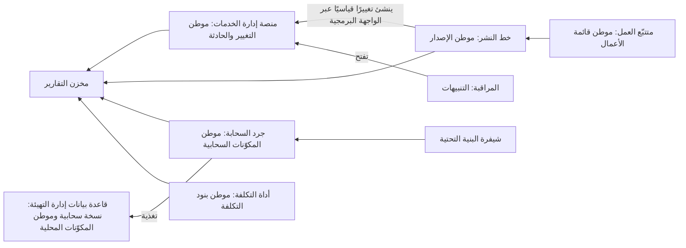
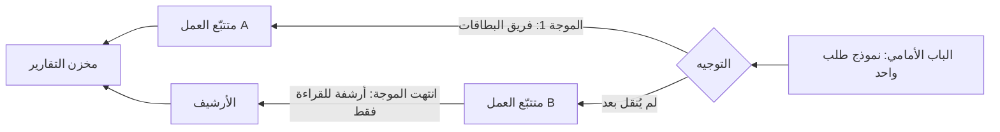
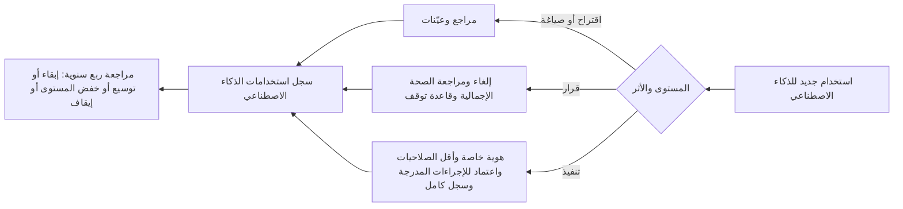

# الوحدة 11 — الأدوات والأتمتة

*يعمل قطاع التقنية في بنك نجم على عشرات الأدوات: جدول بيانات للمحفظة، وأداتان لتتبّع العمل، ومستودعات للشيفرة المصدرية، وخط نشر، ومنصة لإدارة الخدمات، وقاعدة بيانات للتهيئة، ووحدات تحكم سحابية، ومنصة للمراقبة، وأداة للتكلفة، ومستودع للعقود، وغيرها. اشترى كلَّ أداة منها شخصٌ لسبب وجيه، ثم انتقل هذا الشخص إلى موقع آخر. ومجموع هذه الأدوات يحدد سرعة تدفّق العمل، وهل ترتبط السجلات ببعضها، وكم يقضي كل موظف من يومه في نسخ البيانات من شاشة إلى أخرى. تعامل هذه الوحدة سلسلة الأدوات جزءًا من نموذج التشغيل، لا قائمة مشتريات. سترسم أي أداة هي نظام السجل المرجعي لكل سجل (11.1)، وتربط الأدوات وتُخرجها من الخدمة خطوةً خطوة بدل استبدال واحد محفوف بالمخاطر (11.2)، وتشغّل الذكاء الاصطناعي في التسليم والعمليات بضوابط يستطيع بنك خاضع للتنظيم أن يدافع عنها (11.3). أما هندسة خطوط النشر والقياس عن بُعد ووكلاء الذكاء الاصطناعي فتُدرَّس في دورات أخرى من المكتبة؛ وهنا تقرر الغرض من كل أداة، ومن يملكها، وكيف تتصل الأدوات، وما الأدلة التي يجب أن تُنتجها.*

> **الخطوات:** Build, Run — اختر الأدوات التي تحمل العمل من الفكرة إلى الخدمة العاملة، واربطها وأتمتها، حتى تبقى السجلات مترابطة ويقضي الناس وقتهم في القرارات، لا في إعادة إدخال البيانات.

---

# 11.1 — خريطة سلسلة الأدوات: أي أداة هي نظام السجل المرجعي لأي سجل
*المستوى (Level): 🔴 متقدم (Advanced)* · *المتطلبات (Prerequisites): 5.1، 9.1* · *الخطوة (Step): Build, Run*

**بعد هذا الدرس تستطيع** أن ترسم خريطة لسلسلة الأدوات في صفحة واحدة، تسمّي لكل سجل أساسي نظام سجله المرجعي الوحيد، وأنظمة التفاعل معه، ونسخ التقارير، والتكامل الذي يغذّي كل نسخة، مع مالك لكل أداة ولكل تغذية، وقائمة بالتداخلات التي يجب حلّها أولًا. *مدة الدراسة: قراءة نحو 15 دقيقةً، وعمل تطبيقي نحو 110 دقائق (تقدير).*

## ⚡ الدرس في دقيقة (In 60 seconds)
- **سلسلة الأدوات (toolchain)** هي مجموعة الأدوات التي تحمل العمل من الفكرة إلى الخدمة العاملة. و**خريطة سلسلة الأدوات** تُظهر، سجلًّا سجلًّا، أي أداة تنشئه وتصحّحه، وفي أي الأدوات يعمل الناس عليه، وأيها ينسخه فقط.
- القاعدة الأهم: **سجل واحد، موطن واحد.** لكل سجل أساسي من الدرس 9.1 نظام سجل مرجعي واحد بالضبط؛ وكل أداة أخرى تقرؤه أو ترتبط به أو تحمل نسخة مؤرّخة منه.
- كل أداة تحتاج إلى **مالك الأداة (tool owner)**، أي من يشغّلها ويموّلها، وكل سجل يحتاج إلى **مالك السجل (record owner)**، أي من يقرر معناه. سمِّ الاثنين.
- إشارة القرار: إذا كانت أداتان تستطيعان إنشاء السجل نفسه أو تعديله، أو لم يستطع أحد أن يقول أين يُصحَّح السجل، فهذا أول تداخل تحلّه.
- أكبر فخ: أن تجعل منصة واحدة «المصدر الوحيد للحقيقة في كل شيء». وزّع السجلات على مواطنها، ومركِز الروابط.

## 🧭 لماذا يهم (Why it matters)
بنك نجم وكل من فيه شخصيات خيالية. وكل الأرقام عن بنك نجم في هذا الدرس أرقام توضيحية، لا معايير مرجعية.

حين طلب عمر، الرئيس التنفيذي للمعلومات، قائمة بأدوات قطاع التقنية، توقّع سامي، قائد هندسة المنصات، نحو اثنتي عشرة أداة. فعادت القائمة بـ 31 بندًا (رقم توضيحي)، من دون جداول البيانات التي عاملتها فرق عدة على أنها سجلاتها الحقيقية. كانت أداتان لتتبّع العمل تحملان قوائم الأعمال المتراكمة للمنتجات نفسها. وكان خط النشر ومنصة إدارة الخدمات ينشئان كلاهما سجلات تغيير بترقيم مختلف. وكانت قاعدة بيانات إدارة التهيئة (CMDB)، وهي قاعدة بيانات للمكوّنات التي تشغّلها تقنية المعلومات وعلاقاتها ببعضها، وجردُ السحابة يُدرجان كلاهما الخوادم السحابية.

حلّت كل أداة مشكلة محلية. لكن أحدًا لم يقرر، سجلًّا سجلًّا، أي أداة هي موطن الحقيقة، فصار كل سؤال يعبر الأقسام مشروعًا يدويًا. كان لدى هدى، رئيسة البنية المؤسسية، نموذج المعلومات من الدرس 9.1. وكان ينقصها النصف الثاني: أين يعيش كل سجل، وكيف تمرّره الأدوات من واحدة إلى أخرى. وهذا النصف هو خريطة سلسلة الأدوات.

## 📐 كيف يعمل (How it works)

### 🟢 الأساسيات (The essentials)

**ابدأ من السجلات، لا من الأدوات.** خذ السجلات الأساسية من الدرس 9.1، واطرح على كل منها أربعة أسئلة:

1. **أين يُنشأ ويُصحَّح؟** هذا هو **نظام السجل المرجعي (system of record)**؛ وإذا اختلفت الأدوات، فهو المرجع الذي يُعتمد.
2. **أين يعمل الناس عليه يوميًا؟** هذه **أنظمة التفاعل (systems of engagement)**، مثل فتح طلب تغيير من خط النشر.
3. **أين يُنسخ لأغراض التقارير؟** هذه **نسخ التقارير (reporting copies)**: لوحات المعلومات، أو مستودع بيانات؛ للقراءة فقط ومؤرّخة.
4. **كيف تصل كل نسخة إلى مكانها؟** هذا هو **التكامل (integration)**: تغذية آلية، أو تصدير مجدول، أو شخص يعيد كتابة البيانات.

**ارسمها شبكةً.** ضع السجلات في العمود الجانبي والأدوات في الصف العلوي. واكتب في كل خانة حرفًا واحدًا: **R** (نظام السجل المرجعي)، أو **E** (نظام تفاعل)، أو **C** (نسخة تقارير)، أو اتركها فارغة. مثال صغير:

| السجل | أداة المحفظة | متتبّع العمل | خط النشر | منصة إدارة الخدمات | CMDB | جرد السحابة | المراقبة | أداة التكلفة | مستودع البيانات |
|---|---|---|---|---|---|---|---|---|---|
| الاستثمار | **R** | | | | | | | C | C |
| بند قائمة الأعمال | | **R** | E | | | | | | C |
| التغيير | | E | E | **R** | | | | | C |
| الإصدار | | | **R** | C | | | | | C |
| مكوّن عامل (سحابي) | | | E | C | C | **R** | C | C | C |
| الحادثة | | E | | **R** | | | E | | C |
| بند التكلفة | C | | | | | | | **R** | C |

يصبح الجدول مفيدًا بفحصين. **في كل صف حرف R واحد بالضبط**: غياب R يعني أن أحدًا لا يعرف أين يُصحَّح السجل، ووجود حرفَي R تعارضٌ ينتظر ملاحظة تدقيق. **ولكل C تغذية مسمّاة**: النسخة التي تُملأ يدويًا عمليةٌ يدوية.

**مالك الأداة ومالك السجل.** وظيفتان مختلفتان:

| الدور | يقرر | مثال في بنك نجم |
|---|---|---|
| **مالك الأداة** | التراخيص، والترقيات، والتوافر، والوصول، ومعايير الإعداد، والميزانية | يملك سامي خط النشر؛ ويملك يوسف، رئيس عمليات تقنية المعلومات، منصة إدارة الخدمات |
| **مالك السجل** | معنى السجل، ومستوى تفصيله، وحقوله الإلزامية، وحقول الربط فيه | يملك فريق هدى تعريف سجل التغيير، أينما كان موطنه |

حين يجمع شخص واحد الدورين، تنجرف التعريفات نحو ما تسهّله الأداة. أبقِ الدورين منفصلين على الخريطة.

**سمِّ الفئات أولًا، والمنتجات ثانيًا:** أداة المحفظة، ومتتبّع العمل، ونظام CI/CD (خط النشر الذي يبني ويختبر وينشر)، وجرد السحابة، ومنصة إدارة الخدمات، وCMDB، ومنصة المراقبة، وأداة التكلفة، ومستودع العقود، وبوابة المطوّرين (developer portal).

### 🟡 التعمق أكثر (Going deeper)

**التداخلات هي حيث تختبئ التكلفة.** تظهر ثلاثة أنواع منها في كل خريطة أولى تقريبًا:

- **نظاما سجل مرجعي.** أداتان تنشئان السجل نفسه. العلاج: اختر موطنًا واحدًا، ولتكتب الأداة الأخرى عبر واجهته.
- **أنظمة سجل مرجعي خفية.** جدول بيانات هو المكان الذي يُحفظ فيه السجل *فعلًا*، بينما تحمل الأداة الرسمية نسخة قديمة. العلاج: انقل العمل، أو اعترف بأن جدول البيانات هو الموطن مؤقتًا، وأعطه مالكًا، وخطّط لنقله (الدرس 11.2).
- **أدوات تفاعل تكتب بلا قيود.** روبوت أو بوابة تعدّل السجلات دون قواعد الموطن (الحقول الإلزامية، والموافقات). العلاج: لا كتابة إلا عبر واجهة الموطن.

**اكتب التكامل على كل سهم.** سجّل لكل تغذية المصدر، والهدف، والحقول، والمُطلِق (حدث، أو جدول زمني، أو يدوي)، والمالك الذي يُبلَّغ حين تتعطل. فالتغذية التي لا يراقبها أحد تتعطل بصمت، وتتقادم النسخة وهي تبدو موثوقة. وأضف قاعدة **كاتب واحد لكل حقل (one writer per field)**: قد تحمل أداتان السجل نفسه، لكن أداة واحدة فقط تكتب أي حقل بعينه.

**التغذيات اليدوية نتيجةٌ تُسجَّل، لا حاشية.** حيث يعيد شخصٌ كتابة البيانات بين الأدوات، علّم الموضع وقدّر عدد الساعات في الشهر. فالتغذيات اليدوية مكلفة، وهي من المصادر الرئيسية لعدم تطابق السجلات.

**الخريطة خريطة وصول أيضًا.** تُفرض الموافقات في نظام السجل المرجعي. فإذا استطاعت أداة تفاعل أن تعدّل سجلًّا مباشرة، فضبط التغيير في الدرس 6.2 فيه ثغرة.

**التنظيم يشكّل سلسلة الأدوات.** ينصّ **قانون كونواي (Conway's law)**، المنسوب إلى ورقة ملفين كونواي «How Do Committees Invent?» (*Datamation*، أبريل 1968، كما ورد في مصادر ثانوية)، على أن المؤسسات تميل إلى إنتاج تصاميم تحاكي بنى التواصل فيها. فالإدارات التي لا تتحدث مع بعضها تشتري أدوات لا تتحدث مع بعضها. والانتقال إلى فرق محاذية للمنتجات (الدرس 2.2) فرصة لإعادة رسم الخريطة عن قصد.

### 🔴 نظرة الخبير (Expert view)

**حدّد الموطن بحسب القرار، لا بحسب الميزة.** معظم المنصات تستطيع أن تحمل معظم السجلات. فاسأل: أي أداة هي الأقرب إلى اللحظة التي يُعرف فيها السجل حقًّا؟ النشر في خط النشر، والخادم السحابي في شيفرة البنية التحتية وجرد السحابة، والطلب حيث يقدّمه العميل. ضع نظام السجل المرجعي حيث تتولّد الحقيقة، ودع الأدوات التي يواجهها الناس تتفاعل معه.

**وزّع السجلات، ومركِز الروابط.** كما بيّن الدرس 9.1، فإن أداةً واحدة لكل شيء تعني في الغالب إعادة كتابة بيانات تعرفها أداة أخرى أصلًا. استثمر بدلًا من ذلك في **المعرّفات المشتركة (shared identifiers)**، وفي كاتب واحد لكل حقل، وفي **مخزن للتقارير (reporting store)** يجمع السجلات من مواطنها. عندها تستطيع بوابة المطوّرين أو مستودع البيانات أن يجيب عن «أرني كل ما يخص CARDS-PAY» دون أن يصبح موطنًا لأي شيء منه.

**مسار الأدلة.** في بنك خاضع للتنظيم، تصبح الخريطة أيضًا وثيقة تدقيق: فهي تُظهر لكل ضابط رقابي في الدرس 10.3 أين يُنتَج دليله وأين يُحفظ. وستسأل نور، قائدة مخاطر وضوابط تقنية المعلومات، هل يستطيع الأشخاص الذين يصفهم الدليل أن يعدّلوه، وكم من الوقت تحتفظ به كل أداة. اسأل إدارة المخاطر وإدارة السجلات عما تقتضيه سياسة الاحتفاظ؛ ولا تفترض الإعداد الافتراضي للأداة.

**التكلفة والخروج جزء من الخريطة.** أضف لكل أداة: التكلفة السنوية (الترخيص مع جهد التشغيل)، وتاريخ انتهاء العقد، و**صعوبة الخروج (exit difficulty)** (منخفضة، متوسطة، مرتفعة). وصعوبة الخروج المرتفعة في نظام سجل مرجعي أساسي خطرٌ يُناقش مع لينا، مديرة المورّدين والتوريد (الدرس 10.2)؛ واسأل إدارة المخاطر والإدارة القانونية عن قواعد الإسناد الخارجي وموقع البيانات المنطبقة.

**الذكاء الاصطناعي يرفع الرهان، ولا يغيّر القاعدة.** المساعد الذي يجيب عن سؤال «ما الذي تغيّر؟» يقرأ عبر الأدوات؛ وإذا كان للتغييرات موطنان، أعطى جوابين (الدرس 11.3).

**القاعدة التي تتذكرها:** *سجل واحد، موطن واحد؛ وكل أداة أخرى تقرأ أو تربط أو تنسخ مع تاريخ.*

## 🧰 الأدوات (The toolkit)
| المصدر أو الأداة أو القالب (Resource, tool or template) | ما هو وماذا يفعل (What it is and does) | متى تلجأ إليه (When to reach for it) |
|---|---|---|
| **Toolchain grid** — شبكة سلسلة الأدوات | السجلات في العمود الجانبي، والأدوات في الصف العلوي، وحرف واحد في كل خانة: R أو E أو C أو فراغ | أولًا، لترى التداخلات والفجوات في صفحة واحدة |
| **Tool card** — بطاقة الأداة | بطاقة لكل أداة: الفئة، ومالك الأداة، والتكلفة، وانتهاء العقد، والمستخدمون، والسجلات التي هي موطنها، وصعوبة الخروج | عند مراجعة أداة أو قبل تجديدها |
| **Integration register** — سجل التكاملات | صف لكل تغذية: المصدر، والهدف، والحقول، والمُطلِق، والمالك، وتنبيه التعطل | كلما ظهر حرف C على الشبكة |
| **Overlap list** — قائمة التداخلات | كل صف بلا R أو بحرفَي R، وكل جدول بيانات خفي، وكل أداة تفاعل تكتب بلا قيود | لاختيار الإصلاحات الأولى، بترتيب حدّة الألم |
| **Evidence path** — مسار الأدلة | لكل ضابط رقابي، أين يُنتَج دليله وأين يُحفظ | قبل التدقيق أو قبل تغيير أداة |
| **Service management platform, developer portal** — منصة إدارة الخدمات، بوابة المطوّرين | فئتان تحملان السجلات الأساسية أو تعرضانها؛ ومن الأمثلة ServiceNow وBackstage | عند تسمية الأدوات على الخريطة |

الأدوات المذكورة أمثلة، لا توصيات.

## 🏛️ عمليًا في بنك نجم (In practice at Najm Bank)
توضيحي وخيالي. رسمت هدى وسامي الخريطة، وراجعاها مع كل مالك أداة. من بين أحد عشر سجلًّا أساسيًا، كان لسبعة منها حرف R واحد بالضبط. أما الأربعة الباقية فلا:

| السجل | المشكلة | القرار |
|---|---|---|
| التغيير | خط النشر والمنصة ينشئان كلاهما تغييرات | المنصة هي الموطن؛ ويُنشئ خط النشر فيها **تغييرات قياسية (standard change)**، أي أنواع تغيير منخفضة المخاطر معتمدة مسبقًا (الدرس 6.2)، عبر واجهتها، مع أدلة الاختبار |
| بند قائمة الأعمال | متتبّعا عمل مستخدمان للبطاقات والمدفوعات | يُبقى واحد؛ ويُنقل الآخر ضمن خطة الدرس 11.2 |
| مكوّن عامل (سحابي) | CMDB وجرد السحابة يُعدَّلان كلاهما | جرد السحابة هو الموطن (الدرس 9.1)؛ وتتلقى CMDB تغذية ليلية |
| الاستثمار | أداة المحفظة وجدول بيانات يحملان كلاهما أرقام التمويل؛ وكان الجدول أحدث | قُبل الجدول سجلًّا خفيًا لربع سنة واحد، بملكية طارق، ثم نُقل إلى أداة المحفظة |

**أخطاء على الطريق.** اقترح يوسف أولًا أن تكون منصة إدارة الخدمات موطن كل شيء، بما في ذلك عمليات النشر، «لأن التدقيق ينظر هناك». فبيّن سامي أن عمليات النشر ستُعاد كتابتها حينئذ بعد وقوعها، وهذا دليل أضعف من سجل خط النشر. وكان خطأ سامي معاكسًا: أراد أن تكون بوابة المطوّرين موطن المنتجات، مع أن سجل المنتج كان يعيش أصلًا في دليل الخدمات (الدرس 2.3). والبوابة الآن تعرضه.

**التغذيات اليدوية.** وجدت الخريطة تسعًا منها. وأكبرها تغذية يعيد فيها طارق، شريك الأعمال المالي لتقنية المعلومات، كتابة تكاليف السحابة في جدول بيانات مالي كل شهر، بنحو يومين من العمل (رقم توضيحي). فصارت أول تكامل في الدرس 11.2.

## 🛠️ التمارين (Exercises)
**🟢 اسرد أدواتك بحسب الفئة.** اسرد كل أداة تستخدمها مؤسسة تقنية المعلومات لديك للتخطيط والبناء والإصدار وتقديم الخدمة والتشغيل، بما في ذلك جداول البيانات التي تعمل سجلات. وأعطِ كل أداة فئة ومالك أداة.
*يكتمل عندما (Done when):* يكون لكل أداة تجدها فئة ومالك مسمّى، وتكون قد علّمت الأدوات التي لا مالك لها وجداول البيانات التي تعمل سجلات.

الإجابة النموذجية والتحقق الذاتي

**الإجابة النموذجية.** جدول من 15 إلى 40 صفًا، مثل «متتبّع العمل B — متتبّع عمل — المالك: لا أحد منذ إعادة الهيكلة» و«Release calendar.xlsx — يعمل سجلًّا للإصدارات — المالك: مدير الإصدارات». **التحقق الذاتي.**
- هل أدرجت جداول البيانات والعروض التقديمية التي تُعامَل على أنها السجل الحقيقي؟
- هل يسمّي كل مالك دورًا أو شخصًا، لا إدارة؟

**🟡 املأ شبكة سلسلة الأدوات.** خذ سجلاتك الأساسية من الدرس 9.1 (أو السجلات الأحد عشر في خريطة سجلات بنك نجم في الدرس 9.1؛ وتُظهر شبكة هذا الدرس سبعة منها)، واملأ شبكة بالحرف R أو E أو C أو فراغ لكل أداة. وأضف التغذية لكل C.
*يكتمل عندما (Done when):* يكون كل صف مملوءًا ومفحوصًا بقاعدة «R واحد بالضبط»، وتسمّي كل C تغذيتها ومُطلِقها والمالك الذي يُنبَّه حين تتعطل، وتكون كل الصفوف المخالفة للقاعدة مُدرجة.

الإجابة النموذجية والتحقق الذاتي

**الإجابة النموذجية.** شبكة تشبه شبكة بنك نجم، تُظهر فيها التغييرات والمكوّنات العاملة غالبًا حرفَي R، ويُحفظ فيها سجل الاستثمار غالبًا في جدول بيانات. وتُعلَّم التغذيات اليدوية على حدة مع عدد الساعات في الشهر. **التحقق الذاتي.**
- هل في كل صف حرف R واحد بالضبط، أم أنه على قائمة التداخلات؟
- هل تسمّي كل تغذية مالكًا، وهل عُلّمت كل C يغذيها شخص على أنها تغذية يدوية؟
- هل البوابة أو مستودع البيانات R في أي موضع؟ وهل تُصحَّح السجلات فيه فعلًا؟

**🔴 حلّ تداخلًا واحدًا واكتب مسار الأدلة.** اختر صفًا فيه حرفا R. حدّد الموطن الوحيد باختبار «الأقرب إلى الحقيقة»، واكتب كيف ستتفاعل الأداة الأخرى معه (عبر أي واجهة، وبأي حقول، وبكاتب واحد لكل حقل)، واكتب مسار الأدلة لضابط رقابي واحد يعتمد على السجل.
*يكتمل عندما (Done when):* تسمّي صفحة واحدة الموطن وسببه، والتكامل بحقوله ومالكه، وكاتب كل حقل، ومسار الأدلة؛ ويكون مالك السجل ومالكا الأداتين قد راجعوها.

الإجابة النموذجية والتحقق الذاتي

**الإجابة النموذجية.** للتغييرات، الموطن هو منصة إدارة الخدمات، حيث تعيش الموافقات ونموذج التغيير؛ ويُنشئ خط النشر التغييرات القياسية عبر واجهتها، فيكتب معرّف المنتج، ورقم نسخة الإصدار، ونتائج الاختبار، ومن نفّذ النشر؛ ولا تكتب المنصة إلا حقول الحالة والموافقة. مسار الأدلة لضابط «كل تغيير في الإنتاج تتم مراجعته من زميل»: المراجعة في مستودع الشيفرة المصدرية، مرتبطة عبر الإيداع بالإصدار، والإصدار مرتبط بسجل التغيير؛ والاحتفاظ وفق سياسة السجلات في البنك، كما أكدته نور. **التحقق الذاتي.**
- هل السبب هو مكان تولّد الحقيقة، لا شعبية الأداة؟
- هل لكل حقل كاتب واحد؟
- هل سألت عن مدة الاحتفاظ بدل أن تفترضها؟

## ⚠️ أخطاء وفخاخ (Mistakes and traps)
- **رسم الميزات بدل السجلات.** ما *تستطيع* منصةٌ أن تحمله لا يقول شيئًا عن مكان عيش السجلات. ارسم ما تحمله كل أداة فعلًا، وضع الموطن حيث تتولّد الحقيقة.
- **نسيان جداول البيانات.** السجلات الخفية هي غالبًا الأهم. أدرجها، وأعطها مالكين، وخطّط لنقلها.
- **تغذيات لا يراقبها أحد.** التعطل الصامت يجعل النسخة القديمة تبدو حديثة. سمِّ مالكًا لكل تغذية.
- **ترك أدوات التفاعل تتجاوز القواعد.** البوابة أو الروبوت الذي يعدّل السجلات مباشرة يتخطى الموافقات. اكتب عبر واجهة الموطن.
- **خريطة تُرسم مرة واحدة.** راجعها عند كل شراء أداة، وكل تجديد عقد، وكل إعادة هيكلة.

## 🧾 الخلاصة (Recap)
- تُظهر **خريطة سلسلة الأدوات** لكل سجل أساسي موطنًا واحدًا (R)، وأدوات التفاعل معه (E)، ونسخه المؤرّخة المغذّاة (C).
- سمِّ **مالك الأداة** و**مالك السجل** كلًّا على حدة.
- أصلح التداخلات (حرفا R، وجداول البيانات الخفية، وأدوات التفاعل التي تكتب بلا قيود) والتغذيات اليدوية أولًا.
- ضع الموطن حيث تتولّد الحقيقة؛ واربط الباقي بمعرّفات مشتركة و**كاتب واحد لكل حقل**.
- الخريطة أيضًا خريطة وصول و**مسار أدلة** للتدقيق، مع التكلفة وانتهاء العقد وصعوبة الخروج لكل أداة.

## ✍️ اختبر نفسك (Check yourself)
**1. تُظهر شبكة هدى أن خط النشر ومنصة إدارة الخدمات ينشئان كلاهما سجلات تغيير، بأرقام مختلفة للتغيير نفسه. أي إصلاح يتبع الدرس؟**

- A. أبقِ الأداتين، وطابِق مجموعتَي أرقام التغيير يدويًا في نهاية كل شهر.
- B. اجعل المنصة الموطن؛ ويكتب خط النشر التغييرات عبر واجهتها.
- C. أوقف سجلات التغيير في خط النشر؛ ويُدخل المهندسون التغييرات في المنصة.
- D. انسخ المجموعتين إلى المستودع، ودع كل تقرير يختار مصدره.

الإجابة

**B.** موطن واحد؛ ويتفاعل خط النشر عبر واجهة المنصة، فتبقى الأتمتة وتنطبق قواعد المنصة. C يرمي الأتمتة؛ وA وD يُبقيان موطنين. انظر «التداخلات هي حيث تختبئ التكلفة».

**2. تُظهر لوحة طارق المالية بنود تكلفة السحابة، تُحمَّل كل ليلة بتغذية آلية من أداة التكلفة. لا أحد يعدّلها في اللوحة؛ وتقرر المالية الميزانيات بناءً عليها. أي حرف يوضع في خانة اللوحة في صف بند التكلفة؟**

- A. R، لأن المالية تتخذ قرارات ميزانيتها بناءً على الأرقام التي تعرضها.
- B. E، لأن طارق وفريقه يعملون على الأرقام فيها كل يوم.
- C. C، لأنها تحمل نسخة للقراءة فقط تملؤها تغذية ليلية مسمّاة.
- D. فراغ، لأن اللوحة تعرض البيانات فقط ولا تحمل أي سجل.

الإجابة

**C.** تُصحَّح بنود التكلفة في أداة التكلفة؛ وتحمل اللوحة نسخة مؤرّخة للقراءة فقط من تغذية مسمّاة. يخلط A بين مكان استخدام السجل ومكان تصحيحه، ويعني B أن الناس يعملون على السجل هناك، ويُخفي D نسخة تحتاج تغذيتها إلى مالك. انظر «الأساسيات».

**3. يقترح سامي أن تكون بوابة المطوّرين نظام السجل المرجعي للمنتجات ومالكيها. سجل المنتج يعيش أصلًا في دليل الخدمات (الدرس 2.3)، مع مالك مسمّى لكل مدخل. ماذا ينبغي أن تقول هدى؟**

- A. لتعرض البوابة سجلات المنتجات من الدليل، لا أن تحمل سجلاتها الخاصة.
- B. انقل سجلات المنتجات إلى البوابة، لأن المهندسين يزورونها أكثر من غيرها.
- C. أبقِ سجلات المنتجات في الاثنين، مع مزامنة أسبوعية يتفق عليها المالكان.
- D. انقل مدخلات المنتجات من الدليل إلى البوابة، وأخرج الدليل من الخدمة تدريجيًا.

الإجابة

**A.** للسجل موطن ومالك أصلًا؛ والبوابة تستطيع أن تعرضه. B وD ينقلان الموطن من أجل الراحة؛ وC ينشئ موطنين. انظر «وزّع السجلات، ومركِز الروابط».

**4. تنشئ فرق سامي قواعد البيانات السحابية عبر شيفرة البنية التحتية فقط، وهي تحدّث جرد السحابة آليًا. وعلى هدى أن تختار نظام السجل المرجعي لهذه القواعد بوصفها مكوّنات عاملة. أي اختيار يتبع الدرس؟**

- A. CMDB، لأن موظفي العمليات والمدققين ينظرون فيها كل يوم أصلًا.
- B. منصة إدارة الخدمات، لأن التغيير الذي يعتمد كل قاعدة بيانات موجود فيها.
- C. بوابة المطوّرين، لأن المهندسين يبحثون فيها أولًا حين يحتاجون قاعدة بيانات.
- D. جرد السحابة، لأنه يُحدَّث في المكان الذي تُنشأ فيه كل قاعدة بيانات فعلًا.

الإجابة

**D.** يقع الموطن حيث تتولّد الحقيقة: جرد السحابة يعرف بوجود قاعدة البيانات لحظة إنشائها. A وC يختاران الموطن بحسب من ينظر؛ ويخلط B بين سجل التغيير والمكوّن العامل. انظر «حدّد الموطن بحسب القرار، لا بحسب الميزة».

**5. يعيد طارق كل شهر كتابة تكاليف السحابة من أداة التكلفة في جدول بيانات مالي. كيف ينبغي أن تعامل خريطة سلسلة الأدوات هذا الأمر؟**

- A. اتركه خارج الخريطة، بوصفه ملف عمل شخصيًا لا أداة.
- B. علّمه تغذيةً يدوية مع ساعاتها الشهرية، ومرشّحًا للتكامل.
- C. علّم جدول البيانات موطنًا لبنود التكلفة، لأن المالية تعتمد عليه.
- D. سجّل جدول البيانات نظام تفاعل يعمل فيه طارق كل يوم.

الإجابة

**B.** إعادة الكتابة بين الأدوات تغذية يدوية. A يخفيها، وC ينقل الموطن بعيدًا عن المكان الذي تُعرف فيه التكلفة، وD يُخطئ في تصنيف نسخة. انظر «التغذيات اليدوية نتيجةٌ تُسجَّل، لا حاشية».

## 📚 المراجع (References)
- Conway, M. E.، «How Do Committees Invent?»، *Datamation*، أبريل 1968. تفاصيل النشر وإعادة صياغة الأطروحة كما وردت في مصادر ثانوية (ملخص بحث)؛ لم يُفتح الأصل لهذا الدرس. وتعليق واسع الانتشار (وُجد بالبحث، ولم يُفتح): Colyer, A.، «How do committees invent?»، *the morning paper*، ديسمبر 2019: https://blog.acolyer.org/2019/12/13/how-do-committees-invent/
- من المكتبة: [*السحابة وDevOps: من الصفر إلى الاحتراف*، الدرس 4.1 — التكامل المستمر: خطوط التسليم والاختبارات والآثار البرمجية والتغذية الراجعة السريعة](../cloud/index.ar.html#/4.1) (ما يعرفه خط النشر ويسجّله).
- من المكتبة: [*السحابة وDevOps: من الصفر إلى الاحتراف*، الدرس 3.1 — البنية التحتية بوصفها شيفرة باستخدام Terraform/OpenTofu: الحالة والوحدات والخطط](../cloud/index.ar.html#/3.1) (لماذا تكون شيفرة البنية التحتية موطنًا طبيعيًا للموارد السحابية).
- من المكتبة: [*هندسة البيانات والتحليلات: من الصفر إلى الاحتراف*، الدرس 6.1 — حوكمة بيانات تعمل فعلًا: الملكية والفهرس والنسب وعقود البيانات](../data/index.ar.html#/6.1) (الملكية والعقود بين منتجي البيانات ومستهلكيها، وهي تنطبق على تغذيات الأدوات).

---

# 11.2 — تكامل الأدوات وترشيدها دون تحوّل دفعة واحدة
*المستوى (Level): 🔴 متقدم (Advanced)* · *المتطلبات (Prerequisites): 9.2، 10.2، 11.1* · *الخطوة (Step): Build, Run*

**بعد هذا الدرس تستطيع** أن تكتب سجلًّا لترشيد الأدوات يعطي كل أداة تراجعها قرارًا بالإبقاء أو الدمج أو الاستبدال أو الإخراج من الخدمة مع سبب، وخطة موجات تنقل نوع سجل واحدًا أو فريقًا واحدًا في كل مرة، مع تكامل واحد مصمَّم وفق قواعد التكامل، وقرار بالترحيل أو الأرشفة، وفحص لتواريخ العقود، ومقياس نجاح ليس «عدد الأدوات». *مدة الدراسة: قراءة نحو 15 دقيقةً، وعمل تطبيقي نحو 105 دقائق (تقدير).*

## ⚡ الدرس في دقيقة (In 60 seconds)
- **ترشيد الأدوات (rationalisation)** يعني أن تقرر، أداةً أداة، الإبقاء أو الدمج أو الاستبدال أو الإخراج من الخدمة؛ و**التكامل (integration)** يعني ربط ما تبقيه حتى تتدفق السجلات دون إعادة إدخال.
- القاعدة الأهم: **انقل نوع سجل واحدًا أو فريقًا واحدًا في كل مرة، وأطفئ الأداة القديمة في نهاية كل خطوة.**
- اربط الأدوات بهذا الترتيب: المعرّفات المشتركة (shared identifiers)، ثم التغذيات أحادية الاتجاه، ثم الأحداث، ثم المزامنة ثنائية الاتجاه حيث لا مفر منها فقط، ودائمًا **كاتب واحد لكل حقل (one writer per field)**.
- افحص مهلة الإشعار في العقد قبل أن تخطط. إشارة القرار: النجاح هو تغذيات يدوية أقل، وسجلات متعارضة أقل، وإجابات أسرع، لا قائمة أدوات أقصر.
- أكبر فخ: برنامج «منصة واحدة تحل محل الجميع» يقضي سنوات في إعداد حزمة أدوات بينما تبقى الأدوات القديمة تعمل.

## 🧭 لماذا يهم (Why it matters)
بنك نجم وكل من فيه شخصيات خيالية. وكل الأرقام عن بنك نجم في هذا الدرس أرقام توضيحية، لا معايير مرجعية.

أعطت خريطة الدرس 11.1 عمر، الرئيس التنفيذي للمعلومات، 31 أداة وأربعة سجلات بلا موطن واحد. وتحت ضغط مجلس الإدارة على التكلفة، كانت فكرته الأولى حزمة مؤسسية واحدة، يُنقل إليها كل شيء خلال ثمانية عشر شهرًا، فيوفّر البنك اثني عشر ترخيصًا تقريبًا.

كانت هدى، رئيسة البنية المؤسسية، قد رأت برنامجًا كهذا في مكان آخر. افترضت خطته أن كل الفرق ستنتقل في عطلة نهاية أسبوع واحدة. تضخّمت الإعدادات، وتأخر الموعد، وأبقت الفرق الأدوات القديمة «حتى تجهز الجديدة». وبعد سنوات كانت المجموعتان تعملان معًا وقد ارتفعت التكاليف. فطلبت من عمر تكليفًا مختلفًا: أصلح التداخلات أولًا، واربط ما يبقيه البنك، وأخرج الأدوات من الخدمة واحدةً واحدة كما تسمح العقود، وقِس سرعة إجابة القطاع عن أسئلته الحقيقية.

## 📐 كيف يعمل (How it works)

### 🟢 الأساسيات (The essentials)

**أربعة قرارات لكل أداة.** اختر لكل أداة على خريطة سلسلة الأدوات قرارًا واحدًا:

| القرار | المعنى | الإشارة المعتادة |
|---|---|---|
| **الإبقاء** | تبقى، وربما بتكامل أفضل | موطن لسجل، ومستخدمة جيدًا، وسعرها عادل، وصعوبة الخروج منها مقبولة |
| **الدمج** | ينتقل عملها إلى أداة تملكها أصلًا | أداتان تؤديان مهمة واحدة لفرق مختلفة |
| **الاستبدال** | أداة جديدة تتولى المهمة | تعجز عن تلبية حاجة حقيقية (الأمن، الحجم، الدعم) ولا شيء مما تملكه يلبّيها |
| **الإخراج من الخدمة** | تتوقف مهمتها | قلة من المستخدمين، أو لا سجل يعيش فيها، أو لم يعد القرار الذي تخدمه قائمًا |

اكتب **سببًا** بلغة السجلات والقرارات. «ادمج متتبّع العمل B في A: السجلات نفسها، وفريقان، ولا شيء نحتاجه موجود في B وحده» سبب؛ أما «A أحدث» فليس سببًا.

**سجل الترشيد.** صف لكل أداة، يعتمد على بطاقات الأدوات في الدرس 11.1 مع إضافة القرار:

| الأداة | السجلات التي هي موطنها | المستخدمون | التكلفة السنوية | انتهاء العقد ومهلة الإشعار | التكاملات | صعوبة الخروج | القرار | السبب | الموجة |
|---|---|---|---|---|---|---|---|---|---|

عمود **انتهاء العقد ومهلة الإشعار** هو الأكثر غيابًا والأكثر حسمًا: فالتجديد التلقائي المقرون بموعد نهائي للإشعار يحدد الجدول الزمني. تملكه لينا، مديرة المورّدين والتوريد؛ وحين تكون الشروط غير واضحة، اسأل الإدارة القانونية.

**موجات، لا تحوّل دفعة واحدة.** **الموجة (wave)** نقلة واحدة محدودة: نوع سجل واحد، أو فريق واحد، من أداة إلى أخرى، تنتهي بإطفاء الأداة القديمة ضمن ذلك النطاق. لكل موجة مالك، وتواريخ، واختبار نجاح، وخطة **للتراجع (rollback)**. والموجات الصغيرة أسهل في التمويل والإيقاف والتعلم منها (الدرس 1.2).

**ترتيب التكامل.** اربط الأدوات التي تبقيها بهذا الترتيب:

1. **المعرّفات المشتركة**: معرّف المنتج (الدرس 9.1) وأرقام سجلات الأدوات الأخرى، تُحمل حقولًا. وهذا وحده يحوّل أسئلة كثيرة إلى مجرد تصفية.
2. **تغذيات آلية أحادية الاتجاه** من كل موطن إلى الأدوات التي تحتاج نسخة: مصدر واحد، واتجاه واحد، ومالك واحد.
3. **تحديثات قائمة على الأحداث** حيث يهم التوقيت: تنبيهٌ يفتح حادثة؛ نشرٌ ينشئ تغييرًا قياسيًا.
4. **مزامنة ثنائية الاتجاه** فقط حيث يعمل الناس حقًّا على سجل واحد في أداتين، مع **كاتب واحد لكل حقل**. والبدء من هنا يقود غالبًا إلى أدوات يكتب بعضها فوق بعض.

### 🟡 التعمق أكثر (Going deeper)

**نهج التينة الخانقة، مطبّقًا على الأدوات.** في البرمجيات، يستبدل نمط **التينة الخانقة (strangler fig)** الذي وصفه مارتن فاولر نظامًا قديمًا تدريجيًا، إذ يتولى الجديد المهام قطعةً قطعة حتى يمكن إزالة القديم (كما ورد في ملخصات البحث عن مقالة فاولر؛ انظر المراجع). وعلى الأدوات:

- ضع **بابًا أماميًا** أمام الأداة القديمة: بوابة طلبات، أو طبقة واجهات، أو نموذج طلب واحد يستخدمه الناس أيًّا كانت الأداة التي خلفه.
- انقل مسارًا واحدًا في كل مرة (نوع طلب واحد، أو فريق، أو نوع سجل) إلى الأداة الجديدة.
- حين لا يعود أي مسار يستخدم الأداة القديمة، أرشف سجلاتها وأطفئها.

يبقى الناس على الباب الأمامي نفسه، ويمكن عكس كل نقلة ما دامت الأداة القديمة تعمل.

**ماذا ترحّل، وماذا تؤرشف.** ليس كل سجل قديم بحاجة إلى النقل. صنّفها:

| حالة السجل | الخيار المعتاد | اسأل أولًا |
|---|---|---|
| سجلات مفتوحة أو نشطة (حوادث مفتوحة، بنود حيّة في قائمة الأعمال) | رحّلها، مع روابطها ومعرّفاتها | ما الحقول التي يحتاجها الموطن الجديد؟ |
| سجلات مغلقة ما زالت تُستخدم للتحليل (حوادث العام الماضي لإدارة المشكلات) | رحّل ملخصًا، أو احتفظ بنسخة للقراءة فقط في مخزن التقارير | ما الأسئلة التي ستُطرح عليها؟ |
| سجلات مغلقة تُحفظ للأدلة فقط | أرشفها للقراءة فقط، قابلة للبحث، مع ضبط الوصول | ما مدة الاحتفاظ التي تقتضيها سياسة السجلات في البنك؟ اسأل إدارة المخاطر وإدارة السجلات |
| السجلات العديمة الفائدة والمكررة | لا ترحّلها | من يوافق على أنها عديمة الفائدة؟ مالك السجل |

نظّف ما ينتقل في هذه الموجة (الدرس 9.2)؛ فتنظيف كل شيء أولًا طريقة أخرى لعدم البدء أبدًا.

**اضبط الإعدادات، ولا تخصّص.** *ضبط الإعدادات* يستخدم خيارات يدعمها المورّد؛ أما *التخصيص* فيضيف شيفرة مفصّلة داخل المنصة، فيجعل كل ترقية مشروعًا ويرفع صعوبة الخروج. سجّل التخصيصات مع مالكيها وأسبابها، واسأل عن كل منها: هل عمليتنا مختلفة حقًّا، أم أنها مألوفة لنا فقط؟

**التكامل منتجٌ أيضًا.** تحتاج التغذيات إلى مالك، ومراقبة، وقائمة أعمال متراكمة، وميزانية؛ وكثيرًا ما يشغّل فريق المنصة (platform team) (الدرس 2.2) طبقة التكامل خدمةً.

### 🔴 نظرة الخبير (Expert view)

**قِس النتائج، لا عدد الأدوات.** أجب عن سؤال مجلس الإدارة «كم أداة أزلنا؟»، لكن أبلغ أيضًا عن ساعات إعادة الإدخال في الشهر، وعدد صفوف الشبكة التي لها موطن واحد بالضبط، ونسبة الروابط اليتيمة في الروابط الأساسية (الدرس 9.1)، والوقت اللازم للإجابة عن ثلاثة أسئلة قياسية تعبر الأقسام، والتكلفة الكاملة لسلسلة الأدوات بما فيها جهد التشغيل والتكامل. وإزالة أداة مع إضافة عمل يدوي في مكان آخر نقلٌ للتكلفة، لا توفير.

**احسب التكلفة الكاملة للتغيير.** وفورات التراخيص وحدها ليست **دراسة جدوى (business case)**. أضف الترحيل، وبناء التكامل وتشغيله، والتدريب، والتشغيل المتوازي، وتراجع الإنتاجية. يملك طارق، شريك الأعمال المالي لتقنية المعلومات، الحساب؛ وتقرر الإدارة المالية المعاملة المحاسبية.

**احذر أثر الحزمة الواحدة.** قد تبسّط حزمة مورّد واحد التكامل، لكنها تركّز صعوبة الخروج وقوة التسعير في يد مورّد واحد: وهذا خطر يُوزن مع لينا ونور (الدرسان 10.2 و10.3).

**فضّل الواجهات المفتوحة الموثّقة.** اختر الأدوات التي تنشر واجهات موثّقة وتصدّر السجلات بصيغ قابلة للاستخدام. وفي القياس عن بُعد، تهدف المعايير المفتوحة مثل OpenTelemetry إلى إبقاء الإشارات مستقلة عن أي مورّد واحد (انظر المراجع). والخروج الذي تستطيع تنفيذه هو أقوى موقف لك عند التجديد.

**قواعد التوقف.** تذكر كل موجة مسبقًا ما الذي يوقفها أو يعكسها، مثل «إذا فقد أكثر من عُشر الحوادث المرحَّلة رابط المكوّن، توقّف». ومثل قواعد إيقاف الاستثمار في الدرس 3.3، تمنعك هذه القواعد من قراءة العلامات السيئة على أنها مشكلات بداية عابرة.

**القاعدة التي تتذكرها:** *انقل شريحة، وأطفئ القديمة، ثم انقل التالية.*

## 🧰 الأدوات (The toolkit)
| المصدر أو الأداة أو القالب (Resource, tool or template) | ما هو وماذا يفعل (What it is and does) | متى تلجأ إليه (When to reach for it) |
|---|---|---|
| **Rationalisation register** — سجل الترشيد | صف لكل أداة يضم السجلات، والمستخدمين، والتكلفة، وتواريخ العقد، والتكاملات، وصعوبة الخروج، والقرار، والسبب، والموجة | بعد خريطة سلسلة الأدوات، وقبل أي شراء |
| **Wave plan** — خطة الموجات | نقلة محدودة واحدة لكل موجة، مع مالك، وتواريخ، واختبار نجاح، وقاعدة توقف، وتراجع | عند ترتيب العمل |
| **Integration rules** — قواعد التكامل | المعرّفات أولًا، ثم التغذيات أحادية الاتجاه، ثم الأحداث، والمزامنة الثنائية حقلًا حقلًا فقط، وكاتب واحد لكل حقل | عند تصميم أي اتصال بين أداتين |
| **Migrate-or-archive table** — جدول الترحيل أو الأرشفة | يصنّف السجلات القديمة إلى ترحيل أو تلخيص أو أرشفة أو تخلّص، مع السؤال الواجب طرحه لكل منها | في بداية كل موجة |
| **Customisation register** — سجل التخصيصات | كل تعديل مفصّل داخل منصة، مع مالكه وسببه | قبل اعتماد أي تخصيص وقبل أي ترقية |
| **Integration platform** — منصة التكامل | فئة أدوات لبناء التغذيات ومراقبتها؛ وMuleSoft أحد الأمثلة | حين تتجاوز التغذيات حفنة من النصوص البرمجية |

الأدوات المذكورة أمثلة، لا توصيات.

## 🏛️ عمليًا في بنك نجم (In practice at Najm Bank)
توضيحي وخيالي. كتبت هدى السجل مع سامي ويوسف ولينا وطارق، ثم راجعت كل قرار مع مالك الأداة. من بين 31 أداة: 19 للإبقاء، و5 للدمج، و2 للاستبدال، و5 للإخراج من الخدمة. وأربع موجات للسنة الأولى:

| الموجة | النقلة | المالك | لماذا الآن | قاعدة التوقف |
|---|---|---|---|---|
| 1 | تغذية تكاليف السحابة من أداة التكلفة إلى مخزن التقارير المالية | سامي | يومان من العمل اليدوي في الشهر | تختلف المجاميع عن الفاتورة بأكثر من الهامش المسموح لشهرين متتاليين |
| 2 | قائمة أعمال البطاقات والمدفوعات من متتبّع العمل B إلى A | ريم | تنتهي مهلة الإشعار لـ B خلال عشرة أسابيع | يفقد أكثر من عُشر البنود رابطها الأصلي |
| 3 | خط النشر ينشئ تغييرات قياسية في المنصة | سامي، يوسف | للتغييرات موطنان (الدرس 11.1) | يصل أي تغيير إلى الإنتاج دون سجل تغيير |
| 4 | إخراج أداة المراقبة القديمة من الخدمة للخدمات السحابية | يوسف | منصة المراقبة تغطيها | يفقد أي عَرَض من أعراض Sev 1 (أعلى درجات الخطورة، الدرس 8.1) تنبيهه |

**أخطاء على الطريق.** لم تحسب دراسة الجدوى الأولى لطارق إلا وفورات التراخيص؛ وحين أُضيف الترحيل والتشغيل المتوازي والتدريب، انخفض العائد إلى النصف تقريبًا (رقم توضيحي). ووجدت لينا أن عقد B يتجدد تلقائيًا لسنتين ما لم يُرسَل إشعار، فتقدّمت الموجة 2 على الموجة 3. وفي الموجة 4، خطّط يوسف لإطفاء أداة المراقبة القديمة لكل الخدمات السحابية في يوم واحد. فسألته نور، قائدة مخاطر وضوابط تقنية المعلومات، كيف سيثبت البنك أن كل تنبيه حرج قد انتقل. فقسّم يوسف الموجة بحسب الخدمة، وشغّل الأداتين جنبًا إلى جنب أسبوعين لكل خدمة، يقارن فيهما التنبيهات.

**ما أبلغوا عنه.** بعد موجتين، انخفضت إعادة الإدخال بنحو ثلاثة أيام في الشهر، وصار سؤال «أي التغييرات مسّت البطاقات والمدفوعات الشهر الماضي؟» يستغرق دقائق بدل يومين (رقم توضيحي). وسمع مجلس الإدارة هذه الأرقام إلى جانب «أزلنا أداتين».

## 🛠️ التمارين (Exercises)
**🟢 قرّر لخمس أدوات.** خذ خمس أدوات من خريطة سلسلة الأدوات لديك. واختر لكل منها الإبقاء أو الدمج أو الاستبدال أو الإخراج من الخدمة، واكتب السبب بلغة السجلات والقرارات.
*يكتمل عندما (Done when):* توجد خمسة صفوف، لكل منها قرار وسبب يسمّي سجلًّا أو قرارًا، ولا يقتصر أي سبب على الميزات أو العمر.

الإجابة النموذجية والتحقق الذاتي

**الإجابة النموذجية.** مثلًا: «منصة إدارة الخدمات — إبقاء — موطن الحوادث والطلبات والتغييرات.» «متتبّع العمل B — دمج في A — السجلات نفسها لفريقين؛ ولا حاجة فريدة.» «أداة المراقبة القديمة — إخراج من الخدمة للخدمات السحابية — منصة المراقبة تغطيها؛ وتبقى للحاسوب المركزي حاليًا.» **التحقق الذاتي.**
- هل يذكر كل سبب سجلًّا أو قرارًا أو حاجة مستخدم؟
- هل قرار واحد على الأقل غير «الإبقاء»؟
- هل علّمت القرارات التي تعتمد على تاريخ عقد مجهول؟

**🟡 خطّط لموجتين وتكامل واحد.** لعملية دمج واحدة من التمرين السابق، اكتب موجتين، لكل منها نطاقها (فريق واحد أو نوع سجل واحد)، ومالكها، وتواريخها، وقاعدة توقفها، وخطة تراجعها، وقرار ترحيل أو أرشفة للسجلات القديمة. ثم صمّم تكاملًا واحدًا بين أداتين تبقيهما، متّبعًا ترتيب التكامل.
*يكتمل عندما (Done when):* تتسع الموجتان لصفحة واحدة، وتنتهي كل منهما بإطفاء الأداة القديمة ضمن نطاقها، ولكل منهما قاعدة توقف بالأرقام؛ ويكون تاريخ الإشعار في العقد مؤكدًا مع مدير المورّدين؛ ويسمّي التكامل معرّفه المشترك، وتغذيته أحادية الاتجاه أو حدثه، وكاتبًا واحدًا لكل حقل يحمله.

الإجابة النموذجية والتحقق الذاتي

**الإجابة النموذجية.** الموجة أ: تنتقل قائمة أعمال فريق البطاقات من B إلى A؛ المالكة ريم؛ تُرحَّل البنود المفتوحة مع روابطها الأصلية؛ وتُحفظ البنود المغلقة في العام الماضي للقراءة فقط في مخزن التقارير؛ وتُؤرشف البنود الأقدم؛ وتتوقف الموجة إذا فقد أكثر من عُشر البنود رابطها الأصلي؛ والتراجع بإعادة فتح B لفريق البطاقات أسبوعين. الموجة ب: بقية الفرق، بالقواعد نفسها؛ ويُطفأ B في تاريخ الإشعار المؤكد. التكامل: يتشارك متتبّع العمل A ومنصة إدارة الخدمات معرّف المنتج ورقم التغيير؛ ويُنشئ حدث أحادي الاتجاه تغييرًا حين يُعتمد إصدار؛ ويكتب A حقول النطاق والإصدار، وتكتب المنصة الحالة والموافقة. **التحقق الذاتي.**
- هل تنتهي كل موجة بإطفاء شيء ما، وهل قاعدة توقفها رقم؟
- هل لكل حقل في التكامل كاتب واحد بالضبط؟
- هل سألت عن مدة الاحتفاظ بدل أن تختارها بنفسك؟

**🔴 اكتب دراسة جدوى صادقة ومقاييس النتائج.** لعملية الدمج نفسها، اسرد كل التكاليف (وفورات التراخيص، والترحيل، وبناء التكامل وتشغيله، والتشغيل المتوازي، والتدريب، وتراجع الإنتاجية) ومقاييس النتائج التي ستبلغ عنها بعد كل موجة.
*يكتمل عندما (Done when):* تُظهر الدراسة التكاليف والوفورات بحسب السنة مع وسم كل بند بأنه تقدير، وثلاثة مقاييس نتائج على الأقل مع خط أساس، وملاحظة بالبنود التي يجب أن تؤكدها الإدارة المالية.

الإجابة النموذجية والتحقق الذاتي

**الإجابة النموذجية.** السنة الأولى: وفورات التراخيص تقابلها جزئيًا تكاليف الترحيل، والتراخيص المتوازية، والتدريب، وبناء التكامل؛ السنة الثانية: الوفورات مطروحًا منها تكلفة تشغيل التكامل. المقاييس: ساعات إعادة الإدخال (خط الأساس من الخريطة)، والصفوف ذات الموطن الواحد، والوقت اللازم للإجابة عن ثلاثة أسئلة قياسية. وملاحظة بأن المعاملة المحاسبية لجهد الترحيل من شأن الإدارة المالية. **التحقق الذاتي.**
- هل أدرجت التشغيل المتوازي وتراجع الإنتاجية؟
- هل أي بند هو نقل خفي للعمل إلى فريق آخر؟
- هل تجنّبت أن تذكر معاملة محاسبية على أنها حقيقة؟

## ⚠️ أخطاء وفخاخ (Mistakes and traps)
- **الحزمة الشاملة دفعة واحدة.** تميل إلى إبقاء الأدوات القديمة والجديدة تعمل سنوات. انقل شريحة واحدة في كل مرة، وأطفئ كل واحدة.
- **تجاهل مهلة الإشعار.** قد يقيّدك التجديد التلقائي بأداة كنت تنوي إخراجها من الخدمة. ضع تواريخ العقود في السجل أولًا.
- **المزامنة الثنائية افتراضيًا.** تُنتج حلقات وكتابةً صامتة فوق البيانات. ابدأ بالمعرّفات والتغذيات أحادية الاتجاه؛ وكاتب واحد لكل حقل.
- **ترحيل كل شيء.** يُبطئ كل موجة ويجرّ معه البيانات عديمة الفائدة. رحّل السجلات المفتوحة، وأرشف الباقي وفق السياسة.
- **عدّ التراخيص وحدها، أو عدد الأدوات وحده.** ابنِ دراسة التكلفة الكاملة، وأبلغ عن ساعات إعادة الإدخال، وتعارض السجلات، وزمن الإجابة.

## 🧾 الخلاصة (Recap)
- أعطِ كل أداة قرار **إبقاء أو دمج أو استبدال أو إخراج من الخدمة**، مع سبب بلغة السجلات والقرارات.
- خطّط **موجات**: نوع سجل واحد أو فريق واحد في كل مرة، تنتهي كل منها بإطفاء الأداة القديمة ضمن نطاقها، ولكل منها قاعدة توقف.
- اربط بالترتيب: **المعرّفات، ثم التغذيات أحادية الاتجاه، ثم الأحداث، والمزامنة الثنائية حيث لا مفر منها فقط**، مع كاتب واحد لكل حقل.
- استخدم **بابًا أماميًا** حتى تتغير الأدوات خلفه (نهج التينة الخانقة)؛ ورحّل السجلات المفتوحة، وأرشف الباقي وفق السياسة، و**افحص تواريخ العقود** أولًا.
- أبلغ عن **النتائج** (ساعات إعادة الإدخال، والصفوف ذات الموطن الواحد، وزمن الإجابة، والتكلفة الكاملة)، لا عن عدد الأدوات المُزالة فقط.

## ✍️ اختبر نفسك (Check yourself)
**1. يُعرض على عمر برنامج لنقل الأدوات الـ 31 كلها إلى حزمة واحدة خلال ثمانية عشر شهرًا. أي ردّ يناسب الدرس أكثر؟**

- A. اقبل، لكن أبقِ الأدوات القديمة تحت الصيانة حتى ينتقل كل فريق.
- B. اقبل، لكن اطلب من كل الفرق الانتقال في عطلة نهاية أسبوع واحدة متفق عليها، حتى لا تعمل أدوات بالتوازي.
- C. أصلح التداخلات أولًا، ثم انقل نوع سجل أو فريقًا في كل موجة وأطفئ القديم.
- D. أجّل أي تغيير حتى تُنظَّف السجلات في الأدوات الـ 31 كلها أولًا.

الإجابة

**C.** الموجات الصغيرة التي تنتهي كل منها بإطفاء شيء ما أسهل في الإنجاز والإيقاف والتعلم منها. A هو الطريق الذي تنتهي به الأدوات القديمة والجديدة إلى العمل معًا سنوات؛ وB هو التحول دفعة واحدة الذي يحذّر منه الدرس؛ وD ينظّف كل شيء أولًا، وهي طريقة أخرى لعدم البدء أبدًا. انظر «موجات، لا تحوّل دفعة واحدة».

**2. يحتاج سامي إلى ربط متتبّع العمل بمنصة إدارة الخدمات. بأي ترتيب ينبغي أن يبني التكامل؟**

- A. المعرّفات، فالتغذيات أحادية الاتجاه، فالأحداث، فالثنائية عند الحاجة فقط.
- B. مزامنة ثنائية للحقول الرئيسية أولًا، حتى تكتمل الأداتان من اليوم الأول.
- C. تصدير ليلي إلى جدول بيانات يحمّله كل فريق يدويًا في الأداة التي يحتاجها.
- D. الأحداث أولًا، ثم المعرّفات بعد أن تُظهر الأحداث أي الروابط مفيدة.

الإجابة

**A.** المعرّفات تجعل معظم الأسئلة قابلة للإجابة بتكلفة قليلة؛ والمزامنة الثنائية ملاذ أخير، حقلًا حقلًا. B يفتح الباب للكتابة فوق البيانات، وC تغذية يدوية، وD يبني أحداثًا بلا شيء موثوق يربطها. انظر «ترتيب التكامل».

**3. تكتشف لينا أن عقد متتبّع العمل B يتجدد تلقائيًا لسنتين ما لم يُرسَل إشعار خلال عشرة أسابيع. ما الذي يغيّره هذا؟**

- A. القليل: المشتريات تتولى الإشعار، وتبقى الموجات على ترتيبها الحالي.
- B. خطة الموجات، لأن تاريخ الإشعار يحدد متى يجب حسم دمج B.
- C. القرار بشأن B، الذي يصبح «إبقاء» لسنتين أخريين تجنبًا للعجلة.
- D. تصميم التكامل، بحيث يُزامَن B مع A في الاتجاهين خلال مهلة الإشعار.

الإجابة

**B.** تاريخ الإشعار غالبًا هو العمود الحاسم؛ وفي بنك نجم أُعيد ترتيب الموجات حوله. A يتجاهل الموعد النهائي، وC يتخلى عن قرار ما زال الإشعار يسمح به، وD لا ينتج عن تاريخ عقد. انظر «سجل الترشيد».

**4. لا تحسب دراسة الجدوى التي أعدّها طارق للدمج إلا وفورات التراخيص. أي إضافة هي الأهم لجعلها صادقة؟**

- A. الميزات الجديدة التي تقدمها الأداة الباقية مقارنة بالأداة التي تُزال.
- B. عدد الأدوات المُزالة، وهو الرقم الذي سيسأل عنه مجلس الإدارة أولًا.
- C. أسعار التراخيص التي يُقال إن بنوكًا أخرى تدفعها للحزمة نفسها.
- D. الترحيل، والتشغيل المتوازي، والتدريب، والتكامل، وتراجع التعلّم.

الإجابة

**D.** التكلفة الكاملة تشمل هذه البنود؛ وفي بنك نجم خفّضت العائد إلى النصف تقريبًا. الميزات (A) وعدد الأدوات (B) ليست تكاليف؛ ويعتمد C على أسعار متناقلة. انظر «احسب التكلفة الكاملة للتغيير».

**5. يخطط يوسف لإخراج أداة المراقبة القديمة من الخدمة لكل الخدمات السحابية في اليوم نفسه. وتسأل نور كيف سيثبت البنك أن كل تنبيه حرج قد انتقل. ما أفضل تعديل على الخطة؟**

- A. قسّم الموجة بحسب الخدمة، وشغّل الأداتين مدة قصيرة مع مقارنة التنبيهات.
- B. أبقِ التاريخ الواحد، لكن ليوقّع كل فريق أن جميع تنبيهاته قد نُقلت.
- C. أجّل الإخراج من الخدمة حتى تطابق الأداة الجديدة كل ميزات القديمة.
- D. أخرجها كما هو مخطط، ودع عملية الحوادث تكشف أي تنبيهات ناقصة.

الإجابة

**A.** الشرائح الأصغر مع تشغيل متوازٍ قصير تُنتج أدلة وتسمح بالتراجع. B يستبدل الدليل بتوقيع، وC ينتظر تطابقًا قد لا يأتي أبدًا، وD يترك العملاء يكتشفون الفجوة. انظر «عمليًا في بنك نجم».

## 📚 المراجع (References)
- Fowler, M.، «Strangler Fig»، martinfowler.com (مدوّنة bliki؛ نُشرت أول مرة عام 2004 ثم رُوجعت لاحقًا، كما ورد في ملخصات البحث؛ تعذّر فتح الصفحة من هذه البيئة): https://martinfowler.com/bliki/StranglerFigApplication.html
- من المكتبة: [*دليل عملي لتصبح مهندسًا أصيلًا في الذكاء الاصطناعي*، الدرس 7.1 — تغيير شيفرة لا تفهمها: اختبارات التوصيف ونقاط الفصل وإعادة الهيكلة التدريجية وترحيلات بحجم الوكيل](../ainative/index.ar.html#/7.1) (التينة الخانقة مطبّقةً على الشيفرة).
- من المكتبة: [*السحابة وDevOps: من الصفر إلى الاحتراف*، الدرس 5.1 — القياس عن بُعد: السجلات والمقاييس والتتبّعات وOpenTelemetry](../cloud/index.ar.html#/5.1) (معايير القياس المفتوحة وتجنّب الارتهان لأداة مراقبة واحدة).
- من المكتبة: [*هندسة البيانات والتحليلات: من الصفر إلى الاحتراف*، الدرس 2.1 — إدخال البيانات: ETL مقابل ELT، والموصِّلات، والتحميلات التزايدية، والتقاط تغيّر البيانات](../data/index.ar.html#/2.1) (أنماط تغذية مخزن التقارير).

---

# 11.3 — الذكاء الاصطناعي في عمليات تقنية المعلومات والتسليم، مع الضوابط
*المستوى (Level): 🔴 متقدم (Advanced)* · *المتطلبات (Prerequisites): 8.1، 10.3، 11.1* · *الخطوة (Step): Build, Run*

**بعد هذا الدرس تستطيع** أن تكتب سجلًّا لاستخدامات الذكاء الاصطناعي يعطي كل استخدام في التسليم والعمليات غرضًا، ومستوى أتمتة، والبيانات والإجراءات التي يستطيع الوصول إليها، وشخصًا مساءلًا، وضوابط مناسبة، ومقاييس مزدوجة، وأن تقرر لكل منها الإبقاء أو التوسيع أو خفض مستواه أو إيقافه. *مدة الدراسة: قراءة نحو 15 دقيقةً، وعمل تطبيقي نحو 115 دقيقةً (تقدير).*

## ⚡ الدرس في دقيقة (In 60 seconds)
- الذكاء الاصطناعي موجود أصلًا داخل معظم مؤسسات تقنية المعلومات: مساعدو البرمجة، وتجميع التنبيهات، وملخصات الحوادث، والمحادثة في مكتب الخدمة. عامل كلًّا منها **استخدامًا** له مالك وضوابط.
- صنّف كل استخدام بحسب **مستوى الأتمتة (level of automation)**: الاقتراح، والصياغة، والقرار، والتنفيذ؛ وتشتد الضوابط كلما ارتفع المستوى وارتفع أثر الخطأ.
- القاعدة الأهم: **قد يؤدي الذكاء الاصطناعي العمل، لكن شخصًا مسمّى يبقى مساءلًا عن النتيجة، ويُظهر السجل الاثنين.**
- تفيد أبحاث DORA لعام 2025 بأن الذكاء الاصطناعي يضخّم ما هو موجود أصلًا (الدرس 0.1). أصلح التدفق والسجلات قبل توسيع الذكاء الاصطناعي.
- إشارة القرار: أي ذكاء اصطناعي يستطيع **تغيير** شيء يعمل يحتاج، قبل أن يغادر **التجربة التشغيلية (pilot)**، إلى بيانات اعتماد بأقل الصلاحيات (الوصول الذي تحتاجه مهمته فقط)، وموافقة على الإجراءات عالية الأثر، وسجل كامل.
- أكبر فخ: تجربة تشغيلية تعمل ببيانات اعتماد مسؤول النظام «مؤقتًا فقط»، ثم تصبح بهدوء إنتاجًا.

## 🧭 لماذا يهم (Why it matters)
بنك نجم وكل من فيه شخصيات خيالية. وكل الأرقام عن بنك نجم في هذا الدرس أرقام توضيحية، لا معايير مرجعية.

حين طلب عمر، الرئيس التنفيذي للمعلومات، قائمة باستخدامات الذكاء الاصطناعي في قطاع التقنية، كانت هناك استخدامات عدة بالفعل. كان المهندسون يستخدمون مساعدي البرمجة؛ وكان مكتب الخدمة يجرّب مساعد محادثة؛ وكان يوسف، رئيس عمليات تقنية المعلومات، قد شغّل تجميع التنبيهات؛ وكان سامي، قائد هندسة المنصات، يبني وكيلًا يعيد تشغيل الخدمات المتعطلة ليلًا. لم تكن لدى أحد قائمة، ولم يعرف أحد ما البيانات التي يراها كل استخدام.

طرحت نور، قائدة مخاطر وضوابط تقنية المعلومات، سؤالين. إذا عطّل إجراءٌ نفّذه الذكاء الاصطناعي خدمة مدفوعات، فقرارُ مَن كان، وأين السجل؟ ثم إن إرشادات مصرف قطر المركزي للذكاء الاصطناعي، النافذة منذ 4 سبتمبر 2024، تنطبق، كما تستشهد بها دورة حوكمة الذكاء الاصطناعي في المكتبة، على كل جهة خاضعة للتنظيم تطوّر الذكاء الاصطناعي أو تشتريه أو تسنده إلى طرف خارجي: فأي الاستخدامات الداخلية تمسّها، ومن يقرر؟

## 📐 كيف يعمل (How it works)

### 🟢 الأساسيات (The essentials)

**أين يظهر الذكاء الاصطناعي في تقنية المعلومات**، بحسب الخطوة:

| الخطوة | الاستخدام المعتاد للذكاء الاصطناعي | ما يمسّه |
|---|---|---|
| التخطيط (Plan) | العثور على الطلبات المكررة (الدرس 4.1) | سجلات بوابة الاستقبال |
| البناء (Build) | مساعدو البرمجة، والاختبارات المولَّدة، وتعليقات المراجعة | الشيفرة المصدرية، والاختبارات |
| الإصدار (Release) | تلميحات مخاطر التغيير، وملاحظات الإصدار | سجلات التغيير والإصدار |
| تقديم الخدمة (Serve) | المحادثة في مكتب الخدمة، وتوجيه الطلبات | الطلبات، وأحيانًا بيانات الموظفين أو العملاء |
| التشغيل (Run) | تجميع التنبيهات، وملخصات الحوادث، و«ما الذي تغيّر؟»، والمعالجة المؤتمتة | التنبيهات، والحوادث، وأنظمة الإنتاج |

**أربعة مستويات للأتمتة.** يقع كل استخدام في مستوى واحد (انظر [*إدارة منتجات الذكاء الاصطناعي*، الدرس 4.1 — مستويات الأتمتة: الاقتراح، الصياغة، القرار، التنفيذ](../aipm/index.ar.html#/4.1)):

| المستوى | ما يفعله الذكاء الاصطناعي | مثال في تقنية المعلومات | من ينفّذ |
|---|---|---|---|
| **الاقتراح** | يعرض خيارًا قد يتجاهله الشخص | «قد تكون هذه التنبيهات حادثة واحدة» | شخص |
| **الصياغة** | يُنتج مخرجًا يحرّره الشخص ويعتمده | ملخص حادثة؛ تعديل شيفرة في طلب دمج | شخص، بعد الاعتماد |
| **القرار** | يتخذ خيارًا يسري ما لم يُلغَ | التوجيه الآلي للطلبات؛ الإغلاق الآلي للمكررات | الذكاء الاصطناعي؛ ويستطيع شخص أن يُلغي |
| **التنفيذ** | يغيّر شيئًا يعمل | إعادة تشغيل خدمة؛ منح صلاحية وصول | الذكاء الاصطناعي، ضمن حدود محددة |

**تشتد الضوابط مع المستوى والأثر.** التوجيه الآلي لطلب طابعة وتنبيه احتيال كلاهما «قرار»، لكن مخاطرهما مختلفة جدًا. قيّم كل استخدام بحسب **المستوى** و**الأثر إذا أخطأ**، وطبّق ضوابط الخانة المقابلة:

| | أثر منخفض | أثر متوسط | أثر مرتفع |
|---|---|---|---|
| **الاقتراح / الصياغة** | ضمن سياسة الذكاء الاصطناعي؛ عيّنة عرضية | مراجع مسمّى؛ عيّنة شهرية | مراجع متمكّن؛ اعتماد مسجَّل |
| **القرار** | إمكانية الإلغاء؛ عيّنة أسبوعية | إمكانية الإلغاء؛ مراجعة شهرية للصحة الإجمالية؛ قاعدة توقف | يُتجنّب عادةً؛ وإلا فمراجعة مسبقة من خط الدفاع الثاني (المخاطر والامتثال، الدرس 10.3) |
| **التنفيذ** | أقل الصلاحيات؛ سجل كامل؛ حدود للنطاق والمعدل | يُضاف اعتماد للإجراءات المدرجة؛ تراجع مُختبَر | اعتماد لكل إجراء، أو لا أتمتة |

الشبكة للتوضيح؛ اتفق على الشبكة الحقيقية مع نور وإدارة المخاطر.

**سجل استخدامات الذكاء الاصطناعي.** صف لكل استخدام، يغذّي جرد الذكاء الاصطناعي الأوسع في البنك إن وُجد:

| الحقل | مثال |
|---|---|
| الاستخدام والغرض | ملخِّص الحوادث: يصوغ خطًا زمنيًا لحوادث Sev 1 وSev 2 |
| المستوى والأثر | صياغة؛ متوسط |
| البيانات التي يستطيع قراءتها | سجلات الحوادث، والتغييرات والتنبيهات المرتبطة بها؛ لا حقول لبيانات العملاء |
| الإجراءات التي يستطيع تنفيذها | لا شيء؛ يكتب مسودة ملاحظة فقط |
| الشخص المساءل | مدير الحوادث المناوب يعتمد الملخص |
| الضوابط | وسم «مسودة»؛ اعتماد بشري؛ عيّنة شهرية من عشرة ملخصات تُقارَن بالوقائع |
| المقاييس | نسبة الصحة الإجمالية في العيّنة، والوقت الموفَّر، والتعديلات اللازمة |
| المراجعة وقاعدة التوقف | كل ربع سنة؛ ويتوقف إذا انخفضت الصحة الإجمالية في العيّنة عن الحد المتفق عليه |

### 🟡 التعمق أكثر (Going deeper)

**ماذا تقول الأبحاث، وعن مَن.** عرض الدرس 0.1 نتائج DORA عن الذكاء الاصطناعي، وعرض الدرس 1.3 مقاييسها للتسليم؛ فاقرأها على أنها ارتباطات تخص من شملهم المسح في سنة بعينها، لا قوانين. وباختصار، وجد إعلان تقرير 2025 أن لاعتماد الذكاء الاصطناعي علاقة إيجابية بمعدل الإنجاز، لكن علاقته بالاستقرار ما زالت سلبية. لذلك راقب مقاييس الاستقرار (معدل فشل التغيير، وإعادة العمل) كلما اتسع استخدام الذكاء الاصطناعي.

**سبع قدرات تضخّم أثر الذكاء الاصطناعي.** في سبتمبر 2025 قدّمت DORA نموذج قدرات الذكاء الاصطناعي (AI Capabilities Model)، يسمّي سبع قدرات تضخّم، بحسب أبحاثها، فوائد الذكاء الاصطناعي: موقف واضح ومُعلن من الذكاء الاصطناعي؛ ومنظومات بيانات سليمة؛ وبيانات داخلية يستطيع الذكاء الاصطناعي الوصول إليها؛ وممارسات قوية للتحكم في النسخ؛ والعمل على دفعات صغيرة؛ وتركيز على المستخدم؛ ومنصات داخلية عالية الجودة. وقد طلبت منك هذه الدورة أن تبني عددًا منها: السجلات المترابطة (الوحدة 9)، وسلسلة أدوات واضحة (11.1)، والمنصات (5.1). فالذكاء الاصطناعي لا يتبع إلا الروابط الموجودة.

**الوكلاء الذين ينفّذون: الصلاحيات المفرطة.** تُدرج قائمة OWASP Top 10 for LLM Applications (2025) **الصلاحيات المفرطة (excessive agency)**: إجراءات ضارة تُتخذ بناءً على مخرجات نموذج غير متوقعة أو غامضة أو متلاعَب بها. ويسمّي مدخلها، كما لخّصته نتائج البحث، ثلاثة أسباب جذرية: **الوظائف الزائدة (excessive functionality)**، أي أدوات لا يحتاجها الوكيل، و**الأذونات المفرطة (excessive permissions)**، أي بيانات اعتماد أوسع من المهمة، و**الاستقلالية المفرطة (excessive autonomy)**، أي إجراءات عالية الأثر بلا اعتماد مستقل. فاسأل عن كل استخدام من مستوى «التنفيذ»: ما الأدوات التي يحتاجها، وما أضيق بيانات اعتماد ممكنة، وأي الإجراءات يحتاج إلى اعتماد شخص؟ والتفاصيل الهندسية في: [*أمن الذكاء الاصطناعي وأمن التطبيقات: من الصفر إلى الاحتراف*، الدرس 9.2 — الوكلاء والأدوات: الصلاحيات المفرطة والأدوات ذات أقل الصلاحيات وMCP](../secai/index.ar.html#/9.2).

**إجراءات الذكاء الاصطناعي تمر من الأبواب نفسها التي يمر منها الناس.** الذكاء الاصطناعي الذي ينشر، أو يغيّر الإعدادات، أو يمنح صلاحيات الوصول، يستخدم نموذج التغيير نفسه (الدرس 6.2)، وعملية الوصول نفسها (الدرس 7.2)، والسجلات نفسها التي يستخدمها الشخص. أعطِ كل وكيل هويته الخاصة، لا حسابًا مشتركًا ولا حسابًا شخصيًا أبدًا، وعلّم مشاركة الذكاء الاصطناعي على السجل («صاغه الذكاء الاصطناعي»، «نفّذه الذكاء الاصطناعي»).

### 🔴 نظرة الخبير (Expert view)

**التنظيم: اسأل ولا تفترض.** كما تستشهد دورة حوكمة الذكاء الاصطناعي في المكتبة، تغطي إرشادات QCB للذكاء الاصطناعي، ضمن أمور أخرى، الحوكمة والمساءلة (§7) والإشراف البشري (§13)، وتشترط موافقة QCB قبل توقيع أي اتفاقية شراء أو ترخيص أو إسناد خارجي لذكاء اصطناعي عالي المخاطر (§11.2). أما هل يقع استخدام داخلي لتقنية المعلومات، مثل ملخِّص داخل منصة مشتراة، ضمن النطاق أو يُعدّ عالي المخاطر، فسؤال لنور ولإدارتَي المخاطر والامتثال، ولمسؤول حماية البيانات (DPO) حين تكون بيانات شخصية معنية. انظر [*حوكمة الذكاء الاصطناعي: من الصفر إلى الاحتراف*، الدرس 5.3 — حماية المستهلك والمسؤولية عن المنتجات والقواعد القطاعية](../aigp/index.ar.html#/5.3).

**ميزات الذكاء الاصطناعي تصل داخل أدوات تملكها أصلًا.** كثيرًا ما يكتفي المورّد بتشغيل الميزة. عاملها تغييرًا في العلاقة مع المورّد (الدرس 10.2): ما البيانات التي ترسلها، وأين تُعالَج، وهل يمكن إيقافها، وهل يغطيها العقد؟ وسجّل الإجابات في السجل. انظر [*حوكمة الذكاء الاصطناعي: من الصفر إلى الاحتراف*، الدرس 11.2 — شراء الذكاء الاصطناعي: العناية الواجبة تجاه المورّدين والعقود](../aigp/index.ar.html#/11.2).

**النماذج تتغير من تحتك.** قد يحدّث المورّد النموذج الذي تقوم عليه ميزةٌ دون إشعار. احتفظ بمجموعة اختبار لكل استخدام من مستوى «القرار» أو «التنفيذ» (لنقل عشرين تنبيهًا سابقًا معروفًا تجميعها الصحيح)، وأعد تشغيلها بعد التحديثات؛ فإن تغيّرت النتائج، اخفض مستوى الاستخدام حتى تفهم السبب.

**قِس الفائدة، لا الاستخدام.** عدد المقاعد والطلبات لا يقول شيئًا عن القيمة. اقرن كل فائدة بتكلفة: الوقت الموفَّر مع التعديلات اللازمة؛ والحوادث المجمَّعة مع عمليات الدمج الخاطئة؛ والتذاكر الموجَّهة آليًا مع إعادة توجيهها. وواصل مراقبة الاستقرار.

**أبقِ الناس قادرين على أداء العمل.** أجرِ بعض التمارين دون المساعد، وأبقِ المراجعة حقيقية: اعتماد كل مسودة في خمس ثوانٍ ليس **ضابطًا رقابيًا (control)**.

**القاعدة التي تتذكرها:** *قد يؤدي الذكاء الاصطناعي العمل؛ لكن شخصًا مسمّى يملك النتيجة، ويُظهر السجل الاثنين.*

## 🧰 الأدوات (The toolkit)
| المصدر أو الأداة أو القالب (Resource, tool or template) | ما هو وماذا يفعل (What it is and does) | متى تلجأ إليه (When to reach for it) |
|---|---|---|
| **AI use register** — سجل استخدامات الذكاء الاصطناعي | صف لكل استخدام: الغرض، والأداة، والمستوى، والأثر، والبيانات، والإجراءات، والشخص المساءل، والضوابط، والمقاييس، وتاريخ المراجعة | حين يُقترح استخدام أو يشغّل مورّد ميزة |
| **Level-and-impact grid** — شبكة المستوى والأثر | تربط كل استخدام بمجموعة ضوابط بحسب مستوى الأتمتة والأثر إذا أخطأ | عند تحديد ضوابط استخدام ما |
| **Agent permission sheet** — ورقة صلاحيات الوكيل | لكل استخدام من مستوى «التنفيذ»: الهوية، والأدوات والإجراءات المسموح بها، والإجراءات التي تحتاج إلى اعتماد، والحدود | قبل أن يلمس أي وكيل بيئة الإنتاج |
| **Use test set** — مجموعة اختبار الاستخدام | نحو عشرين حالة سابقة معروفة إجاباتها الصحيحة | قبل الإطلاق وبعد تغييرات المورّد على النموذج |
| **Paired measures** — المقاييس المزدوجة | مقياس فائدة ومقياس تكلفة لكل استخدام، مع مقاييس الاستقرار في القطاع | شهريًا وفي المراجعة الربع سنوية |
| **Coding assistant** — مساعد البرمجة | فئة أدوات؛ وGitHub Copilot أحد الأمثلة، لا توصية | عند سرد استخدامات خطوة البناء (Build) |

## 🏛️ عمليًا في بنك نجم (In practice at Najm Bank)
توضيحي وخيالي. بنت نور ويوسف السجل الأول في أسبوع، بسؤال كل قائد فريق: «أين يلمس الذكاء الاصطناعي عملك، بما في ذلك الميزات التي شغّلتها أدواتك؟» فوجدا تسعة استخدامات. ثلاثة منها أدناه؛ ويُقيَّم وكيل إعادة التشغيل لكل خدمة على حدة، لأن الأثر يختلف من خدمة إلى أخرى:

| الاستخدام | المستوى، الأثر | الضوابط الأساسية المتفق عليها | القرار |
|---|---|---|---|
| ملخِّص الحوادث | صياغة، متوسط | يعتمده مدير الحوادث؛ عيّنة شهرية من عشرة؛ استبعاد بيانات العملاء | إبقاء |
| تجميع التنبيهات | قرار، متوسط | يستطيع المناوب فصل المجموعات؛ عيّنة أسبوعية؛ إعادة تشغيل مجموعة الاختبار بعد التحديثات | إبقاء، مع قاعدة توقف |
| وكيل إعادة التشغيل، الخدمات غير المتعلقة بالمدفوعات | تنفيذ، متوسط | هوية خاصة؛ الخدمات المدرجة فقط؛ تراجع مُختبَر؛ سجل كامل | التوسيع فقط بعد الإصلاحات أدناه |
| وكيل إعادة التشغيل، خدمات المدفوعات | تنفيذ، مرتفع | كما سبق، مع اعتماد المناوب لكل إعادة تشغيل | إبقاء عند هذا المستوى |

**وكيل سامي.** في التجربة التشغيلية، عمل وكيل إعادة التشغيل ببيانات اعتماد سامي نفسه بصفته مسؤول نظام، لأن ذلك كان أسرع. كان يستطيع أن يحذف موارد أو يغيّر قواعد الشبكة. فأعطاه سامي هويته الخاصة، مسموحًا لها بإعادة تشغيل الخدمات المدرجة فقط، وأضاف اعتمادًا لكل إعادة تشغيل لخدمة مدفوعات، وجعل كل إعادة تشغيل تُكتب في سجل الحادثة موسومة «نفّذه الذكاء الاصطناعي».

**مقياس يوسف.** أبلغ يوسف أولًا أن «الملخِّص استُخدم في 95% من الحوادث» (رقم توضيحي). فسألته هدى عما أظهرته العيّنة: ملخصان من عشرة رتّبا الأحداث ترتيبًا خاطئًا. وبعد تغيير في التعليمات والبيانات، لم تُظهر العيّنة التالية أي خطأ. والسجل يبلغ الآن عن الصحة الإجمالية والتعديلات.

**السؤال التنظيمي.** حملت نور السجل إلى إدارة الامتثال وإلى مسؤول حماية البيانات (DPO)، بسؤال واحد لكل استخدام: هل تنطبق إرشادات QCB أو قانون حماية البيانات، وهل أي استخدام عالي المخاطر؟ وكانت إجابتهم، لا إجابة تقنية المعلومات، هي التي حددت أي الاستخدامات تحتاج إلى مراجعة خط الدفاع الثاني.

## 🛠️ التمارين (Exercises)
**🟢 اعثر على استخدامات الذكاء الاصطناعي.** اسرد كل استخدام للذكاء الاصطناعي في التسليم والعمليات لدى مؤسسة تقنية المعلومات التي تعمل فيها، بما في ذلك ميزات الذكاء الاصطناعي التي شُغّلت داخل الأدوات القائمة. واكتب لكل منها الخطوة، والأداة، والمستوى (اقتراح، صياغة، قرار، تنفيذ).
*يكتمل عندما (Done when):* يكون لكل استخدام تجده خطوة وأداة ومستوى، وتكون قد سألت ثلاثة قادة فرق على الأقل: «أين يلمس الذكاء الاصطناعي عملك؟».

الإجابة النموذجية والتحقق الذاتي

**الإجابة النموذجية.** من خمسة إلى خمسة عشر استخدامًا، مثل «Build — مساعد البرمجة — صياغة»، و«Run — تجميع التنبيهات — قرار»، و«Run — نص إعادة تشغيل يقوده نموذج — تنفيذ». **التحقق الذاتي.**
- هل أدرجت الميزات التي شغّلها المورّدون؟
- هل كل استخدام في مستوى ما يفعله فعلًا، لا ما صُمّم ليفعله؟

**🟡 املأ السجل لثلاثة استخدامات وقرّر.** اختر استخدامًا من مستوى «الصياغة»، وآخر من «القرار»، وثالثًا من «التنفيذ» (أو أقرب ما لديك)، واملأ كل حقول السجل بضوابط من شبكة المستوى والأثر، وقرّر لكل منها: الإبقاء، أو التوسيع، أو خفض المستوى، أو الإيقاف.
*يكتمل عندما (Done when):* توجد ثلاثة صفوف كاملة، لكل منها دور مساءل مسمّى، وضوابط تطابق خانتها في الشبكة، ومقياس فائدة ومقياس تكلفة، وقاعدة توقف بالأرقام، وقرار مع سببه.

الإجابة النموذجية والتحقق الذاتي

**الإجابة النموذجية.** قريبة من صفوف بنك نجم: الملخِّص (صياغة، متوسط؛ اعتماد وعيّنات؛ إبقاء)، وتجميع التنبيهات (قرار، متوسط؛ إلغاء، وعيّنة، ومجموعة اختبار؛ إبقاء مع قاعدة توقف)، ووكيل إعادة التشغيل (تنفيذ؛ هوية خاصة، وإجراءات مدرجة، وسجل كامل، واعتماد لكل إعادة تشغيل لخدمة مدفوعات؛ التوسيع فقط بعد إصلاح بيانات اعتماده). **التحقق الذاتي.**
- هل لكل استخدام من مستوى «التنفيذ» هويته الخاصة وقائمة بالإجراءات المسموح بها؟
- هل يستطيع كل شخص مساءل أن يحكم فعلًا على المخرج؟
- هل أرسلت الأسئلة التنظيمية إلى المخاطر أو الامتثال أو حماية البيانات؟

**🔴 راجع استخدامًا واحدًا من مستوى «التنفيذ» في ضوء الصلاحيات المفرطة.** لاستخدام واحد يستطيع تغيير شيء يعمل، أجب عن الأسئلة الثلاثة (الوظائف التي يحتاجها، وأضيق بيانات اعتماد، والإجراءات التي تحتاج إلى اعتماد)، واكتب ورقة صلاحيات الوكيل، وصمّم مجموعة اختبار من عشر حالات سابقة على الأقل، واذكر متى يعود الاستخدام إلى مستوى أدنى.
*يكتمل عندما (Done when):* تضم صفحة واحدة الإجابات الثلاث، وورقة الصلاحيات، ومجموعة الاختبار، وقاعدة العودة إلى مستوى أدنى، وربط كل إجراء بسجل، وقد راجعها مالك الأداة وقائد المخاطر لديك.

الإجابة النموذجية والتحقق الذاتي

**الإجابة النموذجية.** وكيل إعادة التشغيل: «إعادة تشغيل الخدمة» فقط، على اثنتي عشرة خدمة مدرجة؛ وبيانات اعتماد محصورة في ذلك؛ واعتماد لكل إعادة تشغيل لخدمة مدفوعات ولأي إعادة تشغيل ثانية خلال ساعة؛ ومجموعة اختبار من خمسة عشر عطلًا سابقًا؛ والعودة إلى «الاقتراح» إذا حاول إجراءً غير مدرج أو انخفضت نتيجة اختباره عن الحد بعد تحديث؛ وكل إجراء يُسجَّل على الحادثة بوسم «نفّذه الذكاء الاصطناعي». **التحقق الذاتي.**
- هل يستطيع الوكيل أن يفعل أي شيء غير مدرج في قائمته؟ إذن فالصلاحية أوسع مما ينبغي.
- هل قاعدة العودة إلى مستوى أدنى مُطلِقٌ يمكن التحقق منه؟
- هل راجعها شخص من المخاطر أو الضوابط، لا من بناها فقط؟

## ⚠️ أخطاء وفخاخ (Mistakes and traps)
- **لا قائمة بالاستخدامات.** لا تستطيع أن تضبط ما لم تجده؛ أدرج الميزات التي شغّلها المورّدون.
- **مجموعة ضوابط واحدة لكل استخدام.** استخدم المستوى والأثر.
- **تجارب تشغيلية ببيانات اعتماد شخصية أو إدارية.** أعطِ كل وكيل هويته الخاصة بأقل الصلاحيات من اليوم الأول.
- **قياس الاستخدام، أو المراجعة الشكلية.** اقرن كل فائدة بمقياس تكلفة؛ وخذ عيّنات من أوقات الاعتماد كما تأخذها من المخرجات.
- **تقرير النطاق التنظيمي داخل تقنية المعلومات.** اطرح على المخاطر والامتثال وحماية البيانات سؤالًا واضحًا لكل استخدام، وسجّل الإجابة.

## 🧾 الخلاصة (Recap)
- احتفظ **بسجل لاستخدامات الذكاء الاصطناعي** يضم كل استخدام، بما فيه الميزات التي شغّلها المورّدون: الغرض، والمستوى، والأثر، والشخص المساءل، والضوابط.
- تشتد الضوابط مع **المستوى والأثر**؛ وأي استخدام **ينفّذ** يحتاج إلى هويته الخاصة، وأقل الصلاحيات، واعتماد للإجراءات عالية الأثر، وسجل كامل.
- تفيد أبحاث DORA بأن الذكاء الاصطناعي **يضخّم** نقاط القوة والضعف القائمة؛ فأصلح التدفق والسجلات أولًا، وراقب الاستقرار.
- تستخدم إجراءات الذكاء الاصطناعي **عمليات التغيير والوصول والسجلات نفسها** التي يستخدمها الناس، موسومةً بأنها من الذكاء الاصطناعي.
- قِس **الفائدة، لا الاستخدام**، وأعد الاختبار بعد تحديثات المورّد، وأرسل الأسئلة التنظيمية إلى الجهة الصحيحة.

## ✍️ اختبر نفسك (Check yourself)
**1. عمل وكيل إعادة التشغيل لدى سامي في تجربته التشغيلية ببيانات اعتماد سامي نفسه بصفته مسؤول نظام. أي تغيير هو الأهم قبل توسيعه؟**

- A. ليراجع سامي إجراءات الوكيل كل صباح حتى تنتهي التجربة رسميًا.
- B. انقله إلى حساب عمليات مشترك حتى يستطيع الفريق كله مراقبته.
- C. أبقِ بيانات الاعتماد، وأضف تقريرًا شهريًا بكل ما فعله الوكيل.
- D. أعطه هويته الخاصة، محصورة في إعادة التشغيل المدرجة، مع اعتمادات.

الإجابة

**D.** الأذونات المفرطة سبب جذري للصلاحيات المفرطة؛ والهوية الخاصة بأقل الصلاحيات مع الاعتمادات تعالجها، وتُظهر إجراءات الذكاء الاصطناعي على السجل. A يعتمد على اليقظة، وB يُخفي من نفّذ، وC يُبقي الأذونات الواسعة. انظر «الوكلاء الذين ينفّذون: الصلاحيات المفرطة».

**2. بعد ستة أشهر من نشر مساعدي البرمجة، يرى عمر تكرار النشر يرتفع في أنحاء القطاع. أي مقياس ينبغي أن يراقبه عن كثب بعد ذلك؟**

- A. المقاعد المستخدمة وعدد الطلبات لكل مهندس، ليرى هل ينتشر التبنّي في القطاع.
- B. معدل فشل التغيير وإعادة العمل، حيث تفيد DORA بظهور كلفة الذكاء الاصطناعي.
- C. أسطر الشيفرة المدمجة لكل مهندس، ليرى كم يُنتج كل شخص إضافةً.
- D. تكرار النشر لكل فريق، ليعرف أي الفرق كسبت أكبر قدر من السرعة.

الإجابة

**B.** تربط نتائج DORA لعام 2025 اعتماد الذكاء الاصطناعي بمعدل إنجاز أعلى لكن باستقرار أدنى، فالسؤال التالي هو هل يضرّ التسليم الأسرع. A يقيس الاستخدام، وC الحجم، وD معدل الإنجاز مرة أخرى. انظر «ماذا تقول الأبحاث، وعن مَن».

**3. يبلغ يوسف أن ملخِّص الحوادث «استُخدم في 95% من الحوادث». ما الذي ينبغي أن يبلغ عنه السجل بدلًا من ذلك؟**

- A. التراخيص المشتراة مقارنةً بعدد الموظفين المناوبين.
- B. نسبة الحوادث التي لُخّصت خلال دقيقة واحدة.
- C. الصحة الإجمالية في العيّنة والتعديلات اللازمة، مع الوقت الموفَّر.
- D. درجة رضا شهرية من المهندسين الذين استخدموه.

الإجابة

**C.** الاستخدام لا يُظهر القيمة؛ أما الفائدة المقرونة بمقياس للجودة فتُظهرها. A وB يقيسان الإنفاق والسرعة، وD المشاعر؛ ولا يقيس أيٌّ منها الصحة الإجمالية. انظر «قِس الفائدة، لا الاستخدام».

**4. يشغّل مورّد منصة المراقبة ميزة ذكاء اصطناعي جديدة تجمّع التنبيهات وتغلق المكررات آليًا. كيف ينبغي أن يتعامل القطاع معها؟**

- A. استخدامًا جديدًا: سجّله، وقيّمه، وافحص بياناته وشروط العقد.
- B. تحديثًا يختبره مالك الأداة، ويُسجَّل في المراجعة الربع سنوية التالية.
- C. شأنًا مع المورّد تطرحه لينا عند التجديد، مع إبقائها تعمل حتى ذلك الحين.
- D. مشمولًا بصف المنصة القائم في السجل، لأن الأداة لم تتغير.

الإجابة

**A.** الميزات التي يشغّلها المورّدون استخدامات كغيرها؛ والإغلاق الآلي استخدام من مستوى «القرار» يحتاج إلى ضوابطه قبل أن يعمل. B وC يتركانها تعمل بلا ضوابط شهورًا، ويتجاهل D أن الأداة صارت تقرر أمورًا لم تكن تقررها. انظر «ميزات الذكاء الاصطناعي تصل داخل أدوات تملكها أصلًا».

**5. تسأل نور هل تنطبق إرشادات QCB للذكاء الاصطناعي على ملخِّص الحوادث داخل منصة مشتراة. من ينبغي أن يجيب؟**

- A. مالك الأداة، الذي يشغّل المنصة التي يعمل فيها الملخِّص.
- B. المورّد، الذي بنى الميزة ويعرف كيف يعمل نموذجها.
- C. المخاطر والامتثال، مع حماية البيانات حين تُستخدم بيانات شخصية.
- D. عمر، بصفته الرئيس التنفيذي للمعلومات، لأن الاستخدام داخل أدوات القطاع.

الإجابة

**C.** النطاق التنظيمي وتصنيف المخاطر من مسؤولية المخاطر والامتثال (وحماية البيانات حيث يلزم). A وB وD تُسند الحكم إلى جهة غير مساءلة عنه. انظر «التنظيم: اسأل ولا تفترض».

## 📚 المراجع (References)
- Harvey, N. وDeBellis, D.، «Announcing the 2025 DORA Report: State of AI-Assisted Software Development»، مدونة Google Cloud، 23 سبتمبر 2025 (فُتحت في 2026-11-20): https://cloud.google.com/blog/products/ai-machine-learning/announcing-the-2025-dora-report
- Storer, K. M. وDeBellis, D.، «Introducing DORA's inaugural AI Capabilities Model»، مدونة Google Cloud، 23 سبتمبر 2025 (فُتحت في 2026-11-20؛ مصدر أسماء القدرات السبع): https://cloud.google.com/blog/products/ai-machine-learning/introducing-doras-inaugural-ai-capabilities-model
- OWASP، «LLM06:2025 Excessive Agency»، OWASP Top 10 for LLM Applications 2025 (التعريف والأسباب الجذرية الثلاثة كما وردت في ملخصات البحث؛ تعذّر فتح الصفحة من هذه البيئة): https://genai.owasp.org/llmrisk/llm062025-excessive-agency/
- مصرف قطر المركزي Qatar Central Bank (لإرشاداته للذكاء الاصطناعي؛ البنود كما تستشهد بها دورة حوكمة الذكاء الاصطناعي في المكتبة): https://www.qcb.gov.qa/
- من المكتبة: [*بناء تطبيقات الذكاء الاصطناعي والوكلاء: من الصفر إلى الاحتراف*، الدرس 10.1 — بروتوكول سياق النموذج: الخوادم والأدوات والموارد والتفويض وأقل الصلاحيات](../aiapps/index.ar.html#/10.1) (كيف يُربط الوكلاء بالأدوات).
- من المكتبة: [*دليل عملي لتصبح مهندسًا أصيلًا في الذكاء الاصطناعي*، الدرس 12.1 — ممارسة الفريق: الاصطلاحات وأعراف المراجعة والملكية والمبتدئون والمقاييس والسياسة](../ainative/index.ar.html#/12.1).
