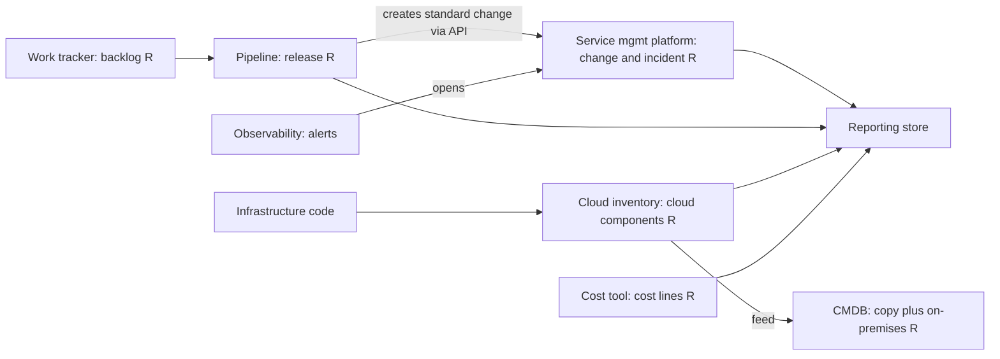
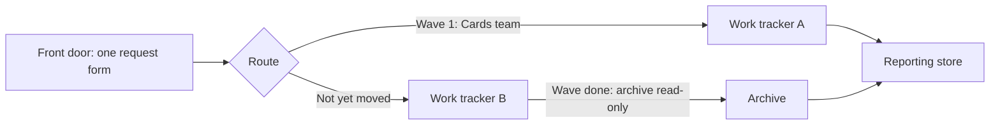
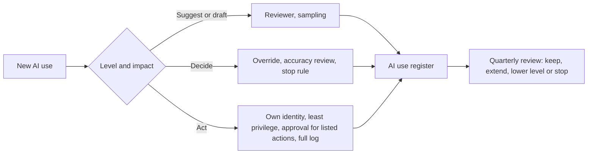

# Module 11 — Tooling and automation

*Najm Bank's Technology division runs on dozens of tools: a portfolio spreadsheet, two work-tracking tools, source repositories, a delivery pipeline, a service management platform, a configuration database, cloud consoles, an observability platform, a cost tool, a contract repository and more. Each was bought for a good reason by someone who has since moved on. Together they decide how fast work flows, whether records link and how much of everyone's day is spent copying data from one screen to another. This module treats the toolchain as part of the operating model, not as a shopping list. You will map which tool is the system of record for what (11.1), integrate and retire tools step by step instead of in one risky replacement (11.2), and put AI to work in delivery and operations with controls a regulated bank can defend (11.3). The engineering of pipelines, telemetry and AI agents is taught elsewhere in the library; here you decide what each tool is for, who owns it, how tools connect and what evidence they must produce.*

> **Steps:** Build, Run — choose, connect and automate the tools that carry work from idea to running service, so that records stay linked and people spend their time on decisions, not on re-keying.

---

# 11.1 — The toolchain map: which tool is the system of record for what
*Level: 🔴 Advanced* · *Prerequisites: 5.1, 9.1* · *Step: Build, Run*

**After this you can** draw a one-page toolchain map that names, for each core record, its single system of record, its systems of engagement, its reporting copies and the integration that feeds each copy, with an owner for every tool and every feed, and a list of the overlaps to resolve first. *Study time: reading about 15 min, hands-on about 110 min (estimate).*

## ⚡ In 60 seconds
- A **toolchain** is the set of tools that carries work from idea to running service. A **toolchain map** shows, record by record, which tool creates and corrects it, which tools people work in, and which only copy it.
- The rule that matters most: **one record, one home.** Each core record from lesson 9.1 has exactly one system of record; every other tool reads it, links to it or holds a dated copy.
- Every tool needs a **tool owner** (who runs and funds it) and every record a **record owner** (who decides what it means). Name both.
- Decision cue: if two tools can both create or edit the same record, or nobody can say where a record is corrected, that is your first overlap to resolve.
- Biggest trap: making one platform "the single source of truth for everything". Federate the records, centralise the links.

## 🧭 Why it matters
Najm Bank and everyone in it are fictional. All numbers about Najm Bank in this lesson are illustrative figures, not benchmarks.

When Omar, the CIO, asked for a list of the Technology division's tools, Sami, Platform Engineering Lead, expected about a dozen. The list came back with 31 entries (illustrative figure), not counting the spreadsheets several teams treated as their real records. Two work-tracking tools held backlogs for the same products. The pipeline and the service management platform both created change records, numbered differently. The configuration management database (CMDB, a database of the components IT runs and how they relate) and the cloud inventory both listed cloud servers.

Each tool had solved a local problem. But no one had decided, record by record, which tool was the home of the truth, so every cross-cutting question became a manual project. Huda, Head of Enterprise Architecture, had the information model from lesson 9.1. She lacked the second half: where each record lives, and how tools pass it along. That is the toolchain map.

## 📐 How it works

### 🟢 The essentials

**Start from the records, not the tools.** Take the core records from lesson 9.1 and ask four questions of each:

1. **Where is it created and corrected?** The **system of record**; if tools disagree, it wins.
2. **Where do people work with it daily?** **Systems of engagement**, such as raising a change from the pipeline.
3. **Where is it copied for reporting?** **Reporting copies**: dashboards, a warehouse; read-only and dated.
4. **How does each copy get there?** The **integration**: an automatic feed, a scheduled export, or a person re-typing.

**Draw it as a grid.** Put records down the side and tools across the top. In each cell write one letter: **R** (system of record), **E** (system of engagement), **C** (reporting copy) or leave it blank. A small example:

| Record | Portfolio tool | Work tracker | Pipeline | Service mgmt platform | CMDB | Cloud inventory | Observability | Cost tool | Data warehouse |
|---|---|---|---|---|---|---|---|---|---|
| Investment | **R** | | | | | | | C | C |
| Backlog item | | **R** | E | | | | | | C |
| Change | | E | E | **R** | | | | | C |
| Release | | | **R** | C | | | | | C |
| Running component (cloud) | | | E | C | C | **R** | C | C | C |
| Incident | | E | | **R** | | | E | | C |
| Cost line | C | | | | | | | **R** | C |

Two checks make the grid useful. **Every row has exactly one R**: no R means nobody knows where the record is corrected; two Rs is a conflict waiting for an audit finding. **Every C has a named feed**: a copy filled by hand is a manual process.

**Tool owner and record owner.** Two jobs:

| Role | Decides | Example at Najm Bank |
|---|---|---|
| **Tool owner** | Licences, upgrades, availability, access, configuration standards, budget | Sami owns the pipeline; Yousef, Head of IT Operations, owns the service management platform |
| **Record owner** | What the record means, its grain, its mandatory fields, its link fields | Huda's team owns the change record definition, wherever it lives |

When one person holds both, definitions drift towards what the tool makes easy. Keep the roles separate on the map.

**Name categories first, products second:** portfolio tool, work tracker, CI/CD system (the pipeline that builds, tests and deploys), cloud inventory, service management platform, CMDB, observability platform, cost tool, contract repository, developer portal.

### 🟡 Going deeper

**Overlaps are where the cost hides.** Three kinds appear on almost every first map:

- **Two systems of record.** Two tools both create the same record. Fix: pick one home; the other writes through its interface.
- **Shadow systems of record.** A spreadsheet is where the record is *actually* kept; the official tool holds a stale copy. Fix: move the work, or admit the spreadsheet is home for now, give it an owner and plan the move (lesson 11.2).
- **Engagement tools that write freely.** A bot or portal edits records without the home's rules (mandatory fields, approvals). Fix: write only through the home's interface.

**Write the integration on every arrow.** For each feed, record the source, target, fields, trigger (event, schedule or manual) and the owner told when it breaks. An unwatched feed fails silently, and the copy goes stale while looking authoritative. Add **one writer per field**: two tools may hold the same record, but only one may write any given field.

**Manual feeds are a finding, not a footnote.** Where a person re-types data between tools, mark it with an estimate of hours per month. Manual feeds are both expensive and a main source of mismatched records.

**The map is also an access map.** Approvals are enforced in the system of record. If an engagement tool can edit a record directly, the change control of lesson 6.2 has a hole.

**Organisation shapes toolchain.** **Conway's law**, from Melvin Conway's paper "How Do Committees Invent?" (*Datamation*, April 1968, as reported in secondary sources), holds that organisations tend to produce designs that copy their communication structures. Departments that do not talk buy tools that do not talk. Moving to product-aligned teams (lesson 2.2) is a chance to redraw the map on purpose.

### 🔴 Expert view

**Decide the home by decision, not by feature.** Most platforms can hold most records. Ask which tool sits closest to the moment the record is truly known: a deployment in the pipeline, a cloud server in the infrastructure code and cloud inventory, a request where the customer makes it. Put the system of record where the truth is generated, and let people-facing tools engage with it.

**Federate records, centralise links.** As lesson 9.1 argued, one tool for everything usually means re-typing data another tool already knows. Invest instead in **shared identifiers**, **one writer per field**, and a **reporting store** that joins records from their homes. A developer portal or warehouse can then answer "show me everything about CARDS-PAY" without becoming the home of any of it.

**The evidence path.** For a regulated bank the map is also an audit artefact: for each control in lesson 10.3 it shows where the evidence is produced and kept. Nour, IT Risk and Controls Lead, will ask whether the people the evidence describes can alter it, and how long each tool keeps it. Ask risk and records management what retention policy requires; do not assume a tool's default.

**Cost and exit are part of the map.** Add per tool: annual cost (licence plus run effort), contract end date and **exit difficulty** (low, medium, high). High exit difficulty on a core system of record is a risk to discuss with Lina, Vendor and Sourcing Manager (lesson 10.2); ask risk and legal which outsourcing and data-location rules apply.

**AI changes the stakes, not the rule.** An assistant that answers "what changed?" reads across tools; with two homes for changes, it gives two answers (lesson 11.3).

**The memorable rule:** *one record, one home; every other tool reads, links or copies with a date.*

## 🧰 The toolkit
| Resource, tool or template | What it is and does | When to reach for it |
|---|---|---|
| **Toolchain grid** | Records down the side, tools across the top, one letter per cell: R, E, C or blank | First, to see overlaps and gaps on one page |
| **Tool card** | One card per tool: category, tool owner, cost, contract end, users, records it is home for, exit difficulty | When reviewing a tool or before renewing it |
| **Integration register** | One row per feed: source, target, fields, trigger, owner, failure alert | Whenever a C appears on the grid |
| **Overlap list** | Each row with zero or two Rs, each shadow spreadsheet, each free-writing engagement tool | To pick the first fixes, in order of pain |
| **Evidence path** | For each control, where its evidence is produced and kept | Before an audit or a tool change |
| **Service management platform, developer portal** | Categories that hold or show core records; ServiceNow and Backstage are examples | When naming tools on the map |

Tools named are examples, not endorsements.

## 🏛️ In practice at Najm Bank
Illustrative and fictional. Huda and Sami built the map and checked it with each tool owner. Of eleven core records, seven had exactly one R. Four did not:

| Record | Problem | Decision |
|---|---|---|
| Change | Pipeline and platform both created changes | Platform is home; the pipeline creates standard changes (pre-approved, low-risk change types, lesson 6.2) in it through its interface, with test evidence |
| Backlog item | Two work trackers used for Cards & Payments | Keep one; move the other in lesson 11.2's plan |
| Running component (cloud) | CMDB and cloud inventory both edited | Cloud inventory is home (lesson 9.1); CMDB gets a nightly feed |
| Investment | The portfolio tool and a spreadsheet both held funding figures; the spreadsheet was more current | Spreadsheet accepted as a shadow record for one quarter, owned by Tariq, then moved into the portfolio tool |

**Mistakes along the way.** Yousef first proposed the service management platform as home for everything, including deployments, "because that's where audit looks". Sami showed that deployments would then be re-typed after the fact, weaker evidence than a pipeline log. Sami's mistake was the reverse: he wanted the developer portal to be home for products, although the product record already lived in the product inventory (lesson 2.1), held in the service management platform, which catalogue entries reference by product identifier. The portal now displays it.

**Manual feeds.** The map found nine. The largest was Tariq, IT Finance Business Partner, re-typing cloud costs into a finance spreadsheet each month, about two days of work (illustrative). It became the first integration in lesson 11.2.

## 🛠️ Exercises
**🟢 List your tools by category.** List every tool your IT organisation uses to plan, build, release, serve and run, including spreadsheets that act as records. Give each a category and a tool owner.
*Done when:* every tool you can find has a category and a named owner, and you have marked tools with no owner and spreadsheets acting as records.

Model answer and self-check

**Model answer.** A table of 15 to 40 rows, for example "Work tracker B — work tracker — owner: none since the reorganisation" and "Release calendar.xlsx — acting as release record — owner: release manager". **Self-check.**
- Did you include spreadsheets and slide decks treated as the real record?
- Does every owner name a role or person, not a department?

**🟡 Fill the toolchain grid.** Take your core records from lesson 9.1 (or the eleven on Najm Bank's record map in lesson 9.1; this lesson's grid shows seven of them) and fill a grid with R, E, C or blank for each tool. Add the feed for every C.
*Done when:* every row is filled and checked for "exactly one R", every C names its feed, its trigger and the owner alerted when it breaks, and all rows breaking the rule are listed.

Model answer and self-check

**Model answer.** Similar to Najm Bank's grid, with changes and running components most often showing two Rs, and the investment record most often held in a spreadsheet. Manual feeds are marked separately with hours per month. **Self-check.**
- Does each row have exactly one R, or is it on the overlap list?
- Does every feed name an owner, and is every C fed by a person marked as a manual feed?
- Is the portal or warehouse an R anywhere? Are records really corrected there?

**🔴 Resolve one overlap and write the evidence path.** Pick one row with two Rs. Decide the single home using the "closest to the truth" test, write how the other tool will engage with it (through which interface, carrying which fields, one writer per field), and write the evidence path for one control that depends on the record.
*Done when:* one page names the home and the reason, the integration with fields and owner, the field-by-field writer, and the evidence path; and the record owner and both tool owners have reviewed it.

Model answer and self-check

**Model answer.** For changes, home is the service management platform, where approvals and the change model live; the pipeline creates standard changes through its interface, writing product identifier, release version, test results and deployer; the platform writes status and approval fields only. Evidence path for "every production change is peer reviewed": review in the source repository, linked by commit to the release, release linked to the change record; retention per the bank's records policy, confirmed by Nour. **Self-check.**
- Is the reason where the truth is generated, not popularity?
- Does every field have one writer?
- Did you ask about retention instead of assuming?

## ⚠️ Mistakes and traps
- **Mapping features instead of records.** What a platform *can* hold says nothing about where records live. Map what each tool actually holds, and put the home where the truth is generated.
- **Forgetting spreadsheets.** Shadow records are often the most important. Include them, give them owners, plan their move.
- **Unwatched feeds.** A silent failure makes a stale copy look current. Name an owner for every feed.
- **Letting engagement tools bypass rules.** A portal or bot that edits records directly skips approvals. Write through the home's interface.
- **A map drawn once.** Review it at every tool purchase, contract renewal and reorganisation.

## 🧾 Recap
- A **toolchain map** shows, for every core record, one home (R), its engagement tools (E) and its dated, fed copies (C).
- Name a **tool owner** and a **record owner** separately.
- Fix overlaps (two Rs, shadow spreadsheets, free-writing engagement tools) and manual feeds first.
- Put the home where the truth is generated; connect the rest with shared identifiers and **one writer per field**.
- The map is also an access map and an **evidence path** for audit, with cost, contract end and exit difficulty per tool.

## ✍️ Check yourself
**1. Huda's grid shows that both the pipeline and the service management platform create change records, with different numbers for the same change. Which fix follows the lesson?**

- A. Keep both and reconcile the two sets of change numbers by hand each month end.
- B. Make the platform home; the pipeline writes changes via its interface.
- C. Stop pipeline change records; engineers type changes into the platform.
- D. Copy both sets into the warehouse and let each report pick a source.

Answer

**B.** One home; the pipeline engages through its interface, keeping automation while the platform's rules apply. C throws away automation; A and D keep two homes. See "Overlaps are where the cost hides".

**2. Tariq's finance dashboard shows cloud cost lines loaded each night by an automatic feed from the cost tool. Nobody edits them in the dashboard; finance decides budgets from it. Which letter goes in the dashboard's cell on the cost-line row?**

- A. R, because finance makes its budget decisions from the figures it shows.
- B. E, because Tariq and his team work with the figures in it every day.
- C. C, because it holds a read-only copy filled by a named nightly feed.
- D. Blank, because a dashboard only displays data and holds no record.

Answer

**C.** Cost lines are corrected in the cost tool; the dashboard holds a dated, read-only copy from a named feed. A confuses where a record is used with where it is corrected, B means people work on the record there, D hides a copy whose feed needs an owner. See "The essentials".

**3. Sami proposes making the developer portal the system of record for products and their owners. The product record already lives in the product inventory (lesson 2.1), held in the service management platform, with a named owner for each product. What should Huda say?**

- A. Let the portal display the inventory's product records, not hold its own.
- B. Move product records into the portal, since engineers visit it most often.
- C. Keep product records in both, with a weekly sync agreed by the two owners.
- D. Move the inventory's product entries into the portal and phase out the inventory.

Answer

**A.** The record already has a home and owner; the portal can show it. B and D move the home for convenience; C creates two homes. See "Federate records, centralise links".

**4. Sami's teams create cloud databases only through infrastructure code, which updates the cloud inventory automatically. Huda must choose the system of record for these databases as running components. Which choice follows the lesson?**

- A. The CMDB, because operations staff and auditors already look there every day.
- B. The service management platform, because the change approving each database is there.
- C. The developer portal, because engineers search it first when they need a database.
- D. The cloud inventory, because it is updated where each database is actually created.

Answer

**D.** The home sits where the truth is generated: the cloud inventory knows a database exists the moment it is created. A and C pick the home by who looks; B confuses the change record with the running component. See "Decide the home by decision, not by feature".

**5. Tariq re-types cloud costs from the cost tool into a finance spreadsheet every month. How should the toolchain map treat this?**

- A. Leave it off the map, as a personal working file rather than a tool.
- B. Mark it as a manual feed with hours per month, a candidate for integration.
- C. Mark the spreadsheet as home for cost lines, because finance relies on it.
- D. Record the spreadsheet as a system of engagement that Tariq works in daily.

Answer

**B.** Re-typing between tools is a manual feed. A hides it, C moves the home away from where cost is known, D mislabels a copy. See "Manual feeds are a finding, not a footnote".

## 📚 References
- Conway, M. E., "How Do Committees Invent?", *Datamation*, April 1968. Publication details and the paraphrase of the thesis are as reported in secondary sources (search summary); the original was not opened for this lesson. A widely read commentary (found by search, not opened): Colyer, A., "How do committees invent?", *the morning paper*, December 2019: https://blog.acolyer.org/2019/12/13/how-do-committees-invent/
- Library course: [*Cloud & DevOps: Zero to Hero*, lesson 4.1 — Continuous integration: pipelines, tests, artefacts and fast feedback](../cloud/index.html#/4.1) (what the pipeline knows and records).
- Library course: [*Cloud & DevOps: Zero to Hero*, lesson 3.1 — Infrastructure as code with Terraform/OpenTofu: state, modules and plans](../cloud/index.html#/3.1) (why infrastructure code is a natural home for cloud resources).
- Library course: [*Data Engineering & Analytics: Zero to Hero*, lesson 6.1 — Data governance that works: ownership, catalogue, lineage and data contracts](../data/index.html#/6.1) (ownership and contracts between data producers and consumers, which apply to tool feeds).

---

# 11.2 — Integrating and rationalising tools without a big bang
*Level: 🔴 Advanced* · *Prerequisites: 9.2, 10.2, 11.1* · *Step: Build, Run*

**After this you can** write a tool rationalisation register that gives each tool you review a keep, consolidate, replace or retire decision with a reason, and a wave plan that moves one record type or one team at a time, with one integration designed by the integration rules, a migrate-or-archive decision, a contract date check and a measure of success that is not "number of tools". *Study time: reading about 15 min, hands-on about 105 min (estimate).*

## ⚡ In 60 seconds
- **Rationalising** means deciding, tool by tool, to keep, consolidate, replace or retire; **integrating** means connecting what you keep so records flow without re-keying.
- The rule that matters most: **move one record type or one team at a time, and switch the old tool off at the end of each step.**
- Integrate in order: shared identifiers, one-way feeds, events, two-way only where unavoidable, always **one writer per field**.
- Check the contract notice period before you plan. Decision cue: success is fewer manual feeds, fewer conflicting records and faster answers, not a shorter tool list.
- Biggest trap: the "one platform to replace them all" programme that configures a suite for years while the old tools keep running.

## 🧭 Why it matters
Najm Bank and everyone in it are fictional. All numbers about Najm Bank in this lesson are illustrative figures, not benchmarks.

Lesson 11.1's map gave Omar, the CIO, 31 tools and four records with no single home. Under board pressure on cost, his first instinct was one enterprise suite, everything moved within eighteen months, a dozen licences saved.

Huda, Head of Enterprise Architecture, had seen such a programme elsewhere. Its plan assumed every team would move on one weekend. Configuration grew, the date slipped, and teams kept the old tools "until the new one is ready". Years later both sets were running and costs had risen. She asked Omar for a different brief: fix the overlaps first, connect what the bank keeps, retire tools one at a time as contracts allow, and measure how quickly the division answers its real questions.

## 📐 How it works

### 🟢 The essentials

**Four decisions per tool.** For every tool on the toolchain map, choose one:

| Decision | Meaning | Typical signal |
|---|---|---|
| **Keep** | Stays, perhaps better integrated | Home for a record, well used, fair price, acceptable exit difficulty |
| **Consolidate** | Its work moves into a tool you already own | Two tools do one job for different teams |
| **Replace** | A new tool takes over | It fails a real need (security, scale, support) and nothing you own can meet it |
| **Retire** | Its job stops | Few users, no record lives there, or its decision no longer exists |

Write a **reason** in terms of records and decisions. "Consolidate Work tracker B into A: same records, two teams, nothing we need only in B" is a reason; "A is more modern" is not.

**The rationalisation register.** One row per tool, using lesson 11.1's tool cards plus the decision:

| Tool | Records it is home for | Users | Annual cost | Contract end and notice period | Integrations | Exit difficulty | Decision | Reason | Wave |
|---|---|---|---|---|---|---|---|---|---|

The **contract end and notice period** column is most often missing and most often decisive: an automatic renewal with a notice deadline sets the timetable. Lina, Vendor and Sourcing Manager, owns it; where terms are unclear, ask the legal function.

**Waves, not a big bang.** A **wave** is one bounded move: one record type, or one team, from one tool to another, finished with the old tool switched off for that scope. Each has an owner, dates, a success test and a rollback plan. Small waves are easier to fund, stop and learn from (lesson 1.2).

**Integration order.** Connect the tools you keep in this order:

1. **Shared identifiers**: the product identifier (lesson 9.1) and other tools' record numbers, carried as fields. This alone turns many questions into a filter.
2. **One-way automatic feeds** from each home to tools needing a copy: one source, one direction, one owner.
3. **Event-driven updates** where timing matters: an alert opens an incident; a deployment creates a standard change.
4. **Two-way synchronisation** only where people truly work on one record in two tools, with **one writer per field**. Starting here tends to produce tools overwriting each other.

### 🟡 Going deeper

**The strangler approach, applied to tools.** In software, the **strangler fig** pattern described by Martin Fowler replaces an old system gradually, the new one taking over piece by piece until the old one can be removed (as reported in search summaries of Fowler's article; see References). For tools:

- Put a **front door** before the old tool: a request portal, interface layer or single form people use whichever tool is behind it.
- Move one route at a time (one request type, team or record type) to the new tool.
- When no route uses the old tool, archive its records and switch it off.

People keep the same front door, and each move can be reversed while the old tool still runs.

**What to migrate, what to archive.** Not every old record needs to move. Sort them:

| Record state | Usual choice | Ask first |
|---|---|---|
| Open or active records (open incidents, live backlog items) | Migrate, with their links and identifiers | Which fields does the new home need? |
| Closed records still used for analysis (last year's incidents for problem management) | Migrate a summary or keep a read-only copy in the reporting store | Which questions will be asked of them? |
| Closed records kept only for evidence | Archive read-only, searchable, with access control | What retention does the bank's records policy require? Ask risk and records management |
| Junk and duplicates | Do not migrate | Who agrees they are junk? The record owner |

Clean what moves in this wave (lesson 9.2); cleaning everything first is another way never to start.

**Configure, do not customise.** *Configuring* uses settings the vendor supports; *customising* adds bespoke code inside the platform, making every upgrade a project and raising exit difficulty. Register customisations with owners and reasons, and ask of each: is our process really different, or just familiar?

**Integration is a product, too.** Feeds need an owner, monitoring, a backlog and a budget; often the platform team (lesson 2.2) runs the integration layer as a service.

### 🔴 Expert view

**Measure outcomes, not tool counts.** Answer the board's "how many tools did we remove?", but also report re-keying hours per month, grid rows with exactly one home, orphan rate on key links (lesson 9.1), time to answer three standard cross-cutting questions, and total toolchain cost including run and integration effort. Removing a tool while adding manual work elsewhere is a cost transfer, not a saving.

**Count the full cost of a change.** Licence savings alone are not a business case. Add migration, integration build and run, training, parallel running and the productivity dip. Tariq, IT Finance Business Partner, owns the arithmetic; the finance function decides the accounting treatment.

**Beware the suite effect.** One vendor's suite can simplify integration, but concentrates exit difficulty and pricing power in one supplier: a risk to weigh with Lina and Nour (lessons 10.2 and 10.3).

**Prefer open, documented interfaces.** Favour tools that publish documented interfaces and export records in usable formats. For telemetry, open standards such as OpenTelemetry aim to keep signals independent of one vendor (see References). An exit you can execute is your best position at renewal.

**Stop rules.** Each wave states in advance what would pause or reverse it, for example "if more than a tenth of migrated incidents lose their component link, stop". Like lesson 3.3's investment stop rules, it stops you reading bad signs as teething problems.

**The memorable rule:** *move one slice, switch the old one off, then move the next.*

## 🧰 The toolkit
| Resource, tool or template | What it is and does | When to reach for it |
|---|---|---|
| **Rationalisation register** | One row per tool with records, users, cost, contract dates, integrations, exit difficulty, decision, reason and wave | After the toolchain map, before any purchase |
| **Wave plan** | One bounded move per wave, with owner, dates, success test, stop rule and rollback | When sequencing the work |
| **Integration rules** | Identifiers first, one-way feeds, events, two-way only field by field, one writer per field | When designing any connection between tools |
| **Migrate-or-archive table** | Sorts old records into migrate, summarise, archive or discard, with the question to ask for each | At the start of each wave |
| **Customisation register** | Every bespoke change inside a platform, with owner and reason | Before approving a customisation and before an upgrade |
| **Integration platform** | Category of tool for building and monitoring feeds; MuleSoft is one example | When feeds outgrow a handful of scripts |

Tools named are examples, not endorsements.

## 🏛️ In practice at Najm Bank
Illustrative and fictional. Huda wrote the register with Sami, Yousef, Lina and Tariq, then checked each decision with its tool owner. Of 31 tools: 19 keep, 5 consolidate, 2 replace, 5 retire. Four waves for the first year:

| Wave | Move | Owner | Why now | Stop rule |
|---|---|---|---|---|
| 1 | Feed cloud costs from the cost tool to the finance reporting store | Sami | Two days of manual work a month | Totals differ from the invoice beyond tolerance for two months |
| 2 | Cards & Payments backlog from Work tracker B to A | Reem | B's notice period closes in ten weeks | More than a tenth of items lose their parent link |
| 3 | Pipeline creates standard changes in the platform | Sami, Yousef | Two homes for changes (lesson 11.1) | Any change reaches production without a change record |
| 4 | Consolidate the old monitoring tool's cloud services into the observability platform | Yousef | Observability platform covers them | Any Sev 1 (top severity, lesson 8.1) symptom loses its alert |

**Mistakes along the way.** Tariq's first business case counted only licence savings; adding migration, parallel running and training roughly halved the return (illustrative). Lina found that B's contract renewed automatically for two years unless notice was given, so wave 2 moved ahead of wave 3. In wave 4, Yousef planned to switch off the old monitoring tool for every cloud service on one day. Nour, IT Risk and Controls Lead, asked how the bank would prove every critical alert had moved. Yousef split the wave by service and ran both tools side by side for two weeks per service, comparing alerts.

**What they reported.** After two waves, re-keying had fallen by about three days a month, and "which changes touched Cards & Payments last month?" took minutes instead of two days (illustrative). The board heard those numbers as well as "one tool removed".

## 🛠️ Exercises
**🟢 Decide for five tools.** Take five tools from your toolchain map. For each, choose keep, consolidate, replace or retire, and write the reason in terms of records and decisions.
*Done when:* five rows exist, each with a decision and a reason that names a record or a decision, and none of the reasons is only about features or age.

Model answer and self-check

**Model answer.** For example: "Service management platform — keep — home for incidents, requests and changes." "Work tracker B — consolidate into A — same records for two teams; no unique need." "Old monitoring tool — consolidate into the observability platform (for cloud services) — the platform already covers them; keep for mainframe for now." **Self-check.**
- Does every reason mention a record, a decision or a user need?
- Is at least one decision other than "keep"?
- Did you mark decisions that depend on an unknown contract date?

**🟡 Plan two waves and one integration.** For one consolidation from the previous exercise, write two waves, each with its scope (one team or one record type), owner, dates, stop rule, rollback and a migrate-or-archive decision for the old records. Then design one integration between two tools you keep, following the integration order.
*Done when:* both waves fit on one page, each ends with the old tool switched off for its scope and has a stop rule in numbers; the contract notice date is confirmed with the vendor manager; and the integration names its shared identifier, its one-way feed or event, and one writer for every field it carries.

Model answer and self-check

**Model answer.** Wave A: Cards team backlog moves from B to A; owner Reem; open items migrated with parent links; last year's closed items kept read-only in the reporting store; earlier items archived; stop if more than a tenth of items lose their parent link; rollback by reopening B for Cards for two weeks. Wave B: the remaining teams, same rules; B switched off at the confirmed notice date. Integration: work tracker A and the service management platform share the product identifier and A's backlog item key; when the pipeline creates the standard change, it carries that backlog key onto the change record, and A never creates changes; a one-way event from the platform then posts the change number and status back onto the backlog item; A writes scope fields, the pipeline writes release fields, the platform writes status and approval. **Self-check.**
- Does each wave end with something switched off, and is its stop rule a number?
- Does every field in the integration have exactly one writer?
- Did you ask about retention instead of choosing a period yourself?

**🔴 Write the honest business case and the outcome measures.** For the same consolidation, list all costs (licences saved, migration, integration build and run, parallel running, training, productivity dip) and the outcome measures you will report after each wave.
*Done when:* the case shows costs and savings by year with every line labelled as an estimate, at least three outcome measures with a baseline, and a note of which items the finance function must confirm.

Model answer and self-check

**Model answer.** Year one: licence savings partly offset by migration, parallel licences, training and integration build; year two: savings minus integration run cost. Measures: re-keying hours (baseline from the map), rows with one home, time to answer three standard questions. A note that the accounting treatment of migration effort is for finance. **Self-check.**
- Did you include parallel running and the productivity dip?
- Is any line a hidden transfer of work to another team?
- Did you avoid stating an accounting treatment as fact?

## ⚠️ Mistakes and traps
- **The big-bang suite.** It tends to leave old and new tools running for years. Move one slice at a time and switch each off.
- **Ignoring the notice period.** An automatic renewal can lock in a tool you meant to retire. Put contract dates in the register first.
- **Two-way sync by default.** It creates loops and silent overwrites. Start with identifiers and one-way feeds; one writer per field.
- **Migrating everything.** It slows each wave and drags junk along. Migrate open records; archive the rest by policy.
- **Counting licences only, or tool count only.** Build the whole cost case, and report re-keying hours, record conflicts and time to answer.

## 🧾 Recap
- Give every tool a **keep, consolidate, replace or retire** decision, with a reason in terms of records and decisions.
- Plan **waves**: one record type or team at a time, each ending with the old tool switched off for that scope, each with a stop rule.
- Integrate in order: **identifiers, one-way feeds, events, two-way only where unavoidable**, with one writer per field.
- Use a **front door** so tools can change behind it (the strangler approach); migrate open records, archive the rest by policy, and **check contract dates** first.
- Report **outcomes** (re-keying hours, single-home rows, time to answer, full cost), not just the number of tools removed.

## ✍️ Check yourself
**1. Omar is offered a programme to move all 31 tools into one suite over eighteen months. Which response best fits the lesson?**

- A. Accept, but keep the old tools under maintenance until every team has moved across.
- B. Accept, but ask every team to move on one agreed weekend so no tools run in parallel.
- C. Fix overlaps first, then move one record type or team per wave, switching each off.
- D. Defer any change until the records in all 31 tools have been cleaned up first.

Answer

**C.** Small waves that each end with something switched off are easier to finish, stop and learn from. A is how old and new tools end up running for years; B is the big bang the lesson warns against; D cleans everything first, another way never to start. See "Waves, not a big bang".

**2. Sami needs to connect the work tracker and the service management platform. In what order should he build the integration?**

- A. Identifiers, then one-way feeds, then events, then two-way only where needed.
- B. Two-way sync of the main fields first, so that both tools are complete from day one.
- C. A nightly spreadsheet export that each team loads into the tool it needs.
- D. Events first, then identifiers once the events show which links are useful.

Answer

**A.** Identifiers make most questions answerable cheaply; two-way sync is a last resort, field by field. B invites overwrites, C is a manual feed, D builds events with nothing reliable to join them on. See "Integration order".

**3. Lina finds that Work tracker B's contract renews automatically for two years unless notice is given within ten weeks. What does this change?**

- A. Little: procurement handles the notice, and the waves keep their current order.
- B. The wave plan, since the notice date sets when B's consolidation must be decided.
- C. The decision for B, which becomes "keep" for another two years to avoid a rush.
- D. The integration design, so that B is synced two-way with A during the notice period.

Answer

**B.** The notice date is often the decisive column; at Najm Bank the waves were reordered around it. A ignores the deadline, C gives up a decision the notice still allows, D does not follow from a contract date. See "The rationalisation register".

**4. Tariq's business case for consolidation counts only licence savings. Which addition matters most to make it honest?**

- A. The new features the remaining tool offers over the one being removed.
- B. The number of tools removed, the figure the board will ask for first.
- C. Licence prices other banks are said to pay for the same suite.
- D. Migration, parallel running, training, integration, the learning dip.

Answer

**D.** The full cost includes these; at Najm Bank they roughly halved the return. Features (A) and tool counts (B) are not costs; C relies on hearsay prices. See "Count the full cost of a change".

**5. Yousef plans to switch off the old monitoring tool for every cloud service on the same day. Nour asks how the bank will prove that every critical alert moved. What is the best change to the plan?**

- A. Split the wave by service and run both tools for a short time, comparing alerts.
- B. Keep the single date but have each team sign that all its alerts were moved.
- C. Postpone the switch-off until the new tool matches every feature of the old one.
- D. Switch off as planned and let the incident process reveal any missing alerts.

Answer

**A.** Smaller slices with a short parallel run produce evidence and allow a reversal. B replaces evidence with a signature, C waits for parity that may never come, D lets customers find the gap. See "In practice at Najm Bank".

## 📚 References
- Fowler, M., "Strangler Fig", martinfowler.com (bliki; first published 2004 and later revised, as reported in search summaries; the page could not be opened from this environment): https://martinfowler.com/bliki/StranglerFigApplication.html
- Library course: [*A Practical Guide to Becoming an AI-Native Engineer*, lesson 7.1 — Changing code you do not understand: characterization tests, seams, incremental refactors and agent-sized migrations](../ainative/index.html#/7.1) (the strangler fig applied to code).
- Library course: [*Cloud & DevOps: Zero to Hero*, lesson 5.1 — Telemetry: logs, metrics, traces and OpenTelemetry](../cloud/index.html#/5.1) (open telemetry standards and avoiding lock-in to one observability tool).
- Library course: [*Data Engineering & Analytics: Zero to Hero*, lesson 2.1 — Getting data in: ETL vs ELT, connectors, incremental loads and change data capture](../data/index.html#/2.1) (patterns for feeding a reporting store).

---

# 11.3 — AI in IT operations and delivery, with controls
*Level: 🔴 Advanced* · *Prerequisites: 8.1, 10.3, 11.1* · *Step: Build, Run*

**After this you can** write an AI use register that gives every AI use in delivery and operations a purpose, a level of automation, the data and actions it can reach, an accountable person, matching controls and paired measures, and decide for each whether to keep, extend, lower its level or stop it. *Study time: reading about 15 min, hands-on about 115 min (estimate).*

## ⚡ In 60 seconds
- AI is already inside most IT organisations: coding assistants, alert grouping, incident summaries, service desk chat. Treat each as a **use** with an owner and controls.
- Sort every use by **level of automation** (suggest, draft, decide, act); controls strengthen as the level and the impact of a mistake rise.
- The rule that matters most: **an AI may do the work, but a named person stays accountable for the result, and the record shows both.**
- DORA's 2025 research reports that AI amplifies what is already there (lesson 0.1). Fix flow and records before scaling AI.
- Decision cue: any AI that can **change** something running needs least-privilege credentials (only the access its task needs), approval for high-impact actions and a full log before it leaves a pilot.
- Biggest trap: a pilot that runs with an administrator's credentials "just for now" and quietly becomes production.

## 🧭 Why it matters
Najm Bank and everyone in it are fictional. All numbers about Najm Bank in this lesson are illustrative figures, not benchmarks.

When Omar, the CIO, asked for a list of AI uses in the Technology division, there were already several. Engineers used coding assistants; the service desk was trialling a chat assistant; Yousef, Head of IT Operations, had switched on alert grouping; Sami, Platform Engineering Lead, was building an agent to restart failed services at night. Nobody had a list or knew what data each use could see.

Nour, IT Risk and Controls Lead, asked two questions. If an AI action breaks a payment service, whose decision was it, and where is the record? And the Qatar Central Bank's AI guideline, in force since 4 September 2024, applies, as cited in the library's AI Governance course, to every regulated entity that develops, buys or outsources AI: which internal uses does it touch, and who decides?

## 📐 How it works

### 🟢 The essentials

**Where AI shows up in IT**, by step:

| Step | Typical AI use | What it touches |
|---|---|---|
| Plan | Finding duplicate requests (lesson 4.1) | Intake records |
| Build | Coding assistants, generated tests, review comments | Source code, tests |
| Release | Change risk hints, release notes | Change and release records |
| Serve | Service desk chat, request routing | Requests, sometimes staff or customer data |
| Run | Alert grouping, incident summaries, "what changed?", automated remediation | Alerts, incidents, production systems |

**Four levels of automation.** Each use sits at one level (see [*AI Product Management*, lesson 4.1 — Levels of automation: suggest, draft, decide, act](../aipm/index.html#/4.1)):

| Level | What the AI does | Example in IT | Who acts |
|---|---|---|---|
| **Suggest** | Offers an option a person may ignore | "These alerts may be one incident" | A person |
| **Draft** | Produces output a person edits and approves | Incident summary; code change in a pull request | A person, after approval |
| **Decide** | Makes a choice that stands unless overridden | Auto-routing requests; auto-closing duplicates | The AI; a person can override |
| **Act** | Changes something running | Restarting a service; granting access | The AI, within set limits |

**Controls rise with level and impact.** Auto-routing a printer request and a fraud alert are both "decide", with very different risk. Rate each use on **level** and **impact if wrong**, and apply the cell's controls:

| | Low impact | Medium impact | High impact |
|---|---|---|---|
| **Suggest / Draft** | Within AI policy; occasional sample | Named reviewer; monthly sample | Skilled reviewer; recorded approval |
| **Decide** | Override; weekly sample | Override; monthly accuracy review; stop rule | Usually avoid; else review first by the second line (risk and compliance, lesson 10.3) |
| **Act** | Least privilege; full log; scope and rate limits | Plus approval for listed actions; tested rollback | Approval for every action, or do not automate |

The grid is an illustration; agree the real one with Nour and the risk function.

**The AI use register.** One row per use, feeding the bank's wider AI inventory if it has one:

| Field | Example |
|---|---|
| Use and purpose | Incident summariser: drafts a timeline for Sev 1 and Sev 2 incidents |
| Level and impact | Draft; medium |
| Data it can read | Incident records, linked changes and alerts; no customer data fields |
| Actions it can take | None; writes a draft note only |
| Accountable person | Incident manager on duty approves the summary |
| Controls | Draft label; human approval; monthly sample of ten summaries against the facts |
| Measures | Accuracy rate in sample, time saved, edits needed |
| Review and stop rule | Quarterly; stop if sampled accuracy falls below the agreed threshold |

### 🟡 Going deeper

**What the research says, and for whom.** Lesson 0.1 set out DORA's AI findings and lesson 1.3 its delivery measures; read them as correlations for the people surveyed in a given year, not laws. In short, the announcement of the 2025 report found AI adoption had a positive relationship with throughput but still a negative one with stability. So watch stability measures (change fail rate, rework) as AI use grows.

**Seven capabilities that amplify AI.** In September 2025 DORA introduced an AI Capabilities Model naming seven capabilities that, in its research, amplify AI's benefits: a clear and communicated AI stance; healthy data ecosystems; AI-accessible internal data; strong version control practices; working in small batches; a user-centric focus; and quality internal platforms. This course has asked you to build several: linked records (Module 9), a clear toolchain (11.1), platforms (5.1). An AI can only follow links that exist.

**Agents that act: excessive agency.** The OWASP Top 10 for LLM Applications (2025) lists **excessive agency**: damaging actions taken on unexpected, ambiguous or manipulated model output. Its entry, as summarised in search results, names three root causes: **excessive functionality** (tools the agent does not need), **excessive permissions** (credentials broader than the task) and **excessive autonomy** (high-impact actions without independent approval). For every "act" use, ask: which tools does it need, what is the narrowest credential, and which actions need a person's approval? Engineering detail: [*Secure AI & Application Security: Zero to Hero*, lesson 9.2 — Agents and tools: excessive agency, least-privilege tools and MCP](../secai/index.html#/9.2).

**AI actions go through the same doors as people's.** An AI that deploys, changes configuration or grants access uses the same change model (lesson 6.2), access process (lesson 7.2) and records as a person. Give each agent its own identity, never a shared or personal account, and mark AI involvement on the record ("AI-drafted", "AI-executed").

### 🔴 Expert view

**Regulation: ask, do not assume.** As cited in the library's AI Governance course, the QCB AI guideline covers, among other things, governance and accountability (§7) and human oversight (§13), and requires QCB approval before signing a high-risk AI purchase, licensing or outsourcing agreement (§11.2). Whether an internal IT use, such as a summariser inside a bought platform, is in scope or high risk is a question for Nour, the risk and compliance functions and, where personal data is involved, the data protection officer. See [*AI Governance: Zero to Hero*, lesson 5.3 — Consumer protection, product liability and sector rules](../aigp/index.html#/5.3).

**AI features arrive inside tools you already own.** Often a vendor simply switches one on. Treat it as a change to the supplier relationship (lesson 10.2): what data does it send, where is it processed, can it be switched off, does the contract cover it? Record the answers in the register. See [*AI Governance: Zero to Hero*, lesson 11.2 — Buying AI: vendor due diligence and contracts](../aigp/index.html#/11.2).

**Models change under you.** A supplier can update the model behind a feature without notice. Keep a test set for each "decide" or "act" use (say twenty past alerts with known correct grouping) and re-run it after updates; if results move, lower the use's level until understood.

**Measure help, not usage.** Seats and prompts say nothing about value. Pair a benefit with a cost: time saved with edits needed; incidents grouped with wrong merges; auto-routed tickets with re-routes. Keep watching stability.

**Keep people able to do the job.** Run some drills without the assistant, and keep review real: approving every draft in five seconds is not a control.

**The memorable rule:** *the AI may do the work; a named person owns the result, and the record shows both.*

## 🧰 The toolkit
| Resource, tool or template | What it is and does | When to reach for it |
|---|---|---|
| **AI use register** | One row per use: purpose, tool, level, impact, data, actions, accountable person, controls, measures, review date | When a use is proposed or a vendor switches on a feature |
| **Level-and-impact grid** | Maps each use to a control set by level of automation and impact if wrong | When deciding controls for a use |
| **Agent permission sheet** | For each "act" use: identity, allowed tools and actions, actions needing approval, limits | Before any agent touches production |
| **Use test set** | Twenty or so past cases with known correct answers | Before go-live and after supplier model changes |
| **Paired measures** | A benefit and a cost measure per use, plus the division's stability measures | Monthly and at the quarterly review |
| **Coding assistant** | Tool category; GitHub Copilot is one example, not an endorsement | When listing Build-step uses |

## 🏛️ In practice at Najm Bank
Illustrative and fictional. Nour and Yousef built the first register in a week by asking every team lead: "Where does AI touch your work, including features your tools switched on?" It found nine uses. Three are below; the restart agent is rated per service, because impact differs by service:

| Use | Level, impact | Key controls agreed | Decision |
|---|---|---|---|
| Incident summariser | Draft, medium | Incident manager approves; monthly sample of ten; customer data excluded | Keep |
| Alert grouping | Decide, medium | On-call can split groups; weekly sample; test set re-run after updates | Keep, with stop rule |
| Restart agent, non-payment services | Act, medium | Own identity; listed services only; rate limit; approval for a second restart of the same service within an hour; tested rollback; full log | Extend only after the fixes below |
| Restart agent, payment services | Act, high | As above, plus on-call approval for every restart | Keep at this level |

**Sami's agent.** In the pilot the restart agent ran with Sami's own administrator credentials, because that was quicker. It could have deleted resources or changed network rules. Sami gave it its own identity, allowed only to restart listed services, added approval for every payment-service restart, and made each restart write to the incident record marked "AI-executed".

**Yousef's measure.** Yousef first reported "the summariser was used on 95% of incidents" (illustrative). Huda asked what the sample showed: two of ten summaries had events in the wrong order. After a prompt and data change, the next sample had none. The register now reports accuracy and edits.

**The regulatory question.** Nour took the register to compliance and the data protection officer with one question per use: does the QCB guideline or data protection law apply, and is any use high risk? Their answer, not IT's, set which uses needed second-line review.

## 🛠️ Exercises
**🟢 Find the AI uses.** List every AI use in your IT organisation's delivery and operations, including AI features switched on inside existing tools. For each, write the step, the tool and the level (suggest, draft, decide, act).
*Done when:* every use you can find has a step, a tool and a level, and you have asked at least three team leads "where does AI touch your work?".

Model answer and self-check

**Model answer.** Five to fifteen uses, for example "Build — coding assistant — draft", "Run — alert grouping — decide", "Run — model-driven restart script — act". **Self-check.**
- Did you include features vendors switched on?
- Is each use at the level of what it actually does, not what it was meant to do?

**🟡 Fill the register for three uses and decide.** Pick one "draft", one "decide" and one "act" use (or the closest you have), fill every register field with controls from the level-and-impact grid, and decide for each: keep, extend, lower its level or stop.
*Done when:* three complete rows exist, each with a named accountable role, controls matching its grid cell, one benefit and one cost measure, a stop rule in numbers, and a decision with its reason.

Model answer and self-check

**Model answer.** Close to Najm Bank's rows: the summariser (draft, medium; approval and sampling; keep), alert grouping (decide, medium; override, sample, test set; keep with stop rule) and the restart agent (act; own identity, listed actions, full log, approval for every payment-service restart; extend only after its credential is fixed). **Self-check.**
- Does each "act" use have its own identity and a list of allowed actions?
- Can each accountable person actually judge the output?
- Did you send regulatory questions to risk, compliance or data protection?

**🔴 Review one "act" use against excessive agency.** For one use that can change something running, answer the three questions (functions it needs, narrowest credential, actions needing approval), write the agent permission sheet, design a test set of at least ten past cases, and state when the use would drop back to a lower level.
*Done when:* one page holds the three answers, the permission sheet, the test set, the drop-back rule and each action's link to a record, reviewed by the tool owner and your risk lead.

Model answer and self-check

**Model answer.** Restart agent: only "restart service" on twelve listed services; credential limited to that; approval for every payment-service restart and any second restart within an hour; test set of fifteen past failures; drop back to "suggest" if it attempts an unlisted action or its test result falls below threshold after an update; every action logged on the incident as "AI-executed". **Self-check.**
- Could the agent do anything not on its list? Then the permission is too broad.
- Is the drop-back rule a checkable trigger?
- Did a risk or controls person review it, not only the builder?

## ⚠️ Mistakes and traps
- **No list of uses.** You cannot control what you have not found; include vendor-enabled features.
- **One control set for every use.** Use level and impact.
- **Pilots on personal or admin credentials.** Give every agent its own least-privilege identity from day one.
- **Measuring usage, or rubber-stamp review.** Pair each benefit with a cost measure; sample approval times as well as outputs.
- **Deciding regulatory scope inside IT.** Ask risk, compliance and data protection a clear question per use, and record the answer.

## 🧾 Recap
- Keep an **AI use register** of every use, vendor-enabled features included: purpose, level, impact, accountable person, controls.
- Controls rise with **level and impact**; any use that **acts** needs its own identity, least privilege, approval for high-impact actions and a full log.
- DORA's research reports that AI **amplifies** existing strengths and weaknesses; fix flow and records first, and watch stability.
- AI actions use the **same change, access and record processes** as people's, marked as AI.
- Measure **help, not usage**, re-test after supplier updates, and send regulatory questions to the right function.

## ✍️ Check yourself
**1. Sami's restart agent ran in its pilot with his own administrator credentials. Which change matters most before it is extended?**

- A. Have Sami review the agent's actions each morning until the pilot formally ends.
- B. Move it to a shared operations account so the whole team can monitor it.
- C. Keep the credentials but add a monthly report of everything it did.
- D. Give it its own identity, limited to listed restarts, with approvals.

Answer

**D.** Excessive permissions are a root cause of excessive agency; an own, least-privilege identity with approvals fixes it and shows the AI's actions on the record. A relies on vigilance, B hides who acted, C keeps the broad permissions. See "Agents that act: excessive agency".

**2. Six months after rolling out coding assistants, Omar sees deployment frequency rise across the division. Which measure should he watch most closely next?**

- A. Seats in use and prompts per engineer, to see whether adoption is spreading.
- B. Change fail rate and rework, where DORA reports AI's cost has shown.
- C. Lines of code merged per engineer, to see how much more each person produces.
- D. Deployment frequency per team, to find which teams gained the most speed.

Answer

**B.** DORA's 2025 findings tie AI adoption to higher throughput but lower stability, so the next question is whether faster delivery is hurting. A measures usage, C volume, and D throughput again. See "What the research says, and for whom".

**3. Yousef reports that the incident summariser "was used on 95% of incidents". What should the register report instead?**

- A. Licences bought compared with the number of on-call staff.
- B. The share of incidents summarised within one minute.
- C. Sampled accuracy and edits needed, alongside time saved.
- D. A monthly satisfaction score from engineers who used it.

Answer

**C.** Usage does not show value; a benefit paired with a quality measure does. A and B measure spend and speed, D feelings; none measures accuracy. See "Measure help, not usage".

**4. The observability platform's supplier switches on a new AI feature that groups alerts and auto-closes duplicates. How should the division treat it?**

- A. As a new use: register it, rate it, and check its data and contract terms.
- B. As an update for the tool owner to test, registered at the next quarterly review.
- C. As a supplier matter for Lina to raise at renewal, leaving it on meanwhile.
- D. As covered by the platform's existing register row, as the tool is unchanged.

Answer

**A.** Vendor-enabled features are uses like any other; auto-closing is a "decide" use that needs its controls before it runs. B and C leave it running uncontrolled for months, and D ignores that the tool now decides things it did not before. See "AI features arrive inside tools you already own".

**5. Nour asks whether the QCB AI guideline applies to the incident summariser inside a bought platform. Who should answer?**

- A. The tool owner, who runs the platform the summariser sits in.
- B. The supplier, who built the feature and knows how its model works.
- C. Risk and compliance, with data protection where personal data is used.
- D. Omar, as CIO, since the use sits inside the Technology division's tools.

Answer

**C.** Regulatory scope and risk classification belong to risk and compliance (and data protection where relevant). A, B and D give the judgement to someone not accountable for it. See "Regulation: ask, do not assume".

## 📚 References
- Harvey, N. and DeBellis, D., "Announcing the 2025 DORA Report: State of AI-Assisted Software Development", Google Cloud blog, 23 September 2025 (opened 2026-11-20): https://cloud.google.com/blog/products/ai-machine-learning/announcing-the-2025-dora-report
- Storer, K. M. and DeBellis, D., "Introducing DORA's inaugural AI Capabilities Model", Google Cloud blog, 23 September 2025 (opened 2026-11-20; source of the seven capability names): https://cloud.google.com/blog/products/ai-machine-learning/introducing-doras-inaugural-ai-capabilities-model
- OWASP, "LLM06:2025 Excessive Agency", OWASP Top 10 for LLM Applications 2025 (definition and three root causes as reported in search summaries; the page could not be opened from this environment): https://genai.owasp.org/llmrisk/llm062025-excessive-agency/
- Qatar Central Bank (for its AI guideline; clauses as cited in the library's AI Governance course): https://www.qcb.gov.qa/
- Library course: [*Building AI Applications & Agents: Zero to Hero*, lesson 10.1 — The Model Context Protocol: servers, tools, resources, authorisation and least privilege](../aiapps/index.html#/10.1) (how agents are connected to tools).
- Library course: [*A Practical Guide to Becoming an AI-Native Engineer*, lesson 12.1 — Team practice: conventions, review norms, ownership, juniors, metrics and policy](../ainative/index.html#/12.1).
