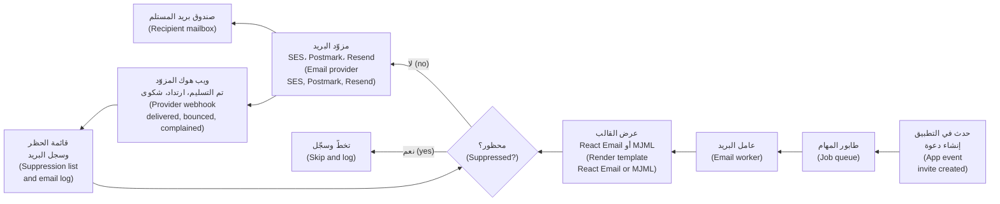
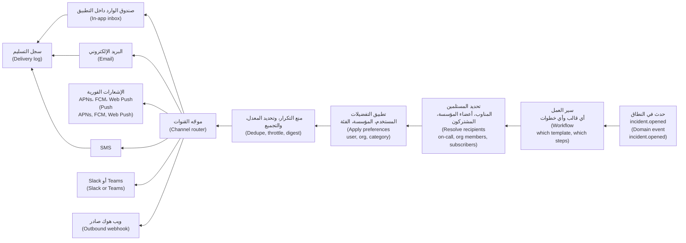
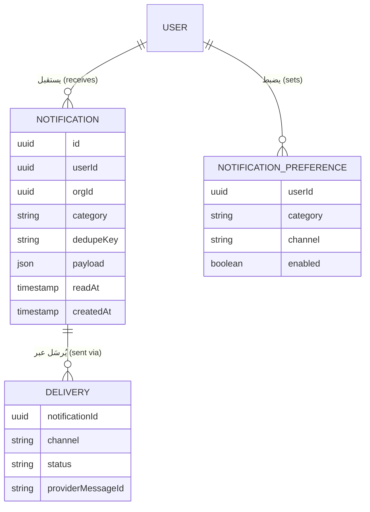
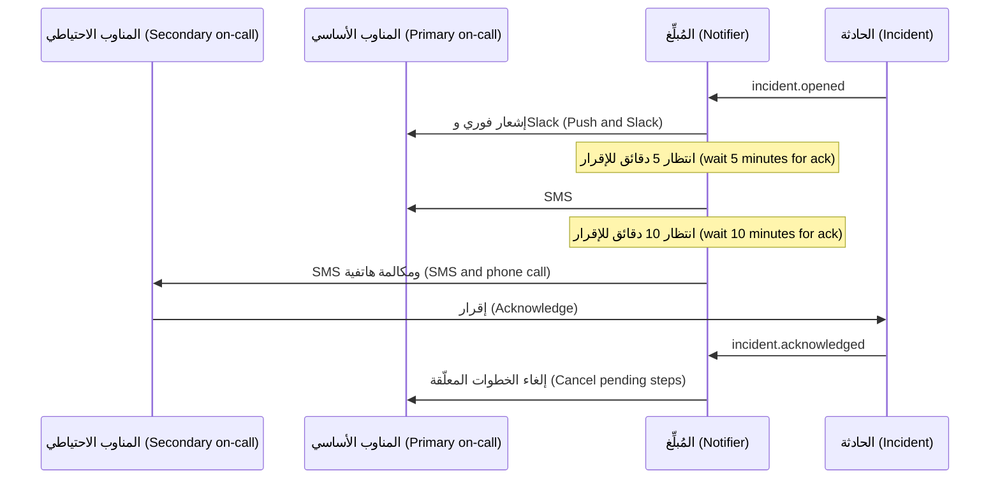
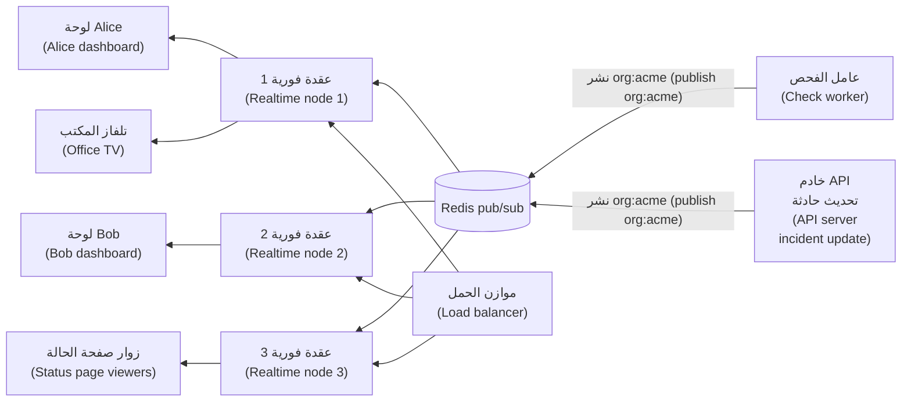
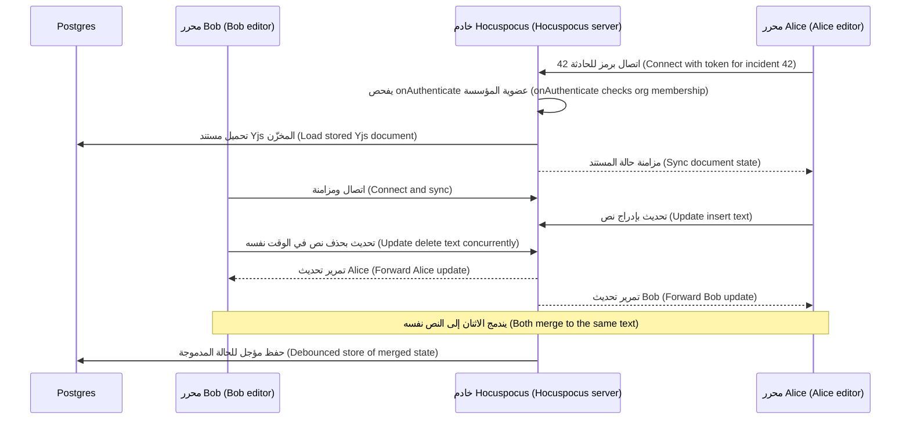

# الوحدة (Module) 4 — التواصل (Communication)

*إذا لم يستطع تطبيق SaaS الوصول إلى مستخدميه فكأنه غير موجود. وفي Beacon يكون الوصول إلى الناس هو المنتج (product) نفسه: تنبيه انقطاع (outage alert) يصل إلى مجلد الرسائل غير المرغوب فيها (spam) أسوأ من عدم وجود تنبيه (alert) أصلًا. تغطي هذه الوحدة الطرق الثلاث التي يتحدث بها تطبيقك إلى الناس. البريد الإلكتروني المعاملاتي (transactional email) يجب أن يصل. والإشعارات (notifications) يجب أن تصل إلى الشخص المناسب على القناة (channel) المناسبة دون أن تغرقه. أما التحديثات الفورية (real-time updates) والتعاون (collaboration) فتجعل لوحة التحكم (dashboard) حيّة، وتسمح لمهندسَين بتحرير تقرير ما بعد الحادثة (postmortem) نفسه دون أن يمحو أحدهما عمل الآخر.*

> **التطبيق العملي (Practice):** ابدأ من [نسخة البداية (starter) من Beacon](https://github.com/Tamoura/system-design-for-vibe-coders/tree/beacon/starter)، وحلّ التمارين قبل النظر إلى [الحل المرجعي (reference solution) لهذه الوحدة](https://github.com/Tamoura/system-design-for-vibe-coders/tree/beacon/module-4-solution) (الفرع (branch) `beacon/module-4-solution`).

---

# 4.1 — بريد معاملاتي يصل فعلًا
*المستوى (Level): 🟢 مبتدئ (Beginner)* · *المتطلبات (Prerequisites): 1.1، 1.2*

## ⚡ الدرس في دقيقة (In 60 seconds)

- البريد المعاملاتي مثل إعادة تعيين كلمة المرور (password reset) والدعوات (invites) وتنبيهات الحوادث (incident alerts) يُرسَل بسبب إجراء قام به المستخدم (user). أما وصوله فيقرره مزوّد صندوق البريد المستقبِل، بناءً على مصادقة نطاقك (domain authentication) وسمعته (reputation).
- القاعدة الأهم: انشر سجلات (records) SPF وDKIM وDMARC مع نطاق (domain) `From:` متوافق (aligned). منذ 2024 ترفض Gmail وYahoo البريد غير المُصادَق (unauthenticated).
- الخيار الافتراضي للنسخة الأولى (The v1 default): مزوّد إرسال، وقوالب (templates) مكتوبة بـ React Email أو MJML، وإرسال من مهمة في طابور (queued job)، وMailpit يلتقط كل الرسائل أثناء التطوير (development).
- افصل البريد التسويقي (marketing mail) عن البريد المعاملاتي في تدفقات (streams) أو نطاقات فرعية (subdomains) مختلفة، حتى لا تُسقط حملةٌ (campaign) سيئة رسائلَ إعادة تعيين كلمة المرور (password-reset emails).
- الفخ الأكبر: تجاهل الارتدادات (bounces) والشكاوى (complaints). عالج الويب هوك (webhook) الذي يرسله المزوّد (provider)، وافحص قائمة الحظر (suppression list) قبل كل إرسال.

## 🧭 لماذا يحتاجه كل SaaS

أول كود للبريد (email) في Beacon هو ستة أسطر من Nodemailer موجّهة إلى خادم SMTP (SMTP server) الخاص بالاستضافة (host) التي يعمل عليها التطبيق (app)، وترسل من `alerts@beacon.app`. لم يُعِدّ أحد سجلات DNS (DNS records) لهذا النطاق. في بيئة التطوير "يعمل" كل شيء، لأن صندوق بريد المطوّر نفسه متساهل. أما في الإنتاج (production) فتصل رسائل إعادة تعيين كلمة المرور متأخرة عشرين دقيقة أو لا تصل أبدًا، ويتوقف التسجيل (signup) عند خطوة "أكّد بريدك الإلكتروني". ثم يتعطل API أحد العملاء في الثالثة فجرًا، فيصل تنبيه Beacon إلى مجلد الرسائل غير المرغوب فيها (spam folder) في Gmail. ويعرف العميل بالمشكلة من عملائه هو.

لا يوجد خطأ في الكود (code). لأن قرار تسليم البريد (email delivery) يتخذه مزوّد صندوق البريد (mailbox provider) *المستقبِل (receiver)* (Gmail وOutlook وYahoo ومرشّحات الشركات)، وهو يحكم عليك بناءً على أمرين: هل نطاقك **مُصادَق (authenticate)** (Authenticated)، وهل **سمعة** الإرسال لديك جيدة. منذ فبراير 2024 صارت Gmail وYahoo *تشترطان* المصادقة (authentication) على الجميع، وتفرضان قواعد أشد على المرسلين بكميات كبيرة (bulk senders). لذلك فالبريد غير المُصادَق (unauthenticated mail) لا تقل فرص وصوله فقط، بل يُرفض.

كل SaaS يرسل المجموعة الأساسية نفسها: تأكيد البريد (verify email)، ورابط الدخول السحري (Magic Link)، وإعادة تعيين كلمة المرور، والدعوة (invitation)، والإيصال (receipt)، ورسالة "تنتهي فترتك التجريبية (trial) بعد 3 أيام". ويضيف Beacon فوقها تنبيهات الحوادث وتحديثات مشتركي صفحة الحالة (status page). ولا شيء من هذا اختياري.

**تسليم البريد (email delivery) نظام سمعة (reputation system) وليس استدعاء API: صادِق نطاقك (authenticate your domain)، وافصل تدفقات (streams) بريدك، وأرسل من طابور (queue)، وتصرّف بناءً على ما تخبرك به الارتدادات (bounces) والشكاوى (complaints).**

## 📐 كيف يعمل

### 🟢 الأساسيات

**المعاملاتي مقابل التسويقي (Transactional vs marketing).** الفرق بينهما قانوني وتقني، وليس فرقًا في الأسلوب.

| | معاملاتي (transactional) | تسويقي (جماعي (bulk) / ترويجي) |
|---|---|---|
| سبب الإرسال | إجراء من المستخدم أو حدث في الحساب | أنت، وترسله إلى قائمة |
| أمثلة | إعادة تعيين كلمة المرور، دعوة (invite)، تنبيه حادثة (incident alert)، إيصال | نشرة إخبارية (newsletter)، إطلاق منتج (product launch)، "نفتقدك" |
| الموافقة (consent) | ضمنية باستخدام الخدمة | تحتاج موافقة مسبقة (GDPR) أو على الأقل خيار إلغاء (CAN-SPAM) |
| إلغاء الاشتراك (unsubscribe) | غير مطلوب للبريد المعاملاتي الحقيقي | مطلوب، وبنقرة واحدة (one-click) للمرسلين بكميات كبيرة |
| من أين يُرسَل | `mail.beacon.app` أو تدفقك المعاملاتي | نطاق فرعي (subdomain) أو تدفق (stream) *منفصل*، مثل `news.beacon.app` |

أبقِهما منفصلين حتى لا تستطيع حملة تسويقية (marketing) ذات معدل شكاوى (complaint rate) سيئ أن تُسقط السمعة التي تعتمد عليها رسائل إعادة تعيين كلمة المرور.

**مصادقة النطاق (domain authentication).** هي ثلاثة سجلات DNS تثبت أنه مسموح لك بالإرسال باسم نطاقك:

| السجل (record) | ما يثبته | شكله |
|---|---|---|
| **SPF** (RFC 7208) | أي الخوادم (servers) يحق لها إرسال البريد باسم النطاق الموجود في مرسل الغلاف (Envelope Sender) | `TXT "v=spf1 include:amazonses.com ~all"` |
| **DKIM** (RFC 6376) | أن الرسالة موقّعة (signed) من مالك النطاق ولم تُعدَّل. المفتاح العام (public key) موجود في DNS | `TXT` عند `selector._domainkey.mail.beacon.app` |
| **DMARC** (RFC 7489) | ما يجب أن يفعله المستقبِل عندما يفشل SPF أو DKIM أو لا *يتوافقان* مع نطاق `From:` الظاهر، وإلى أين تُرسَل التقارير | `TXT` عند `_dmarc.beacon.app`: `"v=DMARC1; p=none; rua=mailto:…"` |

*التوافق* (Alignment) يعني أن النطاق الذي نجح في فحص SPF أو DKIM يطابق النطاق الموجود في ترويسة (header) `From:` التي يراها الإنسان. شاشة الإعداد عند مزوّدك تعطيك السجلات بالضبط. ومهمتك أن تضيفها وتنتظر حتى يتم التحقق منها.

**استخدم مزوّدًا (provider)، لا SMTP خامًا (raw SMTP) من خادمك (server).** كل من Amazon SES (رخيص وبسيط)، وPostmark (يركّز بقوة على قابلية التسليم (deliverability)، وفيه "تدفقات رسائل (message streams)" منفصلة للبريد المعاملاتي والبث)، وResend، وSendGrid (كبير وقديم) يتولى سمعة عناوين IP (IP reputation) وإعادة المحاولة (retries) وحلقات التغذية الراجعة (Feedback Loops) ومعالجة الارتدادات. وأي واحد منها مناسب لـ Beacon.

**أرسل من طابور (Send from a queue).** الإرسال المباشر (sending inline) داخل معالج الطلب (request handler) يعني أن المزوّد البطيء يجعل نقطة التسجيل (signup endpoint) بطيئة، وأن تعطّل المزوّد (provider outage) يُفشل عمليات التسجيل. ضع مهمة بريد (email job) في الطابور، ودع عاملًا (Worker) يرسلها مع إعادة المحاولة (5.1).



```ts
// emails/invite.tsx: a React Email template
import { Html, Button, Text } from "@react-email/components";
export function InviteEmail({ orgName, url }: { orgName: string; url: string }) {
  return (
    <Html>
      <Text>You've been invited to join {orgName} on Beacon.</Text>
      <Button href={url}>Accept invitation</Button>
    </Html>
  );
}

// worker: send-email job
import { render } from "@react-email/render";
export async function sendInvite(job: { to: string; orgName: string; url: string; inviteId: string }) {
  if (await isSuppressed(job.to)) return;
  const html = await render(<InviteEmail orgName={job.orgName} url={job.url} />);
  await resend.emails.send(
    { from: "Beacon <team@mail.beacon.app>", to: job.to, subject: `Join ${job.orgName} on Beacon`, html },
    { idempotencyKey: `invite:${job.inviteId}` },
  );
}
```

في Django توجد `send_mail` مع واجهات خلفية (backends) مثل `django-anymail`، وفي Rails يوجد Action Mailer مع `deliver_later`، وفي Laravel توجد Mailables مع `->queue()`. والشكل واحد: قالب (template)، ثم طابور، ثم مزوّد.

### 🟡 التعمق أكثر (Going deeper)

**الارتدادات والشكاوى والحظر (Bounces, complaints and suppression).** يبلغك المزوّد بالنتائج عبر الويب هوك:

- **الارتداد الدائم (Hard Bounce):** العنوان غير موجود. لا ترسل إليه مرة أخرى أبدًا.
- **الارتداد المؤقت (Soft Bounce):** صندوق البريد (mailbox) ممتلئ أو هناك فشل مؤقت. يعيد المزوّد المحاولة. احظر العنوان بعد تكرار الفشل.
- **الشكوى (Complaint):** نقر المستلم (recipient) على "الإبلاغ عن رسالة غير مرغوب فيها (Report spam)". أوقف فورًا كل البريد غير الضروري إليه.

احتفظ بـ **قائمة حظر** خاصة بك (العنوان، والسبب، والتاريخ)، وافحصها قبل كل إرسال، مع أن المزوّدين (providers) يحتفظون بقائمة أيضًا (في SES قائمة على مستوى الحساب، وPostmark يحظر لكل تدفق). قائمتك الخاصة تسمح لك بعرض رسالة مثل "لا نستطيع مراسلة jane@acme.com، فقد ارتدّ بريدها" في الواجهة (UI)، وهذا يوفّر عليك تذكرة دعم (support ticket). وتحقّق من تواقيع (signatures) الويب هوك بالطريقة نفسها التي استخدمتها مع Stripe في 3.1.

**متطلبات Gmail وYahoo لعام 2024 (The 2024 Gmail and Yahoo requirements).** لكل المرسلين: SPF *أو* DKIM، وسجلات DNS صحيحة في الاتجاهين الأمامي والعكسي لعناوين IP المرسِلة، وTLS، ومعدل شكاوى أقل من 0.3%. وللمرسلين بكميات كبيرة (نحو 5,000 رسالة يوميًا أو أكثر إلى عناوين Gmail): SPF *و*DKIM معًا، وسجل DMARC (على الأقل `p=none`) مع نطاق `From:` متوافق، و**إلغاء اشتراك بنقرة واحدة (one-click unsubscribe)** (RFC 8058: الترويستان (headers) `List-Unsubscribe` و`List-Unsubscribe-Post`) في البريد التسويقي والبريد الذي اشترك فيه المستخدم (subscribed mail)، على أن يُنفَّذ الإلغاء خلال يومين. وأعلنت Microsoft في 2025 متطلبات مشابهة للمرسلين بكميات كبيرة إلى عناوين Outlook.com الشخصية. تُعدّ رسائل مشتركي صفحة الحالة (status-page subscribers) في Beacon بريدًا اشترك فيه المستخدم (opted-in mail): فالناس سجّلوا لتلقيها، لذلك تحتاج ترويسات إلغاء الاشتراك (unsubscribe headers).

**القوالب (templates).** HTML البريد عالق في حدود عام 2005: جداول (tables) للتخطيط، وCSS مضمّن (inline CSS)، ودعم متقطع لـ CSS الحديث، وOutlook يعرض الرسائل بمحرك Word، والوضع الداكن (dark mode) يقلب ألوانك. لا تكتبه يدويًا. اختر أداة واحدة:

| الأداة | تكتب بها | مناسبة لـ |
|---|---|---|
| React Email | مكوّنات React (React components) | فرق TypeScript وReact، مع خادم معاينة (preview server) محلي |
| MJML | لغة ترميز (markup language) تشبه XML وتُترجَم إلى جداول متجاوبة (responsive) | أي تقنية. ويستطيع المصممون تعلّمها |
| Maizzle | HTML مع Tailwind CSS، ويُبنى إلى HTML بريد بأنماط مضمّنة (inlined) | الفرق التي تعمل بـ Tailwind دائمًا |

أرسل دائمًا **جزءًا نصيًا عاديًا** (Plain-text Part) أيضًا، لأنه يساعد على التسليم (delivery) وإمكانية الوصول (accessibility).

**الاختبار محليًا (Testing locally).** لا ترسل بريدًا حقيقيًا من بيئة التطوير أبدًا. شغّل **Mailpit**، وهو خادم SMTP محلي (على المنفذ (port) 1025 افتراضيًا) مع واجهة ويب (على 8025) يلتقط كل شيء. ويستطيع أيضًا فحص توافق HTML مع برامج البريد (email clients) واختبار الروابط. الإعدادات القديمة تستخدم MailHog أو Inbucket، وستراهما في المشاريع أدناه. لكن Mailpit هو الخيار الذي تتم صيانته بنشاط. وللقوالب، يعرض خادم المعاينة في React Email كل قالب ببيانات تجريبية (sample props).

**التوطين (Localization).** خزّن `locale` لكل مستخدم واعرض الرسائل بها. هذا يشمل عناوين الرسائل والتواريخ والأوقات (بالمنطقة الزمنية (time zone) *للمستلم*، وهذا مهم في عبارة مثل "بدأت الحادثة (incident) الساعة 03:12")، والتخطيط من اليمين إلى اليسار (right-to-left) إذا كنت تدعم تلك اللغات. لا تترجم داخل القالب يدويًا. استخدم فهرس الترجمة (i18n) نفسه الذي يستخدمه التطبيق.

### 🔴 على نطاق واسع وللمؤسسات

**نطاقات إرسال مخصصة (custom sending domains) لكل مستأجر (per-tenant).** عملاء الخطة Business (Business plan) يريدون إرسال تحديثات صفحة الحالة *من نطاقهم الخاص* (`status@acme.com`) وليس من `beacon.app`. هذا يعني إضافة نطاق كل عميل لدى مزوّدك (هويات (identities) SES، وواجهات النطاقات (domains) في Resend وPostmark)، وعرض سجلات SPF وDKIM التي يجب أن يضيفها، ومتابعة التحقق بشكل دوري، وتوجيه كل إرسال عبر الهوية الصحيحة. واحتفظ بخيار احتياطي (fallback): إلى أن يتم التحقق من النطاق، أرسل من نطاقك مع وضع اسم العميل في اسم العرض (display name). كل من Documenso وDub يقدّم هذه الميزة لعملائه.

**التوزيع الواسع (Fan-out).** حادثة واحدة على صفحة حالة مشهورة قد تعني 50,000 رسالة للمشتركين (subscribers). استخدم واجهة الإرسال الجماعي (Batch API) لدى مزوّدك، واضبط السرعة بحسب حصة الإرسال (sending quota)، واجعل كل رسالة متساوية الأثر (Idempotent) بمفتاح مثل (`incident:{id}:update:{n}:subscriber:{id}`)، وضع هذه الرسائل في تدفق أو نطاق فرعي منفصل عن إعادة تعيين كلمة المرور، حتى لا تؤخر موجةُ إرسال أو موجةُ شكاوى (complaint wave) رسائلَ تسجيل الدخول (login).

**إدارة السمعة (Reputation operations).** راقب معدلات الارتداد (bounce rates) والشكاوى لكل تدفق (فـ SES يراجع الحسابات التي تتجاوز حدوده أو يوقفها مؤقتًا)، وانقل DMARC من `p=none` إلى `quarantine` ثم `reject` بعد أن تُظهر التقارير أن كل مصدر شرعي متوافق، ولا تفكر في عناوين IP مخصصة (dedicated IPs) إلا مع حجم إرسال كبير (فهي تحتاج إحماءً (warm-up) وحركة ثابتة)، وفكّر في مزوّد ثانٍ (second provider) للتحويل عند الفشل (Failover) للبريد الحرج (critical).

**الاستضافة الذاتية (self-hosting).** تشغيل وكيل نقل البريد (MTA) الخاص بك يعني أن تدير سمعة عناوين IP بنفسك، وهذه وظيفة بدوام كامل. الخيارات الواقعية للاستضافة الذاتية إما *تغلّف* مزوّدًا أو تناسب حالات محددة: useSend يعطيك API ولوحة تحكم بأسلوب Resend فوق Amazon SES، وPostal خادم بريد (mail server) كامل للفرق التي لديها قدرة تشغيلية (ops capacity)، وlistmonk (للنشرات الإخبارية) وMautic (لأتمتة التسويق) يغطيان الجانب التسويقي.

## 🏆 أفضل المستودعات

| المستودع (repo) | ما هو | التقنيات (Stack) | الترخيص (license) | اختره عندما (Pick it when) |
|---|---|---|---|---|
| [resend/react-email](https://github.com/resend/react-email) | بناء رسائل البريد (emails) كمكوّنات React، مع خادم معاينة | TypeScript, React | MIT | تطبيقك مبني بـ React وTypeScript، وتريد القوالب بجانب الكود |
| [mjmlio/mjml](https://github.com/mjmlio/mjml) | لغة ترميز تُترجَم إلى HTML بريد متجاوب | JavaScript | MIT | لأي لغة خلفية (backend language)، أو عندما يكتب المصممون القوالب |
| [maizzle/framework](https://github.com/maizzle/framework) | إطار (framework) Tailwind CSS لرسائل HTML | JavaScript | MIT | فريقك يفكر بأسلوب Tailwind |
| [nodemailer/nodemailer](https://github.com/nodemailer/nodemailer) | أداة الإرسال القياسية في Node.js (SMTP ووسائل نقل (transports) أخرى) | JavaScript | MIT-0 | تحتاج SMTP (عملاء يستضيفون بأنفسهم، أو Mailpit، أو مزوّد احتياطي) |
| [axllent/mailpit](https://github.com/axllent/mailpit) | ملتقط SMTP (SMTP catcher) محلي مع واجهة ويب (web UI) وفحص توافق HTML والروابط | Go | MIT | دائمًا، في التطوير وفي CI |
| [usesend/useSend](https://github.com/usesend/useSend) | useSend: منصة إرسال (sending platform) مفتوحة المصدر (API ونطاقات وويب هوك) فوق Amazon SES | TypeScript, Next.js | AGPL-3.0 | تريد تجربة تشبه Resend تستضيفها بنفسك وتدفع أسعار SES |
| [postalserver/postal](https://github.com/postalserver/postal) | منصة تسليم بريد كاملة الميزات | Ruby | MIT | تحتاج فعلًا إلى تشغيل خوادم البريد (mail servers) الخاصة بك |
| [knadh/listmonk](https://github.com/knadh/listmonk) | مدير نشرات إخبارية (newsletters) وقوائم بريدية (mailing lists) تستضيفه بنفسك (self-hosted) | Go, Postgres | AGPL-3.0 | نشرات المنتج (product newsletters)، منفصلة عن البريد المعاملاتي |
| [mautic/mautic](https://github.com/mautic/mautic) | أتمتة تسويق (marketing automation) مفتوحة المصدر (open-source) | PHP | GPL-3.0 | حملات (campaigns) وتقسيم جمهور (segments) وتقييم عملاء محتملين (lead scoring)، باستضافة ذاتية |

**إن درست مستودعًا واحدًا فقط (If you only study one):** انسخ `resend/react-email`، وشغّل خادم المعاينة، واقرأ كيف تتحول المكوّنات (components) إلى HTML آمن للبريد. أغلب مشاريع SaaS الحديثة المكتوبة بـ TypeScript، ومنها المشاريع أدناه، تستخدمه، وسيغيّر طريقة تفكيرك في قوالب البريد (email templates) بوصفها كودًا.

**اشترِ أم ابنِ أم استضف بنفسك (Buy, build, or self-host)؟**

- **اشترِ (الخيار الافتراضي (the default)):** مزوّد إرسال (sending provider) مثل Postmark أو Resend أو Amazon SES أو SendGrid. قابلية التسليم هي منتجهم، وتكلفتهم قليلة مقارنة بوقتك.
- **استضف بنفسك (Self-host):** useSend فوق SES للتحكم في التكلفة (cost) مع API جيد. وlistmonk أو Mautic لقوائم التسويق (marketing lists). وPostal فقط إذا كانت لديك قدرة تشغيلية مخصصة.
- **ابنِ (Build):** القوالب، ومهمة البريد، وفحص قائمة الحظر، ومعالجة ويب هوك الارتدادات والشكاوى، وإضافة نطاقات المستأجرين (tenant domains). ولا تبنِ أبدًا خادم بريد خاصًا بك للبريد الحرج في SaaS.

## 🔍 ادرسه في مشاريع حقيقية (Study it in the wild)

**openstatus (`openstatusHQ/openstatus`).** هو Beacon الحقيقي، لذلك فرسائله هي رسائل Beacon. وقت كتابة هذا الدرس، يحتوي `packages/emails/emails/` على قوالب React Email مثل `monitor-alert.tsx` و`page-subscription.tsx` و`status-report.tsx` و`team-invitation.tsx` و`plan-downgraded.tsx`، مع مكوّنات مشتركة (shared components) في `_components/`. قارن بين رسالة التنبيه ورسالة تحديث المشترك (subscriber update).

**Dub (`dubinc/dub`).** افتح `packages/email` واقرأ `src/index.ts`. الدالة `sendEmail` تستخدم Resend عندما يكون مُعدًّا، وتعود إلى Nodemailer عبر SMTP في غير ذلك، وهذه طريقة مشروع SaaS مفتوح المصدر في دعم من يستضيفونه بأنفسهم. ثم ابحث عن `VARIANT_TO_FROM_MAP`: بريد النظام وبريد الإشعارات والبريد التسويقي تُرسَل من *عناوين ونطاقات فرعية مختلفة*. هذا فصل التدفقات (stream separation) في ثلاثة أسطر. وابحث عن `email-domains` لترى نطاقات الإرسال (sending domains) المخصصة لكل مساحة عمل (workspace).

**Documenso (`documenso/documenso`).** افتح `packages/email`. الملف `mailer.ts` يختار وسيلة نقل (transport) Nodemailer من متغيرات البيئة (environment variables)، ومجلد `templates/` فيه ملف لكل رسالة، وهناك إعداد معاينة (preview setup) منفصل. ملف Docker Compose الخاص بالتطوير في Documenso يستخدم Inbucket لالتقاط البريد. وابحث عن `organisation-email-domain` لترى كيف تضيف المؤسسات (orgs) نطاق الإرسال (sending domain) الخاص بها.

**Cal.com (`calcom/cal.diy`).** يحتوي `packages/emails` على ملف README يشرح `renderEmail("TeamInviteEmail", props)` ونقطة معاينة (preview endpoint)، وعلى ملف `docker-compose.yml` يشغّل MailHog لالتقاط البريد محليًا. ابحث عن `billing-email-service` و`auth-email-service` لترى كيف تُجمَّع الرسائل بحسب مجال العمل.

**ما الذي تلاحظه (What to notice)**

- هل الإرسال مغلّف خلف دالة واحدة مع وسائل نقل قابلة للتبديل (swappable transports).
- كم عنوان `From:` ونطاقًا فرعيًا مختلفًا يُستخدم، ولماذا.
- أين تُطلَق الرسائل: مباشرة في الطلب (request)، أم في مهام خلفية (background jobs)، أم من سير عمل (workflow).
- كيف تلتقط بيئة التطوير المحلية البريد (Mailpit أو MailHog أو Inbucket أو خوادم المعاينة).
- كيف يتم التحقق من نطاقات الإرسال التي يملكها العملاء وكيف تُستخدم.

## 🛠️ ابنِه في Beacon (Build it into Beacon)

### 🟢 تمرين المبتدئ (Beginner exercise)

أعدّ Mailpit في ملف `docker-compose.yml` الخاص بـ Beacon، ومزوّدًا للإنتاج. أنشئ قوالب React Email (أو MJML) لرسائل *تأكيد البريد* و*الدعوة* و*فتح حادثة (incident opened)*، وأرسلها عبر دالة واحدة `sendEmail()` تختار SMTP إلى Mailpit في التطوير والمزوّد في الإنتاج.

**يكتمل عندما (Done when):**
- يُظهر التسجيل المحلي رسالة التأكيد في واجهة Mailpit على `localhost:8025`.
- يكون لكل قالب جزء نصي عادي، ويُعرض في المعاينة (preview).
- لا يستورد أي كود خارج `sendEmail()` حزمة (package) SDK الخاصة بالمزوّد.

### 🟡 تمرين المستوى المتوسط (Intermediate exercise)

صادِق النطاق `mail.beacon.app` (SPF وDKIM وDMARC مع `p=none` وعنوان للتقارير)، وانقل كل الإرسال إلى مهمة في الطابور مع مفاتيح عدم التكرار (Idempotency Keys)، وعالج ويب هوك الارتدادات والشكاوى من المزوّد مع التحقق من التوقيع (signature). احتفظ بجدول (table) `email_suppressions` يُفحَص قبل كل إرسال، واعرض تحذيرًا في واجهة أعضاء الفريق (team members) للعناوين المحظورة (suppressed).

**يكتمل عندما (Done when):**
- تُظهر أداة فحص خارجية (أو لوحة تحكم المزوّد) نجاح SPF وDKIM وDMARC وتوافقها.
- يضيف ارتداد دائم مُحاكى (يوفّر المزوّدون عناوين للاختبار) صفًا (row) في جدول الحظر (suppression table)، ولا تتم أي محاولة إرسال أخرى إلى ذلك العنوان.
- يؤدي تعطل المزوّد (حاكِه بمفتاح API (API key) خاطئ) إلى تأخير الرسائل دون إفشال طلبات (requests) المستخدمين (users)، ثم تُرسَل الرسائل بعد عودة الخدمة.

### 🔴 تمرين المستوى المتقدم (Advanced exercise)

اسمح لمؤسسات الخطة Business بإرسال رسائل مشتركي صفحة الحالة من نطاقها الخاص. ابنِ عملية إضافة النطاق (إنشاء الهوية (identity) عبر API المزوّد (provider's API)، وعرض سجلات DNS، ومتابعة التحقق)، وأرسل تحديثات المشتركين (subscriber updates) من تدفق منفصل مع ترويسات إلغاء الاشتراك بنقرة واحدة وفق RFC 8058، ووزّع تحديثات الحوادث (incident updates) على دفعات مضبوطة السرعة (throttled batches).

**يكتمل عندما (Done when):**
- تستطيع المؤسسة (org) إضافة `status.acme.com` ورؤية سجلات DNS الخاصة به، وتحصل على حالة "تم التحقق" بعد انتشار السجلات.
- قبل التحقق، تُرسَل الرسائل من نطاق Beacon مع اسم عرض المؤسسة.
- تحتوي رسائل المشتركين (subscriber emails) على `List-Unsubscribe` و`List-Unsubscribe-Post`، ويؤدي إلغاء الاشتراك بنقرة واحدة إلى إزالة المشترك دون تسجيل دخول (logging in).
- يكتمل توزيع على 10,000 مشترك ضمن حدود المعدل (rate limits) لدى مزوّدك، دون تأخير رسائل إعادة تعيين كلمة المرور.

## ⚠️ أخطاء يقع فيها المبتدئون (Mistakes juniors make)

- **الإرسال من خادم SMTP (SMTP server) الخاص بخادم (server) التطبيق (app) أو من نطاق (domain) غير مُصادَق (unauthenticated).** تصل الرسائل إلى مجلد غير المرغوب فيه أو تُرفض وفق قواعد 2024. استخدم مزوّدًا، وانشر SPF وDKIM وDMARC قبل الإطلاق.
- **إرسال البريد (email) مباشرة داخل الطلب (request).** يصبح بطء المزوّد بطئًا لديك، وتصبح أعطاله أخطاء 500 (500 errors). ضع المهمة (job) في الطابور وأرسل من عامل مع إعادة المحاولة.
- **خلط البريد التسويقي (marketing mail) والمعاملاتي (transactional) في نطاق (domain) وتدفق (stream) واحد.** حملة واحدة مزعجة تضر بتسليم رسائل إعادة تعيين كلمة المرور. افصل بينهما بنطاق فرعي أو بتدفق لدى المزوّد.
- **تجاهل الارتدادات (bounces) والشكاوى (complaints).** الإرسال المتكرر إلى عناوين ميتة وإلى من اشتكوا يضر بالسمعة حتى يذهب كل شيء إلى مجلد غير المرغوب فيه. عالج الويب هوك واحتفظ بقائمة حظر.
- **كتابة HTML البريد (email) يدويًا.** ينكسر في Outlook وفي الوضع الداكن وبسبب اقتطاع (clipping) Gmail للرسائل. استخدم React Email أو MJML أو Maizzle، وعاين الرسائل في برامج بريد حقيقية.
- **السماح لبيئة التطوير (development) بإرسال بريد (email) حقيقي.** البيانات التجريبية (test data) مع مزوّد حقيقي تعني أن عملاء حقيقيين يستلمون رسائل اختبار. وجّه بيئة التطوير إلى Mailpit دائمًا.

## 🧾 الخلاصة (Recap)

- البريد المعاملاتي والتسويقي يختلفان في الموافقة والترويسات والسمعة، لذلك أبقِهما في تدفقات منفصلة.
- SPF وDKIM وDMARC مع التوافق أصبحت إلزامية (required) الآن، وليست إضافة جيدة فقط.
- اكتب القوالب بـ React Email أو MJML أو Maizzle. وأرسل من طابور. والتقط كل شيء محليًا بـ Mailpit.
- الارتدادات والشكاوى تغذّي قائمة حظر تفحصها قبل كل إرسال.
- نطاقات الإرسال لكل مستأجر والتوزيع الواسع هي مشكلات خطة Business. خطّط للتدفقات الخاصة بها مبكرًا.

## ✍️ اختبر نفسك (Check yourself)

**1. ماذا يثبت كل من SPF وDKIM وDMARC، وماذا يعني "التوافق (alignment)"؟**

<details><summary>الإجابة (Answer)</summary>

يحدد SPF الخوادم التي يحق لها الإرسال باسم النطاق، ويثبت DKIM أن الرسالة موقّعة من مالك النطاق ولم تُعدَّل، ويخبر DMARC المستقبِل بما يفعله عندما تفشل هذه الفحوص أو لا تتوافق، وإلى أين يرسل التقارير. التوافق يعني أن النطاق الذي نجح في SPF أو DKIM يطابق نطاق `From:` الذي يراه الإنسان. راجع جدول مصادقة النطاق في 🟢 الأساسيات.

</details>

**2. ما الأنواع الثلاثة من التغذية الراجعة (feedback) التي يرسلها المزوّد (provider)، وكيف تتصرف مع كل منها؟**

<details><summary>الإجابة</summary>

الارتداد الدائم يعني أن العنوان غير موجود، فلا ترسل إليه مرة أخرى أبدًا. والارتداد المؤقت فشل عابر يعيد المزوّد المحاولة بعده، وتحظر العنوان بعد تكرار الفشل. والشكوى تعني أن المستلم نقر على "الإبلاغ عن رسالة غير مرغوب فيها"، فتوقف فورًا كل البريد غير الضروري إليه. راجع فقرة "الارتدادات والشكاوى والحظر" في 🟡 التعمق أكثر.

</details>

**3. تُرسَل رسائل مشتركي صفحة الحالة (status-page subscribers) في Beacon من النطاق (domain) والتدفق نفسيهما لرسائل إعادة تعيين كلمة المرور (password-reset emails). لماذا هذه مشكلة، وما الذي يجب تغييره؟**

<details><summary>الإجابة</summary>

تحديثات المشتركين بريد اشترك فيه الناس ويُرسَل بكميات كبيرة، لذلك قد يضر توزيعٌ واسع أثناء حادثة كبيرة أو موجةُ شكاوى بالسمعة التي تعتمد عليها رسائل إعادة تعيين كلمة المرور، وقد يؤخرها. ضع بريد المشتركين (subscriber mail) في تدفق أو نطاق فرعي منفصل، مع ترويسات إلغاء الاشتراك بنقرة واحدة وفق RFC 8058. راجع جدول المعاملاتي مقابل التسويقي وفقرة "التوزيع الواسع" في 🔴 على نطاق واسع وللمؤسسات.

</details>

**4. يريد عميل في خطة Business (Business plan) إرسال تحديثات الحالة (status updates) من `status@acme.com`. ما الذي يحتاج Beacon إلى بنائه، وماذا يحدث قبل التحقق من نطاقه (their domain)؟**

<details><summary>الإجابة</summary>

يضيف Beacon النطاق عبر API المزوّد، ويعرض للعميل سجلات SPF وDKIM التي يجب أن يضيفها، ويتابع التحقق، ويوجّه كل إرسال عبر الهوية الصحيحة. وإلى أن يتم التحقق من النطاق، يرسل من نطاق Beacon نفسه مع وضع اسم العميل في اسم العرض. راجع فقرة "نطاقات إرسال مخصصة لكل مستأجر" في 🔴 على نطاق واسع وللمؤسسات.

</details>

**5. معالج التسجيل (signup handler) يستدعي API المزوّد (provider's API) مباشرة قبل أن يعيد الاستجابة (response). ما الذي ينكسر أثناء تعطل المزوّد (provider outage)، وما الحل؟**

<details><summary>الإجابة</summary>

يصبح بطء المزوّد بطئًا في التسجيل، ويحوّل تعطل المزوّد عمليات التسجيل إلى أخطاء 500 (500 errors)، فلا يستطيع المستخدمون إنشاء حسابات أصلًا. ضع مهمة بريد في الطابور، ودع عاملًا يرسلها مع إعادة المحاولة ومفتاح عدم تكرار (idempotency key). عندها ينجح التسجيل، وتُرسَل الرسالة بعد عودة الخدمة. راجع فقرة "أرسل من طابور" في 🟢 الأساسيات وقائمة الأخطاء.

</details>

## 📚 المراجع (References)

- Google, Email sender guidelines — إرشادات مرسلي البريد من Google: https://support.google.com/mail/answer/81126
- RFC 7208 (SPF): https://www.rfc-editor.org/rfc/rfc7208
- RFC 6376 (DKIM): https://www.rfc-editor.org/rfc/rfc6376
- RFC 7489 (DMARC): https://www.rfc-editor.org/rfc/rfc7489
- RFC 8058 — إلغاء الاشتراك بنقرة واحدة: https://www.rfc-editor.org/rfc/rfc8058
- React Email docs — توثيق React Email: https://react.email/docs
- Mailpit docs — توثيق Mailpit: https://mailpit.axllent.org
- Amazon SES Developer Guide — دليل المطور لـ Amazon SES: https://docs.aws.amazon.com/ses/

---

# 4.2 — الإشعارات: داخل التطبيق (in-app)، والدفع، وSlack، وSMS — والتفضيلات (preferences)
*المستوى: 🟡 متوسط (Intermediate)* · *المتطلبات: 4.1، 1.2*

## ⚡ الدرس في دقيقة (In 60 seconds)

- نظام الإشعارات يحوّل حدثًا واحدًا في النطاق (domain event) إلى الرسالة المناسبة، للأشخاص المناسبين، على القنوات (channels) المناسبة (داخل التطبيق، والبريد، والإشعارات الفورية (push)، وSMS، وSlack، والويب هوك).
- القاعدة الأهم: أرسل إشعارًا (notification) عند تغيّر الحالة (state change)، لا عند كل حدث. التخلّف (Hysteresis) ومفاتيح منع التكرار (dedupe keys) وحدود المعدل (throttles) والملخّصات (digests) تمنع إرهاق التنبيهات (alert fatigue).
- الخيار الافتراضي للنسخة الأولى (The v1 default): نقطة دخول (entry point) واحدة `notify()`، وجدول إشعارات (notifications table) يعمل كصندوق وارد (inbox) داخل التطبيق، ومصفوفة تفضيلات (preference matrix) بحسب الفئة (category) × القناة، ومهمة لكل قناة.
- بعض الفئات (الأمان (security) والفوترة) إلزامية ولا يمكن إيقافها، ويجب أن يعمل إلغاء الاشتراك (unsubscribing) دون تسجيل دخول.
- الفخ الأكبر: استدعاء Twilio أو Slack مباشرة من كود الأعمال (business code). استأجر القنوات، لكن احتفظ بالقرارات في مكان واحد.

## 🧭 لماذا يحتاجه كل SaaS

يبدأ API الدفع لدى أحد العملاء بالتذبذب (flapping) في الثانية فجرًا: يتعطل 40 ثانية، ثم يعمل دقيقة، ثم يتعطل مرة أخرى. يفحص Beacon كل 30 ثانية، ويرسل إشعارًا بإخلاص عند كل تغيّر في الحالة. بحلول السادسة صباحًا يكون لدى المهندس المناوب (on-call engineer) 140 رسالة بريد، و140 رسالة SMS (تُحتسب كاستخدام زائد (overage)، راجع 3.3)، وقناة Slack لا يستطيع أحد التمرير فيها. وفي 6:05 يتعطل API *فعلًا*. لكن الفريق كان قد كتم Beacon حينها، ولم يرَ أحد التنبيه المهم.

هذا هو **إرهاق التنبيهات**، وهو في منتج مراقبة (monitoring product) خطأ يهدد وجوده. والفشل المعاكس شائع بالقدر نفسه. المدير التقني (CTO) يريد SMS لمراقبات (monitors) الإنتاج فقط، والمتدرب لا يريد بريدًا أصلًا، والفريق يريد كل شيء في `#incidents`، ومشترك في صفحة الحالة (status-page subscriber) يريد إلغاء اشتراكه في صفحة واحدة دون تسجيل دخول. قاعدة "أرسل بريدًا عندما يحدث X" لا تصمد أمام المستخدمين الحقيقيين.

كل SaaS ينتهي به الأمر إلى بناء نظام إشعارات (notification system): دعوات، وإشارات (mentions)، وتعليقات، وموافقات (approvals)، وحدود استخدام (usage limits)، وفشل في الدفع (billing failures). وكلها تمر بالقرارات نفسها: من يجب أن يعلم، وعلى أي قناة، وبأي درجة استعجال، وكم مرة، وهل طلب ألا يُبلَّغ.

**نظام الإشعارات (notification system) سلسلة من القرارات (pipeline of decisions) (من، وأين، وكم مرة، وهل يُرسَل أصلًا)، وهذه القرارات أهم من التسليم (delivery) نفسه.**

## 📐 كيف يعمل

### 🟢 الأساسيات

افصل **ما حدث** (الحدث) عن **من يُبلَّغ وكيف** (الإشعارات):



للقنوات خصائص مختلفة جدًا:

| القناة | زمن الوصول (latency) | التكلفة | درجة الإزعاج (intrusiveness) | تحتاج إلى | يستخدمها Beacon لـ |
|---|---|---|---|---|---|
| صندوق الوارد داخل التطبيق (in-app inbox) | فوري إذا كان المستخدم متصلًا | شبه مجانية | منخفضة | جدول مع تحديث فوري (4.3) | كل شيء، بوصفه السجل |
| البريد الإلكتروني | من ثوانٍ إلى دقائق | منخفضة جدًا | من منخفضة إلى متوسطة | عنوان مؤكَّد (verified address) (4.1) | الحوادث (incidents)، والملخّصات، والفوترة (billing) |
| الإشعارات الفورية | ثوانٍ | شبه مجانية | عالية | رمز الجهاز (device token) وإذن نظام التشغيل (OS permission) | تنبيهات المناوبة (on-call alerts) على الجوال |
| SMS | ثوانٍ | لكل رسالة، وتُحتسب بالمقاطع (segment-billed) | عالية جدًا | رقم هاتف، وموافقة، وقواعد شركات الاتصالات (carrier) | الحوادث الحرجة فقط |
| Slack / Teams | ثوانٍ | مجانية | متوسطة | تثبيت عبر OAuth (5.3) | تنبيهات (alerts) قنوات الفريق (team channels) |
| ويب هوك صادر (outbound webhook) | ثوانٍ | مجانية | لا شيء، فهي للأنظمة | نقطة استقبال (endpoint) وتوقيع (5.3) | PagerDuty والأدوات المخصصة |

نموذج البيانات (data model) في النسخة الأولى (v1): صف واحد لكل إشعار لكل مستلم (صندوق الوارد داخل التطبيق)، بالإضافة إلى التفضيلات.



نقطة دخول واحدة يستدعيها كود النطاق (domain code)، وهذا الكود لا يتحدث مع Twilio مباشرة أبدًا:

```ts
export async function notify(evt: { category: "incident.opened"; orgId: string; incidentId: string }) {
  const recipients = await resolveRecipients(evt);             // on-call + watchers
  for (const user of recipients) {
    const dedupeKey = `${evt.category}:${evt.incidentId}:${user.id}`;
    const n = await db.notification.createIfAbsent({ dedupeKey, userId: user.id, orgId: evt.orgId,
      category: evt.category, payload: evt });                 // unique(dedupeKey)
    if (!n) continue;                                          // already notified
    const channels = await enabledChannels(user.id, evt.category); // preferences + defaults
    for (const channel of channels) {
      await queue.add("deliver", { notificationId: n.id, channel },
        { jobId: `${n.id}:${channel}` });                      // idempotent job
    }
  }
}
```

**التفضيلات (preferences)** تبدأ بسيطة: مصفوفة من *الفئة* × *القناة* مع قيم افتراضية معقولة (sensible defaults)، مثل "فتح حادثة: بريد ✓، SMS ✓، إشعار فوري ✓" و"التقرير الأسبوعي: بريد ✓". بعض الفئات (categories) **إلزامية (required)** (تنبيهات الأمان (security alerts)، وفشل الفوترة، و"أصبحت مالكًا")، ولا يستطيع المستخدمون إيقافها.

### 🟡 التعمق أكثر

**أرسل الإشعار (notification) عند تغيّر الحالة (state change)، لا عند كل حدث.** مشكلة التذبذب في Beacon تُحل في الغالب في *منطق النطاق (domain logic)*، لا في نظام الإشعارات:

- افتح حادثة فقط بعد **N حالات فشل متتالية (consecutive failures)** (مثلًا 3)، أو بعد فشل من **عدة مناطق (regions)**، ولا تغلقها إلا بعد M حالات نجاح متتالية (consecutive successes). هذا هو التخلّف.
- أرسل إشعارًا مرة واحدة عند كل **تغيّر في حالة (state change)** الحادثة (فُتحت، تم الإقرار (acknowledged) بها، حُلّت)، ولا ترسل أبدًا عند كل فحص فاشل.
- إذا فتحت مراقبةٌ حوادث وأغلقتها أكثر من K مرة في ساعة، فعلّمها بأنها **متذبذبة (flapping)**. أرسل إشعارًا واحدًا "المراقبة (monitor) متذبذبة"، واكتم الباقي حتى تستقر.

يعرض Uptime Kuma هذه الخيارات كإعدادات لكل مراقبة (عدد المحاولات قبل اعتبارها متعطلة، وعدد مرات إعادة الإرسال ما دامت متعطلة). وتستحق أن تنسخها.

**منع التكرار (dedupe)، وتحديد المعدل (throttling)، والتجميع (batching).** هذه ثلاث أدوات مختلفة:

| الأداة | السؤال الذي تجيب عنه | مثال |
|---|---|---|
| منع التكرار | "هل أرسلت *هذا الشيء نفسه* من قبل؟" | مفتاح `dedupeKey` فريد لكل حادثة + حالة + مستلم |
| تحديد المعدل | "هل أرسلت *أكثر من اللازم* مؤخرًا؟" | 5 رسائل SMS كحد أقصى لكل مستخدم في الساعة. بعد ذلك انتقل إلى الإشعار الفوري أو البريد مع عبارة "و12 أخرى" |
| الملخّص (digest) / التجميع (Digest / Batch) | "هل أستطيع دمج هذه في رسالة واحدة؟" | اجمع الإشعارات غير العاجلة لمدة 30 دقيقة، ثم أرسل بريدًا واحدًا يلخّصها |

الملخّص آلة حالات (state machine) صغيرة: أول حدث يفتح نافذة (window)، والأحداث اللاحقة تنضم إليها، وعندما تُغلق النافذة تُرسَل رسالة واحدة. ويحتاج ذلك إلى مهمة مجدولة (scheduled job) مفتاحها `(user, category, window)`. في Novu يوجد التجميع كخطوة جاهزة في سير العمل، ويستحق القراءة حتى لو بنيت نسختك الخاصة.

**طبقتان من التفضيلات (Two layers of preferences).** في منتجات B2B تضع *المؤسسة* السياسة (policy) ("حوادث الإنتاج (production incidents) ترسل دائمًا SMS إلى المناوب (on-call)")، ويضبط *المستخدم* تفضيلاته داخلها ("لا ترسل لي بريدًا عن بيئة الاختبار (staging)"). حُلّها بهذا الترتيب: `required categories` ← سياسة المؤسسة (org policy) ← تفضيل المستخدم (user preference) ← القيمة الافتراضية (default). وساعات الهدوء (quiet hours) ("لا إشعارات فورية (push notifications) من 22:00 إلى 07:00 إلا إذا كانت الخطورة (severity) حرجة") مكانها في خطوة الحل نفسها، وتُحسب بالمنطقة الزمنية (timezone) *للمستخدم*.

**إلغاء الاشتراك دون تسجيل دخول (Unsubscribe without login).** كل إشعار بالبريد يحمل رابط إلغاء اشتراك (unsubscribe link) موقّعًا وخاصًا بالمستلم والفئة، بالإضافة إلى ترويسات النقرة الواحدة وفق RFC 8058 حيث تكون مطلوبة (4.1). مشتركو صفحة الحالة ليسوا مستخدمين أصلًا، لذلك يحصلون على صفحة إدارة تعتمد على رمز (Token). وتحتاج SMS أيضًا إلى معالجة الكلمات المفتاحية (keyword handling): كلمة STOP يجب أن توقف الإرسال. يعالج Twilio كلمات إلغاء الاشتراك (opt-out keywords) القياسية نيابة عنك على الأرقام الطويلة (long codes)، لكن احفظ هذه الحالة في قاعدة بياناتك (database) أيضًا.

**التصعيد (Escalation).** في منتج للمناوبة، يجب أن يعلو صوت التنبيه الذي لم يُقرّ به أحد:



كل خطوة مهمة مؤجلة (delayed job) تبدأ بفحص: "هل تم الإقرار (acknowledgement)؟". ويجب أن *يلغي* الإقرار الخطوات المعلّقة (pending steps)، وهذا عمل مناسب لمحرك سير عمل متين (5.4)، أو على الأقل لمهام مؤجلة (delayed jobs) بمعرّفات ثابتة (stable IDs) يمكنك حذفها.

**تفاصيل القنوات (channels) التي ستصطدم بها:**

- **الإشعارات الفورية (Push):** تحتاج APNs (من Apple) وFCM (من Google) إلى رموز أجهزة (device tokens) تنتهي صلاحيتها أو تتغير، لذلك احذف الرموز التي يبلغ المزوّد أنها غير صالحة. أوقفت Google واجهات HTTP القديمة في FCM عام 2024، والكود الجديد يستخدم FCM HTTP v1 API. أما **Web Push** (وفق RFC 8030، مع مفاتيح VAPID من RFC 8292) فيعمل في المتصفحات (browsers) الحديثة، ومنها Safari على iOS 16.4 وما بعده لتطبيقات الويب المضافة إلى الشاشة الرئيسية (Home Screen).
- **SMS:** تُحتسب التكلفة لكل *مقطع (segment)* (160 حرفًا بترميز GSM-7، أو 70 إذا احتوت الرسالة على أي حرف خارج GSM-7، مثل كثير من الرموز التعبيرية). اجعل نصوص التنبيه قصيرة وبحروف ASCII. وفي الولايات المتحدة تتطلب حركة الرسائل من التطبيق إلى الأشخاص على أرقام من 10 خانات تسجيل العلامة التجارية والحملة في 10DLC، لذلك ابدأ به قبل الإطلاق لأنه يستغرق وقتًا.
- **Slack:** استخدم تطبيق Slack مع OAuth (5.3) و`chat.postMessage`، لا رابط Incoming Webhook ملصوقًا، إذا أردت التوجيه لكل قناة (per-channel routing)، والردود في سلسلة (threading) (انشر تحديثات الحادثة كردود في سلسلة واحدة)، وأزرارًا مثل "إقرار (acknowledge)". يحدّ Slack النشر بنحو رسالة واحدة في الثانية لكل قناة، وهذا سبب آخر لاستخدام السلاسل (threads) والتجميع.

### 🔴 على نطاق واسع وللمؤسسات

**التوزيع الواسع (fan-out) والعدالة (fairness).** انقطاع (outage) كبير عند مزوّد سحابي (cloud provider) يُفشل آلاف مراقبات Beacon في وقت واحد. هذا يعني عشرات الآلاف من الإشعارات في دقيقة، في اللحظة التي يحتاجها العملاء أكثر من أي وقت. استخدم طابورًا لكل قناة (per-channel queue) مع حدود تزامن (concurrency limits) تطابق حدود المعدل لدى المزوّدين، وقدّم حسب الخطورة (الحرج قبل الملخّص)، وحافظ على العدالة بين المؤسسات حتى لا يحرم عميل ضخم واحد الآخرين (2.4). واحسب قوائم مستلمي صفحات الحالة مسبقًا بدلًا من الاستعلام (querying) عن 50,000 مشترك في المسار الحرج (hot path).

**التحويل عند فشل المزوّد (provider failover).** مزوّدو SMS (SMS providers) والإشعارات الفورية يتعطلون أحيانًا. ضع واجهة محوّل (Adapter) أمام كل قناة (`SmsProvider.send()`)، وسجّل `providerMessageId` والحالة في `DELIVERY`، وحوّل إلى مزوّد آخر (من Twilio إلى مزوّد SMS ثانٍ) عند الأخطاء أو عند غياب إيصالات التسليم (delivery receipts) للتنبيهات الحرجة.

**تتبع التسليم (delivery tracking) والتدقيق (audit).** سيسأل عملاء المؤسسات: "هل تم استدعاء مناوبنا الساعة 03:12، وهل وصله التنبيه؟". احتفظ بسجل التسليم (delivery log) مع استدعاءات الحالة (status callbacks) من المزوّد (في الطابور، أُرسل، سُلّم، فشل، قُرئ داخل التطبيق)، واعرضه على الخط الزمني (timeline) للحادثة. وهو أيضًا أداة التصحيح (debugging tool) لديك، ويرتبط بسجلات التدقيق (audit logs) (7.3).

**ابنِ (Build) منصة إشعارات (notification platform) أو اعتمد واحدة.** سير العمل، والملخّصات، ومراكز التفضيلات (preference centers)، ومكوّن (component) صندوق الوارد داخل التطبيق، وتكاملات المزوّدين (provider integrations)، وسجل التسليم، كلها معًا منتج كبير. **Novu** هو الخيار مفتوح المصدر: سير عمل يُكتب بالكود، ومكوّن Inbox جاهز، وملخّصات وتأخيرات (delays)، وتفضيلات المشتركين (subscriber preferences)، وتكاملات (integrations) كثيرة مع المزوّدين. و**Knock** و**Courier** هما البديلان المُداران (managed). وللاحتياجات الأضيق، هناك **Apprise** (واجهة Python واحدة لعشرات الخدمات)، و**ntfy** و**Gotify** (إشعارات فورية باستضافة ذاتية)، وهي لبنات بناء (building blocks) مفيدة.

## 🏆 أفضل المستودعات

| المستودع | ما هو | التقنيات | الترخيص | اختره عندما |
|---|---|---|---|---|
| [novuhq/novu](https://github.com/novuhq/novu) | بنية إشعارات (notification infrastructure) مفتوحة المصدر: سير عمل، وملخّصات، وتفضيلات، وInbox داخل التطبيق، ومزوّدون كثيرون | TypeScript, Node, React | MIT (مجلدات المؤسسات بترخيص منفصل) | تريد منصة إشعارات كاملة تستضيفها بنفسك |
| [caronc/apprise](https://github.com/caronc/apprise) | واجهة واحدة ونظام روابط لإرسال الإشعارات إلى عشرات الخدمات (Slack، Telegram، البريد، SMS…) | Python | BSD-2-Clause | تحتاج قنوات كثيرة بسرعة من Python، أو تريد رؤية نمط المحوّل (adapter pattern) |
| [binwiederhier/ntfy](https://github.com/binwiederhier/ntfy) | إشعارات فورية بنمط النشر والاشتراك (pub/sub) عبر HTTP إلى الهواتف وأجهزة الحاسوب | Go | Apache-2.0 / GPL-2.0 dual | إشعارات فورية بسيطة باستضافة ذاتية، أو تقديم قناة ntfy للمستخدمين |
| [gotify/server](https://github.com/gotify/server) | خادم تستضيفه بنفسك لإرسال الرسائل الفورية واستقبالها عبر WebSocket | Go | MIT | إشعارات فورية باستضافة ذاتية للفرق الداخلية |
| [web-push-libs/web-push](https://github.com/web-push-libs/web-push) | مكتبة (library) Node لـ Web Push مع VAPID وتشفير المحتوى (payload encryption) | JavaScript | MPL-2.0 | إشعارات المتصفح (browser notifications) دون الاعتماد على مزوّد |
| [firebase/firebase-admin-node](https://github.com/firebase/firebase-admin-node) | حزمة Firebase Admin SDK الرسمية، ومنها إرسال FCM | TypeScript | Apache-2.0 | إشعارات فورية إلى Android (وإلى iOS عبر FCM) من Node |
| [slackapi/bolt-js](https://github.com/slackapi/bolt-js) | الإطار الرسمي لتطبيقات Slack: OAuth، والأحداث، والأزرار التفاعلية (interactive buttons) | TypeScript | MIT | يحتاج تكامل Slack (Slack integration) لديك إلى أزرار مثل "إقرار" |
| [twilio/twilio-node](https://github.com/twilio/twilio-node) | حزمة Twilio SDK الرسمية لـ SMS والمكالمات (calls) واستدعاءات الحالة | TypeScript | MIT | التصعيد عبر SMS والمكالمات |
| [louislam/uptime-kuma](https://github.com/louislam/uptime-kuma) | أداة مراقبة توفر (uptime monitor) باستضافة ذاتية مع أكثر من 100 مزوّد إشعارات (notification providers) | Node, Vue | MIT | تريد أن ترى كيف تنظّم أداة مراقبة (monitoring tool) محوّلات الإشعارات (notification adapters) |

**إن درست مستودعًا واحدًا فقط (If you only study one):** اقرأ `novuhq/novu`. حتى لو لم تعتمده أبدًا، فمفاهيمه (سير العمل، والخطوة، والملخّص، والمشترك (subscriber)، والتفضيل (preference)، وInbox) هي مفردات هذا الدرس كله. ابدأ في `packages/framework` لترى واجهة سير العمل المكتوب بالكود (code-first workflow)، ثم انظر كيف يتقاسم `apps/api` و`apps/worker` المسؤوليات.

**اشترِ أم ابنِ أم استضف بنفسك (Buy, build, or self-host)؟**

- **اشترِ (Buy):** Knock أو Courier عندما تحتاج قريبًا إلى سير عمل وتفضيلات وصندوق وارد داخل التطبيق عبر عدة منتجات، ولا تريد تشغيلها بنفسك. واستخدم مزوّدي القنوات (channel providers) في كل الأحوال: Twilio لـ SMS، وAPNs وFCM للإشعارات الفورية، ومزوّد بريد (4.1).
- **استضف بنفسك (Self-host):** Novu عندما تريد المنصة كاملة داخل بنيتك التحتية (infrastructure). وApprise أو ntfy أو Gotify للاحتياجات الداخلية الأضيق.
- **ابنِ (خيار معقول للنسخة الأولى (v1) من Beacon):** نقطة الدخول `notify()`، وجدولي الإشعارات والتسليم، ومصفوفة التفضيلات، ومفاتيح منع التكرار، ومهمة لكل قناة. التنبيه *هو* منتج Beacon، لذلك فامتلاك منطق التذبذب والتصعيد وتحديد المعدل له ما يبرره. استأجر القنوات، وامتلك القرارات.

## 🔍 ادرسه في مشاريع حقيقية

**openstatus (`openstatusHQ/openstatus`).** وقت كتابة هذا الدرس، يحتوي `packages/notifications/` على **حزمة (package) لكل قناة (channel)**: `discord` و`email` و`slack` و`google-chat` و`ms-teams` و`pagerduty` و`opsgenie` و`ntfy` و`telegram` و`webhook`، ونسخ لـ SMS وWhatsApp، بالإضافة إلى حزمة مشتركة `base` فيها أدوات مساعدة لتنسيق الرسائل. وفي لوحة التحكم نموذج مقابل لكل قناة (ابحث عن `form-slack` و`form-sms`). هذا نمط المحوّل مطبّقًا على مشكلة Beacon بالضبط.

**Uptime Kuma (`louislam/uptime-kuma`).** افتح `server/notification-providers/`. ستجد أكثر من مئة ملف صغير، واحدًا لكل خدمة، وكلها تطبّق الواجهة نفسها. ثم انظر كيف يقرر إعدادا "retries" و"resend interval" في المراقبة *ما إذا* كان سيُرسَل إشعار. هذا منطق مقاومة التذبذب (anti-flapping) وإعادة الإشعار في أداة مراقبة حقيقية.

**Dub (`dubinc/dub`).** ابحث عن `notificationPreference`. مهمة cron الخاصة بالاستخدام لا ترسل البريد إلا لأعضاء مساحة العمل الذين اختاروا ملخّص الاستخدام (usage summary) في تفضيلاتهم، وتضع حدًا لعدد المستلمين (recipients) في كل مساحة عمل. وابحث عن `notification-preferences` لترى مسار API (API route) الذي يعدّلها. إنه نموذج تفضيلات (preferences model) صغير وسهل القراءة.

**Novu (`novuhq/novu`).** Novu نفسه منتج SaaS. ابحث في `apps/api` عن `digest` و`preferences` لترى كيف تُنفَّذ نوافذ التجميع (digest windows) وحل التفضيلات (preference resolution)، وفي `apps/ws` لترى خدمة WebSocket التي تشغّل Inbox الفوري.

**ما الذي تلاحظه (What to notice)**

- هل يستدعي كود النطاق القنوات مباشرة، أم يمر عبر نقطة دخول واحدة `notify`.
- ما شكل محوّل كل قناة، وكيف تُعاد حالات الفشل.
- أين يعيش منطق مقاومة التذبذب ومنع التكرار وتحديد المعدل: في النطاق، أم في المُبلِّغ (notifier)، أم في القناة.
- كيف تُخزَّن التفضيلات (لكل فئة (per category)، ولكل قناة، ولكل مؤسسة)، وما الفئات التي لا يمكن تعطيلها.
- هل يوجد سجل تسليم يمكنك عرضه على العميل.

## 🛠️ ابنِه في Beacon

### 🟢 تمرين المبتدئ

ابنِ صندوق الوارد داخل التطبيق: جدول `notifications`، ودالة `notify()` تُستدعى عند فتح حادثة أو حلّها، وأيقونة جرس (bell icon) مع عدد غير المقروء (unread count)، وخيارَي "تعليم كمقروء" و"تعليم الكل كمقروء". كل عضو في المؤسسة لديه صلاحية الوصول (access) إلى المراقبة يحصل على إشعار واحد لكل تغيّر في حالة الحادثة.

**يكتمل عندما (Done when):**
- يُنشئ فتح حادثة إشعارًا واحدًا بالضبط لكل عضو مؤهل، حتى لو استُدعيت `notify()` مرتين (مفتاح منع تكرار (dedupe key) فريد).
- يتحدّث عدد غير المقروء بعد التعليم كمقروء.
- الأعضاء الذين ليست لديهم صلاحية الوصول إلى المراقبة (1.3) لا يستلمون شيئًا.

### 🟡 تمرين المستوى المتوسط

أضف قنوات البريد وSlack وSMS خلف موجّه قنوات (channel-router) مع مهمة لكل قناة، بالإضافة إلى صفحة تفضيلات (preferences page) (مصفوفة الفئة × القناة، مع قفل الفئات الإلزامية (required categories) في وضع التشغيل). طبّق مقاومة التذبذب: تُفتح الحادثة بعد 3 حالات فشل متتالية، والمراقبة التي تغيّر حالتها أكثر من 4 مرات في ساعة ترسل إشعار "تذبذب" واحدًا وتكتم الباقي. وأضف حدًا لـ SMS (SMS cap) لكل مستخدم مقداره 5 في الساعة، مع الانتقال إلى البريد بعده.

**يكتمل عندما (Done when):**
- تنتج مراقبة متذبذبة مُحاكاة (تتناوب بين العمل والتعطل كل 30 ثانية لمدة ساعة) عددًا قليلًا فقط من الإشعارات لكل قناة.
- المستخدم الذي عطّل البريد لفئة "حُلّت الحادثة (incident resolved)" لا يستلم رسائل بريد عن الحل، لكنه يستلم الإشعارات داخل التطبيق.
- تُستبدل رسالة SMS السادسة خلال ساعة ببريد يذكر عدد التنبيهات التي تم تأجيلها.
- تُسجَّل كل محاولة تسليم (delivery attempt) مع القناة والحالة ومعرّف رسالة المزوّد.

### 🔴 تمرين المستوى المتقدم

طبّق سياسات التصعيد (escalation policies) لكل مؤسسة (per org): الخطوة 1 (إشعار فوري + Slack إلى المناوب الأساسي)، والخطوة 2 بعد 5 دقائق (SMS)، والخطوة 3 بعد 10 دقائق أخرى (المناوب الاحتياطي (secondary on-call)، SMS + مكالمة صوتية). الإقرار (من التطبيق، أو من زر في Slack (Slack button)، أو برد على SMS) يلغي الخطوات المعلّقة. وأضف ملخّصًا يوميًا (daily digest) للفئات غير الحرجة (non-critical)، وخطًا زمنيًا للحادثة يعرض كل عملية تسليم.

**يكتمل عندما (Done when):**
- تتصاعد الحادثة غير المُقرّ بها (unacknowledged) في موعدها. والإقرار في أي خطوة يلغي كل الخطوات اللاحقة، دون استدعاءات مكررة.
- يؤدي الإقرار من زر Slack إلى تحديث الحادثة خلال ثوانٍ.
- تصل الإشعارات غير الحرجة للمستخدم خلال نافذة الملخّص (digest window) في رسالة بريد واحدة.
- يعرض الخط الزمني للحادثة من أُبلغ، وكيف، ومتى، وهل وصله الإشعار.

## ⚠️ أخطاء يقع فيها المبتدئون

- **إرسال إشعار (notification) عند كل حدث بدلًا من كل تغيّر في الحالة (state change).** يتحول فحص متذبذب إلى 300 رسالة SMS وتكامل (integration) مكتوم. أضف التخلّف ومفاتيح منع التكرار واكتشاف التذبذب (flap detection) في منطق النطاق.
- **استدعاء Twilio أو Slack مباشرة من كود الأعمال (business code).** لن تستطيع إضافة التفضيلات أو تحديد المعدل أو التحويل عند الفشل لاحقًا دون تعديل كل موضع استدعاء. وجّه كل شيء عبر `notify()` واحدة ومحوّلات القنوات (channel adapters).
- **جعل كل الإشعارات (notifications) اختيارية.** يعطّل المستخدمون تنبيهات الأمان أو الفوترة، ثم يلومونك. علّم الفئات الإلزامية واقفلها في وضع التشغيل.
- **روابط إلغاء اشتراك تتطلب تسجيل دخول (logging in).** لا يستطيع الناس إلغاء الاشتراك من هواتفهم، فينقرون على "الإبلاغ عن رسالة غير مرغوب فيها" بدلًا من ذلك، فتتضرر سمعتك (4.1). استخدم رموزًا موقّعة (signed tokens) ونقاط إلغاء (unsubscribe endpoints) بنقرة واحدة.
- **تجاهل التغذية الراجعة (feedback) من المزوّد (provider).** تستمر في الإرسال إلى رموز إشعارات (push tokens) قديمة، وبريد مرتد، ومن ردّوا بـ STOP. عالج استدعاءات التسليم (delivery callbacks) ونظّف القوائم.
- **إرسال SMS طويلة ومليئة بالرموز التعبيرية (emoji).** كل حرف خارج GSM-7 يغيّر الترميز (encoding) ويضاعف عدد المقاطع، ومعه الفاتورة. اجعل رسائل التنبيه قصيرة وبسيطة ومعها رابط.

## 🧾 الخلاصة

- افصل الأحداث عن الإشعارات: حدث ← سير عمل ← مستلمون ← تفضيلات ← تحديد معدل ← قناة ← سجل تسليم.
- إرهاق التنبيهات خطأ في المنتج. عالجه بالتخلّف، والإشعار عند تغيّر الحالة، واكتشاف التذبذب، ومنع التكرار، وتحديد المعدل.
- للتفضيلات طبقات (إلزامي، ومؤسسة، ومستخدم، وافتراضي)، ويجب أن يعمل إلغاء الاشتراك دون تسجيل دخول.
- التصعيد سلسلة من الخطوات المؤجلة (delayed steps) القابلة للإلغاء، ولذلك فهو عمل مناسب لسير العمل المتين (durable workflow).
- استأجر القنوات (Twilio، وAPNs/FCM، وSlack، ومزوّدي البريد). وامتلك منطق القرار (decision logic)، أو اعتمد Novu أو Knock أو Courier.

## ✍️ اختبر نفسك

**1. ما الفرق بين منع التكرار (dedupe) وتحديد المعدل (throttling) والملخّصات (digests)؟**

<details><summary>الإجابة</summary>

منع التكرار يسأل "هل أرسلت هذا الشيء نفسه من قبل؟" ويستخدم مفتاحًا فريدًا لكل حادثة وحالة ومستلم. وتحديد المعدل يسأل "هل أرسلت أكثر من اللازم مؤخرًا؟"، مثل 5 رسائل SMS كحد أقصى لكل مستخدم في الساعة. والملخّص يسأل "هل أستطيع دمج هذه في رسالة واحدة؟"، فيجمع الإشعارات غير العاجلة خلال نافذة زمنية (time window) ثم يرسل ملخّصًا واحدًا. راجع الجدول في 🟡 التعمق أكثر.

</details>

**2. بأي ترتيب تُحَل تفضيلات الإشعارات (notification preferences) في منتج (product) B2B؟**

<details><summary>الإجابة</summary>

تأتي الفئات الإلزامية أولًا، ثم سياسة المؤسسة، ثم تفضيل المستخدم نفسه، ثم القيمة الافتراضية. وتُحسب ساعات الهدوء في الخطوة نفسها، بالمنطقة الزمنية للمستخدم. راجع فقرة "طبقتان من التفضيلات" في 🟡 التعمق أكثر.

</details>

**3. يتذبذب API أحد العملاء بين العمل والتعطل كل دقيقة طوال الليل. ما الذي يجب أن يغيّره Beacon حتى يلاحظ المهندس المناوب (on-call engineer) الانقطاع (outage) الحقيقي في السادسة صباحًا؟**

<details><summary>الإجابة</summary>

افتح حادثة فقط بعد N حالات فشل متتالية وأغلقها بعد M حالات نجاح متتالية، وأرسل إشعارًا مرة واحدة عند كل تغيّر في حالة الحادثة، وعلّم المراقبة التي تفتح الحوادث وتغلقها كثيرًا بأنها متذبذبة، مع إشعار واحد وكتم الباقي. وأضف فوق ذلك حدًا لـ SMS مع الانتقال إلى البريد. راجع فقرة "أرسل الإشعار عند تغيّر الحالة، لا عند كل حدث" في 🟡 التعمق أكثر.

</details>

**4. كيف يجب أن يصعّد Beacon تنبيهًا (alert) لم يُقرّ به المناوب الأساسي (primary on-call)، وماذا يجب أن يحدث عندما يُقرّ به أحد؟**

<details><summary>الإجابة</summary>

كل خطوة تصعيد (escalation step) مهمة مؤجلة تبدأ بفحص ما إذا كانت الحادثة قد أُقرّ بها: الإشعار الفوري وSlack أولًا، ثم SMS بعد 5 دقائق، ثم المناوب الاحتياطي عبر SMS ومكالمة هاتفية (phone call). ويجب أن يلغي الإقرار كل الخطوات المعلّقة، وهذا يتطلب محرك سير عمل متينًا أو مهام مؤجلة بمعرّفات ثابتة يمكنك حذفها. راجع مخطط التصعيد (escalation diagram) في 🟡 التعمق أكثر.

</details>

**5. في رسالة التقرير الأسبوعي من Beacon رابط إلغاء اشتراك (unsubscribe link) يفتح صفحة تسجيل الدخول (login). ما الذي يسوء؟**

<details><summary>الإجابة</summary>

من يقرأ على هاتفه لا يستطيع إلغاء الاشتراك بسهولة، فينقر على "الإبلاغ عن رسالة غير مرغوب فيها" بدلًا من ذلك، والشكاوى تضر بسمعة الإرسال (sending reputation) التي تعتمد عليها تنبيهات الحوادث (4.1). استخدم رابطًا برمز موقّع (signed token) خاص بالمستلم والفئة، بالإضافة إلى ترويسات النقرة الواحدة (one-click headers) وفق RFC 8058 حيث تكون مطلوبة. راجع فقرة "إلغاء الاشتراك دون تسجيل دخول" في 🟡 التعمق أكثر وقائمة الأخطاء.

</details>

## 📚 المراجع

- Novu documentation — توثيق Novu: https://docs.novu.co
- Firebase Cloud Messaging docs — توثيق FCM: https://firebase.google.com/docs/cloud-messaging
- Apple User Notifications (APNs) docs — توثيق إشعارات Apple: https://developer.apple.com/documentation/usernotifications
- RFC 8030 (Web Push) and RFC 8292 (VAPID): https://www.rfc-editor.org/rfc/rfc8030 and https://www.rfc-editor.org/rfc/rfc8292
- Slack API docs — توثيق Slack API: https://api.slack.com
- Twilio docs — توثيق Twilio: https://www.twilio.com/docs
- RFC 8058 — إلغاء الاشتراك بنقرة واحدة: https://www.rfc-editor.org/rfc/rfc8058

---

# 4.3 — التحديث الفوري (real-time) والتعاون: من WebSockets إلى CRDTs
*المستوى: 🔴 متقدم (Advanced)* · *المتطلبات: 4.2، 2.4*

## ⚡ الدرس في دقيقة (In 60 seconds)

- التحديث الفوري مشكلتان منفصلتان: التوزيع، أي دفع تغييرات الخادم إلى عملاء (clients) كثيرين، والتعارضات (conflicts)، أي تحرير عملاء كثيرين للبيانات نفسها.
- القاعدة الأهم: افحص صلاحية كل اشتراك في قناة (channel subscription) أو غرفة (room)، لا الاتصال (connection) فقط، وأعد الفحص (recheck) عند إعادة الاتصال (reconnect).
- الخيار الافتراضي للنسخة الأولى (The v1 default): SSE مع Redis pub/sub للوحات التحكم (dashboards) والتدفقات (feeds). استخدم WebSockets فقط عندما يرسل العملاء كثيرًا، واستطلاعًا (polling) من ملف مخزّن في CDN للصفحات العامة الضخمة.
- للتحرير المتزامن (concurrent edits)، استخدم القفل المتفائل (Optimistic Locking) للنماذج (forms)، وCRDT (مثل Yjs مع Hocuspocus) للنص المشترك (shared text). ولا تكتب CRDT أو OT بنفسك أبدًا.
- الفخ الأكبر: افتراض أن pub/sub يسلّم كل شيء. العملاء يفوّتون رسائل أثناء إعادة الاتصال، لذلك أعد المزامنة (resync) عند إعادة الاتصال (reconnection)، وتراجع تدريجيًا (back off) مع عشوائية (Jitter).

## 🧭 لماذا يحتاجه كل SaaS

تعرض لوحة تحكم Beacon شبكة من المراقبات باللونين الأخضر والأحمر. النسخة الأولى (v1) تستطلع `/api/monitors/status` كل خمس ثوانٍ. ومع 2,000 لوحة مفتوحة (على شاشات التلفاز في المكاتب، فهذا مكان لوحات المراقبة (monitoring dashboards) عادة)، يصبح لديك 400 طلب في الثانية (requests per second)، وأغلبها يجيب "لم يتغير شيء". وعندما يتغير شيء *فعلًا*، يراه المستخدمون متأخرًا حتى خمس ثوانٍ، وفريق العمليات (ops team) الذي يحدّق في شاشة الحائط (wall screen) يلاحظ ذلك.

ثم يصيب انقطاع كبير عميلًا مشهورًا. صفحة الحالة العامة (public status page) الخاصة به، الهادئة عادة، يزورها 50,000 شخص يحدّثونها كل بضع ثوانٍ، في الوقت نفسه الذي ينشر فيه فريقك تحديثات الحادثة. وداخل Beacon، يكتب مهندسان تقرير ما بعد الحادثة في حقل ملاحظات الحادثة نفسه. كل منهما يحفظ، والحفظ الثاني يمحو بصمت عشرين دقيقة من عمل الشخص الأول.

تبدو هذه ميزة واحدة اسمها "التحديث الفوري"، لكنها في الحقيقة مشكلتان لا علاقة بينهما، ولكل منهما أدوات مختلفة.

**التحديث الفوري (real-time) مشكلتان منفصلتان: دفع تغييرات الخادم (server) إلى عملاء كثيرين (مشكلة توزيع (fan-out problem))، والسماح لعملاء كثيرين بتحرير الشيء نفسه (مشكلة تعارض (conflict problem)). اختر أدوات كل منهما على حدة.**

## 📐 كيف يعمل

### 🟢 الأساسيات

**خيارات النقل (transport options)، من الأبسط إلى الأقوى:**

| التقنية | كيف تعمل | الاتجاه (direction) | مناسبة لـ | انتبه إلى |
|---|---|---|---|---|
| الاستطلاع | يسأل العميل كل N ثانية | عميل ← خادم | بيانات قليلة التغير، والنسخة الأولى (v1) | طلبات مهدرة، وتأخير يصل إلى N |
| الاستطلاع الطويل (Long Polling) | يُبقي الخادم الطلب مفتوحًا حتى يوجد جديد | خادم ← عميل، بالمحاكاة | بيئات تمنع البث المستمر (streaming) | كثرة إعادة الاتصال |
| **SSE** (Server-Sent Events) | استجابة HTTP (HTTP response) واحدة طويلة تبث `text/event-stream`، و`EventSource` في المتصفح (browser) يعيد الاتصال (reconnects) تلقائيًا | خادم ← عميل | لوحات التحكم، والتدفقات، والإشعارات، وبث رموز الذكاء الاصطناعي | نحو 6 اتصالات (connections) لكل أصل (Origin) في HTTP/1.1 (لا مشكلة في HTTP/2)، ونص فقط |
| **WebSocket** (RFC 6455) | ترقية HTTP (HTTP upgrade) إلى اتصال دائم (persistent connection) في الاتجاهين | الاتجاهان (both directions) | الدردشة (chat)، والحضور (presence)، والتعاون، والألعاب | خوادم ذات حالة (stateful servers)، وإعداد موازن الحمل (load balancer)، وإعادة الاتصال تبنيها أنت |

**قاعدة عامة (Rule of thumb):** إذا كان العملاء *يستمعون* في الغالب (لوحة تحكم Beacon، وجرس الإشعارات (notification bell) من 4.2، وصفحة الحالة)، فاستخدم **SSE**. فهو HTTP عادي، ويعمل عبر أغلب الوسطاء (Proxies)، ويعيد الاتصال مع `Last-Event-ID` دون جهد منك. واستخدم WebSockets عندما يرسل العملاء رسائل متكررة أيضًا (المؤشرات (cursors)، والكتابة، والتحرير المشترك).

**التوزيع (fan-out) عبر الخوادم (servers).** يعمل تطبيقك على عدة نسخ (instances). وعامل الفحص (check worker) الذي يكتشف الانقطاع ليس هو العملية (process) التي تمسك اتصال Alice. لذلك تحتاج إلى **النشر والاشتراك**: الناشرون (publishers) يرسلون إلى قناة، وكل خادم مشترك في تلك القناة يمرّر الرسائل إلى اتصالاته المحلية. وRedis pub/sub هو الخيار الافتراضي.



نقطة SSE (SSE endpoint) بسيطة للوحة تحكم Beacon:

```ts
// app/api/orgs/[orgId]/events/route.ts (Node runtime)
export async function GET(req: Request, { params }: { params: { orgId: string } }) {
  const user = await requireUser(req);
  await requireMembership(user.id, params.orgId);          // authorize the channel
  const sub = redis.duplicate();                          // dedicated subscriber connection
  await sub.connect();
  const stream = new ReadableStream({
    start(controller) {
      const send = (msg: string) => controller.enqueue(`data: ${msg}\n\n`);
      sub.subscribe(`org:${params.orgId}`, send);
      const ping = setInterval(() => controller.enqueue(`: ping\n\n`), 25_000); // keep proxies happy
      req.signal.addEventListener("abort", () => { clearInterval(ping); sub.quit(); });
    },
  });
  return new Response(stream, {
    headers: { "Content-Type": "text/event-stream", "Cache-Control": "no-cache", Connection: "keep-alive" },
  });
}
```

**التفويض (authorization) على الاتصال (connection).** صادِق المستخدم عند فتح الاتصال (بكوكي الجلسة (session cookie)، أو برمز قصير العمر (short-lived token) في WebSockets، لأن المتصفحات لا تستطيع إضافة ترويسات مخصصة (custom headers) في مصافحة (handshake) WebSocket)، و**افحص صلاحية كل اشتراك في قناة (channel subscription)**. القناة `org:acme` يجب ألا ينضم إليها إلا أعضاء Acme. أعد الفحص عند إعادة الاتصال، واقطع اتصال المستخدمين عند إزالتهم من المؤسسة. فالاتصال الذي فُتح أمس يجب ألا يعيش بعد عضوية (membership) أُلغيت اليوم.

**أرسل إشارات لا أسرارًا (Send signals, not secrets).** نمط بسيط ومتين: ادفع حدثًا صغيرًا (`{type: "monitor.status", id, status}`) ودع العميل يعيد جلب التفاصيل عبر API العادي المحمي بالتفويض عند الحاجة. بهذا لا تتحول طبقة التحديث الفوري (real-time layer) إلى API ثانٍ أقل خضوعًا للتدقيق.

### 🟡 التعمق أكثر

**توسيع خوادم الاتصالات (scaling socket servers).** الاتصالات حالة طويلة العمر (long-lived)، وهذا يغيّر طريقة التشغيل:

- **الجلسات الملتصقة (Sticky Sessions)** مطلوبة إذا كانت المكتبة تعود إلى الاستطلاع الطويل عبر عدة طلبات HTTP (وSocket.IO يفعل ذلك افتراضيًا)، حتى تصل طلبات كل عميل إلى العقدة (node) نفسها. أما اتصالات WebSocket أو SSE الخالصة فلا تحتاجها.
- **المحوّلات (Adapters)** تربط النسخ ببعضها. في Socket.IO يوجد محوّل Redis (Redis adapter)، بينما يتوسع Centrifugo وSoketi عبر Redis (أو NATS في Centrifugo) بشكل مدمج.
- **الحدود:** كل اتصال يحجز واصف ملف (File Descriptor) وبعض الذاكرة (memory). اضبط حدود نظام التشغيل (OS limits)، ومهلة الخمول (idle timeouts) في موازن الحمل (أرسل نبضات (heartbeats) أكثر تكرارًا من المهلة)، والحد الأقصى للاتصالات لكل عقدة.
- **كل نشر (deploy) يقطع كل الاتصالات (connections).** يجب أن يعيد العملاء الاتصال مع **تراجع أُسّي وعشوائية** (Exponential Backoff and Jitter)، وإلا تحولت إعادة اتصال 20,000 عميل في الثانية نفسها إلى هجوم حجب خدمة (DDoS) صنعته بنفسك.

**الرسائل الفائتة (missed messages).** pub/sub يرسل ولا يتابع (fire-and-forget). العميل الذي يعيد الاتصال بعد 30 ثانية يكون قد فوّت كل ما نُشر خلالها. الخيارات: أرسل تحديثًا كاملًا (full refresh) عند إعادة الاتصال (الأبسط، والصحيح للوحة تحكم Beacon)، أو ضع معرّفًا لكل حدث (event ID) وأعد التشغيل من سجل قصير (`Last-Event-ID` في SSE، وميزة History and Recovery في Centrifugo، وRedis Streams)، أو اقرأ من سجل متين (durable log). حتى إن خادم Mattermost فيه تطبيق "reliable websocket" بأرقام تسلسلية (sequence numbers) لهذا الغرض.

**من أين تأتي الأحداث.** النشر المباشر بعد الكتابة في قاعدة البيانات ("اكتب ثم انشر") قد ينشر شيئًا يُتراجَع عنه (rolls back) لاحقًا، أو يتخطى النشر إذا تعطلت العملية (process crashes) بين الخطوتين. الأكثر أمانًا: النشر من **صندوق صادر** (Outbox) معاملاتي تعالجه مهمة (5.3)، أو بث التغييرات (stream changes) من قاعدة البيانات نفسها. `LISTEN/NOTIFY` في Postgres سهل لكنه غير متين (حجم المحتوى محدود بـ 8,000 بايت افتراضيًا، والرسائل تضيع عندما لا يستمع أحد). أما النسخ المنطقي (Logical Replication) فهو ما يستخدمه Supabase Realtime في ميزة "Postgres Changes".

**الحضور (Presence)** يعني "من المتصل الآن" أو "من يشاهد هذه الحادثة". يرسل كل عميل نبضة (heartbeat) كل N ثانية، ويخزّن الخادم `presence:incident:42 → {userId: lastSeen}` في Redis مع مدة صلاحية (TTL)، ويبث الانضمام والمغادرة. الحضور تقريبي بطبيعته. صمّم الواجهة بحيث تتحمل تأخرًا لبضع ثوانٍ.

**صفحات الحالة العامة (public status pages) مع 50,000 زائر.** لا تُبقِ 50,000 اتصال مفتوح لصفحة تتغير بضع مرات في الساعة. قدّم الصفحة من CDN مع مدة تخزين (cache TTL) قصيرة، وادفع التحديثات عبر SSE من نقطة صغيرة قابلة للتخزين (cacheable) فقط، أو ببساطة استطلع ملف JSON مخزّنًا في CDN كل 30–60 ثانية. للصفحات العامة التي تُقرأ في الغالب، الاستطلاع من CDN هو الخيار القابل للتوسع.

### 🔴 على نطاق واسع وللمؤسسات

الآن المشكلة الثانية: **التحرير المتزامن (concurrent edits).** عندما يحرر شخصان البيانات نفسها، تحتاج إلى قاعدة تحدد النتيجة.

| الاستراتيجية (strategy) | الطريقة | مناسبة لـ | ما تخسره |
|---|---|---|---|
| الكتابة الأخيرة تفوز (LWW) | الحفظ الأحدث يستبدل ما قبله | الإعدادات، والسجلات التي يملكها شخص واحد | العمل المتزامن، بصمت |
| القفل المتفائل | عمود (column) `version`، ورفض الكتابات القديمة (stale writes) بالرمز 409 | النماذج وأغلب عمليات CRUD | لا شيء، لكن على المستخدم أن يعيد المحاولة أو يدمج |
| الدمج على مستوى الحقل (field-level merge) / الخادم هو المرجع (server-authoritative) | يطبّق الخادم تغييرات صغيرة لكل خاصية بترتيب وصولها | اللوحات الرسومية (canvases) والمستندات المهيكلة (Figma، tldraw) | حالات التسابق (races) النادرة على الحقل نفسه تُحسم بالترتيب |
| **OT** (التحويل التشغيلي، Operational Transformation) | خادم مركزي (central server) يحوّل العمليات المتزامنة بعضها مقابل بعض | محررات النص ذات الخادم المركزي (Google Docs) | معقد في التنفيذ، ويحتاج إلى الخادم |
| **CRDT** (نوع بيانات مُكرَّر خالٍ من التعارض (conflict)، Conflict-free Replicated Data Type) | هياكل بيانات (data structures) تندمج تلقائيًا وبشكل حتمي بأي ترتيب | النصوص والقوائم والخرائط، دون اتصال (offline) ومن نظير إلى نظير (peer-to-peer) | عبء بيانات وصفية (metadata overhead)، و"المدموج" ليس دائمًا "ما قصده المستخدم" |

في Beacon، تحصل إعدادات المراقبة (monitor settings) على **القفل المتفائل (optimistic locking)**. أما محرر تقرير ما بعد الحادثة فهو نص تعاوني (collaborative text) حقيقي ويحصل على **CRDT**، و**Yjs** هو التطبيق الأوسع استخدامًا. كل عميل يحمل مستند Yjs (Yjs document)، والتعديلات تُنتج تحديثات ثنائية (binary updates) صغيرة، والتحديثات تندمج بأي ترتيب لتصل إلى النتيجة نفسها. و**المزوّد** هو ما ينقل التحديثات: خادم WebSocket مثل **Hocuspocus** (الذي يضيف خطافات للمصادقة (auth hooks)، والحفظ في قاعدة بياناتك (persistence)، والتوسع عبر Redis)، أو WebRTC، أو IndexedDB للعمل دون اتصال. وبروتوكول **awareness** في Yjs ينقل الحالة المؤقتة (ephemeral state) مثل المؤشرات والتحديدات (selections)، وهو الحضور الخاص بالمحررات. و**Automerge** هو مكتبة CRDT الكبرى الأخرى، وتركّز بقوة على التطبيقات المحلية أولًا (Local-first).



ليس كل شيء تعاوني (collaborative) يحتاج إلى CRDT. وصفت Figma نظامها متعدد المستخدمين (multiplayer) بأنه نظام يكون فيه الخادم هو المرجع، مع "الكاتب الأخير يفوز (last-writer-wins)" لكل خاصية، وهو *مستوحى* من CRDTs لكنه أبسط لأن هناك خادمًا مركزيًا. وتعامل مزامنة (sync) tldraw (`packages/sync-core` في `tldraw/tldraw`) الغرفةَ على الخادم أيضًا بوصفها المصدر المرجعي (source of truth). إذا كان لديك خادم دائمًا، فهذا التصميم أبسط في الغالب.

**المحلي أولًا (local-first) ومحركات المزامنة (sync engines)** تأخذ الفكرة أبعد: يحتفظ العميل بنسخة محلية (local replica) من *الجزء الخاص به* من قاعدة البيانات، فتكون القراءات فورية وتعمل دون اتصال، ويحافظ محرك مزامنة (Sync Engine) على اتساق النسخ. وهذه هي الخريطة:

| الأداة | النموذج |
|---|---|
| **ElectricSQL** | يزامن "أشكالًا" (Shapes)، أي أجزاء من جداول Postgres، إلى العملاء عبر HTTP، وهذا يجعلها قابلة للتخزين في CDN. والكتابات تمر عبر API الخاص بك |
| **Zero** (من Rocicorp، المستودع `rocicorp/mono`) | مزامنة تقودها الاستعلامات (query-driven sync): استعلامات (queries) العميل تعمل محليًا على كاش (cache) يبقيه `zero-cache` متزامنًا مع Postgres، والتعديلات تُنفَّذ بتفاؤل (optimistically) على العميل وبشكل مرجعي (authoritatively) على الخادم |
| **Liveblocks** | غرف مُدارة (managed rooms)، وحضور، وتخزين (storage)، واستضافة لـ Yjs |
| **PartyKit** | "غرف (rooms)" ذات حالة (stateful) على Cloudflare Durable Objects (انضمت PartyKit إلى Cloudflare عام 2024) |
| **Supabase Realtime** | Broadcast وPresence وPostgres Changes عبر قنوات Phoenix |

تستطيع هذه الأدوات إزالة كثير من كود API وإدارة الحالة، لكنها تغيّر بنيتك: يجب التعبير عن التفويض بصيغة *أي البيانات تُزامَن إلى من*، ويجب أن تُبقي ترحيلات المخطط (Schema Migrations) العملاء القدامى (old clients) يعملون، وتصبح حالة "دون اتصال لمدة أسبوع ثم إعادة الاتصال" حالة اختبار (test case) حقيقية. اعتمد واحدة منها لمنتج تجربته الأساسية تعاونية. وتجربة Beacon ليست كذلك، لذلك يستخدم SSE للوحة التحكم وYjs لتقارير ما بعد الحادثة (postmortems) فقط.

**مخاوف تشغيلية (operational concerns) على نطاق واسع (at scale):** تاريخ مستند CRDT ينمو، لذلك خذ لقطات (snapshot) منه واضغطه (compact). افرض حدودًا لحجم المستند (document)، وحدّد معدل رسائل التحديث لكل اتصال، وسجّل في سجل التدقيق (Audit Log) *من غيّر ماذا* (7.3)، وهذا صعب عندما تكون التعديلات فروقات (deltas) CRDT، لذلك سجّل المؤلف (author) مع كل تحديث. وعزل المستأجرين (tenant isolation) (2.4) ينطبق على الغرف والقنوات كما ينطبق على الجداول.

## 🏆 أفضل المستودعات

| المستودع | ما هو | التقنيات | الترخيص | اختره عندما |
|---|---|---|---|---|
| [socketio/socket.io](https://github.com/socketio/socket.io) | مكتبة WebSocket مع بدائل احتياطية (fallbacks)، وغرف، وإقرارات (acknowledgements)، ومحوّلات | TypeScript, Node | MIT | تعمل بـ Node وتريد غرفًا مع محوّل Redis بسرعة |
| [centrifugal/centrifugo](https://github.com/centrifugal/centrifugo) | خادم رسائل فورية مستقل: قنوات، ومصادقة JWT (JWT auth)، وحضور، وسجل واسترجاع | Go | Apache-2.0 | لأي لغة خلفية. تريد طبقة تحديث فوري منفصلة وقابلة للتوسع |
| [soketi/soketi](https://github.com/soketi/soketi) | خادم WebSocket متوافق مع بروتوكول Pusher | TypeScript, Node | AGPL-3.0 | تريد منظومة عملاء Pusher (مثل Laravel Echo) باستضافة ذاتية |
| [supabase/realtime](https://github.com/supabase/realtime) | Broadcast وPresence وبث تغييرات Postgres | Elixir, Phoenix | Apache-2.0 | تعمل على Supabase، أو تريد دراسة التحديث الفوري المدفوع من قاعدة البيانات |
| [yjs/yjs](https://github.com/yjs/yjs) | مكتبة CRDT الأوسع استخدامًا للتحرير التعاوني (collaborative editing) | JavaScript | MIT | نص تعاوني أو مستندات مهيكلة (structured documents) |
| [ueberdosis/hocuspocus](https://github.com/ueberdosis/hocuspocus) | واجهة خلفية (backend) WebSocket لـ Yjs مع خطافات مصادقة وحفظ وإضافات (extensions) للتوسع | TypeScript, Node | MIT | تستضيف مستندات Yjs (Yjs documents) بنفسك |
| [automerge/automerge](https://github.com/automerge/automerge) | مكتبة CRDT (نواة Rust وربط JS) للتطبيقات المحلية أولًا | Rust, JavaScript | MIT | تطبيقات محلية أولًا مع تاريخ غني |
| [electric-sql/electric](https://github.com/electric-sql/electric) | محرك مزامنة لـ Postgres يبث "أشكالًا" إلى العملاء عبر HTTP | Elixir, TypeScript | Apache-2.0 | مزامنة مسار القراءة (read path) من Postgres مع تسليم مناسب لـ CDN |
| [rocicorp/mono](https://github.com/rocicorp/mono) | Zero: محرك مزامنة تقوده الاستعلامات لـ Postgres | TypeScript | Apache-2.0 | تريد واجهات فورية تبدو محلية فوق Postgres الخاص بك |
| [partykit/partykit](https://github.com/partykit/partykit) | غرف فورية ذات حالة على حافة شبكة (edge) Cloudflare | TypeScript | MIT | تعمل على Cloudflare، أو تريد خوادم ذات حالة لكل غرفة |

**إن درست مستودعًا واحدًا فقط (If you only study one):** ادرس `yjs/yjs` مع `ueberdosis/hocuspocus`. التوزيع هندسة معروفة ومجرّبة، لكن حل التعارضات هو المكان الذي توجد فيه الأفكار الجديدة، وYjs مع Hocuspocus هما أقصر طريق من "شخصان يمحو أحدهما عمل الآخر" إلى "يندمج كل شيء تلقائيًا"، مع خطافات مصادقة وحفظ ستتعرف عليها من الدروس السابقة.

**اشترِ أم ابنِ أم استضف بنفسك (Buy, build, or self-host)؟**

- **اشترِ (Buy):** Pusher أو Ably أو Supabase Realtime للتوزيع المُدار، وLiveblocks للتعاون المُدار (managed collaboration). وهي خيارات جيدة عندما يكون التحديث الفوري ميزة، لا جوهر المنتج.
- **استضف بنفسك (Self-host):** Centrifugo أو Soketi لطبقة تحديث فوري مخصصة، وHocuspocus لمستندات Yjs، وElectric أو Zero عند اعتماد بنية (architecture) قائمة على محرك مزامنة.
- **ابنِ (Build):** الأجزاء الرقيقة، أي نقطة SSE مع Redis pub/sub للوحات التحكم، وتفويض القنوات (channel authorization)، ومنطق إعادة الاتصال. ولا تبنِ أبدًا CRDT أو OT خاصًا بك لتحرير نص في الإنتاج.

## 🔍 ادرسه في مشاريع حقيقية

**Uptime Kuma (`louislam/uptime-kuma`).** هو لوحة مراقبة (monitoring dashboard) فورية بطبيعتها: الواجهة الأمامية (frontend) تتحدث مع الخادم عبر Socket.IO. افتح `server/socket-handlers/` لترى معالجات الأحداث (event handlers) مجمّعة حسب الميزة. وتابع كيف تُدفع نبضات المراقبات إلى لوحات التحكم المتصلة. إنه تصميم بعقدة واحدة (single-node)، وهذا يجعله مقارنة مفيدة مع التوزيع متعدد العقد (multi-node) في هذا الدرس.

**tldraw (`tldraw/tldraw`).** اقرأ `packages/sync-core` (ابحث عن `TLSyncRoom` و`TLSyncClient` ومحوّلات الاتصال) لترى بروتوكول مزامنة (sync protocol) يكون فيه الخادم هو المرجع، مع ساعات منطقية (logical clocks) وشواهد حذف (Tombstones). ثم يوضح `templates/sync-cloudflare` كيف تُربط الغرفة بـ Cloudflare Durable Object. انتبه إلى الترخيص: ترخيص tldraw SDK ليس مفتوح المصدر وفق OSI، لذلك ادرسه بحرية لكن اقرأ الشروط قبل استخدامه في منتجك.

**Mattermost (`mattermost/mattermost`).** خادم Go كبير يوزّع أحداث الدردشة على عملاء WebSocket كثيرين عبر عنقود (cluster) من الخوادم. ابحث عن `web_hub` (مركز الاتصالات (connection hub) الذي يوجّه الأحداث إلى الاتصالات) و`websocket_reliable` (أرقام تسلسلية وإعادة تشغيل (replay) عند إعادة الاتصال).

**Supabase Realtime (`supabase/realtime`).** خدمة مكتوبة بـ Elixir وPhoenix. ابحث عن الميزات الثلاث، Broadcast وPresence وPostgres Changes، بوصفها وحدات منفصلة، وانظر كيف يُفرض تفويض القنوات بسياسات أمان الصفوف في Postgres.

**ما الذي تلاحظه (What to notice)**

- أين تتم مصادقة الاتصالات، وأين يتم *تفويض* كل انضمام إلى قناة أو غرفة.
- كيف يسترجع النظام الرسائل التي فاتت أثناء انقطاع الاتصال (disconnect).
- كيف تُشارَك الحالة بين العقد (Redis، أو بروتوكول عنقود (cluster protocol)، أو Durable Objects).
- هل التعاون مبني على CRDT أم OT أم على أن الخادم هو المرجع، ولماذا.
- كيف يُؤجَّل الحفظ أو تُؤخذ لقطات (snapshots) للمستندات التعاونية (collaborative documents).

## 🛠️ ابنِه في Beacon

### 🟢 تمرين المبتدئ

استبدل استطلاع لوحة التحكم بـ SSE. ينشر عامل الفحص `{type: "monitor.status", monitorId, status}` إلى قناة Redis باسم `org:{orgId}`، وتمرّرها نقطة SSE محمية بالتفويض، وتحدّث لوحة التحكم مربع المراقبة (monitor tile) في مكانه وتعيد جلب القائمة كاملة عند إعادة الاتصال.

**يكتمل عندما (Done when):**
- تتحول المراقبة المتعطلة إلى اللون الأحمر في لوحة تحكم مفتوحة خلال ثانية تقريبًا، دون استطلاع.
- يحصل المستخدم الذي ليس عضوًا في المؤسسة على `403` من نقطة SSE.
- تؤدي إعادة تشغيل الخادم (server restart) إلى إعادة اتصال لوحات التحكم تلقائيًا وإعادة مزامنتها.

### 🟡 تمرين المستوى المتوسط

شغّل نسختين (two instances) من التطبيق خلف موازن حمل، وأثبت أن التوزيع يعمل بينهما. أضف الحضور إلى صفحة الحادثة ("Alice وBob يشاهدان الآن") بنبضات Redis مع مدة صلاحية، وأضف إعادة اتصال العميل مع تراجع أُسّي وعشوائية. واقطع بث المستخدم خلال دقيقة من إزالته من المؤسسة.

**يكتمل عندما (Done when):**
- يصل حدث نُشر على النسخة A إلى العملاء المتصلين بالنسخة B.
- يتحدّث الحضور خلال بضع ثوانٍ من فتح تبويب (tab) أو إغلاقه، وتنتهي صلاحية الإدخالات القديمة.
- يؤدي إيقاف نسخة (instance) إلى توزيع إعادة اتصال عملائها على عدة ثوانٍ بدلًا من ذروة واحدة.
- تتوقف لوحة التحكم المفتوحة لعضو أُزيل عن استقبال الأحداث.

### 🔴 تمرين المستوى المتقدم

اجعل محرر تقرير ما بعد الحادثة تعاونيًا باستخدام Yjs وHocuspocus: صادِق الاتصالات برمز قصير العمر، وافحص الصلاحية لكل حادثة في `onAuthenticate`، واحفظ المستندات (documents) المدموجة في Postgres (بحفظ مؤجل)، واعرض المؤشرات الحية (live cursors) عبر awareness. وبشكل منفصل، أضف القفل المتفائل (عمود `version`، و`409` عند التعارض) إلى إعدادات المراقبة.

**يكتمل عندما (Done when):**
- يصل متصفحان (two browsers) يحرران تقرير ما بعد الحادثة نفسه، حتى عندما ينقطع أحدهما لفترة قصيرة، إلى النص نفسه دون فقدان أي تعديل.
- لا يستطيع الاتصال بمستند الحادثة إلا أعضاء المؤسسة (org members) المالكة لها.
- لا تؤدي إعادة تشغيل خادم Hocuspocus إلى فقدان أي تعديلات أُجريت قبل أكثر من بضع ثوانٍ.
- يؤدي حفظ إعدادات المراقبة من تبويبين (two tabs) قديمين إلى رسالة تعارض واضحة في الثاني بدلًا من استبدال صامت.

## ⚠️ أخطاء يقع فيها المبتدئون

- **اللجوء إلى WebSockets عندما يكون العملاء مستمعين فقط.** تتحمل بنية ذات حالة (stateful infrastructure) لأجل تدفق في اتجاه واحد. استخدم SSE (أو الاستطلاع من CDN للصفحات العامة).
- **مصادقة (authentication) الاتصال (connection) دون تفويض القناة (channel authorization).** يستطيع أي مستخدم مسجّل (signed-in user) الاشتراك (subscription) في `org:someone-else` وقراءة حوادثه. افحص صلاحية كل اشتراك، وأعد الفحص عند إعادة الاتصال.
- **افتراض أن pub/sub يسلّم كل شيء.** العملاء الذين يعيدون الاتصال يفوّتون أحداثًا بصمت ويعرضون حالة قديمة (stale state). أعد المزامنة عند إعادة الاتصال، أو استخدم السجل والاسترجاع.
- **إعادة الاتصال (reconnect) دون تراجع وعشوائية (without backoff and jitter).** يتحول كل نشر (every deploy) إلى قطيع هائج (Thundering Herd) يضرب خوادمك. استخدم العشوائية والتراجع.
- **استخدام "الكتابة الأخيرة تفوز (last-write-wins)" لنص يحرره شخصان.** يختفي عمل أحدهم دون أي خطأ. استخدم القفل المتفائل للنماذج وCRDT (مثل Yjs) للنص المشترك.
- **كتابة CRDT أو OT بنفسك.** الحالات الحدية (edge cases) (التداخل، والتراجع، وشواهد الحذف، والضغط) تحتاج سنوات حتى تصبح صحيحة. استخدم Yjs أو Automerge.

## 🧾 الخلاصة

- التحديث الفوري مشكلتان: التوزيع (خادم ← عملاء كثيرون) والتعارضات (عملاء كثيرون ← البيانات نفسها).
- فضّل SSE لتدفقات الخادم إلى العميل، وWebSockets عندما يرد العملاء كثيرًا. واستخدم الاستطلاع من CDN للجماهير العامة الضخمة.
- وسّع التوزيع بـ pub/sub (Redis) بين العقد (nodes)، وافحص صلاحية كل قناة، وخطط لإعادة الاتصال والرسائل الفائتة.
- للتحرير المتزامن، اختر عن قصد: القفل المتفائل، أو الدمج بمرجعية الخادم (server-authoritative merge)، أو OT، أو CRDTs.
- محركات المزامنة تستطيع إزالة كثير من الكود لكنها تعيد تشكيل بنيتك. اعتمدها عندما يكون التعاون جوهر المنتج.

## ✍️ اختبر نفسك

**1. متى تختار SSE بدلًا من WebSockets؟**

<details><summary>الإجابة</summary>

اختر SSE عندما يكون العملاء مستمعين في الغالب، كما في لوحات التحكم والتدفقات والإشعارات وبث رموز الذكاء الاصطناعي. فهو HTTP عادي، ويعمل عبر أغلب الوسطاء، ويعيد الاتصال مع `Last-Event-ID` دون جهد منك. واختر WebSockets عندما يرسل العملاء أيضًا رسائل متكررة، مثل المؤشرات أو الكتابة أو التحرير المشترك (co-editing). راجع جدول النقل (transport table) والقاعدة العامة في 🟢 الأساسيات.

</details>

**2. ما هو (What it is) CRDT، وكيف يختلف عن "الكتابة الأخيرة تفوز (last-write-wins)" والقفل المتفائل (optimistic locking)؟**

<details><summary>الإجابة</summary>

CRDT هيكل بيانات (data structure) يدمج التغييرات المتزامنة تلقائيًا وبشكل حتمي، بأي ترتيب، فلا يضيع تعديل أحد. أما "الكتابة الأخيرة تفوز" فتستبدل العمل المتزامن بصمت، والقفل المتفائل يرفض الكتابات القديمة بالرمز 409، فيضطر المستخدم إلى إعادة المحاولة أو الدمج. راجع جدول الاستراتيجيات (strategies) في 🔴 على نطاق واسع وللمؤسسات.

</details>

**3. يعمل Beacon على ثلاث نسخ (three instances) من التطبيق (app). يكتشف عامل الفحص (check worker) انقطاعًا (outage)، لكن لوحة (dashboard) Alice متصلة بنسخة (instance) أخرى. كيف يصل التحديث إليها؟**

<details><summary>الإجابة</summary>

ينشر العامل الحدث إلى قناة pub/sub مثل `org:acme` في Redis. وكل عقدة فورية (real-time node) مشتركة في تلك القناة تستقبله وتمرّره إلى اتصالاتها المحلية، ومنها اتصال Alice. راجع مخطط التوزيع (fan-out diagram) في 🟢 الأساسيات.

</details>

**4. تستقبل صفحة الحالة العامة (public status page) لعميل مشهور 50,000 زائر أثناء انقطاع (outage). كيف يجب أن يوصل Beacon التحديثات إليهم؟**

<details><summary>الإجابة</summary>

لا تُبقِ 50,000 اتصال مفتوح لصفحة تتغير بضع مرات في الساعة. قدّم الصفحة من CDN مع مدة تخزين قصيرة، ثم إما أن تدفع التحديثات من نقطة SSE صغيرة قابلة للتخزين، أو أن تجعل الصفحة تستطلع ملف JSON مخزّنًا في CDN كل 30–60 ثانية. راجع فقرة "صفحات الحالة العامة مع 50,000 زائر" في 🟡 التعمق أكثر.

</details>

**5. تتحقق نقطة SSE (SSE endpoint) من أن المستخدم (user) مسجّل الدخول (logged in)، ثم تشترك في أي `orgId` موجود في الرابط. ما الخطأ؟**

<details><summary>الإجابة</summary>

إنها تصادق الاتصال لكنها لا تفحص صلاحية القناة، لذلك يستطيع أي مستخدم مسجّل الاشتراك في `org:someone-else` وقراءة حوادث عميل آخر. افحص العضوية لكل اشتراك، وأعد الفحص عند إعادة الاتصال، واقطع اتصال المستخدمين الذين أُزيلوا من المؤسسة. راجع فقرة "التفويض على الاتصال" في 🟢 الأساسيات.

</details>

## 📚 المراجع

- RFC 6455 — بروتوكول WebSocket: https://www.rfc-editor.org/rfc/rfc6455
- HTML Standard, Server-sent events — معيار HTML، الأحداث المرسلة من الخادم: https://html.spec.whatwg.org/multipage/server-sent-events.html
- Socket.IO docs — توثيق Socket.IO: https://socket.io/docs/v4/
- Centrifugo docs — توثيق Centrifugo: https://centrifugal.dev
- Yjs docs — توثيق Yjs: https://docs.yjs.dev
- Figma engineering blog, "How Figma's multiplayer technology works" — مدونة Figma الهندسية: https://www.figma.com/blog/how-figmas-multiplayer-technology-works/
- Ink & Switch, "Local-first software" — البرمجيات المحلية أولًا: https://www.inkandswitch.com/local-first/
- CRDT resources collected by Martin Kleppmann and others — موارد CRDT: https://crdt.tech

التالي: **الوحدة (Module) 5 — العمل في الخلفية والتكاملات**، حيث تحصل الطوابير والمجدولات والويب هوك التي اعتمدت عليها هذه الوحدة على دروسها الخاصة.
