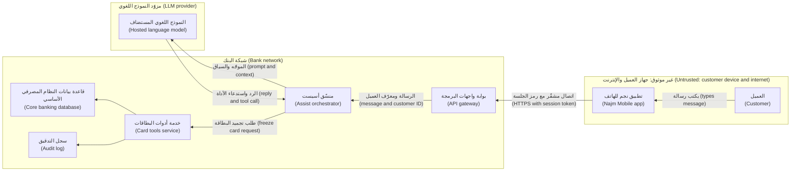
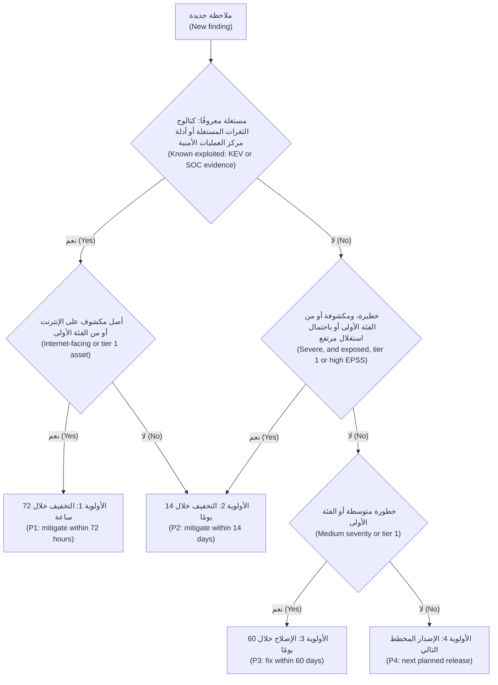

# الوحدة 1 — التفكير بعقلية المدافع

*المهاجمون لا يقرؤون وثائق التصميم الخاصة بك. إنهم يبحثون عن الموضع الذي وثقتَ فيه بشيءٍ ما كان ينبغي أن تثق به. تمنحك هذه الوحدة العادات الثلاث التي تعتمد عليها كل وحدة لاحقة. تحوّل نمذجة التهديدات (threat modelling) النظامَ إلى مخططٍ لتدفقات البيانات وحدود الثقة، ثم تسأل بصورةٍ منهجية عمّا قد يسوء عند كل عبور. وتضمن المبادئ الأمنية، وهي أقل الصلاحيات (least privilege) والدفاع المتعدد الطبقات (defence in depth) والإعدادات الافتراضية الآمنة وانعدام الثقة (zero trust)، ألّا يتحول خطأٌ برمجي واحد إلى اختراق حين يسوء شيءٌ فعلًا. ويحدد تقييم المخاطر ما يُصلَح أولًا حين تكون القائمة أطول من الوقت المتاح. ستتابع عليًّا خلال شهره الأول في فريق أمن التطبيقات والذكاء الاصطناعي في بنك نجم: ينمذج تهديدات أول أداة يستطيع نجم أسيست استدعاءها، ويعترض على حجم الوصول الذي ينبغي أن يحصل عليه المساعد، ويحوّل قائمةً متراكمة من 4,100 ملاحظة للماسحات إلى قائمةٍ قصيرة تستطيع نورة الدفاع عنها أمام حمد.*

> **المراحل:** Plan, Design, Build, Operate — رؤية النظام كما يراه المهاجم قبل بنائه، وتصميمه بحيث تبقى الإخفاقات صغيرة، وترتيب المخاطر بحيث يذهب الجهد إلى حيث يكون الضرر أرجح.

---

# 1.1 — نمذجة التهديدات: تدفقات البيانات وحدود الثقة وSTRIDE
*المستوى: 🟢 مبتدئ* · *المتطلبات: 0.1، 0.2* · *المرحلة: Plan, Design*

**بعد هذا الدرس تستطيع** أن ترسم مخطط تدفق بيانات (data flow diagram) تُحدَّد عليه كل حدود الثقة (trust boundary)، وتطبّق عليه STRIDE حتى يكون لكل عنصر تهديداته وإجراء تخفيف لكلٍّ منها. *مدة الدراسة: قراءة نحو 15 دقيقة، وعمل تطبيقي نحو 5 ساعة (تقدير).*

## ⚡ الدرس في دقيقة
- **نمذجة التهديدات (Threat modelling)** تفكيرٌ منظَّم فيما قد يسوء في نظامٍ ما *قبل بنائه أو تغييره*، كي تدخل الإصلاحات في التصميم لا في تقرير حادثة.
- تجيب عن أربعة أسئلة: *ماذا نعمل عليه؟ ما الذي قد يسوء؟ ماذا سنفعل حيال ذلك؟ هل أحسنّا العمل؟* وفق إطار آدم شوستاك.
- ابدأ **بمخطط تدفق البيانات**: من يتحدث إلى من، وأين تستقر البيانات، وأين تقع **حدود الثقة**. تعيش معظم التهديدات الخطيرة حيث تعبر البيانات حدًّا.
- استخدم **STRIDE**، أي انتحال الهوية (Spoofing) والعبث (Tampering) والإنكار (Repudiation) والإفصاح عن المعلومات (Information disclosure) وحجب الخدمة (Denial of service) ورفع الصلاحيات (Elevation of privilege)، قائمةَ تحقق عند كل عنصر وكل عبور.
- مؤشر القرار: طبّق نمذجة التهديدات (threat-model) على أي تغيير يضيف عبورًا لحدٍّ، أو مخزن بيانات، أو طرفًا ثالثًا، أو نوعًا جديدًا من المستخدمين، أو نموذجًا أو أداةً لوكيل.
- أكبر فخ: تهديداتٌ عامة مثل «المخترقين» و«حجب الخدمة الموزّع» بلا مخطط ولا مالك ولا اختبار. كل تهديدٍ مهم يحتاج إلى إجراء تخفيف ومالكٍ وفحص.

## 🧭 لماذا يهم
يوشك فريق طارق أن يمنح نجم أسيست أول أداةٍ حقيقية له: **تجميد البطاقة**. حتى الآن كان المساعد يجيب فقط عن الأسئلة من جدول الرسوم. وبدءًا من دورة العمل التالية (sprint)، يستطيع العميل أن يكتب «فقدتُ بطاقتي، جمّدها» فيستدعي المساعد خدمة البطاقات. تطلب نورة من علي، وقد مضت على التحاقه بالعمل ثلاثة أسابيع، أن ينمذج تهديداتها قبل مراجعة التصميم يوم الخميس.

كانت مسودة علي الأولى قائمة: «قد يهاجم المخترقون واجهة البرمجة. حجب الخدمة الموزّع. قد يهلوس الذكاء الاصطناعي. تسرّب البيانات.» كل بندٍ صحيحٌ على كل نظام، ولا يخبر أيٌّ منها طارق بما ينبغي أن يبنيه على نحوٍ مختلف. تعيدها نورة إليه: «ارسم كيف تنتقل الرسالة من إبهام العميل إلى النظام المصرفي الأساسي ثم تعود. ضع علامةً على كل نقطةٍ نفقد عندها القدرة على الوثوق بما يصل. ثم مُرّ على STRIDE عند كل واحدةٍ منها.»

تكشف المسودة الثانية مشكلاتٍ حقيقية. فهوية العميل لا تصل إلى خدمة البطاقات إلا حقلًا يكتبه النموذج اللغوي في استدعاء الأداة. ولا شيء يسجّل أن المساعد، لا نقرة العميل نفسه، هو من جمّد البطاقة. ورسالةٌ تقول «وجمّد أيضًا بطاقة أخي، المنتهية بـ 4411» ليست إلا نصًّا، وقد يتصرف النموذج بناءً عليها. إصلاح كل ذلك على السبّورة أرخص من إصلاحه بعد الإطلاق، ولهذا أدرجت قائمة OWASP Top 10 *التصميم غير الآمن* فئةً مستقلة منذ إصدارها لعام 2021، ولهذا يطلب إطار تطوير البرمجيات الآمنة (Secure Software Development Framework) الصادر عن NIST، أي SP 800-218، من الفرق استخدام نمذجة المخاطر، مثل نمذجة التهديدات، في أثناء التصميم.

## 📐 كيف يعمل

### 🟢 الأساسيات

**الأسئلة الأربعة.** صاغ آدم شوستاك العمل في أربعة أسئلة، عرضها أول مرة بكلماتٍ مختلفة قليلًا في كتابه *Threat Modeling: Designing for Security* عام 2014، ويبني عليها بيان نمذجة التهديدات لعام 2020. وهي بصيغتها الحالية:

1. **ماذا نعمل عليه؟** نموذجٌ للنظام، وعادةً ما يكون مخططًا.
2. **ما الذي قد يسوء؟** التهديدات، تُكتشف بصورةٍ منهجية، مثلًا باستخدام STRIDE.
3. **ماذا سنفعل حيال ذلك؟** لكل تهديد: التخفيف أو الإزالة أو النقل أو القبول.
4. **هل أحسنّا العمل؟** راجِع النموذج، وتحقّق من أن إجراءات التخفيف قد بُنيت وأنها تعمل.

تكفي سبّورةٌ والأشخاص الذين يعرفون النظام وساعةٌ واحدة لجولةٍ أولى.

**مخططات تدفق البيانات.** يبيّن **مخطط تدفق البيانات** كيف تتحرك البيانات عبر النظام، باستخدام خمسة أنواعٍ من العناصر:

| العنصر | ما يمثّله | مثال من نجم أسيست |
|---|---|---|
| **كيان خارجي (External entity)** | شخصٌ أو نظامٌ خارج سيطرتك | العميل؛ مزوّد النموذج اللغوي الكبير المستضاف |
| **عملية (Process)** | شيفرةٌ تحوّل البيانات أو تعمل عليها | منسّق أسيست؛ خدمة أدوات البطاقات |
| **مخزن بيانات (Data store)** | حيث تستقر البيانات | قاعدة بيانات النظام المصرفي الأساسي؛ سجل التدقيق |
| **تدفق بيانات (Data flow)** | بياناتٌ تتحرك بين العناصر | «رسالة محادثة»؛ «استدعاء أداة: تجميد البطاقة» |
| **حدّ الثقة (Trust boundary)** | خطٌّ يتغير عنده مستوى الثقة | من الإنترنت إلى شبكة البنك؛ من البنك إلى مزوّد النموذج اللغوي |

**حدّ الثقة** هو أي موضعٍ تنتقل فيه البيانات بين أجزاءٍ تعمل بصلاحياتٍ مختلفة، أو تنتمي إلى أطرافٍ مختلفة، أو تقوم على افتراضاتٍ مختلفة. هاتف العميل ليس ملكًا للبنك، ولا خوادم مزوّد النموذج اللغوي كذلك. والأهم في ميزات الذكاء الاصطناعي: **مخرجات النموذج ليست جديرةً بالثقة** رغم أن النموذج يعمل لصالحك، لأن نصًّا لا تتحكم فيه يشكّلها، كما في الدرس 8.2.

القاعدة المترتبة على ذلك: **كل تدفقٍ يعبر حدّ ثقةٍ يُفحَص في الجهة المستقبِلة.** من أرسله؟ تلك هي المصادقة (authentication). هل يُسمح له بذلك؟ ذلك هو التفويض (authorisation). هل هو سليم البنية وضمن الحدود؟ ذلك هو التحقق. هل ما نعيده آمن؟ تلك هي معالجة المخرجات.

**STRIDE.** ابتكر لورين كونفيلدر وبراريت غارغ نموذج STRIDE في مايكروسوفت عام 1999. كل حرفٍ فيه نوعٌ من التهديد يكسر خاصيةً أمنية واحدة:

| التهديد | الخاصية المكسورة | مثال من نجم أسيست | إجراء التخفيف المعتاد |
|---|---|---|---|
| انتحال الهوية | المصادقة | يحمل استدعاء الأداة معرّف عميل كتبه النموذج | الهوية (identity) من الجلسة الموثَّقة، لا من النموذج أبدًا |
| العبث | السلامة (Integrity) | يُعدَّل معرّف البطاقة بين التطبيق والبوابة | TLS؛ التحقق من جهة الخادم |
| الإنكار | عدم الإنكار (Non-repudiation) | «لم أجمّد تلك البطاقة قط»، والسجلات لا تستطيع إثبات أن ذلك تمّ عبر أسيست | سجل تدقيق يكشف العبث: من، وماذا، ومتى، وعبر أي قناة |
| الإفصاح عن المعلومات | السرية (Confidentiality) | تصل بطاقات عميلٍ آخر إلى سياق النموذج فيكررها | اجلب بيانات العميل المسجِّل دخوله فقط؛ وأرسل إلى النموذج الحد الأدنى |
| حجب الخدمة | التوافر (Availability) | رسائل طويلة جدًا ترفع تكاليف النموذج وتبطئ الخدمة | حدود الحجم؛ حدود المعدل (rate limits)؛ ميزانيات رموز لكل عميل |
| رفع الصلاحيات | التفويض | يُستدرَج أسيست إلى *إلغاء تجميد* بطاقة، وهو ما لم يُصمَّم لفعله قط | قائمة سماحٍ للأدوات: التجميد فقط؛ وإلغاء التجميد يتطلب إعادة المصادقة (re-authentication) في التطبيق |

STRIDE أداةُ تذكير، لا نظريةٌ كاملة للهجمات. وقيمته أنه يمنعك من نسيان فئاتٍ كاملة: يفكر المبتدئون في التسريبات والانقطاعات، وكثيرًا ما ينسون الإنكار.

**المُخرَج** وثيقةٌ قصيرة: المخطط؛ وقائمة التهديدات بحقول المعرّف، والعنصر أو التدفق، وفئة STRIDE، وإجراء التخفيف، والمالك، والحالة؛ وافتراضاتك؛ وقراراتك. يعرض قسم 🏛️ قالب بنك نجم.

### 🟡 التعمق أكثر

**STRIDE لكل عنصر (STRIDE per element).** لا ينطبق كل تهديدٍ على كل عنصر. وتربط إرشادات دورة حياة التطوير الآمن من مايكروسوفت، التي شاعت عبر كتاب شوستاك، بينها على هذا النحو:
- **الكيانات الخارجية:** انتحال الهوية والإنكار.
- **العمليات:** الستة جميعًا.
- **تدفقات البيانات:** العبث والإفصاح عن المعلومات وحجب الخدمة.
- **مخازن البيانات:** العبث والإفصاح عن المعلومات وحجب الخدمة، إضافةً إلى الإنكار إذا كان المخزن يحتفظ بالسجلات.

امشِ على المخطط عنصرًا عنصرًا واطرح الأسئلة ذات الصلة فقط. عندئذٍ يصبح كل سؤالٍ متجاوَز إما قرارًا مسجّلًا، مثل «لا ينطبق، لأن…»، وإما فجوةً ظاهرة.

**مخطط أداة تجميد البطاقة.** كل صندوقٍ منطقةُ ثقة. وكل سهمٍ يعبر حافة منطقةٍ يخضع لمراجعة STRIDE.



تبرز ثلاثة عبورات. **من التطبيق إلى البوابة** حدٌّ تقليدي للويب وواجهات البرمجة، تتناوله الوحدات 2 إلى 4. **من البنك إلى المزوّد** يثير أسئلة حماية البيانات التي تملكها سارة، مسؤولة حماية البيانات (DPO): أي بيانات العملاء تغادر البنك، وما الذي يحق للمزوّد الاحتفاظ به؟ **من النموذج إلى المنسّق** هو العبور الجديد: يحمل «الرد واستدعاء الأداة» تعليماتٍ من نموذجٍ قرأ نصًّا غير موثوق.

**حدود الثقة في الشيفرة.** أكثر أخطاء التصميم شيوعًا في أدوات الوكلاء هو الوثوق بقيمٍ عبرت حدّ النموذج:

```python
# VULNERABLE: identity and authority both come from the model's tool call
def freeze_card_tool(args: dict, session) -> str:
    card = cards.get(args["card_id"])
    if card.customer_id == args["customer_id"]:   # the model chose both the card and the customer
        cards.freeze(card.id)
        return "Card frozen"
    return "Not allowed"
```

```python
# FIXED: identity comes from the verified session; the model only names a card
def freeze_card_tool(args: dict, session) -> str:
    customer_id = session.customer_id                  # from the login token, not the model
    card = cards.get_for_customer(customer_id, args["card_id"])
    if card is None:
        return "I can't find that card on your account."
    if not session.has_confirmed("freeze", card.id):   # customer taps Confirm in the app
        return "Please confirm the freeze in the app."
    cards.freeze(card.id)
    audit.log(event="card.freeze", customer=customer_id, card=card.id, channel="assist")
    return "Card frozen."
```

يعالج الإصلاح ثلاثة صفوفٍ من STRIDE دفعةً واحدة: انتحال الهوية، إذ تأتي الهوية من الجلسة؛ ورفع الصلاحيات، إذ يقتصر الأمر على بطاقات العميل نفسه وبعد التأكيد فقط؛ والإنكار، عبر سجل تدقيقٍ يسمّي القناة.

**طرقٌ أخرى لاكتشاف التهديدات.**
- **أشجار الهجوم** (Bruce Schneier، 1999) تضع هدف المهاجم في الجذر، مثل «تجميد بطاقة عميلٍ آخر»، ثم تتفرع إلى الطرق الموصلة إليه.
- **حالات إساءة الاستخدام** قصص مستخدمين من جهة المهاجم: «بصفتي محتالًا، أريد أن يقرأ لي أسيست رصيد شخصٍ آخر». وتدخل مباشرةً في قائمة الأعمال المتراكمة.
- **LINDDUN**، من جامعة KU Leuven، يفعل للخصوصية ما يفعله STRIDE للأمن، بتهديداتٍ مثل *ربط* السجلات و*تحديد هوية* الأشخاص. ستطلبه سارة في الميزات المتعلقة بالبيانات الشخصية.
- **مكتبات التهديدات** مثل MITRE ATT&CK، ولأنظمة الذكاء الاصطناعي MITRE ATLAS، تتيح لك مطابقة إجاباتك مع ما فعله المهاجمون فعلًا، كما في الوحدة 8.

### 🔴 نظرة الخبير

**نمذِج تهديدات التغيير، لا الكون.** نموذجٌ لـ«البنك بأكمله» لا يكتمل أبدًا ولا يقرؤه أحد. نمذِج كل ميزةٍ أو تغيير في جلسةٍ قصيرة وقت التصميم، واحتفظ بمخططٍ واحد للنظام يحدّثه نموذج كل ميزة. محفّزات نورة: حدّ ثقةٍ جديد، أو مخزنٌ لبياناتٍ شخصية أو مالية، أو طرفٌ ثالث، أو صلاحيةٌ أو نوعُ مستخدمٍ جديد، أو نموذجٌ أو أداةٌ أو مصدرُ استرجاعٍ جديد.

**أبقِ النموذج مع الشيفرة.** خزّن المخطط وجدول التهديدات في المستودع، وراجع التغييرات في طلب السحب نفسه الذي يضم الشيفرة، واربط كل إجراء تخفيفٍ بتذكرته واختباره. وتناسب أدوات نمذجة التهديدات كشيفرة، مثل OWASP pytm وThreagile، الفرقَ التي تراجع كل شيءٍ كشيفرة.

**السؤال الرابع هو الذي تتجاوزه الفرق.** هل كان النموذج صحيحًا: هل راجعه من يبنون النظام ويشغّلونه؟ هل بُنيت إجراءات التخفيف؟ هل تعمل؟ يصبح كل تهديدٍ عالي المخاطر **حالةَ اختبارٍ أمني**: «يُرفض استدعاء الأداة الذي يسمّي بطاقة عميلٍ آخر» ويُشغَّل مع كل بناء.

**الذكاء الاصطناعي يغيّر المخطط.** ارسم **النموذج منطقةَ ثقةٍ مستقلة**. وارسم **كل مصدرٍ للنص** يقرؤه، لا المستخدم وحده: في مساعد مذكرات الائتمان، قد يحمل كل مستندٍ مسترجَع تعليماتٍ مخفية، وهذا حقن الموجّهات غير المباشر (indirect prompt injection) الذي يتناوله الدرسان 8.2 و9.3. ولكل أداة، اسأل: *ما أسوأ ما يمكن أن تفعله هذه الأداة إذا تحكّم المهاجم بالنموذج تحكمًا كاملًا؟* فإن كانت الإجابة غير مقبولة، فأصلح صلاحيات الأداة وأضف موافقةً بشرية؛ ولا تعتمد على الموجّه، كما في الدرس 9.2.

**الناس قبل المنهج.** أحضِر المهندس الذي كتب الشيفرة، وشخصًا يشغّلها، وشخصًا من فريق المنتج، وآخر من الأمن. وتسهّل ألعاب البطاقات، مثل Elevation of Privilege التي ألّفها آدم شوستاك وأصدرتها مايكروسوفت، وOWASP Cornucopia، الجلساتِ الأولى.

## 🧰 الأدوات
| الضابط أو المعيار أو الأداة | ما هو وماذا يفعل | متى تلجأ إليه |
|---|---|---|
| **Four-question framework** — إطار الأسئلة الأربعة، لشوستاك | ماذا نعمل عليه، وما الذي قد يسوء، وماذا سنفعل حياله، وهل أحسنّا العمل | تنظيم أي جلسةٍ لنمذجة التهديدات، من 30 دقيقة إلى مراجعةٍ كاملة |
| **Data flow diagram** — مخطط تدفق البيانات | الكيانات والعمليات والمخازن والتدفقات وحدود الثقة في صفحةٍ واحدة | الخطوة الأولى في كل نموذج تهديدات؛ ويُحدَّث عند تغيّر النظام |
| **STRIDE** — لكونفيلدر وغارغ في مايكروسوفت | ستة أنواعٍ من التهديدات، كلٌّ منها مرتبطٌ بالخاصية الأمنية التي يكسرها | طرح سؤال «ما الذي قد يسوء؟» بصورةٍ منهجية عند كل عنصرٍ وعبور |
| **Attack trees** — أشجار الهجوم، لشناير | هدف المهاجم مفكَّكًا إلى الطرق الموصلة إليه | تحليلٌ معمّق لهدفٍ واحد عالي القيمة، مثل تحويل الأموال |
| **LINDDUN** — من جامعة KU Leuven | فئات تهديدات الخصوصية مطبَّقةً على تدفقات البيانات | الميزات المبنية حول البيانات الشخصية، بالتعاون مع مسؤول حماية البيانات |
| **OWASP Threat Dragon** — أداة OWASP لرسم التهديدات | أداةٌ مجانية مفتوحة المصدر لرسم مخططات تدفق البيانات (DFDs) وتسجيل التهديدات | مخططٌ مشترك ذو إصدارات دون أداةٍ تجارية |

## 🏛️ عمليًا في بنك نجم
تصبح مسودة علي الثانية **TM-ASSIST-004: أداة «تجميد البطاقة» في نجم أسيست**، وتجعل نورة صيغتها معيارًا للفريق.

**الترويسة.** *النطاق:* يطلب العميل من أسيست تجميد بطاقة؛ فيستدعي أسيست خدمة أدوات البطاقات. *خارج النطاق:* إلغاء التجميد، الذي يبقى في التطبيق خلف إعادة مصادقةٍ قوية. *الافتراضات:* تتحقق البوابة من رموز الجلسات (session tokens)؛ ولا يحتفظ مزوّد النموذج اللغوي بالموجّهات (prompts) مدةً أطول مما يسمح به العقد، وعلى سارة التأكيد. *المشاركون:* طارق، وعلي، ونورة، ومالك المنتج التابع لرانيا، وجاسم. *المخطط:* الإصدار الثالث من مخطط تدفق البيانات في المستودع.

| المعرّف | العنصر أو التدفق | STRIDE | التهديد | إجراء التخفيف | المالك | يُتحقَّق منه عبر |
|---|---|---|---|---|---|---|
| T1 | النموذج ← المنسّق | S, E | يسمّي استدعاء الأداة بطاقةً أو عميلًا غير العميل المسجِّل دخوله | معرّف العميل من الجلسة؛ ويجب أن تعود البطاقة إلى ذلك العميل | طارق | اختبار: تُرفض بطاقة عميلٍ آخر |
| T2 | المنسّق ← أدوات البطاقات | E | يُستدرَج النموذج إلى استدعاء أداةٍ ما كان ينبغي أن تُتاح له | قائمة السماح (allow-list) تضم `freeze_card` والأدوات المخصصة للقراءة فقط لا غير | طارق | اختبار: لا يمكن الوصول إلى `unfreeze` |
| T3 | أدوات البطاقات ← النظام المصرفي الأساسي | R | يعترض العميل على التجميد؛ ولا دليل على القناة | حدث تدقيق: العميل، والبطاقة، والقناة، ومعرّف التأكيد، والوقت | طارق | عيّنة سجلات يراجعها جاسم |
| T4 | المنسّق ← مزوّد النموذج اللغوي | I | تصل أرقام البطاقات الكاملة أو بيانات عملاء آخرين إلى المزوّد | أرسل آخر أربعة أرقام وبيانات العميل المسجِّل دخوله فقط | سارة، طارق | عيّنة من سجل الموجّهات |
| T5 | التطبيق ← البوابة | D | سيولٌ من الرسائل الطويلة تستنزف ميزانية النموذج | حدٌّ قدره 2,000 حرف؛ وحدود للمعدل والرموز لكل عميل | طارق | اختبار حمل في بيئة التجهيز (staging) |
| T6 | النموذج ← المنسّق | T, E | تعليماتٌ إضافية في رسالة: «وجمّد البطاقة 4411 أيضًا» | شاشة تأكيد مبنية من بيانات الخادم تعرض البطاقة بعينها | مالك المنتج | حالةٌ للفريق الأحمر من فريق مريم |

**القرارات المسجّلة.** يبقى إلغاء التجميد خارج أسيست: هذا خطرٌ جرى تجنّبه لا تخفيفه. وتقبل رانيا المخاطر المتبقية في T6 إلى حين جولة الفريق الأحمر لدى مريم، مع تاريخ انتهاء. ويُعاد فتح النموذج كلما أُضيفت أداة.

## 🛠️ التمارين
- 🟢 ارسم مخطط تدفق بيانات (DFD) لتطبيقٍ بنيته بنفسك، أو لتطبيقٍ تدريبي معرَّض للثغرات عمدًا يعمل على جهازك، مثل OWASP Juice Shop. ضمّنه أنواع العناصر الخمسة كلها وحدّد كل حدّ ثقة. *يكتمل عندما:* يُدرَج كل سهمٍ يعبر حدًّا مع ما تفحصه الجهة المستقبِلة، أو «لا شيء بعد».
- 🟡 تتيح بوابة الشركات الصغيرة في بنك نجم لمستخدم الشركة رفع فاتورةٍ بصيغة PDF. تُخزَّن في مخزن كائنات، وتُفحَص بحثًا عن الفيروسات، ثم يقرؤها محلّلٌ يملأ المبالغ. ارسم مخطط تدفق البيانات وطبّق STRIDE لكل عنصر. *يكتمل عندما:* يكون لديك 12 تهديدًا على الأقل، واحدٌ على الأقل لكل فئةٍ من فئات STRIDE، لكلٍّ منها إجراء تخفيف والعنصر الذي يؤثر فيه.
- 🔴 في شيفرتك أو في مختبرٍ محلي، ابنِ ميزةً صغيرة تعتمد على نموذجٍ لغوي كبير بأداةٍ واحدة، أو أعد استخدام واحدة، مثل مساعد مهام يستطيع حذف العناصر. نمذِج تهديدات الحدّ بين النموذج والأداة، ثم اكتب اختباراتٍ آلية لأخطر ثلاثة تهديدات وشغّلها. ومختبر البداية `secai/lab/` ميزة جاهزة من هذا النوع: أداته `freeze_card` وملف `test_assist.py` نقطة انطلاق. *يكتمل عندما:* يرسل كل اختبارٍ استدعاء أداةٍ خبيثًا، مثل حذف عنصرٍ يخص مستخدمًا آخر، وينجح لأن شيفرتك ترفضه، لا لأن النموذج اختار ألّا يجري الاستدعاء.

## ⚠️ أخطاء وفخاخ
- **قائمةٌ بلا مخطط.** التهديدات العامة لا تغيّر شيئًا. ارسم التدفقات والحدود أولًا، ثم ابحث عن التهديدات عند كل عبور.
- **الوثوق بداخل الشبكة.** عبارة «إنه داخلي» افتراضٌ، لا ضابط. حدّد الحدود الداخلية أيضًا.
- **معاملة النموذج جزءًا من شيفرتك.** مخرجات النموذج تعبر حدّ ثقة. تحقّق منها وفوّضها كما تفعل مع طلبٍ قادم من الإنترنت.
- **محاولة الإحاطة بكل شيء.** نموذجٌ للبنية بأكملها لا ينتهي أبدًا. نمذِج كل تغيير؛ وأبقِ مخططًا واحدًا للنظام محدَّثًا.
- **لا مالك، ولا اختبار، ولا مراجعة لاحقة.** إجراء التخفيف بلا مالكٍ واختبار مجرد أمنية. أغلق الحلقة بالسؤال الرابع، وأعد فتح النموذج حين ينطلق محفّز.

## 🧾 الخلاصة
- تجيب نمذجة التهديدات عن أربعة أسئلة: ماذا نعمل عليه، وما الذي قد يسوء، وماذا سنفعل حياله، وهل أحسنّا العمل.
- مخطط تدفق البيانات مع حدود الثقة هو الأساس. وكل تدفقٍ يعبر حدًّا يفحصه المستقبِل.
- يربط STRIDE ستة أنواعٍ من التهديدات بست خصائص أمنية. طبّقه لكل عنصر.
- في ميزات الذكاء الاصطناعي، النموذج منطقة ثقةٍ قائمة بذاتها: مخرجاته مدخلاتٌ غير موثوقة للأدوات والأنظمة اللاحقة.
- يكتمل نموذج التهديدات عندما يكون لكل تهديدٍ مهم إجراء تخفيفٍ ومالكٌ واختبار، وحين يعيش مع الشيفرة.

## ✍️ اختبر نفسك

**1. يسرد أول نموذج تهديدات أعدّه علي لأداة تجميد البطاقة «المخترقين» و«حجب الخدمة الموزّع» و«هلوسة الذكاء الاصطناعي» و«تسرّب البيانات». ما الخطوة التالية الأكثر فائدة؟**

- A. إضافة تهديداتٍ من قائمةٍ عامة حتى يبلغ عددها 50 على الأقل، كي لا تفوتنا فئةٌ شائعة أبدًا
- B. رسم مخطط تدفق البيانات مع حدود الثقة، ثم تطبيق STRIDE على كل عنصرٍ وعبور
- C. مطالبة مزوّد النموذج اللغوي بشهادته الأمنية
- D. منح كل تهديدٍ مدرج درجةً باستخدام CVSS

<details><summary>الإجابة</summary>

**B.** من دون مخطط تبقى التهديدات عامة. يبيّن مخطط تدفق البيانات أين تتغير الثقة، ويكتشف STRIDE تهديداتٍ محددة هناك. يضيف الخيار A كمًّا لا فهمًا؛ ويقيّم D تهديداتٍ أغمض من أن تُقيَّم. انظر: 🟢 الأساسيات؛ 🧭 لماذا يهم.

</details>

**2. تقول عميلةٌ إنها لم تجمّد بطاقتها قط. ولا يستطيع الفريق معرفة ما إذا جُمّدت عبر نجم أسيست، أم زر التطبيق، أم موظف مركز الاتصال. إلى أي فئةٍ من فئات STRIDE تنتمي هذه الفجوة؟**

- A. انتحال الهوية
- B. العبث
- C. الإنكار
- D. حجب الخدمة

<details><summary>الإجابة</summary>

**C.** الإنكار يعني أن شخصًا يستطيع إنكار فعلٍ ولا تستطيع أنت إثبات العكس. وإجراء التخفيف هو سجل تدقيق يبيّن من فعل ماذا، ومتى، وعبر أي قناة. أما انتحال الهوية (A) فيعني أن شخصًا يتظاهر بأنه هي. انظر: 🟢 الأساسيات.

</details>

**3. يتضمن استدعاء الأداة الذي يصدره النموذج كلًّا من `card_id` و`customer_id`، وتتحقق الأداة من أن البطاقة تعود إلى ذلك `customer_id`. لماذا تبقى هذه مشكلة؟**

- A. ينبغي أن يقارن الفحص تاريخ انتهاء صلاحية البطاقة بدلًا من مالكها، لأن البطاقات المنتهية أكثر علامات إساءة الاستخدام شيوعًا
- B. لا مشكلة في ذلك، لأن النموذج أُعطي معرّف العميل الصحيح في موجّهه ولا سبب لديه لأن يمرّر معرّفًا آخر
- C. ينبغي أن تُسقط الأداة فحص الملكية لتبقى سريعة، لأن النموذج موثوق أصلًا في اختيار بطاقة العميل نفسه
- D. جاءت القيمتان كلتاهما من النموذج، فلا يثبت الفحص إلا أن قيمتين اختارهما النموذج متطابقتان؛ ويجب أن يأتي معرّف العميل من الجلسة

<details><summary>الإجابة</summary>

**D.** يوجّه النص غير الموثوق مخرجات النموذج، لذا يستطيع نموذجٌ موجَّه أن يسمّي بطاقة عميلٍ آخر مع معرّف ذلك العميل، فينجح الفحص. يجب أن تأتي الهوية من الجلسة (session)؛ والنموذج يسمّي البطاقة فقط. ويفترض الخيار B أن النموذج يكرر دائمًا ما قيل له. انظر: 🟡 التعمق أكثر.

</details>

**4. باستخدام STRIDE لكل عنصر، ما أنواع التهديدات التي تُراعى عادةً لتدفق بيانات، مثل السهم من منسّق أسيست إلى مزوّد النموذج اللغوي؟**

- A. انتحال الهوية والإنكار
- B. العبث والإفصاح عن المعلومات وحجب الخدمة
- C. الستة جميعًا
- D. رفع الصلاحيات فقط، لأن الخمسة الأخرى لا تنطبق على الأسهم بين المكوّنات

<details><summary>الإجابة</summary>

**B.** يمكن تعديل تدفق البيانات أو قراءته أو حجبه. وينطبق انتحال الهوية والإنكار على الكيانات الخارجية والعمليات؛ أما الستة جميعًا (C) فتنطبق على العمليات. انظر: 🟡 التعمق أكثر.

</details>

**5. بعد ثلاثة أشهرٍ من الإطلاق، تسأل نورة عن نموذج تهديدات تجميد البطاقة: «هل أحسنّا العمل؟» ماذا تتضمن الإجابة القوية؟**

- A. دليلًا على بناء كل إجراء تخفيفٍ عالي المخاطر واختباره، وعلى أن النموذج يعكس التغييرات منذ الإطلاق
- B. بيانًا من مورّد النموذج يؤكد أن نموذجه آمن، فمن يملك النموذج هو الأقدر على الحكم
- C. عدد التهديدات التي اكتُشفت في الجلسة الأصلية، فكلما زاد العدد دلّ ذلك على جودة العمل في الجلسة
- D. تأكيدًا على أن الوثيقة قد اعتُمدت رسميًا ووُقّعت من الجهات المعنية قبل الإطلاق بوقت كافٍ

<details><summary>الإجابة</summary>

**A.** يسأل السؤال الرابع عمّا إذا كان النموذج صحيحًا، وعمّا إذا كانت إجراءات التخفيف موجودةً وتعمل. أما عدّ التهديدات (C) أو الموافقات (D) فيقيس النشاط لا الحماية. انظر: 🔴 نظرة الخبير.

</details>

## 📚 المراجع
- شوستاك عام 2014، كتاب *Threat Modeling: Designing for Security*، دار Wiley
- بيان نمذجة التهديدات، 2020 — https://www.threatmodelingmanifesto.org
- ورقة OWASP المختصرة لنمذجة التهديدات — https://cheatsheetseries.owasp.org/cheatsheets/Threat_Modeling_Cheat_Sheet.html
- أداة OWASP Threat Dragon — https://owasp.org/www-project-threat-dragon/
- قائمة OWASP Top 10، فئة التصميم غير الآمن — https://owasp.org/Top10/
- وثيقة NIST SP 800-218، إطار تطوير البرمجيات الآمنة، الإصدار 1.1؛ وكانت مراجعةٌ للإصدار 1.2 قيد المسودة وقت الكتابة عام 2026، فتحقّق من الإصدار الحالي — https://csrc.nist.gov/pubs/sp/800/218/final
- شناير عام 1999، مقالة «أشجار الهجوم»، مجلة *Dr. Dobb's Journal*، ديسمبر 1999
- منهجية LINDDUN لنمذجة تهديدات الخصوصية — https://linddun.org
- إطار MITRE ATLAS — https://atlas.mitre.org

---

# 1.2 — المبادئ الأمنية: أقل الصلاحيات، والدفاع المتعدد الطبقات، والإعدادات الافتراضية الآمنة، وانعدام الثقة
*المستوى: 🟢 مبتدئ* · *المتطلبات: 1.1* · *المرحلة: Design, Build*

**بعد هذا الدرس تستطيع** أن تحوّل بيانات اعتماد مشروعٍ إلى جدول يقارن الممنوح بالمطلوب، وتعيد كتابة فحص وصول ليفشل مغلقًا، مع اختبار يثبت رفض الوصول عند تعطّل الفحص. *مدة الدراسة: قراءة نحو 15 دقيقة، وعمل تطبيقي نحو 5 ساعة (تقدير).*

## ⚡ الدرس في دقيقة
- المبادئ الأمنية قواعد تصميم تظل فاعلةً حين لا تستطيع التنبؤ بالهجوم المحدد. يعود معظمها إلى ورقةٍ نشرها سالتزر وشرودر عام 1975، وما زالت هذه المبادئ تحدد ما إذا كان خطأٌ برمجي واحد سيتحول إلى اختراق.
- **أقل الصلاحيات (Least privilege):** كل شخصٍ وخدمةٍ ورمزٍ مميز (token) ووكيل ذكاءٍ اصطناعي يحصل فقط على الوصول الذي يحتاجه، وللمدة التي يحتاجها فقط.
- **الدفاع المتعدد الطبقات (Defence in depth):** عدة طبقاتٍ مستقلة، بحيث لا يكفي إخفاقٌ واحد. **الإعدادات الافتراضية الآمنة:** ارفض ما لم يُسمح به صراحةً، وأخفِق بالإغلاق حين ينكسر فحصٌ ما.
- **انعدام الثقة (Zero trust):** لا يُوثَق بأي طلبٍ بسبب مصدره في الشبكة؛ فكل طلبٍ تتم مصادقته وتفويضه، وفق NIST SP 800-207.
- مؤشر القرار: اسأل «إذا اختُرق هذا المكوّن أو أخفق هذا الفحص، فإلى أي مدى يمكن أن ينتشر الضرر، وما الذي يوقفه؟»
- أكبر فخ: منح خدمةٍ جديدة أو وكيل ذكاءٍ اصطناعي وصولًا واسعًا «مؤقتًا». نادرًا ما يُسترَد وصول الراحة، ويمكن توجيه وكيلٍ يملك وصولًا واسعًا بالنص إلى إساءة استخدامه.

## 🧭 لماذا يهم
تذكّر سلسلة Capital One من الدرس 0.2، ولكن هذه المرة من زاوية الصلاحيات. فثغرة جدار الحماية وحدها، وهي تزوير الطلبات من جهة الخادم، انظر 2.3، فتحت للمهاجم طريقًا إلى **خدمة البيانات الوصفية للمثيل (instance metadata service)** لدى مزوّد السحابة، فسلّمت بيانات اعتمادٍ مؤقتة للدور الخاص بجدار الحماية. أما الضرر فجاء من ذلك الدور: كان قادرًا على سرد وقراءة كثيرٍ من حاويات التخزين التي لا حاجة لجدار حمايةٍ إلى قراءتها. وقال البنك لاحقًا إن بيانات نحو 100 مليون شخص في الولايات المتحدة و6 ملايين في كندا أُخذت؛ ولو اقتصر الدور على عمل جدار الحماية، لما وجدت بيانات الاعتماد المسروقة إلا القليل لتقرأه.

لم يتسبب في ذلك عيبٌ غريب واحد. فقد كان الدور أوسع من مهمته، وهذا يخص **أقل الصلاحيات**. وكانت خدمة البيانات الوصفية (metadata service) في ذلك الوقت تجيب عن الطلبات البسيطة دون إثباتٍ إضافي، وهذا يخص **الإعدادات الافتراضية الآمنة**؛ وقد قدّمت AWS إصدارًا يعتمد على رمز الجلسة، هو IMDSv2، في وقتٍ لاحق من عام 2019. وأدى مكوّنٌ واحد مخترَق مباشرةً إلى بياناتٍ بالجملة، وهذا يخص **الدفاع المتعدد الطبقات**. غيِّر أيًّا منها، وتصبح النتيجة أصغر.

والآن إلى بنك نجم. يقترح طارق أن يعيد حساب الخدمة الخاص بنجم أسيست استخدام نطاق واجهة البرمجة الخاص بالواجهة الخلفية للتطبيق المحمول «حتى لا نضطر إلى إعادة التوصيل لكل أداةٍ جديدة». إنه أسرع، لكنه سيمنح نموذجًا يستطيع العملاء توجيهه بالنص القدرةَ على قراءة حسابات أي عميل وبدء التحويلات. ردّ نورة: «أخبرني بما يجب أن يستطيع أسيست فعله. سيحصل على ذلك بالضبط، ولا شيء غيره.»

## 📐 كيف يعمل

### 🟢 الأساسيات

في عام 1975، نشر جيروم سالتزر ومايكل شرودر ورقة «حماية المعلومات في أنظمة الحاسوب». وما زالت مبادئ التصميم الثمانية فيها، وهي الاقتصاد في الآلية (economy of mechanism)، والإعدادات الافتراضية الآمنة من الإخفاق، والوساطة الكاملة، والتصميم المفتوح (open design)، وفصل الصلاحيات، وأقل الصلاحيات، وأقل آليةٍ مشتركة، والقبول النفسي (psychological acceptability)، العمودَ الفقري للتصميم الآمن. وإليك أكثرها استخدامًا لدى البنّائين، إضافةً إلى ثلاث إضافاتٍ لاحقة:

| المبدأ | المعنى المبسّط | مخالفةٌ نموذجية |
|---|---|---|
| **أقل الصلاحيات (Least privilege)** | الوصول المطلوب فقط، وللمدة المطلوبة فقط | حساب مسؤولٍ واحد تتشاركه كل التطبيقات |
| **الدفاع المتعدد الطبقات (Defence in depth)** | طبقاتٌ مستقلة، فلا يكون إخفاقٌ واحد قاتلًا | «جدار الحماية يحميه»، ولا شيء خلفه يتحقق |
| **الإعدادات الافتراضية الآمنة من الإخفاق (Fail-safe defaults)** | ارفض ما لم يُسمح به صراحةً؛ آمنٌ منذ التشغيل الأول | وضع التصحيح أو كلمات مرورٍ افتراضية تُشحن «مؤقتًا» |
| **الإخفاق الآمن (Fail securely)** | حين يقع خطأٌ في فحصٍ ما، تكون الإجابة «لا» | `except: allow` |
| **الوساطة الكاملة (Complete mediation)** | تحقّق من الصلاحية في كل وصول | علامة «مسؤول» مخزّنة مؤقتًا يوثَق بها لساعات |
| **فصل الصلاحيات (Separation of privilege)** | الإجراءات عالية المخاطر تتطلب شرطين أو شخصين | مهندسٌ واحد يغيّر شيفرة الدفع وينشرها وحده |
| **تقليص سطح الهجوم (Minimise attack surface)** | نقاط دخولٍ أقل للدفاع عنها | نقاط نهايةٍ اختبارية منسية تعمل في بيئة الإنتاج |
| **الاقتصاد في الآلية (Economy of mechanism)** | أبقِ شيفرة الأمن صغيرةً بما يكفي لمراجعتها | خمسة فحوصٍ مكتوبة يدويًا متعارضة |
| **التصميم المفتوح (Open design)** | لا اعتماد على جهل المهاجمين بالتصميم | «لا أحد يعرف عنوان صفحة الإدارة هذا» |
| **القبول النفسي (Psychological acceptability)** | الأمن الصعب جدًا يُتجاوَز | قواعد مؤلمة إلى حدّ أن الموظفين يتشاركون كلمات المرور |

يطبّق قسم 🏛️ معظمها على نجم أسيست. وأربعةٌ منها تؤدي معظم العمل اليومي.

**أقل الصلاحيات** تحدّ مما يكسبه المهاجم من أي اختراقٍ منفرد. طبّقها على الأشخاص، والخدمات، والرموز المميزة (tokens)، وأدوار السحابة، ومستخدمي قواعد البيانات، وخطوط التسليم (pipelines)، ووكلاء الذكاء الاصطناعي، وفي الزمن كما في النطاق: فالوصول المطلوب لساعةٍ ينبغي أن ينتهي بعد ساعة، وهذا هو **الوصول في الوقت المناسب**.

```sql
-- VULNERABLE: Assist's database user can read and change everything
GRANT ALL PRIVILEGES ON ALL TABLES IN SCHEMA core TO assist_svc;

-- FIXED: no table access; two functions that check card ownership inside
-- (SECURITY DEFINER functions owned by a separate role, each with a fixed search_path)
REVOKE ALL ON ALL TABLES IN SCHEMA core FROM assist_svc;
REVOKE EXECUTE ON ALL FUNCTIONS IN SCHEMA core FROM PUBLIC;  -- PostgreSQL lets everyone run functions by default
ALTER DEFAULT PRIVILEGES IN SCHEMA core REVOKE EXECUTE ON FUNCTIONS FROM PUBLIC;  -- and future ones
GRANT EXECUTE ON FUNCTION core.list_my_cards(uuid) TO assist_svc;
GRANT EXECUTE ON FUNCTION core.freeze_card(uuid, uuid) TO assist_svc;
```

سطرا `FROM PUBLIC` هما نفساهما درسٌ في الإعدادات الافتراضية الآمنة: تحقّق مما تسمح به منصتك افتراضيًا، للكائنات الموجودة وللجديدة منها.

**الدفاع المتعدد الطبقات** يفترض أن كل طبقةٍ ستُخفق أحيانًا. ويجب أن تكون الطبقات **مستقلة**: فحصان يثق كلاهما بمعرّف العميل نفسه القادم من النموذج طبقةٌ واحدة، لا طبقتان.

**الإعدادات الافتراضية الآمنة والإخفاق بالإغلاق.** تعمل معظم الأنظمة بإعداداتها الافتراضية، لذا يجب أن تكون الحالة الآمنة هي ما تحصل عليه حين لا تفعل شيئًا، ويجب أن تنتهي الأخطاء إلى «الرفض».

```python
# VULNERABLE: fails open; any error in the policy service grants access
def can_view_invoice(user, invoice) -> bool:
    try:
        return policy.check(user, "invoice:read", invoice)
    except Exception:
        return True   # "don't block customers if the policy service is slow"
```

```python
# FIXED: fails closed, and the failure is visible
def can_view_invoice(user, invoice) -> bool:
    try:
        return policy.check(user, "invoice:read", invoice) is True
    except Exception:
        log.warning("policy check failed; denying", extra={"user": user.id, "invoice": invoice.id})
        metrics.increment("authz.fail_closed")
        return False
```

يحمي `is True` من فحصٍ يُرجع شيئًا يُقيَّم «صحيحًا» لكنه ليس قرارًا، مثل كائن خطأ. وللإخفاق بالإغلاق كلفة، إذ لا فواتير ما دامت خدمة السياسات متوقفة؛ عالج ذلك بالتكرار الاحتياطي، لا بإيقاف الأمن.

**انعدام الثقة.** كانت الشبكات التقليدية تثق بكل ما هو داخل المحيط: نموذج «القلعة والخندق». أما **انعدام الثقة**، كما عرّفه NIST SP 800-207 عام 2020، فيُسقط هذا الافتراض. لا يحصل أي مستخدمٍ أو جهازٍ أو خدمةٍ على ثقةٍ ضمنية من موقعه في الشبكة؛ فكل طلبٍ إلى مورد تتم مصادقته وتفويضه، باستخدام سياسةٍ يمكنها أن تزن الهوية وسلامة الجهاز والسياق. وبالنسبة لفريق تطبيقات، تصادق الخدمات بعضها على بعض، مثلًا عبر TLS المتبادل (mutual TLS)، حتى داخل العنقود، ويُفوَّض كل استدعاءٍ للمورد المحدد، و**تفترض وقوع الاختراق**: صمّم كأن المهاجم في الداخل فعلًا، وقيّد ما يمكنه الوصول إليه.

### 🟡 التعمق أكثر

**الدفاع المتعدد الطبقات لإجراءٍ واحد.** تحمي هذه الطبقات إجراء «جمّد بطاقتي» في نجم أسيست. وكلٌّ منها ضابطٌ منفصل يستطيع وحده إيقاف تجميدٍ خاطئ:

```mermaid
flowchart RL
    A["رسالة العميل<br/>(Customer message)"] --> B["الحافة: تشفير النقل وجدار حماية التطبيقات وحدود المعدل<br/>(Edge: TLS, WAF, rate limits)"]
    B --> C["المصادقة: جلسة وجهاز صالحان<br/>(Authentication: valid session and device)"]
    C --> D["سياسة الأدوات: التجميد فقط، ولا إلغاء تجميد أو دفع أبدًا<br/>(Tool policy: freeze only, never unfreeze or pay)"]
    D --> E["التفويض: البطاقة تعود إلى هذا العميل<br/>(Authorisation: card belongs to this customer)"]
    E --> F["تأكيد يُعرض في التطبيق<br/>(Confirmation shown in the app)"]
    F --> G["خدمة البطاقات بحقوق قاعدة بيانات بأقل الصلاحيات<br/>(Card service with least-privilege database rights)"]
    G --> H["سجل التدقيق وتنبيه مركز العمليات الأمنية عند حجم غير معتاد<br/>(Audit log and SOC alert on unusual volume)"]
```



نموذج «الجبن السويسري» للحوادث، الذي وضعه جيمس ريزن، هو الصورة المعيارية: لكل طبقةٍ ثقوب، ولا يمر الضرر إلا حين تصطف الثقوب. والاستقلالية تمنعها من الاصطفاف. فإذا أخذ فحص التفويض وشاشة التأكيد وسجل التدقيق جميعها معرّف البطاقة من مخرجات النموذج دون مقارنته بالجلسة (session)، فإن استدعاء أداةٍ واحدًا متلاعبًا به يمر عبر الثلاثة.

**انعدام الثقة في المعمارية.** يصف SP 800-207 **نقطة قرار السياسة**، التي تقرر ما إذا كان الطلب مسموحًا، و**نقطة إنفاذ السياسة**، التي تقع في مسار الطلب وتطبّق ذلك القرار. في بنك نجم، تتولى بوابة واجهات البرمجة (API gateway) وخادمٌ وسيط أمام كل خدمةٍ الإنفاذَ؛ وتتولى خدمة التفويض المركزية القرار. وينظّم نموذج نضج انعدام الثقة (Zero Trust Maturity Model) الصادر عن CISA، في إصداره 2.0 لعام 2023، الرحلةَ في خمس ركائز، هي الهوية، والأجهزة، والشبكات، والتطبيقات وأحمال العمل، والبيانات، وفي مراحل من «تقليدي» إلى «مثالي». انعدام الثقة اتجاهٌ للسير، لا منتج. واحذر ممن يبيعه في صندوق.

**أقل الصلاحيات عمليًا.** تتراكم الصلاحيات بمرور الوقت، وهذا هو **زحف الصلاحيات**. الأدوات العملية:
- **ابدأ من الصفر** وأضف الصلاحيات كلما فشلت الاختبارات، بدلًا من البدء على نطاقٍ واسع ثم التقليص.
- **حدّد النطاق بالمورد والإجراء**: «تجميد بطاقات العميل المسجِّل دخوله»، لا «واجهة البطاقات: وصولٌ كامل».
- **بيانات اعتمادٍ قصيرة العمر** لكل حمل عمل بدلًا من المفاتيح طويلة العمر، كما في الدرس 5.2.
- **رفع الصلاحيات في الوقت المناسب** للأشخاص: ساعتان من الوصول إلى بيئة الإنتاج، بموافقةٍ وتسجيل، ثم ينتهي. واحتفظ بحساب **كسر الزجاج** للطوارئ، مختبَرًا ومراقَبًا عن كثب.
- **مراجعات الوصول** و**تقارير الصلاحيات غير المستخدمة** من أدوات مزوّد السحابة لديك.

**آمنٌ بالتصميم.** منذ عام 2023، نشرت CISA ووكالاتٌ شريكة في عدة دول إرشادات «آمن بالتصميم» التي تحث صانعي البرمجيات على شحن منتجاتٍ آمنة منذ التشغيل الأول: لا كلمات مرورٍ افتراضية، والمصادقة متعددة العوامل (multi-factor authentication) مفعّلةٌ افتراضيًا، وسجلات الأمن بلا كلفةٍ إضافية. واختبارٌ مفيد لأي فريق منصة: هل كنا سنشحن هذا للعملاء بإعداداتنا الافتراضية الحالية؟

**وكلاء البرمجة بالذكاء الاصطناعي يحتاجون إلى القواعد نفسها.** يستخدم مطورو بنك نجم وكلاء برمجةٍ بالذكاء الاصطناعي يستطيعون تشغيل أوامر الطرفية. شغّلهم في بيئةٍ معزولة (sandbox) لا تطالها أي بيانات اعتمادٍ للإنتاج، مع قائمة سماحٍ قصيرة بالأوامر التي تعمل دون موافقة، ومراجعةٍ بشرية قبل الدمج، كما في الدرس 6.3. فالوكيل الذي يملك صلاحياتك الكاملة يمكن توجيهه بتعليمةٍ مخفية في ملفٍ يقرؤه.

### 🔴 نظرة الخبير

**النائب المرتبك (The confused deputy).** وصفت ورقة نورم هاردي عام 1988 برنامجًا يملك صلاحيةً لغرضٍ ما فخُدع لاستخدامها لصالح شخصٍ آخر. ووكلاء الذكاء الاصطناعي نوّابٌ مرتبكون بطبيعة بنائهم: يتصرفون ببيانات اعتماد (credentials)، نيابةً عن مستخدم، موجَّهين بنصٍ قد يأتي من طرفٍ ثالث. والإصلاح أن يحمل الوكيل **صلاحية المستخدم**، لا صلاحيته الخاصة. يُفوَّض كل استدعاء أداةٍ على أنه «هذا العميل، عبر أسيست»، برموزٍ مميزة مفوَّضة وضيقة النطاق وقصيرة العمر؛ وتبادل الرموز في OAuth 2.0 (OAuth 2.0 Token Exchange)، المعرَّف في RFC 8693، أحد هذه الأنماط، كما في الدرس 3.2. عندها لا يستطيع الوكيل أبدًا أن يفعل أكثر مما يستطيعه المستخدم. ويطبّق الدرس 9.2 ذلك على تصميم الأدوات وMCP.

**المبادئ تتعارض، والحكم يفصل بينها.** تضيف الطبقات الإضافية تعقيدًا، والتعقيد يولّد الأخطاء. وأقل الصلاحيات الصارمة تبطئ الفرق وتستدعي الالتفافات. والإخفاق بالإغلاق قد يضر بالتوافر. سمِّ المفاضلة في مراجعة التصميم واحسم الأمر بنطاق الضرر: كلما زادت قدرة الإجراء على إيذاء العملاء أو تحريك الأموال، زاد ما يستحقه من احتكاك.

**النموذج ليس حدًّا أمنيًا.** موجّه النظام (system prompt) الذي يقول «لا تكشف أبدًا بيانات العملاء الآخرين» طلبٌ، لا ضابط. يمكن لحقن الموجّهات (prompt injection) أن يتجاوزه، ويمكن أن يتسرب، وهذا ما يغطيه OWASP LLM07:2025، تسريب موجّه النظام (System Prompt Leakage). وكل قاعدةٍ مهمة تُفرَض في الشيفرة خارج النموذج: في الأداة (tool)، أو طبقة البيانات، أو البوابة.

**اجعل المبادئ قابلةً للقياس.** عُدّ حسابات الخدمة ذات الصلاحيات الشاملة، والصلاحيات غير المستخدمة منذ 90 يومًا، والاستدعاءات الداخلية غير المصادَق عليها، والعمر الوسيط لبيانات الاعتماد. يطلب حمد، رئيس أمن المعلومات (CISO)، ثلاثةً منها كل ربع سنة.

## 🧰 الأدوات
| الضابط أو المعيار أو الأداة | ما هو وماذا يفعل | متى تلجأ إليه |
|---|---|---|
| **Saltzer and Schroeder design principles** — مبادئ التصميم لسالتزر وشرودر | مبادئ التصميم الآمن لعام 1975، ومنها أقل الصلاحيات والإعدادات الافتراضية الآمنة من الإخفاق والوساطة الكاملة | مراجعات التصميم؛ وحسم معنى التصميم «الجيد بما يكفي» |
| **Least privilege** — أقل الصلاحيات | الحد الأدنى من الوصول لأقصر وقت، لكل هويةٍ ومورد | كل حساب خدمة أو دور أو رمزٍ مميز أو خط أنابيب أو وكيل ذكاءٍ اصطناعي جديد |
| **Defence in depth** — الدفاع المتعدد الطبقات | طبقاتٌ مستقلة، فلا يكون إخفاقٌ واحد اختراقًا | أي إجراءٍ أو مخزن بياناتٍ عالي القيمة |
| **Fail-safe defaults** — الإعدادات الافتراضية الآمنة من الإخفاق | ارفض ما لم يُسمح به صراحةً؛ وأخفِق بالإغلاق عند الأخطاء | شيفرة التفويض (authorisation code)، والإعدادات، والمسارات الجديدة والتخزين |
| **Zero trust architecture** — معمارية انعدام الثقة، وفق NIST SP 800-207 | لا ثقة ضمنية من موقع الشبكة؛ وكل طلبٍ تتم مصادقته وتفويضه | تصميم الاتصال بين الخدمات؛ والوصول عن بُعد؛ والشبكات الداخلية المسطّحة |
| **CISA Zero Trust Maturity Model** — نموذج نضج انعدام الثقة من CISA | خمس ركائز ومراحل نضج لبرنامج انعدام الثقة | خرائط الطريق وقياس التقدم |
| **Just-in-time access** — الوصول في الوقت المناسب | رفع صلاحياتٍ محدودٌ زمنيًا، بموافقة، ومسجَّل | وصول الأشخاص إلى بيئة الإنتاج والبيانات الحساسة |
| **Secure by Design** — آمنٌ بالتصميم، من CISA وشركائها | إرشاداتٌ لمنتجاتٍ آمنة منذ التشغيل الأول | ضبط الإعدادات الافتراضية للمنصات والقوالب والمنتجات |

## 🏛️ عمليًا في بنك نجم
تحوّل نورة المبادئ إلى **مراجعة التصميم الآمن في بنك نجم: عشرة أسئلة**، تُرفق بكل وثيقة تصميم. ويجيب فريق طارق عنها لطبقة الأدوات في نجم أسيست.

| # | المبدأ | السؤال | طبقة أدوات نجم أسيست: الإجابة والدليل |
|---|---|---|---|
| 1 | أقل الصلاحيات | ما الذي تستطيع كل هويةٍ فعله بالضبط، ولماذا؟ | سرد بطاقات العميل نفسه، وتجميد بطاقته، وقراءة جدول الرسوم. ملف الصلاحيات في المستودع |
| 2 | أقل الصلاحيات زمنيًا | ما بيانات الاعتماد طويلة العمر؟ | لا شيء. تنتهي رموز أحمال العمل خلال 15 دقيقة |
| 3 | الدفاع المتعدد الطبقات | سمِّ ضابطين مستقلين يوقف كلٌّ منهما أسوأ نتيجة | فحص الملكية في خدمة البطاقات؛ وشاشة تأكيدٍ مبنية من بيانات الخادم |
| 4 | الإعدادات الافتراضية الآمنة من الإخفاق | ما الإعداد الافتراضي لمسارٍ أو أداةٍ أو حاوية تخزينٍ جديدة؟ | الرفض. يجب أن تكون الأدوات في قائمة السماح؛ ويمنع التكامل المستمر (CI) الحاويات العامة |
| 5 | الإخفاق الآمن | ماذا يحدث حين يُخفق فحصٌ ما؟ | يُرفض التجميد؛ ويُوجَّه العميل إلى الزر داخل التطبيق |
| 6 | الوساطة الكاملة | أين يُتحقق من الصلاحية في كل استدعاء؟ | في خدمة البطاقات؛ لا موافقات مخزّنة مؤقتًا |
| 7 | فصل الصلاحيات | ما الإجراءات التي تتطلب شخصين أو عاملين؟ | إلغاء التجميد يتطلب إعادة المصادقة داخل التطبيق؛ وتغييرات الموجّهات تتطلب موافِقَين اثنين |
| 8 | سطح الهجوم (Attack surface) | ما الذي يمكن إزالته؟ | أُوقفت نقطة نهاية المحادثة القديمة من الإصدار v1 |
| 9 | انعدام الثقة | هل يُوثَق بأي استدعاءٍ لأنه «داخلي»؟ | لا. TLS المتبادل إضافةً إلى رمزٍ مميز لكل طلب |
| 10 | سهولة الاستخدام | هل سيتجاوز الناس هذا؟ | تأكيدٌ بنقرةٍ واحدة؛ ويُتتبَّع التخلي عن العملية |

**قاعدةٌ أُضيفت إلى معيار الهندسة في بنك نجم:** «تُصمَّم وكلاء الذكاء الاصطناعي وأدواتهم بحيث إذا تحكّم المهاجم بالنموذج تحكمًا كاملًا، تقتصر أسوأ نتيجةٍ على ما كان العميل المسجِّل دخوله يستطيع فعله أصلًا، ويتطلب كل إجراءٍ ذي أثر تأكيدًا صريحًا من العميل.» ويوقّعها حمد بصفته رئيس أمن المعلومات.

## 🛠️ التمارين
- 🟢 اختر مشروعًا تملكه. اسرد كل بيانات الاعتماد (credential) التي يستخدمها، من مستخدمي قواعد البيانات وأدوار السحابة ومفاتيح واجهات البرمجة (API keys) ورموز التكامل المستمر، وما يستطيع كلٌّ منها فعله وما يحتاجه فعلًا. *يكتمل عندما:* يكون لديك جدول «الممنوح مقابل المطلوب» لكل بيانات اعتماد، مع تعليم صلاحيةٍ واحدة على الأقل للإزالة.
- 🟡 في قاعدة شيفرتك، ابحث عن معالجة أخطاء حول فحص مصادقةٍ أو تفويض، مثل `except` مجرّد أو `catch` فارغ. أعد كتابة واحدٍ منها ليُخفق بالإغلاق، واكتب اختبارًا يحاكي إخفاق الفحص. *يكتمل عندما:* يثبت الاختبار أن الوصول مرفوض وأن سطر سجلٍ أو مقياسًا يسجّل الإخفاق.
- 🔴 في مختبرٍ محلي، صمّم الوصول لوكيلٍ (agent) بثلاث أدوات، للقراءة والتغيير والحذف، يعمل نيابةً عن مستخدمين مسجِّلين دخولهم. حدّد نقاط القرار والإنفاذ، وكيف تصل هوية المستخدم إلى كل أداة، وطبقتين مستقلتين توقفان «حذف بيانات مستخدمٍ آخر». ويمكنك أن توسّع مختبر البداية `secai/lab/`. *يكتمل عندما:* لا تستطيع بيانات اعتماد الوكيل الخاصة فعل أكثر مما يستطيعه المستخدم، وتُظهر اختباراتك أن كل طبقةٍ تمنع الحذف حين تُعطَّل الأخرى.

## ⚠️ أخطاء وفخاخ
- **«واسعٌ الآن، ونضيّق لاحقًا»** «لاحقًا» نادرًا ما يأتي. ابدأ من الصفر وأضف فقط ما تُظهر الاختبارات أنه مطلوب.
- **طبقاتٌ تتشارك افتراضًا.** ثلاثة فحوصٍ تثق بالقيمة غير الموثَّقة نفسها فحصٌ واحد. اجعل الطبقات مستقلة.
- **الإخفاق بالفتح من أجل التوافر.** يجب ألّا يتحول انقطاع خدمة السياسات إلى انقطاعٍ أمني. أخفِق بالإغلاق، وعالج التوافر بالتكرار الاحتياطي.
- **الوثوق بـ«الداخلي».** الوجود داخل الشبكة ليس هوية. صادِق وفوّض الاستدعاءات بين الخدمات.
- **قواعد الأمن في الموجّه فقط.** يمكن إقناع النموذج بالتخلي عنها. افرضها في الشيفرة خارج النموذج.

## 🧾 الخلاصة
- ما زالت مبادئ سالتزر وشرودر لعام 1975 تحدد ما إذا كان الخطأ البرمجي سيصبح اختراقًا.
- أقل الصلاحيات تحدّ من نطاق الضرر. طبّقها على الأشخاص والخدمات والرموز المميزة وخطوط التسليم ووكلاء الذكاء الاصطناعي، في النطاق وفي الزمن.
- لا ينجح الدفاع المتعدد الطبقات إلا حين تكون الطبقات مستقلة. والإعدادات الافتراضية الآمنة والإخفاق بالإغلاق يجعلان النتيجة الآمنة هي التي لا تتطلب جهدًا.
- يزيل انعدام الثقة، وفق NIST SP 800-207، الثقةَ المبنية على موقع الشبكة: كل طلبٍ تتم مصادقته وتفويضه.
- وكلاء الذكاء الاصطناعي نوّابٌ مرتبكون بطبيعة تصميمهم. امنحهم صلاحية المستخدم المحددة النطاق، وافرض القواعد في الشيفرة لا في الموجّهات.

## ✍️ اختبر نفسك

**1. يريد طارق أن يعيد حساب الخدمة الخاص بنجم أسيست استخدام النطاق الكامل لواجهة البرمجة الخاص بالواجهة الخلفية للتطبيق المحمول «كي تصبح إضافة الأدوات الجديدة أسرع». أي مبدأٍ يخالفه هذا، وما التصميم الأفضل؟**

- A. التصميم المفتوح؛ فينبغي نشر النطاق كي تمكن مراجعته، وبذلك تُحلّ المشكلة من أساسها
- B. أقل الصلاحيات؛ امنح أسيست ما يحتاجه الآن من إجراءات، محصورةً في العميل المسجِّل دخوله، وأضف المزيد بالمراجعة
- C. الاقتصاد في الآلية؛ فاستخدم رموزًا مميزةً أقل، لأن كل رمزٍ مميز إضافي يعقّد التصميم ويترك مجالًا أوسع للخطأ
- D. القبول النفسي؛ فذلك سيزعج المطورين ويبطئ عملهم، خلافًا لفكرة الأمن السهل الاستخدام

<details><summary>الإجابة</summary>

**B.** النموذج الذي يستطيع العملاء توجيهه بالنص يجب أن يحمل الحد الأدنى من الصلاحية. والنطاق الواسع «لما قد نحتاجه لاحقًا» يحوّل استدعاء أداةٍ واحدًا متلاعبًا به إلى تحويلٍ مالي أو تسرّب بيانات. انظر: 🟢 الأساسيات؛ 🧭 لماذا يهم.

</details>

**2. يستدعي فحص الفواتير في بوابة الشركات الصغيرة خدمةَ سياسات. وحين تنتهي مهلة الخدمة، تُرجع الشيفرة `True` كي لا يُحجب العملاء. ما التغيير الصحيح؟**

- A. زيادة المهلة كي تقل مرات الإخفاق، مع الاستمرار في إرجاع `True` للطلبات التي تنتهي مهلتها رغم ذلك
- B. تخزين الإجابة الأخيرة مؤقتًا إلى الأبد
- C. إرجاع `False` عند أي خطأ، وتسجيل الإخفاق وعدّه، ومعالجة التوافر بالتكرار الاحتياطي
- D. إزالة فحص السياسة كي تصبح الصفحات أسرع

<details><summary>الإجابة</summary>

**C.** يجب أن تنتهي الأخطاء إلى «الرفض»، وهذا هو الإخفاق الآمن. مشكلة التوافر حقيقية، لكن التكرار الاحتياطي هو ما يحلها، لا إيقاف الأمن. أما A فما زال يُخفق بالفتح، وإن بوتيرةٍ أقل. انظر: 🟢 الأساسيات.

</details>

**3. أي عبارةٍ تصف انعدام الثقة على أفضل وجه كما عرّفه NIST SP 800-207؟**

- A. لا يُسمح لأي مستخدمٍ أبدًا بالوصول إلى أي شيء
- B. منتج جدار حماية يحجب كل حركة الإنترنت من الخارج ويترك كل طلب داخلي يمر دون فحوص إضافية على الإطلاق
- C. الوثوق بالحركة الداخلية وفحص الحركة الخارجية
- D. لا ثقة ضمنية مبنية على موقع الشبكة؛ وكل طلبٍ إلى موردٍ تتم مصادقته وتفويضه باستخدام السياسة

<details><summary>الإجابة</summary>

**D.** يزيل انعدام الثقة فكرة أن الوجود «في الداخل» يكسب الثقة. وهو لا يعني رفض كل شيء (A)، وهو معماريةٌ لا منتج (B). أما C فهو نموذج المحيط القديم الذي يحل محله. انظر: 🟢 الأساسيات؛ 🟡 التعمق أكثر.

</details>

**4. لدى نجم أسيست ثلاثة ضوابط ضد تجميد البطاقة الخطأ: فحص الملكية، وشاشة التأكيد، وتنبيه التدقيق. وتأخذ الثلاثة جميعًا معرّف البطاقة من استدعاء الأداة الذي يصدره النموذج دون مقارنته بالجلسة. ما نقطة الضعف؟**

- A. الطبقات غير مستقلة، فتمر قيمةٌ متلاعبٌ بها عبر الثلاثة
- B. الطبقات قليلةٌ جدًا؛ أضف طبقةً رابعة، كتأكيدٍ ثانٍ بالبريد الإلكتروني
- C. يجب إزالة تنبيه التدقيق لتبسيط التصميم وتقليل الضجيج الذي يتلقاه فريق المناوبة
- D. لا شيء؛ ثلاث طبقاتٍ تكفي، لأن كل طبقة ضابطٌ مستقل روجع منفردًا

<details><summary>الإجابة</summary>

**A.** يحتاج الدفاع المتعدد الطبقات إلى طبقاتٍ تُخفق لأسبابٍ مختلفة. وهذه الثلاث تتشارك مُدخلًا واحدًا غير موثَّق، لذا فإن طبقةً رابعة بالمُدخل نفسه (B) لا تغيّر شيئًا. انظر: 🟡 التعمق أكثر.

</details>

**5. لماذا يُسمّى وكيل الذكاء الاصطناعي الذي يعمل ببيانات اعتماد خدمةٍ واسعة خاصةٍ به «نائبًا مرتبكًا» ("confused deputy")؟**

- A. لأن النماذج تعطي أحيانًا إجاباتٍ خاطئة، ولأن من يعتمد على تلك الإجابات قد يرتكب أخطاء مكلفة
- B. لأنه يملك صلاحيةً لغرضٍ ما ويمكن أن يوجّهه نص شخصٍ آخر إلى استخدامها لغرضٍ آخر
- C. لأن لديه موجّهَي نظام متعارضين، فيحتار بينهما عند كل طلب ولا يعرف أيهما يطبّق أولًا في إجابته
- D. لأنه لا يستطيع قراءة قوائم التحكم في الوصول، وهي التي تحدد ما يجوز لكل مستخدم أن يفعله في النظام

<details><summary>الإجابة</summary>

**B.** يستخدم النائب المرتبك الذي وصفه هاردي صلاحيته الخاصة لصالح الطرف الخطأ. وبصلاحية المستخدم المفوَّضة والمحددة النطاق وقصيرة العمر، لا يستطيع الوكيل أبدًا أن يفعل أكثر مما يستطيعه المستخدم. أما A فيتعلق بالموثوقية لا بالصلاحية. انظر: 🔴 نظرة الخبير.

</details>

## 📚 المراجع
- سالتزر وشرودر عام 1975، ورقة «حماية المعلومات في أنظمة الحاسوب»، مجلة *Proceedings of the IEEE* 63(9)
- وثيقة NIST SP 800-207، معمارية انعدام الثقة (Zero Trust Architecture)، 2020 — https://csrc.nist.gov/pubs/sp/800/207/final
- وكالة CISA، نموذج نضج انعدام الثقة، الإصدار 2.0، 2023 — https://www.cisa.gov/zero-trust-maturity-model
- وكالة CISA، آمنٌ بالتصميم — https://www.cisa.gov/securebydesign
- هاردي عام 1988، ورقة «النائب المرتبك»، مجلة *ACM SIGOPS Operating Systems Review* 22(4)
- المواصفة RFC 8693، تبادل الرموز في OAuth 2.0 — https://www.rfc-editor.org/rfc/rfc8693
- قائمة OWASP لأهم عشرة مخاطر في تطبيقات النماذج اللغوية الكبيرة لعام 2025 — https://genai.owasp.org

---

# 1.3 — تقييم المخاطر وترتيب أولوياتها: الاحتمالية والأثر وCVSS
*المستوى: 🟢 مبتدئ* · *المتطلبات: 1.1، 1.2* · *المرحلة: Plan, Operate*

**بعد هذا الدرس تستطيع** أن تعيد ترتيب نتائج تدقيق الاعتماديات باستخدام CVSS وKEV وEPSS وقابلية الوصول إلى الشيفرة الضعيفة، وتبرّر كل تغيير في سطر واحد. *مدة الدراسة: قراءة نحو 20 دقيقة، وعمل تطبيقي نحو 4 ساعة (تقدير).*

## ⚡ الدرس في دقيقة
- تجمع **المخاطر** بين مدى احتمال وقوع أمرٍ سيئ، أي **الاحتمالية**، ومقدار الضرر الذي يُحدثه، أي **الأثر**. لا يمكنك أبدًا إصلاح كل شيءٍ دفعةً واحدة، لذا فالمهمة هي إصلاح الأشياء الصحيحة أولًا.
- يقيّم **CVSS**، أي نظام تقييم الثغرات الشائع (Common Vulnerability Scoring System) الصادر عن FIRST، **الخطورة (severity)** التقنية للثغرة من 0 إلى 10. وتؤكد FIRST أنه يقيس الخطورة، لا المخاطر على مؤسستك. نُشر الإصدار 4.0 في نوفمبر 2023؛ وما زال الإصدار 3.1 مستخدمًا على نطاقٍ واسع.
- أضف **أدلة الاستغلال**: يسرد **كتالوج الثغرات المستغلة المعروفة** من CISA العيوبَ التي تُهاجَم في الواقع، ويقدّر **EPSS** احتمال نشاط الاستغلال خلال الأيام الثلاثين التالية.
- أضف **السياق**: هل يمكن الوصول إلى الأصل من الإنترنت، وهل يحتفظ ببيانات العملاء أو يحرّك الأموال، وما الضوابط التي تعترض الطريق أصلًا؟
- مؤشر القرار: ما كان «مستغَلًّا معروفًا، ومكشوفًا، وقيّمًا» يذهب إلى رأس القائمة، أيًّا كان ما تقوله درجة CVSS.
- أكبر فخ: الفرز حسب CVSS وحده، فتقضي الفرق شهورًا على ملاحظاتٍ «حرجة» لا يستطيع أحدٌ الوصول إليها، بينما تنتظر ثغرةٌ «عالية» مستغلة على حافة الإنترنت.

## 🧭 لماذا يهم
أنهت ماسحات علي أول تشغيلٍ كامل لها على منصة السحابة في بنك نجم: 4,100 ملاحظةٍ مفتوحة، منها 620 مصنّفة حرجة. وخطته أن يصلحها بترتيب درجات CVSS. يشير طارق إلى أنه، بوتيرة فريقه، ستستغرق الملاحظات الحرجة وحدها معظم عام.

تطرح نورة ثلاثة أسئلة. أيٌّ من هذه يستغله أحدٌ فعلًا؟ أي الأنظمة يمكن الوصول إليها من الإنترنت؟ أيها يحتفظ ببيانات العملاء أو يستطيع تحريك الأموال؟ تعيد الإجابات ترتيب كل شيء. فمعظم الثغرات ذات الدرجة 10.0 تقع في مكتبةٍ تستخدمها مهمةٌ دفعية داخلية بلا مستمِعٍ شبكي. وفي المقابل، ثمة ثغرةٌ بدرجة 7.5 في جهاز VPN للوصول عن بُعد مدرجةٌ في قائمة CISA للثغرات المستغلة. ولدى فريق مريم ملاحظةٌ في بوابة الشركات الصغيرة لم تصل قط إلى لوحة المتابعة لأنها بلا معرّف CVE: يستطيع مستخدم شركةٍ تنزيل فواتير شركةٍ أخرى بتغيير رقمٍ في الرابط.

تذكّر Equifax من الدرس 0.1: كانت ثغرة Struts، أي CVE-2017-5638، معروفة، وكان إصلاحٌ قد نُشر قبل نحو شهرين من دخول المهاجمين أول مرة. لم يكن الإخفاق في المعرفة؛ بل في تقديم ذلك الإصلاح على كل ما سواه وإنجازه في الوقت المناسب. وهذا الترتيب هو موضوع هذا الدرس.

## 📐 كيف يعمل

### 🟢 الأساسيات

**المخاطر = الاحتمالية × الأثر (Risk = likelihood × impact).** نادرًا ما يكون الأمر ضربًا حرفيًا، لكن الفكرة صحيحة: عيبٌ خطير لا يستطيع أحدٌ الوصول إليه أقل مخاطرةً من عيبٍ متوسط على الباب الأمامي. تبدأ معظم الفرق **بمصفوفة المخاطر**: قيّم الاحتمالية والأثر بمنخفض أو متوسط أو مرتفع، واقرأ المخاطر الإجمالية من الشبكة.

| | الأثر: منخفض | الأثر: متوسط | الأثر: مرتفع |
|---|---|---|---|
| **الاحتمالية (Likelihood): مرتفعة (High)** | متوسطة | مرتفعة | حرجة |
| **الاحتمالية (Likelihood): متوسطة (Medium)** | منخفضة | متوسطة | مرتفعة |
| **الاحتمالية (Likelihood): منخفضة (Low)** | ملاحظة | منخفضة | متوسطة |

تأتي هذه الشبكة من **منهجية OWASP لتقييم المخاطر**، وهي طريقةٌ شائعة لتقييم الملاحظات الخاصة بالتطبيقات، مثل عيوب التصميم وأخطاء التحكم في الوصول، التي ليس لها معرّف CVE. وهي تمنح العوامل درجاتٍ من 0 إلى 9: ثمانية عوامل **للاحتمالية** تخص المهاجم والعيب، مثل مستوى المهارة والدافع وسهولة الاكتشاف؛ وعوامل **للأثر** إما تقنية، أي فقدان السرية أو السلامة أو التوافر أو المساءلة، وإما تجارية، أي مالية أو متعلقة بالسمعة أو بعدم الامتثال أو بالخصوصية. احسب متوسط كل مجموعة: من 0 إلى أقل من 3 منخفض، ومن 3 إلى أقل من 6 متوسط، ومن 6 إلى 9 مرتفع. وحيث تعرف الأثر التجاري، تنص المنهجية على استخدامه بدلًا من الأثر التقني.

**CVE وCWE.** يسمّي معرّف **CVE** ثغرةً واحدة معروفة علنًا في منتجٍ محدد، مثل CVE-2021-44228، أي Log4Shell. ويسمّي مُدخل **CWE** *نوعًا* من العيوب. ليس لخطأ بوابة الشركات الصغيرة معرّف CVE لأنه في شيفرة بنك نجم نفسه، لكن له مُدخل CWE: هو CWE-639، «تجاوز التفويض عبر مفتاحٍ يتحكم فيه المستخدم».

**CVSS.** يقدّم **نظام تقييم الثغرات الشائع** درجة خطورةٍ معيارية ومحايدة تجاه المورّدين، تكون عادةً لمعرّف CVE منشور. وتتولى صيانته FIRST، أي منتدى فرق الاستجابة للحوادث والأمن. تجيب الدرجة الأساسية عن هذا السؤال: بصرف النظر عن نشر أي منظمةٍ بعينها، وبافتراض أسوأ حالةٍ معقولة، ما مدى سوء هذه الثغرة تقنيًا؟ ويستخدم الإصداران 3.1 و4.0 النطاقات نفسها: **منخفضة** 0.1–3.9، و**متوسطة** 4.0–6.9، و**مرتفعة** 7.0–8.9، و**حرجة** 9.0–10.0، أما 0.0 فتعني لا شيء.

تأتي الدرجة مع **سلسلة متجه** تسرد قيم المقاييس، والمتجه يخبرك أكثر مما يخبرك الرقم. وهذا هو خطأ الشبكة الكلاسيكي في أسوأ حالاته في CVSS v3.1:

```text
CVSS:3.1/AV:N/AC:L/PR:N/UI:N/S:U/C:H/I:H/A:H      base score 9.8 (Critical)
AV:N  attack vector: network          AC:L  attack complexity: low
PR:N  privileges required: none       UI:N  user interaction: none
S:U   scope: unchanged                C, I, A:H  high impact on confidentiality, integrity, availability
```

اقرأه جملةً: «يمكن الوصول إليه عبر الشبكة، وهو سهل، ولا يحتاج إلى حساب ولا إلى أي فعلٍ من الضحية، ويتيح للمهاجم قراءة كل ما يعالجه المكوّن أو تغييره أو تعطيله.» وقد سجّلت Log4Shell الدرجة 10.0 لأن متجهها وسم النطاق أيضًا بأنه متغيّر: أي أن الضرر يمتد إلى ما وراء المكوّن المعرَّض.

وهذا خطأ فواتير بوابة الشركات الصغيرة، مقيَّمًا بالطريقة نفسها:

```text
CVSS:3.1/AV:N/AC:L/PR:L/UI:N/S:U/C:H/I:N/A:N      base score 6.5 (Medium)
```

إنه «متوسط» فقط، لأنه يحتاج إلى تسجيل دخول، أي PR:L، ويقتصر على قراءة البيانات. لكن بالنسبة لبنكٍ يأتمنه عملاؤه من الشركات على فواتيرهم، فهو من أخطر الملاحظات في القائمة. وتلك الفجوة هي الدرس: **CVSS يقيّم الخطأ، وعليك أنت أن تقيّم المخاطر.**

**أدلة الاستغلال.**
- يسرد **كتالوج CISA KEV**، الذي بدأ عام 2021، الثغراتِ التي تتوافر أدلةٌ موثوقة على استغلالها في الواقع. ويجب على الوكالات المدنية الفيدرالية الأمريكية إصلاح البنود المدرجة ضمن مواعيد نهائية تحددها توجيهات CISA، علمًا بأن التوجيه BOD 26-04 حلّ في يونيو 2026 محل التوجيه الأصلي BOD 22-01، بمواعيد نهائية تزن أيضًا التعرّض (exposure) والأتمتة والأثر التقني، فتحقّق من النص الحالي؛ أما سائر الجهات فيمكنها استخدامه قائمةً مجانية بعنوان «أصلِح هذا أولًا».
- يمنح **EPSS**، أي نظام التنبؤ بتقييم الاستغلال (Exploit Prediction Scoring System) الصادر أيضًا عن FIRST، كل معرّف CVE احتمالًا يُحدَّث يوميًا، من 0 إلى 1، لرصد نشاط استغلال خلال الأيام الثلاثين التالية. ومعظم معرّفات CVE تسجّل درجاتٍ منخفضة جدًا.

يسأل CVSS: «ما مدى السوء إن استُغلت؟». ويسأل EPSS: «ما مدى احتمال استغلالها قريبًا؟». ويقول KEV: «مستغلةٌ بالفعل».

**ما تفعله بالمخاطر.** **خفّفها** بإصلاحها أو بإضافة ضابط، أو **تجنّبها** بإزالة الميزة، أو **انقلها** بعقدٍ أو تأمين، أو **اقبلها** عن وعي، مع مالك أعمالٍ مسمّى، وسببٍ، وتاريخ انتهاء. وعبارة «لم نصل إليها» ليست قبولًا.

### 🟡 التعمق أكثر

**تقييم ملاحظةٍ لا CVE لها.** يقيّم علي خطأ فواتير بوابة الشركات الصغيرة بمنهجية OWASP:
- **الاحتمالية:** مستوى المهارة 3، أي «بعض المهارات التقنية» بما يكفي لتعديل رقمٍ في الرابط؛ والدافع 4؛ والفرصة 7، إذ يكفي أي حسابٍ في بوابة الشركات الصغيرة؛ والحجم 6، أي جميع المستخدمين المصادَق عليهم؛ وسهولة الاكتشاف 7؛ وسهولة الاستغلال 5؛ والوعي 4، فهي ليست علنيةً بعد؛ ورصد التسلل 8، إذ تُسجَّل ولا تُراجَع. المتوسط 5.5: **متوسطة**.
- **الأثر التجاري:** الضرر المالي 3، والضرر بالسمعة 5، وعدم الامتثال 5، إذ هو خرقٌ لحماية البيانات؛ وانتهاك الخصوصية 7، إذ تَرِد أسماء آلاف الأشخاص في الفواتير. المتوسط 5.0: **متوسط**.

الاحتمالية المتوسطة والأثر المتوسط يعطيان **متوسطة**. لكن نورة تعترض: لقد دفن حساب المتوسط عامل الخصوصية. والمنهجية تدعو المنظمات إلى تكييفها، مثلًا بإضافة عوامل أو بترجيح أهمها للعمل، لذا يضيف بنك نجم قاعدة حدٍّ أدنى خاصةً به: *إذا سجّل انتهاك الخصوصية أو عدم الامتثال 7 أو أكثر لبيانات العملاء، فالأثر مرتفع.* والاحتمالية المتوسطة مع الأثر المرتفع تعطيان **مرتفعة**، فيدخل الإصلاح في السباق الحالي.

**CVSS v4.0.** نشرت FIRST الإصدار 4.0 في نوفمبر 2023. التغييرات الرئيسية:
- أربع مجموعات مقاييس: **الأساسية**، و**التهديد** أي نضج الاستغلال، و**البيئية** أي متطلباتك ونشرك، و**التكميلية** أي معلوماتٌ إضافية، مثل السلامة، لا تغيّر الدرجة.
- تسمياتٌ تبيّن ما دخل في الدرجة: **CVSS-B** للأساسية فقط، و**CVSS-BT**، و**CVSS-BE**، و**CVSS-BTE**. والدرجات المنشورة تكون عادةً CVSS-B.
- مقياسٌ أساسي جديد هو **متطلبات الهجوم**، أي AT؛ وحلّت محلّ **النطاق** آثارٌ منفصلة على **النظام المعرَّض**، أي VC وVI وVA، وعلى **الأنظمة اللاحقة**، أي SC وSI وSA.

```text
CVSS:4.0/AV:N/AC:L/AT:N/PR:N/UI:N/VC:H/VI:H/VA:H/SC:N/SI:N/SA:N      CVSS-B 9.3 (Critical)
```

استخدم الحاسبة الرسمية من FIRST، وسجّل الإصدار دائمًا: فدرجة 9.8 في v3.1 ودرجة 9.3 في v4.0 قد تصفان العيب نفسه. والمقاييس **البيئية** هي حيث يلتقي CVSS بمخاطرك، مثل «لا يمكن الوصول إليها إلا داخليًا»؛ ومعظم الفرق تطبّق هذه الفكرة عبر فئات الأصول بدلًا من ذلك.

**قاعدةٌ لترتيب الأولويات.** قارن فرزًا يعتمد على CVSS وحده (CVSS-only sort) بفرزٍ يستخدم أدلة الاستغلال والسياق:

```python
# NAIVE: severity only
backlog.sort(key=lambda f: f.cvss_base, reverse=True)
```

```python
# BETTER: exploitation evidence, exposure and asset value, then severity (thresholds illustrative)
def priority(f) -> str:
    exploited = f.cve in kev_catalogue or f.seen_by_soc
    important = f.asset.internet_facing or f.asset.tier == 1   # tier 1: customer data or money movement
    severe = f.cvss_base >= 7.0 or f.owasp_risk in ("High", "Critical")
    if exploited:
        return "P1" if important else "P2"
    if severe and (important or f.epss >= 0.1):                 # epss is 0.0 for findings with no CVE
        return "P2"
    if f.cvss_base >= 4.0 or f.owasp_risk == "Medium" or f.asset.tier == 1:
        return "P3"
    return "P4"
```

والمنطق نفسه في صورة مسار قرار:



يحاكي هذا **SSVC**، أي تصنيف الثغرات الخاص بأصحاب المصلحة، الصادر عن مركز تنسيق CERT في جامعة كارنيغي ميلون والذي كيّفته CISA: فبدلًا من رقم، يستخدم شجرة قرار تقوم على حالة الاستغلال، والأثر التقني، وقابلية الأتمتة، والأثر على المهمة والرفاه، وتنتهي بإحدى النتائج: المتابعة، أو المتابعة المشدّدة، أو الانتباه، أو التصرّف.

### 🔴 نظرة الخبير

**لمصفوفات المخاطر عيوبٌ معروفة.** بيّنت ورقة توني كوكس عام 2008، «ما الخطأ في مصفوفات المخاطر؟»، أن المصفوفات قد ترتّب المخاطر ترتيبًا غير متسق، لأنها تضغط القيم المتصلة في عددٍ قليل من الخانات. استخدمها لبدء النقاشات وفرز القوائم الطويلة، لا أداةً للقياس الدقيق.

**المخاطر الكمية.** في القرارات المكلفة، قدّر نطاقاتٍ. يُنمذج **FAIR**، أي تحليل عوامل مخاطر المعلومات المنشور معاييرَ لدى The Open Group، المخاطرَ على أنها معدل تكرار أحداث الخسارة مضروبًا في حجمها، مجمَّعةً بالمحاكاة. ومخرجاته، مثل «احتمال 1 من 10 سنويًا لخسائر تتجاوز مبلغًا محددًا»، تتحدث بلغة مجلس إدارة حمد، وبلغة القواعد والجهات الرقابية التي تتوقع إدارةً موثّقة لمخاطر تقنية المعلومات والاتصالات، مثل لائحة DORA الأوروبية لأعمال بنك نجم في أوروبا، ومصرف قطر المركزي (QCB) في الداخل، كما في الدرس 11.2. والخطر هو الدقة الزائفة: تخميناتٌ تدخل، وتخميناتٌ تبدو واثقة تخرج.

**لم يُصمَّم CVSS لملاحظات الذكاء الاصطناعي.** نادرًا ما يكون لمسار حقن موجّهات في نجم أسيست أو لخطر تسميمٍ في التنبيهات الذكية معرّف CVE، وخطورته تعتمد على ما يُسمح للنظام بفعله. قيّمه بالعاقبة: *ما الذي يستطيع مهاجمٌ يتحكم في مخرجات النموذج أن يجعل أدواتنا تفعله؟* فالحقن نفسه مجرد إزعاج في روبوت محادثةٍ لأسئلة الرسوم، وأولويةٌ من الفئة P1 في وكيلٍ يستطيع تحريك الأموال. لذا فإن قاعدة التصميم من الدرس 1.2 تضع أيضًا سقفًا لتقييم المخاطر.

**مصادر البيانات مدخلات، لا عرّافات.** قد تتأخر سجلات CVE أو تكون ناقصة؛ ففي عام 2024، أعلنت قاعدة البيانات الوطنية للثغرات التابعة لـNIST علنًا عن تراكمٍ متزايد في إثراء معرّفات CVE الجديدة. استخدم مصادر متعددة وسجّل المصدر الذي اعتمد عليه كل قرار.

**قِس البرنامج، لا الكومة.** يكبر حجم قائمة الأعمال المتراكمة مع كل ماسحٍ جديد. تتبّع زمن المعالجة حسب الأولوية مقارنةً بالموعد النهائي، وحالات قبول المخاطر المنتهية. ويبني الدرس 10.3 عملية إدارة الثغرات الكاملة.

## 🧰 الأدوات
| الضابط أو المعيار أو الأداة | ما هو وماذا يفعل | متى تلجأ إليه |
|---|---|---|
| **CVSS** — من FIRST، بالإصدارين v4.0 وv3.1 | درجة خطورةٍ تقنية معيارية من 0 إلى 10 مع سلسلة متجه | توصيل خطورة الثغرات المعروفة ومقارنتها |
| **EPSS** — من FIRST | احتمالٌ يومي لأن يشهد معرّف CVE نشاط استغلال خلال الأيام الثلاثين التالية | ترتيب قوائم CVE المتراكمة الكبيرة حسب الاحتمالية |
| **CISA KEV catalogue** — كتالوج الثغرات المستغلة المعروفة | قائمةٌ بالثغرات التي تتوافر أدلةٌ على استغلالها في الواقع | المرشّح الأول لـ«أصلِح الآن»، لا سيما على الأصول المكشوفة |
| **SSVC** — من CERT/CC وCISA | شجرة قرار تنطلق من الاستغلال والأثر والمهمة إلى المتابعة أو الانتباه أو التصرّف | تحويل إشاراتٍ كثيرة إلى إجراءٍ متسق |
| **OWASP Risk Rating Methodology** — منهجية OWASP لتقييم المخاطر | عوامل الاحتمالية والأثر تُقيَّم من 0 إلى 9 وتُجمع في مصفوفة | الملاحظات التي لا CVE لها: عيوب التصميم، والتحكم في الوصول (access control)، والأخطاء المنطقية |
| **Risk register** — سجل المخاطر | كل خطرٍ مع تقييمه، ومعالجته، ومالكه، وتاريخ مراجعته | تتبّع المخاطر المفتوحة والمقبولة للقادة والمدققين |
| **FAIR** — من The Open Group | نموذجٌ كمي لتكرار الخسارة وحجمها، في صورة نطاقات | القرارات المكلفة؛ وتقارير مجلس الإدارة بلغة المال |

## 🏛️ عمليًا في بنك نجم
تنشر نورة وجاسم **معيار ترتيب أولويات الثغرات في بنك نجم، الإصدار 1**. يعتمده حمد، ويربطه فريق الحوكمة لدى ليلى بالالتزامات التنظيمية. إنه نسخةٌ أولى: يدمجه الدرس 10.3 في معيار إدارة الثغرات الكامل للبنك، الذي يضيف فئة أولويةٍ P0، ويراجع المواعيد النهائية، ويضيف قواعد الإفصاح.

**الجزء A: الأولويات والمواعيد النهائية**، وهي للتوضيح فقط: حدّد مواعيدك وفق شهيتك للمخاطر وتوقعات الجهات الرقابية لديك.

| الأولوية | المعايير، ويكفي أحدها | التخفيف خلال | الإصلاح خلال | من يحق له قبول المخاطر |
|---|---|---|---|---|
| **P1** | مستغلةٌ معروفًا على أصلٍ مكشوف على الإنترنت أو من الفئة 1؛ أو دليلٌ على أن بيانات عميلٍ قد وصلت بالفعل إلى عميلٍ آخر | 72 ساعة | 14 يومًا | رئيس أمن المعلومات فقط، مع ضوابط تعويضية مكتوبة |
| **P2** | مستغلةٌ معروفًا في مكانٍ آخر؛ أو خطيرة، أي CVSS 7.0+ أو OWASP مرتفعة أو حرجة، ومكشوفة أو من الفئة 1 أو EPSS 0.1+ | 14 يومًا | 30 يومًا | مالك نظام الأعمال ونورة |
| **P3** | ليست P1 أو P2، وCVSS 4.0+ أو OWASP متوسطة أو أعلى؛ أو أي ملاحظةٍ أخرى على أصلٍ من الفئة 1 | — | 60 يومًا | مالك نظام الأعمال |
| **P4** | كل ما عدا ذلك | — | الإصدار التالي؛ 180 يومًا كحدٍّ أقصى | قائد الهندسة |

**الفئات.** تحتفظ الفئة 1 ببيانات العملاء أو تستطيع تحريك الأموال: تطبيق نجم للهاتف وواجهة البرمجة الخاصة به، وبوابة الشركات الصغيرة، والنظام المصرفي الأساسي، وأدوات نجم أسيست. وتحتفظ الفئة 2 ببيانات البنك الحساسة: مساعد مذكرات الائتمان، والتنبيهات الذكية. والفئة 3 هي البقية.

**الجزء B: القواعد.** تُقيَّم الملاحظات التي لا CVE لها بمنهجية OWASP مضافًا إليها الحد الأدنى للخصوصية في بنك نجم. وتُقيَّم ملاحظات الذكاء الاصطناعي بأسوأ نتيجةٍ للأدوات إذا تحكّم المهاجم بالنموذج. ويُدرَج كل قبولٍ في سجل المخاطر مع مالك وسبب وضوابط تعويضية (compensating controls) وتاريخ انتهاء، بحدٍّ أقصى قدره 90 يومًا لـP1 وP2، و12 شهرًا لـP3 وP4؛ وتُعاد فتح حالات القبول المنتهية تلقائيًا. ويطّلع حمد على الأداء مقابل المواعيد النهائية شهريًا.

**الجزء C: سجل قبول المخاطر، مثال**

| الحقل | المثال |
|---|---|
| الملاحظة | VULN-2026-0412: معرّف CVE في مكتبة PDF تستخدمها مهمة النشر الداخلية لجدول الرسوم؛ CVSS-B 9.3؛ غير مدرجةٍ في KEV؛ احتمال EPSS منخفض |
| لماذا لم تُصلَح في الوقت المحدد | يُفسد الإصدار المُصلَح تخطيط النص العربي؛ ومن المقرر صدور إصدارٍ مختبَر خلال 12 أسبوعًا، أي بعد الموعد النهائي البالغ 60 يومًا |
| التعرّض والضوابط | لا مستمِع شبكي؛ الفئة 3؛ حاويةٌ معزولة بلا وصولٍ صادر إلى الإنترنت؛ تقبل الملفات الموقَّعة من فريق المنتج فقط |
| الأولوية، والمالك، والمعتمِد، وتاريخ الانتهاء | P3؛ طارق؛ مالك أعمال منتجات التجزئة؛ 2027-01-15 |

## 🛠️ التمارين
- 🟢 اكتب كل متجهٍ جملةً واضحة واحدة مع نطاق خطورته: `CVSS:3.1/AV:N/AC:L/PR:N/UI:N/S:U/C:H/I:H/A:H` (9.8) و`CVSS:3.1/AV:L/AC:L/PR:L/UI:N/S:U/C:H/I:H/A:H` (7.8). وقل أيهما أكثر إلحاحًا على خادم ويبٍ عام، وأيهما أكثر إلحاحًا على مشغّل تكاملٍ مستمر مشترك تشغّل فيه خطوط أنابيب كثيرٍ من المطورين شيفرتها. *يكتمل عندما:* تذكر كل جملةٍ من أين يعمل المهاجم، وما الوصول الذي يحتاجه، وما الذي يحصل عليه، وتستطيع أن تشرح لماذا لا يعني «محلي» «آمن» على جهازٍ مشترك.
- 🟡 أجرِ تدقيقًا للاعتماديات على مشروعٍ تملكه، مثلًا باستخدام `npm audit` أو `pip-audit` أو OWASP Dependency-Check. ولأعلى 15 ملاحظة حسب CVSS، تحقّق من KEV وEPSS، وقرّر ما إذا كانت الشيفرة المعرَّضة قابلةً للوصول، وأعد الترتيب بقاعدة هذا الدرس. *يكتمل عندما:* يكون لديك جدولٌ بالترتيب القديم والترتيب الجديد وسببٍ من سطرٍ واحد، وإما أن تكون ملاحظةٌ واحدة قد تحركت خمسة مراكز أو أكثر، وإما أن تكون قد دوّنت سبب عدم حدوث ذلك.
- 🔴 خذ ملاحظةً لا CVE لها من تطبيقك، أو من OWASP Juice Shop يعمل محليًا. قيّمها بمنهجية OWASP، واحسب درجتها بـCVSS v4.0 في حاسبة FIRST، واكتب مذكرةً من صفحةٍ واحدة عن سبب اختلاف النتيجتين وأيهما ينبغي أن يقود الأولوية. *يكتمل عندما:* تسمّي المذكرة العامل المسبّب للاختلاف وتنتهي بمُدخلٍ في سجل المخاطر: المالك، والمعالجة، وتاريخ المراجعة.

## ⚠️ أخطاء وفخاخ
- **معاملة CVSS على أنه المخاطر.** تقيّم الدرجة الأساسية لـCVSS الخطورة بمعزلٍ عن نشرك. أضف أدلة الاستغلال والسياق قبل تحديد الأولوية.
- **تجاهل الملاحظات التي لا CVE لها.** أخطاء التحكم في الوصول والأخطاء المنطقية الخاصة بك لا تظهر أبدًا في مصادر البيانات. قيّمها بمنهجية OWASP، في الطابور نفسه.
- **متوسطاتٌ تخفي أسوأ عامل.** قد يصل خرقٌ لحماية البيانات عند حساب المتوسط إلى «متوسط». دع العوامل الحرجة تضع حدًّا أدنى.
- **قبول المخاطر بالصمت.** الملاحظة المتأخرة ليست مقبولة. القبول يحتاج إلى مالك، وسبب، وضوابط تعويضية، وتاريخ انتهاء.
- **الخلط بين إصدارات CVSS.** سجّل الإصدار واستخدم الحاسبة الرسمية.

## 🧾 الخلاصة
- تجمع المخاطر بين الاحتمالية والأثر؛ وترتيب الأولويات يعني اختيار ما يُصلَح أولًا.
- يقيس CVSS، بإصداره 4.0 منذ نوفمبر 2023 وإصداره 3.1 الذي ما زال شائعًا، الخطورة التقنية، لا مخاطرك. اقرأ المتجه، لا الرقم وحده.
- يضيف KEV، أي ما استُغل بالفعل، وEPSS، أي ما يُرجَّح استغلاله قريبًا، عنصرَ الاحتمالية؛ ويضيف تعرّض الأصل وقيمته السياقَ.
- قيّم الملاحظات التي لا CVE لها، بما فيها ملاحظات الذكاء الاصطناعي، بمنهجية OWASP أو بالعاقبة في أسوأ الحالات ضمن معماريتك.
- عالج كل خطرٍ عن قصد: خفّفه أو تجنّبه أو انقله أو اقبله، وامنح كل قبولٍ مالكًا وتاريخ انتهاء.

## ✍️ اختبر نفسك

**1. في قائمة علي المتراكمة ثغرةٌ بدرجة CVSS 9.8 في مكتبةٍ لا تستخدمها إلا مهمةٌ دفعية داخلية بلا مستمِعٍ شبكي، وثغرةٌ بدرجة CVSS 7.5 في جهاز VPN المكشوف على الإنترنت المدرج في كتالوج KEV من CISA. أيهما يأتي أولًا، ولماذا؟**

- A. ثغرة 9.8، لأن درجتها أعلى والدرجة الأعلى تعني دائمًا إصلاحًا أكثر إلحاحًا
- B. كلتاهما معًا، لأن كلتيهما فوق 7.0 وتعدّ السياسة كل ما فوق 7.0 عاجلًا
- C. ثغرة 7.5، لأنها معروفٌ أنها مستغلة وتقع على أصلٍ مكشوف
- D. لا هذه ولا تلك، حتى تتوافر درجات EPSS لكلتا المكتبتين وينعقد الاجتماع الدوري القادم

<details><summary>الإجابة</summary>

**C.** الاستغلال المعروف على أصلٍ مكشوف على الإنترنت يتقدم على درجةٍ أعلى في مكوّنٍ لا يستطيع أحدٌ الوصول إليه. يعامل الخيار A الخطورة على أنها مخاطر؛ وينتظر D تنبؤًا بينما يُظهر KEV الاستغلال فعلًا. انظر: 🟢 الأساسيات؛ 🟡 التعمق أكثر.

</details>

**2. يسأل حمد لماذا يُصنَّف خطأ بوابة الشركات الصغيرة الذي يتيح لشركةٍ قراءة فواتير شركةٍ أخرى «متوسطًا» فقط، بدرجة CVSS 6.5. ما أفضل تفسير؟**

- A. الدرجة خاطئة وينبغي تغييرها يدويًا إلى 9.0، فخطأ يكشف بيانات شركة لشركة أخرى لا يُعقل أن يكون متوسطًا
- B. يقيّم CVSS الخطورة التقنية لا المخاطر على بنك نجم؛ وبإضافة الأثر التجاري والتعرّض تصبح مخاطرةً عالية الأولوية
- C. الملاحظات المتوسطة لا تحتاج إلى إصلاح: فالدرجة 6.5 تعني أن الخطر مقبول ويكفي تسجيله في السجل
- D. لا يمكن تقييم الأخطاء التي لا CVE لها، ولذلك تُعطى دائمًا درجة متوسطة افتراضية بدلًا من ذلك

<details><summary>الإجابة</summary>

**B.** المتجه صحيح، لكن CVSS يقيس الخطورة لا المخاطر، والحد الأدنى للخصوصية في بنك نجم يجعلها مرتفعة. وتعديل الدرجة الأساسية (A) يخفي المنطق؛ وD خاطئ، لأن منهجية OWASP موجودةٌ لهذه الملاحظات تحديدًا. انظر: 🟢 الأساسيات؛ 🟡 التعمق أكثر.

</details>

**3. باستخدام منهجية OWASP لتقييم المخاطر، يبلغ متوسط عوامل الاحتمالية لملاحظةٍ ما 6.25، ومتوسط عوامل الأثر التجاري 4.5. ما الخطورة الإجمالية؟**

- A. منخفضة
- B. متوسطة
- C. مرتفعة
- D. حرجة

<details><summary>الإجابة</summary>

**C.** الدرجة 6.25 احتماليةٌ مرتفعة لأنها بين 6 و9؛ والدرجة 4.5 أثرٌ متوسط لأنها من 3 إلى أقل من 6. والاحتمالية المرتفعة مع الأثر المتوسط تعطيان مرتفعة. أما حرجة (D) فتحتاج إلى أن يكون كلاهما مرتفعًا. انظر: 🟢 الأساسيات.

</details>

**4. أي مصدرٍ صُمّم للإجابة عن سؤال «ما مدى احتمال أن يشهد هذا المعرّف CVE نشاط استغلالٍ خلال الأيام الثلاثين التالية؟»**

- A. EPSS
- B. الدرجة الأساسية لـCVSS
- C. CWE
- D. كتالوج KEV من CISA

<details><summary>الإجابة</summary>

**A.** يقدّم EPSS احتمالًا يُحدَّث يوميًا لنشاط الاستغلال خلال 30 يومًا. أما CVSS (B) فيقيس الخطورة، ويسمّي CWE (C) نوع ضعف، ويسجّل KEV (D) الاستغلال الذي رُصد فعلًا بدلًا من التنبؤ به. انظر: 🟢 الأساسيات.

</details>

**5. لا يستطيع فريق طارق إصلاح ملاحظةٍ من الأولوية P2 ضمن موعدها النهائي البالغ 30 يومًا لأن تصحيح المورّد يكسر تكاملًا حرجًا. ما الذي يجعل قبول المخاطر صالحًا في بنك نجم؟**

- A. ترك الملاحظة مفتوحةً من دون أي سجلٍّ رسمي إلى أن يعمل التصحيح، لأن الموعد النهائي لا يمكن أن يسري على ما يتعذّر إصلاحه
- B. تعليقٌ في التذكرة يقول «مقبول» يكتبه المهندس المسؤول عن الملاحظة، لأن التذكرة نفسها تسجّل القرار وتكفي لتوثيقه
- C. مُدخلٌ في سجل المخاطر يعتمده المالكون المناسبون، مع السبب، والضوابط التعويضية، وتاريخ انتهاءٍ خلال 90 يومًا
- D. خفض درجة CVSS للملاحظة كي تصبح من الأولوية P3، فلا يعود الموعد النهائي البالغ 30 يومًا يسري عليها، ويمكن إغلاق التذكرة

<details><summary>الإجابة</summary>

**C.** القبول قرارٌ واعٍ ومسجَّل يتخذه المالك المناسب، مع ضوابط وتاريخ نهاية. أما A فهو قبولٌ بالصمت؛ وD يزوّر التقييم بدلًا من معالجة المخاطر. انظر: 🟢 الأساسيات؛ 🏛️ عمليًا.

</details>

## 📚 المراجع
- منظمة FIRST، نظام تقييم الثغرات الشائع v4.0: المواصفة ودليل المستخدم والحاسبة — https://www.first.org/cvss/
- منظمة FIRST، وثيقة مواصفة CVSS v3.1 — https://www.first.org/cvss/v3.1/specification-document
- منظمة FIRST، نظام التنبؤ بتقييم الاستغلال (Exploit Prediction Scoring System, EPSS) — https://www.first.org/epss/
- وكالة CISA، كتالوج الثغرات المستغلة المعروفة (Known Exploited Vulnerabilities Catalog) — https://www.cisa.gov/known-exploited-vulnerabilities-catalog
- مركز CERT/CC، تصنيف الثغرات الخاص بأصحاب المصلحة — https://certcc.github.io/SSVC/
- منهجية OWASP لتقييم المخاطر — https://owasp.org/www-community/OWASP_Risk_Rating_Methodology
- قائمة MITRE CWE — https://cwe.mitre.org
- كوكس عام 2008، ورقة «ما الخطأ في مصفوفات المخاطر؟»، مجلة *Risk Analysis* 28(2)
- مجموعة The Open Group، معايير Open FAIR — https://www.opengroup.org
