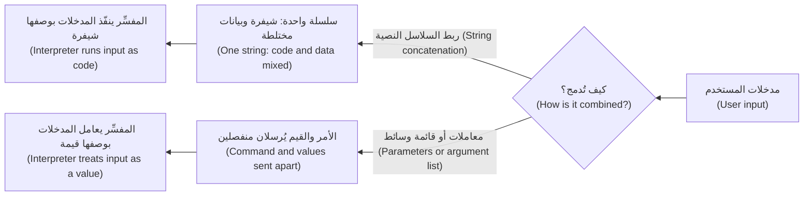
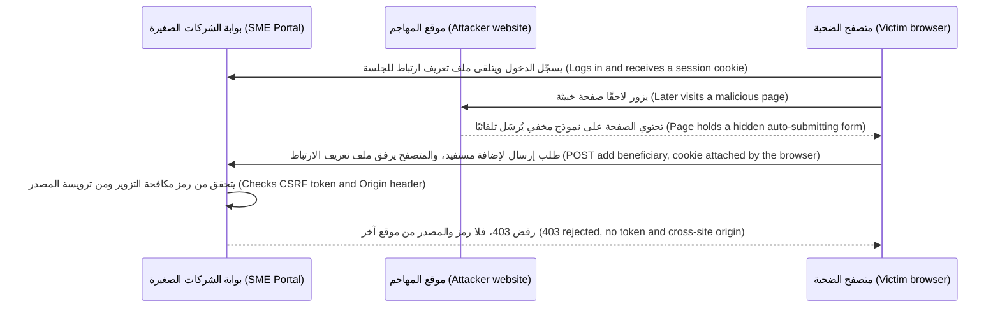
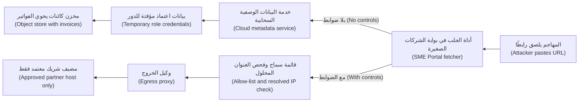

# الوحدة 2 — أمن تطبيقات الويب (Web application security)

*يلتقي معظم عملاء بنك نجم (Najm Bank)، ومعظم المهاجمين (attackers) أيضًا، بالبنك عبر صفحة ويب (web page) أو واجهة برمجة تطبيقات (API). تتناول هذه الوحدة نقاط الضعف الكلاسيكية (classic weaknesses) التي لا تزال تسبب اختراقاتٍ حقيقية (real breaches). فالحقن (Injection) بياناتٌ يُظنّ خطأً أنها شيفرة. وهجمات المتصفح (Browser attacks) تقلب الصفحة ضد مستخدميها أنفسهم. وفخاخ جهة الخادم (Server-side traps) تخدع الخادم فيجلب شيئًا أو يخزّنه أو يفتحه أو يعيد بناءه وما كان ينبغي له ذلك. يشرح كل درسٍ الهجومَ بالمستوى الذي يحتاجه المدافع، ثم يقدّم الإصلاح نمطًا يمكنك فرضه في مراجعة الشيفرة (code review)، وفي الفحوص الآلية (automated checks)، وفي معيار البرمجة الآمنة (secure-coding standard). ستتابع عليًّا في أولى مراجعاته (first reviews) لبوابة الشركات الصغيرة (SME Portal)، وتقرأ نتائج الاختبار المصرَّح به التي أعدّتها مريم، وترى كيف تحوّل نورة كل ملاحظة (finding) إلى ضابطٍ يبقى ثابتًا. وتعود الأسباب الجذرية نفسها في الوحدتين 8 و9: فالنموذج اللغوي الكبير (LLM) الذي يقرأ نصًّا غير موثوق (untrusted text)، أو تتدفق مخرجاته إلى متصفح أو قاعدة بيانات، يرث كل درسٍ هنا.*

> **المراحل (Phases):** Build, Test — كتابة شيفرةٍ تُبقي البيانات والتعليمات منفصلة، وإثبات ذلك بالمراجعة والاختبارات والفحص قبل أن يصل أي شيء إلى بيئة الإنتاج (production).

---

# 2.1 — الحقن: حقن SQL وحقن الأوامر وحقن القوالب
*المستوى (Level): 🟡 متوسط (Intermediate)* · *المتطلبات (Prerequisites): 1.1، 1.2* · *المرحلة (Phase): Build, Test*

## ⚡ الدرس في دقيقة (In 60 seconds)
- يحدث **الحقن (Injection)** حين تصل مدخلاتٌ غير موثوقة (untrusted input) إلى **مفسِّر (interpreter)**، كمحرّك قاعدة بيانات (database engine) أو صدفة أوامر (shell) أو محرّك قوالب (template engine)، بوصفها جزءًا من أمر، فتستطيع المدخلات تغيير ما يفعله الأمر.
- القاعدة: **افصل الشيفرة عن البيانات (keep code and data apart)**. استخدم الاستعلامات ذات المعاملات (parameterised queries)، وشغّل البرامج بقائمة وسائط (argument list) ومن دون صدفة، ومرّر البيانات إلى القوالب بوصفها متغيرات. ولا تبنِ الأوامر أبدًا بلصق السلاسل النصية معًا.
- التهريب اليدوي، وحظر الأحرف «السيئة» ("bad" characters)، وإخفاء الأخطاء (hiding errors) ليست إصلاحات. والتحقق (Validation) طبقةٌ ثانية مفيدة، لا الطبقة الأولى أبدًا.
- مؤشر القرار (Decision cue): نصٌّ يتحكم فيه المستخدم (user-controlled text) داخل f-string أو `+` أو قالبٍ حرفي (template literal) أو `format()`، ينتهي في `execute()` أو `system()` أو `exec()` أو `render_template_string()`.
- يحدّ مبدأ أقل الصلاحيات (Least privilege) من الضرر حين يفلت خطأٌ برمجي.
- أكبر فخ (Biggest trap): «نستخدم أداة ORM، إذن نحن في أمان». فمنافذ الاستعلامات الخام، وأسماء الأعمدة الديناميكية، والشيفرة المولَّدة بالذكاء الاصطناعي (AI-generated code) تعيد الحقن.

## 🧭 لماذا يهم
أول مراجعةٍ للشيفرة يجريها علي في بنك نجم هي طلب سحب (pull request) لميزة البحث في الفواتير (invoice search) الجديدة في بوابة الشركات الصغيرة، بُنيت في عصر يومٍ واحد باستخدام وكيل برمجة بالذكاء الاصطناعي (AI coding agent). ويقرأ سطر الاستعلام (query line): `f"SELECT * FROM invoices WHERE company_id = {cid} AND reference = '{q}'"`. يوافق عليه علي لأن الاختبارات تنجح. وترفضه نورة بتعليقٍ واحد (one comment): «شغّله على حاسوبك المحمول (laptop)، واكتب `' OR '1'='1` في مربع البحث (search box)، وأخبرني فواتيرَ مَن ترى.» والجواب: فواتير كل الشركات (every company's). وفي بوابةٍ متعددة المستأجرين (multi-tenant portal) يكون هذا اختراقًا للبيانات (data breach) ينتظر أول عميلٍ فضولي، وستضطر سارة، مسؤولة حماية البيانات (DPO)، إلى التعامل معه على هذا الأساس.

الحقن أقدم فئات الأخطاء في أمن الويب (web security)، ولم يغادر القوائم قط. فهو فئةٌ (category) في قائمة OWASP Top 10، إذ حمل الرمز A03 في إصدار 2021 (2021 edition)؛ وتحقّق من الإصدار الحالي (check the current edition) الذي حُدِّث عام 2025. ويتكرر حقن SQL ‏(SQL injection, CWE-89) وحقن أوامر نظام التشغيل (OS command injection, CWE-78) في قائمة CWE Top 25 الصادرة عن MITRE. وفي عام 2023 استغلّت مجموعة ابتزاز (extortion group) على نطاقٍ واسع ثغرةَ حقن SQL ‏ في منتج MOVEit Transfer، وهي CVE-2023-34362، وفقدت مؤسساتٌ كثيرة، بحسب ما أُعلن، ملفاتٍ من منتجٍ اشترته لا منتجٍ بنته. وفي عام 2017 اختُرقت شركة Equifax عبر ثغرةٍ غير مرقَّعة (unpatched flaw) في Apache Struts، هي CVE-2017-5638، قُيِّمت فيها ترويسة HTTP مُصمَّمة خصيصًا بوصفها تعبيرًا: حقنٌ مرةً أخرى (injection again)، في شيفرةٍ لم تكتبها الضحية.

## 📐 كيف يعمل

### 🟢 الأساسيات

**الشيفرة والبيانات في قناةٍ واحدة (Code and data in one channel).** **المفسِّر (interpreter)** هو أي مكوّن (component) يقرأ سلسلةً نصية (string) ثم *يفعل* بها شيئًا: فمحرّك SQL ‏(SQL engine) ينفّذ الاستعلامات (runs queries)، والصدفة تنفّذ الأوامر (runs commands)، ومحرّك القوالب يقيّم التعبيرات (evaluates expressions). ويحدث الحقن حين يبني برنامجك تلك السلسلة بخلط تعليماته الخاصة بمدخلات شخصٍ آخر. لا يستطيع المفسِّر أن يميّز الجزء الذي كتبتَه، فيتمكن المستخدم الذي يكتب صياغة المفسِّر (interpreter syntax) من كتابة التعليمات.



**حقن SQL ‏(SQL injection).** إليك ميزة البحث التي كتبها علي (Ali's search):

```python
# Vulnerable: input is pasted into the SQL text
q = request.args["q"]
sql = f"SELECT * FROM invoices WHERE company_id = {cid} AND reference = '{q}'"
cursor.execute(sql)
# q = "' OR '1'='1"  produces:
# ... WHERE company_id = 42 AND reference = '' OR '1'='1'   -> every row
```

```python
# Fixed: the SQL text never changes; values travel separately
sql = "SELECT * FROM invoices WHERE company_id = %s AND reference = %s"
cursor.execute(sql, (cid, q))
# The quote is now just part of a reference that matches nothing
```

يرسل **الاستعلام ذو المعاملات (parameterised query)**، أو العبارة المُعدّة مسبقًا (prepared statement)، بنيةَ الاستعلام (query structure) والقيمَ (values) منفصلتين، فلا تحلّل قاعدة البيانات القيمَ أبدًا بوصفها SQL ‏. وتختلف صياغة العناصر النائبة (placeholder syntax) باختلاف برنامج التشغيل (driver)، مثل `%s` و`?` و`:name`؛ أما المبدأ فلا يختلف.

بحسب الاستعلام والحساب، يتيح حقن SQL للمهاجم قراءة بيانات المستأجرين الآخرين، أو تغيير السجلات (change records)، أو تجاوز تسجيل الدخول. وفي **الحقن الأعمى (blind injection)** لا يعرض التطبيق نتائج ولا أخطاء، فيستنتج المهاجم الإجابات (infers answers) من فروق نعم/لا (yes/no differences) أو من التأخيرات (delays). ولهذا فإن إخفاء رسائل الخطأ ممارسةٌ صحية (hygiene)، لا إصلاح.

**حقن أوامر نظام التشغيل (OS command injection).** تُنشئ بوابة الشركات الصغيرة صورًا مصغّرة (thumbnails) للصور المرفوعة (uploaded images) باستخدام أداة سطر أوامر (command-line tool).

```python
# Vulnerable: the user's filename goes through a shell
os.system(f"convert uploads/{filename} -resize 200x200 thumbs/{filename}.png")
# A filename such as  x.png; whoami  runs a second command
```

```python
# Safer: server-generated names, an argument list, no shell
file_id = uuid.uuid4().hex            # the user's filename never reaches the command
src, dst = UPLOADS / f"{file_id}.png", THUMBS / f"{file_id}.png"
subprocess.run(["convert", str(src), "-resize", "200x200", str(dst)],
               shell=False, check=True, timeout=30)
```

مع `shell=False` وقائمة، يصل كل عنصرٍ إلى البرنامج وسيطًا واحدًا (one argument)؛ ولا تعني `;` و`|` و`$(...)` شيئًا لأنه لا صدفة تفسّرها. والأفضل من ذلك (Better still) أن تستخدم مكتبةً (library) فلا يُبنى أي أمرٍ على الإطلاق. وفي Node.js، فضّل `execFile` أو `spawn` مع مصفوفة وسائط (argument array) على `exec`، الذي يشغّل صدفة.

**حقن القوالب من جهة الخادم (Server-side template injection, SSTI).** لمحركات القوالب (Template engines)، مثل Jinja2 وTwig وFreemarker وغيرها، لغاتُ تعبير (expression languages) تستطيع، في كثيرٍ من المحركات، الوصول إلى كائناتٍ قوية على الخادم. ويحدث SSTI حين تصبح مدخلات المستخدم جزءًا من *القالب* (*template*) بدلًا من أن تكون *قيمةً تُمرَّر إليه*.

```python
# Vulnerable: user input is concatenated into the template source
return render_template_string("<p>Welcome, " + display_name + "</p>")
# display_name = "{{7*7}}" renders "Welcome, 49": the engine evaluated it

# Fixed: the template is constant; the name is data
return render_template_string("<p>Welcome, {{ name }}</p>", name=display_name)
# Renders "Welcome, {{7*7}}" as text, auto-escaped
```

مجسّ الاختبار (probe) `{{7*7}}` هو الاختبار الكلاسيكي غير المؤذي: إذا عرضت الصفحة `49`، فإن المدخلات تُقيَّم. وفي محركاتٍ مثل Jinja2 قد يؤدي ذلك إلى تنفيذ شيفرةٍ على الخادم، فتعامل مع SSTI بالجدية نفسها التي تتعامل بها مع حقن الأوامر.

| المفسِّر | النمط الضعيف (Vulnerable pattern) | النمط الآمن (Safe pattern) |
|---|---|---|
| قاعدة بيانات SQL ‏(SQL database) | استعلامٌ مبنيٌّ بالسلاسل النصية (String-built query) | استعلامٌ ذو معاملات؛ وقائمة سماح (allow-list) للمعرّفات (identifiers) |
| قاعدة بيانات المستندات (Document database)، مثل MongoDB | JSON الطلب يُمرَّر مباشرةً إلى استعلام | أنواعٌ يُتحقَّق منها بمخطط (Schema-validated types)؛ ورفض المفاتيح (reject keys) التي تبدأ بـ `$` |
| صدفة نظام التشغيل (OS shell) | `os.system`، و`shell=True`، و`exec` في Node | استدعاء مكتبة (Library call)، أو قائمة وسائط بلا صدفة |
| محرّك القوالب | مدخلاتٌ مربوطةٌ بمصدر القالب | قوالب ثابتة (Constant templates)؛ والمدخلات تُمرَّر بوصفها متغيرات |

### 🟡 التعمق أكثر (Going deeper)

**ما لا يمكنك تمريره معاملًا (What you cannot parameterise).** تعمل العناصر النائبة (Placeholders) مع القيم، لا مع **المعرّفات (identifiers)**، أي أسماء الجداول والأعمدة، ولا مع الكلمات المفتاحية (keywords) مثل `DESC`. اربط اختيار المستخدم بقيمةٍ من قائمة سماح:

```python
SORTS = {"date": "issued_at", "amount": "amount_qar", "status": "status"}
column = SORTS.get(request.args.get("sort"), "issued_at")    # unknown -> default
direction = "DESC" if request.args.get("dir") == "desc" else "ASC"
sql = f"SELECT * FROM invoices WHERE company_id = %s ORDER BY {column} {direction}"
cursor.execute(sql, (cid,))
```

لا تكون f-string هنا آمنةً إلا لأن كل قيمةٍ ممكنة تأتي من الشيفرة؛ ومع ذلك ينبغي للمراجعين (reviewers) التحقق من هذا الادعاء.

**أدوات ORM آمنة إلى أن تغادرها (ORMs are safe until you leave them).** تبني **أداة الربط الكائني العلائقي (object-relational mapper, ORM)**، مثل SQLAlchemy أو Django ORM أو Prisma، استعلاماتِ SQL ذات معاملات (parameterised SQL) نيابةً عنك. ويعود الحقن عبر ميزات SQL الخام (raw-SQL features)، مثل `raw()` و`text()` و`$queryRawUnsafe`، حين تُنسَّق المدخلات داخل السلسلة النصية؛ فاستخدم بدلًا من ذلك ربط المعاملات الخاص بها. والإجراءات المخزَّنة (Stored procedures) آمنةٌ فقط إذا لم تربط SQL ديناميكيًا في داخلها.

**الحقن من الدرجة الثانية (Second-order injection).** يُدرَج اسم شركةٍ يحتوي على علامة اقتباس بأمانٍ باستخدام المعاملات. وبعد أشهر، يربط تقريرٌ ليلي (nightly report) أسماء الشركات داخل استعلامٍ فينكسر (breaks)، أو يُخترَق. استخدم المعاملات في كل استعلام، بما في ذلك الاستعلامات التي تُغذّى من «قاعدة بياناتنا نحن».

**حقن عوامل NoSQL ‏(NoSQL operator injection).** تسجيل الدخول (login) الذي يمرّر جسم الطلب (request body) مباشرةً إلى `users.find({"email": body.email, "password": body.password})` يُخفق أمنيًا (fails) إذا وصل `password` بوصفه كائن JSON ‏(JSON object) هو `{"$ne": null}`، أي «لا يساوي null»، وهو ما يطابق أي كلمة مرور. تحقّق من أن كل حقلٍ سلسلةٌ نصية بالشكل المتوقع، وارفض المفاتيح التي تبدأ بـ `$`، وهذا هو CWE-943. والأفضل من ذلك أن تبحث عن المستخدم وتتحقق من تجزئة كلمة المرور في الشيفرة، كما في الدرس 3.1.

**التحقق هو الطبقة الثانية (Validation is the second layer).** التحقق بقائمة السماح (Allow-list validation)، كأن يتكون مرجع الفاتورة (invoice reference) من 6 إلى 20 حرفًا ورقمًا وشَرطة، و**جدار حماية تطبيقات الويب (web application firewall, WAF)**، وهو مرشِّحٌ أمام التطبيق يحظر أنماط الهجوم المعروفة، كلاهما من الدفاع المتعدد الطبقات (defence in depth)، كما في الدرس 1.2، وليسا بديلًا عن المعاملات. فالقيم المشروعة (Legitimate values) تحتوي على أحرفٍ «خطِرة» ("dangerous" characters)، مثل O'Brien و"Al-Noor & Sons"، ويمكن تجاوز المرشِّحات بالترميزات.

**كيف تجده (How you find it)**، دائمًا على شيفرةٍ وأنظمةٍ تملكها: تُبرز أدوات **التحليل الثابت (static analysis, SAST)**، مثل Semgrep أو CodeQL، الاستعلاماتِ المبنية بالسلاسل النصية (string-built queries) والصدفات (shells) والقوالب الديناميكية (dynamic templates) في كل طلب سحب ضمن خط التكامل المستمر، كما في الدرس 6.1؛ ويستخدم المراجعون قائمة تحقق (checklist)، انظر 🏛️؛ ويرسل **الاختبار الديناميكي (dynamic testing, DAST)** مدخلاتٍ عدائية (hostile inputs) إلى بيئة اختبارٍ قيد التشغيل؛ وتمنع اختبارات الوحدات (unit tests) ذات المدخلات العدائية الإصلاحاتِ من التراجع.

### 🔴 نظرة الخبير (Expert view)

**المفسِّرات تختبئ حيث لا تتوقعها (Interpreters hide where you do not expect them).** كانت Log4Shell، أي CVE-2021-44228 في ديسمبر 2021، مكتبةَ تسجيل (logging library) تقيّم تعابير البحث (lookup expressions) داخل النص المسجَّل (logged text)، فكان أي ترويسةٍ أو اسم مستخدمٍ يُسجَّل قادرًا على جعل الخادم يجلب شيفرةً بعيدة وينفّذها. وثغرة Struts التي كانت وراء اختراق Equifax ‏(Equifax breach) قيّمت لغة تعبير (expression language)، هي OGNL، من ترويسة طلب (request header). أنت ترث هذه الأخطاء، ولذلك فإن جرد الاعتماديات (dependency inventory) وسرعة الترقيع (patching speed) من ضوابط الحقن أيضًا، كما في الدرسين 6.2 و10.3. وأقرب إلينا، قد تُنفَّذ خليةٌ في ملف تصدير CSV ‏ تبدأ بـ `=` أو `+` أو `-` أو `@` أو بحرف جدولة (tab) أو بإرجاع عربة (carriage return) بوصفها صيغة حين يفتح مديرٌ مالي (finance manager) الملف، وهذا هو **حقن CSV أو الصيغ (CSV or formula injection)**؛ فحيِّد هذه الخلايا باتباع إرشادات OWASP الحالية.

**لحقن الموجّهات السبب الجذري نفسه ولا إصلاح مكافئًا له (Prompt injection has the same root cause and no equivalent fix).** يتلقى النموذج اللغوي الكبير التعليمات والنص غير الموثوق في تيارٍ واحد من الرموز، وهو بالضبط الخلط الذي يحذّر منه هذا الدرس، ولا يوجد استعلامٌ ذو معاملات للموجّهات. لهذا تدافع الوحدتان 8 و9 بالمعمارية لا بالمرشِّحات. أما الاتجاه المعاكس فهو حقنٌ صريح (plain injection): فاستعلامات SQL أو الأوامر أو القوالب التي يكتبها النموذج مدخلاتٌ غير موثوقة، وهي الفئة LLM05 المعالجة غير السليمة للمخرجات (LLM05 Improper Output Handling) في قائمة OWASP Top 10 for LLM Applications، إصدار 2025. تشغّل أداة «البحث عن الرسوم» في نجم أسيست (Najm Assist) استعلامًا ثابتًا ذا معاملات برمز رسوم (fee code)؛ ولا تنفّذ أبدًا SQL كتبه النموذج. وأي ميزةٍ مستقبلية لتحويل النص إلى SQL ‏(text-to-SQL feature) ستعمل على نسخةٍ متماثلة للقراءة فقط (read-only replica)، وعلى عروضٍ مقيَّدة (restricted views)، وبحدودٍ لعدد الصفوف (row limits).

**وكلاء البرمجة بالذكاء الاصطناعي يكرّرون ما رأوه (AI coding agents repeat what they have seen).** حين يُطلب منها ذلك عَرَضًا (Asked casually)، كثيرًا ما تنتج مساعدات البرمجة (coding assistants) استعلاماتٍ مبنية بالسلاسل النصية و`shell=True`، لأن كليهما شائعٌ في الشيفرة العامة. يكتب بنك نجم قواعد الحقن الخاصة به (injection rules) في ملفات تعليمات الوكلاء *ويفرضها أيضًا* بالتحليل الثابت (SAST) في خط التكامل المستمر (CI)، فتُلتقط القاعدة التي يتجاهلها الوكيل رغم ذلك، كما في الدرس 6.3.

**صمِّم للخطأ الذي فاتك (Design for the bug you missed).** امنح كل خدمةٍ حساب قاعدة بيانات خاصًّا بها بالصلاحيات التي تحتاجها فقط، ولا تمنحها أبدًا صلاحيات المالك (owner rights)، وعطّل ميزات قاعدة البيانات الخطِرة: أوامر نظام التشغيل (OS commands)، وقراءة الملفات (file reads)، والاتصالات الشبكية (network calls). وافرض عزل المستأجرين (tenant isolation) مرةً ثانية داخل قاعدة البيانات، مثلًا باستخدام **أمان مستوى الصف (row-level security, RLS)** في PostgreSQL، كما في الدرس 3.3. واحظر حركة المرور الصادرة (outbound traffic) من مضيفات قواعد البيانات (database hosts)، وأطلق التنبيهات (alert) عند أخطاء الاستعلامات (query errors) ومجموعات النتائج الكبيرة على نحوٍ غير معتاد، كما في الدرس 10.1.

## 🧰 الأدوات
| الضابط أو المعيار أو الأداة (Control, standard or tool) | ما هو وماذا يفعل | متى تلجأ إليه |
|---|---|---|
| **Parameterised queries** — الاستعلامات ذات المعاملات | ترسل بنية SQL والقيم منفصلةً، فلا تُحلَّل المدخلات أبدًا بوصفها SQL ‏ | كل استعلام، بما في ذلك المهام الداخلية والدفعية |
| **Allow-list validation** — التحقق بقائمة السماح | لا يقبل إلا القيم المعروفة السليمة (known-good values)؛ ويربط اختيارات المستخدم بقيمٍ تملكها الشيفرة (code-owned values) | المعرّفات، وترتيبات الفرز (sort orders)، وأنواع الملفات (file types)، وأي مدخلات ذات شكلٍ معروف (known shape) |
| **Shell-free command execution** — تنفيذ الأوامر بلا صدفة | استدعاء مكتبة، أو تشغيل برنامجٍ بقائمة وسائط ومن دون صدفة | كلما لجأت الشيفرة إلى `system()` أو `exec()` أو `shell=True` |
| **Logic-less templates** — القوالب الخالية من المنطق | قوالب لا تفعل سوى استبدال عناصر نائبة مدرجة في قائمة السماح (allow-listed placeholders) | كل ما يستطيع المستخدمون تحريره: رسائل البريد الإلكتروني (emails) والإشعارات (notifications) |
| **Least-privilege database accounts** — حسابات قواعد البيانات بأقل الصلاحيات | حسابٌ واحد لكل خدمة بالصلاحيات التي تحتاجها فقط | كل خدمة؛ ويحدّ من ضرر الخطأ الذي فات |
| **Semgrep** — أداة تحليلٍ ثابت مفتوحة المصدر | قواعد أنماط (Pattern rules) تُبرز الاستعلامات المبنية بالسلاسل النصية والصدفات والقوالب الديناميكية | في خط التكامل المستمر على كل طلب سحب؛ وتدقيق الشيفرة الموجودة |
| **OWASP Cheat Sheet Series** — سلسلة أوراق OWASP المختصرة | أدلةٌ وقائية موجزة ومجانية لكل نقطة ضعف (per weakness) | كتابة إصلاحٍ أو مراجعته؛ وتدريب المطورين (training developers) |
| **OWASP ASVS** — معيار التحقق من أمان التطبيقات، الإصدار v5.0 | متطلباتٌ أمنية قابلة للاختبار، ومنها الترميز والتعقيم | تحديد المتطلبات الأمنية لتطبيقٍ ما |

## 🏛️ عمليًا في بنك نجم
تحوّل نورة الحادثة الوشيكة (near-miss) التي وقع فيها علي إلى **معيار البرمجة الآمنة SC-02: الحقن (Secure Coding Standard SC-02: Injection)**، الإصدار 1. وهو ينطبق على كل شيفرة بنك نجم، سواءٌ كتبها شخص أو وكيل برمجة بالذكاء الاصطناعي.

| المعرّف (ID) | القاعدة (Rule) | النمط المطلوب (Required pattern) | ممنوع أبدًا (Never) | يُتحقَّق منه عبر (Checked by) |
|---|---|---|---|---|
| INJ-1 | يستخدم SQL معاملات الربط (bind parameters)؛ وتأتي المعرّفات من خريطةٍ تملكها الشيفرة (code-owned map) | العناصر النائبة؛ و`SORTS.get(choice, default)` | أي SQL مبنيٍّ بالسلاسل النصية (string-built SQL)، حتى مع قيمٍ «داخلية» ("internal" values) | Semgrep في خط التكامل المستمر، بصورةٍ مانعة (blocking)؛ والمراجعة (review) |
| INJ-2 | لا صدفات | استدعاء مكتبة، أو قائمة وسائط مع `shell=False` / `execFile` | `os.system`، و`shell=True`، و`exec` في Node | Semgrep، بصورةٍ مانعة |
| INJ-3 | القوالب ثابتة؛ والبيانات تُمرَّر بوصفها متغيرات | ملفات قوالب مع متغيرات سياق | عرض سلسلة قالبٍ مبنية من المدخلات | Semgrep؛ والمراجعة |
| INJ-4 | القوالب التي يحررها المستخدم خاليةٌ من المنطق | عناصر نائبة مدرجة في قائمة السماح مثل `{company_name}` | محرّك قوالب كامل مكشوفٌ للعملاء | مراجعة تصميم أمن التطبيقات |
| INJ-5 | يُتحقَّق من مدخلات قاعدة بيانات المستندات بمخطط؛ والتصديرات تحيّد الصيغ | فحوص الأنواع (Type checks)، ولا مفاتيح `$`؛ وخلايا الصيغ مسبوقةٌ ببادئة | كائنات الطلب الخام في الاستعلامات | اختبارات الوحدات |
| INJ-6 | مخرجات النموذج والأدوات مدخلاتٌ غير موثوقة | استعلاماتٌ ثابتة ذات معاملات خلف أدواتٍ ضيقة (narrow tools) | تنفيذ SQL أو أوامر صدفة أو قوالب كتبها النموذج | مراجعة تصميم الذكاء الاصطناعي، الدرس 9.1 |
| INJ-7 | لكل خدمةٍ حساب قاعدة بيانات خاصٌّ بها بأقل الصلاحيات | للقراءة فقط حيثما أمكن؛ وأمان مستوى الصف (RLS) لبيانات المستأجرين (tenant data) | الحسابات الإدارية المشتركة | مراجعة الوصول الفصلية |

**قائمة تحقق المراجعة (Review checklist)، وهي موجودة في كل قالب طلب سحب (in every pull-request template):**
1. هل تصل أي مدخلاتٍ من مستخدم أو ملف أو واجهة برمجة أو نموذج إلى استعلام أو أمر أو قالب؟
2. هل تُمرَّر بوصفها معاملًا أو وسيطًا، مع معرّفاتٍ من قائمة سماح؟
3. هل يثبت اختبارٌ بمدخلاتٍ عدائية، مثل `' OR '1'='1` و`; whoami` و`{{7*7}}`، أنها تُعامَل بوصفها بيانات؟
4. هل يملك حساب قاعدة البيانات الخاص بالخدمة صلاحياتٍ أكثر مما تحتاجه هذه الميزة؟

تحتاج الاستثناءات (Exceptions) إلى موافقةٍ مكتوبة من نورة، وضابطٍ تعويضي (compensating control)، وتاريخ انتهاء (expiry) لا يتجاوز 90 يومًا.

## 🛠️ التمارين (Exercises)
لا يُجرى العمل التطبيقي (Hands-on work) إلا على جهازك الخاص، على شيفرتك أو على تطبيقات تدريبٍ ضعيفة عمدًا (deliberately vulnerable training apps) مثل OWASP Juice Shop أو OWASP WebGoat.

- 🟢 ابنِ تطبيقًا محليًا صغيرًا، مثلًا بلغة Python وقاعدة SQLite، يضم فواتير لشركتين وميزة بحثٍ مكتوبة بالطريقة الضعيفة. أثبت أن `' OR '1'='1` يعيد صفوف الشركتين كلتيهما، ثم أصلحه باستعلامٍ ذي معاملات وأضف اختبار وحدة (unit test). *يكتمل عندما (Done when):* تعيد المدخلات كل الصفوف قبل الإصلاح ولا شيء بعده، ويفشل الاختبار على الشيفرة القديمة وينجح على الجديدة.
- 🟡 شغّل Semgrep، أو أداة SAST التي يستخدمها فريقك، بقواعد الحقن على مستودعٍ تملكه، وصنّف كل نتيجة إيجابيةً صحيحة أو إيجابيةً كاذبة مع سببٍ في سطرٍ واحد (one-line reason). *يكتمل عندما:* تُصلَح كل إيجابيةٍ صحيحة أو تُفتح لها تذكرة، وتعمل القاعدة في خط التكامل المستمر وتُفشل البناء (fails the build) عند ظهور نتائج جديدة (new findings).
- 🔴 ابنِ محليًا (locally) ميزة «إشعار البريد الإلكتروني المخصّص» في بوابة الشركات الصغيرة، بعناصر نائبة خالية من المنطق ومدرجة في قائمة السماح وقيمٍ مهرَّبة بترميز HTML ‏(HTML-escaped values). ثم أكمل تحدّي حقنٍ واحدًا في نسخةٍ محلية من Juice Shop أو WebGoat، واكتب مذكرة المدافع (defender's note): السبب الجذري (root cause)، والإصلاح (fix)، والاختبار الذي كان سيلتقطه، وإشارة السجل (log signal) التي تتركها المحاولة. *يكتمل عندما:* يُعرض `{{7*7}}` و`<b>` المكتوبان في قالبٍ نصًّا حرفيًا (literal text)، ويظهر اسم شركةٍ يحتوي على `<script>` مهرَّبًا (appears escaped)، ويُرفض عنصرٌ نائب غير معروف (unknown placeholder) مثل `{password_hash}`، وتتسع المذكرة في صفحةٍ واحدة.

## ⚠️ أخطاء وفخاخ (Mistakes and traps)
- **التهريب أو الحظر اليدوي (Escaping or blocklisting by hand).** يفشل أمام الترميزات ويكسر أسماءً مثل O'Brien. استخدم المعاملات وقوائم الوسائط.
- **«إنها تأتي من قاعدة بياناتنا نحن» ("It comes from our own database").** تحمل البيانات المخزّنة (Stored data) هجوم الأمس إلى استعلام اليوم. استخدم المعاملات في كل استعلام.
- **الثقة العمياء بأداة ORM ‏(Trusting the ORM blindly).** اعثر على كل استدعاء استعلامٍ خام (raw-query call) وراجعه.
- **إخفاء الأخطاء واعتبار المشكلة محلولة (Hiding errors and calling it fixed).** لا يحتاج الحقن الأعمى إلى رسائل خطأ. أصلح الاستعلام.
- **تنفيذ الاستعلامات أو الأوامر التي يكتبها النموذج (Running model-written queries or commands).** امنح النموذج أدواتٍ ضيقة تنفّذ عملياتٍ ثابتة (fixed operations)، كما في الدرس 9.2.

## 🧾 الخلاصة (Recap)
- الحقن هو وصول مدخلاتٍ غير موثوقة إلى مفسِّرٍ بوصفها جزءًا من أمر؛ فأبقِ الشيفرة والبيانات في قناتين منفصلتين (separate channels).
- SQL: المعاملات (parameters)، مع قوائم السماح للمعرّفات. الصدفات: المكتبات أو قوائم الوسائط. القوالب (Templates): ثابتة، والبيانات متغيرات؛ وخالية من المنطق (logic-less) لكل ما يحرره المستخدمون.
- التحقق، وإخفاء الأخطاء (error hiding)، وجدران حماية تطبيقات الويب (WAFs) طبقاتٌ مفيدة (useful layers)، لكنها ليست الإصلاح أبدًا.
- تختبئ المفسِّرات أيضًا في أدوات التسجيل (loggers)، ولغات التعبير في أطر العمل، وجداول البيانات (spreadsheets)، ولذلك فإن الترقيع (patching) ضابطٌ للحقن أيضًا.
- يشترك حقن الموجّهات (Prompt injection) في السبب الجذري لكن لا إصلاح له بالمعاملات؛ فتعامل مع مخرجات النموذج بوصفها مدخلاتٍ غير موثوقة.
- تحدّ الحسابات ذات أقل الصلاحيات (Least-privilege accounts) وعزل المستأجرين داخل قاعدة البيانات من أثر الحقن الذي فاتك.

## ✍️ اختبر نفسك (Check yourself)

**1. يجد علي `cursor.execute(f"SELECT * FROM invoices WHERE reference = '{ref}'")` في بوابة الشركات الصغيرة (SME Portal). ويقترح زميلٌ في الفريق (teammate) استبدال كل `'` في `ref` بـ `''` قبل تنفيذ الاستعلام. بماذا ينبغي أن يوصي علي (What should Ali recommend)؟**

- A. قبول التغيير، لأن مضاعفة علامات الاقتباس (doubling quotes) هي طريقة SQL في تهريبها
- B. استخدام استعلامٍ ذي معاملات (parameterised query)، مع تمرير `ref` معاملًا
- C. إضافة قاعدة WAF ‏(WAF rule) تحظر الطلبات التي تحتوي على `OR`، وكل طلب فيه علامة اقتباس
- D. إخفاء رسائل خطأ قاعدة البيانات عن المستخدمين وتسجيل التفاصيل للمطورين فقط

<details><summary>الإجابة</summary>

**B.** تُبقي المعاملات البنيةَ والقيمةَ منفصلتين، فلا تستطيع أي مدخلاتٍ تغيير الاستعلام. الخيار A تهريبٌ يدوي هشّ (fragile hand-escaping)؛ وC وD طبقاتٌ جزئية (partial layers) تلتفّ عليها الهجمات المرمَّزة أو العمياء. انظر: 🟢 الأساسيات.

</details>

**2. تتيح قائمة الفواتير (invoice list) للمستخدمين الفرز (sort) حسب التاريخ أو المبلغ أو الحالة (date, amount or status)، ويصل اسم العمود (column name) في الطلب. والعناصر النائبة (Placeholders) لا تعمل مع أسماء الأعمدة. ما النهج الآمن (safe approach)؟**

- A. إحاطة اسم العمود بعلامات اقتباس وتهريب أي علامات اقتباس بداخله قبل إضافته إلى الاستعلام
- B. ربط اختيار المستخدم عبر قائمة سماحٍ تملكها الشيفرة (code-owned allow-list)، والرجوع إلى قيمةٍ افتراضية لأي شيءٍ آخر
- C. حذف المسافات والفواصل المنقوطة من المدخلات
- D. ترك القرار لأداة ORM ‏

<details><summary>الإجابة</summary>

**B.** حين لا يمكن تمرير قيمةٍ معاملًا، يجب أن تأتي كل قيمةٍ ممكنة من الشيفرة، لا من المستخدم أبدًا. الخيار C قائمة حظر (blocklist)، وA لا يزال يتيح للمستخدم توجيه الاستعلام. انظر: 🟡 التعمق أكثر (Going deeper).

</details>

**3. يكتب مسؤولٌ في إحدى الشركات (company admin) `{{7*7}}` في حقل «رسالة الترحيب» ("welcome message") في بوابة الشركات الصغيرة، فتعرض المعاينة (preview) «49». ماذا يُظهر هذا، وما الإصلاح الصحيح (right fix)؟**

- A. ميزة آلةٍ حاسبة غير مؤذية؛ ولا حاجة إلى أي إجراء
- B. البرمجة النصية عبر المواقع (Cross-site scripting)؛ أضف سياسة أمان المحتوى (Content Security Policy) وشفّر الرسالة بصيغة HTML أينما عُرضت لمستخدمي الشركة والموظفين والمدقّقين
- C. حقن القوالب من جهة الخادم؛ اعرض قالبًا ثابتًا يتلقى الرسالة متغيرًا، أو استخدم عناصر نائبة خالية من المنطق (logic-less placeholders)
- D. حقن SQL ‏(SQL injection)؛ استخدم المعاملات في الاستعلام

<details><summary>الإجابة</summary>

**C.** قيّم المحرّك المدخلات بوصفها شيفرة قالب، وهو ما قد يؤدي إلى تنفيذ شيفرةٍ على الخادم. يعامل الخيار B المسألة بوصفها مشكلة متصفح (browser problem)، لكن التقييم يحدث على الخادم. انظر: 🟢 الأساسيات.

</details>

**4. تبني مهمةٌ ليلية (nightly job) لدى شركة تجزئة (retailer) استعلامَ تقرير (report query) بربط أسماء العملاء (concatenating customer names) المقروءة من قاعدة بياناتها نفسها. وقد أُدرجت الأسماء كلها باستعلاماتٍ ذات معاملات (parameterised queries). هل هناك خطر حقن (injection risk)؟**

- A. لا، لأن البيانات جاءت من قاعدة بيانات الشركة نفسها، التي لا يكتب فيها إلا موظفون موثوقون وعمليات إدراج ذات معاملات
- B. لا، لأن عمليات الإدراج (inserts) استخدمت المعاملات
- C. نعم: قد تحتوي البيانات المخزّنة على صياغة مفسِّر (interpreter syntax)، فيجب أن يستخدم استعلام التقرير المعاملات أيضًا، وهذا هو الحقن من الدرجة الثانية (second-order injection)
- D. فقط إذا كانت المهمة تعمل بصلاحيات مسؤول

<details><summary>الإجابة</summary>

**C.** خزّن الإدراج ذو المعاملات (parameterised insert) النصَّ العدائي بأمان؛ لكنه لم يجعله آمنًا لكل استخدامٍ لاحق. الخيار A هو الافتراض الخاطئ الكلاسيكي؛ وD يخلط بين مدى سوء الخطأ ووجوده من عدمه. انظر: 🟡 التعمق أكثر (Going deeper).

</details>

**5. تقترح رانيا أن يجيب نجم أسيست (Najm Assist) عن سؤال «كم أنفقتُ على الوقود الشهر الماضي؟» ⁦("how much did I spend on fuel last month?")⁩ بأن يكتب النموذج SQL تنفّذه الواجهة الخلفية (backend). ما التصميم الأكثر قابليةً للدفاع عنه (most defensible design)؟**

- A. تنفيذ SQL الذي يكتبه النموذج على قاعدة بيانات الإنتاج (production database)، لأن موجّه النظام (system prompt) يطلب من النموذج ألّا يكتب إلا عبارات SELECT ‏(SELECT statements)
- B. منح المساعد أداةً ضيقة (narrow tool) تنفّذ استعلام إنفاقٍ ثابتًا ذا معاملات للعميل المسجِّل دخوله (logged-in customer)، على ألّا يقدّم النموذج سوى معاملاتٍ متحقَّقٍ منها (validated parameters) مثل الفئة والشهر
- C. تصفية SQL الذي يكتبه النموذج بحثًا عن الكلمتين DROP وDELETE
- D. مطالبة النموذج بمراجعة SQL الخاص به مرةً أخرى قبل تنفيذه

<details><summary>الإجابة</summary>

**B.** مخرجات النموذج مدخلاتٌ غير موثوقة؛ والاستعلام الثابت ذو المعاملات المتحقَّق منها يُبقي الشيفرة والبيانات منفصلتين ويحصر الوصول في العميل. يعتمد الخيار A على تعليماتٍ يستطيع حقن الموجّهات تجاوزها؛ وC قائمة حظر (blocklist)؛ وD يطلب من المكوّن غير الموثوق أن يراقب نفسه. انظر: 🔴 نظرة الخبير (Expert view).

</details>

## 📚 المراجع (References)
- قائمة OWASP Top 10، إصدار 2021، فئة الحقن؛ وتحقّق من الإصدار الحالي — https://owasp.org/Top10/
- سلسلة OWASP Cheat Sheet Series، ورقة الوقاية من حقن SQL ‏ — https://cheatsheetseries.owasp.org/cheatsheets/SQL_Injection_Prevention_Cheat_Sheet.html
- سلسلة OWASP Cheat Sheet Series، ورقة الدفاع ضد حقن أوامر نظام التشغيل — https://cheatsheetseries.owasp.org/cheatsheets/OS_Command_Injection_Defense_Cheat_Sheet.html
- OWASP، صفحة حقن CSV ‏(CSV Injection) — https://owasp.org/www-community/attacks/CSV_Injection
- معيار OWASP للتحقق من أمان التطبيقات — https://owasp.org/www-project-application-security-verification-standard/
- MITRE CWE-89، حقن SQL ‏ — https://cwe.mitre.org/data/definitions/89.html
- MITRE CWE-78، حقن أوامر نظام التشغيل — https://cwe.mitre.org/data/definitions/78.html
- MITRE CWE-1336، الحقن في محركات القوالب — https://cwe.mitre.org/data/definitions/1336.html
- قاعدة البيانات الوطنية للثغرات لدى NIST، الثغرة CVE-2023-34362 في MOVEit Transfer — https://nvd.nist.gov/vuln/detail/CVE-2023-34362
- قائمة OWASP Top 10 for LLM Applications، إصدار 2025 (2025 version) — https://genai.owasp.org/
- OWASP Juice Shop — https://owasp.org/www-project-juice-shop/
- OWASP WebGoat — https://owasp.org/www-project-webgoat/

---

# 2.2 — هجمات المتصفح: XSS وCSRF والترويسات التي توقفها
*المستوى: 🟡 متوسط* · *المتطلبات: 2.1* · *المرحلة: Build, Test*

## ⚡ الدرس في دقيقة (In 60 seconds)
- تشغّل **البرمجة النصية عبر المواقع (Cross-site scripting, XSS)** نصًّا برمجيًا للمهاجم (attacker's script) داخل صفحتك، في متصفح مستخدمك، وبجلسة مستخدمك. ويستطيع هذا النص أن يفعل أي شيءٍ يستطيعه المستخدم، بما في ذلك الموافقة على دفعة.
- أصلح XSS باستخدام **ترميز المخرجات المراعي للسياق (context-aware output encoding)**: دع إطار العمل (framework) يهرّب المخرجات (escape output)، وتجنّب مواضع إدراج HTML الخام (raw-HTML sinks) مثل `innerHTML` و`dangerouslySetInnerHTML` و`v-html`، ولا تعقّم (sanitise) بمكتبةٍ مُدقَّقة (vetted library) إلا حين تكون الحاجة إلى HTML غني (rich HTML) حقيقية (truly needed).
- يجعل **تزوير الطلبات عبر المواقع (Cross-site request forgery, CSRF)** متصفحَ مستخدمٍ مسجِّل دخوله يرسل طلبًا يغيّر الحالة (state-changing request) إلى موقعك، مع إرفاق ملفات تعريف الارتباط (cookies attached). أصلحه بالرموز المضادة لتزوير الطلبات (anti-CSRF tokens)، وملفات تعريف الارتباط (cookies) ذات السمة `SameSite`، وفحوص المصدر (origin checks)، والمصادقة المعزَّزة (step-up authentication) للإجراءات عالية الخطورة (high-risk actions).
- **ترويسات الأمان (Security headers)**، وهي سياسة أمان المحتوى (Content Security Policy) وHSTS و`frame-ancestors` و`nosniff`، وسماتُ ملفات تعريف الارتباط (cookie attributes) هي شبكة الأمان (safety net). إنها تحدّ من الضرر (limit damage)؛ ولا تحلّ محل الترميز.
- مؤشر القرار: أي موضعٍ يصبح فيه محتوى يتحكم فيه المستخدم (user-controlled content) شيفرةَ HTML أو JavaScript أو عنوان URL، وأي نقطة نهايةٍ تغيّر الحالة (state-changing endpoint) وتقبل ملفات تعريف الارتباط (accepts cookies).
- أكبر الفخاخ (Biggest traps): الاعتقاد بأن CORS يوقف CSRF، أو بأن `HttpOnly` يوقف XSS. ولا هذا صحيح ولا ذاك.

## 🧭 لماذا يهم
يُجري الفريق الأحمر (red team) بقيادة مريم اختبارًا مصرّحًا به ومحدد النطاق لبوابة الشركات الصغيرة قبل إصدارٍ رئيسي (major release). وتتصدر ملاحظتان (Two findings) تقريرها. الأولى: تدعم **ملاحظات** الفواتير (invoice notes) الخط العريض والروابط، فتعرضها الواجهة الأمامية (frontend) بوصفها HTML خامًا (raw HTML). وملاحظةٌ تحتوي على ``، وهو دليلٌ كلاسيكي غير مؤذٍ، تُظهر نافذة تنبيه حين يفتح مُعتمِد الشؤون المالية في الشركة الفاتورة. أما النص البرمجي لمهاجمٍ حقيقي فسيستدعي بدلًا من ذلك، بهدوء (quietly)، واجهة برمجة «اعتماد الدفعة» في البوابة بصفته المعتمِد. والثانية: يعتمد نموذج «إضافة مستفيد» القديم (legacy) على ملف تعريف ارتباط الجلسة (session cookie) وحده، فيستطيع أي موقعٍ آخر أن يجعل متصفح مستخدمٍ مسجِّل دخوله يرسله (submit it).

يسأل حمد، رئيس أمن المعلومات (CISO)، لماذا لم يوقف جدار حماية تطبيقات الويب (web application firewall) الملاحظة الأولى. وجواب نورة: «جدار الحماية ينظر إلى الطلبات. والخطأ في طريقة كتابتنا للاستجابة. المرشِّح يجعل الاستغلال أصعب؛ والشيفرة وحدها تجعله مستحيلًا.»

ليس أيٌّ من الهجومين جديدًا. ففي عام 2005 انتشرت دودة «Samy» ‏("Samy" worm) عبر MySpace باستخدام XSS المخزَّنة (stored XSS)، وبلغت، بحسب التقارير (reportedly)، أكثر من مليون ملفٍ شخصي (profiles) في نحو يومٍ واحد. ولا تزال البرمجة النصية عبر المواقع (Cross-site scripting, CWE-79) وتزوير الطلبات عبر المواقع (CSRF, CWE-352) في الإصدارات الحديثة (recent editions) من قائمة CWE Top 25 الصادرة عن MITRE. تقدّم المتصفحات اليوم دفاعاتٍ قوية (strong defences)، لكنها لا تحمي إلا التطبيقات التي تستخدمها.

## 📐 كيف يعمل

### 🟢 الأساسيات

**سياسة المصدر نفسه (The same-origin policy).** تعزل المتصفحات المواقع (isolate websites) حسب **المصدر (origin)**: المخطط والمضيف والمنفذ معًا، مثل `https://portal.najm.example:443`. ولا يستطيع نصٌّ برمجي من مصدرٍ ما قراءة استجابات مصدرٍ آخر. تهزم XSS هذه السياسة بالعمل داخل مصدرك؛ أما CSRF فتلتفّ حولها، لأن المتصفحات لا تزال *ترسل* الطلبات عبر المواقع مع ملفات تعريف الارتباط رغم أن المُرسِل لا يستطيع *قراءة* الاستجابة.

**ثلاثة أنواعٍ من XSS ‏(Three kinds of XSS).**

| النوع (Type) | من أين يأتي النص البرمجي | مثال من بوابة الشركات الصغيرة |
|---|---|---|
| **المخزَّنة (Stored)** | محفوظٌ على الخادم ويُقدَّم لمستخدمين آخرين | ملاحظة فاتورة خبيثة تُعرض على المعتمِد (approver) |
| **المنعكسة (Reflected)** | يُرسل في الطلب ويُعاد مباشرةً | صفحة بحث تطبع «لا نتائج لـ …» مع الاستعلام الخام (raw query) |
| **المعتمدة على DOM ‏(DOM-based)** | تكتبه في الصفحة شيفرة JavaScript الخاصة بك | شيفرةٌ تقرأ `location.hash` وتُسنده (assigns it) إلى `innerHTML` |

**إصلاح XSS: رمِّز حسب السياق (Fixing XSS: encode for the context).** تحلّل المتصفحات (Browsers parse) شيفرة HTML والسمات (attributes) وعناوين URL وJavaScript وCSS بطرقٍ مختلفة، ولذلك تعتمد المعالجة الآمنة (safe treatment) على الموضع الذي تستقر فيه البيانات. تُرمّز أطر العمل الحديثة (Modern frameworks) ومحركات القوالب ذات التهريب التلقائي النصَّ نيابةً عنك؛ وتعيش الأخطاء في منافذ الهروب.

```jsx
// Vulnerable: raw HTML from the database
<div dangerouslySetInnerHTML={{ __html: invoice.notes }} />

// Safe: React escapes text by default
<div>{invoice.notes}</div>

// Rich text genuinely needed: sanitise with a strict allow-list
import DOMPurify from "dompurify";
const clean = DOMPurify.sanitize(invoice.notes, {
  ALLOWED_TAGS: ["b", "i", "p", "ul", "li", "a"], ALLOWED_ATTR: ["href"] });
<div dangerouslySetInnerHTML={{ __html: clean }} />
```

في JavaScript العادية (plain JavaScript)، استخدم `element.textContent = notes`، الذي يُعرض نصًّا، لا `element.innerHTML = notes`، الذي يُحلَّل بوصفه HTML ‏. وقد استخدمت مريم وسم صورة (image tag) في دليلها لسببٍ وجيه: فالمتصفحات لا تشغّل عناصر `<script>` المُدرجة عبر `innerHTML`، لكنها تشغّل معالجات الأحداث (event handlers) مثل `onerror`. وحظر السلسلة `<script>` لا يُصلح شيئًا (fixes nothing).

| السياق (Context) | مثال (Example) | المعالجة الآمنة |
|---|---|---|
| جسم HTML ‏(HTML body) | `<p>{notes}</p>` | التهريب التلقائي لإطار العمل (Framework auto-escaping)، أو `textContent` |
| سمة HTML ‏(HTML attribute) | `<input value="{name}">` | التهريب التلقائي (Auto-escaping)، مع وضع السمات دائمًا بين علامات اقتباس |
| عنوان URL ‏(URL) | `<a href="{website}">` | اسمح فقط (Allow only) بـ `https:`، ومعه `mailto:` عند الحاجة؛ وارفض (reject) `javascript:` |
| شيفرة JavaScript | بياناتٌ داخل وسم `<script>` مضمَّن | أبقِ البيانات خارج النصوص البرمجية؛ ومرّرها بصيغة JSON في سمة بيانات (data attribute) أو عبر واجهة برمجة |
| أنماط CSS | `style="{colour}"` | تجنّبه (Avoid)؛ واستخدم قائمة سماح للقيم (allow-list values) مثل لوحة ألوانٍ ثابتة (fixed palette) |

**CSRF في صورةٍ واحدة (CSRF in one picture).**



**إصلاح CSRF ‏(Fixing CSRF).** ضع هذه الضوابط في طبقات:
1. **الرموز المضادة لتزوير الطلبات (Anti-CSRF tokens)**، أي نمط الرمز المتزامن: رمزٌ عشوائي لكل جلسة مطلوبٌ في كل نموذج أو ترويسة طلب. ولا تستطيع المواقع الأخرى قراءة صفحاتك، فلا تستطيع معرفته.
2. **ملفات تعريف الارتباط ذات السمة `SameSite` ‏(SameSite cookies)**: يحجب المتصفح ملف تعريف ارتباط الجلسة عن الطلبات التي تبدأها مواقع أخرى.
3. **فحوص المصدر (Origin checks)**: ارفض الطلبات التي تغيّر الحالة (state-changing requests) إذا أظهرت ترويسة `Origin` أو `Sec-Fetch-Site` فيها موقعًا آخر (another site).
4. **لا تغييرات في الحالة عبر GET ‏(No state changes on GET)**، و**المصادقة المعزَّزة (step-up authentication)**، أي رمزٌ لمرةٍ واحدة أو قياسٌ حيوي، لإجراءاتٍ مثل إضافة مستفيد.

لا تتعرض واجهات البرمجة (APIs) التي تصادق بترويسة `Authorization: Bearer` لهجمات CSRF الكلاسيكية (classic CSRF)، لأن المتصفحات لا ترفق تلك الترويسة تلقائيًا أبدًا. لكن الخطر ينتقل ولا يختفي: فالرمز المميز (token) المخزَّن حيث تستطيع JavaScript قراءته يمكن سرقته عبر XSS ‏.

### 🟡 التعمق أكثر

**سياسة أمان المحتوى (Content Security Policy, CSP)** ترويسة استجابة (response header) تخبر المتصفح بالنصوص البرمجية والإطارات والاتصالات التي يجوز للصفحة استخدامها، فيفشل النص البرمجي المحقون حتى حين يفلت خطأ ترميز. وقد أظهر بحثٌ أجراه مهندسون في Google ‏، هو «CSP Is Dead, Long Live CSP!» لفايشلباوم وزملائه ⁦⁩ في مؤتمر ACM CCS 2016، أن معظم السياسات المبنية على **قوائم سماحٍ للنطاقات (allow-lists of domains)** يمكن تجاوزها، مثلًا عبر نصوصٍ برمجية مستضافة أصلًا على نطاقٍ مسموح. استخدم بدلًا من ذلك **سياسة CSP صارمة (strict CSP)** مبنية على القيم العشوائية الوحيدة الاستخدام (nonces) أو التجزئات (hashes):

```
Content-Security-Policy: script-src 'nonce-R4nd0mPerResponse' 'strict-dynamic';
  object-src 'none'; base-uri 'none'; frame-ancestors 'none'; form-action 'self'
```

- **القيمة العشوائية الوحيدة الاستخدام (nonce)** قيمةٌ عشوائية (random value)، جديدةٌ لكل استجابة، توضع على كل وسم `<script nonce="…">` مشروع (legitimate). ويفتقر النص البرمجي المحقون إليها فلا يعمل؛ وتُحظر أيضًا المعالجات المضمَّنة (inline handlers) مثل `onerror`.
- تتيح `'strict-dynamic'` للنصوص البرمجية الموثوقة (trusted scripts) تحميل نصوصٍ برمجية أخرى من دون قائمة نطاقات (domain list).
- تُغلق `object-src 'none'` و`base-uri 'none'` طرق تجاوزٍ شائعة (common bypasses). وتمنع `frame-ancestors 'none'` **اختطاف النقرات (clickjacking)**، أي خداع المستخدمين للنقر على أزرارك المخفية تحت محتوى موقعٍ آخر.

ابدأ النشر (Roll out) بـ `Content-Security-Policy-Report-Only` أولًا، وأصلح النصوص البرمجية المضمَّنة المشروعة، ثم افرض السياسة (then enforce). فالقيمة العشوائية المُعاد استخدامها، أو `'unsafe-inline'` من دون قيمةٍ عشوائية، تعطّل الحماية بصمت.

**ملفات تعريف الارتباط كما ينبغي (Cookies done right).**

```
Set-Cookie: __Host-session=…; Secure; HttpOnly; SameSite=Lax; Path=/
```

- `Secure`: عبر HTTPS فقط (HTTPS only). `HttpOnly`: مخفيٌّ عن JavaScript ‏، فلا تستطيع XSS نسخ ملف تعريف الارتباط، وإن كان النص البرمجي المحقون لا يزال قادرًا على التصرف بصفة المستخدم داخل الصفحة.
- تحجب `SameSite=Lax` ملف تعريف الارتباط عن طلبات POST عبر المواقع (cross-site POSTs) والطلبات المضمَّنة (embedded requests)، لكنها ترسله حين يتبع المستخدم رابطًا إلى موقعك. وتحجبه `Strict` عن كل الطلبات عبر المواقع، وهي مناسبة لوحدات تحكم المسؤولين. وتسمح `None` بالإرسال عبر المواقع (cross-site sending)، حيث تسمح بذلك قواعد المتصفح لملفات تعريف ارتباط الطرف الثالث، وتتطلب `Secure`.
- تفرض البادئة (prefix) `__Host-` السمة `Secure` و`Path=/` وغياب `Domain`، فلا تستطيع النطاقات الفرعية الشقيقة (sibling subdomains) الكتابة فوق ملف تعريف الارتباط.

اضبط `SameSite` صراحةً (Set explicitly): يعامل Chrome القيمة المفقودة (missing value) على أنها `Lax`، لكن المتصفحات تختلف (browsers differ). ثم إن `SameSite` تتعلق **بالمواقع (sites)**، أي المخطط مع النطاق القابل للتسجيل، لا بالمصادر: فالنطاق `marketing.najm.example` إذا اختُرق (compromised) هو الموقع نفسه (same site) الذي ينتمي إليه `portal.najm.example`، وهذا أحد أسباب بقاء أهمية الرموز وفحوص المصدر.

**بيانات الجلب الوصفية (Fetch Metadata).** ترسل المتصفحات الحديثة (Modern browsers) ترويسة `Sec-Fetch-Site`، بقيمة `same-origin` أو `same-site` أو `cross-site` أو `none`. والبرمجيات الوسيطة (Middleware) التي ترفض الطلبات المغيِّرة للحالة الموسومة بـ `cross-site`، باستثناء نقاط النهاية العامة المسمّاة، طبقةٌ إضافية قوية لمكافحة CSRF ‏؛ وارجع إلى `Origin` حيث تغيب هذه الترويسة.

**CORS ليس دفاعًا ضد CSRF ‏(CORS is not a CSRF defence).** تتيح مشاركة الموارد عبر المصادر لمصادر مسمّاة (named origins) *قراءة* استجاباتك؛ لكنها لا تمنع *إرسال* الطلبات. وسوء الإعداد (misconfiguration) الخطير يعكس ترويسة `Origin` لأي طلبٍ في `Access-Control-Allow-Origin` مع `Access-Control-Allow-Credentials: true`، فيتيح لأي موقع ويب قراءة بيانات المستخدمين المسجِّلين دخولهم. أدرج المصادر الدقيقة في قائمة السماح.

**بقية خط الأساس (The rest of the baseline).** تجعل `Strict-Transport-Security` ‏(HSTS) المتصفحات لا تستخدم إلا HTTPS لنطاقك؛ وتوقف `X-Content-Type-Options: nosniff` تخمين نوع المحتوى (content-type guessing)؛ وتحدّ `Referrer-Policy` من تسرّب عناوين URL ‏(URL leakage). أما الترويسة القديمة `X-XSS-Protection` فقد أُهملت (deprecated): وتنصح OWASP بضبطها على `0` أو بحذفها.

### 🔴 نظرة الخبير

**الأنواع الموثوقة تغلق XSS المعتمدة على DOM من مصدرها (Trusted Types close DOM XSS at the source).** مع توجيه CSP ‏(CSP directive) `require-trusted-types-for 'script'`، يرفض المتصفح السلاسل النصية العادية (plain strings) عند مواضع الإدراج (sinks) مثل `innerHTML`؛ ولا يمر إلا ما يأتي من سياساتٍ مسمّاة ومراجَعة، كسياسةٍ تغلّف DOMPurify مثلًا. بدأ الدعم (Support began) في المتصفحات المبنية على Chromium ‏(Chromium-based browsers) وأخذ ينتشر؛ وفي وقت الكتابة، أي عام 2026، تحقّق من التوافق الحالي.

**النص البرمجي من طرفٍ ثالث شيفرةٌ لم تراجعها (Third-party script is code you did not review).** في عام 2018، بحسب ما أُعلن، عدّل مهاجمون نصًّا برمجيًا في صفحات الدفع (payment pages) لدى British Airways بحيث تذهب بيانات البطاقات (card details) إلى نطاقٍ يتحكم فيه المهاجم (attacker-controlled domain)، وهو كشط بيانات الويب (web skimming) الذي يُسمّى غالبًا **Magecart**. أبقِ صفحات تسجيل الدخول والدفع خاليةً من النصوص البرمجية للأطراف الثالثة (third-party script)، واستخدم **سلامة الموارد الفرعية (Subresource Integrity)**، أي تجزئة `integrity` على وسوم `<script>` الخارجية بحيث يُرفض الملف المعدَّل، وقيّد `connect-src` في CSP، وراقب الصفحات بحثًا عن التغييرات. ويتطلب معيار PCI DSS v4.0 جرد النصوص البرمجية لصفحات الدفع وتفويضها والتحقق من سلامتها في المتطلب 6.4.3، ورصد التغييرات غير المصرّح بها في صفحات الدفع في المتطلب 11.6.1، وهما إلزاميان منذ 31 مارس 2025 (mandatory since 31 March 2025). تحقّق من الإصدار الحالي (Check the current version)، وهو v4.0.1 وقت الكتابة.

**مخرجات النماذج اللغوية الكبيرة مصدرٌ جديد لـ XSS ‏(LLM output is a new XSS source).** يعرض نجم أسيست إجاباته نصًّا منسَّقًا (formatted text) في عرض الويب (web view) داخل التطبيق. والنموذج الذي يوجّهه حقن الموجّهات، كما في الدرس 8.2، يستطيع أن يُخرج HTML، أو صورة Markdown ‏(Markdown image) يحمل عنوانها URL بيانات العميل إلى خادم المهاجم حين تُحمَّل. تعامل مع مخرجات النموذج بوصفها غير موثوقة، وهي الفئة LLM05 المعالجة غير السليمة للمخرجات (LLM05 Improper Output Handling): اعرض مجموعةً فرعية معقَّمة من Markdown ‏ بلا HTML خام، واحظر الصور البعيدة أو مرّرها عبر وكيل، وافرض `img-src` و`connect-src` في CSP، كما في الدرس 9.1. وعروض الويب التي تملك جسورًا من JavaScript إلى الشيفرة الأصلية ترفع المخاطر، كما في الدرس 4.3.

**جدران حماية تطبيقات الويب تشتري الوقت لا الإصلاحات (WAFs buy time, not fixes).** جدار الحماية مفيدٌ في **الترقيع الافتراضي (virtual patching)**، أي حظر استغلال خطأٍ معروف ريثما يُطلق الإصلاح، لكن الترميزات تتجاوز التواقيع، ولذلك تحتاج كل قاعدة WAF مهمة إلى تذكرة إصلاحٍ في الشيفرة (code-fix ticket) خلفها. وتجد ماسحات DAST ‏(DAST scanners) مثل ZAP كثيرًا من أخطاء XSS المنعكسة (reflected XSS) والترويسات المفقودة (missing headers)؛ أما XSS المخزَّنة والمعتمدة على DOM ‏ فكثيرًا ما تحتاج إلى مختبِرٍ يتتبّع البيانات، كما فعلت مريم.

## 🧰 الأدوات
| الضابط أو المعيار أو الأداة | ما هو وماذا يفعل | متى تلجأ إليه |
|---|---|---|
| **Context-aware output encoding** — ترميز المخرجات المراعي للسياق | ترميز البيانات للموضع الدقيق الذي تستقر فيه، عادةً عبر التهريب التلقائي لإطار العمل | كل صفحةٍ تعرض بيانات؛ وهو الدفاع الأساسي ضد XSS ‏ |
| **DOMPurify** — من Cure53 | معقِّم HTML مفتوح المصدر يعمل بقائمة سماح | حين يجب أن يقدّم المستخدمون أو النماذج HTML غنيًا أو Markdown ‏ |
| **Content Security Policy** — سياسة أمان المحتوى | ترويسة تحدّ من النصوص البرمجية التي تعمل ومن الوجهات التي تتصل بها الصفحات | كل تطبيق ويب، بوصفها خط الدفاع الاحتياطي (backstop) لأخطاء الترميز (encoding bugs) وضد الكشط (against skimming) |
| **Trusted Types** — الأنواع الموثوقة | ميزة متصفح (Browser feature) ترفض السلاسل النصية عند مواضع إدراج DOM ‏(DOM sinks) ما لم تُنشئها سياسةٌ مراجَعة (reviewed policy) | الواجهات الأمامية الكبيرة (Large frontends) المعرّضة لخطر XSS المعتمدة على DOM ‏، بعد تطبيق CSP ‏ |
| **Anti-CSRF tokens** — الرموز المضادة لتزوير الطلبات | رمزٌ عشوائي لكل جلسة مطلوبٌ في كل طلبٍ يغيّر الحالة | أي تطبيقٍ يصادق بملفات تعريف الارتباط (cookie-authenticated app) وفيه نماذج أو واجهات برمجة تغيّر الحالة |
| **SameSite cookies** — ملفات تعريف الارتباط بالسمة SameSite | سمة ملف تعريف ارتباط (Cookie attribute) تحجب ملفات تعريف الارتباط عن الطلبات عبر المواقع (cross-site requests) | كل ملف تعريف ارتباطٍ للجلسة، مضبوطًا صراحةً على `Lax` أو `Strict` |
| **HSTS** — أمان النقل الصارم عبر HTTP ‏ | ترويسة تجعل المتصفحات لا تستخدم إلا HTTPS لنطاقك | كل نطاق إنتاج |
| **ZAP** — وكيل الهجوم Zed ‏ | ماسح DAST مفتوح المصدر ووكيل اعتراض | فحص تطبيقاتك في بيئة التجهيز بحثًا عن XSS المنعكسة والترويسات المفقودة |

## 🏛️ عمليًا في بنك نجم
تنشر نورة **خط الأساس لأمن المتصفح في بنك نجم، الإصدار 1 (Najm Bank Browser Security Baseline v1)** لبوابة الشركات الصغيرة، والموقع الإلكتروني العام (public website)، ووحدات تحكم المسؤولين الداخلية، وكل عرض ويب في تطبيق نجم للهاتف (Najm Mobile). ويضبط فريق المنصة (platform team) بقيادة طارق الترويسات المشتركة (shared headers) عند بوابة الحافة (edge gateway)؛ ويضبط كل تطبيقٍ القيمة العشوائية الخاصة به لسياسة CSP ‏.

| البند (Item) | القيمة المطلوبة (Required value) | السبب | موضع الضبط (Set where) |
|---|---|---|---|
| `Content-Security-Policy` | `script-src 'nonce-…' 'strict-dynamic'; object-src 'none'; base-uri 'none'; frame-ancestors 'none'; form-action 'self'`، مع نقطة نهاية للإبلاغ (reporting endpoint) | يحظر النصوص البرمجية المحقونة والتأطير | التطبيق (Application)، بقيمةٍ عشوائية جديدة لكل استجابة |
| `Strict-Transport-Security` | `max-age=31536000; includeSubDomains` | HTTPS فقط، ويُتذكَّر لمدة عام | الحافة (Edge) |
| `X-Content-Type-Options` | `nosniff` | لا تخمين لنوع المحتوى | الحافة |
| `Referrer-Policy` | `strict-origin-when-cross-origin`؛ و`no-referrer` حيث تحمل عناوين URL معرّفات | يحدّ من تسرّب عناوين URL ‏ | الحافة، مع إمكانية التجاوز (Edge, overridable) |
| `X-Frame-Options` | `DENY` | حمايةٌ من اختطاف النقرات للمتصفحات الأقدم | الحافة |
| `Cache-Control` | `no-store` على الصفحات الموثَّقة (authenticated pages) | لا بيانات عملاء في ذاكرات التخزين المؤقت المشتركة | التطبيق |
| ملف تعريف ارتباط الجلسة | البادئة `__Host-`؛ و`Secure; HttpOnly; SameSite=Lax`، مع `Strict` لوحدات تحكم المسؤولين (admin consoles) | يقاوم السرقة وCSRF ‏ | التطبيق |
| CORS | مصادر دقيقة مدرجة في قائمة السماح؛ ولا `*` أبدًا ولا مصدرًا معكوسًا مع بيانات اعتماد | يوقف قراءة البيانات عبر المواقع | بوابة واجهات البرمجة (API gateway) |
| غير مسموح | `X-XSS-Protection: 1`؛ و`'unsafe-inline'` أو `'unsafe-eval'` في `script-src` من دون استثناءٍ معتمد (approved exception) | مُهمَلة، أو تُبطل CSP ‏ | يُتحقَّق منه في خط التكامل المستمر |

**قواعد البرمجة المرفقة بخط الأساس (Coding rules attached to the baseline):**
- XSS-1: لا `innerHTML` ولا `dangerouslySetInnerHTML` ولا `v-html` ولا `document.write` مع بيانات ما لم تمر عبر إعداد DOMPurify المعتمد، وتفرض ذلك قاعدة Semgrep في خط التكامل المستمر.
- XSS-2: تُقيَّد عناوين URL التي يقدّمها المستخدم (user-supplied URLs) بقائمة سماحٍ تقتصر على `https:` قبل عرضها (before rendering).
- CSRF-1: كل نقطة نهايةٍ تغيّر الحالة وتصادق بملفات تعريف الارتباط تتحقق من رمز CSRF ‏(CSRF token) وترفض `Sec-Fetch-Site: cross-site` أو ترويسة `Origin` أجنبية (foreign).
- CSRF-2: تتطلب إضافة مستفيد، وتغيير بيانات الاتصال، ورفع حدود الدفع مصادقةً معزَّزة.
- MDL-1: تمر مخرجات النماذج (model output)، في نجم أسيست ومساعد مذكرات الائتمان (Credit Memo Copilot)، عبر مكوّن Markdown المعقَّم المشترك، مع إيقاف الصور البعيدة.

**التحقق (Verification):** فحوص ZAP أساسية أسبوعية لبيئة التجهيز (staging)، وتقارير مخالفات CSP ‏ يراقبها مركز العمليات الأمنية (SOC) بقيادة جاسم، وإعادة فريق مريم اختبار كل إصلاح قبل إغلاقه (before closure).

## 🛠️ التمارين
شغّل كل شيء على جهازك الخاص أو على تطبيقات تدريبٍ ضعيفة عمدًا مثل OWASP Juice Shop. ولا تفحص مواقع لا تملكها.

- 🟢 افحص ترويسات الاستجابة (response headers) لتطبيق ويب تملكه، أو لنسخةٍ محلية من Juice Shop، باستخدام أدوات المطوّر في متصفحك أو `curl -I`، وقارنها بخط الأساس لبنك نجم. *يكتمل عندما:* يصبح لديك جدولٌ يصنّف كل بندٍ من بنود خط الأساس موجودًا أو مفقودًا أو أضعف، مع القيمة التي ستضبطها وموضع ضبطها، أي الحافة أو التطبيق.
- 🟡 ابنِ صفحةً محلية صغيرة تعرض «ملاحظة» ("note") من معامل استعلام (query parameter) باستخدام `innerHTML`، وأثبت أن `` يعمل. أصلحها باستخدام `textContent`؛ ثم أعِد الخطأ وأضف بدلًا من ذلك سياسة CSP صارمة بقيمةٍ عشوائية جديدة لكل استجابة. *يكتمل عندما:* يظهر التنبيه في النسخة الضعيفة (vulnerable version)، لا بعد إصلاح الشيفرة (code fix) ولا مع وجود الخطأ وسياسة CSP معًا، وتظهر مخالفة CSP ‏(CSP violation) في وحدة تحكم المتصفح (browser console).
- 🔴 في تطبيقٍ تملكه يصادق بملفات تعريف الارتباط، أضف ثلاث طبقاتٍ لمكافحة CSRF ‏ إلى نقطة نهايةٍ واحدة تغيّر الحالة: `SameSite=Lax`، ورمزًا متزامنًا (synchronizer token)، وبرمجيات وسيطة ترفض `Sec-Fetch-Site: cross-site`. وقدّم صفحة «مهاجم» ("attacker" page) ترسل إليها نموذجًا تلقائيًا من مضيفٍ محلي مختلف: التطبيق على `localhost`، وصفحة المهاجم على `127.0.0.1`، الذي تعامله المتصفحات موقعًا مختلفًا. *يكتمل عندما:* تُظهر الاختبارات رفض الإرسال عبر المواقع، وقبول طلبٍ من المصدر نفسه يحمل الرمز ورفض طلبٍ آخر لا يحمله، وتشرح مذكرةٌ قصيرة (short note) ما توقفه كل طبقةٍ وحدها، ولماذا لا يجعل تغيير المنفذ وحده الطلبَ عابرًا للمواقع (cross-site).

## ⚠️ أخطاء وفخاخ
- **حظر `<script>` والقول إن XSS أُصلحت (Blocking the script tag and calling XSS fixed).** فمعالجات الأحداث، وعناوين `javascript:`، وملفات SVG كلها تشغّل نصوصًا برمجية. رمِّز حسب السياق.
- **الظن بأن `HttpOnly` يوقف XSS ‏(Thinking HttpOnly stops XSS).** إنه يوقف سرقة ملف تعريف الارتباط (cookie theft)، لا مهاجمًا يتصرف بصفة المستخدم. أصلح XSS ‏.
- **استخدام CORS حمايةً من CSRF ‏(Using CORS as CSRF protection).** يتحكم CORS فيمن يجوز له قراءة الاستجابات، لا فيمن يجوز له إرسال الطلبات. استخدم الرموز (tokens) و`SameSite` وفحوص المصدر.
- **سياسة CSP تتضمن `'unsafe-inline'` أو قائمة نطاقاتٍ طويلة (long domain allow-list).** تبدو مطمئنة (looks reassuring) ولا توقف إلا القليل (stops little). استخدم القيم العشوائية أو التجزئات مع `'strict-dynamic'`.
- **إعادة استخدام القيمة العشوائية لسياسة CSP، أو تخزين الصفحات التي تحتويها مؤقتًا (Reusing a CSP nonce, or caching pages that contain one).** أنشئ قيمةً عشوائية جديدة لكل استجابة.
- **عرض مخرجات النموذج بوصفها HTML خامًا (Rendering model output as raw HTML).** تعامل معها بوصفها محتوى مستخدمٍ غير موثوق.

## 🧾 الخلاصة
- تشغّل XSS نصًّا برمجيًا للمهاجم داخل مصدرك؛ وتجعل CSRF متصفحَ الضحية يرسل طلباتٍ يثق بها خادمك لأن ملفات تعريف الارتباط ترافقها.
- الدفاع ضد XSS ‏(XSS defence): الترميز المراعي للسياق افتراضيًا، والتعقيم بقائمة سماح (allow-list sanitising) فقط حيث يلزم HTML غني، وحظر مواضع إدراج HTML الخام.
- الدفاع ضد CSRF ‏(CSRF defence): الرموز، وملفات تعريف الارتباط ذات السمة `SameSite` ‏، وفحوص `Origin` وبيانات الجلب الوصفية، ولا تغييرات في الحالة عبر GET ‏، والمصادقة المعزَّزة (step-up) للإجراءات عالية الخطورة.
- تشكّل سياسة CSP صارمة مبنية على القيم العشوائية، وHSTS، و`nosniff`، و`frame-ancestors`، وملفات تعريف الارتباط المحصَّنة (hardened cookies) شبكةَ الأمان الأساسية.
- النصوص البرمجية للأطراف الثالثة (Third-party scripts) ومخرجات النماذج اللغوية الكبيرة (LLM output) مصادر لـ XSS أيضًا؛ فقيّدها وعقّمها وراقبها.

## ✍️ اختبر نفسك

**1. بعد ملاحظة مريم (Mariam's finding)، يقترح مطوّرٌ رفض أي ملاحظة فاتورة (invoice note) تحتوي على النص `<script>`. لماذا لا يكفي هذا (Why is this not enough)، وما الإصلاح الصحيح (right fix)؟**

- A. إنه كافٍ، لأن وسوم script وحدها تشغّل JavaScript ‏
- B. انقل الملاحظات إلى جدولٍ منفصل في قاعدة البيانات
- C. أضف `HttpOnly` إلى ملف تعريف ارتباط الجلسة (session cookie) بدلًا من ذلك، فلا يستطيع النص المحقون قراءته أو إرساله إلى المهاجم، وتبقى الملاحظات المخزّنة كما هي
- D. معالجات الأحداث (Event handlers) مثل `onerror` وعناوين `javascript:` تشغّل نصوصًا برمجية أيضًا؛ اعرض الملاحظات نصًّا، أو عقّمها بقائمة سماح مثل DOMPurify

<details><summary>الإجابة</summary>

**D.** تفوّت قوائم الحظر (Blocklists) الطرق الأخرى لتشغيل النصوص البرمجية؛ أما الترميز، أو التعقيم بقائمة سماح للنص الغني، فيزيل السبب. والخيار C يحدّ من سرقة ملف تعريف الارتباط (cookie theft)، لا مما يفعله النص البرمجي. انظر: 🟢 الأساسيات.

</details>

**2. يقول طارق: «ملف تعريف ارتباط الجلسة لدينا `HttpOnly`، لذا لا يستطيع خطأ XSS أن يؤذينا (an XSS bug cannot hurt us).» ما أفضل رد (best reply)؟**

- A. صحيح (Correct): من دون ملف تعريف الارتباط، لا يستطيع المهاجم فعل أي شيء
- B. صحيحٌ جزئيًا فقط: يمنع `HttpOnly` النص البرمجي من قراءة ملف تعريف الارتباط، لكن النص البرمجي المحقون (injected script) لا يزال قادرًا على استدعاء واجهات برمجة البوابة بصفة المستخدم، وعلى قراءة الصفحة وتغييرها
- C. خطأ (Wrong)، لأن ملفات تعريف الارتباط `HttpOnly` تُرسل عبر HTTP غير المشفّر (unencrypted HTTP)
- D. صحيح (Correct)، ما دامت `SameSite=Strict` مضبوطةً أيضًا

<details><summary>الإجابة</summary>

**B.** تعمل XSS داخل مصدرك، حيث يرفق المتصفح ملفات تعريف الارتباط تلقائيًا؛ و`HttpOnly` لا يزيل إلا سرقة ملف تعريف الارتباط (cookie theft). والخيار C يخلط بين `HttpOnly` و`Secure`؛ وD يخلط بين ضابطٍ لـ CSRF وضابطٍ لـ XSS ‏. انظر: 🟡 التعمق أكثر (Going deeper).

</details>

**3. يقول فريق واجهات البرمجة (API team) لدى شركة تأمين (insurer) إن CSRF مُعالَج لأن «CORS لا يسمح إلا بمصدر واجهتنا الأمامية» ("CORS only allows our own frontend origin"). وتستخدم الواجهة جلساتٍ قائمة على ملفات تعريف الارتباط (cookie sessions). ما المشكلة (What is the problem)؟**

- A. لا مشكلة؛ فـ CORS يحظر الطلبات من المصادر الأخرى
- B. يتحكم CORS فيمن يجوز له قراءة الاستجابات؛ ولا يزال طلب POST من نموذجٍ عبر المواقع يُرسل، مع ملفات تعريف الارتباط ما لم تحجبها `SameSite`، ولذلك لا تزال الواجهة تحتاج إلى الرموز (tokens) وملفات تعريف الارتباط ذات السمة `SameSite` وفحوص المصدر (origin checks)
- C. ينبغي ضبط CORS على `*` من أجل الأمان
- D. ينبغي أن تتحول الواجهة إلى طلبات GET ‏

<details><summary>الإجابة</summary>

**B.** ترسل المتصفحات الطلبات البسيطة عبر المواقع، مثل طلبات POST من النماذج (form POSTs)، أيًّا كان ما تقوله سياسة CORS ‏، مع إرفاق ملفات تعريف الارتباط ما لم تحجبها `SameSite`؛ ولا يقرر CORS إلا ما إذا كان يجوز للصفحة المستدعية قراءة الاستجابة. والخيار C يزيد الأمور سوءًا؛ وD يكسر القاعدة القائلة إن تغييرات الحالة لا تستخدم GET أبدًا. انظر: 🟡 التعمق أكثر (Going deeper).

</details>

**4. أي سياسة أمان محتوى (Content Security Policy) تمنح أقوى حمايةٍ (strongest protection) ضد النصوص البرمجية المحقونة (injected script)؟**

- A. `script-src 'self' 'unsafe-inline' https://cdn.example.com https://static.example.com; style-src 'self'`
- B. `default-src * 'unsafe-inline' 'unsafe-eval' data: blob:; frame-ancestors *; object-src *; base-uri *`
- C. `script-src 'nonce-<fresh per response>' 'strict-dynamic'; object-src 'none'; base-uri 'none'`
- D. مثل C ‏، لكنها تُرسل (sent as) بوصفها `Content-Security-Policy-Report-Only` فلا يحجب المتصفح شيئًا ويكتفي بالإبلاغ

<details><summary>الإجابة</summary>

**C.** تعني القيمة العشوائية الجديدة (fresh nonce) أن النص البرمجي المحقون لا يستطيع العمل، وتُغلق `object-src` و`base-uri` طرق تجاوزٍ شائعة (common bypasses). يسمح الخيار A بالنصوص البرمجية المضمَّنة (inline script) ويثق بشبكة توصيل محتوى كاملة؛ وB يسمح بكل شيء (allows everything)؛ وD يُبلغ فقط (only reports)، وهو صحيح في أثناء النشر التدريجي (during rollout) لكنه لا يحظر شيئًا (blocks nothing). انظر: 🟡 التعمق أكثر (Going deeper).

</details>

**5. تُعرض إجابات نجم أسيست (Najm Assist) بصيغة Markdown في عرض الويب (web view) داخل التطبيق. وتُظهر مريم أن مستندًا محقونًا بموجّهات (prompt-injected document) يستطيع جعل النموذج يُخرج رابط صورة (image link) يحتوي عنوانه URL على بيانات العميل (customer's data). ما الضابط الأكثر فاعلية (most effective control)؟**

- A. أن يُطلب من النموذج في موجّه النظام (system prompt) ألّا يُخرج صورًا أبدًا
- B. التعامل مع مخرجات النموذج بوصفها غير موثوقة: عرض مجموعةٍ فرعية معقَّمة من Markdown بلا HTML خام، وحظر الصور البعيدة أو تمريرها عبر وكيل، وفرض حدود `img-src` و`connect-src` في CSP
- C. إضافة `HttpOnly` إلى كل ملفات تعريف الارتباط
- D. الاعتماد على جدار حماية تطبيقات الويب (WAF) لحظر الاستجابة

<details><summary>الإجابة</summary>

**B.** يقع الإصلاح حيث تُعرض المخرجات وحيث يجوز للمتصفح الاتصال، فيصمد حتى حين يُتلاعب بالنموذج. يعتمد الخيار A على مقاومة النموذج للحقن، وهو ما لا يضمنه شيءٌ اليوم؛ ولا يمسّ C وD العرض. انظر: 🔴 نظرة الخبير (Expert view).

</details>

## 📚 المراجع
- سلسلة OWASP Cheat Sheet Series، ورقة الوقاية من البرمجة النصية عبر المواقع — https://cheatsheetseries.owasp.org/cheatsheets/Cross_Site_Scripting_Prevention_Cheat_Sheet.html
- سلسلة OWASP Cheat Sheet Series، ورقة الوقاية من XSS المعتمدة على DOM ‏ — https://cheatsheetseries.owasp.org/cheatsheets/DOM_based_XSS_Prevention_Cheat_Sheet.html
- سلسلة OWASP Cheat Sheet Series، ورقة الوقاية من تزوير الطلبات عبر المواقع — https://cheatsheetseries.owasp.org/cheatsheets/Cross-Site_Request_Forgery_Prevention_Cheat_Sheet.html
- سلسلة OWASP Cheat Sheet Series، ورقة سياسة أمان المحتوى — https://cheatsheetseries.owasp.org/cheatsheets/Content_Security_Policy_Cheat_Sheet.html
- سلسلة OWASP Cheat Sheet Series، ورقة ترويسات HTTP ‏(HTTP Headers) — https://cheatsheetseries.owasp.org/cheatsheets/HTTP_Headers_Cheat_Sheet.html
- MITRE CWE-79، البرمجة النصية عبر المواقع (cross-site scripting) — https://cwe.mitre.org/data/definitions/79.html
- MITRE CWE-352، تزوير الطلبات عبر المواقع — https://cwe.mitre.org/data/definitions/352.html
- W3C، سياسة أمان المحتوى، المستوى 3 (Content Security Policy Level 3) — https://www.w3.org/TR/CSP3/
- RFC 6797، أمان النقل الصارم عبر HTTP ‏ — https://www.rfc-editor.org/rfc/rfc6797
- فايشلباوم وسبانيولو وليكيس وجانتس ⁦⁩ عام 2016، ورقة "CSP Is Dead, Long Live CSP! On the Insecurity of Whitelists and the Future of Content Security Policy"، مؤتمر ACM CCS 2016
- مكتبة DOMPurify من Cure53 — https://github.com/cure53/DOMPurify
- مجلس معايير أمان صناعة بطاقات الدفع (PCI Security Standards Council)، معيار PCI DSS — https://www.pcisecuritystandards.org/
- قائمة OWASP Top 10 for LLM Applications، إصدار 2025 (2025 version) — https://genai.owasp.org/

---

# 2.3 — فخاخ جهة الخادم: SSRF ورفع الملفات واجتياز المسار وإلغاء التسلسل
*المستوى: 🟡 متوسط* · *المتطلبات: 1.1، 2.1* · *المرحلة: Design, Build*

## ⚡ الدرس في دقيقة (In 60 seconds)
- أربعة أخطاء بشكلٍ واحد: يفعل الخادم شيئًا قويًا (something powerful)، كأن يجلب عنوان URL أو يخزّن ملفًا أو يفتح مسارًا أو يعيد بناء كائن، بمدخلاتٍ يتحكم فيها المهاجم.
- يجعل **تزوير الطلبات من جهة الخادم (Server-side request forgery, SSRF)** خادمك يجلب للمهاجم من داخل شبكتك. أدرج الوجهات في قائمة سماح (Allow-list destinations)، وتحقّق من العنوان *المحلول*، واستخدم وكيل خروج (egress proxy)، وحصّن الوصول إلى البيانات الوصفية السحابية.
- **رفع الملفات (File uploads)**: تحقّق من النوع انطلاقًا من المحتوى، وأعِد التسمية (rename)، وخزّن الملفات تخزينًا خاصًا (store privately)، وقدّمها من نطاقٍ منفصل (separate domain) بوصفها تنزيلًا، وضع حدًّا أقصى للحجم (cap size)، وافحصها (scan).
- **اجتياز المسار (Path traversal)**: اربط المعرّفات بالملفات؛ وإن اضطررت إلى استخدام اسم، فحوّله إلى صيغته القانونية (canonicalise it) وتحقّق من بقائه داخل المجلد الأساسي.
- **إلغاء التسلسل (Deserialisation)**: لا تغذِّ أبدًا مُحمِّلات الكائنات الأصلية ببايتاتٍ غير موثوقة (untrusted bytes)، مثل `pickle` وتسلسل Java ‏(Java serialisation) وYAML غير الآمن (unsafe YAML)، ويشمل ذلك ملفات نماذج التعلم الآلي. استخدم JSON مع مخطط.
- أكبر فخ: التحقق من *السلسلة النصية* لا من *الشيء نفسه*: نص عنوان URL بدلًا من العنوان المحلول، والامتداد بدلًا من المحتوى، ونص المسار بدلًا من المسار القانوني.

## 🧭 لماذا يهم
يريد فريق بوابة الشركات الصغيرة ميزتين في السباق التالي (next sprint). فميزة **استيراد فاتورة من رابط (Import invoice from link)** تجلب ملفًا من عنوان URL يلصقه العميل؛ و**خطافات الويب (webhooks)** تُشعر عنوان URL يختاره العميل (customer-chosen URL) حين تُعتمد فاتورة. بنى مطوّرو طارق الميزتين بوكيل برمجة بالذكاء الاصطناعي، وتنحصر كلٌّ منهما في سطرٍ واحد: `requests.get(url)`. وتطلب نورة من علي أن ينمذج تهديدات ميزة الاستيراد باستخدام STRIDE قبل الإطلاق (before launch)، كما في الدرس 1.1. ويتبيّن أن سؤاله الأول، «أين يستطيع هذا الخادم الوصول حيث لا يستطيع العميل؟» ⁦⁩، هو الدرس كله.

أشهر مثالٍ علني هو اختراق Capital One عام 2019. فبحسب ما أُعلن، جعل مهاجمٌ جدار حماية تطبيقات ويب سيئ الإعداد يرسل طلباتٍ إلى خدمة البيانات الوصفية للمثيل السحابي، فأعادت بيانات اعتماد مؤقتة (temporary credentials) لدورٍ ذي صلاحياتٍ مفرطة (over-privileged role)؛ واستُخدمت هذه لنسخ البيانات من حاويات التخزين (storage buckets). وأصبح SSRF، أي CWE-918، فئةً مستقلة في قائمة OWASP Top 10 عام 2021، بالرمز A10 في ذلك الإصدار، أما إصدار 2025 فيدمجه في فئة التحكم في الوصول المعطَّل (Broken Access Control)، فتحقّق من القائمة الحالية (check the current list)؛ وهو API7 في قائمة OWASP API Security Top 10 لعام 2023.

وتقع الرفوعات والمسارات وإلغاء التسلسل بجواره مباشرةً: فالعملاء يرفعون الفواتير، والموظفون ينزّلونها، وقد بدأ فريق دانة تحميل نماذج مدرَّبة مسبقًا (pre-trained models) من منصاتٍ عامة (public hubs).

## 📐 كيف يعمل

### 🟢 الأساسيات

**SSRF: خادمك وكيلًا للمهاجم (your server as the attacker's proxy).** يقع خادمك داخل حدود ثقة (trust boundaries) لا يستطيع الإنترنت عبورها. فهو يستطيع الوصول إلى لوحات الإدارة الداخلية، وواجهة برمجة Kubernetes ‏(Kubernetes API)، وعلى السحابات الكبرى (major clouds)، إلى **خدمة البيانات الوصفية (metadata service)** على العنوان الخاص (special address) `169.254.169.254`، التي تمنح بيانات اعتماد مؤقتة لدور الجهاز. والميزة التي تجلب عناوين URL يقدّمها المستخدم تتيح له توجيه خادمك نحو أيٍّ منها.



```python
# Vulnerable: fetch whatever the customer typed
resp = requests.get(request.form["url"])
```

```python
# Safer sketch: allow-list, resolve, check every address, no redirects
ALLOWED = {"api.partner-accounting.example", "files.partner-drive.example"}

def fetch_invoice(url: str) -> bytes:
    u = urlparse(url)
    if u.scheme != "https" or u.hostname not in ALLOWED or u.port not in (None, 443):
        raise Rejected("destination not allowed")
    addrs = {ai[4][0] for ai in socket.getaddrinfo(u.hostname, 443)}
    if not all(ipaddress.ip_address(a).is_global for a in addrs):
        raise Rejected("internal address")
    # egress_get: client routed through the egress proxy, which re-resolves and
    # re-checks at connect time, so a DNS answer that changes later is still caught
    return egress_get(url, allow_redirects=False, timeout=5, max_bytes=10_000_000)
```

**وكيل الخروج (egress proxy)** وكيلٌ صادر (outbound proxy) يجب أن يمر عبره كل طلبٍ من جهة الخادم، ويفرض الوجهات الممكن الوصول إليها (reachable destinations) بصورةٍ مستقلة عن الشيفرة. ومع ذلك تبقى قائمة السماح أقوى ضابط: إذ تقرر نورة أن تُطلق ميزة الاستيراد بمضيفي الشركاء المعتمدين فقط.

**رفع الملفات: كل ملفٍ عدائي (File uploads: every file is hostile).**

| الخطر (Risk) | مثال |
|---|---|
| ينفّذه الخادم | نصٌّ برمجي مرفوع إلى مجلدٍ يشغّل منه خادم الويب الشيفرة |
| ينفّذه المتصفح | ملف HTML أو SVG، وقد يحتوي SVG على نصٍّ برمجي، يُقدَّم من نطاق البوابة: أي XSS مخزَّنة، كما في الدرس 2.2 |
| النوع كذبة | يختار من يرفع الملف الامتداد (extension) و`Content-Type` |
| نفاد الموارد | ملفاتٌ ضخمة (Huge files)، أو **قنبلة ضغط (zip bomb)** تتمدد إلى غيغابايتات |
| مهاجمة المحلِّلات | XML داخل ملفات DOCX أو XLSX أو SVG يُحلَّل مع تفعيل الكيانات الخارجية، وهو **XXE**، أي CWE-611؛ وأخطاء مكتبات الصور أو PDF ‏ |
| وصول البرمجيات الخبيثة إلى الموظفين | «فاتورة» مصابة (infected "invoice") يفتحها موظفٌ مالي (finance officer) |

الدفاع الأساسي: أدرج الأنواع في قائمة سماح (allow-list types)، مع التحقق من النوع الحقيقي (real type) انطلاقًا من البايتات الأولى للمحتوى، أي «رقمه السحري» ("magic number")؛ واستخدم اسمًا عشوائيًا من جهة الخادم؛ وخزّن الملفات في **مخزن كائنات خاص (private object store)**، لا في جذر الويب أبدًا؛ وضع حدًّا أقصى للحجم؛ وافحصها؛ وقدّم التنزيلات من **نطاقٍ منفصل (separate domain)** مع `Content-Disposition: attachment` و`nosniff`.

**اجتياز المسار (Path traversal).** إذا بنى معالج التنزيل (download handler) مسارًا من معامل، فإن تسلسلات `../` تصعد في شجرة المجلدات؛ و`?file=../../etc/passwd` هو المثال الكلاسيكي (classic illustration)، وهذا هو CWE-22.

```python
# Vulnerable
path = os.path.join("/srv/invoices", request.args["file"])
return send_file(path)
# Note: os.path.join("/srv/invoices", "/etc/passwd") gives "/etc/passwd"

# Fixed (best): look up an ID the user may access
inv = invoices.get_for_company(invoice_id, current_company)   # 404 if not theirs
return storage.download(inv.storage_key)

# Fixed (fallback): canonicalise, then check containment
base = Path("/srv/invoices").resolve()
target = (base / request.args["file"]).resolve()
if not target.is_relative_to(base):            # Python 3.9+
    abort(404)
```

يفرض الإصلاح القائم على المعرّفات (ID-based fix) التحكم في الوصول (access control) أيضًا، كما في الدرس 3.3: فلا يصل المستخدمون إلا إلى فواتير شركتهم، أيًّا كان ما يكتبونه.

**إلغاء التسلسل: حين يشغّل تحميل البيانات شيفرة (Deserialisation: when loading data runs code).** **التسلسل (Serialisation)** يحوّل كائنًا إلى بايتات؛ و**إلغاء التسلسل (deserialisation)** يعيد بناءه (rebuilds it). ولا ينتج JSON إلا بياناتٍ بسيطة (plain data): أرقامًا وسلاسل نصية وقيمًا منطقية وnull وقوائم وخرائط. أما الصيغ الأصلية (Native formats)، مثل `pickle` في Python وتسلسل Java ‏ و`unserialize` في PHP و`BinaryFormatter` في .NET ومحمِّلات YAML التي تبني الكائنات، فتستطيع أن تحدد *أي الأصناف تُبنى*، وقد يؤدي بناؤها إلى تشغيل شيفرة (trigger code). ويربط المهاجمون أصنافًا موجودة ذات سلوك تحميلٍ خطِر في **سلاسل الأدوات (gadget chains)**، فيصبح تحميل بايتات المهاجم تشغيلًا لشيفرته، وهذا هو CWE-502. وتحذّر وثائق Python نفسها: لا تُلغِ تسلسل pickle إلا لبياناتٍ تثق بها.

```python
# Vulnerable: user preferences kept in a cookie as a pickle
prefs = pickle.loads(base64.b64decode(request.cookies["prefs"]))

# Fixed: a data-only format, validated against a schema (e.g. Pydantic)
prefs = PrefsSchema.model_validate_json(request.cookies["prefs"])

# YAML: use yaml.safe_load(data), never yaml.load with an object-building Loader
```

### 🟡 التعمق أكثر

**لماذا تفشل فحوص السلاسل النصية مع SSRF ‏(Why string checks fail for SSRF).** اعرف *فئات* التجاوز: صيغ IP البديلة، أي العشرية والثمانية والست عشرية وIPv6 وعناوين IPv6 المتضمِّنة لعناوين IPv4 ‏(decimal, octal, hexadecimal, IPv6, IPv4-mapped IPv6)؛ وأسماء النطاقات التي تُحَلّ إلى عناوين داخلية؛ و**إعادة ربط DNS ‏(DNS rebinding)**، أي عنوانٌ عام حين تتحقق وعنوانٌ داخلي حين تتصل؛ وإعادات التوجيه المفتوحة (open redirects) على المضيفين المسموحين (allowed hosts)؛ واختلافات محلِّلات URL ‏ بين أداة التحقق والعميل؛ ومخططاتٍ مثل `file://`. لذلك حلّل عنوان URL صياغيًا بالمكتبة نفسها التي تجلبه؛ وحُلَّ اسم المضيف إلى عناوينه (resolve)، وتحقّق من *كل* عنوان، واتصل بالعنوان الذي تحققت منه، أو دع الوكيل يفرض ذلك؛ وعطّل إعادات التوجيه أو أعِد التحقق عند كل قفزة؛ واسمح بـ `https` فقط؛ وافرض كل ذلك مرةً أخرى في طبقة الشبكة. وخطّط أيضًا لـ **SSRF الأعمى (blind SSRF)**: فقد يطلق الطلب إجراءاتٍ داخلية حتى لو لم تُعرض الاستجابة أبدًا.

**حصّن خدمة البيانات الوصفية والدور (Harden the metadata service and the role).** على AWS، تتطلب **IMDSv2** رمز جلسة (session token) يُحصل عليه بطلب `PUT` ويُرسل في ترويسة، وحدُّ قفزات الاستجابة البالغ 1 يمنع الحاويات (containers) التي تقع على بُعد قفزةٍ شبكية إضافية من الحصول على رمز. ولا يستطيع SSRF البسيط (simple SSRF) الذي لا يرسل إلا طلبات `GET` عادية (plain) الحصولَ على بيانات الاعتماد، فاشترطها في كل مكان. كما تتطلب نقاط نهاية البيانات الوصفية (metadata endpoints) في Google Cloud وAzure ترويساتٍ (headers): `Metadata-Flavor: Google` و`Metadata: true`. وعلى Kubernetes، امنع وحدات التشغيل (pods) من الوصول إلى عنوان البيانات الوصفية للعقدة باستخدام سياسات الشبكة (network policies)، كما في الدرس 7.2. وأبقِ كل دورٍ صغيرًا، فتكون بيانات الاعتماد المسروقة قليلة القيمة (worth little).

**خطافات الويب SSRF بطبيعة تصميمها (Webhooks are SSRF by design).** العميل يختار عنوان URL، فلا يمكن إعداد قائمة سماح. أرسِل من عاملٍ معزول (isolated worker) عبر وكيل خروج يحظر العناوين الخاصة وعناوين الاسترجاع والعناوين المحلية للرابط، مع HTTPS فقط، وحمولاتٍ موقَّعة (signed payloads)، ومهلاتٍ قصيرة (short timeouts)، وعدم عرض الاستجابة على العميل أبدًا.

**مسار رفعٍ أكثر أمانًا (A safer upload pipeline).**

| المرحلة (Stage) | الضابط (Control) |
|---|---|
| الرفع (Upload) | عنوان URL موقَّع مسبقًا (Pre-signed URL) إلى حاوية تخزين **حجر (quarantine)** خاصة، مع حدودٍ للحجم (size limits) وانتهاء صلاحيةٍ قصير (short expiry) |
| التحقق (Validate) | مطابقة البايتات السحرية (Magic bytes) مع قائمة السماح: PDF وPNG وJPEG وXLSX؛ وحدودٌ قصوى للصفحات والبكسلات |
| التحييد (Neutralise) | إعادة ترميز الصور (Re-encode images)، مع إزالة بيانات الموقع الوصفية أيضًا؛ وإعادة بناء المستندات (rebuild documents) باستخدام **نزع المحتوى النشط وإعادة البناء (content disarm and reconstruction, CDR)**؛ وإيقاف الكيانات الخارجية في XML ‏ |
| الفحص | مكافحة الفيروسات أو التحليل في بيئةٍ معزولة: يلتقط البرمجيات الخبيثة المعروفة، لا كل شيء |
| الترقية (Promote) | النقل إلى حاوية التخزين النظيفة (clean bucket) تحت مفتاحٍ عشوائي (random key)؛ وتسجيل التجزئة والرافع والشركة |
| التقديم (Serve) | نطاقٌ منفصل، مثل `files.najm-usercontent.example`، مع `attachment` و`nosniff` |

شغّل هذه المراحل في عمّالٍ قصيري العمر ومعزولين بلا وصولٍ إلى الشبكة وبلا صلاحياتٍ تتجاوز حاويتي التخزين الاثنتين.

**الأرشيفات وتنويعات المسارات (Archives and path variants).** عند استخراج ملفات ZIP أو TAR، تحقّق من اسم كل مُدخَل كما تتحقق من مسار التنزيل، وتُعرف هذه الثغرة باسم **zip slip**، وضع حدًّا أقصى للحجم الكلي بعد فك الضغط ولعدد المُدخلات (entry count) لمواجهة قنابل الضغط. أما `..%2f` المرمَّزة (Encoded)، وفك الترميز المزدوج (double decoding)، والشرطات المائلة العكسية في Windows ‏(Windows backslashes)، والوكلاء التي تطبّع المسارات بطرقٍ مختلفة، فتسقط كلها أمام قاعدةٍ واحدة: حوِّل المسار إلى صيغته القانونية عند نقطة الاستخدام، ثم تحقّق من الاحتواء (check containment).

**إلغاء التسلسل عبر اللغات (Deserialisation across languages).** في Java، تجنّب `ObjectInputStream` على البيانات غير الموثوقة (untrusted data)، أو طبّق قائمة سماحٍ صارمة (strict allow-list) باستخدام `ObjectInputFilter`، وفق JEP 290. ولا تدع مكتبات JSON ‏(JSON libraries) تختار الأصناف من أسماء الأنواع في المدخلات. وقد جعلت Microsoft الصنف `BinaryFormatter` متقادمًا (obsolete) وأزالته من إصدارات .NET الحديثة؛ وفي PHP، استخدم `json_decode` لا `unserialize`. ويساعد توقيع البيانات المسلسَلة باستخدام HMAC إلى أن يتسرب المفتاح؛ أما الصيغ التي تقتصر على البيانات (data-only formats) فهي الإصلاح الحقيقي.

### 🔴 نظرة الخبير

**ملفات النماذج إلغاءُ تسلسل (Model files are deserialisation).** كثيرٌ من صيغ التعلم الآلي (ML formats) مبنيٌّ على `pickle`، ومنها نقاط الحفظ القياسية في PyTorch المنشأة بـ `torch.save` ‏، وهي أرشيف zip يحوي pickle ‏، وملفات `joblib`، ولذلك قد يؤدي تحميل نموذجٍ من منصةٍ عامة (public hub) إلى تشغيل شيفرةٍ على محطة عمل دانة (Dana's workstation) أو على عنقود التدريب (training cluster). وتجعل إصدارات PyTorch الحديثة الدالة `torch.load` تعمل افتراضيًا في وضعٍ مقيَّد يقتصر على الأوزان، فتحقّق من إصدارك؛ ويخزّن **safetensors** الموتّرات فقط، بلا شيفرة. وقاعدة بنك نجم: تأتي النماذج من سجلٍّ داخلي مُدقَّق، وsafetensors هي الصيغة الافتراضية، ولا تُحمَّل الملفات المبنية على pickle ‏(pickle-based files) إلا في بيئةٍ معزولة (isolated sandbox) بعد الفحص والمراجعة. وتغطي قائمة OWASP Top 10 for LLM Applications، إصدار 2025، النماذجَ الخطِرة من أطرافٍ ثالثة تحت LLM03 سلسلة التوريد (LLM03 Supply Chain)، وتذكر LLM04 تسميم البيانات والنماذج (LLM04 Data and Model Poisoning) التخليلَ الخبيث (malicious pickling) صراحةً؛ وانظر أيضًا الدرسين 6.2 و8.3.

**وكلاء الذكاء الاصطناعي ذوو أدوات الجلب محركاتُ SSRF ‏(AI agents with fetch tools are SSRF engines).** إذا حصل نجم أسيست على أداة «اجلب هذه الصفحة»، أو استخدم وكيل برمجة (coding agent) خادم MCP ‏(MCP server) يجلب عناوين URL، فإن حقن الموجّهات، كما في الدرس 8.2، يستطيع توجيهه إلى عناوين داخلية. وتقع أداة الجلب الخاصة بالأداة خلف وكيل الخروج وقائمة السماح نفسيهما اللذين يحكمان أي جلبٍ من جهة الخادم، ولا تحصل بيئة تشغيل الوكيل (agent runtime) على وصولٍ إلى البيانات الوصفية ولا على بيانات اعتمادٍ زائدة (spare credentials)، كما في الدرس 9.2. كما أن أداة الجلب غير المقيَّدة توفّر ساقين معًا مما يسميه سايمون ويليسون (Simon Willison) عام 2025 «الثالوث القاتل» ("lethal trifecta")، أي البيانات الخاصة والمحتوى غير الموثوق ووسيلة لإخراج البيانات: فكل صفحةٍ تجلبها محتوى غير موثوق (untrusted content)، وكل عنوان URL تطلبه يستطيع حمل البيانات إلى الخارج.

**المعمارية تتفوق على التحقق (Architecture beats validation).** ستحتوي شيفرة التحقق يومًا ما على خطأ، فاعزل القدرات الخطِرة: **خدمة جلب (fetcher service)** هي المكوّن الوحيد الذي يُجري طلباتٍ صادرة نيابةً عن العملاء، في قطاعها الخاص خلف وكيل الخروج؛ و**خدمة معالجة الملفات (file-processing service)** بلا وصولٍ إلى الشبكة، تعمل بغير صلاحيات الجذر (non-root) في حاويةٍ معزولة (sandboxed container) لا تصل إلا إلى حاويتي تخزين اثنتين؛ و**نطاق ملفات (file domain)** منفصل عن نطاق البوابة. وحتى لو تُجووِز فحص عناوين IP الذي كتبه علي، فلا طريق لأداة الجلب إلى خدمة البيانات الوصفية ولا شيء لتسرقه: إنه الدفاع المتعدد الطبقات مجسَّدًا (made concrete)، كما في الدرس 1.2.

**ارصد ما تمنعه (Detect what you prevent).** سجّل الطلبات الصادرة من عمّال الجلب وخطافات الويب مع الوجهات المحلولة (resolved destinations)، وأطلق التنبيهات عند محاولات الوصول إلى النطاقات الداخلية أو البيانات الوصفية، وراقب موجات رفض الرفوعات، وهي علامةٌ شائعة على الاستطلاع، كما في الدرس 10.1.

## 🧰 الأدوات
| الضابط أو المعيار أو الأداة | ما هو وماذا يفعل | متى تلجأ إليه |
|---|---|---|
| **Egress allow-list proxy** — وكيل خروجٍ بقائمة سماح | مسارٌ صادر وحيد يسمح بالوجهات المعتمدة (approved destinations) ويحظر النطاقات الداخلية (internal ranges) | أي جلبٍ من جهة الخادم: الاستيراد (imports)، وخطافات الويب، ومعاينات الروابط (link previews)، وأدوات الوكلاء (agent tools) |
| **IMDSv2** — الإصدار 2 من خدمة البيانات الوصفية لمثيلات AWS ‏(AWS Instance Metadata Service version 2) | وصولٌ إلى البيانات الوصفية برمز جلسة مع حدٍّ للقفزات (hop limit)، ما يقاوم SSRF البسيط | كل مثيل حوسبة على AWS ‏؛ مع تحصينٍ مكافئ على السحابات الأخرى |
| **Quarantine-and-promote uploads** — الرفوعات بالحجر ثم الترقية | لا تصل الملفات إلى المخزن النظيف (clean store) إلا بعد التحقق والفحص في الحجر | كل ميزة رفع |
| **Content disarm and reconstruction** — نزع المحتوى النشط وإعادة البناء (CDR) | يعيد بناء المستندات والصور من أجزائها الآمنة، مُسقطًا المحتوى النشط | الملفات عالية الخطورة التي يفتحها الموظفون: الفواتير (invoices)، وكشوف الحسابات (statements)، والسير الذاتية (CVs) |
| **Canonical path checks** — فحوص المسار القانوني | حُلَّ المسار الحقيقي، ثم تأكد من بقائه داخل المجلد الأساسي | الوصول إلى الملفات باسمٍ يتأثر بالمستخدم (user-influenced name)؛ واستخراج الأرشيفات (archive extraction) |
| **JSON Schema validation** — التحقق باستخدام JSON Schema | صيغة مدخلاتٍ تقتصر على البيانات مع فحوصٍ صارمة للنوع والشكل | استبدال إلغاء التسلسل الأصلي؛ وأي مدخلاتٍ منظَّمة |
| **Safetensors** — من Hugging Face | صيغةٌ لأوزان النماذج تخزّن الموتّرات فقط، بلا شيفرةٍ قابلة للتنفيذ | تخزين نماذج التعلم الآلي ومشاركتها وتحميلها |

## 🏛️ عمليًا في بنك نجم
يُنتج نموذج التهديدات (threat model) الذي أعدّه علي **مراجعة ميزات جهة الخادم: الاستيراد من رابط وخطافات الويب والرفوعات في بوابة الشركات الصغيرة (Server-Side Feature Review: SME Portal import from link, webhooks and uploads)**. وتجعلها نورة البوابة المعيارية (standard gate) لكل ميزةٍ من هذا النوع.

| المجال (Area) | الضابط | الدليل قبل الإطلاق | المالك (Owner) |
|---|---|---|---|
| الاستيراد من رابط | قائمة سماحٍ لمضيفي الشركاء، ولا عناوين URL عشوائية في الإصدار الأول (no arbitrary URLs in v1)؛ و`https` فقط؛ وإعادات التوجيه معطَّلة (redirects off) | اختبارات (Tests): مضيفٌ غير مسموح (disallowed host)، و`http://`، وإعادة توجيهٍ إلى عنوانٍ داخلي | طارق |
| الشبكة والسحابة | فحص العنوان المحلول (Resolved-address check)؛ ووكيل خروجٍ يحظر النطاقات الداخلية ونطاقات البيانات الوصفية؛ واشتراط IMDSv2 ‏(IMDSv2 required)؛ وأدوارٌ مقصورة على حاويات تخزينٍ مسمّاة | شيفرة البنية التحتية (Infrastructure code)؛ واختبارٌ في بيئة التجهيز (staging test) يُظهر أن عنوان البيانات الوصفية غير قابلٍ للوصول | فريق المنصة |
| خطافات الويب | عاملٌ معزول، وحمولاتٌ موقَّعة، ومهلة 5 ثوانٍ (5-second timeout)، وعدم عرض الاستجابة أبدًا | مخطط المعمارية (Architecture diagram)؛ ودليل التحقق للعملاء | طارق |
| الرفوعات (Uploads) | حاوية حجر (Quarantine bucket)، وقائمة سماحٍ بالبايتات السحرية (magic-byte allow-list)، وحدٌّ أقصى 20 ميغابايت (20 MB cap)، وCDR، والفحص (scanning)، ومفاتيح عشوائية (random keys)، وتعطيل XXE ‏(XXE off)، والتحقق من مُدخلات الأرشيف | اختبارات: ملف HTML معاد تسميته، وملف SVG، وملفٌ بحجمٍ زائد (oversized file)، وأرشيفٌ يتمدد أكثر من اللازم (over-expanding archive)، ومُدخلٌ باسم `../` | طارق، علي |
| التنزيلات (Downloads) | نطاق ملفاتٍ منفصل، و`attachment`، و`nosniff`؛ والبحث بالمعرّف محصورٌ في الشركة | اختبارات: معرّف فاتورةٍ لشركةٍ أخرى يعيد 404 (another company's invoice ID returns 404)؛ ورفض `../` والأسماء المطلقة | طارق |
| إلغاء التسلسل | لا `pickle` ولا `yaml.load` ولا `ObjectInputStream` ولا `unserialize` على البيانات الخارجية (external data)؛ والنماذج بصيغة safetensors من السجل الداخلي (internal registry) | قواعد Semgrep في خط التكامل المستمر؛ وسياسة السجل (registry policy) موقَّعة من دانة | دانة، علي |
| الرصد (Detection) | تنبيهاتٌ على عمليات الجلب نحو النطاقات الداخلية (internal-range fetches)، واستدعاءات البيانات الوصفية من أحمال العمل، وموجات رفض الرفوعات (upload-reject bursts) | قواعد اختبرها مركز العمليات الأمنية بقيادة جاسم | جاسم |

**القرار المسجَّل (Decision recorded):** يقبل حمد توصية نورة (Noura's recommendation) بإطلاق الاستيراد بقائمة سماح الشركاء فقط؛ وتنتظر ميزة «أي عنوان URL» خدمةَ الجلب المعزولة. المخاطر المتبقية (Residual risk): شريكٌ مدرج في قائمة السماح لديه إعادة توجيهٍ مفتوحة (open redirect)، ويُخفَّف ذلك بتعطيل إعادات التوجيه.

## 🛠️ التمارين
شغّل هذه التمارين على جهازك الخاص فقط، على شيفرتك أو على مختبرٍ محلي (local lab).

- 🟢 ابحث في قاعدة شيفرةٍ تملكها عن الأنماط الخطِرة في هذا الدرس: مدخلات المستخدم التي تصل إلى `requests.get` أو `fetch`؛ و`os.path.join` أو `open` مع بيانات الطلب (request data)؛ و`pickle.loads` أو `yaml.load` أو `torch.load`؛ ومعالِجات الرفع التي تحتفظ باسم ملف المستخدم. *يكتمل عندما:* يصبح لديك جدولٌ بالنتائج يتضمن الملف والسطر (file, line)، وما إذا كان المهاجم يستطيع التحكم في المدخلات (attacker-controllable)، ونمط الإصلاح (fix pattern).
- 🟡 ابنِ أداة الجلب الآمنة محليًا، مع خدمةٍ «داخلية» بديلة على `127.0.0.1` وخدمة HTTPS «مسموحة»، وتكفي فيها شهادة اختبارٍ محلية، على اسم مضيفٍ تدرجه في قائمة السماح وتربطه في ملف hosts ‏(hosts file) بعنوان استرجاعٍ ثانٍ مثل `127.0.0.2`؛ وفي المختبر فقط، استثنِ ذلك العنوان الواحد من فحص العناوين الداخلية (internal-address check) عبر إعدادات الاختبار (test configuration). اكتب اختباراتٍ تُظهر أنها ترفض مضيفًا غير مدرجٍ في قائمة السماح (non-allow-listed host)، و`http://`، و`127.0.0.1` وصيغته العشرية (decimal form) `2130706433`، واسمًا ثانيًا مدرجًا في قائمة السماح مربوطًا بـ `127.0.0.1`، وإعادة توجيهٍ إلى الخدمة الداخلية. *يكتمل عندما:* تُرفض كل حالةٍ عدائية مع سببٍ مسجَّل (logged reason)، ويعمل الجلب المسموح، وتستطيع أن تحدد أي فحصٍ أوقف كل حالة.
- 🔴 صمّم مسار الرفع (upload pipeline) لبوابة الشركات الصغيرة: المخطط (diagram)، وضوابط المراحل (stage controls)، وصلاحيات المكوّنات (component permissions)، وقواعد الرصد (detection rules)؛ وأجرِ عليه مراجعة STRIDE ‏(STRIDE pass)، كما في الدرس 1.1، ونفّذ مرحلة التحقق محليًا. *يكتمل عندما:* يرتبط كل خطرٍ في جدول الرفع 🟢 بضابطٍ له مالك، ويحتوي جدول STRIDE الخاص بك على تهديدٍ لكل فئة، وترفض الاختبارات المحلية ملف HTML معاد تسميته، وملف SVG، ومُدخل أرشيفٍ باسم `../evil.txt`.

## ⚠️ أخطاء وفخاخ
- **فحص سلسلة عنوان URL بحثًا عن "localhost" أو "169.254" ‏(Checking the URL string for "localhost" or "169.254").** تهزمه الصيغ البديلة (Alternate notations) وDNS وإعادات التوجيه (redirects). تحقّق من العناوين المحلولة (resolved addresses) وافرض ذلك في طبقة الشبكة.
- **الثقة بالامتداد أو بترويسة `Content-Type` ‏(Trusting the extension or the Content-Type header).** يختار من يرفع الملف كليهما. تحقّق من المحتوى.
- **تقديم الرفوعات مضمَّنةً من النطاق الرئيسي (Serving uploads inline from the main domain).** يصبح ملف HTML أو SVG واحد XSS مخزَّنة. استخدم نطاقًا منفصلًا و`attachment`.
- **حذف `../` من المسارات (Stripping ../ from paths).** تصبح `....//` بعد تمريرةٍ واحدة `../`. استخدم المعرّفات (IDs)، أو حوّل إلى الصيغة القانونية وتحقّق من الاحتواء (canonicalise and check containment).
- **«إنه موقَّع، إذن pickle لا بأس به» ("It's signed, so pickle is fine").** يساعد التوقيع (Signing helps) إلى أن يتسرب مفتاح. استخدم الصيغ التي تقتصر على البيانات.
- **تنزيل نموذجٍ واستدعاء `load()` ‏(Downloading a model and calling load()).** قد تحمل ملفات النماذج شيفرة. استخدم safetensors وسجلًّا مُدقَّقًا (vetted registry).

## 🧾 الخلاصة
- يتيح SSRF والرفوعات واجتياز المسار وإلغاء التسلسل جميعها للمدخلات توجيه إجراءٍ قوي من جهة الخادم؛ فتحقّق من الشيء لا من السلسلة النصية.
- SSRF: أدرج الوجهات في قائمة سماح، وتحقّق من العناوين المحلولة، وعطّل إعادات التوجيه (disable redirects)، واستخدم وكيل خروج، واشترط IMDSv2 ‏(require IMDSv2)، وأبقِ الأدوار صغيرة.
- الرفوعات: الحجر، والتحقق من المحتوى (verify content)، والتحييد، والفحص، والتخزين الخاص، والتقديم من نطاقٍ منفصل بوصفها مرفقات.
- المسارات (Paths): معرّفاتٌ محصورة في المستخدم، أو التحويل إلى الصيغة القانونية والتحقق من الاحتواء، بما في ذلك داخل الأرشيفات (inside archives).
- إلغاء التسلسل: صيغٌ تقتصر على البيانات مع مخططات؛ ولا مُحمِّلات أصلية على البيانات غير الموثوقة، بما في ذلك ملفات النماذج (model files).
- اعزل أدوات الجلب ومعالجات الملفات بحيث لا يجد خطأ التحقق شيئًا يصل إليه.

## ✍️ اختبر نفسك

**1. يحظر الإصدار الأول (first version) من ميزة «استيراد فاتورة من رابط» ("Import invoice from link") عناوين URL التي تحتوي على `localhost` أو `127.0.0.1` أو `169.254`. لماذا هذا ضعيف (Why is this weak)، وما الذي ينبغي أن يحل محله (what should replace it)؟**

- A. الصيغ البديلة (Alternate notations) وحيل DNS ‏(DNS tricks) وإعادات التوجيه (redirects) تتجاوز فحوص السلاسل النصية؛ استخدم قائمة سماحٍ للمضيفين (host allow-list)، وتحقّق من كل عنوانٍ محلول، وعطّل إعادات التوجيه، وافرض ذلك عبر وكيل خروج (egress proxy)
- B. إنه كافٍ إذا كان الفحص غير حساسٍ لحالة الأحرف (case-insensitive)
- C. استبدله بتعبيرٍ نمطي (regular expression) يحظر أيضًا `10.` و`192.168.`
- D. اعرض على العملاء صفحة خطأ (error page) حين يفشل الجلب

<details><summary>الإجابة</summary>

**A.** يجب أن تعمل دفاعات SSRF ‏(SSRF defences) على الوجهة المحلولة (resolved destination) وفي طبقة الشبكة (network layer)؛ أما C فلا يزال قائمة حظرٍ نصية (string blocklist). انظر: 🟡 التعمق أكثر (Going deeper).

</details>

**2. تسأل شركة لوجستيات (logistics company) تعمل على AWS عن المزيج (combination) الذي يقلل أكثر من غيره ضرر خطأ SSRF لم تكتشفه بعد (an SSRF bug it has not found yet). أيّها الأفضل (Which is best)؟**

- A. سياسة كلمات مرور أطول والمصادقة متعددة العوامل (MFA) للموظفين
- B. اشتراط IMDSv2 ‏(Requiring IMDSv2)، ومنح كل حمل عمل (workload) دورًا بأقل الصلاحيات (least-privilege role)، وحظر حركة المرور الصادرة إلى النطاقات الداخلية عبر وكيل خروج (egress proxy)
- C. تفعيل رسائل الخطأ المفصّلة لأغراض التصحيح (debugging)
- D. تشفير حاويات التخزين (storage buckets) بمفتاحٍ يديره العميل (customer-managed key) وتدوير ذلك المفتاح كل عام، حتى لا تُستخدم بيانات الاعتماد المسروقة في قراءة البيانات

<details><summary>الإجابة</summary>

**B.** يقاوم IMDSv2 طلبات SSRF البسيطة للحصول على بيانات الاعتماد، والأدوار الصغيرة (small roles) تجعل بيانات الاعتماد المسروقة قليلة القيمة (worth little)، والتحكم في الخروج (egress control) يحدّ مما يستطيع الخادم الوصول إليه. الخيار D ممارسةٌ جيدة (good practice)، لكن الدور المسموح له بفك التشفير لا يزال يقرأ البيانات. انظر: 🟡 التعمق أكثر (Going deeper).

</details>

**3. تتحقق بوابة الشركات الصغيرة من أن الرفوعات تنتهي بـ `.pdf` وتصل مع `Content-Type: application/pdf`، وتخزّنها في `/static/uploads/` تحت الاسم الأصلي (original name)، وتعرضها مضمَّنةً (inline) على نطاق البوابة (portal domain). أي مجموعة تغييرات (change set) تزيل أكبر قدرٍ من المخاطر (removes the most risk)؟**

- A. التحقق أيضًا من أن اسم الملف (file name) لا يحتوي على `<script>`
- B. التحقق من النوع الحقيقي للمحتوى، وإعادة التسمية بمفتاحٍ عشوائي (random key)، والتخزين في حاوية تخزينٍ خاصة خارج جذر الويب، والتقديم من نطاقٍ منفصل (separate domain) مع `Content-Disposition: attachment` و`nosniff`
- C. إضافة الفحص بمكافحة الفيروسات (antivirus scanning)، وإبقاء فحصي الامتداد ونوع المحتوى، وترك مجلد الرفع حيث هو مع إضافة بادئة عشوائية إلى كل اسم ملف، وتسجيل كل عملية رفع ليراجعها فريق الأمن أسبوعيًا
- D. حصر الرفوعات في 5 ميغابايت (Limit uploads to 5 MB)

<details><summary>الإجابة</summary>

**B.** إنه يعالج معًا أكاذيب النوع (type lies)، وحيل الأسماء (name tricks)، والتنفيذ من جذر الويب، وXSS من المصدر نفسه (same-origin XSS)؛ أما C وD فطبقاتٌ مفيدة (useful layers) تترك العيوب الرئيسية قائمة. انظر: 🟢 الأساسيات.

</details>

**4. يستدعي معالج تنزيل (download handler) الدالة `os.path.join("/srv/invoices", name)` بعد رفض أي `name` يحتوي على `../`. ويقدّم مختبِرٌ (tester) القيمة `/etc/passwd` فيتلقى الملف. ماذا حدث، وما أفضل إصلاح (best fix)؟**

- A. تتجاهل `os.path.join` المسار الأساسي حين يكون الجزء الثاني مطلقًا (absolute)؛ ابحث عن الفواتير بمعرّفٍ محصور في الشركة، أو حوّل إلى الصيغة القانونية وتحقّق من الاحتواء (canonicalise and check containment)
- B. تجاوز المختبِر المرشِّح بحيل الترميز مثل الترميز المزدوج لـ URL؛ أضف فك ترميز URL (URL decoding) قبل الفحص وارفض أي اسم يحتوي على علامة النسبة المئوية أو شرطة مائلة عكسية
- C. صلاحيات الملفات على الخادم خاطئة؛ وهذه ليست مشكلةً في الشيفرة
- D. أضف `/etc/` إلى قائمة الحظر (blocklist)

<details><summary>الإجابة</summary>

**A.** يعيد المسار المطلق ضبط عملية الدمج، فلم يرَ مرشِّح السلاسل النصية (string filter) أي مشكلة. والبحث بالمعرّف (ID lookup) يفرض التحكم في الوصول (access control) أيضًا؛ أما D فيوسّع قائمة الحظر فحسب. انظر: 🟢 الأساسيات.

</details>

**5. يريد فريق دانة تجربة نموذجٍ واعد لكشف الاحتيال (promising fraud model) منشورٍ على منصة نماذج عامة (public model hub) بوصفه نقطة حفظٍ مبنية على pickle ‏(pickle-based checkpoint). ما الذي ينبغي أن تشترطه قاعدة بنك نجم (Najm Bank's rule)؟**

- A. تحميله أولًا على الحاسوب المحمول لعالِم بيانات لمعرفة ما إذا كان يعمل لفريق العمل كله، ثم نقله إلى العنقود المشترك (shared cluster) حين تبدو مقاييس الاحتيال جيدة
- B. تفضيل نسخة safetensors ‏(safetensors version)؛ وإلا فلا يُحمَّل إلا في بيئةٍ معزولة (isolated sandbox) بعد الفحص والمراجعة، ثم يُضاف إلى السجل الداخلي (internal registry)
- C. الوثوق به إذا كان عدد مرات تنزيله كبيرًا (many downloads)
- D. تغيير امتداد الملف إلى `.safetensors`

<details><summary>الإجابة</summary>

**B.** قد تشغّل ملفات النماذج المبنية على pickle شيفرةً عند تحميلها. يعرّض الخيار A لهذا الخطر جهازًا له وصولٌ داخلي؛ ويقيس C الشعبية لا الأمان؛ ويغيّر D التسمية لا الصيغة. انظر: 🔴 نظرة الخبير (Expert view).

</details>

## 📚 المراجع
- سلسلة OWASP Cheat Sheet Series، ورقة الوقاية من تزوير الطلبات من جهة الخادم — https://cheatsheetseries.owasp.org/cheatsheets/Server_Side_Request_Forgery_Prevention_Cheat_Sheet.html
- سلسلة OWASP Cheat Sheet Series، ورقة رفع الملفات (File Upload) — https://cheatsheetseries.owasp.org/cheatsheets/File_Upload_Cheat_Sheet.html
- سلسلة OWASP Cheat Sheet Series، ورقة إلغاء التسلسل (Deserialization) — https://cheatsheetseries.owasp.org/cheatsheets/Deserialization_Cheat_Sheet.html
- سلسلة OWASP Cheat Sheet Series، ورقة الوقاية من الكيانات الخارجية في XML ‏ — https://cheatsheetseries.owasp.org/cheatsheets/XML_External_Entity_Prevention_Cheat_Sheet.html
- OWASP، صفحة اجتياز المسار — https://owasp.org/www-community/attacks/Path_Traversal
- قائمة OWASP API Security Top 10 لعام 2023 — https://owasp.org/API-Security/
- MITRE CWE-918، تزوير الطلبات من جهة الخادم (server-side request forgery) — https://cwe.mitre.org/data/definitions/918.html
- MITRE CWE-434، الرفع غير المقيَّد لملفٍ من نوعٍ خطِر — https://cwe.mitre.org/data/definitions/434.html
- MITRE CWE-22، اجتياز المسار — https://cwe.mitre.org/data/definitions/22.html
- MITRE CWE-502، إلغاء تسلسل البيانات غير الموثوقة — https://cwe.mitre.org/data/definitions/502.html
- وثائق AWS ‏(AWS documentation)، دليل مستخدم Amazon EC2 ‏(Amazon EC2 User Guide): خدمة البيانات الوصفية للمثيل وIMDSv2 ‏(instance metadata service and IMDSv2) — https://docs.aws.amazon.com/
- وثائق Python ‏(Python documentation)، الوحدة pickle ‏، وانظر تحذيرها الأمني — https://docs.python.org/3/library/pickle.html
- مكتبة safetensors من Hugging Face — https://github.com/huggingface/safetensors
- قائمة OWASP Top 10 for LLM Applications، إصدار 2025 (2025 version) — https://genai.owasp.org/
