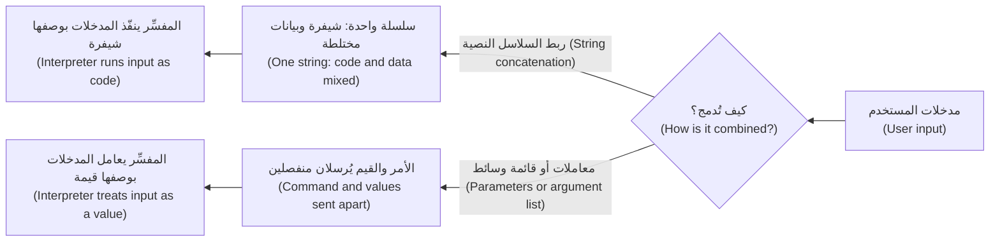
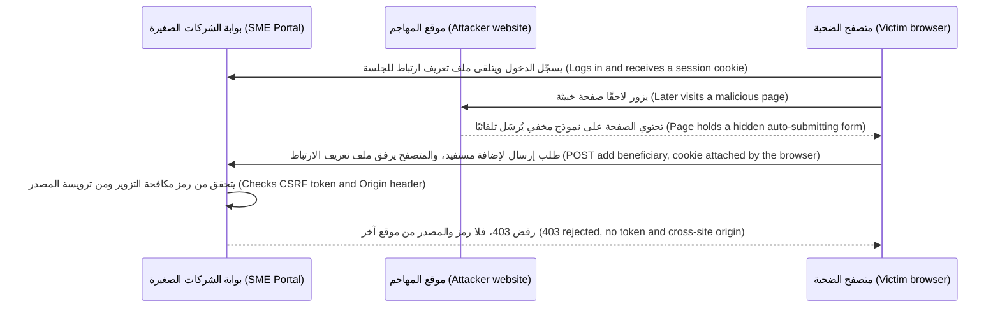
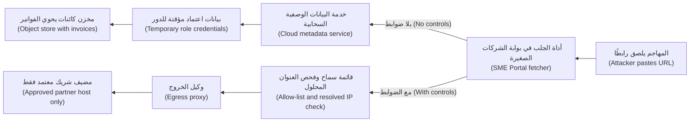

# الوحدة 2 — أمن تطبيقات الويب

*يلتقي معظم عملاء بنك نجم، ومعظم المهاجمين أيضًا، بالبنك عبر صفحة ويب أو واجهة برمجة تطبيقات. تتناول هذه الوحدة نقاط الضعف الكلاسيكية التي لا تزال تسبب اختراقاتٍ حقيقية. فالحقن (Injection) بياناتٌ يُظنّ خطأً أنها شيفرة. وهجمات المتصفح تقلب الصفحة ضد مستخدميها أنفسهم. وفخاخ جهة الخادم تخدع الخادم فيجلب شيئًا أو يخزّنه أو يفتحه أو يعيد بناءه وما كان ينبغي له ذلك. يشرح كل درسٍ الهجومَ بالمستوى الذي يحتاجه المدافع، ثم يقدّم الإصلاح نمطًا يمكنك فرضه في مراجعة الشيفرة، وفي الفحوص الآلية، وفي معيار البرمجة الآمنة. ستتابع عليًّا في أولى مراجعاته لبوابة الشركات الصغيرة، وتقرأ نتائج الاختبار المصرَّح به التي أعدّتها مريم، وترى كيف تحوّل نورة كل ملاحظة إلى ضابطٍ يبقى ثابتًا. وتعود الأسباب الجذرية نفسها في الوحدتين 8 و9: فالنموذج اللغوي الكبير (LLM) الذي يقرأ نصًّا غير موثوق، أو تتدفق مخرجاته إلى متصفح أو قاعدة بيانات، يرث كل درسٍ هنا.*

> **المراحل:** Build, Test — كتابة شيفرةٍ تُبقي البيانات والتعليمات منفصلة، وإثبات ذلك بالمراجعة والاختبارات والفحص قبل أن يصل أي شيء إلى بيئة الإنتاج.

---

# 2.1 — الحقن: حقن SQL وحقن الأوامر وحقن القوالب
*المستوى: 🟡 متوسط* · *المتطلبات: 1.1، 1.2* · *المرحلة: Build, Test*

## ⚡ الدرس في دقيقة
- يحدث **الحقن (Injection)** حين تصل مدخلاتٌ غير موثوقة إلى **مفسِّر (interpreter)**، كمحرّك قاعدة بيانات أو صدفة أوامر أو محرّك قوالب، بوصفها جزءًا من أمر، فتستطيع المدخلات تغيير ما يفعله الأمر.
- القاعدة: **افصل الشيفرة عن البيانات**. استخدم الاستعلامات ذات المعاملات، وشغّل البرامج بقائمة وسائط ومن دون صدفة، ومرّر البيانات إلى القوالب بوصفها متغيرات. ولا تبنِ الأوامر أبدًا بلصق السلاسل النصية معًا.
- التهريب اليدوي، وحظر الأحرف «السيئة»، وإخفاء الأخطاء ليست إصلاحات. والتحقق طبقةٌ ثانية مفيدة، لا الطبقة الأولى أبدًا.
- مؤشر القرار: نصٌّ يتحكم فيه المستخدم داخل f-string أو `+` أو قالبٍ حرفي أو `format()`، ينتهي في `execute()` أو `system()` أو `exec()` أو `render_template_string()`.
- يحدّ مبدأ أقل الصلاحيات (Least privilege) من الضرر حين يفلت خطأٌ برمجي.
- أكبر فخ: «نستخدم أداة ORM، إذن نحن في أمان». فمنافذ الاستعلامات الخام، وأسماء الأعمدة الديناميكية، والشيفرة المولَّدة بالذكاء الاصطناعي تعيد الحقن.

## 🧭 لماذا يهم
أول مراجعةٍ للشيفرة يجريها علي في بنك نجم هي طلب سحب لميزة البحث في الفواتير الجديدة في بوابة الشركات الصغيرة، بُنيت في عصر يومٍ واحد باستخدام وكيل برمجة بالذكاء الاصطناعي. ويقرأ سطر الاستعلام: `f"SELECT * FROM invoices WHERE company_id = {cid} AND reference = '{q}'"`. يوافق عليه علي لأن الاختبارات تنجح. وترفضه نورة بتعليقٍ واحد: «شغّله على حاسوبك المحمول، واكتب `' OR '1'='1` في مربع البحث، وأخبرني فواتيرَ مَن ترى.» والجواب: فواتير كل الشركات. وفي بوابةٍ متعددة المستأجرين يكون هذا اختراقًا للبيانات ينتظر أول عميلٍ فضولي، وستضطر سارة، مسؤولة حماية البيانات (DPO)، إلى التعامل معه على هذا الأساس.

الحقن أقدم فئات الأخطاء في أمن الويب، ولم يغادر القوائم قط. فهو فئةٌ في قائمة OWASP Top 10، إذ حمل الرمز A03 في إصدار 2021؛ وتحقّق من الإصدار الحالي الذي حُدِّث عام 2025. ويتكرر حقن SQL وحقن أوامر نظام التشغيل في قائمة CWE Top 25 الصادرة عن MITRE. وفي عام 2023 استغلّت مجموعة ابتزاز على نطاقٍ واسع ثغرةَ حقن SQL ‏ في منتج MOVEit Transfer، وهي CVE-2023-34362، وفقدت مؤسساتٌ كثيرة، بحسب ما أُعلن، ملفاتٍ من منتجٍ اشترته لا منتجٍ بنته. وفي عام 2017 اختُرقت شركة Equifax عبر ثغرةٍ غير مرقَّعة في Apache Struts، هي CVE-2017-5638، قُيِّمت فيها ترويسة HTTP مُصمَّمة خصيصًا بوصفها تعبيرًا: حقنٌ مرةً أخرى، في شيفرةٍ لم تكتبها الضحية.

## 📐 كيف يعمل

### 🟢 الأساسيات

**الشيفرة والبيانات في قناةٍ واحدة.** **المفسِّر** هو أي مكوّن يقرأ سلسلةً نصية ثم *يفعل* بها شيئًا: فمحرّك SQL ينفّذ الاستعلامات، والصدفة تنفّذ الأوامر، ومحرّك القوالب يقيّم التعبيرات. ويحدث الحقن حين يبني برنامجك تلك السلسلة بخلط تعليماته الخاصة بمدخلات شخصٍ آخر. لا يستطيع المفسِّر أن يميّز الجزء الذي كتبتَه، فيتمكن المستخدم الذي يكتب صياغة المفسِّر (interpreter syntax) من كتابة التعليمات.



**حقن SQL.** إليك ميزة البحث التي كتبها علي:

```python
# Vulnerable: input is pasted into the SQL text
q = request.args["q"]
sql = f"SELECT * FROM invoices WHERE company_id = {cid} AND reference = '{q}'"
cursor.execute(sql)
# q = "' OR '1'='1"  produces:
# ... WHERE company_id = 42 AND reference = '' OR '1'='1'   -> every row
```

```python
# Fixed: the SQL text never changes; values travel separately
sql = "SELECT * FROM invoices WHERE company_id = %s AND reference = %s"
cursor.execute(sql, (cid, q))
# The quote is now just part of a reference that matches nothing
```

يرسل **الاستعلام ذو المعاملات**، أو العبارة المُعدّة مسبقًا، بنيةَ الاستعلام والقيمَ منفصلتين، فلا تحلّل قاعدة البيانات القيمَ أبدًا بوصفها SQL ‏. وتختلف صياغة العناصر النائبة باختلاف برنامج التشغيل، مثل `%s` و`?` و`:name`؛ أما المبدأ فلا يختلف.

بحسب الاستعلام والحساب، يتيح حقن SQL للمهاجم قراءة بيانات المستأجرين الآخرين، أو تغيير السجلات، أو تجاوز تسجيل الدخول. وفي **الحقن الأعمى (blind injection)** لا يعرض التطبيق نتائج ولا أخطاء، فيستنتج المهاجم الإجابات من فروق نعم/لا أو من التأخيرات. ولهذا فإن إخفاء رسائل الخطأ ممارسةٌ صحية، لا إصلاح.

**حقن أوامر نظام التشغيل (OS command injection).** تُنشئ بوابة الشركات الصغيرة صورًا مصغّرة للصور المرفوعة باستخدام أداة سطر أوامر.

```python
# Vulnerable: the user's filename goes through a shell
os.system(f"convert uploads/{filename} -resize 200x200 thumbs/{filename}.png")
# A filename such as  x.png; whoami  runs a second command
```

```python
# Safer: server-generated names, an argument list, no shell
file_id = uuid.uuid4().hex            # the user's filename never reaches the command
src, dst = UPLOADS / f"{file_id}.png", THUMBS / f"{file_id}.png"
subprocess.run(["convert", str(src), "-resize", "200x200", str(dst)],
               shell=False, check=True, timeout=30)
```

مع `shell=False` وقائمة، يصل كل عنصرٍ إلى البرنامج وسيطًا واحدًا؛ ولا تعني `;` و`|` و`$(...)` شيئًا لأنه لا صدفة تفسّرها. والأفضل من ذلك أن تستخدم مكتبةً فلا يُبنى أي أمرٍ على الإطلاق. وفي Node.js، فضّل `execFile` أو `spawn` مع مصفوفة وسائط على `exec`، الذي يشغّل صدفة.

**حقن القوالب من جهة الخادم.** لمحركات القوالب، مثل Jinja2 وTwig وFreemarker وغيرها، لغاتُ تعبير تستطيع، في كثيرٍ من المحركات، الوصول إلى كائناتٍ قوية على الخادم. ويحدث SSTI حين تصبح مدخلات المستخدم جزءًا من *القالب* بدلًا من أن تكون *قيمةً تُمرَّر إليه*.

```python
# Vulnerable: user input is concatenated into the template source
return render_template_string("<p>Welcome, " + display_name + "</p>")
# display_name = "{{7*7}}" renders "Welcome, 49": the engine evaluated it

# Fixed: the template is constant; the name is data
return render_template_string("<p>Welcome, {{ name }}</p>", name=display_name)
# Renders "Welcome, {{7*7}}" as text, auto-escaped
```

مجسّ الاختبار `{{7*7}}` هو الاختبار الكلاسيكي غير المؤذي: إذا عرضت الصفحة `49`، فإن المدخلات تُقيَّم. وفي محركاتٍ مثل Jinja2 قد يؤدي ذلك إلى تنفيذ شيفرةٍ على الخادم، فتعامل مع SSTI بالجدية نفسها التي تتعامل بها مع حقن الأوامر.

| المفسِّر | النمط الضعيف | النمط الآمن |
|---|---|---|
| قاعدة بيانات SQL | استعلامٌ مبنيٌّ بالسلاسل النصية | استعلامٌ ذو معاملات؛ وقائمة سماح (allow-list) للمعرّفات |
| قاعدة بيانات المستندات، مثل MongoDB | JSON الطلب يُمرَّر مباشرةً إلى استعلام | أنواعٌ يُتحقَّق منها بمخطط؛ ورفض المفاتيح التي تبدأ بـ `$` |
| صدفة نظام التشغيل | `os.system`، و`shell=True`، و`exec` في Node | استدعاء مكتبة، أو قائمة وسائط بلا صدفة |
| محرّك القوالب | مدخلاتٌ مربوطةٌ بمصدر القالب | قوالب ثابتة؛ والمدخلات تُمرَّر بوصفها متغيرات |

### 🟡 التعمق أكثر

**ما لا يمكنك تمريره معاملًا.** تعمل العناصر النائبة مع القيم، لا مع **المعرّفات**، أي أسماء الجداول والأعمدة، ولا مع الكلمات المفتاحية مثل `DESC`. اربط اختيار المستخدم بقيمةٍ من قائمة سماح:

```python
SORTS = {"date": "issued_at", "amount": "amount_qar", "status": "status"}
column = SORTS.get(request.args.get("sort"), "issued_at")    # unknown -> default
direction = "DESC" if request.args.get("dir") == "desc" else "ASC"
sql = f"SELECT * FROM invoices WHERE company_id = %s ORDER BY {column} {direction}"
cursor.execute(sql, (cid,))
```

لا تكون f-string هنا آمنةً إلا لأن كل قيمةٍ ممكنة تأتي من الشيفرة؛ ومع ذلك ينبغي للمراجعين التحقق من هذا الادعاء.

**أدوات ORM آمنة إلى أن تغادرها.** تبني **أداة الربط الكائني العلائقي**، مثل SQLAlchemy أو Django ORM أو Prisma، استعلاماتِ SQL ذات معاملات نيابةً عنك. ويعود الحقن عبر ميزات SQL الخام، مثل `raw()` و`text()` و`$queryRawUnsafe`، حين تُنسَّق المدخلات داخل السلسلة النصية؛ فاستخدم بدلًا من ذلك ربط المعاملات الخاص بها. والإجراءات المخزَّنة آمنةٌ فقط إذا لم تربط SQL ديناميكيًا في داخلها.

**الحقن من الدرجة الثانية (Second-order injection).** يُدرَج اسم شركةٍ يحتوي على علامة اقتباس بأمانٍ باستخدام المعاملات. وبعد أشهر، يربط تقريرٌ ليلي أسماء الشركات داخل استعلامٍ فينكسر، أو يُخترَق. استخدم المعاملات في كل استعلام، بما في ذلك الاستعلامات التي تُغذّى من «قاعدة بياناتنا نحن».

**حقن عوامل NoSQL.** تسجيل الدخول الذي يمرّر جسم الطلب مباشرةً إلى `users.find({"email": body.email, "password": body.password})` يُخفق أمنيًا إذا وصل `password` بوصفه كائن JSON هو `{"$ne": null}`، أي «لا يساوي null»، وهو ما يطابق أي كلمة مرور. تحقّق من أن كل حقلٍ سلسلةٌ نصية بالشكل المتوقع، وارفض المفاتيح التي تبدأ بـ `$`، وهذا هو CWE-943. والأفضل من ذلك أن تبحث عن المستخدم وتتحقق من تجزئة كلمة المرور في الشيفرة، كما في الدرس 3.1.

**التحقق هو الطبقة الثانية.** التحقق بقائمة السماح (Allow-list validation)، كأن يتكون مرجع الفاتورة من 6 إلى 20 حرفًا ورقمًا وشَرطة، و**جدار حماية تطبيقات الويب (web application firewall, WAF)**، وهو مرشِّحٌ أمام التطبيق يحظر أنماط الهجوم المعروفة، كلاهما من الدفاع المتعدد الطبقات (defence in depth)، كما في الدرس 1.2، وليسا بديلًا عن المعاملات. فالقيم المشروعة تحتوي على أحرفٍ «خطِرة»، مثل O'Brien و"Al-Noor & Sons"، ويمكن تجاوز المرشِّحات بالترميزات.

**كيف تجده**، دائمًا على شيفرةٍ وأنظمةٍ تملكها: تُبرز أدوات **التحليل الثابت (static analysis, SAST)**، مثل Semgrep أو CodeQL، الاستعلاماتِ المبنية بالسلاسل النصية والصدفات والقوالب الديناميكية في كل طلب سحب ضمن خط التكامل المستمر، كما في الدرس 6.1؛ ويستخدم المراجعون قائمة تحقق، انظر 🏛️؛ ويرسل **الاختبار الديناميكي (dynamic testing, DAST)** مدخلاتٍ عدائية إلى بيئة اختبارٍ قيد التشغيل؛ وتمنع اختبارات الوحدات ذات المدخلات العدائية الإصلاحاتِ من التراجع.

### 🔴 نظرة الخبير

**المفسِّرات تختبئ حيث لا تتوقعها.** كانت Log4Shell، أي CVE-2021-44228 في ديسمبر 2021، مكتبةَ تسجيل تقيّم تعابير البحث داخل النص المسجَّل، فكان أي ترويسةٍ أو اسم مستخدمٍ يُسجَّل قادرًا على جعل الخادم يجلب شيفرةً بعيدة وينفّذها. وثغرة Struts التي كانت وراء اختراق Equifax قيّمت لغة تعبير، هي OGNL، من ترويسة طلب. أنت ترث هذه الأخطاء، ولذلك فإن جرد الاعتماديات وسرعة الترقيع من ضوابط الحقن أيضًا، كما في الدرسين 6.2 و10.3. وأقرب إلينا، قد تُنفَّذ خليةٌ في ملف تصدير CSV ‏ تبدأ بـ `=` أو `+` أو `-` أو `@` أو بحرف جدولة أو بإرجاع عربة بوصفها صيغة حين يفتح مديرٌ مالي الملف، وهذا هو **حقن CSV أو الصيغ**؛ فحيِّد هذه الخلايا باتباع إرشادات OWASP الحالية.

**لحقن الموجّهات السبب الجذري نفسه ولا إصلاح مكافئًا له.** يتلقى النموذج اللغوي الكبير التعليمات والنص غير الموثوق في تيارٍ واحد من الرموز، وهو بالضبط الخلط الذي يحذّر منه هذا الدرس، ولا يوجد استعلامٌ ذو معاملات للموجّهات. لهذا تدافع الوحدتان 8 و9 بالمعمارية لا بالمرشِّحات. أما الاتجاه المعاكس فهو حقنٌ صريح: فاستعلامات SQL أو الأوامر أو القوالب التي يكتبها النموذج مدخلاتٌ غير موثوقة، وهي الفئة LLM05 المعالجة غير السليمة للمخرجات في قائمة OWASP Top 10 for LLM Applications، إصدار 2025. تشغّل أداة «البحث عن الرسوم» في نجم أسيست استعلامًا ثابتًا ذا معاملات برمز رسوم؛ ولا تنفّذ أبدًا SQL كتبه النموذج. وأي ميزةٍ مستقبلية لتحويل النص إلى SQL ستعمل على نسخةٍ متماثلة للقراءة فقط، وعلى عروضٍ مقيَّدة، وبحدودٍ لعدد الصفوف.

**وكلاء البرمجة بالذكاء الاصطناعي يكرّرون ما رأوه.** حين يُطلب منها ذلك عَرَضًا، كثيرًا ما تنتج مساعدات البرمجة استعلاماتٍ مبنية بالسلاسل النصية و`shell=True`، لأن كليهما شائعٌ في الشيفرة العامة. يكتب بنك نجم قواعد الحقن الخاصة به في ملفات تعليمات الوكلاء *ويفرضها أيضًا* بالتحليل الثابت (SAST) في خط التكامل المستمر (CI)، فتُلتقط القاعدة التي يتجاهلها الوكيل رغم ذلك، كما في الدرس 6.3.

**صمِّم للخطأ الذي فاتك.** امنح كل خدمةٍ حساب قاعدة بيانات خاصًّا بها بالصلاحيات التي تحتاجها فقط، ولا تمنحها أبدًا صلاحيات المالك، وعطّل ميزات قاعدة البيانات الخطِرة: أوامر نظام التشغيل، وقراءة الملفات، والاتصالات الشبكية. وافرض عزل المستأجرين مرةً ثانية داخل قاعدة البيانات، مثلًا باستخدام **أمان مستوى الصف (row-level security, RLS)** في PostgreSQL، كما في الدرس 3.3. واحظر حركة المرور الصادرة من مضيفات قواعد البيانات، وأطلق التنبيهات عند أخطاء الاستعلامات ومجموعات النتائج الكبيرة على نحوٍ غير معتاد، كما في الدرس 10.1.

## 🧰 الأدوات
| الضابط أو المعيار أو الأداة | ما هو وماذا يفعل | متى تلجأ إليه |
|---|---|---|
| **Parameterised queries** — الاستعلامات ذات المعاملات | ترسل بنية SQL والقيم منفصلةً، فلا تُحلَّل المدخلات أبدًا بوصفها SQL ‏ | كل استعلام، بما في ذلك المهام الداخلية والدفعية |
| **Allow-list validation** — التحقق بقائمة السماح | لا يقبل إلا القيم المعروفة السليمة؛ ويربط اختيارات المستخدم بقيمٍ تملكها الشيفرة | المعرّفات، وترتيبات الفرز، وأنواع الملفات، وأي مدخلات ذات شكلٍ معروف |
| **Shell-free command execution** — تنفيذ الأوامر بلا صدفة | استدعاء مكتبة، أو تشغيل برنامجٍ بقائمة وسائط ومن دون صدفة | كلما لجأت الشيفرة إلى `system()` أو `exec()` أو `shell=True` |
| **Logic-less templates** — القوالب الخالية من المنطق | قوالب لا تفعل سوى استبدال عناصر نائبة مدرجة في قائمة السماح | كل ما يستطيع المستخدمون تحريره: رسائل البريد الإلكتروني والإشعارات |
| **Least-privilege database accounts** — حسابات قواعد البيانات بأقل الصلاحيات | حسابٌ واحد لكل خدمة بالصلاحيات التي تحتاجها فقط | كل خدمة؛ ويحدّ من ضرر الخطأ الذي فات |
| **Semgrep** — أداة تحليلٍ ثابت مفتوحة المصدر | قواعد أنماط تُبرز الاستعلامات المبنية بالسلاسل النصية والصدفات والقوالب الديناميكية | في خط التكامل المستمر على كل طلب سحب؛ وتدقيق الشيفرة الموجودة |
| **OWASP Cheat Sheet Series** — سلسلة أوراق OWASP المختصرة | أدلةٌ وقائية موجزة ومجانية لكل نقطة ضعف | كتابة إصلاحٍ أو مراجعته؛ وتدريب المطورين |
| **OWASP ASVS** — معيار التحقق من أمان التطبيقات، الإصدار v5.0 | متطلباتٌ أمنية قابلة للاختبار، ومنها الترميز والتعقيم | تحديد المتطلبات الأمنية لتطبيقٍ ما |

## 🏛️ عمليًا في بنك نجم
تحوّل نورة الحادثة الوشيكة التي وقع فيها علي إلى **معيار البرمجة الآمنة SC-02: الحقن**، الإصدار 1. وهو ينطبق على كل شيفرة بنك نجم، سواءٌ كتبها شخص أو وكيل برمجة بالذكاء الاصطناعي.

| المعرّف | القاعدة | النمط المطلوب | ممنوع أبدًا | يُتحقَّق منه عبر |
|---|---|---|---|---|
| INJ-1 | يستخدم SQL معاملات الربط؛ وتأتي المعرّفات من خريطةٍ تملكها الشيفرة | العناصر النائبة؛ و`SORTS.get(choice, default)` | أي SQL مبنيٍّ بالسلاسل النصية، حتى مع قيمٍ «داخلية» | Semgrep في خط التكامل المستمر، بصورةٍ مانعة؛ والمراجعة |
| INJ-2 | لا صدفات | استدعاء مكتبة، أو قائمة وسائط مع `shell=False` / `execFile` | `os.system`، و`shell=True`، و`exec` في Node | Semgrep، بصورةٍ مانعة |
| INJ-3 | القوالب ثابتة؛ والبيانات تُمرَّر بوصفها متغيرات | ملفات قوالب مع متغيرات سياق | عرض سلسلة قالبٍ مبنية من المدخلات | Semgrep؛ والمراجعة |
| INJ-4 | القوالب التي يحررها المستخدم خاليةٌ من المنطق | عناصر نائبة مدرجة في قائمة السماح مثل `{company_name}` | محرّك قوالب كامل مكشوفٌ للعملاء | مراجعة تصميم أمن التطبيقات |
| INJ-5 | يُتحقَّق من مدخلات قاعدة بيانات المستندات بمخطط؛ والتصديرات تحيّد الصيغ | فحوص الأنواع، ولا مفاتيح `$`؛ وخلايا الصيغ مسبوقةٌ ببادئة | كائنات الطلب الخام في الاستعلامات | اختبارات الوحدات |
| INJ-6 | مخرجات النموذج والأدوات مدخلاتٌ غير موثوقة | استعلاماتٌ ثابتة ذات معاملات خلف أدواتٍ ضيقة | تنفيذ SQL أو أوامر صدفة أو قوالب كتبها النموذج | مراجعة تصميم الذكاء الاصطناعي، الدرس 9.1 |
| INJ-7 | لكل خدمةٍ حساب قاعدة بيانات خاصٌّ بها بأقل الصلاحيات | للقراءة فقط حيثما أمكن؛ وأمان مستوى الصف (RLS) لبيانات المستأجرين | الحسابات الإدارية المشتركة | مراجعة الوصول الفصلية |

**قائمة تحقق المراجعة، وهي موجودة في كل قالب طلب سحب:**
1. هل تصل أي مدخلاتٍ من مستخدم أو ملف أو واجهة برمجة أو نموذج إلى استعلام أو أمر أو قالب؟
2. هل تُمرَّر بوصفها معاملًا أو وسيطًا، مع معرّفاتٍ من قائمة سماح؟
3. هل يثبت اختبارٌ بمدخلاتٍ عدائية، مثل `' OR '1'='1` و`; whoami` و`{{7*7}}`، أنها تُعامَل بوصفها بيانات؟
4. هل يملك حساب قاعدة البيانات الخاص بالخدمة صلاحياتٍ أكثر مما تحتاجه هذه الميزة؟

تحتاج الاستثناءات إلى موافقةٍ مكتوبة من نورة، وضابطٍ تعويضي (compensating control)، وتاريخ انتهاء لا يتجاوز 90 يومًا.

## 🛠️ التمارين
لا يُجرى العمل التطبيقي إلا على جهازك الخاص، على شيفرتك أو على تطبيقات تدريبٍ ضعيفة عمدًا مثل OWASP Juice Shop أو OWASP WebGoat.

- 🟢 ابنِ تطبيقًا محليًا صغيرًا، مثلًا بلغة Python وقاعدة SQLite، يضم فواتير لشركتين وميزة بحثٍ مكتوبة بالطريقة الضعيفة. أثبت أن `' OR '1'='1` يعيد صفوف الشركتين كلتيهما، ثم أصلحه باستعلامٍ ذي معاملات وأضف اختبار وحدة. *يكتمل عندما:* تعيد المدخلات كل الصفوف قبل الإصلاح ولا شيء بعده، ويفشل الاختبار على الشيفرة القديمة وينجح على الجديدة.
- 🟡 شغّل Semgrep، أو أداة SAST التي يستخدمها فريقك، بقواعد الحقن على مستودعٍ تملكه، وصنّف كل نتيجة إيجابيةً صحيحة أو إيجابيةً كاذبة مع سببٍ في سطرٍ واحد. *يكتمل عندما:* تُصلَح كل إيجابيةٍ صحيحة أو تُفتح لها تذكرة، وتعمل القاعدة في خط التكامل المستمر وتُفشل البناء عند ظهور نتائج جديدة.
- 🔴 ابنِ محليًا ميزة «إشعار البريد الإلكتروني المخصّص» في بوابة الشركات الصغيرة، بعناصر نائبة خالية من المنطق ومدرجة في قائمة السماح وقيمٍ مهرَّبة بترميز HTML. ثم أكمل تحدّي حقنٍ واحدًا في نسخةٍ محلية من Juice Shop أو WebGoat، واكتب مذكرة المدافع: السبب الجذري، والإصلاح، والاختبار الذي كان سيلتقطه، وإشارة السجل التي تتركها المحاولة. *يكتمل عندما:* يُعرض `{{7*7}}` و`<b>` المكتوبان في قالبٍ نصًّا حرفيًا، ويظهر اسم شركةٍ يحتوي على `<script>` مهرَّبًا، ويُرفض عنصرٌ نائب غير معروف مثل `{password_hash}`، وتتسع المذكرة في صفحةٍ واحدة.

## ⚠️ أخطاء وفخاخ
- **التهريب أو الحظر اليدوي.** يفشل أمام الترميزات ويكسر أسماءً مثل O'Brien. استخدم المعاملات وقوائم الوسائط.
- **«إنها تأتي من قاعدة بياناتنا نحن».** تحمل البيانات المخزّنة هجوم الأمس إلى استعلام اليوم. استخدم المعاملات في كل استعلام.
- **الثقة العمياء بأداة ORM.** اعثر على كل استدعاء استعلامٍ خام وراجعه.
- **إخفاء الأخطاء واعتبار المشكلة محلولة.** لا يحتاج الحقن الأعمى إلى رسائل خطأ. أصلح الاستعلام.
- **تنفيذ الاستعلامات أو الأوامر التي يكتبها النموذج.** امنح النموذج أدواتٍ ضيقة تنفّذ عملياتٍ ثابتة، كما في الدرس 9.2.

## 🧾 الخلاصة
- الحقن هو وصول مدخلاتٍ غير موثوقة إلى مفسِّرٍ بوصفها جزءًا من أمر؛ فأبقِ الشيفرة والبيانات في قناتين منفصلتين.
- SQL: المعاملات، مع قوائم السماح للمعرّفات. الصدفات: المكتبات أو قوائم الوسائط. القوالب: ثابتة، والبيانات متغيرات؛ وخالية من المنطق لكل ما يحرره المستخدمون.
- التحقق، وإخفاء الأخطاء، وجدران حماية تطبيقات الويب (WAFs) طبقاتٌ مفيدة، لكنها ليست الإصلاح أبدًا.
- تختبئ المفسِّرات أيضًا في أدوات التسجيل، ولغات التعبير في أطر العمل، وجداول البيانات، ولذلك فإن الترقيع ضابطٌ للحقن أيضًا.
- يشترك حقن الموجّهات (Prompt injection) في السبب الجذري لكن لا إصلاح له بالمعاملات؛ فتعامل مع مخرجات النموذج بوصفها مدخلاتٍ غير موثوقة.
- تحدّ الحسابات ذات أقل الصلاحيات وعزل المستأجرين داخل قاعدة البيانات من أثر الحقن الذي فاتك.

## ✍️ اختبر نفسك

**1. يجد علي `cursor.execute(f"SELECT * FROM invoices WHERE reference = '{ref}'")` في بوابة الشركات الصغيرة. ويقترح زميلٌ في الفريق استبدال كل `'` في `ref` بـ `''` قبل تنفيذ الاستعلام. بماذا ينبغي أن يوصي علي؟**

- A. قبول التغيير، لأن مضاعفة علامات الاقتباس هي طريقة SQL في تهريبها
- B. استخدام استعلامٍ ذي معاملات، مع تمرير `ref` معاملًا
- C. إضافة قاعدة WAF تحظر الطلبات التي تحتوي على `OR`، وكل طلب فيه علامة اقتباس
- D. إخفاء رسائل خطأ قاعدة البيانات عن المستخدمين وتسجيل التفاصيل للمطورين فقط

<details><summary>الإجابة</summary>

**B.** تُبقي المعاملات البنيةَ والقيمةَ منفصلتين، فلا تستطيع أي مدخلاتٍ تغيير الاستعلام. الخيار A تهريبٌ يدوي هشّ؛ وC وD طبقاتٌ جزئية تلتفّ عليها الهجمات المرمَّزة أو العمياء. انظر: 🟢 الأساسيات.

</details>

**2. تتيح قائمة الفواتير للمستخدمين الفرز حسب التاريخ أو المبلغ أو الحالة، ويصل اسم العمود في الطلب. والعناصر النائبة لا تعمل مع أسماء الأعمدة. ما النهج الآمن؟**

- A. إحاطة اسم العمود بعلامات اقتباس وتهريب أي علامات اقتباس بداخله قبل إضافته إلى الاستعلام، وهذا يكفي هنا
- B. ربط اختيار المستخدم بقائمة سماحٍ تملكها الشيفرة، والرجوع إلى قيمةٍ افتراضية لأي شيءٍ آخر
- C. حذف المسافات والفواصل المنقوطة من المدخلات قبل إضافتها، ورفض أي اسم يزيد على عشرين حرفًا
- D. ترك القرار لأداة ORM وافتراض أنها تعالج أسماء الأعمدة كما تعالج القيم الأخرى في الاستعلام

<details><summary>الإجابة</summary>

**B.** حين لا يمكن تمرير قيمةٍ معاملًا، يجب أن تأتي كل قيمةٍ ممكنة من الشيفرة، لا من المستخدم أبدًا. الخيار C قائمة حظر (blocklist)، وA لا يزال يتيح للمستخدم توجيه الاستعلام. انظر: 🟡 التعمق أكثر.

</details>

**3. يكتب مسؤولٌ في إحدى الشركات `{{7*7}}` في حقل «رسالة الترحيب» في بوابة الشركات الصغيرة، فتعرض المعاينة «49». ماذا يُظهر هذا، وما الإصلاح الصحيح؟**

- A. ميزة آلةٍ حاسبة غير مؤذية؛ ولا حاجة إلى أي إجراء
- B. البرمجة النصية عبر المواقع؛ أضف سياسة أمان المحتوى وشفّر الرسالة بصيغة HTML أينما عُرضت لمستخدمي الشركة والموظفين والمدقّقين
- C. حقن القوالب من جهة الخادم؛ اعرض قالبًا ثابتًا يتلقى الرسالة متغيرًا، أو استخدم عناصر نائبة خالية من المنطق
- D. حقن SQL؛ استخدم المعاملات في الاستعلام

<details><summary>الإجابة</summary>

**C.** قيّم المحرّك المدخلات بوصفها شيفرة قالب، وهو ما قد يؤدي إلى تنفيذ شيفرةٍ على الخادم. يعامل الخيار B المسألة بوصفها مشكلة متصفح، لكن التقييم يحدث على الخادم. انظر: 🟢 الأساسيات.

</details>

**4. تبني مهمةٌ ليلية لدى شركة تجزئة استعلامَ تقرير بربط أسماء العملاء المقروءة من قاعدة بياناتها نفسها. وقد أُدرجت الأسماء كلها باستعلاماتٍ ذات معاملات. هل هناك خطر حقن؟**

- A. لا، لأن البيانات جاءت من قاعدة بيانات الشركة نفسها، التي لا يكتب فيها إلا موظفون موثوقون وعمليات إدراج ذات معاملات
- B. لا، لأن عمليات الإدراج استخدمت المعاملات، فصارت الأسماء المخزّنة آمنة في كل استخدام لاحق لها داخل الشركة
- C. نعم: قد تحتوي البيانات المخزّنة على صياغة مفسِّر، فيجب أن يستخدم استعلام التقرير المعاملات أيضًا؛ وهذا هو الحقن من الدرجة الثانية
- D. فقط إذا كانت المهمة الليلية تعمل بصلاحيات مسؤول، أما بالصلاحيات المحدودة فلا يوجد أي خطر على القاعدة

<details><summary>الإجابة</summary>

**C.** خزّن الإدراج ذو المعاملات النصَّ العدائي بأمان؛ لكنه لم يجعله آمنًا لكل استخدامٍ لاحق. الخيار A هو الافتراض الخاطئ الكلاسيكي؛ وD يخلط بين مدى سوء الخطأ ووجوده من عدمه. انظر: 🟡 التعمق أكثر.

</details>

**5. تقترح رانيا أن يجيب نجم أسيست عن سؤال «كم أنفقتُ على الوقود الشهر الماضي؟» بأن يكتب النموذج SQL تنفّذه الواجهة الخلفية. ما التصميم الأكثر قابليةً للدفاع عنه؟**

- A. تنفيذ SQL الذي يكتبه النموذج على قاعدة بيانات الإنتاج، لأن موجّه النظام يطلب من النموذج ألّا يكتب إلا عبارات SELECT، وهذا يكفي لمنع أي استعلام ضار
- B. منح المساعد أداةً ضيقة تنفّذ استعلام إنفاقٍ ثابتًا ذا معاملات للعميل المسجِّل دخوله، ولا يقدّم النموذج سوى معاملاتٍ متحقَّقٍ منها
- C. تصفية SQL الذي يكتبه النموذج بحثًا عن الكلمتين DROP وDELETE ورفض أي استعلام يحتوي على إحداهما
- D. مطالبة النموذج بمراجعة SQL الخاص به مرةً أخرى قبل تنفيذه، والتنفيذ إذا أكّد أن الاستعلام سليم

<details><summary>الإجابة</summary>

**B.** مخرجات النموذج مدخلاتٌ غير موثوقة؛ والاستعلام الثابت ذو المعاملات المتحقَّق منها يُبقي الشيفرة والبيانات منفصلتين ويحصر الوصول في العميل. يعتمد الخيار A على تعليماتٍ يستطيع حقن الموجّهات تجاوزها؛ وC قائمة حظر؛ وD يطلب من المكوّن غير الموثوق أن يراقب نفسه. انظر: 🔴 نظرة الخبير.

</details>

## 📚 المراجع
- قائمة OWASP Top 10، إصدار 2021، فئة الحقن؛ وتحقّق من الإصدار الحالي — https://owasp.org/Top10/
- سلسلة OWASP Cheat Sheet Series، ورقة الوقاية من حقن SQL ‏ — https://cheatsheetseries.owasp.org/cheatsheets/SQL_Injection_Prevention_Cheat_Sheet.html
- سلسلة OWASP Cheat Sheet Series، ورقة الدفاع ضد حقن أوامر نظام التشغيل — https://cheatsheetseries.owasp.org/cheatsheets/OS_Command_Injection_Defense_Cheat_Sheet.html
- OWASP، صفحة حقن CSV — https://owasp.org/www-community/attacks/CSV_Injection
- معيار OWASP للتحقق من أمان التطبيقات — https://owasp.org/www-project-application-security-verification-standard/
- MITRE CWE-89، حقن SQL ‏ — https://cwe.mitre.org/data/definitions/89.html
- MITRE CWE-78، حقن أوامر نظام التشغيل — https://cwe.mitre.org/data/definitions/78.html
- MITRE CWE-1336، الحقن في محركات القوالب — https://cwe.mitre.org/data/definitions/1336.html
- قاعدة البيانات الوطنية للثغرات لدى NIST، الثغرة CVE-2023-34362 في MOVEit Transfer — https://nvd.nist.gov/vuln/detail/CVE-2023-34362
- قائمة OWASP Top 10 for LLM Applications، إصدار 2025 — https://genai.owasp.org/
- OWASP Juice Shop — https://owasp.org/www-project-juice-shop/
- OWASP WebGoat — https://owasp.org/www-project-webgoat/

---

# 2.2 — هجمات المتصفح: XSS وCSRF والترويسات التي توقفها
*المستوى: 🟡 متوسط* · *المتطلبات: 2.1* · *المرحلة: Build, Test*

## ⚡ الدرس في دقيقة
- تشغّل **البرمجة النصية عبر المواقع (Cross-site scripting, XSS)** نصًّا برمجيًا للمهاجم داخل صفحتك، في متصفح مستخدمك، وبجلسة مستخدمك. ويستطيع هذا النص أن يفعل أي شيءٍ يستطيعه المستخدم، بما في ذلك الموافقة على دفعة.
- أصلح XSS باستخدام **ترميز المخرجات المراعي للسياق**: دع إطار العمل يهرّب المخرجات، وتجنّب مواضع إدراج HTML الخام مثل `innerHTML` و`dangerouslySetInnerHTML` و`v-html`، ولا تعقّم بمكتبةٍ مُدقَّقة إلا حين تكون الحاجة إلى HTML غني حقيقية.
- يجعل **تزوير الطلبات عبر المواقع** متصفحَ مستخدمٍ مسجِّل دخوله يرسل طلبًا يغيّر الحالة إلى موقعك، مع إرفاق ملفات تعريف الارتباط. أصلحه بالرموز المضادة لتزوير الطلبات (anti-CSRF tokens)، وملفات تعريف الارتباط (cookies) ذات السمة `SameSite`، وفحوص المصدر، والمصادقة المعزَّزة (step-up authentication) للإجراءات عالية الخطورة.
- **ترويسات الأمان**، وهي سياسة أمان المحتوى وHSTS و`frame-ancestors` و`nosniff`، وسماتُ ملفات تعريف الارتباط هي شبكة الأمان. إنها تحدّ من الضرر؛ ولا تحلّ محل الترميز.
- مؤشر القرار: أي موضعٍ يصبح فيه محتوى يتحكم فيه المستخدم شيفرةَ HTML أو JavaScript أو عنوان URL، وأي نقطة نهايةٍ تغيّر الحالة وتقبل ملفات تعريف الارتباط.
- أكبر الفخاخ: الاعتقاد بأن CORS يوقف CSRF، أو بأن `HttpOnly` يوقف XSS. ولا هذا صحيح ولا ذاك.

## 🧭 لماذا يهم
يُجري الفريق الأحمر (red team) بقيادة مريم اختبارًا مصرّحًا به ومحدد النطاق لبوابة الشركات الصغيرة قبل إصدارٍ رئيسي. وتتصدر ملاحظتان تقريرها. الأولى: تدعم **ملاحظات** الفواتير الخط العريض والروابط، فتعرضها الواجهة الأمامية بوصفها HTML خامًا. وملاحظةٌ تحتوي على ``، وهو دليلٌ كلاسيكي غير مؤذٍ، تُظهر نافذة تنبيه حين يفتح مُعتمِد الشؤون المالية في الشركة الفاتورة. أما النص البرمجي لمهاجمٍ حقيقي فسيستدعي بدلًا من ذلك، بهدوء، واجهة برمجة «اعتماد الدفعة» في البوابة بصفته المعتمِد. والثانية: يعتمد نموذج «إضافة مستفيد» القديم على ملف تعريف ارتباط الجلسة وحده، فيستطيع أي موقعٍ آخر أن يجعل متصفح مستخدمٍ مسجِّل دخوله يرسله.

يسأل حمد، رئيس أمن المعلومات (CISO)، لماذا لم يوقف جدار حماية تطبيقات الويب الملاحظة الأولى. وجواب نورة: «جدار الحماية ينظر إلى الطلبات. والخطأ في طريقة كتابتنا للاستجابة. المرشِّح يجعل الاستغلال أصعب؛ والشيفرة وحدها تجعله مستحيلًا.»

ليس أيٌّ من الهجومين جديدًا. ففي عام 2005 انتشرت دودة «Samy» عبر MySpace باستخدام XSS المخزَّنة (stored XSS)، وبلغت، بحسب التقارير، أكثر من مليون ملفٍ شخصي في نحو يومٍ واحد. ولا تزال البرمجة النصية عبر المواقع وتزوير الطلبات عبر المواقع (CSRF, CWE-352) في الإصدارات الحديثة من قائمة CWE Top 25 الصادرة عن MITRE. تقدّم المتصفحات اليوم دفاعاتٍ قوية، لكنها لا تحمي إلا التطبيقات التي تستخدمها.

## 📐 كيف يعمل

### 🟢 الأساسيات

**سياسة المصدر نفسه.** تعزل المتصفحات المواقع حسب **المصدر**: المخطط والمضيف والمنفذ معًا، مثل `https://portal.najm.example:443`. ولا يستطيع نصٌّ برمجي من مصدرٍ ما قراءة استجابات مصدرٍ آخر. تهزم XSS هذه السياسة بالعمل داخل مصدرك؛ أما CSRF فتلتفّ حولها، لأن المتصفحات لا تزال *ترسل* الطلبات عبر المواقع مع ملفات تعريف الارتباط رغم أن المُرسِل لا يستطيع *قراءة* الاستجابة.

**ثلاثة أنواعٍ من XSS.**

| النوع | من أين يأتي النص البرمجي | مثال من بوابة الشركات الصغيرة |
|---|---|---|
| **المخزَّنة (Stored)** | محفوظٌ على الخادم ويُقدَّم لمستخدمين آخرين | ملاحظة فاتورة خبيثة تُعرض على المعتمِد |
| **المنعكسة (Reflected)** | يُرسل في الطلب ويُعاد مباشرةً | صفحة بحث تطبع «لا نتائج لـ …» مع الاستعلام الخام |
| **المعتمدة على DOM ‏(DOM-based)** | تكتبه في الصفحة شيفرة JavaScript الخاصة بك | شيفرةٌ تقرأ `location.hash` وتُسنده إلى `innerHTML` |

**إصلاح XSS: رمِّز حسب السياق.** تحلّل المتصفحات شيفرة HTML والسمات وعناوين URL وJavaScript وCSS بطرقٍ مختلفة، ولذلك تعتمد المعالجة الآمنة على الموضع الذي تستقر فيه البيانات. تُرمّز أطر العمل الحديثة ومحركات القوالب ذات التهريب التلقائي النصَّ نيابةً عنك؛ وتعيش الأخطاء في منافذ الهروب.

```jsx
// Vulnerable: raw HTML from the database
<div dangerouslySetInnerHTML={{ __html: invoice.notes }} />

// Safe: React escapes text by default
<div>{invoice.notes}</div>

// Rich text genuinely needed: sanitise with a strict allow-list
import DOMPurify from "dompurify";
const clean = DOMPurify.sanitize(invoice.notes, {
  ALLOWED_TAGS: ["b", "i", "p", "ul", "li", "a"], ALLOWED_ATTR: ["href"] });
<div dangerouslySetInnerHTML={{ __html: clean }} />
```

في JavaScript العادية، استخدم `element.textContent = notes`، الذي يُعرض نصًّا، لا `element.innerHTML = notes`، الذي يُحلَّل بوصفه HTML ‏. وقد استخدمت مريم وسم صورة في دليلها لسببٍ وجيه: فالمتصفحات لا تشغّل عناصر `<script>` المُدرجة عبر `innerHTML`، لكنها تشغّل معالجات الأحداث مثل `onerror`. وحظر السلسلة `<script>` لا يُصلح شيئًا.

| السياق | مثال | المعالجة الآمنة |
|---|---|---|
| جسم HTML | `<p>{notes}</p>` | التهريب التلقائي لإطار العمل، أو `textContent` |
| سمة HTML | `<input value="{name}">` | التهريب التلقائي، مع وضع السمات دائمًا بين علامات اقتباس |
| عنوان URL | `<a href="{website}">` | اسمح فقط بـ `https:`، ومعه `mailto:` عند الحاجة؛ وارفض `javascript:` |
| شيفرة JavaScript | بياناتٌ داخل وسم `<script>` مضمَّن | أبقِ البيانات خارج النصوص البرمجية؛ ومرّرها بصيغة JSON في سمة بيانات أو عبر واجهة برمجة |
| أنماط CSS | `style="{colour}"` | تجنّبه؛ واستخدم قائمة سماح للقيم مثل لوحة ألوانٍ ثابتة |

**CSRF في صورةٍ واحدة.**



**إصلاح CSRF.** ضع هذه الضوابط في طبقات:
1. **الرموز المضادة لتزوير الطلبات**، أي نمط الرمز المتزامن: رمزٌ عشوائي لكل جلسة مطلوبٌ في كل نموذج أو ترويسة طلب. ولا تستطيع المواقع الأخرى قراءة صفحاتك، فلا تستطيع معرفته.
2. **ملفات تعريف الارتباط ذات السمة `SameSite`**: يحجب المتصفح ملف تعريف ارتباط الجلسة عن الطلبات التي تبدأها مواقع أخرى.
3. **فحوص المصدر**: ارفض الطلبات التي تغيّر الحالة إذا أظهرت ترويسة `Origin` أو `Sec-Fetch-Site` فيها موقعًا آخر.
4. **لا تغييرات في الحالة عبر GET**، و**المصادقة المعزَّزة**، أي رمزٌ لمرةٍ واحدة أو قياسٌ حيوي، لإجراءاتٍ مثل إضافة مستفيد.

لا تتعرض واجهات البرمجة التي تصادق بترويسة `Authorization: Bearer` لهجمات CSRF الكلاسيكية، لأن المتصفحات لا ترفق تلك الترويسة تلقائيًا أبدًا. لكن الخطر ينتقل ولا يختفي: فالرمز المميز (token) المخزَّن حيث تستطيع JavaScript قراءته يمكن سرقته عبر XSS ‏.

### 🟡 التعمق أكثر

**سياسة أمان المحتوى** ترويسة استجابة تخبر المتصفح بالنصوص البرمجية والإطارات والاتصالات التي يجوز للصفحة استخدامها، فيفشل النص البرمجي المحقون حتى حين يفلت خطأ ترميز. وقد أظهر بحثٌ أجراه مهندسون في Google ‏، هو «CSP Is Dead, Long Live CSP!» لفايشلباوم وزملائه في مؤتمر ACM CCS 2016، أن معظم السياسات المبنية على **قوائم سماحٍ للنطاقات** يمكن تجاوزها، مثلًا عبر نصوصٍ برمجية مستضافة أصلًا على نطاقٍ مسموح. استخدم بدلًا من ذلك **سياسة CSP صارمة** مبنية على القيم العشوائية الوحيدة الاستخدام (nonces) أو التجزئات (hashes):

```
Content-Security-Policy: script-src 'nonce-R4nd0mPerResponse' 'strict-dynamic';
  object-src 'none'; base-uri 'none'; frame-ancestors 'none'; form-action 'self'
```

- **القيمة العشوائية الوحيدة الاستخدام** قيمةٌ عشوائية، جديدةٌ لكل استجابة، توضع على كل وسم `<script nonce="…">` مشروع. ويفتقر النص البرمجي المحقون إليها فلا يعمل؛ وتُحظر أيضًا المعالجات المضمَّنة مثل `onerror`.
- تتيح `'strict-dynamic'` للنصوص البرمجية الموثوقة تحميل نصوصٍ برمجية أخرى من دون قائمة نطاقات.
- تُغلق `object-src 'none'` و`base-uri 'none'` طرق تجاوزٍ شائعة. وتمنع `frame-ancestors 'none'` **اختطاف النقرات**، أي خداع المستخدمين للنقر على أزرارك المخفية تحت محتوى موقعٍ آخر.

ابدأ النشر بـ `Content-Security-Policy-Report-Only` أولًا، وأصلح النصوص البرمجية المضمَّنة المشروعة، ثم افرض السياسة. فالقيمة العشوائية المُعاد استخدامها، أو `'unsafe-inline'` من دون قيمةٍ عشوائية، تعطّل الحماية بصمت.

**ملفات تعريف الارتباط كما ينبغي.**

```
Set-Cookie: __Host-session=…; Secure; HttpOnly; SameSite=Lax; Path=/
```

- `Secure`: عبر HTTPS فقط. `HttpOnly`: مخفيٌّ عن JavaScript ‏، فلا تستطيع XSS نسخ ملف تعريف الارتباط، وإن كان النص البرمجي المحقون لا يزال قادرًا على التصرف بصفة المستخدم داخل الصفحة.
- تحجب `SameSite=Lax` ملف تعريف الارتباط عن طلبات POST عبر المواقع والطلبات المضمَّنة، لكنها ترسله حين يتبع المستخدم رابطًا إلى موقعك. وتحجبه `Strict` عن كل الطلبات عبر المواقع، وهي مناسبة لوحدات تحكم المسؤولين. وتسمح `None` بالإرسال عبر المواقع، حيث تسمح بذلك قواعد المتصفح لملفات تعريف ارتباط الطرف الثالث، وتتطلب `Secure`.
- تفرض البادئة `__Host-` السمة `Secure` و`Path=/` وغياب `Domain`، فلا تستطيع النطاقات الفرعية الشقيقة الكتابة فوق ملف تعريف الارتباط.

اضبط `SameSite` صراحةً: يعامل Chrome القيمة المفقودة على أنها `Lax`، لكن المتصفحات تختلف. ثم إن `SameSite` تتعلق **بالمواقع**، أي المخطط مع النطاق القابل للتسجيل، لا بالمصادر: فالنطاق `marketing.najm.example` إذا اختُرق هو الموقع نفسه الذي ينتمي إليه `portal.najm.example`، وهذا أحد أسباب بقاء أهمية الرموز وفحوص المصدر.

**بيانات الجلب الوصفية.** ترسل المتصفحات الحديثة ترويسة `Sec-Fetch-Site`، بقيمة `same-origin` أو `same-site` أو `cross-site` أو `none`. والبرمجيات الوسيطة التي ترفض الطلبات المغيِّرة للحالة الموسومة بـ `cross-site`، باستثناء نقاط النهاية العامة المسمّاة، طبقةٌ إضافية قوية لمكافحة CSRF ‏؛ وارجع إلى `Origin` حيث تغيب هذه الترويسة.

**CORS ليس دفاعًا ضد CSRF.** تتيح مشاركة الموارد عبر المصادر لمصادر مسمّاة *قراءة* استجاباتك؛ لكنها لا تمنع *إرسال* الطلبات. وسوء الإعداد (misconfiguration) الخطير يعكس ترويسة `Origin` لأي طلبٍ في `Access-Control-Allow-Origin` مع `Access-Control-Allow-Credentials: true`، فيتيح لأي موقع ويب قراءة بيانات المستخدمين المسجِّلين دخولهم. أدرج المصادر الدقيقة في قائمة السماح.

**بقية خط الأساس.** تجعل `Strict-Transport-Security` المتصفحات لا تستخدم إلا HTTPS لنطاقك؛ وتوقف `X-Content-Type-Options: nosniff` تخمين نوع المحتوى؛ وتحدّ `Referrer-Policy` من تسرّب عناوين URL. أما الترويسة القديمة `X-XSS-Protection` فقد أُهملت: وتنصح OWASP بضبطها على `0` أو بحذفها.

### 🔴 نظرة الخبير

**الأنواع الموثوقة تغلق XSS المعتمدة على DOM من مصدرها.** مع توجيه CSP `require-trusted-types-for 'script'`، يرفض المتصفح السلاسل النصية العادية عند مواضع الإدراج (sinks) مثل `innerHTML`؛ ولا يمر إلا ما يأتي من سياساتٍ مسمّاة ومراجَعة، كسياسةٍ تغلّف DOMPurify مثلًا. بدأ الدعم في المتصفحات المبنية على Chromium وأخذ ينتشر؛ وفي وقت الكتابة، أي عام 2026، تحقّق من التوافق الحالي.

**النص البرمجي من طرفٍ ثالث شيفرةٌ لم تراجعها.** في عام 2018، بحسب ما أُعلن، عدّل مهاجمون نصًّا برمجيًا في صفحات الدفع لدى British Airways بحيث تذهب بيانات البطاقات إلى نطاقٍ يتحكم فيه المهاجم، وهو كشط بيانات الويب الذي يُسمّى غالبًا **Magecart**. أبقِ صفحات تسجيل الدخول والدفع خاليةً من النصوص البرمجية للأطراف الثالثة، واستخدم **سلامة الموارد الفرعية (Subresource Integrity)**، أي تجزئة `integrity` على وسوم `<script>` الخارجية بحيث يُرفض الملف المعدَّل، وقيّد `connect-src` في CSP، وراقب الصفحات بحثًا عن التغييرات. ويتطلب معيار PCI DSS v4.0 جرد النصوص البرمجية لصفحات الدفع وتفويضها والتحقق من سلامتها في المتطلب 6.4.3، ورصد التغييرات غير المصرّح بها في صفحات الدفع في المتطلب 11.6.1، وهما إلزاميان منذ 31 مارس 2025. تحقّق من الإصدار الحالي، وهو v4.0.1 وقت الكتابة.

**مخرجات النماذج اللغوية الكبيرة مصدرٌ جديد لـ XSS.** يعرض نجم أسيست إجاباته نصًّا منسَّقًا في عرض الويب داخل التطبيق. والنموذج الذي يوجّهه حقن الموجّهات، كما في الدرس 8.2، يستطيع أن يُخرج HTML، أو صورة Markdown يحمل عنوانها URL بيانات العميل إلى خادم المهاجم حين تُحمَّل. تعامل مع مخرجات النموذج بوصفها غير موثوقة، وهي الفئة LLM05 المعالجة غير السليمة للمخرجات: اعرض مجموعةً فرعية معقَّمة من Markdown ‏ بلا HTML خام، واحظر الصور البعيدة أو مرّرها عبر وكيل، وافرض `img-src` و`connect-src` في CSP، كما في الدرس 9.1. وعروض الويب التي تملك جسورًا من JavaScript إلى الشيفرة الأصلية ترفع المخاطر، كما في الدرس 4.3.

**جدران حماية تطبيقات الويب تشتري الوقت لا الإصلاحات.** جدار الحماية مفيدٌ في **الترقيع الافتراضي (virtual patching)**، أي حظر استغلال خطأٍ معروف ريثما يُطلق الإصلاح، لكن الترميزات تتجاوز التواقيع، ولذلك تحتاج كل قاعدة WAF مهمة إلى تذكرة إصلاحٍ في الشيفرة خلفها. وتجد ماسحات DAST مثل ZAP كثيرًا من أخطاء XSS المنعكسة (reflected XSS) والترويسات المفقودة؛ أما XSS المخزَّنة والمعتمدة على DOM ‏ فكثيرًا ما تحتاج إلى مختبِرٍ يتتبّع البيانات، كما فعلت مريم.

## 🧰 الأدوات
| الضابط أو المعيار أو الأداة | ما هو وماذا يفعل | متى تلجأ إليه |
|---|---|---|
| **Context-aware output encoding** — ترميز المخرجات المراعي للسياق | ترميز البيانات للموضع الدقيق الذي تستقر فيه، عادةً عبر التهريب التلقائي لإطار العمل | كل صفحةٍ تعرض بيانات؛ وهو الدفاع الأساسي ضد XSS ‏ |
| **DOMPurify** — من Cure53 | معقِّم HTML مفتوح المصدر يعمل بقائمة سماح | حين يجب أن يقدّم المستخدمون أو النماذج HTML غنيًا أو Markdown ‏ |
| **Content Security Policy** — سياسة أمان المحتوى | ترويسة تحدّ من النصوص البرمجية التي تعمل ومن الوجهات التي تتصل بها الصفحات | كل تطبيق ويب، بوصفها خط الدفاع الاحتياطي لأخطاء الترميز وضد الكشط |
| **Trusted Types** — الأنواع الموثوقة | ميزة متصفح ترفض السلاسل النصية عند مواضع إدراج DOM ما لم تُنشئها سياسةٌ مراجَعة | الواجهات الأمامية الكبيرة المعرّضة لخطر XSS المعتمدة على DOM ‏، بعد تطبيق CSP ‏ |
| **Anti-CSRF tokens** — الرموز المضادة لتزوير الطلبات | رمزٌ عشوائي لكل جلسة مطلوبٌ في كل طلبٍ يغيّر الحالة | أي تطبيقٍ يصادق بملفات تعريف الارتباط وفيه نماذج أو واجهات برمجة تغيّر الحالة |
| **SameSite cookies** — ملفات تعريف الارتباط بالسمة SameSite | سمة ملف تعريف ارتباط تحجب ملفات تعريف الارتباط عن الطلبات عبر المواقع | كل ملف تعريف ارتباطٍ للجلسة، مضبوطًا صراحةً على `Lax` أو `Strict` |
| **HSTS** — أمان النقل الصارم عبر HTTP ‏ | ترويسة تجعل المتصفحات لا تستخدم إلا HTTPS لنطاقك | كل نطاق إنتاج |
| **ZAP** — وكيل الهجوم Zed ‏ | ماسح DAST مفتوح المصدر ووكيل اعتراض | فحص تطبيقاتك في بيئة التجهيز بحثًا عن XSS المنعكسة والترويسات المفقودة |

## 🏛️ عمليًا في بنك نجم
تنشر نورة **خط الأساس لأمن المتصفح في بنك نجم، الإصدار 1** لبوابة الشركات الصغيرة، والموقع الإلكتروني العام، ووحدات تحكم المسؤولين الداخلية، وكل عرض ويب في تطبيق نجم للهاتف. ويضبط فريق المنصة بقيادة طارق الترويسات المشتركة عند بوابة الحافة؛ ويضبط كل تطبيقٍ القيمة العشوائية الخاصة به لسياسة CSP ‏.

| البند | القيمة المطلوبة | السبب | موضع الضبط |
|---|---|---|---|
| `Content-Security-Policy` | `script-src 'nonce-…' 'strict-dynamic'; object-src 'none'; base-uri 'none'; frame-ancestors 'none'; form-action 'self'`، مع نقطة نهاية للإبلاغ (reporting endpoint) | يحظر النصوص البرمجية المحقونة والتأطير | التطبيق، بقيمةٍ عشوائية جديدة لكل استجابة |
| `Strict-Transport-Security` | `max-age=31536000; includeSubDomains` | HTTPS فقط، ويُتذكَّر لمدة عام | الحافة |
| `X-Content-Type-Options` | `nosniff` | لا تخمين لنوع المحتوى | الحافة |
| `Referrer-Policy` | `strict-origin-when-cross-origin`؛ و`no-referrer` حيث تحمل عناوين URL معرّفات | يحدّ من تسرّب عناوين URL ‏ | الحافة، مع إمكانية التجاوز |
| `X-Frame-Options` | `DENY` | حمايةٌ من اختطاف النقرات للمتصفحات الأقدم | الحافة |
| `Cache-Control` | `no-store` على الصفحات الموثَّقة | لا بيانات عملاء في ذاكرات التخزين المؤقت المشتركة | التطبيق |
| ملف تعريف ارتباط الجلسة | البادئة `__Host-`؛ و`Secure; HttpOnly; SameSite=Lax`، مع `Strict` لوحدات تحكم المسؤولين | يقاوم السرقة وCSRF ‏ | التطبيق |
| CORS | مصادر دقيقة مدرجة في قائمة السماح؛ ولا `*` أبدًا ولا مصدرًا معكوسًا مع بيانات اعتماد | يوقف قراءة البيانات عبر المواقع | بوابة واجهات البرمجة (API gateway) |
| غير مسموح | `X-XSS-Protection: 1`؛ و`'unsafe-inline'` أو `'unsafe-eval'` في `script-src` من دون استثناءٍ معتمد | مُهمَلة، أو تُبطل CSP ‏ | يُتحقَّق منه في خط التكامل المستمر |

**قواعد البرمجة المرفقة بخط الأساس:**
- XSS-1: لا `innerHTML` ولا `dangerouslySetInnerHTML` ولا `v-html` ولا `document.write` مع بيانات ما لم تمر عبر إعداد DOMPurify المعتمد، وتفرض ذلك قاعدة Semgrep في خط التكامل المستمر.
- XSS-2: تُقيَّد عناوين URL التي يقدّمها المستخدم بقائمة سماحٍ تقتصر على `https:` قبل عرضها.
- CSRF-1: كل نقطة نهايةٍ تغيّر الحالة وتصادق بملفات تعريف الارتباط تتحقق من رمز CSRF وترفض `Sec-Fetch-Site: cross-site` أو ترويسة `Origin` أجنبية.
- CSRF-2: تتطلب إضافة مستفيد، وتغيير بيانات الاتصال، ورفع حدود الدفع مصادقةً معزَّزة.
- MDL-1: تمر مخرجات النماذج، في نجم أسيست ومساعد مذكرات الائتمان، عبر مكوّن Markdown المعقَّم المشترك، مع إيقاف الصور البعيدة.

**التحقق:** فحوص ZAP أساسية أسبوعية لبيئة التجهيز، وتقارير مخالفات CSP ‏ يراقبها مركز العمليات الأمنية (SOC) بقيادة جاسم، وإعادة فريق مريم اختبار كل إصلاح قبل إغلاقه.

## 🛠️ التمارين
شغّل كل شيء على جهازك الخاص أو على تطبيقات تدريبٍ ضعيفة عمدًا مثل OWASP Juice Shop. ولا تفحص مواقع لا تملكها.

- 🟢 افحص ترويسات الاستجابة لتطبيق ويب تملكه، أو لنسخةٍ محلية من Juice Shop، باستخدام أدوات المطوّر في متصفحك أو `curl -I`، وقارنها بخط الأساس لبنك نجم. *يكتمل عندما:* يصبح لديك جدولٌ يصنّف كل بندٍ من بنود خط الأساس موجودًا أو مفقودًا أو أضعف، مع القيمة التي ستضبطها وموضع ضبطها، أي الحافة أو التطبيق.
- 🟡 ابنِ صفحةً محلية صغيرة تعرض «ملاحظة» من معامل استعلام باستخدام `innerHTML`، وأثبت أن `` يعمل. أصلحها باستخدام `textContent`؛ ثم أعِد الخطأ وأضف بدلًا من ذلك سياسة CSP صارمة بقيمةٍ عشوائية جديدة لكل استجابة. *يكتمل عندما:* يظهر التنبيه في النسخة الضعيفة، لا بعد إصلاح الشيفرة ولا مع وجود الخطأ وسياسة CSP معًا، وتظهر مخالفة CSP في وحدة تحكم المتصفح.
- 🔴 في تطبيقٍ تملكه يصادق بملفات تعريف الارتباط، أضف ثلاث طبقاتٍ لمكافحة CSRF ‏ إلى نقطة نهايةٍ واحدة تغيّر الحالة: `SameSite=Lax`، ورمزًا متزامنًا (synchronizer token)، وبرمجيات وسيطة ترفض `Sec-Fetch-Site: cross-site`. وقدّم صفحة «مهاجم» ترسل إليها نموذجًا تلقائيًا من مضيفٍ محلي مختلف: التطبيق على `localhost`، وصفحة المهاجم على `127.0.0.1`، الذي تعامله المتصفحات موقعًا مختلفًا. *يكتمل عندما:* تُظهر الاختبارات رفض الإرسال عبر المواقع، وقبول طلبٍ من المصدر نفسه يحمل الرمز ورفض طلبٍ آخر لا يحمله، وتشرح مذكرةٌ قصيرة ما توقفه كل طبقةٍ وحدها، ولماذا لا يجعل تغيير المنفذ وحده الطلبَ عابرًا للمواقع.

## ⚠️ أخطاء وفخاخ
- **حظر `<script>` والقول إن XSS أُصلحت.** فمعالجات الأحداث، وعناوين `javascript:`، وملفات SVG كلها تشغّل نصوصًا برمجية. رمِّز حسب السياق.
- **الظن بأن `HttpOnly` يوقف XSS.** إنه يوقف سرقة ملف تعريف الارتباط، لا مهاجمًا يتصرف بصفة المستخدم. أصلح XSS ‏.
- **استخدام CORS حمايةً من CSRF.** يتحكم CORS فيمن يجوز له قراءة الاستجابات، لا فيمن يجوز له إرسال الطلبات. استخدم الرموز (tokens) و`SameSite` وفحوص المصدر.
- **سياسة CSP تتضمن `'unsafe-inline'` أو قائمة نطاقاتٍ طويلة.** تبدو مطمئنة ولا توقف إلا القليل. استخدم القيم العشوائية أو التجزئات مع `'strict-dynamic'`.
- **إعادة استخدام القيمة العشوائية لسياسة CSP، أو تخزين الصفحات التي تحتويها مؤقتًا.** أنشئ قيمةً عشوائية جديدة لكل استجابة.
- **عرض مخرجات النموذج بوصفها HTML خامًا.** تعامل معها بوصفها محتوى مستخدمٍ غير موثوق.

## 🧾 الخلاصة
- تشغّل XSS نصًّا برمجيًا للمهاجم داخل مصدرك؛ وتجعل CSRF متصفحَ الضحية يرسل طلباتٍ يثق بها خادمك لأن ملفات تعريف الارتباط ترافقها.
- الدفاع ضد XSS: الترميز المراعي للسياق افتراضيًا، والتعقيم بقائمة سماح فقط حيث يلزم HTML غني، وحظر مواضع إدراج HTML الخام.
- الدفاع ضد CSRF: الرموز، وملفات تعريف الارتباط ذات السمة `SameSite` ‏، وفحوص `Origin` وبيانات الجلب الوصفية، ولا تغييرات في الحالة عبر GET ‏، والمصادقة المعزَّزة للإجراءات عالية الخطورة.
- تشكّل سياسة CSP صارمة مبنية على القيم العشوائية، وHSTS، و`nosniff`، و`frame-ancestors`، وملفات تعريف الارتباط المحصَّنة شبكةَ الأمان الأساسية.
- النصوص البرمجية للأطراف الثالثة ومخرجات النماذج اللغوية الكبيرة مصادر لـ XSS أيضًا؛ فقيّدها وعقّمها وراقبها.

## ✍️ اختبر نفسك

**1. بعد ملاحظة مريم، يقترح مطوّرٌ رفض أي ملاحظة فاتورة تحتوي على النص `<script>`. لماذا لا يكفي هذا، وما الإصلاح الصحيح؟**

- A. إنه كافٍ، لأن وسوم script وحدها تشغّل JavaScript ‏
- B. انقل الملاحظات إلى جدولٍ منفصل في قاعدة البيانات
- C. أضف `HttpOnly` إلى ملف تعريف ارتباط الجلسة بدلًا من ذلك، فلا يستطيع النص المحقون قراءته أو إرساله إلى المهاجم، وتبقى الملاحظات المخزّنة كما هي
- D. معالجات الأحداث مثل `onerror` وعناوين `javascript:` تشغّل نصوصًا برمجية أيضًا؛ اعرض الملاحظات نصًّا، أو عقّمها بقائمة سماح مثل DOMPurify

<details><summary>الإجابة</summary>

**D.** تفوّت قوائم الحظر (Blocklists) الطرق الأخرى لتشغيل النصوص البرمجية؛ أما الترميز، أو التعقيم بقائمة سماح للنص الغني، فيزيل السبب. والخيار C يحدّ من سرقة ملف تعريف الارتباط، لا مما يفعله النص البرمجي. انظر: 🟢 الأساسيات.

</details>

**2. يقول طارق: «ملف تعريف ارتباط الجلسة لدينا `HttpOnly`، لذا لا يستطيع خطأ XSS أن يؤذينا.» ما أفضل رد؟**

- A. صحيح: من دون القدرة على قراءة ملف تعريف الارتباط، لا يستطيع المهاجم فعل أي شيء مؤذٍ بالجلسة في المتصفح
- B. صحيحٌ جزئيًا فقط: يمنع `HttpOnly` قراءة ملف تعريف الارتباط، لكن النص البرمجي المحقون يستطيع استدعاء الواجهات بصفة المستخدم وتغيير الصفحة
- C. خطأ، لأن ملفات تعريف الارتباط `HttpOnly` تُرسل عبر HTTP غير المشفّر، فيمكن اعتراضها في الشبكة بسهولة
- D. صحيح، ما دامت `SameSite=Strict` مضبوطةً أيضًا على الملف نفسه، فعندها لا يبقى أي أثر لـ XSS في الجلسة

<details><summary>الإجابة</summary>

**B.** تعمل XSS داخل مصدرك، حيث يرفق المتصفح ملفات تعريف الارتباط تلقائيًا؛ و`HttpOnly` لا يزيل إلا سرقة ملف تعريف الارتباط. والخيار C يخلط بين `HttpOnly` و`Secure`؛ وD يخلط بين ضابطٍ لـ CSRF وضابطٍ لـ XSS ‏. انظر: 🟡 التعمق أكثر.

</details>

**3. يقول فريق واجهات البرمجة لدى شركة تأمين إن CSRF مُعالَج لأن «CORS لا يسمح إلا بمصدر واجهتنا الأمامية». وتستخدم الواجهة جلساتٍ قائمة على ملفات تعريف الارتباط. ما المشكلة؟**

- A. لا مشكلة؛ فـ CORS يحظر الطلبات من المصادر الأخرى كلها، ومنها نماذج HTML التي تُرسَل بطلب POST من مواقع المهاجمين
- B. يتحكم CORS فيمن يجوز له قراءة الاستجابات؛ ويظل طلب POST من نموذجٍ عبر المواقع يُرسَل مع ملفات تعريف الارتباط ما لم تحجبها `SameSite`، فتلزم الرموز وملفات تعريف الارتباط ذات السمة `SameSite` وفحوص المصدر
- C. ينبغي ضبط CORS على `*` من أجل الأمان، لأن السماح بكل المصادر يلغي الحاجة إلى التحقق من أي مصدر بعينه
- D. ينبغي أن تتحول الواجهة كلها إلى طلبات GET ‏ لأن هذه الطلبات لا تُرسَل عبر المواقع ولا تحمل ملفات تعريف الارتباط

<details><summary>الإجابة</summary>

**B.** ترسل المتصفحات الطلبات البسيطة عبر المواقع، مثل طلبات POST من النماذج، أيًّا كان ما تقوله سياسة CORS ‏، مع إرفاق ملفات تعريف الارتباط ما لم تحجبها `SameSite`؛ ولا يقرر CORS إلا ما إذا كان يجوز للصفحة المستدعية قراءة الاستجابة. والخيار C يزيد الأمور سوءًا؛ وD يكسر القاعدة القائلة إن تغييرات الحالة لا تستخدم GET أبدًا. انظر: 🟡 التعمق أكثر.

</details>

**4. أي سياسة أمان محتوى تمنح أقوى حمايةٍ ضد النصوص البرمجية المحقونة؟**

- A. `script-src 'self' 'unsafe-inline' https://cdn.example.com https://static.example.com; style-src 'self'`
- B. `default-src * 'unsafe-inline' 'unsafe-eval' data: blob:; frame-ancestors *; object-src *; base-uri *`
- C. `script-src 'nonce-<fresh per response>' 'strict-dynamic'; object-src 'none'; base-uri 'none'`
- D. مثل C ‏، لكنها تُرسل بوصفها `Content-Security-Policy-Report-Only` فلا يحجب المتصفح شيئًا ويكتفي بالإبلاغ

<details><summary>الإجابة</summary>

**C.** تعني القيمة العشوائية الجديدة أن النص البرمجي المحقون لا يستطيع العمل، وتُغلق `object-src` و`base-uri` طرق تجاوزٍ شائعة. يسمح الخيار A بالنصوص البرمجية المضمَّنة ويثق بشبكة توصيل محتوى كاملة؛ وB يسمح بكل شيء؛ وD يُبلغ فقط، وهو صحيح في أثناء النشر التدريجي لكنه لا يحظر شيئًا. انظر: 🟡 التعمق أكثر.

</details>

**5. تُعرض إجابات نجم أسيست بصيغة Markdown في عرض الويب داخل التطبيق. وتُظهر مريم أن مستندًا محقونًا بموجّهات يستطيع جعل النموذج يُخرج رابط صورة يحتوي عنوانه URL على بيانات العميل. ما الضابط الأكثر فاعلية؟**

- A. أن يُطلب من النموذج في موجّه النظام ألّا يُخرج صورًا أبدًا، وأن تُضاف هذه القاعدة إلى كل تعليمات المحادثة
- B. التعامل مع مخرجات النموذج بوصفها غير موثوقة: عرض مجموعةٍ فرعية معقَّمة من Markdown بلا HTML خام، وحظر الصور البعيدة أو تمريرها عبر وكيل، وفرض `img-src` و`connect-src` في CSP
- C. إضافة `HttpOnly` إلى كل ملفات تعريف الارتباط، فهذا يمنع النص المحقون من إرسال أي بيانات إلى خارج الصفحة
- D. الاعتماد على جدار حماية تطبيقات الويب لحظر الاستجابة التي تحتوي على رابط الصورة قبل وصولها إلى العميل

<details><summary>الإجابة</summary>

**B.** يقع الإصلاح حيث تُعرض المخرجات وحيث يجوز للمتصفح الاتصال، فيصمد حتى حين يُتلاعب بالنموذج. يعتمد الخيار A على مقاومة النموذج للحقن، وهو ما لا يضمنه شيءٌ اليوم؛ ولا يمسّ C وD العرض. انظر: 🔴 نظرة الخبير.

</details>

## 📚 المراجع
- سلسلة OWASP Cheat Sheet Series، ورقة الوقاية من البرمجة النصية عبر المواقع — https://cheatsheetseries.owasp.org/cheatsheets/Cross_Site_Scripting_Prevention_Cheat_Sheet.html
- سلسلة OWASP Cheat Sheet Series، ورقة الوقاية من XSS المعتمدة على DOM ‏ — https://cheatsheetseries.owasp.org/cheatsheets/DOM_based_XSS_Prevention_Cheat_Sheet.html
- سلسلة OWASP Cheat Sheet Series، ورقة الوقاية من تزوير الطلبات عبر المواقع — https://cheatsheetseries.owasp.org/cheatsheets/Cross-Site_Request_Forgery_Prevention_Cheat_Sheet.html
- سلسلة OWASP Cheat Sheet Series، ورقة سياسة أمان المحتوى — https://cheatsheetseries.owasp.org/cheatsheets/Content_Security_Policy_Cheat_Sheet.html
- سلسلة OWASP Cheat Sheet Series، ورقة ترويسات HTTP — https://cheatsheetseries.owasp.org/cheatsheets/HTTP_Headers_Cheat_Sheet.html
- MITRE CWE-79، البرمجة النصية عبر المواقع — https://cwe.mitre.org/data/definitions/79.html
- MITRE CWE-352، تزوير الطلبات عبر المواقع — https://cwe.mitre.org/data/definitions/352.html
- W3C، سياسة أمان المحتوى، المستوى 3 — https://www.w3.org/TR/CSP3/
- RFC 6797، أمان النقل الصارم عبر HTTP ‏ — https://www.rfc-editor.org/rfc/rfc6797
- فايشلباوم وسبانيولو وليكيس وجانتس عام 2016، ورقة "CSP Is Dead, Long Live CSP! On the Insecurity of Whitelists and the Future of Content Security Policy"، مؤتمر ACM CCS 2016
- مكتبة DOMPurify من Cure53 — https://github.com/cure53/DOMPurify
- مجلس معايير أمان صناعة بطاقات الدفع، معيار PCI DSS — https://www.pcisecuritystandards.org/
- قائمة OWASP Top 10 for LLM Applications، إصدار 2025 — https://genai.owasp.org/

---

# 2.3 — فخاخ جهة الخادم: SSRF ورفع الملفات واجتياز المسار وإلغاء التسلسل
*المستوى: 🟡 متوسط* · *المتطلبات: 1.1، 2.1* · *المرحلة: Design, Build*

## ⚡ الدرس في دقيقة
- أربعة أخطاء بشكلٍ واحد: يفعل الخادم شيئًا قويًا، كأن يجلب عنوان URL أو يخزّن ملفًا أو يفتح مسارًا أو يعيد بناء كائن، بمدخلاتٍ يتحكم فيها المهاجم.
- يجعل **تزوير الطلبات من جهة الخادم (Server-side request forgery, SSRF)** خادمك يجلب للمهاجم من داخل شبكتك. أدرج الوجهات في قائمة سماح (Allow-list destinations)، وتحقّق من العنوان *المحلول*، واستخدم وكيل خروج (egress proxy)، وحصّن الوصول إلى البيانات الوصفية السحابية.
- **رفع الملفات**: تحقّق من النوع انطلاقًا من المحتوى، وأعِد التسمية، وخزّن الملفات تخزينًا خاصًا، وقدّمها من نطاقٍ منفصل بوصفها تنزيلًا، وضع حدًّا أقصى للحجم، وافحصها.
- **اجتياز المسار (Path traversal)**: اربط المعرّفات بالملفات؛ وإن اضطررت إلى استخدام اسم، فحوّله إلى صيغته القانونية وتحقّق من بقائه داخل المجلد الأساسي.
- **إلغاء التسلسل (Deserialisation)**: لا تغذِّ أبدًا مُحمِّلات الكائنات الأصلية ببايتاتٍ غير موثوقة، مثل `pickle` وتسلسل Java وYAML غير الآمن، ويشمل ذلك ملفات نماذج التعلم الآلي. استخدم JSON مع مخطط.
- أكبر فخ: التحقق من *السلسلة النصية* لا من *الشيء نفسه*: نص عنوان URL بدلًا من العنوان المحلول، والامتداد بدلًا من المحتوى، ونص المسار بدلًا من المسار القانوني.

## 🧭 لماذا يهم
يريد فريق بوابة الشركات الصغيرة ميزتين في السباق التالي. فميزة **استيراد فاتورة من رابط** تجلب ملفًا من عنوان URL يلصقه العميل؛ و**خطافات الويب (webhooks)** تُشعر عنوان URL يختاره العميل حين تُعتمد فاتورة. بنى مطوّرو طارق الميزتين بوكيل برمجة بالذكاء الاصطناعي، وتنحصر كلٌّ منهما في سطرٍ واحد: `requests.get(url)`. وتطلب نورة من علي أن ينمذج تهديدات ميزة الاستيراد باستخدام STRIDE قبل الإطلاق، كما في الدرس 1.1. ويتبيّن أن سؤاله الأول، «أين يستطيع هذا الخادم الوصول حيث لا يستطيع العميل؟»، هو الدرس كله.

أشهر مثالٍ علني هو اختراق Capital One عام 2019. فبحسب ما أُعلن، جعل مهاجمٌ جدار حماية تطبيقات ويب سيئ الإعداد يرسل طلباتٍ إلى خدمة البيانات الوصفية للمثيل السحابي، فأعادت بيانات اعتماد مؤقتة لدورٍ ذي صلاحياتٍ مفرطة؛ واستُخدمت هذه لنسخ البيانات من حاويات التخزين. وأصبح SSRF، أي CWE-918، فئةً مستقلة في قائمة OWASP Top 10 عام 2021، بالرمز A10 في ذلك الإصدار، أما إصدار 2025 فيدمجه في فئة التحكم في الوصول المعطَّل (Broken Access Control)، فتحقّق من القائمة الحالية؛ وهو API7 في قائمة OWASP API Security Top 10 لعام 2023.

وتقع الرفوعات والمسارات وإلغاء التسلسل بجواره مباشرةً: فالعملاء يرفعون الفواتير، والموظفون ينزّلونها، وقد بدأ فريق دانة تحميل نماذج مدرَّبة مسبقًا من منصاتٍ عامة.

## 📐 كيف يعمل

### 🟢 الأساسيات

**SSRF: خادمك وكيلًا للمهاجم.** يقع خادمك داخل حدود ثقة لا يستطيع الإنترنت عبورها. فهو يستطيع الوصول إلى لوحات الإدارة الداخلية، وواجهة برمجة Kubernetes، وعلى السحابات الكبرى، إلى **خدمة البيانات الوصفية (metadata service)** على العنوان الخاص `169.254.169.254`، التي تمنح بيانات اعتماد مؤقتة لدور الجهاز. والميزة التي تجلب عناوين URL يقدّمها المستخدم تتيح له توجيه خادمك نحو أيٍّ منها.



```python
# Vulnerable: fetch whatever the customer typed
resp = requests.get(request.form["url"])
```

```python
# Safer sketch: allow-list, resolve, check every address, no redirects
ALLOWED = {"api.partner-accounting.example", "files.partner-drive.example"}

def fetch_invoice(url: str) -> bytes:
    u = urlparse(url)
    if u.scheme != "https" or u.hostname not in ALLOWED or u.port not in (None, 443):
        raise Rejected("destination not allowed")
    addrs = {ai[4][0] for ai in socket.getaddrinfo(u.hostname, 443)}
    if not all(ipaddress.ip_address(a).is_global for a in addrs):
        raise Rejected("internal address")
    # egress_get: client routed through the egress proxy, which re-resolves and
    # re-checks at connect time, so a DNS answer that changes later is still caught
    return egress_get(url, allow_redirects=False, timeout=5, max_bytes=10_000_000)
```

**وكيل الخروج** وكيلٌ صادر يجب أن يمر عبره كل طلبٍ من جهة الخادم، ويفرض الوجهات الممكن الوصول إليها بصورةٍ مستقلة عن الشيفرة. ومع ذلك تبقى قائمة السماح أقوى ضابط: إذ تقرر نورة أن تُطلق ميزة الاستيراد بمضيفي الشركاء المعتمدين فقط.

**رفع الملفات: كل ملفٍ عدائي.**

| الخطر | مثال |
|---|---|
| ينفّذه الخادم | نصٌّ برمجي مرفوع إلى مجلدٍ يشغّل منه خادم الويب الشيفرة |
| ينفّذه المتصفح | ملف HTML أو SVG، وقد يحتوي SVG على نصٍّ برمجي، يُقدَّم من نطاق البوابة: أي XSS مخزَّنة، كما في الدرس 2.2 |
| النوع كذبة | يختار من يرفع الملف الامتداد و`Content-Type` |
| نفاد الموارد | ملفاتٌ ضخمة، أو **قنبلة ضغط** تتمدد إلى غيغابايتات |
| مهاجمة المحلِّلات | XML داخل ملفات DOCX أو XLSX أو SVG يُحلَّل مع تفعيل الكيانات الخارجية، وهو **XXE**، أي CWE-611؛ وأخطاء مكتبات الصور أو PDF ‏ |
| وصول البرمجيات الخبيثة إلى الموظفين | «فاتورة» مصابة يفتحها موظفٌ مالي |

الدفاع الأساسي: أدرج الأنواع في قائمة سماح (allow-list types)، مع التحقق من النوع الحقيقي انطلاقًا من البايتات الأولى للمحتوى، أي «رقمه السحري»؛ واستخدم اسمًا عشوائيًا من جهة الخادم؛ وخزّن الملفات في **مخزن كائنات خاص**، لا في جذر الويب أبدًا؛ وضع حدًّا أقصى للحجم؛ وافحصها؛ وقدّم التنزيلات من **نطاقٍ منفصل** مع `Content-Disposition: attachment` و`nosniff`.

**اجتياز المسار.** إذا بنى معالج التنزيل مسارًا من معامل، فإن تسلسلات `../` تصعد في شجرة المجلدات؛ و`?file=../../etc/passwd` هو المثال الكلاسيكي، وهذا هو CWE-22.

```python
# Vulnerable
path = os.path.join("/srv/invoices", request.args["file"])
return send_file(path)
# Note: os.path.join("/srv/invoices", "/etc/passwd") gives "/etc/passwd"

# Fixed (best): look up an ID the user may access
inv = invoices.get_for_company(invoice_id, current_company)   # 404 if not theirs
return storage.download(inv.storage_key)

# Fixed (fallback): canonicalise, then check containment
base = Path("/srv/invoices").resolve()
target = (base / request.args["file"]).resolve()
if not target.is_relative_to(base):            # Python 3.9+
    abort(404)
```

يفرض الإصلاح القائم على المعرّفات التحكم في الوصول (access control) أيضًا، كما في الدرس 3.3: فلا يصل المستخدمون إلا إلى فواتير شركتهم، أيًّا كان ما يكتبونه.

**إلغاء التسلسل: حين يشغّل تحميل البيانات شيفرة.** **التسلسل** يحوّل كائنًا إلى بايتات؛ و**إلغاء التسلسل** يعيد بناءه. ولا ينتج JSON إلا بياناتٍ بسيطة: أرقامًا وسلاسل نصية وقيمًا منطقية وnull وقوائم وخرائط. أما الصيغ الأصلية، مثل `pickle` في Python وتسلسل Java ‏ و`unserialize` في PHP و`BinaryFormatter` في.NET ومحمِّلات YAML التي تبني الكائنات، فتستطيع أن تحدد *أي الأصناف تُبنى*، وقد يؤدي بناؤها إلى تشغيل شيفرة. ويربط المهاجمون أصنافًا موجودة ذات سلوك تحميلٍ خطِر في **سلاسل الأدوات**، فيصبح تحميل بايتات المهاجم تشغيلًا لشيفرته، وهذا هو CWE-502. وتحذّر وثائق Python نفسها: لا تُلغِ تسلسل pickle إلا لبياناتٍ تثق بها.

```python
# Vulnerable: user preferences kept in a cookie as a pickle
prefs = pickle.loads(base64.b64decode(request.cookies["prefs"]))

# Fixed: a data-only format, validated against a schema (e.g. Pydantic)
prefs = PrefsSchema.model_validate_json(request.cookies["prefs"])

# YAML: use yaml.safe_load(data), never yaml.load with an object-building Loader
```

### 🟡 التعمق أكثر

**لماذا تفشل فحوص السلاسل النصية مع SSRF.** اعرف *فئات* التجاوز: صيغ IP البديلة، أي العشرية والثمانية والست عشرية وIPv6 وعناوين IPv6 المتضمِّنة لعناوين IPv4؛ وأسماء النطاقات التي تُحَلّ إلى عناوين داخلية؛ و**إعادة ربط DNS**، أي عنوانٌ عام حين تتحقق وعنوانٌ داخلي حين تتصل؛ وإعادات التوجيه المفتوحة على المضيفين المسموحين؛ واختلافات محلِّلات URL ‏ بين أداة التحقق والعميل؛ ومخططاتٍ مثل `file://`. لذلك حلّل عنوان URL صياغيًا بالمكتبة نفسها التي تجلبه؛ وحُلَّ اسم المضيف إلى عناوينه، وتحقّق من *كل* عنوان، واتصل بالعنوان الذي تحققت منه، أو دع الوكيل يفرض ذلك؛ وعطّل إعادات التوجيه أو أعِد التحقق عند كل قفزة؛ واسمح بـ `https` فقط؛ وافرض كل ذلك مرةً أخرى في طبقة الشبكة. وخطّط أيضًا لـ **SSRF الأعمى (blind SSRF)**: فقد يطلق الطلب إجراءاتٍ داخلية حتى لو لم تُعرض الاستجابة أبدًا.

**حصّن خدمة البيانات الوصفية والدور.** على AWS، تتطلب **IMDSv2** رمز جلسة (session token) يُحصل عليه بطلب `PUT` ويُرسل في ترويسة، وحدُّ قفزات الاستجابة البالغ 1 يمنع الحاويات (containers) التي تقع على بُعد قفزةٍ شبكية إضافية من الحصول على رمز. ولا يستطيع SSRF البسيط الذي لا يرسل إلا طلبات `GET` عادية الحصولَ على بيانات الاعتماد، فاشترطها في كل مكان. كما تتطلب نقاط نهاية البيانات الوصفية (metadata endpoints) في Google Cloud وAzure ترويساتٍ: `Metadata-Flavor: Google` و`Metadata: true`. وعلى Kubernetes، امنع وحدات التشغيل (pods) من الوصول إلى عنوان البيانات الوصفية للعقدة باستخدام سياسات الشبكة، كما في الدرس 7.2. وأبقِ كل دورٍ صغيرًا، فتكون بيانات الاعتماد المسروقة قليلة القيمة.

**خطافات الويب SSRF بطبيعة تصميمها.** العميل يختار عنوان URL، فلا يمكن إعداد قائمة سماح. أرسِل من عاملٍ معزول عبر وكيل خروج يحظر العناوين الخاصة وعناوين الاسترجاع والعناوين المحلية للرابط، مع HTTPS فقط، وحمولاتٍ موقَّعة، ومهلاتٍ قصيرة، وعدم عرض الاستجابة على العميل أبدًا.

**مسار رفعٍ أكثر أمانًا.**

| المرحلة | الضابط |
|---|---|
| الرفع | عنوان URL موقَّع مسبقًا (Pre-signed URL) إلى حاوية تخزين **حجر** خاصة، مع حدودٍ للحجم وانتهاء صلاحيةٍ قصير |
| التحقق | مطابقة البايتات السحرية مع قائمة السماح: PDF وPNG وJPEG وXLSX؛ وحدودٌ قصوى للصفحات والبكسلات |
| التحييد | إعادة ترميز الصور، مع إزالة بيانات الموقع الوصفية أيضًا؛ وإعادة بناء المستندات باستخدام **نزع المحتوى النشط وإعادة البناء**؛ وإيقاف الكيانات الخارجية في XML ‏ |
| الفحص | مكافحة الفيروسات أو التحليل في بيئةٍ معزولة: يلتقط البرمجيات الخبيثة المعروفة، لا كل شيء |
| الترقية | النقل إلى حاوية التخزين النظيفة تحت مفتاحٍ عشوائي؛ وتسجيل التجزئة والرافع والشركة |
| التقديم | نطاقٌ منفصل، مثل `files.najm-usercontent.example`، مع `attachment` و`nosniff` |

شغّل هذه المراحل في عمّالٍ قصيري العمر ومعزولين بلا وصولٍ إلى الشبكة وبلا صلاحياتٍ تتجاوز حاويتي التخزين الاثنتين.

**الأرشيفات وتنويعات المسارات.** عند استخراج ملفات ZIP أو TAR، تحقّق من اسم كل مُدخَل كما تتحقق من مسار التنزيل، وتُعرف هذه الثغرة باسم **zip slip**، وضع حدًّا أقصى للحجم الكلي بعد فك الضغط ولعدد المُدخلات لمواجهة قنابل الضغط. أما `..%2f` المرمَّزة، وفك الترميز المزدوج، والشرطات المائلة العكسية في Windows، والوكلاء التي تطبّع المسارات بطرقٍ مختلفة، فتسقط كلها أمام قاعدةٍ واحدة: حوِّل المسار إلى صيغته القانونية عند نقطة الاستخدام، ثم تحقّق من الاحتواء.

**إلغاء التسلسل عبر اللغات (Deserialisation across languages).** في Java، تجنّب `ObjectInputStream` على البيانات غير الموثوقة، أو طبّق قائمة سماحٍ صارمة باستخدام `ObjectInputFilter`، وفق JEP 290. ولا تدع مكتبات JSON تختار الأصناف من أسماء الأنواع في المدخلات. وقد جعلت Microsoft الصنف `BinaryFormatter` متقادمًا وأزالته من إصدارات.NET الحديثة؛ وفي PHP، استخدم `json_decode` لا `unserialize`. ويساعد توقيع البيانات المسلسَلة باستخدام HMAC إلى أن يتسرب المفتاح؛ أما الصيغ التي تقتصر على البيانات فهي الإصلاح الحقيقي.

### 🔴 نظرة الخبير

**ملفات النماذج إلغاءُ تسلسل.** كثيرٌ من صيغ التعلم الآلي مبنيٌّ على `pickle`، ومنها نقاط الحفظ القياسية في PyTorch المنشأة بـ `torch.save` ‏، وهي أرشيف zip يحوي pickle ‏، وملفات `joblib`، ولذلك قد يؤدي تحميل نموذجٍ من منصةٍ عامة إلى تشغيل شيفرةٍ على محطة عمل دانة أو على عنقود التدريب. وتجعل إصدارات PyTorch الحديثة الدالة `torch.load` تعمل افتراضيًا في وضعٍ مقيَّد يقتصر على الأوزان، فتحقّق من إصدارك؛ ويخزّن **safetensors** الموتّرات فقط، بلا شيفرة. وقاعدة بنك نجم: تأتي النماذج من سجلٍّ داخلي مُدقَّق، وsafetensors هي الصيغة الافتراضية، ولا تُحمَّل الملفات المبنية على pickle إلا في بيئةٍ معزولة بعد الفحص والمراجعة. وتغطي قائمة OWASP Top 10 for LLM Applications، إصدار 2025، النماذجَ الخطِرة من أطرافٍ ثالثة تحت LLM03 سلسلة التوريد (LLM03 Supply Chain)، وتذكر LLM04 تسميم البيانات والنماذج التخليلَ الخبيث صراحةً؛ وانظر أيضًا الدرسين 6.2 و8.3.

**وكلاء الذكاء الاصطناعي ذوو أدوات الجلب محركاتُ SSRF.** إذا حصل نجم أسيست على أداة «اجلب هذه الصفحة»، أو استخدم وكيل برمجة خادم MCP يجلب عناوين URL، فإن حقن الموجّهات، كما في الدرس 8.2، يستطيع توجيهه إلى عناوين داخلية. وتقع أداة الجلب الخاصة بالأداة خلف وكيل الخروج وقائمة السماح نفسيهما اللذين يحكمان أي جلبٍ من جهة الخادم، ولا تحصل بيئة تشغيل الوكيل على وصولٍ إلى البيانات الوصفية ولا على بيانات اعتمادٍ زائدة، كما في الدرس 9.2. كما أن أداة الجلب غير المقيَّدة توفّر ساقين معًا مما يسميه سايمون ويليسون عام 2025 «الثالوث القاتل» ("lethal trifecta")، أي البيانات الخاصة والمحتوى غير الموثوق ووسيلة لإخراج البيانات: فكل صفحةٍ تجلبها محتوى غير موثوق، وكل عنوان URL تطلبه يستطيع حمل البيانات إلى الخارج.

**المعمارية تتفوق على التحقق.** ستحتوي شيفرة التحقق يومًا ما على خطأ، فاعزل القدرات الخطِرة: **خدمة جلب** هي المكوّن الوحيد الذي يُجري طلباتٍ صادرة نيابةً عن العملاء، في قطاعها الخاص خلف وكيل الخروج؛ و**خدمة معالجة الملفات** بلا وصولٍ إلى الشبكة، تعمل بغير صلاحيات الجذر في حاويةٍ معزولة لا تصل إلا إلى حاويتي تخزين اثنتين؛ و**نطاق ملفات** منفصل عن نطاق البوابة. وحتى لو تُجووِز فحص عناوين IP الذي كتبه علي، فلا طريق لأداة الجلب إلى خدمة البيانات الوصفية ولا شيء لتسرقه: إنه الدفاع المتعدد الطبقات مجسَّدًا، كما في الدرس 1.2.

**ارصد ما تمنعه.** سجّل الطلبات الصادرة من عمّال الجلب وخطافات الويب مع الوجهات المحلولة، وأطلق التنبيهات عند محاولات الوصول إلى النطاقات الداخلية أو البيانات الوصفية، وراقب موجات رفض الرفوعات، وهي علامةٌ شائعة على الاستطلاع، كما في الدرس 10.1.

## 🧰 الأدوات
| الضابط أو المعيار أو الأداة | ما هو وماذا يفعل | متى تلجأ إليه |
|---|---|---|
| **Egress allow-list proxy** — وكيل خروجٍ بقائمة سماح | مسارٌ صادر وحيد يسمح بالوجهات المعتمدة ويحظر النطاقات الداخلية | أي جلبٍ من جهة الخادم: الاستيراد، وخطافات الويب، ومعاينات الروابط، وأدوات الوكلاء |
| **IMDSv2** — الإصدار 2 من خدمة البيانات الوصفية لمثيلات AWS | وصولٌ إلى البيانات الوصفية برمز جلسة مع حدٍّ للقفزات، ما يقاوم SSRF البسيط | كل مثيل حوسبة على AWS ‏؛ مع تحصينٍ مكافئ على السحابات الأخرى |
| **Quarantine-and-promote uploads** — الرفوعات بالحجر ثم الترقية | لا تصل الملفات إلى المخزن النظيف إلا بعد التحقق والفحص في الحجر | كل ميزة رفع |
| **Content disarm and reconstruction** — نزع المحتوى النشط وإعادة البناء | يعيد بناء المستندات والصور من أجزائها الآمنة، مُسقطًا المحتوى النشط | الملفات عالية الخطورة التي يفتحها الموظفون: الفواتير، وكشوف الحسابات، والسير الذاتية |
| **Canonical path checks** — فحوص المسار القانوني | حُلَّ المسار الحقيقي، ثم تأكد من بقائه داخل المجلد الأساسي | الوصول إلى الملفات باسمٍ يتأثر بالمستخدم؛ واستخراج الأرشيفات |
| **JSON Schema validation** — التحقق باستخدام JSON Schema | صيغة مدخلاتٍ تقتصر على البيانات مع فحوصٍ صارمة للنوع والشكل | استبدال إلغاء التسلسل الأصلي؛ وأي مدخلاتٍ منظَّمة |
| **Safetensors** — من Hugging Face | صيغةٌ لأوزان النماذج تخزّن الموتّرات فقط، بلا شيفرةٍ قابلة للتنفيذ | تخزين نماذج التعلم الآلي ومشاركتها وتحميلها |

## 🏛️ عمليًا في بنك نجم
يُنتج نموذج التهديدات (threat model) الذي أعدّه علي **مراجعة ميزات جهة الخادم: الاستيراد من رابط وخطافات الويب والرفوعات في بوابة الشركات الصغيرة**. وتجعلها نورة البوابة المعيارية لكل ميزةٍ من هذا النوع.

| المجال | الضابط | الدليل قبل الإطلاق | المالك |
|---|---|---|---|
| الاستيراد من رابط | قائمة سماحٍ لمضيفي الشركاء، ولا عناوين URL عشوائية في الإصدار الأول؛ و`https` فقط؛ وإعادات التوجيه معطَّلة | اختبارات: مضيفٌ غير مسموح، و`http://`، وإعادة توجيهٍ إلى عنوانٍ داخلي | طارق |
| الشبكة والسحابة | فحص العنوان المحلول؛ ووكيل خروجٍ يحظر النطاقات الداخلية ونطاقات البيانات الوصفية؛ واشتراط IMDSv2؛ وأدوارٌ مقصورة على حاويات تخزينٍ مسمّاة | شيفرة البنية التحتية؛ واختبارٌ في بيئة التجهيز يُظهر أن عنوان البيانات الوصفية غير قابلٍ للوصول | فريق المنصة |
| خطافات الويب | عاملٌ معزول، وحمولاتٌ موقَّعة، ومهلة 5 ثوانٍ، وعدم عرض الاستجابة أبدًا | مخطط المعمارية؛ ودليل التحقق للعملاء | طارق |
| الرفوعات | حاوية حجر، وقائمة سماحٍ بالبايتات السحرية، وحدٌّ أقصى 20 ميغابايت، وCDR، والفحص، ومفاتيح عشوائية، وتعطيل XXE، والتحقق من مُدخلات الأرشيف | اختبارات: ملف HTML معاد تسميته، وملف SVG، وملفٌ بحجمٍ زائد، وأرشيفٌ يتمدد أكثر من اللازم، ومُدخلٌ باسم `../` | طارق، علي |
| التنزيلات | نطاق ملفاتٍ منفصل، و`attachment`، و`nosniff`؛ والبحث بالمعرّف محصورٌ في الشركة | اختبارات: معرّف فاتورةٍ لشركةٍ أخرى يعيد 404؛ ورفض `../` والأسماء المطلقة | طارق |
| إلغاء التسلسل | لا `pickle` ولا `yaml.load` ولا `ObjectInputStream` ولا `unserialize` على البيانات الخارجية؛ والنماذج بصيغة safetensors من السجل الداخلي | قواعد Semgrep في خط التكامل المستمر؛ وسياسة السجل موقَّعة من دانة | دانة، علي |
| الرصد | تنبيهاتٌ على عمليات الجلب نحو النطاقات الداخلية، واستدعاءات البيانات الوصفية من أحمال العمل، وموجات رفض الرفوعات | قواعد اختبرها مركز العمليات الأمنية بقيادة جاسم | جاسم |

**القرار المسجَّل:** يقبل حمد توصية نورة بإطلاق الاستيراد بقائمة سماح الشركاء فقط؛ وتنتظر ميزة «أي عنوان URL» خدمةَ الجلب المعزولة. المخاطر المتبقية: شريكٌ مدرج في قائمة السماح لديه إعادة توجيهٍ مفتوحة، ويُخفَّف ذلك بتعطيل إعادات التوجيه.

## 🛠️ التمارين
شغّل هذه التمارين على جهازك الخاص فقط، على شيفرتك أو على مختبرٍ محلي.

- 🟢 ابحث في قاعدة شيفرةٍ تملكها عن الأنماط الخطِرة في هذا الدرس: مدخلات المستخدم التي تصل إلى `requests.get` أو `fetch`؛ و`os.path.join` أو `open` مع بيانات الطلب؛ و`pickle.loads` أو `yaml.load` أو `torch.load`؛ ومعالِجات الرفع التي تحتفظ باسم ملف المستخدم. *يكتمل عندما:* يصبح لديك جدولٌ بالنتائج يتضمن الملف والسطر، وما إذا كان المهاجم يستطيع التحكم في المدخلات، ونمط الإصلاح.
- 🟡 ابنِ أداة الجلب الآمنة محليًا، مع خدمةٍ «داخلية» بديلة على `127.0.0.1` وخدمة HTTPS «مسموحة»، وتكفي فيها شهادة اختبارٍ محلية، على اسم مضيفٍ تدرجه في قائمة السماح وتربطه في ملف hosts بعنوان استرجاعٍ ثانٍ مثل `127.0.0.2`؛ وفي المختبر فقط، استثنِ ذلك العنوان الواحد من فحص العناوين الداخلية عبر إعدادات الاختبار. اكتب اختباراتٍ تُظهر أنها ترفض مضيفًا غير مدرجٍ في قائمة السماح، و`http://`، و`127.0.0.1` وصيغته العشرية `2130706433`، واسمًا ثانيًا مدرجًا في قائمة السماح مربوطًا بـ `127.0.0.1`، وإعادة توجيهٍ إلى الخدمة الداخلية. *يكتمل عندما:* تُرفض كل حالةٍ عدائية مع سببٍ مسجَّل، ويعمل الجلب المسموح، وتستطيع أن تحدد أي فحصٍ أوقف كل حالة.
- 🔴 صمّم مسار الرفع لبوابة الشركات الصغيرة: المخطط، وضوابط المراحل، وصلاحيات المكوّنات، وقواعد الرصد؛ وأجرِ عليه مراجعة STRIDE، كما في الدرس 1.1، ونفّذ مرحلة التحقق محليًا. *يكتمل عندما:* يرتبط كل خطرٍ في جدول الرفع 🟢 بضابطٍ له مالك، ويحتوي جدول STRIDE الخاص بك على تهديدٍ لكل فئة، وترفض الاختبارات المحلية ملف HTML معاد تسميته، وملف SVG، ومُدخل أرشيفٍ باسم `../evil.txt`.

## ⚠️ أخطاء وفخاخ
- **فحص سلسلة عنوان URL بحثًا عن "localhost" أو "169.254".** تهزمه الصيغ البديلة وDNS وإعادات التوجيه. تحقّق من العناوين المحلولة وافرض ذلك في طبقة الشبكة.
- **الثقة بالامتداد أو بترويسة `Content-Type`.** يختار من يرفع الملف كليهما. تحقّق من المحتوى.
- **تقديم الرفوعات مضمَّنةً من النطاق الرئيسي.** يصبح ملف HTML أو SVG واحد XSS مخزَّنة. استخدم نطاقًا منفصلًا و`attachment`.
- **حذف `../` من المسارات.** تصبح `....//` بعد تمريرةٍ واحدة `../`. استخدم المعرّفات، أو حوّل إلى الصيغة القانونية وتحقّق من الاحتواء.
- **«إنه موقَّع، إذن pickle لا بأس به».** يساعد التوقيع إلى أن يتسرب مفتاح. استخدم الصيغ التي تقتصر على البيانات.
- **تنزيل نموذجٍ واستدعاء `load()`.** قد تحمل ملفات النماذج شيفرة. استخدم safetensors وسجلًّا مُدقَّقًا.

## 🧾 الخلاصة
- يتيح SSRF والرفوعات واجتياز المسار وإلغاء التسلسل جميعها للمدخلات توجيه إجراءٍ قوي من جهة الخادم؛ فتحقّق من الشيء لا من السلسلة النصية.
- SSRF: أدرج الوجهات في قائمة سماح، وتحقّق من العناوين المحلولة، وعطّل إعادات التوجيه، واستخدم وكيل خروج، واشترط IMDSv2، وأبقِ الأدوار صغيرة.
- الرفوعات: الحجر، والتحقق من المحتوى، والتحييد، والفحص، والتخزين الخاص، والتقديم من نطاقٍ منفصل بوصفها مرفقات.
- المسارات: معرّفاتٌ محصورة في المستخدم، أو التحويل إلى الصيغة القانونية والتحقق من الاحتواء، بما في ذلك داخل الأرشيفات.
- إلغاء التسلسل: صيغٌ تقتصر على البيانات مع مخططات؛ ولا مُحمِّلات أصلية على البيانات غير الموثوقة، بما في ذلك ملفات النماذج.
- اعزل أدوات الجلب ومعالجات الملفات بحيث لا يجد خطأ التحقق شيئًا يصل إليه.

## ✍️ اختبر نفسك

**1. يحظر الإصدار الأول من ميزة «استيراد فاتورة من رابط» عناوين URL التي تحتوي على `localhost` أو `127.0.0.1` أو `169.254`. لماذا هذا ضعيف، وما الذي ينبغي أن يحل محله؟**

- A. الصيغ البديلة وحيل DNS وإعادات التوجيه تتجاوز فحوص السلاسل النصية؛ استخدم قائمة سماحٍ للمضيفين، وتحقّق من كل عنوانٍ محلول، وعطّل إعادات التوجيه
- B. إنه كافٍ إذا كان الفحص غير حساسٍ لحالة الأحرف، لأن بقية الصيغ ليست إلا اختلافًا في كتابة الاسم نفسه
- C. استبدله بتعبيرٍ نمطي يحظر أيضًا `10.` و`192.168.`، فهذا يغطي كل العناوين الداخلية التي قد يستهدفها المهاجم
- D. اعرض على العملاء صفحة خطأ عامة حين يفشل الجلب، فمنع ظهور تفاصيل الخطأ يعوّض ضعف الفحص نفسه

<details><summary>الإجابة</summary>

**A.** يجب أن تعمل دفاعات SSRF على الوجهة المحلولة وفي طبقة الشبكة؛ أما C فلا يزال قائمة حظرٍ نصية. انظر: 🟡 التعمق أكثر.

</details>

**2. تسأل شركة لوجستيات تعمل على AWS عن المزيج الذي يقلل أكثر من غيره ضرر خطأ SSRF لم تكتشفه بعد. أيّها الأفضل؟**

- A. سياسة كلمات مرور أطول والمصادقة متعددة العوامل للموظفين
- B. اشتراط IMDSv2، ومنح كل حمل عمل دورًا بأقل الصلاحيات، وحظر حركة المرور الصادرة إلى النطاقات الداخلية عبر وكيل خروج
- C. تفعيل رسائل الخطأ المفصّلة لأغراض التصحيح
- D. تشفير حاويات التخزين بمفتاحٍ يديره العميل وتدوير ذلك المفتاح كل عام، حتى لا تُستخدم بيانات الاعتماد المسروقة في قراءة البيانات

<details><summary>الإجابة</summary>

**B.** يقاوم IMDSv2 طلبات SSRF البسيطة للحصول على بيانات الاعتماد، والأدوار الصغيرة تجعل بيانات الاعتماد المسروقة قليلة القيمة، والتحكم في الخروج (egress control) يحدّ مما يستطيع الخادم الوصول إليه. الخيار D ممارسةٌ جيدة، لكن الدور المسموح له بفك التشفير لا يزال يقرأ البيانات. انظر: 🟡 التعمق أكثر.

</details>

**3. تتحقق بوابة الشركات الصغيرة من أن الرفوعات تنتهي بـ `.pdf` وتصل مع `Content-Type: application/pdf`، وتخزّنها في `/static/uploads/` تحت الاسم الأصلي، وتعرضها مضمَّنةً على نطاق البوابة. أي مجموعة تغييرات تزيل أكبر قدرٍ من المخاطر؟**

- A. التحقق أيضًا من أن اسم الملف لا يحتوي على `<script>`
- B. التحقق من النوع الحقيقي للمحتوى، وإعادة التسمية بمفتاحٍ عشوائي، والتخزين في حاوية خاصة خارج جذر الويب، والتقديم من نطاقٍ منفصل مع `Content-Disposition: attachment` و`nosniff`
- C. إضافة الفحص بمكافحة الفيروسات، وإبقاء فحصي الامتداد ونوع المحتوى، وترك مجلد الرفع حيث هو مع إضافة بادئة عشوائية إلى كل اسم ملف، وتسجيل كل عملية رفع ليراجعها فريق الأمن أسبوعيًا مع بقية سجلات الخادم
- D. حصر الرفوعات في 5 ميغابايت لكل ملف، مع رفض أي ملف يتجاوز هذا الحجم قبل أن يصل إلى مجلد التخزين

<details><summary>الإجابة</summary>

**B.** إنه يعالج معًا أكاذيب النوع، وحيل الأسماء، والتنفيذ من جذر الويب، وXSS من المصدر نفسه؛ أما C وD فطبقاتٌ مفيدة تترك العيوب الرئيسية قائمة. انظر: 🟢 الأساسيات.

</details>

**4. يستدعي معالج تنزيل الدالة `os.path.join("/srv/invoices", name)` بعد رفض أي `name` يحتوي على `../`. ويقدّم مختبِرٌ القيمة `/etc/passwd` فيتلقى الملف. ماذا حدث، وما أفضل إصلاح؟**

- A. تتجاهل `os.path.join` المسار الأساسي حين يكون الجزء الثاني مطلقًا؛ ابحث عن الفواتير بمعرّفٍ محصور في الشركة، أو حوّل إلى الصيغة القانونية وتحقّق من الاحتواء
- B. تجاوز المختبِر المرشِّح بحيل الترميز مثل الترميز المزدوج لـ URL؛ أضف فك ترميز URL قبل الفحص وارفض أي اسم يحتوي على علامة النسبة المئوية أو شرطة مائلة عكسية
- C. صلاحيات الملفات على الخادم خاطئة؛ وهذه ليست مشكلةً في الشيفرة، فعلى فريق المنصة أن يغلق صلاحيات القراءة على المجلد كله
- D. أضف `/etc/` إلى قائمة الحظر في المعالج، ثم أضف إليها المجلدات الحساسة الأخرى التي قد يطلبها المهاجم أيضًا

<details><summary>الإجابة</summary>

**A.** يعيد المسار المطلق ضبط عملية الدمج، فلم يرَ مرشِّح السلاسل النصية أي مشكلة. والبحث بالمعرّف يفرض التحكم في الوصول أيضًا؛ أما D فيوسّع قائمة الحظر فحسب. انظر: 🟢 الأساسيات.

</details>

**5. يريد فريق دانة تجربة نموذجٍ واعد لكشف الاحتيال منشورٍ على منصة نماذج عامة بوصفه نقطة حفظٍ مبنية على pickle. ما الذي ينبغي أن تشترطه قاعدة بنك نجم؟**

- A. تحميله أولًا على الحاسوب المحمول لعالِم بيانات لمعرفة ما إذا كان يعمل لفريق العمل كله، ثم نقله إلى العنقود المشترك حين تبدو مقاييس الاحتيال جيدة
- B. تفضيل نسخة safetensors؛ وإلا فلا يُحمَّل إلا في بيئةٍ معزولة بعد الفحص والمراجعة، ثم يُضاف إلى السجل الداخلي
- C. الوثوق به إذا كان عدد مرات تنزيله كبيرًا
- D. تغيير امتداد الملف إلى `.safetensors`

<details><summary>الإجابة</summary>

**B.** قد تشغّل ملفات النماذج المبنية على pickle شيفرةً عند تحميلها. يعرّض الخيار A لهذا الخطر جهازًا له وصولٌ داخلي؛ ويقيس C الشعبية لا الأمان؛ ويغيّر D التسمية لا الصيغة. انظر: 🔴 نظرة الخبير.

</details>

## 📚 المراجع
- سلسلة OWASP Cheat Sheet Series، ورقة الوقاية من تزوير الطلبات من جهة الخادم — https://cheatsheetseries.owasp.org/cheatsheets/Server_Side_Request_Forgery_Prevention_Cheat_Sheet.html
- سلسلة OWASP Cheat Sheet Series، ورقة رفع الملفات — https://cheatsheetseries.owasp.org/cheatsheets/File_Upload_Cheat_Sheet.html
- سلسلة OWASP Cheat Sheet Series، ورقة إلغاء التسلسل — https://cheatsheetseries.owasp.org/cheatsheets/Deserialization_Cheat_Sheet.html
- سلسلة OWASP Cheat Sheet Series، ورقة الوقاية من الكيانات الخارجية في XML ‏ — https://cheatsheetseries.owasp.org/cheatsheets/XML_External_Entity_Prevention_Cheat_Sheet.html
- OWASP، صفحة اجتياز المسار — https://owasp.org/www-community/attacks/Path_Traversal
- قائمة OWASP API Security Top 10 لعام 2023 — https://owasp.org/API-Security/
- MITRE CWE-918، تزوير الطلبات من جهة الخادم — https://cwe.mitre.org/data/definitions/918.html
- MITRE CWE-434، الرفع غير المقيَّد لملفٍ من نوعٍ خطِر — https://cwe.mitre.org/data/definitions/434.html
- MITRE CWE-22، اجتياز المسار — https://cwe.mitre.org/data/definitions/22.html
- MITRE CWE-502، إلغاء تسلسل البيانات غير الموثوقة — https://cwe.mitre.org/data/definitions/502.html
- وثائق AWS، دليل مستخدم Amazon EC2: خدمة البيانات الوصفية للمثيل وIMDSv2 — https://docs.aws.amazon.com/
- وثائق Python، الوحدة pickle ‏، وانظر تحذيرها الأمني — https://docs.python.org/3/library/pickle.html
- مكتبة safetensors من Hugging Face — https://github.com/huggingface/safetensors
- قائمة OWASP Top 10 for LLM Applications، إصدار 2025 — https://genai.owasp.org/
