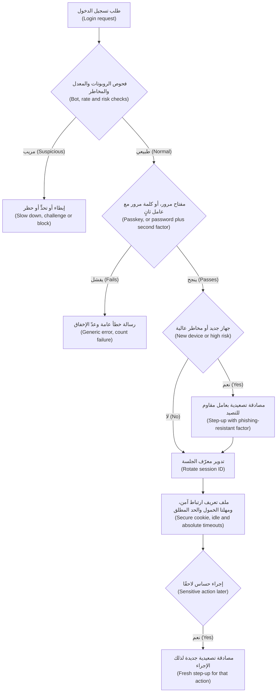
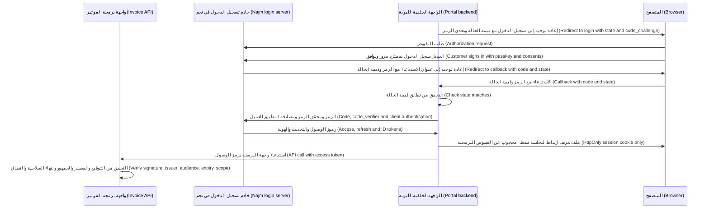
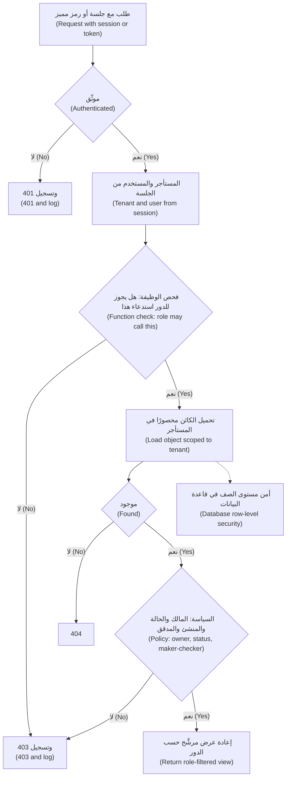

# الوحدة 3 — الهوية والوصول (Identity and access)

*معظم الاختراقات (breaches) لا تحتاج إلى استغلالٍ بارع (clever exploit). إنها تحتاج إلى كلمة مرورٍ مُعاد استخدامها (reused password)، أو رمزٍ مميز (token) تقبله واجهة البرمجة الخطأ (wrong API)، أو نقطة نهاية (endpoint) لا تسأل أبدًا «هل هذا لك؟» ⁦⁩. تغطي هذه الوحدة الأسئلة الثلاثة (three questions) التي يجب أن يجيب عنها كل طلبٍ (every request) إلى أي نظامٍ في بنك نجم (Najm Bank) إجابةً صحيحة. من هذا؟ ⁦⁩ تلك هي المصادقة (authentication): كلمات المرور (passwords) والمصادقة متعددة العوامل (MFA) ومفاتيح المرور (passkeys) والجلسات (sessions). ماذا يُثبت هذا الرمز المميز؟ ⁦⁩ ذلك هو OAuth 2.0 وOpenID Connect ورموز JWT (JWTs). وهل يجوز لهم لمس هذا الكائن؟ ⁦⁩ ذلك هو التفويض (authorisation) ومرجع الكائن المباشر غير الآمن (IDOR) وتعدد المستأجرين (multi-tenancy). ستتابع فريق أمن التطبيقات والذكاء الاصطناعي (Application & AI Security team) بينما يراقب مركز العمليات الأمنية (SOC) التابع لجاسم موجةً من حشو بيانات الاعتماد (credential-stuffing wave) تضرب تطبيق نجم للهاتف (Najm Mobile)، ويتعلّم علي لماذا تُعدّ مطابقة المستخدمين الاتحاديين بالبريد الإلكتروني وفكّ ترميز الرموز المميزة دون التحقق منها خطأين كليهما، ويحوّل اختبار مريم المصرَّح به (authorised test) لبوابة الشركات الصغيرة (SME Portal) رقمَ فاتورةٍ واحدًا مُغيَّرًا إلى مصفوفة التحكم في الوصول (access-control matrix) الخاصة بالفريق. وتنتقل الأفكار نفسها مباشرةً إلى أمن الذكاء الاصطناعي (AI security): يجب أن تعمل أدوات (tools) نجم أسيست (Najm Assist) بهوية العميل وحقوقه، لا بهويتها وحقوقها هي أبدًا.*

> **المراحل (Phases):** Design, Build, Test — تصميم تسجيل الدخول (sign-in) والرموز المميزة (tokens) والصلاحيات (permissions) بحيث يكون حتى أضعف مسارٍ إلى الحساب قويًّا، وبناؤها بمكتباتٍ مُدقَّقة (vetted libraries)، والإثبات بالاختبارات أن مستخدمًا آخر (another user) ومستأجرًا آخر (another tenant) يُرفَضان.

---

# 3.1 — المصادقة: كلمات المرور والمصادقة متعددة العوامل ومفاتيح المرور والجلسات
*المستوى (Level): 🟡 متوسط (Intermediate)* · *المتطلبات (Prerequisites): 1.1، 1.2* · *المرحلة (Phase): Design, Build*

## ⚡ الدرس في دقيقة (In 60 seconds)
- **المصادقة (Authentication)** تجيب عن سؤال «من هذا؟» ⁦⁩؛ و**التفويض (authorisation)** (3.3) يجيب عن سؤال «ماذا يجوز لهم أن يفعلوا؟» ⁦⁩. أبقِهما منفصلين في التصميم (design) وفي الشيفرة (code).
- تفشل كلمات المرور (passwords fail) عبر إعادة الاستخدام (reuse) والتخمين (guessing) والتصيّد الاحتيالي (phishing) وسرقة قاعدة البيانات (database theft). لا تخزّنها إلا باستخدام **تجزئة كلمة مرور (password hash)** بطيئةٍ ومملّحة (slow, salted) مثل Argon2id، واحظر كلمات المرور المسرّبة، وتخلَّ عن قواعد التركيب (composition rules) والانتهاء القسري للصلاحية (forced expiry).
- تتفاوت **المصادقة متعددة العوامل (MFA, multi-factor authentication)** في قوتها (varies). فرموز الرسائل النصية (SMS codes) ورموز التطبيقات (app codes) يمكن اصطيادها بالتصيّد الاحتيالي؛ أمّا **مفاتيح المرور (passkeys)** (WebAuthn/FIDO2) فمرتبطةٌ بنطاق الموقع الحقيقي، فلا يحصل الموقع المقلِّد (lookalike site) على شيءٍ يمكنه استخدامه.
- إعادة تعيين كلمة المرور (password reset) واستعادة الحساب (account recovery) و«غيّروا رقم هاتفي» هي أيضًا عمليات تسجيل دخول (logins too). يختار المهاجمون أضعف باب (weakest door).
- بعد تسجيل الدخول، يكون **رمز الجلسة (session token)** *هو* المستخدم: عشوائيًّا (random)، يُدوَّر عند تسجيل الدخول، محفوظًا في ملف تعريف ارتباط (cookie) بخصائص `Secure` و`HttpOnly` و`SameSite`، تنتهي مهلته (timed out)، ويمكن إبطاله على الخادم.
- مؤشر القرار (Decision cue): لكل إجراء، اسأل «ما مدى اليقين الذي نحتاجه، ومنذ متى؟» ⁦⁩، واطلب **المصادقة التصعيدية (step-up authentication)** للإجراءات الخطرة (risky ones).

## 🧭 لماذا يهم
في الساعة 02:10 من يوم ثلاثاء، يرى مركز العمليات الأمنية التابع لجاسم إخفاقات تسجيل الدخول (login failures) على تطبيق نجم للهاتف ترتفع ارتفاعًا حادًّا (climb steeply): آلافٌ من عناوين البريد الإلكتروني الحقيقية للعملاء، جُرِّب كلٌّ منها مرةً أو مرتين، من آلاف عناوين IP (IP addresses). وقبل ذلك بأسبوع، كان تاجر تجزئةٍ في الخارج لا صلة له بالبنك قد أفصح عن اختراق. هذا هو **حشو بيانات الاعتماد (credential stuffing)**: إعادة تشغيل أزواج البريد الإلكتروني وكلمة المرور المسرّبة من موقعٍ ضد موقعٍ آخر، رهانًا على أن الناس يعيدون استخدام كلمات المرور. وتنجح بضع مئاتٍ من عمليات تسجيل الدخول.

في تلك الحسابات، يوقف رمز SMS المطلوب على الأجهزة الجديدة معظم المهاجمين. لكن بحلول منتصف الصباح، يُبلغ فريق مكافحة الاحتيال (fraud team) عن مكالماتٍ إلى مركز الاتصال (contact centre) تطلب نقل أرقام العملاء إلى بطاقات SIM جديدة، وعن صفحة تصيّدٍ احتيالي (phishing page) تطلب «الرمز الذي أرسلناه إليك للتو».

يسأل حمد، كبير مسؤولي أمن المعلومات (CISO)، أيّ الضوابط (controls) أوقفت ماذا. فحص كلمة المرور (password check) لم يوقف شيئًا: كانت كلمات المرور صحيحة. وقفل الحساب بعد خمسة إخفاقات (five-failure lockout) لم يُفعَّل قط: لم يشهد كل حسابٍ سوى محاولةٍ أو اثنتين. رمز SMS هو الذي أدّى العمل، وهو بالضبط ما ستستهدفه الموجة التالية (next wave). قاعدة نورة: **يجب أن يسمّي كل ضابط مصادقة (every authentication control) الهجومَ الذي يوقفه (the attack it stops)، ونحن نقوّي أضعف مسارٍ إلى الحساب أولًا (harden the weakest path into an account first)، سواءٌ أكان تسجيل الدخول (login) أم إعادة التعيين (reset) أم الاستعادة (recovery) أم مركز الاتصال (contact centre).**

## 📐 كيف يعمل

### 🟢 الأساسيات

**العوامل (Factors).** أدلة المصادقة (authentication evidence) إمّا شيءٌ **تعرفه (know)**، ككلمة مرور (password) أو رمز PIN، أو شيءٌ **تملكه (have)**، كهاتف (phone) أو مفتاح أمان (security key) أو مفتاحٍ في العتاد الآمن للجهاز، أو شيءٌ **هو أنت (are)**، كبصمة الإصبع (fingerprint) أو الوجه (face). تحتاج **المصادقة متعددة العوامل (MFA)** إلى نوعين *مختلفين (different)* على الأقل؛ فكلمتا مرور ليستا مصادقةً متعددة العوامل. وعلى الهواتف، لا تفعل بصمة الإصبع عادةً أكثر من فتح مفتاحٍ على الجهاز، فيرى البنك توقيعًا (signature) ولا يرى البيانات الحيوية (biometric) أبدًا.

**قواعد كلمات المرور الحديثة (Modern password rules).** وثيقة NIST SP 800-63B، وهي جزءٌ من إرشادات الهوية الرقمية الأمريكية في مراجعتها الرابعة (Revision 4) التي اكتملت عام 2025، هي المرجع الأكثر استشهادًا. وتطلب، وقت الكتابة عام 2026: الطول لا التعقيد، أي 15 حرفًا على الأقل حين تكون كلمة المرور العامل الوحيد (only factor)، و8 حين تكون جزءًا من المصادقة متعددة العوامل، مع السماح بطولٍ أقصى لا يقل عن 64 حرفًا (at least 64 allowed)؛ ولا قواعد تركيب، فهي تنتج كلماتٍ مثل `Password1!`؛ ولا تغييرات دورية قسرية دون دليلٍ على الاختراق؛ وقائمة حظر (blocklist) لكلمات المرور الشائعة والمسرّبة؛ ولا تلميحات (hints) ولا أسئلة أمان (security questions)؛ والسماح باللصق (paste allowed) كي تعمل برامج إدارة كلمات المرور (password managers). تحقّق من النص الحالي قبل كتابة السياسة (writing policy).

**تخزين كلمات المرور (Storing passwords).** لا تستخدم أبدًا النص الصريح (plain text) أو التشفير القابل للعكس (reversible encryption) أو دالة تجزئةٍ سريعة (fast hash) مثل MD5 أو SHA-1 أو SHA-256، إذ تسمح لجدولٍ مسروق (stolen table) بأن يواجه عددًا هائلًا من التخمينات في الثانية على بطاقات رسومياتٍ عادية. استخدم **Argon2id** (RFC 9106) أو **scrypt** أو **bcrypt** (أو PBKDF2 حيث تكون الخوارزميات المعتمدة وفق FIPS (FIPS-validated algorithms) إلزامية). فهي تضيف **ملحًا (salt)** فريدًا (unique) إلى كل كلمة مرور، وهي بطيئةٌ عمدًا (deliberately slow)؛ كما أن Argon2id وscrypt **مُكلفتان للذاكرة (memory-hard)** (5.1).

```python
# Vulnerable: fast, unsalted hash
user.password_hash = hashlib.sha256(password.encode()).hexdigest()

# Fixed: Argon2id via argon2-cffi. Salt and parameters live inside the hash string.
from argon2 import PasswordHasher
from argon2.exceptions import VerifyMismatchError
ph = PasswordHasher()

def check_password(user, password):
    try:
        ph.verify(user.password_hash, password)
    except VerifyMismatchError:
        return False
    if ph.check_needs_rehash(user.password_hash):   # parameters raised since this hash was made
        user.password_hash = ph.hash(password)
    return True
```

**مقارنة خيارات المصادقة متعددة العوامل (MFA options compared).**

| الطريقة (Method) | مقاومةٌ للتصيّد الاحتيالي؟ ⁦(Phishing-resistant?)⁩ | نقطة الضعف الرئيسية (Main weakness) | الملاءمة في بنك |
|---|---|---|---|
| **رمزٌ عبر SMS أو مكالمة صوتية (SMS or voice code)** | لا | تبديل شريحة SIM (SIM swap)، والاعتراض (interception)، والترحيل (relay)؛ وتصنّفها NIST «مقيَّدة» ("restricted") | احتياطيًّا فقط (Fallback only) |
| **رمز تطبيق المصادقة (Authenticator app code)** (TOTP) | لا | يُكتب في موقعٍ مزيّف ويُرحَّل | الوصول الأقل خطورة (Lower-risk access) |
| **الموافقة عبر الإشعار الفوري (Push approval)** | لا | «إرهاق المصادقة متعددة العوامل» ("MFA fatigue"): إشعاراتٌ متتالية حتى ينقر أحدهم «موافقة» | فقط مع مطابقة الأرقام |
| **مفتاح المرور أو مفتاح الأمان (Passkey or security key)** | نعم (Yes) | تصبح الاستعادة نقطة الضعف | الخيار الافتراضي للعملاء؛ وإلزاميٌّ للموظفين ذوي الصلاحيات |

**مفاتيح المرور (Passkeys).** **مفتاح المرور (passkey)** زوج مفاتيح (key pair) ينشئه جهاز المستخدم أو مدير كلمات المرور (password manager) لموقعٍ واحد (one website)، باستخدام **WebAuthn**، وهي واجهة برمجة المتصفح من W3C (the W3C browser API)، و**FIDO2**، أي WebAuthn مضافًا إليها البروتوكول الخاص بالمصادِقات الخارجية. لا يخزّن الخادم سوى المفتاح العام (public key)، ويرسل **تحدّيًا (challenge)** عشوائيًّا، ويتحقق من التوقيع الذي يُنشئه الجهاز بعد أن يفتحه المستخدم ببصمة الإصبع أو الوجه أو رمز PIN. لا يوجد على الخادم سرٌّ مشترك (shared secret) يمكن سرقته، ويربط المتصفح كل بيانات اعتماد (credential) بنطاق الموقع (site's domain)، فلا تستطيع صفحةٌ مقلِّدة (lookalike page) الحصول على توقيعٍ صالح لـ `najm.example`.

**الجلسات (Sessions).** بعد تسجيل الدخول، يُصدر الخادم **رمز جلسة (session token)**، عادةً في ملف تعريف ارتباط؛ ومن يحمله *هو* المستخدم. اجعله **عشوائيًّا (random)**، أي 128 بتًا على الأقل من مولّدٍ آمن (secure generator). **دوِّره (Rotate it)** عند تسجيل الدخول وعند تغيّر الصلاحيات (privilege changes)، وإلّا فإن مهاجمًا زرع معرّفًا معروفًا قبل تسجيل الدخول يشارك الجلسة بعده، وهذا هو **تثبيت الجلسة (session fixation)**. احمِ ملف تعريف الارتباط بـ `Secure`، و`HttpOnly` (لا وصول للنصوص البرمجية)، و`SameSite=Lax` أو `Strict` (يساعد ضد تزوير الطلبات عبر المواقع (CSRF)، 2.2)، والبادئة (prefix) `__Host-`. اضبط **مهلتي الخمول والحدّ المطلق (idle and absolute timeouts)**، و**سجِّل الخروج على الخادم (log out on the server)**، مُبطِلًا جميع الجلسات عند إعادة التعيين أو تغيير الهاتف (phone change) أو ظهور علامة احتيال (fraud flag). وفي الخدمات المصرفية (banking)، فضِّل الجلسات القابلة للإبطال على الخادم؛ فالرمز المميز المكتفي بذاته (self-contained token) (3.2) يبقى صالحًا حتى تنتهي صلاحيته.

```js
// Cookie: Set-Cookie: __Host-najm_sid=<random>; Path=/; Secure; HttpOnly; SameSite=Lax
app.post("/login", async (req, res, next) => {
  const user = await verifyCredentials(req.body);
  if (!user) return res.status(401).json({ error: "Invalid email or password" }); // never "no such account"
  // Vulnerable: setting req.session.userId here would keep the pre-login ID (session fixation)
  req.session.regenerate((err) => {        // Fixed: a brand-new session ID at authentication
    if (err) return next(err);
    req.session.userId = user.id;
    req.session.authTime = Date.now();     // used later to decide when step-up is needed
    res.json({ ok: true });
  });
});
```

### 🟡 التعمق أكثر (Going deeper)

**الدفاع ضد حشو بيانات الاعتماد (Defending against credential stuffing).** يتغلّب الحشو (stuffing) على القفل لكل حساب (per-account lockout)، إذ لا تتجاوز المحاولات اثنتين لكل حساب، وعلى قواعد القوة (strength rules)، إذ إن كلمات المرور صحيحة. رتّب الدفاعات في طبقات: **المصادقة متعددة العوامل (MFA)**، ويُفضَّل أن تكون مقاومةً للتصيّد الاحتيالي (phishing-resistant)؛ و**فحص كلمات المرور المسرّبة (breached-password checks)** عند التسجيل (sign-up) والتغيير (change) وتسجيل الدخول، وتستخدم خدمة Pwned Passwords **إخفاء الهوية من النوع k (k-anonymity)**: لا ترسل سوى الأحرف الخمسة الأولى من تجزئة SHA-1 لكلمة المرور (first five characters of the password's SHA-1 hash) وتطابق القائمة المُعادة محليًّا؛ و**المراقبة على مستوى الموقع كله (site-wide monitoring)** لنِسَب الإخفاق (failure ratios) وعمليات تسجيل الدخول من أجهزةٍ جديدة (new-device sign-ins) (10.1)؛ و**حدود المعدّل (rate limits)** المرتبطة بعنوان IP والجهاز والحساب، مع **تأخيراتٍ متصاعدة (progressive delays)** بدلًا من القفل الصارم (hard lockout)، الذي يتيح للمهاجمين إقفال حسابات العملاء في وجوههم (4.2).

**تعداد الحسابات (Account enumeration).** يجب ألّا يكشف تسجيل الدخول والتسجيل وإعادة التعيين ما إذا كان الحساب موجودًا. أعِد الرسالة نفسها (same message) ورمز الحالة نفسه وتوقيتًا متقاربًا؛ ومن الأساليب (one technique) تجزئة قيمةٍ وهمية حين يكون الحساب غير موجود. وفي إعادة التعيين، قل دائمًا «إذا كان الحساب موجودًا، فقد أرسلنا رابطًا».

**إعادة تعيين كلمة المرور (Password reset).** إعادة التعيين تسجيلُ دخولٍ يتخطى كلمة المرور. استخدم رمزًا عشوائيًّا (random token) لا يقل عن 128 بتًا، يُستخدم مرةً واحدة (single-use)، وقصير العمر (short-lived)، ولا يُخزَّن إلا تجزئةً. ابنِ الرابط من عنوان URL أساسي مُعَدّ مسبقًا، لا من ترويسة `Host` في الطلب أبدًا. واصِل اشتراط المصادقة متعددة العوامل، ولا تُدخِل المستخدم تلقائيًّا، وأبطِل الجلسات القائمة، وأشعِر العميل.

**بيانات الاتصال والأجهزة هي المفاتيح الحقيقية (Contact details and devices are the real keys).** تغيير رقم الهاتف أو تسجيل جهازٍ جديد يتحكم في كل رمزٍ وتنبيهٍ لاحق. و**تبديل شريحة SIM (SIM swap)**، أي إقناع مشغّل الهاتف المحمول (mobile operator) بنقل رقمٍ إلى شريحة المهاجم (attacker's SIM)، يقلب رموز SMS ضد العميل. عامِل هذه التغييرات على أنها عالية الخطورة (high-risk): مصادقةٌ تصعيدية (step-up) بعاملٍ قويٍّ قائم، وإشعار القناة *القديمة*، وتعليق تغييرات المستفيدين والحدود لفترة تهدئة (cooling-off period).

**المصادقة التصعيدية ومستويات الضمان (Step-up and assurance levels).** **مستويات ضمان المصادِق (authenticator assurance levels)** لدى NIST هي **AAL1**، أي عاملٌ واحد على الأقل، و**AAL2**، أي عاملان مختلفان، و**AAL3**، أي، وقت الكتابة، مصادِقٌ مدعومٌ بالعتاد ومقاومٌ للتصيّد الاحتيالي لا يمكن تصدير مفتاحه. و**المصادقة التصعيدية (Step-up)** تطلب مصادقةً جديدةً وأقوى مباشرةً قبل إجراءٍ حساس (sensitive action). وفي مدفوعات الاتحاد الأوروبي (EU payments)، تشترط المصادقة القوية للعميل وفق PSD2 أيضًا **الربط الديناميكي (dynamic linking)** بالمبلغ والمستفيد؛ تحقّق من القواعد الحالية مع فريق الامتثال (compliance).

**تصيّدٌ احتيالي يهزم الرموز (Phishing that defeats codes).** حِزَم تصيّد **الخصم في المنتصف (Adversary-in-the-middle, AitM)** تُرحِّل كل ما تكتبه الضحية، بما في ذلك الرمز لمرةٍ واحدة (one-time code)، إلى الموقع الحقيقي في الوقت الفعلي، وتحتفظ بملف تعريف ارتباط الجلسة (session cookie) العائد. ورموز SMS ورموز التطبيقات والموافقات البسيطة عبر الإشعار الفوري تسقط كلها أمام ذلك. أمّا مفاتيح المرور فلا، لأن المتصفح لا يوقّع إلا للنطاق الحقيقي. و**إرهاق المصادقة متعددة العوامل (MFA fatigue)**، أي إشعارٌ تلو إشعار حتى ينقر مستخدمٌ مُتعَب «موافقة»، ظهر في عدة اختراقاتٍ مُعلَن عنها عام 2022. خفِّف منه (mitigate it) عبر **مطابقة الأرقام (number matching)**، إذ يكتب المستخدم في التطبيق رقمًا معروضًا على شاشة تسجيل الدخول، ووضع حدودٍ للإشعارات، وتضمين تفاصيل الموقع والتطبيق في الإشعار.



### 🔴 نظرة الخبير (Expert view)

**الاستعادة هي المحيط الحقيقي (Recovery is the real perimeter).** ما إن يعتمد تسجيل الدخول على مفاتيح المرور، حتى ينتقل المهاجمون إلى إعادة التعيين عبر SMS (SMS reset)، ومكتب المساعدة (help desk)، و«فقدتُ هاتفي»؛ وقد ظهرت الهندسة الاجتماعية لمكتب المساعدة في اختراقاتٍ مُعلَن عنها. امنح الاستعادة ضمانًا بمستوى تسجيل الدخول (login-level assurance): أكثر من مفتاح مرورٍ أو جهازٍ مسجَّل، وإعادة التحقق من الهوية (identity re-verification) داخل التطبيق أو في فرع بدلًا من «تاريخ الميلاد»، وتأخيراتٍ وإشعارات، ونصًّا لمركز الاتصال (contact-centre script) لا يعيد تعيين أي عامل بناءً على مكالمةٍ هاتفية وحدها.

**مفاتيح مرورٍ متزامنة أم مرتبطة بالجهاز (Synced or device-bound passkeys).** **مفاتيح المرور المتزامنة (Synced passkeys)** تتبع المستخدم إلى هاتفٍ جديد عبر حساب منصته (platform account) أو مدير كلمات المرور: مريحة (convenient)، لكنها آمنةٌ فقط بقدر أمان ذلك الحساب واستعادته. أمّا المفاتيح **المرتبطة بالجهاز (Device-bound)**، مثل مفاتيح الأمان العتادية، فلا يمكن نسخها وتناسب AAL3. نشرت NIST عام 2024 إرشاداتٍ تقبل المصادِقات القابلة للمزامنة (syncable authenticators) عند AAL2، ثم أُدمجت لاحقًا في المراجعة 4 (Revision 4). والتقسيم المعقول: مفاتيح مرورٍ متزامنة للعملاء، ومفاتيح مرتبطة بالجهاز للموظفين ذوي الصلاحيات (privileged staff).

**استخدم مكتبة WebAuthn مُصانة (Use a maintained WebAuthn library).** يفحص التحقق (verification) تحدّيًا يُستخدم مرةً واحدة (single-use challenge)، والأصل (origin)، و**معرّف الطرف المعتمِد (RP ID, relying party identifier)** الذي يكون عادةً نطاقك، وعلامتي حضور المستخدم والتحقق منه، والتوقيع، وعدّاد التوقيع (signature counter)، وكثيرًا ما تُبلغ مفاتيح المرور المتزامنة عن صفر، فعامِله إشارةً لا أكثر. ومن السهل أن تخطئ في كل خطوةٍ خطأً دقيقًا (subtly wrong) إذا كتبتها يدويًّا. والمكافئ الأصلي (native equivalent) في تطبيق نجم للهاتف، أي مفتاحٌ في العتاد الآمن للهاتف يُفتح بالبيانات الحيوية (biometrics)، هو **ربط الجهاز (device binding)** (4.3).

**طابِق التجزئة مع الإنتروبيا (Match the hashing to the entropy).** وُجدت التجزئة البطيئة (slow hashing) لأن كلمات المرور البشرية (human passwords) قليلة العشوائية (little randomness). أمّا رمز إعادة التعيين (reset token) أو مفتاح واجهة البرمجة (API key) ذو 128 بتًا عشوائيًّا (128 random bits) فيمكن تخزينه بأمان تجزئةَ SHA-256 عادية (plain SHA-256 hash). و**الفلفل (pepper)**، وهو مفتاحٌ سري (secret key) محفوظ في نظام إدارة المفاتيح (KMS) أو وحدة أمن العتاد (HSM) (5.2) ويُمزج في تجزئة كلمات المرور، يعني أن قاعدة بياناتٍ مسروقة وحدها لا تكفي لبدء التخمين، على حساب إدارة المفاتيح. ومعظم تطبيقات bcrypt (bcrypt implementations) لا تستخدم إلا أول 72 بايتًا من المدخلات (first 72 bytes of input)، وهذا سببٌ آخر لتفضيل Argon2id في الأنظمة الجديدة (new systems).

## 🧰 الأدوات
| الضابط أو المعيار أو الأداة (Control, standard or tool) | ما هو وماذا يفعل | متى تلجأ إليه |
|---|---|---|
| **NIST SP 800-63B** — إرشادات الهوية الرقمية | قواعد للمصادِقات (authenticators) وكلمات المرور ومستويات الضمان (assurance levels) من AAL1 إلى AAL3 وإعادة المصادقة (reauthentication)؛ وتُستخدم على نطاقٍ واسع خارج الحكومة الأمريكية | وضع سياسة كلمات المرور والمصادقة متعددة العوامل والجلسات؛ وإلغاء القواعد المتقادمة |
| **Argon2id** — وفق RFC 9106 | تجزئة كلمات مرورٍ بطيئة ومملّحة ومُكلفة للذاكرة؛ وscrypt وbcrypt بديلان مقبولان (acceptable alternatives) | كل نظامٍ يخزّن كلمات المرور |
| **Breached-password check** — فحص كلمات المرور المسرّبة، مثل Pwned Passwords | يقارن كلمات المرور بقوائم الكلمات المعروف تسريبها (known-breached lists)، بخصوصيةٍ عبر k-anonymity أو قائمةٍ محلية | التسجيل، وتغيير كلمة المرور (password change)، وتسجيل الدخول حيثما أمكن |
| **Passkeys** — مفاتيح المرور (WebAuthn/FIDO2) | بيانات اعتمادٍ بمفتاحٍ عام مرتبطةٌ بالنطاق؛ مقاومةٌ للتصيّد الاحتيالي، ولا سرّ مشتركًا على الخادم | تسجيل الدخول الافتراضي للعملاء؛ ومفاتيح مرتبطة بالجهاز للموظفين ذوي الصلاحيات |
| **Step-up authentication** — المصادقة التصعيدية | مصادقةٌ جديدة وأقوى مباشرةً قبل إجراءٍ حساس | المستفيدون الجدد (new payees)، وزيادة الحدود (limit increases)، وتغيير بيانات الاتصال (contact-detail changes)، والإجراءات الإدارية (admin actions) |
| **Secure session cookies** — ملفات تعريف ارتباط الجلسة الآمنة (`Secure`، `HttpOnly`، `SameSite`، `__Host-`) | خصائص ملفات تعريف الارتباط (cookie attributes) التي تُبقي رمز الجلسة على HTTPS، وبعيدًا عن النصوص البرمجية، وخارج معظم الطلبات عبر المواقع | كل جلسة متصفح |
| **OWASP ASVS** — من OWASP | متطلباتٌ قابلة للاختبار (testable requirements)، بما فيها المصادقة وإدارة الجلسات؛ وصدر الإصدار 5.0 (version 5.0) عام 2025 | كتابة المتطلبات وقوائم التحقق للمراجعة |

## 🏛️ عمليًا في بنك نجم
بعد موجة الحشو (stuffing wave)، تكتب نورة وعلي **معيار نجم للمصادقة، الإصدار 1، لقنوات العملاء (Najm Authentication Standard v1 — customer channels)**. يعتمده حمد، ويتولى مركز العمليات الأمنية التابع لجاسم قواعد الرصد (detection rules) الخاصة به.

**الجزء أ: القواعد (Part A: rules)**

| المجال (Area) | القاعدة (Rule) | ما توقفه (Stops) |
|---|---|---|
| تسجيل الدخول | تطبيق نجم للهاتف: مفتاح الجهاز (device key) يُفتح بالبيانات الحيوية أو برمز PIN للتطبيق. الويب (Web): مفاتيح المرور افتراضيًّا | التصيّد الاحتيالي، وإعادة الاستخدام |
| كلمات المرور، حيثما لا تزال مستخدمة | 12 حرفًا فأكثر (12+ characters)، وهي قاعدةٌ داخلية (house rule) مع عاملٍ ثانٍ دائمًا؛ لا قواعد تركيب ولا انتهاء صلاحية؛ فحص كلمات المرور المسرّبة (breached-password check) | الحشو، والتخمين |
| التخزين (Storage) | Argon2id عبر المكتبة المعتمدة (approved library)؛ وإعادة التجزئة عند تسجيل الدخول | الكسر دون اتصال (offline cracking) |
| رموز SMS | احتياطٌ للحالات منخفضة الخطورة فقط؛ ولا تُستخدم أبدًا للمصادقة التصعيدية في الجزء ب | تبديل شريحة SIM، والترحيل |
| الردود والحدود | رسالةٌ عامة واحدة بالعربية والإنجليزية؛ تأخيراتٌ متصاعدة؛ تنبيهٌ لمركز العمليات الأمنية (SOC alert) عند نسبة الإخفاق على مستوى الموقع | التعداد (enumeration)، والحشو |
| الجلسات | معرّفاتٌ بطول 128 بتًا (128-bit IDs) تُدوَّر عند تسجيل الدخول والمصادقة التصعيدية؛ `__Host-`، `Secure`، `HttpOnly`، `SameSite=Lax`؛ مهلة الخمول على الويب 10 دقائق (web idle 10 minutes)، والحد المطلق 12 ساعة (absolute 12 hours)، وهي قيمٌ توضيحية (illustrative) | التثبيت (fixation)، والسرقة (theft) |
| الاستعادة | لا استعادة عبر SMS وحدها؛ إعادة التحقق من الهوية في التطبيق أو الفرع؛ لا إعادة تعيين للعوامل عبر الهاتف | إساءة استخدام الاستعادة (recovery abuse) |
| الموظفون والمسؤولون | مفاتيح أمانٍ مرتبطة بالجهاز فقط | الاستيلاء على الحسابات ذات الصلاحيات (privileged takeover) |

**الجزء ب: مصفوفة المصادقة التصعيدية لإجراءات العملاء (Part B: step-up matrix for customer actions)**

| الإجراء (Action) | المصادقة | الحداثة (Freshness) | ضوابط إضافية (Extra controls) |
|---|---|---|---|
| تجميد بطاقة (Freeze a card) | الجلسة مع تأكيدٍ داخل التطبيق | الجلسة (Session) | احتكاكٌ منخفض عن قصد: التجميد يقلّل المخاطر |
| إلغاء تجميد بطاقة أو كشف رقمها | مصادقة تصعيدية: مفتاح الجهاز أو مفتاح المرور | 5 دقائق (5 minutes) | غير متاحٍ أبدًا لنجم أسيست |
| إضافة مستفيد | مصادقة تصعيدية | لكل إجراء (per action) | تعليقٌ لمدة 24 ساعة (24-hour hold) على جهازٍ عمره أقل من 72 ساعة (device under 72 hours old) |
| تحويلٌ يتجاوز الحد اليومي | مصادقة تصعيدية تعرض المبلغ والمستفيد | لكل معاملة (per transaction) | درجة الاحتيال (fraud score) من التنبيهات الذكية (Smart Alerts) |
| تغيير رقم الهاتف أو البريد الإلكتروني | مصادقة تصعيدية بعاملٍ قويٍّ قائم | لكل إجراء | إشعار القناتين القديمة والجديدة؛ وتعليقٌ لمدة 72 ساعة على تغييرات المستفيدين (72-hour hold on payee changes) |
| تسجيل جهاز جديد | موافقةٌ من جهازٍ قائم، أو إعادة التحقق (re-verification) | لكل إجراء | إشعار جميع الأجهزة؛ ويمكن لأيٍّ منها الإلغاء |

## 🛠️ التمارين (Exercises)
- 🟢 على تطبيقٍ تملكه، أو على نسخةٍ محلية من OWASP Juice Shop، جرّب تسجيل الدخول والتسجيل وإعادة تعيين كلمة المرور ببريدٍ إلكتروني موجود وآخر غير موجود، مسجِّلًا الرسالة (message) ورمز الحالة (status code) وزمن الاستجابة التقريبي. *يكتمل عندما (Done when):* يُظهر جدولك ذو الحالات الست (six-case table) أن الشخص من الخارج (outsider) لا يستطيع معرفة الحسابات الموجودة، أو تكون قد كتبت إصلاحًا (fix) لكل تسريب (each leak).
- 🟡 في تطبيقٍ محليٍّ صغير من صنعك، خزّن كلمات المرور باستخدام Argon2id (أو bcrypt)، وأعِد التجزئة عند تسجيل الدخول حين تتغير المعاملات، وافحص كلمات المرور الجديدة مقابل قائمةٍ مسرّبة (breached list)، عبر واجهة برمجة النطاقات القائمة على k-anonymity أو ملفٍّ منزَّل (downloaded file). *يكتمل عندما:* تبدأ القيم المخزّنة بـ `$argon2id$` (أو `$2b$`)، ويُثبت اختبارٌ (test) أن رفع المعاملات (raised parameters) يؤدي إلى إعادة التجزئة عند تسجيل الدخول التالي، وتُرفَض كلمة مرورٍ مسرّبة علنًا.
- 🔴 أضِف تسجيل الدخول بمفاتيح المرور (passkey sign-in) إلى تطبيقٍ تجريبي محلي على `localhost` باستخدام مكتبة WebAuthn مُصانة، ثم اكتب تصميمًا للاستعادة في صفحةٍ واحدة. *يكتمل عندما:* تُثبت الاختبارات أن الخادم يرفض تحدّيًا مُعادًا استخدامه (reused challenge) وأصلًا خاطئًا (wrong origin)، ويوضّح التصميم كيف يعود مستخدمٌ فقد كل أجهزته، وبأي مستوى ضمان وبأي تأخير.

## ⚠️ أخطاء وفخاخ (Mistakes and traps)
- **اعتبار رموز SMS «مصادقةً متعددة العوامل منجزة» (Calling SMS codes "MFA done").** يهزمها تبديل شريحة SIM (SIM swaps) والتصيّد بالترحيل (relay phishing). أبقِها احتياطًا (fallback)، وانقل الإجراءات الخطرة (risky actions) إلى مفاتيح المرور أو مفاتيح الجهاز.
- **القفل الصارم دفاعًا ضد الحشو (Hard lockout as the stuffing defence).** يجرّب الحشو كل حسابٍ مرةً أو مرتين، والقفل يتيح للمهاجمين إقفال حسابات العملاء. استخدم المصادقة متعددة العوامل، وفحص كلمات المرور المسرّبة، والرصد على مستوى الموقع (site-wide detection)، والتأخيرات المتصاعدة.
- **تجزئة كلمات المرور السريعة أو محلية الصنع (Fast or home-made password hashing).** SHA-256 مع ملحٍ مشترك (shared salt) ليس تخزينًا لكلمات المرور. استخدم Argon2id أو scrypt أو bcrypt عبر مكتبةٍ مُصانة (maintained library).
- **نسيان الأبواب الجانبية (Forgetting the side doors).** إعادة التعيين والاستعادة وتغيير الهاتف (phone changes) ومركز الاتصال كلها مسارات مصادقة (authentication paths). امنحها ضمانًا بمستوى تسجيل الدخول.
- **تسجيل خروجٍ لا يمسح إلا المتصفح (Logout that only clears the browser).** إذا ظل الخادم يقبل الجلسة، فإن النسخة المسروقة (stolen copy) تظل تعمل. أتلِف الجلسات على الخادم.

## 🧾 الخلاصة (Recap)
- المصادقة تُثبت هوية الشخص؛ فأبقِها منفصلةً عن التفويض.
- اتبع إرشادات NIST الحالية: الطول وقوائم الحظر، ولا قواعد تركيب ولا انتهاء قسري للصلاحية؛ وجزِّئ باستخدام Argon2id أو scrypt أو bcrypt.
- يمكن اصطياد الرموز وإشعارات الموافقة بالتصيّد أو إنهاك المستخدم بها حتى يوافق؛ أمّا مفاتيح المرور فمرتبطةٌ بالنطاق الحقيقي.
- إعادة التعيين والاستعادة وتغيير بيانات الاتصال عمليات تسجيل دخولٍ متنكّرة. قوِّها أولًا.
- تحتاج الجلسات إلى معرّفاتٍ عشوائية تُدوَّر عند تسجيل الدخول، وملفات تعريف ارتباط محمية (protected cookies)، ومهلٍ زمنية (timeouts)، وإبطالٍ على الخادم (server-side revocation)، ومصادقةٍ تصعيدية.

## ✍️ اختبر نفسك (Check yourself)

**1. يرى جاسم آلاف محاولات تسجيل الدخول (login attempts) على تطبيق نجم للهاتف (Najm Mobile)، كلٌّ منها من عنوان IP مختلف (different IP address)، بمحاولةٍ واحدة لكل حساب (one attempt per account) وبعناوين بريدٍ إلكتروني حقيقية للعملاء (real customer email addresses). أيّ الضوابط القائمة (existing control) سيكون الأقل أثرًا (do LEAST) في إيقاف ذلك؟**

- A. عاملٌ ثانٍ مطلوب على الأجهزة الجديدة
- B. قفل الحساب بعد خمس محاولاتٍ فاشلة
- C. تنبيهٌ (alert) على نسبة تسجيلات الدخول الفاشلة إلى الناجحة على مستوى الموقع
- D. فحص كلمات المرور (checking passwords) مقابل قوائم كلمات المرور المسرّبة (breached-password lists)

<details><summary>الإجابة</summary>

**B.** يجرّب الحشو (stuffing) كل حسابٍ مرةً أو مرتين، فنادرًا ما يُفعَّل القفل بعد خمسة إخفاقات (five-failure lockout)، كما يمكن إساءة استخدام القفل الصارم (hard lockout) ضد العملاء. أمّا A وC وD فتعالج جميعها إعادة الاستخدام على نطاقٍ واسع. انظر: 🟡 التعمق أكثر (Going deeper).

</details>

**2. يكتشف علي أن بوابة الشركات الصغيرة (SME Portal) تخزّن كلمات المرور بتجزئة SHA-256 مع ملحٍ واحد مشترك بين جميع المستخدمين (one salt shared by every user). ما الإصلاح الأفضل (BEST fix)؟**

- A. التحول إلى SHA-512 مع الإبقاء على الملح المشترك (shared salt)
- B. تشفير عمود كلمات المرور (password column) باستخدام AES كي يمكن فكّ تشفيره عند الحاجة
- C. الانتقال إلى Argon2id (أو bcrypt أو scrypt) بملحٍ فريد لكل كلمة مرور، مع إعادة تجزئة كلمة مرور كل مستخدم عند تسجيل دخوله الناجح التالي
- D. إجبار كل مستخدم على تغيير كلمة مروره كل 90 يومًا (every 90 days)

<details><summary>الإجابة</summary>

**C.** دوال تجزئة كلمات المرور (password hashing functions) بطيئةٌ ومملّحةٌ لكل كلمة مرور، وإعادة التجزئة عند تسجيل الدخول (rehash-on-login) تُرحِّل المستخدمين (migrates users) دون إعادة تعيينٍ جماعية (mass reset)، ولحماية الحسابات الخاملة (dormant accounts) أيضًا، كثيرًا ما تغلّف الفرق كل تجزئةٍ قديمة بـ Argon2id فورًا (wrap each old hash in Argon2id at once). أمّا A فلا تزال تجزئةً سريعة (fast hash)؛ وB قابلٌ للعكس (reversible) على يد أي شخصٍ يملك المفتاح؛ وD لم تعد NIST توصي به. انظر: 🟢 الأساسيات.

</details>

**3. حزمة تصيّد احتيالي (phishing kit) تُرحِّل كل ما يكتبه العميل إلى موقع نجم الحقيقي (real Najm website) في الوقت الفعلي (in real time)، بما في ذلك الرموز لمرةٍ واحدة (one-time codes)، وتحتفظ بملف تعريف ارتباط الجلسة (session cookie). أيّ المصادِقات (authenticator) يقاوم ذلك؟**

- A. رمزٌ لمرةٍ واحدة عبر SMS
- B. رمزٌ من ستة أرقام من تطبيق المصادقة
- C. موافقةٌ عبر الإشعار الفوري دون مطابقة الأرقام
- D. مفتاح مرور (passkey)

<details><summary>الإجابة</summary>

**D.** يربط المتصفح مفتاح المرور بالنطاق الحقيقي، فلا تستطيع الصفحة المقلِّدة (lookalike page) الحصول على توقيعٍ صالح لنجم. أمّا الرموز فيمكن ترحيلها، ويمكن أن تُعتمَد إشعارات الموافقة لصالح جلسة المهاجم. انظر: 🟢 الأساسيات؛ 🟡 التعمق أكثر (Going deeper).

</details>

**4. في أثناء اختبارٍ مصرَّحٍ به (authorised test)، تلاحظ مريم أن قيمة ملف تعريف ارتباط الجلسة (session cookie value) هي نفسها قبل تسجيل الدخول وبعده (same before and after login). ما الخطر (risk)، وما الإصلاح (fix)؟**

- A. تثبيت الجلسة (session fixation)؛ أصدِر معرّف جلسةٍ جديدًا عند تسجيل الدخول وعند كل تغييرٍ في الصلاحيات
- B. البرمجة النصية عبر المواقع (cross-site scripting, XSS)؛ أضِف سياسة أمان المحتوى (Content Security Policy) وشفّر كل نص يدخله المستخدم عند عرضه
- C. حشو بيانات الاعتماد (credential stuffing)؛ أضِف اختبار CAPTCHA
- D. لا خطر، ما دام ملف تعريف الارتباط (cookie) `HttpOnly`

<details><summary>الإجابة</summary>

**A.** إذا بقي المعرّف السابق لتسجيل الدخول (pre-login ID)، فإن أي شخصٍ زرعه قبل تسجيل الدخول يشارك الجلسة الموثَّقة (authenticated session)؛ وإعادة توليد المعرّف تسدّ الثغرة. أمّا `HttpOnly` (D) فيمنع النصوص البرمجية من قراءة ملف تعريف الارتباط، ولا يمنع المعرّف المزروع (planted ID). انظر: 🟢 الأساسيات.

</details>

**5. يريد فريق طارق أن يغيّر العملاء رقم هاتفهم المسجَّل (registered phone number) في تطبيق نجم للهاتف (Najm Mobile) بنقرةٍ واحدة (one tap)، لتقليل مكالمات مركز الاتصال (contact-centre calls). بماذا ينبغي أن يوصي فريق نورة؟ ⁦(What should Noura's team recommend?)⁩**

- A. السماح بذلك مع مصادقةٍ تصعيدية بعاملٍ قويٍّ قائم، وإشعارٍ إلى الرقم القديم، وتعليقٍ (hold) قبل أن يتمكن الرقم الجديد من تفويض المستفيدين أو تغييرات الحدود
- B. السماح بذلك (allow it)، لأن العميل مسجِّلٌ دخوله أصلًا
- C. إزالة تغيير الهاتف من التطبيق واشتراط زيارة الفرع على الجميع
- D. السماح بذلك (allow it)، مع رمز SMS يُرسَل إلى الرقم الجديد

<details><summary>الإجابة</summary>

**A.** يتحكم رقم الهاتف في كل رمزٍ وتنبيهٍ لاحق، لذا فإن تغييره خطوةٌ كلاسيكية في الاستيلاء على الحساب. والمصادقة التصعيدية (step-up) وإشعار القناة القديمة (old-channel notification) وفترة التهدئة (cooling-off period) تُبقي التغيير مريحًا لكن صعب الاستغلال. أمّا D فلا يُثبت إلا التحكم في الرقم الجديد، وهو ما يملكه المهاجم؛ وC تصحيحٌ مفرط (over-corrects). انظر: 🟡 التعمق أكثر (Going deeper)؛ 🏛️ عمليًا.

</details>

## 📚 المراجع (References)
- وثيقة NIST SP 800-63B-4، *Digital Identity Guidelines: Authentication and Authenticator Management* (2025) — https://doi.org/10.6028/NIST.SP.800-63B-4
- ورقة OWASP المختصرة للمصادقة — https://cheatsheetseries.owasp.org/cheatsheets/Authentication_Cheat_Sheet.html
- ورقة OWASP المختصرة لتخزين كلمات المرور — https://cheatsheetseries.owasp.org/cheatsheets/Password_Storage_Cheat_Sheet.html
- ورقة OWASP المختصرة لإدارة الجلسات — https://cheatsheetseries.owasp.org/cheatsheets/Session_Management_Cheat_Sheet.html
- ورقة OWASP المختصرة لمنع حشو بيانات الاعتماد — https://cheatsheetseries.owasp.org/cheatsheets/Credential_Stuffing_Prevention_Cheat_Sheet.html
- معيار OWASP للتحقق من أمن التطبيقات — https://owasp.org/www-project-application-security-verification-standard/
- اتحاد W3C، مواصفة مصادقة الويب — https://www.w3.org/TR/webauthn/
- RFC 9106، دالة Argon2 المُكلفة للذاكرة لتجزئة كلمات المرور (Argon2 Memory-Hard Function for Password Hashing) — https://www.rfc-editor.org/rfc/rfc9106
- موقع Have I Been Pwned، خدمة Pwned Passwords — https://haveibeenpwned.com/Passwords

---

# 3.2 — OAuth 2.0 وOpenID Connect ومزالق الرموز المميزة (OAuth 2.0, OpenID Connect and token pitfalls)
*المستوى: 🟡 متوسط* · *المتطلبات: 3.1* · *المرحلة: Design, Build*

## ⚡ الدرس في دقيقة (In 60 seconds)
- وُضع **OAuth 2.0** من أجل **التفويض بالإنابة (delegated authorisation)**: يستدعي تطبيقٌ واجهة برمجة (API) نيابةً عن المستخدم، بحقوقٍ محدودة (limited rights)، دون أن يرى كلمة مروره. وهو لا يحدد هوية المستخدم.
- يضيف **OpenID Connect (OIDC)** الهوية (identity) عبر **رمز الهوية (ID token)**. رموز الهوية للتطبيق؛ و**رموز الوصول (access tokens)** لواجهة البرمجة. لا تقبل أحدهما بدلًا من الآخر أبدًا.
- الخيار الافتراضي لكل تطبيقٍ عميل تقريبًا: **تدفق رمز التفويض مع PKCE (authorization code flow with PKCE)**، ومطابقةٌ تامة لعنوان URI لإعادة التوجيه، ولا منح ضمنية ولا منح بكلمة المرور (RFC 9700، 2025).
- رمز **JWT** يكون عادةً موقَّعًا لا مشفَّرًا: يستطيع أي شخصٍ يحمله أن يقرأه. تحقّق منه بخوارزميةٍ تختارها *أنت*، وافحص المُصدِر والجمهور وانتهاء الصلاحية، وأبقِ أعمار الرموز قصيرة.
- مؤشر القرار: لكل رمزٍ مميز، اسأل «من أصدره، ولأي جمهور، وبأي نطاق، ولأي مدة، وماذا لو سُرق؟» ⁦⁩
- أكبر فخ (Biggest trap): فكّ ترميز الرمز المميز بدلًا من التحقق منه، أو قبول رمزٍ صالح صادرٍ لواجهة برمجةٍ أخرى.

## 🧭 لماذا يهم
تصل إلى نورة ثلاثة طلباتٍ (three requests) في أسبوعٍ واحد.

يريد عملاء الشركات (corporate customers) تسجيل الدخول إلى بوابة الشركات الصغيرة بحسابات شركاتهم (company accounts)، لذا يجب أن **تتّحد (federate)** البوابة مع مزوّدي الهوية لديهم (identity providers). ويطابق النموذج الأولي (prototype) الذي أعدّه علي المستخدمين بحسابات البوابة (portal accounts) عبر مطالبة `email` في الرمز المميز. فتوقفه نورة: عناوين البريد الإلكتروني تتغير (emails change)، وبعض المزوّدين لا يتحققون منها، ومن يتحكم في مستأجرٍ (tenant) لدى مزوّدٍ متعدد المستأجرين (multi-tenant provider) قد يستطيع تعيين أحدها. وقد أبلغ باحثون علنًا عن هذه الفئة من الثغرات عام 2023.

ويريد فريق نجم أسيست أن يجمّد المساعد البطاقات (freeze cards) برمز خدمةٍ واحد يحمل صلاحيات بطاقاتٍ كاملة لكل عميل، على أن يختار النموذج أيّ بطاقة. هذه مشكلة **نائبٍ مرتبك (confused deputy)** تنتظر الوقوع: مكوّنٌ ذو صلاحيات (privileged component) يُخدَع فيستخدم سلطته لصالح شخصٍ آخر.

ويقترح مطوّرٌ لتطبيقات الهاتف المحمول (mobile developer) رموز وصولٍ صالحةً 30 يومًا (30-day access tokens) «لتجنّب تعقيد التحديث».

الرموز المميزة **بيانات اعتمادٍ لحاملها (bearer credentials)**: فهي كالنقد (like cash)، من يحمل أحدها يستطيع إنفاقه. قاعدة نورة: **لكل رمزٍ مميز في نجم مُصدِرٌ مُسمّى (named issuer)، وجمهورٌ واحد (one audience)، وأضيق نطاق (narrowest scope)، وعمرٌ قصير (short life)، وخطةٌ للتعامل مع السرقة (plan for theft).**

## 📐 كيف يعمل

### 🟢 الأساسيات

*تستخدم مواصفات OAuth (OAuth's specifications) التهجئة الأمريكية (American spelling)، لذا يحتفظ هذا الدرس بها في المصطلحات الإنجليزية للبروتوكول (protocol terms)، مثل «خادم التفويض» ("authorization server").*

**الأدوار والرموز المميزة (Roles and tokens).** **مالك المورد (resource owner)** هو العميل المصرفي (customer)؛ و**التطبيق العميل (client)** هو التطبيق (app)؛ و**خادم التفويض (authorization server, AS)** يصادق المستخدم، ويسجّل الموافقة (records consent)، ويُصدر الرموز المميزة (issues tokens)؛ و**خادم الموارد (resource server)** هو واجهة البرمجة. و**رمز التفويض (authorization code)** قسيمةٌ لمرةٍ واحدة (one-time voucher) تُستبدل بالرموز المميزة. و**رمز الوصول (access token)** يذهب إلى واجهة برمجة: قصير العمر، ومحدود النطاق (scoped)، ولجمهورٍ واحد. و**رمز التحديث (refresh token)** يحصل على رموز وصولٍ جديدة دون المستخدم، لذا فهو طويل العمر (long-lived) وعالي القيمة (high-value). و**رمز الهوية (ID token)** في OIDC يخبر *التطبيق العميل* بمن سجّل الدخول، ومتى، وكيف.

**أيّ منحٍ تستخدم (Which grant to use).**

| المنح (Grant) | يستخدمه (Used by) | الحكم (Verdict) |
|---|---|---|
| رمز التفويض مع PKCE | تطبيقات الويب والهاتف المحمول والصفحة الواحدة | **استخدمه (Use)**: الخيار الافتراضي كلما وُجد مستخدم |
| بيانات اعتماد العميل (Client credentials) | الاستدعاءات من خدمةٍ إلى خدمة (service-to-service calls) | **استخدمه (Use)**، بنطاقٍ ضيق وجمهورٍ واحد |
| تفويض الجهاز (Device authorization) وفق RFC 8628 | أجهزة التلفاز وأدوات سطر الأوامر | **استخدمه (Use)** فقط حيث لا يوجد متصفح؛ إذ يمكن خداع المستخدمين للموافقة على رمز شخصٍ آخر |
| رمز التحديث | إبقاء المستخدم مسجِّلًا دخوله | **استخدمه (Use)**، مع التدوير (rotation) أو تقييد المُرسِل (sender-constraint) |
| الضمني (Implicit) | تطبيقات الصفحة الواحدة القديمة | **لا تستخدمه (Do not use)**: تنتقل الرموز المميزة في عنوان URL (RFC 9700) |
| كلمة مرور مالك المورد | تطبيقات الطرف الأول القديمة | **لا تستخدمه (Do not use)**: يتعامل التطبيق مع كلمة المرور (RFC 9700) |

**PKCE.** يحمي **PKCE**، أي مفتاح الإثبات لتبادل الرمز وفق RFC 7636، ويُنطق "pixie"، رمزَ التفويض. يبتكر التطبيق العميل **مُحقِّق رمزٍ (code verifier)** عشوائيًّا، ولا يرسل إلا تجزئته بخوارزمية SHA-256 (its SHA-256 hash)، أي **تحدّي الرمز (code challenge)**، مع إعادة التوجيه لتسجيل الدخول (login redirect)، ويجب أن يقدّم المُحقِّق لاسترداد الرمز. والرمز المعترَض أو المسرّب عديم الفائدة من دونه.

```python
code_verifier = secrets.token_urlsafe(64)            # stays with the client
code_challenge = base64.urlsafe_b64encode(
    hashlib.sha256(code_verifier.encode()).digest()
).rstrip(b"=").decode()                              # sent with code_challenge_method=S256
```

التدفق (flow) في بوابة الشركات الصغيرة، التي تحتفظ واجهتها الخلفية من جهة الخادم (server-side backend) بالرموز المميزة، وهو نمط المتصفح الأكثر أمانًا المشروح أدناه (explained below):



**OpenID Connect.** يقول OAuth «يجوز لهذا التطبيق استدعاء تلك الواجهة»، لا من هو المستخدم؛ ومعاملة رمز الوصول على أنه دليلٌ على تسجيل الدخول خطأٌ كلاسيكي (classic mistake). ويضيف **OIDC** (OpenID Connect Core 1.0) **رمز الهوية (ID token)**، وهو رمز JWT يحمل `iss` (المُصدِر)، و`sub` (معرّفٌ ثابت للمستخدم *لدى ذلك المُصدِر*)، و`aud` (التطبيق العميل)، و`exp` و`iat` (وقت انتهاء الصلاحية ووقت الإصدار)، و`nonce` (يُعاد كما هو (echoed back) لمنع إعادة التشغيل)، و`auth_time` و`acr` و`amr` (متى وكيف صادق المستخدم، لأغراض المصادقة التصعيدية). يتحقق التطبيق العميل من التوقيع و`iss` و`aud` وانتهاء الصلاحية (expiry) و`nonce`، ثم يحدد المستخدم عبر **`iss` + `sub`**، لا عبر البريد الإلكتروني أبدًا.

**رموز JWT باختصار (JWT in brief).** **رمز ويب JSON (JSON Web Token)** الموقَّع، وفق RFC 7519 (وتوجد أيضًا رموز JWT مشفّرة (encrypted JWTs) لكنها أقل شيوعًا)، ثلاثة أجزاءٍ مرمّزة بـ base64url (base64url-encoded parts) تفصل بينها نقاط: `header.payload.signature`. تُسمّي الترويسة (header) الخوارزمية (algorithm)، وكثيرًا ما تحمل معرّف مفتاح (key ID) هو `kid`؛ وتحمل الحمولة (payload) **المطالبات (claims)**:

```json
{
  "iss": "https://login.najm.example",
  "sub": "c-81f3a2",
  "aud": "https://api.najm.example/cards",
  "scope": "cards:read cards:freeze",
  "iat": 1789999700,
  "exp": 1790000000
}
```

base64url ترميزٌ (encoding) لا تشفير. رمز JWT الموقَّع يُثبت *من أصدره وأن أحدًا لم يغيّره*، لكن أي شخصٍ يحمله يستطيع قراءته، لذا أبقِ الأسرار (secrets) والبيانات الشخصية غير الضرورية خارجه.

### 🟡 التعمق أكثر

**مزالق OAuth (OAuth pitfalls).**

| المزلق (Pitfall) | ما الذي يسوء | الدفاع (Defence) |
|---|---|---|
| المطابقة المتساهلة لإعادة التوجيه، وإعادات التوجيه المفتوحة | تصل رموز التفويض أو الرموز المميزة إلى عنوانٍ يملكه المهاجم (attacker's address) | عناوين URI مسجّلة مسبقًا (pre-registered URIs)، ومطابقة نصية تامة (RFC 9700)؛ ولا إعادات توجيهٍ مفتوحة |
| غياب `state` وغياب PKCE | تزوير طلب تسجيل الدخول (Login CSRF): يصل رمز المهاجم (attacker's code) إلى جلسة الضحية (victim's session) | PKCE دائمًا (PKCE always)، إضافةً إلى `state` أو `nonce` |
| المنح الضمني أو منح كلمة المرور | رموزٌ مميزة في عناوين URL (tokens in URLs)؛ وتطبيقاتٌ تتعامل مع كلمات المرور | تدفق الرمز مع PKCE (code flow with PKCE) |
| نطاقٌ واسع بلا جمهور | يُعاد تشغيل رمزٍ مخصص لواجهة برمجةٍ ما ضد واجهةٍ أخرى | جمهورٌ واحد لكل رمز؛ وتفحص واجهات البرمجة `aud` والنطاق (scope) |
| رموز تحديثٍ لحاملها طويلة العمر | سرقةٌ واحدة تمنح شهورًا من الوصول | التدوير مع رصد إعادة الاستخدام؛ وتقييد المُرسِل؛ والإبطال عند تسجيل الخروج وإعادة التعيين |

**مزالق JWT (JWT pitfalls).**

| المزلق | ما الذي يسوء | الدفاع |
|---|---|---|
| قبول `alg: none` | تمرّ الرموز غير الموقَّعة | قائمة سماحٍ للخوارزميات (allowlist algorithms) في استدعاء التحقق (verify call) |
| الخلط بين الخوارزميات (Algorithm confusion) | رمزٌ يدّعي "HS256" يُفحَص باستخدام المفتاح *العام* لـ RSA بوصفه سرًّا لـ HMAC، فيستطيع أي شخصٍ سكّ الرموز | ثبّت الخوارزمية لكل مفتاح في الإعدادات |
| فكّ الترميز بدلًا من التحقق | تُقرأ المطالبات دون فحص التوقيع، والدالة `jwt.decode` في مكتبة jsonwebtoken لـ Node تفعل هذا بالضبط | استخدم دائمًا مسار التحقق |
| غياب فحص `aud` أو `iss` | يُقبَل رمزٌ يخص واجهةً أخرى أو مستأجرًا آخر | اشترط كليهما وافحصهما |
| غياب انتهاء الصلاحية أو طوله | يعمل الرمز المسروق أيامًا | اشترط `exp`؛ دقائق لا أيام |
| سرّ HMAC ضعيف | يُخمَّن دون اتصال من رمزٍ واحد | سرٌّ عشوائي بطول 256 بتًا (256-bit random secret)، أو مفاتيح غير متماثلة (asymmetric keys) |
| مفاتيح يحددها الرمز نفسه | قيم `jku` أو `x5u` أو `kid` المصطنعة (crafted) تشير إلى مفتاح المهاجم (attacker's key) | المفاتيح من المجموعة المنشورة لمُصدِرك فقط |

**التحقق السليم (Verifying properly)** بلغة Python باستخدام PyJWT:

```python
# Vulnerable: the token picks its own algorithm, or is not verified at all
claims = jwt.decode(token, key, algorithms=[jwt.get_unverified_header(token)["alg"]])
claims = jwt.decode(token, options={"verify_signature": False})

# Fixed: keys from the issuer's JWKS, algorithm pinned, important claims required
jwks = jwt.PyJWKClient("https://login.najm.example/.well-known/jwks.json")

def verify_access_token(token: str) -> dict:
    key = jwks.get_signing_key_from_jwt(token).key
    return jwt.decode(
        token, key,
        algorithms=["RS256"],                       # ours, never the token's
        audience="https://api.najm.example/cards",  # this API and only this API
        issuer="https://login.najm.example",
        options={"require": ["exp", "iat", "iss", "aud", "sub"]},
        leeway=30,                                  # seconds of clock skew
    )
```

**JWKS**، أي مجموعة مفاتيح ويب JSON، هي القائمة المنشورة للمفاتيح العامة لدى المُصدِر. بعض المكتبات، ومنها PyJWT، باتت ترفض أسوأ التركيبات، مثل `none` مع مفتاحٍ حقيقي أو مفتاح RSA عام يُستخدم سرًّا لـ HMAC؛ لا تعتمد على ذلك. الرمز الصالح يُثبت من المتصل؛ ولا تزال واجهة البرمجة تفحص النطاق والتفويض على مستوى الكائن (object-level authorisation) (3.3).

**أين تعيش الرموز المميزة (Where tokens live).** في المتصفحات، يستطيع أي نصٍّ برمجي في الصفحة قراءة الرموز المخزّنة في `localStorage`، بما في ذلك حمولة البرمجة النصية عبر المواقع (XSS payload) (2.2). وفي التطبيقات عالية القيمة (high-value apps)، استخدم **الواجهة الخلفية للواجهة الأمامية (backend for frontend, BFF)**: مكوّنٌ من جهة الخادم (server-side component) يكون هو التطبيق العميل في OAuth (OAuth client)، ويحتفظ بالرموز المميزة، ولا يعطي المتصفح سوى ملف تعريف ارتباط `HttpOnly`. وتتبع تطبيقات الهاتف المحمول (mobile apps) معيار RFC 8252، أي متصفح النظام (system browser) لأن عرض الويب المضمَّن يتيح للتطبيق رؤية كلمة المرور، وPKCE، وإعادات توجيه HTTPS المُطالَب بها، وتحتفظ برموز التحديث (refresh tokens) في Keychain أو Keystore (4.3). وتحتفظ الخوادم ببيانات اعتماد العميل في مدير أسرار (secrets manager) (5.2).

**الأعمار والإبطال (Lifetimes and revocation).** يعيش رمز وصول JWT حتى `exp`، لذا اجعل عمره دقائق. استخدم **تدوير رموز التحديث (refresh token rotation)**: كل استخدامٍ يعيد رمز تحديثٍ جديدًا، وإذا ظهر رمزٌ قديم مجددًا، فأبطِل العائلة كلها، لأن نسخةً منه قد سُرقت. ويمكن لواجهات البرمجة التي تحتاج إلى إبطالٍ فوري (instant revocation) أن تسأل خادم التفويض عمّا إذا كان الرمز لا يزال نشطًا (still active)، وهذا هو **استبطان الرمز المميز (token introspection)** وفق RFC 7662.

### 🔴 نظرة الخبير

**الرموز المقيَّدة بالمُرسِل (Sender-constrained tokens).** الرمز **المقيَّد بالمُرسِل (sender-constrained)** مربوطٌ بمفتاحٍ يحتفظ به التطبيق العميل، فتكون النسخة المسروقة عديمة الفائدة وحدها (useless alone). **الرموز المربوطة بـ mTLS (mTLS-bound tokens)** وفق RFC 8705 تربطه بشهادة TLS للتطبيق العميل؛ و**DPoP** وفق RFC 9449 يجعل التطبيق العميل يوقّع إثباتًا في كل طلب، وهو ملائمٌ بطبيعته لمفتاح الجهاز في تطبيق نجم للهاتف.

**FAPI 2.0 للخدمات المصرفية المفتوحة (FAPI 2.0 for open banking).** للوصول من أطرافٍ ثالثة إلى حسابات العملاء، حيث تشترطه اللوائح أو تسمح به، تستخدم البنوك عادةً ملفات FAPI الأمنية الصادرة عن مؤسسة OpenID (OpenID Foundation)، و**FAPI 2.0** هو الإصدار الحالي للنشرات الجديدة، بينما لا تزال بعض المنظومات تعمل بـ FAPI 1.0. ووقت الكتابة، يشترط FAPI 2.0، من بين أمورٍ أخرى، PKCE و**طلبات التفويض المدفوعة (pushed authorization requests)** (PAR، RFC 9126: تنتقل المعاملات من خادمٍ إلى خادم) والرموز المقيَّدة بالمُرسِل. تحقّق من الملف الحالي (current profile) ومن قواعد الجهة التنظيمية لديك.

**التفويض بالإنابة للوكلاء: تبادل الرموز المميزة (Delegation for agents: token exchange).** التصميم الآمن لنجم أسيست هو **تبادل الرموز المميزة (token exchange)** وفق RFC 8693. حين يطلب العميل تجميد بطاقة، تقدّم الواجهة الخلفية لأسيست (Assist's backend) رمز العميل (customer's token) إلى خادم التفويض وتتلقى رمزًا جديدًا له **جمهورٌ واحد (one audience)** هو واجهة برمجة البطاقات، و**نطاقٌ واحد (one scope)** هو `cards:freeze`، و**عمرٌ من بضع دقائق (a few minutes' life)**. ويبقى موضوعه هو **العميل (customer)** (`sub`)، مع مطالبة `act` (الفاعل) التي تسمّي أسيست، ولا يُصدَر إلا إذا كان تسجيل دخول العميل حديثًا بما يكفي (fresh enough). وتُجري واجهة برمجة البطاقات التفويض على أساس العميل، فلا يستطيع أي موجِّه أن يجعلها تجمّد بطاقة عميلٍ آخر. وإلغاء التجميد (unfreezing) ليس أداةً من أدوات أسيست؛ إذ يبقى في التطبيق خلف المصادقة التصعيدية (behind step-up) (3.1). ووقت الكتابة، يبني قسم التفويض (authorization section) في مواصفة بروتوكول سياق النموذج (Model Context Protocol, MCP) على OAuth، ويوجّه الخوادم إلى ألّا تقبل إلا الرموز الصادرة لها، وألّا تمرّر رمز التطبيق العميل أبدًا: إنها قاعدة الجمهور مجددًا (9.2).

**المصادقة التصعيدية والاتحاد والمفاتيح (Step-up, federation and keys).** يستطيع التطبيق العميل أن يطلب تسجيل دخولٍ أحدث (fresher sign-in) عبر `max_age` أو قيمة `acr`، وأن يفحص `auth_time` و`acr` في رمز الهوية الجديد؛ ويتيح RFC 9470 لواجهة البرمجة أن تشير إلى أن «هذا الاستدعاء يحتاج إلى مصادقةٍ تصعيدية». اربط الهوية الاتحادية (federated identity) بحسابٍ قائم (existing account) فقط بعد أن يسجّل المستخدم الدخول إلى كليهما، ولا تفعل ذلك أبدًا بناءً على مطابقة البريد الإلكتروني، واعتمد قائمة سماحٍ للمُصدِرين لكل شركة. تعيش مفاتيح التوقيع (signing keys) في وحدة أمن العتاد أو نظام إدارة المفاتيح (5.1)، وتُدوَّر وفق جدولٍ زمني، وتُنشر مُعرَّفةً بـ `kid`؛ وتخزّن واجهات البرمجة مجموعة JWKS مؤقتًا وتحدّ من معدّل تحديثها (rate-limit refreshes) عند ظهور قيم `kid` غير معروفة. **OAuth 2.1** يوحّد هذه القواعد، لكنه كان لا يزال مسودةً لدى IETF (IETF draft) وقت الكتابة (2026)؛ ويمنحك RFC 9700 إياها اليوم.

## 🧰 الأدوات
| الضابط أو المعيار أو الأداة | ما هو وماذا يفعل | متى تلجأ إليه |
|---|---|---|
| **OAuth 2.0 Security BCP** — أفضل الممارسات الحالية لأمن OAuth 2.0، وفق RFC 9700 | قواعد IETF الحالية لأمن OAuth: PKCE، وإعادات توجيهٍ تامة المطابقة (exact redirects)، ولا منح ضمنية ولا منح بكلمة المرور | تصميم أو مراجعة أي تطبيقٍ عميل أو خادم OAuth |
| **PKCE** — وفق RFC 7636 | يربط رمز التفويض بسرٍّ لا يعرفه إلا التطبيق العميل الطالب (requesting client) | كل تدفقٍ لرمز التفويض |
| **OpenID Connect** — من مؤسسة OpenID | طبقة هويةٍ فوق OAuth: رموز الهوية (ID tokens)، والاكتشاف (discovery)، ونقطة UserInfo | تسجيل الدخول والدخول الموحّد، بما في ذلك اتحاد هويات العملاء (customer federation) |
| **JWT Best Current Practices** — أفضل الممارسات الحالية لرموز JWT، وفق RFC 8725 | الاستخدام الآمن لرموز JWT: قوائم سماحٍ للخوارزميات (algorithm allowlists)، وفحوص الجمهور والمُصدِر | أي شيفرةٍ تُصدر رموز JWT أو تتحقق منها |
| **Backend for frontend** — الواجهة الخلفية للواجهة الأمامية (BFF) | مكوّنٌ من جهة الخادم يحتفظ بالرموز المميزة؛ ويحصل المتصفح على ملف تعريف ارتباط `HttpOnly` | تطبيقات المتصفح عالية القيمة مثل بوابة الشركات الصغيرة |
| **Sender-constrained tokens** — الرموز المقيَّدة بالمُرسِل (DPoP، mTLS) | رموزٌ مربوطةٌ بمفتاح التطبيق العميل، فلا يمكن إعادة تشغيل نسخةٍ مسروقة | الخدمات المصرفية عبر الهاتف المحمول (mobile banking)، والخدمات المصرفية المفتوحة (open banking)، وواجهات البرمجة الأخرى عالية الخطورة |
| **Token exchange** — تبادل الرموز المميزة، وفق RFC 8693 | يستبدل رمزًا برمزٍ أضيق لجمهورٍ واحد، مع تسجيل الفاعل | الوكلاء (agents) والخدمات التي تعمل نيابةً عن مستخدم |
| **FAPI 2.0** — من مؤسسة OpenID | ملفٌ عالي الأمان لـ OAuth وOIDC للخدمات المصرفية المفتوحة | وصول الأطراف الثالثة إلى حسابات العملاء |

## 🏛️ عمليًا في بنك نجم
تنشر نورة وطارق **معيار نجم للهوية والرموز المميزة، الإصدار 1 (Najm Identity and Token Standard v1)**. ويُراجَع كل تطبيقٍ عميل وكل واجهة برمجةٍ جديدين وفقًا له.

**الجزء أ: التدفقات المعتمدة حسب نوع التطبيق العميل (Part A: approved flows by client type)**

| التطبيق العميل | التدفق | التعامل مع الرموز المميزة (Token handling) |
|---|---|---|
| تطبيق نجم للهاتف، وهو تطبيقٌ أصلي (native app) | تدفق الرمز مع PKCE عبر متصفح النظام | رمز التحديث في Keychain أو Keystore، يُدوَّر (rotated)، ومربوطٌ عبر DPoP بمفتاح الجهاز |
| بوابة الشركات الصغيرة، ويب مع BFF (web, BFF) | تدفق الرمز مع PKCE إضافةً إلى `private_key_jwt` | تبقى الرموز المميزة على الخادم؛ ويحمل المتصفح ملف تعريف ارتباط `__Host-` |
| اتحاد هويات بوابة الشركات الصغيرة | OIDC؛ قائمة سماحٍ للمُصدِرين لكل شركة | المستخدمون مفهرَسون بـ `iss` + `sub` |
| الخدمات الداخلية (Internal services) | بيانات اعتماد العميل مع هوية عبء العمل (7.1) | جمهورٌ واحد لكل رمز |
| أدوات نجم أسيست | تبادل الرموز المميزة انطلاقًا من رمز العميل | جمهورٌ واحد، ونطاقٌ واحد، و5 دقائق (one audience, one scope, 5 minutes)، ومطالبة `act` |
| مزوّدو الأطراف الثالثة (Third-party providers) | ملف FAPI 2.0 (FAPI 2.0 profile) | مقيَّدةٌ بالمُرسِل؛ والموافقة قابلة للإلغاء (consent revocable) |
| محظور (Forbidden) | المنح الضمنية ومنح كلمة المرور، وإعادات التوجيه بأحرف البدل (wildcard redirects)، والرموز في عناوين URL | تُرفَض في مراجعة التصميم |

**الجزء ب: قواعد الرموز المميزة، بقيمٍ توضيحية (Part B: token rules, illustrative values)**

| الرمز المميز | العمر (Lifetime) | القواعد (Rules) |
|---|---|---|
| رمز الوصول | من 5 إلى 10 دقائق (5–10 minutes) | `aud` واحد (one aud)؛ و`scope` ضيق (narrow scope)؛ ومعرّفاتٌ فقط (identifiers only)، لا أسماء ولا أرصدة ولا أرقام بطاقات أبدًا |
| رمز التحديث | الهاتف المحمول: 30 يومًا كحدٍّ مطلق (Mobile: 30 days absolute). الويب مع BFF: 12 ساعة (Web BFF: 12 hours) | يُدوَّر؛ وإعادة استخدامه تُبطل العائلة؛ ويُبطَل عند تسجيل الخروج وإعادة التعيين وتغيير بيانات الاتصال |
| رمز الهوية | مرةً واحدة، عند تسجيل الدخول | لا تقبله أي واجهة برمجة أبدًا |

**الجزء ج: قائمة تحقق خادم الموارد، لكل واجهة برمجة وكل طلب (Part C: resource-server checklist — every API, every request)**
- يُتحقَّق من التوقيع (signature verified) بالمكتبة المعتمدة باستخدام مفتاحٍ من مجموعة JWKS لنجم (Najm's JWKS)؛ والخوارزمية من الإعدادات، لا من الرمز أبدًا.
- `iss` هو مُصدِر نجم (Najm's issuer)؛ و`aud` هو واجهة البرمجة هذه؛ و`exp` و`iat` و`sub` موجودةٌ وصالحة.
- النطاق يغطي العملية؛ ثم يأتي التفويض على مستوى الكائن (3.3).
- تُسجَّل حالات الرفض مع سببها وتُرسَل إلى مركز العمليات الأمنية (10.1).

## 🛠️ التمارين
- 🟢 خذ رمزًا مميزًا من تطبيقٍ محلي أو مختبرٍ تشغّله، لا رمزًا من بيئة الإنتاج أبدًا، ولا تلصقه أبدًا في أداة فك ترميزٍ عبر الإنترنت، وفكّ ترميزه محليًّا، وأدرج كل مطالبة. *يكتمل عندما:* تُوسَم كل مطالبةٍ بـ «مطلوبة» ("needed") أو «تُزال» ("remove")، ويُتأكَّد من وجود `exp` و`aud` و`iss`، ويُشار إلى أي شيءٍ مقروء لا ينبغي أن يكون موجودًا.
- 🟡 اكتب دالةً للتحقق من الرموز المميزة (token-verification function) لواجهة برمجةٍ اختبارية محلية بمفاتيح تولّدها بنفسك، إضافةً إلى اختباراتٍ (tests) ترسل رموزًا تحمل `alg: none`، أو الخوارزمية أو الجمهور أو المُصدِر الخطأ، أو `exp` منتهيًا (expired exp)، أو لا تحمل `exp`، أو تحمل `kid` غير معروف (unknown kid). *يكتمل عندما:* تُرفض الرموز السيئة السبعة كلها للسبب الصحيح، ويُقبَل رمزٌ صالح واحد.
- 🔴 اكتب تصميمًا في صفحةٍ واحدة (one-page design) يبيّن كيف يحصل نجم أسيست على الإذن بتجميد بطاقة العميل: تبادل الرموز المميزة، والجمهور (audience)، والنطاق، والعمر، وفحوص واجهة برمجة البطاقات، والتسجيل (logging)، ولماذا ليس إلغاء التجميد أداةً من أدوات أسيست. *يكتمل عندما:* يُظهر التصميم أن واجهة برمجة البطاقات ترفض بطاقةً لا تخص `sub` الرمز، حتى حين يطلبها النموذج، ويسمّي من يستطيع إبطال وصول الوكيل.

## ⚠️ أخطاء وفخاخ
- **استخدام OAuth لتسجيل الدخول (Using OAuth as login).** يقول رمز الوصول إن تطبيقًا يجوز له استدعاء واجهة برمجة، لا من يجلس أمام لوحة المفاتيح. استخدم OIDC وتحقّق من صحة رمز الهوية.
- **إرسال رموز الهوية إلى واجهات البرمجة (Sending ID tokens to APIs).** لا تقبل واجهات البرمجة إلا رموز الوصول الصادرة لجمهورها الخاص.
- **فكّ الترميز بدلًا من التحقق، أو ترك الرمز يختار خوارزميته (Decoding instead of verifying, or letting the token choose its algorithm).** تحقّق بقائمةٍ ثابتة من الخوارزميات وبالمُصدِر والجمهور.
- **مطابقة المستخدمين الاتحاديين بالبريد الإلكتروني (Matching federated users by email).** استخدم `iss` + `sub`، ولا تربط الحسابات إلا بإثباتٍ من الطرفين.
- **رموزٌ طويلة العمر في تخزين المتصفح (Long-lived tokens in browser storage).** أبقِ رموز الوصول قصيرة العمر، ودوِّر رموز التحديث، وضع تطبيقات المتصفح عالية القيمة خلف واجهةٍ خلفية للواجهة الأمامية.
- **لصق رموزٍ حقيقية في أدوات تصحيح JWT عبر الإنترنت (Pasting real tokens into online JWT debuggers).** الرمز المميز بيانات اعتمادٍ حيّة (live credential). فكّ ترميز رموز الاختبار محليًّا.

## 🧾 الخلاصة
- يفوّض OAuth 2.0 الوصول (delegates access)؛ ويضيف OIDC الهوية (adds identity). رموز الوصول لواجهات البرمجة؛ ورموز الهوية للتطبيق العميل.
- استخدم تدفق الرمز مع PKCE وعناوين URI تامة المطابقة لإعادة التوجيه؛ وتخلَّ عن المنح الضمنية ومنح كلمة المرور (RFC 9700).
- يستطيع أي شخصٍ يحمل رمز JWT موقَّعًا أن يقرأه. تحقّق منه بخوارزميةٍ مثبَّتة (pinned algorithm) وبمفاتيح مُصدِرك، ثم افحص `iss` و`aud` و`exp`.
- يحتاج كل رمزٍ مميز إلى جمهورٍ واحد، ونطاقٍ ضيق، وعمرٍ قصير، وخطةٍ للسرقة (theft plan).
- حين يعمل وكيلٌ (agent) نيابةً عن عميل، استبدل رمز العميل برمزٍ ضيق وقصير العمر، كي تُجري واجهة البرمجة التفويض على أساس العميل.

## ✍️ اختبر نفسك

**1. تقبل واجهة برمجة البطاقات (cards API) رمزًا بتوقيع نجم صالح (valid Najm signature) ومُصدِرٍ صحيح (correct issuer)، لكن الرمز صدر لواجهة برمجة نقاط الولاء (loyalty-points API) في نجم. ما الذي ينقص؟ ⁦(What is missing?)⁩**

- A. فحص مطالبة الجمهور `aud` (audience claim)
- B. خوارزمية توقيعٍ أقوى
- C. تشفير حمولة الرمز كي لا يقرأ العملاء مطالباته
- D. عمرٌ أطول للرمز

<details><summary>الإجابة</summary>

**A.** من دون فحص الجمهور (audience check)، فإن رمزًا مسرّبًا من خدمةٍ منخفضة القيمة (low-value service) يفتح خدمةً عالية القيمة (high-value one). أمّا B وC فلا يفعلان شيئًا بشأن واجهة البرمجة التي قُصد بها الرمز. انظر: 🟡 التعمق أكثر (Going deeper).

</details>

**2. أيّ تدفقٍ (flow) ينبغي أن يستخدمه تطبيق نجم للهاتف (Najm Mobile) لتسجيل دخول العملاء والحصول على الرموز المميزة (obtain tokens)؟**

- A. المنح الضمني (implicit grant)، لأن تطبيقات الهاتف المحمول لا تستطيع حفظ الأسرار
- B. منح كلمة مرور مالك المورد، كي تبقى شاشة تسجيل الدخول داخل التطبيق ولا يرى المستخدم نافذة متصفح
- C. تدفق رمز التفويض مع PKCE (authorization code flow with PKCE) عبر متصفح النظام (system browser)، مع إعادة توجيه HTTPS مُطالَب بها
- D. بيانات اعتماد العميل (client credentials)، مع سرٍّ مضمَّن في التطبيق

<details><summary>الإجابة</summary>

**C.** يوجّه RFC 8252 وRFC 9700 التطبيقات الأصلية (native apps) إلى تدفق الرمز مع PKCE في متصفح النظام. أمّا A فيسرّب الرموز في عناوين URL، وB يجب ألّا يُستخدم، والسرّ المضمَّن في تطبيقٍ (D) يمكن استخراجه. انظر: 🟢 الأساسيات؛ 🟡 التعمق أكثر (Going deeper).

</details>

**3. في مراجعة شيفرة (code review)، يجد علي `jwt.decode(token, key, algorithms=[jwt.get_unverified_header(token)["alg"]])`. لماذا هو خطير؟ ⁦(Why is it dangerous?)⁩**

- A. يختار الرمز خوارزمية التحقق الخاصة به، مما يفتح الباب أمام هجمات `alg: none` والخلط بين الخوارزميات (algorithm-confusion attacks)
- B. إنه بطيء (slow)، لأنه يحلّل الترويسة مرتين
- C. لا يفحص عمر الرمز (token's lifetime)
- D. الترويسات مشفّرة ولا يمكن قراءتها قبل التحقق (before verification)، لذا يفشل الاستدعاء بخطأ مع كل رمزٍ صالح، حتى الرموز التي أصدرتها نجم نفسها

<details><summary>الإجابة</summary>

**A.** يجب أن تأتي الخوارزمية من إعداداتك، لا من مُدخلٍ يتحكم فيه المهاجم أبدًا. أمّا C فليس العيب الجوهري، إذ يفحص PyJWT قيمة `exp` حين تكون موجودة، وإن كان ينبغي لك أيضًا أن تشترطها، وD خاطئ: الترويسات مرمّزةٌ فقط (only encoded). انظر: 🟡 التعمق أكثر (Going deeper).

</details>

**4. باتت بوابة الشركات الصغيرة (SME Portal) تقبل تسجيلات الدخول من مزوّدي الهوية الخاصين بالعملاء (customers' own identity providers). كيف ينبغي أن تقرر إلى أي حسابٍ في البوابة (which portal account) ينتمي المستخدم الاتحادي (federated user)؟**

- A. عبر مطالبة `email`، لأنها مقروءةٌ للبشر (human-readable)
- B. عبر الاسم المعروض للمستخدم
- C. عبر الزوج (pair) `iss` + `sub`، مع الربط بحسابٍ قائم فقط بعد أن يسجّل المستخدم الدخول إلى كليهما
- D. عبر الحساب الذي كان نشطًا في الآونة الأخيرة، لأنه الحساب الذي يرجَّح أن يريده المستخدم

<details><summary>الإجابة</summary>

**C.** `sub` ثابتٌ وفريد لكل مُصدِر. أمّا البريد الإلكتروني فقد يتغير، وقد يكون غير متحقَّقٍ منه (unverified)، وقد يستطيع تعيينه من يتحكم في مستأجرٍ لدى المزوّد، لذا فإن الربط بالبريد الإلكتروني أدى إلى ثغرات استيلاءٍ على الحسابات مُعلَن عنها. انظر: 🟢 الأساسيات؛ 🔴 نظرة الخبير (Expert view).

</details>

**5. يجب أن يجمّد نجم أسيست (Najm Assist) البطاقات نيابةً عن العملاء. أيّ تصميمٍ يحدّ من الضرر على أفضل وجه (best limits the damage) إذا جرى التلاعب بالنموذج (model is manipulated)؟**

- A. رمز حساب خدمة بصلاحيات بطاقاتٍ كاملة، مع ترك اختيار البطاقة للنموذج
- B. رمز التحديث طويل العمر الخاص بالعميل نفسه، يخزّنه أسيست
- C. مفتاح واجهة برمجةٍ مشترك لجميع إجراءات أسيست، يُدوَّر شهريًّا (rotated monthly)
- D. تبادل الرموز المميزة (token exchange) للحصول على رمزٍ مدته خمس دقائق لواجهة برمجة البطاقات، نطاقه التجميد، ويخص العميل ويسمّي أسيست فاعلًا، مع فحص واجهة برمجة البطاقات أن البطاقة تخص ذلك العميل

<details><summary>الإجابة</summary>

**D.** يحمل الرمز المُستبدَل (exchanged token) هوية العميل (customer's identity)، وجمهورًا واحدًا، ونطاقًا واحدًا، وعمرًا قصيرًا، فتستطيع واجهة البرمجة رفض أي بطاقةٍ لا تخص العميل. أمّا A فهو النائب المرتبك (confused deputy)؛ وB وC يمنحان أسيست قوةً وعمرًا يتجاوزان الحاجة بكثير. انظر: 🔴 نظرة الخبير (Expert view).

</details>

## 📚 المراجع
- RFC 6749، إطار التفويض OAuth 2.0 (The OAuth 2.0 Authorization Framework) — https://www.rfc-editor.org/rfc/rfc6749
- RFC 7636، مفتاح الإثبات لتبادل الرمز — https://www.rfc-editor.org/rfc/rfc7636
- RFC 9700، أفضل الممارسات الحالية لأمن OAuth 2.0 (Best Current Practice for OAuth 2.0 Security)، 2025 — https://www.rfc-editor.org/rfc/rfc9700
- RFC 7519، رمز ويب JSON — https://www.rfc-editor.org/rfc/rfc7519
- RFC 8725، أفضل الممارسات الحالية لرمز ويب JSON — https://www.rfc-editor.org/rfc/rfc8725
- RFC 8252، OAuth 2.0 للتطبيقات الأصلية (OAuth 2.0 for Native Apps) — https://www.rfc-editor.org/rfc/rfc8252
- RFC 8693، تبادل الرموز المميزة في OAuth 2.0 (OAuth 2.0 Token Exchange) — https://www.rfc-editor.org/rfc/rfc8693
- مواصفة OpenID Connect Core 1.0 — https://openid.net/specs/openid-connect-core-1_0.html
- مؤسسة OpenID، مواصفات FAPI 2.0 ومواصفاتٌ أخرى (FAPI 2.0 and other specifications) — https://openid.net
- مواصفة بروتوكول سياق النموذج — https://modelcontextprotocol.io

---

# 3.3 — التفويض: كسر التحكم في الوصول ومرجع الكائن المباشر غير الآمن وتعدد المستأجرين
*المستوى: 🟡 متوسط* · *المتطلبات: 1.2، 3.1* · *المرحلة: Build, Test*

## ⚡ الدرس في دقيقة (In 60 seconds)
- **التفويض (Authorisation)** يقرر ما يجوز للمستخدم الموثَّق (authenticated user) أن يفعله، وعلى أي كائن. تصدّر كسر التحكم في الوصول (broken access control) قائمة OWASP Top 10 في إصدار 2021 (2021 edition)، ويتصدّر **كسر التفويض على مستوى الكائن (Broken Object Level Authorization, BOLA)** قائمة OWASP API Security Top 10 لعام 2023.
- افحص ثلاثة مستويات (three levels) على الخادم، في كل طلب: **الوظيفة (function)**: هل يجوز لهذا الدور استدعاء هذا؟ ⁦⁩؛ و**الكائن (object)**: هذه الفاتورة بعينها؟ ⁦⁩؛ و**الخاصية (property)**: أيّ الحقول يجوز لهم رؤيتها أو تغييرها؟ ⁦⁩
- **IDOR**، أي مرجع الكائن المباشر غير الآمن (insecure direct object reference): يجلب الخادم أي معرّفٍ يسمّيه الطلب دون أن يسأل «هل هذا لك؟» ⁦⁩. المعرّفات العشوائية (random IDs) تُبطئ المهاجمين؛ لكنها لا تُصلح المشكلة.
- **ارفض افتراضيًّا (Deny by default)**، واتخذ القرار في سياسةٍ مركزية واحدة، وخذ المستخدم والمستأجر من الجلسة، لا من الطلب أبدًا.
- في الأنظمة **متعددة المستأجرين (multi-tenant)**، احصر في المستأجر كل استعلام (query) وذاكرة تخزين مؤقت (cache) ومسار ملف (file path) وتصدير (export) واسترجاعٍ للذكاء الاصطناعي (AI retrieval)؛ و**أمن مستوى الصف (row-level security)** جدارٌ ثانٍ قوي.
- أكبر فخ: التفويض في واجهة المستخدم. إخفاء زرٍّ ليس تحكمًا في الوصول.

## 🧭 لماذا يهم
قبل إصدارٍ جديد لبوابة الشركات الصغيرة، يُجري الفريق الأحمر (red team) التابع لمريم اختبارًا مصرَّحًا به على بيئة ما قبل الإنتاج (staging) بشركتين اختباريتين. بعد أن تسجّل الدخول بصفة رافع ملفات (Uploader) في الشركة A (Company A)، تفتح `/api/invoices/10233/pdf`، وتغيّر الرقم إلى `10234`، فتنزّل فاتورة الشركة B، بما فيها أسماء الموردين (supplier names) والمبالغ (amounts) والتفاصيل المصرفية (bank details). وفي عصر اليوم نفسه، تكتشف مشكلتين أخريين: زر «اعتماد الدفعة» ("Approve payment") مخفيٌّ عن رافعي الملفات، لكن `POST /api/payments/approve` يقبل طلباتهم؛ و`PATCH /api/users/me` يقبل `"role": "owner"` ويحفظه (saves it).

«لكن كان عليهم جميعًا تسجيل الدخول»، يقول علي، الذي راجع الشيفرة. وهذا بيت القصيد: نجحت المصادقة (authentication worked) في كل مرة. والمشكلات الثلاث كلها إخفاقاتٌ في التفويض (authorisation failures)، لا تراها الاختبارات الوظيفية التي لا ينقر فيها المستخدمون إلا على ما تعرضه الواجهة.

وصفت التقارير العامة (public reporting) عن اختراق Optus عام 2022 في أستراليا (2022 Optus breach in Australia) سجلاتٍ للعملاء (customer records) كُشفت عبر واجهة برمجةٍ مكشوفة على الإنترنت (internet-facing API) لم تكن، بحسب التقارير (reportedly)، تشترط المصادقة. تتفاوت التفاصيل بين التقارير، فتعامل معها على أنها مثالٌ توضيحي (illustration): كل نقطة نهاية تُعيد بيانات يجب أن تفحص من يسأل وهل يجوز له رؤية ذلك السجل (4.1). قاعدة نورة: **لا تُطلَق أي نقطة نهاية (no endpoint ships) دون صفٍّ في مصفوفة التحكم في الوصول (row in the access-control matrix) واختبارٍ يُثبت أن مستخدمًا آخر، ومستأجرًا آخر، يُرفَض (another user, and another tenant, is refused).**

## 📐 كيف يعمل

### 🟢 الأساسيات

**السؤال الذي يجب أن يجيب عنه كل طلب (The question every request must answer).** *هل يجوز لهذا **الفاعل (subject)**، سواءٌ أكان مستخدمًا أم خدمةً أم وكيلًا، أن يؤدي هذا **الإجراء (action)** على هذا **المورد (resource)**، في هذا **السياق (context)**؟* تُثبت المصادقة (3.1) والرموز المميزة (3.2) هوية الفاعل؛ ويجيب التفويض عن الباقي، على الخادم، في كل مرة، لأن التطبيق العميل تحت سيطرة المهاجم. (نشرت OWASP تحديثًا لقائمة Top 10 عام 2025 (2025 Top 10 update)؛ فتحقّق من القائمة الحالية (check the current list) بدلًا من الاعتماد على الترقيم.)

**ثلاثة مستويات من الفحص (Three levels of check).**

| المستوى | السؤال (Question) | قائمة OWASP API Security Top 10 لعام 2023 | مثال من بوابة الشركات الصغيرة |
|---|---|---|---|
| **الوظيفة (Function)** | هل يجوز لهذا الدور استدعاء هذه العملية أصلًا؟ ⁦⁩ | API5 كسر التفويض على مستوى الوظيفة | رافع ملفات يستدعي نقطة نهاية اعتماد الدفعة (approve-payment endpoint) |
| **الكائن (Object)** | هل يجوز لهذا المستخدم التصرف في *هذا* السجل؟ ⁦⁩ | API1 كسر التفويض على مستوى الكائن | الفاتورة 10234 تخص شركةً أخرى |
| **الخاصية (Property)** | أيّ الحقول يجوز لهم قراءتها أو كتابتها؟ ⁦⁩ | API3 كسر التفويض على مستوى خاصية الكائن | مستخدمٌ يعيّن `role` الخاص به؛ واستجابةٌ تعرض حسابًا مصرفيًّا لا ينبغي للدور رؤيته |

وفوق ذلك تأتي **قواعد العمل (business rules)**: لا يمكن اعتماد الفاتورة إلا وهي معلّقة؛ ولا يمكن لمن رفعها أن يعتمدها، وهذا مبدأ **المُنشئ والمُدقِّق (maker-checker)**، أو الفصل بين المهام (segregation of duties)؛ وتحتاج المدفوعات الكبيرة إلى معتمِدَين اثنين (two approvers).

**IDOR.** **مرجع الكائن المباشر غير الآمن (insecure direct object reference)** هو الخلل الكلاسيكي على مستوى الكائن، ويصنّفه CWE-639 بوصفه «تجاوز التفويض عبر مفتاحٍ يتحكم فيه المستخدم»: يسمّي الطلب كائنًا بمعرّفه، ويجلبه الخادم دون التحقق من الملكية.

```ts
// Vulnerable: any logged-in user can read any company's invoice
app.get("/api/invoices/:id", requireLogin, async (req, res) => {
  const invoice = await db.invoice.findUnique({ where: { id: req.params.id } });
  res.json(invoice);
});
```

```ts
// Fixed: scope to the tenant from the session, then ask the central policy
app.get("/api/invoices/:id", requireLogin, async (req, res) => {
  const invoice = await db.invoice.findFirst({
    where: { id: req.params.id, companyId: req.user.companyId }, // never from the request
  });
  if (!invoice) return res.status(404).end();        // "missing" and "not yours" look the same
  if (!can(req.user, "invoice:read", invoice)) return res.status(403).end();
  res.json(toInvoiceView(invoice, req.user));        // only the fields this role may see
});
```

تجعل معرّفات UUID العشوائية (random UUIDs) التخمين أصعب (guessing harder)، لكن المعرّفات تتسرّب (IDs leak) عبر عناوين URL والرسائل الإلكترونية والسجلات والروابط المشتركة، لذا فهي دفاعٌ متعدد الطبقات (defence in depth)، لا تفويض.

**الإسناد الجماعي (Mass assignment)** هو التوأم على مستوى الخاصية (property-level twin): ينسخ الخادم جسم الطلب كاملًا إلى السجل، فيستطيع المستخدمون تعيين حقولٍ لا ينبغي أن يتحكموا فيها أبدًا، مثل `role` و`companyId` و`status`.

```ts
// Vulnerable: every field in the body is written, including "role"
await db.user.update({ where: { id: req.user.id }, data: req.body });

// Fixed: an explicit allowlist of editable fields (zod schema; unknown keys rejected)
const UpdateProfile = z.object({ displayName: z.string().max(80), language: z.enum(["ar", "en"]) }).strict();
const data = UpdateProfile.parse(req.body);
await db.user.update({ where: { id: req.user.id }, data });
```

وتحتاج الاستجابات (responses) إلى الانضباط نفسه (same discipline): أعِد عرضًا مبنيًّا للدور، مثل `toInvoiceView` أعلاه، لا الصف الخام.

**المبادئ (Principles)**، مأخوذةً مباشرةً من 1.2 (straight from 1.2): **الرفض افتراضيًّا (deny by default)**؛ و**الإنفاذ على الخادم (enforce on the server)**، بما في ذلك على واجهات البرمجة التي «لا تستدعيها الواجهة أبدًا» ("never calls")؛ و**مركزة القرار (centralise the decision)**، بحيث تسأل كل نقطة نهاية السياسةَ نفسها (same policy)؛ و**أقل الصلاحيات (least privilege)** لكل دور؛ و**تسجيل حالات الرفض (log denials)** مع المستخدم والإجراء والمورد، لأن أنماط الرفض إشارةُ هجوم (attack signal) (10.1).

**نماذج التحكم في الوصول (Access-control models).**

| النموذج (Model) | يُبنى القرار على | يناسب (Fits) |
|---|---|---|
| **ACL**، أي قائمة التحكم في الوصول (access-control list) | من يجوز له الوصول إلى كل كائن | الملفات والمشاركة البسيطة |
| **RBAC**، أي القائم على الأدوار (role-based) | دور المستخدم | معظم تطبيقات الأعمال |
| **ABAC**، أي القائم على السمات (attribute-based)، وفق NIST SP 800-162 | سمات المستخدم والمورد والسياق | «معتمِد، الشركة نفسها، دون الحد» |
| **ReBAC**، أي القائم على العلاقات (relationship-based)، اقتداءً بورقة Zanzibar من Google عام 2019 (after Google's Zanzibar paper, 2019) | العلاقات في رسمٍ بياني | المشاركة (sharing)، والتسلسلات الهرمية (hierarchies)، وتعدد المستأجرين على نطاقٍ واسع |

تجمع معظم الأنظمة الحقيقية بين RBAC للصلاحيات العامة (coarse permissions) وفحوصٍ للسمات أو العلاقات على الكائنات.

### 🟡 التعمق أكثر

**سياسةٌ مركزية واحدة (One central policy).** وحدة سياسةٍ صغيرة مقروءة أفضل من قواعد مبعثرة في وحدات التحكم:

```ts
type Rule = (user: User, resource: any) => boolean;

const POLICY: Record<string, Rule> = {
  "invoice:read": (u, inv) => u.companyId === inv.companyId,
  "invoice:approve": (u, inv) =>
    u.companyId === inv.companyId &&
    ["owner", "approver"].includes(u.role) &&
    inv.status === "pending" &&
    inv.uploadedBy !== u.id,                  // maker-checker
};

export function can(user: User, action: string, resource: unknown): boolean {
  const rule = POLICY[action];
  return rule ? rule(user, resource) : false; // unknown action: deny
}
```

**أين يكون الإنفاذ (Where to enforce).** تستطيع بوابة واجهات البرمجة (API gateway) أن تفحص وجود رمزٍ صالح والنطاق الصحيح للمسار، لكنها لا تستطيع معرفة ما إذا كانت الفاتورة 10234 تخص شركة المتصل (caller's company)، لذا تعيش فحوص الكائنات (object checks) في الخدمة التي تملك البيانات. وبالمصطلحات المعيارية، تسأل **نقطة إنفاذ السياسة (policy enforcement point, PEP)** **نقطةَ قرار السياسة (policy decision point, PDP)**. وحين تتشارك خدماتٌ كثيرة سياسةً معقدة (complex policy)، تعتمد الفرق **محرّك سياسات (policy engine)**: Open Policy Agent (OPA) بلغته Rego (Rego language)، أو Cedar، وهي لغة سياساتٍ مفتوحة المصدر من AWS، أو خدمة علاقاتٍ على طراز Zanzibar مثل OpenFGA. ابدأ بوحدةٍ مركزية في الشيفرة؛ وانتقل إلى محرّكٍ حين يصبح التكرار عبر الخدمات هو الخطر الأكبر.

**تعدد المستأجرين (Multi-tenancy).** بوابة الشركات الصغيرة **متعددة المستأجرين (multi-tenant)**: شركاتٌ عميلة كثيرة، أي المستأجرون (tenants)، تتشارك تطبيقًا واحدًا. وهذه ثلاثة أنماط عزلٍ شائعة:

| النمط (Pattern) | الكيفية | العزل (Isolation) | التكلفة والجهد |
|---|---|---|---|
| **الصومعة (Silo)** | قاعدة بياناتٍ أو نشرٌ لكل مستأجر | الأقوى (Strongest) | الأعلى (Highest) |
| **الجسر (Bridge)** | قاعدة بياناتٍ مشتركة، بمخططٍ لكل مستأجر | متوسط (Medium) | متوسط؛ وتتضاعف عمليات الترحيل (migrations multiply) |
| **التجمّع (Pool)** | جداول مشتركة بعمود مستأجر، هو `company_id` | يعتمد على كل استعلام | الأدنى؛ والأكثر شيوعًا |

في التصميم المجمَّع (pooled design)، يكفي `WHERE company_id = …` واحدٌ منسيّ (one forgotten) لتسريب البيانات بين الشركات. لذا خذ **المستأجر من الجلسة (tenant from the session)**، لا من ترويسةٍ أو عنوان URL أو جسم طلبٍ أبدًا. و**احصر كل شيءٍ في المستأجر (scope everything)**: مفاتيح ذاكرة التخزين المؤقت (cache keys)، وفهارس البحث (search indexes)، ومسارات الملفات وروابط التنزيل، والمهام الخلفية (background jobs)، والتصديرات (exports)، والسجلات (logs)، وفهارس الاسترجاع للذكاء الاصطناعي (9.3). و**أضِف جدارًا ثانيًا (add a second wall)**: يُرشِّح **أمن مستوى الصف (row-level security, RLS)** في PostgreSQL كل استعلامٍ على الجدول، حتى الاستعلام الذي نسي المطوّر ترشيحه.

```sql
ALTER TABLE invoices ENABLE ROW LEVEL SECURITY;
ALTER TABLE invoices FORCE ROW LEVEL SECURITY;   -- applies to the table owner too

CREATE POLICY company_isolation ON invoices
  USING      (company_id = current_setting('app.company_id', true)::uuid)
  WITH CHECK (company_id = current_setting('app.company_id', true)::uuid);

-- In the application, inside each request's transaction:
-- SELECT set_config('app.company_id', $1, true);   -- true = this transaction only
```

ثلاثة تحفّظات (three caveats). المستخدمون الفائقون (superusers) والأدوار ذات `BYPASSRLS` تتجاوز RLS دائمًا، لذا يجب أن يتصل التطبيق بدورٍ عادي (ordinary role). ومالكو الجداول (table owners) يتجاوزونه ما لم تُضِف `FORCE ROW LEVEL SECURITY`. ومع تجميع الاتصالات (connection pooling)، عيّن المستأجر لكل معاملة، وإلّا فقد يتسرّب مستأجر طلبٍ ما إلى الطلب التالي. وإذا كان الإعداد مفقودًا، يُعيد الاستعلام صفر صفوف أو خطأً، لا بيانات الجميع أبدًا: فهو يُخفق مُغلَقًا (fails closed).



**اختبار التفويض (Testing authorisation).** الماسحات (scanners) ضعيفةٌ في اكتشاف ثغرات التفويض (authorisation flaws)، لأنها لا تعرف أن الفاتورة 10234 تخص شخصًا آخر. ابنِ الاختبارات من مصفوفة التحكم في الوصول: لكل نقطة نهايةٍ ودور، اختبر **كائنك أنت (your own object)**، و**كائن مستخدمٍ آخر في الشركة نفسها (another user's object in the same company)**، و**كائنًا في شركةٍ أخرى (an object in another company)**. واحتفظ في كل بيئة اختبار **بحسابين لكل دور في مستأجرَين اثنين (two accounts per role in two tenants)**، وشغّل مجموعة الاختبارات في التكامل المستمر بحيث تُفشل نقطةُ نهايةٍ جديدة بلا صفٍّ في المصفوفة عمليةَ البناء (fails the build). وفي الاختبار اليدوي (manual testing)، أعِد تشغيل كل طلبٍ بجلسة مستخدمٍ آخر.

### 🔴 نظرة الخبير

**أدوات الذكاء الاصطناعي عملاء أيضًا (AI tools are clients too).** حين يستدعي نجم أسيست `get_transactions(account_id)`، يأتي `account_id` من نموذجٍ لغوي (language model) ربما وجّهه حقن الموجّهات (8.2): إنه BOLA مع نوعٍ جديد من المتصلين. يجب أن تفحص الأداة (tool) أن الحساب يخص العميل الموجود في الجلسة أو الرمز المميز (3.2)، تمامًا كما تفحص واجهة البرمجة إنسانًا. وبالمثل، يجب أن يرشّح مساعد مذكرات الائتمان (Credit Memo Copilot) المستندات المسترجَعة (retrieved documents) حسب استحقاقات المستخدم (user's entitlements)، لا أن يثق بأن النموذج سيحجبها (9.3).

**وصول الموظفين تحكمٌ في الوصول أيضًا (Staff access is access control too).** احصر مديري العلاقات (relationship managers) ووكلاء الدعم (support agents) والمهندسين (engineers) في العملاء المُسنَدين إليهم (assigned customers)، للقراءة فقط افتراضيًّا، مع سببٍ مسجَّل (recorded reason) لأي شيءٍ أكثر، واجعل وصول **كسر الزجاج (break-glass)** الطارئ (emergency) محدودًا زمنيًّا (time-limited)، ومُنبَّهًا عليه (alerted)، ومُراجَعًا (reviewed).

**الحداثة والاستجابات (Freshness and responses).** إذا كانت الأدوار تنتقل داخل رموزٍ مميزة طويلة العمر (long-lived tokens)، فإن إزالة مستخدمٍ من شركةٍ لا تسري إلا حين ينتهي الرمز؛ أبقِ الرموز قصيرة العمر (3.2) وافحص العضوية الحالية (current membership) للإجراءات الحساسة (sensitive actions). أعِد 404 للكائنات في مستأجرٍ آخر، كي لا تؤكد وجودها، و403 لصلاحيةٍ مفقودة داخل المستأجر نفسه، باتساقٍ (consistently).

**مساراتٌ أقل وضوحًا (Less obvious paths).** محلِّلات GraphQL (GraphQL resolvers) التي تجلب كائناتٍ متداخلة دون إعادة الفحص؛ ونقاط النهاية الدُّفعية (batch endpoints) التي لا تفحص إلا المعرّف الأول؛ والتصديرات الخلفية (background exports) بلا سياق مستخدم؛ واشتراكات WebSocket (WebSocket subscriptions) التي لا تُفحص إلا عند الاتصال؛ وعناوين URL للتخزين الموقَّعة مسبقًا الصالحة لأيام (7.1). الخلل نفسه في مكانٍ مختلف: كل مسارٍ يُعيد بياناتٍ أو يغيّرها يجب أن يسأل السياسة.

## 🧰 الأدوات
| الضابط أو المعيار أو الأداة | ما هو وماذا يفعل | متى تلجأ إليه |
|---|---|---|
| **Access-control matrix** — مصفوفة التحكم في الوصول | الأدوار مقابل الإجراءات مع شروطٍ مسمّاة؛ وهي المصدر الوحيد للسياسة والاختبارات | قبل بناء أي نقطة نهاية؛ وفي كل مراجعة |
| **OWASP API Security Top 10** — من OWASP، إصدار 2023 (2023 edition) | أكثر عشر مخاطر شيوعًا في واجهات البرمجة، يتصدّرها BOLA، ويضم أيضًا التفويض على مستوى الخاصية والوظيفة في API3 وAPI5 | نمذجة التهديدات (threat modelling) ومراجعة واجهات البرمجة (reviewing APIs) |
| **OWASP ASVS** — من OWASP | متطلباتٌ قابلة للاختبار، بما فيها أقسام التحكم في الوصول وواجهات البرمجة | كتابة المتطلبات وخطط الاختبار |
| **Policy engine** — محرّك السياسات | قرارات التفويض منقولةٌ من شيفرة التطبيق إلى لغة سياساتٍ أو رسمٍ بياني للعلاقات | حين تتشارك خدماتٌ كثيرة قواعد معقدة |
| **Row-level security** — أمن مستوى الصف في PostgreSQL | مرشّحات صفوفٍ تفرضها قاعدة البيانات لكل مستأجر أو مستخدم | الجداول المجمَّعة متعددة المستأجرين، جدارًا ثانيًا |
| **Authorisation tests in CI** — اختبارات التفويض في التكامل المستمر | اختباراتٌ مستمدة من المصفوفة (matrix-driven tests) بمستخدمَين ومستأجرَين لكل دور | كل عملية بناء (every build)؛ وأفشِلها لنقاط النهاية التي بلا صفٍّ في المصفوفة |
| **OWASP Juice Shop** — تطبيقٌ تدريبي | تطبيقٌ تدريبي معرَّض للثغرات عمدًا بتحدياتٍ في التحكم في الوصول (access-control challenges) | التدرّب بأمان (practising safely) على اكتشاف ثغرات IDOR وثغرات مستوى الوظيفة وإصلاحها |

## 🏛️ عمليًا في بنك نجم
بعد اختبار مريم، يكتب علي وطارق **مصفوفة التحكم في الوصول لبوابة الشركات الصغيرة، الإصدار 1 (SME Portal Access-Control Matrix v1)**. تعتمدها نورة، وتُولَّد منها مجموعة اختبارات التكامل المستمر.

**الجزء أ: المصفوفة (Part A: the matrix)**، حيث Y تعني مسموحًا وفق الشروط المدرجة، وN تعني مرفوضًا (denied)، وكل ما لم يُدرَج مرفوض

| الإجراء | المالك (Owner) | المسؤول (Admin) | المعتمِد (Approver) | رافع الملفات | المُطّلِع (Viewer) | مدير العلاقة من موظفي نجم |
|---|---|---|---|---|---|---|
| عرض فواتير الشركة | Y: R1 | Y: R1 | Y: R1 | Y: R1 | Y: R1 | Y: R5 |
| رفع فاتورةٍ مسودة أو تعديلها | Y: R1 | Y: R1 | N | Y: R1 | N | N |
| اعتماد دفعةٍ حتى 100,000 ريال قطري (Approve a payment up to QAR 100,000) | Y: R1, R2 | N | Y: R1, R2 | N | N | N |
| اعتماد دفعةٍ تتجاوز 100,000 ريال قطري (Approve a payment above QAR 100,000) | Y: R1, R2, R3 | N | Y: R1, R2, R3 | N | N | N |
| إدارة المستخدمين والأدوار | Y: R1 | Y: R1، ولا يستطيع منح دور المالك | N | N | N | N |
| تغيير حساب الصرف للشركة | Y: R1, R4 | N | N | N | N | N |
| تصدير جميع بيانات الشركة | Y: R1 | Y: R1 | N | N | N | N |

**الشروط (Conditions)**
- **R1** الشركة نفسها (same company): تؤخذ من الجلسة؛ ويُحمَّل الكائن بمرشّح الشركة؛ ومن خلفه أمن مستوى الصف.
- **R2** المُنشئ والمُدقِّق: المعتمِد لم يرفع الفاتورة ولم يعدّلها، وهي «معلّقة» ("pending").
- **R3** معتمِدان مختلفان فوق الحد، وهي قيمةٌ توضيحية.
- **R4** مصادقةٌ تصعيدية (3.1)، وإشعار جميع المالكين، وتعليقٌ لمدة 24 ساعة (24-hour hold) قبل أن يتلقى الحساب الجديد المدفوعات.
- **R5** الشركات المُسنَدة فقط، للقراءة فقط (read-only)، مع تسجيل كل وصولٍ مع سببه ومراجعته شهريًّا (reviewed monthly).

**الجزء ب: اختباراتٌ مولَّدة من المصفوفة، مقتطف (Part B: tests generated from the matrix — excerpt)**

| الاختبار | النتيجة المتوقعة (Expected result) |
|---|---|
| رافع ملفات في A يقرأ فاتورةً في B | 404، وتسجيل الرفض (denial logged) |
| رافع ملفات يستدعي اعتماد الدفعة | 403، وتسجيل الرفض |
| معتمِد يعتمد فاتورةً رفعها بنفسه | 403 (R2) |
| أي مستخدمٍ يرسل `role` أو `companyId` أو `status` في طلب تحديث | 400، ورفض الحقول (fields rejected) |
| مدير علاقة يقرأ شركةً غير مُسنَدة إليه | 404، وتنبيهٌ لمركز العمليات الأمنية |
| استعلامٌ غير مرشَّح بدور التطبيق | صفوف الشركة الحالية فقط بفضل RLS |
| نقطة نهاية بلا صفٍّ في المصفوفة | يفشل البناء (build fails) |

## 🛠️ التمارين
- 🟢 اكتب مصفوفة تحكمٍ في الوصول لتطبيقٍ تملكه، أو أضِف دور «مورّد» ("Supplier") إلى مصفوفة بوابة الشركات الصغيرة يستطيع عرض فواتيره والتعليق عليها فقط. *يكتمل عندما:* تكون كل خليةٍ سماحًا أو رفضًا أو شرطًا مسمّى، ويكون شرطٌ واحد على الأقل قاعدةَ عمل (business rule) مثل المُنشئ والمُدقِّق.
- 🟡 شغّل OWASP Juice Shop محليًّا (run locally)، وأنشئ حسابين، واعثر على موضعٍ يستطيع فيه مستخدمٌ رؤية بيانات مستخدمٍ آخر أو تغييرها، وتحدّيات سلة التسوق (shopping-basket challenges) بدايةٌ جيدة. ثم اكتب الفحص من جهة الخادم (server-side check) الذي كان سيمنع ذلك. *يكتمل عندما:* تستطيع تصنيف الثغرة على أنها على مستوى الوظيفة أو الكائن أو الخاصية، ويحصر إصلاحك عملية البحث في مستخدم الجلسة ويرفض افتراضيًّا.
- 🔴 في قاعدة بيانات PostgreSQL محلية، أنشئ جدول `invoices` يحوي `company_id`، وفعّل أمن مستوى الصف وافرضه بسياسةٍ قائمة على إعدادٍ لكل معاملة، واتصل بدورٍ غير مالك (non-owner role). *يكتمل عندما:* يُعيد استعلامٌ بلا عبارة `WHERE` صفوفَ الشركة الحالية فقط، ولا يُعيد استعلامٌ بلا إعداد مستأجر أي صفوفٍ لشركةٍ أخرى، ويُرفض إدراجٌ لشركةٍ أخرى.

## ⚠️ أخطاء وفخاخ
- **التفويض في الواجهة (Authorisation in the interface).** الأزرار المخفية ليست ضوابط. طبّق كل قاعدةٍ على الخادم.
- **الثقة بالمعرّفات القادمة من الطلب (Trusting IDs from the request).** الشركة والمستخدم يأتيان من الجلسة؛ ومعرّفات الكائنات (object IDs) ليست إلا مفاتيح بحثٍ يجب فحصها.
- **الاعتماد على معرّفاتٍ يتعذّر تخمينها (Relying on unguessable IDs).** تساعد معرّفات UUID (UUIDs help)، لكنها تتسرّب. افحص الملكية على أي حال.
- **نسخ أجسام الطلبات إلى السجلات (Copying request bodies into records).** اعتمد قائمة سماحٍ للحقول القابلة للتعديل لكل دور، وأعِد عروضًا خاصة بكل دور (role-specific views).
- **قواعد مبعثرة في وحدات التحكم (Rules scattered across controllers).** استخدم سياسةً مركزية واحدة ترفض افتراضيًّا واختباراتٍ مولَّدة من المصفوفة.
- **نسيان المسارات الجانبية (Forgetting the side paths).** التصديرات وذاكرات التخزين المؤقت والبحث والمهام وروابط الملفات وأدوات الذكاء الاصطناعي تحتاج إلى فحوص المستأجر والكائن نفسها.

## 🧾 الخلاصة
- يجيب التفويض عن سؤال «هل يجوز لهذا الفاعل أداء هذا الإجراء على هذا المورد؟» ⁦⁩، على الخادم، في كل مرة.
- افحص مستويات الوظيفة والكائن والخاصية، إضافةً إلى قواعد العمل مثل المُنشئ والمُدقِّق.
- ينشأ IDOR وBOLA من الجلب بمعرّف الطلب دون فحص الملكية. احصر عمليات البحث في مستأجر الجلسة ومستخدمها.
- في الأنظمة متعددة المستأجرين (multi-tenant systems)، احصر كل مسار بياناتٍ في المستأجر، وأضِف أمن مستوى الصف جدارًا ثانيًا.
- اجعل السياسة والاختبارات تنبثق من مصفوفة تحكمٍ في الوصول واحدة؛ وعامِل أدوات الذكاء الاصطناعي عملاءَ غير موثوقين.

## ✍️ اختبر نفسك

**1. في أثناء اختبارٍ مصرَّحٍ به (authorised test)، تغيّر مريم `/api/invoices/10233/pdf` إلى `/api/invoices/10234/pdf` وتنزّل فاتورة شركةٍ أخرى (downloads another company's invoice). أيّ إصلاحٍ يعالج السبب الجذري (root cause)؟**

- A. استبدال أرقام الفواتير المتسلسلة بمعرّفات UUID عشوائية (random UUIDs) لأن المهاجمين لا يستطيعون تخمينها، مع الاستمرار في تقديم أي فاتورة يوردها المستدعي معرّفها
- B. تحميل الفاتورة مرشَّحةً حسب الشركة المأخوذة من جلسة المستخدم، والرفض افتراضيًّا (deny by default)، وفحص السياسة المركزية (central policy) قبل إعادتها
- C. إخفاء أرقام الفواتير في واجهة المستخدم (user interface)
- D. إضافة تحديد المعدّل (rate limiting) إلى نقطة نهاية الفواتير (invoice endpoint)

<details><summary>الإجابة</summary>

**B.** هذا هو BOLA، ويُسمّى أيضًا IDOR: لم يسأل الخادم قط ما إذا كان الكائن يخص المتصل. أمّا A فيجعل التخمين أصعب، لكن المعرّفات تظل تتسرّب؛ وC وD لا يغيّران ما يسمح به الخادم. انظر: 🟢 الأساسيات.

</details>

**2. زر اعتماد الدفعة (approve-payment button) مخفيٌّ عن المُطّلِعين (Viewers)، لكن المُطّلِع الذي يرسل الطلب مباشرةً (sends the request directly) يتلقى استجابة 200. ما نوع هذه الثغرة؟ ⁦(What kind of flaw is this?)⁩**

- A. كسر التفويض على مستوى الوظيفة (broken function level authorization): لا يفحص الخادم ما إذا كان يجوز للدور استدعاء العملية
- B. تزوير الطلبات عبر المواقع
- C. تثبيت الجلسة (session fixation)
- D. كسر التفويض على مستوى خاصية الكائن

<details><summary>الإجابة</summary>

**A.** العملية متاحةٌ لدورٍ لا ينبغي أن يملكها؛ وإخفاء الزر ليس ضابطًا. أمّا D فيتعلق بأيّ حقول الكائن يمكن قراءتها أو كتابتها. انظر: 🟢 الأساسيات.

</details>

**3. يحفظ `PATCH /api/users/me` القيمة `{"displayName": "Ali", "role": "owner"}`، فيصبح علي مالكًا (Owner). ما الإصلاح الأفضل (BEST fix)؟**

- A. جعل حقل الدور للقراءة فقط في واجهة المستخدم وإخفاؤه من نموذج الملف الشخصي عن الجميع عدا المسؤولين
- B. إزالة عمود `role` من قاعدة البيانات
- C. التحقق من الطلبات مقابل قائمة سماحٍ صريحة بالحقول التي يجوز لكل دور تعديلها، ورفض أي شيءٍ آخر
- D. تسجيل التغيير ومراجعته شهريًّا

<details><summary>الإجابة</summary>

**C.** هذا هو الإسناد الجماعي (mass assignment)، وهو ثغرةٌ على مستوى الخاصية (property-level flaw)، ويجب أن يقرر الخادم أيّ الحقول قابلةٌ للكتابة. أمّا A فهو من جهة العميل (client-side) ويُتجاوَز بأي أداة HTTP؛ وB يُعطّل الإدارة المشروعة للأدوار بدلًا من التحكم فيمن يجوز له كتابة الحقل؛ وD يكتشف المشكلة متأخرًا بأسابيع. انظر: 🟢 الأساسيات.

</details>

**4. يفعّل فريق طارق أمن مستوى الصف (row-level security) في PostgreSQL على `invoices`، لكن استعلامًا بلا مرشّحٍ للشركة (without a company filter) لا يزال يُعيد صفوف جميع الشركات (still returns every company's rows). ويتصل التطبيق بالدور الذي يملك الجدول (the role that owns the table). ما السبب الأرجح (most likely cause)؟**

- A. أمن مستوى الصف لا يعمل إلا على العروض
- B. مالكو الجداول يتجاوزون أمن مستوى الصف ما لم يُعيَّن `FORCE ROW LEVEL SECURITY`، لذا ينبغي أيضًا أن يتصل التطبيق بدورٍ منفصل غير مالك
- C. يجب أن تُكتب السياسة في شيفرة التطبيق بدلًا من ذلك
- D. أمن مستوى الصف لا يدعم أعمدة UUID (UUID columns)

<details><summary>الإجابة</summary>

**B.** المستخدمون الفائقون (superusers) والأدوار ذات `BYPASSRLS` تتخطى السياسات دائمًا، ومالكو الجداول يتخطونها ما لم يُفرَض RLS. وفرض RLS والاتصال بدورٍ عادي (ordinary role) يجعلان الجدار حقيقيًّا. أمّا A وC وD فخاطئة. انظر: 🟡 التعمق أكثر (Going deeper).

</details>

**5. لدى نجم أسيست (Najm Assist) أداة `get_transactions(account_id)`، ويوفّر النموذج `account_id` من المحادثة (from the conversation). ما الذي يجب أن تفعله الأداة؟ ⁦(What must the tool do?)⁩**

- A. الوثوق بالنموذج، لأن موجّه النظام (system prompt) يطلب منه ألّا يستخدم إلا حسابات العميل وقد التزم النموذج بهذه القاعدة في الاختبارات
- B. التحقق من أن الحساب يخص العميل المحدَّد بالجلسة أو الرمز المميز قبل إعادة أي شيء
- C. إعادة البيانات مع إخفاء رقم الحساب
- D. مطالبة النموذج بتأكيد معرّف الحساب مرتين

<details><summary>الإجابة</summary>

**B.** يمكن التلاعب بمخرجات النموذج عبر حقن الموجّهات (prompt injection)، لذا فالأداة واجهة برمجةٍ ذات متصلٍ غير موثوق وتحتاج إلى فحص مستوى الكائن نفسه. أمّا A فيعتمد على تعليماتٍ يستطيع المهاجم تجاوزها؛ وC وD لا يزالان يسرّبان بيانات عميلٍ إلى آخر. انظر: 🔴 نظرة الخبير (Expert view).

</details>

## 📚 المراجع
- قائمة OWASP Top 10، إصدار 2021 والتحديثات اللاحقة (2021 edition and later updates) — https://owasp.org/Top10/
- قائمة OWASP API Security Top 10 لعام 2023 — https://owasp.org/API-Security/
- ورقة OWASP المختصرة للتفويض — https://cheatsheetseries.owasp.org/cheatsheets/Authorization_Cheat_Sheet.html
- معيار OWASP للتحقق من أمن التطبيقات — https://owasp.org/www-project-application-security-verification-standard/
- CWE-639، تجاوز التفويض عبر مفتاحٍ يتحكم فيه المستخدم (Authorization Bypass Through User-Controlled Key) — https://cwe.mitre.org/data/definitions/639.html
- وثيقة NIST SP 800-162، *Guide to Attribute Based Access Control (ABAC) Definition and Considerations* — https://doi.org/10.6028/NIST.SP.800-162
- بانغ وآخرون ⁦⁩ عام 2019، ورقة "Zanzibar: Google's Consistent, Global Authorization System"، مؤتمر USENIX Annual Technical Conference
- توثيق PostgreSQL، سياسات أمن الصفوف — https://www.postgresql.org/docs/current/ddl-rowsecurity.html
- Open Policy Agent — https://www.openpolicyagent.org
- لغة السياسات Cedar — https://www.cedarpolicy.com
- OWASP Juice Shop — https://owasp.org/www-project-juice-shop/
