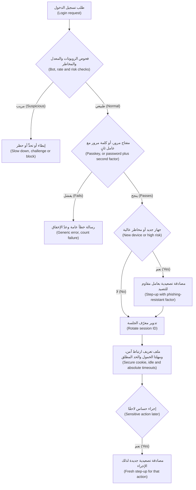
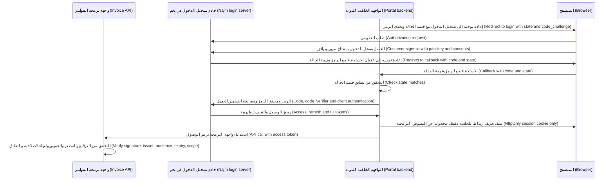
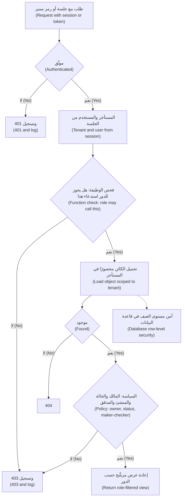

# الوحدة 3 — الهوية والوصول

*معظم الاختراقات لا تحتاج إلى استغلالٍ بارع. إنها تحتاج إلى كلمة مرورٍ مُعاد استخدامها، أو رمزٍ مميز (token) تقبله واجهة البرمجة الخطأ، أو نقطة نهاية (endpoint) لا تسأل أبدًا «هل هذا لك؟». تغطي هذه الوحدة الأسئلة الثلاثة التي يجب أن يجيب عنها كل طلبٍ إلى أي نظامٍ في بنك نجم إجابةً صحيحة. من هذا؟ تلك هي المصادقة (authentication): كلمات المرور والمصادقة متعددة العوامل (MFA) ومفاتيح المرور (passkeys) والجلسات. ماذا يُثبت هذا الرمز المميز؟ ذلك هو OAuth 2.0 وOpenID Connect ورموز JWT. وهل يجوز لهم لمس هذا الكائن؟ ذلك هو التفويض (authorisation) ومرجع الكائن المباشر غير الآمن (IDOR) وتعدد المستأجرين (multi-tenancy). ستتابع فريق أمن التطبيقات والذكاء الاصطناعي بينما يراقب مركز العمليات الأمنية (SOC) التابع لجاسم موجةً من حشو بيانات الاعتماد تضرب تطبيق نجم للهاتف، ويتعلّم علي لماذا تُعدّ مطابقة المستخدمين الاتحاديين بالبريد الإلكتروني وفكّ ترميز الرموز المميزة دون التحقق منها خطأين كليهما، ويحوّل اختبار مريم المصرَّح به لبوابة الشركات الصغيرة رقمَ فاتورةٍ واحدًا مُغيَّرًا إلى مصفوفة التحكم في الوصول (access-control matrix) الخاصة بالفريق. وتنتقل الأفكار نفسها مباشرةً إلى أمن الذكاء الاصطناعي: يجب أن تعمل أدوات (tools) نجم أسيست بهوية العميل وحقوقه، لا بهويتها وحقوقها هي أبدًا.*

> **المراحل:** Design, Build, Test — تصميم تسجيل الدخول والرموز المميزة (tokens) والصلاحيات بحيث يكون حتى أضعف مسارٍ إلى الحساب قويًّا، وبناؤها بمكتباتٍ مُدقَّقة، والإثبات بالاختبارات أن مستخدمًا آخر ومستأجرًا آخر يُرفَضان.

---

# 3.1 — المصادقة: كلمات المرور والمصادقة متعددة العوامل ومفاتيح المرور والجلسات
*المستوى: 🟡 متوسط* · *المتطلبات: 1.1، 1.2* · *المرحلة: Design, Build*

**بعد هذا الدرس تستطيع** أن تختبر تسجيل الدخول والتسجيل وإعادة تعيين كلمة المرور بحثًا عن كشف وجود الحسابات، وتخزّن كلمات المرور بـ Argon2id مع اختبار يثبت إعادة التجزئة عند تغيّر المعاملات. *مدة الدراسة: قراءة نحو 20 دقيقةً، وعمل تطبيقي نحو 7 ساعات (تقدير).*

## ⚡ الدرس في دقيقة
- **المصادقة (Authentication)** تجيب عن سؤال «من هذا؟»؛ و**التفويض (authorisation)** (3.3) يجيب عن سؤال «ماذا يجوز لهم أن يفعلوا؟». أبقِهما منفصلين في التصميم وفي الشيفرة.
- تفشل كلمات المرور عبر إعادة الاستخدام والتخمين والتصيّد الاحتيالي وسرقة قاعدة البيانات. لا تخزّنها إلا باستخدام **تجزئة كلمة مرور (password hash)** بطيئةٍ ومملّحة مثل Argon2id، واحظر كلمات المرور المسرّبة، وتخلَّ عن قواعد التركيب والانتهاء القسري للصلاحية.
- تتفاوت **المصادقة متعددة العوامل (MFA, multi-factor authentication)** في قوتها. فرموز الرسائل النصية ورموز التطبيقات يمكن اصطيادها بالتصيّد الاحتيالي؛ أمّا **مفاتيح المرور (passkeys)** فمرتبطةٌ بنطاق الموقع الحقيقي، فلا يحصل الموقع المقلِّد على شيءٍ يمكنه استخدامه.
- إعادة تعيين كلمة المرور واستعادة الحساب و«غيّروا رقم هاتفي» هي أيضًا عمليات تسجيل دخول. يختار المهاجمون أضعف باب.
- بعد تسجيل الدخول، يكون **رمز الجلسة (session token)** *هو* المستخدم: عشوائيًّا، يُدوَّر عند تسجيل الدخول، محفوظًا في ملف تعريف ارتباط (cookie) بخصائص `Secure` و`HttpOnly` و`SameSite`، تنتهي مهلته، ويمكن إبطاله على الخادم.
- مؤشر القرار: لكل إجراء، اسأل «ما مدى اليقين الذي نحتاجه، ومنذ متى؟»، واطلب **المصادقة التصعيدية (step-up authentication)** للإجراءات الخطرة.

## 🧭 لماذا يهم
في الساعة 02:10 من يوم ثلاثاء، يرى مركز العمليات الأمنية التابع لجاسم إخفاقات تسجيل الدخول على تطبيق نجم للهاتف ترتفع ارتفاعًا حادًّا: آلافٌ من عناوين البريد الإلكتروني الحقيقية للعملاء، جُرِّب كلٌّ منها مرةً أو مرتين، من آلاف عناوين IP. وقبل ذلك بأسبوع، كان تاجر تجزئةٍ في الخارج لا صلة له بالبنك قد أفصح عن اختراق. هذا هو **حشو بيانات الاعتماد (credential stuffing)**: إعادة تشغيل أزواج البريد الإلكتروني وكلمة المرور المسرّبة من موقعٍ ضد موقعٍ آخر، رهانًا على أن الناس يعيدون استخدام كلمات المرور. وتنجح بضع مئاتٍ من عمليات تسجيل الدخول.

في تلك الحسابات، يوقف رمز SMS المطلوب على الأجهزة الجديدة معظم المهاجمين. لكن بحلول منتصف الصباح، يُبلغ فريق مكافحة الاحتيال عن مكالماتٍ إلى مركز الاتصال تطلب نقل أرقام العملاء إلى بطاقات SIM جديدة، وعن صفحة تصيّدٍ احتيالي تطلب «الرمز الذي أرسلناه إليك للتو».

يسأل حمد، كبير مسؤولي أمن المعلومات (CISO)، أيّ الضوابط أوقفت ماذا. فحص كلمة المرور لم يوقف شيئًا: كانت كلمات المرور صحيحة. وقفل الحساب بعد خمسة إخفاقات لم يُفعَّل قط: لم يشهد كل حسابٍ سوى محاولةٍ أو اثنتين. رمز SMS هو الذي أدّى العمل، وهو بالضبط ما ستستهدفه الموجة التالية. قاعدة نورة: **يجب أن يسمّي كل ضابط مصادقة الهجومَ الذي يوقفه، ونحن نقوّي أضعف مسارٍ إلى الحساب أولًا، سواءٌ أكان تسجيل الدخول أم إعادة التعيين أم الاستعادة أم مركز الاتصال.**

## 📐 كيف يعمل

### 🟢 الأساسيات

**العوامل.** أدلة المصادقة إمّا شيءٌ **تعرفه**، ككلمة مرور أو رمز PIN، أو شيءٌ **تملكه**، كهاتف أو مفتاح أمان أو مفتاحٍ في العتاد الآمن للجهاز، أو شيءٌ **هو أنت**، كبصمة الإصبع أو الوجه. تحتاج **المصادقة متعددة العوامل (MFA)** إلى نوعين *مختلفين* على الأقل؛ فكلمتا مرور ليستا مصادقةً متعددة العوامل. وعلى الهواتف، لا تفعل بصمة الإصبع عادةً أكثر من فتح مفتاحٍ على الجهاز، فيرى البنك توقيعًا ولا يرى البيانات الحيوية أبدًا.

**قواعد كلمات المرور الحديثة.** وثيقة NIST SP 800-63B، وهي جزءٌ من إرشادات الهوية الرقمية الأمريكية في مراجعتها الرابعة التي اكتملت عام 2025، هي المرجع الأكثر استشهادًا. وتطلب، وقت الكتابة عام 2026: الطول لا التعقيد، أي 15 حرفًا على الأقل حين تكون كلمة المرور العامل الوحيد، و8 حين تكون جزءًا من المصادقة متعددة العوامل، مع السماح بطولٍ أقصى لا يقل عن 64 حرفًا؛ ولا قواعد تركيب، فهي تنتج كلماتٍ مثل `Password1!`؛ ولا تغييرات دورية قسرية دون دليلٍ على الاختراق؛ وقائمة حظر (blocklist) لكلمات المرور الشائعة والمسرّبة؛ ولا تلميحات ولا أسئلة أمان؛ والسماح باللصق كي تعمل برامج إدارة كلمات المرور. تحقّق من النص الحالي قبل كتابة السياسة.

**تخزين كلمات المرور.** لا تستخدم أبدًا النص الصريح أو التشفير القابل للعكس أو دالة تجزئةٍ سريعة (fast hash) مثل MD5 أو SHA-1 أو SHA-256، إذ تسمح لجدولٍ مسروق بأن يواجه عددًا هائلًا من التخمينات في الثانية على بطاقات رسومياتٍ عادية. استخدم **Argon2id** (RFC 9106) أو **scrypt** أو **bcrypt**. فهي تضيف **ملحًا (salt)** فريدًا إلى كل كلمة مرور، وهي بطيئةٌ عمدًا؛ كما أن Argon2id وscrypt **مُكلفتان للذاكرة (memory-hard)** (5.1).

```python
# Vulnerable: fast, unsalted hash
user.password_hash = hashlib.sha256(password.encode()).hexdigest()

# Fixed: Argon2id via argon2-cffi. Salt and parameters live inside the hash string.
from argon2 import PasswordHasher
from argon2.exceptions import VerifyMismatchError
ph = PasswordHasher()

def check_password(user, password):
    try:
        ph.verify(user.password_hash, password)
    except VerifyMismatchError:
        return False
    if ph.check_needs_rehash(user.password_hash):   # parameters raised since this hash was made
        user.password_hash = ph.hash(password)
    return True
```

**مقارنة خيارات المصادقة متعددة العوامل (MFA options compared).**

| الطريقة | مقاومةٌ للتصيّد الاحتيالي؟ | نقطة الضعف الرئيسية | الملاءمة في بنك |
|---|---|---|---|
| **رمزٌ عبر SMS أو مكالمة صوتية (SMS or voice code)** | لا | تبديل شريحة SIM، والاعتراض، والترحيل؛ وتصنّفها NIST «مقيَّدة» | احتياطيًّا فقط |
| **رمز تطبيق المصادقة (Authenticator app code)** | لا | يُكتب في موقعٍ مزيّف ويُرحَّل | الوصول الأقل خطورة |
| **الموافقة عبر الإشعار الفوري (Push approval)** | لا | «إرهاق المصادقة متعددة العوامل»: إشعاراتٌ متتالية حتى ينقر أحدهم «موافقة» | فقط مع مطابقة الأرقام |
| **مفتاح المرور أو مفتاح الأمان (Passkey or security key)** | نعم | تصبح الاستعادة نقطة الضعف | الخيار الافتراضي للعملاء؛ وإلزاميٌّ للموظفين ذوي الصلاحيات |

**مفاتيح المرور.** **مفتاح المرور (passkey)** زوج مفاتيح (key pair) ينشئه جهاز المستخدم أو مدير كلمات المرور لموقعٍ واحد، باستخدام **WebAuthn**، وهي واجهة برمجة المتصفح من W3C، و**FIDO2**، أي WebAuthn مضافًا إليها البروتوكول الخاص بالمصادِقات الخارجية. لا يخزّن الخادم سوى المفتاح العام (public key)، ويرسل **تحدّيًا** عشوائيًّا، ويتحقق من التوقيع الذي يُنشئه الجهاز بعد أن يفتحه المستخدم ببصمة الإصبع أو الوجه أو رمز PIN. لا يوجد على الخادم سرٌّ مشترك (shared secret) يمكن سرقته، ويربط المتصفح كل بيانات اعتماد (credential) بنطاق الموقع، فلا تستطيع صفحةٌ مقلِّدة الحصول على توقيعٍ صالح لـ `najm.example`.

**الجلسات.** بعد تسجيل الدخول، يُصدر الخادم **رمز جلسة**، عادةً في ملف تعريف ارتباط؛ ومن يحمله *هو* المستخدم. اجعله **عشوائيًّا**، أي 128 بتًا على الأقل من مولّدٍ آمن. **دوِّره** عند تسجيل الدخول وعند تغيّر الصلاحيات، وإلّا فإن مهاجمًا زرع معرّفًا معروفًا قبل تسجيل الدخول يشارك الجلسة بعده، وهذا هو **تثبيت الجلسة (session fixation)**. احمِ ملف تعريف الارتباط بـ `Secure`، و`HttpOnly` (لا وصول للنصوص البرمجية)، و`SameSite=Lax` أو `Strict` (يساعد ضد تزوير الطلبات عبر المواقع (CSRF)، 2.2)، والبادئة `__Host-`. اضبط **مهلتي الخمول والحدّ المطلق**، و**سجِّل الخروج على الخادم**، مُبطِلًا جميع الجلسات عند إعادة التعيين أو تغيير الهاتف أو ظهور علامة احتيال. وفي الخدمات المصرفية، فضِّل الجلسات القابلة للإبطال على الخادم؛ فالرمز المميز المكتفي بذاته (3.2) يبقى صالحًا حتى تنتهي صلاحيته.

```js
// Cookie: Set-Cookie: __Host-najm_sid=<random>; Path=/; Secure; HttpOnly; SameSite=Lax
app.post("/login", async (req, res, next) => {
  const user = await verifyCredentials(req.body);
  if (!user) return res.status(401).json({ error: "Invalid email or password" }); // never "no such account"
  // Vulnerable: setting req.session.userId here would keep the pre-login ID (session fixation)
  req.session.regenerate((err) => {        // Fixed: a brand-new session ID at authentication
    if (err) return next(err);
    req.session.userId = user.id;
    req.session.authTime = Date.now();     // used later to decide when step-up is needed
    res.json({ ok: true });
  });
});
```

### 🟡 التعمق أكثر

**الدفاع ضد حشو بيانات الاعتماد.** يتغلّب الحشو (stuffing) على القفل لكل حساب، إذ لا تتجاوز المحاولات اثنتين لكل حساب، وعلى قواعد القوة، إذ إن كلمات المرور صحيحة. رتّب الدفاعات في طبقات: **المصادقة متعددة العوامل**، ويُفضَّل أن تكون مقاومةً للتصيّد الاحتيالي؛ و**فحص كلمات المرور المسرّبة** عند التسجيل والتغيير وتسجيل الدخول، وتستخدم خدمة Pwned Passwords **إخفاء الهوية من النوع k (k-anonymity)**: لا ترسل سوى الأحرف الخمسة الأولى من تجزئة SHA-1 لكلمة المرور وتطابق القائمة المُعادة محليًّا؛ و**المراقبة على مستوى الموقع كله** لنِسَب الإخفاق وعمليات تسجيل الدخول من أجهزةٍ جديدة (10.1)؛ و**حدود المعدّل (rate limits)** المرتبطة بعنوان IP والجهاز والحساب، مع **تأخيراتٍ متصاعدة** بدلًا من القفل الصارم، الذي يتيح للمهاجمين إقفال حسابات العملاء في وجوههم (4.2).

**تعداد الحسابات.** يجب ألّا يكشف تسجيل الدخول والتسجيل وإعادة التعيين ما إذا كان الحساب موجودًا. أعِد الرسالة نفسها ورمز الحالة نفسه وتوقيتًا متقاربًا؛ ومن الأساليب تجزئة قيمةٍ وهمية حين يكون الحساب غير موجود. وفي إعادة التعيين، قل دائمًا «إذا كان الحساب موجودًا، فقد أرسلنا رابطًا».

**إعادة تعيين كلمة المرور.** إعادة التعيين تسجيلُ دخولٍ يتخطى كلمة المرور. استخدم رمزًا عشوائيًّا لا يقل عن 128 بتًا، يُستخدم مرةً واحدة، وقصير العمر، ولا يُخزَّن إلا تجزئةً. ابنِ الرابط من عنوان URL أساسي مُعَدّ مسبقًا، لا من ترويسة `Host` في الطلب أبدًا. واصِل اشتراط المصادقة متعددة العوامل، ولا تُدخِل المستخدم تلقائيًّا، وأبطِل الجلسات القائمة، وأشعِر العميل.

**بيانات الاتصال والأجهزة هي المفاتيح الحقيقية.** تغيير رقم الهاتف أو تسجيل جهازٍ جديد يتحكم في كل رمزٍ وتنبيهٍ لاحق. و**تبديل شريحة SIM**، أي إقناع مشغّل الهاتف المحمول بنقل رقمٍ إلى شريحة المهاجم، يقلب رموز SMS ضد العميل. عامِل هذه التغييرات على أنها عالية الخطورة: مصادقةٌ تصعيدية بعاملٍ قويٍّ قائم، وإشعار القناة *القديمة*، وتعليق تغييرات المستفيدين والحدود لفترة تهدئة.

**المصادقة التصعيدية ومستويات الضمان.** **مستويات ضمان المصادِق (authenticator assurance levels)** لدى NIST هي **AAL1**، أي عاملٌ واحد على الأقل، و**AAL2**، أي عاملان مختلفان، و**AAL3**، أي، وقت الكتابة، مصادِقٌ مدعومٌ بالعتاد ومقاومٌ للتصيّد الاحتيالي لا يمكن تصدير مفتاحه. و**المصادقة التصعيدية** تطلب مصادقةً جديدةً وأقوى مباشرةً قبل إجراءٍ حساس. وفي مدفوعات الاتحاد الأوروبي، تشترط المصادقة القوية للعميل وفق PSD2 أيضًا **الربط الديناميكي** بالمبلغ والمستفيد؛ تحقّق من القواعد الحالية مع فريق الامتثال.

**تصيّدٌ احتيالي يهزم الرموز.** حِزَم تصيّد **الخصم في المنتصف** تُرحِّل كل ما تكتبه الضحية، بما في ذلك الرمز لمرةٍ واحدة، إلى الموقع الحقيقي في الوقت الفعلي، وتحتفظ بملف تعريف ارتباط الجلسة العائد. ورموز SMS ورموز التطبيقات والموافقات البسيطة عبر الإشعار الفوري تسقط كلها أمام ذلك. أمّا مفاتيح المرور فلا، لأن المتصفح لا يوقّع إلا للنطاق الحقيقي. و**إرهاق المصادقة متعددة العوامل**، أي إشعارٌ تلو إشعار حتى ينقر مستخدمٌ مُتعَب «موافقة»، ظهر في عدة اختراقاتٍ مُعلَن عنها عام 2022. خفِّف منه عبر **مطابقة الأرقام**، إذ يكتب المستخدم في التطبيق رقمًا معروضًا على شاشة تسجيل الدخول، ووضع حدودٍ للإشعارات، وتضمين تفاصيل الموقع والتطبيق في الإشعار.



### 🔴 نظرة الخبير

**الاستعادة هي المحيط الحقيقي.** ما إن يعتمد تسجيل الدخول على مفاتيح المرور، حتى ينتقل المهاجمون إلى إعادة التعيين عبر SMS، ومكتب المساعدة، و«فقدتُ هاتفي»؛ وقد ظهرت الهندسة الاجتماعية لمكتب المساعدة في اختراقاتٍ مُعلَن عنها. امنح الاستعادة ضمانًا بمستوى تسجيل الدخول: أكثر من مفتاح مرورٍ أو جهازٍ مسجَّل، وإعادة التحقق من الهوية داخل التطبيق أو في فرع بدلًا من «تاريخ الميلاد»، وتأخيراتٍ وإشعارات، ونصًّا لمركز الاتصال لا يعيد تعيين أي عامل بناءً على مكالمةٍ هاتفية وحدها.

**مفاتيح مرورٍ متزامنة أم مرتبطة بالجهاز.** **مفاتيح المرور المتزامنة (Synced passkeys)** تتبع المستخدم إلى هاتفٍ جديد عبر حساب منصته أو مدير كلمات المرور: مريحة، لكنها آمنةٌ فقط بقدر أمان ذلك الحساب واستعادته. أمّا المفاتيح **المرتبطة بالجهاز**، مثل مفاتيح الأمان العتادية، فلا يمكن نسخها وتناسب AAL3. نشرت NIST عام 2024 إرشاداتٍ تقبل المصادِقات القابلة للمزامنة (syncable authenticators) عند AAL2، ثم أُدمجت لاحقًا في المراجعة 4. والتقسيم المعقول: مفاتيح مرورٍ متزامنة للعملاء، ومفاتيح مرتبطة بالجهاز للموظفين ذوي الصلاحيات.

**استخدم مكتبة WebAuthn مُصانة.** يفحص التحقق تحدّيًا يُستخدم مرةً واحدة، والأصل، و**معرّف الطرف المعتمِد** الذي يكون عادةً نطاقك، وعلامتي حضور المستخدم والتحقق منه، والتوقيع، وعدّاد التوقيع، وكثيرًا ما تُبلغ مفاتيح المرور المتزامنة عن صفر، فعامِله إشارةً لا أكثر. ومن السهل أن تخطئ في كل خطوةٍ خطأً دقيقًا إذا كتبتها يدويًّا. والمكافئ الأصلي في تطبيق نجم للهاتف، أي مفتاحٌ في العتاد الآمن للهاتف يُفتح بالبيانات الحيوية، هو **ربط الجهاز (device binding)** (4.3).

**طابِق التجزئة مع الإنتروبيا.** وُجدت التجزئة البطيئة (slow hashing) لأن كلمات المرور البشرية قليلة العشوائية. أمّا رمز إعادة التعيين أو مفتاح واجهة البرمجة (API key) ذو 128 بتًا عشوائيًّا فيمكن تخزينه بأمان تجزئةَ SHA-256 عادية. و**الفلفل (pepper)**، وهو مفتاحٌ سري محفوظ في نظام إدارة المفاتيح (KMS) أو وحدة أمن العتاد (HSM) (5.2) ويُمزج في تجزئة كلمات المرور، يعني أن قاعدة بياناتٍ مسروقة وحدها لا تكفي لبدء التخمين، على حساب إدارة المفاتيح. ومعظم تطبيقات bcrypt لا تستخدم إلا أول 72 بايتًا من المدخلات، وهذا سببٌ آخر لتفضيل Argon2id في الأنظمة الجديدة.

## 🧰 الأدوات
| الضابط أو المعيار أو الأداة | ما هو وماذا يفعل | متى تلجأ إليه |
|---|---|---|
| **NIST SP 800-63B** — إرشادات الهوية الرقمية | قواعد للمصادِقات (authenticators) وكلمات المرور ومستويات الضمان من AAL1 إلى AAL3 وإعادة المصادقة (reauthentication)؛ وتُستخدم على نطاقٍ واسع خارج الحكومة الأمريكية | وضع سياسة كلمات المرور والمصادقة متعددة العوامل والجلسات؛ وإلغاء القواعد المتقادمة |
| **Argon2id** — وفق RFC 9106 | تجزئة كلمات مرورٍ بطيئة ومملّحة ومُكلفة للذاكرة؛ وscrypt وbcrypt بديلان مقبولان | كل نظامٍ يخزّن كلمات المرور |
| **Breached-password check** — فحص كلمات المرور المسرّبة، مثل Pwned Passwords | يقارن كلمات المرور بقوائم الكلمات المعروف تسريبها، بخصوصيةٍ عبر k-anonymity أو قائمةٍ محلية | التسجيل، وتغيير كلمة المرور، وتسجيل الدخول حيثما أمكن |
| **Passkeys** — مفاتيح المرور | بيانات اعتمادٍ بمفتاحٍ عام مرتبطةٌ بالنطاق؛ مقاومةٌ للتصيّد الاحتيالي، ولا سرّ مشتركًا على الخادم | تسجيل الدخول الافتراضي للعملاء؛ ومفاتيح مرتبطة بالجهاز للموظفين ذوي الصلاحيات |
| **Step-up authentication** — المصادقة التصعيدية | مصادقةٌ جديدة وأقوى مباشرةً قبل إجراءٍ حساس | المستفيدون الجدد، وزيادة الحدود، وتغيير بيانات الاتصال، والإجراءات الإدارية |
| **Secure session cookies** — ملفات تعريف ارتباط الجلسة الآمنة (`Secure`، `HttpOnly`، `SameSite`، `__Host-`) | خصائص ملفات تعريف الارتباط التي تُبقي رمز الجلسة على HTTPS، وبعيدًا عن النصوص البرمجية، وخارج معظم الطلبات عبر المواقع | كل جلسة متصفح |
| **OWASP ASVS** — من OWASP | متطلباتٌ قابلة للاختبار، بما فيها المصادقة وإدارة الجلسات؛ وصدر الإصدار 5.0 عام 2025 | كتابة المتطلبات وقوائم التحقق للمراجعة |

## 🏛️ عمليًا في بنك نجم
بعد موجة الحشو، تكتب نورة وعلي **معيار نجم للمصادقة، الإصدار 1، لقنوات العملاء**. يعتمده حمد، ويتولى مركز العمليات الأمنية التابع لجاسم قواعد الرصد الخاصة به.

**الجزء أ: القواعد**

| المجال | القاعدة | ما توقفه |
|---|---|---|
| تسجيل الدخول | تطبيق نجم للهاتف: مفتاح الجهاز يُفتح بالبيانات الحيوية أو برمز PIN للتطبيق. الويب: مفاتيح المرور افتراضيًّا | التصيّد الاحتيالي، وإعادة الاستخدام |
| كلمات المرور، حيثما لا تزال مستخدمة | 12 حرفًا فأكثر (12+ characters)، وهي قاعدةٌ داخلية مع عاملٍ ثانٍ دائمًا؛ لا قواعد تركيب ولا انتهاء صلاحية؛ فحص كلمات المرور المسرّبة | الحشو، والتخمين |
| التخزين | Argon2id عبر المكتبة المعتمدة؛ وإعادة التجزئة عند تسجيل الدخول | الكسر دون اتصال |
| رموز SMS | احتياطٌ للحالات منخفضة الخطورة فقط؛ ولا تُستخدم أبدًا للمصادقة التصعيدية في الجزء ب | تبديل شريحة SIM، والترحيل |
| الردود والحدود | رسالةٌ عامة واحدة بالعربية والإنجليزية؛ تأخيراتٌ متصاعدة؛ تنبيهٌ لمركز العمليات الأمنية عند نسبة الإخفاق على مستوى الموقع | التعداد، والحشو |
| الجلسات | معرّفاتٌ بطول 128 بتًا تُدوَّر عند تسجيل الدخول والمصادقة التصعيدية؛ `__Host-`، `Secure`، `HttpOnly`، `SameSite=Lax`؛ مهلة الخمول على الويب 10 دقائق، والحد المطلق 12 ساعة، وهي قيمٌ توضيحية | التثبيت (fixation)، والسرقة |
| الاستعادة | لا استعادة عبر SMS وحدها؛ إعادة التحقق من الهوية في التطبيق أو الفرع؛ لا إعادة تعيين للعوامل عبر الهاتف | إساءة استخدام الاستعادة |
| الموظفون والمسؤولون | مفاتيح أمانٍ مرتبطة بالجهاز فقط | الاستيلاء على الحسابات ذات الصلاحيات |

**الجزء ب: مصفوفة المصادقة التصعيدية لإجراءات العملاء**

| الإجراء | المصادقة | الحداثة | ضوابط إضافية |
|---|---|---|---|
| تجميد بطاقة | الجلسة مع تأكيدٍ داخل التطبيق | الجلسة (Session) | احتكاكٌ منخفض عن قصد: التجميد يقلّل المخاطر |
| إلغاء تجميد بطاقة أو كشف رقمها | مصادقة تصعيدية: مفتاح الجهاز أو مفتاح المرور | 5 دقائق | غير متاحٍ أبدًا لنجم أسيست |
| إضافة مستفيد | مصادقة تصعيدية | لكل إجراء | تعليقٌ لمدة 24 ساعة على جهازٍ عمره أقل من 72 ساعة |
| تحويلٌ يتجاوز الحد اليومي | مصادقة تصعيدية تعرض المبلغ والمستفيد | لكل معاملة | درجة الاحتيال من التنبيهات الذكية |
| تغيير رقم الهاتف أو البريد الإلكتروني | مصادقة تصعيدية بعاملٍ قويٍّ قائم | لكل إجراء | إشعار القناتين القديمة والجديدة؛ وتعليقٌ لمدة 72 ساعة على تغييرات المستفيدين |
| تسجيل جهاز جديد | موافقةٌ من جهازٍ قائم، أو إعادة التحقق | لكل إجراء | إشعار جميع الأجهزة؛ ويمكن لأيٍّ منها الإلغاء |

## 🛠️ التمارين
- 🟢 على تطبيقٍ تملكه، أو على نسخةٍ محلية من OWASP Juice Shop، جرّب تسجيل الدخول والتسجيل وإعادة تعيين كلمة المرور ببريدٍ إلكتروني موجود وآخر غير موجود، مسجِّلًا الرسالة ورمز الحالة وزمن الاستجابة التقريبي. *يكتمل عندما:* يُظهر جدولك ذو الحالات الست أن الشخص من الخارج لا يستطيع معرفة الحسابات الموجودة، أو تكون قد كتبت إصلاحًا لكل تسريب.
- 🟡 في تطبيقٍ محليٍّ صغير من صنعك، خزّن كلمات المرور باستخدام Argon2id، وأعِد التجزئة عند تسجيل الدخول حين تتغير المعاملات، وافحص كلمات المرور الجديدة مقابل قائمةٍ مسرّبة، عبر واجهة برمجة النطاقات القائمة على k-anonymity أو ملفٍّ منزَّل. *يكتمل عندما:* تبدأ القيم المخزّنة بـ `$argon2id$` (أو `$2b$`)، ويُثبت اختبارٌ أن رفع المعاملات يؤدي إلى إعادة التجزئة عند تسجيل الدخول التالي، وتُرفَض كلمة مرورٍ مسرّبة علنًا.
- 🔴 أضِف تسجيل الدخول بمفاتيح المرور (passkey sign-in) إلى تطبيقٍ تجريبي محلي على `localhost` باستخدام مكتبة WebAuthn مُصانة، ثم اكتب تصميمًا للاستعادة في صفحةٍ واحدة. *يكتمل عندما:* تُثبت الاختبارات أن الخادم يرفض تحدّيًا مُعادًا استخدامه وأصلًا خاطئًا، ويوضّح التصميم كيف يعود مستخدمٌ فقد كل أجهزته، وبأي مستوى ضمان وبأي تأخير.
- 📝 **المسار الورقي (دون شيفرة).** راجع تصميم تسجيل الدخول هذا: كلمات المرور مخزّنة بتجزئة `sha256` غير مملّحة؛ والرسالتان «كلمة المرور خاطئة» و«لا يوجد حساب بهذا البريد»؛ ورموز SMS لمرة واحدة لكل العملاء، بما في ذلك إضافة مستفيد؛ وجلسات تدوم حتى يسجّل العميل خروجه. *يكتمل عندما:* يكون لكل خيار من الخيارات الأربعة هجومُه والبديلُ الذي ستشترطه.

<details><summary>راجع عملك</summary>

**📝 إجابة نموذجية.** التجزئة السريعة غير المملّحة تتيح كسر جدول مسروق بسرعة؛ اشترط Argon2id مع إعادة التجزئة حين ترتفع المعاملات. والرسالتان المختلفتان تخبران المهاجم أي العناوين لها حسابات؛ اشترط رسالة عامة واحدة بتوقيت متقارب. ورموز SMS تسقط أمام تبديل شريحة SIM والتصيّد بالترحيل؛ اشترط مفاتيح المرور أو الموافقة داخل التطبيق للإجراءات عالية المخاطر مثل إضافة مستفيد. والجلسات بلا نهاية تُبقي ملف تعريف الارتباط المسروق صالحًا؛ اشترط مهلة خمول ومهلة مطلقة، وتسجيل خروج على الخادم، وإبطال الجلسات عند إعادة تعيين كلمة المرور.

</details>

## ⚠️ أخطاء وفخاخ
- **اعتبار رموز SMS «مصادقةً متعددة العوامل منجزة».** يهزمها تبديل شريحة SIM والتصيّد بالترحيل. أبقِها احتياطًا، وانقل الإجراءات الخطرة إلى مفاتيح المرور أو مفاتيح الجهاز.
- **القفل الصارم دفاعًا ضد الحشو.** يجرّب الحشو كل حسابٍ مرةً أو مرتين، والقفل يتيح للمهاجمين إقفال حسابات العملاء. استخدم المصادقة متعددة العوامل، وفحص كلمات المرور المسرّبة، والرصد على مستوى الموقع، والتأخيرات المتصاعدة.
- **تجزئة كلمات المرور السريعة أو محلية الصنع.** SHA-256 مع ملحٍ مشترك ليس تخزينًا لكلمات المرور. استخدم Argon2id أو scrypt أو bcrypt عبر مكتبةٍ مُصانة.
- **نسيان الأبواب الجانبية.** إعادة التعيين والاستعادة وتغيير الهاتف ومركز الاتصال كلها مسارات مصادقة. امنحها ضمانًا بمستوى تسجيل الدخول.
- **تسجيل خروجٍ لا يمسح إلا المتصفح.** إذا ظل الخادم يقبل الجلسة، فإن النسخة المسروقة تظل تعمل. أتلِف الجلسات على الخادم.

## 🧾 الخلاصة
- المصادقة تُثبت هوية الشخص؛ فأبقِها منفصلةً عن التفويض.
- اتبع إرشادات NIST الحالية: الطول وقوائم الحظر، ولا قواعد تركيب ولا انتهاء قسري للصلاحية؛ وجزِّئ باستخدام Argon2id أو scrypt أو bcrypt.
- يمكن اصطياد الرموز وإشعارات الموافقة بالتصيّد أو إنهاك المستخدم بها حتى يوافق؛ أمّا مفاتيح المرور فمرتبطةٌ بالنطاق الحقيقي.
- إعادة التعيين والاستعادة وتغيير بيانات الاتصال عمليات تسجيل دخولٍ متنكّرة. قوِّها أولًا.
- تحتاج الجلسات إلى معرّفاتٍ عشوائية تُدوَّر عند تسجيل الدخول، وملفات تعريف ارتباط محمية، ومهلٍ زمنية، وإبطالٍ على الخادم، ومصادقةٍ تصعيدية.

## ✍️ اختبر نفسك

**1. يرى جاسم آلاف محاولات تسجيل الدخول على تطبيق نجم للهاتف، كلٌّ منها من عنوان IP مختلف، بمحاولةٍ واحدة لكل حساب وبعناوين بريدٍ إلكتروني حقيقية للعملاء. أيّ الضوابط القائمة سيكون الأقل أثرًا في إيقاف ذلك؟**

- A. عاملٌ ثانٍ مطلوب على الأجهزة الجديدة
- B. قفل الحساب بعد خمس محاولاتٍ فاشلة
- C. تنبيهٌ على نسبة تسجيلات الدخول الفاشلة إلى الناجحة على مستوى الموقع
- D. فحص كلمات المرور مقابل قوائم كلمات المرور المسرّبة

<details><summary>الإجابة</summary>

**B.** يجرّب الحشو كل حسابٍ مرةً أو مرتين، فنادرًا ما يُفعَّل القفل بعد خمسة إخفاقات، كما يمكن إساءة استخدام القفل الصارم ضد العملاء. أمّا A وC وD فتعالج جميعها إعادة الاستخدام على نطاقٍ واسع. انظر: 🟡 التعمق أكثر.

</details>

**2. يكتشف علي أن بوابة الشركات الصغيرة تخزّن كلمات المرور بتجزئة SHA-256 مع ملحٍ واحد مشترك بين جميع المستخدمين. ما الإصلاح الأفضل؟**

- A. التحول إلى SHA-512 مع الإبقاء على الملح المشترك، فالتجزئة الأطول تجعل كسر كلمات المرور أصعب بكثير
- B. تشفير عمود كلمات المرور باستخدام AES كي يمكن فكّ تشفيره للتحقق منها عند تسجيل الدخول، فيبقى الجدول المسروق محميًا من المهاجمين
- C. الانتقال إلى Argon2id (أو bcrypt أو scrypt) بملحٍ فريد لكل كلمة مرور، وإعادة تجزئة كل كلمة مرور عند الدخول التالي لصاحبها
- D. إجبار كل مستخدم على تغيير كلمة مروره كل 90 يومًا، فهذا يحدّ من مدة صلاحية أي تجزئة مسروقة

<details><summary>الإجابة</summary>

**C.** دوال تجزئة كلمات المرور (password hashing functions) بطيئةٌ ومملّحةٌ لكل كلمة مرور، وإعادة التجزئة عند تسجيل الدخول (rehash-on-login) تُرحِّل المستخدمين دون إعادة تعيينٍ جماعية، ولحماية الحسابات الخاملة أيضًا، كثيرًا ما تغلّف الفرق كل تجزئةٍ قديمة بـ Argon2id فورًا. أمّا A فلا تزال تجزئةً سريعة؛ وB قابلٌ للعكس على يد أي شخصٍ يملك المفتاح؛ وD لم تعد NIST توصي به. انظر: 🟢 الأساسيات.

</details>

**3. حزمة تصيّد احتيالي تُرحِّل كل ما يكتبه العميل إلى موقع نجم الحقيقي في الوقت الفعلي، بما في ذلك الرموز لمرةٍ واحدة، وتحتفظ بملف تعريف ارتباط الجلسة. أيّ المصادِقات (authenticator) يقاوم ذلك؟**

- A. رمزٌ لمرةٍ واحدة عبر SMS
- B. رمزٌ من ستة أرقام من تطبيق المصادقة
- C. موافقةٌ عبر الإشعار الفوري دون مطابقة الأرقام
- D. مفتاح مرور

<details><summary>الإجابة</summary>

**D.** يربط المتصفح مفتاح المرور بالنطاق الحقيقي، فلا تستطيع الصفحة المقلِّدة الحصول على توقيعٍ صالح لنجم. أمّا الرموز فيمكن ترحيلها، ويمكن أن تُعتمَد إشعارات الموافقة لصالح جلسة المهاجم. انظر: 🟢 الأساسيات؛ 🟡 التعمق أكثر.

</details>

**4. في أثناء اختبارٍ مصرَّحٍ به، تلاحظ مريم أن قيمة ملف تعريف ارتباط الجلسة هي نفسها قبل تسجيل الدخول وبعده. ما الخطر، وما الإصلاح؟**

- A. تثبيت الجلسة؛ أصدِر معرّف جلسةٍ جديدًا عند تسجيل الدخول وعند كل تغييرٍ في الصلاحيات
- B. البرمجة النصية عبر المواقع؛ أضِف سياسة أمان المحتوى وشفّر كل نص يدخله المستخدم عند عرضه
- C. حشو بيانات الاعتماد؛ أضِف اختبار CAPTCHA
- D. لا خطر، ما دام ملف تعريف الارتباط `HttpOnly`

<details><summary>الإجابة</summary>

**A.** إذا بقي المعرّف السابق لتسجيل الدخول، فإن أي شخصٍ زرعه قبل تسجيل الدخول يشارك الجلسة الموثَّقة؛ وإعادة توليد المعرّف تسدّ الثغرة. أمّا `HttpOnly` (D) فيمنع النصوص البرمجية من قراءة ملف تعريف الارتباط، ولا يمنع المعرّف المزروع. انظر: 🟢 الأساسيات.

</details>

**5. يريد فريق طارق أن يغيّر العملاء رقم هاتفهم المسجَّل في تطبيق نجم للهاتف بنقرةٍ واحدة، لتقليل مكالمات مركز الاتصال. بماذا ينبغي أن يوصي فريق نورة؟**

- A. السماح بذلك مع مصادقةٍ تصعيدية بعاملٍ قويٍّ قائم، وتنبيهٍ إلى الرقم القديم، وتعليقٍ للمستفيدين الجدد وتغيير الحدود
- B. السماح بذلك مباشرةً، لأن العميل مسجِّلٌ دخوله أصلًا، وجلسته تثبت هويته
- C. إزالة تغيير الهاتف من التطبيق واشتراط زيارة الفرع على الجميع، مهما بلغ عدد العملاء المتأثرين بذلك
- D. السماح بذلك، مع رمز SMS يُرسَل إلى الرقم الجديد للتأكد من أن العميل يملكه فعلًا ويستطيع استلام الرسائل

<details><summary>الإجابة</summary>

**A.** يتحكم رقم الهاتف في كل رمزٍ وتنبيهٍ لاحق، لذا فإن تغييره خطوةٌ كلاسيكية في الاستيلاء على الحساب. والمصادقة التصعيدية وإشعار القناة القديمة وفترة التهدئة تُبقي التغيير مريحًا لكن صعب الاستغلال. أمّا D فلا يُثبت إلا التحكم في الرقم الجديد، وهو ما يملكه المهاجم؛ وC تصحيحٌ مفرط. انظر: 🟡 التعمق أكثر؛ 🏛️ عمليًا.

</details>

## 📚 المراجع
- وثيقة NIST SP 800-63B-4، *Digital Identity Guidelines: Authentication and Authenticator Management* (2025) — https://doi.org/10.6028/NIST.SP.800-63B-4
- ورقة OWASP المختصرة للمصادقة — https://cheatsheetseries.owasp.org/cheatsheets/Authentication_Cheat_Sheet.html
- ورقة OWASP المختصرة لتخزين كلمات المرور — https://cheatsheetseries.owasp.org/cheatsheets/Password_Storage_Cheat_Sheet.html
- ورقة OWASP المختصرة لإدارة الجلسات — https://cheatsheetseries.owasp.org/cheatsheets/Session_Management_Cheat_Sheet.html
- ورقة OWASP المختصرة لمنع حشو بيانات الاعتماد — https://cheatsheetseries.owasp.org/cheatsheets/Credential_Stuffing_Prevention_Cheat_Sheet.html
- معيار OWASP للتحقق من أمن التطبيقات — https://owasp.org/www-project-application-security-verification-standard/
- اتحاد W3C، مواصفة مصادقة الويب — https://www.w3.org/TR/webauthn/
- RFC 9106، دالة Argon2 المُكلفة للذاكرة لتجزئة كلمات المرور — https://www.rfc-editor.org/rfc/rfc9106
- موقع Have I Been Pwned، خدمة Pwned Passwords — https://haveibeenpwned.com/Passwords

---

# 3.2 — OAuth 2.0 وOpenID Connect ومزالق الرموز المميزة
*المستوى: 🟡 متوسط* · *المتطلبات: 3.1* · *المرحلة: Design, Build*

**بعد هذا الدرس تستطيع** أن تكتب دالة للتحقق من الرموز المميزة ترفض اختباراتُها سبعة رموز معيبة، من alg none إلى kid مجهول، كلًّا للسبب الصحيح. *مدة الدراسة: قراءة نحو 15 دقيقةً، وعمل تطبيقي نحو 4 ساعات (تقدير).*

## ⚡ الدرس في دقيقة
- وُضع **OAuth 2.0** من أجل **التفويض بالإنابة (delegated authorisation)**: يستدعي تطبيقٌ واجهة برمجة نيابةً عن المستخدم، بحقوقٍ محدودة، دون أن يرى كلمة مروره. وهو لا يحدد هوية المستخدم.
- يضيف **OpenID Connect (OIDC)** الهوية (identity) عبر **رمز الهوية (ID token)**. رموز الهوية للتطبيق؛ و**رموز الوصول (access tokens)** لواجهة البرمجة. لا تقبل أحدهما بدلًا من الآخر أبدًا.
- الخيار الافتراضي لكل تطبيقٍ عميل تقريبًا: **تدفق رمز التفويض مع PKCE**، ومطابقةٌ تامة لعنوان URI لإعادة التوجيه، ولا منح ضمنية ولا منح بكلمة المرور (no implicit or password grants) (RFC 9700، 2025).
- رمز **JWT** يكون عادةً موقَّعًا لا مشفَّرًا: يستطيع أي شخصٍ يحمله أن يقرأه. تحقّق منه بخوارزميةٍ تختارها *أنت*، وافحص المُصدِر والجمهور وانتهاء الصلاحية، وأبقِ أعمار الرموز قصيرة.
- مؤشر القرار: لكل رمزٍ مميز، اسأل «من أصدره، ولأي جمهور، وبأي نطاق، ولأي مدة، وماذا لو سُرق؟»
- أكبر فخ: فكّ ترميز الرمز المميز بدلًا من التحقق منه، أو قبول رمزٍ صالح صادرٍ لواجهة برمجةٍ أخرى.

## 🧭 لماذا يهم
تصل إلى نورة ثلاثة طلباتٍ في أسبوعٍ واحد.

يريد عملاء الشركات تسجيل الدخول إلى بوابة الشركات الصغيرة بحسابات شركاتهم، لذا يجب أن **تتّحد** البوابة مع مزوّدي الهوية لديهم. ويطابق النموذج الأولي الذي أعدّه علي المستخدمين بحسابات البوابة عبر مطالبة `email` في الرمز المميز. فتوقفه نورة: عناوين البريد الإلكتروني تتغير، وبعض المزوّدين لا يتحققون منها، ومن يتحكم في مستأجرٍ (tenant) لدى مزوّدٍ متعدد المستأجرين قد يستطيع تعيين أحدها. وقد أبلغ باحثون علنًا عن هذه الفئة من الثغرات عام 2023.

ويريد فريق نجم أسيست أن يجمّد المساعد البطاقات برمز خدمةٍ واحد يحمل صلاحيات بطاقاتٍ كاملة لكل عميل، على أن يختار النموذج أيّ بطاقة. هذه مشكلة **نائبٍ مرتبك (confused deputy)** تنتظر الوقوع: مكوّنٌ ذو صلاحيات يُخدَع فيستخدم سلطته لصالح شخصٍ آخر.

ويقترح مطوّرٌ لتطبيقات الهاتف المحمول رموز وصولٍ صالحةً 30 يومًا «لتجنّب تعقيد التحديث».

الرموز المميزة **بيانات اعتمادٍ لحاملها**: فهي كالنقد، من يحمل أحدها يستطيع إنفاقه. قاعدة نورة: **لكل رمزٍ مميز في نجم مُصدِرٌ مُسمّى، وجمهورٌ واحد، وأضيق نطاق، وعمرٌ قصير، وخطةٌ للتعامل مع السرقة.**

## 📐 كيف يعمل

### 🟢 الأساسيات

*تستخدم مواصفات OAuth التهجئة الأمريكية، لذا يحتفظ هذا الدرس بها في المصطلحات الإنجليزية للبروتوكول، مثل «خادم التفويض».*

**الأدوار والرموز المميزة.** **مالك المورد** هو العميل المصرفي؛ و**التطبيق العميل** هو التطبيق؛ و**خادم التفويض (authorization server, AS)** يصادق المستخدم، ويسجّل الموافقة، ويُصدر الرموز المميزة؛ و**خادم الموارد** هو واجهة البرمجة. و**رمز التفويض (authorization code)** قسيمةٌ لمرةٍ واحدة تُستبدل بالرموز المميزة. و**رمز الوصول (access token)** يذهب إلى واجهة برمجة: قصير العمر، ومحدود النطاق، ولجمهورٍ واحد. و**رمز التحديث (refresh token)** يحصل على رموز وصولٍ جديدة دون المستخدم، لذا فهو طويل العمر وعالي القيمة. و**رمز الهوية** في OIDC يخبر *التطبيق العميل* بمن سجّل الدخول، ومتى، وكيف.

**أيّ منحٍ تستخدم.**

| المنح | يستخدمه | الحكم |
|---|---|---|
| رمز التفويض مع PKCE | تطبيقات الويب والهاتف المحمول والصفحة الواحدة | **استخدمه**: الخيار الافتراضي كلما وُجد مستخدم |
| بيانات اعتماد العميل | الاستدعاءات من خدمةٍ إلى خدمة | **استخدمه**، بنطاقٍ ضيق وجمهورٍ واحد |
| تفويض الجهاز (Device authorization) وفق RFC 8628 | أجهزة التلفاز وأدوات سطر الأوامر | **استخدمه** فقط حيث لا يوجد متصفح؛ إذ يمكن خداع المستخدمين للموافقة على رمز شخصٍ آخر |
| رمز التحديث | إبقاء المستخدم مسجِّلًا دخوله | **استخدمه**، مع التدوير أو تقييد المُرسِل |
| الضمني | تطبيقات الصفحة الواحدة القديمة | **لا تستخدمه**: تنتقل الرموز المميزة في عنوان URL (tokens travel in the URL) (RFC 9700) |
| كلمة مرور مالك المورد | تطبيقات الطرف الأول القديمة | **لا تستخدمه**: يتعامل التطبيق مع كلمة المرور (the app handles the password) (RFC 9700) |

**PKCE.** يحمي **PKCE**، أي مفتاح الإثبات لتبادل الرمز وفق RFC 7636، ويُنطق "pixie"، رمزَ التفويض. يبتكر التطبيق العميل **مُحقِّق رمزٍ** عشوائيًّا، ولا يرسل إلا تجزئته بخوارزمية SHA-256، أي **تحدّي الرمز**، مع إعادة التوجيه لتسجيل الدخول، ويجب أن يقدّم المُحقِّق لاسترداد الرمز. والرمز المعترَض أو المسرّب عديم الفائدة من دونه.

```python
code_verifier = secrets.token_urlsafe(64)            # stays with the client
code_challenge = base64.urlsafe_b64encode(
    hashlib.sha256(code_verifier.encode()).digest()
).rstrip(b"=").decode()                              # sent with code_challenge_method=S256
```

التدفق في بوابة الشركات الصغيرة، التي تحتفظ واجهتها الخلفية من جهة الخادم بالرموز المميزة، وهو نمط المتصفح الأكثر أمانًا المشروح أدناه:



**OpenID Connect.** يقول OAuth «يجوز لهذا التطبيق استدعاء تلك الواجهة»، لا من هو المستخدم؛ ومعاملة رمز الوصول على أنه دليلٌ على تسجيل الدخول خطأٌ كلاسيكي. ويضيف **OIDC** **رمز الهوية**، وهو رمز JWT يحمل `iss` (المُصدِر)، و`sub` (معرّفٌ ثابت للمستخدم *لدى ذلك المُصدِر*)، و`aud` (التطبيق العميل)، و`exp` و`iat` (وقت انتهاء الصلاحية ووقت الإصدار)، و`nonce` (يُعاد كما هو لمنع إعادة التشغيل)، و`auth_time` و`acr` و`amr` (متى وكيف صادق المستخدم، لأغراض المصادقة التصعيدية). يتحقق التطبيق العميل من التوقيع و`iss` و`aud` وانتهاء الصلاحية و`nonce`، ثم يحدد المستخدم عبر **`iss` + `sub`**، لا عبر البريد الإلكتروني أبدًا.

**رموز JWT باختصار (JWT in brief).** **رمز ويب JSON** الموقَّع، وفق RFC 7519 (وتوجد أيضًا رموز JWT مشفّرة لكنها أقل شيوعًا)، ثلاثة أجزاءٍ مرمّزة بـ base64url تفصل بينها نقاط: `header.payload.signature`. تُسمّي الترويسة الخوارزمية، وكثيرًا ما تحمل معرّف مفتاح هو `kid`؛ وتحمل الحمولة **المطالبات**:

```json
{
  "iss": "https://login.najm.example",
  "sub": "c-81f3a2",
  "aud": "https://api.najm.example/cards",
  "scope": "cards:read cards:freeze",
  "iat": 1789999700,
  "exp": 1790000000
}
```

base64url ترميزٌ لا تشفير. رمز JWT الموقَّع يُثبت *من أصدره وأن أحدًا لم يغيّره*، لكن أي شخصٍ يحمله يستطيع قراءته، لذا أبقِ الأسرار (secrets) والبيانات الشخصية غير الضرورية خارجه.

### 🟡 التعمق أكثر

**مزالق OAuth.**

| المزلق | ما الذي يسوء | الدفاع |
|---|---|---|
| المطابقة المتساهلة لإعادة التوجيه، وإعادات التوجيه المفتوحة | تصل رموز التفويض أو الرموز المميزة إلى عنوانٍ يملكه المهاجم | عناوين URI مسجّلة مسبقًا، ومطابقة نصية تامة (exact string match) (RFC 9700)؛ ولا إعادات توجيهٍ مفتوحة |
| غياب `state` وغياب PKCE | تزوير طلب تسجيل الدخول (Login CSRF): يصل رمز المهاجم إلى جلسة الضحية | PKCE دائمًا (PKCE always)، إضافةً إلى `state` أو `nonce` |
| المنح الضمني أو منح كلمة المرور | رموزٌ مميزة في عناوين URL؛ وتطبيقاتٌ تتعامل مع كلمات المرور | تدفق الرمز مع PKCE |
| نطاقٌ واسع بلا جمهور | يُعاد تشغيل رمزٍ مخصص لواجهة برمجةٍ ما ضد واجهةٍ أخرى | جمهورٌ واحد لكل رمز؛ وتفحص واجهات البرمجة `aud` والنطاق |
| رموز تحديثٍ لحاملها طويلة العمر | سرقةٌ واحدة تمنح شهورًا من الوصول | التدوير مع رصد إعادة الاستخدام؛ وتقييد المُرسِل؛ والإبطال عند تسجيل الخروج وإعادة التعيين |

**مزالق JWT.**

| المزلق | ما الذي يسوء | الدفاع |
|---|---|---|
| قبول `alg: none` | تمرّ الرموز غير الموقَّعة | قائمة سماحٍ للخوارزميات في استدعاء التحقق |
| الخلط بين الخوارزميات | رمزٌ يدّعي "HS256" يُفحَص باستخدام المفتاح *العام* لـ RSA بوصفه سرًّا لـ HMAC، فيستطيع أي شخصٍ سكّ الرموز | ثبّت الخوارزمية لكل مفتاح في الإعدادات |
| فكّ الترميز بدلًا من التحقق | تُقرأ المطالبات دون فحص التوقيع، والدالة `jwt.decode` في مكتبة jsonwebtoken لـ Node تفعل هذا بالضبط | استخدم دائمًا مسار التحقق |
| غياب فحص `aud` أو `iss` | يُقبَل رمزٌ يخص واجهةً أخرى أو مستأجرًا آخر | اشترط كليهما وافحصهما |
| غياب انتهاء الصلاحية أو طوله | يعمل الرمز المسروق أيامًا | اشترط `exp`؛ دقائق لا أيام |
| سرّ HMAC ضعيف | يُخمَّن دون اتصال من رمزٍ واحد | سرٌّ عشوائي بطول 256 بتًا، أو مفاتيح غير متماثلة |
| مفاتيح يحددها الرمز نفسه | قيم `jku` أو `x5u` أو `kid` المصطنعة تشير إلى مفتاح المهاجم | المفاتيح من المجموعة المنشورة لمُصدِرك فقط |

**التحقق السليم** بلغة Python باستخدام PyJWT:

```python
# Vulnerable: the token picks its own algorithm, or is not verified at all
claims = jwt.decode(token, key, algorithms=[jwt.get_unverified_header(token)["alg"]])
claims = jwt.decode(token, options={"verify_signature": False})

# Fixed: keys from the issuer's JWKS, algorithm pinned, important claims required
jwks = jwt.PyJWKClient("https://login.najm.example/.well-known/jwks.json")

def verify_access_token(token: str) -> dict:
    key = jwks.get_signing_key_from_jwt(token).key
    return jwt.decode(
        token, key,
        algorithms=["RS256"],                       # ours, never the token's
        audience="https://api.najm.example/cards",  # this API and only this API
        issuer="https://login.najm.example",
        options={"require": ["exp", "iat", "iss", "aud", "sub"]},
        leeway=30,                                  # seconds of clock skew
    )
```

**JWKS**، أي مجموعة مفاتيح ويب JSON، هي القائمة المنشورة للمفاتيح العامة لدى المُصدِر. بعض المكتبات، ومنها PyJWT، باتت ترفض أسوأ التركيبات، مثل `none` مع مفتاحٍ حقيقي أو مفتاح RSA عام يُستخدم سرًّا لـ HMAC؛ لا تعتمد على ذلك. الرمز الصالح يُثبت من المتصل؛ ولا تزال واجهة البرمجة تفحص النطاق والتفويض على مستوى الكائن (object-level authorisation) (3.3).

**أين تعيش الرموز المميزة.** في المتصفحات، يستطيع أي نصٍّ برمجي في الصفحة قراءة الرموز المخزّنة في `localStorage`، بما في ذلك حمولة البرمجة النصية عبر المواقع (XSS payload) (2.2). وفي التطبيقات عالية القيمة، استخدم **الواجهة الخلفية للواجهة الأمامية**: مكوّنٌ من جهة الخادم يكون هو التطبيق العميل في OAuth، ويحتفظ بالرموز المميزة، ولا يعطي المتصفح سوى ملف تعريف ارتباط `HttpOnly`. وتتبع تطبيقات الهاتف المحمول معيار RFC 8252، أي متصفح النظام لأن عرض الويب المضمَّن يتيح للتطبيق رؤية كلمة المرور، وPKCE، وإعادات توجيه HTTPS المُطالَب بها، وتحتفظ برموز التحديث (refresh tokens) في Keychain أو Keystore (4.3). وتحتفظ الخوادم ببيانات اعتماد العميل في مدير أسرار (secrets manager) (5.2).

**الأعمار والإبطال.** يعيش رمز وصول JWT حتى `exp`، لذا اجعل عمره دقائق. استخدم **تدوير رموز التحديث (refresh token rotation)**: كل استخدامٍ يعيد رمز تحديثٍ جديدًا، وإذا ظهر رمزٌ قديم مجددًا، فأبطِل العائلة كلها، لأن نسخةً منه قد سُرقت. ويمكن لواجهات البرمجة التي تحتاج إلى إبطالٍ فوري أن تسأل خادم التفويض عمّا إذا كان الرمز لا يزال نشطًا، وهذا هو **استبطان الرمز المميز** وفق RFC 7662.

### 🔴 نظرة الخبير

**الرموز المقيَّدة بالمُرسِل.** الرمز **المقيَّد بالمُرسِل** مربوطٌ بمفتاحٍ يحتفظ به التطبيق العميل، فتكون النسخة المسروقة عديمة الفائدة وحدها. **الرموز المربوطة بـ mTLS** وفق RFC 8705 تربطه بشهادة TLS للتطبيق العميل؛ و**DPoP** وفق RFC 9449 يجعل التطبيق العميل يوقّع إثباتًا في كل طلب، وهو ملائمٌ بطبيعته لمفتاح الجهاز في تطبيق نجم للهاتف.

**FAPI 2.0 للخدمات المصرفية المفتوحة.** للوصول من أطرافٍ ثالثة إلى حسابات العملاء، حيث تشترطه اللوائح أو تسمح به، تستخدم البنوك عادةً ملفات FAPI الأمنية الصادرة عن مؤسسة OpenID، و**FAPI 2.0** هو الإصدار الحالي للنشرات الجديدة، بينما لا تزال بعض المنظومات تعمل بـ FAPI 1.0. ووقت الكتابة، يشترط FAPI 2.0، من بين أمورٍ أخرى، PKCE و**طلبات التفويض المدفوعة (pushed authorization requests)** والرموز المقيَّدة بالمُرسِل. تحقّق من الملف الحالي ومن قواعد الجهة التنظيمية لديك.

**التفويض بالإنابة للوكلاء: تبادل الرموز المميزة.** التصميم الآمن لنجم أسيست هو **تبادل الرموز المميزة (token exchange)** وفق RFC 8693. حين يطلب العميل تجميد بطاقة، تقدّم الواجهة الخلفية لأسيست رمز العميل إلى خادم التفويض وتتلقى رمزًا جديدًا له **جمهورٌ واحد** هو واجهة برمجة البطاقات، و**نطاقٌ واحد** هو `cards:freeze`، و**عمرٌ من بضع دقائق**. ويبقى موضوعه هو **العميل** (`sub`)، مع مطالبة `act` (الفاعل) التي تسمّي أسيست، ولا يُصدَر إلا إذا كان تسجيل دخول العميل حديثًا بما يكفي. وتُجري واجهة برمجة البطاقات التفويض على أساس العميل، فلا يستطيع أي موجِّه أن يجعلها تجمّد بطاقة عميلٍ آخر. وإلغاء التجميد ليس أداةً من أدوات أسيست؛ إذ يبقى في التطبيق خلف المصادقة التصعيدية (3.1). ووقت الكتابة، يبني قسم التفويض في مواصفة بروتوكول سياق النموذج (Model Context Protocol, MCP) على OAuth، ويوجّه الخوادم إلى ألّا تقبل إلا الرموز الصادرة لها، وألّا تمرّر رمز التطبيق العميل أبدًا: إنها قاعدة الجمهور مجددًا (9.2).

**المصادقة التصعيدية والاتحاد والمفاتيح.** يستطيع التطبيق العميل أن يطلب تسجيل دخولٍ أحدث عبر `max_age` أو قيمة `acr`، وأن يفحص `auth_time` و`acr` في رمز الهوية الجديد؛ ويتيح RFC 9470 لواجهة البرمجة أن تشير إلى أن «هذا الاستدعاء يحتاج إلى مصادقةٍ تصعيدية». اربط الهوية الاتحادية بحسابٍ قائم فقط بعد أن يسجّل المستخدم الدخول إلى كليهما، ولا تفعل ذلك أبدًا بناءً على مطابقة البريد الإلكتروني، واعتمد قائمة سماحٍ للمُصدِرين لكل شركة. تعيش مفاتيح التوقيع في وحدة أمن العتاد أو نظام إدارة المفاتيح (5.1)، وتُدوَّر وفق جدولٍ زمني، وتُنشر مُعرَّفةً بـ `kid`؛ وتخزّن واجهات البرمجة مجموعة JWKS مؤقتًا وتحدّ من معدّل تحديثها عند ظهور قيم `kid` غير معروفة. **OAuth 2.1** يوحّد هذه القواعد، لكنه كان لا يزال مسودةً لدى IETF وقت الكتابة (2026)؛ ويمنحك RFC 9700 إياها اليوم.

## 🧰 الأدوات
| الضابط أو المعيار أو الأداة | ما هو وماذا يفعل | متى تلجأ إليه |
|---|---|---|
| **OAuth 2.0 Security BCP** — أفضل الممارسات الحالية لأمن OAuth 2.0، وفق RFC 9700 | قواعد IETF الحالية لأمن OAuth: PKCE، وإعادات توجيهٍ تامة المطابقة، ولا منح ضمنية ولا منح بكلمة المرور | تصميم أو مراجعة أي تطبيقٍ عميل أو خادم OAuth |
| **PKCE** — وفق RFC 7636 | يربط رمز التفويض بسرٍّ لا يعرفه إلا التطبيق العميل الطالب | كل تدفقٍ لرمز التفويض |
| **OpenID Connect** — من مؤسسة OpenID | طبقة هويةٍ فوق OAuth: رموز الهوية (ID tokens)، والاكتشاف، ونقطة UserInfo | تسجيل الدخول والدخول الموحّد، بما في ذلك اتحاد هويات العملاء |
| **JWT Best Current Practices** — أفضل الممارسات الحالية لرموز JWT، وفق RFC 8725 | الاستخدام الآمن لرموز JWT: قوائم سماحٍ للخوارزميات، وفحوص الجمهور والمُصدِر | أي شيفرةٍ تُصدر رموز JWT أو تتحقق منها |
| **Backend for frontend** — الواجهة الخلفية للواجهة الأمامية | مكوّنٌ من جهة الخادم يحتفظ بالرموز المميزة؛ ويحصل المتصفح على ملف تعريف ارتباط `HttpOnly` | تطبيقات المتصفح عالية القيمة مثل بوابة الشركات الصغيرة |
| **Sender-constrained tokens** — الرموز المقيَّدة بالمُرسِل (DPoP، mTLS) | رموزٌ مربوطةٌ بمفتاح التطبيق العميل، فلا يمكن إعادة تشغيل نسخةٍ مسروقة | الخدمات المصرفية عبر الهاتف المحمول، والخدمات المصرفية المفتوحة، وواجهات البرمجة الأخرى عالية الخطورة |
| **Token exchange** — تبادل الرموز المميزة، وفق RFC 8693 | يستبدل رمزًا برمزٍ أضيق لجمهورٍ واحد، مع تسجيل الفاعل | الوكلاء (agents) والخدمات التي تعمل نيابةً عن مستخدم |
| **FAPI 2.0** — من مؤسسة OpenID | ملفٌ عالي الأمان لـ OAuth وOIDC للخدمات المصرفية المفتوحة | وصول الأطراف الثالثة إلى حسابات العملاء |

## 🏛️ عمليًا في بنك نجم
تنشر نورة وطارق **معيار نجم للهوية والرموز المميزة، الإصدار 1**. ويُراجَع كل تطبيقٍ عميل وكل واجهة برمجةٍ جديدين وفقًا له.

**الجزء أ: التدفقات المعتمدة حسب نوع التطبيق العميل**

| التطبيق العميل | التدفق | التعامل مع الرموز المميزة |
|---|---|---|
| تطبيق نجم للهاتف، وهو تطبيقٌ أصلي | تدفق الرمز مع PKCE عبر متصفح النظام | رمز التحديث في Keychain أو Keystore، يُدوَّر، ومربوطٌ عبر DPoP بمفتاح الجهاز |
| بوابة الشركات الصغيرة، ويب مع BFF | تدفق الرمز مع PKCE إضافةً إلى `private_key_jwt` | تبقى الرموز المميزة على الخادم؛ ويحمل المتصفح ملف تعريف ارتباط `__Host-` |
| اتحاد هويات بوابة الشركات الصغيرة | OIDC؛ قائمة سماحٍ للمُصدِرين لكل شركة | المستخدمون مفهرَسون بـ `iss` + `sub` |
| الخدمات الداخلية | بيانات اعتماد العميل مع هوية عبء العمل (7.1) | جمهورٌ واحد لكل رمز |
| أدوات نجم أسيست | تبادل الرموز المميزة انطلاقًا من رمز العميل | جمهورٌ واحد، ونطاقٌ واحد، و5 دقائق، ومطالبة `act` |
| مزوّدو الأطراف الثالثة | ملف FAPI 2.0 | مقيَّدةٌ بالمُرسِل؛ والموافقة قابلة للإلغاء |
| محظور | المنح الضمنية ومنح كلمة المرور، وإعادات التوجيه بأحرف البدل، والرموز في عناوين URL | تُرفَض في مراجعة التصميم |

**الجزء ب: قواعد الرموز المميزة، بقيمٍ توضيحية**

| الرمز المميز | العمر | القواعد |
|---|---|---|
| رمز الوصول | من 5 إلى 10 دقائق | `aud` واحد؛ و`scope` ضيق؛ ومعرّفاتٌ فقط، لا أسماء ولا أرصدة ولا أرقام بطاقات أبدًا |
| رمز التحديث | الهاتف المحمول: 30 يومًا كحدٍّ مطلق. الويب مع BFF: 12 ساعة | يُدوَّر؛ وإعادة استخدامه تُبطل العائلة؛ ويُبطَل عند تسجيل الخروج وإعادة التعيين وتغيير بيانات الاتصال |
| رمز الهوية | مرةً واحدة، عند تسجيل الدخول | لا تقبله أي واجهة برمجة أبدًا |

**الجزء ج: قائمة تحقق خادم الموارد، لكل واجهة برمجة وكل طلب**
- يُتحقَّق من التوقيع بالمكتبة المعتمدة باستخدام مفتاحٍ من مجموعة JWKS لنجم؛ والخوارزمية من الإعدادات، لا من الرمز أبدًا.
- `iss` هو مُصدِر نجم؛ و`aud` هو واجهة البرمجة هذه؛ و`exp` و`iat` و`sub` موجودةٌ وصالحة.
- النطاق يغطي العملية؛ ثم يأتي التفويض على مستوى الكائن (3.3).
- تُسجَّل حالات الرفض مع سببها وتُرسَل إلى مركز العمليات الأمنية (10.1).

## 🛠️ التمارين
- 🟢 خذ رمزًا مميزًا من تطبيقٍ محلي أو مختبرٍ تشغّله، لا رمزًا من بيئة الإنتاج أبدًا، ولا تلصقه أبدًا في أداة فك ترميزٍ عبر الإنترنت، وفكّ ترميزه محليًّا، وأدرج كل مطالبة. *يكتمل عندما:* تُوسَم كل مطالبةٍ بـ «مطلوبة» أو «تُزال»، ويُتأكَّد من وجود `exp` و`aud` و`iss`، ويُشار إلى أي شيءٍ مقروء لا ينبغي أن يكون موجودًا.
- 🟡 اكتب دالةً للتحقق من الرموز المميزة لواجهة برمجةٍ اختبارية محلية بمفاتيح تولّدها بنفسك، إضافةً إلى اختباراتٍ ترسل رموزًا تحمل `alg: none`، أو الخوارزمية أو الجمهور أو المُصدِر الخطأ، أو `exp` منتهيًا، أو لا تحمل `exp`، أو تحمل `kid` غير معروف. *يكتمل عندما:* تُرفض الرموز السيئة السبعة كلها للسبب الصحيح، ويُقبَل رمزٌ صالح واحد.
- 🔴 اكتب تصميمًا في صفحةٍ واحدة يبيّن كيف يحصل نجم أسيست على الإذن بتجميد بطاقة العميل: تبادل الرموز المميزة، والجمهور، والنطاق، والعمر، وفحوص واجهة برمجة البطاقات، والتسجيل، ولماذا ليس إلغاء التجميد أداةً من أدوات أسيست. *يكتمل عندما:* يُظهر التصميم أن واجهة برمجة البطاقات ترفض بطاقةً لا تخص `sub` الرمز، حتى حين يطلبها النموذج، ويسمّي من يستطيع إبطال وصول الوكيل.

## ⚠️ أخطاء وفخاخ
- **استخدام OAuth لتسجيل الدخول.** يقول رمز الوصول إن تطبيقًا يجوز له استدعاء واجهة برمجة، لا من يجلس أمام لوحة المفاتيح. استخدم OIDC وتحقّق من صحة رمز الهوية.
- **إرسال رموز الهوية إلى واجهات البرمجة.** لا تقبل واجهات البرمجة إلا رموز الوصول الصادرة لجمهورها الخاص.
- **فكّ الترميز بدلًا من التحقق، أو ترك الرمز يختار خوارزميته.** تحقّق بقائمةٍ ثابتة من الخوارزميات وبالمُصدِر والجمهور.
- **مطابقة المستخدمين الاتحاديين بالبريد الإلكتروني.** استخدم `iss` + `sub`، ولا تربط الحسابات إلا بإثباتٍ من الطرفين.
- **رموزٌ طويلة العمر في تخزين المتصفح.** أبقِ رموز الوصول قصيرة العمر، ودوِّر رموز التحديث، وضع تطبيقات المتصفح عالية القيمة خلف واجهةٍ خلفية للواجهة الأمامية.
- **لصق رموزٍ حقيقية في أدوات تصحيح JWT عبر الإنترنت.** الرمز المميز بيانات اعتمادٍ حيّة. فكّ ترميز رموز الاختبار محليًّا.

## 🧾 الخلاصة
- يفوّض OAuth 2.0 الوصول؛ ويضيف OIDC الهوية. رموز الوصول لواجهات البرمجة؛ ورموز الهوية للتطبيق العميل.
- استخدم تدفق الرمز مع PKCE وعناوين URI تامة المطابقة لإعادة التوجيه؛ وتخلَّ عن المنح الضمنية ومنح كلمة المرور (retire implicit and password grants) (RFC 9700).
- يستطيع أي شخصٍ يحمل رمز JWT موقَّعًا أن يقرأه. تحقّق منه بخوارزميةٍ مثبَّتة وبمفاتيح مُصدِرك، ثم افحص `iss` و`aud` و`exp`.
- يحتاج كل رمزٍ مميز إلى جمهورٍ واحد، ونطاقٍ ضيق، وعمرٍ قصير، وخطةٍ للسرقة.
- حين يعمل وكيلٌ (agent) نيابةً عن عميل، استبدل رمز العميل برمزٍ ضيق وقصير العمر، كي تُجري واجهة البرمجة التفويض على أساس العميل.

## ✍️ اختبر نفسك

**1. تقبل واجهة برمجة البطاقات رمزًا بتوقيع نجم صالح ومُصدِرٍ صحيح، لكن الرمز صدر لواجهة برمجة نقاط الولاء في نجم. ما الذي ينقص؟**

- A. فحص مطالبة الجمهور `aud`
- B. خوارزمية توقيعٍ أقوى
- C. تشفير حمولة الرمز كي لا يقرأ العملاء مطالباته
- D. عمرٌ أطول للرمز

<details><summary>الإجابة</summary>

**A.** من دون فحص الجمهور، فإن رمزًا مسرّبًا من خدمةٍ منخفضة القيمة يفتح خدمةً عالية القيمة. أمّا B وC فلا يفعلان شيئًا بشأن واجهة البرمجة التي قُصد بها الرمز. انظر: 🟡 التعمق أكثر.

</details>

**2. أيّ تدفقٍ ينبغي أن يستخدمه تطبيق نجم للهاتف لتسجيل دخول العملاء والحصول على الرموز المميزة؟**

- A. المنح الضمني، لأن تطبيقات الهاتف المحمول لا تستطيع حفظ الأسرار
- B. منح كلمة مرور مالك المورد، كي تبقى شاشة تسجيل الدخول داخل التطبيق ولا يرى المستخدم نافذة متصفح
- C. تدفق رمز التفويض مع PKCE عبر متصفح النظام، مع إعادة توجيه HTTPS مُطالَب بها
- D. بيانات اعتماد العميل، مع سرٍّ مضمَّن في التطبيق

<details><summary>الإجابة</summary>

**C.** يوجّه RFC 8252 وRFC 9700 التطبيقات الأصلية إلى تدفق الرمز مع PKCE في متصفح النظام. أمّا A فيسرّب الرموز في عناوين URL، وB يجب ألّا يُستخدم، والسرّ المضمَّن في تطبيقٍ (D) يمكن استخراجه. انظر: 🟢 الأساسيات؛ 🟡 التعمق أكثر.

</details>

**3. في مراجعة شيفرة، يجد علي `jwt.decode(token, key, algorithms=[jwt.get_unverified_header(token)["alg"]])`. لماذا هو خطير؟**

- A. يختار الرمز خوارزمية التحقق الخاصة به، مما يفتح الباب أمام هجمات `alg: none` والخلط بين الخوارزميات
- B. إنه بطيء، لأنه يحلّل الترويسة مرتين
- C. لا يفحص عمر الرمز
- D. الترويسات مشفّرة ولا يمكن قراءتها قبل التحقق، لذا يفشل الاستدعاء بخطأ مع كل رمزٍ صالح، حتى الرموز التي أصدرتها نجم نفسها

<details><summary>الإجابة</summary>

**A.** يجب أن تأتي الخوارزمية من إعداداتك، لا من مُدخلٍ يتحكم فيه المهاجم أبدًا. أمّا C فليس العيب الجوهري، إذ يفحص PyJWT قيمة `exp` حين تكون موجودة، وإن كان ينبغي لك أيضًا أن تشترطها، وD خاطئ: الترويسات مرمّزةٌ فقط. انظر: 🟡 التعمق أكثر.

</details>

**4. باتت بوابة الشركات الصغيرة تقبل تسجيلات الدخول من مزوّدي الهوية الخاصين بالعملاء. كيف ينبغي أن تقرر إلى أي حسابٍ في البوابة ينتمي المستخدم الاتحادي؟**

- A. عبر مطالبة `email`، لأنها مقروءةٌ للبشر، ولأن العنوان نفسه يظهر عادةً لدى كل مزوّد
- B. عبر الاسم المعروض للمستخدم، لأنه أسهل ما يمكن للموظفين مطابقته يدويًا حين يراجعون الحسابات
- C. عبر الزوج `iss` + `sub`، ولا يُربط بحسابٍ قائم إلا بعد الدخول إلى كليهما
- D. عبر الحساب الذي كان نشطًا في الآونة الأخيرة، لأنه الحساب الذي يرجَّح أن يريده المستخدم

<details><summary>الإجابة</summary>

**C.** `sub` ثابتٌ وفريد لكل مُصدِر. أمّا البريد الإلكتروني فقد يتغير، وقد يكون غير متحقَّقٍ منه، وقد يستطيع تعيينه من يتحكم في مستأجرٍ لدى المزوّد، لذا فإن الربط بالبريد الإلكتروني (A) أدى إلى ثغرات استيلاءٍ على الحسابات مُعلَن عنها. انظر: 🟢 الأساسيات؛ 🔴 نظرة الخبير.

</details>

**5. يجب أن يجمّد نجم أسيست البطاقات نيابةً عن العملاء. أيّ تصميمٍ يحدّ من الضرر على أفضل وجه إذا جرى التلاعب بالنموذج؟**

- A. رمز حساب خدمة بصلاحيات بطاقاتٍ كاملة، مع ترك اختيار البطاقة للنموذج، وتسجيل كل استدعاء لمراجعته لاحقًا عند الحاجة
- B. رمز التحديث طويل العمر الخاص بالعميل نفسه، يخزّنه أسيست ويستخدمه في كل طلب، ويُجدَّد تلقائيًا
- C. مفتاح واجهة برمجةٍ مشترك لجميع إجراءات أسيست، يُدوَّر شهريًّا ويُحفظ في مدير أسرارٍ لا يصل إليه المطورون
- D. رمزٌ مدته خمس دقائق عبر تبادل الرموز، نطاقه التجميد، يخص العميل ويسمّي أسيست فاعلًا، وتفحص واجهة البطاقات ملكية البطاقة

<details><summary>الإجابة</summary>

**D.** يحمل الرمز المُستبدَل هوية العميل، وجمهورًا واحدًا، ونطاقًا واحدًا، وعمرًا قصيرًا، فتستطيع واجهة البرمجة رفض أي بطاقةٍ لا تخص العميل. أمّا A فهو النائب المرتبك؛ وB وC يمنحان أسيست قوةً وعمرًا يتجاوزان الحاجة بكثير. انظر: 🔴 نظرة الخبير.

</details>

## 📚 المراجع
- RFC 6749، إطار التفويض OAuth 2.0 — https://www.rfc-editor.org/rfc/rfc6749
- RFC 7636، مفتاح الإثبات لتبادل الرمز — https://www.rfc-editor.org/rfc/rfc7636
- RFC 9700، أفضل الممارسات الحالية لأمن OAuth 2.0، 2025 — https://www.rfc-editor.org/rfc/rfc9700
- RFC 7519، رمز ويب JSON — https://www.rfc-editor.org/rfc/rfc7519
- RFC 8725، أفضل الممارسات الحالية لرمز ويب JSON — https://www.rfc-editor.org/rfc/rfc8725
- RFC 8252، OAuth 2.0 للتطبيقات الأصلية (OAuth 2.0 for Native Apps) — https://www.rfc-editor.org/rfc/rfc8252
- RFC 8693، تبادل الرموز المميزة في OAuth 2.0 (OAuth 2.0 Token Exchange) — https://www.rfc-editor.org/rfc/rfc8693
- مواصفة OpenID Connect Core 1.0 — https://openid.net/specs/openid-connect-core-1_0.html
- مؤسسة OpenID، مواصفات FAPI 2.0 ومواصفاتٌ أخرى — https://openid.net
- مواصفة بروتوكول سياق النموذج — https://modelcontextprotocol.io

---

# 3.3 — التفويض: كسر التحكم في الوصول ومرجع الكائن المباشر غير الآمن وتعدد المستأجرين
*المستوى: 🟡 متوسط* · *المتطلبات: 1.2، 3.1* · *المرحلة: Build, Test*

**بعد هذا الدرس تستطيع** أن تكتب مصفوفة تحكم في الوصول لتطبيق، وتفرض عزل المستأجرين بأمان مستوى الصفوف في PostgreSQL، وتثبت ذلك باستعلامات لا ترى صفوف شركة أخرى ولا تُدرج فيها. *مدة الدراسة: قراءة نحو 15 دقيقةً، وعمل تطبيقي نحو 4 ساعات (تقدير).*

## ⚡ الدرس في دقيقة
- **التفويض (Authorisation)** يقرر ما يجوز للمستخدم الموثَّق أن يفعله، وعلى أي كائن. يتصدّر كسر التحكم في الوصول (broken access control) قائمة OWASP Top 10، فهو A01 في إصدار 2025 كما كان في 2021، ويتصدّر **كسر التفويض على مستوى الكائن (Broken Object Level Authorization, BOLA)** قائمة OWASP API Security Top 10 لعام 2023.
- افحص ثلاثة مستويات على الخادم، في كل طلب: **الوظيفة**: هل يجوز لهذا الدور استدعاء هذا؟؛ و**الكائن**: هذه الفاتورة بعينها؟؛ و**الخاصية**: أيّ الحقول يجوز لهم رؤيتها أو تغييرها؟
- **IDOR**، أي مرجع الكائن المباشر غير الآمن: يجلب الخادم أي معرّفٍ يسمّيه الطلب دون أن يسأل «هل هذا لك؟». المعرّفات العشوائية تُبطئ المهاجمين؛ لكنها لا تُصلح المشكلة.
- **ارفض افتراضيًّا**، واتخذ القرار في سياسةٍ مركزية واحدة، وخذ المستخدم والمستأجر من الجلسة، لا من الطلب أبدًا.
- في الأنظمة **متعددة المستأجرين (multi-tenant)**، احصر في المستأجر كل استعلام وذاكرة تخزين مؤقت ومسار ملف وتصدير واسترجاعٍ للذكاء الاصطناعي؛ و**أمن مستوى الصف (row-level security)** جدارٌ ثانٍ قوي.
- أكبر فخ: التفويض في واجهة المستخدم. إخفاء زرٍّ ليس تحكمًا في الوصول.

## 🧭 لماذا يهم
قبل إصدارٍ جديد لبوابة الشركات الصغيرة، يُجري الفريق الأحمر (red team) التابع لمريم اختبارًا مصرَّحًا به على بيئة التجهيز (staging) بشركتين اختباريتين. بعد أن تسجّل الدخول بصفة رافع ملفات في الشركة A، تفتح `/api/invoices/10233/pdf`، وتغيّر الرقم إلى `10234`، فتنزّل فاتورة الشركة B، بما فيها أسماء الموردين والمبالغ والتفاصيل المصرفية. وفي عصر اليوم نفسه، تكتشف مشكلتين أخريين: زر «اعتماد الدفعة» مخفيٌّ عن رافعي الملفات، لكن `POST /api/payments/approve` يقبل طلباتهم؛ و`PATCH /api/users/me` يقبل `"role": "owner"` ويحفظه.

«لكن كان عليهم جميعًا تسجيل الدخول»، يقول علي، الذي راجع الشيفرة. وهذا بيت القصيد: نجحت المصادقة في كل مرة. والمشكلات الثلاث كلها إخفاقاتٌ في التفويض، لا تراها الاختبارات الوظيفية التي لا ينقر فيها المستخدمون إلا على ما تعرضه الواجهة.

كشف اختراق Optus عام 2022 في أستراليا (4.1) سجلاتٍ للعملاء عبر واجهة برمجةٍ مكشوفة على الإنترنت لم تكن، بحسب التقارير العلنية، تشترط المصادقة. والدرس: كل نقطة نهاية تُعيد بيانات يجب أن تفحص من يسأل وهل يجوز له رؤية ذلك السجل (4.1). قاعدة نورة: **لا تُطلَق أي نقطة نهاية دون صفٍّ في مصفوفة التحكم في الوصول واختبارٍ يُثبت أن مستخدمًا آخر، ومستأجرًا آخر، يُرفَض.**

## 📐 كيف يعمل

### 🟢 الأساسيات

**السؤال الذي يجب أن يجيب عنه كل طلب.** *هل يجوز لهذا **الفاعل**، سواءٌ أكان مستخدمًا أم خدمةً أم وكيلًا، أن يؤدي هذا **الإجراء** على هذا **المورد**، في هذا **السياق**؟* تُثبت المصادقة (3.1) والرموز المميزة (3.2) هوية الفاعل؛ ويجيب التفويض عن الباقي، على الخادم، في كل مرة، لأن التطبيق العميل تحت سيطرة المهاجم.

**ثلاثة مستويات من الفحص.**

| المستوى | السؤال | قائمة OWASP API Security Top 10 لعام 2023 | مثال من بوابة الشركات الصغيرة |
|---|---|---|---|
| **الوظيفة (Function)** | هل يجوز لهذا الدور استدعاء هذه العملية أصلًا؟ | API5 كسر التفويض على مستوى الوظيفة | رافع ملفات يستدعي نقطة نهاية اعتماد الدفعة |
| **الكائن (Object)** | هل يجوز لهذا المستخدم التصرف في *هذا* السجل؟ | API1 كسر التفويض على مستوى الكائن | الفاتورة 10234 تخص شركةً أخرى |
| **الخاصية (Property)** | أيّ الحقول يجوز لهم قراءتها أو كتابتها؟ | API3 كسر التفويض على مستوى خاصية الكائن | مستخدمٌ يعيّن `role` الخاص به؛ واستجابةٌ تعرض حسابًا مصرفيًّا لا ينبغي للدور رؤيته |

وفوق ذلك تأتي **قواعد العمل**: لا يمكن اعتماد الفاتورة إلا وهي معلّقة؛ ولا يمكن لمن رفعها أن يعتمدها، وهذا مبدأ **المُنشئ والمُدقِّق**، أو الفصل بين المهام؛ وتحتاج المدفوعات الكبيرة إلى معتمِدَين اثنين.

**IDOR.** **مرجع الكائن المباشر غير الآمن** هو الخلل الكلاسيكي على مستوى الكائن، ويصنّفه CWE-639 بوصفه «تجاوز التفويض عبر مفتاحٍ يتحكم فيه المستخدم»: يسمّي الطلب كائنًا بمعرّفه، ويجلبه الخادم دون التحقق من الملكية.

```ts
// Vulnerable: any logged-in user can read any company's invoice
app.get("/api/invoices/:id", requireLogin, async (req, res) => {
  const invoice = await db.invoice.findUnique({ where: { id: req.params.id } });
  res.json(invoice);
});
```

```ts
// Fixed: scope to the tenant from the session, then ask the central policy
app.get("/api/invoices/:id", requireLogin, async (req, res) => {
  const invoice = await db.invoice.findFirst({
    where: { id: req.params.id, companyId: req.user.companyId }, // never from the request
  });
  if (!invoice) return res.status(404).end();        // "missing" and "not yours" look the same
  if (!can(req.user, "invoice:read", invoice)) return res.status(403).end();
  res.json(toInvoiceView(invoice, req.user));        // only the fields this role may see
});
```

تجعل معرّفات UUID العشوائية التخمين أصعب، لكن المعرّفات تتسرّب عبر عناوين URL والرسائل الإلكترونية والسجلات والروابط المشتركة، لذا فهي دفاعٌ متعدد الطبقات (defence in depth)، لا تفويض.

**الإسناد الجماعي (Mass assignment)** هو التوأم على مستوى الخاصية: ينسخ الخادم جسم الطلب كاملًا إلى السجل، فيستطيع المستخدمون تعيين حقولٍ لا ينبغي أن يتحكموا فيها أبدًا، مثل `role` و`companyId` و`status`.

```ts
// Vulnerable: every field in the body is written, including "role"
await db.user.update({ where: { id: req.user.id }, data: req.body });

// Fixed: an explicit allowlist of editable fields (zod schema; unknown keys rejected)
const UpdateProfile = z.object({ displayName: z.string().max(80), language: z.enum(["ar", "en"]) }).strict();
const data = UpdateProfile.parse(req.body);
await db.user.update({ where: { id: req.user.id }, data });
```

وتحتاج الاستجابات إلى الانضباط نفسه: أعِد عرضًا مبنيًّا للدور، مثل `toInvoiceView` أعلاه، لا الصف الخام.

**المبادئ**، مأخوذةً مباشرةً من 1.2: **الرفض افتراضيًّا**؛ و**الإنفاذ على الخادم**، بما في ذلك على واجهات البرمجة التي «لا تستدعيها الواجهة أبدًا»؛ و**مركزة القرار**، بحيث تسأل كل نقطة نهاية السياسةَ نفسها؛ و**أقل الصلاحيات (least privilege)** لكل دور؛ و**تسجيل حالات الرفض** مع المستخدم والإجراء والمورد، لأن أنماط الرفض إشارةُ هجوم (10.1).

**نماذج التحكم في الوصول (Access-control models).**

| النموذج | يُبنى القرار على | يناسب |
|---|---|---|
| **ACL**، أي قائمة التحكم في الوصول (access-control list) | من يجوز له الوصول إلى كل كائن | الملفات والمشاركة البسيطة |
| **RBAC**، أي القائم على الأدوار | دور المستخدم | معظم تطبيقات الأعمال |
| **ABAC**، أي القائم على السمات، وفق NIST SP 800-162 | سمات المستخدم والمورد والسياق | «معتمِد، الشركة نفسها، دون الحد» |
| **ReBAC**، أي القائم على العلاقات، اقتداءً بورقة Zanzibar من Google عام 2019 | العلاقات في رسمٍ بياني | المشاركة، والتسلسلات الهرمية، وتعدد المستأجرين على نطاقٍ واسع |

تجمع معظم الأنظمة الحقيقية بين RBAC للصلاحيات العامة وفحوصٍ للسمات أو العلاقات على الكائنات.

### 🟡 التعمق أكثر

**سياسةٌ مركزية واحدة.** وحدة سياسةٍ صغيرة مقروءة أفضل من قواعد مبعثرة في وحدات التحكم:

```ts
type Rule = (user: User, resource: any) => boolean;

const POLICY: Record<string, Rule> = {
  "invoice:read": (u, inv) => u.companyId === inv.companyId,
  "invoice:approve": (u, inv) =>
    u.companyId === inv.companyId &&
    ["owner", "approver"].includes(u.role) &&
    inv.status === "pending" &&
    inv.uploadedBy !== u.id,                  // maker-checker
};

export function can(user: User, action: string, resource: unknown): boolean {
  const rule = POLICY[action];
  return rule ? rule(user, resource) : false; // unknown action: deny
}
```

**أين يكون الإنفاذ.** تستطيع بوابة واجهات البرمجة (API gateway) أن تفحص وجود رمزٍ صالح والنطاق الصحيح للمسار، لكنها لا تستطيع معرفة ما إذا كانت الفاتورة 10234 تخص شركة المتصل، لذا تعيش فحوص الكائنات في الخدمة التي تملك البيانات. وبالمصطلحات المعيارية، تسأل **نقطة إنفاذ السياسة** **نقطةَ قرار السياسة**. وحين تتشارك خدماتٌ كثيرة سياسةً معقدة، تعتمد الفرق **محرّك سياسات**: Open Policy Agent (OPA) بلغته Rego، أو Cedar، وهي لغة سياساتٍ مفتوحة المصدر من AWS، أو خدمة علاقاتٍ على طراز Zanzibar مثل OpenFGA. ابدأ بوحدةٍ مركزية في الشيفرة؛ وانتقل إلى محرّكٍ حين يصبح التكرار عبر الخدمات هو الخطر الأكبر.

**تعدد المستأجرين (Multi-tenancy).** بوابة الشركات الصغيرة **متعددة المستأجرين**: شركاتٌ عميلة كثيرة، أي المستأجرون (tenants)، تتشارك تطبيقًا واحدًا. وهذه ثلاثة أنماط عزلٍ شائعة:

| النمط | الكيفية | العزل | التكلفة والجهد |
|---|---|---|---|
| **الصومعة (Silo)** | قاعدة بياناتٍ أو نشرٌ لكل مستأجر | الأقوى | الأعلى |
| **الجسر (Bridge)** | قاعدة بياناتٍ مشتركة، بمخططٍ لكل مستأجر | متوسط | متوسط؛ وتتضاعف عمليات الترحيل |
| **التجمّع (Pool)** | جداول مشتركة بعمود مستأجر، هو `company_id` | يعتمد على كل استعلام | الأدنى؛ والأكثر شيوعًا |

في التصميم المجمَّع، يكفي `WHERE company_id = …` واحدٌ منسيّ لتسريب البيانات بين الشركات. لذا خذ **المستأجر من الجلسة**، لا من ترويسةٍ أو عنوان URL أو جسم طلبٍ أبدًا. و**احصر كل شيءٍ في المستأجر**: مفاتيح ذاكرة التخزين المؤقت، وفهارس البحث، ومسارات الملفات وروابط التنزيل، والمهام الخلفية، والتصديرات، والسجلات، وفهارس الاسترجاع للذكاء الاصطناعي (9.3). و**أضِف جدارًا ثانيًا**: يُرشِّح **أمن مستوى الصف (row-level security, RLS)** في PostgreSQL كل استعلامٍ على الجدول، حتى الاستعلام الذي نسي المطوّر ترشيحه.

```sql
ALTER TABLE invoices ENABLE ROW LEVEL SECURITY;
ALTER TABLE invoices FORCE ROW LEVEL SECURITY;   -- applies to the table owner too

CREATE POLICY company_isolation ON invoices
  USING      (company_id = current_setting('app.company_id', true)::uuid)
  WITH CHECK (company_id = current_setting('app.company_id', true)::uuid);

-- In the application, inside each request's transaction:
-- SELECT set_config('app.company_id', $1, true);   -- true = this transaction only
```

ثلاثة تحفّظات. المستخدمون الفائقون والأدوار ذات `BYPASSRLS` تتجاوز RLS دائمًا، لذا يجب أن يتصل التطبيق بدورٍ عادي. ومالكو الجداول يتجاوزونه ما لم تُضِف `FORCE ROW LEVEL SECURITY`. ومع تجميع الاتصالات، عيّن المستأجر لكل معاملة، وإلّا فقد يتسرّب مستأجر طلبٍ ما إلى الطلب التالي. وإذا كان الإعداد مفقودًا، يُعيد الاستعلام صفر صفوف أو خطأً، لا بيانات الجميع أبدًا: فهو يُخفق مُغلَقًا.



**اختبار التفويض (Testing authorisation).** الماسحات ضعيفةٌ في اكتشاف ثغرات التفويض، لأنها لا تعرف أن الفاتورة 10234 تخص شخصًا آخر. ابنِ الاختبارات من مصفوفة التحكم في الوصول: لكل نقطة نهايةٍ ودور، اختبر **كائنك أنت**، و**كائن مستخدمٍ آخر في الشركة نفسها**، و**كائنًا في شركةٍ أخرى**. واحتفظ في كل بيئة اختبار **بحسابين لكل دور في مستأجرَين اثنين**، وشغّل مجموعة الاختبارات في التكامل المستمر بحيث تُفشل نقطةُ نهايةٍ جديدة بلا صفٍّ في المصفوفة عمليةَ البناء. وفي الاختبار اليدوي، أعِد تشغيل كل طلبٍ بجلسة مستخدمٍ آخر.

### 🔴 نظرة الخبير

**أدوات الذكاء الاصطناعي عملاء أيضًا.** حين يستدعي نجم أسيست `get_transactions(account_id)`، يأتي `account_id` من نموذجٍ لغوي ربما وجّهه حقن الموجّهات (8.2): إنه BOLA مع نوعٍ جديد من المتصلين. يجب أن تفحص الأداة (tool) أن الحساب يخص العميل الموجود في الجلسة أو الرمز المميز (3.2)، تمامًا كما تفحص واجهة البرمجة إنسانًا. وبالمثل، يجب أن يرشّح مساعد مذكرات الائتمان المستندات المسترجَعة حسب استحقاقات المستخدم، لا أن يثق بأن النموذج سيحجبها (9.3).

**وصول الموظفين تحكمٌ في الوصول أيضًا.** احصر مديري العلاقات ووكلاء الدعم والمهندسين في العملاء المُسنَدين إليهم، للقراءة فقط افتراضيًّا، مع سببٍ مسجَّل لأي شيءٍ أكثر، واجعل وصول **كسر الزجاج** الطارئ محدودًا زمنيًّا، ومُنبَّهًا عليه، ومُراجَعًا.

**الحداثة والاستجابات.** إذا كانت الأدوار تنتقل داخل رموزٍ مميزة طويلة العمر، فإن إزالة مستخدمٍ من شركةٍ لا تسري إلا حين ينتهي الرمز؛ أبقِ الرموز قصيرة العمر (3.2) وافحص العضوية الحالية للإجراءات الحساسة. أعِد 404 للكائنات في مستأجرٍ آخر، كي لا تؤكد وجودها، و403 لصلاحيةٍ مفقودة داخل المستأجر نفسه، باتساقٍ.

**مساراتٌ أقل وضوحًا.** محلِّلات GraphQL التي تجلب كائناتٍ متداخلة دون إعادة الفحص؛ ونقاط النهاية الدُّفعية التي لا تفحص إلا المعرّف الأول؛ والتصديرات الخلفية بلا سياق مستخدم؛ واشتراكات WebSocket التي لا تُفحص إلا عند الاتصال؛ وعناوين URL للتخزين الموقَّعة مسبقًا الصالحة لأيام (7.1). الخلل نفسه في مكانٍ مختلف: كل مسارٍ يُعيد بياناتٍ أو يغيّرها يجب أن يسأل السياسة.

## 🧰 الأدوات
| الضابط أو المعيار أو الأداة | ما هو وماذا يفعل | متى تلجأ إليه |
|---|---|---|
| **Access-control matrix** — مصفوفة التحكم في الوصول | الأدوار مقابل الإجراءات مع شروطٍ مسمّاة (roles × actions with named conditions)؛ وهي المصدر الوحيد للسياسة والاختبارات | قبل بناء أي نقطة نهاية؛ وفي كل مراجعة |
| **OWASP API Security Top 10** — من OWASP، إصدار 2023 | أكثر عشر مخاطر شيوعًا في واجهات البرمجة، يتصدّرها BOLA، ويضم أيضًا التفويض على مستوى الخاصية والوظيفة في API3 وAPI5 | نمذجة التهديدات (threat modelling) ومراجعة واجهات البرمجة |
| **OWASP ASVS** — من OWASP | متطلباتٌ قابلة للاختبار، بما فيها أقسام التحكم في الوصول وواجهات البرمجة | كتابة المتطلبات وخطط الاختبار |
| **Policy engine** — محرّك السياسات | قرارات التفويض منقولةٌ من شيفرة التطبيق إلى لغة سياساتٍ أو رسمٍ بياني للعلاقات | حين تتشارك خدماتٌ كثيرة قواعد معقدة |
| **Row-level security** — أمن مستوى الصف في PostgreSQL | مرشّحات صفوفٍ تفرضها قاعدة البيانات لكل مستأجر أو مستخدم | الجداول المجمَّعة متعددة المستأجرين، جدارًا ثانيًا |
| **Authorisation tests in CI** — اختبارات التفويض في التكامل المستمر | اختباراتٌ مستمدة من المصفوفة بمستخدمَين ومستأجرَين لكل دور | كل عملية بناء؛ وأفشِلها لنقاط النهاية التي بلا صفٍّ في المصفوفة |
| **OWASP Juice Shop** — تطبيقٌ تدريبي | تطبيقٌ تدريبي معرَّض للثغرات عمدًا بتحدياتٍ في التحكم في الوصول | التدرّب بأمان على اكتشاف ثغرات IDOR وثغرات مستوى الوظيفة وإصلاحها |

## 🏛️ عمليًا في بنك نجم
بعد اختبار مريم، يكتب علي وطارق **مصفوفة التحكم في الوصول لبوابة الشركات الصغيرة، الإصدار 1**. تعتمدها نورة، وتُولَّد منها مجموعة اختبارات التكامل المستمر.

**الجزء أ: المصفوفة** (Y = مسموح وفق الشروط المدرجة؛ N = مرفوض؛ وكل ما لم يُدرَج مرفوض)

| الإجراء | المالك | المسؤول | المعتمِد | رافع الملفات | المُطّلِع | مدير العلاقة من موظفي نجم |
|---|---|---|---|---|---|---|
| عرض فواتير الشركة | Y: R1 | Y: R1 | Y: R1 | Y: R1 | Y: R1 | Y: R5 |
| رفع فاتورةٍ مسودة أو تعديلها | Y: R1 | Y: R1 | N | Y: R1 | N | N |
| اعتماد دفعةٍ حتى 100,000 ريال قطري | Y: R1, R2 | N | Y: R1, R2 | N | N | N |
| اعتماد دفعةٍ تتجاوز 100,000 ريال قطري | Y: R1, R2, R3 | N | Y: R1, R2, R3 | N | N | N |
| إدارة المستخدمين والأدوار | Y: R1 | Y: R1، ولا يستطيع منح دور المالك | N | N | N | N |
| تغيير حساب الصرف للشركة | Y: R1, R4 | N | N | N | N | N |
| تصدير جميع بيانات الشركة | Y: R1 | Y: R1 | N | N | N | N |

**الشروط**
- **R1** الشركة نفسها: تؤخذ من الجلسة؛ ويُحمَّل الكائن بمرشّح الشركة؛ ومن خلفه أمن مستوى الصف.
- **R2** المُنشئ والمُدقِّق: المعتمِد لم يرفع الفاتورة ولم يعدّلها، وهي «معلّقة».
- **R3** معتمِدان مختلفان فوق الحد، وهي قيمةٌ توضيحية.
- **R4** مصادقةٌ تصعيدية (3.1)، وإشعار جميع المالكين، وتعليقٌ لمدة 24 ساعة قبل أن يتلقى الحساب الجديد المدفوعات.
- **R5** الشركات المُسنَدة فقط، للقراءة فقط، مع تسجيل كل وصولٍ مع سببه ومراجعته شهريًّا.

**الجزء ب: اختباراتٌ مولَّدة من المصفوفة، مقتطف**

| الاختبار | النتيجة المتوقعة |
|---|---|
| رافع ملفات في A يقرأ فاتورةً في B | 404، وتسجيل الرفض |
| رافع ملفات يستدعي اعتماد الدفعة | 403، وتسجيل الرفض |
| معتمِد يعتمد فاتورةً رفعها بنفسه | 403 |
| أي مستخدمٍ يرسل `role` أو `companyId` أو `status` في طلب تحديث | 400، ورفض الحقول |
| مدير علاقة يقرأ شركةً غير مُسنَدة إليه | 404، وتنبيهٌ لمركز العمليات الأمنية |
| استعلامٌ غير مرشَّح بدور التطبيق | صفوف الشركة الحالية فقط بفضل RLS |
| نقطة نهاية بلا صفٍّ في المصفوفة | يفشل البناء |

## 🛠️ التمارين
- 🟢 اكتب مصفوفة تحكمٍ في الوصول لتطبيقٍ تملكه، أو أضِف دور «مورّد» إلى مصفوفة بوابة الشركات الصغيرة يستطيع عرض فواتيره والتعليق عليها فقط. *يكتمل عندما:* تكون كل خليةٍ سماحًا أو رفضًا أو شرطًا مسمّى، ويكون شرطٌ واحد على الأقل قاعدةَ عمل مثل المُنشئ والمُدقِّق.
- 🟡 شغّل OWASP Juice Shop محليًّا، وأنشئ حسابين، واعثر على موضعٍ يستطيع فيه مستخدمٌ رؤية بيانات مستخدمٍ آخر أو تغييرها، وتحدّيات سلة التسوق بدايةٌ جيدة. ثم اكتب الفحص من جهة الخادم الذي كان سيمنع ذلك. *يكتمل عندما:* تستطيع تصنيف الثغرة على أنها على مستوى الوظيفة أو الكائن أو الخاصية، ويحصر إصلاحك عملية البحث في مستخدم الجلسة ويرفض افتراضيًّا.
- 🔴 في قاعدة بيانات PostgreSQL محلية، أنشئ جدول `invoices` يحوي `company_id`، وفعّل أمن مستوى الصف وافرضه بسياسةٍ قائمة على إعدادٍ لكل معاملة، واتصل بدورٍ غير مالك. *يكتمل عندما:* يُعيد استعلامٌ بلا عبارة `WHERE` صفوفَ الشركة الحالية فقط، ولا يُعيد استعلامٌ بلا إعداد مستأجر أي صفوفٍ لشركةٍ أخرى، ويُرفض إدراجٌ لشركةٍ أخرى.

## ⚠️ أخطاء وفخاخ
- **التفويض في الواجهة.** الأزرار المخفية ليست ضوابط. طبّق كل قاعدةٍ على الخادم.
- **الثقة بالمعرّفات القادمة من الطلب.** الشركة والمستخدم يأتيان من الجلسة؛ ومعرّفات الكائنات ليست إلا مفاتيح بحثٍ يجب فحصها.
- **الاعتماد على معرّفاتٍ يتعذّر تخمينها.** تساعد معرّفات UUID، لكنها تتسرّب. افحص الملكية على أي حال.
- **نسخ أجسام الطلبات إلى السجلات.** اعتمد قائمة سماحٍ للحقول القابلة للتعديل لكل دور، وأعِد عروضًا خاصة بكل دور.
- **قواعد مبعثرة في وحدات التحكم.** استخدم سياسةً مركزية واحدة ترفض افتراضيًّا واختباراتٍ مولَّدة من المصفوفة.
- **نسيان المسارات الجانبية.** التصديرات وذاكرات التخزين المؤقت والبحث والمهام وروابط الملفات وأدوات الذكاء الاصطناعي تحتاج إلى فحوص المستأجر والكائن نفسها.

## 🧾 الخلاصة
- يجيب التفويض عن سؤال «هل يجوز لهذا الفاعل أداء هذا الإجراء على هذا المورد؟»، على الخادم، في كل مرة.
- افحص مستويات الوظيفة والكائن والخاصية، إضافةً إلى قواعد العمل مثل المُنشئ والمُدقِّق.
- ينشأ IDOR وBOLA من الجلب بمعرّف الطلب دون فحص الملكية. احصر عمليات البحث في مستأجر الجلسة ومستخدمها.
- في الأنظمة متعددة المستأجرين، احصر كل مسار بياناتٍ في المستأجر، وأضِف أمن مستوى الصف جدارًا ثانيًا.
- اجعل السياسة والاختبارات تنبثق من مصفوفة تحكمٍ في الوصول واحدة؛ وعامِل أدوات الذكاء الاصطناعي عملاءَ غير موثوقين.

## ✍️ اختبر نفسك

**1. في أثناء اختبارٍ مصرَّحٍ به، تغيّر مريم `/api/invoices/10233/pdf` إلى `/api/invoices/10234/pdf` وتنزّل فاتورة شركةٍ أخرى. أيّ إصلاحٍ يعالج السبب الجذري؟**

- A. استبدال أرقام الفواتير المتسلسلة بمعرّفات UUID عشوائية لأن المهاجمين لا يستطيعون تخمينها، مع الاستمرار في تقديم أي فاتورة يوردها المستدعي معرّفها
- B. تحميل الفاتورة مرشَّحةً حسب الشركة المأخوذة من جلسة المستخدم، والرفض افتراضيًّا، وفحص السياسة المركزية قبل إعادتها
- C. إخفاء أرقام الفواتير في واجهة المستخدم
- D. إضافة تحديد المعدّل إلى نقطة نهاية الفواتير

<details><summary>الإجابة</summary>

**B.** هذا هو BOLA، ويُسمّى أيضًا IDOR: لم يسأل الخادم قط ما إذا كان الكائن يخص المتصل. أمّا A فيجعل التخمين أصعب، لكن المعرّفات تظل تتسرّب؛ وC وD لا يغيّران ما يسمح به الخادم. انظر: 🟢 الأساسيات.

</details>

**2. زر اعتماد الدفعة مخفيٌّ عن المُطّلِعين، لكن المُطّلِع الذي يرسل الطلب مباشرةً يتلقى استجابة 200. ما نوع هذه الثغرة؟**

- A. كسر التفويض على مستوى الوظيفة: لا يفحص الخادم أصلًا هل يجوز لهذا الدور استدعاء العملية المطلوبة
- B. تزوير الطلبات عبر المواقع، لأن الطلب يصل إلى الخادم من صفحة أخرى بصلاحيات المستخدم نفسه
- C. تثبيت الجلسة، لأن المهاجم يفرض على الضحية معرّف جلسةٍ يعرفه قبل تسجيل الدخول
- D. كسر التفويض على مستوى خاصية الكائن، لأن الخادم يكشف حقولًا لا يحق لهذا الدور أن يراها

<details><summary>الإجابة</summary>

**A.** العملية متاحةٌ لدورٍ لا ينبغي أن يملكها؛ وإخفاء الزر ليس ضابطًا. أمّا D فيتعلق بأيّ حقول الكائن يمكن قراءتها أو كتابتها. انظر: 🟢 الأساسيات.

</details>

**3. يحفظ `PATCH /api/users/me` القيمة `{"displayName": "Ali", "role": "owner"}`، فيصبح علي مالكًا. ما الإصلاح الأفضل؟**

- A. جعل حقل الدور للقراءة فقط في واجهة المستخدم وإخفاؤه من نموذج الملف الشخصي عن الجميع عدا المسؤولين
- B. إزالة عمود `role` من قاعدة البيانات
- C. التحقق من الطلبات مقابل قائمة سماحٍ صريحة بالحقول التي يجوز لكل دور تعديلها، ورفض أي شيءٍ آخر
- D. تسجيل التغيير ومراجعته شهريًّا

<details><summary>الإجابة</summary>

**C.** هذا هو الإسناد الجماعي، وهو ثغرةٌ على مستوى الخاصية، ويجب أن يقرر الخادم أيّ الحقول قابلةٌ للكتابة. أمّا A فهو من جهة العميل ويُتجاوَز بأي أداة HTTP؛ وB يُعطّل الإدارة المشروعة للأدوار بدلًا من التحكم فيمن يجوز له كتابة الحقل؛ وD يكتشف المشكلة متأخرًا بأسابيع. انظر: 🟢 الأساسيات.

</details>

**4. يفعّل فريق طارق أمن مستوى الصف في PostgreSQL على `invoices`، لكن استعلامًا بلا مرشّحٍ للشركة لا يزال يُعيد صفوف جميع الشركات. ويتصل التطبيق بالدور الذي يملك الجدول. ما السبب الأرجح؟**

- A. أمن مستوى الصف لا يعمل إلا على العروض، ولذلك لا يؤثر في الجداول الأساسية التي يتصل بها التطبيق
- B. يتجاوز مالكو الجداول أمن مستوى الصف ما لم يُعيَّن `FORCE ROW LEVEL SECURITY`، فليتصل التطبيق بدورٍ منفصل غير مالك
- C. يجب أن تُكتب السياسة في شيفرة التطبيق بدلًا من ذلك، لأن قاعدة البيانات نفسها لا تستطيع معرفة الشركة التي ترسل كل طلب
- D. أمن مستوى الصف لا يدعم أعمدة UUID، ولذلك يتجاهل السياسة عند الفلترة بمعرّف الشركة

<details><summary>الإجابة</summary>

**B.** المستخدمون الفائقون والأدوار ذات `BYPASSRLS` تتخطى السياسات دائمًا، ومالكو الجداول يتخطونها ما لم يُفرَض RLS. وفرض RLS والاتصال بدورٍ عادي يجعلان الجدار حقيقيًّا. أمّا A وC وD فخاطئة. انظر: 🟡 التعمق أكثر.

</details>

**5. لدى نجم أسيست أداة `get_transactions(account_id)`، ويوفّر النموذج `account_id` من المحادثة. ما الذي يجب أن تفعله الأداة؟**

- A. الوثوق بالنموذج، لأن موجّه النظام يطلب منه ألّا يستخدم إلا حسابات العميل وقد التزم النموذج بهذه القاعدة في الاختبارات
- B. التحقق من أن الحساب يخص العميل المحدَّد بالجلسة أو الرمز المميز قبل إعادة أي شيء
- C. إعادة البيانات مع إخفاء رقم الحساب
- D. مطالبة النموذج بتأكيد معرّف الحساب مرتين

<details><summary>الإجابة</summary>

**B.** يمكن التلاعب بمخرجات النموذج عبر حقن الموجّهات (prompt injection)، لذا فالأداة واجهة برمجةٍ ذات متصلٍ غير موثوق وتحتاج إلى فحص مستوى الكائن نفسه. أمّا A فيعتمد على تعليماتٍ يستطيع المهاجم تجاوزها؛ وC وD لا يزالان يسرّبان بيانات عميلٍ إلى آخر. انظر: 🔴 نظرة الخبير.

</details>

## 📚 المراجع
- قائمة OWASP Top 10، إصدار 2025 — https://owasp.org/Top10/2025/
- قائمة OWASP API Security Top 10 لعام 2023 — https://owasp.org/API-Security/
- ورقة OWASP المختصرة للتفويض — https://cheatsheetseries.owasp.org/cheatsheets/Authorization_Cheat_Sheet.html
- معيار OWASP للتحقق من أمن التطبيقات — https://owasp.org/www-project-application-security-verification-standard/
- CWE-639، تجاوز التفويض عبر مفتاحٍ يتحكم فيه المستخدم (Authorization Bypass Through User-Controlled Key) — https://cwe.mitre.org/data/definitions/639.html
- وثيقة NIST SP 800-162، *Guide to Attribute Based Access Control Definition and Considerations* — https://doi.org/10.6028/NIST.SP.800-162
- بانغ وآخرون عام 2019، ورقة "Zanzibar: Google's Consistent, Global Authorization System"، مؤتمر USENIX Annual Technical Conference
- توثيق PostgreSQL، سياسات أمن الصفوف — https://www.postgresql.org/docs/current/ddl-rowsecurity.html
- Open Policy Agent — https://www.openpolicyagent.org
- لغة السياسات Cedar — https://www.cedarpolicy.com
- OWASP Juice Shop — https://owasp.org/www-project-juice-shop/
