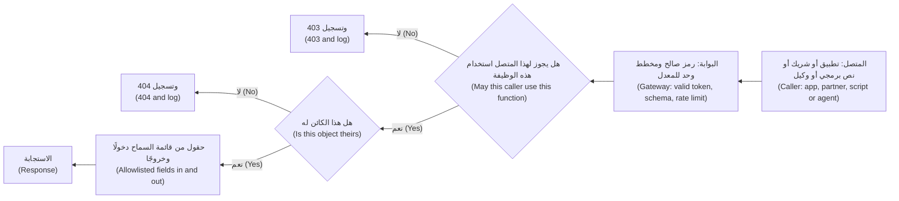
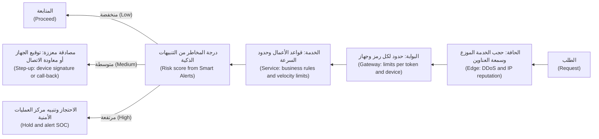
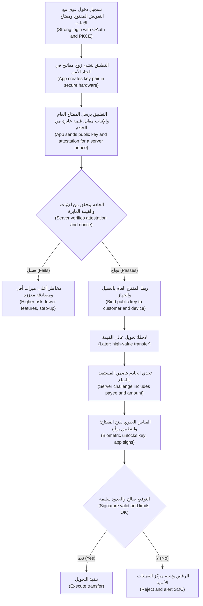

# الوحدة 4 — واجهات برمجة التطبيقات والهاتف المحمول وإساءة الاستخدام (APIs, mobile and abuse)

*من منظورٍ أمني، فإن تطبيق نجم للهاتف (Najm Mobile) في معظمه واجهةُ برمجة تطبيقات أُلحق بها هاتف. فكل رصيدٍ وكل ضابطٍ للبطاقة وكل تحويل يعرضه التطبيق هو استدعاءٌ لواجهة البرمجة العامة للبنك، ويستطيع أي شخصٍ يملك حاسوبًا محمولًا إجراء هذه الاستدعاءات من دون التطبيق. تنتقل هذه الوحدة من المتصفح (browser) إلى عالم الاستدعاءات بين الآلات (machine-to-machine calls). يستعرض الدرس 4.1 قائمة OWASP API Security Top 10 من خلال نقاط النهاية الخاصة ببنك نجم، ويبيّن لماذا تهيمن إخفاقات التفويض (authorisation failures) على القائمة. ويتناول الدرس 4.2 هجماتٍ لا تحتاج إلى أي خطأٍ برمجي على الإطلاق: الروبوتات (bots)، والكشط (scraping)، والتعداد (enumeration)، وحالات التسابق (races)، وثغرات منطق الأعمال (business-logic flaws) التي تحوّل ميزةً إلى سلاحٍ على نطاقٍ واسع. ويعبر الدرس 4.3 إلى الجهاز ويرسم الحدّ الذي يجب أن يعرفه كل فريق تطبيقات هاتف: ما الذي يمكنك الوثوق به على هاتفٍ لا تتحكم فيه، وما الذي يجب أن يُقرَّر دائمًا على الخادم. ستتابع اختبار مريم المصرَّح به لواجهة ضوابط البطاقات (card-controls API)، وأولى مراجعات علي لإساءة الاستخدام ولتطبيق الهاتف، وقاعدة نورة لفريق تطبيقات الهاتف: «افترض أن لدى المهاجم التطبيقَ وأداةَ فكّ ترجمة ووسيطًا. ثم صمّم.» ⁦⁩*

> **المراحل (Phases):** Design, Build, Test, Operate — واجهاتُ برمجةٍ تفحص كل طلب، وتدفقاتُ أعمالٍ تصمد أمام الأتمتة، وتطبيقُ هاتفٍ مبنيٌّ على افتراض أن الجهاز قد يكون معاديًا.

---

# 4.1 — قائمة OWASP API Security Top 10 عمليًا (The OWASP API Security Top 10 in practice)
*المستوى (Level): 🟡 متوسط (Intermediate)* · *المتطلبات (Prerequisites): 1.1، 3.3* · *المرحلة (Phase): Design, Test*

## ⚡ الدرس في دقيقة (In 60 seconds)
- تعرض **واجهة برمجة التطبيقات (API, application programming interface)** البياناتِ والوظائفَ مباشرةً للبرامج. ويتخطى المهاجمون تطبيقك: فهم يستدعون الواجهة بأدواتهم الخاصة ويغيّرون أي قيمة.
- قائمة **OWASP API Security Top 10 ‏(2023)** هي القائمة المعيارية لما يسوء. وثلاثةٌ من أول خمسة بنودٍ فيها إخفاقاتُ تفويض: **BOLA** على مستوى الكائنات (objects)، و**BOPLA** على مستوى الحقول (fields)، و**BFLA** على مستوى الوظائف (functions).
- القاعدة الجوهرية: في كل طلب، يقرّر الخادم **مَن المتصل (who is calling)**، و**هل يجوز له استخدام هذه الوظيفة (whether they may use this function)**، و**هل هذا الكائن له (whether this object is theirs)**، و**أيّ الحقول يجوز له قراءتها أو تغييرها (which fields they may read or change)**.
- مؤشر القرار لكل نقطة نهاية: «إذا غيّرتُ المعرّف، أو أضفتُ حقلًا، أو بدّلتُ طريقة HTTP، أو استدعيتُ إصدارًا أقدم، فما الذي يمنعني؟» ⁦("If I change the ID, add a field, switch the HTTP method or call an older version, what stops me?")⁩
- الجرد مهمٌّ بقدر أهمية الشيفرة: فالإصدارات القديمة (old versions)، وبيئات الاختبار (test environments)، ونقاط النهاية غير الموثّقة (undocumented endpoints) هي المواضع التي تغيب فيها الفحوص.
- أكبر فخ (Biggest trap): «التطبيق لا يعرض ذلك الزر أبدًا»، أو «المعرّفات عشوائية، فلا أحد يستطيع تخمينها». ولا أيٌّ منهما تحكّمٌ في الوصول.

## 🧭 لماذا يهم
يضيف بنك نجم (Najm Bank) ضوابطَ البطاقات (card controls) إلى تطبيق نجم للهاتف: حدود الإنفاق (spending limits)، وحظر المدفوعات عبر الإنترنت، وتجميد البطاقة (freezing a card). وقبل الإطلاق (Before launch)، تُجري مريم، قائدة الفريق الأحمر (red-team lead)، اختبارًا مصرَّحًا به (authorised test) لواجهة البرمجة في بيئة ما قبل الإنتاج (staging API) باستخدام عميلَي اختبار، هما A وB. وبعد أن تسجّل دخولها بوصفها A ‏، ترسل `PATCH /v2/cards/{cardId}/limits` مع معرّف بطاقة B ‏. فتعيد الواجهة `200 OK` ويتغيّر حدّ B ‏. لا يعرض التطبيق هذا الإجراء أبدًا؛ أما الواجهة فلم تسأل قطّ ببساطة هل البطاقة لـ A ‏.

ويتضمن تقريرها ملاحظتين أخريين. إذ تعيد `GET /v2/customers/me` حقولًا لا يعرضها التطبيق أبدًا، منها الحقلان الداخليان (internal) `riskScore` و`kycStatus`. أما واجهة `/v1/` الصادرة عام 2019 ‏(the 2019 API)، التي لا يستخدمها التطبيق الحالي، فلا تزال تجيب على البوابة العامة من دون الفحوص الأحدث. ويسأل علي، مهندس الأمن الجديد، هل هذه ملاحظاتٌ «حقيقية» ("real")، ما دام لا يستطيع أي عميلٍ الوصول إليها عبر التطبيق. فتجيب نورة، رئيسة أمن التطبيقات والذكاء الاصطناعي (Head of Application & AI Security): «التطبيق عميلٌ واحد. والمهاجمون يكتبون عملاءهم الخاصة.» ⁦⁩

وتُظهر الحالات العلنية (Public cases) حجم الكلفة. ففي عام 2022 تعرّضت شركة الاتصالات الأسترالية Optus لكشفٍ واسعٍ لسجلات العملاء. ووصفت التقارير العلنية آنذاك واجهةَ برمجةٍ مكشوفةً على الإنترنت (internet-facing API) تعيد بيانات العملاء من دون اشتراط المصادقة؛ وقد كانت التفاصيل موضع خلاف، ثم فحصتها الجهات التنظيمية لاحقًا. وأيًّا كانت الوقائع الدقيقة، فإن النمط يجمع ثلاثة محاور من هذا الدرس: نقطة نهاية غير مراقَبة، وفحص وصولٍ مفقود، ومعرّفات يمكن المرور عليها بالتتابع (iterable identifiers).

## 📐 كيف يعمل

### 🟢 الأساسيات

**لماذا تختلف واجهات البرمجة (Why APIs are different).** تمزج صفحة الويب البياناتِ بالعرض، ويضغط الشخص على ما تعرضه. أما واجهة البرمجة فتعيد بياناتٍ خامًا (raw data)، عادةً بصيغة JSON، من **نقاط نهاية (endpoints)** مثل `/v2/accounts/{accountId}` إلى أي برنامجٍ يستدعيها: تطبيق نجم للهاتف، والواجهة الأمامية لبوابة الشركات الصغيرة، والشركاء (partners)، والنصوص البرمجية (scripts)، والآن وكلاء الذكاء الاصطناعي (AI agents) مثل نجم أسيست (Najm Assist). لا توجد واجهة مستخدم تختبئ خلفها؛ والبنية قابلة للتنبؤ، فإذا كانت `/v2/accounts/1001` موجودة، فسيجرّب المهاجم `1002`؛ وتجيب الواجهة النصَّ البرمجي بالرحابة نفسها التي تجيب بها الإنسان، آلاف المرات في الدقيقة.

**القائمة (The list).** كانت آخر مراجعةٍ لقائمة OWASP API Security Top 10 عام 2023 ‏(last revised in 2023) وقت كتابة هذا النص، أي عام 2026؛ فتحقّق من موقع OWASP بحثًا عن أي إصدارٍ لاحق.

| المعرّف (ID) | الخطر (Risk) | بعبارةٍ بسيطة | مثال من بنك نجم (Najm example) |
|---|---|---|---|
| API1 | خلل التفويض على مستوى الكائن (Broken Object Level Authorization, BOLA) | لا فحص لكون المتصل مخوّلًا بالوصول إلى *هذا* الكائن | الرمز المميز للعميل A ‏(A's token) يغيّر حدّ بطاقة B ‏ |
| API2 | خلل المصادقة (Broken Authentication) | ضعفٌ في معالجة تسجيل الدخول أو الرموز المميزة أو المفاتيح | لا حدّ للمحاولات على نقطة نهاية كلمة المرور لمرةٍ واحدة (OTP endpoint) |
| API3 | خلل التفويض على مستوى خصائص الكائن | يستطيع المتصل قراءة *حقولٍ* أو كتابتها لا ينبغي له الوصول إليها | إعادة `riskScore` ‏(returned)؛ وإمكان الكتابة في `kycStatus` ‏(writable) |
| API4 | الاستهلاك غير المقيَّد للموارد (Unrestricted Resource Consumption) | لا حدود لحجم الطلبات أو عددها أو كلفتها | كشوف حساب عشر سنوات في استدعاءٍ واحد |
| API5 | خلل التفويض على مستوى الوظيفة | يستطيع المتصل استخدام *وظيفةٍ* مخصّصة لدورٍ آخر | رمزٌ مميز لعميل (Customer token) يستدعي نقطة نهاية `/admin/` |
| API6 | الوصول غير المقيَّد إلى تدفقات الأعمال الحساسة | تدفقٌ مشروع تسيء الأتمتة استخدامه | تسجيلاتٌ آلية بنصوص برمجية (Scripted sign-ups) لحصد مكافآت الإحالة |
| API7 | تزوير الطلبات من جهة الخادم (Server-Side Request Forgery, SSRF) | تجلب الواجهة عنوان URL قدّمه المتصل | ميزة «استيراد فاتورة من رابط» في بوابة الشركات الصغيرة (SME Portal) |
| API8 | سوء الإعداد الأمني (Security Misconfiguration) | إعداداتٌ افتراضية وضبطٌ غير آمن | تتبّعات المكدّس (Stack traces) في استجابات الأخطاء (error responses) |
| API9 | سوء إدارة الجرد (Improper Inventory Management) | عدم معرفة واجهات البرمجة والإصدارات والبيئات الموجودة | واجهة `/v1/` المنسية |
| API10 | الاستهلاك غير الآمن لواجهات البرمجة | الثقة المفرطة ببيانات واجهات الطرف الثالث | استخدام استجابة الشريك من دون تحقق |

قدّم الدرس 3.3 مفهوم **المرجع المباشر غير الآمن إلى الكائن (IDOR, insecure direct object reference)**. وBOLA هو الاسم الذي يُطلق على الإخفاق نفسه في عالم واجهات البرمجة. ويتصدّر القائمة لأنه شائع (common)، وسهل الاستغلال، وسهلٌ أن يفوت في المراجعة: فالشيفرة تعمل على أكمل وجه للمستخدمين النزيهين.

**BOLA: النسخة الضعيفة والنسخة المُصلَحة (vulnerable and fixed).** يصادق المعالج الضعيف على المتصل ثم يثق بالمعرّف الوارد في عنوان URL ‏:

```ts
// VULNERABLE: any logged-in customer can read any account's statements
app.get("/v2/accounts/:accountId/statements", requireAuth, async (req, res) => {
  const rows = await db.statements.findMany({
    where: { accountId: req.params.accountId },
  });
  res.json(rows);
});
```

ويربط الإصلاحُ الكائنَ بالمتصل داخل الاستعلام نفسه:

```ts
// FIXED: the account must belong to the authenticated customer
app.get("/v2/accounts/:accountId/statements", requireAuth, async (req, res) => {
  const account = await db.accounts.findFirst({
    where: { id: req.params.accountId, ownerId: req.user.customerId },
  });
  if (!account) return res.status(404).json({ error: "not_found" });
  const rows = await db.statements.findMany({ where: { accountId: account.id } });
  res.json(rows);
});
```

تعيش قاعدة الملكية على **الخادم (server)**، داخل طبقة الوصول إلى البيانات، حيث لا يستطيع عميلٌ معدَّل تخطّيها. والرد بـ **404 Not Found** بدلًا من **403 Forbidden** يتجنب تأكيد وجود المعرّف؛ وأيٌّ منهما مقبول ما دام رفض الوصول متّسقًا.

**المصادقة ليست تفويضًا (Authentication is not authorisation).** تثبت `requireAuth` *مَن* المتصل. لكنها لا تقول شيئًا عمّا يجوز له أن *يلمسه*. وتكاد كل ثغرات BOLA ‏ تقبع خلف تسجيل دخولٍ سليمٍ تمامًا.

### 🟡 التعمق أكثر (Going deeper)

**API3 BOPLA: الحقول، دخولًا وخروجًا (fields, in and out).** دمج إصدار 2023 ‏(The 2023 edition) بندين أقدم. فـ **الكشف المفرط عن البيانات (Excessive data exposure)** هو إعادة كائنات قاعدة البيانات كاملةً والثقة بأن العميل لن يعرض إلا بعض الحقول. و**الإسناد الجماعي (Mass assignment)** هو نسخ أي حقولٍ يرسلها العميل إلى الكائن المخزَّن. وكلاهما ينشأ من عدم تدوين الحقول المسموح بها قطّ.

```ts
// VULNERABLE (PATCH /v2/customers/me; me = caller's ID): every field in, every field out
const c = await db.customers.update({ where: { id: me }, data: req.body }); // kycStatus too
res.json(c);                                      // riskScore and internal notes too

// FIXED: allowlist in, allowlist out
const UpdateProfile = z.object({
  preferredName: z.string().max(60).optional(),
  language: z.enum(["ar", "en"]).optional(),
}).strict();                                      // unknown fields are rejected
const input = UpdateProfile.safeParse(req.body);
if (!input.success) return res.status(400).json({ error: "invalid_body" });
const c2 = await db.customers.update({ where: { id: me }, data: input.data });
res.json(toPublicProfile(c2));                    // explicit response shape
```

وعلى مستوى العقد، يؤدي مستند **OpenAPI** (OpenAPI document)، وهو وصفٌ مقروءٌ آليًا لكل نقطة نهاية ومعاملٍ واستجابة، المهمةَ نفسها: اضبط `additionalProperties: false` على أجسام الطلبات (request bodies)، وافرضه في البوابة أو في الشيفرة، ولا تُدرج إلا الحقول العامة في مخططات الاستجابة.

**API5 BFLA: الوظائف (functions).** BOLA هو «بطاقة العميل الخطأ»؛ أما BFLA فهو «وظيفةٌ ما كان ينبغي أن يملكها هذا النوع من المستخدمين أبدًا». ومن العلامات النموذجية (Typical signs): مسارات إدارية على مضيف العملاء، أو فحوص أدوارٍ في الواجهة الأمامية وحدها، أو فحصٌ على `GET` لا على `DELETE` للمسار نفسه. ودافع بمبدأ **الرفض افتراضيًا (deny by default)**: يعلن كل مسارٍ الأدوارَ المسموح لها، وتُرفض المسارات غير المعلنة؛ وأبقِ واجهات الموظفين (staff APIs) بعيدةً عن البوابة العامة، خلف هوية الموظفين.

**API2 خلل المصادقة (Broken Authentication).** نقاط نهاية تسجيل الدخول (Login) وكلمة المرور لمرةٍ واحدة (one-time-password, OTP) بلا حدودٍ للمحاولات؛ ورموزٌ مميزة تُقبل من دون التحقق من التوقيع والمُصدِر والجمهور وتاريخ الانتهاء (3.2)؛ ورموزٌ في عناوين URL ‏(tokens in URLs)، فتنتهي في السجلات؛ و**مفاتيح API ‏(API keys)** تُستخدم لتعريف المستخدمين، مع أن المفتاح يعرّف تطبيقًا لا شخصًا، وأي مفتاحٍ في تطبيق هاتفٍ علنيّ (4.3).

**API8 سوء الإعداد الأمني (Security Misconfiguration).** أخطاءٌ مُسهَبة تتضمن تتبّعات المكدّس، و**CORS** متساهل (permissive CORS)، أي مشاركة الموارد عبر المصادر، وهي قاعدة المتصفح التي تحدد المواقع المسموح لها باستدعاء واجهتك، والخطأ الكلاسيكي فيها هو عكس أي مصدرٍ يُطلب مع السماح ببيانات الاعتماد؛ إضافةً إلى طرق HTTP غير اللازمة والإعدادات الافتراضية لأطر العمل (framework defaults). ويغطي الدرس 2.2 جهة المتصفح.

**API9 سوء إدارة الجرد (Improper Inventory Management).** لا يمكنك حماية ما لا تعرف بوجوده. فـ **واجهات الظل (Shadow APIs)** لم تُوثَّق قطّ؛ و**واجهات الزومبي (zombie APIs)** إصداراتٌ قديمة لم يوقفها أحد؛ وبيئات ما قبل الإنتاج التي تحتفظ ببيانات الإنتاج تُحسب أيضًا (count too). وكل فرقٍ بين ما تخدمه البوابة، كما تُظهره سجلاتها، ومستندات OpenAPI ‏(OpenAPI documents) هو ملاحظةٌ أمنية.

**API7 وAPI10: الثقة في الاتجاهين (trust in both directions).** يظهر SSRF ‏(API7) كلما جلبت واجهةٌ عنوان URL قدّمه المتصل: خطافات الويب (webhooks)، و«الاستيراد من رابط»، وصور الملفات الشخصية (profile pictures)؛ وترد الدفاعات في الدرس 2.3 ‏(defences in 2.3). أما الاستهلاك غير الآمن (Unsafe consumption)، أي API10، فهو الصورة المعكوسة: الثقة بإجابة طرفٍ ثالث، مثل تغذية أسعار الصرف، أكثر مما تثق بمدخلات المستخدم. تحقّق من تلك الاستجابات وفق مخطط، واضبط مهلاتٍ زمنية (set timeouts)، ولا تتبع عمليات إعادة التوجيه بلا تمحيص.

أما **API4 وAPI6** فلهما درسٌ خاص بهما (4.2). وكان لـ **الحقن (Injection)** و**التسجيل (logging)** بندان في إصدار 2019 ‏(entries in the 2019 edition) لا في إصدار 2023؛ لكنهما لا يزالان مهمّين، وتغطيهما الوحدتان 2 و10 ‏(Modules 2 and 10).

الفحوص التي ينبغي أن يجتازها الطلب، بالترتيب:



### 🔴 نظرة الخبير (Expert view)

**ما تستطيعه البوابة وما لا تستطيعه (What the gateway can and cannot do).** إن **بوابة API ‏(API gateway)**، أي الباب الأمامي الذي يوجّه الطلبات إلى الخدمات، هي المكان الصحيح للمصادقة (authentication)، والتحقق من المخطط (schema validation)، وحدود المعدّل (rate limits)، وTLS، والجرد (inventory). لكنها لا تستطيع فحص ملكية الكائن، لأن الخدمة وحدها تعرف أن الحساب 1002 يعود إلى العميل B ‏(only the service knows that account 1002 belongs to customer B). فقسّم المهمة: تتولى البوابة *مَن وكم*؛ وتقرر الخدمة *أيّ كائنٍ وأيّ حقول*.

**مركزة القرار (Centralise the decision).** حين يكتب مئات المعالجات كلٌّ منها استعلام الملكية الخاص به، فسينسى أحدها. عبّر عن التفويض مرةً واحدة: طبقة وصولٍ إلى البيانات تحصر الاستعلامات دائمًا في المتصل، أو **محرّك سياسات (policy engine)** مثل Open Policy Agent ‏(OPA) أو Cedar يقيّم القواعد خارج شيفرة المعالجات. وعندئذٍ ترث نقاط النهاية الجديدة القاعدةَ افتراضيًا.

**المعرّفات العشوائية حزام أمان لا مكابح (Random IDs are a seatbelt, not a brake).** تجعل معرّفات UUID العشوائية (Random UUIDs) التخمينَ أصعب، وهي جديرةٌ بالاستخدام (worth using). والمقصود الإصدار 4 ‏(version 4)، أي معرّفاتٌ عشوائية طويلة؛ أما الإصدارات القائمة على الوقت فقابلةٌ للتنبؤ جزئيًا. لكن المعرّفات تتسرّب عبر عناوين URL والسجلات ولقطات الشاشة واستجابات الواجهات الأخرى. ولا يُصلح BOLA إلا فحصُ الخادم.

**اختبر التفويض كما تختبر الميزات (Test authorisation like a feature).** نادرًا ما تعرف الماسحات (Scanners) أيّ الكائنات يعود إلى مَن. فاستخدم **اختبار المستخدمَين (two-user test)**: أنشئ العميلين A وB ومستخدمًا من الموظفين، وأعِد إرسال كل طلبٍ برمز مستخدمٍ آخر، وتوقّع الرفض، ضمن التكامل المستمر في كل بناء. وفي الإنتاج، تُعدّ موجةٌ من حالات الرفض على معرّفاتٍ مختلفة من رمزٍ واحد إشارةً قوية لمركز العمليات الأمنية (SOC) (10.1).

**GraphQL.** تقدّم **GraphQL** حقولًا يختارها العميل (client-chosen fields) عبر نقطة نهاية واحدة (one endpoint). ويجب أن يعمل التفويض في كل **محلِّل (resolver)**، وهو الدالة التي تجلب كل حقل، وتحتاج الاستعلامات العميقة إلى حدودٍ للكلفة، ويجب أن تَعُدّ حدودُ المعدّل العملياتِ، لأن طلبًا واحدًا قد يحمل كثيرًا منها. وتعطيل **الاستبطان (introspection)**، أي الوصف الذاتي للمخطط، يقلّل الاستطلاع (reduces reconnaissance) لكنه ليس بديلًا عن التفويض.

**الوكلاء عملاءُ API أيضًا (Agents are API clients too).** سيستدعي نجم أسيست الواجهةَ نفسها. فإذا استخدم حساب خدمةٍ يستطيع قراءة كل حساب، فإن أي حقن موجّهات (prompt injection) يوجّهه يصبح BOLA بالوكالة. وهذه حالة **النائب المرتبك (confused deputy)**: مكوّنٌ موثوق يُخدع فيستخدم صلاحياته لصالح شخصٍ آخر. وينبغي أن يعمل الوكيل (agent) برمز *العميل* المفوَّض ضيّق النطاق، مثلًا عبر OAuth 2.0 Token Exchange ‏(RFC 8693)، حتى تظل فحوص الكائنات المعتادة سارية. وتبني الوحدة 9 على ذلك (Module 9 builds on this).

## 🧰 الأدوات
| الضابط أو المعيار أو الأداة (Control, standard or tool) | ما هو وماذا يفعل | متى تلجأ إليه |
|---|---|---|
| **OWASP API Security Top 10** — من OWASP، إصدار 2023 ‏(2023 edition) | القائمة المعيارية لأكثر عشرة مخاطر شيوعًا في واجهات البرمجة | تحديد نطاق مراجعات واجهات البرمجة واختباراتها؛ وتدريب المطورين (training developers) |
| **OWASP ASVS** — من OWASP | متطلباتٌ أمنية قابلة للاختبار للتطبيقات، بما فيها خدمات الويب وواجهات البرمجة؛ وقد صدر الإصدار 5.0 عام 2025 ‏(version 5.0 released 2025) | تحويل عبارة «واجهة برمجة آمنة» ("secure API") إلى متطلباتٍ وحالات اختبار |
| **OpenAPI schema validation** — التحقق بمخطط OpenAPI | عقدٌ مقروءٌ آليًا لكل نقطة نهاية؛ وترفض أدوات التحقق الحقولَ غير المعروفة والأنواعَ الخاطئة | كل واجهة برمجة بدءًا من التصميم؛ وهو مصدر الحقيقة للجرد |
| **API gateway** — بوابة API | بابٌ أمامي يصادق على الطلبات ويتحقق منها ويحدّ معدّلها ويسجّلها | المصادقة والحصص وTLS والجرد، لا الفحوص على مستوى الكائن أبدًا |
| **Policy engine** — محرّك السياسات، مثل OPA وCedar | يقيّم قواعد التفويض خارج شيفرة المعالجات | خدماتٌ كثيرة تتشارك قواعد معقدة؛ وتدقيق مَن يستطيع فعل ماذا |
| **Authorisation tests in CI** — اختبارات التفويض في التكامل المستمر | اختبارات المستخدمَين (Two-user tests) التي تعيد إرسال كل طلبٍ برمز مستخدمٍ آخر، متوقعةً الرفض (expecting denial) | كل بناء (Every build)، لكل نقطة نهاية تأخذ معرّف كائن |
| **OWASP crAPI** — من OWASP | واجهة برمجة ضعيفة عمدًا للتدرّب الآمن محليًا | التدريب والتمارين، لا ضد أنظمةٍ حقيقية أبدًا |

## 🏛️ عمليًا في بنك نجم
يعتمد فريق نورة **بطاقة مراجعة نقاط نهاية API في بنك نجم (Najm API endpoint review card)**: تحتاج كل نقطة نهاية عامة جديدة أو معدَّلة إلى بطاقة، يراجعها فريق أمن التطبيقات والذكاء الاصطناعي (Application & AI Security) قبل إطلاقها. وملاحظة مريم هي أول مثالٍ تطبيقي:

```
Endpoint:        PATCH /v2/cards/{cardId}/limits
Owner:           Cards squad (engineering lead: Tariq)
Callers:         Najm Mobile; Najm Assist (customer's delegated token only)
Roles allowed:   customer (own cards only); no staff access on this route
Object rule:     card.ownerId == token.customerId, in CardRepository.forCustomer()
Writable fields: dailyLimit (0 to 50,000 QAR), onlinePaymentsEnabled
Returned fields: cardId, maskedPan, dailyLimit, onlinePaymentsEnabled
Limits:          10 changes per card per day; body under 2 KB
Two-user test:   tests/authz/cards_limits.spec.ts (passing)
```

ثم يطرح المراجع سؤالًا واحدًا لكل خطر:

| الخطر | سؤال المراجعة (Review question) | الدليل المطلوب للاعتماد |
|---|---|---|
| API1 BOLA | هل يُفحص كل معرّف كائن للتحقق من الملكية أو الانتماء إلى المستأجر على الخادم؟ | دالة الإنفاذ (Enforcing function)؛ واختبار المستخدمَين |
| API2 المصادقة | هل يُتحقَّق من الرموز المميزة تحققًا كاملًا، وهل محاولات تسجيل الدخول وOTP محدودة؟ | إعدادات البوابة (Gateway configuration) |
| API3 BOPLA | هل حقول الطلب والاستجابة مدرجة في قائمة سماح؟ | مخططٌ صارم (Strict schema)؛ وشكل الاستجابة (response shape) |
| API4 الموارد (Resources) | هل ضُبطت حدود الحجم والصفحات والوقت والكلفة؟ | الحدود المدوّنة في البطاقة |
| API5 BFLA | هل يعلن المسار الأدوارَ المسموح لها، مع الرفض افتراضيًا؟ | سياسة المسار (Route policy)؛ واختبارٌ سلبي (negative test) |
| API6 تدفقات الأعمال (Business flows) | هل هذا تدفق أعمالٍ حساس؟ | قيدٌ في سجل التدفقات (4.2) |
| API7 SSRF | هل تجلب عنوان URL قدّمه المتصل (caller-supplied URL)؟ | قائمة السماح وضوابط الخروج (2.3) |
| API8 سوء الإعداد (Misconfiguration) | هل رسائل الأخطاء عامةٌ غير مفصَّلة (errors generic)، وCORS مقيَّد (restricted)، والطرق غير المستخدمة معطّلة؟ | فحص الإعدادات (Configuration scan) |
| API9 الجرد | هل هي موثّقة ولها مالكٌ وإصدار، وهل أُوقفت الإصدارات القديمة؟ | قيدٌ في الجرد (Inventory entry) |
| API10 الأطراف الثالثة (Third parties) | هل يُتحقَّق من استجابات الأطراف الثالثة، مع مهلاتٍ زمنية؟ | المخطط والمهلات |

تعود البطاقة التي تقول «قاعدة الكائن: لا شيء» إلى الفريق، أيًّا كان الموعد النهائي. ويضيف مركز العمليات الأمنية بقيادة جاسم (Jassim's SOC) قاعدة رصد (detection rule): إطلاق تنبيهٍ حين يُرفض رمزٌ واحد على أكثر من 20 معرّف كائنٍ مختلفًا خلال خمس دقائق (when one token is denied on more than 20 distinct object IDs within five minutes)، وهي قيمة توضيحية تُضبط على حركة المرور الحقيقية.

## 🛠️ التمارين (Exercises)
لا يُجرى العمل التطبيقي (Hands-on work) إلا على شيفرتك الخاصة أو على مختبرٍ محلي مثل OWASP crAPI أو OWASP Juice Shop على جهازك الخاص.

- 🟢 اختر خمس نقاط نهاية (five endpoints) من واجهة برمجةٍ تملكها، أو من نسختك المحلية من crAPI أو Juice Shop، ودوّن أيّ المخاطر العشرة قد ينطبق على كلٍّ منها. *يكتمل عندما (Done when):* يكون لكل نقطة نهاية خطران مربوطان بها على الأقل وسؤال مراجعةٍ ملموس واحد، وتُعلَّم كل نقطة نهاية تأخذ معرّف كائن.
- 🟡 في نسختك المحلية من crAPI أو Juice Shop، أنشئ حسابين (two accounts) واعثر على ثغرة تفويضٍ واحدة على مستوى الكائن بإعادة إرسال طلبٍ برمز الحساب الآخر. ثم أعِد إنتاج الثغرة في واجهة برمجةٍ صغيرة خاصة بك، وأصلحها على الخادم، وأضف اختبار مستخدمَين آليًا. *يكتمل عندما:* يفشل الاختبار على نسختك الضعيفة وينجح على النسخة المُصلَحة.
- 🔴 ابنِ جردًا لخدمةٍ تملكها: قارن المسارات المخدومة في آخر 30 يومًا (routes served in the last 30 days)، كما تُظهرها السجلات، بمستند OpenAPI ‏، وصنّف كل فرق إلى ظلّ (shadow) أو زومبي (zombie) أو موثَّقٍ لكنه غير مستخدم (documented-but-unused). *يكتمل عندما:* يكون لكل نقطة نهاية مخدومة مالكٌ وإصدارٌ وقرار، أي التوثيق أو الإيقاف أو الحظر، ويفشل التكامل المستمر (CI fails) إذا ظهر مسارٌ جديد من دون قيدٍ في المخطط.

## ⚠️ أخطاء وفخاخ (Mistakes and traps)
- **الإخفاء بدل الفحص (Hiding instead of checking).** عبارة «التطبيق لا يعرضه» ليست ضابطًا. افرض القاعدة على الخادم، في كل طلب.
- **الثقة بالمعرّفات العشوائية (Trusting random IDs).** تقلّل معرّفات UUID التخمين؛ لكنها لا تحلّ محلّ فحوص الملكية.
- **وضع الأمن كله في البوابة (Putting all security in the gateway).** البوابة تصادق وتحدّ؛ والخدمات تفوّض الوصول إلى الكائنات والحقول.
- **ترك الإصدارات القديمة تعمل (Leaving old versions running).** أوقفها في موعدٍ محدد، واحظرها في البوابة، وأبقِ الجرد صادقًا.
- **منح الوكلاء والتكاملات حسابات خدمةٍ مطلقة الصلاحيات (Giving agents and integrations all-powerful service accounts).** استخدم رموزًا مفوَّضة محددة النطاق لكي تنطبق الفحوص نفسها.

## 🧾 الخلاصة (Recap)
- تعرض واجهات البرمجة الكائناتِ والوظائفَ مباشرةً؛ ويستطيع أي عميل، بما في ذلك النصوص البرمجية والوكلاء، استدعاءها بأي قيم.
- تتصدّر قائمةَ OWASP API Security Top 10 ‏(2023) إخفاقاتُ التفويض: BOLA وBOPLA وBFLA.
- في كل طلب، يصادق الخادم على المتصل (authenticates)، ويفحص الوظيفة، ويفحص ملكية الكائن، ويطبّق قائمة سماحٍ على الحقول دخولًا وخروجًا.
- تتولى البوابات مسألة مَن وكم؛ وتقرر الخدمات أيّ كائنٍ وأيّ حقول.
- حافظ على جردٍ صادق؛ واختبر التفويض بمستخدمَين في التكامل المستمر، وراقب حالات الرفض في الإنتاج.

## ✍️ اختبر نفسك (Check yourself)

**1. خلال اختبارٍ مصرَّح به (During an authorised test)، تسجّل مريم الدخول بوصفها عميلة الاختبار A ‏(test customer A) وترسل `PATCH /v2/cards/{cardId}/limits` مع معرّف بطاقة عميل الاختبار B ‏(test customer B's card ID). فتغيّر الواجهة حدّ B. أيّ خطرٍ هذا، وما الإصلاح (Which risk is this, and what is the fix)؟**

- A. API2 خلل المصادقة (Broken Authentication)؛ أجبِر A على تسجيل الدخول مجددًا قبل أي تغيير على البطاقة، وأنهِ الجلسة بعد خمس دقائق
- B. API1 BOLA؛ افحص على الخادم، في كل طلب، أن البطاقة تعود إلى العميل المصادَق عليه
- C. API8 سوء الإعداد الأمني (Security Misconfiguration)؛ أخفِ معرّفات البطاقات عن شاشات التطبيق وعن العناوين الظاهرة في شريط المتصفح
- D. API4 الاستهلاك غير المقيَّد للموارد (Unrestricted Resource Consumption)؛ طبّق حدًّا للمعدّل على نقطة النهاية بعشرة طلبات في الدقيقة لكل عميل وأطلق تنبيهًا عند الارتفاعات

<details><summary>الإجابة</summary>

**B.** نجحت المصادقة (Authentication worked)؛ أما الفحص على مستوى الكائن (object-level check) للتأكد من أن البطاقة لـ A فكان مفقودًا. الخيار A يعيد مصادقة الشخص نفسه؛ وC يخفي المعرّف بدل فحصه. انظر: 🟢 الأساسيات.

</details>

**2. تعيد `GET /v2/customers/me` الحقل الداخلي (internal) `riskScore`، وتقبل `PATCH /v2/customers/me` حقل `kycStatus`. ما أفضل إصلاح (What is the best fix)؟**

- A. الطلب من فريق تطبيقات الهاتف ألّا يعرض `riskScore` في التطبيق، وإزالة الحقل من شاشات بوابة الموظفين مع إبقائه في الاستجابة نفسها
- B. تشفير جسم الاستجابة
- C. تعريف مخططات طلبٍ واستجابةٍ مدرجة في قائمة سماح: رفض الحقول غير المعروفة في المدخلات وعدم إعادة سوى الحقول العامة
- D. نقل نقطة النهاية إلى `/v3/`

<details><summary>الإجابة</summary>

**C.** هذا هو API3 BOPLA: كشفٌ مفرط للبيانات خروجًا، وإسنادٌ جماعي دخولًا. الخيار A يترك البيانات في الاستجابة لأي عميلٍ آخر؛ وB لا يفيد، لأن العميل يفكّ تشفيرها على أي حال. انظر: 🟡 التعمق أكثر (Going deeper).

</details>

**3. لإغلاق ملاحظات BOLA ‏(To close BOLA findings)، يقترح مطوّرٌ استبدال أرقام الحسابات المتسلسلة في عناوين URL ‏(sequential account numbers in URLs) بمعرّفات UUID. ماذا ينبغي أن تقول نورة (What should Noura say)؟**

- A. جيد: المعرّفات العشوائية تجعل BOLA مستحيلًا
- B. يستحق التنفيذ (Worth doing) بوصفه دفاعًا متعدد الطبقات (defence in depth)، لكن المعرّفات تتسرّب عبر السجلات والروابط والاستجابات الأخرى، لذا يظل فحص الملكية من جهة الخادم مطلوبًا
- C. لا جدوى منه (Pointless): معرّفات UUID لا تضيف أي أمانٍ على الإطلاق
- D. استخدام UUID والتخلي عن فحص الملكية لتحسين الأداء، لأن المعرّفات لم يعد ممكنًا تخمينها من العملاء أو المهاجمين ويصبح كل بحثٍ قراءةً واحدة سريعة للمفتاح في قاعدة البيانات

<details><summary>الإجابة</summary>

**B.** المعرّفات غير القابلة للتخمين (Unguessable IDs) تُبطئ المهاجمين لكنها ليست تحكّمًا في الوصول. الخيار A هو الفخ المغري؛ وC يبالغ، لأن صعوبة التخمين لها بعض القيمة. انظر: 🔴 نظرة الخبير (Expert view).

</details>

**4. لم يعد التطبيق الحالي (the current app) يستخدم واجهة `/v1/` التي أصدرها بنك نجم عام 2019 ‏(Najm's 2019 API)، لكنها لا تزال تجيب على البوابة العامة (still answers on the public gateway)، من دون فحوص الوصول الأحدث (without the newer access checks). أيّ خطرٍ هذا، وما الاستجابة الصحيحة (what is the right response)؟**

- A. API9 سوء إدارة الجرد (Improper Inventory Management): سجّلها بمالكٍ وتاريخ إيقاف، واحظرها في البوابة، وقارن بانتظام المسارات المخدومة بالموثّقة
- B. API10 الاستهلاك غير الآمن لواجهات البرمجة: تحقّق من استجاباتها مقابل مخطط، وحدّد مهلات لكل استدعاء إليها، وعامل بياناتها بوصفها مدخلاتٍ غير موثوقة كأي مصدر بياناتٍ خارجي آخر
- C. ليست خطرًا، لأنه لا يوجد عميلٌ حالي يستدعيها
- D. API7 SSRF: أضف قائمة سماحٍ لعناوين URL ‏(URL allowlist)

<details><summary>الإجابة</summary>

**A.** الإصدارات الزومبي (Zombie versions) إخفاقٌ كلاسيكي في الجرد. الخيار C هو الفخ: فالمهاجمون لا يحتاجون إلى التطبيق الحالي لاستدعاء نقطة نهاية قديمة. انظر: 🟡 التعمق أكثر (Going deeper).

</details>

**5. سيستدعي نجم أسيست (Najm Assist) واجهة الحسابات (accounts API) للبحث عن معاملات عميل (to look up a customer's transactions). ويقترح طارق منحه حساب خدمةٍ يستطيع قراءة كل الحسابات (a service account that can read all accounts) «للتبسيط» ("to keep it simple"). ما الخطر الرئيسي، وما التصميم الأفضل (What is the main risk, and the better design)؟**

- A. الكلفة (Cost)؛ خزّن الاستجابات مؤقتًا بدلًا من ذلك
- B. زمن الاستجابة (Latency)؛ دع الوكيل يستعلم قاعدة البيانات مباشرةً
- C. نائبٌ مرتبك: قد يقرأ وكيلٌ متلاعَبٌ به بياناتِ عملاء آخرين؛ وينبغي أن يستخدم الوكيل رمز العميل المفوَّض ضيّق النطاق لكي تنطبق فحوص الكائنات في الواجهة
- D. لا خطر (None)، لأن الوكيل داخلي ومن ثمّ موثوق

<details><summary>الإجابة</summary>

**C.** الوكيل ذو الصلاحيات الواسعة يحوّل حقن الموجّهات (prompt injection) إلى BOLA بالوكالة. أما الخيار D فيفترض أن مدخلات الوكيل جديرة بالثقة، وهو ما تبيّن الوحدة 8 أنه غير صحيح (which Module 8 shows they are not). انظر: 🔴 نظرة الخبير (Expert view).

</details>

## 📚 المراجع (References)
- مشروع OWASP API Security وقائمة API Security Top 10 ‏(2023) — https://owasp.org/API-Security/
- معيار OWASP للتحقق من أمان التطبيقات — https://owasp.org/www-project-application-security-verification-standard/
- سلسلة OWASP Cheat Sheet Series، أوراق التفويض (Authorization)، والإسناد الجماعي، وأمن REST ‏(REST Security)، وGraphQL — https://cheatsheetseries.owasp.org/
- OWASP crAPI، أي «واجهة برمجة سخيفة تمامًا» — https://owasp.org/www-project-crapi/
- MITRE CWE-639، تجاوز التفويض عبر مفتاحٍ يتحكم فيه المستخدم (Authorization Bypass Through User-Controlled Key) — https://cwe.mitre.org/data/definitions/639.html
- MITRE CWE-915، التعديل غير المضبوط لسمات الكائنات المحدَّدة ديناميكيًا — https://cwe.mitre.org/data/definitions/915.html
- RFC 8693، تبادل الرموز المميزة في OAuth 2.0 ‏(OAuth 2.0 Token Exchange) — https://www.rfc-editor.org/rfc/rfc8693
- مبادرة OpenAPI ‏(OpenAPI Initiative) — https://www.openapis.org/

---

# 4.2 — إساءة الاستخدام والروبوتات وحدود المعدّل وثغرات منطق الأعمال
*المستوى: 🟡 متوسط* · *المتطلبات: 3.1، 4.1* · *المرحلة: Design, Operate*

## ⚡ الدرس في دقيقة (In 60 seconds)
- **إساءة الاستخدام (Abuse)** هي استخدام ميزاتٍ مشروعة (legitimate features) بحجمٍ أو سرعةٍ أو ترتيبٍ لم يتوقعه المصممون. وكثيرًا ما يكون كل طلبٍ بمفرده صالحًا.
- يسمّيها خطران من مخاطر OWASP لواجهات البرمجة: **API4 الاستهلاك غير المقيَّد للموارد (API4 Unrestricted Resource Consumption)**، أي لا حدود للحجم أو الكلفة، و**API6 الوصول غير المقيَّد إلى تدفقات الأعمال الحساسة (API6 Unrestricted Access to Sensitive Business Flows)**، أي تدفقٌ قيّم يؤتمته المهاجمون. ونظيرهما في ميزات النماذج اللغوية الكبيرة هو **LLM10 الاستهلاك غير المحدود (LLM10 Unbounded Consumption)**.
- **ثغرات منطق الأعمال (Business-logic flaws)** قواعدُ نسيتها الشيفرة: مبالغ سالبة (negative amounts)، وخطواتٌ متخطّاة (skipped steps)، وحدودٌ تُفحص لكل طلبٍ بدل كل يوم، و**حالات التسابق (race conditions)** التي يجتاز فيها طلبان متوازيان الفحصَ كلاهما.
- اربط حدود المعدّل بما يجده المهاجم نادرًا: الحسابات الموثّقة (verified accounts)، والأجهزة (devices)، وأرقام الهواتف (phone numbers)، والحساب المستهدَف، لا بعناوين IP وحدها، فهي رخيصة.
- مؤشر القرار لكل تدفقٍ حساس: «ماذا لو فعل نصٌّ برمجي هذا 10,000 مرة، بالتوازي، وبترتيبٍ مختلف، ومن 10,000 عنوان؟» ⁦("What if a script did this 10,000 times, in parallel, in a different order, from 10,000 addresses?")⁩
- أكبر فخ: اختبار CAPTCHA أو قائمة حظرٍ لعناوين IP ‏ بوصفهما الإجابة كلها.

## 🧭 لماذا يهم
يُطلق تطبيق نجم للهاتف ميزة «الدفع برقم الهاتف» ("Pay by mobile number"): اكتب رقم هاتف، فإن كان يعود إلى عميلٍ لدى بنك نجم، يعرض التطبيق الاسم الكامل للمستلم قبل إرسال المال. يراجع علي نقطة النهاية وفق قائمة API Top 10 من الدرس 4.1: تسجيل الدخول مطلوب (login required)، وفحوص الملكية سليمة، والحقول مدرجة في قائمة سماح (fields allowlisted). فيعتمدها.

أما مريم فلا تعتمدها. «نقطة النهاية لديك تجيب عن سؤالٍ واحد: هل هذا الرقم لعميلٍ في بنك نجم، وما اسمه؟ ويستطيع نصٌّ برمجي ببضعة حسابات اختبار أن يطرح هذا السؤال عن كل رقم هاتفٍ محمول في البلاد. هذه قائمة عملاءٍ جاهزة لحملة تصيّد، وتسريبٌ لبياناتٍ شخصية (5.3).» لا يوجد سطرٌ خاطئ في الشيفرة. فالميزة، حين تُستخدم على نطاقٍ واسع، هي الثغرة.

وفي الأسبوع نفسه، يتضاعف الإنفاق على رسائل كلمات المرور لمرةٍ واحدة ثلاث مراتٍ بين ليلةٍ وضحاها (triples overnight)، بينما تنخفض نسبة الرموز المُدخَلة انخفاضًا حادًا، وتسأل رانيا، رئيسة منتجات الذكاء الاصطناعي (Head of AI Products)، عن سبب قفزة فاتورة النموذج لنجم أسيست: بضعة حساباتٍ تلصق مستنداتٍ ضخمة في المحادثة طوال اليوم. ثلاث ميزات، ودرسٌ واحد: إذا كان تدفقٌ ما يكلّف مالًا أو يمنح شيئًا ذا قيمة، فسيؤتمته أحدهم.

## 📐 كيف يعمل

### 🟢 الأساسيات

**المصطلحات (The vocabulary).**
- **الروبوت (bot)** هو أي عميلٍ مؤتمت. وكثيرٌ منها مرحَّبٌ به، كالمراقبة والشركاء ومحركات البحث؛ والسؤال ليس «روبوتٌ أم إنسان؟» ⁦⁩ بل «هل هذا الاستخدام مقبول؟» ⁦⁩
- **حشو بيانات الاعتماد (Credential stuffing)**: تجربة أزواج أسماء المستخدمين وكلمات المرور المسرّبة من مواقع أخرى (3.1).
- **الكشط (Scraping)**: جمع البيانات على نطاقٍ واسع، من الرسوم والأسعار إلى تفاصيل العملاء (customer details)، وهو الأسوأ بكثير (far worse).
- **التعداد (Enumeration)**: استخدام الإجابات المختلفة لنقطة نهاية لمعرفة أيّ الحسابات أو الأرقام أو عناوين البريد موجودة، كما حين تقول صفحة تسجيل دخول «مستخدم غير معروف» ("unknown user") لأحدها و«كلمة مرور خاطئة» ("wrong password") لآخر.
- **ضخّ الرسائل النصية (SMS pumping)**، ويُسمّى أيضًا الحركة المضخَّمة اصطناعيًا: إطلاق كمياتٍ هائلة من رسائل التحقق إلى نطاقات أرقام (number ranges) يتقاسم فيها المهاجم الإيرادات. وأنت تدفع ثمن كل رسالة.
- **استنزاف المحفظة (Denial of wallet)**: رفع فاتورةٍ قائمة على الاستخدام، كفاتورة السحابة أو الرسائل النصية أو رموز النماذج اللغوية الكبيرة، بدلًا من إسقاط الخدمة.
- **ثغرة منطق الأعمال (Business-logic flaw)**: تفعل الشيفرة ما كُتبت لتفعله، لكن القواعد ناقصة. ونادرًا ما تعثر الماسحات على هذه الثغرات، لأنه لا شيء يبدو مشوَّه الصيغة.

**ثغرات منطق الأعمال الشائعة في البنوك (Common business-logic flaws in a bank).**

| الثغرة (Flaw) | ما الذي يسوء | مثال من بنك نجم | الدفاع (Defence) |
|---|---|---|---|
| إشارةٌ أو نطاقٌ غير مفحوص | قبول قيمٍ سالبة أو صفرية | تحويلٌ بقيمة −500 يُضاف إلى رصيد المُرسِل | التحقق من النطاقات على الخادم لكل مبلغ |
| الثقة بقيم العميل | السعر أو الرسم أو سعر الصرف يرسله العميل | سعر الصرف في جسم الطلب | الخادم يبحث عن السعر بنفسه؛ وتُتجاهَل قيمة العميل |
| تخطّي الخطوات (Step skipping) | استدعاء الخطوة 3 من دون الخطوة 2 ‏(Calling step 3 without step 2) | `/transfers/confirm` من دون التحقق من OTP ‏ | آلة حالاتٍ من جهة الخادم لكل معاملة |
| الحدود لكل طلب (Per-request limits) | يُفحص الحدّ لكل استدعاءٍ لا للمجموع | عشرة تحويلات بقيمة 49,000 ريال قطري (QAR 49,000) تحت حدٍّ يومي قدره 50,000 ريال قطري (QAR 50,000 daily limit) | حدودٌ تراكمية عبر القنوات والزمن |
| حالة التسابق (Race condition) | يجتاز طلبان متوازيان الفحصَ كلاهما | إنفاق الرصيد أو القسيمة مرتين | تحديثٌ ذرّي أو قفل؛ ومفاتيح منع التكرار (idempotency keys) |
| إعادة الإرسال (Replay) | إرسال طلبٍ صالح مرةً أخرى | إعادة إرسال تحويلٍ معتمَد | مفاتيح منع التكرار، والقيم العابرة (nonces)، والصلاحية القصيرة (short expiry) |
| التقريب (Rounding) | تقريبٌ يميل دائمًا لصالح طرفٍ واحد | تحويلات عملاتٍ صغيرة جدًا وكثيرة | قواعد تقريبٍ محددة؛ وحدودٌ دنيا للمبالغ (minimum amounts)؛ ومراقبة (monitoring) |

**تحديد المعدّل (Rate limiting).** يضع **حدّ المعدّل (rate limit)** سقفًا لعدد الإجراءات التي يجوز لمفتاحٍ ما تنفيذها في نافذةٍ زمنية. ويحتاج كل حدّ معدّلٍ إلى ثلاثة قرارات (three decisions):
1. **ماذا تَعُدّ (What to count)**: طلبات HTTP ‏(HTTP requests)، أو أحداث الأعمال (business events) مثل التحويلات وعمليات البحث والرسائل المرسلة ورموز النماذج اللغوية. وأحداث الأعمال أفضل عادةً.
2. **بماذا تربط المفتاح (What to key on)**: عنوان IP، أو العميل (customer)، أو الجهاز (device)، أو الجلسة (session)، أو الحساب المستهدَف (target account)، أو بادئة رقم الهاتف (phone-number prefix)، أو مزيجٌ منها.
3. **ماذا تفعل عند بلوغ الحدّ (What to do at the limit)**: الرفض بالرمز **HTTP 429 Too Many Requests**، المعرَّف في RFC 6585 ‏(defined in RFC 6585)، مع ترويسة (header) `Retry-After`؛ أو الإبطاء (slow down)؛ أو طلب **المصادقة المعزَّزة (step-up authentication)**، أي إثباتٍ أقوى مثل توقيعٍ مرتبطٍ بالجهاز؛ أو الاحتجاز للمراجعة.

ومن الخوارزميات الشائعة (Common algorithms): **النافذة الثابتة (fixed window)**، مثل 100 في الدقيقة تُصفَّر كل دقيقة (100 per minute, reset each minute)، وهي بسيطة لكنها تسمح بدفعاتٍ مفاجئة عند الحواف؛ و**النافذة المنزلقة (sliding window)**، وهي أكثر سلاسة (smoother)؛ و**دلو الرموز (token bucket)**، الذي يُعاد ملؤه بمعدّلٍ ثابت، ويستهلك كل إجراءٍ رمزًا، وتُسمح الدفعات المفاجئة حتى سعة الدلو. وتناسب دلاءُ الرموز معظمَ واجهات البرمجة: فالدفعات السريعة تمرّ، والاستخدام الآلي المستمر ينفد رصيده.

### 🟡 التعمق أكثر

**حالات التسابق: افحص ثم نفّذ (Races: check-then-act).** أخطر ثغرات المنطق في القطاع المالي هي حالات التسابق. فالنمط الضعيف يقرأ قيمةً، ويقرّر في شيفرة التطبيق، ثم يكتب (then writes):

```sql
-- VULNERABLE: two parallel requests can both read 500 and both pass the check
SELECT balance FROM accounts WHERE id = :id;   -- app sees 500, wants to send 400
UPDATE accounts SET balance = balance - 400 WHERE id = :id;

-- FIXED: the check and the change are one atomic statement
UPDATE accounts
   SET balance = balance - :amount
 WHERE id = :id AND :amount > 0 AND balance >= :amount;
-- 0 rows updated means an invalid amount or insufficient funds: reject the transfer
```

وتنجح أيضًا أقفال الصفوف (Row locks)، أي `SELECT ... FOR UPDATE` داخل معاملة، وقيود قاعدة البيانات (database constraints)، كرصيدٍ لا يمكن أن يهبط تحت الصفر أو قسيمةٍ لا تُستردّ إلا مرةً واحدة. والقاعدة: دع قاعدة البيانات تفرض الثابت، لأنها ترى كل طلب؛ أما كل نسخةٍ من التطبيق فلا ترى إلا طلباتها.

**مفاتيح منع التكرار (Idempotency keys).** تُسقط شبكات الهاتف المحمول الاستجابات، ويضغط العملاء مرتين (customers double-tap). و**مفتاح منع التكرار (idempotency key)** قيمةٌ فريدة يولّدها العميل لكل إجراءٍ مقصود. يخزّنها الخادم مع النتيجة، ويجيب عن التكرار بالنتيجة الأصلية بدل التنفيذ مرتين:

```sql
-- One transfer per (customer, key): a retry or a double-tap cannot create a second one
CREATE UNIQUE INDEX transfers_idem ON transfers (customer_id, idempotency_key);
```

وينبغي رفض التكرار الذي يعيد استخدام مفتاحٍ مع جسم طلبٍ مختلف، لا تنفيذه. وهذا يُضعف أيضًا هجمات إعادة الإرسال. وتستخدم كثيرٌ من واجهات الدفع ترويسة `Idempotency-Key` بالفعل؛ وتجري منذ عدة سنوات مسوّدةٌ لدى IETF لتوحيدها قياسيًا، فتحقّق من حالتها الحالية.

**آلات الحالات من جهة الخادم (Server-side state machines).** في التدفقات متعددة الخطوات (multi-step flows)، كالبدء ثم التحقق من OTP ثم التأكيد، احتفظ بحالة كل معاملةٍ على الخادم ولا تسمح إلا بالانتقالات المشروعة: فخطوة التأكيد تفحص (confirm checks) «تمّ التحقق، ولم تنتهِ الصلاحية، والعميل نفسه، والجهاز نفسه» بدل الثقة بترتيب الاستدعاءات لدى العميل.

**التعداد وأوراكل البحث (Enumeration and lookup oracles).** لميزة «الدفع برقم الهاتف»، يكدّس فريق نورة الضوابط:
- لا يُسمح بالبحث إلا للعملاء المسجّلين دخولهم على جهازٍ مربوط (4.3).
- اسمٌ **مُقنَّع (masked)** مثل «أحمد ك.» ⁦("Ahmed K.")⁩ للتأكيد، لا الاسم الكامل.
- حدودٌ يومية لكل عميل على عمليات البحث (lookups) *وعلى* **الأرقام المختلفة (distinct numbers)**: فالعملاء الحقيقيون يدفعون لبضعة أشخاص؛ والكاشطون يفحصون الآلاف.
- تنبيهات مركز العمليات الأمنية (SOC alerts) على الحسابات التي تُكثر البحث وتُقلّ الدفع.
- سؤالٌ يخص المنتج: هل يجب أن تكشف الميزة العضوية قبل أن يلتزم العميل بالدفع؟ فكل حقيقةٍ تُكشف يمكن حصادها.

**الضوابط المتعددة الطبقات (Layered controls).** لا توجد طبقةٌ واحدة توقف إساءة الاستخدام. فالطلب الموجّه إلى تدفقٍ حساس في بنك نجم يمرّ بعدة طبقات (passes several):



**الروبوتات واختبارات CAPTCHA ‏(Bots and CAPTCHAs).** تقيّم خدمات إدارة الروبوتات (Bot-management services) الطلباتِ بناءً على سمعة عنوان IP ‏(IP reputation)، وخصائص الجهاز (device characteristics)، والسلوك (behaviour)؛ وفي تطبيقات الهاتف يكون **إثبات المنصة (platform attestation)** (4.3) إشارةً أقوى. أما اختبارات **CAPTCHA** فتضيف احتكاكًا للجميع، وتستبعد بعض المستخدمين ذوي الإعاقة، وتحلّها مزارعُ بشرية مدفوعة الأجر أو برمجيات (software): فهي مطبّ سرعةٍ واحد قابل للضبط، وليست الضابط أبدًا.

**دفاعات ضخّ الرسائل النصية (SMS pumping defences).** لا ترسل الرسائل إلا إلى البلدان التي تخدمها؛ وحدّد عدد الإرسالات لكل رقمٍ وبادئةٍ وحساب؛ وأطلق تنبيهاتٍ على الإنفاق وعلى **معدّل التحويل (conversion rate)**، أي الرموز المُدخَلة مقسومةً على الرموز المرسلة، الذي ينهار أثناء الضخّ؛ وفضّل الموافقة داخل التطبيق على جهازٍ مربوط.

**ميزات النماذج اللغوية واستنزاف المحفظة (LLM features and denial of wallet).** تُدرج قائمة OWASP Top 10 for LLM Applications ‏(2025) البند **LLM10 الاستهلاك غير المحدود (LLM10 Unbounded Consumption)**: استخدامٌ غير مضبوط (uncontrolled use) يرفع الكلفة، أو يستنفد السعة (exhausts capacity)، أو يدعم محاولات استخراج النموذج عبر أحجام استعلاماتٍ مرتفعة جدًا. وبالنسبة إلى نجم أسيست: ضع سقفًا لحجم المدخلات، ورموز المخرجات، واستدعاءات الأدوات، وخطوات الوكيل في كل دور؛ واضبط ميزانياتٍ يومية للرموز لكل عميل؛ وأنهِ التشغيلات الطويلة بمهلةٍ زمنية؛ وأطلق تنبيهاتٍ على الإنفاق لكل حساب. وتعود الوحدة 9 إلى هذا الموضوع (Module 9 returns to this).

### 🔴 نظرة الخبير

**إساءة الاستخدام مسألةٌ اقتصادية (Abuse is economics).** لا يمكنك جعل إساءة الاستخدام مستحيلة؛ لكن يمكنك جعل كل نجاحٍ يكلّف المهاجمَ أكثر مما يساوي. فعناوين IP رخيصة: إذ تؤجّر شبكات الوسطاء السكنية أعدادًا كبيرة جدًا منها، ولذلك لا توقف الحدودُ لكل عنوان IP ‏(per-IP limits) سوى النصوص البرمجية الخرقاء (clumsy scripts). أما الحسابات الموثّقة والأجهزة المُثبَتة سلامتها فباهظة الكلفة (expensive). فاربط الحدود المهمة بها وبـ **الهدف (target)**، كمحاولات كل اسم مستخدم وعمليات البحث لكل رقم هاتف، حتى لا يفيد توزيع الهجوم على مصادر كثيرة.

**عُدّ أحداث الأعمال لا طلبات HTTP ‏(Count business events, not HTTP requests).** «خمسة مستفيدين جدد يوميًا» و«50,000 ريال قطري يوميًا عبر التطبيق والويب والفرع» ("QAR 50,000 per day across app, web and branch") قواعدُ لا يستطيع المهاجمون الالتفاف عليها بتجميع الطلبات أو تبديل القنوات (switching channels). ومكانها الخدمة، قرب البيانات، وفي متطلباتٍ مكتوبة بوصفها **حالات إساءة استخدام (abuse cases)**، وتُسمّى أيضًا حالات سوء الاستخدام (misuse cases): قصص مستخدمين من جهة المهاجم، مثل «بصفتي محتالًا، أريد فتح 500 حساب لجمع مكافآت الإحالة.» ⁦("As a fraudster, I want to open 500 accounts to collect referral bonuses.")⁩ ويجعلها الدرس 6.1 جزءًا من كل مجموعة متطلبات.

**اختر الاستجابات لا الحظر فقط (Choose responses, not just blocks).** فالحظر الصارم يعلّم المهاجمين عتبتك. ومن البدائل (Alternatives): الإبطاء، أو اشتراط المصادقة المعزَّزة (require step-up)، أو وضع سقفٍ للقيمة، أو الإحالة إلى طابور المراجعة، أو تشغيل قاعدةٍ جديدة في **وضع الظل (shadow mode)**، أي التسجيل فقط (log only)، لقياس الإيجابيات الكاذبة قبل إنفاذها. وقرّر لكل تدفق هل **يفشل** المحدِّد **مفتوحًا (fails open)**، أي يسمح بالطلبات إذا تعطّل مخزن بياناته، أم **يفشل مغلقًا (fails closed)**. ولا ينبغي أن يفشل تسجيل الدخول والتحويلات مفتوحَين بالكامل؛ أما صفحة الرسوم فيمكنها ذلك.

**الثوابت والتسوية ومفاتيح الإيقاف (Invariants, reconciliation and kill switches).** ستصل بعض ثغرات المنطق إلى الإنتاج. فالتقطها بثوابت تُفحص باستمرار: **دفتر أستاذٍ بالقيد المزدوج (double-entry ledger)** يقابل فيه كلَّ خصمٍ قيدٌ دائن مطابق، وتسويةٌ يومية للأرصدة مقابل المعاملات، وتنبيهاتٌ حين يدفع عرضٌ ترويجي أكثر من ميزانيته. واحتفظ بعلامة ميزة (feature flag) لكل تدفقٍ حساس يمكنها إيقافه مؤقتًا أو تقييده من دون إصدارٍ جديد، حتى يتمكن مهندس المناوبة من إيقاف استنزافٍ للمكافآت في الثانية فجرًا (a 2 a.m. bonus drain) خلال دقيقة.

**قِس الاحتكاك (Measure friction).** لكل ضابطٍ كلفةٌ على العملاء الحقيقيين: فتتبّع الإيجابيات الكاذبة (false positives)، والتدفقات المتروكة (abandoned flows)، واتصالات الدعم (support calls) إلى جانب إساءة الاستخدام المحظورة. وينبغي أن تتشارك قواعد إساءة الاستخدام (Abuse rules) خطَّ إشارات التنبيهات الذكية، حتى يرى مركز العمليات الأمنية بقيادة جاسم صورةً واحدة.

## 🧰 الأدوات
| الضابط أو المعيار أو الأداة | ما هو وماذا يفعل | متى تلجأ إليه |
|---|---|---|
| **Rate limiting** — تحديد المعدّل، بدلو الرموز أو النافذة المنزلقة | يضع سقفًا للإجراءات لكل مفتاحٍ في كل نافذةٍ زمنية، ويجيب بالرمز 429 ‏(answers 429) مع `Retry-After` | كل نقطة نهاية عامة؛ مربوطًا بالعميل والجهاز والهدف، لا بعنوان IP وحده |
| **Idempotency keys** — مفاتيح منع التكرار | مفتاحٌ يولّده العميل لكل إجراء؛ ويعيد الخادم النتيجة المخزّنة عند التكرار | المدفوعات والتحويلات (Payments, transfers) وأي إجراء إنشاءٍ قد تكرّره إعادة المحاولة |
| **Atomic conditional updates** — التحديثات الشرطية الذرّية | الفحص والتغيير في عبارةٍ واحدة أو معاملةٍ مقفلة؛ وتفرض القيودُ الثوابتَ | الأرصدة والقسائم والحدود: أي شيءٍ قد يُنفَق مرتين بسبب حالة تسابق |
| **Step-up authentication** — المصادقة المعزَّزة | طلب إثباتٍ أقوى، مثل توقيعٍ مرتبطٍ بالجهاز أو مفتاح مرور، حين ترتفع المخاطر | المستفيدون الجدد (New payees)، وزيادات الحدود (limit increases)، والمبالغ أو الأجهزة غير المعتادة |
| **OWASP Automated Threats to Web Applications** — من OWASP | تصنيفٌ لإساءة الاستخدام المؤتمتة مثل حشو بيانات الاعتماد والكشط والاحتيال بالبطاقات | تسمية إساءة الاستخدام في نماذج التهديدات وفي متطلبات إدارة الروبوتات (bot-management requirements) |
| **Bot management** — إدارة الروبوتات | خدماتٌ تقيّم الطلبات بناءً على إشارات سمعة عنوان IP والجهاز والسلوك | التدفقات العامة عالية الحركة: تسجيل الدخول والاشتراك وعمليات البحث |
| **Abuse cases** — حالات إساءة الاستخدام | متطلباتٌ مكتوبة من جهة المهاجم، لكلٍّ منها ضابطٌ واختبار | تصميم كل تدفق أعمالٍ حساس |

## 🏛️ عمليًا في بنك نجم
ينشئ فريق نورة **سجلّ تدفقات الأعمال الحساسة (sensitive business flow register)**. فأي نقطة نهاية تجيب بطاقةُ مراجعتها (review card) (4.1) بـ «نعم» ("yes") عن API6 تحتاج إلى قيدٍ فيه، يُتّفق عليه مع مالك المنتج قبل الإطلاق. والعتبات توضيحية (Thresholds are illustrative) وتُضبط في وضع الظل.

| التدفق (Flow) | سيناريو إساءة الاستخدام (Abuse scenario) | الحدود والضوابط | الإشارة إلى مركز العمليات الأمنية | المالك ومفتاح الإيقاف |
|---|---|---|---|---|
| تسجيل الدخول | حشو بيانات الاعتماد من عناوين كثيرة | 5 إخفاقات لكل اسم مستخدم كل 15 دقيقة (5 failures per username per 15 minutes)، ثم مصادقة معزَّزة (then step-up)؛ وفحص كلمات المرور المخترقة (breached-password check) | معدّل الإخفاق لكل اسم مستخدم وإجمالًا | فريق الهوية (Identity squad)؛ مصادقة معزَّزة للجميع |
| رسالة OTP النصية | ضخّ الرسائل النصية؛ وإغراق الضحية بالرموز | البلدان المخدومة فقط؛ و3 لكل رقمٍ كل 10 دقائق (3 per number per 10 minutes)؛ و10 لكل حسابٍ يوميًا (10 per account per day) | الإنفاق على الرسائل النصية في الساعة؛ ومعدّل تحويلٍ دون 50% ‏(conversion below 50%) | فريق الهوية؛ إيقاف الرسائل النصية مؤقتًا حسب البلد |
| الدفع برقم الهاتف | تعداد العملاء (Customer enumeration) | جهازٌ مربوط فقط؛ و20 عملية بحث و10 أرقام مختلفة يوميًا (20 lookups and 10 distinct numbers per day)؛ واسمٌ مُقنَّع (masked name) | عمليات البحث مقابل المدفوعات المكتملة | فريق المدفوعات (Payments squad)؛ تعطيل البحث (disable lookup) |
| التحويل إلى مستفيدٍ جديد | سحب الأموال بعد الاستيلاء على الحساب (Account-takeover cash-out)؛ وشبكات البغال المالية (mule networks) | 5 مستفيدين جدد يوميًا (5 new payees per day)؛ وسقفٌ للتحويل الأول؛ ودرجة التنبيهات الذكية | مستفيدٌ جديد على جهازٍ جديد | فريق المدفوعات؛ ودانة مسؤولةٌ عن النموذج |
| مكافأة الإحالة (Referral bonus) | مزارع الحسابات المزيّفة (Fake-account farms) | تُدفع بعد 30 يومًا من النشاط الحقيقي (Paid after 30 days of genuine activity)؛ وواحدة لكل جهازٍ ورقم هويةٍ وطنية؛ وميزانيةٌ شهرية (monthly budget) | تجمّعاتٌ تتشارك الأجهزة أو العناوين | التسويق مع فريق الاحتيال؛ وضع سقفٍ للمكافآت (cap bonuses) |
| تصدير كشف الحساب (Statement export) | الاستخراج الجماعي (Bulk extraction)؛ واستنفاد الموارد (resource exhaustion) | حتى 12 شهرًا لكل تصدير (Up to 12 months per export)؛ و5 يوميًا (5 per day)؛ ومهمةٌ غير متزامنة (asynchronous job) | عمليات التصدير لكل حسابٍ يوميًا | فريق الحسابات (Accounts squad)؛ تعطيل التصدير (disable export) |
| محادثة نجم أسيست | استنزاف المحفظة؛ ومحاولات استخراج النموذج (model-extraction attempts) | 8,000 رمز مدخلاتٍ لكل رسالة (8,000 input tokens per message)؛ وميزانية رموزٍ يومية؛ و5 استدعاءات أدواتٍ لكل دور (5 tool calls per turn) | الإنفاق لكل عميل؛ وبلوغ الميزانية (budget hits) | فريق رانيا (Rania's team)؛ الرجوع إلى وضع الأسئلة الشائعة |

تُراجَع الصفوف كل ربع سنة مقابل إساءات الاستخدام التي يرصدها مركز العمليات الأمنية بقيادة جاسم وتحليلات الاحتيال لدى دانة؛ وتُسجَّل تغييرات الحدود مع أسبابها.

## 🛠️ التمارين
لا يُجرى العمل التطبيقي إلا على شيفرةٍ كتبتها بنفسك، أو مختبرٍ محلي، أو تطبيقات تدريبٍ ضعيفة عمدًا (deliberately vulnerable training apps) مثل OWASP Juice Shop على جهازك الخاص. ولا تُخضع أبدًا نظامًا لا تملكه لاختبار حِملٍ أو سبر.

- 🟢 في تطبيقٍ تملكه، أو في Juice Shop، اذكر ثلاثة تدفقات أعمالٍ حساسة، لكلٍّ منها حالة إساءة استخدامٍ واحدة مثل «بصفتي مهاجمًا، أريد…» ⁦("As an attacker, I want…")⁩، وحدّ حدث الأعمال الذي يمنعها من التوسّع. *يكتمل عندما:* يكون لكل تدفقٍ حالة إساءة استخدام، وحدٌّ مربوط بشيءٍ غير عنوان IP ‏، واستجابةٌ مسمّاة عند بلوغ الحدّ.
- 🟡 اكتب واجهة برمجةٍ محلية صغيرة فيها نقطة نهاية للتحويل تستخدم نمط «افحص ثم نفّذ» الضعيف. ومن نصٍّ برمجي محلي، أرسل 20 تحويلًا متزامنًا (20 concurrent transfers) ولاحظ السحب على المكشوف. ثم طبّق تحديثًا شرطيًا ذريًا ومفتاح منع تكرار. *يكتمل عندما:* يُحدث الاختبار المتزامن سحبًا على المكشوف في النسخة الضعيفة ولا يُحدثه أبدًا في النسخة المُصلَحة عبر عشرة تشغيلات.
- 🔴 اكتب نموذج تهديدات إساءة الاستخدام لبرنامج إحالة، في بنك نجم أو في منتجك الخاص: أهداف المهاجم وتكاليفه، وأرخص مسار هجوم، والضوابط المتعددة الطبقات، ومقاييس النجاح (success metrics)، ومفتاح الإيقاف. *يكتمل عندما:* تستطيع تحديد الكلفة التقديرية للمهاجم لكل مكافأةٍ ناجحة قبل ضوابطك وبعدها، ويقبل مالكُ منتجٍ أو مالكُ ملف الاحتيال الاحتكاكَ الإضافي.

## ⚠️ أخطاء وفخاخ
- **التحديد بعنوان IP فقط (Limiting by IP address only).** تبديل العناوين رخيص. فاربط الحدود بالعميل والجهاز والهدف أيضًا.
- **عدّ الطلبات لا أحداث الأعمال (Counting requests, not business events).** يُفشل التجميعُ وGraphQL وتبديلُ القنوات عدَّ الطلبات. فحدّد التحويلات والمستفيدين وعمليات البحث والرموز.
- **«افحص ثم نفّذ» في شيفرة التطبيق (Check-then-act in application code).** دع قاعدة البيانات تفرض الثوابت ذريًا.
- **CAPTCHA بوصفه الضابط (CAPTCHA as the control).** إنه احتكاك، ويؤذي المستخدمين الحقيقيين. اجعله طبقةً بين طبقات (Layer it)؛ ولا تعتمد عليه.
- **الحظر من دون قياس (Blocking without measuring).** شغّل القواعد الجديدة في وضع الظل أولًا، وتتبّع الإيجابيات الكاذبة والتدفقات المتروكة.

## 🧾 الخلاصة
- تستخدم إساءةُ الاستخدام ميزاتٍ صالحة (valid features) بحجمٍ أو سرعةٍ أو ترتيبٍ غير متوقع؛ وكثيرًا ما لا يكون هناك خطأٌ برمجي لترقيعه.
- تسمّي البنود API4 وAPI6 وLLM10 هذه المخاطر: الحجم والكلفة غير المحدودين، والوصول المؤتمت إلى التدفقات القيّمة.
- ثغرات منطق الأعمال قواعدُ مفقودة. وحالات التسابق أخطرها في القطاع المالي: فافرض الثوابت ذريًا في قاعدة البيانات واستخدم مفاتيح منع التكرار.
- طبّق حدود المعدّل على أحداث الأعمال، مربوطةً بموارد المهاجم النادرة وبالأهداف، مع استجابةٍ مقصودة عند بلوغ الحدّ.
- رتّب الضوابط في طبقاتٍ من الحافة إلى محرّك الاحتيال، وقِس الاحتكاك، واحتفظ بعمليات التسوية ومفاتيح الإيقاف لما يفلت منها.

## ✍️ اختبر نفسك

**1. تعرض ميزة «الدفع برقم الهاتف» ("Pay by mobile number") الاسمَ الكامل للمستلم (the recipient's full name) إذا كان الرقم يعود إلى عميلٍ في بنك نجم. أيّ مزيجٍ يقلّل على أفضل وجه (Which combination best reduces) خطرَ تعداد العملاء (the risk of customer enumeration)؟**

- A. اختبار CAPTCHA على شاشة البحث
- B. حظر عناوين IP التي تُجري أكثر من 100 عملية بحثٍ في الساعة (more than 100 lookups per hour)
- C. حصر البحث في العملاء المسجّلين دخولهم على أجهزةٍ مربوطة، واسمٌ مُقنَّع، وحدودٌ لكل عميلٍ على مجموع الأرقام والأرقام المختلفة، وتنبيهاتٌ لمركز العمليات الأمنية على الحسابات التي تُكثر البحث وتُقلّ الدفع
- D. نقل البحث إلى نقطة نهاية جديدة غير موثّقة

<details><summary>الإجابة</summary>

**C.** يرفع هذا كلفة المهاجم على الموارد النادرة ويقلّل ما تكشفه كل إجابة. أما A وB فطبقتان منفردتان (single layers) تهزمهما المزارع البشرية والعناوين المتناوبة؛ وD تعتيمٌ (obscurity). انظر: 🟡 التعمق أكثر (Going deeper)؛ و🔴 نظرة الخبير (Expert view).

</details>

**2. في مختبرٍ محلي (In a local lab)، ينجح طلبا تحويلٍ أُرسلا في اللحظة نفسها (sent at the same moment) ويتركان الحساب مكشوفًا (leave the account overdrawn)، مع أن كل طلبٍ قد فُحص (each request was checked). ما السبب، وما أفضل إصلاح (What is the cause, and the best fix)؟**

- A. حالة تسابقٍ ناتجة عن «افحص ثم نفّذ»؛ اجعل الفحص والخصم تحديثًا شرطيًا ذريًا واحدًا أو معاملةً مقفلة، واستخدم مفاتيح منع التكرار (idempotency keys)
- B. حشو بيانات الاعتماد (Credential stuffing)؛ أضف المصادقة متعددة العوامل (multi-factor authentication) لكل تحويل واحظر عناوين IP التي أرسلت التحويلات المكررة خلال نافذة الحادثة
- C. غياب TLS ‏(Missing TLS)؛ افرض HTTPS ‏(enforce HTTPS)
- D. قاعدة بياناتٍ بطيئة؛ أضف المزيد من الخوادم

<details><summary>الإجابة</summary>

**A.** قرأ الطلبان الرصيدَ نفسه قبل أن يكتب أيٌّ منهما. وتتيح التحديثات الذرّية لقاعدة البيانات فرضَ الثابت. بل قد يوسّع الخيار D نافذة التسابق. انظر: 🟡 التعمق أكثر (Going deeper).

</details>

**3. تسمح نقطة نهاية تسجيل الدخول في بنك نجم (Najm's login endpoint) بـ 10 إخفاقاتٍ في الدقيقة لكل عنوان IP ‏(10 failures per minute per IP address). ويوزّع المهاجمون عملية حشو بيانات اعتماد (a credential-stuffing run) على عشرات الآلاف من العناوين السكنية (tens of thousands of residential addresses). أيّ تغييرٍ يساعد أكثر من غيره (What change helps most)؟**

- A. خفض الحدّ إلى 5 إخفاقاتٍ في الدقيقة لكل عنوان IP ‏
- B. إعادة أخطاءٍ مختلفة لحالتي «مستخدم غير معروف» و«كلمة مرور خاطئة» كي يفهم العملاء ما يجب إصلاحه، وإظهار عدد المحاولات المتبقية
- C. حظر كل عناوين IP الأجنبية
- D. إضافة حدودٍ مربوطة باسم المستخدم المستهدَف وبمعدّلات الإخفاق الإجمالية، مع المصادقة المعزَّزة وفحوص كلمات المرور المخترقة

<details><summary>الإجابة</summary>

**D.** حين يكون الحدّ مربوطًا بالهدف، لا يفيد توزيع الهجوم على العناوين. الخيار A لا يزال مربوطًا بموردٍ رخيص؛ وB يخلق أوراكل تعداد؛ وC يحظر عملاء بنك نجم في الإمارات والاتحاد الأوروبي، والعملاء المسافرين إلى الخارج. انظر: 🔴 نظرة الخبير (Expert view).

</details>

**4. بين ليلةٍ وضحاها (Overnight)، يتضاعف إنفاق بنك نجم على رسائل التحقق ثلاث مرات (spending on verification texts triples)، وتنهار نسبة الرموز المُدخَلة (the share of codes entered collapses)، وتذهب معظم الرسائل إلى بلدانٍ ليس لبنك نجم عملاء فيها (countries where Najm has no customers). ما الذي يحدث على الأرجح، وماذا ينبغي أن يفعل الفريق (What is most likely happening, and what should the team do)؟**

- A. نجحت حملةٌ تسويقية؛ اشترِ رصيدًا إضافيًا للرسائل النصية
- B. عطلٌ لدى مزوّد الرسائل النصية؛ افتح تذكرةً وانتظر
- C. هجوم حجب خدمة؛ ضع الموقع خلف شبكة توصيل محتوى
- D. ضخّ الرسائل النصية (SMS pumping)؛ احصر الإرسال في البلدان المخدومة، وحدّد الإرسال لكل رقمٍ وبادئةٍ وحساب، وأطلق تنبيهاتٍ على الإنفاق ومعدّل التحويل، وانقل العملاء إلى الموافقة داخل التطبيق

<details><summary>الإجابة</summary>

**D.** ارتفاع الإنفاق، وانهيار معدّل التحويل، والوجهات غير المخدومة هي البصمة المميزة لضخّ الرسائل النصية. أما C فيسيء قراءة الوضع (misreads it): فالفاتورة هي الهدف، لا التوافر. انظر: 🟢 الأساسيات؛ و🟡 التعمق أكثر (Going deeper).

</details>

**5. تلصق بضعة حساباتٍ في نجم أسيست (A few Najm Assist accounts) مستنداتٍ ضخمة في المحادثة طوال اليوم، فتقفز فاتورة النموذج (the model bill jumps). أيّ بندٍ من OWASP ينطبق، وأيّ الضوابط تناسب (Which OWASP item applies, and which controls fit)؟**

- A. LLM10 الاستهلاك غير المحدود (Unbounded Consumption)؛ ضع سقفًا لحجم المدخلات ورموز المخرجات واستدعاءات الأدوات لكل دور، واضبط ميزانيات رموزٍ يومية لكل عميل، وأطلق تنبيهاتٍ على الإنفاق
- B. LLM01 حقن الموجّهات (Prompt Injection)؛ اكتب موجّه نظامٍ أقوى
- C. API9 سوء إدارة الجرد (Improper Inventory Management)؛ وثّق نقطة النهاية، وأسند إليها مالكًا، وأدرجها في فهرس واجهات البرمجة مع إصدارها وتاريخ إيقافها، كي يراجعها فريق الأمن كل ربع سنة
- D. LLM09 المعلومات المضلِّلة (Misinformation)؛ أضف إخلاء مسؤولية

<details><summary>الإجابة</summary>

**A.** الاستهلاك غير المضبوط لموردٍ مدفوع هو LLM10. أما B فيعالج خطرًا مختلفًا، والموجّه لا يستطيع فرض ميزانية. انظر: 🟡 التعمق أكثر (Going deeper).

</details>

## 📚 المراجع
- قائمة OWASP API Security Top 10 ‏(2023)، البندان API4 وAPI6 — https://owasp.org/API-Security/
- OWASP، التهديدات المؤتمتة لتطبيقات الويب — https://owasp.org/www-project-automated-threats-to-web-applications/
- مشروع OWASP GenAI Security Project، قائمة Top 10 for LLM Applications ‏(2025)، البند LLM10 الاستهلاك غير المحدود (Unbounded Consumption) — https://genai.owasp.org/
- OWASP، ورقة الوقاية من حشو بيانات الاعتماد — https://cheatsheetseries.owasp.org/cheatsheets/Credential_Stuffing_Prevention_Cheat_Sheet.html
- RFC 6585، رموز حالة HTTP إضافية، ومنها 429 Too Many Requests — https://www.rfc-editor.org/rfc/rfc6585
- RFC 9110، دلالات HTTP ‏(HTTP Semantics)، والترويسة Retry-After — https://www.rfc-editor.org/rfc/rfc9110
- MITRE CWE-362، التنفيذ المتزامن باستخدام موردٍ مشترك مع تزامنٍ غير سليم، أي حالة التسابق — https://cwe.mitre.org/data/definitions/362.html
- MITRE CWE-770، تخصيص الموارد من دون حدودٍ أو تقنين — https://cwe.mitre.org/data/definitions/770.html
- MITRE CWE-840، أخطاء منطق الأعمال — https://cwe.mitre.org/data/definitions/840.html

---

# 4.3 — أمن تطبيقات الهاتف المحمول: ما يمكنك الوثوق به على الجهاز وما لا يمكنك
*المستوى: 🟡 متوسط* · *المتطلبات: 3.2، 4.1* · *المرحلة: Build, Test*

## ⚡ الدرس في دقيقة (In 60 seconds)
- يعمل تطبيق الهاتف على جهازٍ لا تتحكم فيه. ويستطيع أي شخصٍ فكّ ترجمته (decompile it)، وقراءة سلاسله النصية، وتغيير سلوكه. **كل ما في التطبيق علني، وكل فحصٍ في التطبيق يمكن تخطّيه (Everything in the app is public, and every check in the app can be skipped).**
- لا يستطيع فرض الحدود والتفويض وقواعد الأعمال إلا الخادم. أما الفحوص من جهة العميل (Client-side checks) فهي لتجربة المستخدم.
- لا تشحن الأسرار في التطبيق أبدًا. احفظ الرموز المميزة الخاصة بـ *المستخدم* في التخزين الآمن للمنصة، أي iOS Keychain وAndroid Keystore، وسجّل الدخول باستخدام OAuth مع PKCE ‏ عبر متصفح النظام (through the system browser) (3.2).
- تمنح المفاتيحُ المدعومة بالعتاد (Hardware-backed keys)، و**ربطُ الجهاز (device binding)**، و**إثباتُ المنصة (platform attestation)**، مثل Apple App Attest وGoogle Play Integrity، الخادمَ إشاراتٍ قوية. وهي ترفع كلفة المهاجم؛ لكنها ليست ضمانات.
- يحدد **OWASP MASVS** ما يجب أن يحققه تطبيق الهاتف الآمن؛ ويحدد **OWASP MASTG** كيف تختبره.
- أكبر فخ: معاملة تثبيت الشهادات (certificate pinning)، أو التعمية (obfuscation)، أو كشف صلاحيات الجذر (root detection) بديلًا عن الضوابط من جهة الخادم.

## 🧭 لماذا يهم
أول مراجعةٍ يجريها علي لتطبيق هاتف هي النسخة المرشّحة للإصدار (release candidate) من تطبيق نجم للهاتف. يفكّ حزمة Android ‏ المأخوذة من متجر البناء الداخلي ويبحث في سلاسلها النصية: فيجد مفتاح خرائط قيّده المزوّد على تطبيق بنك نجم، وكل مسارات الواجهة بما فيها مسارات `/v2/internal/`، وعلامة (flag) `debugMenuEnabled`. ثم يلاحظ أن حدّ التحويل اليومي يُفحص في التطبيق: فالمبلغ المرتفع جدًا يُظهر رسالة خطأ ولا يصل أبدًا إلى الواجهة. فيرسل التحويل نفسه من نصٍّ برمجي اختباري إلى بيئة ما قبل الإنتاج (against staging). فتقبله الواجهة.

ويجد أيضًا طلب سحب (pull request) لنموذجٍ أولي صوتي لنجم أسيست يضع مفتاح مزوّد النموذج اللغوي الكبير (LLM provider key) في متغير بيئة (environment variable) تُدرجه أداة البناء مباشرةً في التطبيق. ويقول التعليق: «لا بأس، إنه في ملف env.» ⁦⁩ وليس الأمر كذلك: فكل ما يستطيع التطبيق قراءته، يستطيع أي حاملٍ للتطبيق قراءته.

قاعدة نورة لفريق تطبيقات الهاتف: «افترض أن لدى المهاجم التطبيقَ وأداةَ فكّ ترجمة ووسيطًا. ثم صمّم.» ⁦⁩ ويفصل هذا الدرس بين ما يمكن ائتمان الجهاز عليه وما لا يستطيع أن يقرره إلا الخادم.

## 📐 كيف يعمل

### 🟢 الأساسيات

**مَن يهدد تطبيق الهاتف (Who threatens a mobile app).** لصٌّ يحمل هاتفًا مفقودًا أو مسروقًا؛ وتطبيقٌ خبيث على الهاتف نفسه؛ ومهاجم شبكةٍ على شبكة Wi-Fi معادية؛ و**مهندسٌ عكسي (reverse engineer)** يفكّ ترجمة تطبيقك أو يعدّله أو يعيد تحزيمه على جهازه الخاص؛ وشخصٌ يتخطى التطبيق كليًا ويستدعي واجهتك بنصٍّ برمجي (4.1). والأخيران هما السبب في أنه لا يمكن لأي سرٍّ أو قاعدةٍ أن تعيش في التطبيق وحده.

**ما يمكنك الوثوق به وما لا يمكنك (What you can and cannot trust).**

| على الجهاز | هل تثق به؟ ⁦(Trust it?)⁩ | لماذا |
|---|---|---|
| شيفرة التطبيق وسلاسله النصية والمفاتيح والعناوين المضمّنة فيه | لا سرّية | يستطيع أي شخصٍ تنزيل الحزمة وفكّ ترجمتها |
| الفحوص من جهة العميل: الحدود والتحقق والعلامات | لتجربة المستخدم فقط | يمكن ترقيعها أو اعتراضها أو تجاوزها عبر الواجهة |
| القيم التي يرسلها التطبيق، مثل "rooted: false" | ادعاءاتٌ لا حقائق | يستطيع تطبيقٌ معدَّل أو نصٌّ برمجي تزويرها |
| بيئة العزل في نظام التشغيل على هاتفٍ محدَّث وغير معدَّل | في الغالب (Mostly) | تنكسر على الأجهزة ذات صلاحيات الجذر أو المكسورة الحماية |
| المفاتيح في العتاد الآمن | مصمَّمةٌ بحيث لا يمكن استخراجها | قد تجعل البرمجياتُ الخبيثة التطبيقَ *يستخدمها* مع ذلك |
| حكم الإثبات الذي يتحقق منه خادمك | إشارةٌ قوية (Strong signal) | ليس شاملًا، وقد يخطئ، ويجب أن يكون حديثًا |
| بروتوكول TLS إلى واجهتك | ضد مهاجمي الشبكة | لا ضد مالك الجهاز |

الأجهزة **ذات صلاحيات الجذر (Rooted)** في Android و**المكسورة الحماية (jailbroken)** في iOS أُزيلت منها قيود نظام التشغيل. أما **Secure Enclave** لدى Apple، و**StrongBox** لدى Android، و**بيئة التنفيذ الموثوقة (TEE, trusted execution environment)** فهي مناطق عتادٍ معزولة تحفظ المفاتيح.

**لا تشحن الأسرار أبدًا (Never ship secrets).** كثيرًا ما تضع مساعدات البرمجة بالذكاء الاصطناعي مفاتيحَ المزوّدين مباشرةً في شيفرة العميل. والمتغيرات المعلَّمة للعميل (Client-marked variables)، مثل متغيرات `EXPO_PUBLIC_` في Expo، **تُدرج في الحزمة (inlined into the bundle)** وقت البناء.

```ts
// VULNERABLE: the key is compiled into the app; anyone with the app has it
await fetch("https://llm-provider.example/v1/chat", {
  method: "POST",
  headers: { Authorization: `Bearer ${process.env.EXPO_PUBLIC_LLM_KEY}` },
});

// FIXED: the app sends the customer's token to Najm's API;
// the server holds the provider key, applies limits (4.2) and logs usage
await fetch("https://api.najm.example/v2/assist/messages", {
  method: "POST",
  headers: { Authorization: `Bearer ${accessToken}` },
});
```

المفتاح الذي شُحن مكشوفٌ: فدوّره (rotate it) (5.2). أما المفاتيح التي يجب أن تعيش في التطبيق، مثل بعض مفاتيح الخرائط، فينبغي أن يقيّدها المزوّد على تطبيقك وأن تُعامل بوصفها علنية.

**خزّن رموز المستخدم في التخزين الآمن (Store user tokens in secure storage).** التخزين العادي للمفاتيح والقيم، مثل Android SharedPreferences وiOS UserDefaults وAsyncStorage في React Native، لا يشفّره التطبيق، ويمكن قراءته على جهازٍ ذي صلاحيات جذر أو مكسور الحماية، وقد ينتهي في النسخ الاحتياطية. فاستخدم المخزن الآمن للمنصة، وهو هنا SecureStore في Expo ‏(Expo's SecureStore):

```ts
// VULNERABLE: plain, unencrypted storage
await AsyncStorage.setItem("refresh_token", refreshToken);

// FIXED: Keychain on iOS, Keystore-backed encryption on Android;
// THIS_DEVICE_ONLY stops the iOS item moving to another device via backup
await SecureStore.setItemAsync("refresh_token", refreshToken, {
  keychainAccessible: SecureStore.WHEN_UNLOCKED_THIS_DEVICE_ONLY,
});
```

وأبقِ البيانات الحساسة خارج السجلات وتقارير الأعطال والتحليلات، واجعل الرموز المميزة قصيرة العمر (short-lived) مع تدوير رموز التحديث (refresh-token rotation) (3.2).

**تسجيل الدخول (Sign-in).** ينبغي أن تستخدم التطبيقات الأصلية (Native apps) بروتوكول OAuth 2.0 مع **PKCE**، أي مفتاح الإثبات لتبادل الرمز، عبر متصفح النظام، لا عبر عرض ويب مضمَّن قد يقرأ كلمة المرور، وفق RFC 8252 بعنوان «OAuth 2.0 for Native Apps». وتطبيق الهاتف **عميلٌ عام (public client)** لا يستطيع الاحتفاظ بسرّ العميل، ولهذا وُجد PKCE ‏.

**الخادم هو من يقرر (The server decides).** لملاحظة علي بشأن حدّ التحويل إصلاحٌ واحد (one fix): تفرض واجهة المدفوعات الحدّ، تراكميًا كما في الدرس 4.2 ‏(cumulatively as in 4.2)، ويبقى فحص التطبيق فقط لعرض رسالةٍ ودّية مبكرًا.

### 🟡 التعمق أكثر

**الشبكة (Network).** على iOS، تحظر **App Transport Security** بروتوكول HTTP العادي (plain HTTP) ما لم يعلن التطبيق استثناءً. وعلى Android، تحظر التطبيقات التي تستهدف Android 9 أو أحدث حركةَ المرور غير المشفّرة افتراضيًا، وتتجاهل التطبيقات التي تستهدف Android 7 أو أحدث جهاتِ إصدار الشهادات التي يثبّتها المستخدم ما لم تُضبط على خلاف ذلك. ويحتاج كل استثناءٍ إلى سببٍ مكتوب.

**تثبيت الشهادات (Certificate pinning)** يعني أن التطبيق لا يقبل إلا شهاداتٍ أو مفاتيح عامة محددة لواجهتك، لا أي شهادةٍ يثق بها الجهاز. وهو يحمي من جهات إصدار الشهادات التي تُصدر شهاداتٍ خاطئة أو تعترض الاتصال. لكنه لا يوقف المهندس العكسي، الذي يستطيع نزع التثبيت من نسخته الخاصة، وقد يُغلق الباب أمام كل العملاء إذا دُوِّرت الشهادات من دون خطة. ثبّت المفاتيح العامة، واشحن تثبيتاتٍ احتياطية، وتدرّب على التدوير (rehearse rotation). إنه دفاعٌ متعدد الطبقات (defence in depth)، وليس أبدًا سبب أمان الواجهة.

**الروابط العميقة (Deep links).** يفتح **الرابط العميق (deep link)** شاشةً محددة من عنوان URL ‏. ويستطيع أي تطبيقٍ ادّعاء مخططٍ مخصّص مثل `najm://`، لذا استخدم لكل ما هو حساس، بما في ذلك عمليات إعادة التوجيه في OAuth ‏(OAuth redirects)، **الروابط الموثّقة (verified links)**، أي iOS Universal Links وAndroid App Links، التي يربطها نظام التشغيل بنطاق موقعك على الويب. وعامل المعاملات بوصفها غير موثوقة: فقد يملأ `najm://transfer?to=...&amount=...` نموذجًا مسبقًا، لكن يجب ألّا ينفّذ تحويلًا أبدًا من دون تأكيدٍ صريح (explicit confirmation) وفحوص الخادم المعتادة.

**عروض الويب (WebViews).** عرض الويب الذي يحمّل محتوى بعيدًا مع جسر JavaScript إلى الشيفرة الأصلية يتيح لأي نصٍّ برمجي في تلك الصفحة استدعاء وظائفك الأصلية. فلا تحمّل إلا مصادرك الخاصة، وعطّل الوصول إلى الملفات والجسور غير اللازمة.

**تسرّب البيانات على الجهاز (Data leaks on the device).** من الملاحظات الشائعة (Common findings): رموزٌ مميزة أو أرقام حساباتٍ في السجلات؛ وشاشاتٌ حساسة في لقطات الشاشة أو معاينات مبدّل التطبيقات، إذ تستطيع تطبيقات Android حظر الاثنين، وتستطيع تطبيقات iOS إخفاء المعاينة واكتشاف لقطات الشاشة والتسجيل؛ والحافظة؛ والنسخ الاحتياطية (backups)؛ والأرصدة في إشعارات شاشة القفل؛ وحِزم SDK من أطرافٍ ثالثة تجمع أكثر مما تدرك (5.3).

**القياسات الحيوية بالطريقة الصحيحة (Biometrics, done properly).** يعرض النمط الضعيف طلبَ بصمة إصبعٍ أو وجه، فإذا قال نظام التشغيل «نجاح» ("success")، فتح الحسابات. وعلى جهازٍ مخترق يمكن اعتراض هذا الجواب بنعم أو لا، ولا يعرف الخادم شيئًا. أما النمط القوي فيربط القياسات الحيوية بالتشفير:

```ts
// WEAK: a local yes/no that the server never sees
if (await biometricPrompt()) showAccounts();

// STRONG: biometrics unlock a hardware key; the server verifies a signature over its own challenge
const { challenge } = await api.get("/v2/device/challenge");
const signature = await deviceKey.sign(challenge);   // key usable only after a biometric check
await api.post("/v2/device/verify", { challenge, signature });
```

**ربط الجهاز وتوقيع المعاملات (Device binding and transaction signing).** عند التسجيل، وبعد تسجيل دخولٍ قوي، يولّد التطبيق زوج مفاتيح في العتاد الآمن، ويسجّل الخادم المفتاح العام مقابل العميل والجهاز. ولتحويلٍ عالي القيمة، يرسل الخادم تحدّيًا يتضمن تفاصيل التحويل؛ فيوافق العميل بالقياسات الحيوية؛ ويوقّع التطبيق؛ ويتحقق الخادم. وبهذا يحلّ محلَّ رموز الرسائل النصية، المعرّضة لتبديل شريحة SIM والاعتراض (3.1)، إثباتٌ لا يستطيع إنتاجه إلا الجهاز المسجَّل.



### 🔴 نظرة الخبير

**الإثبات: ماذا يثبت (Attestation: what it proves).** تتيح **App Attest** من Apple، وهي جزءٌ من إطار DeviceCheck ‏، و**Play Integrity API** من Google، التي حلّت محلّ واجهة SafetyNet Attestation API الأقدم، لمورّد المنصة أن يشهد، في بيانٍ موقَّع يستطيع خادمك التحقق منه، بأن الطلب يأتي من تطبيقك الأصلي على جهازٍ يجتاز فحوص السلامة لدى المورّد. يُصدر الخادم **قيمةً عابرة (nonce)** جديدة، أي قيمةً عشوائية لمرةٍ واحدة، ويحصل التطبيق على حكمٍ موقَّع مرتبطٍ بها، ثم يتحقق **الخادم (server)** منه ويقرر. أما الحدود (Limits): فقد لا تتوفر الأحكام، كما في الأجهزة الأقدم أو هواتف Android التي لا تحتوي على خدمات Google Play ‏، ويسعى المهاجمون العازمون إلى هزيمتها، وهناك حصصٌ ومسائل خصوصية. فعامل النتيجة إشارةَ مخاطر إلى جانب درجة التنبيهات الذكية: ميزاتٌ أقل أو مصادقةٌ معزَّزة للأجهزة التي تفشل، لا ثقةٌ صامتة ولا حظرٌ فظّ.

**ضوابط الصمود ترفع الكلفة، لا أكثر (Resilience controls raise cost, nothing more).** التعمية، وكشف صلاحيات الجذر وكسر الحماية، ومكافحة التصحيح (anti-debugging)، وفحوص العبث (tamper checks)، ومنتجات **RASP** التجارية، أي الحماية الذاتية للتطبيق أثناء التشغيل، كلها تُبطئ المهندس العكسي. ويُبقيها MASVS في فئة صمودٍ منفصلة فوق الضوابط الأساسية. وإذا كانت إزالتها ستكشف ثغرة، فالثغرة هي المشكلة.

**البرمجيات الخبيثة المصرفية والاحتيال (Banking malware and scams).** على Android خصوصًا، أُفيد على نطاقٍ واسع (widely reported) بأن أحصنة طروادة المصرفية (banking trojans) تسيء استخدام خدمات إمكانية الوصول (accessibility services) وطبقات تراكب الشاشة (screen overlays) لقراءة الشاشة أو التصرف نيابةً عن المستخدم. ومن الدفاعات على مستوى البنك (Bank-level defences): توقيع المعاملات الذي يعرض المستفيد والمبلغ قيد الموافقة؛ وإشاراتٌ من جهة الخادم (server-side signals) مثل جهازٍ جديد أو مستفيدٍ غير معتاد أو أدوات وصولٍ عن بُعد؛ وواجهات المنصة التي تحمي الشاشات الحساسة من الالتقاط والتراكب؛ وفترات تهدئة (cooling-off periods) للمستفيدين الجدد ذوي القيمة العالية. ولا يستخدم كثيرٌ من عمليات الاحتيال أي برمجياتٍ خبيثة على الإطلاق: إذ يُقنَع العميل بالدفع، ولا ينفع حينها إلا ضوابط التدفق (4.2) والتحذيرات الواضحة (clear warnings).

**خريطة MASVS ‏(The MASVS map).** وقت كتابة هذا النص، أي عام 2026، يجمع OWASP MASVS ضوابطه في الفئات **STORAGE** و**CRYPTO** و**AUTH** و**NETWORK** و**PLATFORM** و**CODE** و**RESILIENCE** و**PRIVACY**، مع تقنيات اختبار MASTG لكلٍّ منها؛ وتحتفظ OWASP أيضًا بقائمة **Mobile Top 10** للتوعية. وقد أُعيدت هيكلة MASVS في الإصدار 2 ‏(MASVS was restructured in version 2)، فتحقّق من الإصدارات الحالية قبل الاستشهاد بمعرّفات الضوابط.

**الذكاء الاصطناعي في التطبيق (AI in the app).** يظهر نجم أسيست في التطبيق، لكن ذكاءه يجب ألّا يعيش فيه. فموجّه النظام، وتعريفات الأدوات (tool definitions)، وصلاحيات الأدوات (tool permissions) تبقى على الخادم؛ ويرسل التطبيق النصَّ ورمزًا مميزًا ويعرض الإجابة. وأي موجّهٍ أو قائمة إجراءاتٍ أو علامة «وضع آمن» توضع في التطبيق يمكن للمهندس العكسي رؤيتها وتعديلها. واعرض مخرجات النموذج نصًّا، لا HTML أو روابط تُطلق إجراءات (الوحدة 9).

## 🧰 الأدوات
| الضابط أو المعيار أو الأداة | ما هو وماذا يفعل | متى تلجأ إليه |
|---|---|---|
| **OWASP MASVS** — من مشروع OWASP MAS ‏ | معيار أمن تطبيقات الهاتف: ما يجب أن يحققه التطبيق الآمن، حسب الفئة | متطلبات تطبيقات الهاتف وبوابات الإصدار |
| **OWASP MASTG** — من مشروع OWASP MAS | دليل الاختبار لضوابط MASVS ‏ | تخطيط اختبارات تطبيقات الهاتف وتنفيذها |
| **Platform secure storage** — التخزين الآمن للمنصة، أي iOS Keychain وAndroid Keystore | تخزينٌ يديره نظام التشغيل ومفاتيح مدعومة بالعتاد | الرموز المميزة ومفاتيح الأجهزة والقيم الحساسة الأخرى |
| **PKCE** — مفتاح الإثبات لتبادل الرمز، وفق RFC 7636 | إثباتٌ لمرةٍ واحدة يربط رمز تفويض OAuth بالتطبيق الذي طلبه | كل تسجيل دخولٍ في تطبيقٍ أصلي، عبر متصفح النظام وفق RFC 8252 ‏(through the system browser per RFC 8252) |
| **App attestation** — إثبات التطبيق، مثل App Attest وPlay Integrity | أحكامٌ موقَّعة من المنصة على أصالة التطبيق والجهاز | التسجيل والإجراءات عالية المخاطر، مع التحقق على الخادم |
| **Device binding** — ربط الجهاز | مفتاح عتادٍ لكل جهاز عميل، مسجَّلٌ على الخادم، يوقّع التحديات والمعاملات | استبدال رموز الرسائل النصية؛ والموافقة على التحويلات وتغييرات المستفيدين |
| **Certificate pinning** — تثبيت الشهادات | قبول المفاتيح المعروفة فقط لشهادات TLS الخاصة بواجهتك | دفاعٌ متعدد الطبقات للتطبيقات عالية القيمة، مع تثبيتاتٍ احتياطية وخطة تدوير |
| **MobSF** — إطار أمن تطبيقات الهاتف | تحليلٌ آلي مفتوح المصدر لتطبيقات Android وiOS ‏ | فحوصٌ أولية لنسخ البناء الخاصة بك في التكامل المستمر |

## 🏛️ عمليًا في بنك نجم
تنشر نورة وطارق **قواعد الثقة بالعميل في تطبيق نجم للهاتف (Najm Mobile client-trust rules)**:

| العنصر (Item) | أين يعيش (Where it lives) | القاعدة (Rule) | النظير من جهة الخادم (Server-side counterpart) |
|---|---|---|---|
| حدود التحويل وقواعد المستفيدين | الخادم | فحص التطبيق لتجربة المستخدم فقط | حدودٌ تراكمية في خدمة المدفوعات (4.2) |
| رموز العملاء المميزة (Customer tokens) | Keychain أو Keystore | لا تُوضع أبدًا في تخزينٍ عادي أو سجلاتٍ أو عناوين URL ‏ | صلاحيةٌ قصيرة، وتدوير (rotation)، وإبطالٌ عند فكّ الربط |
| مفتاح الجهاز (Device key) | العتاد الآمن (Secure hardware) | لا يُصدَّر أبدًا (Never exported)؛ ويحتاج استخدامه إلى قياسٍ حيوي | المفتاح العام مربوطٌ بالعميل؛ والتوقيع يُفحص لكل تحويل |
| مفاتيح المزوّدين (Provider keys)، للنموذج اللغوي والرسائل النصية والمدفوعات | الخادم فقط (Server only) | يفشل البناء إذا عثر فحص الأسرار على مفتاحٍ في الحزمة | وسيطٌ بحصصٍ لكل عميل |
| موجّهات نجم أسيست وصلاحيات أدواته | الخادم | لا شيء منها في التطبيق | تستخدم الأدوات رمز العميل المفوَّض (4.1) |

وتربط **بوابة إصدار تطبيق الهاتف (mobile release gate)** فحوصها بفئات MASVS ‏:

| فئة MASVS ‏(MASVS category) | فحص الإصدار (Release check) | الدليل (Evidence) |
|---|---|---|
| STORAGE | لا بيانات حساسة في السجلات أو النسخ الاحتياطية أو لقطات الشاشة؛ والرموز في التخزين الآمن | MobSF؛ واختبارات MASTG ‏(MASTG tests) |
| CRYPTO | تشفير المنصة فقط؛ ولا مفاتيح مضمّنة في الشيفرة | فحص الأسرار في الحزمة المبنية |
| AUTH | OAuth مع PKCE عبر متصفح النظام؛ والقياسات الحيوية مربوطةٌ بالمفاتيح | نتائج الاختبار (Test results) |
| NETWORK | TLS فقط (TLS only)؛ والاستثناءات معتمدة (exceptions approved)؛ والتثبيتات مع نسخٍ احتياطية | مراجعة الإعدادات (Configuration review) |
| PLATFORM | روابط عميقة موثّقة؛ وعروض ويب مُحكمة الإغلاق | ملاحظات الاختبار اليدوي |
| CODE | فحص الاعتماديات (Dependencies scanned) (6.2)؛ والتحقق من مدخلات الروابط ورموز QR ‏ | تقرير الاعتماديات (Dependency report) |
| RESILIENCE | التعمية وفحوص العبث مفعّلة | اختبارٌ على جهاز مختبرٍ ذي صلاحيات جذر |
| PRIVACY | جرد حِزم SDK ومراجعة تدفق البيانات بتوقيع سارة، مسؤولة حماية البيانات | سجلّ حِزم SDK ‏(SDK register) |

يعمل MobSF في كل بناء؛ ويُجري فريق مريم اختبارًا كاملًا مصرَّحًا به قائمًا على MASTG ‏ قبل كل إصدارٍ رئيسي. وأي ملاحظةٍ يكون فيها «الخادم يثق بالعميل» تُصنَّف مرتفعةً افتراضيًا.

## 🛠️ التمارين
لا يُجرى العمل التطبيقي إلا على تطبيقاتٍ تملكها أو تطبيقات تدريبٍ ضعيفة عمدًا، مثل OWASP MAS crackmes، على أجهزتك أو محاكياتك الخاصة.

- 🟢 فُكّ حزمة نسخة إصدارٍ من تطبيقٍ تملكه، أو أحد تطبيقات OWASP MAS crackmes، وابحث في سلاسله النصية عن المفاتيح والرموز المميزة والعناوين الداخلية والعلامات. *يكتمل عندما:* يكون لكل سلسلةٍ تشبه السرّ قرار: التدوير والنقل إلى الخادم، أو الإبقاء عليها بوصفها علنيةً بالتصميم ومقيَّدة، أو الإزالة (remove).
- 🟡 شغّل MobSF على نسخة بناءٍ من تطبيقك وصنّف كل ملاحظة بوصفها مشكلةً حقيقية أو خطرًا مقبولًا أو إيجابيةً كاذبة. *يكتمل عندما:* يكون لكل ملاحظةٍ مرتفعة ومتوسطة فئةٌ من MASVS وقرارٌ ومالك، وتكون قد تحققت من واحدةٍ منها على الأقل يدويًا باختبار MASTG ‏.
- 🔴 صمّم ربط الجهاز وتوقيع المعاملات للتحويلات التي تتجاوز عتبةً ما، في تطبيقٍ تملكه أو على الورق لتطبيق نجم للهاتف: التسجيل (enrolment)، والإثبات (attestation)، وفحوص الخادم (server checks)، وما يراه العميل عند التوقيع، والهواتف المفقودة والجديدة، وما يحدث حين لا يتوفر الإثبات. *يكتمل عندما:* يكون لديك مخطط تدفق، وجدول أنماط إخفاقٍ من ستة صفوفٍ على الأقل، وعملية إعادة ربط لا يستطيع مهندسٌ اجتماعي يعمل عبر الهاتف إكمالها بالاعتماد على البيانات الشخصية للعميل وحدها.

## ⚠️ أخطاء وفخاخ
- **أسرارٌ في الحزمة (Secrets in the bundle).** ملفات البيئة والسلاسل «المعمّاة» تُشحن إلى المهاجمين. انقل المفاتيح إلى الخادم؛ ودوّر كل ما شُحن.
- **الإنفاذ من جهة العميل (Client-side enforcement).** الحدود والصلاحيات في التطبيق مجرد تجربة مستخدم. ويجب أن تفرضها الواجهة.
- **القياسات الحيوية بنعم أو لا (Yes/no biometrics).** يمكن اعتراض نتيجة الطلب. فاربط القياسات الحيوية بمفتاح عتادٍ يتحقق الخادم من توقيعه.
- **الثقة بأحكام التطبيق نفسه (Trusting the app's own verdicts).** يمكن ترقيع الفحوص التي يُحكم فيها على الجهاز لإزالتها. فتحقّق على الخادم بقيمةٍ عابرة.
- **التثبيت بلا خطة (Pinning without a plan).** قد يُغلق تغيير الشهادة الباب أمام كل العملاء. ثبّت المفاتيح، واشحن نسخًا احتياطية، وتدرّب على التدوير.
- **روابط عميقة بمخططاتٍ مخصّصة للإجراءات الحساسة (Custom-scheme deep links for sensitive actions).** استخدم الروابط الموثّقة واشترط التأكيد الصريح.

## 🧾 الخلاصة
- افترض أن لدى المهاجم تطبيقك وأداة فكّ ترجمة ووسيطًا: لا شيء فيه سرّي، ويجب أن يفرض الخادم كل قاعدة.
- لا أسرار للمزوّدين في التطبيق؛ ورموز المستخدم في Keychain أو Keystore ‏؛ وOAuth مع PKCE عبر متصفح النظام.
- يمنح ربطُ الجهاز، وتوقيعُ المعاملات (transaction signing)، والإثباتُ الذي يتحقق منه الخادم (server-verified attestation) ضمانًا قويًا لكنه ليس مطلقًا.
- التثبيت والتعمية وكشف صلاحيات الجذر ترفع الكلفة (raise cost)؛ لكنها لا تحلّ أبدًا محلّ ضوابط الخادم.
- استخدم MASVS للمتطلبات وMASTG للاختبارات، وأبقِ موجّهات الذكاء الاصطناعي وصلاحيات الأدوات على الخادم.

## ✍️ اختبر نفسك

**1. يجد علي أن تطبيق نجم للهاتف يفحص حدّ التحويل اليومي في التطبيق (checks the daily transfer limit in the app) ولا يستدعي الواجهة أبدًا حين يكون المبلغ مرتفعًا جدًا (never calls the API when the amount is too high). ويرسل نصٌّ برمجي إلى بيئة ما قبل الإنتاج (A script against staging) تحويلًا أكبر (a larger transfer)، فينجح (it succeeds). ما الإصلاح الصحيح (What is the right fix)؟**

- A. تعمية التطبيق ليصعب العثور على الفحص
- B. إضافة كشف صلاحيات الجذر حتى لا تعمل التطبيقات المعدَّلة
- C. فرض الحدّ في واجهة المدفوعات، تراكميًا عبر القنوات، والإبقاء على فحص التطبيق فقط رسالةً ودّية مبكرة
- D. تثبيت الشهادة حتى لا تصل النصوص البرمجية إلى الواجهة، وحظر الطلبات من أي جهاز مفتوح الصلاحيات أو يعمل بمحاكٍ

<details><summary>الإجابة</summary>

**C.** لم يستخدم النص البرمجي التطبيقَ قطّ، فلا شيء على الجهاز يستطيع إيقافه. أما A وB وD فتجعل العبث أصعب لكنها تترك الواجهة تقبل أي مبلغ. انظر: 🟢 الأساسيات.

</details>

**2. يضع مطوّرٌ مفتاح مزوّد النموذج اللغوي الكبير (the LLM provider key) في متغير بيئة (environment variable) من نوع `EXPO_PUBLIC_` «حتى لا يكون في الشيفرة» ("so it isn't in the code"). ماذا ينبغي أن يحدث (What should happen)؟**

- A. لا شيء (Nothing)؛ فمتغيرات البيئة سرّية
- B. تشفير المفتاح داخل التطبيق، مع تخزين مفتاح فكّ التشفير في التطبيق أيضًا في ملف منفصل، وتعمية الشيفرة التي تقرؤه أثناء البناء ليصعب على المهاجم استخراجه
- C. معاملة المفتاح بوصفه مكشوفًا إن كان قد شُحن: دوّره (rotate it)، ومرّر الاستدعاءات عبر واجهة بنك نجم، التي تحتفظ بالمفتاح وتطبّق حدودًا لكل عميل
- D. تقسيم المفتاح إلى عدة سلاسل نصية في الشيفرة

<details><summary>الإجابة</summary>

**C.** المتغيرات المعلَّمة للعميل (Client-marked variables) تُدرج في الحزمة. أما B وD فتعمية (obfuscation): فكل ما يستطيع التطبيق إعادة تجميعه، يستطيع المهاجم إعادة تجميعه أيضًا. انظر: 🟢 الأساسيات.

</details>

**3. أيّ عبارةٍ عن تثبيت الشهادات في تطبيق نجم للهاتف هي الأدق (Which statement about certificate pinning in Najm Mobile is most accurate)؟**

- A. يجعل الواجهة آمنةً من النصوص البرمجية
- B. يحمي من الشهادات الصادرة خطأً أو المعترِضة، لكن المهندس العكسي يستطيع إزالته من نسخته الخاصة، ويحتاج إلى تثبيتاتٍ احتياطية وخطة تدوير
- C. يُغني عن الحاجة إلى TLS ‏
- D. ينبغي أن يثبّت شهادةً طرفية واحدة من دون دبابيس احتياطية، لتحقيق أقصى قوة، لأن أي دبوس إضافي يُضعف الحماية ويجب تجنّبه بحكم التصميم

<details><summary>الإجابة</summary>

**B.** التثبيت دفاعٌ متعدد الطبقات (defence in depth) ضد مهاجمي الشبكة. الخيار A خاطئ لأن النصوص البرمجية لا تستخدم التطبيق؛ وD يخاطر بإغلاق الباب أمام كل العملاء عند تغيير الشهادة التالي. انظر: 🟡 التعمق أكثر (Going deeper).

</details>

**4. يعرض تسجيل الدخول الحالي بالقياسات الحيوية في بنك نجم (Najm's current biometric login) طلبَ نظام التشغيل (the OS prompt)، وعند النجاح يفتح شاشة الحسابات (opens the accounts screen). ما نقطة الضعف، وما التصميم الأقوى (What is the weakness, and the stronger design)؟**

- A. لا يعرف الخادم شيئًا ويمكن اعتراض النتيجة؛ وينبغي بدلًا من ذلك أن تفتح القياسات الحيوية مفتاحًا مربوطًا بالعتاد يوقّع تحدّيًا من الخادم يتحقق منه الخادم
- B. لا توجد نقطة ضعف؛ فطلب نظام التشغيل آمن
- C. استبدال القياسات الحيوية برموز الرسائل النصية
- D. عرض الطلب مرتين

<details><summary>الإجابة</summary>

**A.** ربط القياسات الحيوية بمفتاح يحوّل جواب نعم أو لا المحلي إلى إثباتٍ يستطيع الخادم فحصه. أما C فأضعف (weaker)، لأن رموز الرسائل النصية معرّضة لتبديل شريحة SIM والاعتراض. انظر: 🟡 التعمق أكثر (Going deeper).

</details>

**5. حين يسجّل عميلٌ هاتفًا جديدًا (When a customer enrols a new phone)، يقول حكم Play Integrity الذي تحقق منه الخادم (the server-verified Play Integrity verdict) إن الجهاز يفشل في فحوص السلامة (fails integrity checks). ماذا ينبغي أن يفعل خادم بنك نجم (What should Najm's server do)؟**

- A. تجاهله (Ignore it)، لأن الإثبات غير موثوق وليس كل جهازٍ مفتوح الصلاحيات جهازَ احتيال؛ واحكم على العميل بالمعاملة نفسها فقط، بحسب مبلغها وليس بحالة جهازه
- B. ترك التطبيق يقرر بنفسه
- C. معاملته إشارةَ مخاطر: السماح بالميزات منخفضة المخاطر، واشتراط المصادقة المعزَّزة أو فحوصٍ إضافية للإجراءات عالية المخاطر، وتسجيله مع إشارات الاحتيال الأخرى
- D. حظر العميل نهائيًا

<details><summary>الإجابة</summary>

**C.** الإثبات إشارةٌ قوية، لا حكمٌ على العميل. يترك الخيار B تطبيقًا مرقَّعًا يقرر بنفسه؛ ويعاقب D العملاءَ الذين لا تستطيع أجهزتهم الاجتياز ببساطة. انظر: 🔴 نظرة الخبير (Expert view).

</details>

## 📚 المراجع
- مشروع OWASP لأمن تطبيقات الهاتف، ويضم MASVS وMASTG وMAS crackmes — https://mas.owasp.org/
- قائمة OWASP Mobile Top 10 — https://owasp.org/www-project-mobile-top-10/
- RFC 8252، بروتوكول OAuth 2.0 للتطبيقات الأصلية (OAuth 2.0 for Native Apps) — https://www.rfc-editor.org/rfc/rfc8252
- RFC 7636، مفتاح الإثبات لتبادل الرمز لدى عملاء OAuth العامّين — https://www.rfc-editor.org/rfc/rfc7636
- توثيق Apple للمطورين، إطار DeviceCheck بما فيه App Attest ‏ — https://developer.apple.com/documentation/devicecheck
- موقع Android Developers، واجهة Play Integrity API — https://developer.android.com/google/play/integrity
- إطار أمن تطبيقات الهاتف — https://github.com/MobSF/Mobile-Security-Framework-MobSF
- توثيق Expo، متغيرات البيئة (environment variables) — https://docs.expo.dev/guides/environment-variables/
