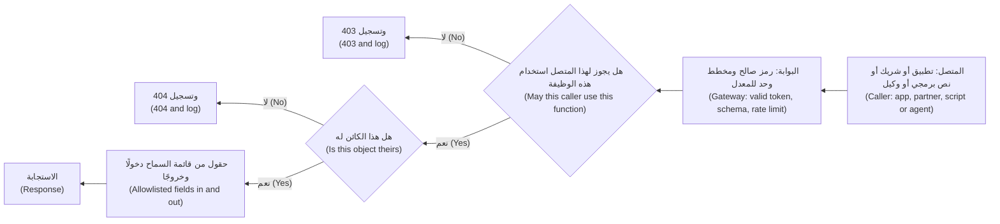
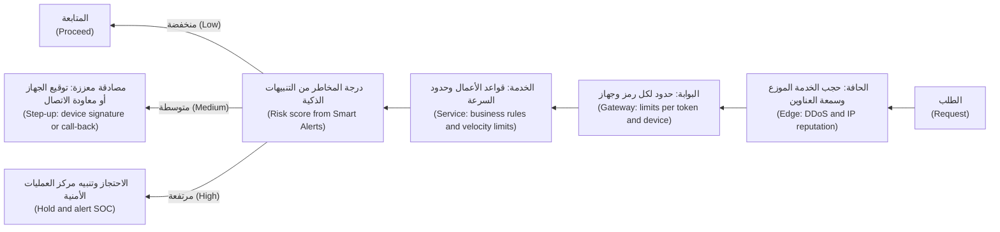
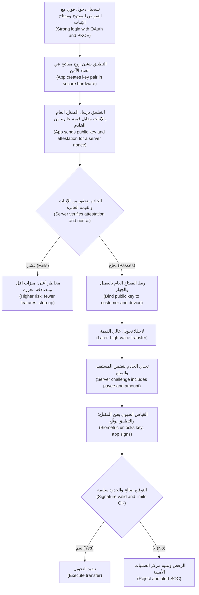

# الوحدة 4 — واجهات برمجة التطبيقات والهاتف المحمول وإساءة الاستخدام

*من منظورٍ أمني، فإن تطبيق نجم للهاتف في معظمه واجهةُ برمجة تطبيقات أُلحق بها هاتف. فكل رصيدٍ وكل ضابطٍ للبطاقة وكل تحويل يعرضه التطبيق هو استدعاءٌ لواجهة البرمجة العامة للبنك، ويستطيع أي شخصٍ يملك حاسوبًا محمولًا إجراء هذه الاستدعاءات من دون التطبيق. تنتقل هذه الوحدة من المتصفح إلى عالم الاستدعاءات بين الآلات. يستعرض الدرس 4.1 قائمة OWASP API Security Top 10 من خلال نقاط النهاية الخاصة ببنك نجم، ويبيّن لماذا تهيمن إخفاقات التفويض على القائمة. ويتناول الدرس 4.2 هجماتٍ لا تحتاج إلى أي خطأٍ برمجي على الإطلاق: الروبوتات، والكشط، والتعداد، وحالات التسابق، وثغرات منطق الأعمال التي تحوّل ميزةً إلى سلاحٍ على نطاقٍ واسع. ويعبر الدرس 4.3 إلى الجهاز ويرسم الحدّ الذي يجب أن يعرفه كل فريق تطبيقات هاتف: ما الذي يمكنك الوثوق به على هاتفٍ لا تتحكم فيه، وما الذي يجب أن يُقرَّر دائمًا على الخادم. ستتابع اختبار مريم المصرَّح به لواجهة ضوابط البطاقات، وأولى مراجعات علي لإساءة الاستخدام ولتطبيق الهاتف، وقاعدة نورة لفريق تطبيقات الهاتف: «افترض أن لدى المهاجم التطبيقَ وأداةَ فكّ ترجمة ووسيطًا. ثم صمّم.»*

> **المراحل:** Design, Build, Test, Operate — واجهاتُ برمجةٍ تفحص كل طلب، وتدفقاتُ أعمالٍ تصمد أمام الأتمتة، وتطبيقُ هاتفٍ مبنيٌّ على افتراض أن الجهاز قد يكون معاديًا.

---

# 4.1 — قائمة OWASP API Security Top 10 عمليًا
*المستوى: 🟡 متوسط* · *المتطلبات: 1.1، 3.3* · *المرحلة: Design, Test*

**بعد هذا الدرس تستطيع** أن تكتشف ثغرة تفويض على مستوى الكائن بإعادة إرسال طلب برمز حساب ثانٍ، وتصلحها على الخادم، وتضيف اختبارًا بمستخدمَين يثبت الإصلاح. *مدة الدراسة: نحو 110 دقيقة (تقدير).*

## ⚡ الدرس في دقيقة
- تعرض **واجهة برمجة التطبيقات** البياناتِ والوظائفَ مباشرةً للبرامج. ويتخطى المهاجمون تطبيقك: فهم يستدعون الواجهة بأدواتهم الخاصة ويغيّرون أي قيمة.
- قائمة **OWASP API Security Top 10 ‏(2023)** هي القائمة المعيارية لما يسوء. وثلاثةٌ من أول خمسة بنودٍ فيها إخفاقاتُ تفويض: **BOLA** على مستوى الكائنات، و**BOPLA** على مستوى الحقول، و**BFLA** على مستوى الوظائف.
- القاعدة الجوهرية: في كل طلب، يقرّر الخادم **مَن المتصل**، و**هل يجوز له استخدام هذه الوظيفة**، و**هل هذا الكائن له**، و**أيّ الحقول يجوز له قراءتها أو تغييرها**.
- مؤشر القرار لكل نقطة نهاية: «إذا غيّرتُ المعرّف، أو أضفتُ حقلًا، أو بدّلتُ طريقة HTTP، أو استدعيتُ إصدارًا أقدم، فما الذي يمنعني؟»
- الجرد مهمٌّ بقدر أهمية الشيفرة: فالإصدارات القديمة، وبيئات الاختبار، ونقاط النهاية غير الموثّقة هي المواضع التي تغيب فيها الفحوص.
- أكبر فخ: «التطبيق لا يعرض ذلك الزر أبدًا»، أو «المعرّفات عشوائية، فلا أحد يستطيع تخمينها». ولا أيٌّ منهما تحكّمٌ في الوصول.

## 🧭 لماذا يهم
يضيف بنك نجم ضوابطَ البطاقات إلى تطبيق نجم للهاتف: حدود الإنفاق، وحظر المدفوعات عبر الإنترنت، وتجميد البطاقة. وقبل الإطلاق، تُجري مريم، قائدة الفريق الأحمر، اختبارًا مصرَّحًا به لواجهة البرمجة في بيئة ما قبل الإنتاج باستخدام عميلَي اختبار، هما A وB. وبعد أن تسجّل دخولها بوصفها A ‏، ترسل `PATCH /v2/cards/{cardId}/limits` مع معرّف بطاقة B ‏. فتعيد الواجهة `200 OK` ويتغيّر حدّ B ‏. لا يعرض التطبيق هذا الإجراء أبدًا؛ أما الواجهة فلم تسأل قطّ ببساطة هل البطاقة لـ A ‏.

ويتضمن تقريرها ملاحظتين أخريين. إذ تعيد `GET /v2/customers/me` حقولًا لا يعرضها التطبيق أبدًا، منها الحقلان الداخليان `riskScore` و`kycStatus`. أما واجهة `/v1/` الصادرة عام 2019، التي لا يستخدمها التطبيق الحالي، فلا تزال تجيب على البوابة العامة من دون الفحوص الأحدث. ويسأل علي، مهندس الأمن الجديد، هل هذه ملاحظاتٌ «حقيقية»، ما دام لا يستطيع أي عميلٍ الوصول إليها عبر التطبيق. فتجيب نورة، رئيسة أمن التطبيقات والذكاء الاصطناعي: «التطبيق عميلٌ واحد. والمهاجمون يكتبون عملاءهم الخاصة.»

وتُظهر الحالات العلنية حجم الكلفة. ففي عام 2022 تعرّضت شركة الاتصالات الأسترالية Optus لكشفٍ واسعٍ لسجلات العملاء. ووصفت التقارير العلنية آنذاك واجهةَ برمجةٍ مكشوفةً على الإنترنت تعيد بيانات العملاء من دون اشتراط المصادقة؛ وقد كانت التفاصيل موضع خلاف، ثم فحصتها الجهات التنظيمية لاحقًا. وأيًّا كانت الوقائع الدقيقة، فإن النمط يجمع ثلاثة محاور من هذا الدرس: نقطة نهاية غير مراقَبة، وفحص وصولٍ مفقود، ومعرّفات يمكن المرور عليها بالتتابع.

## 📐 كيف يعمل

### 🟢 الأساسيات

**لماذا تختلف واجهات البرمجة.** تمزج صفحة الويب البياناتِ بالعرض، ويضغط الشخص على ما تعرضه. أما واجهة البرمجة فتعيد بياناتٍ خامًا، عادةً بصيغة JSON، من **نقاط نهاية (endpoints)** مثل `/v2/accounts/{accountId}` إلى أي برنامجٍ يستدعيها: تطبيق نجم للهاتف، والواجهة الأمامية لبوابة الشركات الصغيرة، والشركاء، والنصوص البرمجية، والآن وكلاء الذكاء الاصطناعي مثل نجم أسيست. لا توجد واجهة مستخدم تختبئ خلفها؛ والبنية قابلة للتنبؤ، فإذا كانت `/v2/accounts/1001` موجودة، فسيجرّب المهاجم `1002`؛ وتجيب الواجهة النصَّ البرمجي بالرحابة نفسها التي تجيب بها الإنسان، آلاف المرات في الدقيقة.

**القائمة.** كانت آخر مراجعةٍ لقائمة OWASP API Security Top 10 عام 2023 وقت كتابة هذا النص، أي عام 2026؛ فتحقّق من موقع OWASP بحثًا عن أي إصدارٍ لاحق.

| المعرّف | الخطر | بعبارةٍ بسيطة | مثال من بنك نجم |
|---|---|---|---|
| API1 | خلل التفويض على مستوى الكائن (Broken Object Level Authorization, BOLA) | لا فحص لكون المتصل مخوّلًا بالوصول إلى *هذا* الكائن | الرمز المميز للعميل A يغيّر حدّ بطاقة B ‏ |
| API2 | خلل المصادقة (Broken Authentication) | ضعفٌ في معالجة تسجيل الدخول أو الرموز المميزة أو المفاتيح | لا حدّ للمحاولات على نقطة نهاية كلمة المرور لمرةٍ واحدة (OTP endpoint) |
| API3 | خلل التفويض على مستوى خصائص الكائن | يستطيع المتصل قراءة *حقولٍ* أو كتابتها لا ينبغي له الوصول إليها | إعادة `riskScore`؛ وإمكان الكتابة في `kycStatus` |
| API4 | الاستهلاك غير المقيَّد للموارد | لا حدود لحجم الطلبات أو عددها أو كلفتها | كشوف حساب عشر سنوات في استدعاءٍ واحد |
| API5 | خلل التفويض على مستوى الوظيفة | يستطيع المتصل استخدام *وظيفةٍ* مخصّصة لدورٍ آخر | رمزٌ مميز لعميل يستدعي نقطة نهاية `/admin/` |
| API6 | الوصول غير المقيَّد إلى تدفقات الأعمال الحساسة | تدفقٌ مشروع تسيء الأتمتة استخدامه | تسجيلاتٌ آلية بنصوص برمجية لحصد مكافآت الإحالة |
| API7 | تزوير الطلبات من جهة الخادم | تجلب الواجهة عنوان URL قدّمه المتصل | ميزة «استيراد فاتورة من رابط» في بوابة الشركات الصغيرة |
| API8 | سوء الإعداد الأمني | إعداداتٌ افتراضية وضبطٌ غير آمن | تتبّعات المكدّس في استجابات الأخطاء |
| API9 | سوء إدارة الجرد | عدم معرفة واجهات البرمجة والإصدارات والبيئات الموجودة | واجهة `/v1/` المنسية |
| API10 | الاستهلاك غير الآمن لواجهات البرمجة | الثقة المفرطة ببيانات واجهات الطرف الثالث | استخدام استجابة الشريك من دون تحقق |

قدّم الدرس 3.3 مفهوم **المرجع المباشر غير الآمن إلى الكائن**. وBOLA هو الاسم الذي يُطلق على الإخفاق نفسه في عالم واجهات البرمجة. ويتصدّر القائمة لأنه شائع، وسهل الاستغلال، وسهلٌ أن يفوت في المراجعة: فالشيفرة تعمل على أكمل وجه للمستخدمين النزيهين.

**BOLA: النسخة الضعيفة والنسخة المُصلَحة.** يصادق المعالج الضعيف على المتصل ثم يثق بالمعرّف الوارد في عنوان URL ‏:

```ts
// VULNERABLE: any logged-in customer can read any account's statements
app.get("/v2/accounts/:accountId/statements", requireAuth, async (req, res) => {
  const rows = await db.statements.findMany({
    where: { accountId: req.params.accountId },
  });
  res.json(rows);
});
```

ويربط الإصلاحُ الكائنَ بالمتصل داخل الاستعلام نفسه:

```ts
// FIXED: the account must belong to the authenticated customer
app.get("/v2/accounts/:accountId/statements", requireAuth, async (req, res) => {
  const account = await db.accounts.findFirst({
    where: { id: req.params.accountId, ownerId: req.user.customerId },
  });
  if (!account) return res.status(404).json({ error: "not_found" });
  const rows = await db.statements.findMany({ where: { accountId: account.id } });
  res.json(rows);
});
```

تعيش قاعدة الملكية على **الخادم**، داخل طبقة الوصول إلى البيانات، حيث لا يستطيع عميلٌ معدَّل تخطّيها. والرد بـ **404 Not Found** بدلًا من **403 Forbidden** يتجنب تأكيد وجود المعرّف؛ وأيٌّ منهما مقبول ما دام رفض الوصول متّسقًا.

**المصادقة ليست تفويضًا.** تثبت `requireAuth` *مَن* المتصل. لكنها لا تقول شيئًا عمّا يجوز له أن *يلمسه*. وتكاد كل ثغرات BOLA ‏ تقبع خلف تسجيل دخولٍ سليمٍ تمامًا.

### 🟡 التعمق أكثر

**API3 BOPLA: الحقول، دخولًا وخروجًا.** دمج إصدار 2023 بندين أقدم. فـ **الكشف المفرط عن البيانات** هو إعادة كائنات قاعدة البيانات كاملةً والثقة بأن العميل لن يعرض إلا بعض الحقول. و**الإسناد الجماعي (Mass assignment)** هو نسخ أي حقولٍ يرسلها العميل إلى الكائن المخزَّن. وكلاهما ينشأ من عدم تدوين الحقول المسموح بها قطّ.

```ts
// VULNERABLE (PATCH /v2/customers/me; me = caller's ID): every field in, every field out
const c = await db.customers.update({ where: { id: me }, data: req.body }); // kycStatus too
res.json(c);                                      // riskScore and internal notes too

// FIXED: allowlist in, allowlist out
const UpdateProfile = z.object({
  preferredName: z.string().max(60).optional(),
  language: z.enum(["ar", "en"]).optional(),
}).strict();                                      // unknown fields are rejected
const input = UpdateProfile.safeParse(req.body);
if (!input.success) return res.status(400).json({ error: "invalid_body" });
const c2 = await db.customers.update({ where: { id: me }, data: input.data });
res.json(toPublicProfile(c2));                    // explicit response shape
```

وعلى مستوى العقد، يؤدي مستند **OpenAPI**، وهو وصفٌ مقروءٌ آليًا لكل نقطة نهاية ومعاملٍ واستجابة، المهمةَ نفسها: اضبط `additionalProperties: false` على أجسام الطلبات، وافرضه في البوابة أو في الشيفرة، ولا تُدرج إلا الحقول العامة في مخططات الاستجابة.

**API5 BFLA: الوظائف.** BOLA هو «بطاقة العميل الخطأ»؛ أما BFLA فهو «وظيفةٌ ما كان ينبغي أن يملكها هذا النوع من المستخدمين أبدًا». ومن العلامات النموذجية: مسارات إدارية على مضيف العملاء، أو فحوص أدوارٍ في الواجهة الأمامية وحدها، أو فحصٌ على `GET` لا على `DELETE` للمسار نفسه. ودافع بمبدأ **الرفض افتراضيًا**: يعلن كل مسارٍ الأدوارَ المسموح لها، وتُرفض المسارات غير المعلنة؛ وأبقِ واجهات الموظفين بعيدةً عن البوابة العامة، خلف هوية الموظفين.

**API2 خلل المصادقة.** نقاط نهاية تسجيل الدخول وكلمة المرور لمرةٍ واحدة بلا حدودٍ للمحاولات؛ ورموزٌ مميزة تُقبل من دون التحقق من التوقيع والمُصدِر والجمهور وتاريخ الانتهاء (3.2)؛ ورموزٌ في عناوين URL، فتنتهي في السجلات؛ و**مفاتيح API** تُستخدم لتعريف المستخدمين، مع أن المفتاح يعرّف تطبيقًا لا شخصًا، وأي مفتاحٍ في تطبيق هاتفٍ علنيّ (4.3).

**API8 سوء الإعداد الأمني.** أخطاءٌ مُسهَبة تتضمن تتبّعات المكدّس، و**CORS** متساهل (permissive CORS)، أي مشاركة الموارد عبر المصادر، وهي قاعدة المتصفح التي تحدد المواقع المسموح لها باستدعاء واجهتك، والخطأ الكلاسيكي فيها هو عكس أي مصدرٍ يُطلب مع السماح ببيانات الاعتماد؛ إضافةً إلى طرق HTTP غير اللازمة والإعدادات الافتراضية لأطر العمل. ويغطي الدرس 2.2 جهة المتصفح.

**API9 سوء إدارة الجرد.** لا يمكنك حماية ما لا تعرف بوجوده. فـ **واجهات الظل (Shadow APIs)** لم تُوثَّق قطّ؛ و**واجهات الزومبي (zombie APIs)** إصداراتٌ قديمة لم يوقفها أحد؛ وبيئات ما قبل الإنتاج التي تحتفظ ببيانات الإنتاج تُحسب أيضًا. وكل فرقٍ بين ما تخدمه البوابة، كما تُظهره سجلاتها، ومستندات OpenAPI هو ملاحظةٌ أمنية.

**API7 وAPI10: الثقة في الاتجاهين.** يظهر SSRF كلما جلبت واجهةٌ عنوان URL قدّمه المتصل: خطافات الويب (webhooks)، و«الاستيراد من رابط»، وصور الملفات الشخصية؛ وترد الدفاعات في الدرس 2.3. أما الاستهلاك غير الآمن، أي API10، فهو الصورة المعكوسة: الثقة بإجابة طرفٍ ثالث، مثل تغذية أسعار الصرف، أكثر مما تثق بمدخلات المستخدم. تحقّق من تلك الاستجابات وفق مخطط، واضبط مهلاتٍ زمنية، ولا تتبع عمليات إعادة التوجيه بلا تمحيص.

أما **API4 وAPI6** فلهما درسٌ خاص بهما (4.2). وكان لـ **الحقن (Injection)** و**التسجيل** بندان في إصدار 2019 لا في إصدار 2023؛ لكنهما لا يزالان مهمّين، وتغطيهما الوحدتان 2 و10.

الفحوص التي ينبغي أن يجتازها الطلب، بالترتيب:



### 🔴 نظرة الخبير

**ما تستطيعه البوابة وما لا تستطيعه.** إن **بوابة API**، أي الباب الأمامي الذي يوجّه الطلبات إلى الخدمات، هي المكان الصحيح للمصادقة (authentication)، والتحقق من المخطط، وحدود المعدّل (rate limits)، وTLS، والجرد (inventory). لكنها لا تستطيع فحص ملكية الكائن، لأن الخدمة وحدها تعرف أن الحساب 1002 يعود إلى العميل B. فقسّم المهمة: تتولى البوابة *مَن وكم*؛ وتقرر الخدمة *أيّ كائنٍ وأيّ حقول*.

**مركزة القرار.** حين يكتب مئات المعالجات كلٌّ منها استعلام الملكية الخاص به، فسينسى أحدها. عبّر عن التفويض مرةً واحدة: طبقة وصولٍ إلى البيانات تحصر الاستعلامات دائمًا في المتصل، أو **محرّك سياسات** مثل Open Policy Agent ‏(OPA) أو Cedar يقيّم القواعد خارج شيفرة المعالجات. وعندئذٍ ترث نقاط النهاية الجديدة القاعدةَ افتراضيًا.

**المعرّفات العشوائية حزام أمان لا مكابح.** تجعل معرّفات UUID العشوائية التخمينَ أصعب، وهي جديرةٌ بالاستخدام. والمقصود الإصدار 4، أي معرّفاتٌ عشوائية طويلة؛ أما الإصدارات القائمة على الوقت فقابلةٌ للتنبؤ جزئيًا. لكن المعرّفات تتسرّب عبر عناوين URL والسجلات ولقطات الشاشة واستجابات الواجهات الأخرى. ولا يُصلح BOLA إلا فحصُ الخادم.

**اختبر التفويض كما تختبر الميزات.** نادرًا ما تعرف الماسحات أيّ الكائنات يعود إلى مَن. فاستخدم **اختبار المستخدمَين**: أنشئ العميلين A وB ومستخدمًا من الموظفين، وأعِد إرسال كل طلبٍ برمز مستخدمٍ آخر، وتوقّع الرفض، ضمن التكامل المستمر في كل بناء. وفي الإنتاج، تُعدّ موجةٌ من حالات الرفض على معرّفاتٍ مختلفة من رمزٍ واحد إشارةً قوية لمركز العمليات الأمنية (SOC) (10.1).

**GraphQL.** تقدّم **GraphQL** حقولًا يختارها العميل عبر نقطة نهاية واحدة. ويجب أن يعمل التفويض في كل **محلِّل**، وهو الدالة التي تجلب كل حقل، وتحتاج الاستعلامات العميقة إلى حدودٍ للكلفة، ويجب أن تَعُدّ حدودُ المعدّل العملياتِ، لأن طلبًا واحدًا قد يحمل كثيرًا منها. وتعطيل **الاستبطان**، أي الوصف الذاتي للمخطط، يقلّل الاستطلاع لكنه ليس بديلًا عن التفويض.

**الوكلاء عملاءُ API أيضًا.** سيستدعي نجم أسيست الواجهةَ نفسها. فإذا استخدم حساب خدمةٍ يستطيع قراءة كل حساب، فإن أي حقن موجّهات (prompt injection) يوجّهه يصبح BOLA بالوكالة. وهذه حالة **النائب المرتبك (confused deputy)**: مكوّنٌ موثوق يُخدع فيستخدم صلاحياته لصالح شخصٍ آخر. وينبغي أن يعمل الوكيل (agent) برمز *العميل* المفوَّض ضيّق النطاق، مثلًا عبر OAuth 2.0 Token Exchange، حتى تظل فحوص الكائنات المعتادة سارية. وتبني الوحدة 9 على ذلك.

## 🧰 الأدوات
| الضابط أو المعيار أو الأداة | ما هو وماذا يفعل | متى تلجأ إليه |
|---|---|---|
| **OWASP API Security Top 10** — من OWASP، إصدار 2023 | القائمة المعيارية لأكثر عشرة مخاطر شيوعًا في واجهات البرمجة | تحديد نطاق مراجعات واجهات البرمجة واختباراتها؛ وتدريب المطورين |
| **OWASP ASVS** — من OWASP | متطلباتٌ أمنية قابلة للاختبار للتطبيقات، بما فيها خدمات الويب وواجهات البرمجة؛ وقد صدر الإصدار 5.0 عام 2025 | تحويل عبارة «واجهة برمجة آمنة» إلى متطلباتٍ وحالات اختبار |
| **OpenAPI schema validation** — التحقق بمخطط OpenAPI | عقدٌ مقروءٌ آليًا لكل نقطة نهاية؛ وترفض أدوات التحقق الحقولَ غير المعروفة والأنواعَ الخاطئة | كل واجهة برمجة بدءًا من التصميم؛ وهو مصدر الحقيقة للجرد |
| **API gateway** — بوابة API | بابٌ أمامي يصادق على الطلبات ويتحقق منها ويحدّ معدّلها ويسجّلها | المصادقة والحصص وTLS والجرد، لا الفحوص على مستوى الكائن أبدًا |
| **Policy engine** — محرّك السياسات، مثل OPA وCedar | يقيّم قواعد التفويض خارج شيفرة المعالجات | خدماتٌ كثيرة تتشارك قواعد معقدة؛ وتدقيق مَن يستطيع فعل ماذا |
| **Authorisation tests in CI** — اختبارات التفويض في التكامل المستمر | اختبارات المستخدمَين التي تعيد إرسال كل طلبٍ برمز مستخدمٍ آخر، متوقعةً الرفض | كل بناء، لكل نقطة نهاية تأخذ معرّف كائن |
| **OWASP crAPI** — من OWASP | واجهة برمجة ضعيفة عمدًا للتدرّب الآمن محليًا | التدريب والتمارين، لا ضد أنظمةٍ حقيقية أبدًا |

## 🏛️ عمليًا في بنك نجم
يعتمد فريق نورة **بطاقة مراجعة نقاط نهاية API في بنك نجم**: تحتاج كل نقطة نهاية عامة جديدة أو معدَّلة إلى بطاقة، يراجعها فريق أمن التطبيقات والذكاء الاصطناعي قبل إطلاقها. وملاحظة مريم هي أول مثالٍ تطبيقي:

```
Endpoint:        PATCH /v2/cards/{cardId}/limits
Owner:           Cards squad (engineering lead: Tariq)
Callers:         Najm Mobile; Najm Assist (customer's delegated token only)
Roles allowed:   customer (own cards only); no staff access on this route
Object rule:     card.ownerId == token.customerId, in CardRepository.forCustomer()
Writable fields: dailyLimit (0 to 50,000 QAR), onlinePaymentsEnabled
Returned fields: cardId, maskedPan, dailyLimit, onlinePaymentsEnabled
Limits:          10 changes per card per day; body under 2 KB
Two-user test:   tests/authz/cards_limits.spec.ts (passing)
```

ثم يطرح المراجع سؤالًا واحدًا لكل خطر:

| الخطر | سؤال المراجعة | الدليل المطلوب للاعتماد |
|---|---|---|
| API1 BOLA | هل يُفحص كل معرّف كائن للتحقق من الملكية أو الانتماء إلى المستأجر على الخادم؟ | دالة الإنفاذ؛ واختبار المستخدمَين |
| API2 المصادقة | هل يُتحقَّق من الرموز المميزة تحققًا كاملًا، وهل محاولات تسجيل الدخول وOTP محدودة؟ | إعدادات البوابة |
| API3 BOPLA | هل حقول الطلب والاستجابة مدرجة في قائمة سماح؟ | مخططٌ صارم؛ وشكل الاستجابة |
| API4 الموارد | هل ضُبطت حدود الحجم والصفحات والوقت والكلفة؟ | الحدود المدوّنة في البطاقة |
| API5 BFLA | هل يعلن المسار الأدوارَ المسموح لها، مع الرفض افتراضيًا؟ | سياسة المسار؛ واختبارٌ سلبي |
| API6 تدفقات الأعمال | هل هذا تدفق أعمالٍ حساس؟ | قيدٌ في سجل التدفقات (4.2) |
| API7 SSRF | هل تجلب عنوان URL قدّمه المتصل؟ | قائمة السماح وضوابط الخروج (2.3) |
| API8 سوء الإعداد (Misconfiguration) | هل رسائل الأخطاء عامةٌ غير مفصَّلة، وCORS مقيَّد، والطرق غير المستخدمة معطّلة؟ | فحص الإعدادات |
| API9 الجرد | هل هي موثّقة ولها مالكٌ وإصدار، وهل أُوقفت الإصدارات القديمة؟ | قيدٌ في الجرد |
| API10 الأطراف الثالثة | هل يُتحقَّق من استجابات الأطراف الثالثة، مع مهلاتٍ زمنية؟ | المخطط والمهلات |

تعود البطاقة التي تقول «قاعدة الكائن: لا شيء» إلى الفريق، أيًّا كان الموعد النهائي. ويضيف مركز العمليات الأمنية بقيادة جاسم قاعدة رصد: إطلاق تنبيهٍ حين يُرفض رمزٌ واحد على أكثر من 20 معرّف كائنٍ مختلفًا خلال خمس دقائق، وهي قيمة توضيحية تُضبط على حركة المرور الحقيقية.

## 🛠️ التمارين
لا يُجرى العمل التطبيقي إلا على شيفرتك الخاصة أو على مختبرٍ محلي مثل OWASP crAPI أو OWASP Juice Shop على جهازك الخاص.

- 🟢 اختر خمس نقاط نهاية من واجهة برمجةٍ تملكها، أو من نسختك المحلية من crAPI أو Juice Shop، ودوّن أيّ المخاطر العشرة قد ينطبق على كلٍّ منها. *يكتمل عندما:* يكون لكل نقطة نهاية خطران مربوطان بها على الأقل وسؤال مراجعةٍ ملموس واحد، وتُعلَّم كل نقطة نهاية تأخذ معرّف كائن.
- 🟡 في نسختك المحلية من crAPI أو Juice Shop، أنشئ حسابين واعثر على ثغرة تفويضٍ واحدة على مستوى الكائن بإعادة إرسال طلبٍ برمز الحساب الآخر. ثم أعِد إنتاج الثغرة في واجهة برمجةٍ صغيرة خاصة بك، وأصلحها على الخادم، وأضف اختبار مستخدمَين آليًا. *يكتمل عندما:* يفشل الاختبار على نسختك الضعيفة وينجح على النسخة المُصلَحة.
- 🔴 ابنِ جردًا لخدمةٍ تملكها: قارن المسارات المخدومة في آخر 30 يومًا، كما تُظهرها السجلات، بمستند OpenAPI ‏، وصنّف كل فرق إلى ظلّ أو زومبي أو موثَّقٍ لكنه غير مستخدم. *يكتمل عندما:* يكون لكل نقطة نهاية مخدومة مالكٌ وإصدارٌ وقرار، أي التوثيق أو الإيقاف أو الحظر، ويفشل التكامل المستمر إذا ظهر مسارٌ جديد من دون قيدٍ في المخطط.

## ⚠️ أخطاء وفخاخ
- **الإخفاء بدل الفحص.** عبارة «التطبيق لا يعرضه» ليست ضابطًا. افرض القاعدة على الخادم، في كل طلب.
- **الثقة بالمعرّفات العشوائية.** تقلّل معرّفات UUID التخمين؛ لكنها لا تحلّ محلّ فحوص الملكية.
- **وضع الأمن كله في البوابة.** البوابة تصادق وتحدّ؛ والخدمات تفوّض الوصول إلى الكائنات والحقول.
- **ترك الإصدارات القديمة تعمل.** أوقفها في موعدٍ محدد، واحظرها في البوابة، وأبقِ الجرد صادقًا.
- **منح الوكلاء والتكاملات حسابات خدمةٍ مطلقة الصلاحيات.** استخدم رموزًا مفوَّضة محددة النطاق لكي تنطبق الفحوص نفسها.

## 🧾 الخلاصة
- تعرض واجهات البرمجة الكائناتِ والوظائفَ مباشرةً؛ ويستطيع أي عميل، بما في ذلك النصوص البرمجية والوكلاء، استدعاءها بأي قيم.
- تتصدّر قائمةَ OWASP API Security Top 10 ‏(2023) إخفاقاتُ التفويض: BOLA وBOPLA وBFLA.
- في كل طلب، يصادق الخادم على المتصل، ويفحص الوظيفة، ويفحص ملكية الكائن، ويطبّق قائمة سماحٍ على الحقول دخولًا وخروجًا.
- تتولى البوابات مسألة مَن وكم؛ وتقرر الخدمات أيّ كائنٍ وأيّ حقول.
- حافظ على جردٍ صادق؛ واختبر التفويض بمستخدمَين في التكامل المستمر، وراقب حالات الرفض في الإنتاج.

## ✍️ اختبر نفسك

**1. خلال اختبارٍ مصرَّح به، تسجّل مريم الدخول بوصفها عميلة الاختبار A وترسل `PATCH /v2/cards/{cardId}/limits` مع معرّف بطاقة عميل الاختبار B. فتغيّر الواجهة حدّ B. أيّ خطرٍ هذا، وما الإصلاح؟**

- A. API2 خلل المصادقة؛ أجبِر A على تسجيل الدخول مجددًا قبل أي تغيير على البطاقة، وأنهِ الجلسة بعد خمس دقائق
- B. API1 BOLA؛ افحص على الخادم، في كل طلب، أن البطاقة تعود إلى العميل المصادَق عليه
- C. API8 سوء الإعداد الأمني؛ أخفِ معرّفات البطاقات عن شاشات التطبيق وعن العناوين الظاهرة في شريط المتصفح
- D. API4 الاستهلاك غير المقيَّد للموارد؛ طبّق حدًّا للمعدّل على نقطة النهاية بعشرة طلبات في الدقيقة لكل عميل وأطلق تنبيهًا عند الارتفاعات

<details><summary>الإجابة</summary>

**B.** نجحت المصادقة؛ أما الفحص على مستوى الكائن للتأكد من أن البطاقة لـ A فكان مفقودًا. الخيار A يعيد مصادقة الشخص نفسه؛ وC يخفي المعرّف بدل فحصه. انظر: 🟢 الأساسيات.

</details>

**2. تعيد `GET /v2/customers/me` الحقل الداخلي `riskScore`، وتقبل `PATCH /v2/customers/me` حقل `kycStatus`. ما أفضل إصلاح؟**

- A. الطلب من فريق تطبيقات الهاتف ألّا يعرض `riskScore` في التطبيق، وإزالة الحقل من شاشات بوابة الموظفين مع إبقائه في الاستجابة نفسها
- B. تشفير جسم الاستجابة
- C. تعريف مخططات طلبٍ واستجابةٍ مدرجة في قائمة سماح: رفض الحقول غير المعروفة في المدخلات وعدم إعادة سوى الحقول العامة
- D. نقل نقطة النهاية إلى `/v3/`

<details><summary>الإجابة</summary>

**C.** هذا هو API3 BOPLA: كشفٌ مفرط للبيانات خروجًا، وإسنادٌ جماعي دخولًا. الخيار A يترك البيانات في الاستجابة لأي عميلٍ آخر؛ وB لا يفيد، لأن العميل يفكّ تشفيرها على أي حال. انظر: 🟡 التعمق أكثر.

</details>

**3. لإغلاق ملاحظات BOLA، يقترح مطوّرٌ استبدال أرقام الحسابات المتسلسلة في عناوين URL بمعرّفات UUID. ماذا ينبغي أن تقول نورة؟**

- A. جيد: المعرّفات العشوائية تجعل BOLA مستحيلًا
- B. يستحق التنفيذ بوصفه دفاعًا متعدد الطبقات، لكن المعرّفات تتسرّب عبر السجلات والروابط والاستجابات الأخرى، لذا يظل فحص الملكية من جهة الخادم مطلوبًا
- C. لا جدوى منه: معرّفات UUID لا تضيف أي أمانٍ على الإطلاق
- D. استخدام UUID والتخلي عن فحص الملكية لتحسين الأداء، لأن المعرّفات لم يعد ممكنًا تخمينها من العملاء أو المهاجمين ويصبح كل بحثٍ قراءةً واحدة سريعة للمفتاح في قاعدة البيانات

<details><summary>الإجابة</summary>

**B.** المعرّفات غير القابلة للتخمين تُبطئ المهاجمين لكنها ليست تحكّمًا في الوصول. الخيار A هو الفخ المغري؛ وC يبالغ، لأن صعوبة التخمين لها بعض القيمة. انظر: 🔴 نظرة الخبير.

</details>

**4. لم يعد التطبيق الحالي يستخدم واجهة `/v1/` التي أصدرها بنك نجم عام 2019، لكنها لا تزال تجيب على البوابة العامة، من دون فحوص الوصول الأحدث. أيّ خطرٍ هذا، وما الاستجابة الصحيحة؟**

- A. API9 سوء إدارة الجرد: سجّلها بمالكٍ وتاريخ إيقاف، واحظرها في البوابة، وقارن بانتظام المسارات المخدومة بالموثّقة
- B. API10 الاستهلاك غير الآمن لواجهات البرمجة: تحقّق من استجاباتها مقابل مخطط، وحدّد مهلات لكل استدعاء إليها، وعامل بياناتها بوصفها مدخلاتٍ غير موثوقة كأي مصدر بياناتٍ خارجي آخر
- C. ليست خطرًا، لأنه لا يوجد عميلٌ حالي يستدعيها
- D. API7 SSRF: أضف قائمة سماحٍ لعناوين URL

<details><summary>الإجابة</summary>

**A.** الإصدارات الزومبي إخفاقٌ كلاسيكي في الجرد. الخيار C هو الفخ: فالمهاجمون لا يحتاجون إلى التطبيق الحالي لاستدعاء نقطة نهاية قديمة. انظر: 🟡 التعمق أكثر.

</details>

**5. سيستدعي نجم أسيست واجهة الحسابات للبحث عن معاملات عميل. ويقترح طارق منحه حساب خدمةٍ يستطيع قراءة كل الحسابات «للتبسيط». ما الخطر الرئيسي، وما التصميم الأفضل؟**

- A. الكلفة؛ خزّن الاستجابات مؤقتًا بدلًا من ذلك، فهذا يخفّض عدد الاستدعاءات ويلغي الحاجة إلى حساب خدمة واسع
- B. زمن الاستجابة؛ دع الوكيل يستعلم قاعدة البيانات مباشرةً ليتجاوز طبقة الواجهة التي تبطئ كل طلب
- C. نائبٌ مرتبك: قد يقرأ وكيلٌ متلاعَبٌ به بياناتِ عملاء آخرين؛ فينبغي أن يستخدم رمز العميل المفوَّض ضيّق النطاق لتنطبق فحوص الكائنات
- D. لا خطر، لأن الوكيل داخلي ومن ثمّ موثوق، وكل ما يصدر عن الشبكة الداخلية يُعدّ آمنًا بطبيعته

<details><summary>الإجابة</summary>

**C.** الوكيل ذو الصلاحيات الواسعة يحوّل حقن الموجّهات إلى BOLA بالوكالة. أما الخيار D فيفترض أن مدخلات الوكيل جديرة بالثقة، وهو ما تبيّن الوحدة 8 أنه غير صحيح. انظر: 🔴 نظرة الخبير.

</details>

## 📚 المراجع
- مشروع OWASP API Security وقائمة API Security Top 10 ‏(2023) — https://owasp.org/API-Security/
- معيار OWASP للتحقق من أمان التطبيقات — https://owasp.org/www-project-application-security-verification-standard/
- سلسلة OWASP Cheat Sheet Series، أوراق التفويض (Authorization)، والإسناد الجماعي، وأمن REST، وGraphQL — https://cheatsheetseries.owasp.org/
- OWASP crAPI، أي «واجهة برمجة سخيفة تمامًا» — https://owasp.org/www-project-crapi/
- MITRE CWE-639، تجاوز التفويض عبر مفتاحٍ يتحكم فيه المستخدم (Authorization Bypass Through User-Controlled Key) — https://cwe.mitre.org/data/definitions/639.html
- MITRE CWE-915، التعديل غير المضبوط لسمات الكائنات المحدَّدة ديناميكيًا — https://cwe.mitre.org/data/definitions/915.html
- RFC 8693، تبادل الرموز المميزة في OAuth 2.0 ‏(OAuth 2.0 Token Exchange) — https://www.rfc-editor.org/rfc/rfc8693
- مبادرة OpenAPI — https://www.openapis.org/

---

# 4.2 — إساءة الاستخدام والروبوتات وحدود المعدّل وثغرات منطق الأعمال
*المستوى: 🟡 متوسط* · *المتطلبات: 3.1، 4.1* · *المرحلة: Design, Operate*

**بعد هذا الدرس تستطيع** أن تعيد إنتاج سحب على المكشوف ناتج عن حالة سباق بطلبات متزامنة، وتصلحه بتحديث شرطي ذري ومفتاح عدم تكرار، وتثبت ذلك عبر عشر تشغيلات. *مدة الدراسة: نحو 110 دقيقة (تقدير).*

## ⚡ الدرس في دقيقة
- **إساءة الاستخدام** هي استخدام ميزاتٍ مشروعة بحجمٍ أو سرعةٍ أو ترتيبٍ لم يتوقعه المصممون. وكثيرًا ما يكون كل طلبٍ بمفرده صالحًا.
- يسمّيها خطران من مخاطر OWASP لواجهات البرمجة: **API4 الاستهلاك غير المقيَّد للموارد**، أي لا حدود للحجم أو الكلفة، و**API6 الوصول غير المقيَّد إلى تدفقات الأعمال الحساسة**، أي تدفقٌ قيّم يؤتمته المهاجمون. ونظيرهما في ميزات النماذج اللغوية الكبيرة هو **LLM10 الاستهلاك غير المحدود**.
- **ثغرات منطق الأعمال** قواعدُ نسيتها الشيفرة: مبالغ سالبة، وخطواتٌ متخطّاة، وحدودٌ تُفحص لكل طلبٍ بدل كل يوم، و**حالات التسابق** التي يجتاز فيها طلبان متوازيان الفحصَ كلاهما.
- اربط حدود المعدّل بما يجده المهاجم نادرًا: الحسابات الموثّقة، والأجهزة، وأرقام الهواتف، والحساب المستهدَف، لا بعناوين IP وحدها، فهي رخيصة.
- مؤشر القرار لكل تدفقٍ حساس: «ماذا لو فعل نصٌّ برمجي هذا 10,000 مرة، بالتوازي، وبترتيبٍ مختلف، ومن 10,000 عنوان؟»
- أكبر فخ: اختبار CAPTCHA أو قائمة حظرٍ لعناوين IP ‏ بوصفهما الإجابة كلها.

## 🧭 لماذا يهم
يُطلق تطبيق نجم للهاتف ميزة «الدفع برقم الهاتف»: اكتب رقم هاتف، فإن كان يعود إلى عميلٍ لدى بنك نجم، يعرض التطبيق الاسم الكامل للمستلم قبل إرسال المال. يراجع علي نقطة النهاية وفق قائمة API Top 10 من الدرس 4.1: تسجيل الدخول مطلوب، وفحوص الملكية سليمة، والحقول مدرجة في قائمة سماح. فيعتمدها.

أما مريم فلا تعتمدها. «نقطة النهاية لديك تجيب عن سؤالٍ واحد: هل هذا الرقم لعميلٍ في بنك نجم، وما اسمه؟ ويستطيع نصٌّ برمجي ببضعة حسابات اختبار أن يطرح هذا السؤال عن كل رقم هاتفٍ محمول في البلاد. هذه قائمة عملاءٍ جاهزة لحملة تصيّد، وتسريبٌ لبياناتٍ شخصية (5.3).» لا يوجد سطرٌ خاطئ في الشيفرة. فالميزة، حين تُستخدم على نطاقٍ واسع، هي الثغرة.

وفي الأسبوع نفسه، يتضاعف الإنفاق على رسائل كلمات المرور لمرةٍ واحدة ثلاث مراتٍ بين ليلةٍ وضحاها، بينما تنخفض نسبة الرموز المُدخَلة انخفاضًا حادًا، وتسأل رانيا، رئيسة منتجات الذكاء الاصطناعي، عن سبب قفزة فاتورة النموذج لنجم أسيست: بضعة حساباتٍ تلصق مستنداتٍ ضخمة في المحادثة طوال اليوم. ثلاث ميزات، ودرسٌ واحد: إذا كان تدفقٌ ما يكلّف مالًا أو يمنح شيئًا ذا قيمة، فسيؤتمته أحدهم.

## 📐 كيف يعمل

### 🟢 الأساسيات

**المصطلحات.**
- **الروبوت** هو أي عميلٍ مؤتمت. وكثيرٌ منها مرحَّبٌ به، كالمراقبة والشركاء ومحركات البحث؛ والسؤال ليس «روبوتٌ أم إنسان؟» بل «هل هذا الاستخدام مقبول؟»
- **حشو بيانات الاعتماد (Credential stuffing)**: تجربة أزواج أسماء المستخدمين وكلمات المرور المسرّبة من مواقع أخرى (3.1).
- **الكشط**: جمع البيانات على نطاقٍ واسع، من الرسوم والأسعار إلى تفاصيل العملاء، وهو الأسوأ بكثير.
- **التعداد**: استخدام الإجابات المختلفة لنقطة نهاية لمعرفة أيّ الحسابات أو الأرقام أو عناوين البريد موجودة، كما حين تقول صفحة تسجيل دخول «مستخدم غير معروف» لأحدها و«كلمة مرور خاطئة» لآخر.
- **ضخّ الرسائل النصية (SMS pumping)**، ويُسمّى أيضًا الحركة المضخَّمة اصطناعيًا: إطلاق كمياتٍ هائلة من رسائل التحقق إلى نطاقات أرقام يتقاسم فيها المهاجم الإيرادات. وأنت تدفع ثمن كل رسالة.
- **استنزاف المحفظة**: رفع فاتورةٍ قائمة على الاستخدام، كفاتورة السحابة أو الرسائل النصية أو رموز النماذج اللغوية الكبيرة، بدلًا من إسقاط الخدمة.
- **ثغرة منطق الأعمال**: تفعل الشيفرة ما كُتبت لتفعله، لكن القواعد ناقصة. ونادرًا ما تعثر الماسحات على هذه الثغرات، لأنه لا شيء يبدو مشوَّه الصيغة.

**ثغرات منطق الأعمال الشائعة في البنوك.**

| الثغرة | ما الذي يسوء | مثال من بنك نجم | الدفاع |
|---|---|---|---|
| إشارةٌ أو نطاقٌ غير مفحوص | قبول قيمٍ سالبة أو صفرية | تحويلٌ بقيمة −500 يُضاف إلى رصيد المُرسِل | التحقق من النطاقات على الخادم لكل مبلغ |
| الثقة بقيم العميل | السعر أو الرسم أو سعر الصرف يرسله العميل | سعر الصرف في جسم الطلب | الخادم يبحث عن السعر بنفسه؛ وتُتجاهَل قيمة العميل |
| تخطّي الخطوات | استدعاء الخطوة 3 من دون الخطوة 2 | `/transfers/confirm` من دون التحقق من OTP ‏ | آلة حالاتٍ من جهة الخادم لكل معاملة |
| الحدود لكل طلب | يُفحص الحدّ لكل استدعاءٍ لا للمجموع | عشرة تحويلات بقيمة 49,000 ريال قطري تحت حدٍّ يومي قدره 50,000 ريال قطري | حدودٌ تراكمية عبر القنوات والزمن |
| حالة التسابق | يجتاز طلبان متوازيان الفحصَ كلاهما | إنفاق الرصيد أو القسيمة مرتين | تحديثٌ ذرّي أو قفل؛ ومفاتيح منع التكرار (idempotency keys) |
| إعادة الإرسال | إرسال طلبٍ صالح مرةً أخرى | إعادة إرسال تحويلٍ معتمَد | مفاتيح منع التكرار، والقيم العابرة (nonces)، والصلاحية القصيرة |
| التقريب | تقريبٌ يميل دائمًا لصالح طرفٍ واحد | تحويلات عملاتٍ صغيرة جدًا وكثيرة | قواعد تقريبٍ محددة؛ وحدودٌ دنيا للمبالغ؛ ومراقبة |

**تحديد المعدّل (Rate limiting).** يضع **حدّ المعدّل** سقفًا لعدد الإجراءات التي يجوز لمفتاحٍ ما تنفيذها في نافذةٍ زمنية. ويحتاج كل حدّ معدّلٍ إلى ثلاثة قرارات:
1. **ماذا تَعُدّ**: طلبات HTTP، أو أحداث الأعمال مثل التحويلات وعمليات البحث والرسائل المرسلة ورموز النماذج اللغوية. وأحداث الأعمال أفضل عادةً.
2. **بماذا تربط المفتاح**: عنوان IP، أو العميل، أو الجهاز، أو الجلسة (session)، أو الحساب المستهدَف، أو بادئة رقم الهاتف، أو مزيجٌ منها.
3. **ماذا تفعل عند بلوغ الحدّ**: الرفض بالرمز **HTTP 429 Too Many Requests**، المعرَّف في RFC 6585، مع ترويسة `Retry-After`؛ أو الإبطاء؛ أو طلب **المصادقة المعزَّزة (step-up authentication)**، أي إثباتٍ أقوى مثل توقيعٍ مرتبطٍ بالجهاز؛ أو الاحتجاز للمراجعة.

ومن الخوارزميات الشائعة: **النافذة الثابتة**، مثل 100 في الدقيقة تُصفَّر كل دقيقة، وهي بسيطة لكنها تسمح بدفعاتٍ مفاجئة عند الحواف؛ و**النافذة المنزلقة**، وهي أكثر سلاسة؛ و**دلو الرموز (token bucket)**، الذي يُعاد ملؤه بمعدّلٍ ثابت، ويستهلك كل إجراءٍ رمزًا، وتُسمح الدفعات المفاجئة حتى سعة الدلو. وتناسب دلاءُ الرموز معظمَ واجهات البرمجة: فالدفعات السريعة تمرّ، والاستخدام الآلي المستمر ينفد رصيده.

### 🟡 التعمق أكثر

**حالات التسابق: افحص ثم نفّذ.** أخطر ثغرات المنطق في القطاع المالي هي حالات التسابق. فالنمط الضعيف يقرأ قيمةً، ويقرّر في شيفرة التطبيق، ثم يكتب:

```sql
-- VULNERABLE: two parallel requests can both read 500 and both pass the check
SELECT balance FROM accounts WHERE id = :id;   -- app sees 500, wants to send 400
UPDATE accounts SET balance = balance - 400 WHERE id = :id;

-- FIXED: the check and the change are one atomic statement
UPDATE accounts
   SET balance = balance - :amount
 WHERE id = :id AND :amount > 0 AND balance >= :amount;
-- 0 rows updated means an invalid amount or insufficient funds: reject the transfer
```

وتنجح أيضًا أقفال الصفوف، أي `SELECT ... FOR UPDATE` داخل معاملة، وقيود قاعدة البيانات، كرصيدٍ لا يمكن أن يهبط تحت الصفر أو قسيمةٍ لا تُستردّ إلا مرةً واحدة. والقاعدة: دع قاعدة البيانات تفرض الثابت، لأنها ترى كل طلب؛ أما كل نسخةٍ من التطبيق فلا ترى إلا طلباتها.

**مفاتيح منع التكرار.** تُسقط شبكات الهاتف المحمول الاستجابات، ويضغط العملاء مرتين. و**مفتاح منع التكرار (idempotency key)** قيمةٌ فريدة يولّدها العميل لكل إجراءٍ مقصود. يخزّنها الخادم مع النتيجة، ويجيب عن التكرار بالنتيجة الأصلية بدل التنفيذ مرتين:

```sql
-- One transfer per (customer, key): a retry or a double-tap cannot create a second one
CREATE UNIQUE INDEX transfers_idem ON transfers (customer_id, idempotency_key);
```

وينبغي رفض التكرار الذي يعيد استخدام مفتاحٍ مع جسم طلبٍ مختلف، لا تنفيذه. وهذا يُضعف أيضًا هجمات إعادة الإرسال. وتستخدم كثيرٌ من واجهات الدفع ترويسة `Idempotency-Key` بالفعل؛ وتجري منذ عدة سنوات مسوّدةٌ لدى IETF لتوحيدها قياسيًا، فتحقّق من حالتها الحالية.

**آلات الحالات من جهة الخادم.** في التدفقات متعددة الخطوات، كالبدء ثم التحقق من OTP ثم التأكيد، احتفظ بحالة كل معاملةٍ على الخادم ولا تسمح إلا بالانتقالات المشروعة: فخطوة التأكيد تفحص «تمّ التحقق، ولم تنتهِ الصلاحية، والعميل نفسه، والجهاز نفسه» بدل الثقة بترتيب الاستدعاءات لدى العميل.

**التعداد وأوراكل البحث.** لميزة «الدفع برقم الهاتف»، يكدّس فريق نورة الضوابط:
- لا يُسمح بالبحث إلا للعملاء المسجّلين دخولهم على جهازٍ مربوط (4.3).
- اسمٌ **مُقنَّع** مثل «أحمد ك.» للتأكيد، لا الاسم الكامل.
- حدودٌ يومية لكل عميل على عمليات البحث *وعلى* **الأرقام المختلفة**: فالعملاء الحقيقيون يدفعون لبضعة أشخاص؛ والكاشطون يفحصون الآلاف.
- تنبيهات مركز العمليات الأمنية على الحسابات التي تُكثر البحث وتُقلّ الدفع.
- سؤالٌ يخص المنتج: هل يجب أن تكشف الميزة العضوية قبل أن يلتزم العميل بالدفع؟ فكل حقيقةٍ تُكشف يمكن حصادها.

**الضوابط المتعددة الطبقات.** لا توجد طبقةٌ واحدة توقف إساءة الاستخدام. فالطلب الموجّه إلى تدفقٍ حساس في بنك نجم يمرّ بعدة طبقات:



**الروبوتات واختبارات CAPTCHA.** تقيّم خدمات إدارة الروبوتات الطلباتِ بناءً على سمعة عنوان IP، وخصائص الجهاز، والسلوك؛ وفي تطبيقات الهاتف يكون **إثبات المنصة** (4.3) إشارةً أقوى. أما اختبارات **CAPTCHA** فتضيف احتكاكًا للجميع، وتستبعد بعض المستخدمين ذوي الإعاقة، وتحلّها مزارعُ بشرية مدفوعة الأجر أو برمجيات: فهي مطبّ سرعةٍ واحد قابل للضبط، وليست الضابط أبدًا.

**دفاعات ضخّ الرسائل النصية (SMS pumping defences).** لا ترسل الرسائل إلا إلى البلدان التي تخدمها؛ وحدّد عدد الإرسالات لكل رقمٍ وبادئةٍ وحساب؛ وأطلق تنبيهاتٍ على الإنفاق وعلى **معدّل التحويل**، أي الرموز المُدخَلة مقسومةً على الرموز المرسلة، الذي ينهار أثناء الضخّ؛ وفضّل الموافقة داخل التطبيق على جهازٍ مربوط.

**ميزات النماذج اللغوية واستنزاف المحفظة.** تُدرج قائمة OWASP Top 10 for LLM Applications ‏(2025) البند **LLM10 الاستهلاك غير المحدود**: استخدامٌ غير مضبوط يرفع الكلفة، أو يستنفد السعة، أو يدعم محاولات استخراج النموذج عبر أحجام استعلاماتٍ مرتفعة جدًا. وبالنسبة إلى نجم أسيست: ضع سقفًا لحجم المدخلات، ورموز المخرجات، واستدعاءات الأدوات، وخطوات الوكيل في كل دور؛ واضبط ميزانياتٍ يومية للرموز لكل عميل؛ وأنهِ التشغيلات الطويلة بمهلةٍ زمنية؛ وأطلق تنبيهاتٍ على الإنفاق لكل حساب. وتعود الوحدة 9 إلى هذا الموضوع.

### 🔴 نظرة الخبير

**إساءة الاستخدام مسألةٌ اقتصادية.** لا يمكنك جعل إساءة الاستخدام مستحيلة؛ لكن يمكنك جعل كل نجاحٍ يكلّف المهاجمَ أكثر مما يساوي. فعناوين IP رخيصة: إذ تؤجّر شبكات الوسطاء السكنية أعدادًا كبيرة جدًا منها، ولذلك لا توقف الحدودُ لكل عنوان IP سوى النصوص البرمجية الخرقاء. أما الحسابات الموثّقة والأجهزة المُثبَتة سلامتها فباهظة الكلفة. فاربط الحدود المهمة بها وبـ **الهدف**، كمحاولات كل اسم مستخدم وعمليات البحث لكل رقم هاتف، حتى لا يفيد توزيع الهجوم على مصادر كثيرة.

**عُدّ أحداث الأعمال لا طلبات HTTP.** «خمسة مستفيدين جدد يوميًا» و«50,000 ريال قطري يوميًا عبر التطبيق والويب والفرع» قواعدُ لا يستطيع المهاجمون الالتفاف عليها بتجميع الطلبات أو تبديل القنوات. ومكانها الخدمة، قرب البيانات، وفي متطلباتٍ مكتوبة بوصفها **حالات إساءة استخدام**، وتُسمّى أيضًا حالات سوء الاستخدام: قصص مستخدمين من جهة المهاجم، مثل «بصفتي محتالًا، أريد فتح 500 حساب لجمع مكافآت الإحالة.» ويجعلها الدرس 6.1 جزءًا من كل مجموعة متطلبات.

**اختر الاستجابات لا الحظر فقط.** فالحظر الصارم يعلّم المهاجمين عتبتك. ومن البدائل: الإبطاء، أو اشتراط المصادقة المعزَّزة، أو وضع سقفٍ للقيمة، أو الإحالة إلى طابور المراجعة، أو تشغيل قاعدةٍ جديدة في **وضع الظل**، أي التسجيل فقط، لقياس الإيجابيات الكاذبة قبل إنفاذها. وقرّر لكل تدفق هل **يفشل** المحدِّد **مفتوحًا**، أي يسمح بالطلبات إذا تعطّل مخزن بياناته، أم **يفشل مغلقًا**. ولا ينبغي أن يفشل تسجيل الدخول والتحويلات مفتوحَين بالكامل؛ أما صفحة الرسوم فيمكنها ذلك.

**الثوابت والتسوية ومفاتيح الإيقاف.** ستصل بعض ثغرات المنطق إلى الإنتاج. فالتقطها بثوابت تُفحص باستمرار: **دفتر أستاذٍ بالقيد المزدوج** يقابل فيه كلَّ خصمٍ قيدٌ دائن مطابق، وتسويةٌ يومية للأرصدة مقابل المعاملات، وتنبيهاتٌ حين يدفع عرضٌ ترويجي أكثر من ميزانيته. واحتفظ بعلامة ميزة لكل تدفقٍ حساس يمكنها إيقافه مؤقتًا أو تقييده من دون إصدارٍ جديد، حتى يتمكن مهندس المناوبة من إيقاف استنزافٍ للمكافآت في الثانية فجرًا خلال دقيقة.

**قِس الاحتكاك.** لكل ضابطٍ كلفةٌ على العملاء الحقيقيين: فتتبّع الإيجابيات الكاذبة، والتدفقات المتروكة، واتصالات الدعم إلى جانب إساءة الاستخدام المحظورة. وينبغي أن تتشارك قواعد إساءة الاستخدام خطَّ إشارات التنبيهات الذكية، حتى يرى مركز العمليات الأمنية بقيادة جاسم صورةً واحدة.

## 🧰 الأدوات
| الضابط أو المعيار أو الأداة | ما هو وماذا يفعل | متى تلجأ إليه |
|---|---|---|
| **Rate limiting** — تحديد المعدّل، بدلو الرموز أو النافذة المنزلقة | يضع سقفًا للإجراءات لكل مفتاحٍ في كل نافذةٍ زمنية، ويجيب بالرمز 429 مع `Retry-After` | كل نقطة نهاية عامة؛ مربوطًا بالعميل والجهاز والهدف، لا بعنوان IP وحده |
| **Idempotency keys** — مفاتيح منع التكرار | مفتاحٌ يولّده العميل لكل إجراء؛ ويعيد الخادم النتيجة المخزّنة عند التكرار | المدفوعات والتحويلات وأي إجراء إنشاءٍ قد تكرّره إعادة المحاولة |
| **Atomic conditional updates** — التحديثات الشرطية الذرّية | الفحص والتغيير في عبارةٍ واحدة أو معاملةٍ مقفلة؛ وتفرض القيودُ الثوابتَ | الأرصدة والقسائم والحدود: أي شيءٍ قد يُنفَق مرتين بسبب حالة تسابق |
| **Step-up authentication** — المصادقة المعزَّزة | طلب إثباتٍ أقوى، مثل توقيعٍ مرتبطٍ بالجهاز أو مفتاح مرور، حين ترتفع المخاطر | المستفيدون الجدد، وزيادات الحدود، والمبالغ أو الأجهزة غير المعتادة |
| **OWASP Automated Threats to Web Applications** — من OWASP | تصنيفٌ لإساءة الاستخدام المؤتمتة مثل حشو بيانات الاعتماد والكشط والاحتيال بالبطاقات | تسمية إساءة الاستخدام في نماذج التهديدات وفي متطلبات إدارة الروبوتات |
| **Bot management** — إدارة الروبوتات | خدماتٌ تقيّم الطلبات بناءً على إشارات سمعة عنوان IP والجهاز والسلوك | التدفقات العامة عالية الحركة: تسجيل الدخول والاشتراك وعمليات البحث |
| **Abuse cases** — حالات إساءة الاستخدام | متطلباتٌ مكتوبة من جهة المهاجم، لكلٍّ منها ضابطٌ واختبار | تصميم كل تدفق أعمالٍ حساس |

## 🏛️ عمليًا في بنك نجم
ينشئ فريق نورة **سجلّ تدفقات الأعمال الحساسة**. فأي نقطة نهاية تجيب بطاقةُ مراجعتها (4.1) بـ «نعم» عن API6 تحتاج إلى قيدٍ فيه، يُتّفق عليه مع مالك المنتج قبل الإطلاق. والعتبات توضيحية وتُضبط في وضع الظل.

| التدفق | سيناريو إساءة الاستخدام | الحدود والضوابط | الإشارة إلى مركز العمليات الأمنية | المالك ومفتاح الإيقاف |
|---|---|---|---|---|
| تسجيل الدخول | حشو بيانات الاعتماد من عناوين كثيرة | 5 إخفاقات لكل اسم مستخدم كل 15 دقيقة، ثم مصادقة معزَّزة؛ وفحص كلمات المرور المخترقة | معدّل الإخفاق لكل اسم مستخدم وإجمالًا | فريق الهوية؛ مصادقة معزَّزة للجميع |
| رسالة OTP النصية | ضخّ الرسائل النصية؛ وإغراق الضحية بالرموز | البلدان المخدومة فقط؛ و3 لكل رقمٍ كل 10 دقائق؛ و10 لكل حسابٍ يوميًا | الإنفاق على الرسائل النصية في الساعة؛ ومعدّل تحويلٍ دون 50% | فريق الهوية؛ إيقاف الرسائل النصية مؤقتًا حسب البلد |
| الدفع برقم الهاتف | تعداد العملاء | جهازٌ مربوط فقط؛ و20 عملية بحث و10 أرقام مختلفة يوميًا؛ واسمٌ مُقنَّع | عمليات البحث مقابل المدفوعات المكتملة | فريق المدفوعات؛ تعطيل البحث |
| التحويل إلى مستفيدٍ جديد | سحب الأموال بعد الاستيلاء على الحساب؛ وشبكات البغال المالية | 5 مستفيدين جدد يوميًا؛ وسقفٌ للتحويل الأول؛ ودرجة التنبيهات الذكية | مستفيدٌ جديد على جهازٍ جديد | فريق المدفوعات؛ ودانة مسؤولةٌ عن النموذج |
| مكافأة الإحالة | مزارع الحسابات المزيّفة | تُدفع بعد 30 يومًا من النشاط الحقيقي؛ وواحدة لكل جهازٍ ورقم هويةٍ وطنية؛ وميزانيةٌ شهرية | تجمّعاتٌ تتشارك الأجهزة أو العناوين | التسويق مع فريق الاحتيال؛ وضع سقفٍ للمكافآت |
| تصدير كشف الحساب | الاستخراج الجماعي (Bulk extraction)؛ واستنفاد الموارد | حتى 12 شهرًا لكل تصدير؛ و5 يوميًا؛ ومهمةٌ غير متزامنة | عمليات التصدير لكل حسابٍ يوميًا | فريق الحسابات؛ تعطيل التصدير |
| محادثة نجم أسيست | استنزاف المحفظة؛ ومحاولات استخراج النموذج | 8,000 رمز مدخلاتٍ لكل رسالة؛ وميزانية رموزٍ يومية؛ و5 استدعاءات أدواتٍ لكل دور | الإنفاق لكل عميل؛ وبلوغ الميزانية | فريق رانيا؛ الرجوع إلى وضع الأسئلة الشائعة |

تُراجَع الصفوف كل ربع سنة مقابل إساءات الاستخدام التي يرصدها مركز العمليات الأمنية بقيادة جاسم وتحليلات الاحتيال لدى دانة؛ وتُسجَّل تغييرات الحدود مع أسبابها.

## 🛠️ التمارين
لا يُجرى العمل التطبيقي إلا على شيفرةٍ كتبتها بنفسك، أو مختبرٍ محلي، أو تطبيقات تدريبٍ ضعيفة عمدًا مثل OWASP Juice Shop على جهازك الخاص. ولا تُخضع أبدًا نظامًا لا تملكه لاختبار حِملٍ أو سبر.

- 🟢 في تطبيقٍ تملكه، أو في Juice Shop، اذكر ثلاثة تدفقات أعمالٍ حساسة، لكلٍّ منها حالة إساءة استخدامٍ واحدة مثل «بصفتي مهاجمًا، أريد…»، وحدّ حدث الأعمال الذي يمنعها من التوسّع. *يكتمل عندما:* يكون لكل تدفقٍ حالة إساءة استخدام، وحدٌّ مربوط بشيءٍ غير عنوان IP ‏، واستجابةٌ مسمّاة عند بلوغ الحدّ.
- 🟡 اكتب واجهة برمجةٍ محلية صغيرة فيها نقطة نهاية للتحويل تستخدم نمط «افحص ثم نفّذ» الضعيف. ومن نصٍّ برمجي محلي، أرسل 20 تحويلًا متزامنًا ولاحظ السحب على المكشوف. ثم طبّق تحديثًا شرطيًا ذريًا ومفتاح منع تكرار. *يكتمل عندما:* يُحدث الاختبار المتزامن سحبًا على المكشوف في النسخة الضعيفة ولا يُحدثه أبدًا في النسخة المُصلَحة عبر عشرة تشغيلات.
- 🔴 اكتب نموذج تهديدات إساءة الاستخدام لبرنامج إحالة، في بنك نجم أو في منتجك الخاص: أهداف المهاجم وتكاليفه، وأرخص مسار هجوم، والضوابط المتعددة الطبقات، ومقاييس النجاح، ومفتاح الإيقاف. *يكتمل عندما:* تستطيع تحديد الكلفة التقديرية للمهاجم لكل مكافأةٍ ناجحة قبل ضوابطك وبعدها، ويقبل مالكُ منتجٍ أو مالكُ ملف الاحتيال الاحتكاكَ الإضافي.

## ⚠️ أخطاء وفخاخ
- **التحديد بعنوان IP فقط.** تبديل العناوين رخيص. فاربط الحدود بالعميل والجهاز والهدف أيضًا.
- **عدّ الطلبات لا أحداث الأعمال.** يُفشل التجميعُ وGraphQL وتبديلُ القنوات عدَّ الطلبات. فحدّد التحويلات والمستفيدين وعمليات البحث والرموز.
- **«افحص ثم نفّذ» في شيفرة التطبيق.** دع قاعدة البيانات تفرض الثوابت ذريًا.
- **CAPTCHA بوصفه الضابط.** إنه احتكاك، ويؤذي المستخدمين الحقيقيين. اجعله طبقةً بين طبقات؛ ولا تعتمد عليه.
- **الحظر من دون قياس.** شغّل القواعد الجديدة في وضع الظل أولًا، وتتبّع الإيجابيات الكاذبة والتدفقات المتروكة.

## 🧾 الخلاصة
- تستخدم إساءةُ الاستخدام ميزاتٍ صالحة بحجمٍ أو سرعةٍ أو ترتيبٍ غير متوقع؛ وكثيرًا ما لا يكون هناك خطأٌ برمجي لترقيعه.
- تسمّي البنود API4 وAPI6 وLLM10 هذه المخاطر: الحجم والكلفة غير المحدودين، والوصول المؤتمت إلى التدفقات القيّمة.
- ثغرات منطق الأعمال قواعدُ مفقودة. وحالات التسابق أخطرها في القطاع المالي: فافرض الثوابت ذريًا في قاعدة البيانات واستخدم مفاتيح منع التكرار.
- طبّق حدود المعدّل على أحداث الأعمال، مربوطةً بموارد المهاجم النادرة وبالأهداف، مع استجابةٍ مقصودة عند بلوغ الحدّ.
- رتّب الضوابط في طبقاتٍ من الحافة إلى محرّك الاحتيال، وقِس الاحتكاك، واحتفظ بعمليات التسوية ومفاتيح الإيقاف لما يفلت منها.

## ✍️ اختبر نفسك

**1. تعرض ميزة «الدفع برقم الهاتف» الاسمَ الكامل للمستلم إذا كان الرقم يعود إلى عميلٍ في بنك نجم. أيّ مزيجٍ يقلّل على أفضل وجه خطرَ تعداد العملاء؟**

- A. اختبار CAPTCHA على شاشة البحث، لأن الأتمتة هي مصدر الخطر الوحيد في هذه الميزة، وهو يوقفها كلها
- B. حظر عناوين IP التي تُجري أكثر من 100 عملية بحثٍ في الساعة، لأن المهاجم لا يستطيع تغيير عنوانه بسهولة
- C. حصر البحث في العملاء المسجّلين دخولهم على أجهزةٍ مربوطة، مع اسمٍ مُقنَّع، وحدودٍ لكل عميل، وتنبيهاتٍ لمركز العمليات على من يُكثر البحث ويُقلّ الدفع
- D. نقل البحث إلى نقطة نهاية جديدة غير موثّقة، فلا يعرف بها أحد، ثم الاعتماد على صعوبة اكتشافها

<details><summary>الإجابة</summary>

**C.** يرفع هذا كلفة المهاجم على الموارد النادرة ويقلّل ما تكشفه كل إجابة. أما A وB فطبقتان منفردتان تهزمهما المزارع البشرية والعناوين المتناوبة؛ وD تعتيمٌ. انظر: 🟡 التعمق أكثر؛ و🔴 نظرة الخبير.

</details>

**2. في مختبرٍ محلي، ينجح طلبا تحويلٍ أُرسلا في اللحظة نفسها ويتركان الحساب مكشوفًا، مع أن كل طلبٍ قد فُحص. ما السبب، وما أفضل إصلاح؟**

- A. حالة تسابقٍ ناتجة عن «افحص ثم نفّذ»؛ اجعل الفحص والخصم تحديثًا شرطيًا ذريًا واحدًا أو معاملةً مقفلة، واستخدم مفاتيح منع التكرار
- B. حشو بيانات الاعتماد؛ أضف المصادقة متعددة العوامل لكل تحويل، واحظر عناوين IP التي أرسلت التحويلات المكررة خلال نافذة الحادثة نفسها
- C. غياب TLS في الاتصال بين التطبيق والخادم؛ افرض HTTPS على كل الطلبات، وارفض أي اتصال لا يستخدمه
- D. قاعدة بياناتٍ بطيئة تؤخر معالجة الطلبين؛ أضف المزيد من الخوادم لتتسع الطاقة وتختفي المشكلة

<details><summary>الإجابة</summary>

**A.** قرأ الطلبان الرصيدَ نفسه قبل أن يكتب أيٌّ منهما. وتتيح التحديثات الذرّية لقاعدة البيانات فرضَ الثابت. بل قد يوسّع الخيار D نافذة التسابق. انظر: 🟡 التعمق أكثر.

</details>

**3. تسمح نقطة نهاية تسجيل الدخول في بنك نجم بـ 10 إخفاقاتٍ في الدقيقة لكل عنوان IP. ويوزّع المهاجمون عملية حشو بيانات اعتماد على عشرات الآلاف من العناوين السكنية. أيّ تغييرٍ يساعد أكثر من غيره؟**

- A. خفض الحدّ إلى 5 إخفاقاتٍ في الدقيقة لكل عنوان IP ‏
- B. إعادة أخطاءٍ مختلفة لحالتي «مستخدم غير معروف» و«كلمة مرور خاطئة» كي يفهم العملاء ما يجب إصلاحه، وإظهار عدد المحاولات المتبقية
- C. حظر كل عناوين IP الأجنبية
- D. إضافة حدودٍ مربوطة باسم المستخدم المستهدَف وبمعدّلات الإخفاق الإجمالية، مع المصادقة المعزَّزة وفحوص كلمات المرور المخترقة

<details><summary>الإجابة</summary>

**D.** حين يكون الحدّ مربوطًا بالهدف، لا يفيد توزيع الهجوم على العناوين. الخيار A لا يزال مربوطًا بموردٍ رخيص؛ وB يخلق أوراكل تعداد؛ وC يحظر عملاء بنك نجم في الإمارات والاتحاد الأوروبي، والعملاء المسافرين إلى الخارج. انظر: 🔴 نظرة الخبير.

</details>

**4. بين ليلةٍ وضحاها، يتضاعف إنفاق بنك نجم على رسائل التحقق ثلاث مرات، وتنهار نسبة الرموز المُدخَلة، وتذهب معظم الرسائل إلى بلدانٍ ليس لبنك نجم عملاء فيها. ما الذي يحدث على الأرجح، وماذا ينبغي أن يفعل الفريق؟**

- A. نجحت حملةٌ تسويقية أطلقها فريق المنتج؛ اشترِ رصيدًا إضافيًا للرسائل النصية حتى لا تتوقف الخدمة
- B. عطلٌ لدى مزوّد الرسائل النصية يكرر الإرسال؛ افتح تذكرةً مع المزوّد وانتظر حتى يصلح العطل
- C. هجوم حجب خدمة على الموقع؛ ضع الموقع خلف شبكة توصيل محتوى تمتص الطلبات الزائدة بسرعة
- D. ضخّ الرسائل النصية؛ احصر الإرسال في البلدان المخدومة، وحدّد الإرسال لكل رقمٍ وبادئةٍ وحساب، وأطلق تنبيهاتٍ على الإنفاق ومعدّل التحويل

<details><summary>الإجابة</summary>

**D.** ارتفاع الإنفاق، وانهيار معدّل التحويل، والوجهات غير المخدومة هي البصمة المميزة لضخّ الرسائل النصية. أما C فيسيء قراءة الوضع: فالفاتورة هي الهدف، لا التوافر. انظر: 🟢 الأساسيات؛ و🟡 التعمق أكثر.

</details>

**5. تلصق بضعة حساباتٍ في نجم أسيست مستنداتٍ ضخمة في المحادثة طوال اليوم، فتقفز فاتورة النموذج. أيّ بندٍ من OWASP ينطبق، وأيّ الضوابط تناسب؟**

- A. LLM10 الاستهلاك غير المحدود؛ ضع سقفًا لحجم المدخلات ورموز المخرجات واستدعاءات الأدوات لكل دور، واضبط ميزانيات رموزٍ يومية لكل عميل
- B. LLM01 حقن الموجّهات؛ اكتب موجّه نظامٍ أقوى يمنع قبول المستندات الضخمة ويطلب من النموذج رفضها
- C. API9 سوء إدارة الجرد؛ وثّق نقطة النهاية، وأسند إليها مالكًا، وأدرجها في فهرس واجهات البرمجة مع إصدارها وتاريخ إيقافها، كي يراجعها فريق الأمن كل ربع سنة مرة بعد مرة
- D. LLM09 المعلومات المضلِّلة؛ أضف إخلاء مسؤولية يوضح للعملاء أن إجابات النموذج قد تحتوي على أخطاء

<details><summary>الإجابة</summary>

**A.** الاستهلاك غير المضبوط لموردٍ مدفوع هو LLM10. أما B فيعالج خطرًا مختلفًا، والموجّه لا يستطيع فرض ميزانية. انظر: 🟡 التعمق أكثر.

</details>

## 📚 المراجع
- قائمة OWASP API Security Top 10 ‏(2023)، البندان API4 وAPI6 — https://owasp.org/API-Security/
- OWASP، التهديدات المؤتمتة لتطبيقات الويب — https://owasp.org/www-project-automated-threats-to-web-applications/
- مشروع OWASP GenAI Security Project، قائمة Top 10 for LLM Applications ‏(2025)، البند LLM10 الاستهلاك غير المحدود — https://genai.owasp.org/
- OWASP، ورقة الوقاية من حشو بيانات الاعتماد — https://cheatsheetseries.owasp.org/cheatsheets/Credential_Stuffing_Prevention_Cheat_Sheet.html
- RFC 6585، رموز حالة HTTP إضافية، ومنها 429 Too Many Requests — https://www.rfc-editor.org/rfc/rfc6585
- RFC 9110، دلالات HTTP، والترويسة Retry-After — https://www.rfc-editor.org/rfc/rfc9110
- MITRE CWE-362، التنفيذ المتزامن باستخدام موردٍ مشترك مع تزامنٍ غير سليم، أي حالة التسابق — https://cwe.mitre.org/data/definitions/362.html
- MITRE CWE-770، تخصيص الموارد من دون حدودٍ أو تقنين — https://cwe.mitre.org/data/definitions/770.html
- MITRE CWE-840، أخطاء منطق الأعمال — https://cwe.mitre.org/data/definitions/840.html

---

# 4.3 — أمن تطبيقات الهاتف المحمول: ما يمكنك الوثوق به على الجهاز وما لا يمكنك
*المستوى: 🟡 متوسط* · *المتطلبات: 3.2، 4.1* · *المرحلة: Build, Test*

**بعد هذا الدرس تستطيع** أن تفرز السلاسل النصية المضمَّنة في نسخة تطبيق هاتف ونتائج الماسح حسب فئات MASVS، وتقرّر لكل سرّ هل تبدّله أو تقيّده أو تزيله. *مدة الدراسة: نحو 110 دقيقة (تقدير).*

## ⚡ الدرس في دقيقة
- يعمل تطبيق الهاتف على جهازٍ لا تتحكم فيه. ويستطيع أي شخصٍ فكّ ترجمته، وقراءة سلاسله النصية، وتغيير سلوكه. **كل ما في التطبيق علني، وكل فحصٍ في التطبيق يمكن تخطّيه.**
- لا يستطيع فرض الحدود والتفويض وقواعد الأعمال إلا الخادم. أما الفحوص من جهة العميل فهي لتجربة المستخدم.
- لا تشحن الأسرار في التطبيق أبدًا. احفظ الرموز المميزة الخاصة بـ *المستخدم* في التخزين الآمن للمنصة، أي iOS Keychain وAndroid Keystore، وسجّل الدخول باستخدام OAuth مع PKCE ‏ عبر متصفح النظام (3.2).
- تمنح المفاتيحُ المدعومة بالعتاد، و**ربطُ الجهاز (device binding)**، و**إثباتُ المنصة**، مثل Apple App Attest وGoogle Play Integrity، الخادمَ إشاراتٍ قوية. وهي ترفع كلفة المهاجم؛ لكنها ليست ضمانات.
- يحدد **OWASP MASVS** ما يجب أن يحققه تطبيق الهاتف الآمن؛ ويحدد **OWASP MASTG** كيف تختبره.
- أكبر فخ: معاملة تثبيت الشهادات (certificate pinning)، أو التعمية (obfuscation)، أو كشف صلاحيات الجذر بديلًا عن الضوابط من جهة الخادم.

## 🧭 لماذا يهم
أول مراجعةٍ يجريها علي لتطبيق هاتف هي النسخة المرشّحة للإصدار من تطبيق نجم للهاتف. يفكّ حزمة Android ‏ المأخوذة من متجر البناء الداخلي ويبحث في سلاسلها النصية: فيجد مفتاح خرائط قيّده المزوّد على تطبيق بنك نجم، وكل مسارات الواجهة بما فيها مسارات `/v2/internal/`، وعلامة `debugMenuEnabled`. ثم يلاحظ أن حدّ التحويل اليومي يُفحص في التطبيق: فالمبلغ المرتفع جدًا يُظهر رسالة خطأ ولا يصل أبدًا إلى الواجهة. فيرسل التحويل نفسه من نصٍّ برمجي اختباري إلى بيئة ما قبل الإنتاج. فتقبله الواجهة.

ويجد أيضًا طلب سحب لنموذجٍ أولي صوتي لنجم أسيست يضع مفتاح مزوّد النموذج اللغوي الكبير في متغير بيئة تُدرجه أداة البناء مباشرةً في التطبيق. ويقول التعليق: «لا بأس، إنه في ملف env.» وليس الأمر كذلك: فكل ما يستطيع التطبيق قراءته، يستطيع أي حاملٍ للتطبيق قراءته.

قاعدة نورة لفريق تطبيقات الهاتف: «افترض أن لدى المهاجم التطبيقَ وأداةَ فكّ ترجمة ووسيطًا. ثم صمّم.» ويفصل هذا الدرس بين ما يمكن ائتمان الجهاز عليه وما لا يستطيع أن يقرره إلا الخادم.

## 📐 كيف يعمل

### 🟢 الأساسيات

**مَن يهدد تطبيق الهاتف.** لصٌّ يحمل هاتفًا مفقودًا أو مسروقًا؛ وتطبيقٌ خبيث على الهاتف نفسه؛ ومهاجم شبكةٍ على شبكة Wi-Fi معادية؛ و**مهندسٌ عكسي** يفكّ ترجمة تطبيقك أو يعدّله أو يعيد تحزيمه على جهازه الخاص؛ وشخصٌ يتخطى التطبيق كليًا ويستدعي واجهتك بنصٍّ برمجي (4.1). والأخيران هما السبب في أنه لا يمكن لأي سرٍّ أو قاعدةٍ أن تعيش في التطبيق وحده.

**ما يمكنك الوثوق به وما لا يمكنك.**

| على الجهاز | هل تثق به؟ | لماذا |
|---|---|---|
| شيفرة التطبيق وسلاسله النصية والمفاتيح والعناوين المضمّنة فيه | لا سرّية | يستطيع أي شخصٍ تنزيل الحزمة وفكّ ترجمتها |
| الفحوص من جهة العميل: الحدود والتحقق والعلامات | لتجربة المستخدم فقط | يمكن ترقيعها أو اعتراضها أو تجاوزها عبر الواجهة |
| القيم التي يرسلها التطبيق، مثل "rooted: false" | ادعاءاتٌ لا حقائق | يستطيع تطبيقٌ معدَّل أو نصٌّ برمجي تزويرها |
| بيئة العزل في نظام التشغيل على هاتفٍ محدَّث وغير معدَّل | في الغالب | تنكسر على الأجهزة ذات صلاحيات الجذر أو المكسورة الحماية |
| المفاتيح في العتاد الآمن | مصمَّمةٌ بحيث لا يمكن استخراجها | قد تجعل البرمجياتُ الخبيثة التطبيقَ *يستخدمها* مع ذلك |
| حكم الإثبات الذي يتحقق منه خادمك | إشارةٌ قوية | ليس شاملًا، وقد يخطئ، ويجب أن يكون حديثًا |
| بروتوكول TLS إلى واجهتك | ضد مهاجمي الشبكة | لا ضد مالك الجهاز |

الأجهزة **ذات صلاحيات الجذر** في Android و**المكسورة الحماية** في iOS أُزيلت منها قيود نظام التشغيل. أما **Secure Enclave** لدى Apple، و**StrongBox** لدى Android، و**بيئة التنفيذ الموثوقة** فهي مناطق عتادٍ معزولة تحفظ المفاتيح.

**لا تشحن الأسرار أبدًا.** كثيرًا ما تضع مساعدات البرمجة بالذكاء الاصطناعي مفاتيحَ المزوّدين مباشرةً في شيفرة العميل. والمتغيرات المعلَّمة للعميل، مثل متغيرات `EXPO_PUBLIC_` في Expo، **تُدرج في الحزمة** وقت البناء.

```ts
// VULNERABLE: the key is compiled into the app; anyone with the app has it
await fetch("https://llm-provider.example/v1/chat", {
  method: "POST",
  headers: { Authorization: `Bearer ${process.env.EXPO_PUBLIC_LLM_KEY}` },
});

// FIXED: the app sends the customer's token to Najm's API;
// the server holds the provider key, applies limits (4.2) and logs usage
await fetch("https://api.najm.example/v2/assist/messages", {
  method: "POST",
  headers: { Authorization: `Bearer ${accessToken}` },
});
```

المفتاح الذي شُحن مكشوفٌ: فدوّره (5.2). أما المفاتيح التي يجب أن تعيش في التطبيق، مثل بعض مفاتيح الخرائط، فينبغي أن يقيّدها المزوّد على تطبيقك وأن تُعامل بوصفها علنية.

**خزّن رموز المستخدم في التخزين الآمن.** التخزين العادي للمفاتيح والقيم، مثل Android SharedPreferences وiOS UserDefaults وAsyncStorage في React Native، لا يشفّره التطبيق، ويمكن قراءته على جهازٍ ذي صلاحيات جذر أو مكسور الحماية، وقد ينتهي في النسخ الاحتياطية. فاستخدم المخزن الآمن للمنصة، وهو هنا SecureStore في Expo:

```ts
// VULNERABLE: plain, unencrypted storage
await AsyncStorage.setItem("refresh_token", refreshToken);

// FIXED: Keychain on iOS, Keystore-backed encryption on Android;
// THIS_DEVICE_ONLY stops the iOS item moving to another device via backup
await SecureStore.setItemAsync("refresh_token", refreshToken, {
  keychainAccessible: SecureStore.WHEN_UNLOCKED_THIS_DEVICE_ONLY,
});
```

وأبقِ البيانات الحساسة خارج السجلات وتقارير الأعطال والتحليلات، واجعل الرموز المميزة قصيرة العمر مع تدوير رموز التحديث (refresh-token rotation) (3.2).

**تسجيل الدخول.** ينبغي أن تستخدم التطبيقات الأصلية بروتوكول OAuth 2.0 مع **PKCE**، أي مفتاح الإثبات لتبادل الرمز، عبر متصفح النظام، لا عبر عرض ويب مضمَّن قد يقرأ كلمة المرور، وفق RFC 8252 بعنوان «OAuth 2.0 for Native Apps». وتطبيق الهاتف **عميلٌ عام** لا يستطيع الاحتفاظ بسرّ العميل، ولهذا وُجد PKCE ‏.

**الخادم هو من يقرر.** لملاحظة علي بشأن حدّ التحويل إصلاحٌ واحد: تفرض واجهة المدفوعات الحدّ، تراكميًا كما في الدرس 4.2، ويبقى فحص التطبيق فقط لعرض رسالةٍ ودّية مبكرًا.

### 🟡 التعمق أكثر

**الشبكة.** على iOS، تحظر **App Transport Security** بروتوكول HTTP العادي ما لم يعلن التطبيق استثناءً. وعلى Android، تحظر التطبيقات التي تستهدف Android 9 أو أحدث حركةَ المرور غير المشفّرة افتراضيًا، وتتجاهل التطبيقات التي تستهدف Android 7 أو أحدث جهاتِ إصدار الشهادات التي يثبّتها المستخدم ما لم تُضبط على خلاف ذلك. ويحتاج كل استثناءٍ إلى سببٍ مكتوب.

**تثبيت الشهادات** يعني أن التطبيق لا يقبل إلا شهاداتٍ أو مفاتيح عامة محددة لواجهتك، لا أي شهادةٍ يثق بها الجهاز. وهو يحمي من جهات إصدار الشهادات التي تُصدر شهاداتٍ خاطئة أو تعترض الاتصال. لكنه لا يوقف المهندس العكسي، الذي يستطيع نزع التثبيت من نسخته الخاصة، وقد يُغلق الباب أمام كل العملاء إذا دُوِّرت الشهادات من دون خطة. ثبّت المفاتيح العامة، واشحن تثبيتاتٍ احتياطية، وتدرّب على التدوير. إنه دفاعٌ متعدد الطبقات (defence in depth)، وليس أبدًا سبب أمان الواجهة.

**الروابط العميقة.** يفتح **الرابط العميق** شاشةً محددة من عنوان URL ‏. ويستطيع أي تطبيقٍ ادّعاء مخططٍ مخصّص مثل `najm://`، لذا استخدم لكل ما هو حساس، بما في ذلك عمليات إعادة التوجيه في OAuth، **الروابط الموثّقة**، أي iOS Universal Links وAndroid App Links، التي يربطها نظام التشغيل بنطاق موقعك على الويب. وعامل المعاملات بوصفها غير موثوقة: فقد يملأ `najm://transfer?to=...&amount=...` نموذجًا مسبقًا، لكن يجب ألّا ينفّذ تحويلًا أبدًا من دون تأكيدٍ صريح وفحوص الخادم المعتادة.

**عروض الويب.** عرض الويب الذي يحمّل محتوى بعيدًا مع جسر JavaScript إلى الشيفرة الأصلية يتيح لأي نصٍّ برمجي في تلك الصفحة استدعاء وظائفك الأصلية. فلا تحمّل إلا مصادرك الخاصة، وعطّل الوصول إلى الملفات والجسور غير اللازمة.

**تسرّب البيانات على الجهاز.** من الملاحظات الشائعة: رموزٌ مميزة أو أرقام حساباتٍ في السجلات؛ وشاشاتٌ حساسة في لقطات الشاشة أو معاينات مبدّل التطبيقات، إذ تستطيع تطبيقات Android حظر الاثنين، وتستطيع تطبيقات iOS إخفاء المعاينة واكتشاف لقطات الشاشة والتسجيل؛ والحافظة؛ والنسخ الاحتياطية؛ والأرصدة في إشعارات شاشة القفل؛ وحِزم SDK من أطرافٍ ثالثة تجمع أكثر مما تدرك (5.3).

**القياسات الحيوية بالطريقة الصحيحة.** يعرض النمط الضعيف طلبَ بصمة إصبعٍ أو وجه، فإذا قال نظام التشغيل «نجاح»، فتح الحسابات. وعلى جهازٍ مخترق يمكن اعتراض هذا الجواب بنعم أو لا، ولا يعرف الخادم شيئًا. أما النمط القوي فيربط القياسات الحيوية بالتشفير:

```ts
// WEAK: a local yes/no that the server never sees
if (await biometricPrompt()) showAccounts();

// STRONG: biometrics unlock a hardware key; the server verifies a signature over its own challenge
const { challenge } = await api.get("/v2/device/challenge");
const signature = await deviceKey.sign(challenge);   // key usable only after a biometric check
await api.post("/v2/device/verify", { challenge, signature });
```

**ربط الجهاز وتوقيع المعاملات.** عند التسجيل، وبعد تسجيل دخولٍ قوي، يولّد التطبيق زوج مفاتيح في العتاد الآمن، ويسجّل الخادم المفتاح العام مقابل العميل والجهاز. ولتحويلٍ عالي القيمة، يرسل الخادم تحدّيًا يتضمن تفاصيل التحويل؛ فيوافق العميل بالقياسات الحيوية؛ ويوقّع التطبيق؛ ويتحقق الخادم. وبهذا يحلّ محلَّ رموز الرسائل النصية، المعرّضة لتبديل شريحة SIM والاعتراض (3.1)، إثباتٌ لا يستطيع إنتاجه إلا الجهاز المسجَّل.



### 🔴 نظرة الخبير

**الإثبات: ماذا يثبت.** تتيح **App Attest** من Apple، وهي جزءٌ من إطار DeviceCheck ‏، و**Play Integrity API** من Google، التي حلّت محلّ واجهة SafetyNet Attestation API الأقدم، لمورّد المنصة أن يشهد، في بيانٍ موقَّع يستطيع خادمك التحقق منه، بأن الطلب يأتي من تطبيقك الأصلي على جهازٍ يجتاز فحوص السلامة لدى المورّد. يُصدر الخادم **قيمةً عابرة (nonce)** جديدة، أي قيمةً عشوائية لمرةٍ واحدة، ويحصل التطبيق على حكمٍ موقَّع مرتبطٍ بها، ثم يتحقق **الخادم** منه ويقرر. أما الحدود: فقد لا تتوفر الأحكام، كما في الأجهزة الأقدم أو هواتف Android التي لا تحتوي على خدمات Google Play ‏، ويسعى المهاجمون العازمون إلى هزيمتها، وهناك حصصٌ ومسائل خصوصية. فعامل النتيجة إشارةَ مخاطر إلى جانب درجة التنبيهات الذكية: ميزاتٌ أقل أو مصادقةٌ معزَّزة للأجهزة التي تفشل، لا ثقةٌ صامتة ولا حظرٌ فظّ.

**ضوابط الصمود ترفع الكلفة، لا أكثر.** التعمية، وكشف صلاحيات الجذر وكسر الحماية، ومكافحة التصحيح، وفحوص العبث، ومنتجات **RASP** التجارية، أي الحماية الذاتية للتطبيق أثناء التشغيل، كلها تُبطئ المهندس العكسي. ويُبقيها MASVS في فئة صمودٍ منفصلة فوق الضوابط الأساسية. وإذا كانت إزالتها ستكشف ثغرة، فالثغرة هي المشكلة.

**البرمجيات الخبيثة المصرفية والاحتيال.** على Android خصوصًا، أُفيد على نطاقٍ واسع بأن أحصنة طروادة المصرفية تسيء استخدام خدمات إمكانية الوصول وطبقات تراكب الشاشة لقراءة الشاشة أو التصرف نيابةً عن المستخدم. ومن الدفاعات على مستوى البنك: توقيع المعاملات الذي يعرض المستفيد والمبلغ قيد الموافقة؛ وإشاراتٌ من جهة الخادم مثل جهازٍ جديد أو مستفيدٍ غير معتاد أو أدوات وصولٍ عن بُعد؛ وواجهات المنصة التي تحمي الشاشات الحساسة من الالتقاط والتراكب؛ وفترات تهدئة للمستفيدين الجدد ذوي القيمة العالية. ولا يستخدم كثيرٌ من عمليات الاحتيال أي برمجياتٍ خبيثة على الإطلاق: إذ يُقنَع العميل بالدفع، ولا ينفع حينها إلا ضوابط التدفق (4.2) والتحذيرات الواضحة.

**خريطة MASVS.** وقت كتابة هذا النص، أي عام 2026، يجمع OWASP MASVS ضوابطه في الفئات **STORAGE** و**CRYPTO** و**AUTH** و**NETWORK** و**PLATFORM** و**CODE** و**RESILIENCE** و**PRIVACY**، مع تقنيات اختبار MASTG لكلٍّ منها؛ وتحتفظ OWASP أيضًا بقائمة **Mobile Top 10** للتوعية. وقد أُعيدت هيكلة MASVS في الإصدار 2، فتحقّق من الإصدارات الحالية قبل الاستشهاد بمعرّفات الضوابط.

**الذكاء الاصطناعي في التطبيق.** يظهر نجم أسيست في التطبيق، لكن ذكاءه يجب ألّا يعيش فيه. فموجّه النظام، وتعريفات الأدوات، وصلاحيات الأدوات تبقى على الخادم؛ ويرسل التطبيق النصَّ ورمزًا مميزًا ويعرض الإجابة. وأي موجّهٍ أو قائمة إجراءاتٍ أو علامة «وضع آمن» توضع في التطبيق يمكن للمهندس العكسي رؤيتها وتعديلها. واعرض مخرجات النموذج نصًّا، لا HTML أو روابط تُطلق إجراءات (الوحدة 9).

## 🧰 الأدوات
| الضابط أو المعيار أو الأداة | ما هو وماذا يفعل | متى تلجأ إليه |
|---|---|---|
| **OWASP MASVS** — من مشروع OWASP MAS ‏ | معيار أمن تطبيقات الهاتف: ما يجب أن يحققه التطبيق الآمن، حسب الفئة | متطلبات تطبيقات الهاتف وبوابات الإصدار |
| **OWASP MASTG** — من مشروع OWASP MAS | دليل الاختبار لضوابط MASVS ‏ | تخطيط اختبارات تطبيقات الهاتف وتنفيذها |
| **Platform secure storage** — التخزين الآمن للمنصة، أي iOS Keychain وAndroid Keystore | تخزينٌ يديره نظام التشغيل ومفاتيح مدعومة بالعتاد | الرموز المميزة ومفاتيح الأجهزة والقيم الحساسة الأخرى |
| **PKCE** — مفتاح الإثبات لتبادل الرمز، وفق RFC 7636 | إثباتٌ لمرةٍ واحدة يربط رمز تفويض OAuth بالتطبيق الذي طلبه | كل تسجيل دخولٍ في تطبيقٍ أصلي، عبر متصفح النظام وفق RFC 8252 |
| **App attestation** — إثبات التطبيق، مثل App Attest وPlay Integrity | أحكامٌ موقَّعة من المنصة على أصالة التطبيق والجهاز | التسجيل والإجراءات عالية المخاطر، مع التحقق على الخادم |
| **Device binding** — ربط الجهاز | مفتاح عتادٍ لكل جهاز عميل، مسجَّلٌ على الخادم، يوقّع التحديات والمعاملات | استبدال رموز الرسائل النصية؛ والموافقة على التحويلات وتغييرات المستفيدين |
| **Certificate pinning** — تثبيت الشهادات | قبول المفاتيح المعروفة فقط لشهادات TLS الخاصة بواجهتك | دفاعٌ متعدد الطبقات للتطبيقات عالية القيمة، مع تثبيتاتٍ احتياطية وخطة تدوير |
| **MobSF** — إطار أمن تطبيقات الهاتف | تحليلٌ آلي مفتوح المصدر لتطبيقات Android وiOS ‏ | فحوصٌ أولية لنسخ البناء الخاصة بك في التكامل المستمر |

## 🏛️ عمليًا في بنك نجم
تنشر نورة وطارق **قواعد الثقة بالعميل في تطبيق نجم للهاتف**:

| العنصر | أين يعيش | القاعدة | النظير من جهة الخادم |
|---|---|---|---|
| حدود التحويل وقواعد المستفيدين | الخادم | فحص التطبيق لتجربة المستخدم فقط | حدودٌ تراكمية في خدمة المدفوعات (4.2) |
| رموز العملاء المميزة | Keychain أو Keystore | لا تُوضع أبدًا في تخزينٍ عادي أو سجلاتٍ أو عناوين URL ‏ | صلاحيةٌ قصيرة، وتدوير، وإبطالٌ عند فكّ الربط |
| مفتاح الجهاز | العتاد الآمن | لا يُصدَّر أبدًا؛ ويحتاج استخدامه إلى قياسٍ حيوي | المفتاح العام مربوطٌ بالعميل؛ والتوقيع يُفحص لكل تحويل |
| مفاتيح المزوّدين، للنموذج اللغوي والرسائل النصية والمدفوعات | الخادم فقط | يفشل البناء إذا عثر فحص الأسرار على مفتاحٍ في الحزمة | وسيطٌ بحصصٍ لكل عميل |
| موجّهات نجم أسيست وصلاحيات أدواته | الخادم | لا شيء منها في التطبيق | تستخدم الأدوات رمز العميل المفوَّض (4.1) |

وتربط **بوابة إصدار تطبيق الهاتف** فحوصها بفئات MASVS ‏:

| فئة MASVS | فحص الإصدار | الدليل |
|---|---|---|
| STORAGE | لا بيانات حساسة في السجلات أو النسخ الاحتياطية أو لقطات الشاشة؛ والرموز في التخزين الآمن | MobSF؛ واختبارات MASTG |
| CRYPTO | تشفير المنصة فقط؛ ولا مفاتيح مضمّنة في الشيفرة | فحص الأسرار في الحزمة المبنية |
| AUTH | OAuth مع PKCE عبر متصفح النظام؛ والقياسات الحيوية مربوطةٌ بالمفاتيح | نتائج الاختبار |
| NETWORK | TLS فقط؛ والاستثناءات معتمدة؛ والتثبيتات مع نسخٍ احتياطية | مراجعة الإعدادات |
| PLATFORM | روابط عميقة موثّقة؛ وعروض ويب مُحكمة الإغلاق | ملاحظات الاختبار اليدوي |
| CODE | فحص الاعتماديات (6.2)؛ والتحقق من مدخلات الروابط ورموز QR ‏ | تقرير الاعتماديات |
| RESILIENCE | التعمية وفحوص العبث مفعّلة | اختبارٌ على جهاز مختبرٍ ذي صلاحيات جذر |
| PRIVACY | جرد حِزم SDK ومراجعة تدفق البيانات بتوقيع سارة، مسؤولة حماية البيانات | سجلّ حِزم SDK |

يعمل MobSF في كل بناء؛ ويُجري فريق مريم اختبارًا كاملًا مصرَّحًا به قائمًا على MASTG ‏ قبل كل إصدارٍ رئيسي. وأي ملاحظةٍ يكون فيها «الخادم يثق بالعميل» تُصنَّف مرتفعةً افتراضيًا.

## 🛠️ التمارين
لا يُجرى العمل التطبيقي إلا على تطبيقاتٍ تملكها أو تطبيقات تدريبٍ ضعيفة عمدًا، مثل OWASP MAS crackmes، على أجهزتك أو محاكياتك الخاصة.

- 🟢 فُكّ حزمة نسخة إصدارٍ من تطبيقٍ تملكه، أو أحد تطبيقات OWASP MAS crackmes، وابحث في سلاسله النصية عن المفاتيح والرموز المميزة والعناوين الداخلية والعلامات. *يكتمل عندما:* يكون لكل سلسلةٍ تشبه السرّ قرار: التدوير والنقل إلى الخادم، أو الإبقاء عليها بوصفها علنيةً بالتصميم ومقيَّدة، أو الإزالة.
- 🟡 شغّل MobSF على نسخة بناءٍ من تطبيقك وصنّف كل ملاحظة بوصفها مشكلةً حقيقية أو خطرًا مقبولًا أو إيجابيةً كاذبة. *يكتمل عندما:* يكون لكل ملاحظةٍ مرتفعة ومتوسطة فئةٌ من MASVS وقرارٌ ومالك، وتكون قد تحققت من واحدةٍ منها على الأقل يدويًا باختبار MASTG ‏.
- 🔴 صمّم ربط الجهاز وتوقيع المعاملات للتحويلات التي تتجاوز عتبةً ما، في تطبيقٍ تملكه أو على الورق لتطبيق نجم للهاتف: التسجيل، والإثبات (attestation)، وفحوص الخادم، وما يراه العميل عند التوقيع، والهواتف المفقودة والجديدة، وما يحدث حين لا يتوفر الإثبات. *يكتمل عندما:* يكون لديك مخطط تدفق، وجدول أنماط إخفاقٍ من ستة صفوفٍ على الأقل، وعملية إعادة ربط لا يستطيع مهندسٌ اجتماعي يعمل عبر الهاتف إكمالها بالاعتماد على البيانات الشخصية للعميل وحدها.

## ⚠️ أخطاء وفخاخ
- **أسرارٌ في الحزمة.** ملفات البيئة والسلاسل «المعمّاة» تُشحن إلى المهاجمين. انقل المفاتيح إلى الخادم؛ ودوّر كل ما شُحن.
- **الإنفاذ من جهة العميل.** الحدود والصلاحيات في التطبيق مجرد تجربة مستخدم. ويجب أن تفرضها الواجهة.
- **القياسات الحيوية بنعم أو لا.** يمكن اعتراض نتيجة الطلب. فاربط القياسات الحيوية بمفتاح عتادٍ يتحقق الخادم من توقيعه.
- **الثقة بأحكام التطبيق نفسه.** يمكن ترقيع الفحوص التي يُحكم فيها على الجهاز لإزالتها. فتحقّق على الخادم بقيمةٍ عابرة.
- **التثبيت بلا خطة.** قد يُغلق تغيير الشهادة الباب أمام كل العملاء. ثبّت المفاتيح، واشحن نسخًا احتياطية، وتدرّب على التدوير.
- **روابط عميقة بمخططاتٍ مخصّصة للإجراءات الحساسة.** استخدم الروابط الموثّقة واشترط التأكيد الصريح.

## 🧾 الخلاصة
- افترض أن لدى المهاجم تطبيقك وأداة فكّ ترجمة ووسيطًا: لا شيء فيه سرّي، ويجب أن يفرض الخادم كل قاعدة.
- لا أسرار للمزوّدين في التطبيق؛ ورموز المستخدم في Keychain أو Keystore ‏؛ وOAuth مع PKCE عبر متصفح النظام.
- يمنح ربطُ الجهاز، وتوقيعُ المعاملات، والإثباتُ الذي يتحقق منه الخادم ضمانًا قويًا لكنه ليس مطلقًا.
- التثبيت والتعمية وكشف صلاحيات الجذر ترفع الكلفة؛ لكنها لا تحلّ أبدًا محلّ ضوابط الخادم.
- استخدم MASVS للمتطلبات وMASTG للاختبارات، وأبقِ موجّهات الذكاء الاصطناعي وصلاحيات الأدوات على الخادم.

## ✍️ اختبر نفسك

**1. يجد علي أن تطبيق نجم للهاتف يفحص حدّ التحويل اليومي في التطبيق ولا يستدعي الواجهة أبدًا حين يكون المبلغ مرتفعًا جدًا. ويرسل نصٌّ برمجي إلى بيئة ما قبل الإنتاج تحويلًا أكبر، فينجح. ما الإصلاح الصحيح؟**

- A. تعمية التطبيق ليصعب العثور على الفحص
- B. إضافة كشف صلاحيات الجذر حتى لا تعمل التطبيقات المعدَّلة
- C. فرض الحدّ في واجهة المدفوعات، تراكميًا عبر القنوات، والإبقاء على فحص التطبيق فقط رسالةً ودّية مبكرة
- D. تثبيت الشهادة حتى لا تصل النصوص البرمجية إلى الواجهة، وحظر الطلبات من أي جهاز مفتوح الصلاحيات أو يعمل بمحاكٍ

<details><summary>الإجابة</summary>

**C.** لم يستخدم النص البرمجي التطبيقَ قطّ، فلا شيء على الجهاز يستطيع إيقافه. أما A وB وD فتجعل العبث أصعب لكنها تترك الواجهة تقبل أي مبلغ. انظر: 🟢 الأساسيات.

</details>

**2. يضع مطوّرٌ مفتاح مزوّد النموذج اللغوي الكبير في متغير بيئة من نوع `EXPO_PUBLIC_` «حتى لا يكون في الشيفرة». ماذا ينبغي أن يحدث؟**

- A. لا شيء؛ فمتغيرات البيئة سرّية
- B. تشفير المفتاح داخل التطبيق، مع تخزين مفتاح فكّ التشفير في التطبيق أيضًا في ملف منفصل، وتعمية الشيفرة التي تقرؤه أثناء البناء ليصعب على المهاجم استخراجه
- C. معاملة المفتاح بوصفه مكشوفًا إن كان قد شُحن: دوّره، ومرّر الاستدعاءات عبر واجهة بنك نجم، التي تحتفظ بالمفتاح وتطبّق حدودًا لكل عميل
- D. تقسيم المفتاح إلى عدة سلاسل نصية في الشيفرة

<details><summary>الإجابة</summary>

**C.** المتغيرات المعلَّمة للعميل تُدرج في الحزمة. أما B وD فتعمية: فكل ما يستطيع التطبيق إعادة تجميعه، يستطيع المهاجم إعادة تجميعه أيضًا. انظر: 🟢 الأساسيات.

</details>

**3. أيّ عبارةٍ عن تثبيت الشهادات في تطبيق نجم للهاتف هي الأدق؟**

- A. يجعل الواجهة آمنةً من النصوص البرمجية الخبيثة، لأنه يمنع أي شيفرة غير موقّعة من الاتصال بالخادم
- B. يحمي من الشهادات الصادرة خطأً أو المعترِضة، لكن المهندس العكسي يستطيع إزالته من نسخته الخاصة، ويحتاج إلى تثبيتاتٍ احتياطية وخطة تدوير
- C. يُغني عن الحاجة إلى TLS ‏ ما دام الخادم المثبَّت هو الطرف الوحيد الذي يتصل به التطبيق في كل الأحوال
- D. ينبغي أن يثبّت شهادةً طرفية واحدة من دون دبابيس احتياطية، لتحقيق أقصى قوة، لأن أي دبوس إضافي يُضعف الحماية ويجب تجنّبه بحكم التصميم دائمًا

<details><summary>الإجابة</summary>

**B.** التثبيت دفاعٌ متعدد الطبقات ضد مهاجمي الشبكة. الخيار A خاطئ لأن النصوص البرمجية لا تستخدم التطبيق؛ وD يخاطر بإغلاق الباب أمام كل العملاء عند تغيير الشهادة التالي. انظر: 🟡 التعمق أكثر.

</details>

**4. يعرض تسجيل الدخول الحالي بالقياسات الحيوية في بنك نجم طلبَ نظام التشغيل، وعند النجاح يفتح شاشة الحسابات. ما نقطة الضعف، وما التصميم الأقوى؟**

- A. لا يعرف الخادم شيئًا ويمكن اعتراض النتيجة؛ وينبغي بدلًا من ذلك أن تفتح القياسات الحيوية مفتاحًا مربوطًا بالعتاد يوقّع تحدّيًا من الخادم
- B. لا توجد نقطة ضعف؛ فطلب نظام التشغيل آمن، ونتيجته موثوقة لأن النظام نفسه هو الذي يتحقق من البصمة
- C. استبدال القياسات الحيوية برموز الرسائل النصية، فهي أصعب في الاعتراض ولا تعتمد على مكوّنات الجهاز نفسه
- D. عرض الطلب مرتين على المستخدم في كل مرة، حتى يتأكد النظام من أن الجهاز لم يُعبث به أثناء الفحص

<details><summary>الإجابة</summary>

**A.** ربط القياسات الحيوية بمفتاح يحوّل جواب نعم أو لا المحلي إلى إثباتٍ يستطيع الخادم فحصه. أما C فأضعف، لأن رموز الرسائل النصية معرّضة لتبديل شريحة SIM والاعتراض. انظر: 🟡 التعمق أكثر.

</details>

**5. حين يسجّل عميلٌ هاتفًا جديدًا، يقول حكم Play Integrity الذي تحقق منه الخادم إن الجهاز يفشل في فحوص السلامة. ماذا ينبغي أن يفعل خادم بنك نجم؟**

- A. تجاهله، لأن الإثبات غير موثوق وليس كل جهازٍ مفتوح الصلاحيات جهازَ احتيال؛ واحكم على العميل بالمعاملة نفسها فقط، بحسب مبلغها وليس بحالة جهازه
- B. ترك التطبيق يقرر بنفسه ما يفعله بهذه النتيجة، فهو الأقدر على معرفة حالة الجهاز الذي يعمل عليه
- C. معاملته إشارةَ مخاطر: السماح بالميزات منخفضة المخاطر، واشتراط المصادقة المعزَّزة للإجراءات عالية المخاطر، وتسجيله مع إشارات الاحتيال
- D. حظر العميل نهائيًا من التطبيق، لأن الجهاز الذي يفشل في فحص السلامة لا يمكن الوثوق بأي معاملة صادرة منه

<details><summary>الإجابة</summary>

**C.** الإثبات إشارةٌ قوية، لا حكمٌ على العميل. يترك الخيار B تطبيقًا مرقَّعًا يقرر بنفسه؛ ويعاقب D العملاءَ الذين لا تستطيع أجهزتهم الاجتياز ببساطة. انظر: 🔴 نظرة الخبير.

</details>

## 📚 المراجع
- مشروع OWASP لأمن تطبيقات الهاتف، ويضم MASVS وMASTG وMAS crackmes — https://mas.owasp.org/
- قائمة OWASP Mobile Top 10 — https://owasp.org/www-project-mobile-top-10/
- RFC 8252، بروتوكول OAuth 2.0 للتطبيقات الأصلية (OAuth 2.0 for Native Apps) — https://www.rfc-editor.org/rfc/rfc8252
- RFC 7636، مفتاح الإثبات لتبادل الرمز لدى عملاء OAuth العامّين — https://www.rfc-editor.org/rfc/rfc7636
- توثيق Apple للمطورين، إطار DeviceCheck بما فيه App Attest ‏ — https://developer.apple.com/documentation/devicecheck
- موقع Android Developers، واجهة Play Integrity API — https://developer.android.com/google/play/integrity
- إطار أمن تطبيقات الهاتف — https://github.com/MobSF/Mobile-Security-Framework-MobSF
- توثيق Expo، متغيرات البيئة — https://docs.expo.dev/guides/environment-variables/
