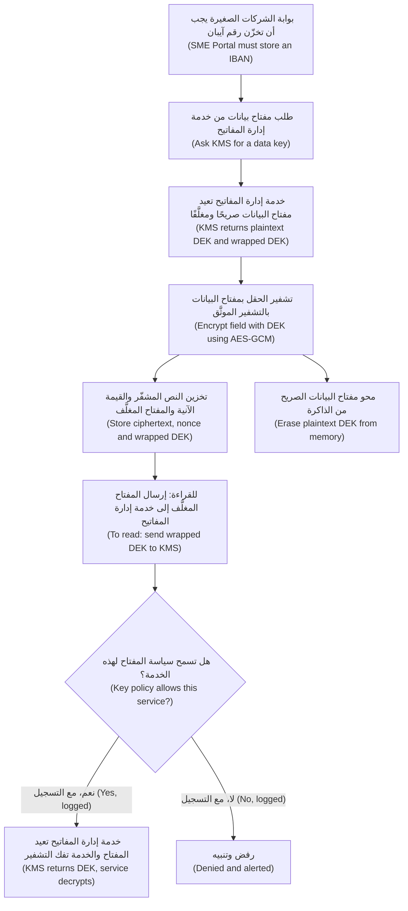
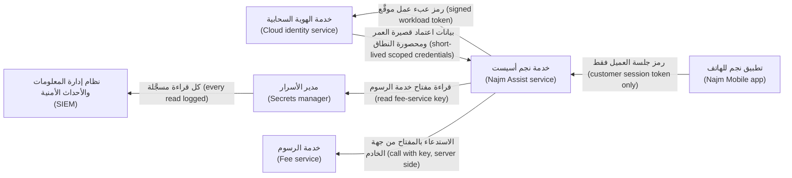
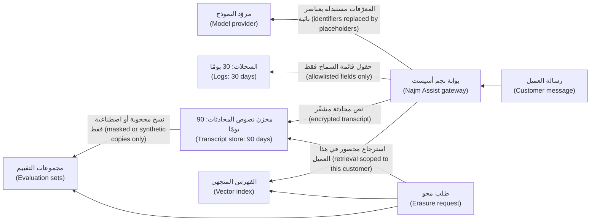

# الوحدة 5 — البيانات والتشفير والأسرار (Data, cryptography and secrets)

*التشفير (Cryptography) والأسرار (secrets) والبيانات الشخصية (personal data) هي المواضع التي تتحول فيها النوايا الحسنة (good intentions) في أغلب الأحيان إلى طمأنينةٍ زائفة (false comfort). فكلمة مرورٍ «تُجزَّأ» ("hashed") بالدالة الخطأ (wrong function). ومفتاحٌ «يُخفى» ("hidden") داخل تطبيقٍ للهاتف (mobile app). وسطرٌ في السجل (log line) ينسخ بهدوء رقم حساب كل عميل إلى أداةٍ يستطيع نصف الشركة البحث فيها. تمنح هذه الوحدة البنّائين (builders) القرارات لا الرياضيات. فهي تغطي أيّ أداةٍ تشفيرية (cryptographic tool) تناسب أيّ مهمة وأين يجب أن تعيش مفاتيحها؛ وكيف تُبقي مفاتيح واجهات البرمجة (API keys) والرموز المميزة (tokens) وكلمات المرور (passwords) بعيدةً عن الأماكن التي تتسرّب منها، وما الذي تفعله في الساعة الأولى بعد أن يتسرّب أحدها؛ وكيف تجمع وتسجّل وتحتفظ وتحذف البيانات الشخصية التي يحتاجها البنك فعلًا فحسب، بما في ذلك النسخ الجديدة (new copies) التي تُنشئها ميزات النماذج اللغوية الكبيرة (LLM features). ستتابع فريق أمن التطبيقات والذكاء الاصطناعي (Application & AI Security team) في بنك نجم (Najm Bank) بينما تفكّك نورة أول مراجعةٍ تشفيرية يُجريها علي على بوابة الشركات الصغيرة (SME Portal)، ويطارد جاسم مفتاحًا مسرّبًا (leaked key) عبر خط إنتاج (pipeline) نجم أسيست (Najm Assist)، وتطرح سارة، مسؤولة حماية البيانات (DPO)، سؤالًا لا يستطيع أحدٌ الإجابة عنه: «أين بيانات هذا العميل؟» ⁦⁩*

> **المراحل (Phases):** Design, Build, Operate — اختيار تشفيرٍ سليم (sound cryptography) وإدارة مفاتيح سليمة (key management)، وإبقاء الأسرار خارج الشيفرة والتطبيقات العميلة والموجّهات، وهندسة التعامل مع البيانات الشخصية بحيث يعمل تقليل البيانات (minimisation) والتسجيل (logging) والحذف (deletion) عمليًّا.

---

# 5.1 — التشفير للبنّائين: TLS والتجزئة والتشفير والمفاتيح
*المستوى (Level): 🟡 متوسط (Intermediate)* · *المتطلبات (Prerequisites): 1.2، 3.1* · *المرحلة (Phase): Design, Build*

## ⚡ الدرس في دقيقة (In 60 seconds)
- يمنح التشفير البنّائين **السرية (confidentiality)**، أي لا يستطيع القراءة إلا الطرف الصحيح، و**السلامة (integrity)**، أي يُكتشف العبث، و**الأصالة (authenticity)**، أي تعرف من أنتج البيانات. اختر الأداة حسب الخاصية التي تحتاجها.
- القاعدة الأولى (Rule one): **لا تبتكر تشفيرك بنفسك أبدًا (never roll your own crypto)**. استخدم TLS 1.3 أثناء النقل؛ وArgon2id أو scrypt أو bcrypt لكلمات المرور؛ وAES-GCM أو ChaCha20-Poly1305 عبر مكتبةٍ عالية المستوى (high-level library) للبيانات المخزّنة؛ وخدمةً لإدارة المفاتيح للمفاتيح.
- التجزئة (Hashing) ليست تشفيرًا. كلمات المرور تُجزَّأ باتجاهٍ واحد (one-way)؛ أمّا البيانات المصرفية التي يجب أن تقرأها لاحقًا فتُشفَّر أو تُرمَّز.
- لا يكون التشفير (Encryption) أقوى من إدارة مفاتيحه: أين يعيش المفتاح، ومن يستطيع استخدامه، وكيف يُسجَّل الاستخدام، وكيف يُدوَّر.
- مؤشر القرار (Decision cue): لكل حقلٍ حساس (sensitive field)، اسأل «من يجب أن يقرأ هذا بنصٍّ صريح، وما الذي يوقفه التشفير في *هذه* الطبقة؟» ⁦⁩
- أكبر فخ (Biggest trap): «مُشفَّر أثناء التخزين» بوصفه الجواب عن كل شيء. فتشفير القرص (Disk encryption) يوقف قرصًا مسروقًا، لا حقن SQL (SQL injection) عبر تطبيقك نفسه.

## 🧭 لماذا يهم
أول مراجعةٍ للشيفرة يُجريها علي في بنك نجم هي طلب سحب (pull request) لميزة «دعوة زميل» في بوابة الشركات الصغيرة. فيوافق عليه: «كل ما هو حساس مُجزَّأ أو مُشفَّر» ⁦⁩. تعيد نورة فتحه (reopens it) وتُبرز ثلاثة أسطر. كلمات مرور المستخدمين الجدد مخزّنةٌ بصيغة `sha256(password)`. واستدعاءٌ إلى شريك الفوترة الإلكترونية (e-invoicing partner) يضبط `verify=False` «لأن شهادة الاختبار ظلّت تفشل». والبيانات المصرفية للفواتير مُشفَّرةٌ بمفتاح AES مكتوبٍ داخل ملف الشيفرة المصدرية، بنمطٍ يُسمّى ECB. وكان تعليقها: «الثلاثة كلها تشفير. ولا واحد منها يحمي شيئًا» ⁦⁩.

تُفرد قائمة OWASP Top 10، في إصدار 2021 (2021 edition)، لهذا النمط فئةً خاصة به، هي *الإخفاقات التشفيرية (Cryptographic Failures)*، وقد نشرت OWASP منذ ذلك الحين تحديثًا لعام 2025 (a 2025 update)، فتحقّق من القائمة الحالية (check the current list) بدل الاعتماد على الترقيم. ونادرًا ما تنطوي هذه الإخفاقات على رياضياتٍ مكسورة (broken mathematics). إنها تنطوي على الأداة الخطأ، أو فحصٍ مُعطَّل، أو مفتاحٍ في المكان الخطأ. والعمليات (Operations) مهمةٌ أيضًا: فقد وصفت مراجعةٌ أجراها مكتب المساءلة الحكومية الأمريكي لاختراق Equifax عام 2017 (the 2017 Equifax breach) كيف أن شهادةً منتهية الصلاحية (expired certificate) على جهاز فحص حركة المرور (traffic-inspection device) تركت حركة المرور المشفّرة دون فحص؛ ولوحظت حركة المرور المريبة بعد تجديدها.

## 📐 كيف يعمل

### 🟢 الأساسيات

**المفردات (Vocabulary).** **النص الصريح (Plaintext)** بياناتٌ مقروءة (readable data)؛ و**النص المشفّر (ciphertext)** صيغتها المشفّرة؛ و**المفتاح (key)** هو السرّ الذي يتحكم في التشفير أو التوقيع. و**الملح (salt)** قيمةٌ عشوائية غير سرية تُمزج في التجزئة؛ و**القيمة الآنية (nonce)**، أي «رقمٌ يُستخدم مرةً واحدة»، يجب ألّا تتكرر أبدًا تحت المفتاح نفسه.

**خمس أدوات، خمس مهام (Five tools, five jobs).**

| الأداة (Tool) | ماذا تفعل | قابلة للعكس؟ ⁦(Reversible?)⁩ | الاستخدام النموذجي في بنك نجم |
|---|---|---|---|
| **التجزئة (Hash)** (SHA-256 وSHA-3) | بصمةٌ ثابتة الطول (fixed-length fingerprint)؛ وأي تغييرٍ يبدّلها | لا | سلامة الملفات (File integrity) |
| **تجزئة كلمات المرور (Password hash)** (Argon2id وscrypt وbcrypt) | تجزئةٌ بطيئةٌ عمدًا ومملّحة | لا | تخزين كلمات المرور (Storing passwords) |
| **رمز مصادقة الرسائل (MAC, message authentication code)**، مثل HMAC-SHA256 | تجزئةٌ بمفتاحٍ سري: تُثبت أن حامل المفتاح أنتج البيانات دون تغيير | لا | خطافات الويب للشركاء (Partner webhooks)، وملفات تعريف الارتباط الموقّعة (signed cookies) |
| **التشفير المتماثل (Symmetric encryption)** (AES-GCM وChaCha20-Poly1305) | مفتاحٌ واحد يشفّر ويفكّ التشفير؛ وهذه الأنماط تكتشف العبث أيضًا | نعم، بالمفتاح | الحقول والملفات الحساسة المخزّنة |
| **التشفير بالمفتاح العام (Public-key cryptography)** (RSA وECDSA وEd25519) | زوج مفاتيح (key pair): المفتاح العام يُشارَك، والمفتاح الخاص لا يغادر مالكه أبدًا | التوقيعات يُتحقَّق منها، ولا تُعكَس | شهادات TLS (TLS certificates)، وتوقيع الرموز المميزة والشيفرة |

**لا تبتكر تشفيرك بنفسك أبدًا (Never roll your own crypto)** يعني (means): لا خوارزمياتٍ مخترعة، ولا مخططاتٍ مُجمَّعة يدويًّا، ولا معايير مُنفَّذة باليد. استخدم الواجهة عالية المستوى (high-level interface) لمكتبةٍ مُراجَعة جيدًا (well-reviewed library) وإعداداتها الافتراضية (defaults). فكل إخفاقٍ في طلب السحب الخاص بعلي استخدم خوارزميةً حقيقية بالطريقة الخطأ.

**البيانات أثناء النقل: TLS (Data in transit: TLS).** يمنح TLS، أي أمن طبقة النقل (Transport Layer Security)، وهو حرف «S» في HTTPS، الاتصالَ السريةَ والسلامةَ ومصادقةَ الخادم. ويُثبت الخادم هويته بـ **شهادة (certificate)** موقّعةٍ من **سلطة شهادات (certificate authority)** (CA) يثق بها العميل، تربط اسم نطاق (domain name) بمفتاحٍ عام (public key). استخدم **TLS 1.3** (RFC 8446)؛ واسمح بـ TLS 1.2 مع مجموعات تشفيرٍ حديثة فقط حيث يحتاجه عميل؛ أمّا TLS 1.0 و1.1 فقد أُوقِف اعتمادهما رسميًّا (formally deprecated) (RFC 8996). ثلاث قواعد (Three rules):

1. لا تعطّل التحقق من الشهادات أبدًا. فمن دونه، يشفّر TLS حركة مرورك إلى أيٍّ كان من يجيب، بما في ذلك مهاجمٌ في المنتصف.
2. HTTPS في كل مكان (HTTPS everywhere)، مع HSTS، أي أمن النقل الصارم لـ HTTP وفق RFC 6797، كي ترفض المتصفحات HTTP الصريح (انظر 2.2).
3. حركة المرور الداخلية أيضًا: انعدام الثقة (zero trust) (1.2) يعني أن الاستدعاءات بين الخدمات (service-to-service calls) تستخدم TLS، ويُفضَّل **TLS المتبادل (mutual TLS)** (mTLS)، حيث يقدّم الطرفان كلاهما شهاداتٍ.

```python
# Vulnerable: any certificate accepted; a machine in the middle can read and alter invoices
requests.post(PARTNER_URL, json=invoice, verify=False)

# Fixed: verification stays on; in the partner's test environment, trust its test CA explicitly
requests.post(PARTNER_TEST_URL, json=invoice, timeout=10, verify="certs/partner-test-ca.pem")
```

**كلمات المرور: تجزئاتٌ بطيئة ومملّحة (Passwords: slow, salted hashes).** صُمِّمت SHA-256 لتكون سريعة، فبعد التسرّب يستطيع المهاجم اختبار قوائم هائلة من كلمات المرور المرجّحة على كل صف؛ ومن دون أملاح (without salts)، تتشارك كلمات المرور المتطابقة التجزئةَ نفسها وتنجح الجداول المحسوبة مسبقًا. تضيف **دوال تجزئة كلمات المرور (Password hashing functions)** ملحًا فريدًا لكل مستخدم وهي بطيئةٌ عمدًا (deliberately slow). كما أن **Argon2id** (RFC 9106) وscrypt *مُكلفتان للذاكرة (memory-hard)*، ما يُضعف عتاد الكسر المتخصص. ويبقى bcrypt مقبولًا (remains acceptable)، فهو لا يستخدم إلا أول 72 بايتًا من المدخلات (only the first 72 bytes of input)؛ أمّا PBKDF2 فهو الخيار حيث لا يُسمح إلا بالخوارزميات المعتمدة وفق FIPS. وتخزّن المكتبات الجيدة الخوارزميةَ والمعاملاتِ والملحَ داخل سلسلة التجزئة، فتستطيع رفع التكلفة لاحقًا وترقية التجزئات عند تسجيل الدخول.

```python
# Vulnerable: fast and unsalted
stored = hashlib.sha256(password.encode()).hexdigest()

# Fixed: Argon2id via argon2-cffi; salt and parameters live inside the stored string
from argon2 import PasswordHasher
ph = PasswordHasher()
stored = ph.hash(password)
ph.verify(stored, attempt)              # raises an exception on mismatch
if ph.check_needs_rehash(stored):       # cost settings were raised since this hash was made
    save_hash(user_id, ph.hash(attempt))
```

وقت الكتابة عام 2026، تقترح ورقة OWASP المختصرة لتخزين كلمات المرور حدودًا دنيا (minimums) مثل Argon2id بذاكرة 19 MiB وتكرارين (two iterations) ودرجة توازٍ واحدة، أو عامل عمل (work factor) لـ bcrypt قدره 10. تحقّق من الورقة الحالية، ثم اضبط المعاملات (tune) بحيث تستغرق التجزئة الواحدة جزءًا من الثانية على خوادمك.

**البيانات المخزّنة: التشفير الموثَّق (Data at rest: authenticated encryption).** استخدم نمط **AEAD**، أي التشفير الموثَّق مع البيانات المرتبطة، مثل AES-GCM أو ChaCha20-Poly1305، الذي يشفّر ويكتشف أيضًا أي تغييرٍ في النص المشفّر. وتجنّب نمط **ECB**: فالكتل المتطابقة تُشفَّر إلى نصٍّ مشفّر متطابق، فتتسرّب الأنماط (leaking patterns). وفي GCM، تؤدي إعادة استخدام القيمة الآنية تحت المفتاح نفسه إلى كسر السرية والسلامة كلتيهما.

```python
# Vulnerable: key in source code, ECB mode, no tamper detection
cipher = Cipher(algorithms.AES(b"NajmSecretKey123"), modes.ECB())

# Fixed: AEAD, fresh nonce, key supplied by the KMS (see envelope encryption below)
from cryptography.hazmat.primitives.ciphers.aead import AESGCM
nonce = os.urandom(12)                                # 96 bits, never reused with this key
aad = f"sme-invoice:{invoice_id}".encode()            # binds ciphertext to this record
save(invoice_id, nonce + AESGCM(data_key).encrypt(nonce, iban.encode(), aad))
```

**البيانات المرتبطة (associated data)** موثَّقةٌ لا مشفّرة: فهي تربط النص المشفّر بفاتورةٍ واحدة، فيؤدي لصق البيانات المصرفية المشفّرة لشركةٍ ما على فاتورة شركةٍ أخرى إلى فشل فك التشفير.

**العشوائية (Randomness).** تحتاج معرّفات الجلسات (session IDs) ورموز إعادة التعيين (reset tokens) والقيم الآنية (nonces) إلى **مولّد أرقامٍ عشوائية آمنٍ تشفيريًّا (cryptographically secure random number generator)** (CSPRNG): مثل `secrets` في Python، و`crypto.randomBytes()` في Node. ولا تستخدم أبدًا `random` أو `Math.random()` أو الطوابع الزمنية (timestamps).

### 🟡 التعمق أكثر (Going deeper)

**المفاتيح هي الأصل الحقيقي: التشفير المغلَّف (Keys are the real asset: envelope encryption).** كان مفتاح علي المكتوب في الشيفرة (hard-coded key) يعني أن أي شخصٍ يستطيع قراءة المستودع يستطيع فك تشفير كل فاتورة. والتصميم المعياري (standard design) هو **التشفير المغلَّف (envelope encryption)**. يُشفَّر كل سجلٍّ أو ملف بـ **مفتاح تشفير البيانات (data encryption key)** (DEK) الخاص به. ويُشفَّر مفتاح DEK، أي «يُغلَّف» ("wrapped")، بـ **مفتاح تشفير المفاتيح (key encryption key)** (KEK) الذي لا يغادر أبدًا **خدمة إدارة المفاتيح (key management service)** (KMS): وهي خدمةٌ مُدارة (managed service) تحفظ المفاتيح الرئيسية (master keys) داخل **وحدات أمن العتاد (hardware security modules)** (HSMs)، وهي أجهزةٌ مقاومة للعبث (tamper-resistant devices) تستخدم المفاتيح دون أن تُفرج عنها.



ما الذي يشتريه هذا التصميم: التفريغ المسروق عديم الفائدة دون الوصول إلى خدمة إدارة المفاتيح؛ وكل عملية فك تشفير (every decryption) تخضع لفحص السياسة وتُسجَّل؛ وتدوير مفتاح KEK يعيد تغليف مفاتيح صغيرة بدل إعادة تشفير البيانات؛ وإتلاف مفتاحٍ يجعل بياناته غير قابلةٍ للقراءة، وهو ما يُسمّى **الإتلاف التشفيري (crypto-shredding)** (انظر 5.3).

**ما الذي توقفه كل طبقة؟ ⁦(What does each layer stop?)⁩** هذا هو السؤال الذي تخطّاه علي.

| الطبقة (Layer) | توقف (Stops) | لا توقف |
|---|---|---|
| تشفير التخزين أو القرص، وهو افتراضيٌّ في معظم السحب | الأقراص المسروقة (Stolen disks)، والعتاد المُخرَج من الخدمة (decommissioned hardware) | أي شخصٍ يقرأ عبر قاعدة البيانات أو التطبيق |
| التشفير على مستوى الحقل بمفاتيح خدمة إدارة المفاتيح | مسؤولو قواعد البيانات (Database administrators)، والتفريغات (dumps)، ومعظم عمليات القراءة عبر الحقن لذلك الحقل | خدمةٌ مخترقة مسموحٌ لها بفك التشفير |
| **الترميز (Tokenisation)**: رمزٌ عشوائي يحلّ محلّ القيمة، وخزنةٌ تحتفظ بالربط | كل نظامٍ لا يرى إلا الرموز؛ ويقلّص نطاق بيانات البطاقات | اختراق الخزنة |

**السلامة بين الأنظمة (Integrity between systems).** حين يستدعي شريك الفوترة الإلكترونية خطاف الويب (webhook) الخاص بنجم، تُثبت قيمة **HMAC** محسوبةٌ على جسم الطلب أنه أصلي (genuine). احسبها على البايتات المستلمة بالضبط، لا على نسخةٍ أُعيد تسلسلها؛ وقارن في زمنٍ ثابت، فالمقارنة `==` قد تُسرّب عبر التوقيت مقدار ما تطابق؛ ووقّع طابعًا زمنيًّا وارفض الطوابع القديمة للحدّ من إعادة التشغيل.

```python
msg = ts.encode() + b"." + raw_body                    # raw_body: the exact bytes received
expected = hmac.new(webhook_secret, msg, hashlib.sha256).hexdigest()
if abs(time.time() - int(ts)) > 300 or not hmac.compare_digest(expected, received_sig):
    raise Unauthorized()
```

استخدم **التوقيعات (signatures)** (Ed25519 وECDSA وRSA-PSS) حين يجب ألّا يستطيع المتحقّقون إنشاء الرسائل: فخدمة الهوية في نجم توقّع رموز الوصول (access tokens) بمفتاحٍ خاص (private key)، وتتحقق واجهات البرمجة (APIs verify) بالمفتاح العام (انظر 3.2).

**الشهادات عملياتٌ تشغيلية (Certificates are operations).** الشهادة المنتهية الصلاحية تعطّل خدمةً أو، كما في Equifax، تُعمي ضابطًا بصمت. أتمِت التجديد (automate renewal) باستخدام ACME (RFC 8555)، واجرد الشهادات مع مالكيها، ونبِّه قبل انتهاء الصلاحية (alert before expiry). ووقت الكتابة عام 2026، وافق منتدى CA/Browser Forum على تقصير الحدّ الأقصى لأعمار الشهادات العامة على مراحل، فلن يعود التجديد اليدوي (manual renewal) مجديًا (viable)؛ تحقّق من الجدول الزمني الحالي.

**البحث في الحقول المشفّرة (Searching encrypted fields).** للعثور على شركةٍ برقم تسجيلٍ مشفّر، خزّن **فهرسًا أعمى (blind index)**: قيمة HMAC للقيمة تحت مفتاحٍ منفصل. ولا تكفي SHA-256 صريحة (A plain SHA-256 will not do): فأرقام الهوية الوطنية (national IDs) وأرقام الهواتف (phone numbers) لها فضاءات مدخلاتٍ صغيرة، فيستطيع أي شخصٍ يملك الجدول تجزئة كل قيمةٍ ممكنة (hash every possible value).

### 🔴 نظرة الخبير (Expert view)

**المرونة التشفيرية (Crypto-agility).** تتقادم الخوارزميات (Algorithms age)، فاجعل تغيير إحداها تغييرًا في الإعدادات: مكتبة تشفيرٍ داخلية واحدة، والخوارزمية وإصدار المفتاح مخزّنان مع كل نصٍّ مشفّر، ببادئةٍ (prefix) مثل `v2:key-id:`، و**جرد تشفيري (cryptographic inventory)** لكل نظام (per system). ويتضمن CycloneDX، وهو صيغةٌ لقوائم مكوّنات البرمجيات، قائمةَ مكوّناتٍ تشفيرية (CBOM) لهذا الغرض.

**فصل المفاتيح (Key separation).** مفتاحٌ واحد لكل غرض، أي التشفير وMAC والفهرس الأعمى، ولكل بيئة (per environment)؛ والمفاتيح الخاصة بكل عميل (per-customer keys) تضيّق نطاق الضرر وتجعل الإتلاف التشفيري دقيقًا. وينبغي ألّا يستطيع مسؤولو سياسات المفاتيح (key-policy administrators) قراءة البيانات.

**الحدود ومقاومة سوء الاستخدام (Limits and misuse resistance).** تحدّد وثيقة NIST SP 800-38D عدد الرسائل التي يجوز لمفتاح GCM واحد تشفيرها بقيمٍ آنية عشوائية بـ 2³²؛ والمفاتيح الخاصة بكل سجل تتجاوز هذا القيد (sidestep this). ويتحمّل AES-GCM-SIV (RFC 8452) أخطاء القيم الآنية بصورةٍ أفضل. أمّا **الفلفل (pepper)**، وهو سرٌّ يُمزج في تجزئة كلمات المرور ويُحفظ في خدمة إدارة المفاتيح، فيمنع كسر تسرّبٍ يقتصر على قاعدة البيانات دون اتصال (offline): إنه طبقةٌ إضافية، لا بديل.

**تفاصيل TLS 1.3 لبنك (TLS 1.3 details for a bank).** كل مصافحةٍ كاملة تمنح **السرية الأمامية (forward secrecy)**: فالمفتاح الخاص المسروق لاحقًا لا يستطيع فك تشفير الجلسات المسجّلة (recorded sessions). ويمكن إعادة تشغيل البيانات المبكرة الاختيارية «0-RTT» (optional "0-RTT" early data)، وتحذّر RFC 8446 من ذلك (RFC 8446 warns of this)، فلا تقبلها أبدًا للطلبات التي تغيّر الحالة (state-changing requests) مثل التحويلات (transfers).

**التخطيط لما بعد الكمّ (Post-quantum planning).** سيكسر حاسوبٌ كمّي كبير خوارزميات المفتاح العام الحالية، أي RSA والمنحنيات الإهليلجية (elliptic curves)، لكنه لن يكسر، عمليًّا، AES-256 أو SHA-256. ونشرت NIST في أغسطس 2024 المعيار FIPS 203 (ML-KEM) لإنشاء المفاتيح (key establishment)، والمعيارين FIPS 204 (ML-DSA) وFIPS 205 (SLH-DSA)، وكلاهما للتوقيعات. والخطر القريب (near-term risk) هو «احصد الآن، وفُكّ التشفير لاحقًا»: حركة مرورٍ تُسجَّل اليوم ويُفك تشفيرها في المستقبل. لذا فهي مهمة تخطيط: الجرد (inventory)، وإعطاء الأولوية للبيانات السرية طويلة العمر، واعتماد تبادل المفاتيح الهجين لما بعد الكمّ حين تدعمه المنصات، وهو ما بدأت المتصفحات الرئيسية ومكتبات TLS بفعله وقت الكتابة عام 2026.

**وكلاء البرمجة بالذكاء الاصطناعي (AI coding agents)** يعيدون إنتاج عادات الشيفرة العامة القديمة: MD5 لكلمات المرور، وECB، و`verify=False` لإسكات خطأ SSL. تعامل مع التشفير الذي يكتبه الوكيل (agent-written crypto) على أنه غير مُراجَع (unreviewed)، وأضِف قواعد تحليلٍ ساكن (static-analysis rules) (6.1، 6.3).

## 🧰 الأدوات
| الضابط أو المعيار أو الأداة (Control, standard or tool) | ما هو وماذا يفعل | متى تلجأ إليه |
|---|---|---|
| **TLS 1.3** — وفق RFC 8446 | يشفّر الاتصالات ويوثّقها مع السرية الأمامية | كل اتصال (Every connection)؛ وTLS المتبادل بين الخدمات (between services) |
| **Argon2id** — وفق RFC 9106 | تجزئة كلمات مرورٍ بطيئة ومملّحة ومُكلفة للذاكرة؛ وscrypt وbcrypt بديلان مقبولان (acceptable alternatives) | أي كلمة مرورٍ أو سرٍّ لا تحتاج إلا إلى التحقق منه |
| **AES-GCM** — معيار التشفير المتقدم بنمط GCM | تشفيرٌ موثَّق (authenticated encryption): سريةٌ مع اكتشاف العبث | تشفير الحقول والملفات، عبر مكتبةٍ عالية المستوى |
| **Envelope encryption** — التشفير المغلَّف | مفاتيح بياناتٍ لكل سجل مغلّفةٌ بمفتاحٍ رئيسي يبقى في خدمة إدارة المفاتيح | أي بياناتٍ حساسة يجب أن تخزّنها وتقرأها لاحقًا |
| **Key management service** — خدمة إدارة المفاتيح، المدعومة بوحدات أمن العتاد (HSM-backed) | تحفظ المفاتيح الرئيسية في العتاد، وتفرض السياسة (enforces policy)، وتسجّل الاستخدام (logs use)، وتدوّر المفاتيح (rotates) | جميع مفاتيح بيئة الإنتاج |
| **HMAC** — وفق RFC 2104 | تجزئةٌ بمفتاح (keyed hash) تُثبت السلامة والمصدر بين أطرافٍ تتشارك سرًّا | خطافات الويب (Webhooks)، والاستدعاءات الراجعة (callbacks)، والفهارس العمياء (blind indexes) |
| **Google Tink and libsodium** — مكتبتا Google Tink وlibsodium | مكتبات تشفيرٍ عالية المستوى مقاومةٌ لسوء الاستخدام | كلما أغراك اختيار الأنماط أو القيم الآنية بنفسك |
| **OWASP Cryptographic Storage Cheat Sheet** — ورقة OWASP المختصرة للتخزين التشفيري | إرشاداتٌ للبنّائين حول الخوارزميات والأنماط والمفاتيح | كتابة معيارٍ للتشفير؛ ومراجعة شيفرة التشفير |

## 🏛️ عمليًا في بنك نجم
يحوّل علي مراجعته إلى **معيار التشفير للبنّائين في البنك، الإصدار 1، مقتطف (Cryptography Standard for Builders, v1, excerpt)**.

| المهمة (Job) | المعتمَد (Approved) | المحظور (Forbidden) | ملاحظات (Notes) |
|---|---|---|---|
| النقل (Transport) | TLS 1.3؛ وTLS 1.2 مع مجموعات AEAD للشركاء المدرجين فقط؛ وTLS المتبادل داخل الشبكة الخدمية | TLS 1.0 و1.1، والتحقق المعطَّل (disabled verification)، وHTTP الصريح بين الخدمات | HSTS على نطاقات الويب؛ وجرد الشهادات مع مالكيها |
| كلمات المرور | Argon2id عند الحدود الدنيا لـ OWASP أو فوقها؛ وbcrypt للأنظمة القديمة، مع الترقية عند تسجيل الدخول | MD5 وSHA-1 وSHA-256 الصريحة (plain SHA-256) والتشفير القابل للعكس (reversible encryption) | فحص إعادة التجزئة عند كل تسجيل دخول |
| الحقول الحساسة (Sensitive fields): IBAN ورقم الهوية الوطنية (national ID) والراتب (salary) | AES-256-GCM عبر مكتبة التشفير في نجم، والتشفير المغلَّف | ECB، والمفاتيح في الشيفرة أو الإعدادات، والمخططات محلية الصنع (home-made schemes) | معرّف السجل بوصفه بياناتٍ مرتبطة؛ وتخزين إصدار المفتاح |
| البحث عن المعرّفات المشفّرة | فهرسٌ أعمى بـ HMAC-SHA256 (HMAC-SHA256 blind index) بمفتاحٍ خاص به (own key) | تجزئةٌ صريحة لرقم هويةٍ وطنية أو رقم هاتف | |
| أرقام البطاقات (Card numbers) | الترميز عبر خزنة البطاقات | أرقام البطاقات خارج الخزنة | بوابة الشركات الصغيرة ونجم أسيست لا تحتفظان إلا بالرموز |
| المفاتيح (Keys) | خدمة إدارة المفاتيح، بمفتاحٍ واحد لكل غرضٍ وبيئة | المفاتيح الرئيسية القابلة للتصدير، والمفاتيح المشتركة بين بيئتي التطوير والإنتاج | مالكٌ مسمّى (Named owner)؛ وتدويرٌ تلقائي (automatic rotation)؛ وتسجيل عمليات فك التشفير (decrypts logged) |

**أسئلةٌ لأي طلب سحبٍ يمسّ التشفير (Questions for any pull request that touches cryptography)**

1. ما الخاصية المطلوبة، وهل توفّرها هذه الأداة؟
2. هل هي بنيةٌ معيارية من المكتبة المعتمدة، بإعداداتها الافتراضية؟
3. من أين يأتي المفتاح، ومن غيرك يستطيع استخدامه، وهل يُسجَّل الاستخدام؟
4. هل عُطِّل أي فحص، أو ثُبِّتت أي قيمةٍ آنية، أو قورن أي سرٍّ باستخدام `==`؟
5. لو اضطررنا إلى تغيير هذه الخوارزمية، فكم ملفًا سيتغيّر؟

## 🛠️ التمارين (Exercises)
- 🟢 اربط كل عنصرٍ بأداةٍ من هذا الدرس، أي إحدى الأدوات الخمس أو الترميز أو مولّد CSPRNG، مع سببٍ في سطرٍ واحد: كلمة مرور مستخدمٍ في الشركات الصغيرة، ورقم IBAN لصرف المدفوعات، والمجموع الاختباري لكشف حساب، وخطاف ويب لشريك، ورمز إعادة تعيين كلمة المرور، ورقم بطاقة، ومعرّف جلسة، والبحث برقم الهوية الوطنية، وأرشيف نسخةٍ احتياطية، ورمز وصولٍ لواجهة برمجة. *يكتمل عندما (Done when):* تُربط العناصر العشرة كلها ويذكر كل عنصرٍ يحتاج إلى مفتاح أين يعيش ذلك المفتاح.
- 🟡 في مشروعك الخاص أو في تطبيق مختبرٍ محلي، استبدل تجزئة كلمات مرورٍ سريعة أو غير مملّحة بـ Argon2id، مع ترقية التجزئات القديمة عند تسجيل الدخول. *يكتمل عندما:* يُظهر اختبارٌ أن تجزئةً قديمة يُتحقَّق منها مرةً واحدة ثم تُستبدل بتجزئة Argon2id (is replaced by an Argon2id hash)، وأن كلمة المرور الخاطئة تفشل قبل ذلك وبعده.
- 🔴 أنشئ نموذجًا أوليًّا (Prototype) للتشفير المغلَّف لحقلٍ واحد في شيفرتك الخاصة، باستخدام خدمة إدارة المفاتيح السحابية في حسابٍ تجريبي شخصي أو بديلٍ محلي: مفاتيح لكل سجل (per-record keys)، ومعرّف السجل بوصفه بياناتٍ مرتبطة، وبادئةٌ لإصدار المفتاح. *يكتمل عندما:* يفشل فك تشفير نصٍّ مشفّر منسوخٍ من السجل A إلى السجل B، ولا يحتاج تدوير المفتاح الرئيسي إلى إعادة تشفير البيانات، وتوضّح ملاحظةٌ قصيرة من يستطيع فك التشفير وأين يُسجَّل ذلك.

## ⚠️ أخطاء وفخاخ (Mistakes and traps)
- **تعطيل التحقق لإصلاح خطأ TLS (Turning off verification to fix a TLS error).** فهو ينتشر إلى بيئة الإنتاج. ثِق بسلطة شهادات الاختبار المحددة وأبقِ التحقق مفعّلًا.
- **التجزئات السريعة لكلمات المرور (Fast hashes for passwords).** الملح لا يعالج السرعة. استخدم Argon2id أو scrypt أو bcrypt.
- **«إنها مشفّرة أثناء التخزين» بوصفها جوابًا شاملًا ("It's encrypted at rest" as a universal answer).** سمِّ التهديد، ثم اختر الطبقة.
- **المفاتيح بجوار البيانات (Keys next to the data).** المفتاح في الشيفرة أو الإعدادات أو في قاعدة البيانات نفسها هو كلمة مرورٍ ملصقةٌ على الخزنة. استخدم خدمة إدارة المفاتيح.
- **تجميع مخططك الخاص (Assembling your own scheme).** الأنماط والقيم الآنية المختارة يدويًّا تؤدي إلى ECB وإعادة استخدام القيم الآنية (nonce reuse). استخدم AEAD عبر مكتبةٍ عالية المستوى.
- **نسيان الشهادات حتى تنتهي صلاحيتها (Forgetting certificates until they expire).** أتمِت التجديد ونبِّه قبل انتهاء الصلاحية.

## 🧾 الخلاصة (Recap)
- اختر الأداة حسب الخاصية: تجزئات كلمات المرور لكلمات المرور، ورموز MAC والتوقيعات للسلامة والمصدر، وAEAD للسرية مع اكتشاف العبث.
- TLS 1.3 في كل مكان (everywhere)، والتحقق مفعّلٌ دائمًا، وHSTS على الويب، وTLS المتبادل في الداخل (inside).
- كلمات المرور: Argon2id (أو scrypt أو bcrypt) مع إعادة التجزئة عند تسجيل الدخول (rehash-on-login)؛ ولا تجزئات سريعة ولا تشفير قابلًا للعكس أبدًا.
- تعيش المفاتيح في خدمة إدارة المفاتيح؛ ويمنح التشفير المغلَّف التحكم في الوصول (access control) والتدقيق (audit) والتدوير الرخيص (cheap rotation) والإتلاف التشفيري.
- اسأل ما الذي توقفه كل طبقة؛ وخطِّط للمرونة التشفيرية والشهادات الأقصر عمرًا (shorter certificates) والانتقال إلى ما بعد الكمّ (post-quantum migration).

## ✍️ اختبر نفسك (Check yourself)

**1. يقترح علي تخزين كلمات مرور بوابة الشركات الصغيرة (SME Portal) بتجزئة SHA-256 مع ملحٍ عشوائي لكل مستخدم (random per-user salt): «مملّحة، إذن لا بأس» ⁦("Salted, so it's fine.")⁩. ما الرد الأفضل (best response)؟**

- A. اقبله، لأن التمليح يحلّ المشكلة
- B. شفّر كلمات المرور بـ AES-GCM كي يستطيع الدعم الفني استعادة المنسيّ منها، مع حفظ المفتاح في خزنة لا يفتحها إلا قائد الدعم وفريق التدقيق
- C. استخدم Argon2id (أو scrypt أو bcrypt): فالملح يهزم الجداول المحسوبة مسبقًا، لكن SHA-256 تبقى سريعةً بما يكفي للتخمين واسع النطاق بعد التسرّب
- D. جزّئ كلمة المرور مرتين بـ SHA-256

<details><summary>الإجابة</summary>

**C.** يجب أن تكون تجزئات كلمات المرور (Password hashes) بطيئةً إضافةً إلى كونها مملّحة. وB أسوأ: فمن يحصل على المفتاح يعكسها. وD تبقى سريعة. انظر: 🟢 الأساسيات.

</details>

**2. في قاعدة البيانات المُدارة (managed database) لدى بنك نجم (Najm Bank) يكون تشفير التخزين (storage encryption) مفعّلًا افتراضيًّا. يقول طارق إن التشفير على مستوى الحقل (field-level encryption) لأرقام الهوية الوطنية (national IDs)، بمفاتيح خدمة إدارة المفاتيح (KMS keys) ومع قصر فك التشفير على خدمةٍ واحدة (decryption limited to one service)، لا يضيف شيئًا. ما التهديد الذي يعالجه ولا يعالجه تشفير التخزين (Which threat does it address that storage encryption does not)؟**

- A. قرصٌ مسروق من مركز بيانات المزوّد
- B. حقن SQL (SQL injection) في نقطة نهايةٍ للتقارير (reporting endpoint)، أو مسؤولٌ يستعلم عن الجدول، فتُعاد أرقام هويةٍ وطنية مقروءة
- C. مهاجمٌ استولى على الخدمة الوحيدة المسموح لها بفك تشفير أرقام الهوية الوطنية ويستطيع أن يطلب منها فك تشفير أي سجل على الإطلاق من دون قيد
- D. محرّك أقراصٍ مُخرَج من الخدمة يُعاد بيعه

<details><summary>الإجابة</summary>

**B.** تشفير التخزين شفافٌ (transparent) لأي شخصٍ يقرأ عبر قاعدة البيانات؛ أمّا التشفير على مستوى الحقل فلا يترك له إلا نصًّا مشفّرًا (only ciphertext). وA وD هما ما يغطيه تشفير التخزين أصلًا (already covers)؛ وC تهزم الطبقتين كلتيهما، لأن الخدمة المسموح لها بفك التشفير تستطيع قراءة البيانات. انظر: 🟡 التعمق أكثر (Going deeper).

</details>

**3. يفشل استدعاءٌ إلى بيئة الاختبار (test environment) لدى شريك الفوترة الإلكترونية (e-invoicing partner) في التحقق من صحة الشهادة (certificate validation). أيّ إصلاحٍ هو الصحيح؟**

- A. اضبط `verify=False` في بيئة الاختبار فقط، خلف متغير بيئة، وأضف تعليقًا ليُزال الإعداد قبل الإصدار
- B. استخدم HTTP الصريح (plain HTTP) لتكامل الاختبار (test integration)
- C. ثِق بشهادة سلطة الشهادات الاختبارية للشريك في بيئة الاختبار، وأبقِ التحقق مفعّلًا، واترك بيئة الإنتاج دون تغيير
- D. عطّل التحقق من اسم المضيف لكن أبقِ التحقق من السلسلة

<details><summary>الإجابة</summary>

**C.** إنه يعالج السبب الحقيقي دون إضعاف TLS. وA هو الفخ الكلاسيكي (classic trap): فمثل هذه المبدِّلات (such switches) تتسرّب إلى بيئة الإنتاج. انظر: 🟢 الأساسيات.

</details>

**4. أيّ عبارةٍ عن التشفير المغلَّف (envelope encryption) صحيحة (TRUE)؟**

- A. يحتفظ التطبيق بالمفتاح الرئيسي في ملف إعداداته لفك التشفير بسرعة، ويقرؤه مرةً واحدة عند التشغيل ويبقيه في الذاكرة، ويعيد تحميله كلما تغيّر الملف على القرص ويستخدمه لكل طلب
- B. إنه ميزةٌ في TLS لتأمين الاتصالات
- C. إنه يلغي الحاجة إلى التحكم في الوصول إلى قاعدة البيانات
- D. مفاتيح البيانات (data keys) مغلّفةٌ بمفتاحٍ رئيسي يبقى في خدمة إدارة المفاتيح، فتكون كل عملية فك تشفير استدعاءً مفحوص الوصول ومسجَّلًا، ولا يحتاج تدوير المفتاح الرئيسي إلى إعادة تشفيرٍ جماعية

<details><summary>الإجابة</summary>

**D.** A يُفسد الغرض؛ وC يخلط بين الطبقات (confuses layers)؛ وB لا علاقة له بالموضوع. انظر: 🟡 التعمق أكثر (Going deeper).

</details>

**5. يسأل حمد، كبير مسؤولي أمن المعلومات (CISO)، عمّا يجب أن يفعله بنك نجم (Najm Bank) بشأن التشفير لما بعد الكمّ (post-quantum cryptography) هذا العام. ما الإجابة الأفضل؟**

- A. لا شيء حتى توجد حواسيب كمّية كبيرة
- B. استبدل AES-256 في كل مكان بخوارزميةٍ لما بعد الكمّ (post-quantum algorithm) الآن، وأعد تشفير كل سجلٍّ مخزَّن هذا الربع، واستغنِ عن TLS 1.3 بنقلٍ مخصّص آمنٍ كميًّا لجميع القنوات
- C. أنشئ جردًا تشفيريًّا (cryptographic inventory)، وصمّم للمرونة التشفيرية، وأعطِ الأولوية للبيانات السرية طويلة العمر، واعتمد FIPS 203 و204 و205 عبر المنصات والمكتبات حين تدعمها
- D. صمّم خوارزميةً لما بعد الكمّ خاصةً بنجم

<details><summary>الإجابة</summary>

**C.** إنها مهمة تخطيطٍ الآن. وA يتجاهل «احصد الآن، وفُكّ التشفير لاحقًا»؛ وB يستهدف الشيء الخطأ، لأن خوارزميات المفتاح العام (public-key algorithms) هي موضع التعرّض؛ وD يخرق القاعدة الأولى. انظر: 🔴 نظرة الخبير (Expert view).

</details>

## 📚 المراجع (References)
- IETF، وثيقة RFC 8446: بروتوكول TLS 1.3 — https://www.rfc-editor.org/rfc/rfc8446
- IETF، وثيقة RFC 8996: إيقاف اعتماد TLS 1.0 وTLS 1.1 (Deprecating TLS 1.0 and TLS 1.1) — https://www.rfc-editor.org/rfc/rfc8996
- IETF، وثيقة RFC 9106: خوارزمية Argon2 — https://www.rfc-editor.org/rfc/rfc9106
- سلسلة أوراق OWASP المختصرة (OWASP Cheat Sheet Series): تخزين كلمات المرور (Password Storage)، والتخزين التشفيري (Cryptographic Storage)، وإدارة المفاتيح، وأمن طبقة النقل — https://cheatsheetseries.owasp.org/
- قائمة OWASP Top 10، فئة الإخفاقات التشفيرية — https://owasp.org/Top10/
- وثيقة NIST SP 800-38D، نمط غالوا/العدّاد (Galois/Counter Mode) — https://csrc.nist.gov/pubs/sp/800/38/d/final
- وثيقة NIST SP 800-57 الجزء 1، المراجعة 5 (Part 1 Rev. 5)، توصيةٌ لإدارة المفاتيح — https://csrc.nist.gov/pubs/sp/800/57/pt1/r5/final
- مشروع NIST للتشفير لما بعد الكمّ: FIPS 203 و204 و205 — https://csrc.nist.gov/projects/post-quantum-cryptography
- مكتب المساءلة الحكومية الأمريكي (US GAO)، التقرير GAO-18-559، حول اختراق Equifax عام 2017 (on the 2017 Equifax breach) — https://www.gao.gov/products/gao-18-559

---

# 5.2 — إدارة الأسرار: المفاتيح والرموز المميزة وأين تتسرّب
*المستوى: 🟡 متوسط* · *المتطلبات: 3.2، 5.1* · *المرحلة: Build, Operate*

## ⚡ الدرس في دقيقة (In 60 seconds)
- **السرّ (secret)** هو أي قيمةٍ تمنح الوصول بمفردها: كلمات المرور، ومفاتيح واجهات البرمجة، والرموز المميزة، والمفاتيح الخاصة (private keys)، وسلاسل الاتصال (connection strings). ومن يحمله *هو* أنت، بقدر ما يستطيع النظام أن يعرف.
- تتسرّب الأسرار عبر قنواتٍ عادية (ordinary channels): سجلّ git (git history)، وملفات `.env`، وصور الحاويات (container images)، وسجلات CI (CI logs)، وحزم تطبيقات الهاتف والمتصفح، وصفحات الأخطاء (error pages)، والتذاكر (tickets) والمحادثات (chat)، والآن موجّهات أدوات الذكاء الاصطناعي وسياقها.
- النمط: تعيش الأسرار في **مدير أسرار (secrets manager)**، وتُجلب وقت التشغيل بهوية عبء العمل، وتُحصر في أقل الصلاحيات، وتكون قصيرة العمر (short-lived). وأفضل سرٍّ هو الذي لا تخزّنه أبدًا.
- افحص في ثلاث نقاط: قبل الإيداع (before commit)، وعند الدفع، وعبر كل ما نُشر بالفعل، أي السجل التاريخي (history) والصور (images) والسجلات (logs).
- مؤشر القرار: حين يتسرّب سرّ، **أبطِله ودوِّره أولًا (revoke and rotate first)**، ثم حقّق (then investigate). فحذف الإيداع لا يُلغي التسرّب.
- أكبر فخ: وضع سرٍّ حيث يستطيع طرفٌ غير موثوق قراءته، كتطبيق هاتف أو حزمة متصفح أو موجّه النظام لنموذجٍ لغوي كبير، ثم وصفه بأنه مخفيّ.

## 🧭 لماذا يهم
الأربعاء، الساعة 16:40. يُفشل ماسح الأسرار في CI عملية بناءٍ (build) لنجم أسيست: مفتاحٌ حيّ (live key) لخدمة الرسوم الداخلية موجودٌ في ملف بيانات اختبار (test fixture). كان المطوّر قد طلب من وكيل برمجةٍ بالذكاء الاصطناعي (AI coding agent) أن «يجعل اختبار البحث عن الرسوم ينجح»؛ فقرأ الوكيل ملف `.env` المحلي (local file) ونسخ المفتاح إلى ملف بيانات الاختبار. يحذف المطوّر السطر ويدفع مجددًا (pushes again). لكن جاسم، قائد مركز العمليات الأمنية (SOC lead)، لا يطمئن. فالإيداع لا يزال في السجل التاريخي، ومهمة CI الفاشلة طبعت ملف بيانات الاختبار في سجلها، وكان المطوّر قد لصق الخطأ، بما فيه المفتاح (key included)، في محادثة الفريق (team chat) طالبًا المساعدة. قاعدة نورة (Noura's rule): «السرّ الذي وُجد في أي مكانٍ لا تتحكم فيه هو سرٌّ لم تعد تملكه. دوِّره، ثم ابدأ البحث» ⁦⁩.

قبل ذلك بشهر، وفي اختبارٍ مُصرَّح به (authorised test) لنسخةٍ أولية من نجم أسيست، كان الفريق الأحمر (red team) التابع لمريم قد وجد مفتاح واجهة البرمجة الخاص بمزوّد النموذج اللغوي الكبير داخل إعدادات تطبيق الهاتف، «مُموَّهًا» ("obfuscated"). وكان بإمكان أي شخصٍ لديه التطبيق استخراجه (extracted it) وتكبيد التكاليف باسم نجم. وتُظهر الحالات الحقيقية حجم الرهان. فالتقارير العامة (Public reports) عن اختراق Capital One عام 2019 تصف مهاجمًا استخدم تزوير الطلبات من جهة الخادم (SSRF) للحصول على بيانات اعتمادٍ سحابية مؤقتة من خدمة البيانات الوصفية للمثيل (instance metadata service)، لدورٍ يستطيع قراءة العديد من حاويات التخزين. كانت بيانات الاعتماد قصيرة العمر، كما ينبغي، لكنها مفرطة الصلاحيات (over-privileged). بعض التسرّبات حتميّ؛ والضرر يتوقف على النطاق (scope) وعلى سرعة الإبطال.

## 📐 كيف يعمل

### 🟢 الأساسيات

**ما الذي يُعدّ سرًّا (What counts as a secret).** *المعرِّف (identifier)* يقول من تدّعي أنك هو، مثل اسم المستخدم أو معرّف عميل OAuth أو المفتاح العام، ويجوز أن يكون علنيًّا. أمّا *أداة المصادقة (authenticator)* فتُثبت ذلك (proves it) ويجب أن تبقى سرية.

| نوع السرّ (Secret type) | أمثلةٌ في بنك نجم | ما الذي يمنحه |
|---|---|---|
| بيانات اعتماد الآلات (Machine credentials) | كلمات مرور قواعد البيانات (Database passwords)، ومفاتيح واجهات برمجة الخدمات، ومفاتيح الوصول السحابية | وصولٌ مباشر إلى البيانات أو البنية التحتية |
| الرموز المميزة | رموز التحديث في OAuth، ورموز الوصول الشخصية، ورموز CI (CI tokens) | التصرف بصفة مستخدمٍ أو مطوّرٍ أو خط إنتاج |
| المفاتيح التشفيرية (Cryptographic keys) | مفاتيح TLS الخاصة، ومفاتيح توقيع الرموز المميزة (token-signing keys)، ومفاتيح التشفير (encryption keys) | انتحال صفة الخدمات (Impersonating services)، وتزوير الرموز المميزة (forging tokens)، وقراءة البيانات (reading data) |
| أسرار التكامل (Integration secrets) | أسرار خطافات الويب (Webhook secrets)، وبيانات اعتماد الشركاء (partner credentials)، ومفاتيح مزوّدي النماذج اللغوية الكبيرة | انتحال صفة الشركاء (Impersonating partners)؛ وإنفاق المال (spending money) |

**أين تتسرّب الأسرار، والدفاع لكلٍّ منها (Where secrets leak, and the defence for each).**

| المكان (Place) | كيف يحدث | الدفاع (Defence) |
|---|---|---|
| الشيفرة المصدرية وسجلّ git | مفتاحٌ «مؤقت» مكتوبٌ في الشيفرة؛ وملف `.env` مُودَع (committed)؛ وإيداعٌ لاحق يزيله لكن السجل التاريخي يحتفظ به | لا تكتب الأسرار في الشيفرة أبدًا (Never hard-code)؛ وتجاهل `.env` في git (ignore)؛ وافحص قبل الإيداع وعند الدفع |
| تطبيقات الهاتف وحزم المتصفح | مفاتيح مُدمجة في التطبيق أو في بناء الواجهة الأمامية | لا تشحن الأسرار إلى التطبيقات العميلة أبدًا (انظر 4.3) |
| صور الحاويات | `ENV API_KEY=…`، وملفات `.env` منسوخة (copied files)، ووسائط البناء المحفوظة في سجل الصورة | تركيب الأسرار وقت البناء؛ والحقن وقت التشغيل؛ وفحص الصور (scan images) |
| خطوط CI/CD (CI/CD) | `echo $TOKEN`، ووضع التصحيح (debug mode)، ومفاتيح سحابية طويلة العمر في متغيرات خط الإنتاج | إخفاء القيم في السجلات (Log masking)، والاتحاد عبر OIDC (OIDC federation) |
| السجلات وصفحات الأخطاء | ترويسات `Authorization` مسجَّلة (Logged headers)؛ وتتبّعات المكدّس التي تُفرغ متغيرات البيئة | تنقيح السجلات (Log redaction) (5.3)، وصفحات أخطاءٍ عامة |
| أدوات التعاون (Collaboration tools) | مفاتيح ملصوقة في التذاكر والمحادثات وصفحات الويكي والبريد الإلكتروني | شارِك الوصول عبر الخزنة، لا القيمة أبدًا |
| ملفات البنية التحتية (Infrastructure files) | حالة Terraform (Terraform state)، وبيانات Kubernetes التعريفية (Kubernetes manifests)، وقيم Helm (Helm values) | حالةٌ بعيدة مشفّرة؛ وأشِر إلى الأسرار ولا تُضمّنها أبدًا |
| أدوات الذكاء الاصطناعي والوكلاء | وكيلٌ ينسخ قيم `.env` إلى الشيفرة أو السجلات أو الموجّهات؛ وأسرارٌ في موجّهات النظام؛ ورموزٌ بنصٍّ صريح في إعدادات الأدوات المحلية | امنع الوكلاء من ملفات الأسرار؛ ولا أسرار في الموجّهات؛ والأدوات تحتفظ ببيانات الاعتماد على الخادم |

يصنّف إطار MITRE ATT&CK سلوك المهاجم تحت اسم *بيانات الاعتماد غير المؤمَّنة (Unsecured Credentials)* (T1552): فالمهاجمون يبحثون في هذه الأماكن بالضبط، ولذلك ينبغي أن يبحث المدافعون فيها أولًا.

**النمط الأساسي (The basic pattern).** تحمل الشيفرة *مرجعًا (reference)* إلى السرّ، لا قيمته أبدًا. ووقت التشغيل يُثبت عبء العمل هويته لـ **مدير أسرار (secrets manager)**، أي خدمةٍ تخزّن الأسرار مشفّرة، وتتحكم في كل قراءةٍ وتسجّلها، وتدعم التدوير (supports rotation)، ثم يجلب ما يحتاجه.

```python
# Vulnerable: in source, shared by every environment, never rotated, readable by anyone with repo access
FEES_API_KEY = "fee_live_9f2c4e..."

# Fixed: a reference, resolved at runtime by the workload's own identity; the read is logged
FEES_API_KEY = secret_manager.get(f"najm-assist/{ENV}/fees-api-key")
```

**لا تشحن سرًّا إلى تطبيقٍ عميل أبدًا (Never ship a secret to a client).** يعمل تطبيق الهاتف أو صفحة الويب على جهازٍ لا تتحكم فيه؛ والتمويه (obfuscation) يُبطئ الاستخراج (slows extraction) لكنه لا يمنعه. في نجم أسيست، يُصادق التطبيق *العميلَ (customer)* لدى واجهة برمجة نجم (Najm's API)، والواجهة الخلفية تحتفظ بمفتاح مزوّد النموذج اللغوي الكبير (LLM provider key)، وتطبّق حدود المعدّل لكل عميل وسقوف الإنفاق (spending caps) (انظر 4.2)، وتستدعي المزوّد. والمفتاح المستخرَج يُدوَّر، لا «يُعاد إخفاؤه» ("re-hidden").

**افحص مبكرًا وكثيرًا (Scan early and often).** شغّل ماسح أسرار (secret scanner) بوصفه خطافًا قبل الإيداع، واحظر عمليات الدفع التي تحتوي على أسرار، وهو ما يُسمّى **حماية الدفع (push protection)**، وافحص السجل التاريخي الكامل (full history) والصور والسجلات وفق جدولٍ زمني.

```yaml
# .pre-commit-config.yaml: stop secrets before they reach a commit
repos:
  - repo: https://github.com/gitleaks/gitleaks
    rev: <pinned release tag>
    hooks:
      - id: gitleaks
```

### 🟡 التعمق أكثر

**دورة حياة السرّ (The secret life cycle).** أنشئه بمولّد CSPRNG (5.1)؛ وخزّنه في مدير الأسرار فقط؛ ووزّعه بالهوية، لا بالنسخ واللصق أبدًا؛ واحصره في خدمةٍ واحدة وبيئةٍ واحدة؛ ودوِّره تلقائيًّا (rotate automatically)؛ وأبطِله فورًا عند الاشتباه؛ ودقّق عمليات القراءة ونبِّه على الحالات الشاذة. وامنح كل سرٍّ مالكًا مسمّى، وإلّا فلن يدوّره أحد.

**قصير العمر يتفوّق على طويل العمر: هوية عبء العمل (Short-lived beats long-lived: workload identity).** مع **اتحاد هوية عبء العمل (workload identity federation)**، يُثبت عبء العمل من هو برمزٍ قصير العمر توقّعه منصته، وتستبدله السحابة ببيانات اعتمادٍ مؤقتة ومحصورة النطاق. ويمكن ربط حسابات خدمة Kubernetes اتحاديًّا بأدوار IAM السحابية. وتستطيع أنظمة CI مثل GitHub Actions وGitLab CI إصدار رمز OIDC، أي OpenID Connect (انظر 3.2)، لكل مهمة (per job)، فلا يبقى أي مفتاحٍ سحابي في إعدادات خط الإنتاج. ولا يثق الدور السحابي إلا بالرموز ذات موضوعٍ محدد، مثل موضوع GitHub بالصيغة `repo:najm-bank/sme-portal:ref:refs/heads/main`، فلا يستطيع خط إنتاجٍ على فرعٍ آخر تولّي هذا الدور (assume it).



**الأسرار الديناميكية (Dynamic secrets).** بعض مديري الأسرار (secrets managers)، مثل HashiCorp Vault وفرعه المفتوح المصدر (open-source fork) OpenBao، يُنشئون مستخدم قاعدة بياناتٍ لكل عبء عمل عند الطلب، بعقد إيجار (lease) مدته دقائق أو ساعات، ويحذفونه عند انتهاء العقد. فتنتهي صلاحية بيانات الاعتماد المسرّبة من تلقاء نفسها، ويُطابَق كل بيانات اعتمادٍ مع عبء عملٍ واحد في سجل التدقيق.

**أسرار Kubernetes ليست خزنة (Kubernetes Secrets are not a vault).** في Kubernetes الأصلي (upstream Kubernetes)، وافتراضيًّا، تُرمَّز القيم بصيغة base64 (base64-encoded)، وهذا ترميزٌ لا تشفير، وتُخزَّن دون تشفير في مخزن بيانات العنقود، أي etcd، ما لم يُضبط التشفير أثناء التخزين، ويستطيع أي شخصٍ مسموحٍ له بإنشاء حاويات pod في نطاق أسماء قراءة أسراره. وتضيف بعض الخدمات المُدارة (managed services) الآن تشفيرًا على مستوى المزوّد (provider-level encryption)؛ فتحقّق مما تفعله خدمتك، لأن ذلك لا يغيّر من يستطيع قراءتها. فعّل التشفير أثناء التخزين بمزوّد KMS، وشدّد RBAC (tighten RBAC)، وفضّل المزامنة من مدير أسرارٍ خارجي (انظر 7.2).

**متغيرات البيئة مقايضة (Environment variables are a trade-off).** إنها أفضل من الشيفرة المصدرية، لكن العمليات الفرعية ترثها، وأدوات الإبلاغ عن الأعطال وصفحات التصحيح تُفرغها (dump them). فضّل الملفات المركّبة من مدير الأسرار، أو الجلب وقت التشغيل، ولا تسجّل البيئة أبدًا.

**الحاويات (Containers).** تُسجَّل وسائط البناء (Build arguments) وأسطر `ENV` في سجل الصورة (image history). استخدم تركيب الأسرار وقت البناء:

```dockerfile
# Vulnerable: the token ends up in image history and in a layer
ARG NPM_TOKEN
RUN echo "//registry.npmjs.org/:_authToken=${NPM_TOKEN}" > .npmrc && npm ci

# Fixed: BuildKit secret mount, present only during this step, never stored in the image
RUN --mount=type=secret,id=npmrc,target=/root/.npmrc npm ci
```

**حين يتسرّب سرّ: أبطِله أولًا (When a secret leaks: revoke first).**

1. **أبطِله أو دوِّره (Revoke or rotate)** الآن. افترض الاختراق (Assume compromise) منذ اللحظة التي وصل فيها إلى أي مكانٍ لا تتحكم فيه؛ فالماسحات الآلية (automated scanners) تراقب المستودعات العامة باستمرار.
2. **حدّد نطاق الضرر (Scope the blast radius):** ماذا كان يستطيع أن يفعل، وأين، ومنذ متى؟ ⁦⁩
3. **افحص سجلات الاستخدام (Check usage logs)**، لدى المزوّد (provider) ومدير الأسرار وبوابة واجهات البرمجة (API gateway)، خلال نافذة التعرّض.
4. **نظّف (Clean up)** الشيفرة، والسجل التاريخي، مثلًا باستخدام `git filter-repo`، والسجلات، والتذاكر، والمحادثات. فهذه نظافةٌ لا معالجة، ولذلك تأتي بعد التدوير (after rotation).
5. **أصلِح السبب (Fix the cause)** و**سجّله (record it)** عبر عملية إدارة الحوادث (incident process) (10.2).

### 🔴 نظرة الخبير

**مشكلة «السرّ الصفري» (The "secret zero" problem).** لجلب الأسرار، يجب أن يُصادق عبء العمل؛ فإن فعل ذلك بسرٍّ مخزَّن، فأنت لم تفعل سوى نقل المشكلة. والحل هو الهوية التي تشهد بها المنصة (platform-attested identity): هوية مثيل السحابة، أو رموز حسابات خدمة Kubernetes، أو SPIFFE، وهو معيارٌ مفتوح لهوية عبء العمل، مع تطبيقه SPIRE الذي يُصدر شهاداتٍ قصيرة العمر (short-lived certificates). فالهوية تأتي من مكان عبء العمل وماهيته، لا من قيمةٍ يحملها.

**صمّم لنطاق الضرر (Design for blast radius).** سرٌّ واحد لكل خدمةٍ لكل بيئة؛ ولا مفتاح «تكاملٍ» مشتركًا؛ وأضيق النطاقات التي يدعمها المزوّد؛ وحدود إنفاقٍ على مفاتيح مزوّدي النماذج اللغوية الكبيرة. ودرس Capital One ينطبق هنا: قِصَر العمر لا يكفي إذا كان الدور الذي خلفه مفرط الصلاحيات (انظر 7.1).

**تدويرٌ يمكنك الوثوق به (Rotation you can trust).** اقبل سرّين صالحين في آنٍ واحد، القديم والجديد، كي لا يحتاج التدوير إلى توقّف الخدمة؛ وأتمِته (automate it)؛ وتدرّب عليه (rehearse it). فالسرّ الذي لم يُدوَّر قط لا يمكن تدويره بأمانٍ في حالة طوارئ. وتُدوَّر مفاتيح التوقيع (Signing keys) عبر معرّفات المفاتيح (key IDs): انشر المفتاح العام الجديد، ووقّع به، وأوقِف القديم حين تنتهي صلاحية رموزه.

**اجعل أسرارك قابلةً للرصد (Make your own secrets detectable).** امنح الرموز الداخلية بادئةً مميزة، مثل `najm_pat_`، ومجموعًا اختباريًّا، كي تعثر عليها الماسحات بقليلٍ من الإيجابيات الكاذبة؛ وقد نقلت GitHub رموزها إلى صيغٍ ذات بادئات (prefixed formats) مثل `ghp_` لهذا السبب جزئيًّا. وتستطيع بعض الماسحات، مثل TruffleHog، اختبار ما إذا كانت بيانات الاعتماد المكتشفة حيّة باستدعاء المزوّد؛ فلا تفعل ذلك إلا لمستودعاتك وبيانات اعتمادك أنت.

**وكلاء الذكاء الاصطناعي يغيّرون نموذج التهديدات (AI agents change the threat model).** يستطيع وكيل البرمجة بالذكاء الاصطناعي الذي يملك وصولًا إلى الصدفة (shell access) قراءة أي ملفٍ يستطيع مطوّره قراءته، بما في ذلك ملفات `.env` وأدلة بيانات الاعتماد السحابية، ويمكن توجيه وكيلٍ تعرّض لحقن الموجّهات (8.2) لإرسالها إلى الخارج. وتُسمّي «الثلاثية القاتلة» ("lethal trifecta") التي صاغها سايمون ويليسون (Simon Willison) عام 2025 التركيبةَ الخطرة: البيانات الخاصة (private data)، والمحتوى غير الموثوق (untrusted content)، ووسيلةٌ للتواصل الخارجي (انظر 9.2). امنع الوكلاء من الوصول إلى ملفات الأسرار، وامنحهم رموزًا محصورة وقصيرة العمر، وأبقِ بيانات اعتماد الإنتاج بعيدًا عن أجهزة المطوّرين. وبالنسبة لتطبيقات النماذج اللغوية الكبيرة، يحذّر بند *تسرّب موجّه النظام (System Prompt Leakage)* (LLM07) في قائمة OWASP Top 10 for LLM Applications (2025) من وضع بيانات الاعتماد في موجّهات النظام: افترض أن الموجّه سيُستخرَج. تعمل أدوات نجم أسيست (Najm Assist's tools) على الخادم (server-side) ببيانات اعتمادٍ مربوطةٍ بجلسة العميل؛ ولا يرى النموذج أي مفتاحٍ أبدًا.

## 🧰 الأدوات
| الضابط أو المعيار أو الأداة | ما هو وماذا يفعل | متى تلجأ إليه |
|---|---|---|
| **Secrets manager** — مدير الأسرار: HashiCorp Vault وOpenBao ومديرو الأسرار السحابيون | يخزّن الأسرار مشفّرة، ويتحكم في عمليات القراءة ويسجّلها، ويدعم التدوير | كل سرٍّ يحتاجه عبء عملٍ وقت التشغيل |
| **Workload identity federation** — اتحاد هوية عبء العمل | يستبدل رمز عبء عملٍ أو رمز CI موقَّعًا من المنصة ببيانات اعتمادٍ سحابية قصيرة العمر ومحصورة | استبدال المفاتيح السحابية طويلة العمر في حاويات pod وخطوط الإنتاج |
| **Dynamic secrets** — الأسرار الديناميكية | بيانات اعتمادٍ تُنشأ عند الطلب بعقد إيجار، وتُبطَل تلقائيًّا (revoked automatically) | الوصول إلى قواعد البيانات والسحابة للخدمات |
| **Secret scanning** — فحص الأسرار: gitleaks وTruffleHog وdetect-secrets | يعثر على الأسرار في الإيداعات والسجل التاريخي والصور والسجلات | قبل الإيداع (Pre-commit)، وفي CI، والفحوص المجدولة (scheduled scans) |
| **Push protection** — حماية الدفع | تحظر منصة استضافة الشيفرة عمليات الدفع التي تحتوي على أسرارٍ معروفة | كل مستودع (Every repository)، ولا سيما المستودعات العامة |
| **External Secrets Operator** — مشغّل الأسرار الخارجية | يزامن الأسرار من مديرٍ خارجي إلى Kubernetes | العناقيد التي تحتاج إلى أسرار دون تخزينها في البيانات التعريفية |
| **SPIFFE/SPIRE** — معيارٌ وتطبيقه لهوية عبء العمل | معيارٌ وتطبيقٌ لهويات عبء عملٍ مُثبَتة بالشهادة وقصيرة العمر | حلّ مشكلة «السرّ الصفري» عبر الخدمات |
| **OWASP Secrets Management Cheat Sheet** — ورقة OWASP المختصرة لإدارة الأسرار | إرشاداتٌ حول دورة حياة السرّ والأدوات والرصد | كتابة معيارٍ للأسرار أو مراجعة تصميم |

## 🏛️ عمليًا في بنك نجم
تنشر نورة وجاسم **معيار إدارة الأسرار، الإصدار 1، مقتطف (Secrets Management Standard, v1, excerpt)** مع **دليل التشغيل الخاص بالأسرار المسرّبة (leaked-secret runbook)**. والأعمار والأهداف الواردة توضيحية.

| فئة السرّ (Secret class) | أين يعيش (Where it lives) | كيف تحصل عليه أعباء العمل | العمر والتدوير | المالك (Owner) |
|---|---|---|---|---|
| الوصول السحابي للخدمات وCI | لا مكان (Nowhere): هوية عبء العمل والاتحاد عبر OIDC | بيانات اعتمادٍ قصيرة العمر (Short-lived credentials)؛ وأدوار CI مربوطة بالمستودع والفرع | من دقائق إلى ساعة؛ ولا مفاتيح طويلة العمر | فريق المنصة (Platform team) |
| بيانات اعتماد قواعد البيانات (Database credentials) | مدير الأسرار، بمحرّكٍ ديناميكي | مؤجَّرةٌ لكل عبء عمل | ساعات (Hours)؛ وتُبطَل تلقائيًّا (auto-revoked) | مالك الخدمة (Service owner) |
| مفاتيح الأطراف الثالثة ومزوّدي النماذج اللغوية الكبيرة | مدير الأسرار | تجلبها الواجهة الخلفية وحدها وقت التشغيل | 90 يومًا وعند أي اشتباه (90 days and on any suspicion)؛ وسقوف إنفاق | مالك الخدمة |
| مفاتيح التوقيع والتشفير | خدمة إدارة المفاتيح أو وحدة أمن العتاد (HSM)، غير قابلة للتصدير (non-exportable) | تُستخدم عبر واجهة خدمة إدارة المفاتيح | وفق سياسة المفتاح (5.1) | هندسة الأمن (Security engineering) |
| بيانات اعتماد كسر الزجاج (Break-glass credentials) | مدير الأسرار، مختومة | موافقة شخصين (Two-person approval)؛ وتنبيهٌ عند الاستخدام | تُدوَّر بعد كل استخدام | مكتب كبير مسؤولي أمن المعلومات (CISO office) |

محظورٌ في كل مكان (Forbidden everywhere): الأسرار في الشيفرة المصدرية (source code)، والصور، وحزم الهاتف أو الويب، والتذاكر، والمحادثات، وموجّهات النماذج اللغوية الكبيرة (LLM prompts)، أو في أي ملفٍ يستطيع الوكيل قراءته على جهاز مطوّر.

| خطوة دليل التشغيل (Runbook step) | المسؤول | الهدف (Target) |
|---|---|---|
| الإبطال أو التدوير | مالك الخدمة، ومناوب مركز العمليات الأمنية | خلال ساعةٍ واحدة من الرصد (Within 1 hour of detection) |
| تحديد ما يمنحه السرّ ومنذ متى | مالك الخدمة، وفريق جاسم (Jassim's team) | خلال 4 ساعات (Within 4 hours) |
| البحث في سجلات الاستخدام خلال نافذة التعرّض | مركز العمليات الأمنية (SOC) | خلال 24 ساعة (Within 24 hours) |
| تنظيف الشيفرة والسجل التاريخي والسجلات والتذاكر والمحادثات | مالك الخدمة | خلال 3 أيام (Within 3 days) |
| السبب الجذري وإصلاح الضابط، مسجَّلًا بوصفه حادثة | مالك الخدمة، وفريق أمن التطبيقات (AppSec) | خلال أسبوعين (Within 2 weeks) |

## 🛠️ التمارين
- 🟢 اجرد الأسرار في أحد مشاريعك الخاصة: ما الذي يمنحه كلٌّ منها، وأين يعيش، ومن يملكه، ومتى دُوِّر آخر مرة. *يكتمل عندما:* يكون لكل سرٍّ مالك وسطرٌ يوضح «ما الذي يستطيع فعله»، وتكون قد علّمت سرًّا واحدًا على الأقل يمكن لهوية عبء العمل أن تُلغيه.
- 🟡 في مستودعك الخاص، أضِف gitleaks (أو ماسحًا آخر) خطافًا قبل الإيداع (pre-commit hook) وخطوةً في CI (CI step). أودِع مفتاحًا مزيّفًا بوضوح وغير صالحٍ للعمل على فرع اختبار (test branch) وتأكّد من حظره؛ ثم افحص السجل التاريخي الكامل. *يكتمل عندما:* يفشل CI على المفتاح المزيّف المزروع، ويُفرز كل اكتشافٍ في السجل التاريخي على أنه إمّا حقيقي (real) فيُدوَّر، وإمّا إيجابيٌّ كاذب.
- 🔴 في حسابٍ سحابي تجريبي شخصي، استبدل مفتاحًا سحابيًّا طويل العمر في خط إنتاج CI الخاص بك بالاتحاد عبر OIDC المحصور في مستودعٍ واحد وفرعٍ واحد، ثم نفّذ تمرينًا نظريًّا (tabletop) مدته 30 دقيقة على دليل تشغيل الأسرار المسرّبة. *يكتمل عندما:* ينشر خط الإنتاج دون أي مفاتيح سحابية مخزّنة، ويُرفض تشغيلٌ من فرعٍ آخر، ويُنتج التمرين النظري إصلاحًا واحدًا على الأقل.

## ⚠️ أخطاء وفخاخ
- **حذف الإيداع واعتبار المشكلة محلولة (Deleting the commit and calling it fixed).** فالسجل التاريخي والنسخ المتفرعة (forks) وذاكرات التخزين المؤقت (caches) والسجلات تحتفظ به. أبطِله ودوِّره أولًا.
- **المفاتيح «المخفية» في التطبيقات والواجهات الأمامية ("Hidden" keys in apps and front ends).** كل ما يُشحن إلى تطبيقٍ عميل علنيّ. أبقِ المفاتيح على الخادم.
- **مفتاحٌ واحد مشترك بين الخدمات والبيئات (One key shared across services and environments).** فيصير تسرّبٌ واحد تسرّبًا في كل نظام. احصر النطاق لكل خدمةٍ وبيئة.
- **الأسرار في موجّهات النظام (Secrets in system prompts).** افترض أن الموجّهات تتسرّب. أبقِ بيانات الاعتماد في طبقة الأدوات.
- **أسرارٌ لم تُدوَّر قط (Never-rotated secrets).** التدوير غير المختبَر يفشل في حالات الطوارئ. أتمِته وتدرّب عليه.
- **وكلاءٌ يملكون مفاتيح كل شيء (Agents with the keys to everything).** امنع وكلاء البرمجة بالذكاء الاصطناعي من ملفات الأسرار؛ وامنحهم رموزًا محصورة وقصيرة العمر.

## 🧾 الخلاصة
- يمنح السرّ الوصول بمفرده؛ ويتسرّب عبر الشيفرة والسجل التاريخي والصور وCI والسجلات والتطبيقات العميلة والمحادثات وأدوات الذكاء الاصطناعي.
- تحمل الشيفرة المراجع؛ ويحمل مدير الأسرار القيم؛ وتجلبها أعباء العمل بالهوية وقت التشغيل.
- فضّل بيانات الاعتماد قصيرة العمر والمحصورة: هوية عبء العمل (workload identity)، والاتحاد عبر OIDC، والأسرار الديناميكية.
- افحص قبل الإيداع، وعند الدفع، وعبر السجل التاريخي والصور والسجلات.
- عند التسرّب: أبطِل أولًا (revoke first)، وحدّد النطاق، وافحص الاستخدام (check usage)، ونظّف، وأصلِح السبب.

## ✍️ اختبر نفسك

**1. يدرك مطوّرٌ أنه دفع (pushed) مفتاح واجهة برمجةٍ حيًّا لشريك مدفوعات (live payment-partner API key) إلى مستودعٍ داخلي (internal repository) قبل ثلاثة أيام، وقد نفّذ بالفعل دفعًا قسريًّا (force-pushed) لإزالة الإيداع. ما الذي يجب أن يحدث أولًا؟**

- A. لا شيء أكثر: فالإيداع قد زال، لأن الفرع حُذف ولم يُدمج طلب السحب قط
- B. أبطِل المفتاح أو دوِّره الآن، ثم افحص سجلات استخدام الشريك خلال نافذة التعرّض
- C. أعِد كتابة السجل التاريخي لكل فرع وادفعه بالقوة (force-push)، ثم قرّر ما إذا كان المفتاح يحتاج إلى تدوير أصلًا
- D. افتح تذكرةً للدورة التالية واطلب من المطوّر إزالة المفتاح من الملف عندما يناسبه ذلك

<details><summary>الإجابة</summary>

**B.** افترض الاختراق ودوِّر أولًا؛ فالنسخ المستنسخة (clones) وذاكرات التخزين المؤقت (caches) وسجلات CI (CI logs) قد تظل تحتفظ بالمفتاح. وC تنظيفٌ يأتي بعد التدوير؛ وA وD يتركان مفتاحًا حيًّا مكشوفًا. انظر: 🟡 التعمق أكثر (Going deeper).

</details>

**2. في اختبارٍ مُصرَّح به (authorised test)، تستخرج مريم مفتاح مزوّد النموذج اللغوي الكبير (LLM provider key) من نسخةٍ أولية لتطبيق نجم أسيست (Najm Assist prototype app)، حيث كان «مُموَّهًا» ("obfuscated"). ما الإصلاح الصحيح (right fix)؟**

- A. تمويهٌ أقوى (Stronger obfuscation)
- B. اطلب من العملاء ألّا يفحصوا التطبيق
- C. خزّن المفتاح في التخزين الآمن للجهاز بعد التشغيل الأول، بعد جلبه مرةً واحدة من خادم لنجم يتحقق من إصدار التطبيق وطراز الجهاز قبل إرساله إليه, ويبقى المفتاح بعد ذلك على الجهاز وحده
- D. انقل استدعاء المزوّد إلى الواجهة الخلفية لنجم، التي تحتفظ بالمفتاح، وتُصادق العميل، وتطبّق حدود المعدّل وسقوف الإنفاق؛ ودوِّر المفتاح المستخرَج

<details><summary>الإجابة</summary>

**D.** الأسرار المشحونة إلى تطبيقٍ عميل علنيّة. وA وC لا يفعلان سوى إبطاء الاستخراج، لأن التطبيق يجب أن يظل قادرًا على قراءة المفتاح؛ وB ليس ضابطًا. انظر: 🟢 الأساسيات.

</details>

**3. ينشر خط إنتاج بوابة الشركات الصغيرة (SME Portal pipeline) باستخدام مفتاح وصولٍ سحابي طويل العمر (long-lived cloud access key) مخزّنٍ بوصفه متغيرًا في CI (CI variable). ما التحسين الأقوى (strongest improvement)؟**

- A. دوِّر المفتاح مرةً في السنة
- B. رمّز المفتاح بصيغة base64 في المتغير (Base64-encode the key in the variable)
- C. الاتحاد عبر OIDC (OIDC federation): تحصل كل مهمة (each job) على رمزٍ قصير العمر تستبدله السحابة ببيانات اعتماد، لدورٍ لا يثق إلا بهذا المستودع وهذا الفرع
- D. أودِع المفتاح في المستودع الخاص (private repository) كي يخضع لإدارة الإصدارات والمراجعة، وقيّد صلاحية القراءة بفريق خط الإنتاج ومدير الإصدار والمهندسين المناوبين

<details><summary>الإجابة</summary>

**C.** إنه يزيل السرّ المخزَّن ويربط الوصول بخط إنتاجٍ واحد. وA يساعد قليلًا؛ وB ترميزٌ لا حماية؛ وD تسرّب. انظر: 🟡 التعمق أكثر (Going deeper).

</details>

**4. أيّ عبارةٍ عن أسرار Kubernetes (Kubernetes Secrets) صحيحة (TRUE) افتراضيًّا في Kubernetes الأصلي (upstream Kubernetes)؟**

- A. تُرمَّز القيم بصيغة base64 (base64-encoded)، وتُخزَّن دون تشفير في etcd ما لم يُضبط التشفير أثناء التخزين، ويستطيع قراءتها أي شخصٍ يستطيع إنشاء حاويات pod في نطاق الأسماء
- B. تُشفَّر القيم تشفيرًا قويًّا بمفتاحٍ لكل عنقود يدوّره مزوّد السحابة، فلا يستطيع قراءتها كنصٍّ واضح إلا خادم الواجهة البرمجية والمتحكمات في أي ظرف من الظروف، حتى لو أُنشئت حاويات في الفضاء نفسه
- C. لا يستطيع قراءتها إلا مسؤولو العنقود على الإطلاق
- D. تُدوَّر تلقائيًّا كل 24 ساعة (rotate automatically every 24 hours)

<details><summary>الإجابة</summary>

**A.** ومن هنا الحاجة إلى التشفير أثناء التخزين (encryption at rest)، وRBAC محكم (tight RBAC)، ومديرٍ خارجي. وB يخلط بين الترميز والتشفير؛ وC وD خاطئان. انظر: 🟡 التعمق أكثر (Going deeper).

</details>

**5. يقترح مطوّرٌ وضع مفتاح واجهة برمجة خدمة الرسوم (fee-service API key) في موجّه النظام لنجم أسيست (Najm Assist's system prompt) «كي يتمكن النموذج من استدعاء الأداة» ("so the model can call the tool"). لماذا هذا خطأ؟**

- A. لموجّهات النظام حدٌّ للطول
- B. النماذج ترفض استخدام المفاتيح
- C. لا بأس إذا قال الموجّه «لا تكشف هذا المفتاح أبدًا»
- D. افترض أن موجّه النظام يمكن استخراجه (OWASP LLM07) أو أن النموذج يمكن توجيهه بحقن الموجّهات؛ فمكان بيانات الاعتماد هو طبقة الأدوات على الخادم، مربوطةً بجلسة العميل

<details><summary>الإجابة</summary>

**D.** الموجّه ليس مخزنًا آمنًا. وC يعتمد على امتثال النموذج، وهو ما يهزمه حقن الموجّهات. انظر: 🔴 نظرة الخبير (Expert view).

</details>

## 📚 المراجع
- ورقة OWASP المختصرة لإدارة الأسرار — https://cheatsheetseries.owasp.org/cheatsheets/Secrets_Management_Cheat_Sheet.html
- قائمة OWASP لأهم عشرة مخاطر في تطبيقات النماذج اللغوية الكبيرة لعام 2025 (OWASP Top 10 for LLM Applications 2025)، البند LLM07، تسرّب موجّه النظام — https://genai.owasp.org/llm-top-10/
- MITRE ATT&CK T1552، بيانات الاعتماد غير المؤمَّنة — https://attack.mitre.org/techniques/T1552/
- MITRE CWE-798، استخدام بيانات اعتمادٍ مكتوبة في الشيفرة — https://cwe.mitre.org/data/definitions/798.html
- توثيق Kubernetes (Kubernetes documentation)، الأسرار — https://kubernetes.io/docs/concepts/configuration/secret/
- توثيق Kubernetes، تشفير البيانات السرية أثناء التخزين — https://kubernetes.io/docs/tasks/administer-cluster/encrypt-data/
- توثيق GitHub (GitHub Docs)، فحص الأسرار وحماية الدفع — https://docs.github.com/en/code-security/secret-scanning
- SPIFFE — https://spiffe.io/
- سايمون ويليسون (2025)، «الثلاثية القاتلة لوكلاء الذكاء الاصطناعي» — https://simonwillison.net/

---

# 5.3 — حماية البيانات الشخصية: تقليل البيانات والتسجيل وهندسة الخصوصية
*المستوى: 🟡 متوسط* · *المتطلبات: 1.1، 5.1* · *المرحلة: Design, Build*

## ⚡ الدرس في دقيقة (In 60 seconds)
- **البيانات الشخصية (Personal data)** هي أي معلوماتٍ عن شخصٍ يمكن تحديد هويته. وأكثر البيانات الشخصية أمانًا هي التي لم تجمعها قط؛ وتليها في الأمان البيانات التي حذفتها بالفعل.
- **هندسة الخصوصية (Privacy engineering)** تحوّل المبادئ إلى تصميم: جرد البيانات، وتصنيف الحقول (field classification)، وتقليل البيانات، والحجب (masking)، والترميز، والتسمية المستعارة (pseudonymisation)، ومهام الاحتفاظ (retention jobs)، وتسجيل الوصول (access logging).
- تنتشر البيانات الشخصية دون أن يلاحظها أحد (spreads unnoticed) عبر السجلات والتحليلات (analytics) والنسخ الاحتياطية (backups) ونسخ الاختبار (test copies) وموجّهات الذكاء الاصطناعي (AI prompts). سجّل وفق **قائمة سماح (allowlist)**، ولا تسجّل بتفريغ الطلب أبدًا.
- ميزات النماذج اللغوية الكبيرة تضاعف النسخ (multiply copies): الموجّهات (prompts)، ونصوص المحادثات (transcripts)، والتتبّعات (traces)، وفهارس الاسترجاع (retrieval indexes)، ومجموعات التقييم (evaluation sets)، والسجلات لدى المزوّد (provider-side logs). وكلٌّ منها يحتاج إلى غرض وفترة احتفاظ ومسار حذف.
- مؤشر القرار: لكل حقل، اسأل «ما الغرض منه، ومن يحتاجه بنصٍّ صريح، ومتى يموت؟» ⁦⁩
- أكبر فخ: وصف البيانات المجزّأة أو ذات الأسماء المستعارة بأنها «مجهولة الهوية» ("anonymous"). فإن أمكن ربطها بشخصٍ، فهي لا تزال بياناتٍ شخصية.

## 🧭 لماذا يهم
تتلقى سارة، مسؤولة حماية البيانات (Data Protection Officer, DPO) في بنك نجم، طلبًا من عميلةٍ مقيمة في الاتحاد الأوروبي (EU-resident customer): نسخةً من كل ما يحتفظ به البنك من محادثاتها مع نجم أسيست، ثم حذفه. تطرح سارة على الفريق سؤالًا واحدًا: «أين بياناتها؟» ⁦⁩ واستغرقت الإجابة أسبوعين (two weeks). فنصوص المحادثات موجودةٌ في قاعدة بيانات التطبيق (app database)، كما هو متوقع. لكن الموجّهات الكاملة (full prompts)، بما فيها أرقام الحسابات، موجودةٌ أيضًا في منصة المراقبة الشاملة (observability platform)، لأن إعدادًا للتصحيح (debug setting) لم يُطفأ قط. وبنى فريق دانة مجموعة تقييم (evaluation set) من محادثاتٍ حقيقية (real conversations). ويحتوي فهرس الاسترجاع (retrieval index) على أجزاءٍ من مستنداتٍ رفعتها. ويحتفظ مزوّد النموذج اللغوي الكبير (LLM provider) بسجلات الطلبات (request logs) لفترةٍ يحدّدها عقدٌ لم يقرأه أحدٌ في الفريق.

لم يكن أيٌّ من ذلك اختراقًا. بل كان هندسةً عادية دون خريطة بيانات. وتتسرّب البيانات أيضًا عبر أدوات الذكاء الاصطناعي: ففي عام 2023 أُفيد على نطاقٍ واسع (widely reported) بأن موظفين في Samsung لصقوا شيفرةً مصدرية سرية وملاحظاتٍ داخلية في روبوت محادثةٍ عام، فقيّدت الشركة بعدها مثل هذه الأدوات. وحين تعبر البيانات ذلك الحدّ، لا تعود ضوابط الاحتفاظ والحذف لديك تصل إليها. ويلتقي الأمن والخصوصية هنا: فالضوابط التي تحدّ من الاختراق، أي التقليل والتشفير والتقييد وتسجيل الوصول، هي نفسها التي تتيح لك الإجابة عن سؤال سارة.

## 📐 كيف يعمل

### 🟢 الأساسيات

**ما البيانات الشخصية؟ ⁦(What is personal data?)⁩** وفق اللائحة العامة لحماية البيانات في الاتحاد الأوروبي (EU GDPR)، المادة 4(1) (Art. 4(1))، هي أي معلوماتٍ تتعلق بشخصٍ طبيعي محدَّد الهوية أو قابلٍ لتحديد هويته: الأسماء وأرقام الهوية الوطنية، وكذلك أرقام الحسابات (account numbers)، ومعرّفات الأجهزة (device IDs)، وعناوين IP (IP addresses)، والتسجيلات الصوتية (voice recordings)، ورسائل المحادثة (chat messages). وتحظى بعض الفئات بحمايةٍ إضافية (extra protection)، وهي «الفئات الخاصة» في المادة 9 (Art. 9 "special categories")، مثل البيانات الصحية (health data). ولبيانات البطاقات (Card data) دليل قواعدها الخاص، وهو PCI DSS، في الإصدار 4.0.1 وقت الكتابة عام 2026. وفي قطر، لقانون حماية خصوصية البيانات الشخصية، أي القانون رقم 13 لسنة 2016 (Law No. 13 of 2016, PDPPL)، قواعده الخاصة، بما في ذلك ما يتعلق بالبيانات الحساسة (sensitive data) والاختراقات (breaches). تتولى سارة القراءة القانونية؛ ويغطي هذا الدرس الجانب الهندسي، أمّا القانون بالتفصيل ففي 11.2 وفي دورة *AI Governance: Zero to Hero*.

**المبادئ تصبح ضوابط (Principles become controls).**

| المبدأ، وفق المادتين 5 و25 من GDPR (Principle, GDPR Arts. 5 and 25) | الضابط الهندسي (Engineering control) |
|---|---|
| **تقليل البيانات (Data minimisation)**: مقصورةٌ على ما هو ضروري | لا تجمعها؛ أو اجمع صيغةً أقل دقة، كالفئة العمرية لا تاريخ الميلاد؛ وأسقِط الحقول عند الحافة |
| **تحديد الغرض (Purpose limitation)** | وسِم كل حقلٍ بغرضه؛ ومخازن منفصلة (separate stores)؛ ووصولٌ يُمنح لكل غرض |
| **تحديد مدة التخزين (Storage limitation)** | فترة احتفاظٍ لكل نوعٍ من البيانات، تُفرض بمهام الحذف لا بالوثائق |
| **السلامة والسرية (Integrity and confidentiality)**، والمادة 32 أيضًا (also Art. 32) | التشفير (5.1)، والتحكم في الوصول (3.3)، وتسجيل الوصول |
| **حماية البيانات بالتصميم وبالإعداد الافتراضي (Data protection by design and by default)** | إعداداتٌ افتراضية خاصة (Private defaults)؛ وأقل قدرٍ من الظهور (least visibility)؛ ومراجعة الخصوصية في التصميم (1.1) |

**ابدأ بجرد البيانات (Start with a data inventory).** لا يمكنك حماية ما لا تستطيع العثور عليه أو تصديره أو حذفه. يسرد **جرد البيانات (data inventory)**، أو خريطة البيانات (data map)، لكل نظام، كل حقلٍ من حقول البيانات الشخصية مع تصنيفه (classification)، وغرضه (purpose)، ومصدره (source)، وكل مكانٍ تستقر فيه نسخةٌ منه، كالسجلات وذاكرات التخزين المؤقت والتحليلات والنسخ الاحتياطية وأدوات الذكاء الاصطناعي (AI tools)، ومن يستطيع الوصول إليه، وفترة الاحتفاظ به، وكيف يُحذف. وتتطلب المادة 30 من GDPR (GDPR Art. 30) أصلًا سجلاتٍ لأنشطة المعالجة (records of processing)؛ أمّا النسخة الهندسية فتنزل إلى مستوى الحقول والنسخ.

**صنّف، ثم دع الفئة تقود الضوابط (Classify, then let the class drive controls).** يستخدم بنك نجم الفئات: عام (Public)، وداخلي (Internal)، وسرّي (Confidential)، وتشمل معظم بيانات العملاء، ومقيَّد (Restricted)، ويشمل بيانات الاعتماد (credentials) وبيانات البطاقات وأرقام الهوية الوطنية والبيانات الحيوية (biometrics) والفئات الخاصة (special categories). وتُشفَّر البيانات المقيَّدة على مستوى الحقل أو تُرمَّز، ولا تُسجَّل أبدًا (never logged)، ولا تظهر بنصٍّ صريح إلا لأدوارٍ مسمّاة.

**أربع طرقٍ لتقليل التعرّض، وهي ليست الشيء نفسه (Four ways to reduce exposure, which are not the same thing).**

| التقنية (Technique) | ماذا تفعل | هل تبقى بياناتٍ شخصية؟ ⁦⁩ |
|---|---|---|
| **الحجب (Masking)** | يُخفي جزءًا من القيمة عند العرض (`•••• 4821`)؛ والقيمة الكاملة لا تزال موجودة | نعم (Yes) |
| **الترميز (Tokenisation)** | يستبدل القيمة برمزٍ عشوائي؛ وخزنةٌ تحتفظ بالربط | نعم لمن يصل إلى الخزنة؛ والأنظمة التي لا ترى إلا الرموز ترى أقل بكثير |
| **التسمية المستعارة (Pseudonymisation)**، وفق المادة 4(5) (Art. 4(5)) | تستبدل المعرّفات (Replaces identifiers) بحيث لا يمكن نسبة البيانات إلى شخصٍ دون معلوماتٍ إضافية تُحفظ منفصلة | **نعم (Yes)**، وفق GDPR (under GDPR) |
| **إخفاء الهوية (Anonymisation)** | يمنع تحديد الهوية على نحوٍ لا رجعة فيه بأي وسيلةٍ يُرجَّح استخدامها على نحوٍ معقول | لا، وفق الحيثية 26 (Recital 26)، لكن تحقيقه صعبٌ فعلًا |

التجزئة الصريحة لرقم هاتفٍ أو رقم هويةٍ وطنية *ليست* إخفاءً للهوية: ففضاء المدخلات صغير، فيستطيع أي شخصٍ تجزئة كل قيمةٍ ممكنة وعكسها (reverse it). وللأسماء المستعارة، استخدم HMAC بمفتاح مع حفظ المفتاح في خدمة إدارة المفاتيح (5.1)، أو رمزًا عشوائيًّا.

**التسجيل دون تسريب (Logging without leaking).** السجلات قاعدة بياناتٍ لم يصمّمها أحد، تُنسخ إلى أدواتٍ كثيرة ويقرؤها أناسٌ كثيرون. القواعد:

- لا تسجّل أبدًا (Never log) كلمات المرور، ورموز المرور لمرةٍ واحدة (OTPs)، ورموز الجلسات (session tokens)، ومفاتيح واجهات البرمجة، وأرقام البطاقات الكاملة (full card numbers)، ورموز أمان البطاقات (card security codes).
- سجّل المعرّفات لا المحتوى: مرجعًا داخليًّا للعميل، لا الاسم أو رقم الهوية الوطنية أو نص المحادثة (chat text).
- سجّل وفق **قائمة سماح (allowlist)**: تسجيلٌ مُهيكل (structured logging) بحقولٍ مختارةٍ صراحةً، لا طلباتٍ أو كائناتٍ كاملة أبدًا.
- أضِف مرشّح تنقيح بوصفه شبكة أمان، لا الضابط الرئيسي: فالأنماط تفوّت (patterns miss) الأسماء (names) والعناوين (addresses) والنص الحر (free text) والأرقام المكتوبة بالأرقام العربية المشرقية.
- افصل سجلات التدقيق الأمني، أي من وصل إلى أي عميل، وهي لازمةٌ للرصد (انظر 10.1)، عن سجلات التصحيح (debug logs)، مع وصولٍ واحتفاظٍ مختلفين.

```python
# Vulnerable: dumps headers (Authorization), body (IBAN, national ID) and the customer's message
log.info(f"assist request {request.headers} {request.json()}")

# Fixed: allowlisted, structured fields; identifiers and sizes, not content
log.info("assist_request", extra={
    "customer_ref": req.customer_ref,    # internal pseudonymous ID
    "intent": req.intent,                # e.g. "card_freeze"
    "tool": req.tool_name,
    "msg_chars": len(req.message),       # size, not content
    "trace_id": req.trace_id,
})
```

### 🟡 التعمق أكثر

**أين تذهب البيانات الشخصية في ميزةٍ تعتمد على نموذجٍ لغوي كبير (Where personal data goes in an LLM feature).** يمكن لجولةٍ حوارية واحدة (One turn) من نجم أسيست أن تُنشئ نسخًا في الموجّه، أي الرسالة إضافةً إلى بيانات الحساب التي يضيفها التطبيق، وفي السياق المسترجَع (retrieved context) (انظر 9.3)، ولدى مزوّد النموذج، من حيث المعالجة (processing)، وربما الاحتفاظ لمراقبة إساءة الاستخدام، وربما التدريب (possibly training)، بحسب العقد والإعدادات، وفي مخزن نصوص المحادثات، وأدوات التتبّع التي تلتقط الموجّهات الكاملة، ومجموعات التقييم والضبط الدقيق، والفهارس المتجهية (vector indexes). ولهذه الأسباب تُدرج قائمة OWASP Top 10 for LLM Applications (2025) بندَي *الإفصاح عن المعلومات الحساسة (Sensitive Information Disclosure)* (LLM02) و*نقاط ضعف المتجهات والتضمينات (Vector and Embedding Weaknesses)* (LLM08). وقد أظهرت الأبحاث (Research)، مثل عمل Morris وزملائه عام 2023، أن النص يمكن إعادة بنائه إلى حدٍّ كبير من تضميناته في ظل بعض الظروف، فتعامل مع تضمينات البيانات الشخصية على أنها بياناتٌ شخصية.



الضوابط، مرتّبةً حسب قيمتها:

1. **قلّل الموجّه (Minimise the prompt).** لمعاملةٍ متنازعٍ عليها، أرسل حقول تلك المعاملة، لا اثني عشر شهرًا من السجل وملف العميل.
2. **نقِّح أو استخدم الأسماء المستعارة قبل المزوّد (Redact or pseudonymise before the provider).** استبدل أرقام IBAN وأرقام البطاقات وأرقام الهوية الوطنية بعناصر نائبة (placeholders) مثل `[IBAN_1]`؛ ولا تحلّ طبقة الأدوات على الخادم القيم الحقيقية إلا حيث يحتاج إليها إجراءٌ ما.
3. **أحكِم شروط المزوّد (Fix provider terms).** اتفاقية معالجة البيانات (Data processing agreement)، وموقع البيانات (data location)، والاحتفاظ (retention)، وإعداد عدم التدريب، تتحقق منها سارة وفريق المشتريات قبل الإطلاق (before launch).
4. **الاحتفاظ لكل نسخة (Retention per copy)**، مفروضًا بالمهام، مع مسار حذفٍ يصل إلى نصوص المحادثات والتتبّعات والفهارس المتجهية ومجموعات التقييم.
5. **لا بيانات عملاء حقيقية في مجموعات التقييم أو التدريب (No real customer data in evaluation or training sets)** دون أساسٍ قانوني وموافقة مسؤولة حماية البيانات (DPO approval) والحجب؛ وفضّل البيانات الاصطناعية.

**بيانات الاختبار (Test data).** بيانات الإنتاج المنسوخة إلى بيئات الاختبار تسرّبٌ كلاسيكي. استخدم بياناتٍ اصطناعية (synthetic data) أو مجموعاتٍ فرعية محجوبةً على نحوٍ لا رجعة فيه، مع موافقة مسؤولة حماية البيانات على الاستثناءات.

**هندسة الاحتفاظ والحذف (Retention and deletion engineering).** اكتب جدول احتفاظٍ لكل نوعٍ من البيانات مع سارة والإدارة القانونية. فالبنوك ملزمةٌ بالاحتفاظ ببعض السجلات لسنوات بموجب القواعد المالية وقواعد مكافحة غسل الأموال، ولحق المحو (right to erasure) في GDPR، المادة 17 (Art. 17)، استثناءاتٌ للالتزامات القانونية، فعبارة «احذف كل شيء» ("delete everything") ليست صحيحةً دائمًا. ثم افرضه: إعدادات مدة البقاء (time-to-live settings)، ومهام الحذف المجدولة، والانتشار إلى (propagation to) فهارس البحث (search indexes) وذاكرات التخزين المؤقت ومستودع البيانات والتحليلات والمخازن المتجهية (vector stores). وبالنسبة للنسخ الاحتياطية التي لا يمكنك تعديلها، يجعل **الإتلاف التشفيري (crypto-shredding)** بمفاتيح لكل عميل (5.1) الحذفَ حقيقيًّا.

**الوصول إلى البيانات الشخصية (Access to personal data).** أقل الصلاحيات حسب الغرض، والوصول عند الحاجة فقط للمهندسين، وكسر الزجاج مع التنبيهات، وسجل تدقيقٍ لمن اطّلع على أي عميل: فالمطّلعون من الداخل (insiders) وحسابات الموظفين المخترقة تهديداتٌ حقيقية (real threats).

### 🔴 نظرة الخبير

**نمذجة تهديدات الخصوصية باستخدام LINDDUN (Privacy threat modelling with LINDDUN).** يعثر STRIDE (1.1) على التهديدات الأمنية (security threats)؛ أمّا **LINDDUN**، الذي طُوِّر في جامعة KU Leuven، فيعثر على تهديدات الخصوصية (privacy threats): الربط (Linking)، وتحديد الهوية (Identifying)، وعدم الإنكار (Non-repudiation)، والكشف (Detecting)، والإفصاح عن البيانات (Data disclosure)، وعدم الدراية (Unawareness)، ومعه انعدام القدرة على التدخل، وعدم الامتثال (Non-compliance). شغّله على مخطط تدفق البيانات نفسه. وفي نجم أسيست، يكشف تهديداتٍ يفوّتها STRIDE، مثل ربط موضوعات المحادثة لاستنتاج المشكلات الصحية أو المالية للعميل، أو عدم دراية العملاء بأن نصوص المحادثات تغذّي التقييم.

**إعادة تحديد الهوية (Re-identification).** كثيرًا ما يمكن إعادة تحديد الهوية في مجموعات البيانات «المجهولة الهوية» ("Anonymised" datasets) بالجمع بين أشباه المعرّفات مثل تاريخ الميلاد (birth date) والرمز البريدي (postcode) والجنسية (nationality) وجهة العمل (employer). وقد أظهرت أبحاث لاتانيا سويني كم هي قليلةٌ السماتُ التي تكفي لتمييز الأشخاص، وفي المجتمعات الصغيرة، كجنسيةٍ واحدة وجهة عملٍ واحدة ومدينةٍ واحدة، يكون الخطر أعلى. ويساعد **إخفاء الهوية من الرتبة k (k-anonymity)**، أي ألّا يمكن تمييز كل سجلٍّ عن k−1 سجلًا آخر على الأقل (each record indistinguishable from at least k−1 others)، لكن له نقاط ضعفٍ معروفة (known weaknesses). أمّا **الخصوصية التفاضلية (Differential privacy)** فتضيف ضجيجًا معايَرًا إلى الإحصاءات بحيث لا يمكن استنتاج وجود أي شخصٍ بعينه؛ وهي تناسب المجاميع المنشورة (published aggregates). ولمعظم الفرق، الخطوة العملية هي التقارير المجمَّعة بحدٍّ أدنى لحجم المجموعات.

**تقنيات تعزيز الخصوصية (Privacy-enhancing technologies)** مثل الحوسبة السرية (confidential computing) والتعلّم الاتحادي (federated learning) والتشفير المتماثل الشكل (homomorphic encryption) تخدم حالاتٍ متخصصة (specialised cases)؛ فأشرِك المتخصصين قبل الاعتماد عليها.

**تقييمات أثر حماية البيانات والاختراقات (DPIAs and breaches).** المعالجة المرجَّح أن تكون عالية المخاطر، وهو ما تكون عليه غالبًا ميزات الذكاء الاصطناعي التي تتعامل مع بيانات العملاء على نطاقٍ واسع، تحتاج إلى **تقييم أثر حماية البيانات (data protection impact assessment)** (DPIA)، وفق المادة 35 من GDPR (GDPR Art. 35). يُسهم الأمن (Security contributes) بنموذج التهديدات والضوابط؛ وتتولى سارة التقييم. وبعد اختراقٍ للبيانات الشخصية، تشترط المادة 33 من GDPR (GDPR Art. 33) إخطار السلطة الإشرافية خلال 72 ساعة حيثما أمكن (within 72 hours where feasible)، ما لم يكن من غير المرجّح أن يعرّض الاختراقُ الأشخاصَ للخطر، وتوثيق كل اختراق. وتشترط المادة 34 (Art. 34) إبلاغ الأشخاص المتأثرين حين يكون الخطر عليهم مرتفعًا، ولكن ليس إذا كانت البيانات غير مفهومةٍ للمهاجم، مثلًا في ظل تشفيرٍ قوي لم يُخترق مفتاحه، وفق المادة 34(3)(أ) (Art. 34(3)). وللقانون PDPPL واجباته الخاصة بشأن الاختراقات؛ وتقرّر مسؤولة حماية البيانات (انظر 10.2 و11.2).

## 🧰 الأدوات
| الضابط أو المعيار أو الأداة | ما هو وماذا يفعل | متى تلجأ إليه |
|---|---|---|
| **Data inventory** — جرد البيانات | خريطةٌ على مستوى الحقول (Field-level map) للبيانات الشخصية وأغراضها ونسخها والوصول إليها والاحتفاظ بها وحذفها | قبل اعتماد التصميم؛ وتُحدَّث مع كل إصدار |
| **Data classification** — تصنيف البيانات | مستوياتٌ مثل عام وداخلي وسرّي ومقيَّد تقود الضوابط | كل حقلٍ وسجلٍّ ومجموعة بياناتٍ وميزة ذكاءٍ اصطناعي جديدة |
| **Tokenisation** — الترميز | رموزٌ عشوائية تحلّ محلّ القيم الحساسة؛ وخزنةٌ تحتفظ بالربط | أرقام البطاقات والمعرّفات التي لا تحتاجها معظم الأنظمة بنصٍّ صريح أبدًا |
| **Pseudonymisation** — التسمية المستعارة | استبدال المعرّفات بمفتاح، ولا يمكن عكسه إلا بمعلوماتٍ محفوظةٍ منفصلة | التحليلات، ومجموعات التقييم، والسجلات التي يجب أن تربط بين القيود |
| **Log redaction** — تنقيح السجلات | تسجيلٌ مُهيكل وفق قائمة سماح مع مرشّح تنقيح بوصفه شبكة أمان | كل خدمة (Every service)، ولا سيما بوابات النماذج اللغوية الكبيرة وواجهات البرمجة |
| **Crypto-shredding** — الإتلاف التشفيري | مفاتيح لكل عميل يجعل إتلافها البيانات، بما فيها النسخ الاحتياطية، غير قابلةٍ للقراءة | الحذف حيث لا يمكن تعديل النسخ الاحتياطية أو الأرشيفات |
| **LINDDUN** — من جامعة KU Leuven | إطارٌ لنمذجة تهديدات الخصوصية يكمّل STRIDE | تصميم الميزات التي تعالج البيانات الشخصية |
| **DPIA** — تقييم أثر حماية البيانات، وفق المادة 35 من GDPR (GDPR Art. 35) | تقييمٌ مُهيكل للمعالجة عالية المخاطر وضماناتها | ميزات الذكاء الاصطناعي الجديدة أو معالجة بيانات العملاء على نطاقٍ واسع |

## 🏛️ عمليًا في بنك نجم
بعد طلب المحو، تنشر سارة ونورة **خريطة البيانات الشخصية لنجم أسيست، الإصدار 1، مقتطف (Najm Assist personal-data map, v1, excerpt)** وقاعدةً للتسجيل. وفترات الاحتفاظ توضيحية وتُحدَّد مع الإدارة القانونية.

| عنصر البيانات (Data item) | الفئة (Class) | المواقع المسموح بها (Allowed locations) | في السجلات؟ ⁦⁩ | الاحتفاظ | مسار الحذف (Deletion path) |
|---|---|---|---|---|---|
| نص رسالة العميل | سرّي | البوابة (Gateway)؛ والمزوّد بعد التنقيح؛ ومخزن نصوص المحادثات (transcript store) | الطول فقط (Length only) | نصوص المحادثات 90 يومًا (Transcripts 90 days) | مهمة حذف (Deletion job)؛ وسير عمل المحو (erasure workflow) |
| معرّفات الحسابات والبطاقات | مقيَّد | طبقة الأدوات فقط، بوصفها رموزًا | مرجع الرمز فقط | مع سجل الحساب | خزنة البطاقات وقواعد الأنظمة المصرفية الأساسية |
| رقم الهوية الوطنية | مقيَّد | خدمة الهوية فقط | أبدًا (Never) | الاحتفاظ القانوني (Legal retention) | مالك خدمة الهوية |
| الموجّهات والمخرجات | سرّي | أداة التتبّع، بعد التنقيح | المنقَّحة فقط (Redacted only) | 14 يومًا (14 days) | مدة البقاء في أداة التتبّع |
| أجزاء المستندات المسترجَعة | سرّي | الفهرس المتجهي، محصورًا لكل عميل | لا | كالمستند المصدر | إعادة الفهرسة عند حذف المصدر |
| حالات التقييم (Evaluation cases) | داخلي بعد الحجب | مخزن التقييم (Evaluation store) | لا | تُراجَع ربع سنويًّا (Reviewed quarterly) | اصطناعية أو محجوبة فقط؛ وموافقة مسؤولة حماية البيانات |
| سجلات طلبات المزوّد | سرّي | لدى المزوّد، بموجب العقد | لا ينطبق (n/a) | أقصر مدةٍ يسمح بها العقد | بندٌ في العقد (Contract clause)؛ ويُتحقَّق منه سنويًّا (checked yearly) |

**قاعدة التسجيل LOG-01، لجميع الخدمات (Logging rule LOG-01, all services).** تستخدم السجلات حقولًا مُهيكلة وفق قائمة سماح. ولا تُسجَّل أبدًا بيانات الاعتماد، ورموز المرور لمرةٍ واحدة، ورموز الجلسات، وأرقام البطاقات الكاملة، ورموز أمان البطاقات، وأرقام الهوية الوطنية؛ ولا يُسجَّل محتوى العميل إلا بوصفه حجمًا أو فئة. ولكل خدمةٍ اختبار وحدة يفشل إذا ظهر رقم بطاقةٍ اختباري أو ترويسة `Authorization` في مخرجات السجل (log output). ويحتاج التقاط المحتوى على مستوى التصحيح إلى موافقة فريق أمن التطبيقات ومسؤولة حماية البيانات، ويكون منقَّحًا ومقيَّد الوصول، ويُطفئ نفسه بعد سبعة أيام.

## 🛠️ التمارين
- 🟢 ارسم خريطة البيانات الشخصية في ميزةٍ واحدة تبنيها أو تستخدمها في العمل: كل حقلٍ وكل مكانٍ تستقر فيه نسخة، بما في ذلك السجلات والتحليلات والنسخ الاحتياطية وأدوات الذكاء الاصطناعي. *يكتمل عندما:* يكون لكل نسخةٍ غرض وفترة احتفاظ وطريقة حذف، وتكون قد وجدت نسخةً واحدة على الأقل لم يُدرجها أحد.
- 🟡 في تطبيقك الخاص، حوّل نقطة نهايةٍ واحدة (one endpoint) إلى التسجيل المُهيكل وفق قائمة سماح مع مرشّح تنقيح، وأضِف اختبار وحدة يفشل إذا وصل رقم بطاقةٍ اختباري معياري مثل `4111 1111 1111 1111` أو ترويسة `Authorization` إلى مخرجات السجل. *يكتمل عندما:* ينجح الاختبار، ولا يعثر البحث في سجلات يومٍ محلية على أي أسرارٍ أو معرّفاتٍ كاملة.
- 🔴 نفّذ نمذجة تهديداتٍ للخصوصية على طريقة LINDDUN على نجم أسيست، أو على ميزة ذكاءٍ اصطناعي خاصة بك، وقدّمها مُدخلًا لتقييم أثر حماية البيانات. *يكتمل عندما:* يكون لكل تهديدٍ ضابطٌ ومالك، ويغطي مسار الحذف نصوص المحادثات والتتبّعات والفهرس المتجهي ومجموعات التقييم، وتُكتب المخاطر المتبقية كي تقبلها مسؤولة حماية البيانات أو ترفضها.

## ⚠️ أخطاء وفخاخ
- **«إنها مجزّأة، إذن فهي مجهولة الهوية» ("It's hashed, so it's anonymous").** يمكن عكس المعرّفات المجزّأة بتجربة كل قيمة. استخدم أسماءً مستعارة بمفتاح وتعامل مع الناتج على أنه بياناتٌ شخصية.
- **تسجيل الطلب كاملًا «مؤقتًا فقط» (Logging the whole request "just for now").** تسجيل التصحيح يعيش أطول من الخلل. اعتمد قائمة سماحٍ للحقول (Allowlist fields)؛ وحدّد مدةً زمنية لأي التقاطٍ للمحتوى.
- **بيانات الإنتاج في الاختبار (Production data in test).** ضوابط أضعف وقرّاء أكثر. استخدم بياناتٍ اصطناعية أو محجوبة.
- **حذفٌ يتوقف عند قاعدة البيانات الرئيسية (Deletion that stops at the main database).** التتبّعات والفهارس وذاكرات التخزين المؤقت والتحليلات ومجموعات التقييم والنسخ الاحتياطية تحتفظ بنسخ (hold copies). انشر الحذف إليها (Propagate deletion).
- **إرسال كل شيءٍ إلى النموذج (Sending everything to the model).** قلّل الموجّه ونقِّح المعرّفات قبل المزوّد.
- **عقد مزوّد ذكاءٍ اصطناعي لم يقرأه أحد (An AI provider contract nobody read).** إعدادات الاحتفاظ والموقع والتدريب ضوابط خصوصية. تحقّق منها قبل الإطلاق.

## 🧾 الخلاصة
- قلّل أولًا (Minimise first): فالبيانات التي لم تُجمع قط لا يمكن أن تتسرّب، والبيانات المحذوفة لا يمكن اختراقها.
- اجرد وصنّف كل حقلٍ وكل نسخة؛ ودع الفئة تقود التشفير والتسجيل والوصول.
- الحجب والترميز والتسمية المستعارة وإخفاء الهوية أمورٌ مختلفة؛ والبيانات ذات الأسماء المستعارة لا تزال بياناتٍ شخصية.
- سجّل وفق قائمة سماح، واستخدم التنقيح شبكة أمان، وافصل سجلات التدقيق عن سجلات التصحيح.
- تُنشئ ميزات النماذج اللغوية الكبيرة نسخًا جديدة؛ وكلٌّ منها يحتاج إلى غرضٍ وفترة احتفاظٍ ومسار حذف.

## ✍️ اختبر نفسك

**1. يبني فريق دانة مجموعة تقييم (evaluation set) من نصوص محادثات نجم أسيست الحقيقية (real Najm Assist transcripts)، ويستبدل أرقام هواتف العملاء بتجزئاتها بـ SHA-256 (SHA-256 hashes)، ويصفها بأنها «مجهولة الهوية» ("anonymous"). ما الرد الأفضل (best response)؟**

- A. وافق عليها: فالتجزئة لا يمكن عكسها، إذن البيانات مجهولة الهوية
- B. إنها ليست مجهولة الهوية: يمكن استعادة أرقام الهواتف بتجزئة كل رقمٍ ممكن، ونصوص المحادثات تحتوي على معرّفاتٍ أخرى. فضّل البيانات الاصطناعية أو المحجوبة على نحوٍ سليم، واستخدم أسماءً مستعارة بمفتاح (keyed pseudonyms) حيث يلزم الربط، واحصل على موافقة مسؤولة حماية البيانات (DPO approval)
- C. شفّر مجموعة البيانات وصِفها بأنها مجهولة الهوية
- D. أزِل أرقام الهواتف واحتفظ بكل ما عداها

<details><summary>الإجابة</summary>

**B.** تجزئة فضاءات المدخلات الصغيرة قابلةٌ للعكس، والبيانات ذات الأسماء المستعارة تبقى بياناتٍ شخصية. وC يحمي لكنه لا يُخفي الهوية؛ وD يترك الأسماء وتفاصيل الحسابات والنص الحر. انظر: 🟢 الأساسيات.

</details>

**2. يطارد فريق بوابة الشركات الصغيرة (SME Portal team) إخفاقًا متقطعًا في رفع الملفات (intermittent upload failure). ويقترح مطوّرٌ تسجيل ترويسات الطلبات وأجسامها كاملةً (logging full request headers and bodies) «لأسبوعٍ واحد فقط» ("for one week only"). ما النهج الأفضل (best approach)؟**

- A. وافق، فهو أسبوعٌ واحد فقط
- B. أطفئ التسجيل لنقطة النهاية لحماية الخصوصية
- C. سجّل كل شيء (Log everything)، لكن اقصر أداة السجلات على فريق بوابة الشركات الصغيرة
- D. سجّل حقولًا وفق قائمة سماح، مثل مرجع الشركة (company reference) وحجم الملف ونوعه ورمز الخطأ (error code) ومعرّف التتبّع (trace ID)، وأعِد إنتاج المشكلة ببيانات اختبار؛ وإن كان التقاط المحتوى لازمًا حقًّا، فاجعله منقَّحًا ومقيَّد الوصول ومعتمَدًا وذاتيّ الانتهاء

<details><summary>الإجابة</summary>

**D.** إنه يحصل على إشارة التصحيح دون نسخ بيانات الاعتماد والبيانات الشخصية إلى السجلات. وA وC هما الطريقة التي يعيش بها تسجيل التصحيح أطول من الخلل؛ وB يزيل بياناتٍ لازمةً للرصد. انظر: 🟢 الأساسيات.

</details>

**3. تطلب عميلةٌ مقيمة في الاتحاد الأوروبي (EU-resident customer) من بنك نجم (Najm Bank) محو بياناتها في نجم أسيست (erase her Najm Assist data). أيّ خطةٍ تُظهر أن الفريق يعرف أين تعيش البيانات (knows where the data lives)؟**

- A. احذف صفوفها في جدول نصوص المحادثات
- B. احذف كل ما يتعلق بها في كل مكان، فورًا (everywhere, immediately)، بما في ذلك سجلات الأنظمة المصرفية الأساسية
- C. اتبع خريطة البيانات إلى نصوص المحادثات والتتبّعات والفهرس المتجهي ومجموعات التقييم وذاكرات التخزين المؤقت والتحليلات؛ وطبّق استثناءات الاحتفاظ المطلوبة قانونًا وفق ما تقرّره مسؤولة حماية البيانات؛ وأتلِف النسخ الاحتياطية تشفيريًّا (crypto-shred backups)؛ وتعامل مع سجلات المزوّد بموجب العقد
- D. ارفض، لأن نموذج ذكاءٍ اصطناعي كان مشاركًا

<details><summary>الإجابة</summary>

**C.** يجب أن يصل الحذف إلى كل نسخة مع احترام واجبات الاحتفاظ القانونية. وA يفوّت معظم النسخ؛ وB يتجاهل الالتزامات بالاحتفاظ بسجلاتٍ مصرفية معينة؛ وD لا أساس له (has no basis). انظر: 🟡 التعمق أكثر (Going deeper).

</details>

**4. سُرق حاسوبٌ محمول لنجم (A Najm laptop) يحتوي على تصديرٍ لبيانات العملاء (customer-data export). كان مزوّدًا بتشفيرٍ قوي للقرص الكامل (strong full-disk encryption) ولا توجد أي علامةٍ على اختراق المفتاح (no sign the key was compromised). أيّ عبارةٍ هي الأقرب إلى الصحة وفق GDPR (closest to correct under GDPR)؟**

- A. تقيّم مسؤولة حماية البيانات الاختراق وتوثّقه؛ ولأن البيانات غير مفهومةٍ للسارق، فمن المرجّح ألّا يكون إبلاغ العملاء المتأثرين مطلوبًا، وفق المادة 34(3)(أ) (Art. 34(3))، ويُقيَّم أيضًا ما إذا كان يجب إخطار السلطة
- B. التشفير يعني أنها ليست حادثة، فلا يُسجَّل شيء
- C. يجب إخطار كل عميلٍ خلال 72 ساعة مهما كان الأمر (within 72 hours regardless)
- D. لا يحتاج إلى التحديث إلا سجل أصول تقنية المعلومات

<details><summary>الإجابة</summary>

**A.** كل اختراقٍ يُوثَّق ويُقيَّم؛ والتشفير القوي بمفتاحٍ غير مخترق يمكن أن يُلغي الحاجة إلى إبلاغ الأفراد. وB وD يتخطّيان التقييم؛ وC يخلط بين مهلة الـ 72 ساعة لإخطار السلطة (the 72-hour authority deadline) وإبلاغ الأفراد (notifying individuals). انظر: 🔴 نظرة الخبير (Expert view).

</details>

**5. تريد رانيا أن يساعد نجم أسيست (Najm Assist) العملاء على الاعتراض على معاملات البطاقات (dispute card transactions). أيّ تصميمٍ يطبّق تقليل البيانات (data minimisation) على أفضل وجه؟**

- A. أرسل حقول المعاملة المتنازع عليها فقط، مع استبدال أرقام البطاقات وأرقام IBAN بعناصر نائبة، ودع طبقة الأدوات على الخادم تستخدم القيم الحقيقية حين تقدّم الاعتراض
- B. أرسل إلى النموذج ملف العميل الكامل واثني عشر شهرًا من المعاملات للسياق، كي يشرح الرسوم ويقترح منتجات أخرى تناسبها أكثر ويفصّل العرض لها بعد أن يطّلع على جميع تفاصيل حسابها
- C. أرسل كل شيء (Send everything)، لكن اطلب من النموذج في موجّه النظام ألّا يكشفه
- D. اطلب من العميل لصق رقم بطاقته في المحادثة من أجل الدقة

<details><summary>الإجابة</summary>

**A.** إنه يحدّ مما يصل إلى المزوّد والسجلات ونصوص المحادثات. وB يُفرط في الجمع (over-collects)؛ وC يعتمد على امتثال النموذج، وهو ما يهزمه حقن الموجّهات؛ وD يجرّ البيانات المقيَّدة إلى كل نسخة. انظر: 🟡 التعمق أكثر (Going deeper).

</details>

## 📚 المراجع
- اللائحة (EU) 2016/679، اللائحة العامة لحماية البيانات (General Data Protection Regulation) — https://eur-lex.europa.eu/eli/reg/2016/679/oj
- ورقة OWASP المختصرة للتسجيل (OWASP Logging Cheat Sheet) — https://cheatsheetseries.owasp.org/cheatsheets/Logging_Cheat_Sheet.html
- قائمة OWASP لأهم عشرة مخاطر في تطبيقات النماذج اللغوية الكبيرة لعام 2025 (OWASP Top 10 for LLM Applications 2025)، البندان LLM02 وLLM08 — https://genai.owasp.org/llm-top-10/
- إطار الخصوصية من NIST — https://www.nist.gov/privacy-framework
- وثيقة NIST SP 800-122، دليل حماية سرية معلومات التعريف الشخصية — https://csrc.nist.gov/pubs/sp/800/122/final
- نمذجة تهديدات الخصوصية LINDDUN — https://linddun.org/
- مجلس معايير أمن صناعة بطاقات الدفع (PCI Security Standards Council) — https://www.pcisecuritystandards.org/
- MITRE CWE-532، إدراج معلوماتٍ حساسة في ملف السجل — https://cwe.mitre.org/data/definitions/532.html
- Sweeney, L. (2002)، "k-Anonymity: A Model for Protecting Privacy"، *International Journal of Uncertainty, Fuzziness and Knowledge-Based Systems* 10(5)
- Dwork, C., McSherry, F., Nissim, K. and Smith, A. (2006)، "Calibrating Noise to Sensitivity in Private Data Analysis"، مؤتمر نظرية التشفير
- Morris, J. X., Kuleshov, V., Shmatikov, V. and Rush, A. M. (2023)، "Text Embeddings Reveal (Almost) As Much As Text"، مؤتمر EMNLP 2023 — https://arxiv.org/abs/2310.06816
- قانون قطر رقم 13 لسنة 2016 بشأن حماية خصوصية البيانات الشخصية (Qatar Law No. 13 of 2016 on Personal Data Privacy Protection, PDPPL) — راجع النص الرسمي وإرشادات الجهة التنظيمية الحالية
