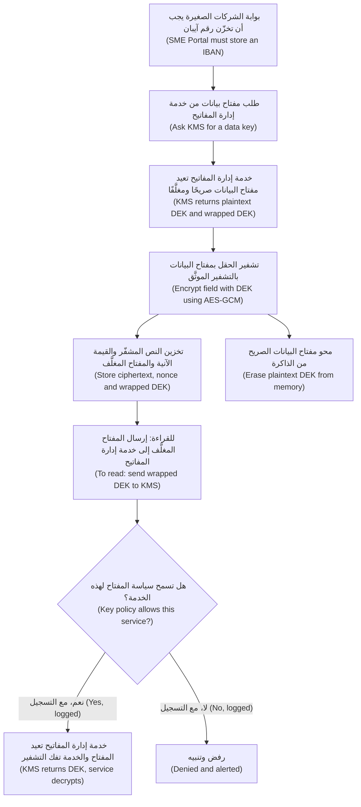
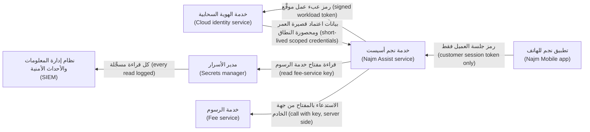
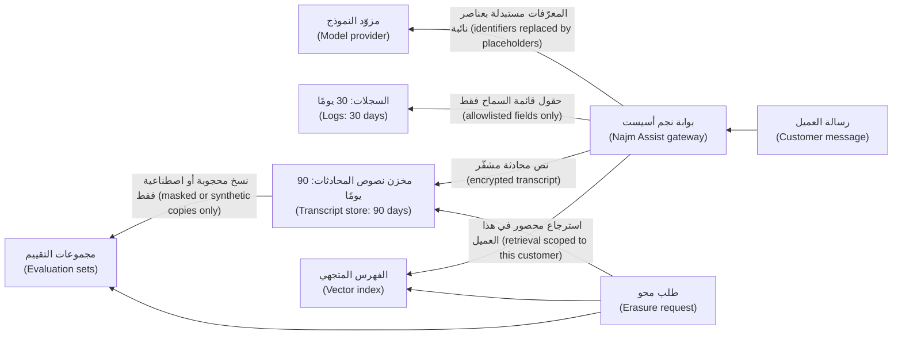

# الوحدة 5 — البيانات والتشفير والأسرار (Data, cryptography and secrets)

*التشفير والأسرار والبيانات الشخصية هي المواضع التي تتحول فيها النوايا الحسنة في أغلب الأحيان إلى طمأنينةٍ زائفة. فكلمة مرورٍ «تُجزَّأ» بالدالة الخطأ. ومفتاحٌ «يُخفى» داخل تطبيقٍ للهاتف. وسطرٌ في السجل ينسخ بهدوء رقم حساب كل عميل إلى أداةٍ يستطيع نصف الشركة البحث فيها. تمنح هذه الوحدة البنّائين القرارات لا الرياضيات. فهي تغطي أيّ أداةٍ تشفيرية (cryptographic tool) تناسب أيّ مهمة وأين يجب أن تعيش مفاتيحها؛ وكيف تُبقي مفاتيح واجهات البرمجة (API keys) والرموز المميزة (tokens) وكلمات المرور بعيدةً عن الأماكن التي تتسرّب منها، وما الذي تفعله في الساعة الأولى بعد أن يتسرّب أحدها؛ وكيف تجمع وتسجّل وتحتفظ وتحذف البيانات الشخصية التي يحتاجها البنك فعلًا فحسب، بما في ذلك النسخ الجديدة التي تُنشئها ميزات النماذج اللغوية الكبيرة. ستتابع فريق أمن التطبيقات والذكاء الاصطناعي في بنك نجم بينما تفكّك نورة أول مراجعةٍ تشفيرية يُجريها علي على بوابة الشركات الصغيرة، ويطارد جاسم مفتاحًا مسرّبًا عبر خط إنتاج نجم أسيست، وتطرح سارة، مسؤولة حماية البيانات (DPO)، سؤالًا لا يستطيع أحدٌ الإجابة عنه: «أين بيانات هذا العميل؟»*

> **المراحل:** Design, Build, Operate — اختيار تشفيرٍ سليم وإدارة مفاتيح سليمة، وإبقاء الأسرار خارج الشيفرة والتطبيقات العميلة والموجّهات، وهندسة التعامل مع البيانات الشخصية بحيث يعمل تقليل البيانات والتسجيل والحذف عمليًّا.

---

# 5.1 — التشفير للبنّائين: TLS والتجزئة والتشفير والمفاتيح
*المستوى: 🟡 متوسط* · *المتطلبات: 1.2، 3.1* · *المرحلة: Design, Build*

**بعد هذا الدرس تستطيع** أن تختار أداة التشفير المناسبة لعشرة عناصر بيانات شائعة وتحدّد مكان كل مفتاح، ثم تنقل تجزئات كلمات المرور السريعة إلى Argon2id عند تسجيل الدخول مع اختبار. *مدة الدراسة: قراءة نحو 15 دقيقة، وعمل تطبيقي نحو 5 ساعة (تقدير).*

## ⚡ الدرس في دقيقة
- يمنح التشفير البنّائين **السرية (confidentiality)**، أي لا يستطيع القراءة إلا الطرف الصحيح، و**السلامة (integrity)**، أي يُكتشف العبث، و**الأصالة**، أي تعرف من أنتج البيانات. اختر الأداة حسب الخاصية التي تحتاجها.
- القاعدة الأولى: **لا تبتكر تشفيرك بنفسك أبدًا**. استخدم TLS 1.3 أثناء النقل؛ وArgon2id أو scrypt أو bcrypt لكلمات المرور؛ وAES-GCM أو ChaCha20-Poly1305 عبر مكتبةٍ عالية المستوى للبيانات المخزّنة؛ وخدمةً لإدارة المفاتيح للمفاتيح.
- التجزئة (Hashing) ليست تشفيرًا. كلمات المرور تُجزَّأ باتجاهٍ واحد؛ أمّا البيانات المصرفية التي يجب أن تقرأها لاحقًا فتُشفَّر أو تُرمَّز.
- لا يكون التشفير (Encryption) أقوى من إدارة مفاتيحه: أين يعيش المفتاح، ومن يستطيع استخدامه، وكيف يُسجَّل الاستخدام، وكيف يُدوَّر.
- مؤشر القرار: لكل حقلٍ حساس، اسأل «من يجب أن يقرأ هذا بنصٍّ صريح، وما الذي يوقفه التشفير في *هذه* الطبقة؟»
- أكبر فخ: «مُشفَّر أثناء التخزين» بوصفه الجواب عن كل شيء. فتشفير القرص يوقف قرصًا مسروقًا، لا حقن SQL عبر تطبيقك نفسه.

## 🧭 لماذا يهم
أول مراجعةٍ للشيفرة يُجريها علي في بنك نجم هي طلب سحب لميزة «دعوة زميل» في بوابة الشركات الصغيرة. فيوافق عليه: «كل ما هو حساس مُجزَّأ أو مُشفَّر». تعيد نورة فتحه وتُبرز ثلاثة أسطر. كلمات مرور المستخدمين الجدد مخزّنةٌ بصيغة `sha256(password)`. واستدعاءٌ إلى شريك الفوترة الإلكترونية يضبط `verify=False` «لأن شهادة الاختبار ظلّت تفشل». والبيانات المصرفية للفواتير مُشفَّرةٌ بمفتاح AES مكتوبٍ داخل ملف الشيفرة المصدرية، بنمطٍ يُسمّى ECB. وكان تعليقها: «الثلاثة كلها تشفير. ولا واحد منها يحمي شيئًا».

تُفرد قائمة OWASP Top 10 لهذا النمط فئةً خاصة به، هي *الإخفاقات التشفيرية (Cryptographic Failures)*: A04 في إصدار 2025، وكانت A02 في إصدار 2021، لذا ترقّمها المراجع الأقدم ترقيمًا مختلفًا. ونادرًا ما تنطوي هذه الإخفاقات على رياضياتٍ مكسورة. إنها تنطوي على الأداة الخطأ، أو فحصٍ مُعطَّل، أو مفتاحٍ في المكان الخطأ. والعمليات مهمةٌ أيضًا: فقد وصفت مراجعةٌ أجراها مكتب المساءلة الحكومية الأمريكي لاختراق Equifax عام 2017 كيف أن شهادةً منتهية الصلاحية على جهاز فحص حركة المرور تركت حركة المرور المشفّرة دون فحص؛ ولوحظت حركة المرور المريبة بعد تجديدها.

## 📐 كيف يعمل

### 🟢 الأساسيات

**المفردات.** **النص الصريح** بياناتٌ مقروءة؛ و**النص المشفّر** صيغتها المشفّرة؛ و**المفتاح** هو السرّ الذي يتحكم في التشفير أو التوقيع. و**الملح (salt)** قيمةٌ عشوائية غير سرية تُمزج في التجزئة؛ و**القيمة الآنية (nonce)**، أي «رقمٌ يُستخدم مرةً واحدة»، يجب ألّا تتكرر أبدًا تحت المفتاح نفسه.

**خمس أدوات، خمس مهام.**

| الأداة (Tool) | ماذا تفعل | قابلة للعكس؟ | الاستخدام النموذجي في بنك نجم |
|---|---|---|---|
| **التجزئة (Hash)** | بصمةٌ ثابتة الطول؛ وأي تغييرٍ يبدّلها | لا | سلامة الملفات (File integrity) |
| **تجزئة كلمات المرور (Password hash)** | تجزئةٌ بطيئةٌ عمدًا ومملّحة | لا | تخزين كلمات المرور |
| **رمز مصادقة الرسائل**، مثل HMAC-SHA256 | تجزئةٌ بمفتاحٍ سري: تُثبت أن حامل المفتاح أنتج البيانات دون تغيير | لا | خطافات الويب للشركاء، وملفات تعريف الارتباط الموقّعة |
| **التشفير المتماثل (Symmetric encryption)** | مفتاحٌ واحد يشفّر ويفكّ التشفير؛ وهذه الأنماط تكتشف العبث أيضًا | نعم، بالمفتاح | الحقول والملفات الحساسة المخزّنة |
| **التشفير بالمفتاح العام (Public-key cryptography)** | زوج مفاتيح (key pair): المفتاح العام يُشارَك، والمفتاح الخاص لا يغادر مالكه أبدًا | التوقيعات يُتحقَّق منها، ولا تُعكَس | شهادات TLS، وتوقيع الرموز المميزة والشيفرة |

**لا تبتكر تشفيرك بنفسك أبدًا** يعني: لا خوارزمياتٍ مخترعة، ولا مخططاتٍ مُجمَّعة يدويًّا، ولا معايير مُنفَّذة باليد. استخدم الواجهة عالية المستوى لمكتبةٍ مُراجَعة جيدًا وإعداداتها الافتراضية. فكل إخفاقٍ في طلب السحب الخاص بعلي استخدم خوارزميةً حقيقية بالطريقة الخطأ.

**البيانات أثناء النقل: TLS.** يمنح TLS، أي أمن طبقة النقل، وهو حرف «S» في HTTPS، الاتصالَ السريةَ والسلامةَ ومصادقةَ الخادم. ويُثبت الخادم هويته بـ **شهادة (certificate)** موقّعةٍ من **سلطة شهادات (certificate authority)** يثق بها العميل، تربط اسم نطاق بمفتاحٍ عام (public key). استخدم **TLS 1.3** (RFC 8446)؛ واسمح بـ TLS 1.2 مع مجموعات تشفيرٍ حديثة فقط حيث يحتاجه عميل؛ أمّا TLS 1.0 و1.1 فقد أُوقِف اعتمادهما رسميًّا (formally deprecated) (RFC 8996). ثلاث قواعد:

1. لا تعطّل التحقق من الشهادات أبدًا. فمن دونه، يشفّر TLS حركة مرورك إلى أيٍّ كان من يجيب، بما في ذلك مهاجمٌ في المنتصف.
2. HTTPS في كل مكان، مع HSTS، أي أمن النقل الصارم لـ HTTP وفق RFC 6797، كي ترفض المتصفحات HTTP الصريح (انظر 2.2).
3. حركة المرور الداخلية أيضًا: انعدام الثقة (zero trust) (1.2) يعني أن الاستدعاءات بين الخدمات تستخدم TLS، ويُفضَّل **TLS المتبادل (mutual TLS)** (mTLS)، حيث يقدّم الطرفان كلاهما شهاداتٍ.

```python
# Vulnerable: any certificate accepted; a machine in the middle can read and alter invoices
requests.post(PARTNER_URL, json=invoice, verify=False)

# Fixed: verification stays on; in the partner's test environment, trust its test CA explicitly
requests.post(PARTNER_TEST_URL, json=invoice, timeout=10, verify="certs/partner-test-ca.pem")
```

**كلمات المرور: تجزئاتٌ بطيئة ومملّحة.** صُمِّمت SHA-256 لتكون سريعة، فبعد التسرّب يستطيع المهاجم اختبار قوائم هائلة من كلمات المرور المرجّحة على كل صف؛ ومن دون أملاح، تتشارك كلمات المرور المتطابقة التجزئةَ نفسها وتنجح الجداول المحسوبة مسبقًا. تضيف **دوال تجزئة كلمات المرور (Password hashing functions)** ملحًا فريدًا لكل مستخدم وهي بطيئةٌ عمدًا. كما أن **Argon2id** (RFC 9106) وscrypt *مُكلفتان للذاكرة (memory-hard)*، ما يُضعف عتاد الكسر المتخصص. ويبقى bcrypt مقبولًا، فهو لا يستخدم إلا أول 72 بايتًا من المدخلات؛ أمّا PBKDF2 فهو الخيار حيث لا يُسمح إلا بالخوارزميات المعتمدة وفق FIPS. وتخزّن المكتبات الجيدة الخوارزميةَ والمعاملاتِ والملحَ داخل سلسلة التجزئة، فتستطيع رفع التكلفة لاحقًا وترقية التجزئات عند تسجيل الدخول.

```python
# Vulnerable: fast and unsalted
stored = hashlib.sha256(password.encode()).hexdigest()

# Fixed: Argon2id via argon2-cffi; salt and parameters live inside the stored string
from argon2 import PasswordHasher
ph = PasswordHasher()
stored = ph.hash(password)
ph.verify(stored, attempt)              # raises an exception on mismatch
if ph.check_needs_rehash(stored):       # cost settings were raised since this hash was made
    save_hash(user_id, ph.hash(attempt))
```

وقت الكتابة عام 2026، تقترح ورقة OWASP المختصرة لتخزين كلمات المرور حدودًا دنيا مثل Argon2id بذاكرة 19 MiB وتكرارين ودرجة توازٍ واحدة، أو عامل عمل لـ bcrypt قدره 10. تحقّق من الورقة الحالية، ثم اضبط المعاملات بحيث تستغرق التجزئة الواحدة جزءًا من الثانية على خوادمك.

**البيانات المخزّنة: التشفير الموثَّق.** استخدم نمط **AEAD**، أي التشفير الموثَّق مع البيانات المرتبطة، مثل AES-GCM أو ChaCha20-Poly1305، الذي يشفّر ويكتشف أيضًا أي تغييرٍ في النص المشفّر. وتجنّب نمط **ECB**: فالكتل المتطابقة تُشفَّر إلى نصٍّ مشفّر متطابق، فتتسرّب الأنماط. وفي GCM، تؤدي إعادة استخدام القيمة الآنية تحت المفتاح نفسه إلى كسر السرية والسلامة كلتيهما.

```python
# Vulnerable: key in source code, ECB mode, no tamper detection
cipher = Cipher(algorithms.AES(b"NajmSecretKey123"), modes.ECB())

# Fixed: AEAD, fresh nonce, key supplied by the KMS (see envelope encryption below)
from cryptography.hazmat.primitives.ciphers.aead import AESGCM
nonce = os.urandom(12)                                # 96 bits, never reused with this key
aad = f"sme-invoice:{invoice_id}".encode()            # binds ciphertext to this record
save(invoice_id, nonce + AESGCM(data_key).encrypt(nonce, iban.encode(), aad))
```

**البيانات المرتبطة** موثَّقةٌ لا مشفّرة: فهي تربط النص المشفّر بفاتورةٍ واحدة، فيؤدي لصق البيانات المصرفية المشفّرة لشركةٍ ما على فاتورة شركةٍ أخرى إلى فشل فك التشفير.

**العشوائية.** تحتاج معرّفات الجلسات ورموز إعادة التعيين والقيم الآنية (nonces) إلى **مولّد أرقامٍ عشوائية آمنٍ تشفيريًّا**: مثل `secrets` في Python، و`crypto.randomBytes()` في Node. ولا تستخدم أبدًا `random` أو `Math.random()` أو الطوابع الزمنية.

### 🟡 التعمق أكثر

**المفاتيح هي الأصل الحقيقي: التشفير المغلَّف.** كان مفتاح علي المكتوب في الشيفرة يعني أن أي شخصٍ يستطيع قراءة المستودع يستطيع فك تشفير كل فاتورة. والتصميم المعياري هو **التشفير المغلَّف (envelope encryption)**. يُشفَّر كل سجلٍّ أو ملف بـ **مفتاح تشفير البيانات (data encryption key)** الخاص به. ويُشفَّر مفتاح DEK، أي «يُغلَّف»، بـ **مفتاح تشفير المفاتيح** الذي لا يغادر أبدًا **خدمة إدارة المفاتيح** (KMS): وهي خدمةٌ مُدارة تحفظ المفاتيح الرئيسية داخل **وحدات أمن العتاد** (HSMs)، وهي أجهزةٌ مقاومة للعبث تستخدم المفاتيح دون أن تُفرج عنها.



ما الذي يشتريه هذا التصميم: التفريغ المسروق عديم الفائدة دون الوصول إلى خدمة إدارة المفاتيح؛ وكل عملية فك تشفير تخضع لفحص السياسة وتُسجَّل؛ وتدوير مفتاح KEK يعيد تغليف مفاتيح صغيرة بدل إعادة تشفير البيانات؛ وإتلاف مفتاحٍ يجعل بياناته غير قابلةٍ للقراءة، وهو ما يُسمّى **الإتلاف التشفيري (crypto-shredding)** (انظر 5.3).

**ما الذي توقفه كل طبقة؟** هذا هو السؤال الذي تخطّاه علي.

| الطبقة | توقف | لا توقف |
|---|---|---|
| تشفير التخزين أو القرص، وهو افتراضيٌّ في معظم السحب | الأقراص المسروقة، والعتاد المُخرَج من الخدمة | أي شخصٍ يقرأ عبر قاعدة البيانات أو التطبيق |
| التشفير على مستوى الحقل بمفاتيح خدمة إدارة المفاتيح | مسؤولو قواعد البيانات (Database administrators)، والتفريغات، ومعظم عمليات القراءة عبر الحقن لذلك الحقل | خدمةٌ مخترقة مسموحٌ لها بفك التشفير |
| **الترميز (Tokenisation)**: رمزٌ عشوائي يحلّ محلّ القيمة، وخزنةٌ تحتفظ بالربط | كل نظامٍ لا يرى إلا الرموز؛ ويقلّص نطاق بيانات البطاقات | اختراق الخزنة |

**السلامة بين الأنظمة (Integrity between systems).** حين يستدعي شريك الفوترة الإلكترونية خطاف الويب (webhook) الخاص بنجم، تُثبت قيمة **HMAC** محسوبةٌ على جسم الطلب أنه أصلي. احسبها على البايتات المستلمة بالضبط، لا على نسخةٍ أُعيد تسلسلها؛ وقارن في زمنٍ ثابت، فالمقارنة `==` قد تُسرّب عبر التوقيت مقدار ما تطابق؛ ووقّع طابعًا زمنيًّا وارفض الطوابع القديمة للحدّ من إعادة التشغيل.

```python
msg = ts.encode() + b"." + raw_body                    # raw_body: the exact bytes received
expected = hmac.new(webhook_secret, msg, hashlib.sha256).hexdigest()
if abs(time.time() - int(ts)) > 300 or not hmac.compare_digest(expected, received_sig):
    raise Unauthorized()
```

استخدم **التوقيعات** حين يجب ألّا يستطيع المتحقّقون إنشاء الرسائل: فخدمة الهوية في نجم توقّع رموز الوصول (access tokens) بمفتاحٍ خاص، وتتحقق واجهات البرمجة بالمفتاح العام (انظر 3.2).

**الشهادات عملياتٌ تشغيلية.** الشهادة المنتهية الصلاحية تعطّل خدمةً أو، كما في Equifax، تُعمي ضابطًا بصمت. أتمِت التجديد باستخدام ACME (RFC 8555)، واجرد الشهادات مع مالكيها، ونبِّه قبل انتهاء الصلاحية. ووقت الكتابة عام 2026، وافق منتدى CA/Browser Forum على تقصير الحدّ الأقصى لأعمار الشهادات العامة على مراحل، فلن يعود التجديد اليدوي مجديًا؛ تحقّق من الجدول الزمني الحالي.

**البحث في الحقول المشفّرة.** للعثور على شركةٍ برقم تسجيلٍ مشفّر، خزّن **فهرسًا أعمى**: قيمة HMAC للقيمة تحت مفتاحٍ منفصل. ولا تكفي SHA-256 صريحة: فأرقام الهوية الوطنية وأرقام الهواتف لها فضاءات مدخلاتٍ صغيرة، فيستطيع أي شخصٍ يملك الجدول تجزئة كل قيمةٍ ممكنة.

### 🔴 نظرة الخبير

**المرونة التشفيرية.** تتقادم الخوارزميات، فاجعل تغيير إحداها تغييرًا في الإعدادات: مكتبة تشفيرٍ داخلية واحدة، والخوارزمية وإصدار المفتاح مخزّنان مع كل نصٍّ مشفّر، ببادئةٍ مثل `v2:key-id:`، و**جرد تشفيري (cryptographic inventory)** لكل نظام. ويتضمن CycloneDX، وهو صيغةٌ لقوائم مكوّنات البرمجيات، قائمةَ مكوّناتٍ تشفيرية لهذا الغرض.

**فصل المفاتيح.** مفتاحٌ واحد لكل غرض، أي التشفير وMAC والفهرس الأعمى، ولكل بيئة؛ والمفاتيح الخاصة بكل عميل تضيّق نطاق الضرر وتجعل الإتلاف التشفيري دقيقًا. وينبغي ألّا يستطيع مسؤولو سياسات المفاتيح قراءة البيانات.

**الحدود ومقاومة سوء الاستخدام.** تحدّد وثيقة NIST SP 800-38D عدد الرسائل التي يجوز لمفتاح GCM واحد تشفيرها بقيمٍ آنية عشوائية بـ 2³²؛ والمفاتيح الخاصة بكل سجل تتجاوز هذا القيد. ويتحمّل AES-GCM-SIV (RFC 8452) أخطاء القيم الآنية بصورةٍ أفضل. أمّا **الفلفل (pepper)**، وهو سرٌّ يُمزج في تجزئة كلمات المرور ويُحفظ في خدمة إدارة المفاتيح، فيمنع كسر تسرّبٍ يقتصر على قاعدة البيانات دون اتصال: إنه طبقةٌ إضافية، لا بديل.

**تفاصيل TLS 1.3 لبنك.** كل مصافحةٍ كاملة تمنح **السرية الأمامية**: فالمفتاح الخاص المسروق لاحقًا لا يستطيع فك تشفير الجلسات المسجّلة. ويمكن إعادة تشغيل البيانات المبكرة الاختيارية «0-RTT»، وتحذّر RFC 8446 من ذلك، فلا تقبلها أبدًا للطلبات التي تغيّر الحالة مثل التحويلات.

**التخطيط لما بعد الكمّ.** سيكسر حاسوبٌ كمّي كبير خوارزميات المفتاح العام الحالية، أي RSA والمنحنيات الإهليلجية، لكنه لن يكسر، عمليًّا، AES-256 أو SHA-256. ونشرت NIST في أغسطس 2024 المعيار FIPS 203 لإنشاء المفاتيح، والمعيارين FIPS 204 وFIPS 205، وكلاهما للتوقيعات. والخطر القريب هو «احصد الآن، وفُكّ التشفير لاحقًا»: حركة مرورٍ تُسجَّل اليوم ويُفك تشفيرها في المستقبل. لذا فهي مهمة تخطيط: الجرد (inventory)، وإعطاء الأولوية للبيانات السرية طويلة العمر، واعتماد تبادل المفاتيح الهجين لما بعد الكمّ حين تدعمه المنصات، وهو ما بدأت المتصفحات الرئيسية ومكتبات TLS بفعله وقت الكتابة عام 2026.

**وكلاء البرمجة بالذكاء الاصطناعي** يعيدون إنتاج عادات الشيفرة العامة القديمة: MD5 لكلمات المرور، وECB، و`verify=False` لإسكات خطأ SSL. تعامل مع التشفير الذي يكتبه الوكيل على أنه غير مُراجَع، وأضِف قواعد تحليلٍ ساكن (6.1، 6.3).

## 🧰 الأدوات
| الضابط أو المعيار أو الأداة | ما هو وماذا يفعل | متى تلجأ إليه |
|---|---|---|
| **TLS 1.3** — وفق RFC 8446 | يشفّر الاتصالات ويوثّقها مع السرية الأمامية | كل اتصال؛ وTLS المتبادل بين الخدمات |
| **Argon2id** — وفق RFC 9106 | تجزئة كلمات مرورٍ بطيئة ومملّحة ومُكلفة للذاكرة؛ وscrypt وbcrypt بديلان مقبولان | أي كلمة مرورٍ أو سرٍّ لا تحتاج إلا إلى التحقق منه |
| **AES-GCM** — معيار التشفير المتقدم بنمط GCM | تشفيرٌ موثَّق: سريةٌ مع اكتشاف العبث | تشفير الحقول والملفات، عبر مكتبةٍ عالية المستوى |
| **Envelope encryption** — التشفير المغلَّف | مفاتيح بياناتٍ لكل سجل مغلّفةٌ بمفتاحٍ رئيسي يبقى في خدمة إدارة المفاتيح | أي بياناتٍ حساسة يجب أن تخزّنها وتقرأها لاحقًا |
| **Key management service** — خدمة إدارة المفاتيح، المدعومة بوحدات أمن العتاد (HSM-backed) | تحفظ المفاتيح الرئيسية في العتاد، وتفرض السياسة، وتسجّل الاستخدام، وتدوّر المفاتيح | جميع مفاتيح بيئة الإنتاج |
| **HMAC** — وفق RFC 2104 | تجزئةٌ بمفتاح (keyed hash) تُثبت السلامة والمصدر بين أطرافٍ تتشارك سرًّا | خطافات الويب (Webhooks)، والاستدعاءات الراجعة، والفهارس العمياء |
| **Google Tink and libsodium** — مكتبتا Google Tink وlibsodium | مكتبات تشفيرٍ عالية المستوى مقاومةٌ لسوء الاستخدام | كلما أغراك اختيار الأنماط أو القيم الآنية بنفسك |
| **OWASP Cryptographic Storage Cheat Sheet** — ورقة OWASP المختصرة للتخزين التشفيري | إرشاداتٌ للبنّائين حول الخوارزميات والأنماط والمفاتيح | كتابة معيارٍ للتشفير؛ ومراجعة شيفرة التشفير |

## 🏛️ عمليًا في بنك نجم
يحوّل علي مراجعته إلى **معيار التشفير للبنّائين في البنك، الإصدار 1، مقتطف**.

| المهمة | المعتمَد | المحظور | ملاحظات |
|---|---|---|---|
| النقل | TLS 1.3؛ وTLS 1.2 مع مجموعات AEAD للشركاء المدرجين فقط؛ وTLS المتبادل داخل الشبكة الخدمية | TLS 1.0 و1.1، والتحقق المعطَّل، وHTTP الصريح بين الخدمات | HSTS على نطاقات الويب؛ وجرد الشهادات مع مالكيها |
| كلمات المرور | Argon2id عند الحدود الدنيا لـ OWASP أو فوقها؛ وbcrypt للأنظمة القديمة، مع الترقية عند تسجيل الدخول | MD5 وSHA-1 وSHA-256 الصريحة والتشفير القابل للعكس | فحص إعادة التجزئة عند كل تسجيل دخول |
| الحقول الحساسة: IBAN ورقم الهوية الوطنية والراتب | AES-256-GCM عبر مكتبة التشفير في نجم، والتشفير المغلَّف | ECB، والمفاتيح في الشيفرة أو الإعدادات، والمخططات محلية الصنع | معرّف السجل بوصفه بياناتٍ مرتبطة؛ وتخزين إصدار المفتاح |
| البحث عن المعرّفات المشفّرة | فهرسٌ أعمى بـ HMAC-SHA256 بمفتاحٍ خاص به | تجزئةٌ صريحة لرقم هويةٍ وطنية أو رقم هاتف | |
| أرقام البطاقات | الترميز عبر خزنة البطاقات | أرقام البطاقات خارج الخزنة | بوابة الشركات الصغيرة ونجم أسيست لا تحتفظان إلا بالرموز |
| المفاتيح | خدمة إدارة المفاتيح، بمفتاحٍ واحد لكل غرضٍ وبيئة | المفاتيح الرئيسية القابلة للتصدير، والمفاتيح المشتركة بين بيئتي التطوير والإنتاج | مالكٌ مسمّى؛ وتدويرٌ تلقائي؛ وتسجيل عمليات فك التشفير |

**أسئلةٌ لأي طلب سحبٍ يمسّ التشفير**

1. ما الخاصية المطلوبة، وهل توفّرها هذه الأداة؟
2. هل هي بنيةٌ معيارية من المكتبة المعتمدة، بإعداداتها الافتراضية؟
3. من أين يأتي المفتاح، ومن غيرك يستطيع استخدامه، وهل يُسجَّل الاستخدام؟
4. هل عُطِّل أي فحص، أو ثُبِّتت أي قيمةٍ آنية، أو قورن أي سرٍّ باستخدام `==`؟
5. لو اضطررنا إلى تغيير هذه الخوارزمية، فكم ملفًا سيتغيّر؟

## 🛠️ التمارين
- 🟢 اربط كل عنصرٍ بأداةٍ من هذا الدرس، أي إحدى الأدوات الخمس أو الترميز أو مولّد CSPRNG، مع سببٍ في سطرٍ واحد: كلمة مرور مستخدمٍ في الشركات الصغيرة، ورقم IBAN لصرف المدفوعات، والمجموع الاختباري لكشف حساب، وخطاف ويب لشريك، ورمز إعادة تعيين كلمة المرور، ورقم بطاقة، ومعرّف جلسة، والبحث برقم الهوية الوطنية، وأرشيف نسخةٍ احتياطية، ورمز وصولٍ لواجهة برمجة. *يكتمل عندما:* تُربط العناصر العشرة كلها ويذكر كل عنصرٍ يحتاج إلى مفتاح أين يعيش ذلك المفتاح.
- 🟡 في مشروعك الخاص أو في تطبيق مختبرٍ محلي، استبدل تجزئة كلمات مرورٍ سريعة أو غير مملّحة بـ Argon2id، مع ترقية التجزئات القديمة عند تسجيل الدخول. *يكتمل عندما:* يُظهر اختبارٌ أن تجزئةً قديمة يُتحقَّق منها مرةً واحدة ثم تُستبدل بتجزئة Argon2id، وأن كلمة المرور الخاطئة تفشل قبل ذلك وبعده.
- 🔴 أنشئ نموذجًا أوليًّا للتشفير المغلَّف لحقلٍ واحد في شيفرتك الخاصة، باستخدام خدمة إدارة المفاتيح السحابية في حسابٍ تجريبي شخصي أو بديلٍ محلي: مفاتيح لكل سجل، ومعرّف السجل بوصفه بياناتٍ مرتبطة، وبادئةٌ لإصدار المفتاح. *يكتمل عندما:* يفشل فك تشفير نصٍّ مشفّر منسوخٍ من السجل A إلى السجل B، ولا يحتاج تدوير المفتاح الرئيسي إلى إعادة تشفير البيانات، وتوضّح ملاحظةٌ قصيرة من يستطيع فك التشفير وأين يُسجَّل ذلك.

## ⚠️ أخطاء وفخاخ
- **تعطيل التحقق لإصلاح خطأ TLS.** فهو ينتشر إلى بيئة الإنتاج. ثِق بسلطة شهادات الاختبار المحددة وأبقِ التحقق مفعّلًا.
- **التجزئات السريعة لكلمات المرور.** الملح لا يعالج السرعة. استخدم Argon2id أو scrypt أو bcrypt.
- **«إنها مشفّرة أثناء التخزين» بوصفها جوابًا شاملًا.** سمِّ التهديد، ثم اختر الطبقة.
- **المفاتيح بجوار البيانات.** المفتاح في الشيفرة أو الإعدادات أو في قاعدة البيانات نفسها هو كلمة مرورٍ ملصقةٌ على الخزنة. استخدم خدمة إدارة المفاتيح.
- **تجميع مخططك الخاص.** الأنماط والقيم الآنية المختارة يدويًّا تؤدي إلى ECB وإعادة استخدام القيم الآنية (nonce reuse). استخدم AEAD عبر مكتبةٍ عالية المستوى.
- **نسيان الشهادات حتى تنتهي صلاحيتها.** أتمِت التجديد ونبِّه قبل انتهاء الصلاحية.

## 🧾 الخلاصة
- اختر الأداة حسب الخاصية: تجزئات كلمات المرور لكلمات المرور، ورموز MAC والتوقيعات للسلامة والمصدر، وAEAD للسرية مع اكتشاف العبث.
- TLS 1.3 في كل مكان، والتحقق مفعّلٌ دائمًا، وHSTS على الويب، وTLS المتبادل في الداخل.
- كلمات المرور: Argon2id مع إعادة التجزئة عند تسجيل الدخول (rehash-on-login)؛ ولا تجزئات سريعة ولا تشفير قابلًا للعكس أبدًا.
- تعيش المفاتيح في خدمة إدارة المفاتيح؛ ويمنح التشفير المغلَّف التحكم في الوصول (access control) والتدقيق والتدوير الرخيص والإتلاف التشفيري.
- اسأل ما الذي توقفه كل طبقة؛ وخطِّط للمرونة التشفيرية والشهادات الأقصر عمرًا والانتقال إلى ما بعد الكمّ.

## ✍️ اختبر نفسك

**1. يقترح علي تخزين كلمات مرور بوابة الشركات الصغيرة بتجزئة SHA-256 مع ملحٍ عشوائي لكل مستخدم: «مملّحة، إذن لا بأس». ما الرد الأفضل؟**

- A. اقبله، لأن التمليح يحلّ المشكلة
- B. شفّر كلمات المرور بـ AES-GCM كي يستطيع الدعم الفني استعادة المنسيّ منها، مع حفظ المفتاح في خزنة لا يفتحها إلا قائد الدعم وفريق التدقيق
- C. استخدم Argon2id: فالملح يهزم الجداول المحسوبة مسبقًا، لكن SHA-256 تبقى سريعةً بما يكفي للتخمين واسع النطاق بعد التسرّب
- D. جزّئ كلمة المرور مرتين بـ SHA-256

<details><summary>الإجابة</summary>

**C.** يجب أن تكون تجزئات كلمات المرور (Password hashes) بطيئةً إضافةً إلى كونها مملّحة. وB أسوأ: فمن يحصل على المفتاح يعكسها. وD تبقى سريعة. انظر: 🟢 الأساسيات.

</details>

**2. في قاعدة البيانات المُدارة لدى بنك نجم يكون تشفير التخزين مفعّلًا افتراضيًّا. يقول طارق إن التشفير على مستوى الحقل لأرقام الهوية الوطنية، بمفاتيح خدمة إدارة المفاتيح ومع قصر فك التشفير على خدمةٍ واحدة، لا يضيف شيئًا. ما التهديد الذي يعالجه ولا يعالجه تشفير التخزين؟**

- A. قرصٌ مسروق من مركز بيانات المزوّد
- B. حقن SQL في نقطة نهايةٍ للتقارير، أو مسؤولٌ يستعلم عن الجدول، فتُعاد أرقام هويةٍ وطنية مقروءة
- C. مهاجمٌ استولى على الخدمة الوحيدة المسموح لها بفك تشفير أرقام الهوية الوطنية ويستطيع أن يطلب منها فك تشفير أي سجل على الإطلاق من دون قيد
- D. محرّك أقراصٍ مُخرَج من الخدمة يُعاد بيعه

<details><summary>الإجابة</summary>

**B.** تشفير التخزين شفافٌ لأي شخصٍ يقرأ عبر قاعدة البيانات؛ أمّا التشفير على مستوى الحقل فلا يترك له إلا نصًّا مشفّرًا. وA وD هما ما يغطيه تشفير التخزين أصلًا؛ وC تهزم الطبقتين كلتيهما، لأن الخدمة المسموح لها بفك التشفير تستطيع قراءة البيانات. انظر: 🟡 التعمق أكثر.

</details>

**3. يفشل استدعاءٌ إلى بيئة الاختبار لدى شريك الفوترة الإلكترونية في التحقق من صحة الشهادة. أيّ إصلاحٍ هو الصحيح؟**

- A. اضبط `verify=False` في بيئة الاختبار فقط، خلف متغير بيئة، وأضف تعليقًا ليُزال الإعداد قبل الإصدار
- B. استخدم HTTP الصريح لتكامل الاختبار مؤقتًا، فلا توجد بيانات حقيقية في بيئة الاختبار لدى الشريك
- C. ثِق بسلطة الشهادات الاختبارية للشريك في بيئة الاختبار، وأبقِ التحقق مفعّلًا، واترك الإنتاج دون تغيير
- D. عطّل التحقق من اسم المضيف لكن أبقِ التحقق من السلسلة، فهذا يكفي لإنجاح الاستدعاء في بيئة الاختبار، مع بقاء الإنتاج دون تغيير

<details><summary>الإجابة</summary>

**C.** إنه يعالج السبب الحقيقي دون إضعاف TLS. وA هو الفخ الكلاسيكي: فمثل هذه المبدِّلات تتسرّب إلى بيئة الإنتاج. انظر: 🟢 الأساسيات.

</details>

**4. أيّ عبارةٍ عن التشفير المغلَّف صحيحة (TRUE)؟**

- A. يحتفظ التطبيق بالمفتاح الرئيسي في ملف إعداداته ليفك التشفير بسرعة، فيقرؤه مرةً واحدة عند التشغيل ويبقيه في الذاكرة، ويعيد تحميله كلما تغيّر الملف على القرص
- B. إنه ميزةٌ في TLS لتأمين الاتصالات بين الخدمات، فهو يشفّر كل رسالة بمفتاحٍ جديد في كل مرة
- C. إنه يلغي الحاجة إلى التحكم في الوصول إلى قاعدة البيانات، لأن البيانات تبقى مشفَّرة مهما كان من يقرؤها
- D. مفاتيح البيانات مغلّفةٌ بمفتاحٍ رئيسي يبقى في خدمة إدارة المفاتيح، فكل فك تشفير استدعاءٌ مفحوص الوصول ومسجَّل، وتدوير الرئيسي لا يحتاج إعادة تشفير جماعية

<details><summary>الإجابة</summary>

**D.** A يُفسد الغرض؛ وC يخلط بين الطبقات؛ وB لا علاقة له بالموضوع. انظر: 🟡 التعمق أكثر.

</details>

**5. يسأل حمد، كبير مسؤولي أمن المعلومات (CISO)، عمّا يجب أن يفعله بنك نجم بشأن التشفير لما بعد الكمّ (post-quantum cryptography) هذا العام. ما الإجابة الأفضل؟**

- A. لا شيء حتى توجد حواسيب كمّية كبيرة
- B. استبدل AES-256 في كل مكان بخوارزميةٍ لما بعد الكمّ الآن، وأعد تشفير كل سجلٍّ مخزَّن هذا الربع، واستغنِ عن TLS 1.3 بنقلٍ مخصّص آمنٍ كميًّا لجميع القنوات
- C. أنشئ جردًا تشفيريًّا، وصمّم للمرونة التشفيرية، وأعطِ الأولوية للبيانات السرية طويلة العمر، واعتمد FIPS 203 و204 و205 عبر المنصات والمكتبات حين تدعمها
- D. صمّم خوارزميةً لما بعد الكمّ خاصةً بنجم

<details><summary>الإجابة</summary>

**C.** إنها مهمة تخطيطٍ الآن. وA يتجاهل «احصد الآن، وفُكّ التشفير لاحقًا»؛ وB يستهدف الشيء الخطأ، لأن خوارزميات المفتاح العام (public-key algorithms) هي موضع التعرّض؛ وD يخرق القاعدة الأولى. انظر: 🔴 نظرة الخبير.

</details>

## 📚 المراجع
- IETF، وثيقة RFC 8446: بروتوكول TLS 1.3 — https://www.rfc-editor.org/rfc/rfc8446
- IETF، وثيقة RFC 8996: إيقاف اعتماد TLS 1.0 وTLS 1.1 — https://www.rfc-editor.org/rfc/rfc8996
- IETF، وثيقة RFC 9106: خوارزمية Argon2 — https://www.rfc-editor.org/rfc/rfc9106
- سلسلة أوراق OWASP المختصرة (OWASP Cheat Sheet Series): تخزين كلمات المرور، والتخزين التشفيري (Cryptographic Storage)، وإدارة المفاتيح، وأمن طبقة النقل — https://cheatsheetseries.owasp.org/
- قائمة OWASP Top 10:2025، الفئة A04 الإخفاقات التشفيرية — https://owasp.org/Top10/2025/
- وثيقة NIST SP 800-38D، نمط غالوا/العدّاد — https://csrc.nist.gov/pubs/sp/800/38/d/final
- وثيقة NIST SP 800-57 الجزء 1، المراجعة 5، توصيةٌ لإدارة المفاتيح — https://csrc.nist.gov/pubs/sp/800/57/pt1/r5/final
- مشروع NIST للتشفير لما بعد الكمّ: FIPS 203 و204 و205 — https://csrc.nist.gov/projects/post-quantum-cryptography
- مكتب المساءلة الحكومية الأمريكي، التقرير GAO-18-559، حول اختراق Equifax عام 2017 — https://www.gao.gov/products/gao-18-559

---

# 5.2 — إدارة الأسرار: المفاتيح والرموز المميزة وأين تتسرّب
*المستوى: 🟡 متوسط* · *المتطلبات: 3.2، 5.1* · *المرحلة: Build, Operate*

**بعد هذا الدرس تستطيع** أن تجرد أسرار مشروع مع مالكيها ونطاق صلاحياتها، وتضيف ماسح أسرار إلى خطاف ما قبل الإيداع وإلى CI يحجب مفتاحًا مزيفًا مزروعًا. *مدة الدراسة: قراءة نحو 15 دقيقة، وعمل تطبيقي نحو 4 ساعة (تقدير).*

## ⚡ الدرس في دقيقة
- **السرّ (secret)** هو أي قيمةٍ تمنح الوصول بمفردها: كلمات المرور، ومفاتيح واجهات البرمجة، والرموز المميزة، والمفاتيح الخاصة، وسلاسل الاتصال. ومن يحمله *هو* أنت، بقدر ما يستطيع النظام أن يعرف.
- تتسرّب الأسرار عبر قنواتٍ عادية: سجلّ git، وملفات `.env`، وصور الحاويات، وسجلات CI، وحزم تطبيقات الهاتف والمتصفح، وصفحات الأخطاء، والتذاكر والمحادثات، والآن موجّهات أدوات الذكاء الاصطناعي وسياقها.
- النمط: تعيش الأسرار في **مدير أسرار (secrets manager)**، وتُجلب وقت التشغيل بهوية عبء العمل، وتُحصر في أقل الصلاحيات، وتكون قصيرة العمر. وأفضل سرٍّ هو الذي لا تخزّنه أبدًا.
- افحص في ثلاث نقاط: قبل الإيداع (commit)، وعند الرفع إلى المستودع (push)، وعبر كل ما نُشر بالفعل، أي السجل التاريخي والصور والسجلات.
- مؤشر القرار: حين يتسرّب سرّ، **أبطِله ودوِّره أولًا**، ثم حقّق. فحذف الإيداع لا يُلغي التسرّب.
- أكبر فخ: وضع سرٍّ حيث يستطيع طرفٌ غير موثوق قراءته، كتطبيق هاتف أو حزمة متصفح أو موجّه النظام لنموذجٍ لغوي كبير، ثم وصفه بأنه مخفيّ.

## 🧭 لماذا يهم
الأربعاء، الساعة 16:40. يُفشل ماسح الأسرار في CI عملية بناءٍ لنجم أسيست: مفتاحٌ حيّ لخدمة الرسوم الداخلية موجودٌ في ملف بيانات اختبار. كان المطوّر قد طلب من وكيل برمجةٍ بالذكاء الاصطناعي أن «يجعل اختبار البحث عن الرسوم ينجح»؛ فقرأ الوكيل ملف `.env` المحلي ونسخ المفتاح إلى ملف بيانات الاختبار. يحذف المطوّر السطر ويرفع مجددًا. لكن جاسم، قائد مركز العمليات الأمنية، لا يطمئن. فالإيداع لا يزال في السجل التاريخي، ومهمة CI الفاشلة طبعت ملف بيانات الاختبار في سجلها، وكان المطوّر قد لصق الخطأ، بما فيه المفتاح، في محادثة الفريق طالبًا المساعدة. قاعدة نورة: «السرّ الذي وُجد في أي مكانٍ لا تتحكم فيه هو سرٌّ لم تعد تملكه. دوِّره، ثم ابدأ البحث».

قبل ذلك بشهر، وفي اختبارٍ مُصرَّح به لنسخةٍ أولية من نجم أسيست، كان الفريق الأحمر (red team) التابع لمريم قد وجد مفتاح واجهة البرمجة الخاص بمزوّد النموذج اللغوي الكبير داخل إعدادات تطبيق الهاتف، «مُموَّهًا». وكان بإمكان أي شخصٍ لديه التطبيق استخراجه وتكبيد التكاليف باسم نجم. وتُظهر الحالات الحقيقية حجم الرهان. فالتقارير العامة عن اختراق Capital One عام 2019 تصف مهاجمًا استخدم تزوير الطلبات من جهة الخادم (SSRF) للحصول على بيانات اعتمادٍ سحابية مؤقتة من خدمة البيانات الوصفية للمثيل (instance metadata service)، لدورٍ يستطيع قراءة العديد من حاويات التخزين. كانت بيانات الاعتماد قصيرة العمر، كما ينبغي، لكنها مفرطة الصلاحيات. بعض التسرّبات حتميّ؛ والضرر يتوقف على النطاق وعلى سرعة الإبطال.

## 📐 كيف يعمل

### 🟢 الأساسيات

**ما الذي يُعدّ سرًّا.** *المعرِّف* يقول من تدّعي أنك هو، مثل اسم المستخدم أو معرّف عميل OAuth أو المفتاح العام، ويجوز أن يكون علنيًّا. أمّا *أداة المصادقة (authenticator)* فتُثبت ذلك ويجب أن تبقى سرية.

| نوع السرّ | أمثلةٌ في بنك نجم | ما الذي يمنحه |
|---|---|---|
| بيانات اعتماد الآلات | كلمات مرور قواعد البيانات، ومفاتيح واجهات برمجة الخدمات، ومفاتيح الوصول السحابية | وصولٌ مباشر إلى البيانات أو البنية التحتية |
| الرموز المميزة | رموز التحديث في OAuth، ورموز الوصول الشخصية، ورموز CI | التصرف بصفة مستخدمٍ أو مطوّرٍ أو خط إنتاج |
| المفاتيح التشفيرية (Cryptographic keys) | مفاتيح TLS الخاصة، ومفاتيح توقيع الرموز المميزة، ومفاتيح التشفير (encryption keys) | انتحال صفة الخدمات، وتزوير الرموز المميزة، وقراءة البيانات |
| أسرار التكامل | أسرار خطافات الويب، وبيانات اعتماد الشركاء، ومفاتيح مزوّدي النماذج اللغوية الكبيرة | انتحال صفة الشركاء؛ وإنفاق المال |

**أين تتسرّب الأسرار، والدفاع لكلٍّ منها.**

| المكان | كيف يحدث | الدفاع |
|---|---|---|
| الشيفرة المصدرية وسجلّ git | مفتاحٌ «مؤقت» مكتوبٌ في الشيفرة؛ وملف `.env` مُودَع؛ وإيداعٌ لاحق يزيله لكن السجل التاريخي يحتفظ به | لا تكتب الأسرار في الشيفرة أبدًا؛ وتجاهل `.env` في git؛ وافحص قبل الإيداع وعند الرفع |
| تطبيقات الهاتف وحزم المتصفح | مفاتيح مُدمجة في التطبيق أو في بناء الواجهة الأمامية | لا تشحن الأسرار إلى التطبيقات العميلة أبدًا (انظر 4.3) |
| صور الحاويات | `ENV API_KEY=…`، وملفات `.env` منسوخة، ووسائط البناء المحفوظة في سجل الصورة | تركيب الأسرار وقت البناء؛ والحقن وقت التشغيل؛ وفحص الصور |
| خطوط CI/CD | `echo $TOKEN`، ووضع التصحيح، ومفاتيح سحابية طويلة العمر في متغيرات خط الإنتاج | إخفاء القيم في السجلات، والاتحاد عبر OIDC |
| السجلات وصفحات الأخطاء | ترويسات `Authorization` مسجَّلة؛ وتتبّعات المكدّس التي تُفرغ متغيرات البيئة | تنقيح السجلات (5.3)، وصفحات أخطاءٍ عامة |
| أدوات التعاون | مفاتيح ملصوقة في التذاكر والمحادثات وصفحات الويكي والبريد الإلكتروني | شارِك الوصول عبر الخزنة، لا القيمة أبدًا |
| ملفات البنية التحتية | حالة Terraform، وبيانات Kubernetes التعريفية (Kubernetes manifests)، وقيم Helm | حالةٌ بعيدة مشفّرة؛ وأشِر إلى الأسرار ولا تُضمّنها أبدًا |
| أدوات الذكاء الاصطناعي والوكلاء | وكيلٌ ينسخ قيم `.env` إلى الشيفرة أو السجلات أو الموجّهات؛ وأسرارٌ في موجّهات النظام؛ ورموزٌ بنصٍّ صريح في إعدادات الأدوات المحلية | امنع الوكلاء من ملفات الأسرار؛ ولا أسرار في الموجّهات؛ والأدوات تحتفظ ببيانات الاعتماد على الخادم |

يصنّف إطار MITRE ATT&CK سلوك المهاجم تحت اسم *بيانات الاعتماد غير المؤمَّنة* (Unsecured Credentials، T1552): فالمهاجمون يبحثون في هذه الأماكن بالضبط، ولذلك ينبغي أن يبحث المدافعون فيها أولًا.

**النمط الأساسي.** تحمل الشيفرة *مرجعًا* إلى السرّ، لا قيمته أبدًا. ووقت التشغيل يُثبت عبء العمل هويته لـ **مدير أسرار**، أي خدمةٍ تخزّن الأسرار مشفّرة، وتتحكم في كل قراءةٍ وتسجّلها، وتدعم التدوير، ثم يجلب ما يحتاجه.

```python
# Vulnerable: in source, shared by every environment, never rotated, readable by anyone with repo access
FEES_API_KEY = "fee_live_9f2c4e..."

# Fixed: a reference, resolved at runtime by the workload's own identity; the read is logged
FEES_API_KEY = secret_manager.get(f"najm-assist/{ENV}/fees-api-key")
```

**لا تشحن سرًّا إلى تطبيقٍ عميل أبدًا.** يعمل تطبيق الهاتف أو صفحة الويب على جهازٍ لا تتحكم فيه؛ والتمويه (obfuscation) يُبطئ الاستخراج لكنه لا يمنعه. في نجم أسيست، يُصادق التطبيق *العميلَ* لدى واجهة برمجة نجم، والواجهة الخلفية تحتفظ بمفتاح مزوّد النموذج اللغوي الكبير، وتطبّق حدود المعدّل لكل عميل وسقوف الإنفاق (انظر 4.2)، وتستدعي المزوّد. والمفتاح المستخرَج يُدوَّر، لا «يُعاد إخفاؤه».

**افحص مبكرًا وكثيرًا.** شغّل ماسح أسرار بوصفه خطافًا قبل الإيداع، واحظر عمليات الرفع التي تحتوي على أسرار، وهو ما يُسمّى **حماية الرفع**، وافحص السجل التاريخي الكامل والصور والسجلات وفق جدولٍ زمني.

```yaml
# .pre-commit-config.yaml: stop secrets before they reach a commit
repos:
  - repo: https://github.com/gitleaks/gitleaks
    rev: <pinned release tag>
    hooks:
      - id: gitleaks
```

### 🟡 التعمق أكثر

**دورة حياة السرّ.** أنشئه بمولّد CSPRNG (5.1)؛ وخزّنه في مدير الأسرار فقط؛ ووزّعه بالهوية، لا بالنسخ واللصق أبدًا؛ واحصره في خدمةٍ واحدة وبيئةٍ واحدة؛ ودوِّره تلقائيًّا؛ وأبطِله فورًا عند الاشتباه؛ ودقّق عمليات القراءة ونبِّه على الحالات الشاذة. وامنح كل سرٍّ مالكًا مسمّى، وإلّا فلن يدوّره أحد.

**قصير العمر يتفوّق على طويل العمر: هوية عبء العمل.** مع **اتحاد هوية عبء العمل**، يُثبت عبء العمل من هو برمزٍ قصير العمر توقّعه منصته، وتستبدله السحابة ببيانات اعتمادٍ مؤقتة ومحصورة النطاق. ويمكن ربط حسابات خدمة Kubernetes اتحاديًّا بأدوار IAM السحابية. وتستطيع أنظمة CI مثل GitHub Actions وGitLab CI إصدار رمز OIDC، أي OpenID Connect (انظر 3.2)، لكل مهمة، فلا يبقى أي مفتاحٍ سحابي في إعدادات خط الإنتاج. ولا يثق الدور السحابي إلا بالرموز ذات موضوعٍ محدد، مثل موضوع GitHub بالصيغة `repo:najm-bank/sme-portal:ref:refs/heads/main`، فلا يستطيع خط إنتاجٍ على فرعٍ آخر تولّي هذا الدور.



**الأسرار الديناميكية.** بعض مديري الأسرار (secrets managers)، مثل HashiCorp Vault وفرعه المفتوح المصدر OpenBao، يُنشئون مستخدم قاعدة بياناتٍ لكل عبء عمل عند الطلب، بعقد إيجار مدته دقائق أو ساعات، ويحذفونه عند انتهاء العقد. فتنتهي صلاحية بيانات الاعتماد المسرّبة من تلقاء نفسها، ويُطابَق كل بيانات اعتمادٍ مع عبء عملٍ واحد في سجل التدقيق.

**أسرار Kubernetes ليست خزنة.** في Kubernetes الأصلي، وافتراضيًّا، تُرمَّز القيم بصيغة base64، وهذا ترميزٌ لا تشفير، وتُخزَّن دون تشفير في مخزن بيانات العنقود، أي etcd، ما لم يُضبط التشفير أثناء التخزين، ويستطيع أي شخصٍ مسموحٍ له بإنشاء حاويات pod في نطاق أسماء قراءة أسراره. وتضيف بعض الخدمات المُدارة الآن تشفيرًا على مستوى المزوّد؛ فتحقّق مما تفعله خدمتك، لأن ذلك لا يغيّر من يستطيع قراءتها. فعّل التشفير أثناء التخزين بمزوّد KMS، وشدّد RBAC، وفضّل المزامنة من مدير أسرارٍ خارجي (انظر 7.2).

**متغيرات البيئة مقايضة.** إنها أفضل من الشيفرة المصدرية، لكن العمليات الفرعية ترثها، وأدوات الإبلاغ عن الأعطال وصفحات التصحيح تُفرغها. فضّل الملفات المركّبة من مدير الأسرار، أو الجلب وقت التشغيل، ولا تسجّل البيئة أبدًا.

**الحاويات (Containers).** تُسجَّل وسائط البناء وأسطر `ENV` في سجل الصورة. استخدم تركيب الأسرار وقت البناء:

```dockerfile
# Vulnerable: the token ends up in image history and in a layer
ARG NPM_TOKEN
RUN echo "//registry.npmjs.org/:_authToken=${NPM_TOKEN}" > .npmrc && npm ci

# Fixed: BuildKit secret mount, present only during this step, never stored in the image
RUN --mount=type=secret,id=npmrc,target=/root/.npmrc npm ci
```

**حين يتسرّب سرّ: أبطِله أولًا.**

1. **أبطِله أو دوِّره** الآن. افترض الاختراق منذ اللحظة التي وصل فيها إلى أي مكانٍ لا تتحكم فيه؛ فالماسحات الآلية تراقب المستودعات العامة باستمرار.
2. **حدّد نطاق الضرر:** ماذا كان يستطيع أن يفعل، وأين، ومنذ متى؟
3. **افحص سجلات الاستخدام**، لدى المزوّد ومدير الأسرار وبوابة واجهات البرمجة (API gateway)، خلال نافذة التعرّض.
4. **نظّف** الشيفرة، والسجل التاريخي، مثلًا باستخدام `git filter-repo`، والسجلات، والتذاكر، والمحادثات. فهذه نظافةٌ لا معالجة، ولذلك تأتي بعد التدوير.
5. **أصلِح السبب** و**سجّله** عبر عملية إدارة الحوادث (10.2).

### 🔴 نظرة الخبير

**مشكلة «السرّ الصفري».** لجلب الأسرار، يجب أن يُصادق عبء العمل؛ فإن فعل ذلك بسرٍّ مخزَّن، فأنت لم تفعل سوى نقل المشكلة. والحل هو الهوية التي تشهد بها المنصة: هوية مثيل السحابة، أو رموز حسابات خدمة Kubernetes، أو SPIFFE، وهو معيارٌ مفتوح لهوية عبء العمل، مع تطبيقه SPIRE الذي يُصدر شهاداتٍ قصيرة العمر. فالهوية تأتي من مكان عبء العمل وماهيته، لا من قيمةٍ يحملها.

**صمّم لنطاق الضرر.** سرٌّ واحد لكل خدمةٍ لكل بيئة؛ ولا مفتاح «تكاملٍ» مشتركًا؛ وأضيق النطاقات التي يدعمها المزوّد؛ وحدود إنفاقٍ على مفاتيح مزوّدي النماذج اللغوية الكبيرة. ودرس Capital One ينطبق هنا: قِصَر العمر لا يكفي إذا كان الدور الذي خلفه مفرط الصلاحيات (انظر 7.1).

**تدويرٌ يمكنك الوثوق به.** اقبل سرّين صالحين في آنٍ واحد، القديم والجديد، كي لا يحتاج التدوير إلى توقّف الخدمة؛ وأتمِته؛ وتدرّب عليه. فالسرّ الذي لم يُدوَّر قط لا يمكن تدويره بأمانٍ في حالة طوارئ. وتُدوَّر مفاتيح التوقيع عبر معرّفات المفاتيح: انشر المفتاح العام الجديد، ووقّع به، وأوقِف القديم حين تنتهي صلاحية رموزه.

**اجعل أسرارك قابلةً للرصد.** امنح الرموز الداخلية بادئةً مميزة، مثل `najm_pat_`، ومجموعًا اختباريًّا، كي تعثر عليها الماسحات بقليلٍ من الإيجابيات الكاذبة؛ وقد نقلت GitHub رموزها إلى صيغٍ ذات بادئات مثل `ghp_` لهذا السبب جزئيًّا. وتستطيع بعض الماسحات، مثل TruffleHog، اختبار ما إذا كانت بيانات الاعتماد المكتشفة حيّة باستدعاء المزوّد؛ فلا تفعل ذلك إلا لمستودعاتك وبيانات اعتمادك أنت.

**وكلاء الذكاء الاصطناعي يغيّرون نموذج التهديدات.** يستطيع وكيل البرمجة بالذكاء الاصطناعي الذي يملك وصولًا إلى الصدفة قراءة أي ملفٍ يستطيع مطوّره قراءته، بما في ذلك ملفات `.env` وأدلة بيانات الاعتماد السحابية، ويمكن توجيه وكيلٍ تعرّض لحقن الموجّهات (8.2) لإرسالها إلى الخارج. ويُسمّي «الثالوث القاتل» (lethal trifecta)، الذي صاغه سايمون ويليسون عام 2025، التركيبةَ الخطرة: البيانات الخاصة، والمحتوى غير الموثوق، ووسيلةٌ للتواصل الخارجي (انظر 9.2). امنع الوكلاء من الوصول إلى ملفات الأسرار، وامنحهم رموزًا محصورة وقصيرة العمر، وأبقِ بيانات اعتماد الإنتاج بعيدًا عن أجهزة المطوّرين. وبالنسبة لتطبيقات النماذج اللغوية الكبيرة، يحذّر بند *تسرّب موجّه النظام (System Prompt Leakage)* (LLM07) في قائمة OWASP Top 10 for LLM Applications (2025) من وضع بيانات الاعتماد في موجّهات النظام: افترض أن الموجّه سيُستخرَج. تعمل أدوات نجم أسيست على الخادم ببيانات اعتمادٍ مربوطةٍ بجلسة العميل؛ ولا يرى النموذج أي مفتاحٍ أبدًا.

## 🧰 الأدوات
| الضابط أو المعيار أو الأداة | ما هو وماذا يفعل | متى تلجأ إليه |
|---|---|---|
| **Secrets manager** — مدير الأسرار: HashiCorp Vault وOpenBao ومديرو الأسرار السحابيون | يخزّن الأسرار مشفّرة، ويتحكم في عمليات القراءة ويسجّلها، ويدعم التدوير | كل سرٍّ يحتاجه عبء عملٍ وقت التشغيل |
| **Workload identity federation** — اتحاد هوية عبء العمل | يستبدل رمز عبء عملٍ أو رمز CI موقَّعًا من المنصة ببيانات اعتمادٍ سحابية قصيرة العمر ومحصورة | استبدال المفاتيح السحابية طويلة العمر في حاويات pod وخطوط الإنتاج |
| **Dynamic secrets** — الأسرار الديناميكية | بيانات اعتمادٍ تُنشأ عند الطلب بعقد إيجار، وتُبطَل تلقائيًّا | الوصول إلى قواعد البيانات والسحابة للخدمات |
| **Secret scanning** — فحص الأسرار: gitleaks وTruffleHog وdetect-secrets | يعثر على الأسرار في الإيداعات والسجل التاريخي والصور والسجلات | قبل الإيداع، وفي CI، والفحوص المجدولة |
| **Push protection** — حماية الرفع | تحظر منصة استضافة الشيفرة عمليات الرفع التي تحتوي على أسرارٍ معروفة | كل مستودع، ولا سيما المستودعات العامة |
| **External Secrets Operator** — مشغّل الأسرار الخارجية | يزامن الأسرار من مديرٍ خارجي إلى Kubernetes | العناقيد التي تحتاج إلى أسرار دون تخزينها في البيانات التعريفية |
| **SPIFFE/SPIRE** — معيارٌ وتطبيقه لهوية عبء العمل | معيارٌ وتطبيقٌ لهويات عبء عملٍ مُثبَتة بالشهادة وقصيرة العمر | حلّ مشكلة «السرّ الصفري» عبر الخدمات |
| **OWASP Secrets Management Cheat Sheet** — ورقة OWASP المختصرة لإدارة الأسرار | إرشاداتٌ حول دورة حياة السرّ والأدوات والرصد | كتابة معيارٍ للأسرار أو مراجعة تصميم |

## 🏛️ عمليًا في بنك نجم
تنشر نورة وجاسم **معيار إدارة الأسرار، الإصدار 1، مقتطف** مع **دليل التشغيل الخاص بالأسرار المسرّبة**. والأعمار والأهداف الواردة توضيحية.

| فئة السرّ | أين يعيش | كيف تحصل عليه أعباء العمل | العمر والتدوير | المالك |
|---|---|---|---|---|
| الوصول السحابي للخدمات وCI | لا مكان: هوية عبء العمل والاتحاد عبر OIDC | بيانات اعتمادٍ قصيرة العمر؛ وأدوار CI مربوطة بالمستودع والفرع | من دقائق إلى ساعة؛ ولا مفاتيح طويلة العمر | فريق المنصة |
| بيانات اعتماد قواعد البيانات | مدير الأسرار، بمحرّكٍ ديناميكي | مؤجَّرةٌ لكل عبء عمل | ساعات؛ وتُبطَل تلقائيًّا | مالك الخدمة |
| مفاتيح الأطراف الثالثة ومزوّدي النماذج اللغوية الكبيرة | مدير الأسرار | تجلبها الواجهة الخلفية وحدها وقت التشغيل | 90 يومًا وعند أي اشتباه؛ وسقوف إنفاق | مالك الخدمة |
| مفاتيح التوقيع والتشفير | خدمة إدارة المفاتيح أو وحدة أمن العتاد (HSM)، غير قابلة للتصدير | تُستخدم عبر واجهة خدمة إدارة المفاتيح | وفق سياسة المفتاح (5.1) | هندسة الأمن |
| بيانات اعتماد كسر الزجاج | مدير الأسرار، مختومة | موافقة شخصين؛ وتنبيهٌ عند الاستخدام | تُدوَّر بعد كل استخدام | مكتب كبير مسؤولي أمن المعلومات (CISO office) |

محظورٌ في كل مكان: الأسرار في الشيفرة المصدرية، والصور، وحزم الهاتف أو الويب، والتذاكر، والمحادثات، وموجّهات النماذج اللغوية الكبيرة، أو في أي ملفٍ يستطيع الوكيل قراءته على جهاز مطوّر.

| خطوة دليل التشغيل | المسؤول | الهدف |
|---|---|---|
| الإبطال أو التدوير | مالك الخدمة، ومناوب مركز العمليات الأمنية | خلال ساعةٍ واحدة من الرصد |
| تحديد ما يمنحه السرّ ومنذ متى | مالك الخدمة، وفريق جاسم | خلال 4 ساعات |
| البحث في سجلات الاستخدام خلال نافذة التعرّض | مركز العمليات الأمنية (SOC) | خلال 24 ساعة |
| تنظيف الشيفرة والسجل التاريخي والسجلات والتذاكر والمحادثات | مالك الخدمة | خلال 3 أيام |
| السبب الجذري وإصلاح الضابط، مسجَّلًا بوصفه حادثة | مالك الخدمة، وفريق أمن التطبيقات | خلال أسبوعين |

## 🛠️ التمارين
- 🟢 اجرد الأسرار في أحد مشاريعك الخاصة: ما الذي يمنحه كلٌّ منها، وأين يعيش، ومن يملكه، ومتى دُوِّر آخر مرة. *يكتمل عندما:* يكون لكل سرٍّ مالك وسطرٌ يوضح «ما الذي يستطيع فعله»، وتكون قد علّمت سرًّا واحدًا على الأقل يمكن لهوية عبء العمل أن تُلغيه.
- 🟡 في مستودعك الخاص، أضِف gitleaks (أو ماسحًا آخر) خطافًا قبل الإيداع وخطوةً في CI. أودِع مفتاحًا مزيّفًا بوضوح وغير صالحٍ للعمل على فرع اختبار وتأكّد من حظره؛ ثم افحص السجل التاريخي الكامل. *يكتمل عندما:* يفشل CI على المفتاح المزيّف المزروع، ويُفرز كل اكتشافٍ في السجل التاريخي على أنه إمّا حقيقي فيُدوَّر، وإمّا إيجابيٌّ كاذب.
- 🔴 في حسابٍ سحابي تجريبي شخصي، استبدل مفتاحًا سحابيًّا طويل العمر في خط إنتاج CI الخاص بك بالاتحاد عبر OIDC المحصور في مستودعٍ واحد وفرعٍ واحد، ثم نفّذ تمرينًا نظريًّا (tabletop) مدته 30 دقيقة على دليل تشغيل الأسرار المسرّبة. *يكتمل عندما:* ينشر خط الإنتاج دون أي مفاتيح سحابية مخزّنة، ويُرفض تشغيلٌ من فرعٍ آخر، ويُنتج التمرين النظري إصلاحًا واحدًا على الأقل.

## ⚠️ أخطاء وفخاخ
- **حذف الإيداع واعتبار المشكلة محلولة.** فالسجل التاريخي والنسخ المتفرعة وذاكرات التخزين المؤقت والسجلات تحتفظ به. أبطِله ودوِّره أولًا.
- **المفاتيح «المخفية» في التطبيقات والواجهات الأمامية.** كل ما يُشحن إلى تطبيقٍ عميل علنيّ. أبقِ المفاتيح على الخادم.
- **مفتاحٌ واحد مشترك بين الخدمات والبيئات.** فيصير تسرّبٌ واحد تسرّبًا في كل نظام. احصر النطاق لكل خدمةٍ وبيئة.
- **الأسرار في موجّهات النظام.** افترض أن الموجّهات تتسرّب. أبقِ بيانات الاعتماد في طبقة الأدوات.
- **أسرارٌ لم تُدوَّر قط.** التدوير غير المختبَر يفشل في حالات الطوارئ. أتمِته وتدرّب عليه.
- **وكلاءٌ يملكون مفاتيح كل شيء.** امنع وكلاء البرمجة بالذكاء الاصطناعي من ملفات الأسرار؛ وامنحهم رموزًا محصورة وقصيرة العمر.

## 🧾 الخلاصة
- يمنح السرّ الوصول بمفرده؛ ويتسرّب عبر الشيفرة والسجل التاريخي والصور وCI والسجلات والتطبيقات العميلة والمحادثات وأدوات الذكاء الاصطناعي.
- تحمل الشيفرة المراجع؛ ويحمل مدير الأسرار القيم؛ وتجلبها أعباء العمل بالهوية وقت التشغيل.
- فضّل بيانات الاعتماد قصيرة العمر والمحصورة: هوية عبء العمل، والاتحاد عبر OIDC، والأسرار الديناميكية.
- افحص قبل الإيداع، وعند الرفع، وعبر السجل التاريخي والصور والسجلات.
- عند التسرّب: أبطِل أولًا، وحدّد النطاق، وافحص الاستخدام، ونظّف، وأصلِح السبب.

## ✍️ اختبر نفسك

**1. يدرك مطوّرٌ أنه رفع مفتاح واجهة برمجةٍ حيًّا لشريك مدفوعات إلى مستودعٍ داخلي قبل ثلاثة أيام، وقد نفّذ بالفعل رفعًا قسريًّا (force-push) لإزالة الإيداع. ما الذي يجب أن يحدث أولًا؟**

- A. لا شيء أكثر: فالإيداع قد زال تمامًا، لأن الفرع حُذف ولم يُدمج طلب السحب على الإطلاق
- B. أبطِل المفتاح أو دوِّره الآن، ثم افحص سجلات استخدام الشريك خلال نافذة التعرّض
- C. أعِد كتابة السجل التاريخي لكل فرع وارفعه قسريًّا، ثم قرّر ما إذا كان المفتاح يحتاج إلى تدوير أصلًا
- D. افتح تذكرةً للدورة التالية واطلب من المطوّر إزالة المفتاح من الملف عندما يناسبه ذلك

<details><summary>الإجابة</summary>

**B.** افترض الاختراق ودوِّر أولًا؛ فالنسخ المستنسخة وذاكرات التخزين المؤقت وسجلات CI قد تظل تحتفظ بالمفتاح. وC تنظيفٌ يأتي بعد التدوير؛ وA وD يتركان مفتاحًا حيًّا مكشوفًا. انظر: 🟡 التعمق أكثر.

</details>

**2. في اختبارٍ مُصرَّح به، تستخرج مريم مفتاح مزوّد النموذج اللغوي الكبير من نسخةٍ أولية لتطبيق نجم أسيست، حيث كان «مُموَّهًا». ما الإصلاح الصحيح؟**

- A. تمويهٌ أقوى
- B. اطلب من العملاء ألّا يفحصوا التطبيق
- C. خزّن المفتاح في التخزين الآمن للجهاز بعد التشغيل الأول، بعد جلبه مرةً واحدة من خادمٍ لنجم يتحقق من إصدار التطبيق ومن طراز الجهاز قبل أن يرسله
- D. انقل استدعاء المزوّد إلى الواجهة الخلفية لنجم، التي تحتفظ بالمفتاح، وتُصادق العميل، وتطبّق حدود المعدّل وسقوف الإنفاق؛ ودوِّر المفتاح المستخرَج

<details><summary>الإجابة</summary>

**D.** الأسرار المشحونة إلى تطبيقٍ عميل علنيّة. وA وC لا يفعلان سوى إبطاء الاستخراج، لأن التطبيق يجب أن يظل قادرًا على قراءة المفتاح؛ وB ليس ضابطًا. انظر: 🟢 الأساسيات.

</details>

**3. ينشر خط إنتاج بوابة الشركات الصغيرة باستخدام مفتاح وصولٍ سحابي طويل العمر مخزّنٍ بوصفه متغيرًا في CI. ما التحسين الأقوى؟**

- A. دوِّر المفتاح مرةً في السنة
- B. رمّز المفتاح بصيغة base64 في المتغير
- C. الاتحاد عبر OIDC: تحصل كل مهمة على رمزٍ قصير العمر تستبدله السحابة ببيانات اعتماد، لدورٍ لا يثق إلا بهذا المستودع وهذا الفرع
- D. أودِع المفتاح في المستودع الخاص كي يخضع لإدارة الإصدارات والمراجعة، وقيّد صلاحية القراءة بفريق خط الإنتاج ومدير الإصدار والمهندسين المناوبين

<details><summary>الإجابة</summary>

**C.** إنه يزيل السرّ المخزَّن ويربط الوصول بخط إنتاجٍ واحد. وA يساعد قليلًا؛ وB ترميزٌ لا حماية؛ وD تسرّب. انظر: 🟡 التعمق أكثر.

</details>

**4. أيّ عبارةٍ عن أسرار Kubernetes صحيحة (TRUE) افتراضيًّا في Kubernetes الأصلي؟**

- A. تُرمَّز القيم بـ base64، وتُخزَّن دون تشفير في etcd ما لم يُفعَّل التشفير أثناء التخزين، ويقرؤها من يُنشئ حاويات pod في نطاق الأسماء
- B. تُشفَّر القيم بمفتاحٍ خاصٍّ بكل عنقود يدوّره مزوّد السحابة دوريًّا، فلا يستطيع قراءتها كنصٍّ واضح إلا خادم الواجهة البرمجية والمتحكمات
- C. لا يقرأ القيمَ إلا مسؤولو العنقود، لأن خادم الواجهة البرمجية يرفض قراءة الأسرار من كل دورٍ آخر
- D. يدوّر خادم الواجهة البرمجية القيمَ كل 24 ساعة، فتتوقف القيمة المسرَّبة عن العمل خلال يومٍ من تسريبها

<details><summary>الإجابة</summary>

**A.** ومن هنا الحاجة إلى التشفير أثناء التخزين، وRBAC محكم، ومديرٍ خارجي. وB يخلط بين الترميز والتشفير؛ ويستطيع قراءتها افتراضيًّا كل من يُسمح له بإنشاء حاويات pod في نطاق الأسماء (لا C)، ولا شيء يدوّرها (لا D). انظر: 🟡 التعمق أكثر.

</details>

**5. يقترح مطوّرٌ وضع مفتاح واجهة برمجة خدمة الرسوم في موجّه النظام لنجم أسيست «كي يتمكن النموذج من استدعاء الأداة». لماذا هذا خطأ؟**

- A. لموجّهات النظام حدٌّ للطول، وإضافة مفتاحٍ طويل إليها قد تدفع التعليمات المهمة خارج النافذة السياقية
- B. ترفض النماذج استخدام المفاتيح التي تجدها في الموجّه، فتفشل أي أداةٍ تحتاج إلى مفتاحٍ حين يستدعيها النموذج
- C. لا بأس ما دام الموجّه يقول أيضًا «لا تكشف هذا المفتاح أبدًا»، لأن النماذج تتبع تعليمات النظام
- D. يمكن استخراج الموجّه (OWASP LLM07) أو توجيه النموذج بالحقن؛ فمكان بيانات الاعتماد طبقة الأدوات على الخادم

<details><summary>الإجابة</summary>

**D.** الموجّه ليس مخزنًا آمنًا. وC يعتمد على امتثال النموذج، وهو ما يهزمه حقن الموجّهات. انظر: 🔴 نظرة الخبير.

</details>

## 📚 المراجع
- ورقة OWASP المختصرة لإدارة الأسرار — https://cheatsheetseries.owasp.org/cheatsheets/Secrets_Management_Cheat_Sheet.html
- قائمة OWASP لأهم عشرة مخاطر في تطبيقات النماذج اللغوية الكبيرة لعام 2025، البند LLM07، تسرّب موجّه النظام — https://genai.owasp.org/llm-top-10/
- MITRE ATT&CK T1552، بيانات الاعتماد غير المؤمَّنة — https://attack.mitre.org/techniques/T1552/
- MITRE CWE-798، استخدام بيانات اعتمادٍ مكتوبة في الشيفرة — https://cwe.mitre.org/data/definitions/798.html
- توثيق Kubernetes، الأسرار — https://kubernetes.io/docs/concepts/configuration/secret/
- توثيق Kubernetes، تشفير البيانات السرية أثناء التخزين — https://kubernetes.io/docs/tasks/administer-cluster/encrypt-data/
- توثيق GitHub، فحص الأسرار وحماية الرفع — https://docs.github.com/en/code-security/secret-scanning
- SPIFFE — https://spiffe.io/
- سايمون ويليسون (2025)، «الثالوث القاتل لوكلاء الذكاء الاصطناعي» — https://simonwillison.net/

---

# 5.3 — حماية البيانات الشخصية: تقليل البيانات والتسجيل وهندسة الخصوصية
*المستوى: 🟡 متوسط* · *المتطلبات: 1.1، 5.1* · *المرحلة: Design, Build*

**بعد هذا الدرس تستطيع** أن ترسم خريطة لكل نسخة من البيانات الشخصية في ميزة ما، وتضيف تسجيلًا منظّمًا منقَّحًا مع اختبار يفشل إذا وصل رقم بطاقة أو ترويسة Authorization إلى السجل. *مدة الدراسة: قراءة نحو 15 دقيقة، وعمل تطبيقي نحو 4 ساعة (تقدير).*

## ⚡ الدرس في دقيقة
- **البيانات الشخصية** هي أي معلوماتٍ عن شخصٍ يمكن تحديد هويته. وأكثر البيانات الشخصية أمانًا هي التي لم تجمعها قط؛ وتليها في الأمان البيانات التي حذفتها بالفعل.
- **هندسة الخصوصية** تحوّل المبادئ إلى تصميم: جرد البيانات، وتصنيف الحقول، وتقليل البيانات، والحجب، والترميز، والتسمية المستعارة، ومهام الاحتفاظ، وتسجيل الوصول.
- تنتشر البيانات الشخصية دون أن يلاحظها أحد عبر السجلات والتحليلات والنسخ الاحتياطية ونسخ الاختبار وموجّهات الذكاء الاصطناعي. سجّل وفق **قائمة سماح (allowlist)**، ولا تسجّل بتفريغ الطلب أبدًا.
- ميزات النماذج اللغوية الكبيرة تضاعف النسخ: الموجّهات (prompts)، ونصوص المحادثات، والتتبّعات، وفهارس الاسترجاع، ومجموعات التقييم، والسجلات لدى المزوّد. وكلٌّ منها يحتاج إلى غرض وفترة احتفاظ ومسار حذف.
- مؤشر القرار: لكل حقل، اسأل «ما الغرض منه، ومن يحتاجه بنصٍّ صريح، ومتى يموت؟»
- أكبر فخ: وصف البيانات المجزّأة أو ذات الأسماء المستعارة بأنها «مجهولة الهوية». فإن أمكن ربطها بشخصٍ، فهي لا تزال بياناتٍ شخصية.

## 🧭 لماذا يهم
تتلقى سارة، مسؤولة حماية البيانات (Data Protection Officer, DPO) في بنك نجم، طلبًا من عميلةٍ مقيمة في الاتحاد الأوروبي: نسخةً من كل ما يحتفظ به البنك من محادثاتها مع نجم أسيست، ثم حذفه. تطرح سارة على الفريق سؤالًا واحدًا: «أين بياناتها؟» واستغرقت الإجابة أسبوعين. فنصوص المحادثات موجودةٌ في قاعدة بيانات التطبيق، كما هو متوقع. لكن الموجّهات الكاملة، بما فيها أرقام الحسابات، موجودةٌ أيضًا في منصة المراقبة الشاملة، لأن إعدادًا للتصحيح لم يُطفأ قط. وبنى فريق دانة مجموعة تقييم من محادثاتٍ حقيقية. ويحتوي فهرس الاسترجاع على أجزاءٍ من مستنداتٍ رفعتها. ويحتفظ مزوّد النموذج اللغوي الكبير بسجلات الطلبات لفترةٍ يحدّدها عقدٌ لم يقرأه أحدٌ في الفريق.

لم يكن أيٌّ من ذلك اختراقًا. بل كان هندسةً عادية دون خريطة بيانات. وتتسرّب البيانات أيضًا عبر أدوات الذكاء الاصطناعي: ففي عام 2023 أُفيد على نطاقٍ واسع بأن موظفين في Samsung لصقوا شيفرةً مصدرية سرية وملاحظاتٍ داخلية في روبوت محادثةٍ عام، فقيّدت الشركة بعدها مثل هذه الأدوات. وحين تعبر البيانات ذلك الحدّ، لا تعود ضوابط الاحتفاظ والحذف لديك تصل إليها. ويلتقي الأمن والخصوصية هنا: فالضوابط التي تحدّ من الاختراق، أي التقليل والتشفير والتقييد وتسجيل الوصول، هي نفسها التي تتيح لك الإجابة عن سؤال سارة.

## 📐 كيف يعمل

### 🟢 الأساسيات

**ما البيانات الشخصية؟** وفق اللائحة العامة لحماية البيانات في الاتحاد الأوروبي (EU GDPR)، المادة 4(1)، هي أي معلوماتٍ تتعلق بشخصٍ طبيعي محدَّد الهوية أو قابلٍ لتحديد هويته: الأسماء وأرقام الهوية الوطنية، وكذلك أرقام الحسابات، ومعرّفات الأجهزة، وعناوين IP، والتسجيلات الصوتية، ورسائل المحادثة. وتحظى بعض الفئات بحمايةٍ إضافية، وهي «الفئات الخاصة» في المادة 9، مثل البيانات الصحية. ولبيانات البطاقات دليل قواعدها الخاص، وهو PCI DSS، في الإصدار 4.0.1 وقت الكتابة عام 2026. وفي قطر، لقانون حماية خصوصية البيانات الشخصية، أي القانون رقم 13 لسنة 2016، قواعده الخاصة، بما في ذلك ما يتعلق بالبيانات الحساسة والاختراقات. تتولى سارة القراءة القانونية؛ ويغطي هذا الدرس الجانب الهندسي، أمّا القانون بالتفصيل ففي 11.2 وفي دورة *AI Governance: Zero to Hero*.

**المبادئ تصبح ضوابط.**

| المبدأ، وفق المادتين 5 و25 من GDPR | الضابط الهندسي |
|---|---|
| **تقليل البيانات**: مقصورةٌ على ما هو ضروري | لا تجمعها؛ أو اجمع صيغةً أقل دقة، كالفئة العمرية لا تاريخ الميلاد؛ وأسقِط الحقول عند الحافة |
| **تحديد الغرض (Purpose limitation)** | وسِم كل حقلٍ بغرضه؛ ومخازن منفصلة؛ ووصولٌ يُمنح لكل غرض |
| **تحديد مدة التخزين (Storage limitation)** | فترة احتفاظٍ لكل نوعٍ من البيانات، تُفرض بمهام الحذف لا بالوثائق |
| **السلامة والسرية (Integrity and confidentiality)**، والمادة 32 أيضًا | التشفير (5.1)، والتحكم في الوصول (3.3)، وتسجيل الوصول |
| **حماية البيانات بالتصميم وبالإعداد الافتراضي (Data protection by design and by default)** | إعداداتٌ افتراضية خاصة؛ وأقل قدرٍ من الظهور؛ ومراجعة الخصوصية في التصميم (1.1) |

**ابدأ بجرد البيانات.** لا يمكنك حماية ما لا تستطيع العثور عليه أو تصديره أو حذفه. يسرد **جرد البيانات**، أو خريطة البيانات، لكل نظام، كل حقلٍ من حقول البيانات الشخصية مع تصنيفه، وغرضه، ومصدره، وكل مكانٍ تستقر فيه نسخةٌ منه، كالسجلات وذاكرات التخزين المؤقت والتحليلات والنسخ الاحتياطية وأدوات الذكاء الاصطناعي، ومن يستطيع الوصول إليه، وفترة الاحتفاظ به، وكيف يُحذف. وتتطلب المادة 30 من GDPR أصلًا سجلاتٍ لأنشطة المعالجة؛ أمّا النسخة الهندسية فتنزل إلى مستوى الحقول والنسخ.

**صنّف، ثم دع الفئة تقود الضوابط.** يستخدم بنك نجم الفئات: عام، وداخلي، وسرّي، وتشمل معظم بيانات العملاء، ومقيَّد، ويشمل بيانات الاعتماد (credentials) وبيانات البطاقات وأرقام الهوية الوطنية والبيانات الحيوية والفئات الخاصة. وتُشفَّر البيانات المقيَّدة على مستوى الحقل أو تُرمَّز، ولا تُسجَّل أبدًا، ولا تظهر بنصٍّ صريح إلا لأدوارٍ مسمّاة.

**أربع طرقٍ لتقليل التعرّض، وهي ليست الشيء نفسه.**

| التقنية | ماذا تفعل | هل تبقى بياناتٍ شخصية؟ |
|---|---|---|
| **الحجب (Masking)** | يُخفي جزءًا من القيمة عند العرض (`•••• 4821`)؛ والقيمة الكاملة لا تزال موجودة | نعم |
| **الترميز (Tokenisation)** | يستبدل القيمة برمزٍ عشوائي؛ وخزنةٌ تحتفظ بالربط | نعم لمن يصل إلى الخزنة؛ والأنظمة التي لا ترى إلا الرموز ترى أقل بكثير |
| **التسمية المستعارة**، وفق المادة 4(5) | تستبدل المعرّفات بحيث لا يمكن نسبة البيانات إلى شخصٍ دون معلوماتٍ إضافية تُحفظ منفصلة | **نعم**، وفق GDPR |
| **إخفاء الهوية (Anonymisation)** | يمنع تحديد الهوية على نحوٍ لا رجعة فيه بأي وسيلةٍ يُرجَّح استخدامها على نحوٍ معقول | لا، وفق الحيثية 26، لكن تحقيقه صعبٌ فعلًا |

التجزئة الصريحة لرقم هاتفٍ أو رقم هويةٍ وطنية *ليست* إخفاءً للهوية: ففضاء المدخلات صغير، فيستطيع أي شخصٍ تجزئة كل قيمةٍ ممكنة وعكسها. وللأسماء المستعارة، استخدم HMAC بمفتاح مع حفظ المفتاح في خدمة إدارة المفاتيح (5.1)، أو رمزًا عشوائيًّا.

**التسجيل دون تسريب.** السجلات قاعدة بياناتٍ لم يصمّمها أحد، تُنسخ إلى أدواتٍ كثيرة ويقرؤها أناسٌ كثيرون. القواعد:

- لا تسجّل أبدًا كلمات المرور، ورموز المرور لمرةٍ واحدة، ورموز الجلسات (session tokens)، ومفاتيح واجهات البرمجة، وأرقام البطاقات الكاملة، ورموز أمان البطاقات.
- سجّل المعرّفات لا المحتوى: مرجعًا داخليًّا للعميل، لا الاسم أو رقم الهوية الوطنية أو نص المحادثة.
- سجّل وفق **قائمة سماح**: تسجيلٌ مُهيكل بحقولٍ مختارةٍ صراحةً، لا طلباتٍ أو كائناتٍ كاملة أبدًا.
- أضِف مرشّح تنقيح بوصفه شبكة أمان، لا الضابط الرئيسي: فالأنماط تفوّت الأسماء والعناوين والنص الحر والأرقام المكتوبة بالأرقام العربية المشرقية.
- افصل سجلات التدقيق الأمني، أي من وصل إلى أي عميل، وهي لازمةٌ للرصد (انظر 10.1)، عن سجلات التصحيح، مع وصولٍ واحتفاظٍ مختلفين.

```python
# Vulnerable: dumps headers (Authorization), body (IBAN, national ID) and the customer's message
log.info(f"assist request {request.headers} {request.json()}")

# Fixed: allowlisted, structured fields; identifiers and sizes, not content
log.info("assist_request", extra={
    "customer_ref": req.customer_ref,    # internal pseudonymous ID
    "intent": req.intent,                # e.g. "card_freeze"
    "tool": req.tool_name,
    "msg_chars": len(req.message),       # size, not content
    "trace_id": req.trace_id,
})
```

### 🟡 التعمق أكثر

**أين تذهب البيانات الشخصية في ميزةٍ تعتمد على نموذجٍ لغوي كبير.** يمكن لجولةٍ حوارية واحدة من نجم أسيست أن تُنشئ نسخًا في الموجّه، أي الرسالة إضافةً إلى بيانات الحساب التي يضيفها التطبيق، وفي السياق المسترجَع (انظر 9.3)، ولدى مزوّد النموذج، من حيث المعالجة، وربما الاحتفاظ لمراقبة إساءة الاستخدام، وربما التدريب، بحسب العقد والإعدادات، وفي مخزن نصوص المحادثات، وأدوات التتبّع التي تلتقط الموجّهات الكاملة، ومجموعات التقييم والضبط الدقيق، والفهارس المتجهية. ولهذه الأسباب تُدرج قائمة OWASP Top 10 for LLM Applications (2025) بندَي *الإفصاح عن المعلومات الحساسة (Sensitive Information Disclosure)* (LLM02) و*نقاط ضعف المتجهات والتضمينات* (LLM08). وقد أظهرت الأبحاث، مثل عمل Morris وزملائه عام 2023، أن النص يمكن إعادة بنائه إلى حدٍّ كبير من تضميناته في ظل بعض الظروف، فتعامل مع تضمينات البيانات الشخصية على أنها بياناتٌ شخصية.



الضوابط، مرتّبةً حسب قيمتها:

1. **قلّل الموجّه.** لمعاملةٍ متنازعٍ عليها، أرسل حقول تلك المعاملة، لا اثني عشر شهرًا من السجل وملف العميل.
2. **نقِّح أو استخدم الأسماء المستعارة قبل المزوّد.** استبدل أرقام IBAN وأرقام البطاقات وأرقام الهوية الوطنية بعناصر نائبة مثل `[IBAN_1]`؛ ولا تحلّ طبقة الأدوات على الخادم القيم الحقيقية إلا حيث يحتاج إليها إجراءٌ ما.
3. **أحكِم شروط المزوّد.** اتفاقية معالجة البيانات، وموقع البيانات، والاحتفاظ، وإعداد عدم التدريب، تتحقق منها سارة وفريق المشتريات قبل الإطلاق.
4. **الاحتفاظ لكل نسخة**، مفروضًا بالمهام، مع مسار حذفٍ يصل إلى نصوص المحادثات والتتبّعات والفهارس المتجهية ومجموعات التقييم.
5. **لا بيانات عملاء حقيقية في مجموعات التقييم أو التدريب** دون أساسٍ قانوني وموافقة مسؤولة حماية البيانات (DPO approval) والحجب؛ وفضّل البيانات الاصطناعية.

**بيانات الاختبار.** بيانات الإنتاج المنسوخة إلى بيئات الاختبار تسرّبٌ كلاسيكي. استخدم بياناتٍ اصطناعية أو مجموعاتٍ فرعية محجوبةً على نحوٍ لا رجعة فيه، مع موافقة مسؤولة حماية البيانات على الاستثناءات.

**هندسة الاحتفاظ والحذف.** اكتب جدول احتفاظٍ لكل نوعٍ من البيانات مع سارة والإدارة القانونية. فالبنوك ملزمةٌ بالاحتفاظ ببعض السجلات لسنوات بموجب القواعد المالية وقواعد مكافحة غسل الأموال، ولحق المحو في GDPR، المادة 17، استثناءاتٌ للالتزامات القانونية، فعبارة «احذف كل شيء» ليست صحيحةً دائمًا. ثم افرضه: إعدادات مدة البقاء، ومهام الحذف المجدولة، والانتشار إلى فهارس البحث وذاكرات التخزين المؤقت ومستودع البيانات والتحليلات والمخازن المتجهية. وبالنسبة للنسخ الاحتياطية التي لا يمكنك تعديلها، يجعل **الإتلاف التشفيري (crypto-shredding)** بمفاتيح لكل عميل (5.1) الحذفَ حقيقيًّا.

**الوصول إلى البيانات الشخصية.** أقل الصلاحيات حسب الغرض، والوصول عند الحاجة فقط للمهندسين، وكسر الزجاج مع التنبيهات، وسجل تدقيقٍ لمن اطّلع على أي عميل: فالمطّلعون من الداخل وحسابات الموظفين المخترقة تهديداتٌ حقيقية.

### 🔴 نظرة الخبير

**نمذجة تهديدات الخصوصية باستخدام LINDDUN.** يعثر STRIDE (1.1) على التهديدات الأمنية؛ أمّا **LINDDUN**، الذي طُوِّر في جامعة KU Leuven، فيعثر على تهديدات الخصوصية: الربط، وتحديد الهوية، وعدم الإنكار (Non-repudiation)، والكشف، والإفصاح عن البيانات، وعدم الدراية، ومعه انعدام القدرة على التدخل، وعدم الامتثال. شغّله على مخطط تدفق البيانات نفسه. وفي نجم أسيست، يكشف تهديداتٍ يفوّتها STRIDE، مثل ربط موضوعات المحادثة لاستنتاج المشكلات الصحية أو المالية للعميل، أو عدم دراية العملاء بأن نصوص المحادثات تغذّي التقييم.

**إعادة تحديد الهوية.** كثيرًا ما يمكن إعادة تحديد الهوية في مجموعات البيانات «المجهولة الهوية» بالجمع بين أشباه المعرّفات مثل تاريخ الميلاد والرمز البريدي والجنسية وجهة العمل. وقد أظهرت أبحاث لاتانيا سويني كم هي قليلةٌ السماتُ التي تكفي لتمييز الأشخاص، وفي المجتمعات الصغيرة، كجنسيةٍ واحدة وجهة عملٍ واحدة ومدينةٍ واحدة، يكون الخطر أعلى. ويساعد **إخفاء الهوية من الرتبة k (k-anonymity)**، أي ألّا يمكن تمييز كل سجلٍّ عن k−1 سجلًا آخر على الأقل (each record indistinguishable from at least k−1 others)، لكن له نقاط ضعفٍ معروفة. أمّا **الخصوصية التفاضلية (Differential privacy)** فتضيف ضجيجًا معايَرًا إلى الإحصاءات بحيث لا يمكن استنتاج وجود أي شخصٍ بعينه؛ وهي تناسب المجاميع المنشورة. ولمعظم الفرق، الخطوة العملية هي التقارير المجمَّعة بحدٍّ أدنى لحجم المجموعات.

**تقنيات تعزيز الخصوصية** مثل الحوسبة السرية والتعلّم الاتحادي والتشفير المتماثل الشكل تخدم حالاتٍ متخصصة؛ فأشرِك المتخصصين قبل الاعتماد عليها.

**تقييمات أثر حماية البيانات والاختراقات (DPIAs and breaches).** المعالجة المرجَّح أن تكون عالية المخاطر، وهو ما تكون عليه غالبًا ميزات الذكاء الاصطناعي التي تتعامل مع بيانات العملاء على نطاقٍ واسع، تحتاج إلى **تقييم أثر حماية البيانات** (DPIA)، وفق المادة 35 من GDPR. يُسهم الأمن بنموذج التهديدات والضوابط؛ وتتولى سارة التقييم. وبعد اختراقٍ للبيانات الشخصية، تشترط المادة 33 من GDPR إخطار السلطة الإشرافية خلال 72 ساعة حيثما أمكن، ما لم يكن من غير المرجّح أن يعرّض الاختراقُ الأشخاصَ للخطر، وتوثيق كل اختراق. وتشترط المادة 34 إبلاغ الأشخاص المتأثرين حين يكون الخطر عليهم مرتفعًا، ولكن ليس إذا كانت البيانات غير مفهومةٍ للمهاجم، مثلًا في ظل تشفيرٍ قوي لم يُخترق مفتاحه، وفق المادة 34(3)(أ). وللقانون PDPPL واجباته الخاصة بشأن الاختراقات؛ وتقرّر مسؤولة حماية البيانات (انظر 10.2 و11.2).

## 🧰 الأدوات
| الضابط أو المعيار أو الأداة | ما هو وماذا يفعل | متى تلجأ إليه |
|---|---|---|
| **Data inventory** — جرد البيانات | خريطةٌ على مستوى الحقول للبيانات الشخصية وأغراضها ونسخها والوصول إليها والاحتفاظ بها وحذفها | قبل اعتماد التصميم؛ وتُحدَّث مع كل إصدار |
| **Data classification** — تصنيف البيانات | مستوياتٌ مثل عام وداخلي وسرّي ومقيَّد تقود الضوابط | كل حقلٍ وسجلٍّ ومجموعة بياناتٍ وميزة ذكاءٍ اصطناعي جديدة |
| **Tokenisation** — الترميز | رموزٌ عشوائية تحلّ محلّ القيم الحساسة؛ وخزنةٌ تحتفظ بالربط | أرقام البطاقات والمعرّفات التي لا تحتاجها معظم الأنظمة بنصٍّ صريح أبدًا |
| **Pseudonymisation** — التسمية المستعارة | استبدال المعرّفات بمفتاح، ولا يمكن عكسه إلا بمعلوماتٍ محفوظةٍ منفصلة | التحليلات، ومجموعات التقييم، والسجلات التي يجب أن تربط بين القيود |
| **Log redaction** — تنقيح السجلات | تسجيلٌ مُهيكل وفق قائمة سماح مع مرشّح تنقيح بوصفه شبكة أمان | كل خدمة، ولا سيما بوابات النماذج اللغوية الكبيرة وواجهات البرمجة |
| **Crypto-shredding** — الإتلاف التشفيري | مفاتيح لكل عميل يجعل إتلافها البيانات، بما فيها النسخ الاحتياطية، غير قابلةٍ للقراءة | الحذف حيث لا يمكن تعديل النسخ الاحتياطية أو الأرشيفات |
| **LINDDUN** — من جامعة KU Leuven | إطارٌ لنمذجة تهديدات الخصوصية يكمّل STRIDE | تصميم الميزات التي تعالج البيانات الشخصية |
| **DPIA** — تقييم أثر حماية البيانات، وفق المادة 35 من GDPR | تقييمٌ مُهيكل للمعالجة عالية المخاطر وضماناتها | ميزات الذكاء الاصطناعي الجديدة أو معالجة بيانات العملاء على نطاقٍ واسع |

## 🏛️ عمليًا في بنك نجم
بعد طلب المحو، تنشر سارة ونورة **خريطة البيانات الشخصية لنجم أسيست، الإصدار 1، مقتطف** وقاعدةً للتسجيل. وفترات الاحتفاظ توضيحية وتُحدَّد مع الإدارة القانونية.

| عنصر البيانات | الفئة | المواقع المسموح بها | في السجلات؟ | الاحتفاظ | مسار الحذف |
|---|---|---|---|---|---|
| نص رسالة العميل | سرّي | البوابة؛ والمزوّد بعد التنقيح؛ ومخزن نصوص المحادثات | الطول فقط | نصوص المحادثات 90 يومًا | مهمة حذف؛ وسير عمل المحو |
| معرّفات الحسابات والبطاقات | مقيَّد | طبقة الأدوات فقط، بوصفها رموزًا | مرجع الرمز فقط | مع سجل الحساب | خزنة البطاقات وقواعد الأنظمة المصرفية الأساسية |
| رقم الهوية الوطنية | مقيَّد | خدمة الهوية فقط | أبدًا | الاحتفاظ القانوني | مالك خدمة الهوية |
| الموجّهات والمخرجات | سرّي | أداة التتبّع، بعد التنقيح | المنقَّحة فقط | 14 يومًا | مدة البقاء في أداة التتبّع |
| أجزاء المستندات المسترجَعة | سرّي | الفهرس المتجهي، محصورًا لكل عميل | لا | كالمستند المصدر | إعادة الفهرسة عند حذف المصدر |
| حالات التقييم | داخلي بعد الحجب | مخزن التقييم | لا | تُراجَع ربع سنويًّا | اصطناعية أو محجوبة فقط؛ وموافقة مسؤولة حماية البيانات |
| سجلات طلبات المزوّد | سرّي | لدى المزوّد، بموجب العقد | لا ينطبق | أقصر مدةٍ يسمح بها العقد | بندٌ في العقد؛ ويُتحقَّق منه سنويًّا |

**قاعدة التسجيل LOG-01، لجميع الخدمات.** تستخدم السجلات حقولًا مُهيكلة وفق قائمة سماح. ولا تُسجَّل أبدًا بيانات الاعتماد، ورموز المرور لمرةٍ واحدة، ورموز الجلسات، وأرقام البطاقات الكاملة، ورموز أمان البطاقات، وأرقام الهوية الوطنية؛ ولا يُسجَّل محتوى العميل إلا بوصفه حجمًا أو فئة. ولكل خدمةٍ اختبار وحدة يفشل إذا ظهر رقم بطاقةٍ اختباري أو ترويسة `Authorization` في مخرجات السجل. ويحتاج التقاط المحتوى على مستوى التصحيح إلى موافقة فريق أمن التطبيقات ومسؤولة حماية البيانات، ويكون منقَّحًا ومقيَّد الوصول، ويُطفئ نفسه بعد سبعة أيام.

## 🛠️ التمارين
- 🟢 ارسم خريطة البيانات الشخصية في ميزةٍ واحدة تبنيها أو تستخدمها في العمل: كل حقلٍ وكل مكانٍ تستقر فيه نسخة، بما في ذلك السجلات والتحليلات والنسخ الاحتياطية وأدوات الذكاء الاصطناعي. *يكتمل عندما:* يكون لكل نسخةٍ غرض وفترة احتفاظ وطريقة حذف، وتكون قد وجدت نسخةً واحدة على الأقل لم يُدرجها أحد.
- 🟡 في تطبيقك الخاص، حوّل نقطة نهايةٍ واحدة إلى التسجيل المُهيكل وفق قائمة سماح مع مرشّح تنقيح، وأضِف اختبار وحدة يفشل إذا وصل رقم بطاقةٍ اختباري معياري مثل `4111 1111 1111 1111` أو ترويسة `Authorization` إلى مخرجات السجل. *يكتمل عندما:* ينجح الاختبار، ولا يعثر البحث في سجلات يومٍ محلية على أي أسرارٍ أو معرّفاتٍ كاملة.
- 🔴 نفّذ نمذجة تهديداتٍ للخصوصية على طريقة LINDDUN على نجم أسيست، أو على ميزة ذكاءٍ اصطناعي خاصة بك، وقدّمها مُدخلًا لتقييم أثر حماية البيانات. *يكتمل عندما:* يكون لكل تهديدٍ ضابطٌ ومالك، ويغطي مسار الحذف نصوص المحادثات والتتبّعات والفهرس المتجهي ومجموعات التقييم، وتُكتب المخاطر المتبقية كي تقبلها مسؤولة حماية البيانات أو ترفضها.

## ⚠️ أخطاء وفخاخ
- **«إنها مجزّأة، إذن فهي مجهولة الهوية».** يمكن عكس المعرّفات المجزّأة بتجربة كل قيمة. استخدم أسماءً مستعارة بمفتاح وتعامل مع الناتج على أنه بياناتٌ شخصية.
- **تسجيل الطلب كاملًا «مؤقتًا فقط».** تسجيل التصحيح يعيش أطول من الخلل. اعتمد قائمة سماحٍ للحقول (Allowlist fields)؛ وحدّد مدةً زمنية لأي التقاطٍ للمحتوى.
- **بيانات الإنتاج في الاختبار.** ضوابط أضعف وقرّاء أكثر. استخدم بياناتٍ اصطناعية أو محجوبة.
- **حذفٌ يتوقف عند قاعدة البيانات الرئيسية.** التتبّعات والفهارس وذاكرات التخزين المؤقت والتحليلات ومجموعات التقييم والنسخ الاحتياطية تحتفظ بنسخ. انشر الحذف إليها.
- **إرسال كل شيءٍ إلى النموذج.** قلّل الموجّه ونقِّح المعرّفات قبل المزوّد.
- **عقد مزوّد ذكاءٍ اصطناعي لم يقرأه أحد.** إعدادات الاحتفاظ والموقع والتدريب ضوابط خصوصية. تحقّق منها قبل الإطلاق.

## 🧾 الخلاصة
- قلّل أولًا: فالبيانات التي لم تُجمع قط لا يمكن أن تتسرّب، والبيانات المحذوفة لا يمكن اختراقها.
- اجرد وصنّف كل حقلٍ وكل نسخة؛ ودع الفئة تقود التشفير والتسجيل والوصول.
- الحجب والترميز والتسمية المستعارة وإخفاء الهوية أمورٌ مختلفة؛ والبيانات ذات الأسماء المستعارة لا تزال بياناتٍ شخصية.
- سجّل وفق قائمة سماح، واستخدم التنقيح شبكة أمان، وافصل سجلات التدقيق عن سجلات التصحيح.
- تُنشئ ميزات النماذج اللغوية الكبيرة نسخًا جديدة؛ وكلٌّ منها يحتاج إلى غرضٍ وفترة احتفاظٍ ومسار حذف.

## ✍️ اختبر نفسك

**1. يبني فريق دانة مجموعة تقييم من نصوص محادثات نجم أسيست الحقيقية، ويستبدل أرقام هواتف العملاء بتجزئاتها بـ SHA-256، ويصفها بأنها «مجهولة الهوية». ما الرد الأفضل؟**

- A. وافق عليها: فالتجزئة لا يمكن عكسها، فالبيانات مجهولة الهوية ولا يلزم شيءٌ آخر قبل مشاركتها مع الفريق
- B. ليست مجهولة الهوية: تُستعاد الأرقام بتجزئة كل رقمٍ ممكن، والنصوص تحوي معرّفاتٍ أخرى؛ فقنِّعها بموافقة مسؤولة حماية البيانات
- C. شفّر مجموعة البيانات وصِفها بأنها مجهولة الهوية، فالتشفير بمفتاحٍ قوي يحقق شروط عدم القابلية للتعرّف على الأشخاص
- D. أزِل أرقام الهواتف واحتفظ بكل ما عداها، فالهواتف هي المعرّف الوحيد في النصوص

<details><summary>الإجابة</summary>

**B.** تجزئة فضاءات المدخلات الصغيرة قابلةٌ للعكس، والبيانات ذات الأسماء المستعارة تبقى بياناتٍ شخصية. وC يحمي لكنه لا يُخفي الهوية؛ وD يترك الأسماء وتفاصيل الحسابات والنص الحر. انظر: 🟢 الأساسيات.

</details>

**2. يطارد فريق بوابة الشركات الصغيرة إخفاقًا متقطعًا في رفع الملفات. ويقترح مطوّرٌ تسجيل ترويسات الطلبات وأجسامها كاملةً «لأسبوعٍ واحد فقط». ما النهج الأفضل؟**

- A. وافق، فهو أسبوعٌ واحد فقط، وسيُحذف السجل بعد انتهائه، ولا ضرر في احتفاظ الفريق بالبيانات مدة قصيرة
- B. أطفئ التسجيل لنقطة النهاية كلها لحماية الخصوصية، وتتبّع الإخفاق بالتخمين من حالة الخادم وحدها
- C. سجّل كل شيء، لكن اقصر الوصول إلى أداة السجلات على فريق بوابة الشركات الصغيرة وحده، وامنع أي فريق آخر من فتحها
- D. سجّل حقولًا من قائمة سماح كرمز الخطأ ومعرّف التتبّع، وأعِد إنتاج المشكلة ببيانات اختبار، واجعل أي التقاطٍ للمحتوى منقَّحًا ومؤقتًا

<details><summary>الإجابة</summary>

**D.** إنه يحصل على إشارة التصحيح دون نسخ بيانات الاعتماد والبيانات الشخصية إلى السجلات. وA وC هما الطريقة التي يعيش بها تسجيل التصحيح أطول من الخلل؛ وB يزيل بياناتٍ لازمةً للرصد. انظر: 🟢 الأساسيات.

</details>

**3. تطلب عميلةٌ مقيمة في الاتحاد الأوروبي من بنك نجم محو بياناتها في نجم أسيست. أيّ خطةٍ تُظهر أن الفريق يعرف أين تعيش البيانات؟**

- A. احذف صفوفها في جدول نصوص المحادثات وأبلغها بأن البيانات حُذفت، فهناك تُخزَّن بياناتها
- B. احذف كل ما يتعلق بها في كل مكان، فورًا، بما في ذلك سجلات الأنظمة المصرفية الأساسية التي يفرض القانون الاحتفاظ بها
- C. اتبع خريطة البيانات إلى كل نسخة (نصوص المحادثات والتتبّعات والفهرس المتجهي والذاكرات المؤقتة والنسخ الاحتياطية)، واحتفظ فقط بما يفرضه القانون
- D. ارفض الطلب، لأن نموذج ذكاءٍ اصطناعي كان مشاركًا في المحادثة، ولا يمكن تحديد ما حفظه النموذج من بيانات

<details><summary>الإجابة</summary>

**C.** يجب أن يصل الحذف إلى كل نسخة مع احترام واجبات الاحتفاظ القانونية. وA يفوّت معظم النسخ؛ وB يتجاهل الالتزامات بالاحتفاظ بسجلاتٍ مصرفية معينة؛ وD لا أساس له. انظر: 🟡 التعمق أكثر.

</details>

**4. سُرق حاسوبٌ محمول لنجم يحتوي على تصديرٍ لبيانات العملاء. كان مزوّدًا بتشفيرٍ قوي للقرص الكامل ولا توجد أي علامةٍ على اختراق المفتاح. أيّ عبارةٍ هي الأقرب إلى الصحة وفق GDPR؟**

- A. تسجّلها مسؤولة حماية البيانات وتقيّم الإخطار؛ والبيانات غير المفهومة تعني على الأرجح عدم إبلاغ العملاء (المادة 34(3)(أ))
- B. التشفير يعني أنها ليست حادثة أصلًا، فلا يُسجَّل شيء ولا يُبلَّغ أحد ولا يُجرى أي تقييم للأثر على العملاء
- C. يجب إخطار كل عميلٍ خلال 72 ساعة مهما كانت حالة البيانات أو حماية القرص المسروق
- D. لا يحتاج إلى التحديث إلا سجل أصول تقنية المعلومات، ثم تُغلق الحادثة من دون أي إجراء قانوني آخر

<details><summary>الإجابة</summary>

**A.** كل اختراقٍ يُوثَّق ويُقيَّم؛ والتشفير القوي بمفتاحٍ غير مخترق يمكن أن يُلغي الحاجة إلى إبلاغ الأفراد. وB وD يتخطّيان التقييم؛ وC يخلط بين الموعد النهائي البالغ 72 ساعة لإخطار السلطة وإبلاغ الأفراد. انظر: 🔴 نظرة الخبير.

</details>

**5. تريد رانيا أن يساعد نجم أسيست العملاء على الاعتراض على معاملات البطاقات. أيّ تصميمٍ يطبّق تقليل البيانات على أفضل وجه؟**

- A. أرسل حقول المعاملة المتنازع عليها فقط، مع استبدال أرقام البطاقات وأرقام IBAN بعناصر نائبة، ودع طبقة الأدوات على الخادم تستخدم القيم الحقيقية حين تقدّم الاعتراض
- B. أرسل إلى النموذج ملف العميل الكامل واثني عشر شهرًا من المعاملات للسياق، كي يشرح الرسوم ويقترح منتجات أخرى تناسبها أكثر ويفصّل العرض لها بعد أن يطّلع على جميع تفاصيل حسابها
- C. أرسل كل شيء، لكن اطلب من النموذج في موجّه النظام ألّا يكشفه
- D. اطلب من العميل لصق رقم بطاقته في المحادثة من أجل الدقة

<details><summary>الإجابة</summary>

**A.** إنه يحدّ مما يصل إلى المزوّد والسجلات ونصوص المحادثات. وB يُفرط في الجمع؛ وC يعتمد على امتثال النموذج، وهو ما يهزمه حقن الموجّهات؛ وD يجرّ البيانات المقيَّدة إلى كل نسخة. انظر: 🟡 التعمق أكثر.

</details>

## 📚 المراجع
- اللائحة 2016/679، اللائحة العامة لحماية البيانات (General Data Protection Regulation) — https://eur-lex.europa.eu/eli/reg/2016/679/oj
- ورقة OWASP المختصرة للتسجيل (OWASP Logging Cheat Sheet) — https://cheatsheetseries.owasp.org/cheatsheets/Logging_Cheat_Sheet.html
- قائمة OWASP لأهم عشرة مخاطر في تطبيقات النماذج اللغوية الكبيرة لعام 2025، البندان LLM02 وLLM08 — https://genai.owasp.org/llm-top-10/
- إطار الخصوصية من NIST — https://www.nist.gov/privacy-framework
- وثيقة NIST SP 800-122، دليل حماية سرية معلومات التعريف الشخصية — https://csrc.nist.gov/pubs/sp/800/122/final
- نمذجة تهديدات الخصوصية LINDDUN — https://linddun.org/
- مجلس معايير أمن صناعة بطاقات الدفع — https://www.pcisecuritystandards.org/
- MITRE CWE-532، إدراج معلوماتٍ حساسة في ملف السجل — https://cwe.mitre.org/data/definitions/532.html
- Sweeney, L. (2002)، "k-Anonymity: A Model for Protecting Privacy"، *International Journal of Uncertainty, Fuzziness and Knowledge-Based Systems* 10(5)
- Dwork, C., McSherry, F., Nissim, K. and Smith, A. (2006)، "Calibrating Noise to Sensitivity in Private Data Analysis"، مؤتمر نظرية التشفير
- Morris, J. X., Kuleshov, V., Shmatikov, V. and Rush, A. M. (2023)، "Text Embeddings Reveal As Much As Text"، مؤتمر EMNLP 2023 — https://arxiv.org/abs/2310.06816
- قانون قطر رقم 13 لسنة 2016 بشأن حماية خصوصية البيانات الشخصية — راجع النص الرسمي وإرشادات الجهة التنظيمية الحالية
