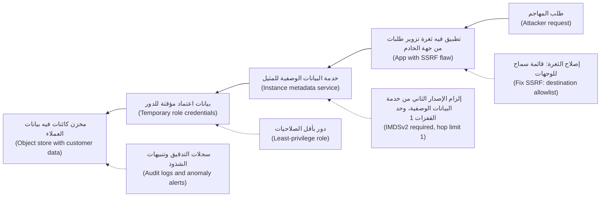
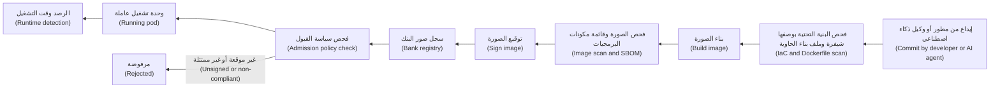
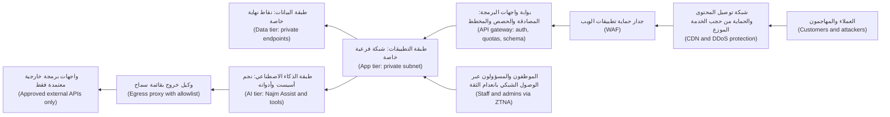

# الوحدة 7 — السحابة والبنية التحتية

*لم تعد تطبيقات بنك نجم تعمل على خوادم في مركز بياناته الخاص. بل تعمل على منصةٍ سحابية: حاوياتٌ (containers) على خدمة Kubernetes مُدارة، ومخزن كائنات، وقاعدة بيانات مُدارة، وخطوط تكاملٍ ونشرٍ مستمرين. وقد تكون الشيفرة نظيفة ومع ذلك يُخترق البنك عبر حاوية تخزينٍ عامة واحدة، أو دورٍ واحد مفرط الصلاحيات، أو شبكةٍ مسطّحة واحدة. تغطي هذه الوحدة الطبقة الكامنة تحت التطبيق. فهي تبدأ بمن المسؤول عن ماذا في السحابة، ولماذا تكون إدارة الهوية والوصول هي المحيط الحقيقي، ولماذا يتسبّب سوء الإعداد من جهة العميل وبيانات الاعتماد المسرّبة، لا الهجمات على المزوّد، في معظم الحوادث السحابية. ثم تبيّن كيف تبني الحاويات وKubernetes وتشغّلها بأمان، وكيف تلتقط الأخطاء في البنية التحتية بوصفها شيفرة قبل نشرها. وتنتهي بتقسيم الشبكة، والحافة، أي شبكة توصيل المحتوى وجدار حماية تطبيقات الويب (WAF) وبوابة واجهات البرمجة (API gateway)، والحماية من هجمات حجب الخدمة الموزّع (DDoS protection)، وهي ضوابط تحدّ مما يستطيع المهاجم بلوغه وتُبقي الخدمة قائمةً تحت الإغراق. ستتابع علي وهو يكتشف حاوية تخزينٍ عامة للفواتير، وفريق طارق وهو يقوّي العنقود الذي يشغّل أدوات نجم أسيست، ومريم بينما يتنقّل فريقها الأحمر عبر شبكةٍ داخلية مسطّحة، وجاسم وهو يخطط لإغراقٍ في يوم صرف الرواتب.*

> **المراحل:** Design, Build, Deploy, Operate — جعل المنصة الكامنة تحت كل تطبيقٍ في بنك نجم آمنةً افتراضيًا، ومفروضةً بالشيفرة، وقابلةً للمراقبة حين يحاول أحدٌ تجاوزها.

---

# 7.1 — أمن السحابة: المسؤولية المشتركة وإدارة الهوية والوصول وسوء الإعداد
*المستوى: 🟡 متوسط* · *المتطلبات: 1.2، 2.3، 5.2* · *المرحلة: Design, Deploy*

**بعد هذا الدرس تستطيع** أن تكتب جدول مسؤولية مشتركة لثلاثة أنظمة سحابية، وتقلّص دورًا تخزينيًا بصلاحيات شاملة إلى أقل الصلاحيات، مع التأكد من رفض القراءة والحذف. *مدة الدراسة: نحو 110 دقيقة (تقدير).*

## ⚡ الدرس في دقيقة
- **نموذج المسؤولية المشتركة**: يؤمّن المزوّد السحابةَ نفسها، أي المباني والعتاد والمحاكاة الافتراضية والمكوّنات الداخلية للخدمات المُدارة. وتؤمّن أنت ما تضعه فيها وكيف تضبطه. ويتحرّك هذا التقسيم بحسب نوع الخدمة.
- في السحابة، **الهوية هي المحيط**. فكل استدعاءٍ لواجهة برمجة يُفحص مقابل سياسة إدارة الهوية والوصول، ولذا فإن دورًا مفرط الصلاحيات أو مفتاحًا مسرّبًا أثمن لدى المهاجم من منفذٍ مفتوح.
- تبدأ معظم الاختراقات السحابية بأخطاءٍ من جهة العميل، وفي مقدّمتها **سوء الإعداد (misconfiguration)** وبيانات الاعتماد الضعيفة أو المسرّبة، كالتخزين العام، والصلاحيات الشاملة، والمفاتيح طويلة العمر، والتسجيل المعطَّل، لا بهجومٍ بارع على المزوّد.
- القاعدة الأهم: تحصل أعباء العمل وخطوط التسليم على **بيانات اعتمادٍ قصيرة العمر عبر الاتحاد**، محصورةٍ في ما تحتاجه بالضبط. أما البشر فلا يحصلون على صلاحيات إدارةٍ دائمة.
- مؤشر القرار: «بأيّ هويةٍ يعمل هذا، وماذا يستطيع أن يفعل، وما الذي يمنع جعله عامًّا؟»
- أكبر فخ: إصلاح الأمور يدويًا في وحدة التحكم. فالضوابط الوقائية (Guardrails) مكانها الشيفرة والسياسات على مستوى المؤسسة، وإلا فإنها تنحرف عائدةً إلى ما كانت عليه.

## 🧭 لماذا يهم
في أسبوع علي الأول، يُدرج ماسح الوضع الأمني السحابي نتيجة «حاوية تخزين عامة، خطورة عالية» في حساب اختبار. فقبل ثلاثة أسابيع، كان مطوّرٌ قد عطّل حجب الوصول العام «لمدة ساعة» كي يتمكّن مدير منتجٍ من أن يُري شريكًا شكل فواتير بوابة الشركات الصغيرة. وكانت حاوية التخزين نسخةً من بيئة الإنتاج أُعدّت لاختبار ترحيل، فكانت تحوي فواتير حقيقية: أسماء الشركات وأرقام الحسابات والمبالغ. وذهب التنبيه إلى صندوق بريدٍ لا يقرؤه أحد.

لا تسأل نورة «من فعل هذا؟». بل تسأل: «لماذا استطاع شخصٌ واحد فعل هذا بنقرةٍ واحدة، وببيانات عملاء حقيقية، ولماذا استغرقنا ثلاثة أسابيع لنلاحظ ذلك؟» وكل جوابٍ ضابطٌ أمني. فلا تُنسخ بيانات الإنتاج إلى حسابات الاختبار ما لم تكن محجوبة (5.3). ويُحجب الوصول العام على مستوى المؤسسة، فلا يستطيع أي حسابٍ منفرد تعطيله. وتذهب تنبيهات الوضع الأمني إلى طابورٍ له مالكٌ وموعدٌ نهائي.

يُظهر السجل العام حجم الرهان. ففي اختراق Capital One عام 2019، وكما أُفيد علنًا، استخدم مهاجمٌ ثغرةً من نوع تزوير الطلبات من جهة الخادم (server-side request forgery, SSRF)، أُفيد بأنها كانت في جدار حماية تطبيقات ويب سيئ الإعداد، ليجعل خادمًا يستعلم من خدمة البيانات الوصفية للمثيل (instance metadata service) في السحابة. فأعادت الخدمة بيانات اعتمادٍ مؤقتة لدور الخادم، وكانت صلاحيات التخزين الواسعة لهذا الدور هي ما مكّن المهاجم من نسخ بياناتٍ عن عددٍ كبير جدًا من المتقدّمين لبطاقات الائتمان. لقد فعلت البنية التحتية للمزوّد بالضبط ما طُلب منها. فقد اصطفّت ثلاثة شروط: مكوّنٌ عرضةٌ لتزوير الطلبات من جهة الخادم، وخدمة بياناتٍ وصفية تجيب عن طلبات GET بسيطة، إذ لم تقدّم AWS الإصدار IMDSv2 القائم على الرموز المميزة إلا لاحقًا في 2019، ودورٌ مفرط الاتساع. ويدور هذا الدرس حول ضمان ألّا تصطفّ هذه الشروط أبدًا في بنك نجم.

## 📐 كيف يعمل

### 🟢 الأساسيات

**المسؤولية المشتركة.** المزوّد مسؤولٌ عن **أمن السحابة**؛ والعميل مسؤولٌ عن **الأمن داخل السحابة**. ويتوقف موضع الخط الفاصل على الخدمة:

| تستخدم… | يؤمّن المزوّد | يبقى على بنك نجم أن يؤمّن |
|---|---|---|
| **IaaS**، أي البنية التحتية كخدمة: الآلات الافتراضية والشبكات | المرافق والعتاد وطبقة المحاكاة الافتراضية | تحديثات نظام التشغيل، والتطبيق، وقواعد الشبكة، والهويات، والبيانات |
| **خدمة Kubernetes المُدارة (Managed Kubernetes)** | ما سبق، إضافةً إلى مستوى التحكم | أعباء العمل، والصور، وترقيات العقد العاملة، وهي مشتركة غالبًا، وصلاحيات العنقود، وسياسات الشبكة، والهويات، والبيانات |
| **PaaS**، أي المنصة كخدمة: قاعدة البيانات المُدارة ومخزن الكائنات والحوسبة بلا خوادم | ما سبق، إضافةً إلى برمجيات الخدمة وتحديثها | الإعدادات: عامة أم خاصة، والتشفير (encryption)، والنسخ الاحتياطية؛ وسياسات الوصول، والبيانات |
| **SaaS**، أي البرمجيات كخدمة: البريد الإلكتروني وإدارة علاقات العملاء وواجهة برمجة لنموذجٍ لغوي كبير مستضاف | كل شيءٍ تقني تقريبًا | الحسابات، والمصادقة متعددة العوامل (MFA)، وإعدادات المشاركة، والبيانات التي ترسلها إليها |

شيئان لا ينتقلان أبدًا إلى المزوّد: **هوياتك وقرارات الوصول لديك**، و**بياناتك**.

**إدارة الهوية والوصول في صفحةٍ واحدة.** تقرّر إدارة الهوية والوصول من يستطيع فعل ماذا بأيّ مورد. وتختلف المصطلحات قليلًا بين AWS وMicrosoft Azure وGoogle Cloud، لكن الأفكار واحدة:
- **الجهة الفاعلة**: من يتصرّف. مستخدمٌ بشري، أو مجموعة، أو **دور**، وهو هويةٌ *تُتقمَّص* لوقتٍ قصير بدل تسجيل الدخول إليها، أو **هوية عبء عمل**، وهي حساب خدمة لتطبيقٍ أو خط تسليم.
- **الإجراء**: عملية واجهة البرمجة، مثل «قراءة كائن» أو «حذف قاعدة بيانات».
- **المورد**: ما ينطبق عليه الإجراء، مثل حاوية تخزينٍ واحدة.
- **الشرط**: متى يُسمح به، مثلًا مع المصادقة متعددة العوامل فقط أو عبر TLS فقط.
- **السياسة**: وثيقةٌ تجمع هذه العناصر، تُرفق بجهةٍ فاعلة أو بمورد.

يُفحص كل طلبٍ لواجهة البرمجة مقابل هذه السياسات، سواء جاء من وحدة التحكم أو أداة سطر أوامر أو خط تسليم أو شيفرة. ولهذا **الهوية هي المحيط**: فالمهاجم الذي يملك بيانات اعتمادٍ صالحة لدورٍ قوي لا يحتاج إلى كسر أي شيء.

**أقل الصلاحيات، بصورةٍ ملموسة (Least privilege, concretely).** كثيرًا ما تبدو السياسة المكتوبة على عجل، أو التي كتبها وكيل برمجةٍ بالذكاء الاصطناعي طُلب منه «اجعلها تعمل» (6.3)، مثل المثال الأول أدناه. أما النسخة المُصلَحة فلا تمنح إلا ما تفعله خدمة الرفع في بوابة الشركات الصغيرة: كتابة الكائنات في مجلدٍ واحد من حاوية تخزينٍ واحدة. والصياغة هنا صياغة AWS؛ وتعبّر Azure وGoogle Cloud عن الفكرة نفسها.

الثغرة: أي إجراءٍ تخزيني على كل حاويات التخزين في الحساب.

```json
{ "Version": "2012-10-17",
  "Statement": [{ "Effect": "Allow", "Action": "s3:*", "Resource": "*" }] }
```

المُصلَح: كتابةٌ فقط، وحاوية تخزينٍ واحدة، وبادئةٌ واحدة، وTLS فقط.

```json
{ "Version": "2012-10-17",
  "Statement": [{
    "Effect": "Allow",
    "Action": ["s3:PutObject"],
    "Resource": "arn:aws:s3:::najm-sme-invoices-prod/uploads/*",
    "Condition": { "Bool": { "aws:SecureTransport": "true" } } }] }
```

**حالات سوء الإعداد المعتادة.** تُفرد قائمة OWASP Top 10 فئةً مستقلة لـ *سوء الإعداد الأمني*، وهو في السحابة أحد أكثر طرق الدخول شيوعًا:
- **التخزين العام**: حاويات تخزينٍ يقرؤها أي أحد، وكثيرًا ما يكون ذلك «مؤقتًا».
- **الهويات مفرطة الاتساع**: إجراءاتٌ أو مواردُ شاملة؛ وأدوارٌ إدارية للتطبيقات.
- **مفاتيح الوصول طويلة العمر** في الشيفرة ومتغيرات التكامل المستمر والحواسيب المحمولة (5.2).
- **قواعد الشبكة المفتوحة**: قواعد بياناتٍ أو منافذ إدارية يمكن بلوغها من الإنترنت (7.3).
- **التسجيل المعطَّل**: لا أحد يستطيع الإجابة عن سؤال «ماذا لمسوا؟».
- **الإعدادات الافتراضية غير الآمنة**: لقطاتٌ عامة، ونسخٌ احتياطية غير مشفّرة، ونقاط نهايةٍ عامة تُركت مفعّلة.

### 🟡 التعمق أكثر

**بيانات اعتمادٍ قصيرة العمر عبر الاتحاد.** مفتاح الوصول طويل العمر كلمةُ مرورٍ لا تنتهي صلاحيتها أبدًا وتُنسخ هنا وهناك. والنمط الحديث هو **اتحاد هوية عبء العمل**: يُثبت عبء العمل هويته برمزٍ مميز (token) من نظامٍ تثق به السحابة، ويتلقّى بيانات اعتمادٍ تنتهي صلاحيتها خلال دقائق أو ساعات. ومن الأمثلة: حساب خدمة في Kubernetes مربوطٌ بدورٍ سحابي، أو نظام تكاملٍ مستمر مثل GitHub Actions يقدّم رمزًا مميزًا من نوع OpenID Connect (OIDC token) (3.2) إلى خدمة الرموز في السحابة.

يكمن الفخ في **سياسة الثقة**، التي تحدّد *أيّ* الرموز المميزة يجوز لها تقمّص الدور. فإذا كانت لا تتحقق إلا من أن الرمز جاء من مزوّد التكامل المستمر، فقد يتمكّن سير عملٍ في مستودع شخصٍ آخر من تقمّص دورك. اربطها بمستودعك وبيئتك:

```json
"Condition": {
  "StringEquals": {
    "token.actions.githubusercontent.com:aud": "sts.amazonaws.com",
    "token.actions.githubusercontent.com:sub": "repo:najm-bank/sme-portal:environment:production"
  }
}
```

**خدمة البيانات الوصفية وتزوير الطلبات من جهة الخادم.** تستطيع الآلات الافتراضية السحابية أن تسأل **خدمة البيانات الوصفية للمثيل** المحلية عن نفسها. وهي تقع لدى المزوّدين الرئيسيين على العنوان المحلي للرابط 169.254.169.254، ويمكنها أن تعيد بيانات اعتمادٍ مؤقتة لدور الآلة أو لهوية الخدمة المرفقة بها. ويكون ذلك خطيرًا إذا كان في التطبيق خللٌ من نوع تزوير الطلبات من جهة الخادم (SSRF flaw) (2.3)، لأن المهاجم يستطيع جعل الخادم يسأل نيابةً عنه. دافِع على طبقات:
- يتطلّب **IMDSv2** في AWS رمز جلسة (session token)، يُحصل عليه بطلب PUT منفصل ويُعاد إرساله في ترويسة، ما يحجب معظم هجمات تزوير الطلبات البسيطة التي لا تستطيع إلا إطلاق طلبات GET. اضبطه على *إلزامي* واضبط حدّ القفزات للاستجابة كي لا تستطيع الحاويات بلوغه إلا إذا احتاجت إليه. وقد كانت AWS تنقل عمليات الإطلاق الجديدة نحو إعداداتٍ افتراضية تقتصر على IMDSv2؛ فتحقّق من الإعدادات الافتراضية الحالية. وتتطلّب Azure وGoogle Cloud ترويسة طلبٍ خاصة، هي `Metadata: true` و`Metadata-Flavor: Google`، لتحقيق أثرٍ مشابه.
- **أصلِح ثغرة تزوير الطلبات** بقائمة سماحٍ للوجهات (2.3).
- **احجب الخروج** إلى عنوان البيانات الوصفية من أعباء العمل التي لا تحتاج إليه (7.2، 7.3).
- **أبقِ الدور ضيقًا**، كي لا تفتح بيانات الاعتماد المسروقة إلا القليل جدًا.
- **ارصد** استخدام بيانات اعتماد الدور من خارج شبكتك؛ إذ تستطيع خدمات رصد التهديدات لدى المزوّدين الإبلاغ عن ذلك.



كل خطٍّ منقّط ضابطٌ مستقل يكسر السلسلة: إنه الدفاع المتعدد الطبقات (defence in depth) (1.2) مطبَّقًا على مسار هجومٍ حقيقي.

**الضوابط الوقائية فوق مستوى الحساب.** الفرق ترتكب أخطاء؛ والسياسات على مستوى المؤسسة تمنع تلك الأخطاء من أن تُحدث أثرًا. ويقدّم كل مزوّد **سياسات ضوابط وقائية للمؤسسة** تنطبق على كل حسابٍ أو مشروعٍ تحتها: سياسات التحكم في الخدمات في AWS Organizations، وAzure Policy، وخدمة سياسات المؤسسة في Google Cloud. وقواعد بنك نجم موجودةٌ في خط الأساس أدناه. والضوابط الوقائية المانعة، أي «لا يمكنك»، تتفوّق على الكاشفة، أي «سنخبرك لاحقًا»، لكنك تحتاج إلى كلتيهما.

**إدارة الوضع الأمني.** تقارن أداة **إدارة الوضع الأمني للسحابة** إعداداتك السحابية باستمرار بخط أساس، وهو عادةً **معايير CIS**، أي أدلة التقوية التوافقية الصادرة عن مركز أمن الإنترنت، إضافةً إلى قواعدك الخاصة. وتفعل ذلك ماسحاتٌ مفتوحة المصدر مثل Prowler وScoutSuite، وكذلك الأدوات المدمجة لدى المزوّدين. تكتشف أداة CSPM الانحراف لكنها لا تُصلحه، ونتائجها الكثيرة تحتاج إلى ترتيب الأولويات، كما في قسم 🔴 أدناه.

**سجلات التدقيق دليل.** فعّل سجل تدقيق واجهات البرمجة لدى المزوّد، أي AWS CloudTrail وAzure Activity Log وGoogle Cloud Audit Logs، في كل حساب، وأضف تسجيل الوصول إلى البيانات للمخازن الحساسة، ويكون ذلك في Azure عبر سجلات التشخيص لكل مورد. وأرسله إلى حساب سجلاتٍ منفصل ومُحكم الإغلاق حيث لا يستطيع الأشخاص الذين يسجّل أفعالهم حذفه. ويبني فريق جاسم عمليات الرصد عليه في 10.1.

### 🔴 نظرة الخبير

**حُدَّ من نطاق الضرر بالتصميم.** تفصل **منطقة الهبوط**، وهي بنيةٌ متعددة الحسابات مبنيةٌ مسبقًا ينشر معظم المزوّدين تصميمًا مرجعيًا لها، بين بيئة الإنتاج وغير الإنتاج وأدوات الأمن والتسجيل والشبكات المشتركة في حساباتٍ أو مشاريع مختلفة. فالبيئة التجريبية المخترقة لمطوّر لا تستطيع بلوغ بيانات الإنتاج، لأنه لا يوجد مسار ثقة. ولا تصل بيانات الإنتاج غير المحجوبة أبدًا إلى حسابات غير الإنتاج، وهي بالضبط القاعدة التي خرقتها حادثة حاوية الفواتير.

**ابحث عن التركيبات السامّة.** قد تُبلغ أداة CSPM عن آلاف النتائج المتوسطة؛ أما المهاجم فيحتاج إلى مسارٍ واحد. أعطِ الأولوية حيث **تتركّب** النتائج: التعرّض للإنترنت، إضافةً إلى ضعفٍ قابل للاستغلال، إضافةً إلى هويةٍ تستطيع بلوغ بياناتٍ حساسة. هذا هو شكل سلسلة Capital One. وتبني المنصات التجارية هذا المخطط البياني، وهي تُباع غالبًا تحت اسم CNAPP، أي منصات حماية التطبيقات السحابية الأصلية؛ ويمكنك مقاربته بوسم الموارد بحساسية البيانات ودرجة التعرّض. قيِّم المسارات بأساليب 1.3، لا بالخطورة الافتراضية للماسح. وتساعد مصفوفة السحابة في MITRE ATT&CK، بتقنياتٍ مثل *Unsecured Credentials: Cloud Instance Metadata API*، على التحقق من أن لكل تقنيةٍ ذات صلة ضابطًا أو آليةَ رصد.

**اضبط حجم الصلاحيات بالأدلة.** لا أحد يكتب سياسةً مثالية في اليوم الأول. وحيث لا تستطيع البدء ضيقًا، امنح سياسةً أوسع في غير الإنتاج، وسجّل الإجراءات المستخدمة فعلًا من سجلات التدقيق، وولّد سياسة الإنتاج من ذلك. ويقدّم المزوّدون أدواتٍ تُبلغ عن الصلاحيات غير المستخدمة، مثل AWS IAM Access Analyzer وأداة توصيات IAM في Google Cloud.

**لا صلاحيات إدارةٍ دائمة للبشر.** يكون المهندسون للقراءة فقط افتراضيًا، ويطلبون الوصول المرتفع **في الوقت المناسب**، مع سبب وحدٍّ زمني وموافقة وتسجيل. أما حسابات الجذر فهي لحالات **كسر الزجاج** فقط: مصادقة متعددة العوامل بمفتاحٍ عتادي (hardware-key MFA) وتنبيهٌ عند كل استخدام.

**المفاتيح وموقع البيانات.** استخدم **المفاتيح التي يديرها العميل** (5.1) للبيانات السرية، مع فصل مديري المفاتيح عن مستخدمي البيانات. وحيث يقيّد القانون مكان تخزين البيانات، تصبح قيود المناطق ضابطًا وقائيًا أيضًا (11.2).

**خدمات الذكاء الاصطناعي موارد سحابية.** للنموذج المستضاف لنجم أسيست ولمخزن المتجهات المُدار لمساعد مذكرات الائتمان إدارةُ هويةٍ ووصول (IAM)، وتعرّضٌ شبكي، وسجلات، شأنهما شأن أي موردٍ آخر. استخدم الشبكات الخاصة لنقاط نهاية النماذج حيث تكون مدعومة، واحفظ مفاتيح واجهات برمجة النماذج اللغوية الكبيرة في مدير الأسرار بمفتاحٍ واحد لكل خدمة وبحدود إنفاق، وسجّل من استدعى أيّ نموذج. فمفتاح نموذجٍ لغوي كبير مسرّب خطرٌ على البيانات وفاتورةٌ في آنٍ معًا، وهذا هو البند OWASP LLM10:2025، الاستهلاك غير المحدود.

## 🧰 الأدوات
| الضابط أو المعيار أو الأداة | ما هو وماذا يفعل | متى تلجأ إليه |
|---|---|---|
| **Shared responsibility model** — نموذج المسؤولية المشتركة | بيان المزوّد لما يؤمّنه هو وما تؤمّنه أنت | اختيار خدمة؛ ونمذجة التهديدات (threat modelling)؛ وسؤال «أليس هذا من عمل المزوّد؟» |
| **Least-privilege IAM** — إدارة الهوية والوصول بأقل الصلاحيات | سياساتٌ محصورةٌ في إجراءاتٍ وموارد وشروطٍ محددة | كل دورٍ وحساب خدمةٍ وخط تسليم |
| **Workload identity federation** — اتحاد هوية عبء العمل | بيانات اعتمادٍ قصيرة العمر تُصدر مقابل رمزٍ مميز موثوق، بدلًا من المفاتيح الثابتة | من التكامل والنشر المستمرين إلى السحابة؛ ومن وحدات التشغيل إلى واجهات البرمجة السحابية |
| **IMDSv2** — في AWS، الإصدار الثاني من خدمة البيانات الوصفية للمثيل | خدمة بياناتٍ وصفية برمز جلسة تقاوم هجمات تزوير الطلبات البسيطة | كل آلةٍ افتراضية وعقدة في AWS؛ مضبوطةً على إلزامي |
| **Organisation guardrail policies** — سياسات الضوابط الوقائية للمؤسسة: AWS SCPs وAzure Policy وGoogle Cloud Organization Policy | قواعد فوق كل حساب لا تستطيع الفرق تجاوزها | حجب التخزين العام، وحماية سجلات التدقيق، وتقييد المناطق |
| **CSPM** — إدارة الوضع الأمني للسحابة، مثل Prowler وScoutSuite | فحصٌ مستمر لإعدادات السحابة مقابل خط أساس | منذ الحساب الأول؛ مع ترتيب الأولويات حسب التركيبات السامّة |
| **CIS Benchmarks** — معايير مركز أمن الإنترنت | خطوط أساسٍ توافقية للتقوية لكل مزوّدٍ سحابي ومنصة | تعريف «الإعداد الآمن»؛ وأدلة التدقيق |
| **Cloud audit logs** — سجلات التدقيق السحابية: AWS CloudTrail وAzure Activity Log وGoogle Cloud Audit Logs | سجلاتٌ لاستدعاءات واجهات البرمجة الإدارية ولاستدعاءات الوصول إلى البيانات المختارة | مفعّلةٌ دائمًا، في حساب سجلاتٍ منفصل ومقفل (10.1) |

## 🏛️ عمليًا في بنك نجم
يصوغ علي **خط الأساس للضوابط الوقائية السحابية في نجم، الإصدار 1**؛ ويراجعه طارق، ويعتمده حمد، كبير مسؤولي أمن المعلومات (CISO).

| المعرّف | القاعدة | كيف تُفرض | المالك والاستثناءات |
|---|---|---|---|
| CG-01 | لا يجوز أن يكون أي تخزين كائناتٍ عامًّا | ضابطٌ وقائي للمؤسسة يرفض السياسات العامة؛ وحجب الوصول العام على مستوى الحساب؛ وتنبيهٌ من أداة إدارة الوضع الأمني | فريق المنصة؛ أصول الموقع الإلكتروني العام فقط، في حسابٍ مخصّص |
| CG-02 | لا مفاتيح سحابية طويلة العمر لأعباء العمل أو التكامل المستمر | اتحاد OIDC لكل خطوط التسليم؛ وتنبيهٌ عند ظهور أي مفتاح وصولٍ جديد | فريق المنصة؛ لا استثناءات في الإنتاج |
| CG-03 | IMDSv2 إلزاميٌّ على كل آلةٍ افتراضية وعقدة | ضابطٌ وقائي عند الإطلاق؛ وحدّ القفزات 1 على عقد Kubernetes | فريق المنصة؛ لا استثناءات |
| CG-04 | سجلات التدقيق مفعّلةٌ في كل مكان، ومخزّنةٌ بنمط الكتابة مرةً واحدة في حساب أرشيف السجلات | ضابطٌ وقائي يرفض إيقاف مسارات التدقيق أو حذفها | مركز العمليات الأمنية (SOC)، أي جاسم؛ لا استثناءات |
| CG-05 | لا إجراءات شاملة على موارد الإنتاج | فحص سياسات البنية التحتية بوصفها شيفرة في التكامل المستمر (7.2)؛ ومراجعةٌ فصلية للصلاحيات غير المستخدمة | مالكو الخدمات؛ استثناءاتٌ محددة المدة تعتمدها نورة |
| CG-06 | لا بيانات إنتاجٍ غير محجوبة في حسابات غير الإنتاج | ضابطٌ وقائي على النسخ بين الحسابات؛ وفحصٌ بحثًا عن البيانات الشخصية | مالكو البيانات مع سارة، مسؤولة حماية البيانات (DPO) |
| CG-07 | بيانات العملاء في المناطق المعتمدة فقط | ضابطٌ وقائي يرفض المناطق الأخرى | فريق المنصة مع ليلى |
| CG-08 | لا صلاحيات إدارةٍ بشرية دائمة؛ وكسر الزجاج بمصادقةٍ متعددة العوامل عتادية | الوصول في الوقت المناسب؛ وتنبيهٌ عند تسجيل الدخول بكسر الزجاج | فريق إدارة الهوية والوصول؛ لا استثناءات |
| CG-09 | نقاط نهاية النماذج ومفاتيح النماذج اللغوية الكبيرة تتبع القواعد من CG-01 إلى CG-08 | نقاط نهاية خاصة (Private endpoints)؛ والمفاتيح في مدير الأسرار بحدود إنفاق | منصة الذكاء الاصطناعي: دانة وطارق |

ويحصل كل دورٍ في الإنتاج أيضًا على **بطاقة مراجعة الدور**: عبء العمل الذي يتقمّصه، وما رُبطت به سياسة الثقة الخاصة به، والإجراءات الممنوحة، والإجراءات المستخدمة فعلًا في آخر 90 يومًا، مأخوذةً من سجلات التدقيق، وأكثر البيانات حساسيةً التي يستطيع بلوغها، ومن راجعه آخر مرة.

## 🛠️ التمارين
- 🟢 لثلاثة أنظمةٍ تعمل عليها، أو لواجهة برمجة تطبيق نجم للهاتف وحاوية فواتير بوابة الشركات الصغيرة والنموذج المستضاف لنجم أسيست، اكتب جدول مسؤوليةٍ مشتركة: ما يؤمّنه المزوّد، وما تؤمّنه أنت، وحالة سوء إعدادٍ واحدة يكون الخطأ فيها خطأك بالكامل. *يكتمل عندما:* يذكر كل صفٍّ إعدادًا واحدًا على الأقل للهوية وإعدادًا واحدًا للبيانات من جهتك.
- 🟡 في حسابٍ سحابي تجريبي شخصي تملكه، أنشئ دورًا بسياسة تخزينٍ شاملة. ثم أعد كتابتها إلى أقل الصلاحيات التي تحتاجها خدمة رفعٍ واحدة، وتأكّد بمحاكي السياسات لدى المزوّد أو باستدعاءٍ تجريبي أن القراءة والحذف مرفوضان. احذف الموارد بعد ذلك. *يكتمل عندما:* تنجح الكتابة، وتفشل القراءة والحذف، وتسمّي سياسة الثقة جهةً فاعلةً واحدة محددة.
- 🔴 شغّل ماسحًا مفتوح المصدر لإدارة الوضع الأمني مثل Prowler على حسابك التجريبي فقط. جمّع النتائج في تركيباتٍ سامّة واكتب قائمة إصلاحاتٍ مرتبةً حسب الأولوية في صفحةٍ واحدة. *يكتمل عندما:* يسمّي كل بندٍ من بنودك الثلاثة الأولى مسار الهجوم الذي يكسره، وتُخفَّض أولوية نتيجةٍ واحدة على الأقل عمدًا مع سببٍ مكتوب.

## ⚠️ أخطاء وفخاخ
- **«المزوّد يتولّى الأمن»** يؤمّن المزوّد المنصة؛ أما إدارة الهوية والوصول والبيانات والإعدادات فهي لك. دوِّن التقسيم لكل خدمة.
- **الوصول العام أو الصلاحيات الشاملة «المؤقتة».** الإعدادات المؤقتة تبقى. احجب التخزين العام على مستوى المؤسسة ومرّر الاستثناءات عبر الموافقة.
- **المفاتيح الثابتة في خطوط التسليم.** تتسرّب متغيرات التكامل المستمر عبر السجلات والتفرّعات. استخدم اتحاد OIDC المربوط بالمستودع والبيئة.
- **الإصلاح في وحدة التحكم.** تنحرف الإصلاحات اليدوية عائدةً. أصلِحه في البنية التحتية بوصفها شيفرة (7.2) وأضف فحصًا.
- **تجاهل خدمة البيانات الوصفية.** فهي تحوّل أي ثغرة تزوير طلباتٍ من جهة الخادم إلى سرقة بيانات اعتماد. ألزِم IMDSv2 أو ما يعادله من حماية الترويسة، واحجب الخروج إليها، وأبقِ الدور ضيقًا.

## 🧾 الخلاصة
- يؤمّن المزوّد السحابة؛ وتؤمّن أنت هوياتك وبياناتك وإعداداتك فيها.
- إدارة الهوية والوصول هي المحيط: احصر كل سياسة في إجراءاتٍ وموارد وشروط، وفضّل بيانات الاعتماد الاتحادية قصيرة العمر على المفاتيح الثابتة.
- معظم الحوادث السحابية هي حالات سوء إعدادٍ من جهة العميل أو أخطاءٌ في بيانات الاعتماد. وتمنع الضوابط الوقائية على مستوى المؤسسة كثيرًا منها، وتكتشف أداة CSPM ما يفلت منها.
- تزوير الطلبات من جهة الخادم (SSRF) وخدمة البيانات الوصفية والدور مفرط الصلاحيات تشكّل سلسلةً معروفة؛ وكل ضابطٍ من الضوابط المتعددة الطبقات يكسرها.
- الحسابات المنفصلة تحدّ من نطاق الضرر؛ وسجلات التدقيق المقفلة هي دليلك.

## ✍️ اختبر نفسك

**1. ينقل بنك نجم قاعدة بيانات بوابة الشركات الصغيرة من آلةٍ افتراضية يديرها بنفسه إلى خدمة قاعدة البيانات المُدارة لدى المزوّد. أيّ مسؤوليةٍ تنتقل إلى المزوّد؟**

- A. تحديد من يجوز له الاتصال بقاعدة البيانات ومسارات الشبكة المؤدية إليها
- B. تحديث محرّك قاعدة البيانات ونظام التشغيل الذي تحته
- C. تحديد ما إذا كانت لها نقطة نهايةٍ عامة وإعدادات التشفير التي تستخدمها
- D. تصنيف بيانات العملاء فيها وتحديد مدة الاحتفاظ بكل فئة

<details><summary>الإجابة</summary>

**B.** في الخدمة المُدارة، أي المنصة كخدمة، يحدّث المزوّد المحرّك ونظام التشغيل. أما الوصول في A، والتعرّض (exposure) في C، والبيانات في D، فتبقى على العميل. انظر: 🟢 الأساسيات.

</details>

**2. يكتشف علي أن خط التكامل المستمر ينشر إلى بيئة الإنتاج بمفتاح وصول مخزّنٍ بوصفه متغيرًا في التكامل المستمر منذ عامين. ما أفضل بديل؟**

- A. دوّر المفتاح كل 90 يومًا
- B. انقل المفتاح إلى ملفٍ مشفّر في مستودع الشيفرة المصدرية، مع حفظ كلمة فك التشفير في إعدادات خط التسليم المحمية
- C. استخدم اتحاد هوية عبء العمل عبر OIDC، مع ربط سياسة الثقة للدور بمستودع البنك وبيئة الإنتاج
- D. امنح خط التسليم مستخدمًا إداريًا منفصلًا مع مصادقةٍ متعددة العوامل

<details><summary>الإجابة</summary>

**C.** يُصدر الاتحاد بيانات اعتمادٍ قصيرة العمر ويزيل المفتاح الثابت؛ ويمنع ربط سياسة الثقة المستودعاتِ الأخرى من تقمّص الدور. أما A فيُبقي سرًّا طويل العمر؛ وD يضيف صلاحياتٍ إدارية ولا يمكنه العمل دون تدخّلٍ بشري. انظر: 🟡 التعمق أكثر.

</details>

**3. يُبلغ مختبِر اختراقٍ مفوَّض عن ثغرة تزوير طلباتٍ من جهة الخادم في خدمة تقارير على آلةٍ افتراضية سحابية. أيّ مجموعةٍ من الإجراءات تقلّل احتمال اختراق البيانات أكثر من غيرها؟**

- A. أصلِح التزوير بقائمة سماحٍ للوجهات، وألزِم IMDSv2، واحصر دور الآلة في الحدّ الأدنى
- B. أضف اختبار CAPTCHA إلى صفحة التقارير، لأن الهجمات الآلية هي ما يستغل هذه الثغرة في العادة
- C. انقل الخدمة إلى نوع مثيلٍ أكبر ذي موارد أعلى، فالثغرة تظهر حين تقلّ الذاكرة والمعالج في الآلة
- D. اعتمد على المزوّد، لأن خدمة البيانات الوصفية من مسؤوليته بموجب نموذج المسؤولية المشتركة، ولا شيء مطلوب منك

<details><summary>الإجابة</summary>

**A.** تكسر هذه الإجراءات السلسلة الممتدة من تزوير الطلبات إلى البيانات الوصفية إلى بيانات الاعتماد إلى البيانات عند ثلاث نقاطٍ مستقلة. أما D فيُسيء فهم المسؤولية المشتركة: فإعدادات البيانات الوصفية وصلاحيات الدور من مسؤولية العميل. انظر: 🟡 التعمق أكثر.

</details>

**4. تُبلغ أداة إدارة الوضع الأمني عن 2,400 نتيجة عبر حسابات بنك نجم. من أين ينبغي أن يبدأ علي؟**

- A. بأقدم النتائج
- B. بالنتائج التي يجتمع فيها معًا التعرّض للإنترنت وضعفٌ قابل للاستغلال وهويةٌ تستطيع بلوغ بياناتٍ حساسة
- C. بكل نتيجةٍ تصنّفها الأداة «حرجة»، بالترتيب الأبجدي لاسم المورد، قبل أي نتيجةٍ مصنّفة «عالية» أو «متوسطة»، وبغضّ النظر عن مكان المورد
- D. بتعطيل أكثر القواعد ضجيجًا

<details><summary>الإجابة</summary>

**B.** التركيبات السامّة مسارات هجومٍ حقيقية، ولذا فإن إصلاحها يقلّل المخاطر بأسرع ما يمكن. أما C فيثق بالخطورة الافتراضية دون سياق؛ وD يُخفي المشكلات. انظر: 🔴 نظرة الخبير.

</details>

**5. لماذا يحجب بنك نجم التخزين العام بضابطٍ وقائي على مستوى المؤسسة بدل الثقة بأن كل فريقٍ سيضبط حاويات التخزين بشكلٍ صحيح؟**

- A. الضوابط الوقائية للمؤسسة أرخص من حاويات التخزين نفسها، ولذلك تفضّلها الفرق لتخفيض كلفة السحابة
- B. لأن أدوات إدارة الوضع الأمني لا تستطيع اكتشاف حاويات التخزين العامة، فلا يبقى إلا الحجب المسبق
- C. لأن نموذج المسؤولية المشتركة يجعل المزوّد مسؤولًا عن إعدادات حاويات التخزين، فلا يلزم فرض أي ضابط
- D. لأن أحدًا في حسابٍ واحد لا يستطيع تجاوز ضابطٍ وقائي مانع مضبوطٍ فوقه، فلا يكشف خطأٌ واحد البيانات

<details><summary>الإجابة</summary>

**D.** يحوّل الضابط المانع عبارة «يُرجى ضبطه بشكلٍ صحيح» إلى «لا يمكن فعله». وB خاطئ: فأداة إدارة الوضع الأمني تكتشف حاويات التخزين العامة، لكن بعد وقوع الأمر فقط. وC يُسيء فهم المسؤولية المشتركة: فإعدادات حاويات التخزين من مسؤولية العميل. انظر: 🟡 التعمق أكثر.

</details>

## 📚 المراجع
- AWS، نموذج المسؤولية المشتركة — https://aws.amazon.com/compliance/shared-responsibility-model/
- Microsoft، المسؤولية المشتركة في السحابة — https://learn.microsoft.com/en-us/azure/security/fundamentals/shared-responsibility
- قائمة OWASP Top 10:2025: الفئة A02 سوء الإعداد الأمني، والفئة A01 كسر التحكم في الوصول التي باتت تشمل تزوير الطلبات من جهة الخادم (وقد اختلف ترقيم 2021) — https://owasp.org/Top10/2025/
- ورقة OWASP المختصرة للوقاية من تزوير الطلبات من جهة الخادم — https://cheatsheetseries.owasp.org/cheatsheets/Server_Side_Request_Forgery_Prevention_Cheat_Sheet.html
- MITRE ATT&CK، مصفوفة السحابة — https://attack.mitre.org/matrices/enterprise/cloud/
- مركز أمن الإنترنت، معايير CIS — https://www.cisecurity.org/cis-benchmarks
- وثائق AWS، خدمة البيانات الوصفية لمثيلات Amazon EC2 وIMDSv2 — https://docs.aws.amazon.com/ec2/
- قائمة OWASP Top 10 لتطبيقات النماذج اللغوية الكبيرة، إصدار 2025، والبند LLM10، الاستهلاك غير المحدود — https://genai.owasp.org/

---

# 7.2 — الحاويات وKubernetes والبنية التحتية بوصفها شيفرة
*المستوى: 🟡 متوسط* · *المتطلبات: 6.2، 7.1* · *المرحلة: Build, Deploy*

**بعد هذا الدرس تستطيع** أن تقوّي ملف Dockerfile إلى صورة مثبَّتة الإصدار تعمل بغير صلاحيات الجذر وخالية من الأسرار، وتفرض الملف المقيَّد للحاويات وسياسة شبكة ترفض افتراضيًا على عنقود محلي. *مدة الدراسة: نحو 110 دقيقة (تقدير).*

## ⚡ الدرس في دقيقة
- **الحاوية (container)** عمليةٌ عادية تعزلها نواة المضيف، وهي نواةٌ تتشاركها مع كل حاويةٍ أخرى على الجهاز. وهي ليست حدًّا أمنيًا قويًا كالآلة الافتراضية.
- ابنِ **صورًا صغيرةً مثبّتة الإصدار** لا أسرار بداخلها، وشغّلها **بمستخدمٍ غير جذري** دون صلاحياتٍ إضافية، وافحصها ووقّعها (6.2).
- إعدادات **Kubernetes** الافتراضية متساهلة: تستطيع وحدات التشغيل (pods) التواصل فيما بينها، والعمل بصلاحيات الجذر، وتلقّي رمزٍ مميز لواجهة البرمجة. فعّل **معيار أمن وحدات التشغيل المقيَّد**، و**التحكم في الوصول القائم على الأدوار بأقل الصلاحيات**، و**سياسات الشبكة الرافضة افتراضيًا**، و**الأسرار (Secrets)** المُدارة إدارةً سليمة.
- **البنية التحتية بوصفها شيفرة** تحوّل حالات سوء الإعداد إلى شيفرة. افحصها في طلب السحب، قبل أن يصل أي شيءٍ إلى السحابة.
- مؤشر القرار: «إذا اختُرقت هذه الحاوية، فماذا تستطيع أن تبلغ، وماذا تستطيع أن تغيّر، وهل كنا سنلاحظ؟»
- أكبر فخ: معاملة نطاقات الأسماء (namespaces) كجدرانٍ صلبة بين المستأجرين، أو بين أعباء العمل الحساسة وغير الموثوقة.

## 🧭 لماذا يهم
ينقل فريق طارق **خدمة الأدوات** في نجم أسيست، وهي الشيفرة التي تجمّد البطاقات وتفتح النزاعات فعلًا حين يطلب المساعد ذلك، إلى عنقود Kubernetes المُدار لدى البنك. ويراجع علي مخطط Helm، الذي ولّد وكيلُ برمجةٍ بالذكاء الاصطناعي جزءًا كبيرًا منه. تعمل الحاوية بصلاحيات الجذر. والإعداد `privileged: true` مضبوط «لأن فحص السلامة كان يفشل من دونه». وتركّب وحدة التشغيل رمز حساب الخدمة الافتراضي، وهذا الحساب يستطيع قراءة كل سرٍّ في نطاق الأسماء. ومفتاح واجهة برمجة النظام المصرفي الأساسي موجودٌ نصًّا صريحًا في كائن ConfigMap. ولا توجد سياسات شبكة، فتستطيع وحدة التشغيل بلوغ مخزن المتجهات لمساعد مذكرات الائتمان وخدمة البيانات الوصفية للعقدة. كان كل سطرٍ تسهيلًا صغيرًا. أما مجتمعةً، فإن خطأً واحدًا لتنفيذ الشيفرة في خدمة الأدوات، أو وكيلًا تعرّض لحقن الموجّهات فعثر على خطأٍ كهذا، كان سيمنح المهاجم عمليات البطاقات ومسارًا إلى بقية العنقود.

منصات الحاويات المكشوفة وضعيفة الإعداد هدفٌ موثّقٌ جيدًا. فقد أفاد باحثون ووكالاتٌ حكومية مرارًا بوجود لوحات تحكم Kubernetes وخوادم واجهات برمجتها وخدمات الحاويات الخلفية مكشوفةً للإنترنت ويُساء استخدامها، وعادةً لتعدين العملات المشفّرة، وأحيانًا موطئَ قدمٍ إلى حساب السحابة الأوسع. ونشرت NSA وCISA إرشاداتٍ مشتركة لتقوية Kubernetes في 2021، وقد حُدّثت منذ ذلك الحين، وفي ذلك إشارةٌ إلى أن الإعدادات الافتراضية وحدها لا تكفي لبيئة الإنتاج. ويحوّل هذا الدرس هذا النوع من الإرشادات إلى خط أساسٍ تفرضه المنصة تلقائيًا.

## 📐 كيف يعمل

### 🟢 الأساسيات

**ما الحاوية حقًّا.** في Linux، الحاوية عمليةٌ تعزلها النواة بـ **نطاقات الأسماء**، أي ما تستطيع رؤيته: عملياتها وشبكتها ومنظورها لنظام الملفات، وبـ **مجموعات التحكم**، أي مقدار المعالج والذاكرة الذي يجوز لها استخدامه. ويمكن إضافة قيودٍ أخرى: **قدرات Linux**، وهي شرائح دقيقة من سلطة الجذر؛ و**seccomp**، الذي يحدّد استدعاءات النظام التي يجوز لها إجراؤها؛ و**AppArmor أو SELinux**، للتحكم الإلزامي في الوصول. وتتشارك كل الحاويات على العقدة نواةً واحدة. وقد يتيح خطأٌ في النواة، أو حاويةٌ سيئة الإعداد، كالوضع المميّز أو تركيب مجلدات المضيف داخلها، لعمليةٍ أن **تفلت** إلى العقدة وتبلغ كل وحدة تشغيلٍ أخرى عليها.

**الصور.** **الصورة** مكدّسٌ من طبقات نظام الملفات يُبنى من ملف Dockerfile أو ما يعادله. وهي ترث كل حزمةٍ في صورتها الأساسية، وكل حزمةٍ ثغرةٌ محتملة. والطبقات دائمة: فالسرّ المنسوخ في طبقة والمحذوف في الطبقة التالية يبقى في الصورة.

الثغرة:

```dockerfile
# Moving tag, large base image
FROM python:latest
# Copies .env, .git and test data too
COPY . /app
# Secret baked into a layer
ENV CORE_BANKING_API_KEY=live_xxx
RUN pip install -r /app/requirements.txt
# No USER line, so it runs as root
CMD ["python", "/app/main.py"]
```

المُصلَح؛ ويجب أن تكون تعليقات Dockerfile في أسطرٍ مستقلة، لأن علامة `#` بعد تعليمةٍ ما تُقرأ بوصفها وسيطًا:

```dockerfile
# Small base image, pinned by digest
FROM python:3.12-slim@sha256:<pinned-digest>
WORKDIR /app
COPY requirements.txt .
RUN pip install --no-cache-dir --require-hashes -r requirements.txt
# Only the code that runs; a .dockerignore keeps .env and .git out
COPY src/ ./src/
RUN useradd --uid 10001 --no-create-home app
# Non-root user
USER 10001
CMD ["python", "-m", "src.main"]
# Secrets arrive at runtime from the secrets manager, never in the image (5.2)
```

اذهب أبعد بـ **عمليات البناء متعددة المراحل**، أي الترجمة في مرحلة ونسخ النتيجة فقط إلى صورة تشغيلٍ دنيا، و**الصور الأساسية الدنيا أو «الخالية من التوزيعة»** التي لا صدفة فيها ولا مدير حزم، و**فحص الصور** في التكامل المستمر وفي السجل، علمًا بأن Trivy وGrype ماسحان شائعان مفتوحا المصدر، و**قائمة مكوّنات البرمجيات (SBOM)** لكل صورة، و**التوقيع (signing)** (6.2).

**Kubernetes في خمسة كائنات.** يشغّل Kubernetes الحاويات عبر أجهزةٍ تُسمّى **العقد**. ويحتفظ **مستوى التحكم**، ومحوره **خادم واجهة البرمجة**، بالحالة المرغوبة للعنقود؛ وفي الخدمة المُدارة يشغّله المزوّد ويحدّثه.
- **وحدة التشغيل (Pod)**: حاويةٌ أو أكثر تُجدوَل معًا؛ وهي الوحدة التي تعمل.
- **نطاق الأسماء (Namespace)**: تجميعٌ منطقي للأسماء والسياسات والحصص.
- **حساب الخدمة**: الهوية التي تستخدمها وحدة التشغيل لاستدعاء واجهة برمجة Kubernetes، ولاستدعاء واجهات البرمجة السحابية عبر الاتحاد (7.1).
- **RBAC**، أي التحكم في الوصول القائم على الأدوار: يمنح **الدور** أفعالًا، مثل get وlist وcreate وdelete…، على الموارد؛ ويمنحه **ربط الدور** لمستخدمٍ أو مجموعةٍ أو حساب خدمة. وتعمل ClusterRoles وClusterRoleBindings على مستوى العنقود كله.
- **السرّ (Secret)**: كائنٌ للقيم الحساسة. في Kubernetes الأصلي، تكون بياناته افتراضيًا **مرمّزةً بصيغة base64 فقط**، لا مشفّرةً في مخزن بيانات العنقود. وتضيف بعض الخدمات المُدارة الآن التشفير أثناء التخزين، لكن أي شخصٍ يستطيع قراءة الكائن عبر واجهة البرمجة يرى القيمة رغم ذلك.

**الرباعية الآمنة افتراضيًا.** يُشحن Kubernetes متساهلًا. وتحتاج بيئة الإنتاج إلى:
- **معايير أمن وحدات التشغيل**: ثلاثة ملفات تعريفٍ مدمجة. فملف **Privileged**، أي المميّز، بلا قيود؛ وملف **Baseline**، أي الأساسي، يحجب تصعيدات الصلاحيات المعروفة كالحاويات المميّزة؛ وملف **Restricted**، أي المقيَّد، يتطلّب أيضًا مستخدمًا غير جذري، وعدم تصعيد الصلاحيات، وإسقاط كل قدرات Linux، وملفَّ تعريفٍ لـ seccomp. ويفرضها متحكّم القبول المدمج **Pod Security Admission** لكل نطاق أسماء عبر وسم.
- **التحكم في الوصول القائم على الأدوار بأقل الصلاحيات**: لا صلاحية `cluster-admin` لأعباء العمل، ولا صلاحيات شاملة، ولا رمز واجهة برمجة في وحدات التشغيل التي لا تستدعي واجهة البرمجة أبدًا.
- **سياسات الشبكة**: افتراضيًا، تستطيع كل وحدة تشغيلٍ بلوغ كل وحدة تشغيلٍ أخرى. أضف سياسة رفضٍ افتراضي لكل نطاق أسماء، ثم سماحاتٍ صريحة (7.3). ولا تعمل السياسات إلا إذا فرضها ملحق الشبكة في العنقود.
- **الأسرار بالطريقة الصحيحة**: التشفير أثناء التخزين بمفتاحٍ من خدمة إدارة المفاتيح في السحابة، وتحكّمٌ مشدّد في الوصول القائم على الأدوار لقراءتها، ويُفضَّل مدير أسرارٍ خارجي تُزامَن منه الأسرار وقت التشغيل.

### 🟡 التعمق أكثر

**تقوية بيان عبء العمل.** توجد الإعدادات المهمة في الحقل `securityContext` لوحدة التشغيل. وكان في مخطط علي ما يلي:

```yaml
# Vulnerable: container securityContext
securityContext:
  privileged: true
  runAsUser: 0
```

مواصفة وحدة التشغيل المُصلَحة:

```yaml
spec:
  automountServiceAccountToken: false      # this pod never calls the API
  containers:
  - name: card-tools
    image: registry.najm.example/assist/card-tools@sha256:<digest>
    securityContext:
      runAsNonRoot: true
      runAsUser: 10001
      allowPrivilegeEscalation: false
      readOnlyRootFilesystem: true
      capabilities:
        drop: ["ALL"]
      seccompProfile:
        type: RuntimeDefault
```

ووسوم نطاق الأسماء التي تجعل خادم واجهة البرمجة يرفض وحدات التشغيل غير الممتثلة:

```yaml
apiVersion: v1
kind: Namespace
metadata:
  name: assist-tools
  labels:
    pod-security.kubernetes.io/enforce: restricted
    pod-security.kubernetes.io/warn: restricted
    pod-security.kubernetes.io/audit: restricted
```

لا يتطلّب ملف التعريف المقيَّد الإعداد `readOnlyRootFilesystem`، لكنه إضافةٌ رخيصة: فالمهاجم الذي يملك تنفيذ الشيفرة لا يستطيع كتابة أدواتٍ في نظام الملفات. وعبارة «كان فحص السلامة يفشل من دون الوضع المميّز» تكاد تُخفي دائمًا مشكلةً أضيق، كالربط بمنفذٍ أقل من 1024 أو الكتابة في مسارٍ للقراءة فقط.

**فخاخ التحكم في الوصول القائم على الأدوار (RBAC traps).** بعض الصلاحيات أقوى مما تبدو:
- الفعل `get` أو `list` على **الأسرار** يكشف كل بيانات اعتمادٍ ضمن النطاق.
- الفعل `create` على **وحدات التشغيل**، أو على Deployments وJobs وغيرها من الكائنات التي تُنشئ وحدات تشغيل، في نطاق أسماء يتيح لشخصٍ ما تشغيل وحدة تشغيلٍ بأي حساب خدمةٍ في ذلك النطاق والتصرّف بصلاحياته، وتركيب أي سرٍّ أو ConfigMap في ذلك النطاق.
- الأفعال `escalate` و`bind` و`impersonate` تتيح للجهة أن تمنح نفسها وصولًا أكبر.
- الرمز `*` على أي شيء.

راجع الروابط أيضًا: فالربط بالمجموعة `system:authenticated` يمنح الدور لكل هويةٍ يستطيع العنقود مصادقتها. وفي بعض الخدمات المُدارة كانت هذه المجموعة تشمل أي حسابٍ لدى مزوّد السحابة، لا موظفيك فقط، فتحقّق مما تعنيه في خدمتك.

**السياسة بوصفها شيفرة عند القبول.** لقواعد بنك نجم الخاصة، أي الصور الموقّعة من سجل البنك فقط، ومنع وسوم `latest`، وإلزامية حدود الموارد، استخدم **محرّك سياساتٍ للتحكم في القبول** مثل Kyverno أو OPA Gatekeeper. إذ يستشيره خادم واجهة البرمجة قبل قبول أي كائن، فيُرفض البيان غير الممتثل أيًّا كان من كتبه أو ما كتبه.

**البنية التحتية بوصفها شيفرة.** تصف البنية التحتية بوصفها شيفرة (IaC) موارد السحابة والعنقود في ملفاتٍ تطبّقها أداة: Terraform أو OpenTofu، وCloudFormation، وBicep، وبيانات Kubernetes، ومخططات Helm. وكل تغييرٍ قابلٌ للمراجعة، ومُدار الإصدارات، وقابلٌ للفحص *قبل* وجود المورد.

الثغرة: حاوية تخزين الفواتير مع تعطيل حجب الوصول العام.

```hcl
resource "aws_s3_bucket_public_access_block" "invoices" {
  bucket                  = aws_s3_bucket.invoices.id
  block_public_acls       = false
  block_public_policy     = false
  ignore_public_acls      = false
  restrict_public_buckets = false
}
```

المُصلَح: المفاتيح الأربعة كلها مفعّلة، إضافةً إلى التشفير بمفتاحٍ يديره العميل.

```hcl
resource "aws_s3_bucket_public_access_block" "invoices" {
  bucket                  = aws_s3_bucket.invoices.id
  block_public_acls       = true
  block_public_policy     = true
  ignore_public_acls      = true
  restrict_public_buckets = true
}

resource "aws_s3_bucket_server_side_encryption_configuration" "invoices" {
  bucket = aws_s3_bucket.invoices.id
  rule {
    apply_server_side_encryption_by_default {
      sse_algorithm     = "aws:kms"
      kms_master_key_id = aws_kms_key.invoices.arn
    }
  }
}
```

تقرأ **ماسحات البنية التحتية بوصفها شيفرة**، مثل Checkov وKICS وTrivy، هذه الملفاتِ، وتُبلغ عن التخزين العام، وقواعد الشبكة المفتوحة، والتشفير المفقود، ووحدات التشغيل المميّزة (privileged pods)، وصلاحيات إدارة الهوية والوصول الشاملة. شغّلها في طلب السحب وبوصفها بوابةً في خط التسليم. وثمة خطران خاصّان بالبنية التحتية بوصفها شيفرة:
- **ملفات الحالة.** قد تحمل حالة Terraform قيمًا سرية بنصٍّ صريح. احفظها في واجهةٍ خلفية بعيدة مشفّرة ومضبوطة الوصول، لا في المستودع أبدًا.
- **الانحراف.** يغيّر أحدهم موردًا يدويًا. اكتشف الانحراف بشكلٍ مجدول، أي بخطةٍ ينبغي ألّا تُظهر أي تغييرات، وأصلِحه في الشيفرة.



### 🔴 نظرة الخبير

**نطاقات الأسماء جدرانٌ ليّنة.** تتشارك وحدات التشغيل في نطاقات أسماءٍ مختلفة العقدَ والنواةَ رغم ذلك، وأخطاء التحكم في الوصول القائم على الأدوار أو سياسات الشبكة تعبر نطاقات الأسماء بسهولة. ولا ينبغي أن تتشارك أدوات إجراءات البطاقات في نجم أسيست ومهمةٌ تشغّل شيفرة تحليلٍ مولَّدة بالذكاء الاصطناعي عقدةً واحدة. استخدم **مجموعات عقدٍ منفصلة** مع العلامات المانعة والتسامحات، وهي قواعد جدولةٍ تُبقي وحدات التشغيل متباعدة، أو **عناقيد منفصلة**. وللشيفرة غير الموثوقة بطبيعة تصميمها، كبيئة تنفيذ الشيفرة المعزولة لدى وكيل، أضف **بيئة تشغيلٍ معزولة** مثل gVisor أو Kata Containers، تضع نواةً إضافية أو آلةً افتراضية خفيفة بين الحاوية والمضيف.

**هوية عبء العمل إلى السحابة.** وحدة التشغيل التي تحتاج إلى واجهات البرمجة السحابية ينبغي أن تستخدم حساب خدمتها الخاص المربوط بدورٍ سحابي محصور النطاق بدقة (7.1)، لا دور العقدة. وإلا فإن كل وحدة تشغيلٍ على العقدة ترث صلاحيات العقدة، وتستطيع جلبها إذا كانت خدمة البيانات الوصفية قابلةً للبلوغ. احجب عنوان البيانات الوصفية عن وحدات التشغيل التي لا تحتاج إليه.

**الرصد وقت التشغيل.** الوقاية تفوّت أشياء. فأدوات وقت التشغيل مثل Falco تراقب استدعاءات النظام وأحداث تدقيق Kubernetes بحثًا عن سلوكٍ لا يُظهره أي عبء عملٍ مشروع: صدفةٌ تُفتح داخل حاوية إنتاج، أو كتابةٌ في مجلد ملفاتٍ تنفيذية، أو عمليةٌ غير متوقعة تقرأ رمز حساب الخدمة، أو اتصالٌ بمجمّع تعدين. أرسل هذه الإشارات إلى مركز العمليات الأمنية لدى جاسم (10.1) مع دليل تشغيل، لا إلى لوحة معلوماتٍ لا يراقبها أحد.

**خطوط الأساس والتدقيقات.** تتضمّن **معايير CIS** معايير لـ Kubernetes وللخدمات المُدارة، وتفحص الأداة مفتوحة المصدر kube-bench عنقودًا مقابلها. وتُعدّ إرشادات NSA/CISA، وOWASP Kubernetes Top Ten، ومصفوفة الحاويات في MITRE ATT&CK، قوائم تحقّقٍ مفيدة للمراجعة. وفي الخدمة المُدارة، يكون جزء مستوى التحكم من كل معيار من عمل المزوّد.

**وكلاء الذكاء الاصطناعي يكتبون البنية التحتية أيضًا.** يُنتج وكلاء البرمجة ملفات Dockerfile ومخططات Helm وملفات Terraform بسرعة، ويلجؤون إلى كل ما يُخفي رسالة الخطأ: `privileged: true`، و`0.0.0.0/0`، و`"Action": "*"`. لا تحظرهم؛ بل اجعل خط التسليم هو المراجِع. ففحص البنية التحتية بوصفها شيفرة وسياسات القبول والصور الموقّعة تنطبق على كل تغيير، أيًّا كان كاتبه (6.3).

## 🧰 الأدوات
| الضابط أو المعيار أو الأداة | ما هو وماذا يفعل | متى تلجأ إليه |
|---|---|---|
| **Pod Security Standards** — معايير أمن وحدات التشغيل في Kubernetes | ملفات التعريف Privileged وBaseline وRestricted، تفرضها Pod Security Admission لكل نطاق أسماء | كل نطاق أسماء؛ وملف Restricted لكل أعباء عمل التطبيقات |
| **Kubernetes RBAC** — التحكم في الوصول القائم على الأدوار في Kubernetes | أدوارٌ وروابط تمنح أفعالًا على الموارد | كل عبء عملٍ وكل شخص؛ وراقب الأسرار وإنشاء وحدات التشغيل وأفعال التصعيد |
| **Network policies** — سياسات الشبكة في Kubernetes | قواعد سماحٍ على مستوى وحدة التشغيل للدخول والخروج | رفضٌ افتراضي لكل نطاق أسماء، ثم تدفقاتٌ صريحة |
| **Container image scanning** — فحص صور الحاويات، مثل Trivy وGrype | يكتشف الحزم المعروفة الثغرات والأسرار في طبقات الصورة | في التكامل المستمر، وباستمرار في السجل |
| **IaC scanning** — فحص البنية التحتية بوصفها شيفرة، مثل Checkov وKICS وTrivy | فحوصٌ ساكنة على Terraform والبيانات والمخططات بحثًا عن سوء الإعداد | كل طلب سحبٍ يمسّ البنية التحتية |
| **Admission control** — التحكم في القبول، مثل Kyverno وOPA Gatekeeper | يرفض الكائنات غير الممتثلة عند خادم واجهة البرمجة | فرض قواعد السجل والتوقيع والوسوم والموارد على مستوى العنقود |
| **CIS Benchmarks** — معايير مركز أمن الإنترنت | خطوط أساسٍ توافقية للتقوية لكل مزوّدٍ سحابي ومنصة | تدقيقات العنقود بأداة kube-bench؛ وأدلة الضمان |
| **Runtime detection** — الرصد وقت التشغيل، مثل Falco | ينبّه إلى السلوك المريب داخل الحاويات العاملة | عناقيد الإنتاج، موصولةً بأدلة تشغيل مركز العمليات الأمنية |

## 🏛️ عمليًا في بنك نجم
يتفق طارق وعلي على **خط الأساس لأعباء عمل Kubernetes في نجم، الإصدار 1**، الذي يُفرض تلقائيًا بدءًا من دورة العمل التالية.

| القاعدة | الإعداد | تُفرض بواسطة | الاستثناءات |
|---|---|---|---|
| K-01 ملف التعريف المقيَّد | `pod-security.kubernetes.io/enforce: restricted` على كل نطاق أسماءٍ للتطبيقات | Pod Security Admission | نطاقات أسماء المنصة المدرجة، تُراجع فصليًا |
| K-02 نظام ملفاتٍ جذري للقراءة فقط، وحدودٌ للموارد | `readOnlyRootFilesystem: true`؛ وحدود المعالج والذاكرة | سياسة Kyverno | وحدة تخزينٍ مؤقتة للملفات المؤقتة |
| K-03 صورٌ موقّعة من سجل البنك، ومنع `latest` | بادئة السجل وفحص التوقيع | التحقق من الصور في Kyverno | لا استثناءات في الإنتاج |
| K-04 لا رمز لواجهة البرمجة ما لم يكن ضروريًا | `automountServiceAccountToken: false` | سياسة Kyverno | حساباتٌ مسمّاة يعتمدها فريق أمن التطبيقات |
| K-05 لا أسرار في الصور أو القيم الحرفية لمتغيرات البيئة أو كائنات ConfigMap | مدير أسرارٍ خارجي (External secrets manager)؛ وتشفيرٌ أثناء التخزين بخدمة إدارة المفاتيح | فحوص الصور والبنية التحتية بوصفها شيفرة | لا استثناءات |
| K-06 سياسة شبكةٍ رافضةٌ افتراضيًا | سماحاتٌ صريحة فقط؛ وعنوان البيانات الوصفية محجوب | نص الإعداد الأولي للفرق؛ وفحص العنقود | التدفقات الموثّقة فقط (7.3) |
| K-07 اعزل الشيفرة الحساسة وغير الموثوقة | خدمة الأدوات على مجموعة عقدٍ خاصة بها؛ وبيئات العزل على عقد gVisor | العلامات المانعة والتسامحات وسياسة القبول | لا استثناءات |
| K-08 بوابة البنية التحتية بوصفها شيفرة | فحوص Checkov وTrivy على كل طلب سحب؛ والنتائج العالية تحجب الدمج | خط التكامل المستمر | إعفاءٌ محدد المدة تعتمده نورة |

**سؤال المراجعة لكل مخطط:** «إذا شغّلت وحدة التشغيل هذه شيفرة مهاجمٍ غدًا، فماذا تستطيع أن تقرأ، وماذا تستطيع أن تستدعي، وماذا تستطيع أن تغيّر؟» فإذا استغرق الجواب أكثر من ثلاثة أسطر، فالمخطط لم يكتمل بعد.

## 🛠️ التمارين
- 🟢 خذ ملف Dockerfile من مشروعك الخاص. أعد كتابته بصورةٍ أساسية دنيا مثبّتة، ومستخدمٍ غير جذري، وملف `.dockerignore`، ودون أسرار، ثم افحص الصورتين القديمة والجديدة بماسحٍ مفتوح المصدر مثل Trivy. *يكتمل عندما:* تعمل الصورة الجديدة، وتعمل بمستخدمٍ غير جذري، ولها نتائج أقل، وتستطيع أن تشرح من أين جاء أكبر انخفاض.
- 🟡 على عنقودٍ محلي، باستخدام kind أو minikube، ضع وسمًا على نطاق أسماء لفرض ملف التعريف المقيَّد. حاول نشر وحدة تشغيلٍ بالإعداد `privileged: true`، ثم وحدةً ممتثلة. أضف سياسة شبكةٍ رافضةً افتراضيًا واختبر أن حركة المرور محجوبة؛ فإن لم تكن كذلك، فتحقّق مما إذا كان ملحق الشبكة لديك يفرض السياسات وثبّت ملحقًا يفرضها، مثل Calico أو Cilium. *يكتمل عندما:* تُرفض وحدة التشغيل المميّزة، وتعمل الوحدة الممتثلة، وتكون حركة المرور المحجوبة محجوبةً بشكلٍ مُثبَت.
- 🔴 شغّل ماسحًا للبنية التحتية بوصفها شيفرة، مثل Checkov أو KICS أو Trivy، على ملفات Terraform أو بياناتٍ تملكها، أو على مشروعٍ تدريبي غير آمنٍ عمدًا مثل TerraGoat أو Kubernetes Goat في مختبرٍ محلي. أصلِح أخطر ثلاث نتائج، واكتب سياسةً مخصّصة واحدة لقاعدةٍ على طريقة نجم، مثل «لا قاعدة شبكةٍ مفتوحة لـ 0.0.0.0/0 على منافذ قواعد البيانات»، وشغّل الفحص في مهمة تكاملٍ مستمر. *يكتمل عندما:* يفشل خط التسليم على الشيفرة الأصلية، وينجح على الشيفرة المُصلَحة، وتلتقط قاعدتك المخصّصة حالة اختبارٍ كتبتها.

## ⚠️ أخطاء وفخاخ
- **«إنها في حاوية، إذن هي معزولة»** تتشارك الحاويات نواة المضيف. شغّلها بمستخدمٍ غير جذري ودون وضعٍ مميّز، واعزل أعباء العمل عالية المخاطر.
- **الإعداد `privileged: true` لإصلاح خطأٍ عند بدء التشغيل.** ابحث عن السبب الحقيقي، كمنفذٍ أو مسار ملفٍ أو قدرةٍ واحدة، وامنح ذلك فقط.
- **معاملة أسرار Kubernetes على أنها مشفّرة.** إنها مرمّزةٌ بصيغة base64 افتراضيًا. أضف التشفير أثناء التخزين بخدمة إدارة المفاتيح ووصول قراءةٍ مشدّدًا.
- **سياسات شبكةٍ لا تفعل شيئًا.** إذا لم يفرضها ملحق الشبكة، فهي مجرد زينة. اختبر أن حركة المرور المحجوبة محجوبةٌ حقًّا.
- **فحص الصورة مرةً واحدة.** تكتسب الصور القديمة ثغراتٍ جديدة يوميًا. أعد الفحص في السجل وأعد البناء بشكلٍ مجدول.
- **حالة Terraform في المستودع.** قد تحمل الحالة أسرارًا. استخدم واجهةً خلفية بعيدة مشفّرة ومقفلة بوصولٍ مشدّد.

## 🧾 الخلاصة
- تتشارك الحاويات نواةً واحدة. ابنِ صورًا صغيرةً مثبّتةً موقّعة بلا أسرار وشغّلها بمستخدمٍ غير جذري.
- إعدادات Kubernetes الافتراضية متساهلة: افرض ملف التعريف المقيَّد، والتحكم في الوصول القائم على الأدوار بأقل الصلاحيات، وسياسات الشبكة الرافضة افتراضيًا، والأسرار المُدارة.
- تحوّل البنية التحتية بوصفها شيفرة حالات سوء الإعداد (misconfigurations) إلى شيفرةٍ قابلة للمراجعة: افحص كل طلب سحب، واحمِ الحالة، واكتشف الانحراف.
- يجعل التحكم في القبول خط الأساس غير قابلٍ للتفاوض لكل كاتب، بشريًا كان أو ذكاءً اصطناعيًا، ويلتقط الرصد وقت التشغيل ما يفلت.
- نطاقات الأسماء جدرانٌ ليّنة. استخدم مجموعات عقدٍ منفصلة أو عناقيد أو بيئات تشغيلٍ معزولة لأعباء العمل ذات المخاطر المختلفة جدًا.

## ✍️ اختبر نفسك

**1. يضبط مخطط Helm لخدمة الأدوات في نجم أسيست الإعداد `privileged: true` «لأن فحص السلامة كان يفشل من دونه». ماذا ينبغي أن يطلب علي؟**

- A. أبقِ الوضع المميّز، مع تعليقٍ يشرح السبب، ثم أضِف تذكرةً لمراجعته في إصدارٍ لاحق عند توفر الوقت
- B. انقل وحدة التشغيل إلى نطاق أسماءٍ يُسمح فيه بالوضع المميّز، ووثّق الاستثناء في وصف نطاق الأسماء نفسه
- C. اقبله، لأن المزوّد يدير العنقود ويتولّى حماية وحدات التشغيل من أي استغلالٍ ينشأ عن هذا الوضع المميّز، ولا يحتاج الفريق إلى أي عمل إضافي
- D. ابحث عن السبب الحقيقي، وامنح الإصلاح الضيق فقط، وافرض الملف المقيَّد على نطاق الأسماء

<details><summary>الإجابة</summary>

**D.** يزيل الوضع المميّز معظم العزل بين الحاوية والعقدة، وللسبب الحقيقي عادةً إصلاحٌ أضيق بكثير. أما B فينقل المشكلة؛ وC يُسيء فهم المسؤولية المشتركة، إذ إن إعدادات أعباء العمل من مسؤولية العميل. انظر: 🟡 التعمق أكثر.

</details>

**2. يقول مطوّر: «مفتاح واجهة برمجة النظام المصرفي الأساسي آمن لأنه مخزّنٌ بوصفه سرًّا في Kubernetes». أيّ ردٍّ هو الصحيح؟**

- A. صحيح: الأسرار مشفّرةٌ تشفيرًا قويًا دائمًا في المخزن، ولا يستطيع أحد قراءتها من دون مفتاح خاص بك
- B. صحيح، ما دام لنطاق الأسماء سياسة شبكة تحدّ من الاتصالات الصادرة والواردة لوحدات التشغيل فيه
- C. ليس وحده: الأسرار مرمّزةٌ بـ base64 فقط افتراضيًا، فأضف التشفير أثناء التخزين وتحكّمًا مشدّدًا في الوصول، ويُفضَّل مدير أسرارٍ خارجي
- D. غير صحيح: مكان المفتاح هو كائن ConfigMap، فهو مصمَّم لحفظ القيم الحساسة ومحمي أكثر من الأسرار

<details><summary>الإجابة</summary>

**C.** صيغة Base64 ترميزٌ لا تشفير؛ فأي شخصٍ مسموحٍ له بقراءة السرّ يستطيع قراءة القيمة. وD أسوأ: فكائنات ConfigMap مخصّصةٌ للبيانات غير الحساسة. انظر: 🟢 الأساسيات.

</details>

**3. في مراجعةٍ للتحكم في الوصول القائم على الأدوار، يرى علي أن حساب الخدمة لخط النشر لا يستطيع إلا تنفيذ `create` على وحدات التشغيل في نطاق أسماء الإنتاج، دون أي صلاحيةٍ على الأسرار. لماذا يبقى هذا حساسًا؟**

- A. ليس حساسًا، لأنه لا يستطيع قراءة الأسرار، فلا يمكن أن يصل بهذه الصلاحية إلى أي بيانات مهمة في النطاق، لذلك يبقى الدور آمنًا تمامًا
- B. إنشاء وحدات التشغيل لا يمكن أن يسبّب إلا مشكلات أداء، ولذلك لا يهتم به أحد في مراجعة الصلاحيات
- C. من يتحكّم في خط التسليم يستطيع إنشاء وحدة تشغيلٍ تعمل بأي حساب خدمةٍ في النطاق وتركّب أي سرٍّ فيه، فيكتسب صلاحياته
- D. إنشاء وحدات التشغيل لا يهمّ إلا في `kube-system`، أما بقية النطاقات فلا تتأثر بما يُنشأ فيها

<details><summary>الإجابة</summary>

**C.** إنشاء وحدات التشغيل يمنح فعليًا صلاحيات كل حساب خدمةٍ في نطاق الأسماء ومحتويات كل سرٍّ يمكن تركيبه هناك، حتى دون أي صلاحيةٍ مباشرة على الأسرار. أما A فلا ينظر إلا إلى المنح المباشر. انظر: 🟡 التعمق أكثر.

</details>

**4. يكتب وكيل برمجةٍ بالذكاء الاصطناعي تغييرًا في Terraform يفتح قاعدة البيانات المُدارة أمام 0.0.0.0/0. أين أكثر مكانٍ موثوقٍ لإيقافه؟**

- A. في طلب السحب وخط التسليم: فحصٌ للبنية التحتية بوصفها شيفرة وبوابة سياسات تُفشلان البناء قبل تطبيق التغيير
- B. في أداة إدارة الوضع الأمني، بعد يومٍ من النشر
- C. بحظر وكلاء الذكاء الاصطناعي من أعمال البنية التحتية، واشتراط أن يمر كل تغيير عبر قائمة تذاكر فريق المنصة، دون استثناء
- D. في مراجعة الوصول الفصلية

<details><summary>الإجابة</summary>

**A.** فحص البنية التحتية بوصفها شيفرة قبل تطبيقها يمنع سوء الإعداد من الوجود أصلًا، أيًّا كان كاتبها. أما B فخط دفاعٍ احتياطي مفيد، لكن بعد التعرّض فقط؛ وC لا يتوسّع، والبشر يرتكبون الخطأ نفسه. انظر: 🟡 التعمق أكثر؛ و🔴 نظرة الخبير.

</details>

**5. يريد بنك نجم تشغيل شيفرة تحليلٍ مولَّدة بالذكاء الاصطناعي لمساعد مذكرات الائتمان في العنقود نفسه الذي تعمل فيه أدوات إجراءات البطاقات لنجم أسيست. أيّ تصميمٍ هو الأفضل؟**

- A. نطاقات أسماءٍ منفصلة، والاعتماد على ذلك
- B. مجموعة عقدٍ منفصلة مع بيئة تشغيلٍ معزولة مثل gVisor ودون مسار شبكةٍ إلى أدوات إجراءات البطاقات، أو عنقودٌ منفصل
- C. العقد نفسها، مع مزيدٍ من قدرة المعالجة لشيفرة التحليل
- D. شغّل شيفرة التحليل بصلاحيات الجذر كي تثبّت مكتباتها بنفسها، وامنحها صلاحية القراءة على وحدة التخزين المشتركة للأسرار من باب الراحة في كل البيئات

<details><summary>الإجابة</summary>

**B.** الشيفرة غير الموثوقة تحتاج إلى حدٍّ أقوى من نطاق الأسماء: عقدٌ أو عناقيد منفصلة، وبيئة تشغيلٍ معزولة، ولا مسار شبكة. أما A فيعامل نطاقات الأسماء كجدرانٍ صلبة. انظر: 🔴 نظرة الخبير.

</details>

## 📚 المراجع
- وثائق Kubernetes، معايير أمن وحدات التشغيل — https://kubernetes.io/docs/concepts/security/pod-security-standards/
- وثائق Kubernetes، استخدام التفويض بـ RBAC — https://kubernetes.io/docs/reference/access-authn-authz/rbac/
- وثائق Kubernetes، سياسات الشبكة — https://kubernetes.io/docs/concepts/services-networking/network-policies/
- وثيقة NIST SP 800-190، دليل أمن الحاويات للتطبيقات — https://csrc.nist.gov/pubs/sp/800/190/final
- NSA وCISA، إرشادات تقوية Kubernetes، نُشرت أول مرة في 2021، وتحقّق من الإصدار الحالي — https://www.cisa.gov/
- OWASP Kubernetes Top Ten — https://owasp.org/www-project-kubernetes-top-ten/
- ورقة OWASP المختصرة لأمن Docker — https://cheatsheetseries.owasp.org/cheatsheets/Docker_Security_Cheat_Sheet.html
- ورقة OWASP المختصرة لأمن Kubernetes — https://cheatsheetseries.owasp.org/cheatsheets/Kubernetes_Security_Cheat_Sheet.html
- مركز أمن الإنترنت، معايير CIS — https://www.cisecurity.org/cis-benchmarks
- MITRE ATT&CK، مصفوفة الحاويات — https://attack.mitre.org/matrices/enterprise/containers/

---

# 7.3 — الشبكات والحافة: التقسيم وجدران حماية تطبيقات الويب وهجمات حجب الخدمة الموزّع
*المستوى: 🟡 متوسط* · *المتطلبات: 1.2، 4.2، 7.1* · *المرحلة: Design, Operate*

**بعد هذا الدرس تستطيع** أن ترسم مصفوفة مناطق وتدفقات تسرد كل وجهة خارجية، وتضبط جدار حماية تطبيقات ويب أمام تطبيق تدريبي ليحجب هجومًا حقيقيًا ويزيل إنذارًا كاذبًا باستثناء ضيق. *مدة الدراسة: نحو 110 دقيقة (تقدير).*

## ⚡ الدرس في دقيقة
- يُجزّئ **التقسيم (Segmentation)** الشبكةَ إلى مناطق بتدفقاتٍ مسموحةٍ صراحةً، كي لا يستطيع اختراقٌ واحد بلوغ كل شيء. ارفض افتراضيًا، في الاتجاه الداخل *والخارج* معًا.
- **التحكم في الخروج (Egress control)**، أي تقييد الوجهات التي تتصل بها أعباء العمل *نحو الخارج*، من أكثر الضوابط إهمالًا. فهو يحجب تزوير الطلبات من جهة الخادم نحو خدمات البيانات الوصفية، وسرقة البيانات، والوكلاء الذين يرسلون البيانات إلى حيث لا ينبغي.
- **الحافة**، أي شبكة توصيل المحتوى والحماية من حجب الخدمة الموزّع وجدار حماية تطبيقات الويب وبوابة واجهات البرمجة، تمتصّ الإغراق، وتصفّي الهجمات الواضحة، وتفرض حدود المعدّل قبل أن تصل حركة المرور إلى شيفرتك.
- **جدار حماية تطبيقات الويب (web application firewall, WAF)** يشتري الوقت ويصفّي الضجيج؛ لكنه ليس إصلاحًا.
- هجمات **حجب الخدمة الموزّع (DDoS)** إما حجمية، أو على مستوى البروتوكول، أو على طبقة التطبيقات. دافِع عنها بسعةٍ في المنبع، والتخزين المؤقت، وحدود المعدّل لكل عميل، وعملياتٍ رخيصة أو عملياتٍ مكلفة محمية، ودليل تشغيلٍ مُتمرَّنٍ عليه.
- أكبر فخ: شبكةٌ داخلية مسطّحة خلف حافةٍ قوية. فانعدام الثقة (Zero trust) (1.2) يعني أن كل استدعاءٍ داخلي يُصادَق عليه ويُفوَّض أيضًا.

## 🧭 لماذا يهم
في اختبارٍ داخلي مفوَّض، يبدأ الفريق الأحمر لمريم، كما اتُّفق عليه في النطاق، من حاسوبٍ محمول واحد مخترق لمطوّر على شبكة الشركة. وخلال يوم يبلغون قاعدة بيانات المتجهات لمساعد مذكرات الائتمان، التي لا مصادقة عليها «لأنها داخلية فقط»، وصفحة الإدارة الداخلية لبوابة الشركات الصغيرة. لم يُستغلّ شيءٌ ببراعة؛ فالشبكة ببساطة سمحت بذلك. وفي تقريرها جملةٌ واحدة بخطٍّ عريض: *«داخلي» ليس ضابطًا أمنيًا*

وفي الأثناء، يستعدّ جاسم ليوم صرف الرواتب، أكثر ساعات تطبيق نجم للهاتف ازدحامًا وأسوأ وقتٍ لهجوم حجب خدمة. فهجمات الإغراق على طبقة التطبيقات رخيصة الإطلاق ويصعب تمييزها عن العملاء الحقيقيين. وفي أكتوبر 2023، كشف عدة مزوّدين كبار عن تقنية «HTTP/2 Rapid Reset»، أي CVE-2023-44487، التي استُخدمت لإرسال موجات إغراقٍ بالطلبات حطّمت الأرقام القياسية إلى خوادم HTTP/2. والحافة نفسها قد تكون نقطة الضعف: ففي قضية Capital One (7.1)، وصفت التقارير العامة نقطة الدخول بأنها جدار حماية تطبيقات ويب سيئ الإعداد. ويصمّم هذا الدرس مناطق بنك نجم وحافته بحيث يبقى الخطأ الواحد محصورًا ويُمتصّ الإغراق.

## 📐 كيف يعمل

### 🟢 الأساسيات

**المناطق والتدفقات.** تجمع **منطقة الشبكة** أنظمةً متقاربة في الثقة والتعرّض. ويضع **التقسيم** ضوابط بين المناطق ولا يسمح إلا بالتدفقات التي يحتاجها العمل. ولبنات البناء السحابية هي:
- **الشبكة الافتراضية**، أي VPC في AWS وGoogle Cloud، وVNet في Azure: مساحة عناوينك الخاصة، مقسّمةً إلى **شبكاتٍ فرعية عامة**، يمكن بلوغها من الإنترنت ولا تنتمي إليها إلا الحافة، و**شبكاتٍ فرعية خاصة** لا مسار مباشر لها إلى الإنترنت.
- **مجموعات الأمان**، وتُسمّى مجموعات أمان الشبكة في Azure، وقواعد جدار حماية VPC في Google Cloud: قواعد ذات حالة تُرفق بالموارد أو الشبكات الفرعية. وحيث تستطيع، أشِر إلى مجموعاتٍ أو وسومٍ أو هويات خدمةٍ أخرى بدلًا من نطاقات العناوين.
- **نقاط النهاية الخاصة (Private endpoints)**: بلوغ الخدمات المُدارة، كمخزن الكائنات وقاعدة البيانات ونقاط نهاية النماذج، عبر الشبكة الخاصة، ثم تعطيل نقطة نهايتها العامة.
- **سياسات شبكة Kubernetes** للتدفقات بين وحدات التشغيل داخل العنقود (7.2).

الثغرة: قاعدة البيانات قابلةٌ للبلوغ من الإنترنت كله.

```hcl
resource "aws_security_group_rule" "db_in" {
  type              = "ingress"
  from_port         = 5432
  to_port           = 5432
  protocol          = "tcp"
  cidr_blocks       = ["0.0.0.0/0"]
  security_group_id = aws_security_group.db.id
}
```

المُصلَح: لا يجوز الاتصال إلا لمجموعة أمان طبقة التطبيق.

```hcl
resource "aws_security_group_rule" "db_in" {
  type                     = "ingress"
  from_port                = 5432
  to_port                  = 5432
  protocol                 = "tcp"
  source_security_group_id = aws_security_group.app.id
  security_group_id        = aws_security_group.db.id
}
```

**الخروج: الاتجاه المنسي.** تُقفل الفرق الباب الأمامي وتترك النوافذ مفتوحة: فافتراضيًا، تستطيع أعباء العمل السحابية عادةً الاتصال بأي مكانٍ على الإنترنت. وهذا يجعل ثلاث هجماتٍ سهلة. فتزوير الطلبات من جهة الخادم يستطيع بلوغ خدمة البيانات الوصفية أو واجهات برمجة الإدارة الداخلية (2.3، 7.1). ويستطيع المهاجم **تسريب** البيانات، أي إرسالها إلى الخارج، إلى خادمه الخاص. ويستطيع وكيل ذكاءٍ اصطناعي يملك أداة جلبٍ من الويب أو أداة بريدٍ إلكتروني أن يرسل بياناتٍ خاصة إلى مهاجم بعد قراءة تعليماتٍ محقونة. وتلك الحالة الأخيرة هي «الثالوث القاتل» ("lethal trifecta") المكوّن من البيانات الخاصة والمحتوى غير الموثوق والتواصل الخارجي، وهو تأطيرٌ وضعه سايمون ويليسون عام 2025، ويتناوله الدرس 9.2. وسياسة الخروج الرافضة افتراضيًا (Default-deny egress)، مع قائمة سماحٍ بالوجهات التي تحتاجها كل خدمةٍ فعلًا، تكسر الهجمات الثلاث كلها.

**الحافة، طبقةً طبقة.** يمرّ طلبٌ من الإنترنت إلى واجهة برمجة تطبيق نجم للهاتف عبر:
- **شبكة توصيل المحتوى**، التي تخزّن المحتوى مؤقتًا قرب المستخدمين ويمكنها امتصاص أحجامٍ هائلة من حركة المرور؛
- **الحماية من حجب الخدمة الموزّع (DDoS protection)** من مزوّد السحابة أو شبكة توصيل المحتوى، التي تصفّي الإغراق قبل أن يصل إليك؛
- **جدار حماية تطبيقات الويب**، الذي يحجب طلبات HTTP المطابقة لأنماط الهجوم؛
- **بوابة واجهات البرمجة (API gateway)**، التي تصادق على المتصلين، وتفرض الحصص وحدود المعدّل لكل عميل (4.2)، وتتحقق من الطلبات مقابل مخطط واجهة البرمجة.

يُنهى اتصال TLS عند الحافة، ثم يُعاد تشفيره، في حالة البنك، نحو الخدمات التي خلفها (5.1).

**جدران حماية تطبيقات الويب: مفيدةٌ لكنها محدودة.** أكثر مجموعات القواعد المفتوحة استخدامًا هي **OWASP CRS**، أي مجموعة القواعد الأساسية. وهي تعمل على محرّكاتٍ مثل ModSecurity وCoraza، وتدعمها كثيرٌ من جدران الحماية التجارية، وتلتقط أنماط الحقن والبرمجة النصية عبر المواقع الشائعة وحركة مرور الماسحات. اعرف حدودها. فهي ترى الطلبات لا منطق الأعمال، ولذا لا تستطيع اكتشاف كسر التفويض على مستوى الكائن (4.1). وهي تُنتج **إيجابياتٍ كاذبة**، فتحجب عملاء حقيقيين تبدو مدخلاتهم كهجوم، كالأسماء التي فيها فواصل علوية والنص المنسَّق؛ لذا ابدأ في **وضع الرصد**، أي التسجيل فقط، واضبطها قبل الحجب؛ و«مستويات الارتياب» في CRS تقايض مزيدًا من الرصد بمزيدٍ من الإيجابيات الكاذبة. ثم إن المهاجمين **يتجاوزون** قواعد الأنماط بالترميز والتعمية.

لذا فإن جدار حماية تطبيقات الويب طبقةٌ لا إصلاح. وأفضل استخدامٍ له هو **الترقيع الافتراضي (virtual patching)**: قاعدةٌ مؤقتة تحجب نمط استغلالٍ معروفًا ريثما يُبنى الإصلاح الحقيقي. ففي أثناء أزمة Log4Shell (6.2)، شحن مورّدو جدران الحماية قواعد خلال أيام، وأُفيد على نطاقٍ واسع عن متغيراتٍ معمّاة أفلتت من القواعد البسيطة. لقد اشترى الترقيع الافتراضي الوقت؛ أما ترقية المكتبة فهي التي أغلقت الثغرة.

**هجمات حجب الخدمة الموزّع في ثلاثة أشكال.** يستخدم هجوم حجب الخدمة الموزّع أجهزةً كثيرة لاستنزاف مورد بحيث لا يمكن خدمة المستخدمين الحقيقيين.

| النوع | ماذا يفعل | الدفاع الرئيسي |
|---|---|---|
| **حجمي (Volumetric)** | يُغرق عرض النطاق الشبكي | السعة في المنبع: خدمة الحماية من حجب الخدمة الموزّع لدى المزوّد أو شبكة توصيل المحتوى، وشبكات البثّ إلى الأقرب |
| **على مستوى البروتوكول (Protocol)** | يستنزف جداول الاتصالات، مثل إغراق SYN | خدمات الحافة وموازنات الأحمال المبنية لامتصاصها |
| **على طبقة التطبيقات**، أي الطبقة 7 | يرسل طلبات HTTP تبدو حقيقية، غالبًا إلى نقاط نهايةٍ مكلفة | التخزين المؤقت، وحدود المعدّل لكل عميل، وإدارة الروبوتات، والمصادقة على العمليات المكلفة |

وفي هجمات الإغراق على طبقة التطبيقات، يهمّ التصميم أكثر من الأجهزة. فنقطة نهايةٍ لتصدير كشوف الحساب تشغّل استعلامًا ثقيلًا للمستخدمين المجهولين هديةٌ للمهاجم. وتسمّي قائمة OWASP API Security Top 10 ذلك **الاستهلاك غير المقيّد للموارد** (API4). أما في ميزات النماذج اللغوية الكبيرة فهو **الاستهلاك غير المحدود** (LLM10:2025)، حيث يكلّف كل طلبٍ مالًا حقيقيًا، ويُسمّى أحيانًا «حجب المحفظة».

### 🟡 التعمق أكثر

**تحديد المعدّل (Rate limiting).** تفرض البوابة حدودًا عامة؛ وتفرض الخدمة حدود الأعمال. وإليك مثالًا مبسّطًا بصياغة NGINX:

```nginx
# Per-client limit for the public API: 10 requests a second, short bursts allowed
limit_req_zone $binary_remote_addr zone=api:10m rate=10r/s;

server {
  location /v1/ {
    limit_req zone=api burst=20 nodelay;
    limit_req_status 429;
    proxy_pass http://najm_api;
  }
}
```

خلف شبكة توصيل محتوى، يكون `$binary_remote_addr` هو عنوان شبكة توصيل المحتوى، فيخنق هذا الإعداد شبكة توصيل المحتوى نفسها: استعِد عنوان العميل من ترويسة شبكة توصيل المحتوى، مع الثقة بتلك الترويسة فقط حين تأتي من النطاقات المنشورة لشبكة توصيل المحتوى. وحيث تستطيع، ضع الحدود لكل عميلٍ أو جهازٍ أو مفتاح واجهة برمجة، لا لكل عنوان IP فقط: فكثيرٌ من العملاء يتشاركون عناوين مشغّلي الاتصالات المتنقلة، والمهاجمون يبدّلون عناوينهم. ولنجم أسيست، أضف **ميزانيات رموز** لكل مستخدمٍ وجلسة، وحدًّا أقصى لحجم المدخلات، وسقفًا لاستدعاءات الأدوات في كل محادثة.

**الخروج للوكلاء عمليًا.** تطابق سياسات شبكة Kubernetes عناوين IP ونطاقات الأسماء والوسوم، لا أسماء النطاقات. وللسماح بنطاقاتٍ خارجية محددة، كمزوّد النموذج اللغوي الكبير أو واجهة برمجة شبكة البطاقات، وجّه حركة المرور الصادرة عبر **وكيل خروج (egress proxy)** يتحقق من اسم الوجهة، ويسجّل كل اتصال، ويرفض الباقي؛ كما تدعم بعض ملحقات الشبكة سياساتٍ قائمة على النطاقات. وتسمح هذه السياسة لوحدة تشغيل أدوات البطاقات في نجم أسيست ببلوغ بوابة النظام المصرفي الأساسي ونظام أسماء النطاقات فقط:

```yaml
apiVersion: networking.k8s.io/v1
kind: NetworkPolicy
metadata:
  name: card-tools-egress
  namespace: assist-tools
spec:
  podSelector:
    matchLabels: { app: card-tools }
  policyTypes: ["Egress"]
  egress:
  - to:
    - namespaceSelector:
        matchLabels: { kubernetes.io/metadata.name: core-banking-gw }
    ports: [{ protocol: TCP, port: 8443 }]
  - to:
    - namespaceSelector:
        matchLabels: { kubernetes.io/metadata.name: kube-system }
    ports: [{ protocol: UDP, port: 53 }, { protocol: TCP, port: 53 }]
```

وكل ما عدا ذلك مرفوض: الإنترنت، وعنوان البيانات الوصفية، ومخزن المتجهات لمساعد مذكرات الائتمان.



**احمِ الخادم الأصلي.** لا تساعد شبكة توصيل المحتوى وجدار حماية تطبيقات الويب إلا إذا لم يستطع المهاجمون الالتفاف حولهما. اجعل **الخادم الأصلي**، أي موازن الأحمال أو البوابة خلف الحافة، يقبل حركة المرور من الحافة فقط: قيّده بنطاقات العناوين المنشورة لشبكة توصيل المحتوى، أو، وهو الأفضل، اشترط اتصالًا مصادَقًا عليه مثل TLS المتبادل. ولا تسرّب عناوين الخادم الأصلي عبر سجلات DNS قديمة أو صفحات الأخطاء.

**نظافة نظام أسماء النطاقات.** **سجل DNS المعلّق** لا يزال يشير إلى موردٍ سحابي حذفته؛ وقد يستحوذ شخصٌ آخر على ذلك المورد ويقدّم محتوى على نطاقك، وهذا هو **الاستيلاء على النطاق الفرعي**. احذف السجلات مع مواردها، وافحص المناطق بحثًا عن السجلات اليتيمة، وأدِر نظام أسماء النطاقات بوصفه شيفرة (7.2).

### 🔴 نظرة الخبير

**من المحيط إلى انعدام الثقة.** تؤطّر وثيقة NIST SP 800-207، *معمارية انعدام الثقة (Zero Trust Architecture)* (2020)، هذا التحوّل: لا ثقة ضمنية بناءً على موقع الشبكة، وكل طلبٍ يُصادَق عليه ويُفوَّض باستخدام الهوية وسلامة الجهاز والسياق. وفي بنك نجم يعني ذلك:
- **المصادقة بين الخدمات (Service-to-service authentication)** بـ TLS المتبادل، وغالبًا عبر شبكة خدمات، وبهويات أعباء العمل، كي ترفض قاعدة بيانات المتجهات المتصلين الذين ليسوا مساعد مذكرات الائتمان، حتى من داخل الشبكة.
- **الوصول الشبكي بانعدام الثقة** للموظفين، بدل شبكةٍ افتراضية خاصة تُسقط الحاسوب المحمول على شبكةٍ مسطّحة.
- **مسارات إدارةٍ منفصلة**: واجهات الإدارة، كواجهة برمجة Kubernetes وقواعد البيانات ووحدات تحكم السحابة، لا يمكن بلوغها إلا من منطقة إدارة، عبر الوصول الشبكي بانعدام الثقة أو خدمات المضيف الحصين مع تسجيل الجلسات.

ويُعدّ نموذج نضج انعدام الثقة لدى CISA، الإصدار 2.0 لعام 2023، مقياسًا مفيدًا. ولا يختفي التقسيم في ظل انعدام الثقة؛ بل يصبح أدقّ، أي **التقسيم الدقيق (microsegmentation)**، وواعيًا بالهوية.

**صمّم لهجمات حجب الخدمة الموزّع قبل الهجوم.** قائمة تحقّق جاسم: ما نقاط النهاية المكلفة، وهل هي مخزّنة مؤقتًا أو مصادَقٌ عليها أو محدودة المعدّل؟ ماذا يفعل التوسّع التلقائي تحت الإغراق، وهل هناك سقفٌ للتكلفة؟ هل جهة الاتصال للاستجابة لدى مزوّد الحماية من حجب الخدمة الموزّع محدّثة؟ ما الذي يمكن تعطيله كي يبقى تسجيل الدخول والأرصدة والتحويلات قائمة؟ تمرّن عليه في تمرين طاولة (10.2). ويتوقع قانون DORA الأوروبي، الساري منذ يناير 2025، من الكيانات المالية أن تُثبت مرونتها التشغيلية الرقمية، بما في ذلك الاختبار، ويضع مصرف قطر المركزي (QCB) توقعاتٍ للأمن السيبراني والمرونة للبنوك في قطر. انظر 11.2، وتحقّق من النصوص الحالية بدل افتراض متطلباتٍ محددة.

**راقب الحافة.** إن حالات الحجب في جدار الحماية حسب القاعدة، وتجاوزات حدود المعدّل حسب العميل، وارتفاعات الأخطاء، ووكلاء المستخدم غير المعتادين، إشاراتٌ غنية لمركز العمليات الأمنية (10.1). والارتفاع المفاجئ في حالات الحجب على نقطة نهايةٍ واحدة يعني غالبًا أن أحدًا وجد شيئًا يستحق السبر.

**الحافة برمجياتٌ أيضًا.** لجدران حماية تطبيقات الويب وموازنات الأحمال وأجهزة الشبكات الافتراضية الخاصة والبوابات ثغراتها الخاصة، وكانت أجهزة الحافة المواجهة للإنترنت طريق دخولٍ مفضّلًا للمهاجمين في كثيرٍ من الحملات المُبلَّغ عنها علنًا. حدّثها بسرعة، علمًا بأن فهرس CISA للثغرات المستغلّة المعروفة مؤشرٌ جيد للأولوية، وانظر 10.3؛ وأبقِ واجهات إدارتها بعيدةً عن الإنترنت، وأدرجها في الاختبارات المفوَّضة.

## 🧰 الأدوات
| الضابط أو المعيار أو الأداة | ما هو وماذا يفعل | متى تلجأ إليه |
|---|---|---|
| **Network segmentation** — تقسيم الشبكة | مناطق بقواعد رفضٍ افتراضي وتدفقاتٍ مسموحةٍ صراحةً | كل بيئة؛ وتُراجع عند كل تدفق بياناتٍ جديد |
| **Egress filtering** — تصفية الخروج | رفض حركة المرور الصادرة افتراضيًا مع قائمة سماحٍ للوجهات ووكيل خروج | أعباء العمل الحساسة؛ وكل وكيل ذكاءٍ اصطناعي له أدواتٌ خارجية |
| **Private endpoints** — نقاط النهاية الخاصة | وصولٌ عبر الشبكة الخاصة إلى الخدمات المُدارة، مع تعطيل نقاط النهاية العامة | قواعد البيانات ومخازن الكائنات ومخازن المتجهات ونقاط نهاية النماذج |
| **Web application firewall** — جدار حماية تطبيقات الويب، مثل OWASP CRS | تصفية HTTP قائمةٌ على القواعد والترقيع الافتراضي | التطبيقات وواجهات البرمجة المواجهة للإنترنت؛ مع الضبط في وضع الرصد أولًا |
| **DDoS protection service** — خدمة الحماية من حجب الخدمة الموزّع | رصد الإغراق وامتصاصه في المنبع من مزوّد السحابة أو شبكة توصيل المحتوى | كل خدمةٍ مواجهة للإنترنت يعتمد عليها العملاء |
| **API gateway** — بوابة واجهات البرمجة | مصادقةٌ مركزية وحصصٌ وحدود معدّل وتحقّقٌ من المخطط | واجهة البرمجة العامة لتطبيق نجم للهاتف وواجهات برمجة الشركاء |
| **Rate limiting** — تحديد المعدّل | سقوفٌ للطلبات أو الرموز أو الإجراءات لكل عميلٍ عبر الزمن | نقاط نهاية تسجيل الدخول والبحث والتصدير والنماذج اللغوية الكبيرة؛ لكل عميل، لا لكل عنوان IP فقط |
| **Zero trust network access** — الوصول الشبكي بانعدام الثقة | وصولٌ إلى تطبيقاتٍ محددة مع فحص الهوية والجهاز بدل الشبكة الافتراضية الخاصة | وصول الموظفين إلى التطبيقات الداخلية؛ ووصول المسؤولين إلى واجهات الإدارة |

## 🏛️ عمليًا في بنك نجم
بعد تقرير مريم، تنشر نورة وطارق **مصفوفة المناطق والتدفقات الشبكية في نجم، الإصدار 1**. وأي تدفقٍ ليس في المصفوفة مرفوض (✗). وتتطلّب إضافة تدفق تذكرةً تذكر تصنيف البيانات، ومراجعةً من فريق أمن التطبيقات.

| من ↓ / إلى → | الحافة | طبقة التطبيقات | طبقة البيانات | طبقة الذكاء الاصطناعي | الإنترنت |
|---|---|---|---|---|---|
| **الإنترنت (Internet)** | HTTPS عبر شبكة توصيل المحتوى فقط | ✗ | ✗ | ✗ | — |
| **الحافة**: شبكة توصيل المحتوى وجدار الحماية والبوابة | — | البوابة فقط، بـ TLS المتبادل | ✗ | ✗ | ✗ |
| **طبقة التطبيقات**: واجهة برمجة تطبيق نجم للهاتف وبوابة الشركات الصغيرة | ✗ | أزواجٌ مسمّاة، بـ TLS المتبادل | نقاط نهاية خاصة، بهويةٍ واحدة لكل خدمة | واجهة برمجة نجم أسيست فقط | وكيل الخروج، بقائمة سماح |
| **طبقة الذكاء الاصطناعي**: نجم أسيست ومساعد مذكرات الائتمان والأدوات | ✗ | بوابة النظام المصرفي الأساسي، لأدوات البطاقات فقط | مخزن المتجهات، لمساعد مذكرات الائتمان فقط | أزواجٌ مسمّاة | مزوّد النموذج اللغوي الكبير فقط، عبر وكيل الخروج |
| **الإدارة**: الوصول الشبكي بانعدام الثقة والمضيف الحصين | واجهات برمجة الإدارة | واجهات برمجة الإدارة | وصولٌ إداري، مع تسجيل الجلسة | واجهات برمجة الإدارة | مرايا التحديثات فقط |

القواعد الدائمة: عنوان البيانات الوصفية مرفوضٌ من كل وحدات التشغيل باستثناء وكلاء العقد المسمّين؛ ولا نقطة نهايةٍ عامة لأي قاعدة بيانات أو مخزن متجهات؛ ولكل وجهةٍ على الإنترنت في قائمة السماح مالكٌ وتاريخ مراجعة.

**دليل تشغيل هجمات حجب الخدمة الموزّع في يوم صرف الرواتب، مقتطف.** المالك: جاسم.

| الخطوة | الإجراء | المسؤول |
|---|---|---|
| الرصد | معدّل الطلبات أو الأخطاء عند الحافة فوق العتبات المتفق عليها لمدة 5 دقائق: استدعِ مركز العمليات الأمنية ومناوب المنصة | مركز العمليات الأمنية |
| التصنيف | خلال 15 دقيقة: حجمي أم على مستوى البروتوكول أم على طبقة التطبيقات؟ وأيّ نقاط النهاية؟ | مركز العمليات الأمنية وفريق المنصة |
| الاحتواء | شدّد حدود المعدّل لحركة المرور غير المصادَق عليها، وأخضِع العملاء المريبين للتحدّي، وقدّم الأرصدة من الذاكرة المؤقتة | فريق المنصة |
| التصعيد | إذا كانت سعة الحافة معرّضةً للخطر، فاستعِن بفريق الاستجابة لدى مزوّد الحماية من حجب الخدمة الموزّع | جاسم |
| التخفيض | عطّل الميزات غير الأساسية، كتصدير كشوف الحساب والنص الحرّ في نجم أسيست؛ وأبقِ تسجيل الدخول والأرصدة والتحويلات | طارق مع رانيا |
| التواصل | رسالة حالةٍ داخل التطبيق؛ وإخطار الجهة الرقابية حيث يُشترط ذلك (11.2) | فريق الاتصالات، وحمد |
| التعلّم | مراجعةٌ لاحقة للحادثة خلال 5 أيام عمل؛ وتحديث العتبات وهذا الدليل (10.2) | جاسم |

## 🛠️ التمارين
- 🟢 ارسم المناطق والتدفقات لتطبيقٍ تعمل عليه، أو لبوابة الشركات الصغيرة: كل اتصالٍ داخلٍ وخارج، مع المنفذ والغرض. علّم أي تدفقٍ موجودٍ «لأنه كان أسهل». *يكتمل عندما:* تُدرج مصفوفة التدفقات لديك كل وجهةٍ صادرة على الإنترنت وتدفقًا واحدًا على الأقل كنت ستزيله.
- 🟡 في مختبرٍ محلي، شغّل OWASP Juice Shop خلف جدار حماية تطبيقات ويب باستخدام صورة الحاوية لمشروع OWASP CRS. تصفّح بشكلٍ عادي في وضع الرصد وعُدّ الإيجابيات الكاذبة، ثم جرّب بعض سلاسل الاختبار الكلاسيكية المنشورة على نطاقٍ واسع، مثل `' OR '1'='1` في مربع البحث، وانظر أيّها يُسجَّل. ثم انتقل إلى الحجب عند مستوى ارتيابٍ منخفض. *يكتمل عندما:* تستطيع أن تُظهر إيجابيةً حقيقية واحدة محجوبة، وإيجابيةً كاذبة واحدة أُزيلت باستثناءٍ ضيق، وملاحظةً عن شيءٍ لم يستطع جدار الحماية إيقافه، مثل خللٍ في منطق الأعمال.
- 🔴 على عنقود kind أو minikube محلي يفرض ملحق الشبكة فيه السياسات، انشر خدمتي اختبار ووحدة تشغيل «أداة». طبّق رفضًا افتراضيًا للدخول والخروج، ثم اسمح فقط بالتدفقات التي تحتاجها، بما فيها نظام أسماء النطاقات. أضف وكيل خروجٍ بقائمة سماحٍ للنطاقات لوجهةٍ خارجية واحدة. ثم اكتب دليل تشغيلٍ في صفحةٍ واحدة لهجمات حجب الخدمة الموزّع لأكثر نقاط نهاية التطبيق تكلفةً. *يكتمل عندما:* تكون التدفقات المحجوبة محجوبةً بشكلٍ مُثبَت، ويعمل النطاق المسموح بينما تُرفض النطاقات الأخرى وتُسجَّل، ويسمّي دليل التشغيل المحفّزات والإجراءات والمالكين.

## ⚠️ أخطاء وفخاخ
- **«إنه داخلي، إذن لا يحتاج إلى مصادقة»** الشبكات الداخلية تُخترق. صادِق على كل استدعاءٍ بين الخدمات وفوّضه، وقسّم الشبكة على أي حال.
- **قواعد الدخول فقط.** الخروج المفتوح (Open egress) يحوّل تزوير الطلبات من جهة الخادم والبرمجيات الخبيثة والوكلاء المحقونين بالموجّهات إلى سرقة بيانات. ارفض الصادر افتراضيًا واحتفظ بقائمة سماح.
- **جدار حماية تطبيقات الويب بوصفه الإصلاح.** الترقيع الافتراضي يشتري أيامًا لا سنوات. تابع إصلاح الشيفرة حتى موعدٍ نهائي.
- **وضع الحجب منذ اليوم الأول.** جدار الحماية غير المضبوط يحجب العملاء الحقيقيين. اضبطه في وضع الرصد أولًا، بحركة مرورٍ حقيقية، بما فيها المدخلات العربية والأسماء التي فيها فواصل علوية.
- **تحديد المعدّل بعنوان IP وحده.** يتشارك العملاء عناوين مشغّلي الاتصالات؛ والمهاجمون يبدّلون عناوينهم. ضع الحدود لكل عميلٍ ولكل مفتاح واجهة برمجة أيضًا.
- **خادمٌ أصلي يمكن بلوغه.** إذا قبل الخادم الأصلي حركة المرور من أي مكان، التفّ المهاجمون حول شبكة توصيل المحتوى وجدار الحماية. اقصره على الحافة.

## 🧾 الخلاصة
- قسّم الشبكة إلى مناطق برفضٍ افتراضي في الاتجاهين. ويحجب التحكم في الخروج تزوير الطلبات من جهة الخادم وسرقة البيانات وتسرّب البيانات عبر الوكلاء.
- تمتصّ الحافة، أي شبكة توصيل المحتوى والحماية من حجب الخدمة الموزّع وجدار الحماية وبوابة واجهات البرمجة، الإغراقَ والضجيج وتفرض الحصص، لكن فقط إذا تعذّر الالتفاف على الخادم الأصلي.
- جدار حماية تطبيقات الويب طبقةٌ مضبوطة وترقيعٌ افتراضي، وليس الإصلاح أبدًا.
- الدفاع ضد حجب الخدمة الموزّع (DDoS defence): سعةٌ في المنبع، ونقاط نهايةٍ مكلفة محمية، وحدودٌ لكل عميل، وميزانيات رموزٍ للنماذج اللغوية الكبيرة، ودليل تشغيلٍ مُتمرَّنٌ عليه.
- يعني انعدام الثقة فحوصًا قائمةً على الهوية لكل طلب، بما في ذلك داخل الشبكة.

## ✍️ اختبر نفسك

**1. يبلغ الفريق الأحمر لمريم قاعدة بيانات المتجهات غير المصادَق عليها لمساعد مذكرات الائتمان من حاسوبٍ محمول لمطوّر على شبكة الشركة. أيّ إصلاحٍ هو الأفضل؟**

- A. أضف جدار حماية تطبيقات ويب أمام التطبيقات المواجهة للإنترنت، فهو يمنع الوصول غير المصرّح به إلى القاعدة، ولا يحتاج إلى أي إجراء آخر
- B. اشترط مصادقة الخدمة على قاعدة المتجهات وقيّد الشبكة بحيث لا يبلغها إلا مساعد مذكرات الائتمان
- C. اطلب من المطوّرين إبقاء حواسيبهم المحمولة محدّثة وخالية من البرمجيات الخبيثة قبل اتصالها بالشبكة
- D. انقل قاعدة البيانات إلى شبكةٍ فرعية داخلية أخرى بالقواعد نفسها، فيصعب على المطوّرين العثور عليها

<details><summary>الإجابة</summary>

**B.** إنه يجمع انعدام الثقة، أي المصادقة على كل متصل، مع التقسيم، أي السماح بالتدفق المقصود فقط. أما A فيحمي حافة الإنترنت، لا المسارات الداخلية؛ وD يغيّر العنوان لا الوصول. انظر: 🟢 الأساسيات؛ و🔴 نظرة الخبير.

</details>

**2. سيحصل نجم أسيست على أداة جلبٍ من الويب. أيّ ضابطٍ شبكي يمنع بشكلٍ أكثر مباشرة التعليماتِ المحقونة من جعله يرسل بيانات العملاء إلى خادم مهاجم؟**

- A. خطةٌ أكبر للحماية من حجب الخدمة الموزّع
- B. قاعدة جدار حمايةٍ لتطبيقات الويب على طلبات واجهة البرمجة الواردة تحظر العناوين المشبوهة وأحجام الطلبات غير المعتادة وتواقيع الماسحات المعروفة
- C. رفضٌ افتراضي للخروج من طبقة الذكاء الاصطناعي، مع مرور حركة المرور الصادرة عبر وكيل خروجٍ بقائمة سماح فقط
- D. شبكة توصيل محتوى أمام المساعد

<details><summary>الإجابة</summary>

**C.** التسريب حركةٌ صادرة، ولذا يكسر التحكم في الخروج ضلع «التواصل الخارجي» في الثالوث القاتل؛ ويضيف الدرس 9.2 ضوابط على مستوى الوكيل. أما A وB وD فتعمل على حركة المرور الواردة. انظر: 🟢 الأساسيات؛ و🟡 التعمق أكثر.

</details>

**3. يُكتشف خلل حقنٍ في البحث في بوابة الشركات الصغيرة. وسيستغرق إصلاح الشيفرة أسبوعين. ما أفضل استخدامٍ لجدار حماية تطبيقات الويب؟**

- A. ترقيعٌ افتراضي لنمط الاستغلال، مع المراقبة، ومتابعة إصلاح الشيفرة حتى موعدٍ نهائي، وإزالة القاعدة بعد ذلك
- B. الاعتماد على جدار الحماية بشكلٍ دائم وإغلاق التذكرة
- C. لا شيء، لأن جدران الحماية يمكن تجاوزها
- D. تحويل جدار الحماية بالكامل إلى أعلى مستوى ارتياب في وضع الحجب لكل التطبيقات خلفه دفعةً واحدة، وتركه على ذلك

<details><summary>الإجابة</summary>

**A.** يشتري الترقيع الافتراضي الوقت ريثما يُنجز الإصلاح الحقيقي. أما B فيعامل طبقةً قابلةً للتجاوز على أنها الإصلاح؛ وD سيحجب كثيرًا من العملاء الحقيقيين. انظر: 🟢 الأساسيات.

</details>

**4. في يوم صرف الرواتب، تُغرَق نقطة نهاية تصدير كشوف الحساب بطلبات HTTP تبدو حقيقية من آلاف عناوين IP. ما هذا، وما الذي يساعد أكثر؟**

- A. حجمي؛ اشترِ مزيدًا من عرض النطاق الترددي، فالطلبات الكثيرة تُمتصّ حين تتسع الشبكة لها كلها
- B. على طبقة التطبيقات؛ حدود معدّل لكل عميل، وتخزين مؤقت، ومصادقة على النقطة المكلفة، وتعطيل الميزات غير الأساسية
- C. على مستوى البروتوكول؛ أعد تشغيل موازنات الأحمال، فهي تفقد الاتصالات وتبقى معلّقة حتى تُعاد تهيئتها
- D. على طبقة التطبيقات؛ احجب كل حركة مرور مشغّلي الاتصالات المتنقلة، فمنها يأتي معظم هذا النوع من الطلبات، وتخفّ الطلبات فورًا

<details><summary>الإجابة</summary>

**B.** الطلبات التي تبدو مشروعة والموجّهة إلى عمليةٍ مكلفة علامةٌ على إغراقٍ على طبقة التطبيقات؛ فاجعل تلك العملية صعبة الإساءة وخفّض الخدمة بسلاسة. أما D فيحجب العملاء الحقيقيين. انظر: 🟢 الأساسيات؛ و🔴 نظرة الخبير.

</details>

**5. تقع واجهة برمجة تطبيق نجم للهاتف خلف شبكة توصيل محتوى وحمايةٍ من حجب الخدمة الموزّع وجدار حماية تطبيقات ويب. لماذا يجب أن يقبل الخادم الأصلي حركة المرور من الحافة فقط؟**

- A. لأن شبكة توصيل المحتوى أرخص من الخادم الأصلي
- B. لأن TLS لا يعمل دون شبكة توصيل محتوى أمام الخادم الأصلي الذي يجب أن ينهي كل اتصال نيابةً عن خوادم التطبيق في كل الأحوال
- C. لأن حدود المعدّل لا تعمل إلا على الخادم الأصلي
- D. وإلا فإن المهاجمين الذين يعثرون على عنوان الخادم الأصلي يستطيعون تجاوز الحماية من حجب الخدمة الموزّع وجدار الحماية

<details><summary>الإجابة</summary>

**D.** لا تساعد ضوابط الحافة إلا إذا كان على حركة المرور أن تمرّ عبرها. أما B وC فخاطئتان. انظر: 🟡 التعمق أكثر.

</details>

## 📚 المراجع
- وثيقة NIST SP 800-207، معمارية انعدام الثقة — https://csrc.nist.gov/pubs/sp/800/207/final
- CISA، نموذج نضج انعدام الثقة (Zero Trust Maturity Model) — https://www.cisa.gov/zero-trust-maturity-model
- OWASP CRS، مجموعة القواعد الأساسية — https://coreruleset.org/
- قائمة OWASP API Security Top 10، إصدار 2023، والبند API4، الاستهلاك غير المقيّد للموارد — https://owasp.org/API-Security/
- قائمة OWASP Top 10 لتطبيقات النماذج اللغوية الكبيرة، إصدار 2025، والبند LLM10، الاستهلاك غير المحدود — https://genai.owasp.org/
- OWASP Juice Shop — https://owasp.org/www-project-juice-shop/
- NVD، الثغرة CVE-2023-44487، المعروفة بـ HTTP/2 Rapid Reset — https://nvd.nist.gov/vuln/detail/CVE-2023-44487
- CISA، فهرس الثغرات المستغلّة المعروفة (Known Exploited Vulnerabilities Catalog) — https://www.cisa.gov/known-exploited-vulnerabilities-catalog
- MITRE ATT&CK، حجب خدمة الشبكة، التقنية T1498 — https://attack.mitre.org/techniques/T1498/
- MITRE ATT&CK، حجب خدمة نقطة الطرف، التقنية T1499، بما فيها الإغراق على طبقة التطبيقات — https://attack.mitre.org/techniques/T1499/
- سايمون ويليسون، «الثالوث القاتل لوكلاء الذكاء الاصطناعي»، 2025 — https://simonwillison.net/
