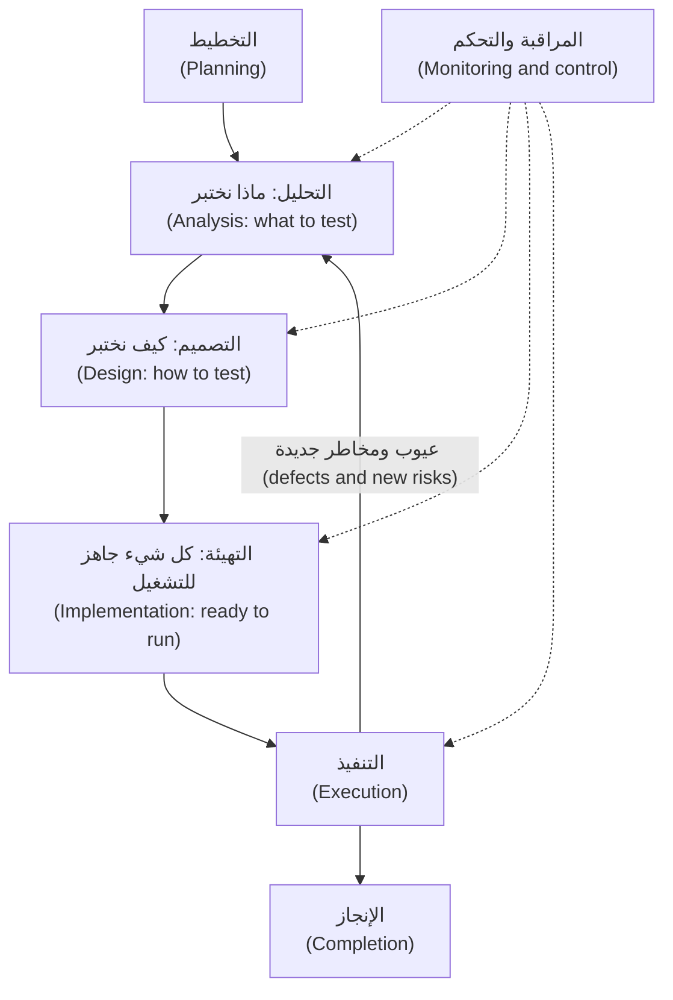
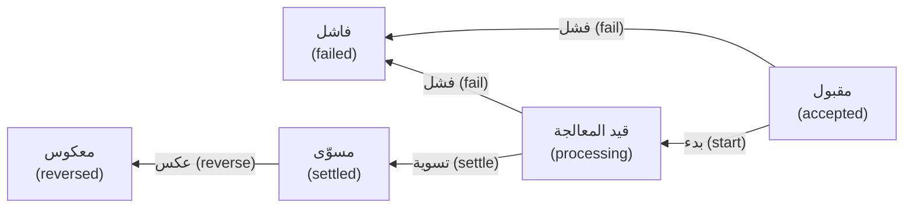
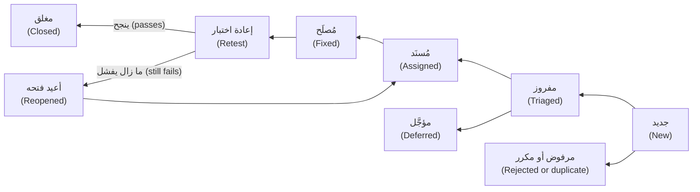

# الوحدة 1 — أسس الاختبار (Testing foundations)

*أخبرتك الوحدة 0 لماذا نختبر البرمجيات. وتمنحك هذه الوحدة عُدّة العمل التي يحملها المختبِر، وهي ثلاثة أشياء ستمارسها كل يوم طوال مسيرتك المهنية. أولًا، العقلية والعملية: المبادئ السبعة، والأنشطة التي يمر بها كل جهد اختبار، وكيف تقرر أنك اختبرت بما يكفي. ثانيًا، تصميم الاختبار: كيف تختار حفنة قليلة من الاختبارات تكشف العيوب في فضاء هائل من المدخلات الممكنة. ثالثًا، التواصل: كيف تقرأ المتطلب قراءة ناقدة، وتحوّله إلى معايير قبول (acceptance criteria) وحالات اختبار (test cases)، وتكتب تقرير عيب يستطيع المطوّر أن يتصرف بناءً عليه في دقائق. ستتابع ندى، الخريجة الجديدة في فريق هندسة الجودة (Quality Engineering) في بنك نجم، وراشد يوجّهها خلال سقف التحويل اليومي وقواعد الرسوم ودورة حياة التحويل وعيب صغير جدًا في الرسوم، وكل ذلك على النظام النموذجي للدورة. هذه التقنيات أقدم من أي أداة ذكاء اصطناعي، لكنها أصبحت أهم الآن، لأنها الطريقة التي تحكم بها هل يمكن لاختبار كتبتَه أنت أو كتبه وكيل (agent) أن يفشل فعلًا.*

> **التركيز:** Mindset, Design — التفكير مثل المختبِر، واختيار الاختبارات عن قصد، والإبلاغ عمّا تجده كي يُصلَح.

---

# 1.1 — عقلية المختبِر والمبادئ السبعة وعملية الاختبار
*المستوى: 🟢 مبتدئ* · *المتطلبات: 0.1، 0.2، 0.3* · *التركيز: Mindset*

**بعد هذا الدرس تستطيع** كتابة اختبارات تأتي قيمها المتوقعة من خارج الشيفرة، وإظهار العيوب المزروعة التي تلتقطها، وكتابة تقرير إنجاز من صفحة واحدة يوصي بالإطلاق أو بعدمه بناءً على هذا الدليل. *مدة الدراسة: قراءة نحو 15 دقيقة، وعمل تطبيقي نحو 75 دقيقة (تقدير).*

## ⚡ الدرس في دقيقة (In 60 seconds)
- ينتج الاختبار **أدلة**: ما الذي فحصته، وبمقارنته بماذا، وما الذي لم تفحصه.
- **الاختبار يُظهر وجود العيوب، لا غيابها أبدًا**، والاختبار الشامل مستحيل. لذلك تختار اختباراتك بحسب المخاطر.
- **العقلية** هي الفضول والتشكيك الصحي والتواصل الواضح والتعاطف والإبلاغ البنّاء.
- لـ**عملية الاختبار** سبعة أنشطة متداخلة. وكل اختبار يحتاج إلى **مرجع للنتيجة المتوقعة (oracle)**، أي مصدر موثوق للنتيجة المتوقعة. لا مرجع، لا حكم.
- توقّف حين تصبح المخاطر المتبقية مقبولة لدى من يملكها، وليس لمجرد أن «كل الاختبارات نجحت».

## 🧭 لماذا يهم
في أسبوعها الأول في بنك نجم، تتسلّم ندى القصة **TRF-212، سقف التحويل اليومي**. تفتح نسخة ضمان الجودة من تطبيق نجم للهاتف، وترسل أربعين تحويلًا بمبالغ مختلفة، وترى كل تحويل مقبولًا أو مرفوضًا بشكل معقول، وتكتب في التذكرة: «تم الاختبار. يعمل.»

يطرح راشد أربعة أسئلة. *بماذا قارنتِ ما فحصتِه؟ لو كان معطوبًا، فما الذي كنتِ سترينه مختلفًا؟ ما الذي لم تجرّبيه؟ من الذي يقرر أننا انتهينا؟* لا تستطيع ندى الإجابة عن أي منها. [النظام النموذجي للدورة](https://github.com/Tamoura/system-design-for-vibe-coders/tree/main/testing/sample) يخفي عيبًا في هذا الموضع تحديدًا: فعّل `limit_off_by_one` وسيُرفض خطأً أي تحويل يجعل إجمالي اليوم مساويًا للسقف تمامًا. أربعون تحويلًا اعتياديًا لا تلمس هذا العيب أبدًا. أما عميل يرسل آخر 1,000 QAR من حدّه المسموح فسيصطدم به.

ندى ليست مهملة. لم يخبرها أحد أن الاختبار مسألة قرار: مع اختبارات ممكنة بلا حدود ووقت محدود، فأيَّ قلّة منها تشغّل، وماذا تُثبت؟ هذه الأسئلة الأربعة هي موضوع هذا الدرس، وهي في عصر الذكاء الاصطناعي أهم: فالوكيل يستطيع أن يكتب قاعدة واختباراتها معًا ويعيد تشغيلًا أخضر في ثوانٍ.

## 📐 كيف يعمل

### 🟢 الأساسيات

**المصطلحات** (من الدرس 0.2). **الخطأ البشري** الذي يرتكبه شخص يترك **عيبًا (defect, bug)** في الشيفرة أو في مستند، وقد يتسبب في **فشل**. يستثير الاختبار الديناميكي (dynamic testing) حالات الفشل، ويجد الاختبار الساكن (static testing) العيوب مباشرة، ويزيل تنقيح الأخطاء (debugging) العيب الكامن وراء الفشل.

**مبادئ الاختبار السبعة** مأخوذة من منهج المستوى التأسيسي (Foundation syllabus) الصادر عن ISTQB (CTFL v4.0). نعرضها بكلمات بسيطة، ولكل منها مثال من بنك نجم:

1. **الاختبار يُظهر وجود العيوب لا غيابها.** تخفّض الاختبارات الناجحة احتمال بقاء العيوب لكنها لا تبلغ به الصفر أبدًا. *تنجح مجموعة الاختبارات الابتدائية المؤلفة من 24 اختبارًا نظيفةً، ومع ذلك يفلت ثلاثة من أصل خمسة عيوب مزروعة في التحويلات في النظام النموذجي.*
2. **الاختبار الشامل مستحيل.** المدخلات والحالات والتوقيتات تتضاعف أسرع مما تستطيع أي آلة تشغيله. *في تحويلات QAR وحدها: 2,499,901 مبلغًا × 5,000,001 إجمالي «مرسَل اليوم» × 3 أنواع تعطي نحو 3.75 × 10^13 توليفة.*
3. **الاختبار المبكر يوفّر الوقت والمال.** ابدأ حين يوجد أي شيء تفحصه، ولو جملة واحدة. *سؤال «ما الذي يُعدّ يومًا؟» في مراجعة القصة يكلّف حوارًا؛ وبعد الإطلاق يكلّف إصلاحًا عاجلًا.*
4. **العيوب تتجمّع.** عدد قليل من المكوّنات يحتوي معظم العيوب. *عيوب التحويلات تشير مرارًا إلى التقريب والتعامل مع الوقت، لذا يضع راشد اختبارات إضافية هناك.*
5. **الاختبارات تبلى**. الاختبارات نفسها حين تُشغَّل مرة بعد مرة تتوقف عن إيجاد عيوب جديدة. *مجموعة من المبالغ المتوسطة تبقى خضراء بينما ينتظر عيب حدّي.*
6. **الاختبار يعتمد على السياق.** ما تختبره ومدى عمقه يتوقفان على ما قد يسوء ولمن. *تحتاج المدفوعات إلى كسور عشرية دقيقة ومسار تدقيق؛ أما لافتة تسويقية فيكفيها فحص خفيف.*
7. **وهم خلو النظام من العيوب.** النظام الذي لا عيوب معروفة فيه قد يظل النظام الخطأ. *شاشة تحويل بلا عيب لكنها لا تستطيع جدولة دفعة يوم الراتب تظل تخذل العملاء.*

**عقلية المختبِر** خمس عادات:
- **الفضول:** اسأل «ماذا لو؟» من تلقاء نفسك عن الأرقام الهندية العربية، والنقر المزدوج، واليوم الكبيس.
- **التشكيك الصحي:** لا تقبل عبارة «إنه يعمل» من عرض تجريبي أو مطوّر أو وكيل ذكاء اصطناعي. أنت تشكّك في الادعاءات لا في الأشخاص، وفي اختبارك أنت أيضًا: فقد صدّقت ندى عيّناتها الأربعين.
- **التواصل:** أنت تحمل الأخبار السيئة. عبارة «يُرفض مبلغ 1,000.00 QAR بالضبط بعد إرسال 49,000.00» تصل؛ أما «شيفرة السقف عندك معطوبة» فلا تصل.
- **التعاطف:** مع العميل الذي يصطدم بالخطأ يوم الراتب، ومع المطوّر الذي يقرأ تقريرك.
- **الإبلاغ البنّاء عن العيوب:** ما رأيته، وما توقعته ولماذا، مع الأدلة (الدرس 1.3).

**عملية الاختبار.** يتبع العمل سبعة أنشطة. وهي تتداخل وتتكرر.



القصة: *«بصفتي عميلًا، أريد سقفًا يوميًا حتى لا يستطيع هاتف مسروق أو زلّة كتابة أن تحرّك أكثر من 50,000 QAR أو AED، أو 10,000 EUR، في اليوم.»* ومعيار القبول الأول فيها: *«تُرفض التحويلات التي تتجاوز السقف اليومي برسالة واضحة»*.

| النشاط | مثال TRF-212 |
|---|---|
| **التخطيط** | المخاطر عالية لأن الأمر يتعلق بالمال. نختبر على مستوى المكوّن وواجهة البرمجة. معيار الخروج (Exit): لا عيب حرجًا مفتوحًا، والشروط الخطرة مغطاة |
| **التحليل** | قراءة القصة ونص سياسة `limits` والشيفرة؛ ومراجعة القصة؛ وسرد شروط الاختبار |
| **التصميم** | تحويل الشروط إلى حالات اختبار مع البيانات والنتائج المتوقعة |
| **التهيئة** | كتابة اختبارات pytest، وتجهيز بيانات «المرسَل اليوم»، وربطها بالتكامل المستمر (continuous integration, CI) |
| **التنفيذ** | التشغيل ومقارنة الفعلي بالمتوقع، ورفع العيوب، وإعادة اختبار الإصلاحات |
| **المراقبة والتحكم** | «شُغّلت خمس حالات من سبع، وفشلت واحدة». الإجراء: إضافة حالة، أو نقل تاريخ، أو التصعيد |
| **الإنجاز** | الاحتفاظ بالحالات اختبارات انحدار (regression tests)، وتسجيل الأسئلة المفتوحة، وكتابة التقرير |

### 🟡 التعمق أكثر (Going deeper)

**مثال محلول: TRF-212.** *التحليل: راجع القصة قبل تشغيل أي شيفرة.* هذا هو **الاختبار الساكن (static testing)**: فحص ناتج عمل (work product) دون تنفيذه. يقرأ راشد عبارة «فوق السقف اليومي» ويسأل: (1) فوقه أم عنده تمامًا؟ هل يُسمح بـ 50,000.00 بالضبط؟ (2) ما اليوم: منتصف ليل قطر أم 24 ساعة متحركة؟ (3) لكل عملة أم مجتمعة؟ (4) هل تُحتسب التحويلات بين حسابات العميل نفسه؟ (5) هل تُحتسب المحاولات المرفوضة؟ (6) ما «الرسالة الواضحة» وبأي لغة؟ تُظهر الشيفرة إجابات اليوم عن 1 و3 إلى 5 (يُسمح بـ 50,000.00 بالضبط؛ والإجماليات تُحسب لكل مستخدم وعملة، وتشمل كل الأنواع، وتحتسب التحويلات المقبولة فقط)، لكن فريق المنتج وحده يستطيع القول إن ذلك هو المقصود. ولا تستطيع الشيفرة الإجابة عن 2، لأن إجماليها الجاري لا يُصفَّر أبدًا، ولا عن 6، لأنها لا تعيد سوى الرمز المجرّد `daily_limit_exceeded`. ستة أسئلة، ولم يُشغَّل أي اختبار.

*التصميم والتنفيذ.* تأتي النتائج المتوقعة من نص سياسة `limits` لا من الشيفرة. شغّلنا الحالات على النظام النموذجي النظيف، ثم مع `NAJM_BUGS=limit_off_by_one`:

| الحالة | المبلغ | المرسَل اليوم | المتوقع | مع تفعيل العيب |
|---|---|---|---|---|
| TC-1 | QAR 1,000.00 | 0.00 | مقبول | مقبول |
| TC-2 | QAR 5,000.00 | 49,000.00 | مرفوض | مرفوض |
| TC-3 | QAR 1,000.00 | 49,000.00 | مقبول، الإجمالي 50,000.00 بالضبط | **مرفوض** |
| TC-4 | QAR 1,000.01 | 49,000.00 | مرفوض | مرفوض |
| TC-5 | EUR 5,000.00 | 5,000.00 | مقبول، الإجمالي 10,000.00 بالضبط | **مرفوض** |
| TC-6 | EUR 5,000.00 | 6,000.00 | مرفوض | مرفوض |

حدس ندى أنتج TC-1 وTC-2 وTC-6. وهذه تنجح على النظام المعطوب كما تنجح على النظام الصحيح، فلا تستطيع التمييز بينهما. والحالتان اللتان *يبلغ* فيهما الإجمالي السقف هما وحدهما القادرتان على ذلك: اختبار ينجح مهما فعلت الشيفرة، مقابل اختبار يستطيع أن يفشل. وفي *المراقبة والتحكم* تبلّغ ندى «شُغّلت ست حالات، وفشلت اثنتان، ورُفع عيب» ويضيف راشد زوج AED. وفي *الإنجاز* تتحول الحالات إلى اختبارات انحدار ويُسجَّل سؤال «ما اليوم؟» ثغرةً معروفة. ويجد الدرس 1.2 حالات مثل TC-3 عن قصد.

**مستويات الاختبار وأنواعه.** يخبرك **المستوى** بمقدار ما هو قيد الاختبار: **المكوّن (component)**، أو **تكامل المكوّنات (component integration)**، أو **النظام**، أو **تكامل الأنظمة (system integration)**، أو **القبول**. ويخبرك **النوع** بما تفحصه: **الوظيفي (functional)** (هل هو الشيء الصحيح؟) أو **غير الوظيفي (non-functional)** (إلى أي درجة يؤدي جيدًا: الأداء (performance) والأمان (security) وسهولة الاستخدام). وتُشتق الاختبارات **من الصندوق الأسود (black-box)** انطلاقًا من المواصفات، أو **من الصندوق الأبيض (white-box)** انطلاقًا من بنية الشيفرة. وبعد أي تغيير أضف **الاختبار التأكيدي (confirmation testing)** (هل أُصلح؟) و**اختبار الانحدار (regression testing)** (هل انكسر شيء آخر؟).

| المستوى | مثال وظيفي | مثال غير وظيفي |
|---|---|---|
| المكوّن | تقبل `check_transfer` إجمالي 50,000.00 بالضبط | قياس أداء مصغّر يُبقي `check_transfer` سريعة |
| تكامل المكوّنات | تمرّر `TransferService` قيمة «المرسَل اليوم» الصحيحة لكل مستخدم | المهلة (Timeout) حين يكون مخزن الحدود بطيئًا |
| النظام | يرفض `POST /transfers` التحويل الذي يتجاوز السقف | زمن الاستجابة تحت الحِمل (الدرس 4.1) |
| تكامل الأنظمة | تتفق خدمة المدفوعات وشبكة البطاقات على المبلغ | السلوك عند انقطاع الشبكة |
| القبول | يؤكد فريق الامتثال أن الحدود تطابق السياسة | يفهم العميل رسالة الخطأ العربية |

**الساكن مقابل الديناميكي.** الاختبار **الديناميكي (Dynamic)** يشغّل البرمجية. أما الاختبار **الساكن (Static)** فيفحصها دون تشغيلها: المراجعات وأدوات **التحليل الساكن (static analysis)**، وهي اختبارات رخيصة (cheap tests). قد يكتب مطوّر متعب، أو مساعد ذكاء اصطناعي، هذه المسودة:

```python
from decimal import Decimal


def international_fee(amount: Decimal) -> Decimal:
    return amount * 0.0035


def describe(amount: Decimal) -> str:
    total = amount + internatonal_fee(amount)
    return "Total: " + total
```

```text
$ pip install ruff mypy
$ mypy fee_draft.py
fee_draft.py:5: error: Unsupported operand types for * ("Decimal" and "float")  [operator]
fee_draft.py:9: error: Name "internatonal_fee" is not defined; did you mean "international_fee"?  [name-defined]
Found 2 errors in 1 file (checked 1 source file)
```

تختلف الصياغة الدقيقة بحسب إصدار mypy. ويشير الأمر `ruff check fee_draft.py` أيضًا إلى الاسم المكتوب خطأً، وبعد أن تصلحه يبلّغ mypy عن عيب ثالث: جمع سلسلة نصية مع `Decimal`. في ثوانٍ، ودون كتابة أي اختبار، وجدنا خطأً إملائيًا، وعددًا عشريًا ثنائيًا حيث يحتاج المال إلى عدد عشري دقيق (وهو الخطأ وراء عيب `float_fee` في النظام النموذجي)، وخطأً في الأنواع. لا يستطيع التحليل الساكن أن يقول هل الرسم هو المبلغ *الصحيح*. استخدم النوعين من الاختبار: فهما يجدان عيوبًا مختلفة.

**مراجع النتيجة المتوقعة: من أين يأتي «المتوقع».** للاختبار مُدخَل، و**مرجع (oracle)** يزوّد بالنتيجة المتوقعة، و**حكم** ينتج من مقارنة المتوقع بالفعلي. هذا أصغر مثال مفيد بـ pytest؛ احفظه باسم `tests/test_oracle_demo.py` في نسخة من النظام النموذجي:

```python
from decimal import Decimal

from najm.transfers import fee


def test_international_fee_on_3090_qar():
    actual = fee("3090", "QAR", "international")
    expected = Decimal("10.82")   # the oracle: 3,090 x 0.35 % = 10.815, rounded half up
    assert actual == expected     # the verdict: pass if equal, fail if not


def test_a_test_with_no_oracle():
    assert fee("3090", "QAR", "international")   # weak: any non-zero fee passes
```

يشغّل pytest كل دالة اسمها `test_...`؛ وفشل التأكيد `assert` فشلٌ للاختبار. ينجح الاختباران كلاهما على النظام النموذجي النظيف. ومع تفعيل العيب (المخرجات مختصرة):

```text
$ NAJM_BUGS=float_fee pytest tests/test_oracle_demo.py
F.                                                                       [100%]
E       AssertionError: assert Decimal('10.81') == Decimal('10.82')
FAILED tests/test_oracle_demo.py::test_international_fee_on_3090_qar
1 failed, 1 passed
```

الاختبار الثاني أخضر على النظام الصحيح وعلى النظام المعطوب معًا. ولمراجع النتيجة المتوقعة نقاط قوة متفاوتة. فـ**المواصفة** أو الحساب المستقل (تقول السياسة 0.35 %، بالتقريب إلى الأعلى عند المنتصف (half-up)، فالنتيجة 10.82) تكشف `float_fee`. أما **المرجع الجزئي (partial oracle)**، وهو خاصية يجب أن تتحقق («الرسم يقع دائمًا بين 10.00 و100.00»)، فلا يكشفه، لأن 10.81 ضمن النطاق. وهو رخيص حين لا توجد إجابة دقيقة، لكنه يكشف عيوبًا أقل. أما رسالة «تُقرأ بوضوح» فالمرجع فيها إنسان.

### 🔴 نظرة الخبير (Expert view)

**مشكلة المرجع.** المرجع في `fee` هو سياسة وآلة حاسبة. وغالبًا يكون الأمر أصعب: ما المخرج الصحيح لترتيب نتائج البحث أو لترجمة؟ أن لا تعرف النتيجة المتوقعة هو **مشكلة المرجع**. وهي لا تزول أبدًا؛ بل تعود بقوة في الوحدة 7، لأن النموذج اللغوي الكبير (LLM) لا يملك إجابة صحيحة واحدة. اسأل النموذج البديل الخاص بنجم أسيست سؤالًا واحدًا أربع مرات، مع تفعيل أخذ العينات:

```python
from najm.assist import answer, FakeModel

q = "What is the cut-off time for same-day transfers?"
for seed in range(1, 5):
    print(answer(q, FakeModel(temperature=0.8, seed=seed))["text"])
```

تعود جملة السياسة نفسها، تبدأ أحيانًا بعبارة «According to our policy:» وأحيانًا لا تبدأ بها. الوقائع نفسها لكن السلاسل النصية مختلفة: فيرفض التأكيد `assert` القائم على المطابقة التامة إجابةً صحيحة. ستحتاج إلى مقيِّمات (graders) تحكم على المعنى (الدرس 7.1).

هناك فخ مرتبط بالشيفرة التي يكتبها الذكاء الاصطناعي. فإذا كتب وكيلٌ الدالة `check_transfer` واختبارها معًا، فقد تكون القيمة «المتوقعة» مجرد ما أعادته الشيفرة: **مرجع دائري (circular oracle)**. يظل ينجح حين تكون الشيفرة خاطئة. خذ المرجع من مصدر مستقل. يبني [*تصميم الأنظمة لمبرمجي الفايب*، الدرس 9.4 — التحقق قبل الإكمال](../vibe/index.ar.html#l9-4) عادة ألا تقبل «تم» من دون دليل رأيتَه يفشل.

**متى تتوقف عن الاختبار.** لا ينتهي الاختبار أبدًا؛ فهناك من يقرر أن المخاطر المتبقية مقبولة، ويجعل المختبِر هذا القرار قرارًا مستنيرًا. والأسباب الوجيهة للتوقف قائمة على المخاطر وعلى الأدلة: استيفاء معايير الخروج، وتغطية الشروط الخطرة، وكون العيوب المفتوحة معروفة ومقبولة كتابةً من مالك الإصدار. ونفاد الوقت سبب مشروع أيضًا، إذا أبلغتَ بما لم يُختبر ومن قبِل بذلك. وعبارة «نجحت كل الاختبارات» لا تقول شيئًا عن اختبارات لم تكتبها. مثال: «أوصي بعدم إطلاق الإصدار: فحص السقف غير مختبَر عند حدّه، ويستطيع عميل أن يصطدم به في اليوم الأول».

## 🧰 الأدوات
| الأداة أو الممارسة أو التقنية | ما هي وماذا تفعل | متى تلجأ إليها |
|---|---|---|
| **Seven testing principles** (ISTQB) | مبادئ الاختبار السبعة: سبع عبارات عن سبب عمل الاختبار على هذا النحو | لتحدّي عبارة «تم الاختبار، يعمل» وتقدير حجم الجهد |
| **Requirement review** | مراجعة المتطلبات: قراءة القصة بحثًا عن الغموض والثغرات قبل وجود الشيفرة | كل قصة، قبل التطوير |
| **Static analysis** (ruff, mypy) | التحليل الساكن: أدوات الفحص (linters) ومدققات الأنواع (type checkers) التي تجد العيوب دون تشغيل الشيفرة | كل إيداع، في التكامل المستمر، وعلى الشيفرة التي يكتبها الذكاء الاصطناعي |
| **Test oracle** | مرجع النتيجة المتوقعة: المصدر الموثوق للنتيجة المتوقعة | قبل أي اختبار: لا مرجع، لا حكم |
| **Exit criteria** | معايير الخروج: شروط متفق عليها تقول إن الاختبار كافٍ | في الخطة، كي يكون لسؤال «هل انتهينا؟» جواب |
| **pytest** | مشغّل اختبارات Python القياسي: `assert` عادي، وتجهيزات الاختبار (fixtures)، والاختبارات المُحدَّدة بمعاملات (parametrisation) | اختبارات الوحدة وواجهات البرمجة، وكل الأمثلة هنا |

## 🏛️ عمليًا في بنك نجم
يطلب راشد من كل فريق **بطاقة عملية الاختبار** لكل قصة: صفحة واحدة تثبت أن التفكير حدث. وهذه بطاقة TRF-212.

| الحقل | TRF-212، سقف التحويل اليومي |
|---|---|
| المخاطر والأساس | عالية: أموال العملاء واهتمام الجهة التنظيمية. الأساس: القصة ونص سياسة `limits` و`najm/transfers.py` |
| مراجعة القصة | 6 أسئلة: 2 منها لا تستطيع الشيفرة الإجابة عنها («اليوم» والرسالة)، و4 سلوكيات تحتاج إلى تأكيد |
| الشروط والمرجع | عند السقف بالضبط؛ وسنت واحد فوقه؛ ولكل عملة. القيم المتوقعة من نص السياسة والإجماليات المحسوبة يدويًا، وليس من مخرجات الشيفرة أبدًا |
| معايير الخروج (Exit criteria) | تشغيل كل الشروط؛ ولا عيب حرجًا أو رئيسيًا مفتوحًا؛ وإجابة الأسئلة المفتوحة أو قبولها كتابةً |
| المخاطر المتبقية (Residual risk) | «إعادة ضبط اليوم غير مختبَرة لأنها غير معرَّفة»، وقد قبلها مالك المنتج في تاريخ مذكور |

## 🛠️ التمارين (Exercises)
انسخ النظام النموذجي أولًا (`cp -r testing/sample ~/najm-sample`)، وأنشئ بيئة افتراضية هناك ونفّذ `pip install -r requirements.txt`.

- 🟢 **راجع المتطلب.** خذ عبارة «تُرفض التحويلات التي تتجاوز السقف اليومي برسالة واضحة». اكتب ثمانية أسئلة على الأقل لفريق المنتج، ولكل سؤال إجابة مقترحة ومن ينبغي أن يقرر. *يكتمل عندما:* تغطي القائمة «اليوم»، وكل عملة على حدة أو مجتمعة، وأي الأنواع تُحتسب، وحالة السقف بالضبط، والمحاولات المرفوضة، والرسالة؛ وتستشهد إجابتان على الأقل بالدالة أو الطريقة في `najm/transfers.py` التي تحسم الأمر؛ وتُعلَّم واحدة منها قرارًا للمنتج لا تستطيع الشيفرة حسمه.
- 🟡 **مرجع واحد لكل دالة.** لكل من `quantize` و`fee` و`check_transfer` و`value_date`، اكتب اختبار pytest واحدًا تأتي قيمته المتوقعة من خارج الشيفرة (نص سياسة في `najm/assist.py`، أو حساب يدوي، أو خاصية). شغّل المجموعة نظيفة، ثم مع `NAJM_BUGS=float_fee` و`NAJM_BUGS=tz_cutoff`. *يكتمل عندما:* تنجح الاختبارات الأربعة جميعها على النسخة النظيفة؛ ويفشل اثنان منها على الأقل تحت العيب المناسب مع ظهور المتوقع والفعلي؛ ويعرض جدول نوع المرجع لكل اختبار وعيبًا واحدًا لا يستطيع كشفه أبدًا.
- 🔴 **تقرير إنجاز.** شغّل مجموعة الاختبارات الابتدائية (`pytest`) خمس مرات، مرة لكل قيمة من قيم `NAJM_BUGS`، وسجّل الاختبارات التي تفشل. اكتب تقرير إنجاز من صفحة واحدة. *يكتمل عندما:* يتضمن جدولًا من خمسة صفوف بنتائج مقيسة، ويسمّي ثلاث مخاطر متبقية بوصفها أثرًا على العملاء، ويوصي بالإصدار أو بعدمه مع الأدلة وما الذي سيغيّر رأيك، ويقترح الاختبارات الثلاثة التالية بحسب المخاطر، لكل منها مرجعه.

## ⚠️ أخطاء وفخاخ (Mistakes and traps)
- **«تم الاختبار. يعمل.»** قل ما الذي فحصته، وبمقارنته بماذا، وما الذي لم تفحصه.
- **اعتبار اللون الأخضر برهانًا.** الأخضر دليل فقط إذا كان الاختبار قادرًا على الفشل. اسأل: أي عيب يحوّل هذا الاختبار إلى أحمر؟
- **نسخ القيم المتوقعة من المخرجات.** يعيد الاختبار صياغة الشيفرة. خذ التوقعات من مواصفة أو حساب أو شخص.
- **اختبار ما بنيتَه فقط.** المؤلفون يؤكدون نيّتهم هم؛ اطلب من شخص آخر أن يهاجمه.
- **العملية بوصفها أعمالًا ورقية.** الأنشطة السبعة طريقة تفكير. يحتاج نص برمجي مؤقت إلى دقيقة، وتحتاج المدفوعات إلى خطة قابلة للتدقيق؛ فقِس الجهد على المخاطر.

## 🧾 الخلاصة (Recap)
- ينتج الاختبار أدلة لا ضمانات: يُظهر وجود العيوب، ولا يمكن أن يكون شاملًا، ويُختار بحسب المخاطر والسياق.
- تشمل العقلية الشك في اختبارك أنت؛ والأنشطة السبعة تتداخل وتتكرر.
- المستويات (كم) والأنواع (ماذا) محوران مختلفان؛ والاختبار الساكن يجد العيوب قبل أن يعمل أي شيء.
- لا مرجع، لا حكم. المرجع الدائري يجعل الاختبارات التي يكتبها الذكاء الاصطناعي عديمة القيمة؛ وتتفاقم مشكلة المرجع مع أنظمة الذكاء الاصطناعي.
- التوقف قرار مخاطر يملكه شخص مسؤول، ويستنير بأدلتك.

## ✍️ اختبر نفسك (Check yourself)

**1. أرسل نص ندى البرمجي 1,000 تحويل عشوائي إلى نسخة ضمان الجودة؛ فتصرّفت كلها كما هو متوقع، وأبلغت ندى «لا عيوب في السقف اليومي». أي مبدأ يبيّن أن التقرير يبالغ؟**

- A. الاختبار الشامل مستحيل، لذا لا يستحق أي اختبار أن يُشغَّل
- B. الاختبار يُظهر وجود العيوب لا غيابها
- C. الاختبار المبكر يوفّر الوقت والمال في كل مشروع
- D. العيوب تتجمّع، لذا تحتوي الشيفرة القديمة العيوب دائمًا

<details><summary>الإجابة</summary>

**B.** الاختبارات الناجحة لا تثبت أبدًا خلو الشيفرة من العيوب، والمدخلات العشوائية نادرًا ما تصيب حالة السقف بالضبط. يسيء A فهم المبدأ 2: فهو يتعلق باختيار الاختبارات. (🟢 الأساسيات.)

</details>

**2. يكتب بلال اختبارات pytest لـ TRF-212، ويجهّز حسابات ضمان الجودة الاصطناعية، ويربط المجموعة بالتكامل المستمر (CI). أي نشاط من أنشطة عملية الاختبار هذا؟**

- A. التحليل، لأنه يقرر ما الذي يحتاج إلى اختبار
- B. التصميم، لأنه يحدد النتائج المتوقعة
- C. التنفيذ، لأن المجموعة المكتملة ستعمل في التكامل المستمر
- D. التهيئة، لأنه يجهّز كل شيء للتشغيل

<details><summary>الإجابة</summary>

**D.** تجهّز التهيئة ما يحتاجه التنفيذ: الاختبارات والبيانات والبيئة. التحليل والتصميم يأتيان قبلها؛ والتنفيذ يشغّل الاختبارات المجهّزة. (🟢 الأساسيات.)

</details>

**3. يكتب مساعد ذكاء اصطناعي الدالة `check_transfer` واختباراتها، فيشغّل الشيفرة ويلصق كل مخرَج في `assert`. تنجح كل الاختبارات. ما نقطة الضعف الرئيسية؟**

- A. القيم المتوقعة جاءت من الشيفرة نفسها، فهي مرجع نتيجة متوقعة دائري
- B. النجاح بهذه السرعة يعني أن الاختبارات لم تُشغَّل كما ينبغي
- C. مدقق الأنواع (type checker) كان سيرفض الشيفرة حتمًا
- D. الاختبارات المُحدَّدة بمعاملات أضعف دائمًا من الدوال المنفصلة

<details><summary>الإجابة</summary>

**A.** التوقعات المنسوخة من مخرجات الشيفرة نفسها تنجح حتى لو كانت الشيفرة خاطئة؛ ويجب أن يكون المرجع (oracle) مستقلًا. السرعة والأنواع (typing) وتنظيم الاختبارات (test layout) لا علاقة لها بذلك. (🔴 نظرة الخبير.)

</details>

**4. قبل أن يوجد أي اختبار وحدة (unit test)، يبلّغ `mypy` أن دالة رسوم تضرب `Decimal` في `float`. أي نوع من الاختبار وجد هذا العيب (defect)؟**

- A. الاختبار الديناميكي، لأن أداة نُفّذت لإيجاده
- B. اختبار الانحدار، لأنه يفحص شيفرة موجودة أصلًا
- C. الاختبار الساكن، لأن الشيفرة فُحصت دون تشغيلها
- D. اختبار القبول، لأن النتيجة ستمنع الإصدار

<details><summary>الإجابة</summary>

**C.** يفحص الاختبار الساكن نواتج العمل (work products) مثل الشيفرة المصدرية دون تنفيذها؛ وأدوات الفحص (linters) ومدققات الأنواع (type checkers) تحليل ساكن (static analysis). أما الانحدار والقبول فيصفان الغاية والمستوى. (🟡 التعمق أكثر.)

</details>

**5. في يوم الخميس تنجح كل اختبارات TRF-212 المخطط لها، ويبقى عيب رئيسي واحد مفتوحًا، وهو رسم خاطئ لمُدخل نادر، وموعد الإصدار يوم الجمعة. ماذا ينبغي أن يفعل المختبِر؟**

- A. يعلّم القصة منتهية، لأن كل الاختبارات المخطط لها نجحت
- B. يقدّم لمالك المنتج الأدلة والعيب المفتوح وتوصية
- C. يمنع الإصدار بنفسه، لأن أي عيب مفتوح يجعل الشحن غير آمن
- D. يحجب التقرير حتى يُصلَح العيب، تفاديًا للذعر والتأخير

<details><summary>الإجابة</summary>

**B.** التوقف قرار مخاطر يملكه من يتولى المساءلة عن الإصدار؛ والمختبِر يقدّم الأدلة والأثر والتوصية. يتجاهل A العيب، ويتخذ C قرارًا ليس من صلاحية المختبِر، ويخفي D ما يحتاج إليه صاحب القرار. (🔴 نظرة الخبير.)

</details>

## 📚 المراجع (References)
- ISTQB، منهج المختبِر المعتمد، المستوى التأسيسي، الإصدار 4.0 — https://www.istqb.org/
- توثيق pytest (pytest documentation) — https://docs.pytest.org/
- توثيق Python، وحدة `decimal` — https://docs.python.org/3/library/decimal.html
- تحويلات نجم، النظام النموذجي للدورة — https://github.com/Tamoura/system-design-for-vibe-coders/tree/main/testing/sample

---

# 1.2 — تقنيات تصميم الاختبار: تقسيم فئات التكافؤ والقيم الحدّية وجداول القرارات وانتقال الحالات والاختبار الزوجي
*المستوى: 🟢 مبتدئ* · *المتطلبات: 1.1* · *التركيز: Design*

**بعد هذا الدرس تستطيع** كتابة اختبارات للقيم الحدّية لحدود التحويل تفشل عند تفعيل عيب الحدّ المزروع بينما تنجح حالات منتصف النطاق، وتوليد اختبارات لانتقالات الحالة تغطي كل خلية من خلايا الحالة والحدث، وإثبات تغطية مجموعة الاختبار الزوجي بمدقّق تكتبه بنفسك. *مدة الدراسة: قراءة نحو 15 دقيقة، وعمل تطبيقي نحو 120 دقيقة (تقدير).*

## ⚡ الدرس في دقيقة (In 60 seconds)
- **تصميم الاختبار** هو أن تختار، عن قصد، مجموعة صغيرة من الاختبارات القادرة على الفشل لأسباب صحيحة.
- **تقسيم فئات التكافؤ (Equivalence partitioning)** يختبر قيمة واحدة لكل مجموعة يعاملها النظام معاملة واحدة، بما فيها المجموعات غير الصالحة. و**تحليل القيم الحدّية (Boundary value analysis)** يختبر حواف تلك المجموعات، حيث تعيش أخطاء الإزاحة بواحد.
- **جداول القرارات (Decision tables)** تغطي توليفات القواعد، و**اختبارات انتقال الحالات (state-transition tests)** تغطي دورات الحياة، و**الاختبار الزوجي (pairwise)** يغطي مصفوفات الإعداد، و**تخمين الأخطاء (error guessing)** يغطي مزالق المال والوقت والنص.
- إشارة القرار: اختر التقنية بحسب *شكل* القاعدة، ثم ازرع عيبًا لتثبت أن اختبارًا ما يتحول إلى أحمر.

## 🧭 لماذا يهم
يشغّل راشد مجموعة الاختبارات الابتدائية المؤلفة من 24 اختبارًا خمس مرات، مرة لكل عيب مزروع. تكشف `no_idempotency` و`bola` لكنها تبقى خضراء مع `limit_off_by_one` و`float_fee` و`tz_cutoff`. لا اختبار منها خاطئ؛ لكنها تقع في وسط فضاء المدخلات، حيث لا توجد العيوب.

لا يعالج الحجم هذه المشكلة، ولا تعالجها العشوائية. قارنّا النظام النموذجي النظيف بالنسخة التي فُعّل فيها `limit_off_by_one` على 100,000 زوج عشوائي فلم نجد **أي اختلاف**: يحتاج العيب إلى أن يساوي `sent_today + amount` القيمة 50,000.00 بالضبط، وهو ما يحققه زوج عشوائي مرة كل نحو خمسة ملايين محاولة، فلا يملك 100,000 زوج سوى نحو 2 % من الاحتمال ليحتوي حتى على حالة واحدة. وتصميم الاختبار هو أيضًا الطريقة التي تحكم بها على مجموعة اختبارات وكيل ذكاء اصطناعي، فقد تبدو مرتبة لكنها تقع في وسط النطاق ما لم تطلب الحدود (boundaries).

## 📐 كيف يعمل

### 🟢 الأساسيات

تقبل الدالة `check_transfer(amount, currency, kind, sent_today)` في النظام النموذجي مبالغ من 1.00 إلى 25,000.00 QAR أو AED (و5,000.00 EUR) بمنزلتين عشريتين على الأكثر، وتسمح لإجمالي اليوم أن يبلغ 50,000.00 (و10,000.00 EUR) بالضبط. ابدأ الملف `tests/test_design.py` بدالة مساعدة تحوّل القرار إلى سلسلة نصية واحدة:

```python
from datetime import datetime
from decimal import Decimal
from zoneinfo import ZoneInfo

import pytest

from najm.transfers import TransferRejected, check_transfer, fee, value_date


def outcome(amount, currency="QAR", kind="domestic", sent_today="0"):
    """'ok', or the rejection code."""
    try:
        check_transfer(amount, currency, kind, sent_today)
        return "ok"
    except TransferRejected as e:
        return e.code
```

**تقسيم فئات التكافؤ (Equivalence partitioning, EP).** **فئة التكافؤ (equivalence partition)** مجموعة من المدخلات تقول المواصفة إن النظام يعاملها بالطريقة نفسها. فإذا نجحت قيمة واحدة فينبغي أن تنجح الباقية، ولذلك يكفي اختبار واحد لكل فئة، ويجب أن تشمل الفئات **غير الصالحة**. اكتب القيمة المتوقعة من القواعد قبل تشغيل أي شيء:

```python
EP = [  # one representative per partition: amount, currency, sent today, expected
    pytest.param("0.50", "QAR", "0", "below_minimum", id="amount-below-minimum"),
    pytest.param("5000.00", "QAR", "0", "ok", id="amount-valid"),
    pytest.param("30000.00", "QAR", "0", "above_per_transfer_max", id="amount-above-max"),
    pytest.param("5000.00", "QAR", "20000", "ok", id="daily-total-under-limit"),
    pytest.param("5000.00", "QAR", "49000", "daily_limit_exceeded", id="daily-total-over-limit"),
]


@pytest.mark.parametrize("amount, currency, sent_today, expected", EP)
def test_equivalence_partitions(amount, currency, sent_today, expected):
    assert outcome(amount, currency, sent_today=sent_today) == expected
```

يشغّل `@pytest.mark.parametrize` دالة واحدة مرة لكل صف؛ ويسمّي `id=` كل صف في التقرير.

**تحليل القيم الحدّية (Boundary value analysis, BVA).** تتجمع العيوب عند حواف الفئات، كما حين يُكتب `<=` بدلًا من `<`. **الحدّ (boundary)** هو أول قيمة أو آخر قيمة في فئة مرتبة؛ و**الخطوة** هي أصغر فرق ذي معنى، وهي 0.01 لـ QAR. يختبر تحليل **القيمتين** الحدَّ وأقرب جار له في الفئة الأخرى؛ ويضيف تحليل **الثلاث قيم** جارًا من الجهة الأخرى. لنفترض أن أحدهم برمج الحد الأدنى هكذا `amount == 1.00` بدلًا من `amount >= 1.00`. المجموعة ذات القيمتين {0.99, 1.00} تنجح مع الصيغتين، فتفوتها الزلّة؛ أما المجموعة ذات الثلاث قيم {0.99, 1.00, 1.01} فتكشفها، لأن الزلّة ترفض 1.01 خطأً. تكلّف القيم الثلاث اختبارات أكثر بنسبة 50 %: استخدم القيمتين للمقارنات البسيطة، والثلاث حيث يكون الإخفاق مكلفًا، كما هي الحال عادةً مع المال.

السقف اليومي حدّ على قيمة *مشتقة* هي `sent_today + amount`. ولجعل الإجمالي يبلغ السقف، اضبط `sent_today` على السقف ناقصًا المبلغ: 49,000.00 مرسلة زائد 1,000.00 تساوي 50,000.00 بالضبط.

```python
BOUNDARIES = [  # 3-value: the boundary and one step either side
    pytest.param("0.99", "0", "below_minimum", id="min-minus-1-cent"),
    pytest.param("1.00", "0", "ok", id="min"),
    pytest.param("1.01", "0", "ok", id="min-plus-1-cent"),
    pytest.param("1000.00", "48999.99", "ok", id="daily-limit-minus-1-cent"),
    pytest.param("1000.00", "49000.00", "ok", id="daily-limit-exactly-met"),
    pytest.param("1000.00", "49000.01", "daily_limit_exceeded", id="daily-limit-plus-1-cent"),
]


@pytest.mark.parametrize("amount, sent_today, expected", BOUNDARIES)
def test_boundaries(amount, sent_today, expected):
    assert outcome(amount, sent_today=sent_today) == expected
```

**العائد.** تنجح الاختبارات الأحد عشر كلها على النظام النموذجي النظيف. فعّل العيب المزروع وشغّل اختبارات السقف اليومي (`-k daily` يختار الاختبارات التي تحتوي أسماؤها على «daily»؛ المخرجات مختصرة):

```text
$ NAJM_BUGS=limit_off_by_one pytest tests/test_design.py -k daily
...F.                                                                    [100%]
FAILED tests/test_design.py::test_boundaries[daily-limit-exactly-met]
1 failed, 4 passed, 6 deselected
```

يفشل اختبار واحد بالضبط: الذي *يبلغ* فيه الإجمالي السقف. العيب الذي لم تكتشفه 24 اختبارًا ابتدائيًا ولا 100,000 حالة عشوائية يكشفه اختبارٌ واحد اختير عن قصد.

### 🟡 التعمق أكثر

**جداول القرارات (Decision tables).** حين تتضافر عدة شروط لتحديد النتيجة، اسردها في **جدول قرارات (decision table)**، بقاعدة واحدة في كل صف، واختبار واحد لكل قاعدة. قواعد الرسوم في النظام النموذجي:

| القاعدة | النوع | المبلغ | الرسم |
|---|---|---|---|
| R1 | حسابات العميل نفسه | أي مبلغ | 0.00 |
| R2 | محلي | حتى 1,000.00 شاملةً | 0.00 |
| R3 | محلي | أكثر من 1,000.00 | 2.00 |
| R4 | دولي | 0.35 % أقل من 10.00 | 10.00 (الحد الأدنى) |
| R5 | دولي | 0.35 % من 10.00 إلى 100.00 | 0.35 %، بالتقريب إلى الأعلى عند المنتصف (rounded half up) |
| R6 | دولي | 0.35 % أكثر من 100.00 | 100.00 (السقف) |

أضف التفكير الحدّي حيث يقفز الرسم (1,000.00 مقابل 1,000.01)، وللقاعدة R5 قيمة يهم فيها التقريب:

```python
FEE_RULES = [  # one test per rule of the decision table
    pytest.param("500", "own", "0.00", id="R1-own-free"),
    pytest.param("1000.00", "domestic", "0.00", id="R2-domestic-1000-free"),
    pytest.param("1000.01", "domestic", "2.00", id="R3-domestic-above-1000"),
    pytest.param("100", "international", "10.00", id="R4-minimum-10"),
    pytest.param("3090", "international", "10.82", id="R5-half-up-rounding"),
    pytest.param("5000", "international", "17.50", id="R5-exact"),
    pytest.param("100000", "international", "100.00", id="R6-cap-100"),
]


@pytest.mark.parametrize("amount, kind, expected", FEE_RULES)
def test_fee_rules(amount, kind, expected):
    assert fee(amount, "QAR", kind) == Decimal(expected)
```

علّمنا بناء الجدول شيئًا قبل تشغيل أي اختبار. القاعدة R6 لا يمكن بلوغها إلا باستدعاء `fee` مباشرة: فأكبر تحويل تقبله `check_transfer`، وهو 25,000.00 QAR، يكلّف 87.50. أهي حماية للمستقبل أم شيفرة ميتة؟ سؤال لفريق المنتج. ومع تفعيل `float_fee` يفشل اختبار واحد بالضبط هو `R5-half-up-rounding`: يجب أن تُقرَّب 10.815 إلى الأعلى عند المنتصف إلى 10.82، لكن شيفرة العدد العشري الثنائي تعيد 10.81. ويمرّ `R5-exact` تحت العيب، فلم يكن مبلغ مستدير ليكتشفه أبدًا.

**حين تتصادم القواعد.** تحويل 30,000.00 QAR مع 49,000.00 مرسلة سابقًا يخالف الحد الأقصى للتحويل الواحد والسقف اليومي معًا. يبلّغ النظام النموذجي عن `above_per_transfer_max`، لأنه يفحص بترتيب ثابت. لا يوجد متطلب يقول أي رسالة ينبغي أن تنتصر، فاسأل فريق المنتج. وإلى أن يجيبوا، يكون الاختبار الذي يثبّت هذا السلوك **اختبار توصيف (characterisation test)**: يسجّل ما تفعله الشيفرة لا ما ينبغي أن تفعله.

```python
def test_two_broken_rules_report_the_per_transfer_maximum_first():
    assert outcome("30000.00", sent_today="49000") == "above_per_transfer_max"
```

**اختبار انتقال الحالات (State-transition testing).** للتحويل دورة حياة: مقبول، ثم قيد المعالجة، ثم مسوّى أو فاشل؛ وقد يُعكس التحويل المسوّى. الانتقالات الصالحة رسم بياني صغير، وكل ما عداها يجب أن يُرفض. لا ينشئ النظام النموذجي سوى تحويلات `accepted`، لذا نمذجنا الباقي في وحدة خاصة بالدرس. احفظ الشيفرة التي تلي المخطط باسم `najm/lifecycle.py`:



```python
class InvalidTransition(Exception):
    pass


TRANSITIONS = {
    ("accepted", "start"): "processing",
    ("accepted", "fail"): "failed",
    ("processing", "settle"): "settled",
    ("processing", "fail"): "failed",
    ("settled", "reverse"): "reversed",
}


def apply(state, event):
    """Return the next state, or refuse the move."""
    if (state, event) not in TRANSITIONS:
        raise InvalidTransition(f"{event!r} not allowed when {state}")
    return TRANSITIONS[(state, event)]
```

يسرد **جدول الحالات (state table)** كل حالة مقابل كل حدث: 5 × 4 تعطي 20 خلية، 5 صالحة و15 غير صالحة. تنمو التغطية (coverage) من كل حالة إلى كل انتقال إلى كل خلية غير صالحة. وفي الخلايا غير الصالحة تختبئ أخطاء المال: فـ`reverse` ثانية ستعيد المال إلى العميل مرتين. اكتب الجدول المتوقع يدويًا، بوصفه بيانات، في `tests/test_lifecycle.py`:

```python
from itertools import product

import pytest

from najm.lifecycle import InvalidTransition, apply

STATES = ["accepted", "processing", "settled", "failed", "reversed"]
EVENTS = ["start", "settle", "fail", "reverse"]

# The expected behaviour, written from the requirement, NOT imported from the code.
VALID = {
    ("accepted", "start"): "processing",
    ("accepted", "fail"): "failed",
    ("processing", "settle"): "settled",
    ("processing", "fail"): "failed",
    ("settled", "reverse"): "reversed",
}


@pytest.mark.parametrize("state, event", list(product(STATES, EVENTS)))   # all 20 cells
def test_every_cell_of_the_state_table(state, event):
    if (state, event) in VALID:
        assert apply(state, event) == VALID[(state, event)]
    else:
        with pytest.raises(InvalidTransition):
            apply(state, event)
```

لتعرف قيمة الاختبارات، ازرع عيبًا (**طفرة (mutant)**؛ والدرس 2.3 يؤتمت هذه الفكرة) يسمح بعكس تحويل *فاشل*. يفعل ذلك تجهيز اختبار تلقائي مؤقت في `tests/conftest.py`؛ احذف الملف بعد ذلك:

```python
import pytest
from najm import lifecycle


@pytest.fixture(autouse=True)
def mutant(monkeypatch):
    monkeypatch.setitem(lifecycle.TRANSITIONS, ("failed", "reverse"), "reversed")
```

```text
$ pytest tests/test_lifecycle.py
...............F....                                                     [100%]
FAILED tests/test_lifecycle.py::test_every_cell_of_the_state_table[failed-reverse]
1 failed, 19 passed
```

لا يلاحظ سوى الخلية المرفوضة. فاختبار المسار السعيد (مقبول، بدء، تسوية) يمرّر الطفرة، وكذلك الاختبار الذي يقرأ توقعاته من `lifecycle.TRANSITIONS` الحية: فهو يفحص الجدول المطفَّر مقابل نفسه، أي المرجع الدائري في الدرس 1.1. جرّبنا الاثنين.

**الاختبار الزوجي (Pairwise testing).** تتضخم مصفوفات الإعداد تضخمًا انفجاريًا. يعمل تطبيق نجم للهاتف على 4 متصفحات ولغتين و3 عملات و3 فئات أجهزة: 4 × 2 × 3 × 3 = 72 توليفة، و66 بدون Safari على Android. يختار **الاختبار الزوجي (Pairwise)** (كل الأزواج) مجموعة صغيرة يظهر فيها كل زوج من القيم من أي معاملين معًا مرة واحدة على الأقل. الرهان، وهو قاعدة استرشادية وليس قانونًا، أن كثيرًا من حالات الفشل تتعلق بمعامل واحد أو بتفاعل بين اثنين. احفظ هذا باسم `pairwise.py` بجانب `najm/`:

```python
from itertools import combinations, product

PARAMS = {
    "browser": ["Chrome", "Safari", "Firefox", "Edge"],
    "language": ["en", "ar"],
    "currency": ["QAR", "AED", "EUR"],
    "device": ["iPhone", "Android", "Desktop"],
}


def feasible(case):                      # one real-world rule: Safari does not run on Android
    return not (case["browser"] == "Safari" and case["device"] == "Android")


def combos_of(case, t):
    """Every t-way combination of parameter values that this case covers."""
    return {tuple((k, case[k]) for k in keys) for keys in combinations(case, t)}


def pairwise(params, t=2):
    cases = [dict(zip(params, values)) for values in product(*params.values())]
    cases = [case for case in cases if feasible(case)]
    todo = set().union(*(combos_of(case, t) for case in cases))
    chosen = []
    while todo:                          # greedy: take the case that covers most uncovered combinations
        best = max(cases, key=lambda case: len(combos_of(case, t) & todo))
        chosen.append(best)
        todo -= combos_of(best, t)
    return cases, chosen
```

ينتج عن تشغيل `pairwise(PARAMS)` الحالات الممكنة الـ66 و**12 حالة مختارة**، تغطي كل الأزواج الممكنة الـ52. الاثنا عشر هي الحد الأدنى، لأن 4 متصفحات × 3 عملات وحدها تحتاج 12 زوجًا مختلفًا. وتتعامل أدوات مثل `allpairspy` وPICT من Microsoft مع القيود والمصفوفات الأكبر (`allpairspy` أعطت 13 حالة وتركت زوجًا ممكنًا واحدًا، Edge مع iPhone، غير مغطى: افحص مخرجات الأداة).

الثمن: يُظهر العدّ بـ`combos_of(case, 3)` أن الحالات الاثنتي عشرة لا تغطي سوى 46 من 97 توليفة ثلاثية ممكنة، فقد يفلت عيب يحتاج مثلًا إلى العربية وQAR وiPhone معًا. وإذا سمّى تحليل المخاطر (risk analysis) ثلاثية خطرة، فأضف تلك الحالة يدويًا أو ارفع القوة `t`.

### 🔴 نظرة الخبير

**تخمين الأخطاء وقوائم التحقق.** يصمّم **تخمين الأخطاء (error guessing)** الاختبارات من خبرة بمواضع انكسار البرمجيات؛ وتتيح **قائمة التحقق** مشاركة ما يعرفه شخص واحد. هذه محفزات نجم:

| المجال | المحفزات |
|---|---|
| **المال** | تقريب نصف السنت؛ الأعداد العشرية الثنائية؛ الصفر والسالب؛ منازل عشرية زائدة؛ عملات بصفر أو ثلاث منازل عشرية |
| **الوقت** | موعد الإغلاق 15:00 بتوقيت قطر؛ عطلة الجمعة والسبت؛ اليوم الكبيس؛ نهاية الشهر؛ التوقيت الصيفي في الاتحاد الأوروبي لا الخليج؛ ثانية قبل اللحظة وبعدها |
| **النص** | الأسماء العربية؛ المدخلات الطويلة جدًا؛ الرموز التعبيرية؛ اللصق مع مسافة زائدة في النهاية؛ الأرقام الهندية العربية؛ النقر المزدوج |

تبني اختبارات الوقت كل لحظة في منطقة زمنية صريحة:

```python
QATAR, BERLIN = ZoneInfo("Asia/Qatar"), ZoneInfo("Europe/Berlin")

TIME_CASES = [
    pytest.param(datetime(2026, 10, 5, 14, 59, 59, tzinfo=QATAR), "2026-10-05", id="one-second-before-cutoff"),
    pytest.param(datetime(2026, 10, 5, 15, 0, 0, tzinfo=QATAR), "2026-10-06", id="at-cutoff"),
    pytest.param(datetime(2028, 2, 28, 16, 0, 0, tzinfo=QATAR), "2028-02-29", id="leap-day"),
    pytest.param(datetime(2026, 12, 31, 16, 0, 0, tzinfo=QATAR), "2027-01-03", id="year-end-skips-weekend"),
    pytest.param(datetime(2026, 10, 22, 13, 30, tzinfo=BERLIN), "2026-10-22", id="berlin-summer-13-30"),
    pytest.param(datetime(2026, 10, 26, 13, 30, tzinfo=BERLIN), "2026-10-27", id="berlin-winter-13-30"),
]


@pytest.mark.parametrize("when, expected", TIME_CASES)
def test_value_date(when, expected):
    assert value_date(when).isoformat() == expected
```

الحالتان الأخيرتان هما التوقيت المحلي نفسه في برلين على جانبي تغيير ساعة الاتحاد الأوروبي في 25 أكتوبر 2026: الساعة 13:30 هناك تساوي 14:30 في قطر قبل التغيير و15:30 بعده، والخليج لا يتغير أبدًا، فتنقلب النتيجة. ومع تفعيل `tz_cutoff` تفشل أربع حالات من الست: يقرأ العيب موعد الإغلاق على أنه UTC، فيحصل كل تقديم في يوم عمل، من الأحد إلى الخميس، بين 15:00 و17:59 بتوقيت قطر على التاريخ الخاطئ. وفي يومي الجمعة والسبت تُخفي قاعدة عطلة نهاية الأسبوع العيب، فاختر تواريخ الاختبار عن قصد.

للنص، أضف هذا إلى الملف الابتدائي `tests/test_api.py` (الذي يعرّف `client` و`ALICE` و`BODY`). يجرّب اسمًا عربيًا، ورمزًا تعبيريًا، ومسافة زائدة في النهاية، وسلسلة طويلة جدًا بوصفها المستلم:

```python
@pytest.mark.parametrize("recipient", ["محمد عبدالله", "😀😀😀", "acc-2 ", "x" * 100_000],
                         ids=["arabic-name", "emoji", "trailing-space", "very-long"])
def test_odd_recipient_text_is_a_clean_422_never_a_500(client, recipient):
    r = client.post("/transfers", json={**BODY, "to_account": recipient},
                    headers={**ALICE, "Idempotency-Key": "k"})
    assert (r.status_code, r.json()["error"]["code"]) == (422, "unknown_recipient")
```

ينجح الاختبار: لا انهيار، ورمز خطأ مستقر. يقبل حقل المبلغ `"٥٠٠"` (أرقام هندية عربية) على أنها 500 ويتسامح مع المسافات المحيطة، لكن المستلم يرفض المسافة الزائدة في النهاية: أهذا تناقض، أم مجاملة لمستخدمي العربية؟ وتنشئ الصفحة `static/transfer.html` مفتاح عدم التكرار (idempotency key) جديدًا عند كل إرسال، ولا تعطّل الزر أبدًا. في متصفح حقيقي، أرسلت نقرة مزدوجة واحدة طلبي POST بمفتاحين وخصمت من الحساب مرتين. هذا تقرير عيب للدرس 1.3 واختبار شامل من البداية إلى النهاية للدرس 3.2.

## 🧰 الأدوات
| الأداة أو الممارسة أو التقنية | ما هي وماذا تفعل | متى تلجأ إليها |
|---|---|---|
| **Equivalence partitioning** | تقسيم فئات التكافؤ: اختبار واحد لكل مجموعة من المدخلات تُعامل بالطريقة نفسها، بما فيها المجموعات غير الصالحة | النطاقات والفئات والصيغ |
| **Boundary value analysis** | تحليل القيم الحدّية: يختبر حواف الفئات المرتبة، بقيمتين أو بثلاث | الحدود والعتبات والتواريخ |
| **Decision table testing** | اختبار جداول القرارات: توليفات الشروط والإجراءات، واختبار واحد لكل قاعدة | الرسوم والأهلية والتسعير |
| **State transition testing** | اختبار انتقال الحالات: الحالات والأحداث والانتقالات المسموحة، الصالحة والمرفوضة | التحويلات والطلبات والموافقات |
| **Pairwise testing** (PICT, allpairspy) | الاختبار الزوجي: مجموعة صغيرة تغطي كل زوج من قيم المعاملات | مصفوفات المتصفح والجهاز واللغة المحلية |
| **Error guessing** | تخمين الأخطاء: اختبارات من خبرة بالأخطاء الشائعة، تُحفظ في قوائم تحقق | بعد التقنيات الرسمية |

## 🏛️ عمليًا في بنك نجم
ترفق الفرق **ورقة تصميم الاختبار** بكل قصة فيها قواعد. وهذه تغطي حدود التحويلات ورسومها.

| المعرّف (ID) | التقنية | البيانات | المتوقع وفق المرجع | الخطر المحروس |
|---|---|---|---|---|
| D-01 | تحليل القيم الحدّية بثلاث قيم | QAR 1,000.00 بعد 48,999.99 و49,000.00 و49,000.01 | مقبول، مقبول، مرفوض | خطأ الإزاحة بواحد عند السقف |
| D-02 | جدول القرارات | دولي 3,090.00 QAR؛ محلي 1,000.00 و1,000.01 | رسم 10.82؛ 0.00؛ 2.00 | التقريب، والفئة الخاطئة |
| D-03 | جدول الحالات | 20 خلية: 5 صالحة، 15 مرفوضة | وفق المتطلب | ردّ المال مرتين |
| D-04 | تخمين الأخطاء | 15:00:00 بتوقيت قطر؛ 29 فبراير؛ برلين 13:30 على جانبي تغيير الساعة؛ نص عربي؛ نقرة مزدوجة | تواريخ القيمة وفق السياسة؛ تحويل واحد لكل نقرة | موعد الإغلاق، والانهيار، والتكرار |

اسأل عن كل صف: أي عيب يحوّله إلى أحمر؟

## 🛠️ التمارين
اعمل في نسخة من النظام النموذجي، مع ملفات الدرس في `tests/`.

- 🟢 **حدود اليورو.** يسمح EUR بمبالغ من 1.00 إلى 5,000.00 للتحويل الواحد و10,000.00 في اليوم. اكتب حالات حدّية بثلاث قيم للسقفين معًا (2,500.00 بعد إرسال 7,500.00 تبلغ السقف اليومي) في اختبار مُحدَّد بمعاملات له معرّفات، إضافةً إلى حالات منتصف النطاق بمعرّفات تبدأ بـ`mid`. *يكتمل عندما:* تنجح كلها على النظام النموذجي النظيف؛ وفي ظل `NAJM_BUGS=limit_off_by_one` يفشل اختبار حدّي بينما ينجح كل اختبار `mid`؛ وتشرح جملة واحدة السبب.
- 🟡 **أضف حجزًا للامتثال.** أضف حالة `on_hold`، يُدخَل إليها من `accepted` بالحدث `hold` ويُخرَج منها بـ`release` (إلى `processing`) أو `fail` (إلى `failed`)، واكتب الجدول المتوقع يدويًا. *يكتمل عندما:* تغطي الاختبارات المولَّدة الخلايا الـ36 كلها (6 حالات × 6 أحداث، 6 states × 6 events)، 8 صالحة و28 مرفوضة، وتنجح؛ وتؤدي طفرة تجعل `release` تعمل من `failed` إلى فشل تلك الخلية بالضبط؛ ويظل اختبار يقرأ توقعاته من `TRANSITIONS` يمرّر تلك الطفرة.
- 🔴 **القوة والقيود.** اكتب مدققًا مستقلًا يثبت أن `pairwise(PARAMS, t)` تغطي كل توليفة ممكنة من `t` اتجاهات، وشغّله لقيم t = 2 و3 و4 (توقّع 12 و33 و66 حالة). أضف القاعدة «Edge يعمل على Desktop فقط» إلى `feasible` وشغّله مرة أخرى (حصلنا على 13 و30 و54). *يكتمل عندما:* يعرض جدول الأعداد قبل القاعدة وبعدها؛ وينجح المدقق في التشغيلات الستة كلها؛ وتختار جملتان قوةً للإصدار وأخرى للتشغيل الليلي.

## ⚠️ أخطاء وفخاخ
- **قيم منتصف النطاق فقط.** المبالغ «النموذجية» خضراء بحكم بنائها. أضف الحد وسنتًا واحدًا على كل جانب من كل سقف.
- **بيانات الأرقام المستديرة.** لا يُثير 500 و5,000 أبدًا أخطاء التقريب. استخدم 3,090.00 حيث يظهر نصف السنت.
- **توقعات دائرية.** نسخ المخرجات إلى `assert` ينتج اختبارًا لا يستطيع الفشل. اكتب التوقعات من المتطلب أولًا.
- **إغفال ما يجب ألا يحدث.** اختبر حالات الرفض والانتقالات غير المشروعة: ففيها تعيش أخطاء المال.
- **الإفراط في الهندسة.** يفترض تقسيم فئات التكافؤ (EP) فئةً متجانسة، ويفترض تحليل القيم الحدّية (BVA) نطاقًا مرتبًا؛ وتنفجر جداول القرارات، ويتجاهل الاختبار الزوجي القيود المنسية. طوِّع التقنية للمخاطر.

## 🧾 الخلاصة
- التقنية تتفوق على الحجم: فالاختبارات الـ25 المصمَّمة كشفت العيوب الثلاثة كلها التي تفوتها الاختبارات الابتدائية الـ24، مع أن اختبارات تقسيم فئات التكافؤ الخمسة وحدها لم تكشف أيًّا منها وأن 100,000 حالة عشوائية فاتها عيب. زِن الاختبارات بالمخاطر التي تستطيع كشفها، لا بعددها.
- تختار فئات التكافؤ (equivalence partitions) قيمة واحدة لكل مجموعة؛ ويضيف تحليل القيم الحدّية (boundary analysis) الحواف.
- تكشف جداول القرارات أسئلة، مثل سقف رسم لا يبلغه أي تحويل صالح وأي قاعدة تنتصر؛ وتختبر جداول الحالات (state tables) كل خلية مقابل جدول متوقع مستقل عن الشيفرة.
- خفّض الاختبار الزوجي 66 إعدادًا إلى 12، فغطى كل زوج وقليلًا من الثلاثيات. ويغطي تخمين الأخطاء المال والوقت والنص.

## ✍️ اختبر نفسك

**1. التحويل بالريال القطري (QAR) صالح من 1.00 إلى 25,000.00. أي مجموعة هي اختبار القيم الحدّية بثلاث قيم للحد الأعلى؟**

- A. 12,500.00 و25,000.00 و50,000.00
- B. 25,000.00 و25,000.01 فقط
- C. 24,999.99 و25,000.00 و25,000.01
- D. 1.00 و25,000.00 و25,000.01

<details><summary>الإجابة</summary>

**C.** مجموعة الثلاث قيم هي الحد مع جار على كل جانب، عند الخطوة 0.01. B هي مجموعة القيمتين، وA بلا جيران، وD يخلط الحد الأدنى. (🟢 الأساسيات.)

</details>

**2. السقف اليومي هو 50,000.00 QAR. تختبر ندى 49,000.00 مرسلة زائد 5,000.00 (مرفوض) و0 مرسلة زائد 5,000.00 (مقبول). يغيّر مطوّر `>` إلى `>=` في فحص السقف. ماذا يحدث لاختباراتها؟**

- A. يظل كلاهما ناجحًا، فلا إجمالي منهما 50,000.00 بالضبط
- B. تفشل حالة الرفض، لأن الفحص صار الآن أشد صرامة
- C. يفشل كلاهما، لأن أي تغيير في الفحص يكسرهما
- D. تفشل حالة القبول، لأن إجماليها أقرب إلى السقف من الآخر

<details><summary>الإجابة</summary>

**A.** إجمالياها، 54,000.00 و5,000.00، بعيدان عن الحافة؛ والإجمالي 50,000.00 بالضبط وحده يتصرف بشكل مختلف تحت `>=`. (🟢 الأساسيات.)

</details>

**3. اختبارات زميل لدورة حياة التحويل تفحص فقط: مقبول، ثم قيد المعالجة، ثم مسوّى. أي ثغرة هي الأخطر على خدمة مدفوعات؟**

- A. لا تجرّب أبدًا انتقالًا مرفوضًا، مثل عكس التحويل مرتين
- B. تستخدم اختبارات مُحدَّدة بمعاملات بدل الدوال المنفصلة
- C. لا تقيس الزمن الذي يستغرقه كل انتقال
- D. لا تفحص ما يعرضه التحويل المسوّى

<details><summary>الإجابة</summary>

**A.** لا يستطيع اختبار المسار السعيد اكتشاف السماح بانتقال غير مشروع، وعكسٌ ثانٍ سيدفع للعميل مرتين. (🟡 التعمق أكثر.)

</details>

**4. لدى تطبيق نجم للهاتف 4 متصفحات ولغتان و3 عملات و3 أجهزة، فيشغّل الفريق مجموعة زوجية (pairwise) من 12 حالة بدل التوليفات الـ72 كلها. تنجح المجموعة، ثم يصادف العملاء عيبًا لا يظهر إلا بمتصفح واحد مع العربية وEUR معًا. ما الذي يفسّر الإفلات؟**

- A. بُنيت المجموعة خطأً: فالاختبار الزوجي يغطي كل ثلاثية أيضًا
- B. تختار الأداة الحالات عشوائيًا، فكان هذا التشغيل سيئ الحظ
- C. أزالت القيود المسرودة الحالة التي كانت ستفشل
- D. يغطي الاختبار الزوجي كل زوج من القيم، لا كل ثلاثية

<details><summary>الإجابة</summary>

**D.** غطت حالاتنا الاثنتا عشرة كل زوج، لكنها غطت 46 فقط من 97 ثلاثية ممكنة، فقد يفلت عيب ثلاثي. A خاطئ، ويسيء B وصف طريقة منهجية، والقيود (C) لا تزيل إلا توليفات لا يمكن حدوثها. (🟡 التعمق أكثر.)

</details>

**5. اختبار واحد يؤكد أن `fee("3090", "QAR", "international")` تساوي استدعاءً ثانيًا بالمعاملات نفسها. واختبار آخر يؤكد أن النتيجة تساوي `Decimal("10.82")` ويتحول إلى الأحمر عند تفعيل `float_fee`. ماذا يعلّمنا هذا التناقض؟**

- A. المبالغ المستديرة هي دائمًا أفضل بيانات اختبار
- B. أخطاء الأعداد العشرية الثنائية لا يجدها إلا التحليل الساكن
- C. التوقع المأخوذ من المتطلب قد يخالف ما تحسبه الشيفرة نفسها
- D. جداول القرارات غير ضرورية حين تحسب الشيفرة الرسوم

<details><summary>الإجابة</summary>

**C.** التوقع المشتق يدويًا (3,090 × 0.35 % = 10.815، بالتقريب إلى الأعلى عند المنتصف، half up، إلى 10.82) مستقل عن الشيفرة، فيمكن أن يخالفها؛ أما دالة تقارَن بنفسها فلا تفشل أبدًا. (🔴 نظرة الخبير.)

</details>

## 📚 المراجع
- ISTQB، منهج المختبِر المعتمد، المستوى التأسيسي، الإصدار 4.0 (تقنيات الاختبار) — https://www.istqb.org/
- توثيق pytest، تحديد الاختبارات بمعاملات — https://docs.pytest.org/
- توثيق Python، الوحدات `itertools` و`zoneinfo` و`decimal` — https://docs.python.org/3/

---

# 1.3 — المتطلبات وحالات الاختبار وتقارير العيوب: من معايير القبول إلى عيب يستطيع أحدهم إصلاحه
*المستوى: 🟢 مبتدئ* · *المتطلبات: 1.1، 1.2* · *التركيز: Design, Mindset*

**بعد هذا الدرس تستطيع** كتابة معايير قبول بصيغة Given/When/Then بأرقام محددة، وتقديم تقرير عيب قابل لإعادة الإنتاج لفشل حقيقي، وتقدير الخطورة والأولوية لقائمة عيوب مع سبب لكل منها. *مدة الدراسة: قراءة نحو 15 دقيقة، وعمل تطبيقي نحو 90 دقيقة (تقدير).*

## ⚡ الدرس في دقيقة (In 60 seconds)
- المتطلب **قابل للاختبار** إذا اتفق شخصان بصورة مستقلة على النجاح أو الفشل. وكلمات مثل «سريع» و«سهل الاستخدام» و«إلخ» علامات تحذير.
- **معايير القبول (Acceptance criteria)** تحوّل القصة إلى أمثلة بأرقام. و**صيغة «المعطى/عندما/إذن» (Given/When/Then)** طريقة واضحة لكتابتها؛ ويأتي التطوير الموجَّه بالسلوك في الدرس 5.3.
- **حالة الاختبار (test case)** فحص مكتوب سلفًا، و**قائمة التحقق** قائمة محفزات، و**ميثاق الجلسة (charter)** مهمة للاستكشاف. و**التتبّع (traceability)** يربط المتطلب بالاختبار والعيب.
- تقرير العيب الذي يُصلَح له عنوان محدد، وبيئة، و**حد أدنى لإعادة الإنتاج (minimal reproduction)**، والمتوقع مقابل الفعلي مع المرجع، وأدلة.
- **الخطورة (Severity)** هي الأثر؛ و**الأولوية (priority)** هي الإلحاح. وهما مختلفتان، والفرز (triage) هو الذي يقرر.
- يستطيع مساعد الذكاء الاصطناعي ترتيب التقرير لكنه لا يعرف ما رأيته. لا تلصق أبدًا أسرارًا أو بيانات عملاء فيه.

## 🧭 لماذا يهم
يحمل أول تقرير عيب كتبته ندى العنوان «التحويلات معطوبة؟؟» ويقول المتن «الرسم خاطئ، أصلحوه بأقصى سرعة» ومعه لقطة شاشة للشاشة الرئيسية. يجرّب فريق طارق تحويلًا محليًا بقيمة 1,000 QAR، فيرى الرسم صحيحًا، ويغلقه بعبارة «لا يمكن إعادة إنتاجه» في أربع دقائق. وبعد أسبوعين تلاحظ الإدارة المالية أن بعض الرسوم الدولية ينقصها سنت واحد. لم يكن أحد مهملًا؛ لكن التقرير لم يكن قابلًا للتنفيذ.

يجلس راشد مع ندى عشر دقائق. يسمّي التقرير الجديد المبلغ (3,090.00 QAR) والنوع (دولي) والرسم المتوقع 10.82 والرسم الفعلي 10.81 وأمرًا واحدًا يعيد إنتاج المشكلة. ويُصلَح العيب بعد ظهر ذلك اليوم. تقرير العيب منتَج، ومستخدمه هو المطوّر. وتبدأ السلسلة قبل ذلك: لا تستطيع كتابة «المتوقع 10.82» ما لم يقل المتطلب ما الذي يُتوقع.

## 📐 كيف يعمل

### 🟢 الأساسيات

**قراءة المتطلبات قراءة ناقدة.** يكون المتطلب **قابلًا للاختبار** إذا اتفق مختبِران، يقرآنه كلٌّ على حدة، على النجاح أو الفشل. والكلمات الغامضة تُسقط هذا الاختبار:

| كلمة التحذير | المشكلة | إعادة صياغة قابلة للاختبار بأرقام توضيحية |
|---|---|---|
| «سريع» | سريع بالنسبة لمن، وبأي قياس؟ | «95 % من استدعاءات `POST /transfers` تُجاب خلال 800 ms عند 20 طلبًا في الثانية على بيئة ما قبل الإنتاج (staging)» |
| «سهل الاستخدام» | رأي لا فحص | «من بين 5 مستخدمين لأول مرة، يُكمل 4 على الأقل تحويلًا بين حساباتهم دون مساعدة» |
| «إلخ» | نطاق مخفي | اسرد البنود: «QAR وAED وEUR» |
| «السقف اليومي» | أي يوم؟ وأي تحويلات؟ | «التحويلات المقبولة لكل عميل وعملة، من 00:00 إلى 23:59 بتوقيت قطر» |

ابحث أيضًا عمّا *لم* يُقل، أي الأخطاء والحدود ومن يقرر، واطلب مثالًا. فحتى الجملة الدقيقة تخفي ثغرات. عبارة «التحويلات بين حسابات العميل نفسه مجانية» لا تقول من الذي يتحقق من أن المستلم حسابك أنت فعلًا. في النظام النموذجي يرسل العميل الحقل `kind`، وحين جرّبنا `own` إلى حساب عميل آخر قُبل التحويل بلا رسم.

**معايير القبول وصيغة Given/When/Then (Acceptance criteria and Given/When/Then).** **معايير القبول (Acceptance criteria)** هي الشروط التي يجب أن تستوفيها القصة لتُقبل. وأوضح صورة لها أمثلة بأرقام، تُكتب على هيئة **المعطى (Given)** (السياق)، و**عندما** (الفعل)، و**إذن** (النتيجة). وهذه معايير TRF-212 بعد المراجعة في الدرس 1.1:

```gherkin
Feature: Daily transfer limit

Scenario: A transfer that makes the day's total exactly the limit is accepted
  Given Alice has sent 49,000.00 QAR today
  When she sends 1,000.00 QAR to another Najm account
  Then the transfer is accepted

Scenario: One cent over the limit is rejected
  Given Alice has sent 49,000.00 QAR today
  When she sends 1,000.01 QAR to another Najm account
  Then the transfer is rejected with the code daily_limit_exceeded
  And her balance is unchanged

Scenario: Limits are per currency
  Given Alice has sent 50,000.00 QAR today
  When she sends 100.00 EUR from her euro account
  Then the transfer is accepted
```

المعيار الجيد محدد، ويغطي سلوكًا واحدًا، ويتضمن الحالة السلبية، ويقول ماذا لا كيف. Gherkin صيغة كتابة؛ والقيمة في الحوار الذي ينتج الأمثلة، أي «الأصدقاء الثلاثة» (three amigos) في الدرس 5.3.

**حالات الاختبار وقوائم التحقق والمواثيق.** لحالة الاختبار معرّف وهدف وشروط مسبقة (preconditions) وخطوات وبيانات ونتيجة متوقعة ورابط بمتطلبها. شرط واحد، وثلاث طرق لتسجيله:

| الشكل | كيف يبدو | متى تستخدمه |
|---|---|---|
| **حالة الاختبار (Test case)** | TC-LIM-03: الهدف؛ الشرط المسبق، أي إرسال 49,000.00 QAR؛ الخطوات؛ البيانات، أي 1,000.00 QAR؛ المتوقع، أي مقبول والإجمالي 50,000.00؛ المتطلب TRF-212 AC1 | الفحوص الدقيقة القابلة للتكرار، والتدقيق، والأتمتة |
| **قائمة التحقق** | «السقف: بلوغه بالضبط، وسنت واحد فوقه، ولكل عملة، والمحاولة المرفوضة لا تُحتسب» | المختبِرون ذوو الخبرة، والتغطية السريعة |
| **ميثاق الجلسة (Charter)** | «استكشف السقف اليومي بدفعات موزعة على عملات لاكتشاف أخطاء العدّ» لمدة 45 دقيقة | المناطق المجهولة، وجلسات الاستكشاف |

تكلّف الحالات المكتوبة سلفًا جهدًا في كتابتها وإبقائها محدَّثة، فلا تكتب سيناريو اختبار لميزة تتغير أسبوعيًا؛ فقائمة التحقق أو الميثاق أرخص.

يربط **التتبّع (Traceability)** كل متطلب باختباراته وكل عيب بالاختبار الذي وجده: TRF-212 AC1 وTC-LIM-03 وDEF-231. وهو يجيب عن «أي المتطلبات بلا اختبار؟» و«ماذا يجب أن نعيد اختباره إن تغيّر هذا؟». ولّده من أسماء الاختبارات أو وسومها بدلًا من صيانة جدول بيانات يدويًا.

### 🟡 التعمق أكثر

**تقرير عيب يُصلَح.** تفشل التقارير بطرق متوقعة: عنوان غامض، وغياب الخطوات، وغياب النتيجة المتوقعة، وغياب الأدلة، وعيبان في تقرير واحد. وفيما يلي تقريران عن العيب الحقيقي نفسه، وهو عيب `float_fee` في النظام النموذجي الذي يجعل رسم 3,090.00 QAR يساوي 10.81 بدلًا من 10.82. أولًا، ما رفعته ندى:

```text
Title: Transfers broken??
Fee is wrong, please fix ASAP. Screenshot attached.
```

ثم النسخة بعد مراجعة راشد:

```text
Title: International fee is 0.01 QAR too low for some amounts (3,090.00 QAR charges 10.81, policy gives 10.82)
Environment: Najm Transfers sample, API run locally with uvicorn, Python 3.11, NAJM_BUGS=float_fee
Steps:
  1. NAJM_BUGS=float_fee uvicorn najm.api:app --port 8000
  2. POST /transfers with headers "Authorization: Bearer token-alice" and "Idempotency-Key: demo-1",
     body {"from_account":"acc-1","to_account":"acc-2",
     "amount":"3090.00","currency":"QAR","kind":"international"}
Expected: fee "10.82": 0.35 % of 3,090.00 is 10.815, and the fee policy rounds half up.
Actual: fee "10.81".
Evidence: response {"id":"tr-0001","status":"accepted",...,"fee":"10.81",...}
  Without the API: NAJM_BUGS=float_fee python -c "from najm.transfers import fee; print(fee('3090','QAR','international'))"
  prints 10.81; the same command without NAJM_BUGS prints 10.82.
Scope: repeatable, but depends on the amount. Of the 25,000 whole-QAR amounts from 1 to 25,000, 407 are a cent too low
  (the first is 2,870.00) and none too high. Own and domestic fees are unaffected.
Impact: customers are undercharged a cent on affected transfers; fee income will not match the published schedule.
Suspected cause (a guess): rounding done on a binary float.
Suggested severity: S2 (wrong money amount). Priority: for triage.
```

ينجح التقرير القوي لأن العنوان يقول ماذا وأين وفي أي شرط، ولأن المرجع، أي السياسة، مسمّى. و**الحد الأدنى لإعادة الإنتاج (minimal reproduction)**، أي أقل الخطوات والبيانات التي ما زالت تُظهر الفشل، هو أمر `python -c` واحد؛ وتجده بإزالة الخطوات والبيانات حتى يتوقف الفشل، ثم تُعيد آخر شيء أزلته. ونطاق التأثير قيس ولم يُخمَّن، والتخمين بشأن السبب موسوم بأنه تخمين.

**الخطورة مقابل الأولوية.** **الخطورة (Severity)** هي مدى سوء الأثر إذا وقع العيب. و**الأولوية (Priority)** هي مدى سرعة إصلاحه. يقترح المختبِر الخطورة؛ ويحدد قطاع الأعمال الأولوية في الفرز انطلاقًا من الخطورة، وعدد المتأثرين، والمواعيد النهائية، والحلول البديلة، وتكلفة الإصلاح. وهما مختلفتان:

| العيب | الخطورة | الأولوية | السبب |
|---|---|---|---|
| شعار بدرجة زرقاء خاطئة في الشاشة التي سيعرضها الرئيس التنفيذي غدًا | منخفضة | عالية | غير ضار، لكن الجميع سيراه |
| تعطّل التطبيق على إصدار نظام تشغيل سُحب دعمه بعد سبع خطوات غير معتادة | عالية | منخفضة | خطير، لكن يكاد لا يصل إليه أحد |
| فشل كل تحويل بعد الساعة 15:00 | عالية | عالية | لا يمكن تحريك المال، للجميع |

**دورة الحياة والفرز.** ينتقل العيب بين حالات؛ تسمّيها الفرق أسماء مختلفة، لكن الشكل مشترك.



**الفرز (Triage)** اجتماع قصير ومنتظم ينظر فيه فريق هندسة الجودة (QE) والتطوير والمنتج في كل تقرير جديد ويقررون: هل هو صالح، أم مكرر، أم «يعمل كما صُمّم»؟ ما خطورته وأولويته؟ من يملكه؟ ابحث قبل أن ترفع تقريرًا. وإن كان مكررًا، فاربطه وأضف ما هو جديد بدلًا من فتح خيط ثانٍ. والتقرير الذي يحمل عيبين لا يمكن إغلاقه إغلاقًا سليمًا؛ فقسّمه.

**النبرة.** اكتب عن النظام لا عن الشخص. تتحول عبارة «المطوّر كسر السقف مرة أخرى» إلى «تُرفض تحويلات 1,000.00 QAR بعد إرسال 49,000.00 اليوم». قدّم الوقائع والأدلة، وتجنّب اللوم والحروف الكبيرة؛ فعبارة «لا يمكن إعادة إنتاجه» نتيجة أيضًا. وتأتي عادة عدم اللوم من مراجعات الحوادث ([*الحوسبة السحابية وDevOps*، الدرس 5.3 — الحوادث وتحليل ما بعد الحادثة دون لوم](../cloud/index.ar.html#/5.3)).

### 🔴 نظرة الخبير

**استخدام مساعد ذكاء اصطناعي في تقرير عيب.** يستطيع المساعدة في البنية، وإحكام الصياغة، والترجمة الأولية بين الإنجليزية والعربية التي يراجعها قارئ متمكن، وتلخيص سجل طويل. لكنه لا يعرف ما رأيته. تحقّق مما يلي:
- **الوقائع.** يجب أن يأتي كل رقم وإصدار وخطوة من ملاحظاتك. قد تملأ النماذج الثغرات باختراعات معقولة، كبيئة لم تستخدمها أو خطوة لم تنفذها.
- **إعادة الإنتاج.** شغّل الخطوات من النص *النهائي*. فالصقل قد يغيّر خطوة.
- **المرجع.** يجب أن تستشهد النتيجة المتوقعة بالمتطلب. ولا تدع النموذج يستنتج «المتوقع» من الفعلي.
- **ما تلصقه.** لا تضع أبدًا بيانات العملاء أو أرقام الحسابات أو الرموز (tokens) أو كلمات المرور أو أسماء المضيفين الداخلية أو تفاصيل ثغرات لم يُعلَن عنها بعد في أداة لم يعتمدها بنكك. احجب المعلومات أولًا، واستخدم بيانات اصطناعية (synthetic data) كـ`acc-1` في النظام النموذجي. وعيب أمني مثل `bola` يمر عبر مسار الإفصاح الأمني، لا عبر أداة محادثة عامة ([*الذكاء الاصطناعي الآمن وأمن التطبيقات*، الدرس 10.3 — إدارة الثغرات والإفصاح ومكافآت اكتشاف الثغرات](../secai/index.ar.html#/10.3)).

أنت صاحب التقرير. وعبارة «المساعد هو من كتبه» ليست جوابًا حين يجد المطوّر خطوة خاطئة. وفي عيوب ميزات الذكاء الاصطناعي، أضف ما يجعل السلوك قابلًا لإعادة الإنتاج: إصدارات النموذج والتوجيه، وإعدادات مثل درجة الحرارة (temperature)، والمُدخل بالضبط، ومعدل تكرار الحدوث («3 من 10 تشغيلات»، "3 of 10 runs")، وعدة مخرجات نموذجية.

**مقاييس صغيرة.** **معدل تسرّب العيوب (Defect escape rate)** هو العيوب المكتشفة بعد الإصدار مقسومة على كل العيوب المكتشفة. مثال بأرقام مختلقة: وجد فريق هندسة الجودة 46 عيبًا في الإصدار 2026.09 قبل الإطلاق، وظهرت 6 أخرى خلال 30 يومًا. معدل التسرّب 6 / 52، أي نحو 11.5 %؛ ويسمى المكمّل، 46 / 52 أو نحو 88.5 %، أحيانًا نسبة اكتشاف العيوب. وهو كدرجة سطحي. أما كمحفّز فهو مفيد: اقرأ التسرّبات الستة واحدًا واحدًا، واسأل لماذا فات كل منها وأي اختبار كان سيكشفه، وأضف ذلك الاختبار. لا تصنّف المختبِرين بعدد العيوب التي رفعوها (قانون غودهارت، Goodhart's law: سيرفع الناس تفاهات ويقسّمون العيوب). إشارات أفضل: التسرّبات ذات السبب الجذري، والزمن حتى الإصلاح المتحقَّق منه، ومعدل إعادة الفتح.

## 🧰 الأدوات
| الأداة أو الممارسة أو التقنية | ما هي وماذا تفعل | متى تلجأ إليها |
|---|---|---|
| **Acceptance criteria** | معايير القبول: شروط يجب أن تستوفيها القصة، مكتوبة أمثلةً بأرقام | كل قصة، قبل بدء التطوير |
| **Given/When/Then** | صيغة من ثلاثة أجزاء لسيناريو: السياق والفعل والنتيجة | تحويل المعايير إلى أمثلة مشتركة قابلة للاختبار |
| **Test case** | حالة الاختبار: فحص مكتوب سلفًا مع شروط مسبقة وخطوات وبيانات ونتيجة متوقعة | الفحوص القابلة للتكرار أو للتدقيق أو المؤتمتة |
| **Test charter** | ميثاق الجلسة: مهمة محددة بزمن للاختبار الاستكشافي (exploratory testing) | المناطق المجهولة أو الخطرة بلا سيناريو مكتوب |
| **Traceability matrix** | مصفوفة التتبّع: تربط المتطلب بالاختبارات ثم بالعيوب | أسئلة التغطية، وتحليل الأثر (impact analysis)، والتدقيق |
| **Bug report template** | قالب تقرير العيب: العنوان والبيئة والخطوات والمتوقع والفعلي والأدلة والنطاق والأثر | كل عيب؛ فهو يمنع «لا يمكن إعادة إنتاجه» |
| **Severity and priority matrix** | مصفوفة الخطورة والأولوية: مقياس للأثر ومقياس للإلحاح، يُحددان منفصلين | اجتماعات الفرز |

## 🏛️ عمليًا في بنك نجم
**معيار العيوب في نجم** عند راشد صفحة واحدة. وهذا هو القالب الذي يتبعه كل تقرير:

```text
Title:      what is wrong, where, under what condition
Build/env:  version or commit, environment, device or browser, test data, settings
            (for Najm Assist: model and prompt versions)
Steps:      numbered, minimal, with exact data
Expected:   the result, and the oracle (requirement, policy, contract)
Actual:     the result
Evidence:   log lines, response body, failing test, screenshot; never customer data
Scope:      how often; what else is or is not affected; workaround
Impact:     who is hurt, and how
Severity:   S1 to S4, proposed by the tester
```

| الخطورة، أي الأثر إن وقع | الأولوية، أي متى يُصلَح |
|---|---|
| **S1 حرج:** مال ضائع أو مكرر أو موجَّه خطأً؛ بيانات مكشوفة؛ خدمة متوقفة؛ لا حل بديل | **P1:** أصلحه الآن؛ والإصدار أو الحدث ينتظر |
| **S2 رئيسي:** مبلغ أو قرار خاطئ؛ رحلة رئيسية محجوبة؛ يوجد حل بديل أو المتأثرون قلة | **P2:** أصلحه في هذا الإصدار |
| **S3 ثانوي:** وظيفة ثانوية خاطئة؛ حل بديل سهل | **P3:** أصلحه في إصدار قادم |
| **S4 تافه:** شكلي أو صياغة | **P4:** سجل المهام المؤجلة |

العمودان مقياسان لا أزواج: فقد يحمل عيب شكلي S4 الأولوية P1 قبل عرض تجريبي؛ وقد ينتظر عيب S2 نادر الوصول عند P3. القواعد: تُحدَّد الأولوية في الفرز انطلاقًا من الخطورة والمدى والموعد النهائي والحل البديل وتكلفة الإصلاح؛ وتذهب التقارير الحساسة أمنيًا إلى قناة الأمن لا إلى متتبّع العيوب المفتوح؛ وتُربط المكررات ولا تُعاد فتحها.

## 🛠️ التمارين
استخدم نسخة نظيفة من النظام النموذجي للتمرينين الأولين.

- 🟢 **معايير القبول (Acceptance criteria).** القصة: «بصفتي عميلًا، أريد أن أرى الرسم قبل أن أؤكد تحويلًا دوليًا، كي لا تكون هناك مفاجآت». اكتب خمسة سيناريوهات Given/When/Then على الأقل من قواعد الرسوم. *يكتمل عندما:* يحمل كل سيناريو أرقامًا محددة؛ وتكون اثنتان على الأقل حالتين حدّيتين أو سلبيتين؛ وتستخدم واحدة الحد الأدنى 10.00 وأخرى حالة تقريب نصف سنت مثل 3,090.00 QAR التي تعطي 10.82؛ ولا يحتوي أي منها كلمة تحذير من الجدول؛ وتسمّي كل واحدة مرجعها.
- 🟡 **تقرير من فشل حقيقي.** شغّل النظام النموذجي مع `NAJM_BUGS=tz_cutoff` وابحث عن وقت تقديم تعيد عنده `value_date` اليوم الخاطئ (السياسة، policy: من الساعة 15:00 بتوقيت قطر فصاعدًا يكون يوم العمل التالي، the next business day؛ جرّب الاثنين 5 أكتوبر 2026 الساعة 16:00). اكتب تقريرًا بكل حقل من قالب نجم. *يكتمل عندما:* تستغرق الخطوات خمسة أسطر على الأكثر؛ ولصق إعادة الإنتاج في طرفية جديدة يطبع التاريخ الخاطئ مع تفعيل العيب والصحيح مع إيقافه؛ ويذكر النطاق النافذة المتأثرة، مقيسة بمسح يوم اثنين واحد بخطوات دقيقة واحدة، إضافة إلى ما يُظهره مسح يوم جمعة ولماذا.
- 🔴 **افرز ثمانية عيوب.** أعطِ كل عيب خطورة وأولوية وسببًا في سطر واحد ومكانًا في ترتيب الإصلاح. (1) النقر المزدوج على «إرسال» يُقدّم تحويلين ويخصم مرتين. (2) عميل مسجَّل الدخول يقرأ تحويل عميل آخر بتغيير المعرّف. (3) نجم أسيست يختلق رسمًا «5.00 شهريًا» حين لا تنطبق أي سياسة. (4) الرسوم الدولية ينقصها سنت في 407 من 25,000 مبلغ مؤلف من ريالات قطرية كاملة. (5) اسم البنك مكتوب خطأً في شاشة الترحيب العربية؛ وحدث الإطلاق بعد يومين. (6) الملف التنظيمي الليلي يتخطى 3 حسابات فيها رمز تعبيري في اسم صاحب الحساب؛ والتقديم التالي مستحق يوم الخميس، ويستطيع فريق العمليات إضافة الصفوف يدويًا. (7) على إصدار Android قديم واحد يتعطل التطبيق عند التشغيل بالعربية مع أكبر حجم خط؛ وتغيير إعداد يتفادى ذلك. (8) تحويل مسوّى يعرض «قيد المعالجة» إلى أن يسحب العميل للتحديث. *يكتمل عندما:* تكتمل الصفوف الثمانية وتتبع المقاييس المكتوبة؛ ويصنَّف اثنان بالضبط S1؛ ويحمل اثنان على الأقل أولوية أشد إلحاحًا مما توحي به خطورتهما وواحد على الأقل العكس؛ وتذكر جملة واحدة كيف حسمت التعادل.

## ⚠️ أخطاء وفخاخ
- **كتابة ما فعلته لا ما هو خاطئ.** ابدأ بالعَرَض وبأصغر الخطوات التي تُظهره.
- **غياب النتيجة المتوقعة.** عبارة «يبدو خاطئًا» لا يمكن فرزها. سمِّ المرجع: متطلب أو سياسة أو عقد.
- **تجميع العيوب.** ثلاث مشكلات في تذكرة واحدة لا يمكن إغلاقها أبدًا. عيب واحد لكل تقرير.
- **تضخيم الخطورة.** وسم كل شيء S1 يعلّم الفريق تجاهل S1. استخدم المقياس؛ والفرز يحدد الأولوية.
- **لصق بيانات حقيقية.** أسماء العملاء وأرقام الحسابات والرموز لا مكان لها في تذكرة أو في أداة ذكاء اصطناعي. استخدم بيانات اصطناعية.
- **طقوس للتوافه.** خطأ إملائي من كلمة واحدة يحتاج تذكرة من سطر واحد، لا القالب الكامل.

## 🧾 الخلاصة
- المتطلب القابل للاختبار يتيح لشخصين الاتفاق على النجاح أو الفشل؛ أعد كتابة الكلمات الغامضة أرقامًا وأمثلة.
- معايير القبول بصيغة Given/When/Then وحالات الاختبار وقوائم التحقق والمواثيق تسجّل الشروط نفسها بمستويات حرية مختلفة؛ والتتبّع يربطها بالمتطلبات والعيوب.
- لتقرير العيب الجيد عنوان محدد وبيئة وحد أدنى لإعادة الإنتاج ونتيجة متوقعة مع مرجعها ونتيجة فعلية وأدلة ونطاق مقيس.
- الخطورة أثر والأولوية إلحاح؛ والفرز يقرر، وتظل النبرة واقعية.
- يستطيع الذكاء الاصطناعي (AI) ترتيب التقرير، لكنك أنت من يتحقق من كل واقعة ولا تلصق أبدًا أسرارًا أو بيانات عملاء. استخدم تسرّب العيوب (defect escapes) قائمةً باختبارات فائتة، لا درجة.

## ✍️ اختبر نفسك

**1. تقول قصة: «يجب أن تُحمَّل شاشة التحويل بسرعة على الهاتف». أي إعادة صياغة هي الأكثر قابلية للاختبار؟**

- A. يجب أن تُحمَّل شاشة التحويل في أقل من ثانيتين على كل هاتف مدعوم
- B. على بيئة ما قبل الإنتاج عبر شبكة 4G، تكون الشاشة تفاعلية في ثانيتين لـ95 % من مرات التحميل
- C. ينبغي أن تبدو شاشة التحويل سريعة الاستجابة للعملاء الذين يستخدمون التطبيق
- D. يجب أن تُحمَّل شاشة التحويل بسرعة لا تقل عن سرعة تطبيقات منافسينا

<details><summary>الإجابة</summary>

**B.** تسمّي الظروف: بيئة ما قبل الإنتاج وشبكة 4G والتفاعلية، وعتبة ونسبة من مرات التحميل، فيتفق مختبِران على النجاح أو الفشل. أما A ففيه رقم لكن بلا شبكة وبلا معنى لـ«التحميل» (load) وبلا هامش تسامح؛ وبقية الخيارات ذاتية. (🟢 الأساسيات.)

</details>

**2. قبل يوم من عرض الرئيس التنفيذي، تجد ندى أن الشعار في شاشة التحويل بدرجة زرقاء خاطئة. كل ما عداه يعمل. كيف ينبغي أن يصنّفه الفريق؟**

- A. S2 وP2، لأن الرئيس التنفيذي وكثيرين غيره سيرونه
- B. S1 وP1، لأن العرض على المحك
- C. S3 وP3، لأن التطبيق ما زال يعمل
- D. S4 وP1، لأنه شكلي لكنه عاجل

<details><summary>الإجابة</summary>

**D.** الخطورة هي أثر العيب، وهو شكلي، بينما تعكس الأولوية الموعد النهائي والظهور. تصنيفه S1 أو S2 يضخّم الخطورة؛ وS3 وP3 تتجاهلان العرض. (🟡 التعمق أكثر.)

</details>

**3. أغلق فريق طارق تقرير «التحويلات معطوبة؟؟» بعبارة «لا يمكن إعادة إنتاجه». أي تغيير واحد في التقرير سيفيد أكثر؟**

- A. إعطاء المبلغ بالضبط، والرسمين المتوقع والفعلي، وأمر لإعادة الإنتاج
- B. إرفاق لقطة شاشة للشاشة الرئيسية وصفحة إعدادات الجهاز
- C. رفعه إلى S1 كي يعامله الفريق على أنه عاجل فورًا
- D. إضافة القسم كله إلى نسخة التذكرة ليراه أشخاص أكثر بكثير من دون أن يطلب أحد ذلك

<details><summary>الإجابة</summary>

**A.** يحتاج المطوّرون إلى بيانات وخطوات يستطيعون تشغيلها؛ ومعها يمكن إعادة إنتاج التقرير وإصلاحه. لقطة الشاشة الرئيسية لا تُظهر شيئًا، وتضخيم الخطورة يقوّض الثقة، وكثرة القراء لا تضيف وقائع. (🟡 التعمق أكثر.)

</details>

**4. تلصق ندى استجابة واجهة برمجة فاشلة، فيها اسم عميل حقيقي ورقم حسابه، في محادثة ذكاء اصطناعي عامة لترتيب تقريرها. ما المشكلة الرئيسية؟**

- A. قد يختصر المساعد التقرير أكثر مما ينبغي ويحذف وقائع أساسية
- B. أدوات الذكاء الاصطناعي لا تستطيع اتباع قالب تقرير عيب بموثوقية كافية
- C. شُورِكت بيانات عميل مع أداة خارجية غير معتمدة
- D. لا ينبغي أبدًا تضمين استجابات واجهة البرمجة الفاشلة في تقرير عيب

<details><summary>الإجابة</summary>

**C.** يجب ألا تغادر بيانات العملاء الأنظمة المعتمدة؛ احجبها، واستخدم بيانات اصطناعية (synthetic data) وأداة معتمدة. الاستجابات دليل جيد حين تكون نظيفة، والمساعدون يستطيعون اتباع القوالب. (🔴 نظرة الخبير.)

</details>

**5. في الإصدار 2026.09 وُجد 46 عيبًا قبل الإطلاق وأُبلغ عن 6 بعده. ما الخطوة التالية الأكثر فائدة؟**

- A. ترتيب المختبِرين حسب عدد العيوب التي رفعها كلٌّ منهم
- B. مراجعة سبب كل تسرّب من التسرّبات الستة وإضافة اختبار له
- C. الإبلاغ عن رقم الاكتشاف 88.5 % وإغلاق الإصدار
- D. مضاعفة عدد حالات الاختبار المخطط لها في الإصدار التالي

<details><summary>الإجابة</summary>

**B.** تُظهر التسرّبات أين فات الاختبار بالضبط؛ ويصبح كل منها اختبار انحدار (regression test) ودرسًا. ترتيب الأشخاص يدعو إلى التلاعب، والنسبة المئوية وحدها لا تعلّم شيئًا، ومضاعفة الاختبارات ليست مستهدفة. (🔴 نظرة الخبير.)

</details>

## 📚 المراجع
- ISTQB، منهج المختبِر المعتمد، المستوى التأسيسي، الإصدار 4.0 — https://www.istqb.org/
- موقع Martin Fowler، بما فيه ملاحظاته عن Given-When-Then وعن الاختبار — https://martinfowler.com/
- توثيق pytest — https://docs.pytest.org/
