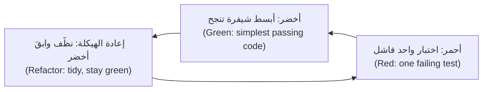
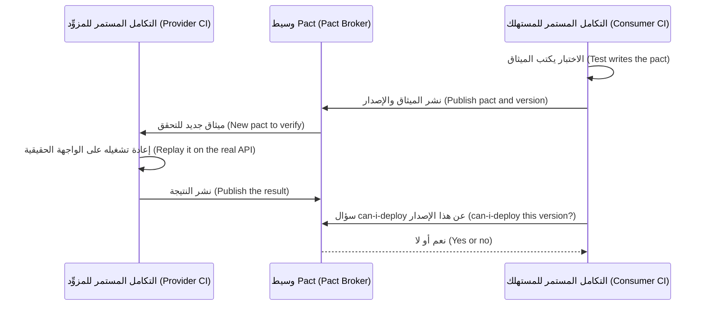
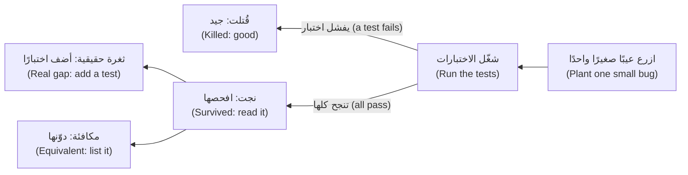

# الوحدة 2 — اختبار الشيفرة (Testing code)

*علّمتك الوحدة 1 كيف تقرر ما الذي تختبره. وتحوّل هذه الوحدة تلك القرارات إلى شيفرة تعمل مع كل إيداع في بنك نجم. يتناول الدرس 2.1 اختبارات الوحدة (unit tests)، وهي فحوص صغيرة وسريعة تجيب المطوّر في ثوانٍ، ويتناول التطوير الموجَّه بالاختبار، أي عادة كتابة الاختبار الفاشل أولًا. وينتقل الدرس 2.2 إلى المواضع التي تكفّ فيها كائنات المحاكاة (mocks) عن الصدق: قواعد البيانات والطوابير (queues) واستدعاءات HTTP إلى الخدمات الأخرى والعقود بين الفرق. ويطرح الدرس 2.3 السؤال الأهم، وهو أهم حين يكتب وكيل ذكاء اصطناعي اختباراتك: هل هذه الاختبارات جيدة فعلًا؟ ستقيس مجموعة الاختبارات بتغطية الشيفرة (coverage)، وتكسر الشيفرة عمدًا باختبار الطفرات (mutation testing)، وتدع Hypothesis تبحث عن مدخلات لم يفكر فيها أحد، وتتعلم كشف الاختبارات غير المستقرة (flaky tests). كل شيء يعمل على [النظام النموذجي للدورة](https://github.com/Tamoura/system-design-for-vibe-coders/tree/main/testing/sample)، وهو تحويلات نجم، فتشاهد كيف تلتقط كل تقنية العيوب المزروعة أو تُخطئها.*

> **التركيز:** Unit, Integration — كتابة اختبارات سريعة وصادقة للشيفرة التي تملكها، وربطها بتبعيات حقيقية، وإثبات أنها قادرة على الفشل.

---

# 2.1 — اختبار الوحدة والتطوير الموجَّه بالاختبار: التجهيز والتنفيذ والتأكيد، والبدائل الاختبارية، والتغذية الراجعة السريعة
*المستوى: 🟢 مبتدئ* · *المتطلبات: 1.1، 1.2* · *التركيز: Unit*

**بعد هذا الدرس تستطيع** كتابة اختبارات وحدة مسمّاة ومُعلَّمة بالمعاملات تستخدم بدائل ثابتة الاستجابة ومراقِبين وساعة محقونة، وإثبات أن تغيير حرف واحد في قاعدة يجعل اختبارًا واحدًا منها بالضبط يفشل. *مدة الدراسة: قراءة نحو 15 دقيقة، وعمل تطبيقي نحو 150 دقيقة (تقدير).*

## ⚡ الدرس في دقيقة (In 60 seconds)
- يفحص **اختبار الوحدة (unit test)** سلوكًا صغيرًا واحدًا في ميلي ثوانٍ، دون شبكة أو قاعدة بيانات أو ساعة حقيقية. ابنِه على نمط **التجهيز والتنفيذ والتأكيد** وسمِّه باسم القاعدة التي يحميها.
- استبدل فقط ما هو بطيء أو عشوائي أو خارج سيطرتك **ببديل اختباري (test double)**: الكائن الشكلي (dummy) أو البديل ثابت الاستجابة (stub) أو المراقب (spy) أو كائن المحاكاة (mock) أو البديل المزيّف (fake).
- فضّل **اختبار الحالة (state testing)**، أي «ما الصحيح بعد ذلك؟»، على **اختبار التفاعل**، أي «أي استدعاءات حدثت؟». فاستبدال القاعدة المختبَرة بكائن محاكاة يُبقي الاختبار أخضر والنظام معطوبًا.
- **التطوير الموجَّه بالاختبار (TDD)** حلقة: اختبار فاشل واحد (أحمر)، وأبسط شيفرة تنجح (أخضر)، ثم التنظيف (إعادة الهيكلة، refactor). استخدمه للقواعد التي تفهمها، لا للاستكشاف.
- إشارة القرار: سمِّ العيب الذي سيلتقطه الاختبار، وإلا فهو مجرد زينة.

## 🧭 لماذا يهم
يوم الثلاثاء تفتح ندى أول طلب دمج (pull request) لها في بنك نجم: مكتب `TransferDesk` الذي يرسل تحويلًا ويرسل رسالة نصية إلى العميل. فيه أربعة عشر اختبارًا للوحدة، وكل سطر جديد مغطًّى. يشغّلها بلال وعيب `limit_off_by_one` في النظام النموذجي مفعَّل. تنجح الأربعة عشر كلها. يُرفض تحويل يجعل إجمالي اليوم 50,000.00 QAR بالضبط رفضًا خاطئًا، ولا يلاحظ أي اختبار ذلك، لأن كل اختبار استبدل `TransferService` بكائن `Mock` يعيد جوابًا جاهزًا. تفحص الاختبارات أن المكتب يجري استدعاءات. ولا واحد منها يشغّل القاعدة.

يطلب راشد من ندى أن تسمّي العيب الذي سيلتقطه كل اختبار. فلا تسمّي أيًّا منها. وهذا الدرس هو عُدّة الإصلاح: اختبارات سريعة ومقروءة وقادرة على الفشل، ومتى تستبدل متعاونًا ببديل مزيّف، وكيف يجعلك التطوير الموجَّه بالاختبار ترى الاختبار يفشل أولًا. وفي عصر الذكاء الاصطناعي يزداد هذا أهمية: فالوكيل (agent) يستطيع أن يكتب في ثوانٍ اختبارات سلسة مثقلة بكائنات المحاكاة، وعليك أنت أن تحكم عليها.

## 📐 كيف يعمل

### 🟢 الأساسيات

**ما الوحدة.** الوحدة هي أصغر سلوك تستطيع تسميته وفحصه منفردًا: غالبًا دالة مثل `fee`، وأحيانًا صنف صغير، وليست أبدًا «ملفًا». يعمل **اختبار الوحدة (unit test)** داخل العملية نفسها، في ميلي ثوانٍ، دون شبكة أو قاعدة بيانات أو ساعة حقيقية أو عشوائية.

**التجهيز والتنفيذ والتأكيد (Arrange, act, assert, AAA).** يبني *التجهيز* المدخلات والكائنات. ويستدعي *التنفيذ* الشيء الواحد المختبَر. ويفحص *التأكيد (assert)* النتيجة. تنفيذان اثنان: اختباران.

**التسمية.** اسم الاختبار هو أول ما يعرضه البناء الفاشل. فالاسم `test_fee` لا يخبر الغريب بشيء، أما `test_international_fee_is_rounded_half_up` فيسمّي القاعدة المكسورة.

**FIRST.** خمس خصائص لاختبار الوحدة الجيد: **سريع** أي ميلي ثوانٍ، فتشغّله باستمرار؛ و**معزول** فلا يحتاج اختبار إلى آخر يعمل قبله؛ و**قابل للتكرار** بالنتيجة نفسها على أي جهاز وفي أي يوم، لذا مرّر `now` من الخارج؛ و**ذاتي التحقق (Self-validating)** أي `assert` لا `print`؛ و**في الوقت المناسب** أي مكتوب مع الشيفرة أو قبلها.

**أساسيات pytest.** يشغّل pytest الدوال المسماة `test_*` في الملفات المسماة `test_*.py`. أعلام مفيدة: `-q` للوضع الهادئ، و`-k rounded` للاختيار بالاسم، و`-x` للتوقف عند أول فشل، و`--durations=5` لأبطأ خمسة اختبارات. يعرض هذا الملف الميزات السبع التي تحتاجها في اليوم الأول.

```python
# tests/test_unit_essentials.py
from decimal import Decimal

import pytest

from najm.transfers import TransferRejected, TransferService, check_transfer, fee


def test_international_fee_is_rounded_half_up():
    amount = "3090"                                         # arrange: 3,090 x 0.35 % = 10.815
    result = fee(amount, "QAR", "international")            # act
    assert result == Decimal("10.82")                       # assert: the half goes up


@pytest.mark.parametrize("amount, expected", [
    pytest.param("1000", "0.00", id="1000-is-still-free"),
    pytest.param("1000.01", "2.00", id="just-over-pays-2"),
])
def test_domestic_fee_threshold(amount, expected):
    assert fee(amount, "QAR", "domestic") == Decimal(expected)


@pytest.fixture
def service():
    return TransferService()


def test_alice_cannot_spend_bobs_money(service):
    req = {"from_account": "acc-2", "to_account": "acc-1", "amount": "10", "currency": "QAR", "kind": "own"}
    with pytest.raises(TransferRejected, match="not_owner"):
        service.submit("alice", req, "k1")


@pytest.mark.slow                                           # `pytest -m "not slow"` skips it
def test_a_thousand_checks_stay_fast():
    for _ in range(1000):
        check_transfer("100", "QAR", "domestic")


def test_receipt_goes_to_a_temp_folder(tmp_path):
    receipt = tmp_path / "tr-1.txt"
    receipt.write_text(f"fee={fee('5000', 'QAR', 'domestic')}")
    assert receipt.read_text() == "fee=2.00"


def test_the_minimum_can_change_for_one_test(monkeypatch):
    monkeypatch.setattr("najm.transfers.MIN_TRANSFER", Decimal("50"))
    with pytest.raises(TransferRejected, match="below_minimum"):
        check_transfer("49.99", "QAR", "own")
```

سجّل الوسم في `pytest.ini` (`markers = slow: tests over a second`). يعيد pytest كتابة `assert` العادي كي يُظهر الفشل الطرفين. شغّل `NAJM_BUGS=float_fee pytest -k rounded` فيظهر عيب الفاصلة العائمة في النظام النموذجي فرقًا مقروءًا (مختصرًا):

```text
>       assert result == Decimal("10.82")
E       AssertionError: assert Decimal('10.81') == Decimal('10.82')
```

تجهيزات الاختبار (Fixtures) ومجلدات `tmp_path` وتعديلات `monkeypatch` كلها لكل اختبار على حدة، فلا يتسرب شيء؛ ويجعل `pytest.raises` الخطأ هو النتيجة المتوقعة.

### 🟡 التعمق أكثر (Going deeper)

**البدائل الاختبارية (Test doubles).** يحل *البديل الاختباري* محل متعاون حقيقي، مثل بديل المشاهد الخطرة في السينما. أضف `TransferDesk` إلى النظام النموذجي: يسأل مقيِّم المخاطر، ثم يرسل التحويل، ثم يرسل رسالة نصية.

```python
# najm/desk.py
from najm.transfers import TransferRejected


class TransferDesk:
    def __init__(self, service, notifier, risk):
        self.service, self.notifier, self.risk = service, notifier, risk

    def send(self, user, req, key, now=None):
        if self.risk.score(user, req) >= 0.8:
            raise TransferRejected("held_for_review")
        transfer, created = self.service.submit(user, req, key, now)
        if created:
            self.notifier.sms(user, f"Sent {transfer['amount']} {transfer['currency']} (ref {transfer['id']})")
        return transfer
```

| البديل | ماذا يفعل | مثال من نجم |
|---|---|---|
| **الكائن الشكلي (Dummy)** | يملأ معاملًا لا يُقصد استخدامه أبدًا | كائن `object()` مجرد بدل المُخطِر: أي استخدام له يفشل بصوت عالٍ |
| **البديل ثابت الاستجابة (Stub)** | يعيد إجابات جاهزة | يفرض `StubRisk(0.95)` حالة «خطورة عالية» |
| **المراقب (Spy)** | يسجّل ما حدث ليفحصه المختبِر | `SpyNotifier.sent` |
| **كائن المحاكاة (Mock)** | يحمل توقعات ويتحقق منها بنفسه | `notifier.sms.assert_called_once()` |
| **البديل المزيّف (Fake)** | بديل يعمل فعلًا وخفيف الوزن | `TransferService` الذي في الذاكرة (in-memory) بوصفه دفتر الحسابات |

يستطيع `unittest.mock.Mock` في Python أن يؤدي دور البديل ثابت الاستجابة أو المراقب أو كائن المحاكاة بحسب الاستخدام: المهم هو الدور، لا الصنف.

```python
# tests/test_doubles.py
from decimal import Decimal

import pytest

from najm.desk import TransferDesk
from najm.transfers import TransferRejected, TransferService

REQ = {"from_account": "acc-1", "to_account": "acc-2", "amount": "100.00", "currency": "QAR", "kind": "domestic"}


class StubRisk:                          # stub: a canned answer
    def __init__(self, score):
        self.value = score

    def score(self, user, req):
        return self.value


class SpyNotifier:                       # spy: records what it was asked to do
    def __init__(self):
        self.sent = []

    def sms(self, user, text):
        self.sent.append((user, text))


def test_a_held_transfer_sends_no_sms_and_moves_no_money():
    service = TransferService()                                  # a fake: a real, in-memory ledger
    desk = TransferDesk(service, object(), StubRisk(0.95))      # dummy: any object; using it raises AttributeError
    with pytest.raises(TransferRejected, match="held_for_review"):
        desk.send("alice", REQ, "k1")
    assert service.accounts["acc-1"]["balance"] == Decimal("12000.00")      # state


def test_an_accepted_transfer_texts_the_customer_once():
    spy = SpyNotifier()
    desk = TransferDesk(TransferService(), spy, StubRisk(0.1))
    desk.send("alice", REQ, "k1")
    desk.send("alice", REQ, "k1")                                # a retry with the same key
    assert spy.sent == [("alice", "Sent 100.00 QAR (ref tr-0001)")]         # interaction
```

يفحص الاختبار الأول *الحالة*. ويفحص الثاني *تفاعلًا* عبر مراقب: الوعد هو «أُخبر العميل مرة واحدة بالضبط، حتى عند إعادة المحاولة».

**ساعة تتحكم بها.** تأخذ `value_date(now)` و`submit(..., now)` الوقتَ معاملًا. وهذا هو *الحقن (injection)*: يصبح موعد الإغلاق في الثالثة عصرًا (15:00) بتوقيت قطر بيانات اختبار (test data). وحين لا تستطيع تغيير التوقيع، تجمّد `freezegun` الدالة `datetime.now()` بدلًا من ذلك.

```python
# tests/test_clock.py
from datetime import datetime
from zoneinfo import ZoneInfo

import pytest
from freezegun import freeze_time

from najm.transfers import TransferService, value_date

REQ = {"from_account": "acc-1", "to_account": "acc-2", "amount": "100.00", "currency": "QAR", "kind": "domestic"}


@pytest.mark.parametrize("hour, minute, expected", [(14, 59, "2026-10-05"), (15, 0, "2026-10-06"), (15, 30, "2026-10-06")])
def test_cutoff_with_an_injected_clock(hour, minute, expected):
    now = datetime(2026, 10, 5, hour, minute, tzinfo=ZoneInfo("Asia/Qatar"))      # a Monday
    assert value_date(now).isoformat() == expected


@freeze_time("2026-10-05 12:30:00+00:00")                                         # 15:30 in Qatar
def test_cutoff_with_freezegun():
    transfer, _ = TransferService().submit("alice", REQ, "k")                     # no `now`: the service reads the clock
    assert transfer["value_date"] == "2026-10-06"
```

الحقن أبسط وأرخص بكثير: هنا استغرقت 1,000 استدعاء محقون بضع ميلي ثوانٍ، واستغرقت 1,000 كتلة `freeze_time` نحو ثانيتين. وهو أيضًا زوج **ضعيف مقابل قوي**. يستخدم اختبار موعد الإغلاق في المجموعة الابتدائية الساعة 10:00 بتوقيت قطر، فينجح حتى تحت `NAJM_BUGS=tz_cutoff`. أما حالتا 15:00 و15:30 فتفشلان تحته، لأن ذلك العيب يقرأ موعد الإغلاق بالتوقيت العالمي UTC: فهما قادرتان على الفشل، ولذلك فلهما معنى.

**الحالة مقابل التفاعل، والإفراط في المحاكاة.** يؤكد *اختبار الحالة* النتائج والتغييرات. ويؤكد *اختبار التفاعل* الاستدعاءات الموجهة إلى المتعاونين: وهو مناسب للآثار الجانبية التي تغادر نظامك مثل الرسالة النصية، ومحفوف بالمخاطر في غيرها، لأنه يثبّت *كيف* تعمل الشيفرة. وأسوأ الحالات أن تستبدل المتعاون الذي يحمل القاعدة. اختباران لوعد واحد، هو «آخر ريال من السقف اليومي مقبول»:

```python
# tests/test_overmocked.py
from decimal import Decimal
from unittest.mock import Mock

from najm.desk import TransferDesk
from najm.transfers import TransferService

RICH = {"acc-1": {"owner": "alice", "currency": "QAR", "balance": Decimal("100000")},
        "acc-2": {"owner": "bob", "currency": "QAR", "balance": Decimal("0")}}


class CalmRisk:
    def score(self, user, req):
        return 0.1


def own(amount):
    return {"from_account": "acc-1", "to_account": "acc-2", "amount": amount, "currency": "QAR", "kind": "own"}


def test_the_last_riyal_overmocked():                  # passes whatever the rules say
    service, notifier = Mock(), Mock()
    service.submit.return_value = ({"id": "tr-1", "amount": "1000.00", "currency": "QAR"}, True)
    TransferDesk(service, notifier, CalmRisk()).send("alice", own("1000.00"), "k")
    notifier.sms.assert_called_once()


def test_the_last_riyal_is_accepted():                 # runs the real rules
    desk = TransferDesk(TransferService(RICH), Mock(), CalmRisk())
    desk.send("alice", own("25000.00"), "k1")
    desk.send("alice", own("24000.00"), "k2")
    assert desk.send("alice", own("1000.00"), "k3")["status"] == "accepted"      # total: exactly 50,000
```

| التشغيل | الاختبار المفرط في المحاكاة | اختبار القواعد الحقيقية |
|---|---|---|
| النظام النموذجي النظيف | ينجح | ينجح |
| `NAJM_BUGS=limit_off_by_one` | **ينجح** | **يفشل** |

لا يثبت الاختبار الأول إلا أن `Mock` يعيد ما أخبرته به، ومع ذلك يبدو سليمًا في المراجعة. استخدم بديلًا مزيّفًا أو الكائن الحقيقي لكل ما يحمل قاعدة، واحتفظ بكائنات المحاكاة للحواف مثل الشبكة والرسائل النصية.

**روائح اختبار الوحدة.** *المنطق داخل الاختبار* قد يخطئ بالطريقة نفسها التي تخطئ بها الشيفرة: استخدم قيمًا متوقعة حرفية. و*الحالة المتغيرة المشتركة* (مثل `SERVICE` على مستوى الوحدة البرمجية) تجعل النتائج تعتمد على الترتيب: استخدم تجهيزًا (fixture). و*اختبار التفاصيل الخاصة* (`svc._sent_today`) ينكسر عند إعادة الهيكلة: أكّد السلوك العام. و*غياب التأكيد*، أو `assert result is not None`، لا يثبت إلا أن شيئًا لم ينهَر. و*الإفراط في التحديد*: أكّد `code` المستقر.

**ميزانيات السرعة.** ميزانية نجم: اختبار الوحدة أقل من 100 ms، والمجموعة أقل من 60 ثانية على حاسوب محمول، وكل ما هو أبطأ يوسَم بـ`slow`. يصنّف كتاب *Software Engineering at Google* الاختبارات بحسب ما يجوز لها لمسه. وللاطلاع على خطوط التكامل والتسليم المستمرين، انظر [*السحابة وDevOps*، الدرس 4.1 — التكامل المستمر: خطوط التكامل والتسليم المستمرين والاختبارات والمخرجات (artefacts) والتغذية الراجعة السريعة](../cloud/index.ar.html#/4.1).

### 🔴 نظرة الخبير (Expert view)

**مثال تطبيقي على التطوير الموجَّه بالاختبار.** يكرر *التطوير الموجَّه بالاختبار (test-driven development)* (Kent Beck، *Test-Driven Development: By Example*، 2002) حلقة في دورات صغيرة.



القصة TRF-240: *يرسل عملاء نجم بلس التحويلات المحلية مجانًا ويدفعون نصف رسم التحويل الدولي.* تبدأ ندى `najm/plus.py` هيكلًا يعيد الرسم القياسي، فيتعلق أول فشل بالسلوك لا باسم مفقود.

*الدورة 1، أحمر:* يجب أن يكلّف تحويل محلي بنجم بلس بمبلغ 5,000 رسمًا قدره `0.00`.

```text
E       AssertionError: assert Decimal('2.00') == Decimal('0.00')
```

*أخضر:* أعد صفرًا للنوع `domestic`. *الدورة 2، أحمر:* يجب أن يكلّف التحويل الدولي على 5,000 رسم `8.75`، أي نصف الرسم القياسي 17.50.

```text
E       AssertionError: assert Decimal('17.50') == Decimal('8.75')
```

*أخضر:* نصّف الرسم، `quantize(fee(amount, currency, kind) / 2, currency)`. *الدورة 3، أحمر.* يسأل راشد: هل نصّف الرسم المقرَّب 10.83، أم الرسم الدقيق 10.82599؟ المال يُقرَّب مرة واحدة في النهاية. تحسب ندى 3,093.14 يدويًا: نصف 10.82599 هو 5.412995، فالنتيجة 5.41.

```text
E       AssertionError: assert Decimal('5.42') == Decimal('5.41')
```

نصّفت شيفرة الدورة 2 عددًا مقرَّبًا، و5.415 يُقرَّب إلى الأعلى فيصير 5.42، فوجد الاختبار الجديد عيبًا حقيقيًا في شيفرة كانت ناجحة أصلًا. ثم *أخضر*، ثم *إعادة الهيكلة (refactor)* والاختبارات الثلاثة كلها تراقب. الاختبارات، واحد لكل دورة، والشيفرة النهائية:

```python
# tests/test_plus.py
from decimal import Decimal

from najm.plus import plus_fee


def test_plus_customers_send_domestic_transfers_free():                 # cycle 1
    assert plus_fee("5000", "QAR", "domestic") == Decimal("0.00")


def test_plus_customers_pay_half_the_international_fee():               # cycle 2
    assert plus_fee("5000", "QAR", "international") == Decimal("8.75")


def test_the_half_is_taken_before_rounding_not_after():                 # cycle 3
    assert plus_fee("3093.14", "QAR", "international") == Decimal("5.41")      # not 5.42
```

```python
# najm/plus.py
from decimal import Decimal

from najm.transfers import fee, quantize

RATE, FLOOR, CAP = Decimal("0.0035"), Decimal("10"), Decimal("100")    # as in the standard fee


def plus_fee(amount, currency, kind):
    amount = Decimal(str(amount))
    if kind == "domestic":
        return quantize(0, currency)
    if kind == "international":
        standard = max(FLOOR, min(CAP, amount * RATE))      # unrounded
        return quantize(standard / 2, currency)             # rounded once, at the very end
    return fee(amount, currency, kind)
```

**أين يتألق التطوير الموجَّه بالاختبار وأين لا.** يتألق في القواعد التي تستطيع صياغتها أمثلةً وفي إصلاح العيوب: اكتب أولًا الاختبار الذي يعيد إنتاج العيب واحتفظ به. ولا يناسب الاستكشاف، ولا شيفرة الربط الرقيقة، ولا واجهة المستخدم على مستوى البكسل، ولا الشيفرة بلا نقاط فصل، حيث تكتب أولًا اختبارات توصيفية (characterisation tests) (الدرس 2.3). ومع وكلاء البرمجة يصبح التطوير الموجَّه بالاختبار ضابطًا: أنت تكتب الاختبار الفاشل أو تعتمده، والوكيل يجعله أخضر (الدرس 6.2؛ [*تصميم الأنظمة لمبرمجي الفايب*، الدرس 8.2 — الاختبارات بوصفها المواصفة التي لا يستطيع الوكيل تجاهلها](../vibe/index.ar.html#l8-2)).

**الأفكار نفسها في TypeScript.** ينسّق عميل الويب في تطبيق نجم للهاتف المال للعرض على الشاشة؛ وداخل العميل تكون المبالغ وحدات صغرى كاملة لا أعدادًا عشرية عائمة. ولدى Vitest الشكل نفسه الذي لدى pytest:

```typescript
// money.ts
type Currency = "QAR" | "KWD" | "JPY";
const DECIMALS: Record<Currency, number> = { QAR: 2, KWD: 3, JPY: 0 };

/** Whole minor units in, display text out: 123456 QAR becomes "1,234.56 QAR". */
export function formatMinor(minor: number, currency: Currency): string {
  if (!Number.isSafeInteger(minor) || minor < 0) throw new RangeError("non-negative whole minor units only");
  const d = DECIMALS[currency];
  const digits = String(minor).padStart(d + 1, "0");
  const whole = digits.slice(0, digits.length - d).replace(/\B(?=(\d{3})+(?!\d))/g, ",");
  return `${d > 0 ? `${whole}.${digits.slice(-d)}` : whole} ${currency}`;
}
```

```typescript
// money.test.ts
import { expect, it } from "vitest";
import { formatMinor } from "./money";

it.each([
  [123456, "QAR", "1,234.56 QAR"],
  [5, "QAR", "0.05 QAR"],
  [1234567, "KWD", "1,234.567 KWD"],
] as const)("formats %i %s as %s", (minor, currency, expected) => {
  expect(formatMinor(minor, currency)).toBe(expected);
});

it("rejects fractions and negatives instead of guessing", () => {
  expect(() => formatMinor(10.5, "QAR")).toThrow(RangeError);
  expect(() => formatMinor(-1, "QAR")).toThrow("non-negative");
});
```

شغّل `npm install -D vitest`، ثم `npx vitest run` والمخرجات مختصرة:

```text
 Test Files  1 passed (1)
      Tests  4 passed (4)
```

## 🧰 الأدوات
| الأداة أو الممارسة أو التقنية | ما هي وماذا تفعل | متى تلجأ إليها |
|---|---|---|
| **pytest** | مشغّل اختبارات Python بـ`assert` عادي وتجهيزات وتحديد معاملات ووسوم | أي اختبار وحدة أو تكامل بلغة Python |
| **Vitest** | مشغّل سريع لـ TypeScript/JavaScript بواجهة شبيهة بواجهة Jest | اختبارات الوحدة لشيفرة الويب وNode |
| **Test doubles** (Meszaros) | الكائن الشكلي والبديل ثابت الاستجابة والمراقب وكائن المحاكاة والبديل المزيّف | الحواف التي لا تتحكم بها: الشبكة والرسائل النصية والساعة |
| **freezegun** | يجمّد `datetime.now()` للشيفرة المختبَرة | قارئو الساعة الذين لا تستطيع تغييرهم |
| **Test-driven development** | أحمر وأخضر وإعادة هيكلة في دورات صغيرة | القواعد المصوغة أمثلةً وكل إصلاح لعيب |

## 🏛️ عمليًا في بنك نجم
يحوّل بلال أسئلة راشد إلى **معيار نجم لاختبار الوحدة، الإصدار 1**، وهو قائمة تحقق لكل طلب دمج يخص التحويلات، سواء كتبه إنسان أو ذكاء اصطناعي.

| # | القاعدة | كيف يتحقق منها المراجع |
|---|---|---|
| 1 | قاعدة واحدة لكل اختبار، ويحمل اسمها؛ تجهيز وتنفيذ وتأكيد | السطر الفاشل يشرح المشكلة وحده |
| 2 | القيم المتوقعة قيم حرفية من مواصفة أو حساب يدوي | لا اختبار يعيد استخدام المعادلة |
| 3 | كائنات حقيقية أو بدائل مزيّفة للقواعد؛ وكائنات المحاكاة عند الحواف فقط | برّر كل `Mock(` في التعديلات المقترحة |
| 4 | الساعة معامل؛ لا `sleep` ولا شبكة ولا حالة مشتركة | ينجح منفردًا وبأي ترتيب |
| 5 | القواعد الجديدة تنال اختبارات حدّية على الجانبين | اربطها بجدول الدرس 1.2 |
| 6 | **اكسره لتثق به:** يُظهر المؤلف الاختبار وهو يفشل مرة واحدة | يلصق طلب الدمج المخرجات الحمراء |
| 7 | أقل من 100 ms لكل اختبار؛ والأبطأ يوسَم `slow` | `--durations=5` في مخرجات التكامل المستمر |

## 🛠️ التمارين (Exercises)
انسخ النظام النموذجي (`cp -r testing/sample ~/najm-sample`)، وأنشئ بيئة افتراضية ونفّذ `pip install -r requirements.txt freezegun`.

- 🟢 **سمِّه واكسره.** اكتب ستة اختبارات مُحدَّدة بمعاملات للدالة `fee`: محلي عند 1000 و1000.01، ودولي عند 100 و3090، وبين حساباتك عند 500، والسقف (`fee("100000", "QAR", "international")`)، ولكل منها `id` مقروء. *يكتمل عندما:* تنص الأسماء على القاعدة، ويُظهر `pytest -v` المعرّفات، وتغيير `<=` إلى `<` في قاعدة التحويل المحلي يدويًا يُفشل اختبارًا واحدًا بالضبط.
- 🟡 **بدائل وساعة.** أضف `najm/desk.py` واختبره: المقيِّم يحتجز التحويل عند 0.8 بالضبط ولا يحتجزه عند 0.79 (بدائل ثابتة الاستجابة، stubs)، والتحويل المحتجز لا يرسل رسالة نصية (كائن شكلي، dummy)، والمقبول يرسل واحدة (مراقب، spy)، وموعد الإغلاق يصمد عند 14:59 و15:00 و15:30 بتوقيت قطر (ساعة محقونة). *يكتمل عندما:* تكون المجموعة خضراء على النظام النموذجي النظيف، وتفشل تحت `NAJM_BUGS=tz_cutoff`، ولا تستخدم كائن محاكاة بدل `TransferService` أبدًا.
- 🔴 **طوّر قاعدة موجَّهًا بالاختبار، ثم اصطد الإفراط في المحاكاة.** طوّر TRF-241 موجَّهًا بالاختبار: «سقف نجم بلس اليومي يساوي 1.5 مثل السقف القياسي؛ أما الحد الأقصى للتحويل الواحد فلا يتغير»، في ثلاث دورات أحمر–أخضر، مع حفظ كل رسالة حمراء. ثم اكتب نسخة مفرطة في المحاكاة من أحد الاختبارات. *يكتمل عندما:* تقتبس ملاحظاتك ثلاث رسائل حمراء، وبعد أن تكسر قاعدتك يدويًا (`>` إلى `>=`) يظل الاختبار المفرط في المحاكاة ناجحًا بينما يفشل الاختبار الحقيقي.

## ⚠️ أخطاء وفخاخ (Mistakes and traps)
- **محاكاة الشيء الذي تختبره.** الاختبار يثبت أن كائن المحاكاة يعمل.
- **التأكيد على الاستدعاءات لا على النتائج.** يثبّت `assert_called_with` الربط لا الوعد.
- **قيم متوقعة منسوخة من مخرجات الشيفرة.** يعيد الاختبار صياغة التنفيذ (الدرس 1.1). استخدم سياسة أو حسابك الخاص.
- **ساعة حقيقية أو عشوائية أو حالة مشتركة.** تنجح الاختبارات اليوم وتفشل يوم الجمعة. احقن أو ثبّت البذرة أو أعد البناء.
- **ألّا ترى الاختبار يفشل أبدًا.** الاختبار الذي لم يكن أحمر قط قد لا يصير أحمر أبدًا. نفّذ خطوة الأحمر في التطوير الموجَّه بالاختبار أو بدّل مفتاح عيب مرة واحدة.

## 🧾 الخلاصة (Recap)
- اختبار الوحدة يفحص سلوكًا واحدًا، بسرعة، بصيغة التجهيز والتنفيذ والتأكيد (arrange-act-assert)، باسم يذكر القاعدة.
- FIRST هو معيار الجودة؛ والاختبار البطيء أو المعتمد على الترتيب عيب.
- كائنات حقيقية أو بدائل مزيّفة للقواعد، وكائنات المحاكاة للحواف؛ احقن الساعة قبل أن تلجأ إلى freezegun.
- فحوص الحالة تصمد أمام إعادة الهيكلة؛ وفحوص التفاعل تثبّت الربط؛ والإفراط في المحاكاة ينجح على نظام معطوب.
- التطوير الموجَّه بالاختبار: شاهد الاختبار يفشل لسبب صحيح، واكتب أصغر شيفرة، وأعد الهيكلة وأنت على الأخضر.

## ✍️ اختبر نفسك (Check yourself)

**1. يجب ألا يرسل التحويل المحتجز أي رسالة نصية. ويجب أن يعيد المقيِّم 0.95، وأن يفشل المُخطِر إن لُمس. أي البدائل تناسب؟**

- A. كائن محاكاة للمقيِّم وبديل مزيّف للمُخطِر
- B. بديل ثابت الاستجابة للمقيِّم وكائن شكلي للمُخطِر
- C. مراقب للمقيِّم وبديل ثابت الاستجابة للمُخطِر
- D. كائن شكلي للمقيِّم وكائن محاكاة للمُخطِر

<details><summary>الإجابة</summary>

**B.** يعيد البديل ثابت الاستجابة (stub) القيمة الجاهزة 0.95؛ ويفشل الكائن الشكلي (dummy) بصوت عالٍ إن استُخدم، فيثبت أنه لم تُحاوَل أي رسالة نصية. أما كائن المحاكاة (mock) أو المراقب (spy) فيسجّل الاستدعاءات. (🟡 البدائل الاختبارية.)

</details>

**2. مع تفعيل `limit_off_by_one` ما زالت اختبارات مكتب ندى الأربعة عشر كلها تنجح. ما السبب الأرجح؟**

- A. لا تستطيع اختبارات الوحدة أبدًا العثور على عيوب الحدود في قواعد العمل
- B. شُغّلت المجموعة بسرعة أكبر من أن يظهر العيب في الوقت المناسب
- C. كل اختبار حاكى `TransferService` وأعاد جوابًا ثابتًا
- D. بقيت تغطية الأسطر (line coverage) للملف الجديد دون مئة بالمئة إجمالًا

<details><summary>الإجابة</summary>

**C.** مع محاكاة الخدمة لا تعمل قاعدة السقف، فلا يستطيع العيب أن يظهر. (🟡 الإفراط في المحاكاة.)

</details>

**3. يستدعي اختبار `submit(...)` دون `now` ويتوقع تاريخ القيمة لليوم. ويفشل حين يعمل التكامل المستمر (CI) بعد الساعة 15:00 بتوقيت قطر. ما أفضل إصلاح؟**

- A. تمرير قيمة `now` ثابتة وتأكيد تاريخ مفحوص يدويًا
- B. إضافة `time.sleep(2)` قبل تأكيد التاريخ
- C. إعادة تشغيل الاختبار تلقائيًا حتى ينجح في CI
- D. تخفيف التأكيد ليقبل أي تاريخ في أكتوبر

<details><summary>الإجابة</summary>

**A.** المدخل الخفي هو الساعة. حقنها يجعل الاختبار قابلًا للتكرار. أما الانتظار الثابت وإعادة المحاولة فيخفيان التبعية. (🟡 ساعة تتحكم بها.)

</details>

**4. في الدورة 3 من التطوير الموجَّه بالاختبار يفشل الاختبار الجديد بالرسالة `5.42 != 5.41`. ماذا بعد؟**

- A. تغيير القيمة المتوقعة إلى 5.42 لتصير المجموعة كلها خضراء
- B. حذف الاختبار، لأن الاختبارين الأولين ينجحان أصلًا
- C. إعادة كتابة الدالة كلها قبل تشغيل أي اختبار من جديد
- D. أصغر تغيير يُنجح الاختبار، ثم إعادة الهيكلة على الأخضر

<details><summary>الإجابة</summary>

**D.** الاختبار الأحمر لسبب صحيح يستدعي أصغر تغيير ناجح، ثم إعادة هيكلة على الأخضر. أما تعديل التوقع فيدفن عيبًا حقيقيًا. (🔴 مثال تطبيقي على التطوير الموجَّه بالاختبار.)

</details>

**5. يقرأ اختبار الحقل `svc._sent_today`. وبعد إعادة تسمية غير ضارة تفشل تسعة اختبارات. أي رائحة هذه؟**

- A. اختبار بلا تأكيد يشغّل الشيفرة ولا يفحص شيئًا
- B. حالة متغيرة مشتركة بين اختبارات كثيرة في ملف واحد
- C. اختبار التفاصيل الخاصة بالصنف
- D. منطق داخل جسم الاختبار، مثل الحلقات والفروع

<details><summary>الإجابة</summary>

**C.** قراءة الحقول الخاصة تكسر الاختبارات عند إعادة الهيكلة. أكّد السلوك العام، مثل الرصيد أو رمز الرفض. (🟡 روائح اختبار الوحدة.)

</details>

## 📚 المراجع (References)
- توثيق pytest (pytest documentation) — https://docs.pytest.org/
- وحدة `unittest.mock` في Python — https://docs.python.org/3/library/unittest.mock.html
- Martin Fowler، «Mocks Aren't Stubs» — https://martinfowler.com/articles/mocksArentStubs.html
- Martin Fowler، «Test Double» — https://martinfowler.com/bliki/TestDouble.html
- Vitest — https://vitest.dev/
- *Software Engineering at Google* (2020) — https://abseil.io/resources/swe-book
- Kent Beck، *Test-Driven Development: By Example* (2002)؛ Gerard Meszaros، *xUnit Test Patterns* (2007)

---

# 2.2 — اختبار التكامل: قواعد البيانات والطوابير وبيانات الاختبار واختبارات العقد
*المستوى: 🟡 متوسط* · *المتطلبات: 2.1* · *التركيز: Integration*

**بعد هذا الدرس تستطيع** اختبار مستودع بيانات على قاعدة بيانات حقيقية، وكتابة فحص عقد بمخطط JSON يفشل حين ينحرف شكل الاستجابة، وإثبات أن قيدًا في قاعدة البيانات يسدّ سباق الإرسال المزدوج. *مدة الدراسة: قراءة نحو 10 دقيقة، وعمل تطبيقي نحو 3 ساعة (تقدير).*

## ⚡ الدرس في دقيقة (In 60 seconds)
- يشغّل **اختبار التكامل (integration test)** شيفرتك مقابل جار حقيقي من قاعدة بيانات أو طابور أو خدمة HTTP أو واجهة برمجة فريق آخر ليفحص الوصلة لا المنطق.
- كائن المحاكاة يوافق افتراضاتك؛ والجار الحقيقي وحده يستطيع أن يخالفها. اختبر حيث تنكسر الأمور: SQL والأنواع وإعادة المحاولات (retries) والعقود.
- أبقِها سريعة ومعزولة: تراجع (rollback) لكل اختبار، وبيانات فريدة، ولا `sleep`، وساعة يمكن التحكم بها.
- يفحص **اختبار العقد** الشكل الذي اتفق عليه فريقان دون نشر الخدمتين معًا. وفي العقود **التي يقودها المستهلك (consumer-driven)** (Pact) يعلن المستهلك احتياجاته ويثبتها المزوِّد.
- إشارة القرار: إن كان بإمكان عيب أن يسكن الوصلة، فلن يجده اختبار الوحدة.

## 🧭 لماذا يهم
إصدار `TransferRepository` يوم الجمعة فيه 300 اختبار وحدة خضراء، يستبدل كل منها قاعدة البيانات بقاموس. وفي بيئة ضمان الجودة يظهر إجمالي اليوم لثلاثة تحويلات بقيمة 0.10 QAR هو 0.30000000000000004، لأن مطوّرًا عرّف عمود المبلغ بالنوع `REAL`. ولا يستطيع كائن المحاكاة أن يعرف ماذا تفعل قاعدة البيانات بالعدد. وفي ظهيرة اليوم نفسه يعيد التطبيق محاولة طلب POST ضاع ردّه، فيُخصم من العميل مرتين.

يقول راشد: «تقول اختبارات الوحدة إن الأجزاء صحيحة؛ وتقول اختبارات التكامل إنها موصولة صوابًا.» وقد يضيف وكيل ذكاء اصطناعي يكتب مستودعًا اتصالًا من نوع `MagicMock`: اسأل أين الحدّ الحقيقي.

## 📐 كيف يعمل

### 🟢 الأساسيات

**لماذا لا تكفي كائنات المحاكاة.** يخفي كائن المحاكاة ما يفعله الجار فعلًا: الأنواع والقيود في قاعدة البيانات، والترتيب والتوقيت في الطابور، ورموز الحالة ومهلات الانتظار (timeouts) في خدمة HTTP، والانجراف بين الإصدارات في واجهة فريق آخر. استخدم الشيء الحقيقي حيث يكون رخيصًا، وبديلًا ثابت الاستجابة أو عقدًا (contract) حيث لا يكون.

**الهرم والكأس وخلية النحل.** يريد *هرم الاختبار (test pyramid)* (Mike Cohn؛ Martin Fowler) اختبارات وحدة كثيرة، واختبارات تكامل أقل، واختبارات شاملة من البداية إلى النهاية قليلة. أما *الكأس* عند Kent C. Dodds فتمنح اختبارات التكامل أكبر وزن؛ و*خلية النحل* عند Spotify، للخدمات المصغّرة، تضع أكبر وزن على نقاط تكامل الخدمة. وهي تختلف في التشديد لا في المبدأ: اختبر حيث تعيش العيوب (انظر الدرس 5.1).

**قاعدة بيانات حقيقية بسرعة اختبار الوحدة.** تُخزَّن المبالغ وحدات صغرى كاملة، لا `REAL` أبدًا. فيما يلي المستودع، وتجهيزات تمنح كل اختبار قاعدة SQLite في الذاكرة داخل معاملة يُتراجع عنها بعد ذلك، ومُنشئ بقيم افتراضية صالحة ومعرّفات فريدة (Faker، ببذرة ثابتة):

```python
# najm/repository.py
import sqlite3
from decimal import Decimal

from najm.transfers import MINOR_UNITS

SCHEMA = """
CREATE TABLE transfers (
    id TEXT PRIMARY KEY, owner TEXT NOT NULL, idem_key TEXT NOT NULL,
    amount_minor INTEGER NOT NULL,                            -- whole minor units, never REAL
    currency TEXT NOT NULL, value_date TEXT NOT NULL,
    UNIQUE (owner, idem_key)
)"""


class DuplicateKey(Exception):
    pass


class TransferRepository:
    def __init__(self, conn: sqlite3.Connection):
        self.conn = conn

    def add(self, t: dict) -> None:
        minor = int(Decimal(t["amount"]).scaleb(MINOR_UNITS[t["currency"]]))
        try:
            self.conn.execute("INSERT INTO transfers VALUES (?, ?, ?, ?, ?, ?)",
                              (t["id"], t["owner"], t["idem_key"], minor, t["currency"], t["value_date"]))
        except sqlite3.IntegrityError as e:
            if "idem_key" in str(e):                              # a repeated id is another error
                raise DuplicateKey(t["idem_key"]) from e
            raise

    def sent_on(self, owner: str, currency: str, day: str) -> Decimal:
        (minor,) = self.conn.execute(
            "SELECT COALESCE(SUM(amount_minor), 0) FROM transfers WHERE owner = ? AND currency = ? AND value_date = ?",
            (owner, currency, day)).fetchone()
        return Decimal(minor).scaleb(-MINOR_UNITS[currency])
```

```python
# tests/conftest.py
import sqlite3

import pytest

from najm.repository import SCHEMA, TransferRepository


@pytest.fixture(scope="session")
def _database():
    db = sqlite3.connect(":memory:", isolation_level=None)   # autocommit: we choose when to BEGIN
    db.execute(SCHEMA)
    yield db
    db.close()


@pytest.fixture
def conn(_database):
    _database.execute("BEGIN")
    yield _database
    _database.execute("ROLLBACK")                            # whatever the test did is undone


@pytest.fixture
def repo(conn):
    return TransferRepository(conn)
```

```python
# tests/builders.py
from faker import Faker

fake = Faker()
Faker.seed(2026)                                             # same "random" data on every run


def a_transfer(**overrides) -> dict:
    transfer = {"id": fake.uuid4(), "owner": "alice", "idem_key": fake.uuid4(),
                "amount": "250.00", "currency": "QAR", "value_date": "2026-10-05"}
    return {**transfer, **overrides}
```

```python
# tests/test_repository.py
from decimal import Decimal

import pytest
from builders import a_transfer

from najm.repository import DuplicateKey


def test_the_daily_total_is_exact(repo):
    for _ in range(3):
        repo.add(a_transfer(amount="0.10"))
    assert repo.sent_on("alice", "QAR", "2026-10-05") == Decimal("0.30")      # float storage gives 0.30000000000000004


def test_the_database_refuses_a_repeated_idempotency_key(repo):
    repo.add(a_transfer(idem_key="k1"))
    with pytest.raises(DuplicateKey):
        repo.add(a_transfer(idem_key="k1"))
    repo.add(a_transfer(owner="bob", idem_key="k1"))                          # another customer may reuse the key
```

اختبار المجموع زوج **ضعيف مقابل قوي**. اتصال محاكى بإجمالي ثابت الاستجابة ينجح أيًّا كان نظام التخزين. أما هذا الاختبار فيفشل أمام تصميم يوم الجمعة، وهو عمود `REAL` يُملأ بـ`float(t["amount"])`: إذ يعطي `SELECT 0.1+0.1+0.1` في SQLite القيمة `0.30000000000000004`. أما تصميمنا فيخزّن وحدات صغرى كاملة في عمود `INTEGER`، والأعداد الصحيحة تُجمع جمعًا دقيقًا. وهناك فخ واحد: ينكسر العزل بالتراجع (rollback isolation) حين تُثبّت الشيفرة المختبَرة التغييرات. فالاختبار الذي ينفّذ `COMMIT` يترك صفه خلفه، ويُصدر `ROLLBACK` في التجهيز خطأً (`cannot rollback - no transaction is active`)، ويرى الاختبار التالي صفًا واحدًا. احذف الصفوف بعد كل اختبار، أو استخدم وضع نقاط الحفظ (savepoint mode) في مكتبة ORM، حيث لا يفعل تثبيت الشيفرة سوى تحرير نقطة الحفظ.

### 🟡 التعمق أكثر

**SQLite ليست PostgreSQL.** تناسب SQLite الفحوص السريعة للشيفرة المحايدة تجاه لهجة SQL لكنها تختلف حيث تتأذى البنوك. *الأنواع:* مرنة التنميط (جاءت الجداول الصارمة في الإصدار 3.37)، في مقابل `numeric(18, 3)` الدقيق في PostgreSQL. *التزامن (Concurrency):* كاتب واحد في كل مرة، في مقابل أقفال الصفوف (row locks) و`SELECT ... FOR UPDATE`. *القيود:* المفاتيح الأجنبية (foreign keys) معطّلة حتى تُفعَّل لكل اتصال.

استخدم SQLite للأغلبية الرخيصة، و**Testcontainers** للأقفال و`numeric` والترحيلات ولهجة SQL. هذه النسخة **غير منفَّذة هنا** (فهي تحتاج Docker؛ `pip install "testcontainers[postgres]" "psycopg[binary]"`)، وتختلف مسارات الاستيراد بين إصدارات testcontainers-python.

```python
# tests/test_transfers_postgres.py
from decimal import Decimal

import psycopg
import pytest
from testcontainers.community.postgres import PostgresContainer     # older releases: testcontainers.postgres


@pytest.fixture(scope="session")
def pg():
    with PostgresContainer("postgres:16-alpine") as container:       # a real, throwaway PostgreSQL
        url = container.get_connection_url().replace("+psycopg2", "")
        with psycopg.connect(url, autocommit=True) as conn:
            conn.execute("CREATE TABLE transfers (id text PRIMARY KEY, amount numeric(18, 3) NOT NULL)")
            yield conn


@pytest.fixture
def pg_conn(pg):
    with pg.transaction(force_rollback=True):          # always rolled back
        yield pg


def test_numeric_sums_are_exact(pg_conn):
    for i in range(3):
        pg_conn.execute("INSERT INTO transfers VALUES (%s, 0.10)", (f"tr-{i}",))
    (total,) = pg_conn.execute("SELECT SUM(amount) FROM transfers").fetchone()
    assert total == Decimal("0.30")
```

**بيانات الاختبار (Test data).** يمنح *المُنشئ* كل حقل قيمة افتراضية صالحة، فيسمّي الاختبار ما يهم فقط: `a_transfer(amount="0.10")`. أربع استراتيجيات للعزل: *التراجع لكل اختبار* (الافتراضي؛ ينكسر إن ثبّتت الشيفرة التغييرات أو استخدمت اتصالات أو خيوطًا أخرى)، و*الحذف أو التفريغ بعد كل اختبار* (للشيفرة التي تثبّت التغييرات؛ وهو أبطأ)، و*بيانات فريدة لكل اختبار* (للبيئات المشتركة؛ وتترك بقايا)، و*قاعدة بيانات جديدة لكل وحدة* (الأبطأ).

ابنِ قاعدة بيانات الاختبار بتشغيل **ترحيلاتك الحقيقية** من الفراغ، لا بمخطط منسوخ يدويًا، وأضف اختبار ترقية: أنشئها بالإصدار N−1، وأدخل صفوفًا، ورحِّل إلى N، وتحقق أنها نجت ([*لبنات بناء SaaS*، الدرس 2.1 — طبقة البيانات: Postgres وORMs والترحيلات والبيانات الأولية](../saas/index.ar.html#/2.1)). بيانات الاختبار اصطناعية أو مقنَّعة، لا بيانات عملاء أبدًا؛ و`Faker("ar_AA")` تولّد أسماء عربية.

**العمل غير المتزامن والطوابير: لا تنتظر مدة ثابتة وتأمل.** يستدعي الاختبار الضعيف `time.sleep(2)` ثم يؤكد: قصير جدًا على CI البطيء، وبطيء جدًا في غيره. وثلاث أدوات تحل محله. **نقطة الفصل (seam)**، وهي موضع تبديل السلوك دون تعديل الشيفرة، تتيح لك اختبار منطق المعالج بشكل متزامن، مع اختبار واحد متعدد الخيوط للربط. و**مساعد الانتظار** يستطلع الحالة حتى موعد نهائي. و**الساعة المزيّفة (fake clock)** تسجّل التأخيرات بدل الانتظار.

```python
# najm/worker.py
def run_worker(inbox, notifier):
    """Send each (user, text) message from the queue; stop at None."""
    while (message := inbox.get()) is not None:
        notifier.sms(*message)
```

```python
# tests/test_worker.py
import queue
import threading
import time
from types import SimpleNamespace

from najm.worker import run_worker


def wait_until(check, timeout=2.0, what="the condition"):
    deadline = time.monotonic() + timeout
    while not check():
        assert time.monotonic() < deadline, f"timed out after {timeout}s waiting for {what}"
        time.sleep(0.005)


def test_the_worker_delivers_in_order_without_a_fixed_sleep():
    inbox, sent = queue.Queue(), []
    notifier = SimpleNamespace(sms=lambda user, text: sent.append((user, text)))
    thread = threading.Thread(target=run_worker, args=(inbox, notifier), daemon=True)
    thread.start()
    for n in range(3):
        inbox.put(("alice", f"message {n}"))
    wait_until(lambda: len(sent) == 3, what="3 messages")
    inbox.put(None)                       # tell the worker to stop
    thread.join(timeout=2)
    assert [text for _, text in sent] == ["message 0", "message 1", "message 2"]
```

**حدود HTTP.** لا تستطيع أن تجعل خدمة شريك تنقضي مهلتها عند الطلب، فاستبدل بها بديلًا ثابت الاستجابة. تحاكي `respx` المكتبة `httpx`؛ أما WireMock فخادم مستقل يصلح لأي لغة.

```python
# najm/fx.py
from decimal import Decimal, InvalidOperation

import httpx


class FxUnavailable(Exception):
    pass


def rate(base_url: str, base: str, quote: str) -> Decimal:
    try:
        r = httpx.get(f"{base_url}/rates", params={"base": base, "quote": quote}, timeout=2.0)
        r.raise_for_status()
        return Decimal(str(r.json()["rate"]))                # str(): never Decimal(a float)
    except (httpx.HTTPError, KeyError, InvalidOperation, ValueError) as e:
        raise FxUnavailable(f"{base}/{quote}") from e
```

```python
# tests/test_fx.py
import httpx
import pytest
import respx

from najm.fx import FxUnavailable, rate

URL = "https://fx.najm.example"


@respx.mock
@pytest.mark.parametrize("failure", [
    pytest.param({"side_effect": httpx.ConnectTimeout}, id="timeout"),
    pytest.param({"return_value": httpx.Response(503)}, id="server-error"),
    pytest.param({"return_value": httpx.Response(200, json={"oops": 1})}, id="shape-changed"),
    pytest.param({"return_value": httpx.Response(200, json={"rate": "n/a"})}, id="garbled-rate"),
])
def test_a_broken_fx_service_becomes_one_clear_error(failure):
    respx.get(f"{URL}/rates", params={"base": "QAR", "quote": "EUR"}).mock(**failure)     # matches only this pair
    with pytest.raises(FxUnavailable):
        rate(URL, "QAR", "EUR")
```

أدوات *التسجيل وإعادة التشغيل* تلتقط الحركة الحقيقية مرة واحدة، لكن التسجيل يظل ناجحًا بعد أن يتغير المزوِّد، وقد يحمل رموزًا (tokens) أو بيانات عملاء، ويجمّد المسار السعيد. استخدم البدائل ثابتة الاستجابة (stubs) للإخفاقات، والعقود للشكل.

### 🔴 نظرة الخبير

**العقود التي يقودها المستهلك مع Pact.** الخلفية لتطبيق نجم للهاتف وواجهة التحويلات تتبعان فريقين مختلفين؛ والفحوص الشاملة من البداية إلى النهاية لكل إصدار بطيئة وغير مستقرة. ومع **Pact** تسجّل اختبارات المستهلك احتياجاتها في ملف *ميثاق*، ويعيد المزوِّد تشغيله على الواجهة الحقيقية، ويتتبع *وسيط* أي الإصدارات متوافقة.



يستخدم الملفان واجهة pact-python 3 (`pip install pact-python`؛ اختلف الإصدار 2.x؛ واختُبرا مع 3.4). احفظهما في جذر النظام النموذجي؛ وشغّل `pytest consumer_test.py` ثم `pytest provider_test.py`. يبدأ اختبار المزوِّد الواجهة الحقيقية ويعيد تشغيل الميثاق:

```python
# consumer_test.py
import httpx
from pact import Pact, match

BODY = {"from_account": "acc-1", "to_account": "acc-2", "amount": "250.00", "currency": "QAR", "kind": "domestic"}
HEADERS = {"Authorization": "Bearer token-alice", "Idempotency-Key": "key-1"}


def test_creating_a_domestic_transfer():
    pact = Pact("najm-mobile", "najm-transfers-api")
    (
        pact.upon_receiving("a domestic transfer of 250 QAR")
        .given("alice owns acc-1 and has enough money")
        .with_request("POST", "/transfers")
        .with_headers(HEADERS)
        .with_body(BODY, content_type="application/json")
        .will_respond_with(201)
        .with_body(
            {
                "id": match.str("tr-0001"),
                "status": "accepted",
                "fee": match.regex("0.00", regex=r"^\d+\.\d{2}$"),
                "value_date": match.regex("2026-10-05", regex=r"^\d{4}-\d{2}-\d{2}$"),
            },
            content_type="application/json",
        )
    )
    with pact.serve() as server:                       # a mock provider that checks the request
        reply = httpx.post(f"{server.url}/transfers", json=BODY, headers=HEADERS)
        assert reply.json()["status"] == "accepted"
    pact.write_file("pacts", overwrite=True)           # the contract, as a JSON file
```

```python
# provider_test.py
import socket
import threading
import time

import uvicorn
from pact import Verifier

from najm.api import create_app


def test_the_transfers_api_honours_the_najm_mobile_pact():
    with socket.socket() as s:                       # ask the OS for a free port
        s.bind(("localhost", 0))
        port = s.getsockname()[1]
    server = uvicorn.Server(uvicorn.Config(create_app(), host="localhost", port=port, log_level="warning"))
    thread = threading.Thread(target=server.run, daemon=True)
    thread.start()
    while not server.started:
        time.sleep(0.05)
    try:
        (
            Verifier("najm-transfers-api")
            .add_transport(url=f"http://localhost:{port}")
            .add_source("pacts/najm-mobile-najm-transfers-api.json")
            .state_handler({"alice owns acc-1 and has enough money": lambda: None})
            .verify()
        )
    finally:
        server.should_exit = True
        thread.join(timeout=5)
```

الآن ينظّف فريق المزوِّد `value_date` فيجعله `valueDate`. لا يفشل أي اختبار وحدة في المزوِّد، لأنها تختبر تصور المزوِّد نفسه لشكله. أما التحقق فيفشل:

```text
has a matching body (FAILED)
$ -> Actual map is missing the following keys: value_date
```

في التكامل المستمر ينشر المستهلك الميثاق إلى وسيط (`pact-broker publish`) ويعمل `can-i-deploy` بوابةً تُجيز كل إصدار أو تمنعه. لم يُشغَّل هنا؛ راجع docs.pact.io لمعرفة الأعلام الحالية.

```bash
pact-broker can-i-deploy --pacticipant najm-mobile --version "$GIT_SHA" --to-environment production
```

**فحص مخطط قابل للتنفيذ.** مع فريق واحد، أو واجهة برمجة عامة بمستهلكين مجهولين، يكون فحص JSON Schema (أو OpenAPI) أبسط (`pip install jsonschema`):

```python
# tests/test_contract_schema.py
import pytest
from fastapi.testclient import TestClient
from jsonschema import ValidationError, validate

from najm.api import create_app

TRANSFER_V1 = {                                   # what Najm Mobile reads; extra provider fields are fine
    "type": "object",
    "required": ["id", "status", "fee", "value_date"],
    "properties": {
        "fee": {"type": "string", "pattern": r"^\d+\.\d{2,3}$"},        # money travels as a string, never a float
        "value_date": {"type": "string", "pattern": r"^\d{4}-\d{2}-\d{2}$"},
    },
}
BODY = {"from_account": "acc-1", "to_account": "acc-2", "amount": "250.00", "currency": "QAR", "kind": "domestic"}


def test_create_transfer_matches_the_contract():
    response = TestClient(create_app()).post(
        "/transfers", json=BODY, headers={"Authorization": "Bearer token-alice", "Idempotency-Key": "k1"})
    validate(response.json(), TRANSFER_V1)


def test_the_check_can_fail():
    drifted = {"id": "tr-0001", "status": "accepted", "fee": 0.0, "value_date": "2026-10-05"}
    with pytest.raises(ValidationError, match="0.0 is not of type 'string'"):
        validate(drifted, TRANSFER_V1)
```

يحذف المخطط `additionalProperties: false`، فيجوز للمزوِّد إضافة حقول، وهذا هو القارئ المتسامح. تفحص العقود *الشكل* لا الصحة: فرسم خاطئ بالشكل الصحيح (`10.81` بدل `10.82`، عيب `float_fee`) يجتاز أي مخطط كهذا. اقرن العقود باختبارات الخصائص (property tests) في الدرس 2.3.

**خاصية عدم التكرار وإعادة المحاولات.** نبدأ بالرد الضائع من القصة الافتتاحية: يعيد العميل المحاولة بالمفتاح نفسه، فيجب أن يعيد الخادم تقديم النتيجة لا تكرار العملية. ويسجّل `sleep` مزيّف التأخير الأسي:

```python
# najm/retry.py
def post_with_retry(send, body, headers, sleep, attempts=3, delay=1.0):
    for attempt in range(attempts):
        try:
            return send(body, headers)          # the SAME headers, so the same Idempotency-Key
        except ConnectionError:
            if attempt == attempts - 1:
                raise
            sleep(delay * 2 ** attempt)
```

```python
# tests/test_retry.py
from fastapi.testclient import TestClient

from najm.api import create_app
from najm.retry import post_with_retry

BODY = {"from_account": "acc-1", "to_account": "acc-2", "amount": "250.00", "currency": "QAR", "kind": "domestic"}
HEADERS = {"Authorization": "Bearer token-alice", "Idempotency-Key": "retry-1"}


def test_a_retry_after_a_lost_reply_moves_the_money_once():
    client, delays, calls = TestClient(create_app()), [], []

    def send(body, headers):                   # every request arrives; the first reply is lost
        calls.append(1)
        response = client.post("/transfers", json=body, headers=headers)
        if len(calls) == 1:
            raise ConnectionError("reply lost")
        return response

    response = post_with_retry(send, BODY, HEADERS, sleep=delays.append)     # a fake clock: record, never wait
    assert client.get("/accounts/acc-1/balance", headers=HEADERS).json()["balance"] == "11750.00"   # debited once
    assert (delays, response.status_code) == ([1.0], 200)
```

تحت `NAJM_BUGS=no_idempotency` يروي التأكيد الأول القصة:

```text
E       AssertionError: assert '11500.00' == '11750.00'
```

الآن طلبان بمفتاح واحد يصلان *معًا*. نادرًا ما تظهر حالات التسابق من تلقاء نفسها، لذا يفرض الاختبار واحدة: دالة `check_transfer` مُرقَّعة تجعل كل خيط ينتظر عند `Barrier` داخل `submit` حتى يكون الاثنان قد بحثا عن المفتاح.

```python
# tests/test_double_submit.py
import threading

import najm.transfers as transfers
from najm.transfers import TransferService

REQ = {"from_account": "acc-1", "to_account": "acc-2", "amount": "100.00", "currency": "QAR", "kind": "domestic"}


def test_the_in_memory_service_survives_a_double_submit(monkeypatch):
    service, barrier, real_check, results = TransferService(), threading.Barrier(2), transfers.check_transfer, []

    def check_after_both_lookups(*args, **kwargs):
        try:
            barrier.wait(timeout=0.5)          # hold each thread until both have looked the key up
        except threading.BrokenBarrierError:
            pass                               # a serialised service never fills the barrier
        return real_check(*args, **kwargs)

    def submit():
        results.append(service.submit("alice", REQ, "same-key"))

    monkeypatch.setattr(transfers, "check_transfer", check_after_both_lookups)
    threads = [threading.Thread(target=submit) for _ in range(2)]
    for t in threads:
        t.start()
    for t in threads:
        t.join()
    assert sorted(created for _, created in results) == [False, True]            # one transfer, not two
    assert str(service.accounts["acc-1"]["balance"]) == "11900.00"               # debited once
```

على النظام النموذجي كما شُحن يفشل:

```text
E       assert [True, True] == [False, True]
```

هذه نتيجة اكتُشفت، لا عيب مزروع: تفحص `submit` المفتاح وتسجّله لاحقًا، دون شيء ذري بينهما. لا ضرر في خيط واحد، لكنه خصم مزدوج في مجمع خيوط. ويصلحه حجز ذري (قفل هنا، وقيد فريد (unique constraint) في قاعدة بيانات)، ويبقى هذا الاختبار اختبار انحدار.

## 🧰 الأدوات
| الأداة أو الممارسة أو التقنية | ما هي وماذا تفعل | متى تلجأ إليها |
|---|---|---|
| **SQLite fixture with rollback** | قاعدة بيانات في الذاكرة داخل معاملة لكل اختبار | فحوص سريعة للشيفرة المحايدة تجاه لهجة SQL |
| **Testcontainers** | يشغّل خدمات حقيقية مثل PostgreSQL في Docker | الأقفال و`numeric` والترحيلات |
| **Test data builders** (Faker) | دوال تعيد كائنات صالحة بمعرّفات فريدة | أي اختبار يحتاج صفوفًا |
| **respx** | يحاكي استدعاءات `httpx` ومهلاتها وأخطاءها | أنماط فشل HTTP، وWireMock في غيرها |
| **Pact** | عقود يقودها المستهلك ووسيط و`can-i-deploy` | الخدمات التي تملكها فرق مختلفة |
| **JSON Schema** (`jsonschema`) | شكل استجابة يفحصه الحاسوب آليًا | فحوص المزوِّد والواجهات العامة |

## 🏛️ عمليًا في بنك نجم
ينشر بلال وفريق المدفوعات **خطة اختبار تكامل التحويلات، الإصدار 1**.

| المعرّف (ID) | الحدّ الفاصل (Boundary) | الاختبار | الأداة | التشغيل |
|---|---|---|---|---|
| IT-1 | من المستودع إلى قاعدة البيانات | مبالغ دقيقة؛ ورفض المفاتيح المكررة | SQLite؛ وTestcontainers لكل طلب دمج | مع كل إيداع |
| IT-2 | إعادة محاولة التطبيق إلى الواجهة | رد ضائع مع إعادة محاولة يخصم مرة واحدة | دالة انتظار مزيّفة | مع كل إيداع |
| IT-3 | طلبان بمفتاح واحد | تحويل واحد بالضبط | حاجز وخيوط | مع كل إيداع |
| IT-4 | من تطبيق الهاتف إلى واجهة التحويلات | التحقق من الميثاق ونجاح `can-i-deploy` | وسيط Pact (Pact Broker) | قبل كل نشر |

لا يُعدّ منجزًا أي طلب دمج يضيف مستودعًا أو عميلًا دون صف IT.

## 🛠️ التمارين
انسخ النظام النموذجي، وأضف ملفات هذا الدرس، ونفّذ `pip install faker respx jsonschema pytest-randomly`.

- 🟢 **مستودع تثق به.** أضف `find_by_key(owner, key)` إلى `TransferRepository` واختبره بالمُنشئ (المبلغ يعود نصًا؛ والمفتاح المجهول يعطي `None`). *يكتمل عندما:* تنجح الاختبارات في خمس تشغيلات مخلوطة الترتيب (تفعل `pytest-randomly` ذلك افتراضيًا) ويفشل تصميم يوم الجمعة ذو الفاصلة العائمة في اختبار المجموع (ثم أعده).
- 🟡 **عقد ثانٍ.** اكتب JSON Schema للمسار `GET /accounts/{id}/balance`. *يكتمل عندما:* تنجح الاستجابة الحقيقية، وتفشل المنجرفة (`balance` عددًا) فشلًا مقروءًا، ويظل الحقل الإضافي ناجحًا، وتستطيع أن تقول لماذا لا يلتقط أي مخطط (schema) قيمة خاطئة بالشكل الصحيح.
- 🔴 **أغلق التسابق.** احفظ فشل الإرسال المزدوج. في صنف فرعي، لفّ `submit` بـ`threading.Lock` حتى ينجح. ثم اكتب نسخة قاعدة البيانات: خيطان، لكل منهما اتصال SQLite خاص به بملف، يُدخلان مفتاحًا واحدًا في جدول فيه `UNIQUE (owner, idem_key)`، مع حالة ضابطة بلا القيد. *يكتمل عندما:* ينجح الاختبار المصلَح 20 تشغيلة متتالية، ويقبل اختبار قاعدة البيانات إدخالًا واحدًا (والحالة الضابطة اثنين)، ويبيّن جدول أي قيم `NAJM_BUGS` تلتقطها اختباراتك.

## ⚠️ أخطاء وفخاخ
- **محاكاة قاعدة البيانات «لإبقاء الاختبارات سريعة».** تخسر العيوب الكامنة في الأنواع والقيود.
- **استخدام `sleep` بدل الانتظار.** بطيء حين ينجح، وغير مستقر حين يفشل.
- **بيانات اختبار مشتركة.** تنجح الاختبارات منفردة وتفشل مجتمعة.
- **التسجيل وإعادة التشغيل وحدهما.** تتقادم الأشرطة بصمت.
- **قراءة العقد الأخضر على أنه صحة.** هو يثبت الشكل لا القيمة.

## 🧾 الخلاصة
- اختبارات التكامل (Integration tests) تفحص الوصلات التي لا تفحصها كائنات المحاكاة: قاعدة البيانات والطابور وHTTP وواجهات الفرق الأخرى.
- تراجع لكل اختبار، واستخدم المُنشئات والترحيلات الحقيقية، واعرف أين تختلف SQLite عن PostgreSQL.
- استبدل `sleep` بنقاط الفصل والمهل والساعات المزيّفة (fake clocks).
- تتيح العقود التي يقودها المستهلك (Consumer-driven contracts) للفرق أن تصدر إصداراتها باستقلال؛ وهي تثبت الشكل لا الحقيقة.
- افرض حالات التسابق بالحواجز؛ ويحكم بينها قفل أو قيد فريد.

## ✍️ اختبر نفسك

**1. تنجح اختبارات المستودع على SQLite في الذاكرة، لكن أعمدة المال تسيء التصرف في قاعدة بيانات PostgreSQL في بيئة ما قبل الإنتاج (staging). ما السبب الأرجح؟**

- A. SQLite أبطأ من PostgreSQL على جداول المال الكبيرة
- B. لا تستطيع SQLite العمل داخل معاملة قاعدة بيانات أصلًا، حتى في الاختبارات
- C. أخفى التنميط المرن في SQLite عدم تطابق في النوع أو الدقة
- D. تتجاهل PostgreSQL قيود `CHECK` (CHECK constraints) افتراضيًا، فلا تعمل أبدًا

<details><summary>الإجابة</summary>

**C.** تعامل SQLite نوع العمود تلميحًا، فيمر عدم التطابق بصمت؛ أما `numeric(18, 3)` الصارم في PostgreSQL فيفرض الدقة. (🟡 SQLite ليست PostgreSQL.)

</details>

**2. يعيد المزوِّد تسمية `value_date` إلى `valueDate`؛ وتنجح اختباراته الخاصة. ما الذي يلتقط الكسر قبل الإصدار دون نشر الخدمتين معًا؟**

- A. التحقق من ميثاق المستهلك مقابل المزوِّد في التكامل المستمر
- B. رفع تغطية الأسطر (line coverage) لوحدة المسلسِل إلى 100 بالمئة
- C. لقطة (snapshot) لأصناف النموذج الداخلي للمزوِّد
- D. إضافة `time.sleep` قبل تأكيد المستهلك

<details><summary>الإجابة</summary>

**A.** يسجّل الميثاق (pact) ما يقرؤه المستهلك؛ وإعادة تشغيله على المزوِّد الحقيقي تفشل عند الحقل المفقود. (🔴 العقود التي يقودها المستهلك.)

</details>

**3. يستخدم اختبار عامل الدالة `time.sleep(2)` ويفشل على مشغِّلات CI البطيئة. ما أفضل تغيير؟**

- A. رفع مدة الانتظار الثابت من ثانيتين إلى عشر ثوانٍ
- B. إعادة تشغيل الاختبار الفاشل في CI حتى ينجح تشغيل واحد
- C. استبدال العامل الحقيقي بكائن `Mock` في الاختبار
- D. استطلاع النتيجة المتوقعة حتى مهلة محددة

<details><summary>الإجابة</summary>

**D.** يعود الاستطلاع حين يتحقق الشرط ويفشل بوضوح عند الموعد النهائي. أما الانتظار الثابت الأطول فيخفي عدم الاستقرار. (🟡 العمل غير المتزامن والطوابير.)

</details>

**4. تثبّت الشيفرة المختبَرة التغييرات، فيترك التراجع لكل اختبار صفوفًا للاختبارات اللاحقة. ماذا يفعل الفريق؟**

- A. إبقاء التراجع وتشغيل الاختبارات بترتيب ثابت دائمًا
- B. حذف الجداول أو تفريغها بعد كل اختبار
- C. مشاركة مجموعة صفوف واحدة بين كل الاختبارات التي تلمس الجدول
- D. تحويل كل اختبار إلى اتصال محاكى بقاعدة البيانات

<details><summary>الإجابة</summary>

**B.** لا يستطيع التراجع أن يلغي تثبيتًا. والحذف أو التفريغ بعد كل اختبار يعيد العزل. (🟢 قاعدة بيانات حقيقية.)

</details>

**5. يُظهر اختبار تداخل مفروض (forced-interleaving test) تحويلين أُنشئا من مفتاح واحد لخاصية عدم التكرار. ما الاستجابة الصحيحة؟**

- A. إضافة إعادة محاولة في جانب العميل بتأخير أطول بين المحاولات
- B. تقليل عدد الخيوط في الاختبار حتى يصطدم أقل
- C. جعل حجز المفتاح ذريًا مع الإبقاء على الاختبار
- D. حذف الاختبار، لأن الحركة الحقيقية نادرًا ما تكون بهذا التزامن في الإنتاج

<details><summary>الإجابة</summary>

**C.** فحص المفتاح وتسجيله خطوتان منفصلتان: وهذا تسابق حقيقي. والحجز الذري يغلقه؛ والاختبار يُبقيه مغلقًا. (🔴 خاصية عدم التكرار وإعادة المحاولات.)

</details>

## 📚 المراجع
- Testcontainers — https://testcontainers.com/
- توثيق Pact، بما فيه Pact Broker و`can-i-deploy` — https://docs.pact.io/
- وحدة `sqlite3` في Python — https://docs.python.org/3/library/sqlite3.html
- Martin Fowler، «The Practical Test Pyramid» (Ham Vocke) — https://martinfowler.com/articles/practical-test-pyramid.html
- توثيق pytest — https://docs.pytest.org/

---

# 2.3 — هل اختباراتك جيدة؟ التغطية واختبار الطفرات والاختبار القائم على الخصائص والاختبارات غير المستقرة
*المستوى: 🟡 متوسط* · *المتطلبات: 2.1، 2.2* · *التركيز: Unit, Strategy*

**بعد هذا الدرس تستطيع** قياس مجموعة اختبارات بتغطية الفروع واختبار الطفرات، وتصنيف كل طفرة ناجية، وكتابة اختبار قائم على الخصائص يلتقط عيب موعد القطع المزروع. *مدة الدراسة: قراءة نحو 15 دقيقة، وعمل تطبيقي نحو 3 ساعة (تقدير).*

## ⚡ الدرس في دقيقة (In 60 seconds)
- مجموعة اختبارات ناجحة لا تثبت إلا القليل ما لم يكن بإمكانها أن تفشل. أربع أدوات تختبر الاختبارات: **تغطية الشيفرة (coverage)** ما الذي نُفِّذ؛ و**اختبار الطفرات (mutation testing)** هل ستلاحظ المجموعة عيبًا مزروعًا؟؛ و**الاختبار القائم على الخصائص (property-based testing)** هل تصمد القاعدة على مدخلات غير متوقعة؟؛ و**صيد الاختبارات غير المستقرة** هل يتوقف الحكم على الحظ؟
- تكشف التغطية الشيفرة التي لم تُنفَّذ قط، لا الشيفرة التي فُحصت: يمكن لمجموعة أن تشغّل كل سطر ولا تلتقط أي عيب.
- يزرع اختبار الطفرات عيوبًا صغيرة ويعدّ كم منها تلتقطه اختباراتك؛ والطفرة الناجية غالبًا اختبار ناقص.
- اختبارات الخصائص بجودة مولِّداتها فقط. والاختبارات غير المستقرة عيوب في المجموعة: أصلحها أو احجرها (quarantine) بمالك وموعد نهائي.
- إشارة القرار، لكل اختبار: **هل يمكن أن يفشل هذا، وأي عيب سيلتقط؟**

## 🧭 لماذا يهم
يضيف طلب الدمج الثاني لندى 72 اختبارًا للدالة `check_transfer`. وتقرير التغطية مثالي: يُنفَّذ كل سطر وكل فرع في الدالة. يفعّل راشد عيوب التحويل الخمسة المزروعة في النظام النموذجي (`NAJM_BUGS`) واحدًا بعد الآخر. وتنجح الاختبارات الـ72 كلها في كل مرة: فهي لا تؤكد إلا أن الدالة أعادت شيئًا أو أطلقت شيئًا. يقول: «التغطية خريطة للأماكن التي مررتَ بها، لا للأماكن التي كنتَ فيها حذرًا.»

هذا قانون Goodhart: حين يصبح المقياس هدفًا يتوقف عن كونه مقياسًا جيدًا. قل لوكيل برمجة «ارفع التغطية إلى 100%» فيستطيع أن يلبّي في دقائق، باختبارات تشغّل كل شيء ولا تتحقق من شيء.

## 📐 كيف يعمل

### 🟢 الأساسيات

**مهارة القراءة.** قبل أن تثق باختبار، اسأل أربعة أسئلة. (1) *أي عيب سيحوّل هذا الاختبار إلى الأحمر؟* (2) *لو كسرتُ الشيفرة عمدًا، فأي تأكيد سيفشل؟* (3) *هل تأتي القيمة المتوقعة من خارج الشيفرة، مثل سياسة أو حساب يدوي؟* (4) *هل سينجح لو أعادت الدالة ثابتًا؟* الاختبار الذي يخفق في السؤال 1 مجرد زينة.

**التغطية: الأسطر مقابل الفروع.** *تغطية الأسطر (Line coverage)* هي نسبة الأسطر التي نُفِّذت؛ و*تغطية الفروع (branch coverage)* تسأل هل مضى كل `if` في الاتجاهين. مع pytest-cov: `pytest --cov=najm.transfers --cov-branch --cov-report=term-missing`. وهذا «مسرح التغطية»، مبني لإرضاء هدف رقمي:

```python
# tests/test_theatre.py
import pytest

from najm.transfers import TransferRejected, check_transfer


@pytest.mark.parametrize("amount", ["0.5", "1", "10.005", "100", "5000", "30000"])
@pytest.mark.parametrize("kind", ["own", "domestic", "international", "wire"])
@pytest.mark.parametrize("currency", ["QAR", "EUR", "USD"])
def test_check_transfer_runs(amount, currency, kind):
    try:
        assert check_transfer(amount, currency, kind, "49999") is not None
    except TransferRejected as e:
        assert e.code
```

```text
Name                Stmts   Miss Branch BrPart  Cover   Missing
najm/transfers.py     114     52     46      3    51%   45, 53, 60, 92-94, 100-104, 118-122, 128-156, ...
```

تقع الدالة `check_transfer` في الأسطر من 70 إلى 88، ولا سطر منها في عمود Missing (الأسطر الفائتة): فالدالة مغطاة بالكامل. ومع ذلك تجتاز هذه المجموعة عيوب التحويل الخمسة المزروعة كلها، ومنها `limit_off_by_one` و`float_fee`، لأنها لا تؤكد إلا `is not None` أو أن للاستثناء رمزًا. التأكيد الضعيف يمرّر أي سلوك؛ والقوي يثبّت قيمة مستمدة من القاعدة.

### 🟡 التعمق أكثر

**اختبار الطفرات (Mutation testing).** تنسخ أداة الطفرات شيفرتك، وتُجري تغييرًا صغيرًا واحدًا (*طفرة (mutant)*: يصير `>` إلى `>=`، أو يتحرك ثابت، أو تتغير رسالة)، وتشغّل الاختبارات. إن فشل اختبار فالطفرة *قُتلت (killed)*؛ وإن نجحت كلها فقد *نجت (survived)*، ولن تلاحظ مجموعتك ذلك العيب. و*درجة الطفرات (mutation score)* هي المقتولة مقسومة على المجموع. في Python توجد `mutmut`؛ وفي Java توجد PIT؛ وفي JavaScript وTypeScript و.NET توجد Stryker.



اضبط mutmut 3 في `pyproject.toml`، علمًا بأن أسماء المفاتيح تغيّرت عبر إصدارات 3.x:

```toml
[tool.mutmut]
source_paths = ["najm/"]
only_mutate = ["najm/transfers.py"]
also_copy = ["pytest.ini"]       # tests run in a copy of the project
```

```bash
mutmut run 'najm.transfers.x_check_transfer*'            # only check_transfer's mutants
mutmut results | grep survived                           # survivors (--all true adds killed)
mutmut show najm.transfers.x_check_transfer__mutmut_45   # one mutant's diff
```

من دون `also_copy` تستورد الاختبارات `najm` غير المطفَّرة، فتتوقف mutmut برسالة "could not find any test case for any mutant". يولّد التشغيل 60 طفرة في نحو 7 ثوانٍ. قارن ثلاث مجموعات:

| المجموعة | الاختبارات | أسطر `check_transfer` المنفَّذة | الطفرات المقتولة | العيوب المزروعة الملتقطة |
|---|---|---|---|---|
| مسرح التغطية | 72 | 100% | 28 من 60 (47%) | لا شيء |
| المجموعة الابتدائية | 24 | 83% | 37 من 60 (62%) | 2 من 5 |
| الابتدائية مع اختبارات الحدود | 32 | 100% | 52 من 60 (87%) | 3 من 5 |

لا تستطيع التغطية أن تفرّق بين الصفين الأول والثالث (كلاهما يشغّل كل سطر)؛ أما اختبار الطفرات فيستطيع. والناجيات في المجموعة الابتدائية قائمة مهام:

| الطفرة في تشغيلنا | التغيير | الحكم |
|---|---|---|
| 26، 30 | `<` إلى `<=` عند الحد الأدنى؛ و`>` إلى `>=` عند الحد الأقصى | ثغرة حقيقية: القيم الحدّية غير مختبَرة |
| 40، 44، 45 | كل منها يجعل فحص السقف اليومي يستخدم `>=`: وهو عيب `limit_off_by_one` المزروع | ثغرة حقيقية |
| 9، 11، 13، 14، 23 إلى 25، 27 إلى 29 | يتغير رمز الرفض | ثغرة حقيقية: لا تأكيد للرموز أبدًا |
| 39، 41، 42، 43 | تعديلات على سطر مفتاح العيوب في النظام النموذجي نفسه | **مكافئة (Equivalent)**: والمفتاح مطفأ لا يتغير السلوك |
| 3، 5، 10، 12 | يتغير نص الرسالة لا الرمز | مقبولة: العقد هو `code` المستقر |

*الطفرة المكافئة (equivalent mutant)* تغيّر الشيفرة لا سلوكها، فلا يستطيع أي اختبار قتلها. راجعها ودوّنها، واستبعدها من الدرجة. وهذه الاختبارات تقتل الثغرات الحقيقية:

```python
# tests/test_check_transfer_rules.py
from decimal import Decimal

import pytest

from najm.transfers import TransferRejected, check_transfer


@pytest.mark.parametrize("amount, kind, sent_today, code", [
    ("10", "wire", "0", "unsupported_kind"),
    ("10.005", "own", "0", "too_many_decimals"),
    ("0.99", "own", "0", "below_minimum"),
    ("25000.01", "own", "0", "above_per_transfer_max"),
    ("10", "own", "49995", "daily_limit_exceeded"),
])
def test_each_rule_rejects_with_its_own_code(amount, kind, sent_today, code):
    with pytest.raises(TransferRejected) as e:
        check_transfer(amount, "QAR", kind, sent_today)
    assert e.value.code == code


@pytest.mark.parametrize("amount, sent_today", [
    ("1", "0"),                   # exactly the minimum
    ("25000", "0"),               # exactly the per-transfer maximum
    ("25000", "25000"),           # the day's total lands exactly on the limit: allowed
])
def test_the_boundary_itself_is_accepted(amount, sent_today):
    assert check_transfer(amount, "QAR", "own", sent_today).total == Decimal(amount)
```

إعادة تشغيل الأمر تختبر الناجيات من جديد: 52 من 60 مقتولة (87%)، أو 52 من 56 غير مكافئة (93%). والناجيات الأربع الخاصة بالرسائل اختيار واعٍ، وصار `limit_off_by_one` ملتقطًا الآن.

*ضبط الكلفة.* استغرقت الطفرات الـ377 كلها في `transfers.py` نحو 18 ثانية هنا مع مجموعة صغيرة؛ أما المجموعات الكبيرة فتستغرق وقتًا أطول بكثير. لذا طفِّر الشيفرة المتغيّرة فقط: اختر الطفرات بالاسم، وضيّق `only_mutate`، وشغّل الملفات التي يمسّها طلب الدمج، وشغّل كل شيء ليلًا. وتوفّر Stryker وPIT تشغيلات تزايدية.

**الاختبار القائم على الخصائص (Property-based testing).** بدل الأمثلة، صُغ قاعدة تصدق على كل المدخلات ودع مكتبة تولّد مئات الحالات. الفكرة من QuickCheck (Claessen وHughes، 2000)؛ وفي Python توجد **Hypothesis**، وفي JavaScript وTypeScript توجد **fast-check**، وفي Java توجد jqwik. الخصائص الجيدة: *خاصية عدم التكرار (idempotence)* (`quantize` مرتين تساوي مرة واحدة)، و*الثوابت (invariants)* (يبقى الرسم بين 10.00 و100.00)، و*الذهاب والإياب (round trips)* (يصمد الرسم أمام JSON)، و*مراجع النتيجة المتوقعة (oracles)*.

```python
# tests/test_properties.py
import json
from decimal import Decimal

from hypothesis import given, settings, strategies as st

from najm.transfers import MINOR_UNITS, check_transfer, fee, quantize

currencies = st.sampled_from(sorted(MINOR_UNITS))
anything = st.decimals(min_value=-10**6, max_value=10**6, allow_nan=False, allow_infinity=False)
amounts = st.decimals(min_value=1, max_value=25_000, places=2)
whole_amounts = st.integers(min_value=1, max_value=25_000).map(Decimal)


def exact_fee(amount):                                   # the oracle: plain Decimal arithmetic
    return quantize(max(Decimal("10"), min(Decimal("100"), amount * Decimal("0.0035"))), "QAR")


@given(anything, currencies)
def test_quantize_is_idempotent(amount, currency):
    assert quantize(quantize(amount, currency), currency) == quantize(amount, currency)


@given(amounts)
def test_international_fee_stays_between_10_and_100(amount):
    assert Decimal("10.00") <= fee(amount, "QAR", "international") <= Decimal("100.00")


@given(amounts)
def test_the_total_covers_the_amount_and_the_fee_survives_json(amount):
    decision = check_transfer(amount, "QAR", "international")
    assert decision.total == amount + decision.fee >= amount
    assert Decimal(json.loads(json.dumps(str(decision.fee)))) == decision.fee      # round trip


@given(amounts)
def test_fee_matches_exact_arithmetic_on_two_decimal_amounts(amount):
    assert fee(amount, "QAR", "international") == exact_fee(amount)


@settings(max_examples=1000)
@given(whole_amounts)
def test_fee_matches_exact_arithmetic_on_whole_amounts(amount):
    assert fee(amount, "QAR", "international") == exact_fee(amount)
```

على النظام النموذجي النظيف تنجح الخمسة كلها. وتحت `NAJM_BUGS=float_fee` **يظل ينجح** اختبار مرجع النتيجة المتوقعة ذو الخانتين العشريتين ويفشل اختبار المبالغ الصحيحة:

```text
amount = Decimal('2990')
E       AssertionError: assert Decimal('10.46') == Decimal('10.47')
```

407 مبالغ فقط من 2,499,901 مبلغًا بخانتين عشريتين من 1.00 إلى 25,000.00 تصطدم بتعادل في التقريب تخطئ فيه الأعداد العائمة، وكل الـ407 أعداد صحيحة، وهي مما يندر أن يسحبه التوليد بخانتين عشريتين. وفي تشغيلاتنا وجدت 100 مثال بمبالغ صحيحة العيب لنحو نصف 30 بذرة، ووجدته 1,000 مثال في 20 من 20. **اختبار الخصائص الناجح بقوة مولِّده فقط**: صوّب نحو التعادلات والحدود والأطراف القصوى، وارفع `max_examples` للمال. وتقوم Hypothesis أيضًا بـ*التقليص*: تبسّط المدخل الفاشل ما دام يفشل، فتحصل على مثال مضاد صغير، وتعيد أولًا تشغيل الإخفاقات المحفوظة من `.hypothesis/`.

الفكرة نفسها في TypeScript مع fast-check (`npm install -D vitest fast-check`، ثم `npx vitest run`)، وستختلف بذرتك ومثالك المضاد:

```typescript
// fee.ts
// Float arithmetic: the TypeScript twin of the sample's float_fee bug.
export const naiveFee = (amount: number): string => (amount * 0.0035).toFixed(2);

// Integer arithmetic in cents, rounded half up.
export const exactFee = (amount: number): string => {
  const cents = Math.floor((amount * 35 + 50) / 100);
  return `${Math.floor(cents / 100)}.${String(cents % 100).padStart(2, "0")}`;
};
```

```typescript
// fee.prop.test.ts
import fc from "fast-check";
import { expect, it } from "vitest";
import { exactFee, naiveFee } from "./fee";

it("floats and integers agree on the fee for every whole amount", () => {
  fc.assert(
    fc.property(fc.integer({ min: 1, max: 25_000 }), (amount) => {
      expect(naiveFee(amount)).toBe(exactFee(amount));
    }),
    { numRuns: 1000 },
  );
});
```

```text
Property failed after 84 tests
Counterexample: [11190]
Caused by: AssertionError: expected '39.16' to be '39.17'
```

### 🔴 نظرة الخبير

**اختبارات اللقطة والنسخة المرجعية الذهبية والتوصيف.** تخزّن *النسخة المرجعية الذهبية (golden master)* المخرجات الحالية وتفشل حين تتغير. وللشيفرة القديمة بلا اختبارات تكون *اختبار توصيف (characterisation test)* (Michael Feathers، *Working Effectively with Legacy Code*، 2004): تسجّل ما تفعله الشيفرة، صوابًا كان أم خطأ، لتعيد الهيكلة بأمان.

```python
# tests/test_quote_golden.py
import os
from pathlib import Path

from najm.transfers import check_transfer

GOLDEN = Path(__file__).parent / "golden" / "quotes.txt"
CASES = [("100", "QAR", "international"), ("3090", "QAR", "international"), ("5000", "EUR", "international")]


def render():
    return "".join(f"{a:>5} {c} {k} fee={check_transfer(a, c, k).fee}\n" for a, c, k in CASES)


def test_quotes_match_the_golden_master():
    if os.environ.get("UPDATE_GOLDEN"):           # the dangerous switch
        GOLDEN.parent.mkdir(exist_ok=True)
        GOLDEN.write_text(render())
    assert render() == GOLDEN.read_text()
```

بعد تسجيلها مرة واحدة على النظام النموذجي النظيف (`UPDATE_GOLDEN=1 pytest`) يحتوي الملف `3090 QAR international fee=10.82`. ومع تفعيل `float_fee` يفشل الاختبار بفرق (مبسَّط):

```text
-  fee=10.82
+  fee=10.81
```

الفخ هو المفتاح: يتحول `UPDATE_GOLDEN=1 NAJM_BUGS=float_fee pytest` إلى الأخضر ويثبّت العيب جوابًا متوقعًا، أي «حدّث اللقطات حتى تخضر». الدفاعات: راجع فرق اللقطة كما تراجع الشيفرة، واحمِ الملفات الذهبية بـ CODEOWNERS، ولا تعد التوليد أبدًا من أجل أحمر لا تستطيع تفسيره.

**الاختبارات غير المستقرة (Flaky tests).** *الاختبار غير المستقر (flaky test)* ينجح ويفشل على الشيفرة نفسها. الأسباب والإصلاحات:

| السبب | مثال من نجم | الإصلاح |
|---|---|---|
| الوقت والتواريخ | تأكيد تاريخ القيمة لليوم | احقن الساعة (الدرس 2.1) |
| الترتيب والحالة المشتركة | `SERVICE` على مستوى الوحدة البرمجية | تجهيزات جديدة؛ وترتيب عشوائي |
| التوقيت غير المتزامن | `sleep(2)` | انتظر شرطًا (الدرس 2.2) |
| العشوائية | بيانات مولَّدة بلا بذرة | ثبّت البذرة؛ واطبعها |
| الشبكة والبيئة | خدمة صرف عملات حية | استبدل بها بديلًا ثابت الاستجابة؛ وفحص مجدول واحد في بيئة تجريبية |
| التزامن | سباق الإرسال المزدوج | افرض التداخل؛ وأصلح الشيفرة |

*اختبار يعتمد على الوقت* يفشل بعد الساعة 15:00 بتوقيت قطر وفي عطلات نهاية الأسبوع. وتجميد الساعة عند ثلاث لحظات يعيد إنتاج «عدم الاستقرار» عند الطلب؛ والإصلاح هو إصلاح الدرس 2.1: احقن `now`.

```python
# flaky/test_time_flaky.py
from datetime import datetime
from zoneinfo import ZoneInfo

import pytest
from freezegun import freeze_time

from najm.transfers import TransferService

REQ = {"from_account": "acc-1", "to_account": "acc-2", "amount": "100.00", "currency": "QAR", "kind": "domestic"}
QATAR = ZoneInfo("Asia/Qatar")


def test_value_date_is_today():              # flaky: depends on when you run it
    transfer, _ = TransferService().submit("alice", REQ, "k")
    assert transfer["value_date"] == datetime.now(QATAR).date().isoformat()


@pytest.mark.parametrize("utc", ["2026-10-05 07:00:00", "2026-10-05 12:30:00", "2026-10-09 07:00:00"])
def test_replayed_at_three_moments(utc):     # Monday 10:00, Monday 15:30, Friday 10:00 in Qatar
    with freeze_time(utc):
        test_value_date_is_today()
```

(من `pytest -v`)

```text
test_replayed_at_three_moments[2026-10-05 07:00:00]  PASSED
test_replayed_at_three_moments[2026-10-05 12:30:00]  FAILED  '2026-10-06' == '2026-10-05'
test_replayed_at_three_moments[2026-10-09 07:00:00]  FAILED  '2026-10-11' == '2026-10-09'
```

*اختبار يعتمد على الترتيب.* يخلط `pytest-randomly` الاختبارات ويطبع بذرته؛ وقد أعاد `--randomly-seed=5` إنتاج فشل في تشغيلنا، وتختلف البذور بحسب المسار والإصدار:

```python
# flaky/test_order_flaky.py
from najm.transfers import TransferService

REQ = {"from_account": "acc-1", "to_account": "acc-2", "amount": "100.00", "currency": "QAR", "kind": "domestic"}
SERVICE = TransferService()                  # module-level: every test below shares it


def test_1_alice_sends_100():
    assert SERVICE.submit("alice", REQ, "k1")[0]["id"] == "tr-0001"


def test_2_alice_reads_it_back():            # silently relies on test 1 having run first
    assert SERVICE.get("alice", "tr-0001")["amount"] == "100.00"
```

```text
Using --randomly-seed=5
E   najm.transfers.TransferRejected: not_found
FAILED flaky/test_order_flaky.py::test_2_alice_reads_it_back
```

في ثلاث دفعات من 20 تشغيلة عشوائية فشل نحو النصف (9 و13 و9): هذا هو **الكشف بالتشغيل المتكرر** (تنفع حلقة في سطر الأوامر، a shell loop works؛ وتضيف الإضافة `pytest-repeat` الخيار `--count=50`). والإصلاح: تجهيز يبني ما يحتاجه كل اختبار.

*السياسة.* الاختبار المشتبه بعدم استقراره **يُحجر خلال يوم عمل واحد**: يستمر في العمل ويُبلَّغ عنه لكنه لا يستطيع منع الدمج، ويحتاج إلى مالك وتذكرة وموعد نهائي. وبعد الموعد النهائي يعود فيمنع الدمج، فيصلحه أحدهم أو يحذفه. وهذا بصيغة شيفرة:

```python
# flaky/conftest.py
import datetime

import pytest


def pytest_configure(config):
    config.addinivalue_line("markers", "quarantine(owner, until, issue): known flaky; xfail until the date")


def pytest_collection_modifyitems(items):
    for item in items:
        q = item.get_closest_marker("quarantine")
        if q and datetime.date.today() <= datetime.date.fromisoformat(q.kwargs["until"]):
            item.add_marker(pytest.mark.xfail(strict=False, reason=f"quarantined: {q.kwargs['issue']}, owner {q.kwargs['owner']}"))
```

```python
@pytest.mark.quarantine(owner="nada", until="2026-10-19", issue="QE-377")
def test_fx_rate_is_cached(): ...
```

*يجب الإبلاغ عن إعادة المحاولات.* تخفي إعادات التشغيل التلقائية (`pytest-rerunfailures`، `--reruns 2`) عدم الاستقرار ما لم تقرأ التقرير. ومع `-rR` يطبع الاختبار الذي يفشل مرة ثم ينجح:

```text
RERUN test_rr.py::test_fails_on_the_first_attempt_only
PASSED test_rr.py::test_fails_on_the_first_attempt_only
========================== 1 passed, 1 rerun in 0.02s ==========================
```

إعادة التشغيل التي تحوّل الأحمر إلى أخضر تقرير عيب لا نجاح: عُدّها. وللاطلاع على منظور التكامل المستمر، انظر [*تصميم الأنظمة لمبرمجي الفايب*، الدرس 8.3 — الفحص التمهيدي في التكامل المستمر وفحص «الراعي الكذاب»](../vibe/index.ar.html#l8-3)، والدرس 5.2.

## 🧰 الأدوات
| الأداة أو الممارسة أو التقنية | ما هي وماذا تفعل | متى تلجأ إليها |
|---|---|---|
| **pytest-cov** | تقارير تغطية الأسطر والفروع | إيجاد الشيفرة التي لا يشغّلها أي اختبار؛ وليست هدفًا أبدًا |
| **Mutation testing** (mutmut, PIT, Stryker) | يزرع عيوبًا صغيرة ويعدّ كم منها تلتقطه الاختبارات | الشيفرة الغنية بالقواعد؛ والحكم على الاختبارات التي يكتبها الذكاء الاصطناعي (الدرس 6.2) |
| **Hypothesis** | الاختبار القائم على الخصائص لـ Python مع التقليص | المال والتواريخ والمحلِّلات وأي قاعدة يمكن صياغتها |
| **fast-check** | الاختبار القائم على الخصائص لـ JavaScript وTypeScript | القواعد نفسها في عميل الويب |
| **Golden master** | يخزّن المخرجات الحالية ويقارن بها | توصيف الشيفرة القديمة قبل إعادة هيكلتها |

## 🏛️ عمليًا في بنك نجم
ينشر راشد وبلال **بوابة جودة الاختبارات في نجم، الإصدار 1**. أول ناتج لها (artefact) مصفوفة عيوب يُعاد توليدها عند تغيّر المجموعة: تبيّن كل خلية هل تصير المجموعة حمراء مع تفعيل ذلك العيب المزروع.

| المجموعة | limit_off_by_one | float_fee | tz_cutoff | no_idempotency | bola |
|---|---|---|---|---|---|
| مسرح التغطية | ينجح | ينجح | ينجح | ينجح | ينجح |
| المجموعة الابتدائية | ينجح | ينجح | ينجح | **يُلتقط** | **يُلتقط** |
| مع اختبارات الحدود | **يُلتقط** | ينجح | ينجح | **يُلتقط** | **يُلتقط** |
| مع اختبار الخصائص | **يُلتقط** | **يُلتقط** | ينجح | **يُلتقط** | **يُلتقط** |
| مع اختبارات الساعة (الدرس 2.1) | **يُلتقط** | **يُلتقط** | **يُلتقط** | **يُلتقط** | **يُلتقط** |

القواعد: (1) تُعرض التغطية للإحاطة ولا تكون هدفًا أبدًا؛ (2) تحتاج التغييرات على السقوف أو الرسوم أو التواريخ إلى درجة طفرات لا تقل عن 80% على الدوال المتغيّرة، مع تصنيف كل ناجية؛ (3) لكل دالة مال اختبار خصائص بمرجع دقيق؛ (4) يحتاج تحديث ملف ذهبي إلى سبب مكتوب ومراجعة CODEOWNERS؛ (5) يُحجر الاختبار غير المستقر خلال يوم عمل واحد، بمالك وموعد نهائي مدته 14 يومًا؛ (6) يُبلَّغ عن إعادات المحاولة.

## 🛠️ التمارين
انسخ النظام النموذجي ونفّذ `pip install mutmut hypothesis pytest-cov pytest-randomly freezegun`.

- 🟢 **قِس ثم تشكّك.** شغّل المجموعة الابتدائية مع `--cov-branch`، ثم مع كل قيمة من `NAJM_BUGS`. *يكتمل عندما:* يبيّن جدول التغطية والعيوب الملتقطة، وتستطيع أن تشرح كيف تجتمع تغطية عالية مع صفر عيوب ملتقطة.
- 🟡 **اقتل الطفرات في `value_date` (Kill the mutants in value_date).** شغّل mutmut على `'najm.transfers.x_value_date*'`. *يكتمل عندما:* تُصنَّف كل ناجية ثغرةً حقيقية أو مكافئة أو مقبولة، ولكل ثغرة حقيقية اختبار، وتُعرض الدرجة قبل وبعد، ويُلتقط `tz_cutoff`.
- 🔴 **اعثر على عيب بخاصية، ثم اضبط الاختبارات غير المستقرة.** اكتب خاصيتين بـ Hypothesis للدالة `value_date` باستخدام `st.datetimes(timezones=st.just(ZoneInfo("Asia/Qatar")))`. *يكتمل عندما:* تنجح الخاصيتان على النظام النظيف، وتفشل خاصية موعد الإغلاق تحت `tz_cutoff` بمثال مقلَّص تستطيع تفسيره، وقد شغّلت اختبارًا غير مستقر 20 مرة بترتيب عشوائي وحجرته.

## ⚠️ أخطاء وفخاخ
- **التغطية هدفًا.** تبلغ الفرق الرقم ولا تتحقق من شيء. أبلغ عنها ولا تضع حدًا أدنى.
- **درجة دون قراءة الناجيات.** القيمة في كل ناجية.
- **مولِّد كسول.** نجحت الخاصية لأنها لم تصل إلى العيب قط. صوّب نحو التعادلات والحدود والأطراف القصوى.
- **تحديث اللقطات حتى تخضر.** لقد ثبّتَّ العيب.
- **إعادة تشغيل الاختبارات غير المستقرة بصمت.** النجاح بعد إعادة المحاولة تشغيل أول فاشل.

## 🧾 الخلاصة
- اسأل عن كل اختبار: هل يمكن أن يفشل، وأي عيب سيلتقط؟
- تُظهر التغطية الشيفرة التي لم تُنفَّذ قط، لا التي فُحصت؛ ويقيس اختبار الطفرات هل تلاحظ المجموعة التغيير.
- الناجيات قائمة مهام: الثغرات الحقيقية تنال اختبارات، والطفرات المكافئة تُدوَّن، والضجيج يُقبَل.
- اختبارات الخصائص تجد ما تفوّته الأمثلة، بقدر ما تبلغه مولِّداتها.
- النسخ المرجعية الذهبية (Golden masters) تثبّت السلوك الحالي بعيوبه. احجر الاختبارات غير المستقرة بمالك وموعد نهائي؛ وأبلغ عن إعادات المحاولة.

## ✍️ اختبر نفسك

**1. يرفع طلب دمج (pull request) تغطية `check_transfer` من 83% إلى 100% بـ72 اختبارًا لا تؤكد إلا `result is not None`. ماذا يخبرك هذا الرقم؟**

- A. صارت الدالة محمية جيدًا من عيوب الحدود بعد هذه الاختبارات
- B. نُفِّذ كل سطر، لكن لا شيء يبيّن أن السلوك فُحص
- C. الاختبارات بطيئة وينبغي حذفها لتسريع البناء
- D. تغطية الفروع 100% أيضًا، فالمجموعة قوية بما يكفي

<details><summary>الإجابة</summary>

**B.** تقيس التغطية التنفيذ لا التحقق؛ والتأكيدات الضعيفة تمرّر كل عيب مزروع. (🟢 التغطية، Coverage.)

</details>

**2. في تشغيل mutmut على `check_transfer` نجت الطفرة 45، وهي تغيير `>` إلى `>=` في فحص السقف اليومي. ماذا يعني ذلك؟**

- A. في mutmut عيب هنا، فتُتجاهل الطفرة
- B. الطفرة مكافئة، فلا يستطيع أي اختبار كشفها أبدًا
- C. لا اختبار يصيب السقف بالضبط، فينقص اختبار حدّي
- D. الدالة صحيحة أصلًا للإجماليات التي تساوي السقف بالضبط

<details><summary>الإجابة</summary>

**C.** يتغير السلوك حين يساوي إجمالي اليوم السقف، ولا اختبار يفحص تلك القيمة: ثغرة حقيقية، وهي عيب `limit_off_by_one` المزروع. (🟡 اختبار الطفرات.)

</details>

**3. يجتاز اختبار مرجع النتيجة المتوقعة المكتوب بـ Hypothesis على `fee` مئة مثال بخانتين عشريتين تحت `float_fee`. ما الخطوة التالية الأفضل؟**

- A. الاستنتاج أن عيب الفاصلة العائمة غير ضار للمبالغ ذات الخانتين العشريتين
- B. حذف الخاصية، لأن الأمثلة تغطيها أصلًا بالكامل
- C. تشغيله مرة أخرى وقبول نتيجة خضراء ثانية دليلًا
- D. توجيه المولِّد نحو المبالغ الصحيحة، حيث تقع التعادلات

<details><summary>الإجابة</summary>

**D.** المبالغ الفاشلة الـ407 كلها أعداد صحيحة، وهي مما لا يسحبه التوليد بخانتين عشريتين تقريبًا أبدًا. الأخضر يعني أن المولِّد أخطأ العيب. (🟡 الاختبار القائم على الخصائص.)

</details>

**4. يصير اختبار لقطة (snapshot test) أحمر بعد إعادة هيكلة بلال؛ ويُظهر الفرق أن `fee=10.82` حلّ محله `fee=10.81`. ماذا يفعل؟**

- A. يعيد توليد اللقطة، لأن إعادة الهيكلة سليمة على الأرجح هنا
- B. يعامله انحدارًا (regression)، ويجد السبب ويصلح الشيفرة
- C. يعلّم الاختبار غير مستقر ويحجره
- D. يعيد تشغيله حتى ينجح

<details><summary>الإجابة</summary>

**B.** يُظهر الفرق تغيّرًا حقيقيًا في السلوك (تقريب الأعداد العائمة)؛ وتحديث اللقطة سيثبّت العيب. (🔴 اختبارات اللقطة والنسخة المرجعية الذهبية.)

</details>

**5. يفشل اختبار في نحو تشغيلة من كل ثلاث؛ ويعيد خط التكامل والتسليم المستمرين (pipeline) محاولة الإخفاقات مرتين ويعرض «نجح». ما السياسة الصحيحة؟**

- A. إبقاء إعادات المحاولة، لأن الخط الأخضر يعني ألّا مشكلة حقيقية
- B. حذف الاختبار، لأن الاختبارات غير المستقرة بلا قيمة
- C. رفع عدد إعادات المحاولة حتى لا يفشل أبدًا
- D. الإبلاغ عن إعادات المحاولة وحجر الاختبار بمالك وموعد نهائي

<details><summary>الإجابة</summary>

**D.** تحوّل إعادات المحاولة تقرير العيب إلى نجاح. أبلغ عنها، واحجر الاختبار بمالك وموعد نهائي، وأصلح السبب. (🔴 الاختبارات غير المستقرة.)

</details>

## 📚 المراجع
- Hypothesis — https://hypothesis.readthedocs.io/
- توثيق pytest — https://docs.pytest.org/
- Vitest — https://vitest.dev/
- *Software Engineering at Google* (2020) — https://abseil.io/resources/swe-book
- Claessen وHughes، «QuickCheck: a lightweight tool for random testing of Haskell programs» (ICFP 2000)؛ Michael Feathers، *Working Effectively with Legacy Code* (2004)
