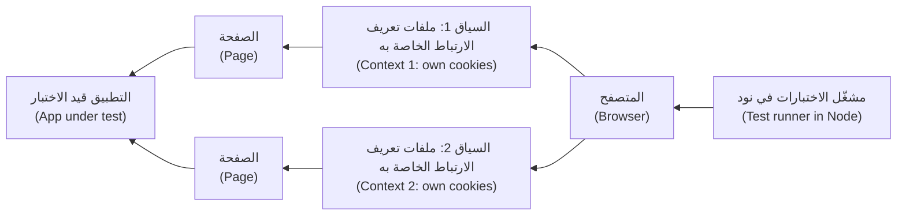

# الوحدة 3 — اختبار الواجهات (Testing interfaces)

*الواجهة هي أي مكان يلتقي فيه مستخدم أو نظام آخر ببرمجياتك، ولكل واجهة طريقتها الخاصة في الفشل. اختبرت الوحدة 2 الشيفرة من الداخل. أما هذه الوحدة فتختبرها من الخارج، كما يلتقي بها عملاء بنك نجم والبنوك الشريكة والمهاجمون. تبدأ بواجهة برمجة التطبيقات (API): الباب الأمامي الذي يتشاركه تطبيق iOS وتطبيق Android وصفحة الويب والأنظمة الشريكة، وفيها تختبر رموز الحالة والمخططات (schemas) والمصادقة (authentication) والحالات السلبية والإرسال المزدوج المتزامن. ثم واجهة المستخدم على الويب مع اختبارات شاملة من البداية إلى النهاية (end-to-end tests) بأداة Playwright تبقى سريعة وجديرة بالثقة. وأخيرًا الأسطح الأصعب: تطبيقات الهاتف وإمكانية الوصول (accessibility) والاختلافات بين المتصفحات والتوطين (localisation)، بما فيه التخطيط العربي من اليمين إلى اليسار. ستتابع ندى وبلالًا خلال ساعة واحدة من اختبار واجهات البرمجة تكشف انهيارًا وحالة تسابق وصيغة أخطاء غير متسقة في النظام النموذجي، ثم بلالًا مرة أخرى وهو يُبقي مجموعة اختبارات المتصفح صغيرة ومستقرة، ثم أمل وهي تجد في تدقيق الصفحة العربية ما لا يجده أي فحص آلي. ويسري الذكاء الاصطناعي (AI) في ذلك كله: احكم على اختبارات واجهة البرمجة والمتصفح التي يكتبها الوكيل من خلال جدول الحالات الذي تركه فارغًا، وتذكّر أن الواجهات نفسها هي ما تقودها أدوات الذكاء الاصطناعي حين تختبر نيابةً عنك (الدرس 6.3).*

> **التركيز:** Integration, UI — اختبار الأسطح التي يلتقي فيها الناس والأنظمة الأخرى ببرمجياتك، واختيار الفحوص التي تُؤتمت والتي تُترك لإنسان.

---

# 3.1 — اختبار واجهات البرمجة: REST والمخططات ورموز الحالة والمصادقة والحالات السلبية
*المستوى: 🟡 متوسط* · *المتطلبات: 1.2، 2.1* · *التركيز: Integration, Security*

**بعد هذا الدرس تستطيع** كتابة اختبارات لواجهة برمجة تغطي رموز الحالة والمخططات والمصادقة والوصول إلى حساب عميل آخر، وإثبات أن اختبار المخطط يفشل حين ينحرف شكل الاستجابة. *مدة الدراسة: نحو 115 دقيقة (تقدير).*

## ⚡ الدرس في دقيقة (In 60 seconds)
- **اختبار واجهة البرمجة** يرسل طلبات HTTP حقيقية ويفحص الحالة والترويسات والمحتوى والآثار الجانبية. لا يحتاج إلى متصفح، فهو سريع ومستقر، ويقع حيث يلتقي كل عميل بالقواعد.
- صمّم لكل نقطة نهاية: المسار السعيد (happy path)، والتحقق من المدخلات (validation)، والحدود (boundaries)، و401، و403، وخاصية عدم التكرار (idempotency)، وصيغة الخطأ، وتحديد معدل الطلبات (rate limit)، وترقيم الصفحات (pagination).
- أكّد **العقد (contract)**: الحالة بدقة، وشكلًا واحدًا للخطأ، ومخططًا صارمًا، وأثر الطلب على الحالة.
- تولّد أداة **Schemathesis** طلبات من وثيقة OpenAPI وتجد ما تفوّته الاختبارات المكتوبة يدويًا.
- أكبر فخ: المسار السعيد وحده. ساعة واحدة على النظام النموذجي وجدت خطأ 500 وخصمًا مزدوجًا وأخطاءً غير متسقة.

## 🧭 لماذا يهم
تبني فِرق طارق ثلاثة عملاء على واجهة برمجة واحدة: تطبيق iOS وتطبيق Android وصفحة الويب. وقبل أن يتكامل شريك، يطلب بلال من ندى «ساعة من اختبار واجهة البرمجة» على `POST /transfers`. تكتب طلبًا واحدًا و`assert r.status_code == 201`. أخضر. يسأل بلال عن الباقي.

تُنتج الساعة التالية ثلاث نتائج لن تُظهرها أي شاشة. مبلغ `1e30` يعيد HTTP 500. وطلبان متزامنان بمفتاح خاصية عدم التكرار نفسه ينجحان كلاهما، فيُخصم الحساب مرتين. وطلب مشوَّه يحصل على `{"detail": [...]}` بينما قاعدة عمل مرفوضة تحصل على `{"error": {"code": ...}}`، وكلاهما برمز الحالة 422، فالعميل الذي يحلّل شكلًا واحدًا يفشل مع الآخر. تُخفي صفحة الويب هذه العيوب خلف تحققها الخاص؛ أما واجهة البرمجة فلا تستطيع، لأن أي مستدعٍ يستطيع إرسال أي شيء. ويحكم الجدول أدناه أيضًا على الاختبارات التي يكتبها الذكاء الاصطناعي: فحين تطلب من مساعد «اختبارات لنقطة النهاية هذه»، يعطيك مسارًا سعيدًا وحالتي تحقق.

## 📐 كيف يعمل

### 🟢 الأساسيات

**HTTP في شاشة واحدة.** تكون الطريقة **آمنة التكرار (idempotent)** إذا ترك تنفيذها مرتين الحالةَ نفسها التي يتركها تنفيذها مرة واحدة: GET وPUT وDELETE كذلك، أما **POST فليست كذلك** وتحتاج إلى ترويسة `Idempotency-Key`. فئات رموز الحالة: **2xx** نجح الطلب (200 و201)؛ **4xx** أخطأ المستدعي (400 طلب مشوَّه، و401 غير مصادَق، و403 غير مسموح، و409 تعارض، و422 سليم الصيغة لكنه مرفوض، و429 طلبات كثيرة جدًا)؛ **5xx** فشل الخادم. وقاعدة واحدة: **لا ينبغي لأي مُدخل من العميل أن ينتج 5xx.**

**صمّم قبل أن تكتب.** هذا هو تصميم `POST /transfers` باستخدام الدرس 1.2؛ والعمود الأخير هو ما وجدناه.

| # | البُعد | مثال اختبار | المتوقع | على النظام النموذجي |
|---|---|---|---|---|
| 1 | المسار السعيد | ترسل أليس 250.00 QAR | 201، ومحتوى صالح، ورصيد أقل بمقدار 250.00 | ينجح |
| 2 | التحقق من المدخلات | حقل ناقص، و`"abc"`، وثلاث خانات عشرية | 4xx، وشكل خطأ واحد | يتفاوت الشكل |
| 3 | الحدود | 0.99 و1.00 و25,000.01، وإجمالي اليوم 50,000.00 بالضبط | قواعد الدرس 1.2 | ينجح |
| 4 | المصادقة | بلا رمز، ورمز مزوَّر | 401، ولا شيء يتغير | ينجح؛ ولا ترويسة `WWW-Authenticate` |
| 5 | التفويض (Authorisation) | ينفق بوب من acc-1؛ ويقرأ بوب تحويل أليس | 403 | ينجح |
| 6 | خاصية عدم التكرار | المفتاح نفسه مرتين؛ ومحتوى جديد؛ وطلبان معًا | 200؛ 409؛ تحويل واحد | **تسابق: تحويلان** |
| 7 | صيغة الخطأ | كل سبب للفشل | شكل واحد، ولا 5xx أبدًا | **500 عند المبالغ الضخمة؛ وشكلان** |
| 8 | تحديد معدل الطلبات | 100 طلب في الثانية | بعض ردود 429 مع `Retry-After` | لا حد: ثغرة |
| 9 | ترقيم الصفحات | نقطة نهاية قائمة مخطَّط لها: الصفحة الأولى والأخيرة والفارغة، وحد 0 | ترتيب ثابت، بلا فجوات | لم تُبنَ بعد |

الصفوف من 6 إلى 9 هي التي تتخطاها الاختبارات المرتبة. انسخ `testing/sample`، ونفّذ `pip install -r requirements.txt jsonschema schemathesis`، واحفظ الدوال المساعدة.

```python
# tests/conftest.py
import uuid
from decimal import Decimal

import pytest
from fastapi.testclient import TestClient

from najm.api import create_app
from najm.transfers import TransferService

ALICE = {"Authorization": "Bearer token-alice"}
BOB = {"Authorization": "Bearer token-bob"}


def world():    # fresh accounts per test, so test order never matters
    return {"acc-1": {"owner": "alice", "currency": "QAR", "balance": Decimal("100000.00")},
            "acc-2": {"owner": "bob", "currency": "QAR", "balance": Decimal("800.00")}}


@pytest.fixture
def client():   # raise_server_exceptions=False: a crash becomes the HTTP 500 a real client sees
    return TestClient(create_app(TransferService(world())), raise_server_exceptions=False)


def body(**overrides):
    return {"from_account": "acc-1", "to_account": "acc-2", "amount": "250.00",
            "currency": "QAR", "kind": "domestic", **overrides}


def post(client, who=ALICE, key=None, **overrides):   # a fresh idempotency key unless one is given
    return client.post("/transfers", json=body(**overrides),
                       headers={**who, "Idempotency-Key": key or str(uuid.uuid4())})
```

```python
# tests/test_api_status.py
import pytest

from conftest import post


@pytest.mark.parametrize("overrides, status, code", [
    ({"amount": "1.00"}, 201, None),
    ({"amount": "0.99"}, 422, "below_minimum"),
    ({"amount": "25000.01"}, 422, "above_per_transfer_max"),
    ({"amount": "10.005"}, 422, "too_many_decimals"),
    ({"currency": "USD"}, 422, "currency_mismatch"),     # acc-1 holds QAR, and that check runs first
    ({"from_account": "acc-2"}, 403, "not_owner"),        # Alice does not own acc-2
])
def test_status_and_error_code(client, overrides, status, code):
    r = post(client, **overrides)
    assert r.status_code == status
    assert r.json().get("error", {}).get("code") == code      # None for a 201


def test_a_day_total_of_exactly_50000_is_allowed(client):    # catches limit_off_by_one
    for _ in range(2):
        assert post(client, amount="25000.00").status_code == 201
    r = post(client, amount="1.00")                           # one step over
    assert (r.status_code, r.json()["error"]["code"]) == (422, "daily_limit_exceeded")
```

**ضعيف مقابل قوي.** يمرّ `assert r.status_code in (400, 422)` مع القاعدة الخاطئة ومع الإعداد الافتراضي للإطار. أما الجدول فيثبّت الحالة ورمز `code` المستقر معًا، فيحمرّ صف واحد بالضبط حين يتغير حد واحد.

**متى لا تفعل.** لا تُعِد اختبار كل قاعدة رسوم عبر HTTP: طلب واحد لكل عائلة قواعد يثبت الربط، وتتولى اختبارات الوحدة (unit tests) (الدرس 2.1) الحساب.

### 🟡 التعمق أكثر (Going deeper)

**افحص الشكل أولًا ثم القاعدة.** قد يحمل رمز الحالة الصحيح محتوًى خاطئًا: رقمًا عشريًا بدل سلسلة نصية، أو حقلًا ناقصًا، أو تسريب `owner`. يصف **مخطط JSON (JSON Schema)** الشكل مرة واحدة؛ و`additionalProperties: false` يُفشل أي حقل زائد.

```python
# tests/test_api_contract.py
import pytest
from jsonschema import Draft202012Validator

from conftest import ALICE, body, post

S = {"type": "string"}
TRANSFER = {
    "type": "object", "additionalProperties": False,         # an extra field such as "owner" is a leak
    "required": ["id", "status", "from_account", "to_account", "amount", "currency", "fee", "value_date"],
    "properties": {
        "id": {"type": "string", "pattern": r"^tr-\d{4,}$"}, "status": S, "from_account": S, "to_account": S,
        "amount": {"type": "string", "pattern": r"^\d+(\.\d+)?$"},    # money travels as a string
        "currency": {"enum": ["QAR", "AED", "EUR"]},
        "fee": {"type": "string", "pattern": r"^\d+\.\d{2}$"},
        "value_date": {"type": "string", "pattern": r"^\d{4}-\d{2}-\d{2}$"},
    },
}
ERROR = {"type": "object", "required": ["error"], "additionalProperties": False,
         "properties": {"error": {"type": "object", "required": ["code", "message"]}}}


def test_weak_a_field_called_id_exists(client):
    assert "id" in post(client).json()      # passes even if fee becomes a float or "owner" leaks


def test_strong_the_shape_and_the_rule(client):
    r = post(client, amount="3090.00", kind="international")
    Draft202012Validator(TRANSFER).validate(r.json())    # raises, naming the field, if the shape is wrong
    assert r.json()["fee"] == "10.82"                    # the schema checks shape; this checks the rule
```

مع `NAJM_BUGS=float_fee` ينجح الاختبار الضعيف ويظل المخطط يتحقق (فـ`"10.81"` سليمة الصيغة)؛ ويفشل السطر الأخير: `assert '10.81' == '10.82'`. الشكل والقاعدة فحصان مختلفان.

**وثيقة OpenAPI بوصفها عقدًا، وأداة Schemathesis.** يَنشر FastAPI الوثيقة `/openapi.json` التي تسرد كل مسار ومعامل واستجابة؛ ويبني عليها العملاء والبوابات. تولّد أداة **Schemathesis** (المبنية على Hypothesis، الدرس 2.3) طلبات صالحة وغير صالحة منها وتفحص كل استجابة. شغّل النظام النموذجي بالأمر `uvicorn najm.api:app --port 8000`، ثم نفّذ:

```bash
schemathesis run http://127.0.0.1:8000/openapi.json --checks all --max-examples 50 --seed 1 \
    -H "Authorization: Bearer token-alice" -H "Idempotency-Key: st-1"
```

```text
(condensed from Schemathesis 4.30; layouts vary by version)
Undocumented HTTP status code (documented: 200, 422). Received:
  404  GET /accounts/{account_id}/balance
  404  GET /transfers/{transfer_id}
  403  POST /transfers
  400  POST /transfers   {"detail":"There was an error parsing the body"}
API rejected schema-compliant request: 422 decimal_parsing on "amount"
```

كل سطر قرار. تقول الوثيقة 200 و422، لكن الشيفرة تجيب أيضًا بـ 201 و400 و401 و403 و404 و409. وهي تصف `amount` بأنه «رقم أو سلسلة نصية»، ومع ذلك يُرفض `"abc"`. ويظهر شكل خطأ ثالث. لا تستطيع Schemathesis أن تجد *قاعدة* خاطئة: فقد بنى FastAPI الوثيقة من الشيفرة.

فاتت الجولة الأولى خطأ 500: فمعرّفات الحسابات العشوائية توقفت عند `403 not_owner` قبل أي فحص للمبلغ. يُبقي ملف الخطافات بقية الحقول صالحة فيُختبر المبلغ، ويعطي كل استدعاء مفتاحًا جديدًا فلا توقف أخطاء 409 التشغيل. احفظه بجانب `najm/`، وضع `SCHEMATHESIS_HOOKS=najm_hooks` قبل الأمر نفسه، واحذف منه ترويسة `Idempotency-Key` لأنها تتجاوز ما في الخطاف:

```python
# najm_hooks.py
import uuid

import schemathesis


@schemathesis.hook
def map_body(ctx, body):
    if isinstance(body, dict):
        body.update(from_account="acc-1", to_account="acc-2", currency="QAR", kind="domestic")
    return body


@schemathesis.hook
def before_call(ctx, case, **kwargs):
    case.headers = {**(case.headers or {}), "Idempotency-Key": str(uuid.uuid4())}
```

الآن تبلّغ Schemathesis عن `[500]` عند `"amount": 1.2276573252243301e+182`: يرفع `Decimal.quantize` الاستثناء `InvalidOperation` دون التقاطه. لا يزرع النظام النموذجي هذا العيب؛ لقد وجده الاختبار.

**الاختبار السلبي (Negative testing).** حوّل النتائج إلى اختبارات دائمة وثبّت صيغة الخطأ لكل سبب:

```python
# tests/test_api_contract.py (continued)
H = {**ALICE, "Idempotency-Key": "k-1"}
BAD_REQUESTS = {                  # cause: (expected status, request)
    "malformed json": (422, dict(content="{oops", headers={**H, "Content-Type": "application/json"})),
    "missing field": (422, dict(json={}, headers=H)),
    "wrong type": (422, dict(json=body(amount="abc"), headers=H)),
    "business rule": (422, dict(json=body(amount="0.99"), headers=H)),
    "no token": (401, dict(json=body(), headers={"Idempotency-Key": "k-1"})),
}


@pytest.mark.parametrize("cause", BAD_REQUESTS)
def test_every_error_has_one_shape(client, cause):    # MEANT TO FAIL for three causes on the sample
    status, request = BAD_REQUESTS[cause]
    r = client.post("/transfers", **request)
    assert r.status_code == status
    Draft202012Validator(ERROR).validate(r.json())


@pytest.mark.parametrize("amount", ["1e1000", 1e30])
def test_absurd_amounts_are_rejected_not_crashed(client, amount):    # MEANT TO FAIL: the sample says 500
    assert post(client, amount=amount).status_code == 422
```

```text
FAILED test_every_error_has_one_shape[malformed json]    ValidationError: 'error' is a required property
FAILED test_every_error_has_one_shape[missing field] and [wrong type]    (same)
FAILED test_absurd_amounts_are_rejected_not_crashed[1e1000]    assert 500 == 422
FAILED test_absurd_amounts_are_rejected_not_crashed[1e+30]     (same)
```

ثلاثة من الأسباب الخمسة تستخدم شكل الإطار. والخيار `raise_server_exceptions=False` مهم: فبشكل افتراضي يعيد عميل الاختبار رفع الانهيار على هيئة استثناء، مخفيًا الخطأ 500 الذي يراه العملاء.

**401 و403 وترتيب الفحوص.** يعني **401** «لا أعرف من أنت»، وقد يحلّه تسجيل الدخول. ويعني **403** «أعرفك، والجواب لا»؛ والتطبيق الذي يعامله على أنه «انتهت الجلسة» يُخرج العملاء بلا داعٍ. ترتيب الفحوص جزء من العقد. يتحقق النظام النموذجي من المحتوى (422، شكل الإطار)، ثم الرمز (401)، ثم مفتاح خاصية عدم التكرار (idempotency key) (400)، ثم الملكية (403)، ثم قواعد العمل (422، شكل البنك)، فيحصل الطلب بلا رمز وبمحتوى فارغ على 422 لا 401. و**BOLA**، أي كسر التفويض على مستوى الكائن (broken object-level authorisation)، هو الوصول إلى كائن مستخدم آخر بتغيير معرّف. والاختبار الضعيف، وهو قراءة أليس تحويلها هي، ينجح والعيب مفعّل. أما الاختبار القوي ففيه بوب هو من يطلب:

```python
# tests/test_api_security.py
from conftest import BOB, post


def test_bob_cannot_read_alices_transfer(client):
    created = post(client).json()                        # Alice's transfer
    r = client.get(f"/transfers/{created['id']}", headers=BOB)
    assert r.status_code == 403
    assert r.json()["error"]["code"] == "not_owner"
```

```text
$ NAJM_BUGS=bola pytest tests/test_api_security.py
E   assert 200 == 403          1 failed
```

يقرأ اختبار بوب في المجموعة الابتدائية *رصيدًا* لا يمسّه العيب أبدًا. ويضع [*أمن الذكاء الاصطناعي والتطبيقات*، الدرس 4.1 — أهم 10 مخاطر لواجهات البرمجة وفق OWASP عمليًا](../secai/index.ar.html#/4.1) BOLA في المرتبة الأولى.

### 🔴 نظرة الخبير (Expert view)

**خاصية عدم التكرار والإرسال المزدوج المتزامن.** ينجح اختبار إعادة الإرسال المتتابع في المجموعة الابتدائية. أما طلبان متزامنان فلا: فالدالة `submit()` تبحث عن المفتاح، ثم تؤدي العمل، ثم تسجّل المفتاح، ويستطيع الطلبان معًا اجتياز البحث. يفرض الاختبار تبديل الخيوط، ويكرر 100 مرة، ويفحص الرصيد. و`xfail(strict=True)` يضع عيبًا معروفًا جانبًا، ويُحمّر مجموعة الاختبارات في اليوم الذي يُصلَح فيه العيب إن لم تُزَل العلامة.

```python
# tests/test_api_idempotency.py
import sys
import threading
from concurrent.futures import ThreadPoolExecutor

import pytest
from fastapi.testclient import TestClient

from conftest import ALICE, body, world
from najm.api import create_app
from najm.transfers import TransferService


def balance(client):
    return client.get("/accounts/acc-1/balance", headers=ALICE).json()["balance"]


@pytest.mark.xfail(strict=True, reason="check-then-act race in submit()")
def test_a_concurrent_double_submit_creates_one_transfer():
    old = sys.getswitchinterval()
    sys.setswitchinterval(1e-6)                          # make unlucky interleavings common, not rare
    try:
        for attempt in range(100):
            client = TestClient(create_app(TransferService(world())), raise_server_exceptions=False)
            gate = threading.Barrier(2)

            def send(_):
                gate.wait()                              # both requests leave at the same moment
                return client.post("/transfers", json=body(), headers={**ALICE, "Idempotency-Key": "same"})

            with ThreadPoolExecutor(2) as pool:
                codes = sorted(r.status_code for r in pool.map(send, range(2)))
            assert codes == [200, 201], f"attempt {attempt}: {codes}"
            assert balance(client) == "99750.00", f"attempt {attempt}: debited twice"
    finally:
        sys.setswitchinterval(old)
```

```text
$ pytest tests/test_api_idempotency.py --runxfail
FAILED test_a_concurrent_double_submit_creates_one_transfer - AssertionError: attempt 6: [201, 201]
```

تتفاوت المحاولة الفاشلة. عند فترة التبديل العادية في Python ظهر التسابق في 1 من 900 تجربة على الأكثر، لذا يفرضه الاختبار. القفل يصلح عملية واحدة؛ أما الإنتاج فيشغّل عدة عمليات، فالإصلاح الحقيقي قيد فريد (unique constraint) على `(user, key)` ([*تصميم الأنظمة لمبرمجي الفايب*، الدرس 2.6 — نقرتان في آن واحد: حالات التسابق والمعاملات والكتابات الآمنة للتكرار](../vibe/index.ar.html#l2-6)).

**استعن ببدائل محاكاة أو خدمات افتراضية لما لا تملكه.** ستستدعي التحويلات خدمة فحص العقوبات لا يتحكم فيها نجم. والبديل المزيّف الذي يقول دائمًا «سليم» لا يختبر إلا المسار السعيد؛ فاختبر كيف تنهار التبعية. ومع `httpx.MockTransport` يصبح البديل دالة Python: أعد `httpx.Response(503)` أو ارفع `httpx.ConnectTimeout`، وتأكد أن التحويل يُرفض، أي **الفشل المغلق (fail closed)**. يزيّف `respx` الاستدعاءات الصادرة من شيفرة تبني عميل `httpx` خاصًا بها؛ و**WireMock** و**MockServer** خادمان مزيّفان قائمان بذاتهما. والبديل المزيّف الذي ينحرف عن الخدمة الحقيقية يكذب، فافحص الاثنين وفق عقد واحد (الدرس 2.2).

**إدارة الإصدارات والتوافق مع الإصدارات السابقة.** يدعم نجم نسخ التطبيق القديمة أشهرًا. إضافة حقل اختياري إلى الاستجابة آمنة للعملاء الذين يتجاهلون الحقول المجهولة؛ أما حذف حقل أو إعادة تسميته أو تغيير نوعه، أو اشتراط حقل جديد في الطلب، فيكسر العملاء القدامى. احتفظ بـ**تجهيزة اختبار من العميل القديم**، مثل طلب بلا `kind`، وتأكد أن واجهة اليوم ما زالت تعيد 201 مع كل حقول الاستجابة القديمة. وتسرد الأداة `oasdiff` التغييرات الكاسرة بين وثيقتي OpenAPI.

**GraphQL وgRPC.** لدى GraphQL نقطة نهاية واحدة يختار فيها العميل الحقول: اختبر التفويض لكل حقل على حدة — فـ BOLA يختبئ في الكائنات المتداخلة — وحدود العمق، والأخطاء في المصفوفة `errors` حتى مع HTTP 200. أما gRPC فعقد محدَّد الأنواع معرَّف بـ Protocol Buffers: أكّد رموزًا مثل `UNAUTHENTICATED`، وحدّد المهل، ولا تعِد ترقيم حقل أبدًا (يفحص ذلك `buf breaking`).

**أدوات التعاون والتكامل المستمر.** تعمل مجموعات الطلبات في **Postman** ضمن التكامل المستمر (CI) عبر **Newman**؛ ويحتفظ **Bruno** بالطلبات ملفاتٍ نصية بسيطة في Git. وقعنا في فخ مع النظام النموذجي: قرأ Bruno العبارة `eq 0.00` على أنها *الرقم* 0، لكن واجهة البرمجة ترسل السلسلة النصية `"0.00"`، فاكتب `eq "0.00"`. وتستخدم المؤسسات التي تعتمد Java أداة **REST Assured**.

```bash
bru run --env local --reporter-junit bruno-results.xml
newman run najm.postman_collection.json -e local.postman_environment.json --reporters cli,junit
```

## 🧰 الأدوات
| الأداة أو الممارسة أو التقنية | ما هي وماذا تفعل | متى تلجأ إليها |
|---|---|---|
| **pytest with TestClient and httpx** | اختبارات Python تستدعي التطبيق داخل العملية أو عبر الشبكة | الخيار الافتراضي لواجهات Python؛ وتعمل مع كل طلب دمج |
| **JSON Schema** — مخطط JSON | لغة معيارية لوصف شكل JSON | فحوص تفشل عند الحقول الزائدة أو خاطئة النوع |
| **OpenAPI and Schemathesis** | وصف لواجهة البرمجة، وأداة تولّد طلبات منه | العقود بين الفرق؛ وصيد ليلي للانهيارات والانجراف |
| **Postman, Newman and Bruno** | مجموعات طلبات مع اختبارات، ومشغّل بسطر الأوامر، وعميل مناسب لـ Git | الاستكشاف المشترك؛ وطلبات تعمل في التكامل المستمر |
| **httpx MockTransport and WireMock** | وسيلة نقل مزيّفة داخل العملية، وخادم HTTP مزيّف | تبعية متوقفة أو بطيئة أو خاطئة |

## 🏛️ عمليًا في بنك نجم
ينشر بلال **معيار نجم لاختبار واجهات البرمجة، الإصدار 1**، وهو قائمة تحقق من صفحة واحدة لكل نقطة نهاية. الجزء أ هو الدليل على أن مجموعة الاختبارات تعمل، كتبها إنسان أو الذكاء الاصطناعي: يفعّل راشد كل عيب مزروع ويجب أن يحمرّ اختباره المقابل.

| العيب (Defect) | الاختبار الذي يلتقطه | الحالة |
|---|---|---|
| `float_fee` | `test_strong_the_shape_and_the_rule` | يُلتقط |
| `limit_off_by_one` | `test_a_day_total_of_exactly_50000_is_allowed` | يُلتقط |
| `no_idempotency`, `bola` | اختبار إعادة الإرسال في المجموعة الابتدائية؛ `test_bob_cannot_read_alices_transfer` | يُلتقط |
| `tz_cutoff` | لا شيء: واجهة البرمجة تقرأ الساعة الحقيقية | ثغرة؛ تتولاها اختبارات الساعة في الدرس 2.1 |
| 500 على المبالغ الضخمة | `test_absurd_amounts_are_rejected_not_crashed` | عيب مفتوح |
| سباق خاصية عدم التكرار | `test_a_concurrent_double_submit_creates_one_transfer` | مفتوح، `xfail` |
| شكلا خطأ | `test_every_error_has_one_shape` | عيب مفتوح |

**الجزء ب: خط التكامل والتسليم المستمرين.** مع كل طلب دمج: مجموعة الاختبارات داخل العملية في أقل من دقيقتين. ليليًا: Schemathesis ببذرة ثابتة على بيئة ما قبل الإنتاج (staging). وبعد كل نشر: فحص دخان.

**الجزء ج: القواعد.** شكل خطأ واحد؛ وكل رمز حالة في وثيقة OpenAPI؛ ومفتاح خاصية عدم التكرار على كل `POST` ينقل المال؛ ولا اختبار عشوائي موجَّه (fuzzing) دون إذن مكتوب؛ ولكل عيب اختبار قبل الإصلاح.

## 🛠️ التمارين (Exercises)
اعمل في نسخة من `testing/sample`.

- 🟢 **صمّم واختبر `GET /accounts/{id}/balance`.** اكتب جدول تصميمه، ثم اختبارات للمسار السعيد مع مخطط، وبلا رمز، ورمز مزوَّر، وبوب يقرأ `acc-1`، وحساب مجهول. *يكتمل عندما:* تنجح كلها، وإعادة الرصيد رقمًا في نسختك تُفشل اختبار المخطط بينما يظل `assert "balance" in body` ينجح.
- 🟡 **أغلق ثغرات العقد.** شغّل أمر Schemathesis الأول. في `najm/api.py`، صرّح بكل رمز حالة تعيده الشيفرة (`status_code=201`، ثم `responses=` لبقيتها) وأضف معالجًا لـ `RequestValidationError` يستخدم الشكل `{"error": ...}`. *يكتمل عندما:* تنخفض إخفاقات «Undocumented HTTP status code» الأربعة إلى صفر ويمرّ `test_every_error_has_one_shape` لجميع الأسباب الخمسة.
- 🔴 **أصلح التسابق بأمانة.** شغّل الاختبار المتزامن مع `--runxfail` وشاهده يفشل. اقفل `submit()` في نسختك وأزل `xfail`. *يكتمل عندما:* ينجح الاختبار 20 تشغيلة متتالية، ويظل يفشل تحت `NAJM_BUGS=no_idempotency`، وتوضح ملاحظة ما الذي ينكسر مع أربع عمليات خادم وتسمّي قيد قاعدة البيانات الذي يصلحه.

## ⚠️ أخطاء وفخاخ (Mistakes and traps)
- **تأكيدات الحالة وحدها.** يمرّ `assert r.ok` مع القاعدة الخاطئة. ثبّت الحالة ورمز الخطأ `code` وشكل المحتوى.
- **الوثوق بوثيقة مولَّدة.** ملف OpenAPI المبني من الشيفرة يتفق مع الشيفرة. اكتب العقد من المتطلبات.
- **محاكاة الشيء قيد الاختبار.** زيّف ما لا تملكه فقط، واختبر كيف يفشل.
- **زوج محظوظ واحد من الطلبات.** تختبئ حالات التسابق: كرّر الاختبارات المتزامنة وأكّد الأثر.
- **الاختبار العشوائي لما لا تملكه.** ولّد الطلبات ضد أنظمتك أنت فقط أو بإذن مكتوب.

## 🧾 الخلاصة (Recap)
- صمّم اختبارات واجهة البرمجة عبر تسعة أبعاد؛ والمجموعات المرتبة تتخطى الأربعة الأخيرة.
- أكّد الحالة ورمز الخطأ المستقر والمخطط الصارم والأثر على الحالة؛ وافحص الشكل والقاعدة كلًا على حدة.
- تجد Schemathesis رموز الحالة غير الموثَّقة والانهيارات، لا القواعد الخاطئة.
- 401 تعني «من أنت»، و403 تعني «لست أنت»؛ وقراءة بوب تحويلَ أليس تكشف BOLA.
- اختبر خاصية عدم التكرار بالتزامن، واختبر كيف تفشل التبعية.

## ✍️ اختبر نفسك (Check yourself)

**1. يرسل اختبار `amount` بقيمة "0.99" ويؤكد `r.status_code in (400, 422)`. يرفع مطوّر الحد الأدنى من 1.00 إلى 5.00. ماذا يحدث؟**

- A. يفشل، لأن 0.99 لم يعد غير صالح
- B. يفشل، لأن رمز الخطأ تغيّر
- C. يفشل، لأن الحالة تصبح 5xx
- D. ما زال ينجح، فيفوّته التغيير

<details><summary>الإجابة</summary>

**D.** 0.99 غير صالح تحت الحدّين، والاختبار يقبل حالتين، فلا شيء يحمرّ. أما تثبيت الرمز واختبار 4.99 و5.00 فيكشفان ذلك. (🟢 الأساسيات.)

</details>

**2. بعد انتهاء مهلة الجلسة، يُخرج تطبيق نجم العملاء كلما أجابت واجهة البرمجة بـ 403. أي عبارة عن 401 و403 صحيحة؟**

- A. 401 تعني معروف لكن مرفوض؛ و403 تعني مجهول
- B. كلتاهما تعنيان «غير مسجّل الدخول»، فيجوز للتطبيقات معاملتهما سواء
- C. 403 تعني معروف لكن مرفوض؛ و401 تعني مجهول
- D. 401 لـ JSON غير الصالح، و403 لقواعد العمل المخروقة

<details><summary>الإجابة</summary>

**C.** مع 401 لا يعرفك الخادم، فيفيد تسجيل الدخول؛ ومع 403 يعرفك، والجواب لا. (🟡 التعمق أكثر.)

</details>

**3. مع تفعيل `NAJM_BUGS=bola`، ينشئ اختبار ندى تحويلًا بصفة أليس ويقرأه بصفة أليس. ينجح. ماذا يُظهر ذلك؟**

- A. أن العيب المزروع ليس في الشيفرة
- B. لا شيء عن التفويض على مستوى الكائن
- C. أن واجهة البرمجة آمنة لكل المستخدمين والتحويلات الأخرى
- D. أن العيب يعيش في طبقة قاعدة البيانات

<details><summary>الإجابة</summary>

**B.** قراءة أليس تحويلها هي صحيحة مع العيب ودونه؛ وحده طلب بوب يستطيع أن يفشل. (🟡 التعمق أكثر.)

</details>

**4. يرسل اختبار مفتاح خاصية عدم التكرار (idempotency key) نفسه مرتين بالتتابع ويؤكد 201 ثم 200. ينجح دائمًا، لكن العملاء يرسلون أحيانًا مرتين في آن واحد. ما أفضل خطوة تالية؟**

- A. إرسال الطلبين معًا، وتكرار ذلك مرات كثيرة، وفحص الرصيد
- B. إضافة انتظار ثابت بين الاستدعاءين ليستقر الناتج
- C. حذف الاختبار، لأن نجاحه يثبت سلامة الميزة
- D. محاكاة الخدمة بحيث يعيد الاستدعاء الثاني 200 دائمًا كما هو متوقع

<details><summary>الإجابة</summary>

**A.** وحده اختبار متزامن متكرر يفحص الرصيد يستطيع رؤية حالة التسابق؛ والانتظار الثابت يزيل التداخل. (🔴 نظرة الخبير.)

</details>

**5. تبلّغ Schemathesis عن «Undocumented HTTP status code: Received 403, Documented 200, 422» على `POST /transfers`. ما القراءة الصحيحة؟**

- A. واجهة البرمجة خاطئة؛ غيّرها لتعيد 200 كي تطابق الوثيقة
- B. النتيجة ضجيج، لأن 403 أمر عادي
- C. الأداة معطوبة، لأن 403 ينتج عن الملكية
- D. العقد ناقص: صرّح بـ 403 وبقية الرموز

<details><summary>الإجابة</summary>

**D.** الرمز 403 صحيح؛ والوثيقة لا تخبر العملاء بما يتوقعونه. ومطابقة واجهة البرمجة لها ستحذف قاعدة حقيقية. (🟡 التعمق أكثر.)

</details>

## 📚 المراجع (References)
- توثيق pytest (pytest documentation) — https://docs.pytest.org/
- توثيق Hypothesis، المحرك وراء Schemathesis — https://hypothesis.readthedocs.io/
- مشروع OWASP لأمان واجهات البرمجة — https://owasp.org/API-Security/
- توثيق Pact، اختبار العقود الموجَّه بالمستهلك — https://docs.pact.io/
- Martin Fowler، عن البدائل الاختبارية واختبارات العقد — https://martinfowler.com/

---

# 3.2 — اختبار واجهة الويب والاختبار الشامل من البداية إلى النهاية بأداة Playwright: المحدِّدات (locators) والانتظار (waiting) وكائنات الصفحة (page objects) والمجموعات المستقرة (stable suites)
*المستوى: 🟡 متوسط* · *المتطلبات: 2.1، 3.1* · *التركيز: UI*

**بعد هذا الدرس تستطيع** إعادة كتابة اختبار Playwright متقلّب بمحدِّدات قائمة على الدور وتأكيدات تنتظر الصفحة، وإثبات استقراره بالخيار `--repeat-each=10` وبالتشغيل المتوازي. *مدة الدراسة: نحو 115 دقيقة (تقدير).*

## ⚡ الدرس في دقيقة (In 60 seconds)
- **الاختبار الشامل من البداية إلى النهاية** يقود متصفحًا حقيقيًا عبر رحلة مستخدم. يرى ما يراه العميل لكنه أبطأ الاختبارات، فاحتفظ بقلة منها.
- يمنح **Playwright** كل اختبار **سياق متصفح** جديدًا، و**ينتظر تلقائيًا** العناصر، ويعيد محاولة **التأكيدات المعاودة (web-first assertions)** حتى تنجح أو تنتهي المهلة.
- حدّد العناصر كما يراها المستخدم أو قارئ الشاشة: الدور والتسمية والنص ومعرّف الاختبار (test id). ويأتي CSS وXPath أخيرًا.
- لا تستخدم `sleep` أبدًا. انتظر شرطًا، وامتلك بياناتك، وسجّل الدخول عبر واجهة البرمجة.
- أكبر فخ: مجموعة اختبارات يعيد الناس تشغيلها حتى تخضرّ. أصلح كل اختبار غير مستقر (flaky test) أو اعزله (quarantine).

## 🧭 لماذا يهم
تنقر أليس **Send transfer** مرتين لأن الشاشة بطيئة، فيغادر حسابها 500 QAR بدل 250. اختبارات واجهة البرمجة التي كتبتها ندى خضراء: فكل طلب كان صالحًا وحمل مفتاح خاصية عدم التكرار فريدًا. العيب في الصفحة، فهي تصنع مفتاحًا *جديدًا* مع كل نقرة، فيعامل الخادم النقرتين بحق على أنهما تحويلان. لا يراه إلا اختبار ينقر كما ينقر الإنسان.

الاختبارات الشاملة سهلة الخطأ أيضًا. مجموعة اختبارات تضم 200 اختبار متصفح تستغرق 40 دقيقة وتفشل مرة كل عشر تشغيلات تعلّم الفريق أن يضغط «إعادة التشغيل»، فتختبئ الإخفاقات الحقيقية. وتخمين الخطأ في الدرس 1.2، «النقر المزدوج: تحويل واحد لكل نقرة»، هو اختبار يكتبه هذا الدرس. وتحكم المعايير نفسها على اختبارات المتصفح المولَّدة بالذكاء الاصطناعي، التي كثيرًا ما تصل ومعها فترات انتظار ثابتة ومحدِّدات موضعية.

## 📐 كيف يعمل

### 🟢 الأساسيات

**متى تستخدم الاختبار الشامل.** استخدمه لـ**قلة من الرحلات الحرجة** (تسجيل الدخول، وإرسال تحويل، وعرض رصيد) ولما لا يُظهره إلا المتصفح: العرض والنقرات والتركيز والتوقيت الحقيقي. ولا تستخدمه للقواعد: رسم 3,090.00 QAR مكانه اختبار وحدة (الدرس 2.1) أو اختبار واجهة برمجة (الدرس 3.1)، وهما يعملان في أجزاء من الثانية ويفشلان بسبب واضح.

**بنية Playwright.** مشغّل الاختبارات عملية Node.js. وهو يتحكم في متصفح يستضيف عدة **سياقات متصفح**: ملفات تعريف معزولة لكل منها ملفات تعريف الارتباط والتخزين الخاصة بها، وإنشاؤها رخيص. يحصل كل اختبار على سياق وصفحة جديدين، فلا تتسرب الحالة بين الاختبارات.



فكرتان تزيلان معظم عدم الاستقرار. **الانتظار التلقائي (Auto-waiting):** قبل `click` أو `fill` أو `check`، ينتظر Playwright حتى يصبح العنصر مرئيًا ومستقرًا ومفعّلًا وغير مغطًّى. أما **التأكيدات المعاودة (Web-first assertions)** مثل `toBeVisible` و`toHaveText` و`toHaveValue` فتعيد المحاولة حتى تنجح أو تنتهي مهلتها، وهي 5 ثوانٍ افتراضيًا، بدل قراءة الصفحة مرة واحدة.

**هيكل المشروع والإعداد.** في نسخة من `testing/sample`، نفّذ `npm install` و`npm install -D @axe-core/playwright` و`npx playwright install chromium`؛ وتعيش الاختبارات في `e2e/`. استبدل ملف `e2e/playwright.config.ts` الابتدائي:

```typescript
// e2e/playwright.config.ts
import { defineConfig, devices } from '@playwright/test';

export default defineConfig({
  testDir: '.',
  fullyParallel: true,
  forbidOnly: !!process.env.CI,
  retries: process.env.CI ? 1 : 0,         // a passing retry is reported as "flaky"
  reporter: [['list'], ['html', { open: 'never' }]],
  use: { baseURL: 'http://127.0.0.1:8000', trace: 'on-first-retry' },
  projects: [
    { name: 'setup', testMatch: /auth\.setup\.ts/ },
    { name: 'chromium', use: { ...devices['Desktop Chrome'], storageState: '.auth/alice.json' }, dependencies: ['setup'] },
  ],
  webServer: {
    command: `${process.env.PYTHON ?? 'python'} -m uvicorn najm.api:app --port 8000`,
    cwd: '..',
    url: 'http://127.0.0.1:8000/health',
    reuseExistingServer: !process.env.CI,
  },
});
```

شغّل من `testing/sample`: `npx playwright test --config e2e/playwright.config.ts`. وأضف `.auth/` إلى `.gitignore`؛ فالجلسة المحفوظة بيانات اعتماد.

**المحدِّدات: الدور أولًا.** **المحدِّد (locator)** يقول كيف تجد عنصرًا في كل مرة تحتاج إليه. فضّل ما يدركه المستخدم أو قارئ الشاشة. كل خطوة إلى الأسفل أكثر هشاشة، وتؤدي الصفوف العليا أيضًا دور فحوص إمكانية الوصول، لأنها تفشل إذا غابت تسمية أو دور.

| الأولوية | المحدِّد | الضعيف | القوي |
|---|---|---|---|
| 1 | الدور والاسم | `locator('#form > button')` | `getByRole('button', { name: 'Send transfer' })` |
| 2 | التسمية | `locator('input').nth(1)` | `getByLabel('Amount')` |
| 3 | النص | `locator('p.msg-3')` | `getByText('Transfer sent')`، للمحتوى |
| 4 | معرّف الاختبار | `locator('div > div:nth-child(4)')` | `getByTestId('balance-card')`، متفق عليه مع المطوّرين |
| 5 | CSS أو XPath | سلاسل طويلة أو موضعية | قصيرة، داخل عنصر أب مستقر، ولا تُستخدم إلا حين لا يوجد ما فوقها |

ينكسر المحدِّد القائم على النص حين تتغير صياغة المحتوى أو تُترجم الصفحة؛ وعلى `?lang=ar` استخدم الدور مع الاسم العربي، أو معرّف اختبار.

**لا تستخدم الانتظار الثابت أبدًا.** اختبار ضعيف وآخر قوي لرحلة واحدة، يُشغَّلان على صفحة غُيّرت كما قد يغيّرها فريق: حقل `Note` فوق Amount (يُحقن عبر `page.route`)، فلا تُمسّ الصفحة الحقيقية، وواجهة برمجة بطيئة.

```typescript
// e2e/locators.spec.ts
import { test, expect, type Page } from '@playwright/test';

async function refactoredAndSlow(page: Page) {
  await page.route('**/app', async (route) => {              // a new field above Amount
    const response = await route.fetch();
    const html = (await response.text()).replace('<label for="amount">',
      '<label for="note">Note</label><input id="note" name="note"><label for="amount">');
    await route.fulfill({ response, body: html });
  });
  await page.route('**/transfers', async (route) => {        // every API call takes 1.5 seconds
    await new Promise((resolve) => setTimeout(resolve, 1500));
    await route.continue();
  });
}

test('strong: label, role and a retrying assertion', async ({ page }) => {
  await refactoredAndSlow(page);
  await page.goto('/app');
  await page.getByLabel('Amount').fill('250.00');
  await page.getByRole('button', { name: 'Send transfer' }).click();
  await expect(page.getByRole('status')).toContainText('Transfer sent');
});

test('weak: position, sleep and a single read', async ({ page }) => {    // MEANT TO FAIL
  await refactoredAndSlow(page);
  await page.goto('/app');
  await page.locator('input').nth(1).fill('250.00');         // now types into Note
  await page.locator('#form > button').click();
  await page.waitForTimeout(500);                            // hope
  expect(await page.locator('#result').innerText()).toContain('Transfer sent');
});
```

```text
  ✓  [chromium] › locators.spec.ts › strong: label, role and a retrying assertion (2.4s)
  ✘  [chromium] › locators.spec.ts › weak: position, sleep and a single read (1.0s)
    Expected substring: "Transfer sent"
    Received string:    ""
```

للاختبار الضعيف ثلاثة عيوب: `nth(1)` يصيب المُدخل الخطأ، وفترة الانتظار الثابت 500 ms تنتهي قبل استجابة تستغرق 1.5 ثانية، و`innerText()` يقرأ مرة واحدة. ويصمد الاختبار القوي أمام التغييرين لأنه ينتظر الشروط.

### 🟡 التعمق أكثر

**العزل والتجهيزات وحالة التخزين.** يجب أن ينجح كل اختبار وحده ومتوازيًا. السياق جديد، لكن *بيانات الخادم* مشتركة: اختباران متوازيان يرسلان من `acc-1` يغيّر كل منهما رصيد الآخر، فأعطِ كل اختبار بياناته الخاصة. **سجّل الدخول عبر واجهة البرمجة مرة واحدة، لا عبر شاشة الدخول في كل اختبار**: يسجّل **مشروع إعداد** الدخول، ويحفظ حالة المتصفح، أي ملفات تعريف الارتباط والتخزين المحلي، في ملف، وتبدأ المشاريع الأخرى منه. احتفظ باختبار دخول واحد عبر الواجهة لرحلة الدخول نفسها. لا تحتوي صفحة النظام النموذجي على شاشة دخول، فهذا الإعداد ينوب عن واحدة.

```typescript
// e2e/auth.setup.ts
import { test as setup, expect } from '@playwright/test';

setup('sign in as Alice through the API', async ({ page, request }) => {
  const res = await request.get('/accounts/acc-1/balance', { headers: { Authorization: 'Bearer token-alice' } });
  expect(res.ok()).toBeTruthy();
  await page.goto('/app');
  await page.evaluate(() => localStorage.setItem('token', 'token-alice'));
  await page.context().storageState({ path: '.auth/alice.json' });
});
```

**كائنات الصفحة وكائنات المكوّنات والتجهيزات.** **كائن الصفحة (page object)** صنف يضم محدِّدات الصفحة وأفعال المستخدم، فيُصلَح تغيير التسمية مرة واحدة. و**كائن المكوّن (component object)** يفعل الشيء نفسه لعنصر واجهة يُعاد استخدامه، مثل صنف `Toast` يغلّف التنبيه. أما **التجهيزات (Fixtures)** (`test.extend`) فتسلّم الاختبارات كائنًا جاهزًا وتتولى الإعداد والتفكيك. أبقِ التأكيدات في الاختبارات، فيُقرأ الفشل كأنه جملة. ولاختبارين أو ثلاثة تكفي تجهيزة ودالة مساعدة؛ أضف الصنف حين تبدأ المحدِّدات بالتكرار.

```typescript
// e2e/fixtures.ts
import { test as base, expect, type Locator, type Page } from '@playwright/test';

export class TransferPage {
  readonly amount: Locator;
  readonly send: Locator;
  readonly status: Locator;
  readonly alert: Locator;

  constructor(readonly page: Page) {
    this.amount = page.getByLabel('Amount');
    this.send = page.getByRole('button', { name: 'Send transfer' });
    this.status = page.getByRole('status');
    this.alert = page.getByRole('alert');
  }

  async sendTransfer(amount: string) {
    await this.amount.fill(amount);
    await this.send.click();
  }
}

export const test = base.extend<{ transferPage: TransferPage }>({
  transferPage: async ({ page }, use) => {
    await page.goto('/app');
    await use(new TransferPage(page));
  },
});
export { expect };
```

**محاكاة الشبكة للحالات الحدّية.** يعترض `page.route` الطلبات، فتبلغ حالات بطيئة أو خطرة إنشاؤها فعليًا: خطأ 503، ومهلة منتهية، ورفضًا لتجاوز السقف اليومي. وتتضمن هذه الاختبارات النقر المزدوج من الدرس 1.2.

```typescript
// e2e/journeys.spec.ts
import { test, expect } from './fixtures';

test('one click sends exactly one transfer', async ({ page, transferPage }) => {
  const posts: string[] = [];
  page.on('request', (request) => request.method() === 'POST' && posts.push(request.url()));
  await transferPage.amount.fill('10.00');
  await transferPage.send.dblclick();                        // an impatient customer
  await expect(transferPage.status).toBeVisible();
  expect(posts).toHaveLength(1);                             // MEANT TO FAIL: the page sends two
});

test('a failed request tells the customer something', async ({ page, transferPage }) => {
  await page.route('**/transfers', (route) =>
    route.fulfill({ status: 503, contentType: 'text/plain', body: 'Service Unavailable' }));
  await transferPage.sendTransfer('250.00');
  await expect(transferPage.alert).toBeVisible();            // MEANT TO FAIL: the page shows nothing
});
```

```text
  ✘  one click sends exactly one transfer     Expected length: 1   Received length: 2
  ✘  a failed request tells the customer something     Locator: getByRole('alert')   Error: element(s) not found
```

كلاهما عيب حقيقي في النظام النموذجي: تصنع الصفحة `Idempotency-Key` جديدًا مع كل نقرة ولا تعطّل الزر أبدًا، ويجعل خطأ غير JSON نصَّها البرمجي يرمي استثناءً، فلا يرى العميل شيئًا. وأكدنا الأول على واجهة البرمجة: نقرتان نقلتا الحساب من 12,000 إلى 11,500.

**التتبع وتنقيح الأخطاء.** يسجّل **الأثر** لقطة من DOM قبل كل إجراء وبعده، مع سجلات الشبكة ووحدة التحكم. يسجّل `trace: 'on-first-retry'` أثرًا حين يعيد التكامل المستمر تشغيل اختبار (استخدم `--trace on` محليًا)؛ افتحه بـ `npx playwright show-trace path/to/trace.zip`، أو تصفّح `npx playwright show-report`. أثناء التأليف، استخدم `npx playwright test --ui`، وهو عرض يتيح السفر عبر الزمن، و`--debug` للتنفيذ خطوة بخطوة، و`npx playwright codegen http://127.0.0.1:8000/app` الذي يسجّل النقرات محدِّداتٍ؛ وهو مسودة تُهذَّب لا اختبار يُحتفظ به.

**عدم استقرار الاختبارات الشاملة.**

| السبب | العَرَض | الإصلاح |
|---|---|---|
| فترات انتظار ثابتة وقراءات لمرة واحدة | ينجح محليًا ويفشل في التكامل المستمر | تأكيدات معاودة؛ و`expect.poll` للقيم المقروءة من واجهة البرمجة |
| بيانات مشتركة واختبارات متوازية | يفشل مع عدة عمال فقط | كل اختبار يملك بياناته؛ ونسخة تطبيق لكل عامل |
| حركة وعناصر متحركة | «العنصر غير مستقر» | انتظر الحالة النهائية؛ وعطّل الحركة في إصدارات الاختبار |
| أطراف ثالثة وساعات حقيقية | يفشل في أوقات معينة | حاكِها؛ وجمّد الوقت بـ `page.clock` |

قِس بدل أن تخمّن: يعطيك `npx playwright test --repeat-each=20 locators.spec.ts` معدل فشل. وإعادة المحاولة التي تنجح نتيجة **غير مستقرة (flaky)** يجب الإبلاغ عنها وتحمّل مسؤوليتها لا إخفاؤها؛ ويغطي الدرس 2.3 عزل الاختبارات؛ ويمكن للإصدارات الحديثة أن تُفشل التشغيل بسببها بالخيار `--fail-on-flaky-tests`.

**التوازي والتقسيم.** تعمل الملفات بالتوازي عبر عمّال افتراضيًا؛ والخيار `fullyParallel: true` يوازي أيضًا الاختبارات داخل الملف الواحد؛ و`--workers=N` يحدد العدد. ولتقسيم مجموعة الاختبارات على أجهزة التكامل المستمر، شغّل `--shard=1/3` و`2/3` و`3/3` مهامَّ منفصلة، مع مُبلِّغ `blob` والأمر `npx playwright merge-reports` لتقرير واحد.

### 🔴 نظرة الخبير

**مقارنة لقطات الشاشة.** يقارن `toHaveScreenshot` الصفحة بصورة أساس مخزّنة.

```typescript
// e2e/visual.spec.ts
import { test, expect } from '@playwright/test';

test('the transfer form looks as designed', async ({ page }) => {
  await page.goto('/app');
  await expect(page).toHaveScreenshot('transfer-form.png', { maxDiffPixels: 100 });
});
```

```text
Error: A snapshot doesn't exist at .../visual.spec.ts-snapshots/transfer-form-chromium-linux.png, writing actual.
  (after a styling change)   19678 pixels (ratio 0.03 of all image pixels) are different.
```

يفشل التشغيل الأول ويكتب صورة الأساس؛ أودِعها وراجعها كما تراجع الشيفرة. أبقِ التسامح ضئيلًا: `maxDiffPixels: 100` يسمح بقليل من وحدات البكسل المنعّمة، بينما سمحت نسبة 0.01 بمرور زوايا الأزرار المستديرة (1,451 بكسل) في تشغيلنا. وينتهي الاسم بـ `chromium-linux` لأن الخطوط والتنعيم تختلف بين أنظمة التشغيل، فتفشل صورة أساس من Mac على تكامل مستمر يعمل بـ Linux. أنشئ صور الأساس وحدّثها في صورة حاوية واحدة: `docker run --rm --network=host --ipc=host -v "$PWD":/work -w /work mcr.microsoft.com/playwright:v<version>-noble npx playwright test --config e2e/playwright.config.ts --update-snapshots`، بحيث تطابق العلامة إصدار Playwright لديك وتكون واجهة البرمجة تعمل على المضيف. احذر من «حدّث اللقطات حتى يخضرّ»: أخفِ المناطق الديناميكية ولا تقبل فرقًا لم تره. وتقدم Percy وChromatic وApplitools مقارنة مستضافة.

**فحص إمكانية الوصول.** يشغّل `@axe-core/playwright` محرك قواعد axe داخل الصفحة. يجد التسميات الناقصة وARIA الخاطئة والتباين المنخفض بسرعة، ولا يجد إلا المشكلات التي يمكن فحصها بقواعد؛ ويبيّن الدرس 3.3 ما يفوّته.

```typescript
// e2e/a11y.spec.ts
import { test, expect } from '@playwright/test';
import AxeBuilder from '@axe-core/playwright';

for (const [name, url] of [['English', '/app'], ['Arabic', '/app?lang=ar']] as const) {
  test(`the ${name} page has no detectable WCAG A or AA violations`, async ({ page }) => {
    await page.goto(url);
    const results = await new AxeBuilder({ page }).withTags(['wcag2a', 'wcag2aa', 'wcag21a', 'wcag21aa', 'wcag22aa']).analyze();
    expect(results.violations).toEqual([]);
  });
}
```

**مشاريع تعدد المتصفحات.** شُغِّل كل ما هنا في Chromium. ولإضافة غيره، ثبّته (`npx playwright install --with-deps firefox webkit`)، وأضف مشاريع مثل `{ name: 'webkit', use: { ...devices['Desktop Safari'] } }`، واختر بـ `--project=webkit`. ومتصفح WebKit في Playwright إصدار خاص به، قريب من Safari لكنه ليس Safari: فتأكد من سلوك iOS على جهاز حقيقي (الدرس 3.3).

**Selenium أم Cypress أم Playwright؟** مقارنة صادقة وقت الكتابة (2026)؛ أعد التحقق قبل الاختيار.

| | Selenium | Cypress | Playwright |
|---|---|---|---|
| كيف يعمل | معيار W3C WebDriver؛ يقود المتصفحات من الخارج | يعمل داخل المتصفح بجانب التطبيق | يقود المتصفحات عبر بروتوكولاتها الخاصة |
| المتصفحات | كل المتصفحات الرئيسية، وSafari الحقيقي عبر برنامج التشغيل الخاص به | عائلة Chrome وFirefox؛ وWebKit تجريبي | إصدارات Chromium وFirefox وWebKit |
| التشغيل المتوازي | Selenium Grid | Cypress Cloud أو إعدادك الخاص | مدمج ومجاني مع التقسيم |
| نقطة الضعف | شيفرة تمهيدية أكثر؛ وتكتب الانتظارات بنفسك | لا تبويبات متعددة؛ والتعامل مع الطلبات عبر الأصول المختلفة يتطلب عناية | لا أجهزة iOS حقيقية؛ ودعم Android تجريبي |
| اخترْه حين | مجموعة اختبارات قديمة كبيرة، أو مؤسسة ملتزمة بالمعايير | فريق واجهات أمامية يريد تغذية راجعة سريعة | مجموعات اختبارات جديدة، وتعدد متصفحات (cross-browser)، وتكامل مستمر واسع النطاق |

العادات أهم من الأداة. وللاستعانة بالذكاء الاصطناعي في الاختبارات الشاملة، انظر الدرس 6.3.

## 🧰 الأدوات
| الأداة أو الممارسة أو التقنية | ما هي وماذا تفعل | متى تلجأ إليها |
|---|---|---|
| **Playwright** | أداة أتمتة متصفحات ومشغّل اختبارات لـ Chromium وFirefox وWebKit | مجموعات اختبار شاملة جديدة؛ وفحوص تعدد المتصفحات في التكامل المستمر |
| **Locators by role and label** — المحدِّدات بالدور والتسمية | إيجاد العناصر كما يفعل المستخدمون والتقنيات المساعدة | كل محدِّد، قبل CSS |
| **Page object model** — نموذج كائن الصفحة | صنف يضم محدِّدات الصفحة وأفعالها | صفحات تستخدمها اختبارات كثيرة |
| **Fixtures and storage state** — التجهيزات وحالة التخزين | إعداد لكل اختبار، وتسجيل دخول محفوظ تعيد استخدامه اختبارات كثيرة | العزل؛ والدخول دون شاشة الدخول |
| **Trace viewer** — عارض الأثر | تسجيل بلقطات وشبكة ووحدة تحكم لكل خطوة | فشل في التكامل المستمر لا تستطيع إعادة إنتاجه |
| **@axe-core/playwright** | محرك axe لإمكانية الوصول يعمل من اختبار | بوابة رخيصة على كل صفحة |

## 🏛️ عمليًا في بنك نجم
يحتفظ بلال بـ**سجل رحلات**، وهو القائمة الوحيدة المسموح بوجودها من الاختبارات الشاملة. لا تدخل رحلة إلا إذا لم يستطع أي مستوى أدنى اختبارها.

| المعرّف (ID) | الرحلة | لماذا شامل | الحالة |
|---|---|---|---|
| J1 | إرسال تحويل محلي | المسار الكامل، مرة واحدة | أخضر |
| J2 | نقرة واحدة ترسل تحويلًا واحدًا | المتصفح وحده يرى النقر المزدوج | أحمر: عيب مفتوح |
| J3 | الطلب الفاشل يُعلم العميل | سلوك الصفحة عند الأخطاء | أحمر: عيب مفتوح |
| J4 | الصفحة العربية من اليمين إلى اليسار (الدرس 3.3) | العرض والاتجاه | أخضر |
| J5 | تجتاز الصفحتان فحص axe | رخيص وآلي | أخضر |

**القواعد.** لا `waitForTimeout`؛ ويبحث التكامل المستمر عنه بـ grep. كل اختبار يملك بياناته ويسجّل الدخول عبر واجهة البرمجة. إعادة محاولة واحدة في التكامل المستمر؛ والاختبار غير المستقر يُعزل خلال يوم، بمالك وموعد نهائي. يبقى السجل أقل من 15 رحلة: فالرحلة الجديدة تستلزم إزالة رحلة، أو سببًا.

## 🛠️ التمارين
اعمل في نسخة من `testing/sample` مثبَّت عليها Playwright.

- 🟢 **أنقذ اختبارًا ضعيفًا.** شغّل اختبار `weak`، ثم أعد كتابته بمحدِّدات الدور والتسمية وتأكيد معاود. *يكتمل عندما:* ينجح `--repeat-each=10` تحت الشبكة البطيئة والحقل المضاف، ولا يجد `grep waitForTimeout e2e` شيئًا.
- 🟡 **اعثر على الخصم المزدوج.** شغّل اختبار النقرة الواحدة مع `--trace on`، وافتح الأثر، وارفع تقرير عيب كما في الدرس 1.3. *يكتمل عندما:* يتضمن التقرير إعادة إنتاج دنيا، وقيمتي `Idempotency-Key` من الأثر، وإصلاحًا مقترحًا.
- 🔴 **اجعله مستقرًا في التوازي.** اكتب اختبارين يقرأ كل منهما رصيد `acc-1` عبر واجهة البرمجة، ويرسل 250.00 ويؤكد أنه انخفض بمقدار 250.00 بالضبط؛ شغّل `--workers=4 --repeat-each=10` لتُظهر عدم الاستقرار. أصلحه بالتأكيد على ما يملكه كل اختبار فقط، أي تحويله المقروء بمعرّفه، أو بتشغيل تطبيق لكل عامل. *يكتمل عندما:* يفشل الزوج مرة على الأقل قبل الإصلاح ولا يفشل أبدًا في 10 تكرارات بعده، وتوضح جملة لماذا كانت إعادة المحاولة ستخفيه.

## ⚠️ أخطاء وفخاخ
- **الانتظار الثابت والقراءات لمرة واحدة.** `waitForTimeout` و`innerText()` يخمّنان. استخدم الانتظار التلقائي والتأكيدات المعاودة.
- **CSS وXPath أولًا.** ينكسران عند إعادة التصميم ويفوّتان عيوب إمكانية الوصول. ابدأ من الدور والتسمية.
- **كل شيء عبر الواجهة.** حساب الرسوم في المتصفح بطيء وغير واضح. ادفع القواعد إلى الأسفل.
- **تسجيل الدخول عبر الشاشة في كل مرة.** سجّل الدخول عبر واجهة البرمجة مرة واحدة.
- **أعد المحاولة حتى يخضرّ، وحدّث حتى يخضرّ.** كلاهما يخفي العيوب. أبلغ عن إعادات المحاولة؛ وراجع اللقطات.

## 🧾 الخلاصة
- استخدم الاختبار الشامل (E2E) لقلة من الرحلات الحرجة وللأشياء التي لا يُظهرها إلا المتصفح، كالنقر المزدوج.
- السياقات الجديدة والانتظار التلقائي والتأكيدات المعاودة تزيل معظم عدم الاستقرار (flakiness)، إن لم تستخدم الانتظار الثابت أبدًا.
- حدّد بالدور والتسمية والنص ومعرّف الاختبار، ثم CSS؛ واستخدم كائنات الصفحة والتجهيزات والدخول عبر واجهة البرمجة.
- حاكِ الشبكة للحالات الحدّية؛ واقرأ الآثار للتشخيص.
- امتلك بياناتك، وقسّم للسرعة، وأبقِ لقطات الشاشة في صورة حاوية واحدة.

## ✍️ اختبر نفسك

**1. أي اختبار ينتمي إلى مجموعة الاختبارات الشاملة لا إلى مستوى أدنى؟**

- A. رسم التحويل الدولي لمبلغ 3,090.00 QAR هو 10.82
- B. نقرتان على Send تنتجان تحويلًا واحدًا بالضبط
- C. تحويل يتجاوز 25,000.00 QAR يعيد 422
- D. تعارض مفتاح خاصية عدم التكرار يعيد 409

<details><summary>الإجابة</summary>

**B.** وحده المتصفح يستطيع أن ينقر مرتين ويرى ما ترسله الصفحة؛ أما A وC وD فقواعد يفحصها اختبار وحدة أو واجهة برمجة أسرع. (🟢 الأساسيات.)

</details>

**2. يكتب اختبار في `page.locator('input').nth(1)`. يضيف فريق حقلًا فوقه فيفشل الاختبار. ما أفضل إصلاح؟**

- A. إضافة انتظار ثابت قبل الكتابة
- B. تغيير الفهرس إلى 2
- C. استخدام `getByLabel('Amount')`
- D. إعادة الاختبار مرتين في التكامل المستمر

<details><summary>الإجابة</summary>

**C.** التسمية هي الطريقة التي يجد بها المستخدمون الحقل، وتصمد أمام تغيّر التخطيط. B يكرر الخطأ، وA وD يخفيانه. (🟢 الأساسيات.)

</details>

**3. ينقر اختبار Send، ثم ينتظر 500 ms، ثم يقرأ النتيجة مرة واحدة. ينجح محليًا ويفشل في التكامل المستمر. ما السبب الجذري (root cause)؟**

- A. التكامل المستمر يشغّل محرك متصفح مختلفًا
- B. الاختبارات تحتاج إلى مهلة عامة أطول
- C. كائن الصفحة فيه أساليب كثيرة جدًا
- D. يخمّن مدة ويقرأ مرة واحدة

<details><summary>الإجابة</summary>

**D.** الانتظار الثابت والقراءة لمرة واحدة يفترضان سرعة. و`await expect(...).toContainText(...)` يعيد المحاولة حتى يتحقق الشرط. (🟢 الأساسيات.)

</details>

**4. اختبارات بلال الـ80 تسجّل الدخول كلها عبر الواجهة، وتستغرق مجموعة الاختبارات 25 دقيقة. ما الذي يعطي أكبر تسريع وأكثره أمانًا؟**

- A. تسجيل الدخول مرة واحدة عبر واجهة البرمجة وإعادة استخدام حالة التخزين
- B. تعطيل الدخول لكل الاختبارات بعلم اختبار
- C. دمج الاختبارات الـ80 في بضعة اختبارات طويلة
- D. تشغيلها كلها في عامل واحد

<details><summary>الإجابة</summary>

**A.** يزيل 80 عملية دخول بطيئة ويُبقي السياقات معزولة. B يتخطى المسار الحقيقي، وC يخفي الأسباب، وD أبطأ. (🟡 التعمق أكثر.)

</details>

**5. ينجح اختبار لقطة شاشة على جهاز Mac لمطوّر ويفشل في التكامل المستمر على Linux بفروق بكسل صغيرة. ماذا ينبغي للفريق أن يفعل؟**

- A. رفع تسامح البكسل حتى ينجح
- B. حذف صورة الأساس وترك التكامل المستمر يعيد إنشاءها
- C. إنشاء صور الأساس وتحديثها في صورة حاوية واحدة
- D. تشغيل اختبارات لقطات الشاشة على أجهزة Mac للمطورين فقط

<details><summary>الإجابة</summary>

**C.** تختلف الخطوط والتنعيم عبر أنظمة التشغيل، فلا بد أن تملك بيئة واحدة صور الأساس. A يخفي تغييرات حقيقية. (🔴 نظرة الخبير.)

</details>

## 📚 المراجع
- توثيق Playwright — https://playwright.dev/
- Playwright، أفضل الممارسات والمحدِّدات — https://playwright.dev/docs/best-practices
- Playwright، عارض الأثر (trace viewer) — https://playwright.dev/docs/trace-viewer
- Martin Fowler، هرم الاختبار — https://martinfowler.com/bliki/TestPyramid.html
- مدونة Google للاختبار — https://testing.googleblog.com/

---

# 3.3 — اختبار الهاتف المحمول وإمكانية الوصول وتعدد المتصفحات والتوطين، بما فيه العربية من اليمين إلى اليسار
*المستوى: 🟡 متوسط* · *المتطلبات: 1.2، 3.2* · *التركيز: UI, Design*

**بعد هذا الدرس تستطيع** تدقيق شاشة واحدة بالإنجليزية والعربية وفق معايير WCAG مسمّاة مع تسجيل ما فاته الفحص الآلي، وكتابة اختبارات تفشل حين يُحذف الاتجاه من اليمين إلى اليسار أو صيغة جمع عربية. *مدة الدراسة: نحو 115 دقيقة (تقدير).*

## ⚡ الدرس في دقيقة (In 60 seconds)
- تضيف تطبيقات الهاتف مخاطر لا يراها أي اختبار متصفح: المقاطعات والأذونات والشبكات السيئة والعمليات المُنهاة قسرًا وإصدارات نظام التشغيل القديمة وقواعد المتاجر. اختبر المنطق سريعًا، والواجهة أصليًا، وبضع رحلات على أجهزة حقيقية.
- **إمكانية الوصول (Accessibility)** تتبع WCAG 2.2: قابلة للإدراك وقابلة للتشغيل ومفهومة ومتينة. الماسحات (Scanners) مثل axe تجد بعض المشكلات فقط؛ والناس يجدون الباقي.
- **التوطين (Localisation)** أكثر من الترجمة: الاتجاه، والنص ثنائي الاتجاه (bidirectional text)، والأرقام، والتواريخ، وصيغ الجمع، والفرز. و**التوطين الزائف (Pseudo-localisation)** يجد النص المكتوب داخل الشيفرة مبكرًا.
- اختر الأجهزة من التحليلات؛ وقلّص المصفوفة بالاختبار الزوجي.
- أكبر فخ: اعتبار «لم يجد axe شيئًا» أو «اعتُمدت الترجمة» دليلًا على أن العمل «انتهى».

## 🧭 لماذا يهم
يطلق نجم صفحته العربية. جدول الترجمة معتمد وفحص axe أخضر، ومع ذلك تجلس أمل مع الصفحة. في عشر دقائق تجد ما لم يجده أيٌّ منهما: أسماء الحسابات تحت "من الحساب" ما زالت بالإنجليزية؛ والتحويل المرفوض يعرض `daily_limit_exceeded`؛ والعميل الذي يكتب `250,50` يتلقى كلمة "error" مجردة؛ وإيصال حصة يعرض مستفيدًا اسمه "7 Seas Trading" على أنه "Seas Trading 7".

لا شيء من هذا غريب. يخدم نجم قطر والإمارات والاتحاد الأوروبي، بالإنجليزية والعربية، على هواتف ومتصفحات عدة؛ ولكل سطح طريقته في الفشل. وقد تبدو الشاشة المترجمة آليًا أو المكتوبة بالذكاء الاصطناعي سلسة وهي مع ذلك خاطئة.

## 📐 كيف يعمل

### 🟢 الأساسيات

**طبقات اختبار الهاتف.**

| الطبقة | أمثلة | تعمل على | استخدمها لـ |
|---|---|---|---|
| اختبارات وحدة المنطق | شيفرة الرسوم والتقريب والتحقق | حاسوب محمول، في أجزاء من الثانية | كل قاعدة (الدرس 2.1) |
| اختبارات الواجهة الأصلية | **Espresso** (Android)، **XCUITest** (iOS) | محاكٍ أو جهاز | شاشة واحدة في كل مرة |
| الرحلات | **Appium**، **Maestro**، **Detox** (React Native) | محاكيات، وقليل من الأجهزة الحقيقية | خمس أو ست رحلات حرجة |

يُقرأ تدفق Maestro كأنه الرحلة نفسها (رسم تخطيطي، والمعرّف وهمي):

```yaml
appId: bank.najm.mobile
---
- launchApp
- tapOn: "Amount"
- inputText: "250.00"
- tapOn: "Send transfer"
- assertVisible: "Transfer sent"
```

**المحاكيات والأجهزة الحقيقية وسحابات الأجهزة.** المحاكيات سريعة ومجانية وقابلة للبرمجة: استخدمها للمنطق والتخطيط ومعظم الرحلات. وتُظهر الأجهزة الحقيقية القياسات الحيوية والإشعارات والراديوهات والبطارية وواجهات الشركات المصنِّعة والأداء الحقيقي. و**سحابات الأجهزة** تؤجّرها؛ توقّع طوابير وتكلفة، واستخدم حسابات اختبار، ولا تستخدم بيانات العملاء أبدًا.

**مخاطر خاصة بالهاتف.** كل صف فكرة اختبار؛ وصفوف المال تحتاج إلى فحوص خاصية عدم التكرار في الدرس 3.1.

| الخطر | فكرة الاختبار |
|---|---|
| المقاطعات وإنهاء التطبيق قسرًا | مكالمة أثناء التحويل، أو إنهاء التطبيق وإعادة فتحه: لا تكرار ولا فقدان، وتُستعاد الحالة |
| الأذونات | ارفض، ثم اسحب الإذن أثناء الجلسة: شاشة واضحة، ولا انهيار |
| الاتصال بالشبكة | وضع الطيران، والانتقال من Wi-Fi إلى الخلوي، ومهلة بعد Send: تعيد المحاولة استخدام مفتاح خاصية عدم التكرار نفسه |
| إصدارات نظام التشغيل والتحديثات | أقدم نظام تشغيل مدعوم؛ والترقية من أقدم إصدار للتطبيق مع بيانات محفوظة |
| الروابط العميقة والبطارية والتخزين | رابط تحويل أثناء تسجيل الخروج، أو رابط مشوَّه؛ وبطارية منخفضة أو تخزين ممتلئ أثناء التدفق |

**بوابات المتاجر والإطلاق المرحلي.** لا يمكن التراجع عن إصدار الهاتف بزر: فالمتاجر تراجعه والمستخدمون يحدّثون متى شاؤوا. وقت الكتابة (2026)، تقدم Apple إصدارًا مرحليًا لسبعة أيام للتحديثات التلقائية وGoogle Play إطلاقًا مرحليًا بالنسبة المئوية؛ ويمكن إيقاف كليهما مؤقتًا. البوابة: مجموعات الاختبارات خضراء، وتمرير الرحلات على أقدم نظام تشغيل مدعوم وجهاز حقيقي لكل منصة، ثم 1% و5% و20% و100% مع **قاعدة إيقاف** (الجلسات الخالية من الانهيار أو نجاح التحويلات أدنى من خط الأساس). واحتفظ بمفتاح إيقاف من جهة الخادم للميزات الخطرة ([*تصميم الأنظمة لمبرمجي الفايب*، الدرس 6.2](../vibe/index.ar.html#l6-2)).

**إمكانية الوصول: ما يطلبه المعيار.** تجمع **WCAG 2.2** (توصية من W3C صدرت في أكتوبر 2023) معاييرها تحت أربعة مبادئ هي **POUR**: *قابلة للإدراك (perceivable)* وتشمل البدائل النصية والتباين، و*قابلة للتشغيل (operable)* وتشمل لوحة المفاتيح وحجم الهدف، و*مفهومة (understandable)* وتشمل الأخطاء الواضحة والسلوك المتوقع، و*متينة (robust)* أي تعمل مع التقنيات المساعدة. المعايير من المستوى A أو AA أو AAA؛ ويستهدف نجم المستوى AA. وأضاف الإصدار 2.2 تسعة معايير، منها حد أدنى لحجم الهدف 24 × 24 بكسل CSS. و**الفحوص الآلية** مثل axe-core تجد المشكلات التي تُفحص بقواعد: تسمية ناقصة، ودور ARIA خاطئ، وتباين منخفض. لكنها لا تستطيع الحكم على ما إذا كان للنص البديل معنى، أو ما إذا كان ترتيب التركيز منطقيًا، أو ما إذا كانت رسالة الخطأ مفيدة.

| الفحص اليدوي | ما الذي تفعله | ما يكشفه |
|---|---|---|
| لوحة المفاتيح فقط | Tab وShift+Tab وEnter وSpace وEsc عبر الرحلة | الفخاخ، وترتيب تركيز خاطئ |
| قارئ الشاشة (Screen reader) | NVDA أو VoiceOver على الويب؛ TalkBack أو VoiceOver على الهاتف | أسماء خاطئة، وأخطاء صامتة |
| التكبير وإعادة التدفق | تكبير 200%؛ ونافذة عرض بعرض 320 بكسل | نص مقصوص، وتمرير أفقي |
| التباين | 4.5:1 للنص الأساسي، و3:1 للنص الكبير وعناصر التحكم | الرماديات الباهتة |
| ربط الخطأ | تسبَّب في خطأ: هل هو مرتبط بالحقل ومُعلَن؟ | أخطاء صامتة غير مرتبطة |

### 🟡 التعمق أكثر

**تدقيق عملي لـ `/app`.** شغّلنا `@axe-core/playwright` (الدرس 3.2) على الصفحتين بوسمي WCAG A وAA: **صفر مخالفات بالإنجليزية والعربية**. وبدون المرشّح يضيف axe بندين من أفضل الممارسات: لا معلم `main`، ومحتوى خارج أي معلم. أخضر، لا منتهٍ. وتضيف الفحوص اليدوية:

| # | الفحص | النتيجة | WCAG |
|---|---|---|---|
| 1 | لوحة المفاتيح: ترتيب Tab، وEnter يرسل | نجح: من، إلى، المبلغ، العملة، الزر | 2.1.1, 2.4.3 |
| 2 | إعادة التدفق عند 320 بكسل؛ وحجم الهدف؛ والتباين | نجح: لا تمرير أفقي؛ عناصر التحكم من 288 × 39 إلى 44 بكسل عند 320؛ التباين 9.1:1 و6.5:1 | 1.4.10, 2.5.8, 1.4.3 |
| 3 | نص الخطأ | **فشل:** `daily_limit_exceeded` أو `error` فقط؛ لا شرح | 3.3.1, 3.3.3 |
| 4 | الخطأ مرتبط بالحقل | **فشل:** لا `aria-invalid` ولا `aria-describedby` على Amount | 3.3.1, 1.3.1 |
| 5 | إعلان الحالة | **غير متحقَّق:** يتغير الدور والنص معًا، وقد تفوّت قارئات الشاشة ذلك؛ ويحتاج إلى قارئ شاشة | 4.1.3 |
| 6 | الصفحة العربية | **فشل:** خيارات الحساب تبقى بالإنجليزية، بلا `lang` | 3.1.2 |

الصفان 1 و4 في صورة اختبارين، أما الصف 5 فيحتاج إلى شخص:

```typescript
// e2e/audit.spec.ts
import { test, expect } from '@playwright/test';

test('keyboard only: the focus order is the visual order, and Enter sends', async ({ page }) => {
  await page.goto('/app');
  await page.getByLabel('From account').focus();
  const order: string[] = [];
  for (let i = 0; i < 4; i++) {
    await page.keyboard.press('Tab');
    order.push(await page.evaluate(() => document.activeElement?.id || document.activeElement!.tagName));
  }
  expect(order).toEqual(['to', 'amount', 'currency', 'BUTTON']);
  await page.getByLabel('Amount').fill('250.00');
  await page.keyboard.press('Enter');
  await expect(page.getByRole('status')).toContainText('Transfer sent');
});

test('an error is tied to its field', async ({ page }) => {      // MEANT TO FAIL on the sample
  await page.route('**/transfers', (route) =>
    route.fulfill({ status: 422, json: { error: { code: 'above_per_transfer_max', message: '' } } }));
  await page.goto('/app');
  await page.getByLabel('Amount').fill('25000.01');
  await page.getByRole('button', { name: 'Send transfer' }).click();
  await expect(page.getByRole('alert')).toBeVisible();
  await expect(page.getByLabel('Amount')).toHaveAttribute('aria-invalid', 'true');
});
```

**ضعيف مقابل قوي:** «صفر مخالفات axe» يبيّن أن القواعد نجحت، لا أن العميل يستطيع إصلاح تحويل مرفوض: فالصفوف من 3 إلى 6 كانت ستُشحن. الفحص النظيف حدّ أدنى.

**التوطين والتدويل.** **التدويل** يبني البرمجيات بحيث يمكن تكييفها؛ و**التوطين** يكيّفها مع لغة ومكان. و**التوطين الزائف (Pseudo-localisation)** يستبدل كتالوج الإنجليزية بنص أطول محاط بأقواس، وفي الأدوات الحقيقية بحروف لاتينية ذات علامات نبر، فيكشف النص الإنجليزي الذي لم يُمسّ السلاسل المكتوبة داخل الشيفرة والتخطيطات المقصوصة دون مترجم:

```typescript
// e2e/arabic.spec.ts
import { test, expect, type Page } from '@playwright/test';

const pseudo = (s: string) => `[${s} ${'~'.repeat(Math.ceil(s.length * 0.4))}]`;   // brackets and 40% more length

test('every visible string comes from the catalogue', async ({ page }) => {   // MEANT TO FAIL on the sample
  await page.route('**/app', async (route) => {
    const response = await route.fetch();
    const html = (await response.text()).replace(/en: \{[^}]*\}/, (block) =>
      block.replace(/"([^"]*)"/g, (_, text) => `"${pseudo(text)}"`));
    await route.fulfill({ response, body: html });
  });
  await page.goto('/app');
  const plain = await page.evaluate(() => [...document.querySelectorAll('h1, label, button, option')]
    .map((el) => el.textContent!.trim()).filter((text) => !text.startsWith('[') && !/^[A-Z]{3}$/.test(text)));
  expect(plain).toEqual([]);
});
```

```text
- Expected  - 1    + Received  + 4
+ "Current account (QAR)", "Euro account (EUR)"
```

أسماء الحسابات إنجليزية مكتوبة داخل الشيفرة (رموز العملات ثابتة بحق). ويفحص النص الزائف عند 320 بكسل التمدد أيضًا؛ وهنا يتسع.

**تخطيط RTL، بالقياس.** تُقرأ العربية من اليمين إلى اليسار، فـ**تنعكس** التخطيطات: حواف البداية وأسهم الرجوع وأشرطة التقدم والأيقونات الاتجاهية تنقلب. ابنِ بـ `dir="rtl"` وخصائص CSS المنطقية (`margin-inline-start`، لا `margin-left`). وتحوّل الصناديق المحيطة «تبدو معكوسة» إلى رقم. وتسميات النظام النموذجي بعرض كامل، فقِس أين يبدأ *النص*:

```typescript
// e2e/arabic.spec.ts (continued)
test('the Arabic page declares its language and direction', async ({ page }) => {
  await page.goto('/app?lang=ar');
  await expect(page.locator('html')).toHaveAttribute('lang', 'ar');
  await expect(page.locator('html')).toHaveAttribute('dir', 'rtl');
  await expect(page.getByRole('heading', { level: 1 })).toHaveText('إرسال حوالة');
});

async function textEdges(page: Page, selector: string) {
  return page.locator(selector).evaluate((el) => {
    const range = document.createRange();
    range.selectNodeContents(el);
    const text = range.getBoundingClientRect(), box = el.getBoundingClientRect();
    return { gapLeft: text.left - box.left, gapRight: box.right - text.right };
  });
}

test('labels start at the right edge in Arabic and the left edge in English', async ({ page }) => {
  await page.goto('/app');
  expect((await textEdges(page, 'label[for="amount"]')).gapLeft).toBeLessThan(1);
  await page.goto('/app?lang=ar');
  expect((await textEdges(page, 'label[for="amount"]')).gapRight).toBeLessThan(1);
});
```

تلتقط التقنية نفسها CSS الفيزيائي: فمع `margin-right: 8px` على أيقونة، تكون الفجوة إلى تسميتها 8 بكسل بالإنجليزية و**0** بالعربية؛ بينما يُبقي `margin-inline-end` القيمة 8 في الاثنتين.

**النص ثنائي الاتجاه (Bidirectional text).** تضع خوارزمية يونيكود لثنائية الاتجاه كل مقطع نصي بحسب أنواع حروفه: تذهب العربية من اليمين إلى اليسار، والأرقام والكلمات اللاتينية من اليسار إلى اليمين، وتأخذ المحارف المحايدة، مثل المسافات والشرطات، الاتجاه المحيط. واسم إنجليزي *يبدأ برقم* ينكسر:

```typescript
// e2e/arabic.spec.ts (continued)
const sentence = (name: string) =>
  `<p dir="rtl" lang="ar" style="font:20px sans-serif">تم التحويل إلى ${name} اليوم</p>`;
const NAME = '<span id="digit">7</span> <span id="word">Seas</span> Trading';

async function digitIsLeftOfWord(page: Page) {
  const digit = await page.locator('#digit').boundingBox();
  const word = await page.locator('#word').boundingBox();
  return digit!.x < word!.x;
}

test('wrapped in bdi, "7 Seas Trading" reads left to right', async ({ page }) => {
  await page.setContent(sentence(`<bdi>${NAME}</bdi>`));
  expect(await digitIsLeftOfWord(page)).toBe(true);
});

test('unwrapped, it is scrambled', async ({ page }) => {          // MEANT TO FAIL
  await page.setContent(sentence(NAME));
  expect(await digitIsLeftOfWord(page)).toBe(true);
});
```

```text
Expected: true      Received: false     (the "7" sits to the right of "Seas")
```

لفّ الأسماء والمراجع والمبالغ التي يُدخلها المستخدم في `<bdi>` (أو `dir="auto"`). ونستخدم `setContent` لأن صفحة النظام النموذجي لا تعرض أسماء بعد.

### 🔴 نظرة الخبير

**الأرقام والتواريخ وصيغ الجمع والفرز.** لا تنسّق يدويًا أبدًا؛ استخدم بيانات اللغة في المنصة (`Intl` وICU وCLDR) واختبر اللغة *والخيارات* التي تشحنها. تتفاوت القيم الافتراضية: في Node 22.22 تنسّق `ar-QA` الأرقام بأرقام هندية عربية (`١٢٬٣٤٥٫٥٠`) لكن `ar` العادية بأرقام لاتينية. ثبّت نظام الترقيم في الاختبارات.

| المجال | ما الذي يسوء | الاختبار |
|---|---|---|
| الأرقام والفواصل | تقبل واجهة البرمجة `٢٥٠.٥٠` لكنها ترفض `٢٥٠٫٥٠` (الفاصلة العشرية العربية) و`250,50` و`1,000` بكلمة `error` مجردة | اكتب المبالغ كما تفعل لوحتا المفاتيح العربية والألمانية |
| الهجري والميلادي | في Node 22، يوافق 9 أكتوبر 2026 يوم 28 ربيع الآخر 1448 في أم القرى و26 في التقويم المدني | أبقِ تواريخ القيمة ميلادية بصيغة ISO؛ ولا تنسّق الهجري إلا للعرض، مع تسمية المتغير |
| صيغ الجمع | منطق `n === 1` الإنجليزي يفشل مع 2 (`حوالتان`) و11 (`11 حوالة`) | رسالة واحدة لكل فئة في CLDR |
| الفرز | يضع `sort()` العادي `Émile` بعد `bob` و`أحمد` قبل `إبراهيم` | يراجع متحدث أصلي قائمة مرتبة بـ `Intl.Collator` |
| الخطوط وتشكيل الحروف | تتغير أشكال الحروف العربية بحسب موضعها؛ والخط المفقود يعرض مربعات | لقطات شاشة لكل نظام تشغيل، يراجعها قارئ |

للعربية ست فئات جمع في CLDR: zero وone وtwo وfew وmany وother. وهذا اختبار Vitest (`npm install -D vitest`، ثم `npx vitest run unit`) يفشل في اليوم الذي يشحن فيه مترجم أقل منها:

```typescript
// unit/plurals.test.ts
import { expect, test } from 'vitest';

const TRANSFERS: Record<string, (n: number) => string> = {
  zero: () => 'لا توجد حوالات', one: () => 'حوالة واحدة', two: () => 'حوالتان',
  few: (n) => `${n} حوالات`, many: (n) => `${n} حوالة`, other: (n) => `${n} حوالة`,
};
const label = (n: number) => TRANSFERS[new Intl.PluralRules('ar').select(n)](n);

test('every Arabic plural category has a message', () => {
  const needed = new Intl.PluralRules('ar').resolvedOptions().pluralCategories.sort();
  expect(Object.keys(TRANSFERS).sort()).toEqual(needed);          // zero, one, two, few, many, other
});

test.each([[0, 'لا توجد حوالات'], [2, 'حوالتان'], [11, '11 حوالة'], [103, '103 حوالات']])('%i', (n, expected) => {
  expect(label(n)).toBe(expected);
});
```

يؤكد متحدث أصلي الصياغة؛ ويحرس الاختبار البنية. مساعدو الذكاء الاصطناعي والمترجمون يكتبون عربية سلسة قد تكون خاطئة: هم يصوغون المسودة والناس يعتمدون.

**اختيار المصفوفة من التحليلات.** لا تختبر كل شيء. خذ **التحليلات**، أي حصة الجلسات لكل منصة وإصدار ولغة وحجم نص، وأبقِ القيم التي تغطي نحو 90% من المستخدمين، وأضف أقدم الإصدارات المدعومة وأحدثها، ثم قلّص التوليفات بالاختبار الزوجي (الدرس 1.2). وبحصص افتراضية، يبلغ أحدث iOS (38%) وiOS السابق (21%) وأحدث Android (18%) وAndroid السابق (14%) نسبة 91%، فيصبح أقدم إصدار Android مدعوم (6%) فحصًا فصليًا على جهاز حقيقي. وبإعادة استخدام `pairwise()` من الدرس 1.2:

```python
# matrix.py
import pairwise                              # the file saved in lesson 1.2

pairwise.feasible = lambda case: True        # no impossible pairs here
PARAMS = {
    "platform": ["iOS newest", "iOS previous", "Android newest", "Android previous"],
    "language": ["en", "ar"],
    "text size": ["default", "largest"],
    "network": ["Wi-Fi", "slow 3G", "offline"],
}
every, chosen = pairwise.pairwise(PARAMS)
print(f"{len(every)} combinations, {len(chosen)} pairwise cases")
```

```text
48 combinations, 12 pairwise cases
```

اثنا عشر هو الحد الأدنى (4 منصات × 3 شبكات). أضف يدويًا أي توليفة يسمّيها تحليل مخاطرك، مثل العربية بأكبر حجم نص على أقدم Android.

**تعدد المتصفحات: ما الذي يختلف.** القواعد لا تتغير بتغير المتصفح؛ بل العرض والإدخال والتخزين. اختر المتصفحات من التحليلات، كما مع الأجهزة، وشغّل الرحلات وفحوص التخطيط على كل منها، لا اختبارات القواعد. الأسباب المعتادة: مدخلات التاريخ، والتعبئة التلقائية، ووحدات منفذ العرض خلف شريط أدوات الهاتف، وأعمار ملفات تعريف الارتباط، والتنزيلات، والخطوط. واستخدمت متصفحات iPhone تاريخيًا WebKit، فـ Chrome هناك ليس بمحرك Chrome.

**اختبار قابلية الاستخدام (Usability testing).** لا توجد قائمة تحقق تبيّن أن شاشة *صحيحة* تُربك الناس. راقب نحو خمسة مستخدمين ممثِّلين، منهم متحدثون بالعربية ومستخدمو قارئات الشاشة وأصحاب الهواتف القديمة، وهم يجربون مهمة مثل «أرسل 250 QAR إلى بوب» دون مساعدة (الدرس 5.3).

## 🧰 الأدوات
| الأداة أو الممارسة أو التقنية | ما هي وماذا تفعل | متى تلجأ إليها |
|---|---|---|
| **Appium and Maestro** | أتمتة عبر المنصات: شيفرة WebDriver وتدفقات YAML | بضع رحلات حرجة، على المحاكيات والأجهزة الحقيقية |
| **Espresso and XCUITest** | أطر اختبار واجهة أصلية لـ Android وiOS | اختبارات على مستوى الشاشة بخطافات التطبيق نفسه |
| **Device clouds** — سحابات الأجهزة | أجهزة حقيقية مؤجَّرة | اتساع التغطية عبر إصدارات النظام والمصنِّعين |
| **axe-core** | محرك قواعد لمشكلات إمكانية الوصول التي تُفحص بقواعد | بوابة آلية، لا التدقيق كله أبدًا |
| **Screen readers** — قارئات الشاشة | NVDA وVoiceOver وTalkBack تقرأ الواجهة بصوت مسموع | فحوص يدوية للأسماء والإعلانات |
| **Pseudo-localisation** — التوطين الزائف | نص أطول محاط بأقواس بدل الكتالوج | إيجاد السلاسل المكتوبة داخل الشيفرة والنص المقصوص مبكرًا |
| **Intl and CLDR** | بيانات لغة للأرقام والتواريخ وصيغ الجمع والفرز | كل قيمة منسَّقة، مع تثبيت اللغة في الاختبارات |

## 🏛️ عمليًا في بنك نجم
تنشر أمل **بوابة إصدار نجم للواجهات**، وهي قائمة تحقق من صفحة واحدة تُشغَّل قبل كل إصدار للهاتف أو الويب.

| المجال | البوابة | الدليل |
|---|---|---|
| الرحلات | ينجح الإرسال والرصيد والدخول على مصفوفة الحالات الـ12 | تقرير المجموعة |
| الأجهزة الحقيقية | أقدم نظام تشغيل مدعوم، وجهاز حالي لكل منصة | قائمة تحقق موقَّعة |
| إمكانية الوصول | لا مخالفات axe من المستوى A أو AA؛ ونجاح لوحة المفاتيح وقارئ شاشة واحد | تقرير الفحص، وملاحظات التدقيق |
| العربية | التوطين الزائف نظيف؛ ونجاح اختبارات `dir` والانعكاس وثنائية الاتجاه؛ ومراجعة متحدث أصلي للنص | تقرير الاختبار، واسم المراجع |
| الإطلاق (Rollout) | 1% و5% و20% و100% مع توقفات؛ والإيقاف عند هبوط الجلسات الخالية من الانهيار دون خط الأساس | لوحة المتابعة، ومالك مسمّى |

تذهب نتائج `/app` (صياغة الأخطاء، وربط الحقول، وأسماء الحسابات، و`250,50`) إلى الفرق في صورة تقارير عيوب (الدرس 1.3).

## 🛠️ التمارين
اعمل في نسخة من `testing/sample` مثبَّت عليها Playwright و`@axe-core/playwright`.

- 🟢 **دقّق شاشة واحدة.** شغّل فحص axe على `/app` و`/app?lang=ar`، ثم نفّذ فحوص لوحة المفاتيح و320 بكسل والتباين يدويًا. *يكتمل عندما:* يسرد جدول كل فحص نجاحًا أو فشلًا مع معيار WCAG الخاص به، وما فاته axe وحده.
- 🟡 **طبّق التوطين الزائف واعكس التخطيط.** شغّل اختباري التوطين الزائف وحافة النص، ثم اعرض أسماء الحسابات بالعربية على `?lang=ar` في نسختك. *يكتمل عندما:* ينجح اختبار السلاسل المكتوبة داخل الشيفرة، ويفشل اختبار حافة النص دون `dir="rtl"`.
- 🔴 **صيغ الجمع ومصفوفة.** اكتب اختبارات صيغ جمع لكتالوجي الإنجليزية والعربية، ثم ابنِ مصفوفة اختبار زوجي لمنتجك أنت بحصص تحليلات مختلقة. *يكتمل عندما:* يفشل الاختبار العربي إذا حذفت رسالة `two`، وتذكر المصفوفة ما تغطيه وما تضيفه يدويًا.

## ⚠️ أخطاء وفخاخ
- **«axe أخضر، إذن يمكن الوصول إليها.»** يغطي axe المشكلات التي تُفحص بقواعد؛ فأبقِ الفحوص اليدوية.
- **ترجمة النص فقط.** الاتجاه وثنائية الاتجاه (bidi) والأرقام والتواريخ وصيغ الجمع تفشل أيضًا.
- **CSS الفيزيائي في منتج RTL.** `margin-left` لا ينعكس. استخدم الخصائص المنطقية.
- **اختبار الهاتف على المحاكيات فقط.** يفوّت الراديوهات والمستشعرات والسرعة. أبقِ الأجهزة الحقيقية.
- **مصفوفات كاملة، أو لا مصفوفات.** اختر القيم من التحليلات، ثم طبّق الاختبار الزوجي.

## 🧾 الخلاصة
- يحتاج الهاتف إلى اختبارات منطق واختبارات واجهة أصلية وبضع رحلات وأجهزة حقيقية وإطلاق مرحلي.
- WCAG 2.2 هي POUR بمستويات من A إلى AAA؛ ويجد axe جزءًا فقط، ويجد الناس الباقي.
- التوطين الزائف وقياسات RTL وفحوص ثنائية الاتجاه تجد ما تفوّته مراجعة الترجمة.
- استخدم `Intl` وCLDR للأرقام والتواريخ وصيغ الجمع والفرز؛ وثبّت اللغة في الاختبارات.
- اختر الأجهزة والمتصفحات من التحليلات، وقلّص بالاختبار الزوجي، واختبر مع مستخدمين حقيقيين.

## ✍️ اختبر نفسك

**1. يضغط عميل Send في قطار، فيفقد الإشارة، ويعيد التطبيق المحاولة عند عودة الاتصال. أي اختبار هاتف هو الأهم للتحويلات؟**

- A. إعادة المحاولة تستخدم مفتاح خاصية عدم التكرار نفسه
- B. لزر إعادة المحاولة اسم يمكن الوصول إليه
- C. يعيد التطبيق التشغيل بسرعة ونظافة بعد حدوث الانهيار
- D. تعمل إعادة المحاولة في الوضع الداكن

<details><summary>الإجابة</summary>

**A.** إعادة المحاولة بمفتاح جديد قد تنشئ تحويلًا ثانيًا؛ وB وC وD مهمة، لكنها لا تحمي المال. (🟢 الأساسيات.)

</details>

**2. يبلّغ فحص axe للصفحة العربية عن عدم وجود مخالفات WCAG A أو AA. ماذا تستنتج؟**

- A. الصفحة تستوفي WCAG 2.2 AA
- B. الصفحة قابلة للاستخدام بقارئ الشاشة
- C. لم تُوجد مخالفة تُفحص بقواعد
- D. لم تعد هناك حاجة إلى الاختبار اليدوي

<details><summary>الإجابة</summary>

**C.** يفحص axe القواعد؛ ولا يستطيع الحكم على صياغة الأخطاء أو ترتيب التركيز أو الإعلانات. الخيارات الأخرى تدّعي أكثر. (🟡 التعمق أكثر.)

</details>

**3. يعرض إيصال نجم المستفيد "7 Seas Trading" على أنه "Seas Trading 7" في التطبيق العربي. ما السبب الأرجح والإصلاح؟**

- A. خط عربي مفقود؛ ثبّت خطًا
- B. قيمة `lang` خاطئة؛ صحّحها
- C. خطأ ترجمة في النص العربي؛ أعد ترجمته
- D. نص ثنائي الاتجاه غير معزول؛ لفّ الاسم في `bdi`

<details><summary>الإجابة</summary>

**D.** يأخذ الرقم والمسافات اتجاه اليمين إلى اليسار المحيط؛ وعزل الاسم يُبقيه وحدة واحدة من اليسار إلى اليمين. (🟡 التعمق أكثر.)

</details>

**4. يشحن مترجم رسائل جمع عربية لـ `one` و`other` فقط. أي فحص يلتقط الفجوة مهما كانت الأعداد التي يعرضها التطبيق؟**

- A. التأكيد بأن الكتالوج فيه رسالة لكل فئة في `Intl.PluralRules`
- B. اختبار الأعداد 1 و5 و100، التي تغطي المفرد والجمع في الإنجليزية
- C. أن يقرأ متحدث أصلي الشاشة العربية مرة قبل كل إصدار
- D. اعتماد صورة أساس للصفحة العربية تُظهر عددًا واحدًا

<details><summary>الإجابة</summary>

**A.** للعربية ست فئات جمع، ولا يرى كل الفجوات إلا فحص على الفئات التي تبلّغ عنها اللغة. الأعداد 1 و5 و100 تصيب `one` و`few` و`other` فقط؛ والمراجع أو لقطة الشاشة لا يريان إلا الأعداد المعروضة. (🔴 نظرة الخبير.)

</details>

**5. يدعم نجم 4 منصات ولغتين وحجمي نص و3 شبكات، ولا يستطيع تشغيل كل التوليفات الـ48. ما أفضل طريقة للاختيار؟**

- A. اختيار 12 توليفة عشوائية في كل إصدار
- B. استخدام التحليلات للقيم، ثم الاختبار الزوجي
- C. اختبار أحدث هاتف فقط، بالإنجليزية، على Wi-Fi
- D. اختبار كل توليفة مرة شهريًا على جهاز واحد

<details><summary>الإجابة</summary>

**B.** تبيّن التحليلات أي القيم مهمة؛ ويغطي الاختبار الزوجي كل زوج منها في نحو 12 حالة. أما الخيارات الأخرى فتتجاهل الدليل. (🔴 نظرة الخبير.)

</details>

## 📚 المراجع
- WCAG 2.2، توصية W3C — https://www.w3.org/TR/WCAG22/
- مبادرة إمكانية الوصول إلى الويب في W3C — https://www.w3.org/WAI/
- Playwright، اختبار إمكانية الوصول — https://playwright.dev/docs/accessibility-testing
- Playwright، المحاكاة (emulation) — https://playwright.dev/docs/emulation
- ISTQB، المناهج والشهادات — https://www.istqb.org/
