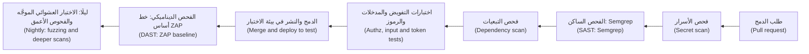
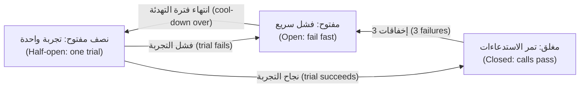

# الوحدة 4 — اختبار خصائص الجودة

*يمكن لميزة أن تجتاز كل اختبار وظيفي ومع ذلك تخذل من يستخدمونها: الشاشة التي تستغرق ست ثوانٍ يوم الراتب، والتحويل الذي يستطيع عميل آخر قراءته، وإعادة المحاولة التي تخصم مرتين، والنسخة الاحتياطية التي لا يستطيع أحد استعادتها. هذه هي خصائص الجودة، وتسميها المواصفة ISO/IEC 25010 كفاءة الأداء (performance efficiency) والأمان (security) والموثوقية (reliability) وغيرها، ولا يشعر بها العملاء إلا حين تفشل. تعلّمك هذه الوحدة كيف تختبرها في بنك نجم. يأتي الأداء (performance) أولًا: اختبارات الحِمل (load) والضغط (stress) والتحمّل الطويل (soak) والذروة المفاجئة، والنسب المئوية (percentiles) وأهداف مستوى الخدمة، والمطبّات التي تجعل اختبار الحِمل يكذب. ثم الأمان من مقعد المختبِر: مصفوفات التفويض (authorisation matrices) والمدخلات العدائية واختبارات الرموز واختبارات حدود المعدل (rate-limit tests) وأدوات الفحص في خط التكامل والتسليم المستمرين والاختبار العشوائي الموجَّه (fuzzing)، وكلها موجَّهة إلى النظام النموذجي للدورة ولا شيء سواه. وأخيرًا الموثوقية والبيانات: حقن الأعطال (fault injection) وإعادة المحاولة (retries) وقواطع الدائرة (circuit breakers) وتجارب الفوضى وتمارين الاستعادة والترحيلات الآمنة وفحوص جودة البيانات لخط التقارير التنظيمية. ستتابع ندى وهي تتعلم من اختبار حِمل في سطر واحد ما يخفيه المتوسط، ومن فحص نظيف يفوته ما يجده اختبار بمستخدمين اثنين، ومن رد ضائع يكشف خصمًا مزدوجًا. ويسري الذكاء الاصطناعي (AI) في الدروس الثلاثة: يكتب الوكلاء شيفرة تعمل لكنها سيئة التوسع والتفويض وإعادة المحاولة، وسؤال «هل يمكن أن يفشل هذا الاختبار؟» يُبقي الوكيل والاختبارات صادقين.*

> **التركيز:** Performance, Security, Reliability — اختبار الخصائص التي لا يشعر بها المستخدمون إلا حين تفشل: ما مدى سرعة النظام وثباته تحت الحِمل، ومن يحق له فعل ماذا ببيانات من، وما الذي ينجو من عطل أو نشر سيئ أو استعادة.

---

# 4.1 — اختبار الأداء: الحِمل والضغط والتحمّل الطويل والذروة المفاجئة، والنسب المئوية وأهداف مستوى الخدمة
*المستوى: 🟡 متوسط* · *المتطلبات: 2.1، 3.1* · *التركيز: Performance*

## ⚡ الدرس في دقيقة (In 60 seconds)
- يطرح **اختبار الأداء** سؤالًا واحدًا عن السرعة أو السعة تحت حِمل معلن: «هل ينتهي 95 % من طلبات الرصيد خلال 300 ms عند حركة يوم الراتب؟» لا رقم، لا اختبار
- اختر النوع بحسب السؤال: **الدخان (smoke)** أو **الحِمل (load)** أو **الضغط (stress)** أو **الذروة المفاجئة** أو **التحمّل الطويل (soak)**.
- أبلِغ عن **النسب المئوية (percentiles)** والإنتاجية (throughput) ومعدل الأخطاء (error rate) والتشبّع (saturation)؛ فالمتوسط يُخفي العملاء الذين يعانون.
- أكبر فخ: اختبار يكذب — الإغفال المنسَّق (coordinated omission) والبدايات الباردة (cold starts) ومولِّد حِمل محمَّل فوق طاقته وبيانات ضئيلة.
- لا تختبر إلا الأنظمة التي تملكها.

## 🧭 لماذا يهم
قبل يوم الراتب يكون أول اختبار أداء لندى خمسين مستخدمًا افتراضيًا يستدعون `GET /health` مدة دقيقة من حاسوبها المحمول. المتوسط 4 ms: «الأداء سليم». يسأل راشد أي نقطة نهاية يستخدمها العملاء، وما معدل الوصول (arrival rate) يوم الراتب، وكم تبلغ قيمة p99. لا تستطيع ندى الإجابة عن أي منها.

بعد أسبوعين تستجيب شاشة كشف الحساب الجديدة خلال 80 ms في بيئة ضمان الجودة (QA)، لكن قيمة p99 في الإنتاج تتجاوز ست ثوانٍ يوم الراتب: فهي تنفّذ استعلامًا واحدًا لكل صف، وتحتوي بيئة QA على 20 تحويلًا لكل عميل بينما يحتوي الإنتاج على الآلاف.

## 📐 كيف يعمل

### 🟢 الأساسيات

**أنواع اختبار الأداء.**

| النوع | السؤال الذي يجيب عنه | شكل الحِمل |
|---|---|---|
| **الدخان (Smoke)** | هل يعمل السكربت ويستجيب النظام؟ | بضعة مستخدمين، 30 s، مع كل طلب دمج |
| **الحِمل (Load)** | هل يتحقق الهدف عند الحركة المتوقعة؟ | ذروة متوقعة ثابتة، من 10 إلى 30 دقيقة |
| **الضغط (Stress)** | أين الحد، وما الذي ينكسر أولًا؟ | ارفع الحِمل تدريجيًا حتى تتجاوز الأخطاء أو زمن الاستجابة (latency) الخط |
| **الذروة المفاجئة** | هل ننجو من اندفاع مفاجئ ونتعافى؟ | أضعاف الحِمل المعتاد لدقائق |
| **التحمّل الطويل (Soak)** | هل يبقى سليمًا لساعات، مثل التسرّبات وامتلاء الأقراص؟ | حِمل عادي، من 4 إلى 24 ساعة |

**الأهداف وأهداف مستوى الخدمة.** يسمّي الهدف القابل للاختبار المقياس والنسبة المئوية (percentile) والحِمل والرقم: «p95 للمسار `GET /accounts/{id}/balance` أقل من 300 ms وp99 أقل من 800 ms عند 100 طلب في الثانية، والأخطاء أقل من 1 %». **مؤشر مستوى الخدمة (service level indicator, SLI)** هو ما تقيسه، و**هدف مستوى الخدمة (service level objective, SLO)** هو الغاية؛ ويحوّله الاختبار إلى **عتبة** نجاح أو فشل (pass/fail)، بالصرامة نفسها المعتمدة في الإنتاج ([*السحابة وDevOps*، الدرس 5.2 — أهداف مستوى الخدمة وميزانيات الأخطاء والتنبيه والمناوبة التي يمكن للناس تحمّلها](../cloud/index.ar.html#/5.2)).

**نسب مئوية لا متوسطات.** **p99** هو الزمن الذي يساويه أو يقل عنه 99 % من الطلبات. من بين 1,000 طلب يستغرق 980 منها 100 ms ويستغرق 20 طلبًا 5 ثوانٍ. المتوسط 198 ms وp95 يساوي 100 ms، وكلاهما «سليم»؛ أما p99 فيبلغ 5,000 ms، أي أنه عند 100 طلب في الثانية ينتظر عميلان كل ثانية خمس ثوانٍ. لا تحسب متوسط النسب المئوية عبر الخوادم؛ بل ادمج العيّنات. اقرأ زمن الاستجابة إلى جانب **الإنتاجية (throughput)** و**معدل الأخطاء (error rate)** و**التشبّع (saturation)**، أي مدى امتلاء المعالج (CPU) أو مجمّع الاتصالات أو الطابور (queue)؛ فالخادم الذي يرد بـ`500` خلال 2 ms يبدو سريعًا.

```text
Weak:   assert mean_latency < 200 ms               # passes on the data above
Strong: assert p99 < 800 ms and error_rate < 1 %   # fails on the same data
```

### 🟡 التعمق أكثر (Going deeper)

**نمذجة عبء العمل (Workload modelling).** في **النموذج المغلق** ترسل مجموعة ثابتة من المستخدمين الافتراضيين كل واحد منهم طلبًا، وينتظر، ويتوقف، ويكرر؛ وحين يبطؤ النظام يبطؤ المستخدمون معه، فيخفّف الاختبار ضغطه في اللحظة التي ينبغي أن يزيده فيها. أما في **النموذج المفتوح** فتصل الطلبات بمعدل محدد سواء انتهت الطلبات السابقة أم لا، كما يفعل الجمهور، فيجعل البطء العمل يتراكم في الطابور. يتبع تطبيق نجم للهاتف النموذج المفتوح. **زمن التفكير (Think time)** هو التوقف حين يقرأ الشخص الشاشة؛ وبدونه يضرب 100 مستخدم افتراضي النظام بقوة أكبر بكثير مما يفعله 100 شخص. خذ معدل الوصول ومزيج الطلبات لأكثر ساعة ازدحامًا من سجلات الإنتاج، وأضف هامشًا احتياطيًا (headroom)، واستخدم بيانات مقنَّعة (masked) على شكل بيانات الإنتاج.

**مولّد حِمل يمكنك قراءته.** يقيس هذا المولّد ذو النموذج المفتوح (`asyncio` و`httpx`) زمن كل طلب منذ بدايته *المقصودة*، ويُسقط فترة الإحماء، ويخرج برمز غير صفري عند خرق هدف مستوى الخدمة. احفظه باسم `perf/loadtest.py` في نسخة من `testing/sample`.

```python
# perf/loadtest.py
import asyncio, math, sys, time

import httpx

A = {"Authorization": "Bearer token-alice"}
BODY = {"from_account": "acc-1", "to_account": "acc-2", "amount": "1.00", "currency": "QAR", "kind": "domestic"}


def pct(values, p):                                    # nearest-rank percentile
    s = sorted(values)
    return s[max(0, math.ceil(p / 100 * len(s)) - 1)]


async def visit(client, i, intended, out):
    sent = time.perf_counter()
    try:
        if i % 5:                                      # four balance checks for every transfer
            r = await client.get("/accounts/acc-1/balance", headers=A)
        else:
            r = await client.post("/transfers", json=BODY, headers={**A, "Idempotency-Key": f"load-{i}"})
        ok = r.status_code in (200, 201)
    except httpx.HTTPError:
        ok = False
    done = time.perf_counter()    # timed from the INTENDED start, as the customer lived it; lag: how late we were
    out.append(dict(ok=ok, intended=done - intended, lag=sent - intended))


async def run(rate, seconds, warmup=3):
    out, tasks = [], []
    async with httpx.AsyncClient(base_url="http://127.0.0.1:8000", timeout=10,
                                 limits=httpx.Limits(max_connections=500)) as client:   # the pool must not be the cap
        t0 = time.perf_counter()
        for i in range(rate * (warmup + seconds)):
            intended = t0 + i / rate                   # open model: the schedule ignores replies
            await asyncio.sleep(max(0, intended - time.perf_counter()))
            sink = [] if i < rate * warmup else out    # warm-up requests are sent, then dropped
            tasks.append(asyncio.create_task(visit(client, i, intended, sink)))
        await asyncio.gather(*tasks)
    return out


if __name__ == "__main__":
    rate, seconds = int(sys.argv[1]), int(sys.argv[2])
    out = asyncio.run(run(rate, seconds))
    ms = lambda key, p: 1000 * pct([r[key] for r in out], p)
    errors = sum(not r["ok"] for r in out) / len(out)
    print(f"requests={len(out)} errors={errors:.2%} target={rate}/s")
    for key in ("intended", "lag"):
        print(f"{key:>9}: p50={ms(key, 50):7.1f} p95={ms(key, 95):7.1f} p99={ms(key, 99):7.1f} ms")
    mean = sum(r["intended"] for r in out) / len(out)
    print(f"Little's Law: {rate}/s x {1000 * mean:.1f} ms = {rate * mean:.1f} requests in flight")
    ok = ms("intended", 95) <= 100 and ms("intended", 99) <= 250 and errors <= 0.01      # the SLO
    print("SLO:", "PASS" if ok else "FAIL")
    sys.exit(0 if ok else 1)
```

شغّل واجهة البرمجة (`uvicorn najm.api:app --port 8000`)، ثم نفّذ `python perf/loadtest.py 200 15`. على حاسوب محمول — وستختلف نتائجك:

```text
requests=3000 errors=0.00% target=200/s
 intended: p50=    3.7 p95=    5.8 p99=   10.0 ms
      lag: p50=    0.8 p95=    1.2 p99=    2.1 ms
Little's Law: 200/s x 4.0 ms = 0.8 requests in flight
SLO: PASS
```

**قانون ليتل ونقطة الانكسار.** في نظام مستقر **L = λW**: عدد الطلبات داخل النظام (L) يساوي معدل الوصول (arrival rate, λ) مضروبًا في الزمن الذي يقضيه كل طلب هناك (W). ويضع القانون نفسه سقفًا: 6 اتصالات بقاعدة البيانات، يُحتجز كل منها 30 ms، تُنهي 6 / 0.03 = 200 طلب في الثانية على الأكثر. احفظ هذا الغلاف باسم `pooled_app.py`، وشغّله بالأمر `uvicorn pooled_app:app --port 8000`، ثم ارفع المعدل بالتدريج.

```python
# pooled_app.py: the sample API behind a pretend database pool
import asyncio, os

from najm.api import create_app

POOL = int(os.getenv("POOL", "4"))
app, slots = create_app(), asyncio.Semaphore(POOL)    # POOL connections...


@app.middleware("http")
async def pretend_database(request, call_next):
    async with slots:
        await asyncio.sleep(0.04)                      # ...each held for 40 ms
        return await call_next(request)
```

عند 40 و80 طلبًا في الثانية بقيت قيمة p95 قرب 48 ms، مع نحو 1.9 و3.7 طلب قيد التنفيذ — ويتسع المجمّع لأربعة. وعند 100 في الثانية قفزت p50 من نحو 46 ms إلى أكثر من ثانية، مع أكثر من مئة طلب قيد التنفيذ. لا عيب في الشيفرة؛ فالمجمّع لا يستطيع إنهاء ما يصل إليه، فيتزايد الانتظار ما دام الاختبار يعمل. دون **نقطة الانكسار (knee)** يبقى زمن الاستجابة ثابتًا، وفوقها ينفجر: يجدها اختبار الضغط، ويثبت اختبار الحِمل أنك تبقى بعيدًا عنها.

**مطبّات تجعل الأرقام تكذب.**
- **الإغفال المنسَّق (Coordinated omission)**. تنتظر الأداة ذات الحلقة المغلقة ردًا بطيئًا قبل إرسال الطلب التالي، فلا تسجّل أبدًا الطلبات التي *كان ينبغي* أن تخرج أثناء التجمّد. تخيّل خدمة ترد عادة خلال 10 ms ثم تتجمّد ثانيتين، وعميلًا يخطط لطلب كل 20 ms مدة 8 s. فإذا قِيس الزمن من لحظة الإرسال كان طلب واحد من كل 400 بطيئًا، وقيمة p99 تساوي 10 ms؛ وإذا قِيس من اللحظة المخططة كما عاشها العملاء، انتظر نحو 200 طلب، وقيمة p99 قرابة ثانيتين، لأن العميل يحتاج إلى نحو 200 طلب ليلحق بالجدول. يحاكيه التمرين 🟡. يقيس مولّدنا من الخطة؛ وتبدأ منفّذات معدل الوصول في k6 التكرارات على ساعة وتبلّغ عمّا لم تستطع بدءه باسم `dropped_iterations`.
- **ذواكر تخزين مؤقت باردة وJIT والمجمّعات.** تصادف الطلبات الأولى ذواكر تخزين مؤقت فارغة واتصالات لم تُفتح بعد. أسقط فترة إحماء.
- **المولِّد بوصفه عنق الزجاجة.** على حاسوب محمول واحد عمل النظام النموذجي بسلاسة عند 400 طلب في الثانية، لكن عند 600 تجاوز `lag` ثلاث ثوانٍ: لم تستطع الأداة الإرسال في موعدها، فوصفت الأرقام الأداة نفسها. راقب `lag` (في k6: `dropped_iterations`) والمعالج.
- **بيانات غير واقعية.** عشرون صفًا لكل عميل تُخفي مشكلة N+1؛ وحساب ساخن واحد يُخفي إخفاقات الذاكرة المؤقتة.
- **بيئات مشتركة.** إذا شغّل فريق آخر دفعة على بيئة QA في منتصف الاختبار، فقد قسْتَ مهمته هو.

**الاختبار نفسه في k6.** k6 (من Grafana Labs) برنامج مكتوب بلغة Go يشغّل سكربت الاختبار الذي تكتبه بلغة JavaScript، ومعه العتبات والسيناريوهات مدمجة؛ وهو ليس Node.js، فواجهات Node البرمجية غير متاحة. يتبع هذا السكربت توثيق الأداة و**لم يُنفَّذ**؛ شغّله أولًا بحجم اختبار الدخان.

```javascript
// perf/k6/transfers.js
// Smoke: k6 run perf/k6/transfers.js   Nightly: add -e BASE_URL=... -e RATE=50 -e DURATION=20m
import http from 'k6/http';
import { sleep } from 'k6';

const BASE = __ENV.BASE_URL || 'http://127.0.0.1:8000';
const AUTH = { Authorization: 'Bearer token-alice' };
const rate = Number(__ENV.RATE || 5);

export const options = {
  scenarios: {
    steady: { executor: 'constant-arrival-rate', exec: 'visit', rate, timeUnit: '1s',   // an OPEN model
              duration: __ENV.DURATION || '30s', preAllocatedVUs: rate * 3, maxVUs: rate * 6 },  // VUs: Little's Law
  },
  thresholds: {                                          // the SLO; k6 exits non-zero if one is crossed
    'http_req_duration{endpoint:balance}': ['p(95)<300', 'p(99)<800'],
    'http_req_duration{endpoint:transfer}': ['p(95)<500', 'p(99)<1200'],
    http_req_failed: ['rate<0.01', { threshold: 'rate<0.05', abortOnFail: true, delayAbortEval: '30s' }],
  },
};

export function visit() {
  http.get(`${BASE}/accounts/acc-1/balance`, { headers: AUTH, tags: { endpoint: 'balance' } });
  sleep(1 + Math.random() * 3);                          // think time: the customer reads the screen
  if (Math.random() < 0.2) {
    const body = JSON.stringify({ from_account: 'acc-1', to_account: 'acc-2', amount: '1.00', currency: 'QAR', kind: 'domestic' });
    const headers = { ...AUTH, 'Content-Type': 'application/json', 'Idempotency-Key': `${__VU}-${__ITER}-${Date.now()}` };
    http.post(`${BASE}/transfers`, body, { headers, tags: { endpoint: 'transfer' } });
  }
}
```

ذروة الـ4× الليلية سيناريو ثانٍ بمنفّذ `ramping-arrival-rate`؛ حدّد حجم `maxVUs` بقانون ليتل: فـ4× المعدل عند نحو 2.6 s لكل تكرار تحتاج إلى نحو 10× المعدل من المستخدمين الافتراضيين (VUs).

### 🔴 نظرة الخبير (Expert view)

**قراءة النتائج.** ثق بالتشغيل قبل أرقامه: هل `lag` صغير، ومعالج المولِّد حرّ، والأخطاء قرب الصفر، وفترة الإحماء مُسقَطة، والبيانات واقعية؟ عندها فقط قارن p95 وp99 بهدف مستوى الخدمة (SLO) وابحث عن نقطة الانكسار وأول مورد يتشبّع، وفي اختبار التحمّل الطويل عن الانجراف (drift).

**اختبارات الأداء في التكامل المستمر.** تشغّل مهمة الدخان واجهة البرمجة وتنفّذ `python perf/loadtest.py 20 10`؛ فتلتقط الانحدارات بمقدار 10 أضعاف لا بنسبة 10 %. وتشغّل المهمة الليلية ملف k6 على بيئة ما قبل الإنتاج (staging). المشغِّلات المشتركة كثيرة الضجيج: قارن بخط أساس (baseline) من المهمة نفسها.

**ميزانيات أداء الويب.** مؤشرات **Core Web Vitals** من Google، التي تُقاس عند النسبة المئوية الخامسة والسبعين لتحميلات الصفحات الحقيقية، هي **LCP**، والجيد 2.5 s أو أقل، و**INP**، الذي حلّ محل First Input Delay في مارس 2024، والجيد 200 ms أو أقل، و**CLS**، والجيد 0.1 أو أقل. يدقّق **Lighthouse** صفحةً في بيئة مخبرية؛ وتدقيق تحميل الصفحة القياسي لا يتضمن تفاعلات، فلا يستطيع قياس INP ويبلّغ عن Total Blocking Time بديلًا عنه. ويفرض Lighthouse CI الميزانيات في خط التكامل والتسليم المستمرين — ولم يُشغَّل هنا؛ وفي Chromium يستطيع Playwright قراءة LCP وCLS عبر `PerformanceObserver`. في صفحة `/app` من النظام النموذجي كانت LCP أقل من 100 ms، فلا يمكن لميزانية 2,500 ms أن تفشل أبدًا: فميزانية المختبر هي *إنذار انحدار* بقيمة تبلغ عدة أضعاف قيمة اليوم — واستخدمنا 500 ms. ودفعت لافتة بارتفاع 600 px حُقنت متأخرةً بمقدار 300 ms قيمة CLS إلى 0.112 وأفشلت ميزانية 0.1، كما في التمرين 🟢.

**كشف مشكلة N+1 في قاعدة البيانات بعدّ الاستعلامات.** في مشكلة N+1 تقرأ الشيفرة قائمةً ثم تنفّذ استعلامًا إضافيًا لكل صف. على الحاسوب المحمول يستغرق كل استعلام 0.1 ms فينجح اختبار التوقيت؛ أما في الإنتاج فكل استعلام رحلة ذهاب وإياب عبر الشبكة. عُدَّ العبارات، وأكّد ألا يزيد العدد بزيادة حجم الصفحة. تُظهر `set_trace_callback` في SQLite كل عبارة، وفي Django يوجد `assertNumQueries`.

```python
# tests/test_statement.py
import sqlite3

import pytest


def make_db(rows):
    db = sqlite3.connect(":memory:")
    db.executescript("CREATE TABLE people (id INTEGER PRIMARY KEY, name TEXT);"
                     "CREATE TABLE transfers (id INTEGER PRIMARY KEY, person_id INTEGER);")
    for i in range(1, rows + 1):
        db.execute("INSERT INTO people VALUES (?, ?)", (i, f"Recipient {i}"))
        db.execute("INSERT INTO transfers (person_id) VALUES (?)", (i,))
    return db


def slow(db, n):                      # one query for the list, then one per row
    rows = db.execute("SELECT id, person_id FROM transfers ORDER BY id DESC LIMIT ?", (n,)).fetchall()
    return [(t, db.execute("SELECT name FROM people WHERE id = ?", (p,)).fetchone()[0]) for t, p in rows]


def fast(db, n):                      # one JOIN
    return db.execute("SELECT t.id, p.name FROM transfers t JOIN people p ON p.id = t.person_id "
                      "ORDER BY t.id DESC LIMIT ?", (n,)).fetchall()


def queries(fn, n):
    db, seen = make_db(60), []
    db.set_trace_callback(lambda sql: seen.append(sql) if sql.startswith("SELECT") else None)
    assert len(fn(db, n)) == n
    return len(seen)


@pytest.mark.parametrize("fn", [slow, fast])
def test_weak_right_rows(fn):         # passes for both: SQLite in memory is quick
    assert len(fn(make_db(60), 50)) == 50


@pytest.mark.parametrize("fn", [slow, fast])
def test_strong_query_count_does_not_grow_with_page_size(fn):    # MEANT TO FAIL for slow
    assert queries(fn, 50) == queries(fn, 5)
```

```text
FAILED tests/test_statement.py::test_strong_query_count_does_not_grow_with_page_size[slow]
E       assert 51 == 6
```

**ملاحظات عصر الذكاء الاصطناعي.** يكتب وكلاء البرمجة شيفرة تعمل لكنها تتوسع بصورة سيئة: استعلامات N+1، وقوائم غير محدودة، وقفل محتجز عبر استدعاء شبكي. اطلب عدد الاستعلامات وp95 تحت حِمل معياري، لا «إنها تعمل». وتميل سكربتات الحِمل التي يكتبها الذكاء الاصطناعي إلى النموذج المغلق ونقطة نهاية واحدة وبلا زمن تفكير. وتضيف ميزات النماذج اللغوية الكبيرة **زمن أول رمز (time to first token)** و**الرموز في الثانية (tokens per second)** وتكلفة الطلب (cost per request) — ويضع لها الدرس 7.1 بوابات؛ ضع سقفًا للإنفاق أولًا. لا تسلّط حِملًا إلا على أنظمة تملكها أو يحق لك اختبارها بإذن مكتوب: فمن غير ذلك يكون الحِمل هجومًا.

## 🧰 الأدوات
| الأداة أو الممارسة أو التقنية | ما هي وماذا تفعل | متى تلجأ إليها |
|---|---|---|
| **k6** (Grafana Labs) | سكربتات JavaScript وعتبات وسيناريوهات | اختبارات حِمل الواجهات في التكامل المستمر |
| **Locust** | سلوك بلغة Python العادية؛ حِمل أقل لكل عملية | فرق Python؛ التدفقات المعقدة |
| **Apache JMeter** | واجهة رسومية (GUI) وبروتوكولات كثيرة؛ يصعب مراجعة خطط XML | البيئات القائمة؛ ما ليس HTTP |
| **Gatling** | كفء، على منصة JVM — و**Artillery** أخف ويستخدم YAML (lighter, YAML) | حِمل مرتفع بأجهزة قليلة |
| **Percentile thresholds** | هدف مستوى الخدمة نجاحًا أو فشلًا: p95 وp99 والأخطاء | كل اختبار أداء |
| **Little's Law** | L = λW: ما قيد التنفيذ = المعدل × الزمن | تحديد حجم المستخدمين الافتراضيين والمجمّعات |
| **Lighthouse and Core Web Vitals** | تدقيقات مخبرية؛ وLCP وINP وCLS الميدانية | الصفحات التي لها ميزانية |
| **Query counting** | تأكيد عدد العبارات لكل طلب | التقاط N+1 قبل الإنتاج |

## 🏛️ عمليًا في بنك نجم
ينشر بلال ومها **خطة اختبار الأداء في نجم، الإصدار 1**، وهي قالب يُكمله كل اختبار قبل تشغيله. وهذه خطة التحويلات:

| الحقل | التحويلات، صباح يوم الراتب |
|---|---|
| السؤال والبيئة | هل نحقق هدف مستوى الخدمة عند الذروة المتوقعة، وأين نقطة الانكسار؟ بيئة ما قبل الإنتاج محجوزة؛ نسخة مقنَّعة بمليوني حساب |
| عبء العمل | نموذج مفتوح؛ 80 % رصيد و15 % كشف حساب و5 % تحويل؛ زمن التفكير من 1 إلى 4 s |
| ملف الحِمل (Load profile) | إحماء 3 دقائق، و20 دقيقة عند الذروة؛ ويضيف الاختبار الليلي ذروة مفاجئة 4× |
| النجاح والإيقاف | p95 ≤ 300 ms وp99 ≤ 800 ms والأخطاء < 1 %؛ يُجهَض الاختبار إذا تجاوزت الأخطاء 5 % بعد أول 30 s |

تعمل اختبارات الدخان وعدّ الاستعلامات مع كل طلب دمج (pull request)، وملف k6 ليليًا، واختبار تحمّل طويل لأربع ساعات قبل الإصدارات.

## 🛠️ التمارين (Exercises)
اعمل في نسخة من `testing/sample`.

- 🟢 **ميزانية لصفحة.** اكتب اختبار Playwright للمسار `/app` يجمع LCP وCLS بكائنات `PerformanceObserver` تُعدّ في `page.addInitScript`، ويكرر الفحص بـ`expect.poll` حتى تصير LCP أكبر من الصفر، ويؤكد أن LCP أقل من 500 ms وأن CLS أقل من 0.1. ثم استخدم `page.route('**/app', …)` لحقن عنصر `div` ارتفاعه 600 px بعد 300 ms من التحميل. *يكتمل عندما:* تنجح الصفحة العادية وتفشل صفحة اللافتة بسبب CLS.
- 🟡 **ابحث عن نقطة الانكسار.** شغّل `pooled_app.py`، وتنبّأ بأقصى معدل له بقانون ليتل، وارفع معدل المولِّد بخطوات من 10 حتى تتضاعف p95. ثم حاكِ التجمّد لثانيتين بساعة محاكاة مع قياس الزمن بالطريقتين. *يكتمل عندما:* يقع التنبؤ في حدود 15 % من نقطة الانكسار المقيسة وتختلف قيمتا p99 لديك كما هو موصوف.
- 🔴 **حارس داخل العملية.** اكتب اختبار pytest يرسل 300 طلب إلى كل من `/health` ونقطة نهاية الرصيد عبر `httpx.ASGITransport(app=create_app())`، ويُسقط فترة إحماء، ويؤكد أن كل حالة تساوي 200، ويشترط أن تكون p95 للرصيد أقل من القيمة الأكبر بين 5 ms وخمسة أضعاف p95 لنقطة نهاية الصحة. *يكتمل عندما:* ينجح في 10 تشغيلات نظيفة ويفشل بعد أن تضيف انتظارًا مصطنعًا مدته 20 ms إلى نقطة نهاية الرصيد في نسختك.

## ⚠️ أخطاء وفخاخ (Mistakes and traps)
- **المتوسطات وحدها.** أخفى متوسط 198 ms قيمة p99 بلغت 5 s. ابنِ بوابة الجودة على p95 وp99 والأخطاء.
- **زمن الاستجابة دون الأخطاء.** ردود `500` الفورية تبدو سريعة. افحص رموز الحالة.
- **حلقة مغلقة لخدمة عامة.** استخدم معدلات الوصول.
- **بيانات ضئيلة.** عشرون صفًا تُخفي N+1. استخدم بيانات مقنَّعة على شكل بيانات الإنتاج.
- **الإفراط في الاختبار.** صفحة يستخدمها خمسة موظفين تحتاج اختبار عدّ استعلامات لا اختبار حِمل.

## 🧾 الخلاصة (Recap)
- اختبار الأداء سؤال برقم: النوع والحِمل وعتبة هدف مستوى الخدمة.
- تصف النسب المئوية والإنتاجية والأخطاء والتشبّع أي تشغيل؛ أما المتوسط فيُخفي العملاء.
- يحدد قانون ليتل، أي L = λW، أحجام المجمّعات والمستخدمين الافتراضيين (virtual users) ويتنبأ بنقطة الانكسار.
- لا تثق بتشغيل حتى تتحقق من تأخّر المولِّد والأخطاء والإحماء والبيانات.

## ✍️ اختبر نفسك (Check yourself)

**1. يبلّغ اختبار حِمل عن متوسط 120 ms و«كل شيء أخضر». وقيمة p99 تساوي 4 ثوانٍ. ما القراءة الصحيحة؟**

- A. ينتظر طلب واحد على الأقل من كل مئة أربع ثوانٍ أو أكثر
- B. المتوسط خاطئ، لأن المتوسطات لا يمكن قياسها بموثوقية
- C. النظام سليم، لأن المتوسط ضمن هدف مستوى الخدمة (SLO) بهامش واسع
- D. قيمة p99 شاذة ويمكن تجاهلها بأمان

<details><summary>الإجابة</summary>

**A.** ينتهي 99 % من الطلبات خلال p99، فينتظر أبطأ 1 % أربع ثوانٍ أو أكثر؛ والمتوسط المنخفض يُخفيهم..

</details>

**2. يشغّل سكربت بلال مئة مستخدم افتراضي على واجهة برمجة نجم في بيئة ما قبل الإنتاج، ويرسل كل منهم طلبه التالي حين يصل الرد السابق. تتجمّد الخدمة عشر ثوانٍ. ماذا يُسجَّل؟**

- A. صورة عادلة، لأن كل طلب أُرسل قد سُجّل في النتائج
- B. بضع عيّنات بطيئة، ولا شيء للطلبات التي لم تُرسَل أصلًا
- C. آلاف الطلبات الفاشلة التي ترفع p99 إلى عنان السماء فعلًا
- D. لا شيء، لأنه يتوقف عند أول رد بطيء يتلقاه

<details><summary>الإجابة</summary>

**B.** ينتظر كل مستخدم رده العالق ولا يرسل شيئًا جديدًا: إنه الإغفال المنسَّق (coordinated omission). (🟡 التعمق أكثر).

</details>

**3. لدى خدمة 8 اتصالات بقاعدة البيانات، ويحتجز كل طلب اتصالًا 50 ms. ما أعلى إنتاجية مستقرة لها تقريبًا مهما بلغت سرعة المعالج؟**

- A. نحو 400 طلب في الثانية
- B. نحو 160 طلبًا في الثانية
- C. نحو 8 طلبات في الثانية
- D. نحو 20 طلبًا في الثانية الواحدة

<details><summary>الإجابة</summary>

**B.** 8 اتصالات / 0.05 s = 160 في الثانية (8 connections / 0.05 s = 160 per second) وفق قانون ليتل. (🟡 التعمق أكثر).

</details>

**4. نقطة نهاية كشوف الحساب سريعة في بيئة QA لكنها بطيئة في الإنتاج، حيث لدى العملاء آلاف التحويلات. تنفّذ استعلامًا واحدًا لكل صف. أي اختبار يلتقط ذلك؟**

- A. اختبار توقيت يفشل إذا تجاوزت نقطة النهاية ثانية
- B. اختبار وحدة يفحص الصفوف المعادة
- C. اختبار يؤكد أن عدد الاستعلامات يبقى ثابتًا مع نمو حجم الصفحة
- D. اختبار دخان يرسل طلبًا واحدًا ويتوقع 200

<details><summary>الإجابة</summary>

**C.** على بيانات QA الضئيلة يُخفي التوقيت مشكلة N+1؛ أما عدّ العبارات عند حجمي صفحة مختلفين فيكشفها. (🔴 نظرة الخبير).

</details>

**5. يتجاوز اختبار حِمل ليلي على بيئة ما قبل الإنتاج المشتركة عتبة p95 بنسبة 12 %، وكان تصدير بيانات لفريق آخر يعمل في النافذة نفسها. ماذا ينبغي أن تفعل ندى أولًا؟**

- A. ترفع العتبة بنسبة 15 % حتى يصير التشغيل الليلي أخضر
- B. تعيد التشغيل حتى ينجح وتحتفظ بأفضل نتيجة
- C. تفتح عيبًا (defect) ضد فريق التحويلات فورًا
- D. تعيد التشغيل في نافذة هادئة لترى هل يتكرر الإخفاق

<details><summary>الإجابة</summary>

**D.** قد تفسّر مهمة منافسة الإخفاق؛ فكرّر التشغيل بدونها قبل أن تلوم الشيفرة أو تخفف البوابة. (🟡 التعمق أكثر).

</details>

## 📚 المراجع (References)
- توثيق Grafana k6 — https://grafana.com/docs/k6/latest/
- Apache JMeter — https://jmeter.apache.org/
- موارد Google SRE حول أهداف مستوى الخدمة — https://sre.google/
- وحدتا `asyncio` و`sqlite3` في Python — https://docs.python.org/3/
- توثيق Playwright — https://playwright.dev/
- J. D. C. Little, "A Proof for the Queuing Formula: L = λW", *Operations Research*, 1961
- Gil Tene, "How NOT to Measure Latency" (محاضرة في مؤتمر)

---

# 4.2 — اختبار الأمان للمختبِرين: OWASP وSAST وDAST وفحص التبعيات والاختبار العشوائي الموجَّه واختبارات التفويض
*المستوى: 🟡 متوسط* · *المتطلبات: 3.1، 4.1* · *التركيز: Security*

## ⚡ الدرس في دقيقة (In 60 seconds)
- يضيف المختبِرون ما لا تستطيعه أدوات الفحص: **حالات إساءة الاستخدام** و**مصفوفات التفويض (authorisation matrices)** — من يحق له فعل ماذا ببيانات من — والمدخلات العدائية والمولَّدة، واختبار انحدار (regression test) لكل ثغرة.
- يقرأ **الفحص الساكن للشيفرة (SAST)** الشيفرة، ويقرأ **تحليل مكوّنات الطرف الثالث (SCA)** التبعيات (dependencies)، ويهاجم **الفحص الديناميكي للتطبيق (DAST)** تطبيقًا يعمل، ويغذّي **الاختبار العشوائي الموجَّه (fuzzing)** مدخلات مولَّدة؛ وكلٌّ منها يرى شيئًا مختلفًا.
- أفضل ساعة تقضيها هي في اختبار تفويض: فكسر التحكم في الوصول (broken access control) هو الأول في OWASP Top 10 (طبعة 2025، كما في طبعة 2021).
- تقدّم أدوات الفحص (Scanners) خيوطًا لا أحكامًا: امنع الدمج عند النتائج الجديدة عالية الثقة، وافرز الباقي.
- أكبر فخ: «كانت أداة الفحص خضراء، فالنظام آمن».
- النطاق والإذن الكتابي أولًا؛ وهنا لا تهاجم إلا النظام النموذجي على جهازك الخاص.

## 🧭 لماذا يهم
تشغّل ندى فحص OWASP ZAP الأساسي على واجهة التحويلات وتبلّغ بأنه «لا نتائج». يسأل بلال: «هل سبق أن طلبتِ تحويل أليس برمز بوب؟» لم تفعل. لا تعرف أداة الفحص أن `tr-0001` يخص أليس، فالعيب الذي يقرأ فيه أي مستخدم مسجَّل الدخول أي تحويل غير مرئي لها. لا يستطيع أن يفشل إلا اختبار يعرف من يملك ماذا.

## 📐 كيف يعمل

### 🟢 الأساسيات

**ما يضيفه المختبِرون.** يسأل المطوّرون كيف ينبغي أن تعمل الميزة؛ ويسأل المهاجمون كيف يجعلونها تسيء التصرف. ويكتب المختبِرون القائمة الثانية على هيئة **حالات إساءة استخدام** («بصفتي بوب أغيّر المعرّف في الرابط»، as Bob I change the id in the URL؛ و«بصفتي سكربتًا أعيد إرسال تحويل مُلتقَط»)، ويحوّلون كل واحدة إلى اختبار يجب أن يفشل بأمان، ويحتفظون به بوصفه اختبار انحدار. كما يملكون ما لا تستطيع أي أداة فحص إنتاجه: الجواب المتوقع لكل دور وكل كائن.

**قائمة OWASP Top 10 مصدرًا لأفكار الاختبار.** قائمة OWASP Top 10 قائمة واسعة الاستخدام بمخاطر الويب. هذه أسماء طبعة 2025؛ والطبعات تتغير، فراجع owasp.org وأبقِ المنهج: فكرة اختبار واحدة لكل فئة.

| الفئة (2025) | فكرة اختبار على التحويلات |
|---|---|
| A01 كسر التحكم في الوصول | يقرأ بوب تحويل أليس أو يرسل من `acc-1`؛ غيّر كل معرّف في كل رابط؛ وأي ميزة تجلب رابطًا يقدّمه المستخدم (تزوير الطلبات من جهة الخادم، Server-Side Request Forgery، صار جزءًا من هذه الفئة؛ ولا واحدة في النظام النموذجي) |
| A02 سوء إعداد الأمان (Security Misconfiguration) | صفحات التصحيح وبيانات الاعتماد الافتراضية ووثائق API المفتوحة في الإنتاج والترويسات الناقصة |
| A03 إخفاقات سلسلة توريد البرمجيات (Software Supply Chain Failures) | فحص التبعيات في كل بناء؛ وهل الحزمة التي اقترحها الذكاء الاصطناعي موجودة فعلًا؟ |
| A04 إخفاقات التشفير (Cryptographic Failures) | هل يمكن الوصول عبر HTTP العادي؟ رموز أو أرقام حسابات في السجلات ونصوص الأخطاء؟ |
| A05 الحقن (Injection) | علامات اقتباس ووسوم ونصوص ضخمة في كل حقل؛ وSQL مبني من نصوص |
| A06 التصميم غير الآمن (Insecure Design) | أعد إرسال طلب مُلتقَط؛ وأطلق طلبين متطابقين في سباق؛ وقسّم تحويلًا يتجاوز الحد |
| A07 إخفاقات المصادقة | رموز منتهية ومزوَّرة وموجَّهة لجمهور خاطئ؛ وحدود معدل على تسجيل الدخول |
| A08 إخفاقات سلامة البرمجيات أو البيانات | رموز عُبث بها ونواتج وتحديثات غير موقَّعة |
| A09 إخفاقات التسجيل والتنبيه الأمني | التحويل المرفوض يترك سجل تدقيق، دون الرمز فيه |
| A10 سوء التعامل مع الحالات الاستثنائية (Mishandling of Exceptional Conditions) | اجعل فحص الحد أو الملكية يرمي استثناءً (مهلة منتهية، حقل ناقص): يجب أن يُرفض التحويل لا أن يمرّ، وألّا يكشف الخطأ تتبّع المكدس أو بيانات |

**قائمتا تحقق.** يسرد **معيار OWASP للتحقق من أمان التطبيقات (OWASP Application Security Verification Standard, ASVS)** متطلبات أمنية على ثلاثة مستويات تحقق: استخدمه لتقرر ما معنى «آمن بما يكفي». ويصف **دليل OWASP لاختبار أمان الويب (OWASP Web Security Testing Guide, WSTG)** كيف تُختبر كل منطقة، من المصادقة (authentication) إلى منطق العمل: استخدمه لتصميم الاختبارات.

**النطاق والإذن.** اختبار الأمان دون تفويض هجوم. اختبر فقط الأنظمة التي تملكها أو لديك **إذن كتابي** باختبارها، ضمن نطاق ونافذة متفق عليهما، وببيانات اصطناعية (synthetic data). كل مثال هنا يستهدف النظام النموذجي للدورة على جهازك الخاص.

### 🟡 التعمق أكثر

**مصفوفة تفويض.** اسرد كل دور مقابل كل كائن واكتب الجواب المتوقع من *المتطلب* قبل قراءة الشيفرة. الاختبار الضعيف هو أن تقرأ أليس تحويلها هي: فينجح والعيب قائم. أما المصفوفة فتختبر كل خلية، فلا يجد العيب مكانًا يختبئ فيه ([*أمن الذكاء الاصطناعي والتطبيقات*، الدرس 3.3 — التفويض (Authorisation): كسر التحكم في الوصول وIDOR وتعدد المستأجرين (multi-tenancy)](../secai/index.ar.html#/3.3)). احفظها في نسخة من `testing/sample`:

```python
# tests/test_authz_matrix.py
import uuid

import pytest
from fastapi.testclient import TestClient

from najm.api import create_app

TOKEN = {"anonymous": None, "forged": "token-mallory", "alice": "token-alice", "bob": "token-bob"}


def send(source, target):
    return {"from_account": source, "to_account": target, "amount": "10.00", "currency": "QAR", "kind": "domestic"}


def call(client, who, method, path, body=None):
    headers = {"Idempotency-Key": str(uuid.uuid4())}
    if TOKEN[who]:
        headers["Authorization"] = f"Bearer {TOKEN[who]}"
    return client.request(method, path, json=body, headers=headers)


# Expected statuses come from "customers see and use only their own money". Columns: anonymous, forged, alice, bob.
MATRIX = {
    "alice's balance":  (("GET", "/accounts/acc-1/balance", None), [401, 401, 200, 403]),
    "bob's balance":    (("GET", "/accounts/acc-2/balance", None), [401, 401, 403, 200]),
    "alice's transfer": (("GET", "/transfers/tr-0001", None), [401, 401, 200, 403]),
    "bob's transfer":   (("GET", "/transfers/tr-0002", None), [401, 401, 403, 200]),
    "send from acc-1":  (("POST", "/transfers", send("acc-1", "acc-2")), [401, 401, 201, 403]),
    "send from acc-2":  (("POST", "/transfers", send("acc-2", "acc-1")), [401, 401, 403, 201]),
}
CASES = [pytest.param(who, *request, expected, id=f"{who}-{name}")
         for name, (request, column) in MATRIX.items() for who, expected in zip(TOKEN, column)]


@pytest.fixture
def client():                           # fresh app; tr-0001 is Alice's transfer, tr-0002 is Bob's
    c = TestClient(create_app(), raise_server_exceptions=False)
    assert call(c, "alice", "POST", "/transfers", send("acc-1", "acc-2")).status_code == 201
    assert call(c, "bob", "POST", "/transfers", send("acc-2", "acc-1")).status_code == 201
    return c


@pytest.mark.parametrize("who, method, path, body, expected", CASES)
def test_who_may_do_what(client, who, method, path, body, expected):
    assert call(client, who, method, path, body).status_code == expected


def test_every_route_has_a_row(client):          # a new endpoint turns this red until someone decides
    assert set(client.app.openapi()["paths"]) == {"/accounts/{account_id}/balance", "/transfers/{transfer_id}",
                                                  "/transfers", "/health", "/app"}
```

تنجح الحالات الخمس والعشرون كلها على النظام النموذجي النظيف. ومع العيب المزروع تفشل بالضبط قراءتان لبيانات مستخدم آخر:

```text
$ NAJM_BUGS=bola pytest tests/test_authz_matrix.py
FAILED test_who_may_do_what[bob-alice's transfer]
FAILED test_who_may_do_what[alice-bob's transfer]
2 failed, 23 passed
```

يبقى سؤال تصميمي واحد: إعادة `403` لتحويل شخص آخر لكن `404` لتحويل غير موجود تتيح لأي أحد عدّ التحويلات بالمعرّفات المتسلسلة. أما إعادة `404` في الحالتين فقرار منتج لا عيب تلقائي.

**مدخلات عدائية، بأمان.** أرسل نصوصًا خاملة لا تهم إلا الشيفرة التي تسيء التعامل مع المدخلات، حقلًا واحدًا في كل مرة، وأكّد رفضًا نظيفًا. استخدم عميلًا يبلّغ عن الانهيارات بوصفها الخطأ `500` الذي سيراه العميل:

```python
# tests/test_input_validation.py
import uuid

import pytest
from fastapi.testclient import TestClient

from najm.api import create_app

GOOD = {"from_account": "acc-1", "to_account": "acc-2", "amount": "10.00", "currency": "QAR", "kind": "domestic"}
HOSTILE = {"sql quote": "x' OR '1'='1", "markup": "<script>alert(1)</script>", "traversal": "../../etc/passwd",
           "nul byte": "acc-1\x00", "newline": "acc-1\r\nX-Injected: yes", "long": "A" * 10_000, "rtl": "‮acc-1"}
client = TestClient(create_app(), raise_server_exceptions=False)


def post(**overrides):
    headers = {"Authorization": "Bearer token-alice", "Idempotency-Key": str(uuid.uuid4())}
    return client.post("/transfers", json={**GOOD, **overrides}, headers=headers)


@pytest.mark.parametrize("field", ["from_account", "to_account", "currency", "kind", "amount"])
@pytest.mark.parametrize("payload", HOSTILE.values(), ids=HOSTILE.keys())
def test_hostile_input_is_refused_cleanly(field, payload):
    r = post(**{field: payload})
    assert 400 <= r.status_code < 500                              # refused: never accepted, never a crash
    assert "Traceback" not in r.text                               # and no stack trace leaks


def test_markup_is_not_echoed_back():                              # MEANT TO FAIL on the sample
    assert "<script>" not in post(kind=HOSTILE["markup"]).text
```

تنجح حالات الرفض الخمس والثلاثون؛ ويفشل الاختبار الأخير، وهو نتيجة حقيقية منخفضة الخطورة: يُردَّد `kind` في رسالة الخطأ (`unsupported_kind: <script>alert(1)</script>`). لا ضرر منه في JSON، لكن عميلًا يعرض الرسائل بوصفها HTML سينفّذه؛ والإصلاح: لا مدخلات خام في الرسائل. وفي SQL أجرِ اختبار وحدة على الشيفرة التي تبني الاستعلامات: يجب أن يعيد `"acc-1' OR '1'='1"` صفر صفوف، وهو ما يفشل فيه استعلام مبني بـf-string وينجح فيه الاستعلام ذو المعاملات (`WHERE from_account = ?`)؛ وتجد القاعدة الساكنة النمط في وقت أبكر (أدناه).

**الرموز والجلسات.** الرموز المزيفة في النظام النموذجي لا تنتهي أبدًا، لذا اختبر المُتحقِّق الذي يتصدر واجهة حقيقية. يستخدم هذا المُتحقِّق PyJWT (`pip install pyjwt`) ويثبّت الخوارزمية والمُصدِر والجمهور والمطالبات المطلوبة.

```python
# tokens.py
import jwt   # PyJWT

KEY, ISSUER, AUDIENCE = "test-only-signing-key-0123456789abcdef", "najm-login", "najm-mobile-api"


def verify(token):
    return jwt.decode(token, KEY, algorithms=["HS256"], issuer=ISSUER, audience=AUDIENCE,
                      options={"require": ["exp", "iss", "aud", "sub"]})
```

```python
# tests/test_tokens.py
import time

import jwt
import pytest

from tokens import AUDIENCE, ISSUER, KEY, verify


def make(key=KEY, algorithm="HS256", **changes):
    claims = {"sub": "alice", "iss": ISSUER, "aud": AUDIENCE, "exp": int(time.time()) + 300, **changes}
    return jwt.encode({k: v for k, v in claims.items() if v is not None}, key, algorithm=algorithm)


def test_a_good_token_is_accepted():
    assert verify(make())["sub"] == "alice"


# Each bad token must fail for ITS OWN reason; `raises(jwt.InvalidTokenError)` would also pass an
# "expired" token that was really rejected for a typo in its signature.
BAD = {
    "expired": (make(exp=int(time.time()) - 60), jwt.ExpiredSignatureError),
    "wrong audience": (make(aud="najm-partner-api"), jwt.InvalidAudienceError),
    "wrong issuer": (make(iss="evil-login"), jwt.InvalidIssuerError),
    "forged signature": (make(key="another-signing-key-0123456789abcdef"), jwt.InvalidSignatureError),
    "alg none": (make(key=None, algorithm="none"), jwt.InvalidAlgorithmError),
    "never expires": (make(exp=None), jwt.MissingRequiredClaimError),
    "garbage": ("not-a-token", jwt.DecodeError),
}


@pytest.mark.parametrize("token, reason", BAD.values(), ids=BAD.keys())
def test_bad_tokens_are_refused_for_the_right_reason(token, reason):
    with pytest.raises(reason):
        verify(token)


def test_a_payload_swapped_onto_alices_signature_is_refused():
    header, _, signature = make().split(".")
    with pytest.raises(jwt.InvalidSignatureError):
        verify(f"{header}.{make(sub='bob').split('.')[1]}.{signature}")
```

تنجح الاختبارات التسعة كلها. ثم استبدلنا `verify` «مؤقتة» خيارها الوحيد `{"verify_signature": False}`: فشل سبعة من التسعة، ومنها الرمز المزوَّر والرمز المعبوث به — إذ تتخطى PyJWT حينئذ فحوص الانتهاء والجمهور والمُصدِر أيضًا. كل فشل يحتاج اختباره الخاص.

**حدود المعدل (Rate limits).** اختبر الضابط لا الفكرة. لنفترض 10 تحويلات في الدقيقة لكل عميل: طلب `POST /transfers` الحادي عشر يحصل على `429` مع ترويسة `Retry-After` وشكل الخطأ المعتاد؛ ولا يتأثر بوب حين يُطبَّق الحد على أليس؛ وتغيير `X-Forwarded-For` لا يعيد ضبط العدّاد؛ وبعد الانتظار المعلن تستطيع أليس الإرسال من جديد — احقن ساعة ولا تنتظر فعليًا أبدًا؛ والطلبات المرفوضة لا تحرّك أي مال. لا يملك النظام النموذجي محدِّدًا للمعدل: التمرين 🔴.

**الاختبار العشوائي الموجَّه (Fuzzing).** تغذّي **أداة الاختبار العشوائي (fuzzer)** برنامجًا بكميات كبيرة من مدخلات مولَّدة، كثيرًا ما تكون مشوَّهة، وتراقب الانهيارات. والاختبار القائم على الخصائص (Property-based testing) اختبار عشوائي موجَّه ودود: تولّد Hypothesis (الدرس 2.3) أجسام JSON والخاصية هي «لا جسم يُفشل الخادم».

```python
# tests/test_fuzz_transfers.py
import uuid

from fastapi.testclient import TestClient
from hypothesis import given, settings, strategies as st

from najm.api import create_app

client = TestClient(create_app(), raise_server_exceptions=False)
scalars = st.none() | st.booleans() | st.integers() | st.floats(allow_nan=False, allow_infinity=False) | st.text()
json_values = scalars | st.lists(scalars, max_size=3) | st.dictionaries(st.text(max_size=8), scalars, max_size=3)
bodies = st.builds(      # a valid body with ONE field replaced by any JSON value at all
    lambda field, value: {"from_account": "acc-1", "to_account": "acc-2", "amount": "10.00",
                          "currency": "QAR", "kind": "domestic", field: value},
    st.sampled_from(["from_account", "to_account", "amount", "currency", "kind"]), json_values)


@settings(max_examples=1000, deadline=None)
@given(body=bodies)
def test_no_request_body_makes_the_server_fail(body):          # MEANT TO FAIL on the sample
    r = client.post("/transfers", json=body, headers={"Authorization": "Bearer token-alice",
                                                      "Idempotency-Key": str(uuid.uuid4())})
    assert r.status_code < 500, f"server error for {body!r}"
```

```text
AssertionError: server error for {'from_account': 'acc-1', 'to_account': 'acc-2', 'amount': 1e+26, 'currency': 'QAR', 'kind': 'domestic'}
```

قلّصت Hypothesis الانهيار إلى أصغر مبلغ فاشل، وهو 10^26 (قد يُطبع `1e+26` أو عددًا صحيحًا): فـ`Decimal.quantize` تُطلق استثناء `InvalidOperation` غير مُعالَج، لأن النتيجة تحتاج إلى أكثر من الحد الافتراضي البالغ 28 خانة. وجد الدرس 3.1 العيب نفسه بأداة Schemathesis. أصلحه ليعيد `422`، ثم ثبّت الجسم المقلَّص بـ`@example(...)` ليعمل في كل مرة. أما أدوات الاختبار العشوائي **الموجَّهة بالتغطية (Coverage-guided)** فتطفّر المدخلات التي تبلغ شيفرة جديدة: **libFuzzer** و**AFL++** للغتَي C وC++، و**Atheris** للغة Python، و**Jazzer** لمنصة JVM؛ وكثيرًا ما تعمل ساعات ضد محلِّل. اختبر عشوائيًا ما تملكه فقط.

### 🔴 نظرة الخبير

**أدوات الفحص في خط التكامل والتسليم المستمرين.** تجيب كل أداة عن سؤال مختلف، فاستخدم عدة أدوات، مبكرًا وبكلفة قليلة.



يقرأ **الفحص الساكن للشيفرة (SAST)** — أي التحليل الساكن (static analysis) — المصدر ([*أمن الذكاء الاصطناعي والتطبيقات*، الدرس 6.1 — دورة حياة تطوير آمنة: المتطلبات والمراجعة والاختبار — SAST وDAST وSCA](../secai/index.ar.html#/6.1)). وقاعدة **Semgrep** مخصصة تكلّف أسطرًا قليلة؛ وهذه تُبلّغ عن SQL مبني بـf-string، ويخرج الأمر `semgrep scan --config rules.yml --error .` برمز غير صفري عند وجود نتيجة، كما يحتاج خط التكامل والتسليم المستمرين. على ملف `unsafe.py` فيه استعلام كهذا (مختصرًا):

```yaml
# rules.yml
rules:
  - id: najm-sql-built-with-fstring
    languages: [python]
    severity: ERROR
    message: SQL text is built with an f-string; pass values as parameters instead.
    pattern: $CUR.execute(f"...", ...)
```

```text
unsafe.py
   najm-sql-built-with-fstring
          SQL text is built with an f-string; pass values as parameters instead.
            5┆ return conn.execute(f"SELECT id FROM transfers WHERE from_account = '{account}'").fetchall()
Ran 1 rule on 1 file: 1 finding.
```

يفحص **تحليل مكوّنات الطرف الثالث (SCA)** — أي تحليل تركيب البرمجيات — التبعيات مقابل قواعد بيانات الثغرات المعروفة: `pip-audit -r requirements.txt` و`npm audit`. وقت الكتابة لم يُبلّغ أي منهما عن شيء في النظام النموذجي (`No known vulnerabilities found` و`found 0 vulnerabilities`)؛ وتتغير النتائج مع ظهور النشرات الأمنية، فشغّلهما في كل بناء. ويبحث **فحص الأسرار (Secret scanning)** — gitleaks أو TruffleHog أو فحص الأسرار في GitHub مع حماية الدفع (push protection) — في الإيداعات عن المفاتيح والرموز. ويهاجم **الفحص الديناميكي للتطبيق (DAST)** — أي التحليل الديناميكي (dynamic analysis) — تطبيقًا يعمل من الخارج. وفحص ZAP الأساسي سلبي: يزحف نحو دقيقة وهو آمن في خط التكامل والتسليم المستمرين، ضد نشر الاختبار الخاص بك فقط (لم يُنفَّذ هنا، not executed here؛ ويعمل `--network host` على Linux):

```bash
docker run --rm --network host -v "$PWD:/zap/wrk:rw" -t ghcr.io/zaproxy/zaproxy:stable \
    zap-baseline.py -t http://127.0.0.1:8000 -r zap-report.html
```

يجد الزحف القليل في واجهة JSON، فوجّه الفحص الأساسي أيضًا إلى `/app`؛ ويختبر `zap-api-scan.py -f openapi` الواجهة نفسها ويمكنه الهجوم النشط: بترتيب مسبق فقط.

**التعامل مع النتائج.** امنع الدمج عند النتائج الجديدة عالية الثقة، وافتح تذكرة للباقي مع مالك، ولا تكتم إيجابية كاذبة إلا بسبب مكتوب. ولكل ثغرة مؤكَّدة أضف **اختبار انحدار أمني** يحمل اسم التذكرة (`test_sec_142_bob_cannot_read_alices_transfer`)، يُكتب ليفشل أولًا ثم يُصلَح.

**الإبلاغ عن الخطورة.** أبلِغ عن النتيجة كما تبلّغ عن عيب (الدرس 1.3)، مع الأثر ومن يستطيع استغلالها. الخطورة (Severity)، أي مدى السوء، ليست الأولوية (priority)، أي مدى الاستعجال. و**CVSS** هو نظام التقييم الشائع ([*أمن الذكاء الاصطناعي والتطبيقات*، الدرس 1.3 — تقييم المخاطر وترتيب أولوياتها: الاحتمال والأثر وCVSS](../secai/index.ar.html#/1.3)).

**ملاحظات عصر الذكاء الاصطناعي.** يجتاز وكلاء البرمجة اختبارات المسار السعيد (happy-path tests) مع تخطي فحوص التفويض، ويبنون SQL من نصوص، وأحيانًا يقترحون حزمًا غير موجودة؛ ويستطيع المهاجمون تسجيل هذه الأسماء، وهو خطر يُعرف على نطاق واسع بـ«slopsquatting». وتلتقط هذه المشكلات المصفوفةُ وأدواتُ الفحص وفحصٌ يتأكد أن كل تبعية حقيقية ([*أمن الذكاء الاصطناعي والتطبيقات*، الدرس 6.3 — تأمين الشيفرة المولَّدة بالذكاء الاصطناعي: ما الذي يخطئ فيه وكلاء البرمجة](../secai/index.ar.html#/6.3)). يستطيع الذكاء الاصطناعي العصف الذهني لحالات إساءة الاستخدام، لكن اكتب العمود المتوقع من المتطلبات، لا من الشيفرة أبدًا؛ ولا تلصق أسرارًا أو بيانات حقيقية في أدوات الذكاء الاصطناعي. اختبارات حقن التوجيه لميزات النماذج اللغوية الكبيرة: الدرسان 7.2 و7.3 و[*أمن الذكاء الاصطناعي والتطبيقات*، الدرس 9.4 — الفريق الأحمر للذكاء الاصطناعي وتقييم الأمان](../secai/index.ar.html#/9.4).

## 🧰 الأدوات
| الأداة أو الممارسة أو التقنية | ما هي وماذا تفعل | متى تلجأ إليها |
|---|---|---|
| **Authorisation matrix** | الأدوار × الكائنات × الحالة المتوقعة، تُكتب من المتطلبات | كل ميزة فيها بيانات مملوكة |
| **OWASP Top 10, ASVS and WSTG** | قائمة مخاطر ومعيار متطلبات ودليل اختبار | تخطيط ما سيُختبر |
| **Semgrep** | تحليل ساكن بقواعد مخصصة | طلبات الدمج؛ وأنماط العيوب الخاصة بالفريق |
| **pip-audit and npm audit** | فحوص التبعيات مقابل النشرات المعروفة | كل بناء |
| **Secret scanning** | يجد المفاتيح والرموز في الشيفرة والسجل التاريخي | قبل الإيداع وفي التكامل المستمر |
| **OWASP ZAP** | وسيط DAST مفتوح المصدر وأداة فحص | خط أساس سلبي في التكامل المستمر؛ وفحوص أعمق بترتيب مسبق |
| **Hypothesis as a fuzzer** | أجسام JSON مولَّدة تُقلَّص إلى أصغر فشل | أي حد مدخلات تملكه |
| **Coverage-guided fuzzers** | libFuzzer وAFL++ وAtheris وJazzer | المحلِّلات والشيفرة الأصلية |

## 🏛️ عمليًا في بنك نجم
يتفق فريق نورة وفريق هندسة الجودة (Quality Engineering) على **بوابة اختبار الأمان للميزة في نجم**. قبل أن تُشحن الميزة: مصفوفة تفويض لكل مسار، واختبارات المدخلات العدائية والرموز، وفحوص SAST وSCA والأسرار خضراء أو مفروزة، وخط أساس ZAP على نشر الاختبار، واختبار عشوائي موجَّه لكل حد مدخلات. وتستخدم كل نتيجة هذا القالب:

| الحقل | مثال |
|---|---|
| العنوان والموقع | رسالة الخطأ تردّد المدخل الخام؛ `POST /transfers`، الحقل `kind` |
| الدليل | الاختبار `test_markup_is_not_echoed_back`؛ وجسم الاستجابة |
| الأثر ومن | يعمل سكربت إذا عرض عميل الرسالة بوصفها HTML؛ أي مستدعٍ |
| الخطورة، CVSS إن قُيِّمت | منخفضة؛ وتحدد نورة المالك وموعد الإصلاح |
| اختبار الانحدار | يُضاف، ويحمل اسم التذكرة |

## 🛠️ التمارين
استخدم نسختك الخاصة فقط من `testing/sample`.

- 🟢 **وسّع المصفوفة.** أضف صفوفًا لـ`GET /accounts/acc-3/balance` ولإرسال من `acc-3`، مع كتابة التوقعات أولًا (امنح `send` عملة). *يكتمل عندما:* ينجح النظام النموذجي النظيف ويظل `NAJM_BUGS=bola` يُفشل خليتين بالضبط.
- 🟡 **اختبر عشوائيًا، وأصلح، وثبّت.** شغّل اختبار الاختبار العشوائي الموجَّه، وأصلح `check_transfer` بحيث تُقابَل المبالغ العبثية بالرد `422`، وثبّت الجسم المقلَّص بـ`@example`. لا يكفي نقل فحص الحد الأقصى إلى البداية: إذ تجد Hypothesis حينئذ `-1e+26`. وأوقف أيضًا ترديد `kind`. *يكتمل عندما:* ينجح الاختبار العشوائي الموجَّه و`test_markup_is_not_echoed_back`، ويفشل كلاهما من جديد على الشيفرة الأصلية.
- 🔴 **ابنِ حدّ معدل ثم اكسره.** في نسختك أضف وسيطًا يسمح بعشرة `POST /transfers` لكل رمز حامل (bearer token) في الدقيقة، بساعة قابلة للحقن، واكتب الاختبارات الخمسة من فقرة حدود المعدل. *يكتمل عندما:* تنجح كلها، ويؤدي ربط الحد بـ`X-Forwarded-For` إلى فشل اختبارين على الأقل.

## ⚠️ أخطاء وفخاخ
- **«كانت أداة الفحص خضراء».** لا تعرف أدوات الفحص قواعد عملك. أضف المصفوفة.
- **الاختبار بصفة المالك فقط.** قراءة أليس لبيانات أليس لا تثبت شيئًا. استخدم مستخدمًا ثانيًا.
- **`raises(AnyError)`.** الرمز المرفوض لسبب خاطئ يظل ينجح. أكّد الخطأ المحدد.
- **قيم متوقعة منسوخة من الشيفرة.** حينئذ تتفق المصفوفة مع العيب. اكتبها من المتطلبات.
- **فحص ما لا تملكه.** احصل على إذن كتابي، أو توقف.

## 🧾 الخلاصة
- يضيف المختبِرون حالات إساءة الاستخدام ومصفوفات التفويض والمدخلات العدائية والمولَّدة واختبار انحدار لكل ثغرة.
- تعطي OWASP Top 10 الأفكار، ويعطي ASVS المتطلبات، ويعطي WSTG المنهج.
- يرى كل من SAST وSCA وفحص الأسرار وDAST والاختبار العشوائي الموجَّه شيئًا مختلفًا؛ افرز النتائج (triage) ولا تكتفِ بعدّها.
- اختبر الرموز (tokens) فشلًا واحدًا في كل مرة، وحدود المعدل بوصفها سلوكًا. الإذن والنطاق يأتيان أولًا.

## ✍️ اختبر نفسك

**1. يبلّغ فحص ZAP الأساسي الذي أجرته ندى لواجهة التحويلات بلا نتائج، ومع ذلك يستطيع بوب قراءة تحويلات أليس. لماذا فاته الفحص، وما الذي يجدها؟**

- A. كان الفحص قصيرًا جدًا؛ وفحص أطول سيجدها
- B. لا يمكنه أن يعرف من يملك ماذا؛ أما اختبار تفويض بمستخدمين اثنين فيستطيع
- C. تفحص الأداة الواجهة الأمامية فقط؛ وسيجدها اختبار متصفح
- D. العيب في تبعية؛ وسيجده فحص SCA

<details><summary>الإجابة</summary>

**B.** الملكية قاعدة عمل، فلا يستطيع أن يفشل إلا اختبار بمستخدمَين ومالكين معروفين. (🟡 التعمق أكثر).

</details>

**2. يرسل اختبار رمزًا منتهي الصلاحية ويؤكد `pytest.raises(jwt.InvalidTokenError)`. وينجح مع أن رمز الاختبار وُقِّع بمفتاح خاطئ. أي تغيير يثبت أن فحص الانتهاء قد عمل؟**

- A. احذف الاختبار، لأن مكتبة الرموز مُختبَرة أصلًا
- B. وقّع كل رمز اختبار بالمفتاح الصحيح وأبقِ التأكيد
- C. أكّد فقط أنه لم تعد أي بيانات في الاستجابة
- D. أكّد `jwt.ExpiredSignatureError` لا الخطأ العام

<details><summary>الإجابة</summary>

**D.** يغطي `InvalidTokenError` كل فشل، فيرضيه المفتاح الخاطئ؛ أما الخطأ المحدد فيثبت أن فحص الانتهاء عمل. (🟡 التعمق أكثر).

</details>

**3. تُبلّغ Semgrep عن 40 نتيجة في مستودع قديم، منها اثنتان نمطان جديدان لحقن SQL في طلب الدمج هذا. ما السياسة المعقولة؟**

- A. امنع الدمج بسبب النتائج الجديدة عالية الثقة؛ وافتح تذاكر للباقي
- B. امنع كل دمج حتى تُصلَح الأربعون كلها
- C. عطّل القاعدة، لأن النتائج القديمة تجعلها كثيرة الضجيج جدًا
- D. ادمج الآن ودع فحص DAST الليلي يلتقط المشكلات الحقيقية

<details><summary>الإجابة</summary>

**A.** منع الدمج بسبب النتائج الجديدة عالية الثقة وحدها يُبقي البوابة موثوقة بينما يتقلص المتراكم. (🔴 نظرة الخبير).

</details>

**4. تُفشل Hypothesis اختبارًا عشوائيًا موجَّهًا وتقلّص الجسم إلى `amount: 1e+26` الذي يعيد HTTP 500. ماذا ينبغي أن يفعل المختبِر بعد ذلك؟**

- A. لفّ نقطة النهاية بحيث يعيد كل خطأ 200 بجسم فارغ
- B. ارفع عدد الأمثلة تحسبًا لأن يكون الفشل صدفة
- C. أصلحه ليعيد 422، وثبّت الجسم بـ`@example`، وأعد التشغيل
- D. علّم الاختبار بوصفه متوقَّع الفشل وامضِ

<details><summary>الإجابة</summary>

**C.** المثال المضاد المقلَّص إعادة إنتاج دنيا: أصلحه ثم ثبّته ليعمل في كل مرة. (🔴 نظرة الخبير).

</details>

**5. يقترح زميل فحص ZAP نشطًا كاملًا لبيئة ما قبل الإنتاج الخاصة بفريق آخر مساء الجمعة، «لأنها بيئة اختبار فقط». ما الذي يجب أن يحدث أولًا؟**

- A. شغّله بشدة أقل كي لا يلاحظ أحد الفحص
- B. احصل على إذن كتابي واتفقوا على النطاق والنافذة
- C. شغّله من حاسوب شخصي كي لا تُنسب الحركة إلى فريق هندسة الجودة
- D. أخبر الفريق عبر المحادثة بعد أن بدأ الفحص فعلًا

<details><summary>الإجابة</summary>

**B.** الأنظمة التي ليست لك تحتاج إلى تفويض ونطاق محدد ونافذة متفق عليها؛ أما A وC وD فتتجاوز الإذن أو تخفي النشاط..

</details>

## 📚 المراجع
- OWASP Top 10 وASVS ودليل اختبار أمان الويب — https://owasp.org/
- OWASP ZAP — https://www.zaproxy.org/
- توثيق Hypothesis — https://hypothesis.readthedocs.io/
- توثيق pytest (pytest documentation) — https://docs.pytest.org/
- توثيق GitHub عن فحص الأسرار وحماية الدفع — https://docs.github.com/

---

# 4.3 — اختبار الموثوقية والبيانات: تجارب المرونة والنسخ الاحتياطية والترحيلات وجودة البيانات
*المستوى: 🟡 متوسط* · *المتطلبات: 2.2، 4.1* · *التركيز: Reliability, Integration*

## ⚡ الدرس في دقيقة (In 60 seconds)
- تسأل اختبارات الموثوقية «ماذا يحدث حين يسوء شيء؟»: تبطؤ تبعية أو تتعطل، أو يضيع رد، أو يتكرر طلب، أو تلزم استعادة.
- ابدأ بـ**جدول أنماط الفشل**: قرّر السلوك المتوقع، ثم احقن العطل وافحصه.
- تحتاج إعادة المحاولة إلى حد وتراجع أسي (backoff) وتشويش عشوائي (jitter) ومفتاح عدم التكرار (idempotency key)؛ و**قواطع الدائرة (circuit breakers)** تفشل بسرعة (fail fast). اختبر كليهما ببدائل مزيّفة مبرمجة بسيناريو.
- النسخة الاحتياطية ليست نسخة احتياطية حتى تُستعاد.
- الترحيلات هي **توسيع ثم إعادة تعبئة (backfill) ثم انكماش (contract)**؛ تمرّن عليها على بيانات بشكل بيانات الإنتاج.
- فحوص جودة البيانات اختبارات SQL؛ أثبت أن كلًا منها يستطيع الفشل.

## 🧭 لماذا يهم
يوم الخميس تبطؤ خدمة فحص العقوبات التي تستدعيها المدفوعات. تعيد المدفوعات المحاولة فورًا، بلا حد، من كل حاوية، فتتحول تبعية بطيئة إلى تبعية مغمورة؛ والأسوأ أن بعض الخصومات تنجح بينما تنتهي مهلة ردودها، فتخصم إعادات المحاولة مرة أخرى. لم يختبر أحد «البطء» أو «التعطل» أو «ضياع الرد».

في يناير 2017 فقدت GitLab عدة ساعات من تغييرات قاعدة بيانات الإنتاج حين حذف أحد المهندسين بيانات من خادم قاعدة بيانات خاطئ؛ وذكر تقرير ما بعد الحادثة المنشور أن أيًّا من تقنيات النسخ الاحتياطي والتكرار لديها لم يكن يعمل بموثوقية. كانت النسخ الاحتياطية موجودة؛ لكن الاستعادة لم تكن مُثبتة.

## 📐 كيف يعمل

### 🟢 الأساسيات

**التفكير بأنماط الفشل.** اسأل عن كل خطوة وكل تبعية: بطيئة، معطلة، جواب خاطئ، نجاح جزئي، تكرار، خارج الترتيب؟ اكتب السلوك المتوقع أولًا:

| الفشل | السلوك المتوقع |
|---|---|
| انتهاء مهلة الفحص | أعد المحاولة بضع مرات مع التراجع الأسي، ثم ارفض: **أغلق عند الفشل (fail closed)**، ولا تقبل أبدًا ما لم يُفحص |
| تعطل الفحص دقائق | توقف عن استدعائه؛ وافشل بسرعة برسالة واضحة |
| نجاح الخصم وضياع الرد | تعيد المحاولة استخدام مفتاح عدم التكرار: خصم واحد |
| استعادة قاعدة البيانات | تتطابق الأرصدة؛ وفقدان البيانات ضمن الهدف |

**حقن الأعطال (Fault injection)** يجعل الفشل يحدث عمدًا. في اختبارات الوحدة والمكوّنات استخدم **تبعية مزيّفة تتبع سيناريو** وساعة مزيّفة، فلا يوجد انتظار فعلي. وفي اختبارات التكامل (integration tests) استخدم **Toxiproxy**، وهو وسيط TCP يضيف زمن استجابة أو مهلات أو إعادات ضبط بين خدمتك وتبعية حقيقية.

إعادة محاولة بتراجع أسي (exponential backoff) و**تشويش كامل (full jitter)** — أي انتظار عشوائي حتى حد التراجع كي لا تعيد الحاويات المحاولة في خطوة واحدة — وقاطع دائرة، وكلاهما يأخذ دالة الانتظار والساعة معاملين:

```python
# resilience.py
import random
import time


class DependencyDown(Exception):
    """A timeout or a 503: worth retrying. A refusal such as a 422 is a different error and is never retried."""


class CircuitOpen(Exception):
    """The breaker is open: we did not even try."""


def retry(call, attempts=4, base=0.1, cap=2.0, sleep=time.sleep, rng=random.random):
    for n in range(attempts):
        try:
            return call()
        except DependencyDown:
            if n == attempts - 1:
                raise                                   # out of attempts: the caller decides
            sleep(rng() * min(cap, base * 2 ** n))      # exponential backoff with full jitter


class CircuitBreaker:
    def __init__(self, threshold=3, cooldown=30.0, clock=time.monotonic):
        self.threshold, self.cooldown, self.clock = threshold, cooldown, clock
        self.failures, self.opened_at = 0, None

    def call(self, fn):
        if self.opened_at is not None and self.clock() - self.opened_at < self.cooldown:
            raise CircuitOpen                           # open: fail fast, leave the dependency alone
        try:
            result = fn()                               # closed, or half-open: one trial call
        except DependencyDown:
            self.failures += 1
            if self.failures >= self.threshold or self.opened_at is not None:
                self.opened_at = self.clock()           # (re)open
            raise
        self.failures, self.opened_at = 0, None         # success closes it
        return result
```



تقود الاختبارات كليهما ببديل مزيّف مبرمج بسيناريو. ويستخدم الأخير `TransferService` الحقيقية: يُنجَز العمل، ويضيع الرد، ويعيد العميل المحاولة بالمفتاح نفسه.

```python
# tests/test_resilience.py
from decimal import Decimal

import pytest

from najm.transfers import TransferService
from resilience import CircuitBreaker, CircuitOpen, DependencyDown, retry


class Flaky:
    """A fake dependency that follows a script: 'down' raises, anything else works."""

    def __init__(self, *script):
        self.script, self.calls = list(script), 0

    def __call__(self):
        step = self.script[self.calls] if self.calls < len(self.script) else "ok"
        self.calls += 1
        if step == "down":
            raise DependencyDown("503")
        return step


def test_retry_recovers_and_waits_longer_each_time():
    dependency, waits = Flaky("down", "down"), []
    assert retry(dependency, sleep=waits.append, rng=lambda: 1.0) == "ok"     # rng=1.0: the longest wait
    assert (dependency.calls, waits) == (3, [0.1, 0.2])                       # 0.1 * 2**n


def test_retry_gives_up_and_never_loops_forever():
    dependency, waits = Flaky(*["down"] * 99), []
    with pytest.raises(DependencyDown):
        retry(dependency, attempts=4, sleep=waits.append)
    assert (dependency.calls, len(waits)) == (4, 3)                           # no wait after the last try


def test_retry_does_not_repeat_a_refusal():
    def refused():
        raise ValueError("422: below_minimum")
    with pytest.raises(ValueError):
        retry(refused, sleep=lambda s: pytest.fail("must not wait"))


def test_breaker_opens_fails_fast_then_recovers():
    now, dependency = [0.0], Flaky("down", "down", "down")
    breaker = CircuitBreaker(threshold=3, cooldown=30, clock=lambda: now[0])
    for _ in range(3):
        with pytest.raises(DependencyDown):
            breaker.call(dependency)
    with pytest.raises(CircuitOpen):
        breaker.call(dependency)
    assert dependency.calls == 3                                              # the open breaker sent nothing
    now[0] = 31.0                                                             # cool-down over: one trial call
    assert breaker.call(dependency) == "ok" and breaker.opened_at is None


def test_a_lost_reply_does_not_charge_twice():
    service, replies_to_lose = TransferService(), [1]
    req = {"from_account": "acc-1", "to_account": "acc-2", "amount": "10.00", "currency": "QAR", "kind": "domestic"}

    def submit_then_lose_the_reply():
        result = service.submit("alice", req, "key-1")                        # the work IS done...
        if replies_to_lose[0]:
            replies_to_lose[0] -= 1
            raise DependencyDown("timeout")                                   # ...but the reply never arrives
        return result

    retry(submit_then_lose_the_reply, sleep=lambda s: None)
    assert service.accounts["acc-1"]["balance"] == Decimal("11990.00")        # debited once, not twice
```

تنجح الاختبارات الخمسة كلها. ومع `NAJM_BUGS=no_idempotency` يفشل الأخير (`assert Decimal('11980.00') == Decimal('11990.00')`): إذ خصمت إعادة المحاولة مرتين. **الضعيف مقابل القوي:** الشيفرة التي يكتبها وكيل `while True: try: return call() except Exception: pass` تنجح في اختبار «يتعافى بعد فشل واحد» لكنها تفشل في الاختبارين الأولين هنا، إذ لا انتظار ولا حد؛ وفي اختبار الرفض تعيد محاولة الخطأ 422 إلى الأبد.

### 🟡 التعمق أكثر

**تجارب الفوضى.** تحقن **هندسة الفوضى (chaos engineering)** أعطالًا حقيقية في نظام حي بصورة مضبوطة؛ وقد أشاعتها Netflix عبر Chaos Monkey نحو 2011. التجربة فرضية لا استعراض: عرّف **الحالة المستقرة (steady state)** بمقياس (نجاح التحويلات فوق 99.9 %)؛ واذكر الفرضية («إذا تعطلت إحدى حاويات الفحص يبقى النجاح فوق 99.9 %»)؛ وقيّد **نطاق الأثر (blast radius)** (بيئة ما قبل الإنتاج أو 1 % من الحركة)؛ وحدّد **شروط الإيقاف (abort conditions)** («أوقف إذا نزل النجاح دون 99 % مدة دقيقتين»)؛ ثم شغّل وراقب وأصلح. و**يوم اختبار الأعطال (game day)** تمرين فريق على التجارب والاستجابة. ومن الأدوات **Chaos Mesh** و**LitmusChaos** (لـKubernetes) و**AWS Fault Injection Service**؛ وتحتاج إلى مراقبة موثوقة أولًا ([*السحابة وDevOps*، الدرس 5.1 — القياس عن بُعد (Telemetry): السجلات والمقاييس والتتبعات وOpenTelemetry](../cloud/index.ar.html#/5.1)).

**تمارين النسخ الاحتياطي والاستعادة.** يستعيد التمرين إلى مكان نظيف ويثبت النتيجة: فحص السلامة، وأعداد الصفوف والمجاميع مقارنةً بالمصدر، ومدى حداثة أحدث سجل — أي **نقطة الاسترداد (recovery point, RPO)** — والزمن الذي استغرقته الاستعادة — أي **زمن الاسترداد (recovery time, RTO)**. وفي وضع سجل الكتابة المسبقة في SQLite تبقى الإيداعات الحديثة في ملف جانبي حتى نقطة تفتيش، فنسخ ملف قاعدة البيانات وحده يعطي نسخة احتياطية «موجودة» لكنها فارغة — وقد تجري قاعدة أكبر نقطة تفتيش فتنجح بالحظ:

```python
# tests/test_restore.py
import os
import shutil
import sqlite3

import pytest


def make_live(path):
    live = sqlite3.connect(path)
    live.execute("PRAGMA journal_mode=WAL")                  # recent commits wait in a side file
    live.execute("CREATE TABLE ledger (id INTEGER PRIMARY KEY, amount_minor INTEGER NOT NULL)")
    live.executemany("INSERT INTO ledger (amount_minor) VALUES (?)", [(i * 100,) for i in range(1, 501)])
    live.commit()
    return live


def copy_the_file(live, src, dst):                           # looks like a backup; is not one while the database is open
    shutil.copyfile(src, dst)


def engine_backup(live, src, dst):                           # SQLite's own online backup
    target = sqlite3.connect(dst)
    live.backup(target)
    target.close()


def restore_drill(path):                                     # open the backup as if it were production
    restored = sqlite3.connect(path)
    assert restored.execute("PRAGMA integrity_check").fetchone() == ("ok",)
    return restored.execute("SELECT COUNT(*), SUM(amount_minor) FROM ledger").fetchone()


@pytest.mark.parametrize("backup", [copy_the_file, engine_backup])
def test_the_restore_matches_the_source(tmp_path, backup):           # MEANT TO FAIL for copy_the_file
    live = make_live(str(tmp_path / "live.db"))
    expected = live.execute("SELECT COUNT(*), SUM(amount_minor) FROM ledger").fetchone()
    backup(live, str(tmp_path / "live.db"), str(tmp_path / "b.db"))
    assert os.path.getsize(tmp_path / "b.db") > 0                    # WEAK: passes for both versions
    assert restore_drill(str(tmp_path / "b.db")) == expected         # STRONG: rows AND total, not just "it opens"
```

```text
FAILED tests/test_restore.py::test_the_restore_matches_the_source[copy_the_file] - sqlite3.OperationalError: no such table: ledger
```

يقول فحص السلامة وحده `ok` على ذلك الملف الفارغ: فالسلامة ليست الاكتمال. انظر [*تصميم الأنظمة لمبرمجي الفايب*، الدرس 2.3 — النسخ الاحتياطية: ماذا تنسخ، لا مجرد هل نُسخ](../vibe/index.ar.html#l2-3) و[*السحابة وDevOps*، الدرس 6.1 — التوسع والمرونة: التحجيم التلقائي والمناطق المتعددة والنسخ الاحتياطية والتعافي من الكوارث](../cloud/index.ar.html#/6.1).

### 🔴 نظرة الخبير

**اختبار الترحيل (Migration testing).** غيّر المخطط (schema) على خطوات. **التوسيع**: أضف العمود الجديد بحيث يقبل القيم الفارغة كي تظل الشيفرة القديمة تعمل. **إعادة التعبئة (Backfill)**: املأه؛ وانشر شيفرة تكتب في الاثنين. **الانكماش (Contract)**: أسقط العمود القديم متى لم تبقَ شيفرة قديمة. وتفحص الاختبارات الشيفرتين القديمة والجديدة مقابل المخطط الوسيط والبيانات وطريق العودة. ينقل هذا المثال `amount` (نص) إلى `amount_minor` (عدد صحيح، integer):

```python
# tests/test_migration.py
import sqlite3
from decimal import Decimal

import pytest


def old_code_insert(db, amount):                   # version N knows nothing about amount_minor
    db.execute("INSERT INTO transfers (amount, currency) VALUES (?, 'QAR')", (amount,))


def schema_v1():
    db = sqlite3.connect(":memory:")
    db.execute("CREATE TABLE transfers (id INTEGER PRIMARY KEY, amount TEXT NOT NULL, currency TEXT NOT NULL)")
    for amount in ["250.00", "250", "250.5", "0.01"]:           # formats real tables contain
        old_code_insert(db, amount)
    return db


def expand(db):                                    # 1. add the column; nothing breaks
    db.execute("ALTER TABLE transfers ADD COLUMN amount_minor INTEGER")


def backfill(db):                                  # 2. fill it exactly, refusing data it cannot convert
    for row_id, amount in db.execute("SELECT id, amount FROM transfers WHERE amount_minor IS NULL").fetchall():
        minor = Decimal(amount).scaleb(2)
        if minor != minor.to_integral_value():
            raise ValueError(f"transfer {row_id}: {amount!r} has more than 2 decimals")
        db.execute("UPDATE transfers SET amount_minor = ? WHERE id = ?", (int(minor), row_id))
# 3. deploy code that writes both.  4. contract: ALTER TABLE ... DROP COLUMN amount, once no old code runs.


def new_code_read(db, row_id):                     # version N+1: new column first, old column for old rows
    amount, minor = db.execute("SELECT amount, amount_minor FROM transfers WHERE id = ?", (row_id,)).fetchone()
    return Decimal(minor).scaleb(-2) if minor is not None else Decimal(amount)


def test_old_code_still_works_on_the_expanded_schema():
    db = schema_v1()
    expand(db)
    old_code_insert(db, "10.00")                   # an old instance, still running mid-deploy
    assert new_code_read(db, 5) == Decimal("10.00")


def test_backfill_converts_every_row_exactly():
    db = schema_v1()
    expand(db)
    backfill(db)
    for amount, minor in db.execute("SELECT amount, amount_minor FROM transfers"):
        assert Decimal(minor) == Decimal(amount) * 100         # checked with Decimal, not the migration's method


def test_backfill_refuses_data_it_would_round():
    db = schema_v1()
    old_code_insert(db, "10.005")
    expand(db)
    with pytest.raises(ValueError, match="more than 2 decimals"):
        backfill(db)


def test_rollback_loses_nothing():
    db = schema_v1()
    before = db.execute("SELECT * FROM transfers ORDER BY id").fetchall()
    expand(db)
    backfill(db)
    db.execute("ALTER TABLE transfers DROP COLUMN amount_minor")      # needs SQLite 3.35 or newer
    assert db.execute("SELECT * FROM transfers ORDER BY id").fetchall() == before
```

تتضمن البيانات `"250"` و`"250.5"` عمدًا. فإعادة تعبئة «بسيطة»، `CAST(REPLACE(amount, '.', '') AS INTEGER)`، تنجح على بيانات تطوير مرتبة وتحوّل `"250"` بصمت إلى 250 وحدة فرعية من العملة، أي 2.50 QAR؛ وهنا يفشل اختبار التحويل الدقيق (`assert Decimal('250') == (Decimal('250') * 100)`). ولهذا **تُجرَّب الترحيلات مسبقًا على نسخة مقنَّعة بحجم الإنتاج وشكله**: تجد الصفوف الشاذة ومدة القفل والمدة الإجمالية قبل أن يجدها العملاء، ويُختبر التراجع ولا يُفترض.

**اختبارات جودة البيانات هي SQL.** يعيد كل فحص الصفوف المخالفة؛ وصفر صفوف يعني النجاح. وتنفّذ أدوات مثل اختبارات dbt وGreat Expectations وSoda الفكرة نفسها ([*هندسة البيانات والتحليلات*، الدرس 3.2 — جودة البيانات: الاختبارات والعقود وقابلية الرصد (observability)](../data/index.ar.html#/3.2)). ويحتاج خط التقارير التنظيمية في نجم إلى الاكتمال — كل حساب مُبلَّغ عنه — ومجاميع تتطابق مع دفتر الأستاذ، وقائمة أعمدة مستقرة (قارن `PRAGMA table_info` بالمخطط المتفق عليه). والفحص الذي لا يستطيع الفشل لا يحمي شيئًا، فاقرن كلًا منها بطريقة تفسد بها بيانات نظيفة:

```python
# tests/test_data_quality.py
import sqlite3

import pytest

DAY = "2026-10-08"
SCHEMA = """CREATE TABLE accounts (id TEXT PRIMARY KEY);
CREATE TABLE ledger (id INTEGER PRIMARY KEY, account_id TEXT, kind TEXT, amount_minor INTEGER, booked_at TEXT);
CREATE TABLE balances (account_id TEXT PRIMARY KEY, balance_minor INTEGER NOT NULL);
CREATE TABLE reg_report (report_date TEXT, account_id TEXT, balance_minor INTEGER);"""
CHECKS = {   # name: (SQL returning offending rows, a way to ruin clean data that this check must notice)
    "not null": ("SELECT id FROM ledger WHERE account_id IS NULL", "UPDATE ledger SET account_id = NULL"),
    "unique": ("SELECT account_id FROM reg_report WHERE report_date = :day GROUP BY account_id HAVING COUNT(*) > 1",
               "INSERT INTO reg_report VALUES ('2026-10-08', 'acc-1', 0)"),
    "accepted values": ("SELECT id FROM ledger WHERE kind NOT IN ('transfer', 'fee', 'reversal')",
                        "UPDATE ledger SET kind = 'oops'"),
    "relationship": ("SELECT l.id FROM ledger l LEFT JOIN accounts a ON a.id = l.account_id "
                     "WHERE l.account_id IS NOT NULL AND a.id IS NULL", "UPDATE ledger SET account_id = 'acc-99'"),
    "freshness": ("SELECT 'stale' WHERE COALESCE((SELECT MAX(booked_at) FROM ledger), '') < :day",
                  "UPDATE ledger SET booked_at = '2026-10-06'"),
    "volume": ("SELECT 'empty' WHERE (SELECT COUNT(*) FROM ledger) = 0", "DELETE FROM ledger"),
    "reconciliation": ("SELECT account_id FROM balances b WHERE balance_minor != "
                       "COALESCE((SELECT SUM(amount_minor) FROM ledger WHERE account_id = b.account_id), 0)",
                       "UPDATE balances SET balance_minor = balance_minor + 1 WHERE account_id = 'acc-2'"),
    "completeness": ("SELECT account_id FROM balances WHERE account_id NOT IN "
                     "(SELECT account_id FROM reg_report WHERE report_date = :day)", "DELETE FROM reg_report WHERE account_id = 'acc-2'"),
    "totals": ("SELECT 'differs' WHERE (SELECT SUM(balance_minor) FROM reg_report WHERE report_date = :day) != "
               "(SELECT SUM(balance_minor) FROM balances)", "UPDATE reg_report SET balance_minor = balance_minor - 100 WHERE account_id = 'acc-1'"),
}


def clean_db():
    db = sqlite3.connect(":memory:")
    db.executescript(SCHEMA)
    db.executemany("INSERT INTO accounts VALUES (?)", [("acc-1",), ("acc-2",)])
    db.executemany("INSERT INTO ledger (account_id, kind, amount_minor, booked_at) VALUES (?, 'transfer', ?, ?)",
                   [("acc-1", 1_200_000, DAY), ("acc-1", -25_000, DAY), ("acc-2", 80_000, DAY)])
    db.executemany("INSERT INTO balances VALUES (?, ?)", [("acc-1", 1_175_000), ("acc-2", 80_000)])
    db.executemany("INSERT INTO reg_report VALUES (?, ?, ?)", [(DAY, "acc-1", 1_175_000), (DAY, "acc-2", 80_000)])
    return db


def failing(db):
    return {name for name, (sql, _) in CHECKS.items() if db.execute(sql, {"day": DAY}).fetchall()}


def test_clean_data_passes_every_check():
    assert failing(clean_db()) == set()


@pytest.mark.parametrize("name", CHECKS)
def test_each_check_can_fail(name):                # a check that cannot fail protects nothing
    db = clean_db()
    db.execute(CHECKS[name][1])
    assert name in failing(db)
```

جرّب `DELETE FROM ledger` يدويًا: تظل `not null` و`accepted values` و`relationship` تنجح، لأن الجدول الفارغ لا صفوف سيئة فيه (أما `unique` و`completeness` و`totals` فلا تقرأ دفتر الأستاذ أصلًا). وحدها `volume` و`freshness` و`reconciliation` تلاحظ.

**بيانات الاختبار والخصوصية.** بيانات الاختبار (Test data) اصطناعية أو مقنَّعة، لا بيانات عملاء خام أبدًا. تصنع **Faker** أشخاصًا مزيفين قابلين للتكرار: `Faker("ar_AA")` مع `fake.seed_instance(2026)` تعطيان الأسماء العربية نفسها في كل تشغيل. و**التقنيع (Masking)** يستبدل القيم الحقيقية باتساق، مثلًا بتجزئة مفتاحية، فتبقى الوصلات والصيغ لكن لا يمكن إعادة بناء الأصل دون المفتاح. أبقِ نسخ الإنتاج بعيدًا عن الحواسيب المحمولة وخارج أدوات الذكاء الاصطناعي ([*أمن الذكاء الاصطناعي والتطبيقات*، الدرس 5.3 — حماية البيانات الشخصية: التقليل (minimisation) والتسجيل وهندسة الخصوصية (privacy engineering)](../secai/index.ar.html#/5.3)).

**التنظيم.** يسري قانون المرونة التشغيلية الرقمية في الاتحاد الأوروبي — اللائحة 2022/2554 (Regulation 2022/2554)، ولا علاقة له بمقاييس DevOps — منذ يناير 2025، وهو يشترط، بحسب قراءتنا، اختبارات المرونة (resilience testing)، ومنها اختبار الاختراق الموجَّه بالتهديدات للجهات المحددة. وتملك إدارة الامتثال التفسير.

**ملاحظات عصر الذكاء الاصطناعي.** يضيف الوكلاء إعادات محاولة بلا تراجع أسي أو حدود أو مفاتيح عدم تكرار، ويكتبون ترحيلات تُسقط الأعمدة في خطوة واحدة؛ وهذه الاختبارات تلتقط الأمرين. واختبر أيضًا المسارات المتدهورة لميزات الذكاء الاصطناعي: فحين يعيد الاسترجاع لا شيء (العيب المزروع `hallucinate`)، يجب أن يقول نجم أسيست ذلك، لا أن يخترع سياسة (الدرس 7.2).

## 🧰 الأدوات
| الأداة أو الممارسة أو التقنية | ما هي وماذا تفعل | متى تلجأ إليها |
|---|---|---|
| **Scripted fake and fake clock** | تبعية تتبع سيناريو؛ وزمن تتحكم فيه | اختبارات إعادة المحاولة والقاطع |
| **Toxiproxy** | وسيط TCP يحقن زمن استجابة ومهلات وإعادات ضبط | اختبارات التكامل مع تبعيات حقيقية |
| **Chaos experiment** | فرضية وحالة مستقرة ونطاق أثر وإيقاف — Chaos Mesh وLitmusChaos وAWS FIS | إثبات المرونة؛ وبيئة ما قبل الإنتاج أولًا |
| **Restore drill** | استعد وطابق وقِس الزمن | كل نسخة احتياطية، وفق جدول |
| **Expand and contract** | تغيير مخطط متوافق مع الإصدارات السابقة على خطوات | تغييرات يصادفها نشر متدرج |
| **SQL data-quality checks** | استعلامات تعيد الصفوف المخالفة | خطوط المعالجة والتقارير |
| **dbt tests, Great Expectations, Soda** | اختبارات بيانات تصريحية ومراقبة | مستودعات البيانات وخطوط المعالجة |
| **Faker and masking** | بيانات مزيفة ببذرة؛ وأقنعة مفتاحية | كل البيانات خارج الإنتاج |

## 🏛️ عمليًا في بنك نجم
تحتفظ مها وراشد بـ**سجل اختبار المرونة في نجم**: صف واحد لكل نمط فشل، لا يُحذف أبدًا؛ وكل حادثة إنتاج تضيف صفًا واختبارًا.

| الحقل | مثال: تبعية الفحص |
|---|---|
| نمط الفشل والمالك | الفحص بطيء أو معطل؛ فريق المدفوعات |
| السلوك المتوقع | إعادة محاولة بتراجع أسي وتشويش؛ ويُفتح القاطع؛ وتُرفض التحويلات ولا تُقبل دون فحص |
| الاختبارات | اختبارات البدائل المبرمجة مع كل طلب دمج؛ واختبار زمن استجابة Toxiproxy ليليًا |
| بطاقة الفوضى | أطفئ إحدى حاويات الفحص في بيئة ما قبل الإنتاج؛ الحالة المستقرة فوق 99.9 %؛ والإيقاف دون 99 % لمدة دقيقتين |
| سجل التمرين | آخر تمرين استعادة: التاريخ، ونقطة الاسترداد، وزمن الاسترداد، ومن وقّع |

## 🛠️ التمارين
اعمل في نسخة من `testing/sample`.

- 🟢 **اكسر إعادة المحاولة عمدًا.** أجرِ ثلاثة تغييرات من سطر واحد على `retry`: أزل `cap`، وأزل التشويش، وأعد المحاولة عند كل `Exception`. *يكتمل عندما:* يُفشل كل تغيير اختبارًا، أو تكون قد كتبت الاختبار الناقص.
- 🟡 **قِس زمن استعادة.** كبّر دفتر الأستاذ إلى 200,000 صف بعمود `booked_at`، وانسخه احتياطيًا بـ`engine_backup`، وقِس زمن `restore_drill`، وتحقق أن أحدث سجل عمره أقل من 15 دقيقة. اضبط `PRAGMA wal_autocheckpoint=0` في `make_live`، وإلا نجح نسخ الملف الكبير بالحظ. *يكتمل عندما:* ينجح التمرين مع `engine_backup`، ويفشل مع `copy_the_file`، ويُسجَّل زمن الاستعادة.
- 🔴 **تمرّن على ترحيل.** ولّد 200,000 صف ببذرة ثابتة تشمل صيغًا شاذة، ونفّذ `expand` و`backfill` على دفعات من 10,000 مع قياس الزمن. *يكتمل عندما:* يتطابق كل صف، ويوقف صفٌّ سيئ متعمَّد التشغيل برسالة واضحة، ويظل اختبار التراجع ينجح.

## ⚠️ أخطاء وفخاخ
- **بديل مزيّف ينجح دائمًا.** يختبر المسار السعيد مرتين. اكتب سيناريو الإخفاقات.
- **إعادة المحاولة بلا مفتاح.** قد يتكرر طلب POST المعاد. استخدم مفاتيح عدم التكرار.
- **نسخة احتياطية لم يستعدها أحد.** تمرّن على استعادتها وطابِق.
- **فوضى بلا شروط إيقاف.** ذلك انقطاع خدمة بخطوات إضافية.

## 🧾 الخلاصة
- اكتب جدول أنماط الفشل أولًا، ثم احقن كل عطل ببديل مزيّف مبرمج.
- أعد المحاولة بحد وتراجع أسي وتشويش وعدم تكرار؛ وافتح الدائرة لتفشل بسرعة.
- يفحص تمرين الاستعادة الاكتمال ونقطة الاسترداد (recovery point) وزمن الاسترداد (recovery time).
- توسيع وإعادة تعبئة وانكماش؛ واختبر الشيفرتين القديمة والجديدة مقابل المخططين وطريق العودة.
- ثق بفحص جودة البيانات متى جعلته يفشل.

## ✍️ اختبر نفسك

**1. تعيد المدفوعات محاولة استدعاء العقوبات الذي انتهت مهلته فورًا وبلا حد، من كل حاوية. ما الذي ينبغي أن يتغير؟**

- A. ارفع المهلة بحيث يندر فشل الاستدعاء
- B. أعد المحاولة عند كل استثناء، ومنه الرفض
- C. حدّد عدد المحاولات وأضف تراجعًا أسيًا بتشويش وقاطعًا
- D. أسقط إعادة المحاولة واقبل التحويلات حين يبطؤ فحص العقوبات

<details><summary>الإجابة</summary>

**C.** التراجع الأسي المحدود بالتشويش يتفادى عاصفة إعادة المحاولة ويحمي القاطع التبعية..

</details>

**2. يخصم تحويل الحساب لكن مهلة الرد تنتهي ويعيد العميل المحاولة. أي ميزة تجعل إعادة المحاولة آمنة؟**

- A. مفتاح عدم التكرار على الطلب
- B. تراجع أسي أطول قبل كل محاولة
- C. قاطع دائرة يلفّ استدعاء الخصم
- D. مجمّع اتصالات قاعدة بيانات أكبر

<details><summary>الإجابة</summary>

**A.** يتيح المفتاح للخدمة أن تتعرف على التكرار..

</details>

**3. تبلّغ مهمة النسخ الاحتياطي الليلية بالنجاح وحجم الملف 4 MB. ما الذي يثبت أن النسخة قابلة للاستخدام؟**

- A. حجم الملف يطابق حجم نسخة الأمس
- B. تخرج مهمة النسخ الاحتياطي برمز صفر ولا سجل أخطاء
- C. يؤكد مزوّد التخزين اكتمال الرفع
- D. استعادة نظيفة تطابق مجاميعها المصدر

<details><summary>الإجابة</summary>

**D.** وحدها الاستعادة مع المطابقة تبيّن الاكتمال. (🟡 التعمق أكثر).

</details>

**4. يجب على فريق طارق استبدال `amount` (نص) بـ`amount_minor` (عدد صحيح، integer) أثناء عمليات النشر المتدرجة. أي خطة هي الأكثر أمانًا؟**

- A. أعد تسمية العمود وانشر الشيفرة الجديدة في نافذة الإصدار نفسها
- B. أضف عمودًا يقبل القيم الفارغة، وأعد التعبئة (backfill)، وبدّل الشيفرة، وأسقط القديم أخيرًا
- C. أسقط `amount` أولًا كي لا تستخدمه أي شيفرة بالخطأ
- D. حدّد وقت توقف وتجاوز التمرين المسبق

<details><summary>الإجابة</summary>

**B.** تعمل الشيفرتان القديمة والجديدة جنبًا إلى جنب أثناء النشر المتدرج، ويُبقي نمط التوسيع وإعادة التعبئة والانكماش (expand-backfill-contract) كلتيهما تعمل. (🔴 نظرة الخبير).

</details>

**5. فحص قيم فارغة على معرّفات حسابات دفتر الأستاذ ينجح دائمًا. وبعد عيب في المنبع صار الدفتر فارغًا. لماذا نجح، وما الإصلاح؟**

- A. يتجاهل الفحص القيم الفارغة؛ أضف فحص تفرّد أيضًا
- B. عمل مبكرًا جدًا في الليل؛ انقله إلى وقت أبعد
- C. الجدول الفارغ لا صفوف سيئة فيه؛ أضف فحص حجم وأثبت أنه يستطيع الفشل
- D. الفحص صحيح؛ والدفتر الفارغ مشكلة منبع لا مسألة جودة

<details><summary>الإجابة</summary>

**C.** الفحص الذي يعدّ الصفوف المخالفة ينجح نجاحًا فارغًا على جدول فارغ. (🔴 نظرة الخبير).

</details>

## 📚 المراجع
- موارد Google SRE — https://sre.google/
- وحدة `sqlite3` في Python (واجهة النسخ الاحتياطي) — https://docs.python.org/3/library/sqlite3.html
- لائحة الاتحاد الأوروبي 2022/2554 المعروفة بـ DORA (EU Regulation 2022/2554, DORA) — https://eur-lex.europa.eu/
- GitLab، «Postmortem of database outage of January 31» (2017) — https://about.gitlab.com/blog/
- مبادئ هندسة الفوضى على principlesofchaos.org، وملف README الخاص بـ Toxiproxy على GitHub
