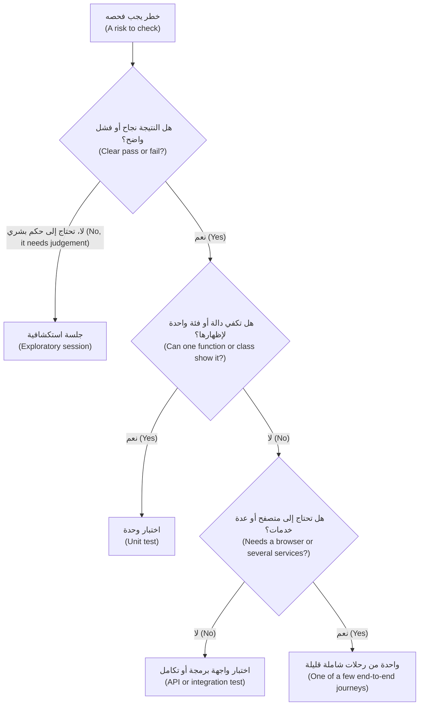
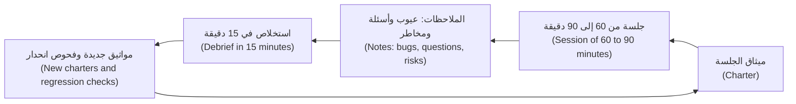

# الوحدة 5 — الاستراتيجية والتسليم (Strategy and delivery)

*زوّدت الوحدات من 2 إلى 4 فريق هندسة الجودة (Quality Engineering) في بنك نجم بتقنيات اختبار الشيفرة والواجهات وخصائص الجودة. وتجيب هذه الوحدة عن الأسئلة التي تقع فوق أي اختبار منفرد: ما مقدار الاختبار الكافي، وفي أي موضع من عملية التسليم يجب أن يعمل كل فحص، وكيف يعمل المختبِرون مع من يبنون المنتج ومن يستخدمونه. يحوّل الدرس 5.1 المخاطر إلى استراتيجية اختبار (test strategy) وشكل للمجموعة وقليل من المقاييس الصادقة، ويبيّن لماذا يُعدّ هدف التغطية فخًا. ويربط الدرس 5.2 تلك الاختبارات بخط تكامل وتسليم مستمرين سريع، ويضبط الاختبارات غير المستقرة، ويمدّ الاختبار إلى الإنتاج بمفاتيح الميزات (feature flags) والإطلاقات الكنارية والفحوص الاصطناعية. ويتناول الدرس 5.3 الجانب البشري: جلسات استكشافية تجد ما لا تستطيع السكربتات التنبؤ به، وجودة الفريق بأكمله (whole-team quality) في فرق أجايل، والتطوير الموجَّه بالسلوك (BDD) والأمثلة المشتركة التي تجعله مجديًا، وكيف تؤثر في المطورين دون سلطة. ستتابع راشد وبلال وأمل وندى على [النظام النموذجي للدورة](https://github.com/Tamoura/system-design-for-vibe-coders/tree/main/testing/sample). وخيط الذكاء الاصطناعي: يضاعف الوكلاء الشيفرة والاختبارات التي عليك الحكم عليها، لذا تشمل الاستراتيجية الآن سياسة للاثنين، وخط التكامل والتسليم المستمرين هو الموضع الذي تُفرَض فيه تلك السياسة.*

> **التركيز:** Strategy, Delivery — تقرير ما يُختبر وبأي قدر، وربط الاختبارات بخط التكامل والتسليم المستمرين وبالإنتاج، والعمل مع من يبنون المنتج ومن يستخدمونه.

---

# 5.1 — استراتيجية الاختبار والتخطيط: الاختبار القائم على المخاطر (risk-based testing) وهرم الاختبار ومقاييس الجودة (quality metrics)
*المستوى: 🟡 متوسط* · *المتطلبات: 1.1، 2.3، 3.2* · *التركيز: Strategy*

## ⚡ الدرس في دقيقة (In 60 seconds)
- **استراتيجية الاختبار (test strategy)** هي النهج الدائم: ما الذي تختبره، وعلى أي مستوى، ومن يملكه. أما **خطة الاختبار (test plan)** فتطبّقها على إصدار واحد. اجعل الاستراتيجية في صفحة واحدة.
- **الاختبار القائم على المخاطر (risk-based testing)** يقيّم المجالات بحاصل ضرب الاحتمال في الأثر من 1 إلى 5 لكل منهما؛ وتحدد الدرجة العمق. استثناء واحد: الأثر الكارثي لا يكون «خفيفًا» أبدًا.
- شكّل المجموعة بحسب أماكن وجود العيوب: هرم الاختبار افتراضيًا. أما **مخروط الآيس كريم**، أي اختبارات واجهة مستخدم بطيئة في معظمها، فهو النمط المضاد.
- قِس النتائج — العيوب المتسرّبة (escaped defects) وزمن الحصول على التغذية الراجعة ومعدل عدم الاستقرار (flake rate) — لا النشاط كعدد الاختبارات وأهداف التغطية. والمقياس الذي يتحول إلى هدف يُتلاعب به.
- في عصر الذكاء الاصطناعي أضف سياسة للشيفرة والاختبارات التي يكتبها الوكلاء، وبوابات تقييم آلي لميزات الذكاء الاصطناعي.

## 🧭 لماذا يهم
يطلب راشد من ندى «استراتيجية الاختبار» لعمل التحويلات في الربع القادم. تعود بـ 38 صفحة ومخطط غانت. لا يقرؤها أي فريق. وفي ذلك الشهر، في قصة مُختلقة، يجتاز الإصدار 2026.09 بوابته بـ 1,800 اختبار وتغطية أسطر (line coverage) بنسبة 90%، لأن البوابة كانت هدف تغطية وملأها وكيل باختبارات لا تؤكد شيئًا. وفي الإنتاج تؤدي إعادة المحاولة بعد ضياع الرد إلى خصم بعض العملاء مرتين. الإرسال المزدوج هو أخطر أجزاء التحويلات، ولم يختبره أحد.

أسئلة راشد هي الاستراتيجية نفسها. ما الأشياء الخمسة التي يجب ألا تنكسر أبدًا؟ وأين يوجد أول فحص لكل منها؟ وبعد كم من الوقت سنعلم بدمج سيئ؟ وما الذي اخترنا ألا نختبره، ومن قبِل بذلك؟ يتيح الوكلاء للفرق فتح طلبات دمج أكثر مما تستطيع هندسة الجودة (QE) قراءته، لذا يجب أن تقول الاستراتيجية ما الذي يستحق الثقة.

## 📐 كيف يعمل

### 🟢 الأساسيات

**الاستراتيجية مقابل الخطة.** تجيب الاستراتيجية عن سؤال «كيف نختبر هنا عمومًا؟»، وتشمل: قواعد المخاطر والعمق، والمستويات والمالكين، والبيئات والبيانات، وقواعد الأتمتة، والمقاييس، وسياسة الذكاء الاصطناعي. وتُراجَع كل ربع سنة، مثل: «تحصل المجالات العميقة على ميثاق جلسة في كل إصدار». وتجيب الخطة عن «ماذا نختبر في هذا الإصدار، ومتى؟»، وتشمل: النطاق، والجدول الزمني، والأشخاص، ومخاطر هذا الإصدار. وتُكتب لكل إصدار: «يغيّر الإصدار 2026.10 شيفرة موعد الإغلاق، لذا تشغّل أمل ميثاق موعد الإغلاق يوم الثلاثاء».

**الاختبار القائم على المخاطر (Risk-based testing).** لا يمكنك اختبار كل شيء — وهذا المبدأ 2 في الدرس 1.1 — فأنفق الجهد حيث يؤلم الفشل. **الخطر = الاحتمال × الأثر (Risk = likelihood × impact)**: ما مدى احتمال وجود عيب هنا، وما مدى سوء الأمر إن تسرّب؟ تقيّم ندى وراشد مجالات التحويلات مع الفريق، لكل عامل من 1 إلى 5. ويحوّل سكربت الدرجات إلى عمق، فالقاعدة مكتوبة لا مزاج.

```python
# risk.py
RISKS = [   # (area, likelihood 1-5, impact 1-5), scored by the squad and QE in refinement
    ("Duplicate submit and retries", 3, 5),
    ("Cut-off, time zone and value date", 4, 3),
    ("Daily and per-transfer limits", 3, 4),
    ("Authorisation: own accounts only", 2, 5),
    ("Fee calculation and rounding", 3, 3),
    ("Arabic right-to-left transfer form", 3, 3),
    ("Notification text", 3, 2),
    ("Recovery after a crash mid-transfer", 1, 5),
    ("Statement PDF layout", 2, 1),
]


def depth(likelihood: int, impact: int) -> str:
    score = likelihood * impact
    if score >= 10 or impact == 5:        # override: a catastrophic impact is never "light"
        return "Deep"
    if score >= 7:
        return "Standard"
    return "Light" if score >= 3 else "Smoke"


if __name__ == "__main__":
    for area, l, i in sorted(RISKS, key=lambda r: -r[1] * r[2]):
        print(f"{l * i:>3}  {depth(l, i):<8} {area}")
```

```text
 15  Deep     Duplicate submit and retries
 12  Deep     Cut-off, time zone and value date
 12  Deep     Daily and per-transfer limits
 10  Deep     Authorisation: own accounts only
  9  Standard Fee calculation and rounding
  9  Standard Arabic right-to-left transfer form
  6  Light    Notification text
  5  Deep     Recovery after a crash mid-transfer
  2  Smoke    Statement PDF layout
```

يحصل الإرسال المزدوج على 15 (3 × 5)، وهي الأعلى. أما التعافي من الانهيار فيحصل على 5 فقط لأنه نادر، لكن أثره 5، فيرفعه الاستثناء إلى «عميق»؛ وبدونه تُخفي عملية الضرب الكوارث النادرة. يعني **عميق**: اختبارات الحدود والخصائص، ومصفوفة حالات سلبية وتفويض لواجهة البرمجة، ورحلة شاملة واحدة، وميثاق جلسة استكشافية في كل إصدار، وبوابة درجة الطفرات على الشيفرة المتغيّرة (الدرس 2.3)، وتنبيه في الإنتاج. و**قياسي**: اختبارات وحدة للقواعد، وحالات واجهة برمجة للمسار السعيد والأخطاء، ومرور استكشافي حين يتغير المجال. و**خفيف**: بضعة اختبارات وحدة مع اختبارات دخان لواجهة البرمجة. و**دخان (Smoke)**: فحص واحد عند الإصدار دون صيانة.

**ضعيف مقابل قوي.** ضعيف: «حزمة الانحدار: 600 حالة اختبار شاملة من البداية إلى النهاية على كل تغيير، بما فيها تخطيط كشف الحساب». بطيئة، ومتساوية لكل شيء، وعمياء عن أكبر خطر. قوي: يحصل الإرسال المزدوج على اختبار وحدة، واختبار واجهة برمجة للإرسال المزدوج، واختبار خصائص، وميثاق جلسة، وتنبيه عند تحويلين متطابقين خلال دقيقة. **متى لا تفعل:** تغيير نص من سطر واحد لا يحتاج إلى سجل. التقييم اجتهاد: أن يقيّم شخصان كلٌّ على حدة ثم يتجادلان حول الفجوات هو القيمة نفسها، والنموذج الموزون دقة زائفة.

**الهرم والكأس والخلية.** أشكال للتركيز لا قوانين. يريد **الهرم** (Mike Cohn؛ Martin Fowler) اختبارات وحدة كثيرة، واختبارات تكامل أقل، واختبارات شاملة من البداية إلى النهاية قليلة؛ ويناسب الأنظمة الخلفية الغنية بالقواعد كالرسوم والسقوف. أما **كأس الجوائز** عند Kent C. Dodds و**الخلية** عند Spotify فتضعان أكبر ثقل على اختبارات التكامل: الكأس للواجهات الأمامية حيث تتعاون المكوّنات، والخلية للخدمات الصغيرة الكثيرة. وكلها تقول: اختبر حيث يعيش العيب، وبأرخص ما تستطيع. والنمط المضاد (anti-pattern) هو **مخروط الآيس كريم**: قليل من اختبارات الوحدة تحت جبل من اختبارات واجهة المستخدم البطيئة.



كل مستوى يحتاج إلى مالك وإلا تعفّن. اختبارات الوحدة والتكامل: المطورون، على إطار عمل بلال. اختبارات العقد (Contract tests): فريقا المستهلك والمزوِّد، وتتحكم في النشر. الاختبار الشامل (End-to-end): يحتفظ فريق بلال بإطار العمل، وتملك الفرق رحلاتها. الاستكشافي (Exploratory): أمل مع الفريق كله (الدرس 5.3). فحوص الإنتاج: فريق SRE بقيادة مها مع هندسة الجودة (الدرس 5.2).

### 🟡 التعمق أكثر (Going deeper)

**معايير الدخول والخروج وتعريف الإنجاز.** تحدد **معايير الدخول (entry criteria)** متى يجوز أن يبدأ الاختبار: البناء في بيئة ضمان الجودة، واختبار الدخان أخضر، والبيانات محمّلة. وتحدد **معايير الخروج (exit criteria)** متى يجوز أن يتوقف، على هيئة دليل لا موعد: لا عيب مفتوح من الدرجة Sev1 أو Sev2 ما لم يقبله مالك مسمّى كتابةً؛ وكل مجال عميق أخضر على هذا البناء؛ وتجربة التراجع منفَّذة. أما **تعريف الإنجاز (definition of done)** فهو الفكرة نفسها لقصة مستخدم واحدة: مراجَعة، واختبارات تفشل بدون التغيير، وسجلات وتنبيهات مضافة، والعربية وإمكانية الوصول (accessibility) مفحوصتان إذا تغيرت الشاشة.

**البيئات والبيانات.** تضيف الاستراتيجية قواعد تمنع تعفّن البيئات الأربع في الدرس 0.3: تعكس بيئة ما قبل الإنتاج (staging) إصدارات الإنتاج وإعداداته؛ وتُحجز بيئة ضمان الجودة لأن فريقين على بناء واحد يسببان تشغيلات غير مستقرة؛ والبيانات اصطناعية أو مقنَّعة بموافقة سارة، ولا تدخل أبدًا أداة ذكاء اصطناعي خارجية.

**استراتيجية الأتمتة.** أتمِت ما هو مستقر وعالي المخاطر وحتمي ويُشغَّل كثيرًا. واترك المهام التي تُنفَّذ مرة واحدة، والشاشات التي تتغير أسبوعيًا، وأحكام التقدير مثل «هل يبدو هذا جديرًا بالثقة؟». واحسب العائد: فحص يدوي مدته 20 دقيقة يُشغَّل مرتين أسبوعيًا يكلّف 40 دقيقة أسبوعيًا. وتستغرق أتمتته 3 ساعات مع نحو 15 دقيقة شهريًا من الصيانة، فيوفّر نحو 36 دقيقة أسبوعيًا ويسترد كلفته في خمسة أسابيع، ما لم يُعَد تصميم الشاشة الشهر القادم.

**مقاييس تفيد ومقاييس تضلّل.**

| المقياس | السؤال الذي يجيب عنه | احذر |
|---|---|---|
| **معدل تسرّب العيوب (Defect escape rate)** | من بين عيوب إصدار ما، ما نصيب ما وجده العملاء أولًا؟ التسرّبات ÷ (ما وُجد قبل الإطلاق + التسرّبات) في نافذة ثابتة مثل 30 يومًا: 2 ÷ (23 + 2) = 8% | اتجاه لا هدف: الأهداف تجعل الناس يتوقفون عن التسجيل |
| **زمن الحصول على التغذية الراجعة** | كم من الوقت يمر من الدفع إلى نجاح أو فشل موثوق؟ p50 وp95 لفحوص طلب الدمج | المتوسطات تُخفي الذيل البطيء |
| **معدل عدم الاستقرار (Flake rate)** | ما نصيب تشغيلات التكامل المستمر التي احمرّت ثم اخضرّت على الالتزام نفسه؟ | إعادة المحاولة تخفيه؛ فاحسبها (الدرس 5.2) |
| **MTTD وMTTR** | متوسط زمن اكتشاف العطل؛ ومتوسط زمن استعادة الخدمة | المتوسطات تُخفي الذيول الطويلة |

المقاييس الأربعة الكلاسيكية في برنامج أبحاث DORA هي: تكرار النشر (deployment frequency)، وزمن إنجاز التغيير (lead time for changes)، ومعدل فشل التغييرات (change failure rate) أي نسبة عمليات النشر التي احتاجت إلى إصلاح أو تراجع، وزمن استعادة الخدمة (time to restore service)؛ وتصقل التقارير الحديثة الأسماء، فراجع dora.dev. أما عدد الاختبارات و«العيوب المكتشفة لكل مختبِر» ومعدل النجاح وأهداف التغطية الخام فهي مقاييس شكلية. و**قانون غودهارت** بصياغة Marilyn Strathern: حين يصبح المقياس هدفًا، يكف عن أن يكون مقياسًا جيدًا. وهذه القصة مصغّرة على النظام النموذجي: وكيل طُلب منه بلوغ الهدف يكتب هذا «المعزِّز»:

```python
# tests/test_booster.py -- written to hit a coverage target. It asserts nothing.
from datetime import datetime
from zoneinfo import ZoneInfo

from najm.transfers import TransferRejected, TransferService, check_transfer, value_date

REQ = {"from_account": "acc-1", "to_account": "acc-2", "amount": "100.00", "currency": "QAR", "kind": "domestic"}


def test_coverage_booster():
    for amount, kind, sent in [("5000", "domestic", "0"), ("90", "international", "0"), ("30000", "own", "0"),
                               ("0.5", "own", "0"), ("100", "own", "49950"), ("10.005", "own", "0"), ("10", "wire", "0")]:
        try:
            check_transfer(amount, "QAR", kind, sent)
        except TransferRejected:
            pass
    value_date(datetime(2026, 10, 5, 16, tzinfo=ZoneInfo("Asia/Qatar")))
    svc = TransferService()
    svc.submit("alice", REQ, "k1")
    svc.submit("alice", REQ, "k1")
```

وفي مقابله، ثلاثة اختبارات دقيقة:

```python
# tests/test_strong.py
from decimal import Decimal

import pytest

from najm.transfers import TransferRejected, check_transfer, fee


def test_international_fee_rounds_half_up():
    assert fee("3090", "QAR", "international") == Decimal("10.82")


def test_a_day_total_of_exactly_the_limit_is_allowed():
    assert check_transfer("1000", "QAR", "domestic", sent_today="49000").total == Decimal("1000.00")


def test_a_day_total_just_over_the_limit_is_refused():
    with pytest.raises(TransferRejected) as e:
        check_transfer("1000.01", "QAR", "domestic", sent_today="49000")
    assert e.value.code == "daily_limit_exceeded"
```

قياسًا لكل ملف بالأمر `pytest tests/test_booster.py --cov=najm.transfers --cov-branch`، ثم مع تفعيل كل عيب من العيوب الخمسة في `NAJM_BUGS` على حدة:

| المجموعة | الاختبارات | التغطية (Coverage) | العيوب المزروعة المكتشفة من 5 |
|---|---|---|---|
| المعزِّز أعلاه | 1 | 74% | 0 |
| الاختبارات الثلاثة الدقيقة | 3 | 43% | 2 (`float_fee`, `limit_off_by_one`) |

```text
# trimmed output
$ NAJM_BUGS=float_fee pytest tests/test_booster.py tests/test_strong.py
E       AssertionError: assert Decimal('10.81') == Decimal('10.82')
FAILED tests/test_strong.py::test_international_fee_rounds_half_up
1 failed, 3 passed
```

سجّل المعزِّز رقمًا أعلى ولم يكتشف شيئًا؛ وسجّلت ثلاثة اختبارات صغيرة رقمًا أقل واكتشفت عيبين. ولا تكفي أي من المجموعتين: فالعيوب الثلاثة الفائتة (`tz_cutoff` و`no_idempotency` و`bola`) تقع كلها في مجالات عميقة، فيدل السجل على موضع الاختبارات التالية. تجد التغطية الشيفرة التي لا يشغّلها أي اختبار؛ وليست هدفًا أبدًا. اقرنها بدرجة الطفرات (الدرس 2.3).

**الإبلاغ عن الجودة.** يريد أصحاب المصلحة قرارًا لا سجلًّا. تضم لوحة المتابعة ذات الصفحة الواحدة خمس كتل: عنوانًا رئيسيًا — أصدِر أو أصدِر بشروط أو أوقف — مع الأسباب والمالك؛ وأربعة أرقام للنتائج مع اتجاهاتها: معدل التسرّب (escape rate) ومعدل فشل التغييرات وp95 لزمن الحصول على التغذية الراجعة ومعدل عدم الاستقرار؛ وخريطة مخاطر يكون فيها كل مجال عميق أو قياسي أخضر أو كهرمانيًا أو أحمر بحسب الدليل؛ وعيوب Sev1 وSev2 المفتوحة بحسب العمر، مع المخاطر المقبولة وتواريخ انتهائها؛ وما **لم** يُختبر. ضعيف: «اجتاز 1,812 اختبارًا (100%)». قوي: «أربعة مجالات عميقة خضراء، وواحد كهرماني (لم يُجرَّب موعد الإغلاق مساء الجمعة)؛ وعيبان Sev2 مفتوحان لهما مالكان؛ وآخر معدل تسرّب 8%». الثاني يمكن فحصه ومعارضته، لذا يمكن الوثوق به.

### 🔴 نظرة الخبير (Expert view)

**السياق المنظَّم.** على البنك أن يقدّم أدلة على الاختبار وضبط التغيير: أي متطلب، وأي اختبار، وأي بناء، وأي نتيجة، ومن اعتمد. تحصل الفرق التي تبدأ بالشيفرة على **التتبّع (traceability)** بكلفة زهيدة بوسم الاختبارات بمعرّفات المتطلبات:

```python
# conftest.py. Needs "junit_family = xunit1" in pytest.ini (xunit2 warns) and a declared "req" marker
import pytest


@pytest.fixture(autouse=True)
def requirement(request, record_property):
    marker = request.node.get_closest_marker("req")
    if marker:
        record_property("requirement", marker.args[0])    # appears as a <property> in the JUnit XML
```

علّم اختبارًا بـ `@pytest.mark.req("TRF-212")`، وشغّل `pytest --junitxml=report.xml`، فيربط ملف XML المتطلب بالنتيجة. ويتضمن معيار **PCI DSS** — الإصدار 4.x وقت الكتابة — متطلبات عن اختبار التغييرات قبل الإنتاج وفحص الثغرات (vulnerability scanning) واختبار الاختراق (penetration testing). أما **قانون DORA الأوروبي**، أي قانون المرونة التشغيلية الرقمية (اللائحة (EU) 2022/2554)، فيسري منذ يناير 2025 ويشمل اختبار المرونة (resilience testing)، مع اختبار اختراق موجَّه بالتهديدات للجهات المهمة. تملك إدارة الامتثال الربط بالبنود؛ وتوفر هندسة الجودة الأدلة.

**إضافات عصر الذكاء الاصطناعي.** ثلاث قواعد تمهّد للوحدتين 6 و7. **الشيفرة التي يكتبها الوكلاء** شيفرة جديدة غير مراجَعة: فروق صغيرة، ودرجة احتمال أعلى في المجالات العميقة إلى أن يقول الدليل غير ذلك ([*تصميم الأنظمة لمبرمجي الفايب*، الدرس 9.4 — التحقق قبل الإنجاز](../vibe/index.ar.html#l9-4)). و**الاختبارات التي يكتبها الوكلاء** يملكها إنسان، وتُراجَع منفصلةً عن الشيفرة التي تغطيها، ويُحكم عليها بقدرتها على الفشل (الدرسان 6.1 و6.2). و**ميزة الذكاء الاصطناعي** مثل نجم أسيست لا تُطلق إلا بعد اجتياز **بوابة التقييم الآلي**: مجموعة مرجعية وعتبات وفحص انحدار في التكامل المستمر (الدرس 7.1؛ انظر [*إدارة منتجات الذكاء الاصطناعي*، الدرس 6.1 — جودة يمكنك قياسها: المقاييس والمجموعات المرجعية (golden sets) وتحليل الأخطاء](../aipm/index.ar.html#/6.1)).

## 🧰 الأدوات
| الأداة أو الممارسة أو التقنية | ما هي وماذا تفعل | متى تلجأ إليها |
|---|---|---|
| **Risk-based testing** — الاختبار القائم على المخاطر | يقيّم المجالات بحاصل ضرب الاحتمال في الأثر ويحدد عمق الاختبار بحسب الدرجة | في كل جلسة تنقيح؛ ولتقرير وجهة ساعة الاختبار التالية |
| **Test pyramid** — هرم الاختبار | اختبارات وحدة كثيرة، واختبارات تكامل أقل، واختبارات شاملة من البداية إلى النهاية قليلة | الشكل الافتراضي؛ وتشخيص مجموعة بطيئة هشة |
| **Testing trophy and honeycomb** — كأس الجوائز والخلية | أشكال تعطي وزنًا لاختبارات التكامل | شيفرة الواجهات الأمامية، أو خدمات صغيرة كثيرة |
| **Definition of done** — تعريف الإنجاز | قائمة تحقق مشتركة تجعل القصة منجزة، والاختبارات ضمنها | كل فريق وكل قصة |
| **DORA metrics** — مقاييس DORA | مقاييس التسليم مثل زمن إنجاز التغيير (lead time) ومعدل فشل التغييرات | لإظهار ما إذا كانت السرعة والجودة ترتفعان معًا |
| **Test management tools** — أدوات إدارة الاختبار | تخزّن الحالات، وتربط المتطلبات، وتحفظ الأدلة؛ والخطر أن تصير مصدر حقيقة ثانيًا ينجرف، فغذِّها بنتائج التكامل المستمر وأعطِ كل حالة مالكًا | مسارات التدقيق والمجموعات اليدوية الكبيرة |

## 🏛️ عمليًا في بنك نجم
ينشر راشد وقادة الفرق **استراتيجية اختبار نجم، الإصدار 1**: صفحة واحدة، تُراجَع كل ربع سنة وبعد كل Sev1 أو Sev2. الأرقام نقاط بداية قابلة للتعديل.

| القسم | ما يقوله |
|---|---|
| الغرض | لا تضيع التحويلات ولا تتكرر ولا تُقرَّب خطأً؛ ولا يخترع نجم أسيست سياسة أبدًا؛ وأصدِر كثيرًا مع الأدلة |
| المخاطر والعمق | السجل في `risk.py`، يُعاد تقييمه كل ربع سنة. عميق: الإرسال المزدوج، وموعد الإغلاق، والسقوف، والتفويض (authorisation)، والتعافي من الانهيار |
| المستويات والمالكون | كما سبق. الرحلات الشاملة: 15 كحد أقصى |
| البيئات والبيانات | التطوير والجودة وما قبل الإنتاج والإنتاج. بيانات اصطناعية (Synthetic data)؛ ولا شيء منها في أدوات ذكاء اصطناعي خارجية |
| الدخول والخروج | الدخول (Entry): البناء في بيئة الجودة والدخان أخضر. الخروج (Exit): لا Sev1 أو Sev2 مفتوح دون قبول مسمّى؛ وللمجالات العميقة أدلة |
| الأتمتة | المستقر وعالي المخاطر ومتكرر التشغيل؛ ومالك لكل اختبار؛ وتُحجر الاختبارات غير المستقرة خلال يوم عمل واحد، بموعد نهائي 14 يومًا |
| المقاييس | اتجاه معدل التسرّب، وp95 لزمن الحصول على التغذية الراجعة والهدف 10 دقائق، ومعدل عدم الاستقرار مع حساب إعادات المحاولة، وMTTR. تُبلَّغ التغطية ولا تُستهدف. ولا تُستخدم أبدًا لترتيب الأشخاص |
| سياسة الذكاء الاصطناعي | يملك البشر الاختبارات التي يكتبها الوكلاء؛ ودرجة طفرات لا تقل عن 80% على شيفرة المال والسقوف والتواريخ المتغيّرة؛ وتجتاز ميزات الذكاء الاصطناعي بوابة تقييم آلي |
| الإبلاغ والفجوات | لوحة المتابعة ذات الكتل الخمس في كل إصدار، مع الفجوات المقبولة والمالكين وتواريخ الانتهاء |

## 🛠️ التمارين (Exercises)
انسخ `testing/sample` واستخدم البيئة الافتراضية من الدرس 0.3 (فـ`pytest-cov` موجودة أصلًا في `requirements.txt`).

- 🟢 اختر ميزة تعرفها — تسجيل دخول أو نموذج حجز — وقيّم ثمانية مجالات على الأقل في `risk.py`. *يكتمل عندما:* يكون لكل مجال عمق، وتسمّي الثلاثة الأعلى مستوى أول فحص لكل منها، ويُرفع صف واحد إلى «عميق» بالاستثناء.
- 🟡 أعد إنتاج جدول غودهارت. اكتب معزِّزًا بلا تأكيدات لـ`najm/transfers.py`، وقِسه وحده بالأمر `pytest tests/test_booster.py --cov=najm.transfers --cov-branch`، وشغّله تحت كل عيب من عيوب `NAJM_BUGS` الخمسة، واحدًا في كل مرة. ثم أضف ثلاثة اختبارات دقيقة وكرّر. *يكتمل عندما:* يكون لديك التغطية والعيوب المكتشفة للمجموعتين، مع جملتين عن سبب كون الرقم الأعلى هو المجموعة الأسوأ.
- 🔴 اكتب استراتيجية من صفحة واحدة بأقل من 400 كلمة للنظام النموذجي، أي التحويلات ونجم أسيست، مع جدول يربط العيوب المزروعة التسعة كلها — خمسة في `NAJM_BUGS` وأربعة في `NAJM_AI_BUGS` — بالمستوى الذي ينبغي أن يلتقط كلًّا منها، وبما إذا كانت مجموعتك تلتقطه فعلًا. *يكتمل عندما:* يكون لكل عيب مستوى وإجابة بنعم أو لا، ويتغير سطر واحد من الاستراتيجية بسبب «لا»، ويكون لكل مستوى مالك.

## ⚠️ أخطاء وفخاخ (Mistakes and traps)
- **استراتيجية لا يقرؤها أحد.** اكتب صفحة واحدة بمالكين وأرقام.
- **جهد متساوٍ في كل مكان.** يحصل تخطيط كشف الحساب على مجموعة الإرسال المزدوج نفسها. دع الدرجة تقرر.
- **هدف تغطية أو عدد اختبارات.** يرتفع الرقم وتنخفض الحماية. احكم على المجموعات بالعيوب المزروعة ودرجات الطفرات (mutation scores).
- **ترتيب الأشخاص بعدد العيوب المكتشفة.** يشتري عيوبًا تافهة ومكررة. استخدم نتائج الفريق.
- **DORA مرتان.** مقاييس البحث وقانون المرونة الأوروبي يتشاركان اختصارًا ولا شيء غيره.

## 🧾 الخلاصة (Recap)
- الاستراتيجية هي النهج الدائم في صفحة واحدة؛ والخطة تطبّقها على إصدار واحد.
- الخطر = الاحتمال × الأثر يحدد العمق، مع استثناء للأثر الكارثي.
- ضع كل فحص في أرخص مستوى يستطيع إظهار الخطر، وأعطِ كل مستوى مالكًا، وتجنّب مخروط الآيس كريم.
- أنهِ الاختبار استنادًا إلى الدليل، وأتمِت بحسب العائد، وقِس النتائج، وأبلغ عمّا لم يُختبر.
- للذكاء الاصطناعي، أضف سياسة للشيفرة والاختبارات التي يكتبها الوكلاء، وبوابات تقييم آلي لميزات الذكاء الاصطناعي.

## ✍️ اختبر نفسك (Check yourself)

**1. يحصل التعافي من الانهيار أثناء تحويل على احتمال 1 وأثر 5، أي درجة 5. يريد الفريق اختبارًا «خفيفًا». ماذا تقول الاستراتيجية؟**

- A. خفيف، لأن الدرجة 5 أدنى من نطاق «قياسي»
- B. عميق، لأن الاستثناء يرفع أي أثر قدره 5 إلى «عميق»
- C. دخان (Smoke)، لأن فشلًا نادرًا إلى هذا الحد لا يستحق مجموعة اختبارات
- D. قياسي، كحل وسط بين الفريق والقاعدة

<details><summary>الإجابة</summary>

**B.** يوجد الاستثناء لأن الضرب يخفي الكوارث النادرة. أما A وC وD فتترك الدرجة أو الندرة تقرر. (🟢 الاختبار القائم على المخاطر).

</details>

**2. للإصدار 2026.09 تغطية أسطر (line coverage) بنسبة 90% وقد اجتاز بوابته، ومع ذلك تصل تحويلات مكررة إلى العملاء. ما أفضل قراءة لذلك؟**

- A. أداة التغطية معطوبة وتحتاج إلى استبدال
- B. يجب أن تبلغ التغطية 95% قبل الوثوق بالبوابة
- C. لم يكتب الفريق اختبارات وحدة كافية
- D. التغطية تُظهر ما شُغِّل لا ما فُحِص

<details><summary>الإجابة</summary>

**D.** يستدعي الهدف اختبارات تشغّل الشيفرة ولا تؤكد شيئًا. أما A وB فتُبقيان الهدف؛ وC تعدّ الاختبارات لا الفحوص. (🟡 المقاييس).

</details>

**3. لدى فريق الهاتف 40 اختبار وحدة (unit tests) و15 اختبار واجهة برمجة و600 اختبار واجهة مستخدم. يستغرق خط التكامل والتسليم المستمرين 55 دقيقة ويفشل عشوائيًا. ما أفضل خطوة أولى؟**

- A. نقل فحوص القواعد التي لا تحتاج إلى شاشة إلى مستوى اختبارات واجهة البرمجة
- B. إضافة عمال تنفيذ أكثر ليكتمل 600 اختبار واجهة أسرع بكثير
- C. إعادة تشغيل اختبارات الواجهة الفاشلة تلقائيًا حتى يخضر البناء
- D. حذف أقدم اختبارات الواجهة للوصول إلى رقم مستدير

<details><summary>الإجابة</summary>

**A.** هذا مخروط آيس كريم: نقل الفحوص إلى الأسفل يجعلها أسرع وأثبت. أما B فتعالج العَرَض، وC تُخفي الاختبارات غير المستقرة، وD تحذف بحسب العمر..

</details>

**4. يقترح مدير مكافأة للمختبِر الذي يسجّل أكبر عدد من العيوب. ما النتيجة المرجّحة؟**

- A. اكتشاف عيوب حقيقية أكثر، لأن المختبِرين يبحثون بجهد أكبر من أجل المكافأة
- B. جودة أعلى إجمالًا، لأن المختبِرين صاروا محفَّزين كما ينبغي
- C. حشو: تقارير تافهة ومكررة كثيرة، فيرتفع العدد
- D. يرفض المطورون التقارير جملةً، فيقل ما يُسجَّل من عيوب

<details><summary>الإجابة</summary>

**C.** حين يصبح عدد العيوب هو الهدف، يحسّن الناس العدد نفسه. أما A وB فتفترضان أنه يبقى صادقًا؛ وD تناقض الحافز. (🔴 المقاييس).

</details>

**5. يغيّر طلب دمج كتبه وكيل شيفرة السقف اليومي واختباراتها. ماذا ينبغي أن تشترط الاستراتيجية؟**

- A. ادمجه إذا كانت المجموعة خضراء، لأن الوكيل حدّث الاختبارات
- B. ارفضه، لأن على الوكلاء ألا يلمسوا أي ملف اختبار أبدًا
- C. اقبله إذا بلغت تغطية الأسطر المتغيرة 90% على الأقل
- D. راجع تغييرات الاختبار على حدة وافحص درجة الطفرات

<details><summary>الإجابة</summary>

**D.** قد يُضعف الوكيل اختبارًا ليطابق شيفرته؛ وتُظهر درجة الطفرات ما إذا كانت الاختبارات قادرة على الفشل. أما A فتثق بالوكيل، وB تحظر ممارسة مفيدة، وC تستخدم تغطية يستطيع اختبار فارغ ملأها. (🔴 إضافات عصر الذكاء الاصطناعي).

</details>

## 📚 المراجع (References)
- منهج ISTQB لمستوى المختبِر المعتمد الأساسي (الإصدار v4.0، 2023): [istqb.org](https://www.istqb.org/)
- مذكرة Martin Fowler عن TestPyramid ومقال Ham Vocke «The Practical Test Pyramid»، كلاهما على [martinfowler.com](https://martinfowler.com/)
- مدونة Google Testing Blog، عن حدود الاختبارات الشاملة من البداية إلى النهاية: [testing.googleblog.com](https://testing.googleblog.com/)
- كتاب *Software Engineering at Google* (2020): [abseil.io/resources/swe-book](https://abseil.io/resources/swe-book)
- برنامج أبحاث DORA: [dora.dev](https://dora.dev/)
- اللائحة الأوروبية 2022/2554 بشأن المرونة التشغيلية الرقمية: [eur-lex.europa.eu](https://eur-lex.europa.eu/)
- توثيق pytest (pytest documentation): [docs.pytest.org](https://docs.pytest.org/)

---

# 5.2 — الاختبار في التكامل والتسليم المستمرين وفي الإنتاج: خطوط تكامل وتسليم مستمرين سريعة (fast pipelines) وسياسة الاختبارات غير المستقرة (flaky-test policy) ومفاتيح الميزات والإطلاقات الكنارية والمراقبة الاصطناعية (synthetic monitoring)
*المستوى: 🟡 متوسط* · *المتطلبات: 2.3، 3.2، 5.1* · *التركيز: Delivery, Reliability*

## ⚡ الدرس في دقيقة (In 60 seconds)
- يرتّب **خط التكامل والتسليم المستمرين (pipeline)** الفحوص بحسب كلفتها: الرخيصة السريعة أولًا، والبطيئة الواسعة لاحقًا. وتجيب كل مرحلة عن سؤال واحد.
- حدّد **ميزانية للتغذية الراجعة** ودافع عنها. ميزانية نجم: 95% من فحوص طلبات الدمج تنتهي خلال 10 دقائق. خزّن مؤقتًا ووازِ وقسّم إلى شرائح (shard) قبل شراء أجهزة أكبر.
- **الاختبار غير المستقر (flaky test)** ينجح ويفشل على الشيفرة نفسها. اكتشفه، واحجره (quarantine) بمالك وموعد نهائي، وأصلحه، وأبلغ عن كل إعادة محاولة.
- **الإزاحة نحو اليمين (Shift-right)** تضيف أدلة من الحركة الحقيقية: مفاتيح الميزات والإطلاقات الكنارية والفحوص الاصطناعية والتتبّعات. ولا تحل أبدًا محل الاختبار قبل الإنتاج، وتحتاج إلى مفتاح إيقاف (kill switch).
- أكبر فخ: إسكات اختبار «غير مستقر» وهو في الحقيقة حالة تسابق.

## 🧭 لماذا يهم
يستغرق خط التكامل والتسليم المستمرين الخاص ببلال لواجهة برمجة تطبيق نجم للهاتف 31 دقيقة. ويفشل اختبار شامل من البداية إلى النهاية واحد، «النقر المزدوج على إرسال ينشئ تحويلًا واحدًا»، في نحو تشغيل واحد من كل ستة. يضغط المطورون إعادة التشغيل، ويعيد خط التكامل والتسليم المستمرين محاولة الاختبارات الفاشلة مرتين، فينتهي أخضر. والاختبار ليس غير مستقر: إنه يجد التسابق الحقيقي الذي يطارده الدرس 3.1، أي طلبين متزامنين بمفتاح عدم التكرار نفسه. وبعد ثلاثة أسابيع، في هذه القصة المُختلقة، يترك نشرٌ بعض العملاء مخصومًا منهم مرتين. ولا يوجد في الإنتاج إطلاق كناري ولا فحص اصطناعي، فتكون الإشارة الأولى مكالمة هاتفية.

## 📐 كيف يعمل

### 🟢 الأساسيات

**المراحل.** تجيب كل مرحلة عن سؤال واحد، حيث تكون فحوصها أرخص ما يمكن.

| المرحلة | السؤال | الفحوص المعتادة |
|---|---|---|
| قبل الالتزام | هل كسرت الأساسيات؟ | التنسيق والتدقيق الساكن (lint) واختبارات الوحدة القريبة |
| طلب الدمج (Pull request) | هل الدمج آمن؟ | اختبارات الوحدة والواجهة والعقد وعمليات الفحص وبضع رحلات دخان |
| الدمج | هل ما زال `main` يعمل؟ | بناء مرة واحدة، ونشر على بيئة الجودة، والرحلات |
| ليلي | هل يتعفّن شيء؟ | مجموعات طويلة وتكرارات بترتيب عشوائي |
| قبل الإصدار | هل نحن جاهزون؟ | الأداء (Performance) والأمان (security) وتجربة التراجع واختبار قبول المستخدم (UAT) |
| بعد النشر | هل هبط بسلام؟ | الدخان وتحليل الكناري (canary analysis) والفحوص الاصطناعية |

**ميزانيات التغذية الراجعة.** الفحوص البطيئة تُتخطّى، لذا اكتب الميزانية — في نجم 95% من فحوص طلبات الدمج خلال 10 دقائق — وارسم p95 بيانيًا، وحين يكسرها فحص جديد فانقل شيئًا: إلى مهام متوازية، أو بعد الدمج، أو إلى الليل. يتناول [*السحابة وDevOps*، الدرس 4.1 — التكامل المستمر: خطوط التكامل والتسليم المستمرين والاختبارات والنواتج (artefacts) والتغذية الراجعة السريعة](../cloud/index.ar.html#/4.1) الآلياتِ؛ ويقدّم [*تصميم الأنظمة لمبرمجي الفايب*، الدرس 8.3 — الفحص المسبق في CI وفحص «الراعي الكاذب»](../vibe/index.ar.html#l8-3) نسخة البنّاء المنفرد.

**التوازي والتقسيم إلى شرائح والتخزين المؤقت.** ثلاث رافعات، الأرخص أولًا: خزّن التبعيات مؤقتًا؛ وشغّل بالتوازي على جهاز واحد باستخدام `pytest -n auto` مع pytest-xdist أو عمال Playwright؛ وقسّم المجموعة عبر الأجهزة إلى **شرائح (shards)**. **متى لا تفعل:** مجموعة تعمل في دقيقتين لا تكسب كثيرًا، لأن كل شريحة تكرر الإعداد. واختبارا المتصفح في النظام النموذجي لا يبرران ثلاث شرائح — فالثالثة الفارغة تنجح ببساطة — لذا اقرأ الأرقام بوصفها قالبًا. يشغّل سير العمل هذا، لمستودع يحوي نسخة من النظام النموذجي، Python في أربع شرائح وPlaywright في ثلاث. ومهمة `gate` هي الفحص الوحيد الذي تشترطه حماية الفروع، فلا يكسر تغيير اسم شريحة شيئًا. ادمج تقارير blob المنزَّلة لاحقًا بالأمر `npx playwright merge-reports --reporter html ./all-blob-reports`.

```yaml
# .github/workflows/ci.yml   (lint with actionlint; action major versions move on)
name: ci
on:
  pull_request:
  push:
    branches: [main]

permissions:
  contents: read

jobs:
  python:
    name: python, shard ${{ matrix.shard }} of 4
    runs-on: ubuntu-latest
    timeout-minutes: 10
    strategy:
      fail-fast: false            # every shard reports
      matrix:
        shard: [1, 2, 3, 4]
    steps:
      - uses: actions/checkout@v4
      - uses: actions/setup-python@v5
        with:
          python-version: "3.12"
          cache: pip
      - run: pip install -r requirements.txt pytest-xdist
      - run: pytest -n auto --shard ${{ matrix.shard }}/4 --durations=5

  e2e:
    name: playwright, shard ${{ matrix.shard }} of 3
    runs-on: ubuntu-latest
    timeout-minutes: 15
    strategy:
      fail-fast: false
      matrix:
        shard: [1, 2, 3]
    steps:
      - uses: actions/checkout@v4
      - uses: actions/setup-python@v5
        with:
          python-version: "3.12"
          cache: pip
      - run: pip install -r requirements.txt
      - uses: actions/setup-node@v4
        with:
          node-version: 22
          cache: npm              # needs a committed package-lock.json
      - run: npm ci
      - run: npx playwright install --with-deps chromium
      - run: npx playwright test --config e2e/playwright.config.ts --shard=${{ matrix.shard }}/3 --reporter=blob
      - uses: actions/upload-artifact@v4
        if: ${{ !cancelled() }}
        with:
          name: blob-report-${{ matrix.shard }}
          path: blob-report

  gate:
    needs: [python, e2e]
    if: ${{ always() }}
    runs-on: ubuntu-latest
    steps:
      - run: test "${{ needs.python.result }}" = "success" && test "${{ needs.e2e.result }}" = "success"
```

يوفّر Playwright خيار `--shard` مدمجًا؛ أما pytest فلا، لذا تحتاج مهمة Python إلى بضعة أسطر. وعلى 24 اختبارًا في النظام النموذجي تعطي شرائح من 8 و6 و6 و4 تغطي المجموعة معًا مرة واحدة بالضبط:

```python
# conftest.py (repository root)
import zlib


def pytest_addoption(parser):
    parser.addoption("--shard", default=None)       # for example 2/4


def pytest_collection_modifyitems(config, items):
    spec = config.getoption("--shard")
    if not spec:
        return
    index, total = (int(part) for part in spec.split("/"))
    keep, drop = [], []
    for item in items:
        (keep if zlib.crc32(item.nodeid.encode()) % total == index - 1 else drop).append(item)
    config.hook.pytest_deselected(items=drop)
    items[:] = keep
```

**ضعيف مقابل قوي.** ضعيف: `hash(item.nodeid) % total`. تجعل Python تجزئات النصوص عشوائية لكل عملية، فتختلف مهام الشرائح المنفصلة: قد يقع اختبار في شريحتين وآخر في لا شيء، بينما يبقى كل شيء أخضر. قوي: تجزئة مستقرة، مع فحص يتأكد أن معرّفات اختبارات الشرائح مجتمعةً تساوي المجموعة الكاملة (التمرين 🟢).

### 🟡 التعمق أكثر

**اختيار الاختبارات.** إذا ظلت المجموعة بطيئة جدًا، فشغّل فقط ما يمكن أن يتأثر بالتغيير. يشغّل خيار `--only-changed` في Playwright ملفات الاختبار التي تغيّرت منذ مرجع Git، بما فيها المواصفات التي تستورد ملفًا متغيرًا. ولدى pytest إضافات مثل `pytest-testmon`. قد يفوّت الاختيار الإعداد والتوصيل، لذا يشغّل أي تغيير غير مرتبط بخريطة كل شيء، وتظل المجموعة الكاملة تعمل ليليًا.

**سياسة الاختبارات غير المستقرة (Flaky-test policy).** **الاكتشاف**: عُدّ الاختبارات التي تحمرّ ثم تخضر — يعلّمها Playwright بـ `flaky` لكنه يخرج بالرمز 0، ويجعلها الخيار `--fail-on-flaky-tests` تفشل — واستخدم `--repeat-each` على المشتبه بهم. **الحجر (Quarantine)** خلال يوم عمل واحد: ضع على الاختبار الوسم `@quarantine`، وشغّله في مهمة غير حاجبة (`--grep @quarantine`)، واستبعده من المهمة الحاجبة (`--grep-invert @quarantine`)، وسجّل مالكًا وتذكرة وموعدًا نهائيًا مدته 14 يومًا (الدرس 2.3). **الإصلاح**: حين يمر الموعد النهائي، يعود الاختبار إلى الحجب أو يُحذف. يقرأ هذا السكربت تقرير JSON من Playwright والسجل، ويفشل عند انقضاء موعد نهائي:

```python
# tools/flake_gate.py   usage: python tools/flake_gate.py results.json quarantine.json
# quarantine.json: [{"test": "...", "owner": "nada", "issue": "QE-377", "until": "2026-10-02"}]
import datetime
import json
import sys


def flaky(suite):
    for spec in suite.get("specs", []):
        for test in spec["tests"]:
            if test["status"] == "flaky":          # failed, then passed on retry
                yield spec["title"]
    for child in suite.get("suites", []):
        yield from flaky(child)


results, register = (json.load(open(path)) for path in sys.argv[1:3])
titles = [title for suite in results["suites"] for title in flaky(suite)]
stats = results["stats"]
print(f"retried green: {len(titles)} of {stats['expected'] + stats['unexpected'] + stats['flaky']} tests", titles)
late = [e for e in register if datetime.date.fromisoformat(e["until"]) < datetime.date.today()]
for e in late:
    print(f"quarantine expired: {e['test']} (owner {e['owner']}, {e['issue']}, due {e['until']})")
sys.exit(1 if late else 0)
```

```text
retried green: 1 of 1 tests ['exchange rate banner appears @quarantine']
quarantine expired: exchange rate banner appears @quarantine (owner nada, QE-377, due 2026-10-02)
```

يبقى رمز الخروج 1 حتى يُصلح أحدٌ الاختبار أو يجدد الحجر في تغيير مراجَع. اسأل أولًا هل الاختبار غير مستقر أم على حق: كان اختبار بلال على حق.

**البيئات المؤقتة والمحاكاة الافتراضية للخدمات.** **البيئة المؤقتة (ephemeral environment)** نسخة قصيرة العمر من النظام لطلب دمج واحد: لا طابور على بيئة الجودة، لكن مع الكلفة ووقت التشغيل وتهيئة البيانات (data seeding). و**المحاكاة الافتراضية للخدمات (service virtualisation)** تستبدل التبعيات التي لا تستطيع أو لا يجب أن تستدعيها — شبكة بطاقات، ومزوِّد صرف عملات، وبوابة رسائل SMS؛ ويعيد WireMock وMockServer تشغيل سلوك مُعدّ سلفًا، بما فيه الردود البطيئة وأخطاء 500. والخدمة الافتراضية توافق افتراضاتك، فأبقها صادقة باختبارات العقد (الدرس 2.2).

**بوابات النشر.** **بوابة العقد**: يفشل الأمر `pact-broker can-i-deploy --pacticipant najm-mobile --version "$GIT_SHA" --to-environment production` إذا لم تُتحقَّق العقود مقابل ما يشغّله الإنتاج (ويحتاج إلى Pact Broker). و**اختبارات الدخان** بعد كل نشر: بضعة فحوص للقراءة فقط، مثل رصيد عميل اصطناعي. ضعيف: `GET /health` يعيد 200، وهذا ينجح بينما ما زالت النسخة القديمة تخدم. قوي: يقارن أيضًا بين SHA البناء وSHA المنشور، وهذا طلب قابلية اختبار من الدرس 5.3. و**بوابة SLO (SLO gate)**: لا تُرقِّ الإصدار ما دامت ميزانية الأخطاء تحترق ([*السحابة وDevOps*، الدرس 5.2 — أهداف مستوى الخدمة وميزانيات الأخطاء والتنبيه ومناوبة يستطيع الناس تحمّلها](../cloud/index.ar.html#/5.2)).

### 🔴 نظرة الخبير

**مفاتيح الميزات (Feature flags).** **مفتاح الميزة (feature flag)** يفصل نشر الشيفرة عن إطلاق السلوك. OpenFeature واجهة مفتوحة محايدة للموردين لتقييم المفاتيح مع حزم SDK بعدة لغات. القواعد: اختبر الحالتين، لأن مسار الإيقاف هو ما تتراجع إليه؛ واجعل افتراضي الشيفرة القيمة التي تستطيع العيش معها حين تتعطل خدمة المفاتيح — والقيمة هنا «مفعّل» لمفتاح الإيقاف في هذه الميزة القائمة — واختبر مزوِّدًا لا يعرف شيئًا؛ وأزل المفاتيح بعد اكتمال الإطلاق؛ واختبر المفاتيح المتفاعلة أزواجًا (الدرس 1.2)، لا كل تركيبة. يعمل هذا على النظام النموذجي بحزمة Python SDK؛ اختُبر بالإصدار 0.10.0، وقد تتغير الأسماء بين الإصدارات:

```python
# tests/test_flags.py   (pip install openfeature-sdk)
import pytest
from openfeature import api
from openfeature.provider.in_memory_provider import InMemoryFlag, InMemoryProvider

from najm.transfers import TransferRejected, check_transfer


def check_with_switch(amount, currency, kind):
    if kind == "international" and not api.get_client().get_boolean_value("international-transfers", True):
        raise TransferRejected("temporarily_unavailable")
    return check_transfer(amount, currency, kind)


@pytest.mark.parametrize("variant, allowed", [("on", True), ("off", False)])
def test_the_kill_switch_in_both_states(variant, allowed):
    api.set_provider(InMemoryProvider({"international-transfers": InMemoryFlag(variant, {"on": True, "off": False})}))
    if allowed:
        assert str(check_with_switch("3090", "QAR", "international").fee) == "10.82"
    else:
        with pytest.raises(TransferRejected):
            check_with_switch("3090", "QAR", "international")


def test_a_provider_that_knows_nothing_gets_the_code_default():
    api.set_provider(InMemoryProvider({}))          # flag service down, or flag never created
    assert str(check_with_switch("3090", "QAR", "international").fee) == "10.82"
```

**تحليل الإطلاق الكناري (Canary analysis).** يرسل **الكناري (canary)** حصة صغيرة من الحركة الحقيقية إلى النسخة الجديدة ويقارنها بالنسخة المستقرة في النافذة الزمنية نفسها. وتتولى Argo Rollouts وFlagger وKayenta أتمتة ذلك. وتتسع الفكرة لدالة واحدة، وسطرها الأول هو الأهم:

```python
# canary.py
def canary_verdict(baseline, canary, min_requests=1500, extra_error_rate=0.002, max_p95_ratio=1.2):
    """Arguments are dicts with requests, errors and p95_ms. Returns wait, rollback or promote."""
    if canary["requests"] < min_requests:
        return "wait"                      # a quiet canary has proved nothing
    base_rate = baseline["errors"] / baseline["requests"]
    canary_rate = canary["errors"] / canary["requests"]
    if canary_rate > base_rate + extra_error_rate:
        return "rollback"
    if canary["p95_ms"] > baseline["p95_ms"] * max_p95_ratio:
        return "rollback"
    return "promote"
```

مقابل نسخة مستقرة بـ 40,000 طلب و40 خطأ (معدل 0.10%) وp95 قدره 310 ms:

| طلبات الكناري | الأخطاء | p95 | الحكم |
|---|---|---|---|
| 2,000 | 2 | 320 ms | ترقية |
| 2,000 | 12، أي معدل 0.60% | 315 ms | تراجع (rollback) |
| 2,000 | 2 | 480 ms | تراجع |
| 200 | 0 | 300 ms | انتظار |

الصف الأخير هو الدرس. مع صفر أخطاء في n من الطلبات، يكون الحد الأعلى التقريبي بثقة 95% لمعدل الخطأ الحقيقي هو 3/n (a rough 95% upper bound on the true error rate is 3/n) — «قاعدة الثلاثة». وعند 200 طلب يساوي ذلك 1.5%، أي خمسة عشر ضعف معدل النسخة المستقرة، فمئتا طلب نظيفة لا تثبت شيئًا؛ وعند 1,500 يساوي 0.2%، ومنه جاءت القيمة الافتراضية. احذف أول `if` فيعيد الصف الأخير `promote`. أما الأدوات الحقيقية فتستخدم إحصاءً سليمًا.

**المراقبة الاصطناعية (Synthetic monitoring).** يشغّل **الفحص الاصطناعي (synthetic check)** رحلة مكتوبة بسكربت ضد الإنتاج وفق جدول زمني وينبّه عند الفشل، فتسمع قبل العملاء. وهو رحلة الدرس 3.2 بثلاثة فروق: يعمل باستمرار، ويأتي عنوان URL الخاص به من الإعداد بلا قيمة افتراضية — فالقيمة المفقودة تفشل بصخب بدل اختبار نظام خاطئ — ويستخدم عميلًا اصطناعيًا مخصصًا. جدوِله بمُشغِّل `schedule` في GitHub Actions — وقد تبدأ التشغيلات متأخرة — أو بمنتج مراقبة، أو بمهمة CronJob.

```typescript
// synthetic/transfer.spec.ts
import { test, expect } from '@playwright/test';

test('a synthetic customer can send 1.00 QAR', async ({ page }) => {
  await page.goto('/app');
  await page.getByLabel('Amount').fill('1.00');
  await page.getByRole('button', { name: 'Send transfer' }).click();
  await expect(page.getByRole('status')).toContainText('Transfer sent', { timeout: 8_000 });   // the journey's time budget
});
```

يضبط إعداده `baseURL: process.env.BASE_URL`، ومحاولة إعادة واحدة يُبلَّغ عنها، و`trace: 'retain-on-failure'`، وترويسة `x-synthetic-check`، فتستطيع السجلات ولوحات المتابعة تمييزه عن العملاء. شغّله على نسختك من النظام النموذجي بـ `BASE_URL=http://127.0.0.1:8000`؛ فهو ينقل 1.00 QAR بالضبط. وفي الإنتاج هذا مال حقيقي، فيحتاج إلى زوج حسابات اصطناعي، وسقف يومي، واستبعاد من الملفات التنظيمية وكشوف الحساب، وموافقة إدارة الامتثال وسارة.

**تصحيح الأخطاء القائم على قابلية الرصد.** ينبغي أن يقول الفحص الفاشل السبب: احتفظ بتتبّع Playwright، وسمِّ SHA البناء، وأرسل ترويسة W3C `traceparent` ليرتبط تتبّع الخلفية ([*السحابة وDevOps*، الدرس 5.1 — القياس عن بُعد (Telemetry): السجلات والمقاييس والتتبّعات وOpenTelemetry](../cloud/index.ar.html#/5.1)).

**الاختبار في الإنتاج بأمان.** الإزاحة نحو اليمين تجربة مضبوطة، لا رخصة لتخطي بيئة ما قبل الإنتاج. **الإطلاق المظلم (Dark launch)**: انشر الشيفرة وهي مطفأة وجرّبها مع الموظفين. **حركة الظل**: اعكس الطلبات الحقيقية إلى النسخة الجديدة، وقارن الإجابات وتجاهل ردودها؛ اعكس القراءات وعروض الأسعار ولا تعكس الكتابات أبدًا. **حسابات الاختبار**: موسومة ومسقّفة ومستبعدة من التقارير. **مفتاح الإيقاف (Kill switch)**: مفتاح بمالك مسمّى، يُتمرَّن عليه كل ربع سنة؛ والمفتاح الذي لم يُختبر أمنية لا أكثر.

**اختبارات التراجع.** التراجع نشرٌ للنسخة السابقة، فتمرَّن عليه: في بيئة ما قبل الإنتاج انشر N، وأنشئ بيانات، وانشر N-1، وشغّل اختبارات الدخان واقرأ ما كتبته N. تحقق من بقاء الترحيلات والقيم الافتراضية للمفاتيح وصيغ الرسائل متوافقة ([*السحابة وDevOps*، الدرس 4.2 — استراتيجيات الإطلاق: التدريجي والأزرق–الأخضر (blue-green) والكناري ومفاتيح الميزات والتراجع](../cloud/index.ar.html#/4.2)؛ [*تصميم الأنظمة لمبرمجي الفايب*، الدرس 4.4 — التراجع وبيئة ما قبل الإنتاج وبوابات الإصدار](../vibe/index.ar.html#l4-4)).

**ملاحظة عصر الذكاء الاصطناعي.** يفتح الوكلاء طلبات دمج أكثر، فيزداد وزن زمن التغذية الراجعة. وقد يعدّل وكيل طُلب منه «اجعل التكامل المستمر أخضر» سير العمل أو الاختبارات: ضع كليهما تحت مراجعة CODEOWNERS.

## 🧰 الأدوات
| الأداة أو الممارسة أو التقنية | ما هي وماذا تفعل | متى تلجأ إليها |
|---|---|---|
| **GitHub Actions** | تكامل مستمر (CI) بصيغة YAML: مهام المصفوفة والتخزين المؤقت والنواتج والجدولة | سير العمل أعلاه؛ ومجاني للمستودعات العامة وقت الكتابة |
| **pytest-xdist and Playwright sharding** | عمال متوازون على جهاز واحد؛ و`--shard=x/y` وتقارير blob عبر الأجهزة | مجموعة تتجاوز قدرة عامل واحد |
| **Flaky-test quarantine** — حجر الاختبارات غير المستقرة | سجل بمالك وتذكرة وموعد نهائي | اختبار ينجح ويفشل على الشيفرة نفسها |
| **OpenFeature** | واجهة محايدة للموردين لتقييم مفاتيح الميزات | مفاتيح الإيقاف (Kill switches) والإطلاقات التدريجية |
| **Canary analysis** — تحليل الإطلاق الكناري | يقارن حركة النسخة الجديدة بالمستقرة | كل إصدار إنتاجي لخدمة مزدحمة |
| **Synthetic monitoring** — المراقبة الاصطناعية | رحلة مجدولة مكتوبة بسكربت ضد الإنتاج | أن تسمع أولًا بعطل رحلة |

## 🏛️ عمليًا في بنك نجم
ينشر بلال ومها **بوابات اختبار الإصدار في نجم، الإصدار 1**، وهي جدول يطبقه كل خط تكامل وتسليم مستمرين. الميزانيات نقاط بداية.

| البوابة | أين | ما تحجبه | الميزانية | المالك |
|---|---|---|---|---|
| التدقيق الساكن والوحدة (unit) والواجهة (API) والعقد (contract) وفحص الحجر | طلب الدمج | الدمج | 10 دقائق عند p95 | الفريق |
| الرحلات الشاملة — 15 كحد أقصى | بيئة الجودة بعد الدمج | بيئة ما قبل الإنتاج | 20 دقيقة | الفريق وبلال (Squad, Bilal) |
| الأداء والأمان وتجربة التراجع | ما قبل الإنتاج | الإصدار | بحسب الجدول | مها ونورة وهندسة الجودة |
| `can-i-deploy` واختبارات الدخان | حول كل نشر | الطرح (Rollout) | 5 دقائق | الفريق |
| حكم الكناري | 5% ثم 25% من الحركة | الطرح الكامل | 30 دقيقة لكل خطوة | مها |
| رحلة التحويل الاصطناعية | الإنتاج كل 15 دقيقة | ينبّه عند فشلين | 8 ثوانٍ | مها وهندسة الجودة (Maha, QE) |

لا إعادة محاولة لخط التكامل والتسليم المستمرين كله. ومحاولة إعادة واحدة يُبلَّغ عنها لاختبارات المتصفح. وتُحجر الاختبارات غير المستقرة خلال يوم عمل واحد، بموعد نهائي 14 يومًا. ولكل بوابة مالك ومسار طوارئ مسجَّل.

## 🛠️ التمارين
انسخ `testing/sample` ونفّذ `pip install pytest-xdist`.

- 🟢 أضف خطّاف التقسيم إلى `conftest.py` وشغّل `pytest --shard i/4 --collect-only -q -o addopts=""` للقيم `i` من 1 إلى 4. *يكتمل عندما:* تساوي القوائم الأربع مجتمعةً القائمة غير المقسّمة دون تكرار أي اختبار، ويجعل استبدال `zlib.crc32(...)` بـ`hash(...)` التشغيلات تحت قيمتين من `PYTHONHASHSEED` تختلف فيما بينها.
- 🟡 أضف اختبار Playwright غير مستقر عمدًا — يفشل حين `testInfo.retry === 0` — موسومًا بـ `@quarantine`. شغّل المجموعة بـ `--grep-invert @quarantine`. ثم شغّل مهمة الحجر (`--grep @quarantine --retries=1 --reporter=json`، مع `PLAYWRIGHT_JSON_OUTPUT_NAME=results.json`)؛ ويقع الملف بجانب ملف الإعداد. ثم سلّم التقرير وإدخالًا منتهيًا في السجل إلى بوابة عدم الاستقرار. *يكتمل عندما:* تتجاهل المهمة الحاجبة الاختبار، وتسمّي البوابة الاختبار المعاد ومدخل السجل المنتهي وتخرج بالرمز 1، ويجعل موعدٌ نهائي في المستقبل البوابةَ تخرج بالرمز 0.
- 🔴 حاكِ حركة الظل. شغّل نسختين من النظام النموذجي، الثانية بـ `NAJM_BUGS=float_fee`، واكتب سكربتًا يرسل التحويلات الدولية نفسها إلى النسختين باستخدام `token-alice` ومفتاح `Idempotency-Key` جديد لكل طلب، ويقارن الرسوم. *يكتمل عندما:* يبلّغ عن 10.82 مقابل 10.81 لمبلغ 3,090.00 QAR وعن `same` لمبلغ 100.00، وتشرح جملة واحدة لماذا يعكس الظل الحقيقي عروض الأسعار لا عمليات الإرسال.

## ⚠️ أخطاء وفخاخ
- **أعد المحاولة حتى يخضر.** يتحول تقرير العيب إلى نجاح ويُشحن التسابق. أبلغ عن إعادات المحاولة؛ واحجر الاختبار بمالك وموعد نهائي.
- **شرائح تُسقط اختبارات.** تجزئة غير مستقرة تترك اختبارات بلا تشغيل. استخدم تجزئة مستقرة وافحص التغطية.
- **كل شيء على كل طلب دمج.** يجمّع الناس تغييراتهم. حدّد ميزانية؛ وانقل المجموعات البطيئة إلى وقت لاحق.
- **الوثوق بكناري هادئ.** مئتا طلب نظيفة لا تثبت شيئًا. اشترط حدًّا أدنى من الأدلة.

## 🧾 الخلاصة
- رتّب خط التكامل والتسليم المستمرين بحسب الكلفة، وأعطِ كل مرحلة سؤالًا واحدًا، ودافع عن ميزانية مكتوبة للتغذية الراجعة.
- خزّن مؤقتًا ووازِ وقسّم إلى شرائح واختر الاختبارات؛ وأبقِ قاعدة شرائح مستقرة وتشغيلًا كاملًا ليليًا.
- احجر الاختبارات غير المستقرة بمالك وموعد نهائي، وأبلغ عن إعادات المحاولة، واسأل أولًا هل الاختبار على حق.
- البوابات توقف البناءات السيئة؛ أما مفاتيح الميزات والإطلاقات الكنارية والفحوص الاصطناعية فتحد من الضرر وتكشفه بعد النشر.
- تمرَّن على التراجع ومفتاح الإيقاف قبل أن تحتاج إليهما.

## ✍️ اختبر نفسك

**1. يفشل اختبار متصفح في نحو تشغيل واحد من كل ستة ويعيد خط التكامل والتسليم المستمرين محاولته مرتين، فيخضر البناء. ما أفضل استجابة؟**

- A. إبقاء إعادات المحاولة، لأن خط التكامل والتسليم المستمرين ينتهي ناجحًا
- B. رفع إعادات المحاولة إلى ثلاث ليخضر البناء أكثر
- C. حذف الاختبار، لأن الاختبارات المتقطعة تهدر وقت الجميع
- D. الإبلاغ عن إعادات المحاولة والبحث عن تسابق حقيقي قبل الحجر

<details><summary>الإجابة</summary>

**D.** تُخفي إعادة المحاولة تقرير عيب، وقد يكون الفشل المتقطع تسابقًا حقيقيًا. أما A وB فتواصلان الإخفاء؛ وC تتخلص من اختبار قد يكون على حق. (🟡 سياسة الاختبارات غير المستقرة).

</details>

**2. يستخدم خطّاف تقسيم في pytest العبارة `hash(item.nodeid) % total`. ما الخطر؟**

- A. تختلف التجزئات من عملية إلى أخرى، فقد يعمل اختبار مرتين أو لا يعمل أبدًا
- B. قد يكون الباقي سالبًا، فلا تحصل بعض الاختبارات على شريحة
- C. تتكدس الاختبارات البطيئة في شريحة واحدة، فتطول تلك المهمة
- D. التجزئة المدمجة بطيئة جدًا على مجموعة كبيرة

<details><summary>الإجابة</summary>

**A.** تجعل Python تجزئات النصوص عشوائية لكل عملية، فقد تختلف الشرائح وتبقى اختبارات بلا تشغيل بصمت. وتصلحه تجزئة مستقرة مثل `zlib.crc32`..

</details>

**3. قدّم كناري 200 طلب بلا أخطاء؛ ومعدل الخطأ في النسخة المستقرة 0.10%. ماذا ينبغي أن يعيد الحَكَم؟**

- A. ترقية، لأن الكناري لا يُظهر أي أخطاء على الإطلاق
- B. تراجع (Rollback)، لأنه لا يوجد ما يقارَن به
- C. انتظار، لأن 200 طلب دليل قليل جدًا للحكم
- D. ترقية، لأن شيئًا لم يُقَس مقابل زمن الاستجابة (latency)

<details><summary>الإجابة</summary>

**C.** صفر أخطاء في 200 طلب لا يحد المعدل الحقيقي إلا قرب 1.5%، أعلى بكثير من 0.10%. أما A وD فتقبلان دليلًا ضعيفًا؛ وB تعاقب تشغيلًا نظيفًا. (🔴 تحليل الإطلاق الكناري).

</details>

**4. يريد نجم اختبار محرك رسوم جديد على حركة حقيقية دون تعريض العملاء للخطر. ما أكثر الخيارات أمانًا؟**

- A. عكس طلبات إرسال التحويلات الحقيقية إلى المحرك الجديد والاحتفاظ بالنتائج
- B. عكس عروض أسعار الرسوم، وتجاهل ردود المحرك الجديد ومقارنتها
- C. اختباره في بيئة ما قبل الإنتاج فقط، لأن الإنتاج محفوف بالمخاطر
- D. تحويل كل الحركة إلى المحرك الجديد ومراقبة معدل الأخطاء

<details><summary>الإجابة</summary>

**B.** تعكس حركة الظل الطلبات للقراءة فقط وتقارن الإجابات، فلا يتأثر عميل. أما A فتعكس الكتابات، وC تتخلى عن الأدلة الحقيقية، وD إصدار كامل..

</details>

**5. اختبار الدخان الوحيد في بوابة النشر هو `GET /health` الذي يعيد 200. لماذا قد ينجح بينما فشل الإصدار؟**

- A. قد تظل النسخة القديمة تخدم، لذا افحص البناء أيضًا
- B. لا تعيد نقاط الصحة (Health endpoints) 200 أبدًا أثناء تشغيل النشر
- C. يجب أن تستعلم اختبارات الدخان دائمًا عن قاعدة البيانات مباشرة
- D. اختبار دخان واحد بطيء جدًا دائمًا ليعمل بوابة

<details><summary>الإجابة</summary>

**A.** يقول `/health` إن شيئًا يعمل لا أي بناء. ومقارنة SHA البناء العامل بالمنشور تُظهر أن الإصدار هبط فعلًا. (🟡 بوابات النشر).

</details>

## 📚 المراجع
- توثيق Playwright عن التقسيم وإعادة المحاولة والمُبلِّغين وCI: [playwright.dev](https://playwright.dev/docs/test-sharding)
- توثيق GitHub Actions: [docs.github.com](https://docs.github.com/en/actions)
- توثيق pytest، بما فيه خطّافات `conftest.py`: [docs.pytest.org](https://docs.pytest.org/)
- توثيق Pact، بما فيه can-i-deploy: [docs.pact.io](https://docs.pact.io/)
- موارد Google SRE عن إطلاق الكناري: [sre.google](https://sre.google/)

---

# 5.3 — الاختبار الاستكشافي وفرق أجايل والتطوير الموجَّه بالسلوك: العمل مع المطورين ومالكي المنتج والمستخدمين
*المستوى: 🟡 متوسط* · *المتطلبات: 1.3، 5.1* · *التركيز: Strategy, Design*

## ⚡ الدرس في دقيقة (In 60 seconds)
- **الاختبار الاستكشافي (exploratory testing)** هو التعلّم وتصميم الاختبار وتنفيذه في آن واحد. يجد ما لا تستطيع السكربتات التنبؤ به، وهو نشاط ماهر ومخطَّط لا نقر عشوائي.
- خطّط له بـ**ميثاق جلسة (charter)**، أي مهمة، وإطار زمني محدد من 60 إلى 90 دقيقة، وملاحظات، واستخلاص. وهذه هي **إدارة الاختبار القائمة على الجلسات (session-based test management)**.
- في فرق أجايل الجودة عمل الفريق كله: محادثة **الأصدقاء الثلاثة (three amigos)** قبل كتابة الشيفرة، ومختبِرون في جلسات التنقيح والتخطيط، وتعريف مشترك للجاهزية والإنجاز.
- قيمة **التطوير الموجَّه بالسلوك (BDD)** في الأمثلة المشتركة والمحادثة التي تجدها؛ أما Gherkin وأدواته فاختيارية. و**رسم الأمثلة (example mapping)** يدير تلك المحادثة في 25 دقيقة.
- يكسب المختبِرون التأثير دون سلطة بتقديم الأدلة والطلبات الصغيرة وطلبات قابلية الاختبار: سجلات ومعرّفات ومفاتيح تبديل وواجهات برمجة.
- أكبر فخ: كتابة Gherkin منفردًا بعد الشيفرة وتسمية ذلك BDD.

## 🧭 لماذا يهم
قبل الإصدار بيومين، تمنح أمل ندى جلسة من 90 دقيقة على صفحة التحويلات: «استكشفي النموذج بمبالغ غريبة ونقرات متكررة». المجموعة المكتوبة بسكربت خضراء. وفي غضون ساعة تجد ندى أن نقرة مزدوجة على إرسال تنشئ تحويلين، وأن `1e30` يترك الصفحة صامتة، وأن العملاء يرون رموزًا خامًا مثل `currency_mismatch`. وكلها حقيقية في النظام النموذجي، ولم يطرح أي سكربت هذه الأسئلة.

وفي الأسبوع السابق، فجوة مختلفة. كتبت ندى Gherkin وحدها، من القصة، بعد أن أنهى المطور عمله. وكان مالك المنتج يقصد «يُسمح بـ 50,000.00 بالضبط»؛ أما المطور، الذي لم يُسأل قط، فقد برمج «50,000.00 كثير جدًا». وهذا هو العيب المزروع `limit_off_by_one`، وكانت محادثة من 25 دقيقة عن مثال واحد ستمنعه. يتناول هذا الدرس الأمرين: إيجاد ما لم يفكر فيه أحد، وتحقيق الفهم المشترك قبل وجود الشيفرة.

## 📐 كيف يعمل

### 🟢 الأساسيات

**الاختبار الاستكشافي (Exploratory testing)** هو أن يتعلم المختبِر عن المنتج وهو يصمم الاختبارات وينفذها، وكل نتيجة توجّه التالية. تفحص السكربتات ما تعرفه أصلًا؛ وتقول مفارقة المبيد — المبدأ 5 في الدرس 1.1 — إنها تبلى. ويتفوق الاستكشاف على السكربتات في الميزة الجديدة، والمتطلبات غير الواضحة، وقابلية الاستخدام (usability)، والبحث بعد حادثة، وكل ما يكون السؤال فيه «ما الذي قد يسوء؟». وتتفوق السكربتات في الفحوص المستقرة المتكررة القابلة للإعادة. استخدم الاثنين. ضعيف: «انقر في النموذج ساعة». قوي: ميثاق جلسة وإطار زمني وملاحظات واستخلاص.

**المواثيق والجلسات.** يصوغ **ميثاق الجلسة (charter)** المهمة: *استكشف X باستخدام Y لتكتشف Z* (Elisabeth Hendrickson، *Explore It!*، 2013). وتغلّفه **إدارة الاختبار القائمة على الجلسات (Session-based test management)** ببنية: ميثاق واحد، وجلسة واحدة غير منقطعة من 60 إلى 90 دقيقة، وملاحظات في ثلاث سلال كما في ورقة الجلسة لدى Jonathan وJames Bach: العيوب، والقضايا مثل الأسئلة والمخاطر، والملاحظات أو الأفكار لوقت لاحق؛ ثم استخلاص قصير مع قائد. تصبح الجلسات، لا ساعات الاختبار الغامضة، الوحدة التي تخطط لها وتبلّغ عنها. ميثاق ضعيف: «اختبر صفحة التحويل». قوي: «استكشف حقل المبلغ بقيم غريبة لتكتشف أيها تقبله الصفحة أو ترفضه أو تتجاهله».



**القواعد الاستدلالية والجولات.** **القاعدة الاستدلالية (heuristic)** مُحفِّز يساعد لا قاعدة تضمن. ويسرد **SFDIPOT** لدى James Bach سبعة عناصر للمنتج ينبغي تنويعها:

| الحرف | اسأل | مثال التحويلات |
|---|---|---|
| البنية | مم يتكوّن؟ | الصفحة، وواجهة البرمجة، ودفتر الأستاذ |
| الوظيفة | ماذا يفعل؟ | الإرسال والإعادة والرفض |
| البيانات | ماذا يعالج؟ | الصفر، و1e30، والأرقام الهندية العربية، واسم طويل |
| الواجهات | كيف يتصل؟ | المتصفح بواجهة البرمجة؛ والتطبيق بخدمة الإشعارات |
| المنصة | على ماذا يعمل؟ | iOS وAndroid وChrome؛ وشبكة بطيئة |
| العمليات | كيف يُستخدم فعلًا؟ | عميل متعب في قطار ينقر نقرتين |
| الزمن | متى وبأي ترتيب؟ | قبل الساعة 15:00 وبعدها، ويوم جمعة، وانتهاء مهلة الجلسة |

**الجولات (Tours)** تطبّق موضوعًا. تنشئ جولة **CRUD** كل شيء وتقرؤه وتحدّثه وتحذفه — مستفيدًا أو سقفًا. وتعيد جولة **الحدود (boundaries)** زيارة حواف الدرس 1.2. وتقتل جولة **المقاطعات** التطبيق في منتصف الإرسال، وتبدّل الشبكة، وتستقبل مكالمة، وتغيّر الساعة. وجولات James Whittaker مصدر لمزيد منها؛ فتتبع «جولة المال» الميزات التي تدرّ المال. دوّن ملاحظات وأنت تمضي: ما فعلته وما رأيته وعلامة استفهام لكل ما هو غريب. ثم يسأل الاستخلاص ما الذي غُطّي وما الذي لم يُغطَّ وما المحفوف بالمخاطر وما العمل التالي؛ والاختصار التذكيري عند Jonathan Bach هو PROOF: الماضي والنتائج والعقبات والتوقعات والمشاعر.

### 🟡 التعمق أكثر

**الاختبار في أجايل.** تصنّف **الأرباع (quadrants)** (Brian Marick؛ Lisa Crispin وJanet Gregory، *Agile Testing*، 2009) الاختبارات بحسب الغرض.

| | يدعم الفريق | ينتقد المنتج |
|---|---|---|
| **موجَّه للأعمال** | Q2: أمثلة واختبارات القصص وسيناريوهات BDD | Q3: جلسات استكشافية وقابلية الاستخدام وUAT |
| **موجَّه للتقنية** | Q1: اختبارات الوحدة والمكوّنات | Q4: الأداء والأمان والموثوقية (reliability) |

يغطي الفريق السليم الأرباع الأربعة. ويميل مخروط الآيس كريم (الدرس 5.1) إلى ثقل Q2 وخفة Q1.

**جودة الفريق كله (Whole-team quality).** الجودة ملك كل من يبني. و**الأصدقاء الثلاثة (three amigos)** هم مالك منتج ومطور ومختبِر يلتقون قبل بناء القصة ليتفقوا على معناها: القواعد والأمثلة والأسئلة. تكون القصة **جاهزة** وفق تعريف الجاهزية حين يكون لكل قاعدة مثال ولا يعوق تقدمها سؤال مفتوح؛ وتكون **منجزة** (الدرس 5.1) حين توجد اختباراتها وتنجح. والمختبِر في **جلسة التنقيح** يسأل «كيف سنعرف؟»، ويرصد القواعد الناقصة ويقترح أمثلة؛ وفي **التخطيط** يقدّر حجم عمل الاختبار وقابلية الاختبار؛ وفي **الاجتماعات الاستعادية** يجلب أرقام التسرّبات والاختبارات غير المستقرة.

**التطوير الموجَّه بالسلوك (BDD).** **التطوير الموجَّه بالسلوك (Behaviour-driven development)** (Dan North، 2006) يصف السلوك أمثلةً بلغة العمل، Given/When/Then، بصيغة تسمى Gherkin. وتشغّل Cucumber وbehave وpytest-bdd وReqnroll السيناريوهات بوصفها اختبارات. وهذه سقوف التحويل من الدرس 1.3 والملف الذي يشغّلها (`pip install pytest-bdd`)؛ وقد اختُبر بالإصدار 9.0:

```gherkin
# tests/features/transfer_limits.feature
Feature: Transfer limits
  Exactly at a limit is allowed. A transfer that would break a limit is refused before any money moves.

  Scenario Outline: A transfer is checked against the limits
    Given a customer who has already sent <sent_today> QAR today
    When she sends <amount> QAR to another customer in Qatar
    Then the transfer is <outcome>

    Examples: the daily limit is 50,000.00 QAR and one transfer may be at most 25,000.00 QAR
      | sent_today | amount    | outcome                                                |
      | 49,000.00  | 1,000.00  | accepted                                               |
      | 25,000.00  | 25,000.00 | accepted                                               |
      | 49,000.00  | 1,000.01  | refused because it is over the daily limit             |
      | 0.00       | 25,000.01 | refused because it is over the single-transfer maximum |
```

```python
# tests/test_transfer_limits.py
from decimal import Decimal

import pytest
from pytest_bdd import given, parsers, scenarios, then, when

from najm.transfers import TransferRejected, check_transfer

scenarios("features/transfer_limits.feature")

REFUSALS = {                                    # business wording -> the rules engine's stable code
    "refused because it is over the daily limit": "daily_limit_exceeded",
    "refused because it is over the single-transfer maximum": "above_per_transfer_max",
}


def money(text: str) -> Decimal:
    return Decimal(text.replace(",", ""))


@pytest.fixture
def outcome():
    return {}


@given(parsers.parse("a customer who has already sent {sent_today} QAR today"), target_fixture="sent_today")
def _sent_today(sent_today):
    return money(sent_today)


@when(parsers.parse("she sends {amount} QAR to another customer in Qatar"))
def _sends(amount, sent_today, outcome):
    try:
        check_transfer(money(amount), "QAR", "domestic", sent_today)
        outcome["result"] = "accepted"
    except TransferRejected as rejected:
        outcome["result"] = rejected.code


@then(parsers.parse("the transfer is {expected}"))
def _is(expected, outcome):
    assert outcome["result"] == REFUSALS.get(expected, expected)
```

على النظام النموذجي النظيف، يبلّغ `pytest tests/test_transfer_limits.py` عن `4 passed`. ومع تفعيل العيب المزروع، يفشل سيناريوان لسبب وجيه، هما اللذان يقعان تمامًا على حد:

```text
$ NAJM_BUGS=limit_off_by_one pytest tests/test_transfer_limits.py
E       AssertionError: assert 'daily_limit_exceeded' == 'accepted'
FAILED tests/test_transfer_limits.py::test_a_transfer_is_checked_against_the_limits[49,000.00-1,000.00-accepted]
FAILED tests/test_transfer_limits.py::test_a_transfer_is_checked_against_the_limits[25,000.00-25,000.00-accepted]
2 failed, 2 passed
```

**ضعيف مقابل قوي.** تروي السيناريوهات الضعيفة الشاشة: *Given I open "/app"; And I type "1000.01" in "Amount"; Then I see "daily_limit_exceeded"*. وهي تنكسر حين يتغير التخطيط ولا تقول شيئًا عن القاعدة. أما القوية فتصوغ أمثلة القاعدة بكلمات العمل، كما سبق، وتترك لشيفرة الخطوات تقرير كيفية تشغيلها: على مستوى الوحدة أو واجهة البرمجة أو المتصفح.

**النقد الصريح.** قيمة BDD في الأمثلة المشتركة والمحادثة التي تجدها. والأداة طبقة: فالصفوف الأربعة نفسها اختبار `pytest.mark.parametrize` من نحو خمسة عشر سطرًا بلا Gherkin. لا تدفع ثمن الطبقة الإضافية إلا إذا كان أشخاص من خارج الهندسة يقرؤون ملفات الميزات ويحررونها. وإذا كان المختبِرون وحدهم يكتبونها فلديك إطار اختبار أبطأ وأغرب. وتتعفّن السيناريوهات أيضًا حين لا يملكها أحد.

**رسم الأمثلة (Example mapping)** (Matt Wynne) تمرين بالبطاقات من 25 دقيقة للأصدقاء الثلاثة. توقف حين تتكدس البطاقات الحمراء: القصة غير جاهزة.

| البطاقة | المحتوى للسقف اليومي |
|---|---|
| القصة — صفراء | يستطيع العميل الإرسال حتى السقف اليومي |
| القاعدة — زرقاء | 50,000.00 QAR كحد أقصى عبر كل التحويلات اليوم |
| الأمثلة — خضراء | أُرسل 49,000.00، ثم 1,000.00: مقبول؛ ثم 1,000.01: مرفوض |
| الأسئلة — حمراء | هل يُسمح بـ 50,000.00 بالضبط؟ هل تُحتسب التحويلات بين حسابات العميل نفسه؟ هل يُحتسب التحويل المرفوض؟ |

البطاقة الحمراء الأولى هي ما فاتته قصة ندى؛ وجوابها يصبح المثال الأخضر أعلاه. و**التطوير الموجَّه باختبارات القبول (ATDD)** يكتب اختبارات القبول من الأمثلة المتفق عليها قبل الشيفرة، فيصبح «المنجَز» قابلًا للفحص.

### 🔴 نظرة الخبير

**ما وراء الفريق.** يضع كل نشاط من هذه الأنشطة المنتج أمام أشخاص مختلفين لسبب مختلف.

| النشاط | من ومتى | ما يقدمه | الحد |
|---|---|---|---|
| **اختبار قبول المستخدم (UAT)** | مستخدمو الأعمال قبل الإصدار | يؤكد أن المنتج يناسب العمل | ليس مكانًا لاكتشاف العيوب الأساسية |
| **الاختبار التجريبي** | مجموعة صغيرة من العملاء الحقيقيين | أجهزة وعادات وبيانات حقيقية | تغذية راجعة بطيئة؛ ويحتاج إلى وسيلة للإبلاغ |
| **استخدام المنتج داخليًا (Dogfooding)** | يستخدم الموظفون التطبيق قبل إصداره على حساباتهم | الاستخدام اليومي يكشف الاحتكاك | الموظفون ليسوا عملاء نموذجيين |
| **جلسة صيد العيوب الجماعية (Bug bash)** | الفريق كله، ساعة إلى ساعتين، مع مواثيق | أعين كثيرة وزوايا جديدة وملكية مشتركة | التكرار؛ والفرز لاحقًا |
| **جلسة قابلية الاستخدام** | نحو 5 مستخدمين، واحدًا في كل مرة، بمهام | تُظهر أين يتعثر الناس فعلًا | تحتاج إلى مساعدة مصمم |

قاعدة Nielsen التقريبية أن نحو خمسة مستخدمين يكشفون معظم مشكلات قابلية الاستخدام في جولة واحدة؛ فعاملها كقاعدة استدلالية، وأجرِ عدة جولات صغيرة بدل جولة كبيرة واحدة.

**العمل مع المطورين.** **العمل الثنائي (Pairing)**: اجلس مع مطور لاختبار أو جلسة؛ يرى شيفرته بعيني مستخدم، وتتعلم أنت التصميم. **مراجعة الاختبارات**: اقرأ التأكيد أولًا، واسأل «أي عيب سيلتقطه هذا؟»، واطلب أن تراه يفشل (الدرس 2.3)؛ وطبّق ذلك بصرامة مضاعفة على الاختبارات التي يكتبها الوكلاء. **طلبات قابلية الاختبار** تجعل الاختبار أرخص للجميع: إصدار البناء في `/health`، ومعرّفات الارتباط في السجلات والأخطاء، وتسميات ثابتة وصالحة للوصول، وطريقة لتهيئة البيانات عبر واجهة برمجة، وطريقة لتجميد الساعة، ومفاتيح لضبط الحالة، وبذور حتمية. اطلب في تذكرة: ما تحتاج إليه، وما يتيحه لك اختباره، وما يحدث بدونه. و**التأثير دون سلطة** يتكون من الأدلة — إعادة إنتاج للمشكلة وأثر على العمل لا «هذا خطأ» — والطلبات الصغيرة، والنتائج المرئية، ونسبة الفضل إلى المطورين على اختباراتهم، وقبول المخاطر من مالك مسمّى بدل الفيتو. الحارس يُتجاوَز؛ والشريك يُدعى.

**ملاحظة عصر الذكاء الاصطناعي.** يستطيع مساعد صياغة مواثيق وأفكار اختبار من قصة، ويبيّن الدرس 6.3 كيف يفشل وأين؛ لكنه لا يستطيع إدارة محادثة الأصدقاء الثلاثة ولا تقرير الأفكار التي تستحق 90 دقيقة. استخدمه لإعداد أسئلة للناس لا ليحل محلهم.

## 🧰 الأدوات
| الأداة أو الممارسة أو التقنية | ما هي وماذا تفعل | متى تلجأ إليها |
|---|---|---|
| **Exploratory testing** — الاختبار الاستكشافي | التعلّم وتصميم الاختبار وتنفيذه في آن واحد، موجَّهًا بما تجده | الميزات الجديدة، والمتطلبات غير الواضحة، وبعد الحوادث |
| **Session-based test management** — إدارة الاختبار القائمة على الجلسات | ميثاق، وجلسة بإطار زمني، وملاحظات، واستخلاص (debrief) | جعل العمل الاستكشافي قابلًا للتخطيط والإبلاغ |
| **SFDIPOT** | اختصار تذكيري لسبعة عناصر للمنتج ينبغي تنويعها | حين تنفد الأفكار؛ ومراجعة تغطية ميثاق |
| **Three amigos** — الأصدقاء الثلاثة | يتفق مالك المنتج والمطور والمختبِر على القواعد والأمثلة قبل كتابة الشيفرة | كل قصة فيها قاعدة عمل |
| **Example mapping** — رسم الأمثلة | بطاقات للقصة والقواعد والأمثلة والأسئلة | تنقيح قصة غير جاهزة |
| **pytest-bdd** | يشغّل سيناريوهات Gherkin بوصفها اختبارات | حين سيقرأ أهل الأعمال السيناريوهات ويحررونها |
| **Bug bash** — جلسة صيد العيوب الجماعية | حدث اختبار على مستوى الفريق بإطار زمني محدد | قبل إصدار رئيسي؛ وبناء الملكية المشتركة |

## 🏛️ عمليًا في بنك نجم
تنشر أمل **عدة جلسات نجم الاستكشافية**: ميثاقًا وتقريرًا. هذه جلسة ندى الحقيقية على صفحة النظام النموذجي، لذا تستطيع إعادة إنتاج كل نتيجة.

**الميثاق (Charter).** *استكشف نموذج إرسال التحويل بمبالغ غير معتادة ونقرات متكررة وحسابات غير متطابقة لتكتشف كيف تُبلَّغ الإخفاقات وهل يمكن أن يتحرك المال مرتين.* المجال: صفحة التحويلات على الويب بالإنجليزية والعربية. المختبِر: ندى، وأمل مستعدة للمساعدة. الإطار الزمني (Time box): 90 دقيقة. البناء: النظام النموذجي بلا عيوب مزروعة.

**تقرير الجلسة (Session report).**

| الحقل | الملاحظات |
|---|---|
| الزمن | 90 دقيقة: الإعداد 10، والاختبار 60، وتقصّي العيوب 20؛ وعلى الميثاق 85% |
| ما غُطّي | مبالغ فارغة وحروف و`1e30` و`250,00` و`10.005` وأرقام هندية عربية؛ ونقرة مزدوجة على إرسال؛ وحساب باليورو مع اختيار QAR؛ ومستلم مجهول؛ والصفحة العربية |
| العيب 1، Sev1 | النقرة المزدوجة على إرسال تنشئ تحويلين وتخصم مرتين: كل نقرة تصنع مفتاح عدم تكرار جديدًا ويبقى الزر مفعّلًا |
| العيب 2، Sev2 | المبلغ `1e30`: تعيد واجهة البرمجة 500، ولا تعرض الصفحة شيئًا على الإطلاق |
| العيب 3، Sev3 | تُعرض رموز خام للعملاء (`currency_mismatch` و`too_many_decimals` و`unknown_recipient`)، بالإنجليزية في الصفحة العربية أيضًا؛ والفارغ و`abc` و`250,00` كلها لا تُظهر سوى «error» |
| الأسئلة | الرقم الهندي العربي `٢٥٠.٠٠` يُقبل ويُرسل بوصفه 250.00: أهذا مقصود؟ وهل ينبغي أن تتبع العملة الحساب المختار؟ |
| المواثيق التالية | انقطاع الشبكة في منتصف الإرسال؛ وانتهاء مهلة الجلسة؛ وقارئ الشاشة على رسالة النتيجة |

**الاستخلاص، 15 دقيقة.** يتحول العيب 1 إلى اختبار انحدار في مجال عميق (الدرس 5.1) وميثاق عن إعادات المحاولة؛ ويذهب العيبان 2 و3 إلى فريق حصة وطارق؛ وتذهب الأسئلة إلى اجتماع الأصدقاء الثلاثة القادم. **طلبات قابلية الاختبار** المرفوعة: SHA البناء في `/health` (build SHA)، ونقطة نهاية لعرض سعر الرسوم، ومعرّف طلب في ردود الأخطاء.

## 🛠️ التمارين
انسخ `testing/sample`، وشغّله بالأمر `uvicorn najm.api:app --port 8000`، وافتح `/app`.

- 🟢 شغّل جلسة من 60 دقيقة بالميثاق أعلاه مع اختصار إطاره الزمني، مدوّنًا الملاحظات في السلال الثلاث. *يكتمل عندما:* يكون لديك تقرير بصيغة الجدول بثلاث نتائج على الأقل، لكل منها خطوات يستطيع شخص آخر اتباعها، وسؤال واحد على الأقل لم تستطع الإجابة عنه وحدك.
- 🟡 اكتب Gherkin لموعد الإغلاق عند 15:00 انطلاقًا من `value_date`، بكلمات العمل، بستة أمثلة على الأقل، وشغّله بـ pytest-bdd. *يكتمل عندما:* تنجح السيناريوهات على النظام النموذجي النظيف، ويفشل واحد منها على الأقل تحت `NAJM_BUGS=tz_cutoff`، وتدوّن سؤالًا واحدًا أثارته الأمثلة لمالك المنتج.
- 🔴 أدِر جلسة الأصدقاء الثلاثة — مع صديقين، أو بتمثيل الأدوار الثلاثة كلها — حول «يستطيع العميل ضبط سقف يومي أقل من سقف البنك»، باستخدام رسم الأمثلة. ثم اكتب الأمثلة نفسها بصيغة `pytest.mark.parametrize` بسيطة. *يكتمل عندما:* يكون لديك الخريطة، والأمثلة بالصيغتين، وملاحظة قصيرة عن الصيغة التي كان مالك المنتج سيقرؤها.

## ⚠️ أخطاء وفخاخ
- **الاستكشاف بلا ميثاق.** تمر الساعات ولا يعرف أحد ما غُطّي. اكتب المهمة، وحدّد لها إطارًا زمنيًا، ودوّن الملاحظات، واستخلص.
- **Gherkin يُكتب منفردًا بعد الشيفرة.** يصبح سكربتًا بطيئًا. اكتب الأمثلة في المحادثة، قبل البناء.
- **سيناريوهات أمرية.** «انقر، اكتب، انقر» ينكسر مع كل تغيير في التخطيط. صِف السلوك ودع شيفرة الخطوات تتولى النقر.
- **الاختبار بوصفه حراسة بوابة.** الفيتو يُتجاوَز. قدّم الأدلة ودع مالكًا مسمّى يقبل المخاطرة.
- **إهمال قابلية الاختبار.** الشيفرة صعبة الاختبار بطيئة الاختبار. اطلب مبكرًا، في تذكرة، مع السبب.

## 🧾 الخلاصة
- الاختبار الاستكشافي تعلّم مخطَّط: ميثاق وإطار زمني وملاحظات واستخلاص. يجد ما لا تستطيع السكربتات التنبؤ به.
- يمنح SFDIPOT والجولات بنيةً للأفكار؛ وتذكّرك الأرباع بتغطية الأغراض الأربعة.
- الجودة عمل الفريق كله: الأصدقاء الثلاثة قبل كتابة الشيفرة، ومختبِرون في التنقيح والتخطيط.
- قيمة BDD في الأمثلة المشتركة. يجدها رسم الأمثلة؛ وأدوات Gherkin اختيارية ولا تجدي إلا إذا قرأها أهل الأعمال.
- يأتي التأثير من الأدلة والطلبات الصغيرة وطلبات قابلية الاختبار، لا من الفيتو.

## ✍️ اختبر نفسك

**1. يقضي مختبِر ساعتين في النقر حول ميزة جديدة بلا ملاحظات. ما الذي سيجعل ذلك جلسة استكشافية سليمة؟**

- A. ميثاق جلسة وإطار زمني من 60 إلى 90 دقيقة وملاحظات واستخلاص
- B. جلسة أطول من أربع ساعات لزيارة شاشات أكثر
- C. سكربت مكتوب مسبقًا يُتبع حرفيًا
- D. مختبِر ثانٍ يكرر النقرات نفسها بالضبط لاحقًا

<details><summary>الإجابة</summary>

**A.** الاستكشاف مخطَّط: المهمة والإطار الزمني والملاحظات والاستخلاص تجعل التغطية مرئية. أما B وD فتزيدان النقر، وC اختبار بسكربت لا استكشاف..

</details>

**2. قصد مالك المنتج «يُسمح بـ 50,000.00 في اليوم»، لكن المطور برمج «50,000.00 كثير جدًا». أي ممارسة كانت الأرجح أن تلتقط ذلك؟**

- A. حزمة انحدار أطول بكثير في نهاية كل دورة عمل
- B. تغطية أسطر أعلى لشيفرة دالة السقف اليومي
- C. جلسة صيد عيوب جماعية بعد الإصدار بأيام قليلة
- D. رسم الأمثلة بمثال ملموس عند الحد

<details><summary>الإجابة</summary>

**D.** الخلاف على مثال واحد عند الحد. والتحاور حوله قبل كتابة الشيفرة يكشفه. أما A وB وC فتبحث عنه لاحقًا أو لا تبحث. (🟡 رسم الأمثلة).

</details>

**3. يكتب فريق Gherkin ليقرأه المختبِرون وحدهم، وتستدعي الخطوات الدوال نفسها التي تستدعيها اختبارات pytest القائمة. ما التقييم الصريح؟**

- A. هذا تطوير موجَّه بالسلوك حقيقي، لأنه يستخدم Gherkin وصيغة Given-When-Then
- B. ينبغي أن يصبح Gherkin إلزاميًا لكل اختبار يكتبه الفريق من الآن فصاعدًا
- C. طبقة بلا فائدة: لا قارئ من الأعمال يشارك الأمثلة
- D. ينبغي جعل السيناريوهات أطول وأكثر تفصيلًا بكثير لتصبح مفيدة

<details><summary>الإجابة</summary>

**C.** قيمة BDD في الأمثلة المشتركة والمحادثة. وبلا قارئ من الأعمال، يؤدي اختبار ذو معاملات متعددة الوظيفة نفسها بأدوات أقل..

</details>

**4. يصف مطور سمة معرّف الاختبار وإصدار البناء في `/health` بأنهما «من الكماليات». كيف ينبغي أن يرد المختبِر؟**

- A. الإصرار على التغييرين شرطًا للموافقة على الإصدار
- B. رفع تذكرة تقول ما المطلوب وما الذي يتيحه اختباره ولماذا
- C. التسليم بأن تلك الفحوص لا يمكن إجراؤها وحذفها من الخطة نهائيًا
- D. إضافة التغييرين إلى الشيفرة بهدوء دون سؤال الفريق

<details><summary>الإجابة</summary>

**B.** طلب واضح وصغير مع سبب يعمل بالتأثير لا بالفيتو. أما A فتحوّل الاختبار إلى حراسة بوابة، وC تستسلم، وD تتجاوز الفريق..

</details>

**5. وجد خمسة مختبِرين لقابلية الاستخدام الشاشتين المربكتين نفسيهما. ما الذي ينبغي أن يفعله الفريق بعد ذلك؟**

- A. الاستنتاج أنه لم تبقَ مشكلات أخرى ليُعثر عليها
- B. إصلاحهما وإجراء جولة اختبار صغيرة أخرى
- C. تجنيد خمسين مستخدمًا قبل تغيير أي شيء
- D. إصلاحهما ثم اعتبار اختبار قابلية الاستخدام منتهيًا

<details><summary>الإجابة</summary>

**B.** إرشاد Nielsen عن خمسة مستخدمين قاعدة تقريبية: أصلح ما وجدته وأعد الاختبار، لأن المشكلات المصلَحة تكشف مشكلات جديدة. أما A فتبالغ، وC تؤخر، وD تتوقف بعد جولة واحدة..

</details>

## 📚 المراجع
- Elisabeth Hendrickson، *Explore It!* (2013)؛ وJames Bach وJonathan Bach عن إدارة الاختبار القائمة على الجلسات
- Lisa Crispin وJanet Gregory، *Agile Testing* (2009)، عن الأرباع ونهج الفريق كله
- Dan North، «Introducing BDD» (2006)؛ وMatt Wynne عن رسم الأمثلة؛ ومذكرة Martin Fowler عن Given-When-Then: [martinfowler.com](https://martinfowler.com/)
- منهج ISTQB للمستوى الأساسي (الإصدار v4.0، 2023)، بما فيه مادته عن الاختبار في أجايل: [istqb.org](https://www.istqb.org/)
- توثيق pytest، الذي يبني عليه pytest-bdd: [docs.pytest.org](https://docs.pytest.org/)
