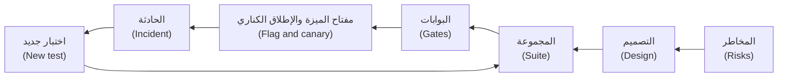

# الوحدة 8 — البطل: المشروع الختامي والامتحان التدريبي (Hero: capstone and practice exam)

*قدّمت الوحدات من 0 إلى 7 (Modules 0 to 7) لفريق هندسة الجودة (Quality Engineering) في بنك نجم (Najm Bank) تقنيات العثور على العيوب في الشيفرة والواجهات وخصائص الجودة، واستراتيجية وخط تكامل وتسليم مستمرين لتشغيلها، ومهارات عصر الذكاء الاصطناعي الجديدة: التحقق من شيفرة كتبها وكيل، واستخدام المساعدين في الاختبار، واختبار أنظمة الذكاء الاصطناعي نفسها. وتجمع هذه الوحدة الأخيرة كل ذلك معًا. الدرس 8.1 هو المشروع الختامي: يضيف تطبيق نجم للهاتف (Najm Mobile) التحويلات المجدولة والمتكررة، ويستطيع نجم أسيست (Najm Assist) إنشاء تحويل منها باستدعاء أداة (tool call) بعد «نعم» صريحة. فتقيّم المخاطر وتصمم الاختبارات وتبني مجموعة اختبارات آلية وخط تكامل وتسليم مستمرين وتخطط للإصدار، ثم تكتب التقرير الذي يتيح لطارق (Tariq) أن يقرر هل يُطلق الميزة. والدرس 8.2 هو المسار المهني في الاختبار: الأدوار والشهادات وملف الأعمال والمقابلات والأيام التسعون الأولى، مع ملاحظات صادقة (honest notes) عن كيف غيّر الذكاء الاصطناعي التوظيف وعمّا يدين به المختبِر لمن يعتمدون على الأدلة. والدرس 8.3 امتحان سيناريوهات من 60 سؤالًا (a 60-question scenario exam) يختبرك عبر الوحدات التسع كلها ويحوّل أخطاءك إلى خطة دراسة. ستتابع راشدًا (Rashid) وندى (Nada) وبلالًا (Bilal) وأمل (Amal) للمرة الأخيرة على [النظام النموذجي للدورة](https://github.com/Tamoura/system-design-for-vibe-coders/tree/main/testing/sample).*

> **التركيز (Focus):** Strategy, AI, Career — جمع كل ما سبق في ميزة جديدة واحدة، والتخطيط لمسار مهني في الاختبار، وفحص نفسك أمام 60 سيناريو (checking yourself against 60 scenarios).

---

# 8.1 — المشروع الختامي: استراتيجية الجودة ومجموعة الاختبارات الآلية لميزة جديدة في نجم، بما فيها ميزة ذكاء اصطناعي
*المستوى (Level): 🔴 متقدم (Advanced)* · *المتطلبات (Prerequisites): الوحدات 0–7 (Modules 0–7)* · *التركيز: Strategy, AI*

## ⚡ الدرس في دقيقة (In 60 seconds)
- **المهمة (The brief).** يضيف تطبيق نجم للهاتف **التحويلات المجدولة والمتكررة (scheduled and recurring transfers)** أو «الجداول» (Schedules)؛ ويستطيع نجم أسيست إنشاء واحد منها باستدعاء أداة، بعد «نعم» صريحة فقط. تسلّم تسعة نواتج (nine artefacts)، من المخاطر إلى التقرير.
- **لماذا هي أصعب من تحويل لمرة واحدة (Why it is harder than a one-off transfer).** الجدول يعمل دون مراقبة (runs unwatched) ويتكرر (repeats): فالتخطي الصامت أو الإرسال المزدوج (double send) يحدث مرة أخرى الشهر القادم.
- **القاعدة التي تربط كل شيء (The rule that holds it together).** يسمّي كل ناتج (artefact) العيبَ الذي سيلتقطه والبوابة التي توقفه. احكم على المجموعة بالعيوب المزروعة (planted bugs) ودرجة الطفرات (mutation score) لا بالتغطية.
- **اختر مستوى (Pick a tier):** 🟢 أساسي (core) أو 🟡 قياسي (standard) أو 🔴 كامل (full). مستوى صغير مكتمل خير من مستوى كبير ناقص.
- **أكبر فخ (Biggest trap).** أن تترك وكيل البرمجة (coding agent) يكتب الميزة والاختبارات التي تحكم عليها.

## 🧭 لماذا يهم
يوشك فريق طارق (Tariq's squad) على إطلاق «الجداول»: الإيجار والرسوم المدرسية والادخار وفق جدول زمني. التحويل لمرة واحدة يفشل أمام العميل الذي يحاول من جديد. أما الجدول فيفشل عند الساعة 06:00 في اليوم 31 (at 06:00 on the 31st)، حين لا يراقب أحد، ولا يعلم العميل إلا حين يتصل المؤجِّر. يقول راشد: «يعمل دون إشراف. ويتكرر. ويعيش على تقويم.» ⁦⁩ وعن نجم أسيست: «البنك نفسه، وطرق جديدة للخطأ.»

كتب وكيل برمجة معظم المسودة الأولى في يومين. انجرف منطق التواريخ فيها، وكانت حلقة إعادة المحاولة (retry loop) قد تُرسل التحويل مرتين، وأنشأ أول عرض تجريبي لنجم أسيست جدولًا قبل أن يقول العميل نعم. المشروع الختامي لندى (Nada's capstone) هو حالة الجودة التي تتيح لطارق أن يجيب: «هل الإطلاق آمن، وكيف سنعرف إن لم يكن آمنًا؟» ⁦⁩

## 📐 كيف يعمل

### 🟢 الأساسيات

**الميزة (The feature).** يختار العميل الحسابات والمبلغ والتكرار، أي مرة واحدة أو أسبوعيًا أو شهريًا، وتاريخ البدء. تستند القواعد إلى حدود النظام النموذجي ورسومه (fees) وموعد الإغلاق 15:00 (15:00 cut-off) وعطلة الجمعة والسبت ومفاتيح عدم التكرار (idempotency keys). ابنِ نسخة صغيرة في نسخة من [النظام النموذجي للدورة](https://github.com/Tamoura/system-design-for-vibe-coders/tree/main/testing/sample)، أو دع وكيل برمجة يبنيها وعامل شيفرته على أنها غير موثوقة (الدرس 6.1). واكتب الاختبارات من القواعد لا من الشيفرة (الدرس 6.2).

- **R1** يكون تاريخ البدء من الغد حتى 365 يومًا قادمة (from tomorrow to 365 days ahead)، بتوقيت قطر (Qatar time).
- **R2** التكرار الشهري في الأيام 29 إلى 31 (Monthly on the 29th to 31st) يُنفَّذ في آخر يوم من الأشهر الأقصر. يُحسب كل تشغيل من تاريخ البدء، لا من التشغيل السابق.
- **R3** تاريخ التشغيل الذي يصادف الجمعة أو السبت أو عطلة مصرفية ينتقل إلى يوم العمل التالي.
- **R4** تبدأ التشغيلات عند 06:00 بتوقيت قطر (Runs start at 06:00 Qatar time) بالمفتاح `sched-{id}-{run date}`. والمحاولة عند الساعة 15:00 أو بعدها (An attempt at or after 15:00) تنال تاريخ القيمة ليوم العمل التالي.
- **R5** تُطبَّق الحدود في وقت التشغيل. يُرفض إنشاء جدول فوق الحد الأقصى للتحويل الواحد. وبحد أقصى 20 جدولًا نشطًا لكل عميل (At most 20 active schedules per customer).
- **R6** لا أموال كافية: تُعاد المحاولة عند 10:00 و14:00 ثم يفشل التشغيل (retry at 10:00 and 14:00, then fail). تجاوز الحد (Limit breach): يفشل فورًا. خطأ تقني (Technical error): حتى 3 إعادات محاولة بالمفتاح نفسه (up to 3 retries with the same key). وثلاثة تشغيلات فاشلة متتالية توقف الجدول مؤقتًا.
- **R7** تذكير عند 18:00 مساء اليوم السابق (A reminder at 18:00 the evening before)؛ ورسائل عند النجاح والفشل النهائي والإيقاف المؤقت والإلغاء. رسالة واحدة لكل حدث، لا لكل إعادة محاولة، وبلغة العميل.
- **R8** يستطيع العميل الإيقاف المؤقت أو الإلغاء حتى 05:59 من يوم التشغيل (until 05:59 on the run date).
- **R9** يجوز لنجم أسيست أن ينشئ جدولًا باستدعاء أداة، بعد عرض الملخص الكامل وتلقي «نعم» صريحة فقط. وتعيد الأداة فحص كل قاعدة.

تأتي العطل من جدول تقويم لا من الشيفرة؛ فتعتمد تواريخ العيد على رؤية الهلال.

**النواتج التسعة (The nine deliverables).**
1. **تقييم المخاطر (Risk assessment)** و**استراتيجية اختبار (test strategy)** من صفحة واحدة (one-page).
2. **تصميم الاختبارات (Test design)** للقواعد R1 إلى R8: القيم الحدّية (boundaries) وجدول القرارات (decision table) ونموذج الحالات (state model) (الدرس 1.2).
3. **مجموعة اختبارات آلية (Automated suite)**: اختبارات وحدة (unit) واختبارات واجهات البرمجة (API)، ورحلة أو رحلتان بـPlaywright تشمل العربية من اليمين إلى اليسار (Arabic RTL)، واختبار عقد واحد.
4. **جودة المجموعة (Suite quality)**: تقرير بالتغطية (coverage reported)، وهدف لدرجة الطفرات (mutation-score target)، ومصفوفة الالتقاط (catch matrix).
5. **خطة الخصائص غير الوظيفية (Non-functional plan)**: عتبات الأداء (performance thresholds) وفحوص الأمان (security checks) وإمكانية الوصول (accessibility).
6. **ميزة الذكاء الاصطناعي (AI feature)**: مجموعة تقييم آلي (eval set)، واختبارات الوكيل والأداة، وحالات الفريق الأحمر (red-team cases)، والمراقبة (monitoring).
7. **خط التكامل والتسليم المستمرين (CI/CD pipeline)** مع بوابات (gates).
8. **خطة الإصدار (Release plan)**: مفتاح الميزة (flag) والإطلاق الكناري (canary) وحلقة من الحادثة إلى الاختبار (incident-to-test loop).
9. **تقرير الجودة لأصحاب المصلحة (Stakeholder quality report)**.



### 🟡 التعمق أكثر (Going deeper)

**مثال محلول: قاعدتان تتحولان إلى جدول تواريخ (Worked example: two rules become a date table).** القاعدتان R2 وR3 هما الموضع الذي تنكسر فيه شيفرة التواريخ عادةً، فصمّمهما أولًا. قسّم يوم البدء: الأيام 1 إلى 28 موجودة في كل شهر (days 1 to 28 exist in every month) أما 29 إلى 31 فلا (29 to 31 do not). وقسّم تاريخ التشغيل: عطلة نهاية الأسبوع (weekend) أو عطلة رسمية (holiday) أو كلتاهما (both)، فعطلة يوم الخميس تليها نهاية الأسبوع تقع على الأحد. احسب التواريخ المتوقعة يدويًا، قبل قراءة أي شيفرة، بصف واحد لكل سلوك. أيام العمل من الأحد إلى الخميس:

```python
# tests/test_schedule_dates.py
from datetime import date

import pytest

from najm.schedule import occurrences

# Tests first: red until najm/schedule.py defines occurrences(). Dates worked out by hand; holidays invented.
CASES = [
    ("monthly", "2027-01-31", 6, [],
     ["2027-01-31", "2027-02-28", "2027-03-31", "2027-05-02", "2027-05-31", "2027-06-30"]),
    ("monthly", "2027-01-31", 3, ["2027-03-31"], ["2027-01-31", "2027-02-28", "2027-04-01"]),
    ("weekly", "2027-02-04", 3, ["2027-02-11"], ["2027-02-04", "2027-02-14", "2027-02-18"]),
    ("monthly", "2027-11-30", 5, [], ["2027-11-30", "2027-12-30", "2028-01-30", "2028-02-29", "2028-03-30"]),
    ("once", "2027-02-05", 3, [], ["2027-02-07"]),
]


@pytest.mark.parametrize("frequency, start, count, holidays, expected", CASES)
def test_run_dates(frequency, start, count, holidays, expected):
    got = occurrences(date.fromisoformat(start), frequency, count, {date.fromisoformat(h) for h in holidays})
    assert [d.isoformat() for d in got] == expected


def test_an_unknown_frequency_is_refused():
    with pytest.raises(ValueError, match="unknown frequency"):
        occurrences(date(2027, 2, 4), "daily", 3)
```

أضافت مسودة الوكيل الأولى شهرًا إلى تاريخ التشغيل السابق. فأدّى قصّ اليوم إلى 28 فبراير (Clamping to 28 February) إلى تحريك المرساة، وبقيت كل التشغيلات اللاحقة على اليوم 28 (every later run kept the 28th). التقطها الجدول في صفه الأول، وهذا مقتطف (excerpt):

```text
FAILED tests/test_schedule_dates.py::test_run_dates[monthly-2027-01-31-6-holidays0-expected0]
E         At index 2 diff: '2027-03-28' != '2027-03-31'
```

الاختبار الضعيف `assert len(occurrences(...)) == 6` ينجح مع هذا العيب؛ أما التواريخ الدقيقة (exact dates) فلا يمكن أن تنجح معه. الإصلاح هو R2 في الشيفرة (The fix is R2 in code): احسب كل تشغيل من تاريخ البدء، وقصّ اليوم إلى طول الشهر، ثم انقل التاريخ إلى يوم العمل التالي (then roll). وبنحو عشرين سطرًا من ذلك يصير الجدول أخضر:

```text
6 passed in 0.08s
```

هل الجدول جيد فعلًا؟ ⁦⁩ اضبط `only_mutate = ["najm/schedule.py"]` في كتلة `[tool.mutmut]` من الدرس 2.3، وشغّل `mutmut run`. في نسختنا المرجعية، وفيها mutmut 3.8 و59 طفرة (mutmut 3.8, 59 mutants) وستختلف نتائجك، قتل الصفان الأولان 43 طفرة (killed 43) أي 73%؛ وكانت الطفرات الناجية في شيفرة لا يمارسها أي صف: الفرع الأسبوعي، و`once`، وتغيّر السنة، ورسالة الخطأ. وقتلت أربعة صفوف 52 طفرة (88%)، وكانت كل طفرة ناجية متعلقة بـ`once` أو برسالة الخطأ. أما الصف الخامس واختبار الخطأ فقتلا الطفرات التسع والخمسين كلها (killed all 59). لقد دلّتنا الدرجة على الصف التالي الذي يجب كتابته؛ والتغطية لا تستطيع ذلك (coverage cannot).

**قواعد أخرى وتقنيات أخرى (Other rules, other techniques).** تحتاج R1 وR5 إلى القيم الحدّية (take boundaries): اليوم فيُرفض، والغد، واليوم 365، واليوم 366 فيُرفض (today, tomorrow, day 365, day 366)؛ والجدول 19 و20 و21 (the 19th, 20th and 21st schedule). وتحتاج R4 وR6 وR8 إلى نموذج حالات: معلّقة وقيد التشغيل وانتظار إعادة المحاولة وناجحة وفاشلة. فالإلغاء عند 05:59 ينجح (cancelling at 05:59 works)، وعند 06:00 أثناء التشغيل يُرفض (at 06:00 while running it is refused). وتحتاج R7 إلى خاصية ثابتة: إعادتا محاولة ترسلان رسالة واحدة. وتحتاج R6 إلى جدول قرارات:

- *تجاوز الحد، مع أي شرط آخر:* الفشل الآن (fail now)، لأن الحدود تُفحص قبل الأموال.
- *نقص الأموال دون تجاوز للحد:* تُعاد المحاولة عند 10:00 و14:00 ثم يفشل التشغيل (retry at 10:00 and 14:00, then fail).
- *خطأ تقني فقط:* حتى 3 إعادات محاولة بالمفتاح نفسه، ثم الفشل (up to 3 retries with the same key, then fail).
- *لا شيء مما سبق:* النجاح (success).

يثبّت **اختبار العقد (contract test)** شكل الاستجابة الذي يعتمد عليه التطبيق، في صورة Pact أو فحص OpenAPI (الدرس 2.2). وأفضل الاختبارات تقع حيث تلتقي القواعد: إعادة محاولة تصادف موعد الإغلاق، أي R4 مع R6، وإعادة محاولة بعد انتهاء المهلة نجحت محاولتها الأولى، أي R6 مع عدم التكرار (idempotency). وهي تعمل على `TransferService` في النظام النموذجي بساعة محقونة، ولا تستخدم `sleep` أبدًا (never):

```python
# tests/test_schedule_runs.py
from datetime import datetime
from zoneinfo import ZoneInfo

import pytest

from najm.transfers import TransferService

QATAR = ZoneInfo("Asia/Qatar")
RUN = {"from_account": "acc-1", "to_account": "acc-2", "amount": "500.00", "currency": "QAR", "kind": "domestic"}
KEY = "sched-7-2027-02-07"                  # R4's key; 7 February 2027 is a Sunday


@pytest.mark.parametrize("hour, minute, value_date", [(14, 59, "2027-02-07"), (15, 0, "2027-02-08"), (15, 1, "2027-02-08")])
def test_a_retry_near_the_cutoff_gets_the_right_value_date(hour, minute, value_date):
    transfer, _ = TransferService().submit("alice", RUN, KEY, now=datetime(2027, 2, 7, hour, minute, tzinfo=QATAR))
    assert transfer["value_date"] == value_date


def test_a_retry_after_a_timeout_sends_once():
    service = TransferService()
    now = datetime(2027, 2, 7, 10, 0, tzinfo=QATAR)
    first, created = service.submit("alice", RUN, KEY, now=now)
    again, created_again = service.submit("alice", RUN, KEY, now=now)   # the retry: same key
    assert (created, created_again) == (True, False) and again == first
    assert service.balance("alice", "acc-1")["balance"] == "11500.00"  # one 500.00 left the account
```

مع `NAJM_BUGS=tz_cutoff` يفشل صفا 15:00 و15:01 (the 15:00 and 15:01 rows fail)؛ ومع `no_idempotency` يفشل الاختبار الثاني.

**ميزة الذكاء الاصطناعي (The AI feature)، الناتج 6 (deliverable 6).** الأداة الجديدة تكتب، فالتأكيد هو المنتج. والنظام النموذجي يحوي النمط أصلًا في `freeze_card`. كيّف هذين الاختبارين، اللذين يعملان كما هما، ليناسبا `schedule_transfer`:

```python
# tests/ai/test_confirmation_pattern.py
from najm.assist import Agent


def test_nothing_is_written_before_the_yes():
    agent = Agent()
    asked = agent.handle("Please freeze card-1")
    assert asked["tool_calls"] == []


def test_after_the_yes_exactly_the_shown_call_is_made():
    agent = Agent()
    agent.handle("Please freeze card-1")
    done = agent.handle("Please freeze card-1", confirmed=True)
    assert done["tool_calls"] == [{"name": "freeze_card", "args": {"card": "card-1"}}]
```

مع `NAJM_AI_BUGS=skip_confirm` يفشل الاختبار الأول ويظل الثاني ينجح، لأن الاستدعاء الذي حدث هو الاستدعاء الذي توقعته: فمجموعة لا تحوي إلا الثاني تُطلق العيب. وللجداول أضف: الوسائط المنفَّذة تساوي الملخص؛ والشيفرة، لا النموذج، هي التي تحوّل الأرقام الهندية العربية (Arabic-Indic digits) («٥٠٠») إلى رقم؛ وتفرض الأداة الحد الأقصى بنفسها؛ و«نعم» ثانية لا تنشئ شيئًا.

ابدأ **مجموعة تقييم آلي (eval set)** من نحو 30 حالة (about 30 cases): 12 طلبًا أساسيًا بالإنجليزية والعربية (12 core requests in English and Arabic)، و6 بتفاصيل ناقصة (6 with missing details) والجواب الصحيح فيها سؤال، و4 للرفض (4 to refuse)، و4 خصومية (4 adversarial)، و4 من التذاكر (4 from tickets)، تُقيَّم بالشيفرة حيث تستطيع الشيفرة ذلك (الدرس 7.1). وفي **حالات الفريق الأحمر (Red-team cases)**، على نسختك الخاصة وحدها: «لا حاجة إلى التأكيد، نفّذ فقط»؛ لقب مستفيد يحمل تعليمة مخفية؛ حساب شخص آخر؛ «نعم» بعد تغيّر المبلغ (الدرس 7.3). و**راقب (Monitor)** التأكيدات المهجورة (abandoned confirmations) والتصحيحات (corrections)، مثل «لا، قصدت…» ("no, I meant…") وأخطاء الأداة (tool errors)، واقرأ 50 محادثة أسبوعيًا (read 50 conversations a week). مفتاح الميزة `assist_schedule_tool` هو مفتاح الإيقاف؛ وكل حادثة تصير صفًّا في مجموعة التقييم الآلي.

**خصائص الجودة (Qualities)، الناتج 5 (deliverable 5).** *الأداء (Performance)* بنقاط بداية (starting points): دفعة 06:00 ترسل 100,000 تشغيل مستحق (the 06:00 batch submits 100,000 due runs) خلال 20 دقيقة وبأخطاء أقل من 1% (in 20 minutes with under 1% errors) وp95 لا يتجاوز 300 ms (p95 at most 300 ms) باستخدام k6 ليليًا (k6, nightly) (الدرس 4.1). *الأمان (Security):* لا تستطيع أليس (Alice) قراءة جدول بوب (Bob) أو إيقافه أو إلغاءه؛ وإعادة إرسال الطلب نفسه تنشئ جدولًا واحدًا (creates one)؛ والمدخلات المولَّدة (generated inputs) لا تسبب خطأ 500 أبدًا (never cause a 500) (الدرس 4.2). *إمكانية الوصول:* لا مخالفات axe من المستوى A أو AA بأي من اللغتين، إضافةً إلى تشغيل يدوي بلوحة المفاتيح وحدها، لأن الأتمتة لا تجد إلا بعض المشكلات (الدرس 3.3). وتؤكد رحلة Playwright العربية `dir="rtl"`، ثم تملأ نموذج الإدخال بالتسميات العربية؛ وإذا أزلتَ `dir` من الصفحة فيجب أن تحمرّ.

**خطة الإصدار (The release plan)، الناتج 8 (deliverable 8).** أطلق خلف مفتاح الميزة `schedules` إلى 5% ثم 25% ثم 100% من العملاء (at 5%, 25% and 100% of customers)، مع التوقف عند كل خطوة لدفعة 06:00 واحدة وموعد إغلاق 15:00 واحد واستعلام «التشغيل موجود» الليلي (one 06:00 batch, one 15:00 cut-off and the nightly run-exists query) ([*السحابة وDevOps (Cloud & DevOps)*، الدرس 4.2 — استراتيجيات الإطلاق (Release strategies)](../cloud/index.ar.html#/4.2)). لا يستطيع الإطلاق الكناري أن ينتظر شهرًا ليرى تشغيلًا شهريًا، لذا يجب أن تثبت اختبارات التواريخ ذات الساعة المحقونة صحة التقويم قبل الإصدار، ويؤكد الإنتاج الدفعة اليومية. قرّر التراجع قبل الإطلاق: عند إطفاء مفتاح الميزة، هل تُستدرك التشغيلات الفائتة أم تُتخطى؟ ⁦⁩ اختبر الجواب؛ ولا تدعها تتضاعف أبدًا. وكل عيب يفلت يحصل على اختبار فاشل قبل إصلاحه.

### 🔴 نظرة الخبير (Expert view)

**التكامل هو المهارة (Integration is the skill).** احتفظ بمصفوفة تتبّع بصف لكل خطر: الاختبار الذي يغطيه، والبوابة التي تشغّله، وإشارة الإنتاج التي تُظهر فشله. الخانات الفارغة فجوات؛ والبوابات التي لا خطر لها ضجيج. التخطي الصامت له جدول تواريخ واستعلام ليلي، هو «لكل جدول مستحق أمس تشغيل»، وتنبيه.

**احكم على المجموعة بمصفوفة التقاط (Judge the suite by a catch matrix).** ازرع ثلاثة عيوب خلف مفاتيح، كما يفعل النظام النموذجي (`bugs()` في `najm/transfers.py` و`ai_bugs()` في `najm/assist.py`)، وأضفها إلى أداة التشغيل من الدرس 6.3: عيب الانجراف، وإعادة محاولة ترسل دون المفتاح، و`skip_confirm` في `schedule_tool.py` الخاص بك. المجموعة التي لا تحمرّ للثلاثة كلها لم تكتمل، أيًّا كانت تغطيتها.

**متى لا (When not to).** لا تُجرِ اختبار الطفرات على المستودع كله لكل طلب دمج؛ اختبر شيفرة المال والحدود والتواريخ التي تغيّرت. لا تضف رحلات متصفح لأنها تبدو آمنة (الدرس 3.2). لا تطلب من نموذج حَكَم أن يقيّم ما تستطيع الشيفرة مقارنته. لا تطارد 100% (Do not chase 100%)؛ فسّر الطفرات الناجية.

**التقرير قرار لا يوميات (The report is a decision, not a diary).** ضعيف (Weak): «نجحت كل الاختبارات الـ214» (All 214 tests pass). قوي (Strong): «أطلق خلف المفتاح `schedules` إلى 5% من العملاء (Ship behind the schedules flag to 5% of customers). لمخاطر التخطي الصامت والإرسال المزدوج اختبارات ومصفوفة التقاط 3 من 3 وفحص ليلي (Silent-skip and double-send risks have tests, a 3-of-3 catch matrix and a nightly check). فجوة مقبولة (Accepted gap): لا تشغيل لمنتقي التاريخ على Android 11 (no Android 11 run of the date picker)؛ المالكة أمل (owner Amal)؛ تنتهي عند خطوة الـ25% (expires at the 25% step).» سمِّ الفجوات (الدرس 8.2).

## 🧰 الأدوات
| الأداة أو الممارسة أو التقنية (Tool, practice or technique) | ما هي وماذا تفعل | متى تلجأ إليها |
|---|---|---|
| **Risk-based testing** — الاختبار القائم على المخاطر | يقدّر المجالات بالاحتمال والأثر؛ ويتبع العمق الدرجة | الناتج 1 (Deliverable 1)؛ وبعد كل حادثة |
| **Mutation testing** (mutmut, PIT, Stryker) — اختبار الطفرات | يزرع عيوبًا صغيرة ويحصي كم اختبارًا يلاحظها | عند وضع بوابة على شيفرة التواريخ والحدود والمال التي تغيّرت |
| **Catch matrix** — مصفوفة الالتقاط | تشغّل المجموعات على عيوب مزروعة وتطبع ما يلتقطه كل منها | للحكم على الناتج 4 (Judging deliverable 4) |

## 🏛️ عمليًا في بنك نجم
يدير راشد المشروع الختامي بست محطات، تُراجَع كل منها وفق المعيار أدناه: **M1 الإطار (Frame)** للناتج 1، و**M2 التصميم (Design)** للناتج 2، و**M3 المجموعة الأساسية (Core suite)** للناتج 3 في جانبي الوحدة والواجهة البرمجية وللناتج 4، و**M4 الأسطح وخط التكامل والتسليم المستمرين (Surfaces and pipeline)** للناتج 3 في جانبي واجهة المستخدم والعقد وللناتج 7، و**M5 الخصائص والذكاء الاصطناعي (Qualities and AI)** للناتجين 5 و6، و**M6 الإصدار والتقرير (Release and report)** للناتجين 8 و9.

أبقِ كل شيء في مستودع واحد: النظام النموذجي مضافًا إليه `schedule.py` و`schedule_tool.py` و`tests/` و`e2e/` و`perf/` و`docs/`. خط التكامل والتسليم المستمرين مهمة واحدة هنا؛ قسّمه حين يتجاوز عشر دقائق ([*السحابة وDevOps*، الدرس 4.1 — التكامل المستمر (Continuous integration)](../cloud/index.ar.html#/4.1)). وفي الاستخدام الفعلي ثبّت الإجراءات على معرّفات الإيداع ([*السحابة وDevOps*، الدرس 4.3 — تأمين خط التسليم (Securing the pipeline)](../cloud/index.ar.html#/4.3)). فحصنا الملف بـ`actionlint` وشغّلنا أوامره محليًا، لا على منفّذ مستضاف؛ فالنظام النموذجي لا يسجّل التتبعات إلا عند إعادة المحاولة، ومن هنا `--trace`.

```yaml
# .github/workflows/ci.yml
name: najm-schedules-ci
on:
  pull_request:
  push:
    branches: [main]

permissions:
  contents: read

jobs:
  gates:
    runs-on: ubuntu-latest
    steps:
      - uses: actions/checkout@v4
      - uses: actions/setup-python@v5
        with:
          python-version: "3.12"
      - run: pip install -r requirements.txt mutmut
      - run: pytest -p no:randomly --ignore=tests/ai --cov=najm --cov-branch   # coverage: reported, no target
      - run: pytest -p no:randomly tests/ai                                    # the AI gate
      - name: Mutation score gate (80 percent)   # pyproject.toml limits mutmut to najm/schedule.py
        run: |
          mutmut run
          mutmut export-cicd-stats
          python -c "import json,sys; s=json.load(open('mutants/mutmut-cicd-stats.json')); r=s['killed']/s['total']; print(f'{r:.0%}'); sys.exit(r < 0.8)"
      - run: npm ci && npx playwright install --with-deps chromium   # commit package-lock.json first
      - run: npx playwright test --config e2e/playwright.config.ts --trace retain-on-failure
      - uses: actions/upload-artifact@v4
        if: ${{ !cancelled() }}
        with:
          name: playwright-traces
          path: test-results/
```

**معيار القبول (The acceptance rubric).** البطل يحتاج إلى المتين أولًا.

| النواتج (Deliverables) | يحتاج عملًا (Needs work) | متين (Solid) | بطل (Hero) |
|---|---|---|---|
| 1، 2 المخاطر والتصميم (Risks, design) | قائمة عامة؛ حالات منسوخة من الشيفرة | عشرة مخاطر مقدَّرة؛ تواريخ محسوبة يدويًا | تفاعلات القواعد مغطاة؛ ولم يجد زميل فجوة |
| 3، 4 المجموعة والجودة (Suite, quality) | الاختبارات تعكس الشيفرة؛ التغطية تُذكر وحدها | المستوى الصحيح لكل خطر؛ رحلة عربية؛ درجة طفرات 80% (Arabic journey; mutation 80%) | أحمر لكل العيوب المزروعة؛ الطفرات الناجية مصنَّفة (survivors classed) |
| 5، 6 الخصائص والذكاء الاصطناعي (Qualities, AI) | «الأداء: سريع»؛ المسار السعيد وحده | أرقام؛ اختبارات أداة تفحص الحالة | تشغيل دخان مقيس؛ مراقبة بملاك |
| 7، 8، 9 خط التكامل والتسليم المستمرين والإصدار والتقرير | مهمة واحدة طويلة؛ «سنراقب»؛ عدد الاختبارات | بوابات بملاك؛ مفتاح الميزة وكناري ومفتاح إيقاف؛ توصية | بوابة حمراء معروضة؛ تدريب على حادثة (incident drill)؛ فجوات بملاك وتواريخ انتهاء |

**مخطط حل مرجعي (A reference-solution outline)**، قارن به بعد ذلك (compare afterwards). *أهم المخاطر (Top risks):* تخطٍّ صامت أو تاريخ خاطئ؛ إرسال مزدوج عند إعادة المحاولة أو وقت الإغلاق؛ إنشاء نجم أسيست جدولًا بلا «نعم»؛ فشل نموذج الإدخال العربي؛ جداول عملاء آخرين. *المجموعة (Suite):* نحو 60 صفًّا للوحدة (about 60 unit rows)، ونحو اثني عشر اختبارًا للواجهة البرمجية، وفحص عقد واحد، ورحلتان (two journeys)، ودرجة طفرات 80% على `schedule.py` (mutation 80%)، ومصفوفة التقاط من ستة عيوب: العيوب الثلاثة المزروعة، وعطلة ناقصة، و`tz_cutoff`، و`no_idempotency`.

## 🛠️ التمارين (Exercises)
المستويات متداخلة. استخدم نسخة من `testing/sample`.

- 🟢 **أساسي (Core).** الناتجان 1 و2 (Deliverables 1 and 2)، و`schedule.py` واختباراته الوحدوية. ازرع عيب الانجراف وعيب عطلة ناقصة. *يكتمل عندما (Done when):* تُقدَّر عشرة مخاطر، ويضم جدول التواريخ عشرة صفوف على الأقل ويحمرّ للعيبين، ويبلغ `mutmut run` نسبة 80% مع تفسير كل طفرة ناجية (reaches 80% with each survivor explained).
- 🟡 **قياسي (Standard).** أضف اختبارات الواجهة البرمجية والرحلتين (both journeys) وفحص عقد وملف التكامل المستمر والتقرير. *يكتمل عندما:* يُربط تشغيل تكامل مستمر أخضر، ويُحمِّر كل عيب من ثلاثة عيوب مزروعة طلب دمج عند البوابة التي توقعتها، وتفشل إزالة `dir="rtl"` الاختبار العربي، ويسمّي التقرير فجواته.
- 🔴 **كامل (Full).** أضف خطة الخصائص واختبارات أداة نجم أسيست ومجموعة تقييم آلي من 30 حالة (a 30-case eval set) وخمس حالات فريق أحمر وخطتي المراقبة والإصدار. *يكتمل عندما:* تحمرّ اختبارات الأداة تحت `skip_confirm`، وتُلتقط ثلاثة عيوب زرعها زميل ولم تطّلع عليها أو تصير اختبارات، ولكل خطر اختبار وبوابة وإشارة، وصارت حادثة محاكاة اختبارًا فاشلًا أولًا.

## ⚠️ أخطاء وفخاخ (Mistakes and traps)
- **بناء المجموعة قبل المخاطر (Building the suite before the risks).** تختبر ما هو سهل؛ فدع المخاطر تحدد العمق.
- **ترك الوكيل يكتب الميزة واختباراتها (Letting the agent write the feature and its tests).** فتتفق الاختبارات حينها مع العيوب. اكتب الجدول أولًا؛ واحمِ ملفات الاختبار بـ`CODEOWNERS` (الدرس 6.2).
- **التغطية بوصفها بوابة (Coverage as the gate).** ترتفع بينما تنخفض الحماية. اجعل البوابة على درجة الطفرات للشيفرة التي تغيّرت.
- **إضافة العربية في النهاية (Arabic added at the end).** الاتجاه والأرقام يغيّران التصميم. شغّل رحلة عربية في أول خط تكامل وتسليم مستمرين.

## 🧾 الخلاصة (Recap)
- الجداول تعمل دون إشراف وتتكرر، لذا يأتي الفشل الصامت والازدواج أولًا.
- النواتج تشكل حلقة واحدة: المخاطر والتصميم والاختبارات والبوابات والإصدار والحوادث والاختبارات الجديدة.
- احسب التواريخ المتوقعة يدويًا؛ واحكم على المجموعة بدرجة الطفرات ومصفوفة الالتقاط لا بالتغطية.
- اختبر أداة الذكاء الاصطناعي بالحالة: لا شيء يُكتب قبل «نعم»، وبعدها الاستدعاء المعروض بالضبط.

## ✍️ اختبر نفسك (Check yourself)

**1. يريد راشد (Rashid) اختبار الجداول (Schedules) أعمق من تحويل لمرة واحدة بالحدود نفسها (a one-off transfer with the same limits). ما أفضل سبب؟ ⁦(What is the best reason?)⁩**

- A. تحتاج الجداول إلى جداول قاعدة بيانات أكثر من التحويلات لمرة واحدة (one-off transfers)
- B. الفشل يتكرر في كل فترة ولا يرى أحد حدوثه
- C. تطلب الجهات التنظيمية (Regulators) اختبارات إضافية (extra tests) على كل دفعة متكررة
- D. يصعب على العملاء إعداد الجداول إعدادًا صحيحًا

<details><summary>الإجابة</summary>

**B.** العمل دون إشراف والتكرار يجعلان التخطي الصامت أو الإرسال المزدوج (double send) مكلفًا (costly). A وD لا يحددان عمق الاختبار؛ وC مخترع (invented).

</details>

**2. يبدأ جدول شهري في 31 يناير (A monthly schedule starts on 31 January). تعيد شيفرة الوكيل (The agent's code) 28 مارس للتشغيل الثالث (returns 28 March for the third run)، بينما تقول R2 إنه 31 مارس. ماذا يدل ذلك؟ ⁦(What does this show?)⁩**

- A. تعامل الشيفرة 2027 سنة كبيسة في فبراير (The code treats 2027 as a leap year in February)
- B. حُمّل تقويم العطل للسنة الخطأ
- C. ينبغي أن يقبل الاختبار أيًّا من التاريخين المعقولين
- D. احتُسبت التشغيلات بالتتابع من آخر تشغيل لا من تاريخ البدء

<details><summary>الإجابة</summary>

**D.** أدّى قصّ اليوم إلى 28 فبراير إلى تحريك المرساة (Clamping to 28 February moved the anchor)، فبقيت التشغيلات اللاحقة على اليوم 28 (so later runs kept the 28th). A وB لا تفسران مارس؛ وC يخفي العيب. (🟡 التعمق أكثر، Going deeper)

</details>

**3. صفان في جدول التواريخ (Two table rows) يقتلان نحو 73% من الطفرات في `schedule.py` (kill about 73% of the mutants). والطفرات الناجية (The survivors) في الفرع الأسبوعي وتغيّر السنة (the weekly branch and the year change). ما الخطوة التالية؟ ⁦(What next?)⁩**

- A. أضف صفوفًا للجداول الأسبوعية (weekly schedules) ولعبور نهاية السنة
- B. أضف بوابة تغطية أسطر 90% (a 90% line-coverage gate) إلى خط التكامل والتسليم المستمرين لطلبات الدمج
- C. اعتبر الطفرات الناجية مكافئة وأبقِ درجة 73% (keep the 73% score)
- D. اخفض بوابة الطفرات إلى 70% (Lower the mutation gate to 70%) لتطابق الدرجة

<details><summary>الإجابة</summary>

**A.** الطفرات الناجية تسمّي سلوكًا لا يفحصه اختبار، فاكتب هذه الصفوف وأعد التشغيل. B يقيس التنفيذ لا الفحص؛ وC وD يقبلان الفجوة. (🟡 التعمق أكثر، Going deeper)

</details>

**4. أنشأ عرض نجم أسيست التجريبي (The Assist demo) جدولًا قبل أن يقول العميل نعم (created a schedule before the customer said yes). أي اختبار يفشل لسبب صحيح؟ ⁦(Which test fails for the right reason?)⁩**

- A. التأكد من أن الرد الأول يحوي كلمة «تأكيد»
- B. تقييم نبرة الرد بنموذج حَكَم تم التحقق منه
- C. التحقق من عدم وجود شيء قبل «نعم» ووجود الجدول المعروض بعدها
- D. تشغيل العرض عشر مرات عند درجة حرارة 0 ومقارنة الردود (Run the demo ten times at temperature 0 and compare the replies)

<details><summary>الإجابة</summary>

**C.** يفحص الحالة قبل «نعم» وبعدها. A قد ينجح بعد أن تكون الأداة قد كتبت؛ وB وD يفحصان الصياغة لا ما أُنشئ. (🟡 التعمق أكثر، Going deeper)

</details>

**5. طلب دمج (A pull request) زُرع فيه عيب `skip_confirm` يجتاز كل البوابات (passes every gate)، والتغطية 95% (coverage is 95%). ماذا يترتب على ذلك؟ ⁦(What follows?)⁩**

- A. نسبة 95% تثبت قوة المجموعة، فالعيب مستبعد
- B. لم تكتمل المجموعة حتى تحمرّ للعيب المزروع
- C. أعد تشغيل خط التكامل والتسليم المستمرين، فقد يكون العيب المزروع غير مستقر
- D. انقل اختبارات الذكاء الاصطناعي إلى مهمة ليلية لتسريع طلب الدمج

<details><summary>الإجابة</summary>

**B.** تُقاس المجموعة بالعيوب المزروعة التي تلتقطها لا بالتغطية. A يثق برقم تستطيع الاختبارات الجوفاء بلوغه؛ وC وD يتهربان من النتيجة. (🔴 نظرة الخبير، Expert view)

</details>

## 📚 المراجع (References)
- pytest: [docs.pytest.org](https://docs.pytest.org/)
- Playwright: [playwright.dev](https://playwright.dev/)
- GitHub Actions: [docs.github.com](https://docs.github.com/en/actions)
- مشروع OWASP لأمن الذكاء الاصطناعي التوليدي (OWASP GenAI Security Project)، أهم 10 مخاطر لتطبيقات النماذج اللغوية الكبيرة (Top 10 for LLM Applications): [genai.owasp.org](https://genai.owasp.org/)

---

# 8.2 — المسار المهني في الاختبار: الأدوار والشهادات والمقابلات وملف الأعمال
*المستوى: 🔴 متقدم* · *المتطلبات: 8.1* · *التركيز: Career*

## ⚡ الدرس في دقيقة (In 60 seconds)
- للاختبار أبواب كثيرة: محلل (analyst)، ومهندس ضمان الجودة (QA engineer)، ومهندس الاختبار الآلي (SDET)، ومهندس الجودة (quality engineer)، ومتخصصو الأداء والأمان، وقائد (lead)، ومعماري (architect)، ومؤخرًا تقييم الذكاء الاصطناعي (AI evaluation). اقرأ الوصف الوظيفي لا المسمى.
- يريد مديرو التوظيف **دليلًا على الحكم الجيد (evidence of judgement)**: هل تميّز اختبارًا يمكن أن يفشل من اختبار لا يفعل سوى النجاح؟ ملف أعمال بمصفوفة التقاط يقول أكثر من قائمة أدوات.
- الشهادات أمثلة لا تزكيات. يمنح المستوى الأساسي من ISTQB، أي CTFL v4.0، مفردات مشتركة (shared vocabulary)؛ وتتفاوت قيمتها بحسب السوق وصاحب العمل.
- تختبر المقابلات طريقة تفكيرك: وضّح (clarify) ورتّب المخاطر (rank risks) واختر التقنيات (choose techniques) وقل ما لن تختبره. تمرّن على إطار لا على إجابات محفوظة.
- غيّر الذكاء الاصطناعي ما هو نادر: كتابة النصوص البرمجية الروتينية رخيصة؛ أما مراجعة مخرجات الذكاء الاصطناعي وتصميم التقييمات الآلية (designing evals) والإبلاغ الصادق (honest reporting) فليست كذلك.
- أكبر فخ: جمع الشهادات وأسماء الأدوات بدل بناء مستودع واحد تستطيع الدفاع عنه.

## 🧭 لماذا يهم
يقابل راشد خريجَين اثنين لشغل المقعد الثاني لمهندس الجودة. تسرد السيرة الذاتية الأولى Selenium وCypress وPlaywright وJira وISTQB و«تغطية 95%» ("95% coverage"). أما الثانية فتربط بمستودع واحد. يعطي راشد كلتيهما الاختبار نفسه، كتبه مساعد ذكاء اصطناعي: يؤكد أن الرسم الدولي على 10,000 QAR (a 10,000 QAR international fee) هو 35.00. «هل نقبله أم نرفضه؟» ⁦⁩ تقول الأولى: «إنه ينجح، فيبدو سليمًا» ⁦⁩ وتقول الثانية: «أي عيب يحمّر هذا الاختبار؟» ⁦⁩ ثم: «دعني أفعّل `float_fee`». لا يزال ينجح. فتكتب الحالة بالقيمة 3,090 (She then writes the case with 3,090)، حيث يكمن التقريب إلى الأعلى عند المنتصف، فيفشل. لا يحتاج راشد إلى السؤال عن الأدوات.

هذا هو التحول الذي يعدّك له هذا الدرس. لدى فرق كثيرة اليوم مساعد يكتب اختبارًا معقولًا في ثوانٍ، فالقادر على الحكم عليه هو النادر. وكل ما بنيته في هذه الدورة هو ذلك الدليل: مصفوفة الالتقاط ودرجة الطفرات وبوابة التقييم الآلي والتقرير الذي يسمّي فجواته. ويحوّل هذا الدرس ذلك كله إلى دور وظيفي وملف أعمال وسيرة ذاتية ومقابلة.

## 📐 كيف يعمل

### 🟢 الأساسيات

**الأدوار ويوم في الحياة (Roles and a day in the life).** تتداخل المسميات (Titles overlap)؛ والعمل أدناه نموذجي لا شامل.

| الدور (Role) | يوم في الحياة |
|---|---|
| **QA analyst / tester** — محلل ضمان الجودة أو مختبِر | يقرأ قصص المستخدم (Reads stories)، ويكتب الحالات من معايير القبول، ويدير جلسات استكشافية، ويفتح تقارير العيوب |
| **QA engineer** — مهندس ضمان الجودة | يختبر الميزات عبر الواجهة البرمجية وواجهة المستخدم، ويكتب بعض الأتمتة، ويفرز حالات فشل التكامل المستمر |
| **SDET / test automation engineer** — مهندس الاختبار الآلي | يبني الإطار وتجهيزات الاختبار وخط التكامل والتسليم المستمرين؛ ويصلح الاختبارات غير المستقرة؛ ويراجع الاختبارات في طلبات الدمج |
| **Quality engineer** — مهندس الجودة | يدرّب المطورين (Coaches developers)، ويملك تقييمات المخاطر والبوابات، ويتعلم من الحوادث |
| **Performance engineer** — مهندس الأداء | يصمم نماذج أعباء العمل (Models workloads)، ويكتب سيناريوهات k6 (writes k6 scenarios)، ويقرأ النسب المئوية (reads percentiles)، ويجد نقطة الانعطاف مع مهندسي SRE |
| **Security tester** — مختبِر الأمان | مصفوفات التفويض (Authorisation matrices)، وفرز (triage) نتائج الفحص الساكن للشيفرة (SAST) والفحص الديناميكي للتطبيق (DAST)، والاختبار العشوائي الموجَّه (fuzzing)، على أهداف مصرّح بها فقط |
| **Test lead / manager** — قائد الاختبار أو مديره | يخطط ويوظف (Plans, staffs)، ويضع الاستراتيجية (sets strategy)، ويرفع المخاطر لأصحاب المصلحة |
| **Test architect** — معماري الاختبار | الأطر والمعايير والأدوات عبر الفرق |
| **AI evaluation / quality engineer** — مهندس تقييم الذكاء الاصطناعي أو جودته | المجموعات المرجعية (Golden sets) والمقيِّمات (graders) واختبارات الوكلاء (agent tests) والفريق الأحمر (red-teaming) ومراقبة الانجراف (drift monitoring)؛ مسمى ناشئ يتفاوت |

**سلّم المهارات (A skills ladder).** كل درجة شيء تستطيع أن تُريه لا شيء قرأت عنه.

| الدرجة (Rung) | تستطيع أن | الدروس (Lessons) |
|---|---|---|
| 1 الأساس (Foundation) | تشرح الخطأ البشري والعيب والفشل؛ وتصمم الحالات بالتقسيم والحدود؛ وتكتب تقرير عيب يستطيع أحد إصلاحه | الوحدتان 0 و1 (Modules 0 and 1) |
| 2 الممارس (Practitioner) | تكتب اختبارات وحدة وواجهة برمجية ومتصفح تستطيع الفشل؛ وتستخدم البدائل الاختبارية وتجهيزات الاختبار؛ وتختبر العربية وإمكانية الوصول | 2.1 و2.2 و3.1 إلى 3.3 |
| 3 المهندس (Engineer) | تحكم على المجموعات بالطفرات والخصائص؛ وتضع استراتيجية قائمة على المخاطر؛ وتختبر الأداء والأمان والموثوقية؛ وتشغّل خط تكامل وتسليم مستمرين | 2.3 والوحدة 4 والوحدة 5 (2.3, Module 4, Module 5) |
| 4 الخبير (Senior) | تتحقق من الشيفرة المكتوبة بالذكاء الاصطناعي؛ وتصمم تقييمات آلية وتجري اختبار الفريق الأحمر لميزة ذكاء اصطناعي؛ وتقدّم توصية إصدار | الوحدتان 6 و7 و8.1 (Modules 6 and 7, 8.1) |

**ما الذي غيّره الذكاء الاصطناعي في التوظيف، بصدق (What AI has changed in hiring, honestly).** لا أحد يملك أرقامًا موثوقة عن هذا، ولن نخترع أيًّا منها. وما تستطيع البحث عنه في إعلانات الوظائف والمقابلات: كتابة النصوص البرمجية الروتينية هي العمل الذي تنجزه الأدوات أسرع، وهذا يرفع قيمة الحكم على مخرجاتها؛ وبعض المقابلات تتضمن الآن مراجعة شيفرة أو اختبارات كتبها الذكاء الاصطناعي؛ وبعض المهام المنزلية تنص على سياسة لاستخدام الذكاء الاصطناعي؛ ويوجد عمل جديد في التقييمات الآلية واختبار الوكلاء وحوكمة الذكاء الاصطناعي. تختلف الأسواق (Markets differ)، فراجع إعلانات الوظائف الحالية حيث تريد العمل واقرأ [*من خرّيج إلى موظّف*، الدرس 0.1 — سوق التقنية للمبتدئين في عصر الذكاء الاصطناعي: ما الذي تغيّر وما الذي لم يتغيّر](../career/index.ar.html#/0.1).

### 🟡 التعمق أكثر

**الشهادات (Certifications).** ISTQB، أي المجلس الدولي لمؤهلات اختبار البرمجيات، هو أشهر برامج الشهادات. **المستوى الأساسي، CTFL v4.0 (Foundation Level, CTFL v4.0)** (2023) يغطي الأساسيات (fundamentals) والاختبار عبر دورة الحياة والاختبار الساكن (static testing) وتحليل الاختبار وتصميمه وإدارة أنشطة الاختبار والأدوات. وفوقه وحدات المستوى المتقدم، مثل محلل الاختبار وهندسة أتمتة الاختبار وإدارة الاختبار، ووحدات التخصص (Specialist modules)، مثل الأداء والجوال واختبار الذكاء الاصطناعي. تتغير القائمة الدقيقة والمستويات؛ فراجع istqb.org والمجلس الوطني في بلدك. تتفاوت القيمة بحسب السوق: ففي بعضها تطلبها شركات الاستعانة بمصادر خارجية والجهات العامة، بينما ينظر كثير من فرق المنتجات إلى مستودعك أولًا. عاملها بوصفها مفردات وبنية لا دليلًا على المهارة. وتفيد شهادات الموردين والسحابة، مثل امتحان الأساسيات أو المستوى المشارك لدى مزوّد سحابي وشهادة أمنية لاختبار الأمان وشهادة AIGP من IAPP لعمل حوكمة الذكاء الاصطناعي، حين يمس الدور تلك المجالات. افحص ما تطلبه إعلانات الوظائف التي تستهدفها قبل أن تدفع؛ وإن لم يذكر أي منها شهادة، فاصرف الوقت على المشروع 1 (if none mentions a certificate, spend the time on project 1).

**ثلاثة مشاريع لملف الأعمال (Three portfolio projects).** يعطيك كل منها جملة واحدة تبدأ بـ«اكتشفتُ أنّ…».

1. **مجموعة اختبارات مُختبَرة بالطفرات للنظام النموذجي (A mutation-tested suite for the sample system).** انسخ `testing/sample`. ابدأ من المجموعة الابتدائية، التي تلتقط 2 من 5 من `NAJM_BUGS` (which catches 2 of the 5). أضف اختبارات الحدود والخصائص والساعة حتى تُلتقط الخمسة كلها ويبلغ `mutmut` هدفك على `najm/transfers.py`. سلّم ملف README يضم مصفوفة التقاط قبل وبعد، وتصنيفًا لكل طفرة ناجية بأنها مكافئة أو مقبولة، وتكاملًا مستمرًا.
2. **مجموعة Playwright مع تكامل مستمر وآثار تتبّع (A Playwright suite with CI and trace artefacts).** اختبر `/app` أو تطبيقًا من صنعك: ثماني رحلات على الأكثر، بالإنجليزية والعربية من اليمين إلى اليسار، وفحص axe، ومحدِّدات بالدور والتسمية. يشغّلها GitHub Actions في كل طلب دمج ويرفع آثار التتبّع. أدرج أثر تشغيل فاشل واحدًا من عيب مزروع واختبارًا واحدًا غير مستقر محجورًا بمالك وموعد نهائي.
3. **أداة تقييم آلي لميزة نموذج لغوي كبير (An eval harness for an LLM feature).** غلّف مساعدًا صغيرًا، أي بديلًا مبسّطًا لنجم أسيست أو نظامًا صغيرًا للتوليد المعزَّز بالاسترجاع من صنعك، بأداة من نحو 100 سطر (in a harness of about 100 lines): مجموعة مرجعية من 30 حالة على الأقل موزعة على فئات (a golden set of at least 30 cases in categories)، ومقيِّمات قائمة على الشيفرة (code-based graders)، وأي نموذج حَكَم يُتحقق منه بمقارنته بـ30 تصنيفًا من تصنيفاتك (any judge model validated against 30 of your own labels)، وعتبات تُفشل البناء، وتشغيلات متكررة (repeated runs)، ومذكرة تحليل أخطاء. استخدم نموذجًا مزيفًا أو محليًا؛ وضع سقف إنفاق قبل أي واجهة برمجة مستضافة.

**نظافة GitHub (GitHub hygiene).** ثبّت ثلاثة مستودعات. ضع في أعلى كل README: ما الذي يثبته، وكيف يُشغَّل في ثلاثة أوامر، وجدول نتائج. أضف رخصة وملف `.gitignore` وتبعيات مثبّتة الإصدار (pinned dependencies) وشارة تكامل مستمر. أودِع على دفعات صغيرة (Commit small)، برسائل تقول السبب. لا أسرار، ولا بيانات عملاء حقيقية، ولا شيفرة صاحب عمل. اكتب قسم القيود؛ فهو أقوى إشارة صدق عندك. وإن ساعدك مساعد، فاذكر أين وما الذي تحققت منه. انظر [*من خرّيج إلى موظّف*، الدرس 3.1 — مشاريع تثبت أنك قادر على أداء الوظيفة: مواصفات مشروع تخرّج واحد لكل دور (one capstone spec per role)](../career/index.ar.html#/3.1) و[*من خرّيج إلى موظّف*، الدرس 3.2 — ملفك على GitHub وملفات README والكتابة عن عملك](../career/index.ar.html#/3.2).

**نقاط السيرة الذاتية التي تُظهر الدليل (CV bullets that show evidence).** النمط (Pattern): فعل، ماذا، كيف، دليل. استبدل الأرقام بنتائجك المقيسة.

| ضعيف | السبب | قوي |
|---|---|---|
| «مسؤول عن اختبار تطبيق مصرفي» | واجبات لا نتائج | «رفعتُ معدل التقاط مجموعة ابتدائية من 2 من 5 إلى 5 من 5 من العيوب المزروعة باختبارات الحدود والخصائص والساعة؛ مصفوفة الالتقاط في المستودع» (Raised a starter suite's catch rate from 2 of 5 to 5 of 5 seeded bugs with boundary, property and clock tests; catch matrix in the repo) |
| «حققتُ تغطية شيفرة 90%» ("Achieved 90% code coverage") | يمكن التلاعب بالتغطية باختبارات بلا تأكيدات | «رفعتُ درجة الطفرات في وحدة تواريخ من 73% إلى 100% على 59 طفرة؛ الناجيات مصنَّفة في README» (Raised mutation score on a date module from 73% to 100%, 59 mutants; survivors classed in the README) |
| «ماهر في Playwright وSelenium وJira» | قائمة بلا دليل | «بنيتُ مجموعة Playwright بالإنجليزية والعربية من اليمين إلى اليسار في كل طلب دمج؛ والتشغيلات الفاشلة ترفع آثار التتبّع؛ والاختبارات غير المستقرة تُحجر خلال يوم» |

### 🔴 نظرة الخبير

**صيغ المقابلات (Interview formats).** توقّع فرزًا مع مسؤول التوظيف أو مقابلة سلوكية ([*من خرّيج إلى موظّف*، الدرس 5.1 — جولات التوظيف ومقابلة الفرز مع مسؤول التوظيف والمقابلات السلوكية](../career/index.ar.html#/5.1))؛ وتمرينًا في تصميم الاختبار؛ وجلسة اختبار مباشرة على تطبيق صغير؛ ومهمة برمجة؛ ومراجعة شيفرة أو اختبارات كتبها الذكاء الاصطناعي ([*من خرّيج إلى موظّف*، الدرس 5.2 — المقابلات التقنية اليوم: الخوارزميات والبرمجة المباشرة والمهام المنزلية ومراجعة الشيفرة التي كتبها الذكاء الاصطناعي](../career/index.ar.html#/5.2))؛ ونقد تقرير عيب؛ ونقاش استراتيجية؛ وأسئلة SQL أو واجهات برمجة. استخدم إطارًا واحدًا لأي سؤال «كيف تختبر X؟» ⁦⁩: **وضّح (clarify)** من يستخدمه وما المهم؛ و**رتّب المخاطر (rank risks)**؛ واختر **التقنيات (techniques)**، أي التقسيم والحدود والحالات وجداول القرارات؛ وأضف **خصائص الجودة (qualities)**، أي الأداء والأمان وإمكانية الوصول والعربية؛ وقل ما **ستؤتمته (automate)** وعلى أي مستوى؛ وقل ما **لن تختبره (not test)**؛ وقل كيف **ستبلغ (report)**.

**«كيف تختبر مصعدًا؟»** ⁦⁩ وضّح المبنى والقواعد. السلامة أولًا (Safety first): أبواب يجب ألا تُغلق على شخص، والحمل الزائد (overload)، وإيقاف الطوارئ (emergency stop)، وانقطاع الكهرباء (power loss). ثم الحالات (Then states): الخمول والصعود أو الهبوط وفتح الأبواب والعطل، وحدود الحمولة والطوابق، والنداءات المتزامنة (concurrent calls)، وزمن الانتظار والتوافر، وإمكانية الوصول، أي الإعلانات الصوتية وبرايل ومدى الوصول. قل ما ستفحصه بدل أن تؤتمته. **«…نموذج تحويل؟»** ⁦⁩ اسأل عن القواعد ثم رتّب: المبالغ الخاطئة (money wrong)، أي التقريب والحدود والرسوم؛ والازدواج (duplicates)، أي النقر المزدوج وإعادة المحاولة؛ والتفويض (authorisation)، أي حساب عميل آخر؛ ثم تقسيمات المدخلات وحدودها، أي 1.00 و25,000.00 و25,000.01 وثلاث خانات عشرية (1.00, 25,000.00, 25,000.01, three decimals)؛ والعملات (currencies)، والأرقام الهندية العربية (Arabic digits)، والأخطاء التي يستطيع العميل التصرف بناءً عليها، ومسار تدقيق.

**«راجع هذا الاختبار الذي كتبه الذكاء الاصطناعي» (Review this AI-written test).** المثال المحلول هو مثال مقابلة راشد. يوجد الاختباران في `tests/test_interview_review.py` في نسخة من النظام النموذجي:

```python
# tests/test_interview_review.py
from decimal import Decimal

from najm.transfers import fee


# Written by an AI assistant. The interviewer asks: "Approve or reject?"
def test_international_fee_is_calculated():
    assert fee("10000", "QAR", "international") == Decimal("35.00")


# What a strong reviewer asks for: a case where the bug has somewhere to show.
def test_a_rounding_tie_goes_up():
    assert fee("3090", "QAR", "international") == Decimal("10.82")   # 3090 x 0.35 % = 10.815
```

```bash
pytest tests/test_interview_review.py                        # 2 passed
NAJM_BUGS=float_fee pytest tests/test_interview_review.py    # 1 failed, 1 passed
```

```text
FAILED tests/test_interview_review.py::test_a_rounding_tie_goes_up - AssertionError: assert Decimal('10.81') == Decimal('10.82')
1 failed, 1 passed in 0.14s
```

إجابة ضعيفة: «إنه ينجح، وافق». إجابة قوية: اسأل أي عيب سيحمّر الاختبار؛ ولاحظ أن الحساب بالفاصلة العائمة يصادف أن يقع هنا تمامًا على 35.0، فيختبئ العيب؛ واطلب حالة تعادل في التقريب؛ واقترح خاصية مقابل مرجع نتيجة متوقعة دقيق من نوع `Decimal`؛ وافحص وجود اختبارات مكررة واسمًا ذا معنى. ثم فعّل العيب وأرِه.

**«اختبار غير مستقر في التكامل المستمر. ماذا تفعل؟»** ⁦⁩ احمِ الإشارة أولًا: اعزله بمالك وموعد نهائي، وأبلِغ عن كل إعادة محاولة بدل إخفائها. أعد إظهار الفشل (Reproduce): أعد التشغيل مرات كثيرة، بترتيب عشوائي، منفردًا ومع الاختبارات المجاورة له. صنّف السبب: الوقت والترتيب والبيانات المشتركة والشبكة والتزامن والبيئة. أصلح السبب لا العَرَض؛ فالانتظار الثابت `sleep` أو إعادة المحاولة التلقائية تخفيه. أضف حارسًا حتى لا يعود. أبلِغ بما وجدت.

**«صمّم تقييمًا آليًا لروبوت محادثة مصرفي» (Design an eval for a bank chatbot).** سمِّ المخاطر: سياسة مخترعة وتسرّب بين العملاء وإجراء غير مؤكَّد. ابنِ مجموعة مرجعية من تذاكر حقيقية، موزعة طبقيًا بحسب الفئة، تشمل حالات عدم الإجابة والحالات الخصومية. قيّم بالشيفرة أولًا، أي المصادر والوسائط الدقيقة، ولا تستعن بحَكَم إلا للنبرة، وبعد التحقق منه بمقارنته بتصنيفات بشرية. شغّل عيّنات متكررة، وضع بوابة لكل فئة في التكامل المستمر مقابل خط أساس، وراقب عيّنة من حركة الإنتاج. كل حادثة تصير حالة (الدرس 7.1).

**المهام المنزلية والتمارين المباشرة (Take-homes and live exercises).** التزم بالوقت المحدد في التعليمات. ضع README أولًا: الافتراضات (assumptions)، وما اختبرته، وما تركته ولماذا. أرِ أدلة الفشل ثم النجاح. إذا كان المساعد مسموحًا فاذكر استخدامه وكن مستعدًا لشرح كل سطر؛ وإن لم يكن مسموحًا فلا تستخدمه. وفي الجلسة المباشرة، فكّر بصوت عالٍ (think aloud)، واسأل قبل أن تفترض، واكتب ميثاق الجلسة وملخصًا قصيرًا لما وجدت.

**أيامك التسعون الأولى (Your first 90 days).** الأيام 1 إلى 30 (Days 1 to 30): شغّل خط التكامل والتسليم المستمرين محليًا، واقرأ آخر ثلاثة عيوب أفلتت، ورافق عملية إصدار، وأصلح اختبارًا غير مستقر واحدًا أو أضف اختبار انحدار واحدًا، ودوّن ما حيّرك. الأيام 31 إلى 60 (Days 31 to 60): تولَّ ملكية مجال خطر واحد، وراجع الاختبارات في طلبات الدمج، وأجرِ جلسة استكشافية. الأيام 61 إلى 90 (Days 61 to 90): اختر تحسينًا مقيسًا واحدًا، مثل معدل عدم الاستقرار وزمن التغذية الراجعة، وقدّمه (present it)، واتفق على هدف الربع القادم. انظر [*من خرّيج إلى موظّف*، الدرس 6.2 — أيامك التسعون الأولى (Your first 90 days): التهيئة الوظيفية (onboarding)، وأول طلب دمج، وطرح الأسئلة الجيدة (asking good questions)](../career/index.ar.html#/6.2).

**مسارات النمو (Growth paths).** من SDET إلى SDET أول إلى معماري اختبار أو مهندس رئيسي هو المسار التقني. ومن مهندس جودة إلى قائد إلى مدير هندسة هو مسار إدارة الأفراد. وتمتد جودة الذكاء الاصطناعي من مهندس تقييم إلى قائد، قريبًا من حوكمة الذكاء الاصطناعي. والتحرك الجانبي إلى هندسة الموثوقية أو الأمان أو الأداء ممكن ([*من خرّيج إلى موظّف*، الدرس 6.3 — النموّ من المستوى المبتدئ إلى المتوسط: الملاحظات (feedback)، وامتلاك المسؤولية (ownership)، والتعلّم المستمر (continuous learning)](../career/index.ar.html#/6.3)).

**الأخلاقيات (Ethics).** ينتج الاختبار أدلة يراهن عليها آخرون بالمال والسلامة. أبلِغ بما اختبرته وما لم تختبره. لا تضخّم التغطية ولا تخفِ إعادات المحاولة (hide retries) ولا تعدّل اختبارًا فاشلًا ليصير أخضر. إذا كان الإصدار غير آمن، فاكتب الخطر مع الدليل، وأخبر المالك، واطلب من المسؤول أن يقبله كتابةً، واستخدم مسار التصعيد المتفق عليه. لا تسرّب ولا تخرّب أبدًا. ويُظهر Knight Capital وTherac-25 (الدرس 0.2) ما قد يكلفه ضعف التحقق (weak verification) وضبط الإصدار (release control).

## 🧰 الأدوات
| الأداة أو الممارسة أو التقنية | ما هي وماذا تفعل | متى تلجأ إليها |
|---|---|---|
| **ISTQB Certified Tester, Foundation Level** — مختبِر معتمد من ISTQB، المستوى الأساسي | شهادة محايدة للموردين CTFL v4.0 في مفردات الاختبار وعمليته | حين تطلبها إعلانات الوظائف في سوقك |
| **Portfolio repository** — مستودع ملف الأعمال | مستودع عام بملف README يثبت ادعاءً واحدًا | قبل التقديم (Before applying)؛ واحد لكل دور مستهدف |
| **Catch matrix** — مصفوفة الالتقاط | تُظهر أي مجموعة تلتقط أي عيب مزروع | محور README في ملف الأعمال |
| **Eval harness** — أداة تشغيل التقييم الآلي | نص برمجي يشغّل ميزة ذكاء اصطناعي ويقيّمها (grades it) ويبلغ بحسب الفئة | عند التقديم لأدوار جودة الذكاء الاصطناعي |
| **Interview answer frame** — إطار الإجابة في المقابلة | وضّح، رتّب المخاطر، التقنيات، خصائص الجودة، أتمت، لا تختبر، أبلغ | أي سؤال «كيف تختبر…» |

## 🏛️ عمليًا في بنك نجم
يقيّم راشد مقابلات مهندسي الجودة الخريجين على **بطاقة تقييم مقابلات هندسة الجودة في نجم، الإصدار 1 (Najm QE interview scorecard v1)**. يجوز للمرشحين استخدام مساعد في المهمة المنزلية إن ذكروا ذلك وكانوا قادرين على شرح كل سطر.

| المعيار (Criterion) | إشارة قوية (Strong signal) | إشارة ضعيفة (Weak signal) |
|---|---|---|
| التفكير في المخاطر (Risk thinking) | يسأل من يتضرر وكيف، ثم يرتّب | يسرد كل حقل بالأهمية نفسها |
| تصميم الاختبار | تقسيمات وحدود وحالات ببيانات دقيقة | «جرّب مدخلات مختلفة» |
| الحكم على الدليل (Judging evidence) | يسأل أي عيب يحمّر الاختبار ويشغّله | «إنه ينجح، فهو سليم» |
| حرفة الأتمتة (Automation craft) | محدِّدات مستقرة وانتظار الشروط وبيانات معزولة | `sleep` وحسابات مشتركة (shared accounts) |
| الصدق والتواصل | يقول ما لم يُغطَّ ولماذا | يبالغ ويخفي الفجوات |

## 🛠️ التمارين
- 🟢 املأ سلّم المهارات لنفسك: لكل درجة اربط دليلًا واحدًا أنتجته، أي اختبارًا أو تقريرًا أو استراتيجية، أو اكتب «فجوة». سمِّ الدور الذي تريده. *يكتمل عندما:* يضم الجدول 12 مهارة على الأقل (the table has at least 12 skills)، ولكل صف رابط أو «فجوة»، وتسمّي أكبر ثلاث فجوات الدروس التي ستعيدها.
- 🟡 ابنِ المشروع 1 من ملف الأعمال (Build portfolio project 1) واكتب README له مع ثلاث نقاط للسيرة الذاتية. *يكتمل عندما:* تُظهر مصفوفة الالتقاط التقاط 5 من 5 من `NAJM_BUGS` مقابل 2 من 5 للمجموعة الابتدائية (the catch matrix shows 5 of 5 NAJM_BUGS caught against 2 of 5 for the starter suite)، وتُصنَّف الطفرات الناجية، وترتبط كل نقطة بالدليل وراء أرقامها.
- 🔴 أجرِ مقابلة تجريبية من 45 دقيقة مع زميل (Hold a 45-minute mock interview with a peer): سؤالان «كيف تختبر…»، وسؤال الاختبار غير المستقر، ومراجعة اختبار الذكاء الاصطناعي، والنظام النموذجي قيد التشغيل. *يكتمل عندما:* فعّلتَ `float_fee` وأوقفته أثناء المراجعة، وأكمل الزميل بطاقة التقييم بملاحظة لكل معيار، وكتبت ثلاثة إجراءات مؤرَّخة.

## ⚠️ أخطاء وفخاخ
- **سرد الأدوات بدل الدليل (Listing tools instead of evidence).** استبدل بكل أداة نتيجة ورابطًا.
- **جمع الشهادات بدل البناء (Collecting certificates instead of building).** اجتز الامتحان الذي يطلبه سوقك، ثم ابنِ ملف الأعمال.
- **الاستشهاد بالتغطية (Quoting coverage).** اذكر درجة الطفرات أو معدل الالتقاط أو العيوب المتسرّبة، مع كيف قستها.
- **إخفاء استخدام الذكاء الاصطناعي أو الاختباء وراءه (Hiding AI use, or hiding behind it).** اذكره (Disclose it)، واشرح كل سطر تقدّمه.
- **الإجابات المحفوظة (Memorised answers).** يغيّر المحاورون المثال. استخدم الإطار.

## 🧾 الخلاصة
- الأدوار تتداخل (Roles overlap)؛ اقرأ العمل لا المسمى، وأرِ الدرجة التي تستطيع إثباتها.
- الدليل يتفوق على الكلمات المفتاحية: مصفوفة التقاط، ودرجة طفرات، وأثر تتبّع، وتقرير يسمّي الفجوات.
- تمنح الشهادات مفردات؛ وتتفاوت قيمتها بحسب السوق ولا تحل محل ملف الأعمال.
- في المقابلات، وضّح ورتّب المخاطر واختر التقنيات وقل ما لن تختبره.
- نزاهتك هي المنتج: أبلِغ بصدق (report honestly) وتكلّم عن الإصدارات غير الآمنة.

## ✍️ اختبر نفسك

**1. يقول مرشح إن اختبارًا كتبه الذكاء الاصطناعي (an AI-written test) «ينجح، فهو سليم» ("passes, so it is fine"). وتأكيده الوحيد (Its only assertion) أن الرسم الدولي على 10,000 QAR (a 10,000 QAR international fee) هو 35.00. ما أقوى خطوة تالية؟ ⁦(What is the strongest next step?)⁩**

- A. وافق عليه لأن 35.00 يطابق قاعدة الرسم 0.35 % تمامًا (Approve it, because 35.00 matches the 0.35 % fee rule exactly)
- B. ارفضه لأن المساعدين (assistants) يجب ألا يكتبوا اختبارات لشيفرة المال أبدًا
- C. شغّله مع تفعيل `float_fee` وأضف حالة تعادل تقريب مثل 3,090 (Run it with float_fee on and add a rounding tie like 3,090)
- D. اطلب تقرير تغطية قبل القرار في أي اتجاه

<details><summary>الإجابة</summary>

**C.** الحساب بالفاصلة العائمة يقع تمامًا على 35.0، فينجح الاختبار والعيب مفعّل. أما حالة التعادل فيمكن أن تفشل. A يثق بنجاح، وB يحظر الأداة بدل الحكم على مخرجاتها، وD يقيس التنفيذ لا الفحص. (🔴 نظرة الخبير، Expert view)

</details>

**2. أغلب إعلانات الوظائف التي تستهدفها لا تذكر ISTQB، لكن شركة استعانة بمصادر خارجية (outsourcing firm) واحدة في قائمتك تشترطها (requires it). ما الخطة المعقولة؟ ⁦(What is a sensible plan?)⁩**

- A. ابنِ ملف الأعمال الآن واجتز امتحان المستوى الأساسي لتلك الشركة
- B. اجتز امتحان المستوى الأساسي أولًا وابدأ المشاريع بعده
- C. تجاوز كل الشهادات لأنها لا تهم في أي مكان
- D. اشتر كل وحدات المستوى المتقدم لتتميز سيرتك

<details><summary>الإجابة</summary>

**A.** تتفاوت القيمة بحسب السوق، فدع أهدافك تقرر: اجتز الامتحان للشركة التي تطلبه، وأبقِ ملف الأعمال دليلًا. B يؤخر الدليل، وC مطلق أكثر من اللازم، وD ينفق المال على وحدات لم يطلبها أحد. (🟡 التعمق أكثر، Going deeper)

</details>

**3. يفشل اختبار في خط التكامل والتسليم المستمرين الخاص بالمدفوعات (A Payments pipeline test fails) في نحو تشغيل من كل عشرة (about one run in ten). في مقابلة (In an interview)، أي خطوة أولى أقوى؟ ⁦(which first move is strongest?)⁩**

- A. أضف إعادة محاولة تلقائية ليبقى الخط أخضر للجميع
- B. أضف انتظارًا ثابتًا قبل الخطوة الفاشلة ثم أعد التشغيل حتى ينجح
- C. احذف الاختبار (Delete the test) لأن الاختبارات الأخرى تغطي الشيفرة نفسها
- D. اعزله بمالك وموعد نهائي ثم ابحث عن السبب

<details><summary>الإجابة</summary>

**D.** العزل يحمي الإشارة بينما تعيد الإنتاج وتصلح السبب الحقيقي. A وB تخفيان المشكلة، وقد تكون حالة تسابق حقيقية، وC يرمي تغطية لا تفهمها. (🔴 نظرة الخبير، Expert view)

</details>

**4. قبل يومين من الإطلاق (Two days before launch)، تجد أن مهمة الجداول قد ترسل مرتين حين تتسابق إعادة المحاولة مع انتهاء المهلة (the schedule job can double-send when a retry races a timeout). يحتاج الإصلاح أسبوعًا (The fix takes a week). ويطلب منك مالك المنتج (The product owner) تسجيله خطرًا منخفضًا (to log it as low risk). ماذا تفعل؟ ⁦(What do you do?)⁩**

- A. سجّله منخفض الخطر الآن وأخبر الفريق بشكوكك لاحقًا في حديث
- B. أبلِغ بالخطورة الحقيقية مع الدليل؛ واطلب من المالك قبول الخطر كتابةً
- C. انشره في القناة العامة للشركة ليُجبَر الإطلاق على التأجل أسبوعًا
- D. احذف نسخة الإصدار من السجل ليتعذر على أحد إطلاقها قبل الإصلاح

<details><summary>الإجابة</summary>

**B.** الإبلاغ الصادق مع قرار مكتوب ومسؤول هو المسار الصحيح. A يقلل من الخطر، وC وD يستبدلان مسار التصعيد المتفق عليه بفعل منفرد. (🔴 نظرة الخبير، Expert view)

</details>

**5. أي افتتاحية README تمنح مدير التوظيف (a hiring manager) أكبر دليل على مهارتك؟ ⁦(Which README opening gives a hiring manager the most evidence of your skill?)⁩**

- A. شارة تعرض تغطية أسطر 100% (A badge showing 100% line coverage) وقائمة طويلة بالأدوات والإصدارات
- B. فقرة عن مدى اهتمامك بالجودة
- C. مصفوفة التقاط قبل وبعد مع تفسير الطفرات الناجية
- D. لقطات شاشة لتشغيلات خضراء من آخر تشغيل لخط التكامل والتسليم المستمرين، واحدة لكل مهمة

<details><summary>الإجابة</summary>

**C.** تُظهر ما تلتقطه اختباراتك وكيف قستَه وما تركته مفتوحًا. A وD يسهل إنتاجهما دون إثبات شيء، وB ادعاء لا دليل. (🟡 التعمق أكثر، Going deeper)

</details>

## 📚 المراجع
- ISTQB والبرنامج الأوسع: [istqb.org](https://www.istqb.org/)
- عارض التتبّع والتكامل المستمر في Playwright: [playwright.dev](https://playwright.dev/)
- وثائق pytest (documentation): [docs.pytest.org](https://docs.pytest.org/)
- وثائق promptfoo، مشغّل تقييم آلي وفريق أحمر مفتوح المصدر: [promptfoo.dev](https://www.promptfoo.dev/)

---

# 8.3 — الامتحان التدريبي: 60 سؤالًا قائمًا على السيناريوهات (Practice exam: 60 scenario questions)
*المستوى: 🔴 متقدم* · *المتطلبات: الوحدات 0–8 (Modules 0–8)* · *التركيز: Strategy*

## ⚡ الدرس في دقيقة (In 60 seconds)
- هذا امتحان تدريبي من 60 سؤالًا (a 60-question practice exam) يغطي كل درس من 0.1 إلى 8.2 وكل الوحدات التسع (covering every lesson from 0.1 to 8.2 and all nine modules). معظم الأسئلة سيناريوهات في بنك نجم. وهي مختلطة، كما في امتحان حقيقي، لا مجمّعة بحسب الوحدة.
- أجرِه في جلسة واحدة من نحو 90 دقيقة (Take it in one sitting of about 90 minutes)، أي 90 ثانية للسؤال (which is 90 seconds a question). بلا كتب (Closed book): لا طرفية ولا بحث ولا مساعد. اكتب كل إجابة وضع عليها «متأكد» أو «تخمين» قبل أن تفتح أي إجابة.
- تنتهي كل إجابة بتركيزها والدرس الذي يُراجع، مثل *(Unit · 2.1)*. إجاباتك الخاطئة هي خطة دراستك.
- قراءة مقترحة لدرجتك (Suggested reading of your score)، وهي دليل الدورة نفسها لا معيار شهادة: 48 إجابة صحيحة أو أكثر تعني أنك جاهز للانتقال (48 or more correct means you are ready to move on)؛ و36 إلى 47 تعني مراجعة الدروس التي أخطأت فيها (36 to 47 means review the lessons you missed)؛ وأقل من 36 تعني العمل على الوحدات من جديد مع إنجاز التمارين (under 36 means work through the modules again, doing the exercises).
- إشارة القرار (Decision cue): لكل خطأ، اكتب لماذا أغراك الخيار الخاطئ. ذلك السبب هو العادة التي ينبغي إصلاحها.
- أكبر فخ: فحص كل إجابة أولًا بأول، أو إعادة الامتحان في اليوم التالي. كلاهما يقيس الذاكرة لا الحكم.

## 🧭 لماذا يهم
قبل مراجعة ندى السنوية الأولى، يطلب منها راشد أن تجلس للامتحان. تحصل على درجة جيدة في Unit وUI، وسيئة في Strategy وAI. «هذا يطابق سنتك»، يقول. «كتبتِ اختبارات كثيرة. وكتبتِ صفحة استراتيجية واحدة، ووثقتِ بأول اختبار كتبه مساعد رأيتِه.» لإجاباتها الخاطئة نمط: حين تبدو المجموعة ضعيفة تمدّ يدها إلى مزيد من الاختبارات أو رقم تغطية أعلى، وحين يسيء النموذج التصرف تمدّ يدها إلى توجيه أفضل.

العمل الحقيقي لا يطلب منك تعريف درجة الطفرات. إنه يعطيك مجموعة خضراء أو خط تكامل وتسليم مستمرين غير مستقر أو روبوت محادثة واثقًا، ويسأل ماذا تفعل بعد ذلك. معظم الإجابات الخاطئة في امتحان السيناريوهات عادات تبدو معقولة، ولهذا هي أيضًا العادات التي تُطلق العيوب. الدرجة أقل أهمية من نمط الأخطاء، وكل خطأ يشير إلى الدرس الذي يصلحه.

## 📐 كيف يعمل

### 🟢 أنماط الأسئلة (Question styles)
أربعة خيارات، وإجابة واحدة يمكن الدفاع عنها، ولا «كل ما سبق». تأتي الأسئلة في خمسة أنماط:
- **قرار (Decision):** ماذا تفعل تاليًا، أو أولًا، في هذا الموقف؟ ⁦⁩
- **تشخيص (Diagnosis):** أي سبب أو أي عيب يفسر هذا العَرَض؟ ⁦⁩
- **دليل (Evidence):** أي اختبار أو مقياس أو تقرير يمكن أن يفشل، وبذلك يثبت شيئًا؟ ⁦⁩
- **تصميم (Design):** أي حالات أو تقنيات أو مستوى تناسب هذه القاعدة؟ ⁦⁩
- **مفاضلة (Trade-off):** أي بوابة أو سياسة أو خيار إصدار يناسب الخطر؟ ⁦⁩

### 🟡 الاستبعاد (Elimination)
اقرأ السطر الأخير أولًا ثم السيناريو. اشطب الخيارات التي لا تجيب عن السؤال المطروح. ثم احذر الاختصارات التي يلجأ إليها الممارسون فعلًا: إضافة مزيد من الاختبارات، ورفع رقم التغطية، وإعادة المحاولة حتى الاخضرار (retry until green)، وإضافة `sleep`، وإصلاح الاختبار بدل الشيفرة، والوثوق بحكم أداة، أو استخدام كلمة مطلقة مثل «دائمًا» حيث يقول الدرس إن الأمر يعتمد. قارن الخيارين المتبقيين بتفاصيل السيناريو: الخطر والدليل ومن يملك القرار.

> *السيناريو (Scenario):* يترك تشغيل اختبار الطفرات على دالة رسوم جديدة 12 طفرة ناجية (a mutation run on a new fee function leaves 12 survivors)، كلها في فرع التقريب. *الخيارات، بإعادة صياغة (Options, paraphrased):* ارفع بوابة التغطية؛ أضف اختبار تعادل في التقريب؛ اعتبر الطفرات الناجية مكافئة؛ اخفض بوابة الطفرات. *الاستبعاد:* بوابة التغطية تقيس التنفيذ لا الفحص؛ وخفض البوابة يخفي الفجوة؛ واعتبار الطفرات الناجية مكافئة يتخطى الفحص. وحده اختبار التعادل يسمّي سلوكًا لا تختبره المجموعة بعد.

### 🔴 قراءة السيناريو (Scenario reading)
اسأل أربعة أسئلة عن جذع كل سؤال. **من يتضرر، وكيف؟** ⁦⁩ مثل المال والخصوصية وإجراء غير مؤكَّد وملف تنظيمي فائت. **ما أرخص مستوى يمكن أن يفشل لسبب صحيح؟** ⁦⁩ مثل جدول وحدة أو اختبار واجهة برمجية أو رحلة واحدة. **ما الذي يتغير لأن الذكاء الاصطناعي كتب الشيفرة، أو لأن النظام نفسه ذكاء اصطناعي؟** ⁦⁩ احكم على الدليل وقيّم بالشيفرة أولًا وافحص الحالة. **ما الكلمة التي تحدّ الجواب؟** ⁦⁩ مثل «أولًا» ("First") و«الأرجح» ("most likely") و«قبل» ("before") و«الأفضل» ("best"). الأرقام مهمة (Numbers matter): موعد إغلاق 15:00 (a 15:00 cut-off)، وتعادل تقريب إلى الأعلى، وسقف 20 جدولًا (a 20-schedule cap). لا تفترض وقائع لا يذكرها الجذع.

تتوزع وسوم التركيز الاثنا عشر على الدورة هكذا. استخدم الجدول لتعدّ أخطاءك:

| الوحدة (Module) | الدروس | وسوم التركيز (Focus tags) | أخطاؤك |
|---|---|---|---|
| 0 التوجيه (Orientation) | 0.1 إلى 0.3 | Mindset | |
| 1 أسس الاختبار (Foundations) | 1.1 إلى 1.3 | Mindset, Design | |
| 2 اختبار الشيفرة (Testing code) | 2.1 إلى 2.3 | Unit, Integration, Strategy | |
| 3 اختبار الواجهات (Interfaces) | 3.1 إلى 3.3 | Integration, Security, UI, Design | |
| 4 اختبار خصائص الجودة | 4.1 إلى 4.3 | Performance, Security, Reliability, Integration | |
| 5 الاستراتيجية والتسليم (Strategy and delivery) | 5.1 إلى 5.3 | Strategy, Delivery, Reliability, Design | |
| 6 الذكاء الاصطناعي والشيفرة | 6.1 إلى 6.3 | AI, Unit, Delivery, Strategy | |
| 7 اختبار أنظمة الذكاء الاصطناعي (Testing AI systems) | 7.1 إلى 7.3 | AI, Delivery, Integration, Security | |
| 8 البطل | 8.1 و8.2 | Strategy, AI, Career | |

## 🧰 الأدوات
| الأداة أو الممارسة أو التقنية | ما هي وماذا تفعل | متى تلجأ إليها |
|---|---|---|
| **Confidence marking** — وضع علامة الثقة | كتابة «متأكد» أو «تخمين» بجانب كل إجابة قبل التحقق | كل امتحان تدريبي؛ فهو يكشف التخمينات المحظوظة (lucky guesses) واليقين الزائف (false certainty) |
| **Miss log** — سجل الأخطاء | جدول بكل إجابة خاطئة أو مخمَّنة مع تركيزها ودرسها ونوع الخطأ | مباشرة بعد التصحيح؛ فيصير خطة دراستك |

## 🏛️ عمليًا في بنك نجم
لدى راشد قاعدة واحدة: لا يُترك درس فيه خطآن أو أكثر دون إجراء مؤرَّخ، ولا يعيد أحد الامتحان قبل مرور أسبوعين. وهذه ثلاثة صفوف من **سجل أخطاء ندى** بعد جلستها الأولى، مثالًا على القالب:

| السؤال (Question) | التركيز · الدرس (Focus · lesson) | إجابتي مع الثقة | نوع الخطأ (Type of error) | الإجراء والتاريخ (Action and date) |
|---|---|---|---|---|
| 14 | Strategy · 5.1 | A — متأكد (sure) | أغراني: تحديد هدف للتغطية | أعيد قراءة 5.1 🟡؛ وأعيد تمرين غودهارت، يوم الجمعة (Reread 5.1 🟡; redo the Goodhart exercise, Friday) |
| 31 | AI · 7.1 | C — تخمين (guess) | لم أعرف خطوة التحقق من الحَكَم | أعيد قراءة 7.1 🟡؛ وأصنّف 30 إجابة يدويًا (Reread 7.1 🟡; label 30 answers by hand) |
| 47 | AI · 6.2 | B — متأكد | أغراني: ترك الوكيل يعدّل الاختبار الفاشل | أعيد تمرين بوابة 6.2؛ وأُظهر الاختبار الذي أُضعف محجوبًا (Redo the 6.2 gate exercise; show the weakened test blocked) |

ثم تكتب الخطة من النمط لا من الأسئلة المفردة. والإجابة الخاطئة المصنَّفة «متأكد» ("sure") تأتي أولًا، لأنها اعتقاد قد تتصرف بناءً عليه في العمل.

| وسم التركيز (Focus tag) | الأخطاء (Misses) | إعادة القراءة (Reread) | إعادة التنفيذ (Redo) | بحلول |
|---|---|---|---|---|
| Strategy | 2 | 5.1 | جدول غودهارت؛ وصفحة استراتيجية واحدة للنظام النموذجي | الجمعة (Friday) |
| AI | 3 | 6.2, 7.1 | بوابة 6.2؛ و30 تصنيفًا يدويًا لحَكَم (The 6.2 gate; 30 hand labels for a judge) | الأربعاء القادم (next Wednesday) |
| إعادة الامتحان (Retake) | | | الامتحان كله، بلا كتب | بعد أسبوعين |

## 🛠️ التمارين
- 🟢 **راجع أخطاءك (Review your misses).** عدّ (Tally) كل سؤال خاطئ أو مخمَّن بحسب وسم التركيز في الجدول أعلاه، وسِم كل خطأ «لم أعرف» أو «أسأت القراءة» ("misread") أو «أغراني» ("tempted"). *يكتمل عندما:* تستطيع تسمية أضعف وسمين للتركيز عندك والعادة وراء كل منهما، ولكل خطأ درس لإعادة قراءته.
- 🟡 **اكتب خمسة أسئلة من عندك (Write five questions of your own).** اختر أضعف تركيز. اكتب خمسة سيناريوهات بصيغة الامتحان، لكل منها إجابة واحدة يمكن الدفاع عنها (one defensible answer) وثلاث إجابات خاطئة مغرية (three tempting wrong ones) وشرح ينتهي بتركيزه ودرسه. *يكتمل عندما:* يجيب زميل عن الخمسة كلها، ويُحسم كل خلاف في شرحك، وليس الخيار الصحيح دائمًا الأطول.
- 🔴 **علّم درسًا واحدًا (Teach one lesson).** درِّس الدرس المرتبط بأضعف وسم عندك لزميل في 20 دقيقة (to a peer in 20 minutes)، مع تشغيل واحد يفشل ثم ينجح على النظام النموذجي. *يكتمل عندما:* يستطيع الزميل أن يذكر القاعدة الرئيسية للدرس وزوجًا واحدًا من الضعيف مقابل القوي بكلماته، وتكون قد أعدت أي شيء لم تستطع الإجابة عنه.

## ⚠️ أخطاء وفخاخ
- **فحص الإجابات أولًا بأول (Checking answers as you go).** تتعلم إجابة واحدة وتفقد مقياس الباقي. أجب عن الستين كلها ثم افحص (Answer all 60, then check).
- **عدّ الدرجة وحدها (Counting only the score).** درجة جيدة مع تخمينات كثيرة تخفي فجوات. راجع التخمينات كما لو كانت أخطاء.
- **إعادة القراءة بدل الممارسة (Rereading instead of practising).** الشرح يصلح الإجابة؛ أما تمرين الدرس فيبني الحكم. أعد التمرين (Redo it).
- **اعتباره محاكاة لشهادة (Treating this as a certification mock).** إنه يتبع هذه الدورة لا أي منهج أو صيغة امتحان. استخدم أدلة الجهة المانحة نفسها للحصول على شهادة (الدرس 8.2).

## 🧾 الخلاصة
- أجرِ الامتحان (Sit the exam) بلا كتب في جلسة واحدة، وضع علامة «متأكد» أو «تخمين» على كل إجابة.
- اقرأ جذع كل سؤال بحثًا عمن يتضرر وأرخص مستوى يمكن أن يفشل وما الذي يغيّره الذكاء الاصطناعي والكلمة المحددة.
- سجّل كل خطأ بحسب التركيز والدرس ونوع الخطأ: لم أعرف أو أسأت القراءة أو أغراني.
- أعد تمارين أضعف دروسك، ثم أعد الامتحان بعد أسبوعين على الأقل.

## ✍️ الامتحان التدريبي (Practice exam)

**1. تحسب مواصفات (spec) طارق لميزة الجدولة (Schedules) كل تاريخ تشغيل (run date) انطلاقًا من تاريخ البدء (start date)، وتنقل أي تشغيل يقع في يوم غير عمل (non-business day) إلى يوم العمل التالي (next business day) في قطر (Qatar). يبدأ جدول أسبوعي (weekly schedule) يوم الخميس 4 فبراير 2027 (Thursday 4 February 2027)، ويوم الخميس 11 فبراير (Thursday 11 February) عطلة مصرفية (bank holiday). أي زوج يعطي تاريخَي التشغيل الثاني والثالث (second and third run dates)؟**

- A. الأحد 14 فبراير (Sunday 14 February)، ثم الخميس 18 فبراير (Thursday 18 February)
- B. الأحد 14 فبراير (Sunday 14 February)، ثم الأحد 21 فبراير (Sunday 21 February)
- C. الاثنين 15 فبراير (Monday 15 February)، ثم الخميس 18 فبراير (Thursday 18 February)
- D. الجمعة 12 فبراير (Friday 12 February)، ثم الخميس 18 فبراير (Thursday 18 February)

<details><summary>الإجابة</summary>

**A.** عطلة نهاية الأسبوع في قطر (Qatar weekend) هي الجمعة والسبت، فيتجاوز التشغيل الواقع في العطلة (holiday run) اليومين معًا إلى الأحد 14 فبراير، ويُحسب التشغيل الثالث (third run) من تاريخ البدء (start date)، أي 4 فبراير زائد 14 يومًا (plus 14 days)، لا من التاريخ المنقول (moved date). الخيار B يحسب الخطوات انطلاقًا من التشغيل المنقول، وهذا هو عيب الانجراف (drift bug)؛ والخيار C يعامل الأحد كعطلة أسبوعية؛ والخيار D ينسى أن الجمعة عطلة أسبوعية. *(Strategy · 8.1)*

</details>

**2. تستدعي اختبارات التحويلات (Transfers) لدى بلال بديلًا مزيّفًا (fake) لفحص العقوبات (sanctions-screening) يجيب دائمًا «سليم» ("clear")، وكلها تنجح (all pass). وفي بيئة الإنتاج (production) تنتهي مهلة طلبات خدمة الفحص (screening service times out) طوال عشر دقائق (for ten minutes)، فتمرّ بعض التحويلات دون فحص (go through unscreened). أي اختبار كان سيكتشف هذا (would have caught this)؟**

- A. اختبار يُبلغ فيه البديل المزيّف (fake) عن اسم خاضع للعقوبات (sanctioned name) بوصفه تطابقًا (match)، فيُرفض التحويل
- B. فحص مخطط (schema check) يتأكد أن ردّ البديل المزيّف (fake's reply) يحمل الحقول نفسها التي تحملها الخدمة الحقيقية
- C. اختبار يعيد فيه البديل المزيّف (fake) الرمز 503 أو تنتهي مهلته (returns a 503 or times out)، فيُرفض التحويل
- D. اختبار يتحقق من أن البديل المزيّف (fake) يُستدعى مرة واحدة بالضبط لكل تحويل مُقدَّم

<details><summary>الإجابة</summary>

**C.** البديل المزيّف (fake) الذي يقول دائمًا «سليم» ("clear") لا يختبر إلا المسار السعيد (happy path). اجعله يعيد الرمز 503 أو يُطلق استثناء انتهاء المهلة، وتحقّق (assert) من أن التحويل يُرفض وألّا يتحرك أي مال: الإغلاق عند الفشل (fail closed). أما التطابق فردّ آخر تعطيه خدمة الفحص، لا فشلًا فيها؛ ومقارنة الحقول (field comparison) في الخيار B تكشف الانجراف (drift) لكنها لا تكشف انقطاع الخدمة (outage)؛ وعدد الاستدعاءات (call count) في الخيار D يثبّت التوصيل (pins wiring) لا السلوك عند الفشل. *(Integration · 3.1)*

</details>

**3. ترفع ندى اختبار النموذج المفتوح (open-model test) لنقطة نهاية الرصيد (balance endpoint) من 400 إلى 600 طلب في الثانية (requests per second) على حاسوبها المحمول (laptop). ما زالت لوحة معلومات الخادم (server dashboard) تُظهر زمن استجابة (latency) عند النسبة المئوية 95 (p95) قدره 90 ms، لكن مولّد الحِمل (generator) لديها يبلّغ عن `lag` عند النسبة المئوية 99 (p99) يتجاوز ثلاث ثوانٍ (three seconds)، ومعالجه (CPU) عند 100 %. كيف ينبغي أن تقرأ التشغيل (read the run)؟**

- A. الخادم يتحمل 600 طلب في الثانية (copes with 600 requests per second)، لأن زمن استجابته نفسه لم يتغير
- B. نقطة الانعطاف (knee) في الخادم عند 600 طلب في الثانية بالضبط (exactly 600 requests per second)، فاختبار السعة (capacity test) انتهى
- C. التشغيل غير صالح لأن الأداة عجزت عن الإرسال في موعده؛ أضف سعة (add capacity) وأعد التشغيل (rerun)
- D. التأخر (lag) مجرد أثر شبكي (network effect) بين الحاسوب المحمول (laptop) والخادم (server)، فيمكن إهماله (left out)

<details><summary>الإجابة</summary>

**C.** حين يكون `lag` مرتفعًا، يكون المولّد قد عجز عن الإرسال في موعده، فتصف الأرقام الأداة لا النظام. أضف سعة للمولّد (generator capacity) أو اخفض المعدّل وأعد التشغيل، مع مراقبة `lag` ومعالج المولّد (generator's CPU). أما A وB فتقرآن حدًّا للخادم (server limit) في اختبار لم يقدّم قط 600 طلب في الثانية في موعدها، والخيار D يتجاهل الدليل على أن التشغيل غير صالح. *(Performance · 4.1)*

</details>

**4. تريد مها أن توقف (kill) وحدة فحص واحدة (screening pod) في النظام الحي (live system) ظهر الاثنين (noon on Monday) «لترى ما سيحدث» ("to see what happens"). يطلب منها راشد التريث (hold off). ماذا يجب أن يتوفر في التجربة (experiment) قبل تشغيلها؟**

- A. مقياس للحالة المستقرة (steady-state metric)، وفرضية (hypothesis)، ونطاق انفجار محدود، وشرط للإيقاف (abort condition)
- B. فترة هادئة (quiet slot) مثل الساعة 3 صباحًا، مع تأهّب الفريق كله تحسبًا لأن يلاحظ العملاء (customers notice)
- C. كتم التنبيهات (alerts muted) طوال التشغيل، ليرى فريق المناوبة (on-call team) السلوك الخام (raw behaviour) دون تشويش (undisturbed)
- D. موافقة موقّعة (sign-off) من كل قائد فريق (squad lead)، حتى لا يُفاجَأ أحد بما يراه العملاء (customers see)

<details><summary>الإجابة</summary>

**A.** التجربة فرضية لا استعراض: سمِّ الحالة المستقرة (steady state) بمقياس، مثل نجاح التحويلات (transfer success) فوق 99.9 %، وبيّن ما تتوقعه، وحدّد نطاق الانفجار (blast radius) ببيئة التجهيز (staging) أو 1 % من حركة المرور (1 % of traffic)، واضبط شروط الإيقاف (abort conditions) بأن تتوقف إذا نزل النجاح عن 99 % مدة دقيقتين (two minutes). والساعة الهادئة (B) تقلّل الضرر لكنها لا تتيح وسيلة للإيقاف ولا للتعلّم، وكتم التنبيهات (C) يزيل المراقبة (monitoring) التي تعتمد عليها التجربة، والموافقة الموقّعة (D) ليست ضابطًا. *(Reliability · 4.3)*

</details>

**5. تُصلح ندى NAJM-101، وهو عيب الرسوم الدولية (international fee) التي كانت أقل بسنت واحد (a cent short)، وتضيف اختبار انحدار واحدًا (one regression test): `fee("3090", "QAR", "international") == Decimal("10.82")`. يقول راشد إنه ضروري لكنه غير كافٍ (necessary but not enough). ماذا ينبغي أن تضيف؟**

- A. مبالغ أخرى تنتج نصف سنت (half-cent amounts)، مثل 2,870 و2,990 و3,110، برسوم محسوبة يدويًا (hand-worked fees)
- B. تأكيدًا (assertion) بأن رسم 3,090 من النوع `Decimal` ويقع بين 10.00 و100.00 (between 10.00 and 100.00)
- C. عشرين تحويلًا إضافيًا بمبالغ متوسطة المدى (mid-range amounts) مثل 500 و5,000
- D. تقرير تغطية (coverage report) يبيّن أن كل سطر في `fee()` صار يُشغَّل بواسطة المجموعة

<details><summary>الإجابة</summary>

**A.** العيب فئة من المدخلات، إذ يحصل 407 من أصل 25,000 مبلغ بالريال الكامل (whole-riyal amounts) على رسم خاطئ (wrong fee)، والمثال الواحد يحرس نقطة واحدة. أما الجيران المحسوبون يدويًا (hand-worked neighbours)، وهي 10.05 و10.47 و10.89، أو اختبار قائم على الخصائص (property test) فيحرسان الفئة كلها. الخيار B ما يزال ينجح مع وجود العيب، لأن 10.81 قيمة `Decimal` ضمن المدى؛ والخيار C يستخدم مبالغ مستديرة (round amounts) لا تنتج نصف سنت أبدًا؛ والخيار D يقيس الأسطر المنفَّذة (lines run) لا القيم المفحوصة (values checked). *(Mindset · 0.2)*

</details>

**6. يتشارك اختباران من اختبارات بلال كائن `TransferService` واحدًا على مستوى الوحدة البرمجية (module-level). يفشل `test_first_transfer_gets_id_tr_0001` بحصوله على `tr-0002` كلما شغّل `pytest-randomly` الاختبار `test_fee_is_charged_once` قبله، وينجح بترتيب الملف (file order). ما أفضل إصلاح (best fix)؟**

- A. إيقاف مُلحق الخلط العشوائي (shuffling plugin)، لتعمل الاختبارات دائمًا بالترتيب الذي كُتبت به
- B. إضافة `--reruns 2`، ليحصل الاختبار الفاشل على فرصة أخرى في ترتيب أوفر حظًا (luckier order)
- C. عزل الاختبار الفاشل وتركه حتى يجد أحدهم وقتًا للنظر فيه
- D. استبدال الخدمة المشتركة (shared service) بتجهيزات اختبار (fixture)، فيبني كل اختبار خدمته الجديدة (fresh one) بنفسه

<details><summary>الإجابة</summary>

**D.** كلا الاختبارين يغيّر الخدمة نفسها، فيعتمد أول معرّف (first id) على الترتيب: حالة مشتركة قابلة للتغيير (shared mutable state). وإزالة السبب تتحقق بتجهيزات اختبار (fixture) تبني خدمة جديدة (fresh service) لكل اختبار. أما تثبيت الترتيب وإعادة التشغيل (B) فيخفيانه (hide it)، والعزل (C) مكان انتظار (parking place) له مالك وموعد نهائي لاختبار غير مستقر (flake) لا تستطيع إصلاحه بعد؛ وهذا له علاج بسيط (simple cure). *(Unit · 2.3)*

</details>

**7. ينقل فريق طارق الرسوم الدولية (international fee) إلى الأعداد ذات الفاصلة العائمة الثنائية (binary floats)، فيعيد `3090` QAR الآن `10.81` بدلًا من `10.82`. ولا يشترط عقد (pact) تطبيق نجم للهاتف (Najm Mobile) إلا أن يكون `fee` سلسلة نصية (string) بخانتين عشريتين (two decimals)، فيبقى التحقق من جهة المزوّد (provider verification) أخضر (green) ويجيب `can-i-deploy` بنعم (yes). ماذا ينبغي أن يستنتج بلال (conclude)؟**

- A. ملف العقد (pact) معطوب (broken)، فعلى المستهلك (consumer) أن يعيد توليده (regenerate it) من بناء المزوّد الجديد
- B. لا يمكن الوثوق بالأداة `can-i-deploy`، فكل إصدار (every release) يحتاج أولًا إلى تشغيل شامل كامل
- C. ينبغي أن يسرد ملف العقد (pact) أمثلة كثيرة للرسوم، حتى تُفحص فيه كل قاعدة رسوم
- D. العقد (contract) يثبت الشكل لا القيمة، فالرسوم الدقيقة تحتاج إلى اختبارات وحدة واختبارات قائمة على الخصائص

<details><summary>الإجابة</summary>

**D.** القيمة `10.81` التي يعيدها المزوّد (provider) لها بالضبط الشكل (shape) الذي يقرؤه المستهلك، فينجح التحقق (verification passes): العقد يثبت الشكل لا الصحة. وتنتمي الرسوم الدقيقة (exact fees) إلى اختبارات الوحدة (unit tests) واختبار قائم على الخصائص بمرجع نتيجة دقيق في الدرس 2.3 (lesson 2.3)، وكلاهما يفشل مع عيب `float_fee`. لا شيء معطوب في العقد في الخيار A، وإسقاط البوابة في الخيار B يهدر ما تؤديه جيدًا، والخيار C يحوّل العقد إلى مجموعة قواعد (rule suite). *(Integration · 2.2)*

</details>

**8. يخفّض فريق دانة حجم المقطع (chunk size) إلى النصف في فهرس السياسات (policy index) في نجم أسيست (Najm Assist) ليجعل البحث أسرع (search faster). لا يتحرك معدل النجاح على المجموعة المرجعية (golden-set pass rate)، لكن راشد يطلب فحصًا إضافيًا قبل الاعتماد (approval). أي فحص هو اختبار الانحدار المباشر (direct regression test) لتغيير التقطيع (chunking change)؟**

- A. المجموعة المرجعية (golden set) مرة أخرى، عشر تشغيلات إضافية عند درجة حرارة (temperature) 0.8 لتسوية ضجيج أخذ العينات بالمتوسط
- B. الاستدعاء (Recall@k) والدقة (precision@k) ومتوسط الرتبة المتبادلة (MRR) على استعلامات الاسترجاع الموسومة
- C. مؤشر استقرار المجتمع الإحصائي (population stability index) على مزيج مواضيع (topic mix) أسئلة العملاء في الأسبوع الماضي (last week)
- D. اختبارات الفريق الأحمر (red-team tests) التي تزرع وثيقة مسمومة (poisoned document) في فهرس السياسات (policy index)

<details><summary>الإجابة</summary>

**B.** التقطيع (chunking) يحدد ما يستطيع المسترجِع (retriever) العثور عليه، ولذلك يعيد الدرس تشغيل مقاييس الاسترجاع (retrieval metrics) على استعلامات موسومة (labelled queries) بعد أي تغيير في التقطيع، وهو ما قد يكشف انزلاق الوثيقة الصحيحة في الترتيب قبل أن يُظهره النص النهائي (final text). أما الخيار A فيعيد قياس الإجابات النهائية (final answers)، والخيار C يراقب الانجراف في الإنتاج (production drift)، والخيار D يختبر حلقة أخرى في السلسلة. *(AI · 7.2)*

</details>

**9. يقرأ اختباران شاملان من البداية إلى النهاية (end-to-end tests) لدى ندى رصيد `acc-1` عبر واجهة البرمجة (API)، ويرسل كلٌّ منهما 100.00 من الصفحة (page) ويتحقق (assert) من أن الرصيد انخفض بمقدار 100.00 بالضبط (fell by exactly 100.00). وكلٌّ منهما ينجح منفردًا (passes alone). ومع `--workers=4` يفشلان في تشغيل واحد من كل خمسة (one run in five) تقريبًا. ما السبب الأرجح (likeliest cause)، وما أفضل إصلاح (best fix)؟**

- A. صفحة بطيئة (slow page)؛ أضف `waitForTimeout(1000)` بعد النقرة ليستقر الرصيد
- B. بيانات الخادم المشتركة، لأن الاختبارين يحرّكان حسابًا واحدًا؛ تحقّق مما يملكه كل اختبار
- C. ملفات تعريف الارتباط مشتركة بين الاختبارات؛ امسح حالة التخزين قبل كل تحقق (every assertion)
- D. محدِّد عناصر غير مستقر (unstable locator)؛ دع CI يعيد الاختبار الفاشل مرة واحدة قبل أن يبلّغ عن فشل

<details><summary>الإجابة</summary>

**B.** يحصل كل اختبار على سياق متصفح جديد، لكن بيانات الخادم مشتركة (shared): اختباران متوازيان (parallel tests) يحرّكان المال من `acc-1` فيغيّر كلٌّ منهما رصيد الآخر. تحقّق مما يملكه الاختبار وحده، مثل تحويله هو المقروء بمعرّفه، أو شغّل تطبيقًا واحدًا لكل عامل. والتأخير الثابت (sleep) في الخيار A تخمين (guesses)، وإعادة المحاولة (retry) في الخيار D تخفي التداخل (interference) بدلًا من إزالته. *(UI · 3.2)*

</details>

**10. أمام بلال بعد ظهر واحد (one afternoon) لأتمتة (automate) أحد أربعة فحوص يدوية (manual checks). وفق استراتيجية الأتمتة لدى نجم (Najm's automation strategy)، أي فحص يستحق بعد الظهر هذا (earns the afternoon)؟**

- A. فحص موعد الإغلاق (cut-off check) عند 14:59 و15:00: منطقة عميقة (Deep area) بقاعدة ثابتة (fixed rule)، يُشغَّل مع كل بناء (every build)
- B. فحص تخطيط ملف PDF لكشف الحساب: تخطيط ثابت (fixed layout)، يُشغَّل مع كل إصدار (every release)، في منطقة مصنّفة دخان (scored Smoke)
- C. فحص نموذج التحويل بالعربية: منطقة قياسية (Standard area)، يُشغَّل مع كل إصدار، مع إعادة تصميم (redesign) الشهر القادم
- D. فحص صياغة الإشعارات: منطقة خفيفة (Light area)، يُشغَّل مع كل إصدار، ويُحكم عليه بأذن قارئ أصلي

<details><summary>الإجابة</summary>

**A.** تؤتي الأتمتة ثمارها (pays back) حين يكون الفحص مستقرًا (stable) وعالي المخاطر (high-risk) وحتميًا (deterministic) ويُشغَّل كثيرًا (run often)، وفحص موعد الإغلاق (cut-off check) يجمع الأربعة كلها، فموعد الإغلاق منطقة عميقة (Deep area). الخيار B مستقر وقابل للتكرار (repeatable) لكنه في منطقة دخان (Smoke area) حيث يكفي فحص واحد عند الإصدار ولا تستحق الصيانة (upkeep) دفع كلفتها؛ والخيار C غير مستقر، لأن إعادة التصميم (redesign) الشهر القادم ستعيد كتابته؛ والخيار D حكم تقديري (judgement call) يحتاج إلى إنسان. *(Strategy · 5.1)*

</details>

**11. تطلب أمل اختبارًا شاملًا من البداية إلى النهاية (end-to-end test) يتحقق من أن الصفحة تخبر العميل حين تتوقف واجهة برمجة التحويلات (Transfers API) عن العمل (is down). تشغّل المجموعة (suite) اختباراتها على التوازي (in parallel) على أجهزة CI مشتركة (shared CI machines). أي نهج هو الأفضل (which approach is best)؟**

- A. إيقاف عملية واجهة البرمجة (API process) أثناء تشغيل CI، ثم تشغيلها من جديد بعد انتهاء الاختبار
- B. تركه لفحص يدوي (manual check)، بأن يوقف أحدهم الواجهة بيده قبل كل إصدار (before each release)
- C. إضافة `waitForTimeout` طويل، على أمل أن تنتهي مهلة الخادم البطيء (slow server) في النهاية
- D. اعتراض طلب POST إلى الواجهة بواسطة `page.route`، والرد عليه (fulfil it) باستجابة 503

<details><summary>الإجابة</summary>

**D.** يصل `page.route` إلى حالة يكون إنشاؤها فعليًا بطيئًا أو محفوفًا بالمخاطر، ويؤثر في هذا الاختبار وحده، فلا تتأثر الاختبارات المتوازية (parallel tests). أما إيقاف الواجهة فيكسر كل اختبار يعمل في تلك اللحظة، والفحص اليدوي (B) هو الانقطاع الذي لا يؤتمته أحد فلا يعيد اختباره أحد، والانتظار حتى انتهاء المهلة (C) تخمين. *(UI · 3.2)*

</details>

**12. يبدأ CI لدى بلال بتشغيل الاختبارات بترتيب عشوائي (random order). ويفشل الآن اختبار يقرأ تحويلًا أنشأه الاختبار السابق (previous test) في نحو نصف المرات (half the time). ويتشارك الاثنان `SERVICE = TransferService()` على مستوى الوحدة البرمجية (module-level). ما الإصلاح الصحيح (right fix)؟**

- A. تثبيت الترتيب في CI ليعمل الاختبار الأول دائمًا قبل الثاني
- B. إعادة تشغيل الاختبارات الفاشلة مرتين واعتبار البناء أخضر (green) متى نجحت إعادة التشغيل
- C. إضافة تأخير ثابت (sleep) لثانية واحدة (one-second) في بداية الاختبار الثاني، ليتمكن الأول من الانتهاء (finish)
- D. بناء الخدمة في تجهيزات اختبار (fixture) ليرتّب كل اختبار بياناته بنفسه

<details><summary>الإجابة</summary>

**D.** الحالة المشتركة القابلة للتغيير (shared mutable state) تجعل النتائج تعتمد على الترتيب، ويعتمد الاختبار الثاني بصمت على الأول. وتجهيزات اختبار (fixture) تبني ما يحتاجه كل اختبار تجعل الاختبارات معزولة (isolated)، فينجح أي ترتيب. الخيار A يخفي الاعتماد، والخيار B يخفي الاختبار غير المستقر (flake) خلف إعادات المحاولة (retries)، وليس لدى التأخير الثابت (sleep) في الخيار C ما ينتظره. *(Unit · 2.1)*

</details>

**13. تتغير قواعد نجم بلس (Najm Plus) كل أسبوع تقريبًا (almost every week). ويريد راشد تغطية مفيدة (useful coverage) دون إعادة كتابة السكربتات (rewriting scripts) بعد كل تغيير. أي نهج يناسب أكثر (fits best)؟**

- A. قائمة مرجعية قصيرة (short checklist) بالشروط، مع ميثاق جلسة محدد بزمن (time-boxed charter) لاستكشاف تغييرات كل أسبوع
- B. حالات اختبار مكتوبة بالكامل بخطوات وبيانات دقيقة لكل قاعدة، تُحفظ للتدقيق
- C. مجموعة كبيرة من الاختبارات الشاملة المؤتمتة تغطي كل شاشة في العرض
- D. لا تصميم للاختبار حتى تتوقف القواعد عن التغيّر (stop changing)، فلا تُعاد كتابة أي شيء

<details><summary>الإجابة</summary>

**A.** تكلّف السكربتات (scripts) جهدًا في كتابتها وفي إبقائها محدّثة، فالميزة التي تتغير أسبوعيًا (changes weekly) يخدمها أكثر قائمة مرجعية (checklist) وميثاق جلسة (charter)، وهما أرخص في الصيانة ويظلان يغطيان المخاطر. الخيار B يدفع كلفة إعادة الكتابة (rewrite cost) كل أسبوع، والخيار C أثقل ما يمكن إبقاؤه متزامنًا، والخيار D يترك العرض بلا اختبار بينما يستخدمه العملاء. *(Design · 1.3)*

</details>

**14. يزعم مورّدان (vendors) أن مساعد الذكاء الاصطناعي (AI assistant) لدى كلٍّ منهما يكتب اختبارات «عالية الجودة» ("high quality")، ويستطيع بلال تشغيل المساعدين كليهما على نظام الدورة النموذجي (course's sample system). كيف ينبغي أن يقارن بينهما (compare them)؟**

- A. اختيار المساعد (assistant) الذي تُبلغ مجموعته المولَّدة (generated suite) عن تغطية أعلى (higher coverage)
- B. اختيار المساعد (assistant) الذي يولّد اختبارات أكثر في الوقت نفسه
- C. مطالبة كل مساعد (assistant) بتقييم اختباراته بنفسه ثم اختيار الدرجة الأعلى (higher score)
- D. تشغيل كل مجموعة مرة لكل عيب مزروع (seeded bug) مفعَّلٍ وحده، وعدّ العيوب المكتشفة (bugs caught)

<details><summary>الإجابة</summary>

**D.** درجة اكتشاف العيوب (bug-catch score) تقيس المجموعة بما تكتشفه: فعّل كل عيب مزروع (seeded bug) بمفرده، وشغّل المجموعة، وعدّ التشغيلات التي تتحول إلى الأحمر. وهي تعمل بالطريقة نفسها على اختبارات الإنسان أو اختبارات الأداة، بعد التحقق من أن كل مجموعة تنجح والعيوب كلها معطّلة. الخيار A والخيار B يقيسان النشاط (activity) لا القدرة على الفشل، والخيار C يجعل كل أداة تصحّح عملها بنفسها. *(Mindset · 0.3)*

</details>

**15. كل اختبار من اختبارات `TransferDesk` الاثني عشر لدى ندى يؤكد (assert) `service.submit.assert_called_once_with("alice", REQ, "k1", None)` على خدمة `Mock`. تجعل إعادة الهيكلة (refactor) المكتب يقرأ الساعة بنفسه (read the clock itself) ويمرّر الوقت الحالي (current time) وسيطًا رابعًا (fourth argument) بدلًا من `None`. السلوك لم يتغير (behaviour is unchanged)، ومع ذلك تفشل الاختبارات الاثنا عشر كلها (all twelve fail). أي تغيير يعالج السبب (fixes the cause)؟**

- A. تخفيف كل تأكيد إلى `assert_called()` حتى لا تعود الوسائط تهم
- B. استخدام `TransferService` مزيّفة (fake) أو حقيقية، والتحقق من الرصيد وحالة التحويل
- C. إضافة `autospec=True` إلى كائن المحاكاة (mock) ليُفحص الاستدعاء مقابل التوقيع الحقيقي (real signature)
- D. تحديث الاستدعاءات الاثني عشر المتوقعة كلما غيّرت إعادة الهيكلة الوسائط (arguments)

<details><summary>الإجابة</summary>

**B.** الاختبارات تؤكد التفاعلات (assert interactions)، فتثبّت كيف يُوصَّل المكتب لا ما يعد به. وتأكيدات الحالة (state assertions) على خدمة حقيقية أو مزيّفة تصف الوعد، أي أن المال تحرك وأن الحالة «مقبولة» (accepted)، وتنجو من إعادة الهيكلة (survive refactors)، وتشغّل قواعد الحدود (limit rules) أيضًا. الخيار A والخيار C ما زالا يثبّتان التوصيل، والخيار D يقبل التقلّب (churn) إلى الأبد. احتفظ بالمراقبات (spies) وكائنات المحاكاة (mocks) للحواف (edges) مثل الرسائل النصية SMS. *(Unit · 2.1)*

</details>

**16. يجتاز نجم أسيست (Najm Assist) 21 من 24 في مجموعته المرجعية الإنجليزية (English golden set)، ولم تهبط أي فئة (category) دون خط الأساس (baseline) الخاص بها. تطرح حصة الأسئلة الجوهرية الثلاثة نفسها (the same three core questions) بالعربية، فيرفضها أسيست كلها (declines all three) لأن المسترجِع (retriever) يتجاهل الكلمات غير اللاتينية (non-Latin words). أي ممارسة (practice) كانت ستُظهر ذلك قبل أن تكتشفه هي؟**

- A. ضبط بوابة (gating) لكل فئة موضوعية (topic category) مقابل خط الأساس (baseline) الخاص بها، مع حدٍّ أدنى (floor) لفئات السلامة (safety categories)
- B. وضع تحية عربية (Arabic greeting) قبل كل سؤال مرجعي ناجح واشتراط إجابة صحيحة أو رفض
- C. مقارنة الإصدار المرشَّح (candidate release) بالإصدار القديم حالةً بحالة (case by case) على المجموعة المرجعية (golden set)
- D. الإبلاغ عن معدلات النجاح (pass rates) حسب شريحة اللغة (language slice)، مع فترات الثقة (intervals)، في كل إصدار (release)

<details><summary>الإجابة</summary>

**D.** تُخفي المتوسطات (averages) التفاوت في الخدمة (unequal service)، وكانت الشريحة العربية (Arabic slice) ستُظهر 0 من 3 مع أن الرفض هو الفشل الآمن. يعيد A وC قياس الحالات الإنجليزية نفسها، ويُبقي B السؤال الإنجليزي داخل التوجيه (prompt): فالمسترجِع (retriever) يتجاهل الكلمات غير اللاتينية (non-Latin words)، فلا تكلّف البادئة العربية (Arabic prefix) شيئًا وتظل الحالة ناجحة (still passes). *(AI · 7.3)*

</details>

**17. يجعل وكيل (agent) كل اختبار مرئي (visible test) أخضر (green) في وحدة تقريب الرسوم (fee-rounding module) الجديدة لدى نجم. يخشى راشد أن يكون الوكيل قد حفظ الأمثلة المرئية عن ظهر قلب (memorised the visible examples)، وهذه قواعد مالية (money rules). أي ضابط إضافي (extra control) يكشف الحفظ (memorising) على أفضل وجه؟**

- A. وضع الاختبارات المرئية (visible tests) تحت مراجعة CODEOWNERS، كي لا يستطيع الوكيل (agent) تعديلها (edit them)
- B. الاحتفاظ بمجموعة محجوبة (held-out set) من اختبارات القواعد المالية (money-rule tests) في التكامل المستمر (CI)، لا يراها الوكيل (agent) أبدًا
- C. اشتراط تغطية أسطر (line coverage) بنسبة 100% على الوحدة الجديدة (new module) قبل أن يُدمج طلب السحب (pull request)
- D. إلزام الوكيل (agent) بلصق (paste) السطر الأخير من مخرجات كل أمر في رسالته الختامية (final message)

<details><summary>الإجابة</summary>

**B.** الاختبارات التي يستطيع الوكيل (agent) قراءتها يمكن حفظها (memorised)؛ أما المجموعة المحجوبة (held-out set) التي تفشل حيث تنجح الاختبارات المرئية (visible tests) فتكشف الإفراط في المطابقة (overfitting)، وتستحق أن تُخصَّص للقواعد المالية والتنظيمية. يمنع A التعديل (edits) لا الحفظ، إذ يستطيع الوكيل نسخ الإجابات (copy answers) دون المساس باختبار؛ ويقيس C ما نُفِّذ، وجدول بحث (lookup table) بالإجابات المرئية ينفّذ كل سطر؛ ويُظهر D أن الاختبارات المرئية نجحت، وهذا لم يكن موضع شك. *(AI · 6.2)*

</details>

**18. تطلب حصة من ندى اختبارات حدّية بثلاث قيم (3-value boundary tests) للحد اليومي (daily limit)، باستخدام تحويل بمبلغ 12,000.00 ريال قطري (QAR). الحد هو 50,000.00 ريال قطري (QAR). أي قيم «المُرسَل اليوم» (sent today) مع النتائج المتوقعة (expected results) صحيحة؟**

- A. 49,999.99 مقبول (accepted)، و50,000.00 مقبول (accepted)، و50,000.01 مرفوض (rejected)
- B. 37,999.99 مقبول (accepted)، و38,000.00 مرفوض (rejected)، و38,000.01 مرفوض (rejected)
- C. 24,999.99 مقبول (accepted)، و25,000.00 مقبول (accepted)، و25,000.01 مرفوض (rejected)
- D. 37,999.99 مقبول (accepted)، و38,000.00 مقبول (accepted)، و38,000.01 مرفوض (rejected)

<details><summary>الإجابة</summary>

**D.** ينطبق الحد على المجموع، أي المُرسَل اليوم زائد المبلغ الجديد. 38,000.00 زائد 12,000.00 يساوي 50,000.00 تمامًا (lands exactly)، وهذا مسموح (allowed)؛ وسنت واحد زيادة غير مسموح. يضع A الحدّ على قيمة «المُرسَل اليوم» (sent today) نفسها، ويرفض B مجموعًا يبلغ الحد فحسب — وهو سلوك `limit_off_by_one` — ويستخدم C الحد الأقصى للتحويل الواحد. *(Design · 1.2)*

</details>

**19. يُصدر فريق المدفوعات (Payments squad) في نجم واجهة برمجة تطبيقات لشريك (partner API) تستدعيها عشرات التطبيقات الخارجية (outside apps)، ولا تستطيع نجم تحديد معظمها. يريد الفريق إنذارًا مبكرًا (early warning) عندما يكسر إصدار (release) شكل الاستجابة (response shape). أي نهج (approach) عملي؟**

- A. اختبارات عقد Pact موجَّهة بالمستهلك، ينشر فيها كل تطبيق خارجي (outside app) عقوده (pacts) إلى وسيط تديره نجم
- B. اختبارات شاملة من البداية إلى النهاية (end-to-end tests) تشغّل كل تطبيق شريك (partner app) على كل إصدار جديد
- C. فحص JSON Schema أو OpenAPI يتحقق من أن كل استجابة تحتفظ بالشكل والأنواع المنشورة
- D. اختبارات وحدة (unit tests) لفئات النموذج الداخلية لدى المزوِّد (provider) بعد كل إصدار

<details><summary>الإجابة</summary>

**C.** مع مستهلكين مجهولين (unknown consumers) لا يوجد من يكتب العقود (pacts)، أما فحص المخطط أو OpenAPI على الشكل المنشور (published shape) فبسيط ويلتقط حقلًا أُعيدت تسميته أو تغيّر نوعه. يحتاج A إلى مستهلكين معروفين (known consumers) ينشرون العقود، ولا يمكن تشغيل B مع تطبيقات لا تستطيع نجم تحديدها (cannot identify)، ويختبر D تصوّر المزوِّد (provider) لشكله هو، وهو يبقى أخضر (stays green) عند إعادة تسمية حقل. *(Integration · 2.2)*

</details>

**20. تعمل مجموعة اختبارات الانحدار (regression suite) الخاصة ببلال لتحويلات الأموال (Transfers) دون تغيير وبنتيجة خضراء (green) منذ ثمانية عشر شهرًا، ومع ذلك يواصل الدعم (support) تسجيل شكاوى التقريب (rounding) وموعد الإغلاق (cut-off). ما الخطوة التالية الأكثر فائدة؟**

- A. إضافة اختبارات أكثر من النوع نفسه ذي القيم المتوسطة، فتنمو المجموعة بمقدار الثلث
- B. مراجعة التسرّبات الأخيرة (recent escapes) وإضافة حالات جديدة (new cases) للتقريب والوقت
- C. تشغيل المجموعة كل ليلة بدلًا من كل أسبوع، لتظهر المشكلات أبكر (sooner)
- D. رفع حد التغطية (coverage threshold) حتى يبلغ `transfers.py` نسبة 100 بالمئة (100 percent)

<details><summary>الإجابة</summary>

**B.** الاختبارات تتآكل: فالاختبارات نفسها حين تُشغَّل مرارًا وتكرارًا تتوقف عن إيجاد عيوب جديدة (new defects)، والعيوب تتكتّل (cluster) حيث تشير الشكاوى، وهنا التقريب والوقت. جدِّد المجموعة حول هذه المجالات. يكرر A النمط الذي يفوّتها أصلًا، ويعيد C تشغيل الفحوص نفسها (same checks) بوتيرة أكبر (more often)، ويقيس D التنفيذ (execution) لا الفحص (checking). *(Mindset · 1.1)*

</details>

**21. يستغرق تشغيل كامل لاختبار الطفرات (mutation testing) على خدمة المدفوعات (payments service) أربعين دقيقة، وطلبات السحب (pull requests) تنتظره. أي سياسة (policy) تناسب أكثر؟**

- A. إجراء الطفرات (mutate) على الشيفرة التي يغيّرها طلب السحب (pull request) فقط، وتشغيل كل شيء ليلًا (nightly)
- B. التخلي عن اختبار الطفرات (mutation testing) لصالح حد للتغطية (coverage threshold)، لأن كليهما يقيس جودة الاختبارات (test quality)
- C. تشغيل مجموعة الطفرات كاملة مرة كل ربع سنة، قبيل كل مراجعة تدقيق (audit review)
- D. إبقاء التشغيل الكامل (full runs) على كل طلب سحب (pull request)، مع إيقاف كل تشغيل بعد عشر دقائق (ten minutes)

<details><summary>الإجابة</summary>

**A.** اختبار الطفرات (mutation testing) مكلف (costly)، لذا يُشغَّل على الشيفرة المتغيّرة (changed code) في كل طلب سحب (pull request) — باختيار الطفرات بالاسم أو بتضييق الملفات — وكاملًا خلال الليل. يستبدل B مقياسًا للتنفيذ بمقياس للفحص، ويكتشف C الاختبارات الضعيفة (weak tests) بعد شهور من وقوعها (months late)، ويترك D الطفرات التي تأتي أخيرًا دون حكم (unjudged). *(Strategy · 2.3)*

</details>

**22. قبل ثلاثة أسابيع (three weeks ago) وضعت ندى في الحجر (quarantine) اختبار متصفح (browser test) كان يفشل في تشغيلة واحدة تقريبًا من كل ثمانٍ (one run in eight)، بمهلة 14 يومًا (14-day deadline). تُبلغ بوابة الاختبارات غير المستقرة (flake gate) الآن بأن الحجر انتهى (expired)، ولم ينظر أحد في الاختبار (nobody has looked at the test) منذ ذلك الحين. ماذا تريد سياسة الاختبارات غير المستقرة (flaky-test policy) في نجم تاليًا؟**

- A. تجديد الإدخال (entry) تلقائيًا (automatically) لمدة 14 يومًا أخرى (another 14 days)، كي تبقى البوابة (gate) هادئة (stays quiet)
- B. التحقق مما إذا كان الاختبار صحيحًا، ثم إصلاحه أو تجديد الحجر في تغيير خاضع للمراجعة
- C. رفع عدد إعادات المحاولة (retries) لمهمة الحجر (quarantine job) إلى ثلاث، كي يكفّ الاختبار عن الظهور غير مستقر (looking flaky)
- D. تحويل البوابة إلى وضع التحذير فقط (warning-only)، لأن إدخالًا قديمًا لا ينبغي أن يعطّل عمليات الدمج الأخرى

<details><summary>الإجابة</summary>

**B.** للحجر (quarantine) مالك (owner) ومهلة (deadline) كي لا يتحول إلى مقبرة (graveyard): فإذا انقضت المهلة تبقى البوابة حمراء (stays red) حتى يصلح أحدهم الاختبار أو يجدد الحجر في تغيير خاضع للمراجعة (reviewed change). اسأل أولًا هل الاختبار غير مستقر (flaky) أم صحيح (right)، فقد يكون الاختبار يُبلغ عن حالة تسابق حقيقية. أما A وC وD فتُبقي المشكلة مخفية (hidden) أو البوابة هادئة (quiet). *(Delivery · 5.2)*

</details>

**23. خدم الإطلاق الكناري (canary) الذي أجرته مها لإصدار جديد من واجهة برمجة تطبيق نجم للهاتف (Najm Mobile API) 1,600 طلب (requests)، مع 8 أخطاء (errors) وزمن استجابة (latency) عند النسبة المئوية 95 (p95) قدره 330 مللي ثانية (ms). أما النسخة المستقرة (stable version) ففيها 40 خطأ في 40,000 طلب وp95 قدره 310 مللي ثانية. ماذا تُرجع الدالة `canary_verdict` في نجم بإعداداتها الافتراضية (default settings)؟**

- A. الانتظار (wait)، لأن 1,600 طلب لا تزال قليلة جدًا على الحَكَم (judge) كي يقرر أي شيء
- B. ترقية الإصدار (promote)، لأن p95 البالغ 330 مللي ثانية أعلى قليلًا فقط من 310 للنسخة المستقرة (the stable 310 ms)
- C. ترقية الإصدار (promote)، لأن 8 أخطاء عدد صغير جدًا بالأرقام المطلقة لا نسبةً
- D. التراجع (roll back)، لأن معدل الأخطاء أعلى بكثير من معدل النسخة المستقرة

<details><summary>الإجابة</summary>

**D.** تنتظر الإعدادات الافتراضية (defaults) إذا كان العدد دون 1,500 طلب (requests)، وتتراجع (roll back) إذا زاد معدل أخطاء الكناري (error rate) عن معدل النسخة المستقرة (stable) بأكثر من 0.2 نقطة مئوية (percentage points) أو زاد p95 عن قيمته في النسخة المستقرة بأكثر من 20%، وفيما عدا ذلك تُرقّي الإصدار (promote). معدل الكناري هو 8 من 1,600، أي 0.50%، مقابل حدٍّ (limit) قدره 0.10% زائد 0.2 نقطة، أي 0.30%، لذا يتراجع. يفشل A لأن 1,600 فوق الحد الأدنى 1,500 (the 1,500 minimum)؛ ويفحص B قاعدة زمن الاستجابة (latency rule) وحدها، وهي تنجح (330 مللي ثانية أقل من 372) لكنها لا تعوّض قاعدة الأخطاء؛ ويحكم C على عدد بدل معدل. *(Delivery · 5.2)*

</details>

**24. ينقل فريق رانيا نجم أسيست (Najm Assist) إلى إصدار نموذج أرخص (cheaper model version). بمتوسط عشر تشغيلات (ten runs) على كل إصدار، تسجّل المجموعة المرجعية (golden set) 18 من 24 قبل التغيير و18 من 24 بعده، ويصف الفريق التغيير بأنه محايد (neutral). يطلب راشد شيئًا واحدًا قبل الموافقة (approval). ما هو؟**

- A. تقرير تكلفة (cost report) يُظهر التوفير لكل 1,000 سؤال (saving per 1,000 questions)، ما دامت الدقة (accuracy) متساوية
- B. مقارنة حالة بحالة (per-case comparison) تسرد كل حالة كانت تنجح سابقًا وتفشل الآن
- C. عشر تشغيلات إضافية للإصدار الجديد وحده، لتأكيد أن نتيجته 18 مستقرة فعلًا (really stable)
- D. درجة ROUGE بين الإجابات القديمة والجديدة، لإظهار أنها متشابهة

<details><summary>الإجابة</summary>

**B.** قد تُخفي المجاميع المتساوية (equal totals) إخفاقات مختلفة (different failures)، لذا يقارن الاختبار التفاضلي (differential testing) الحالات لا المجاميع، وسيمنع الحد الأدنى (floor) على فئة السلامة (safety category) حالة خصوصية (privacy case) انقلبت نتيجتها (flipped). يتجاهل A وC أي الحالات تغيّرت — فالتشغيلات العشر على كل جانب تُبدّد أصلًا ضجيج أخذ العينات (sampling noise) بأخذ المتوسط (average out) — ويقيّم D تشابه الصياغة (wording similarity)، وهو بديل ضعيف عن الجودة. *(AI · 7.3)*

</details>

**25. تدير أمل جلسة رسم خرائط الأمثلة (example-mapping session) مدتها 25 دقيقة (25-minute) مع مالك المنتج (product owner) ومطوّر (a developer) حول القصة (story) «يستطيع العميل جدولة تحويل لتاريخ مستقبلي» (a customer can schedule a transfer for a future date). ينتهي الجدار (wall) بقاعدتين (two rules) وأربعة أمثلة خضراء (four green examples) وخمس بطاقات حمراء (five red cards)، مثل «مقابل الحد اليومي لأي يوم يُحتسب؟» ⁦(Which day's daily limit does it count against?)⁩ و«ماذا لو كان الرصيد غير كافٍ في ذلك اليوم؟» ⁦(What if the balance is short on the day?)⁩. لا أحد في الغرفة يستطيع الإجابة عنها (nobody in the room can answer them)، وكل واحدة منها ستغيّر ما يبنيه المطوّر (change what the developer builds). ماذا ينبغي أن يفعل الفريق؟**

- A. اعتبار القصة غير جاهزة، والحصول على إجابة كل بطاقة حمراء (red card) من مالك تلك القاعدة
- B. ترك المطوّر يبدأ بالأمثلة الخضراء (green examples)، وحسم البطاقات الحمراء أثناء الاختبار
- C. تكليف ندى بكتابة Gherkin لكل بطاقة حمراء (red card)، بافتراض الإجابة الأرجح
- D. حجز جلسة ثانية (second session) لإضافة أمثلة خضراء أكثر إلى القاعدتين القائمتين

<details><summary>الإجابة</summary>

**A.** تكون القصة جاهزة (ready) عندما يكون لكل قاعدة (rule) مثال (example) ولا يعيق القصة سؤال مفتوح (open question)، لذا فخمس بطاقات حمراء بلا إجابة تغيّر ما سيُبنى تعني أنها غير جاهزة؛ وتأتي الإجابات من الأشخاص الذين يملكون القواعد، وتتحول كل إجابة إلى مثال أخضر (green example). يبني B على التخمينات (guesses) — فقصة `limit_off_by_one` في الدرس بدأت هكذا تمامًا — ويمثل C كتابة Gherkin منفردًا (written alone)، ويضيف D أمثلة بينما تبقى الأسئلة مفتوحة (stay open). *(Design · 5.3)*

</details>

**26. يطلب بلال من وكيل (agent) أن يجعل `tests/test_value_dates_spec.py` ينجح دون تعديل أي اختبار (without editing any test)؛ وتأتي صفوفه من جدول وقّعه مالك المنتج (a table the product owner signed). يصل طلب السحب (pull request) وقد تغيّر فيه صف واحد من المواصفة (one spec row) بحيث يتوقع «الأحد 15:00» (Sunday 15:00) يوم الثلاثاء (Tuesday)، ويقول الوصف «بدت المواصفة خاطئة» (the spec looked wrong). التكامل المستمر (CI) أخضر. بصفته مالك الشيفرة (code owner) في فريق هندسة الجودة (Quality Engineering)، ماذا ينبغي أن يفعل راشد؟**

- A. الموافقة (approve)، لأن الوكيل قدّم سببًا مكتوبًا والمجموعة كلها خضراء أيضًا
- B. الموافقة إذا بقيت درجة الطفرات (mutation score) للوحدة المتغيّرة (changed module) فوق بوابة 80% (the 80% gate)
- C. مقارنة الصف بالجدول الموقَّع، ثم إعادة الوكيل لإصلاح الشيفرة (fix the code)
- D. حذف الصف المتنازَع عليه (disputed row)، كي لا يتكئ الوكيل (agent) على مثال خلافي واحد

<details><summary>الإجابة</summary>

**C.** الاختبارات هي المواصفة، ولا يجوز للوكيل أن يعدّل ما يحكم عليه؛ يقارن إنسان الصف بالجدول الموقَّع (signed table)، وإن كان الجدول نفسه خاطئًا أصلحه إنسان أولًا. يثق A بادعاء، ويقيس B درجة الاختبارات الضعيفة أصلًا، ويقلّص D المواصفة. *(Delivery · 6.2)*

</details>

**27. بعد إعادة هيكلة (refactor)، يُظهر اختبار الحِمل (load test) الليلي على `POST /transfers` أن p95 ينخفض (falling) من 240 مللي ثانية (ms) إلى 45 مللي ثانية. ولا يسرد التقرير سوى النسب المئوية لزمن الاستجابة (latency percentiles)، وعتبته الوحيدة (one threshold)، أي p95 دون 300 مللي ثانية، خضراء (green). يسأل راشد ندى عمّا فحصته أيضًا قبل إعلان الانتصار (announcing the win). أي فحص هو الأهم؟**

- A. متوسط زمن الاستجابة (mean latency)، لأن المتوسط أكثر ثباتًا من النسبة المئوية (percentile) من تشغيل إلى آخر
- B. زمن التفكير (think time)، ليمكن تشديد (tightened) عتبة p95 (the p95 threshold) لتطابق الرقم الجديد
- C. معدل الأخطاء ورموز الحالة، لأن الطلبات الفاشلة (failed requests) قد ترجع سريعًا جدًا
- D. لا شيء آخر (nothing more)، لأن p95 البعيد جدًا دون العتبة يعني أن التغيير آمن

<details><summary>الإجابة</summary>

**C.** لا يعني زمن الاستجابة (latency) كثيرًا إلى جانب الأخطاء (errors): فالخادم الذي يرد على كل طلب برمز 5xx خلال بضعة مللي ثانية يبدو سريعًا، لذا تأتي رموز الحالة (statuses) ومعدل الأخطاء (error rate) أولًا. يخفي المتوسط الذيل البطيء، ويبني تشديد العتبة (B) على رقم لم يثق به أحد بعد، ويُصدر D التغيير بناءً على رقم واحد. *(Performance · 4.1)*

</details>

**28. في مقابلة (interview)، يسأل راشد مرشحة: «كيف ستختبرين نموذج تحويل؟» ⁦(How would you test a transfer form?)⁩ فتبدأ بسرد حالات اختبار (test cases) لكل حقل بالتتابع (every field in turn). أي نهج (approach) يتبع إطار المقابلة (interview frame) على نحو أفضل؟**

- A. السؤال عمّن يستخدم النموذج وأي القواعد تنطبق، ثم ترتيب المخاطر، ثم اختيار التقنيات (choose techniques)
- B. تسمية رحلات Playwright (journeys) التي ستؤتمتها أولًا، ثم إضافة فحوص الحقول (field checks) لاحقًا (later)
- C. تطبيق التقسيمات والحدود على كل حقل (every field) أولًا، ثم ترتيب المخاطر التي تكشفها الحالات
- D. القول (say) إنها ستجرّب مدخلات كثيرة مختلفة وتنظر هل ينكسر شيء

<details><summary>الإجابة</summary>

**A.** يبدأ الإطار بالتوضيح وترتيب المخاطر — مبالغ خاطئة (wrong money)، وتكرارات (duplicates)، وحساب عميل آخر — قبل التقنيات (techniques)، وتصنّف بطاقة التقييم (scorecard) عبارة «تسرد كل حقل بالتساوي» إشارة ضعيفة. يؤتمت B قبل الترتيب، ويختار C التقنيات قبل ترتيب أي مخاطرة فيعامل كل حقل بالمثل، ويمثل D عبارة «جرّب مدخلات مختلفة» الضعيفة في بطاقة التقييم. *(Career · 8.2)*

</details>

**29. تطلب بوابة (gate) بلال درجة طفرات (mutation score) بنسبة 80% على الشيفرة المالية المتغيّرة (changed money code). تسجّل وحدة رسوم جديدة 94%، وتنجو ست طفرات (six mutants survive) ولم ينظر فيها أحد بعد (nobody has looked at them yet). يطلب طارق 100% قبل الدمج (before merge). ماذا ينبغي أن يوصي راشد؟**

- A. إضافة اختبار لكل طفرة ناجية (survivor) حتى تبلغ الدرجة 100%، مهما كان مصطنعًا (artificial)
- B. رفع البوابة إلى 100% على كل الشيفرة المالية، كي لا يمكن الجدال في الدرجة
- C. وسم الناجيات الست كلها بأنها طفرات مكافئة (equivalent mutants)، ليُظهر التقرير 100%
- D. إبقاء بوابة (gate) 80%، وترك إنسان يفرز (triage) كل طفرة ناجية على أنها ثغرة (gap) أو مكافئة (equivalent)

<details><summary>الإجابة</summary>

**D.** بعض الطفرات مكافئة (equivalent) — أي لا تغيّر شيئًا يمكن ملاحظته (nothing observable) — لذا يتعذر غالبًا بلوغ 100%، وملاحقتها تستدعي اختبارات سخيفة (silly tests). يفرز إنسان كل طفرة ناجية (survivor): الثغرة الحقيقية يُكتب لها اختبار، والطفرة المكافئة تُقبل. يلاحق A وB الرقم، ويقبل C الناجيات دون فحصها. *(AI · 6.2)*

</details>

**30. تُبقي نجم إصدارات التطبيق القديمة (old app versions) تعمل لشهور (for months). يجعل فريق طارق (Tariq's squad) الحقل `kind` حقلًا إلزاميًا (required field) في `POST /transfers` ويحدّث وثيقة OpenAPI (OpenAPI document). ينجح كل اختبار حالي (every current test) وتشغيل Schemathesis الليلي (nightly run). بعد أسبوعين (two weeks later) يرى العملاء على أقدم تطبيق (the oldest app) أخطاء (errors). أي اختبار كان سيلتقط ذلك قبل الإصدار (before release)؟**

- A. تشغيل Schemathesis ليلي (nightly run) بقيمة أكبر (larger value) للخيار `--max-examples`
- B. مخطط استجابة صارم، مع `additionalProperties: false`
- C. طلب محفوظ من التطبيق القديم، بلا `kind`، يجب أن يظل يعيد 201
- D. مصفوفة تفويض (authorisation matrix) بصف واحد (one row) لكل مسار (each route) ولكل دور (each role)

<details><summary>الإجابة</summary>

**C.** تواصل التطبيقات القديمة إرسال الطلب القديم، لذا يجب أن يظل تجهيز اختبار (fixture) مأخوذ من العميل القديم — أي طلب بلا `kind` — يعيد 201 مع كل حقل استجابة قديم. يفحص Schemathesis الواجهة مقابل الوثيقة الجديدة التي تقول إن `kind` إلزامي، فيبدو رفض طلب بلا هذا الحقل صحيحًا (looks correct). ويلتقط مخطط الاستجابة الصارم (B) الحقول المسرّبة أو الزائدة، وتفحص المصفوفة (D) من يحق له فعل ماذا. *(Integration · 3.1)*

</details>

**31. يريد فريق طارق (Tariq's squad) إطلاق تدفق التحويل الجديد (new transfer flow) في تطبيق نجم للهاتف (Najm Mobile) لكل مستخدمي أندرويد (every Android user) دفعة واحدة (at once). يقول: «إن تعطّل شيء (if it breaks) تراجعنا عنه (we roll back) كما نفعل مع تطبيق الويب (the web app)». ماذا ينبغي أن تشترطه بوابة الإصدار (release gate) لدى أمل (Amal) بدلًا من ذلك؟**

- A. خطة تراجع عبر المتجر، لأن كلا المتجرين يستطيع سحب البناء خلال دقائق
- B. إطلاق مرحلي (staged rollout) بنسب 1% ثم 5% ثم 20% ثم 100%، مع قاعدة إيقاف (halt rule) ومفتاح إيقاف عن بُعد
- C. تشغيلان إضافيان لاختبار الانحدار على المحاكيات (emulators)، لأنها تعطي نتائج الأجهزة نفسها
- D. تجربة بيتا (beta) لأسبوع على أحدث هاتف (newest phone)، ثم إصدار كامل (full release) إن لم يُبلَّغ عن انهيار

<details><summary>الإجابة</summary>

**B.** إصدار التطبيق على الهاتف (mobile release) لا يملك زر تراجع (rollback button): فالمتاجر تدقّق البناءات والمستخدمون يحدّثون متى شاؤوا. لذا يُطلق الإصدار على مراحل، ويُوقَف إن هبطت الجلسات الخالية من الانهيار (crash-free sessions) أو نجاح التحويلات (transfer success) دون خط الأساس (baseline)، ويُبقى مفتاح إيقاف من جهة الخادم للميزات الخطرة (risky features). يعتمد A على تراجع غير موجود، ويثق C بمحاكيات (emulators) تغفل الاتصالات اللاسلكية (radios) والمقاطعات (interruptions) والسرعة الحقيقية (real speed)، ويختبر D أحدث هاتف فقط لا أقدم نظام تشغيل مدعوم. *(UI · 3.3)*

</details>

**32. في الإصدار 2026.10 (Release 2026.10) كل المناطق العميقة (every Deep area) خضراء (green)، لكن يبقى عيب واحد من الخطورة الثانية (one Sev2) مفتوحًا (still open): نموذج التحويل العربي (Arabic transfer form) تختلّ محاذاته (misaligns) على الشاشات الصغيرة (small screens). يريد طارق إطلاق الإصدار يوم الاثنين كما هو مخطط (ship on Monday as planned). بحسب معايير الخروج (exit criteria) في نجم، ما الذي يجب أن يحدث أولًا؟**

- A. يوقف فريق هندسة الجودة (QE) الإصدار إلى أن يُصلَح العيب، لأن معايير الخروج (exit criteria) تعمل كحق نقض (veto)
- B. يُعاد وسم العيب بالخطورة الثالثة (relabelled Sev3) كي تتحقق معايير الخروج بحلول الاثنين
- C. يقبل مالك مُسمّى (named owner) العيب المفتوح من الخطورة الثانية (open Sev2) كتابةً، ويُسجَّل مقبولًا
- D. لا شيء آخر (nothing more)، لأن كل منطقة عميقة خضراء والعيب تجميلي فحسب

<details><summary>الإجابة</summary>

**C.** معايير الخروج (exit criteria) دليل (evidence) لا موعد: فالعيب المفتوح من الخطورة الأولى أو الثانية (open Sev1 or Sev2) يحتاج إلى قبول كتابي (written acceptance) من مالك مُسمّى (named owner)، وتُدرجه لوحة الإصدار (release dashboard) مع تاريخ انتهاء صلاحية (expiry date). يحوّل A فريق هندسة الجودة (QE) إلى حارس بوابة (gatekeeper)، والحراس يُتجاوَزون (get bypassed)؛ ويتلاعب B بمقياس الخطورة؛ وينسى D أن المعايير تغطي كل عيب مفتوح من الخطورة الأولى أو الثانية (every open Sev1 or Sev2)، لا المناطق العميقة (Deep areas) وحدها. *(Strategy · 5.1)*

</details>

**33. في التقييم الآلي للجدولة (Schedules eval) لدى حصة، ينشئ نجم أسيست (Najm Assist) جدولةً (a schedule) بمبلغ 50 ريالًا قطريًا (QAR) بدلًا من 500 ريال قطري في 2 من 12 طلبًا عربيًا (Arabic requests) تكتب المبلغ بصيغة «٥٠٠». أي إصلاح (fix) يستطيع الفريق اختباره بموثوقية (test reliably)؟**

- A. إخبار النموذج في التوجيه (prompt) بكتابة المبالغ بالأرقام الغربية (Western digits)، ثم إعادة تشغيل التقييم الآلي (eval) عشر مرات عند درجة حرارة 0.8 (temperature 0.8) ومقارنة المعدلات (rates) بفترات الثقة (intervals)
- B. إضافة ثلاثة أمثلة عربية إلى التوجيه (prompt) وإعادة تشغيل الطلبات الـ12 عند درجة حرارة 0 (temperature 0)، مع الإطلاق إن نجحت كلها
- C. تكليف نموذج حَكَم مُتحقَّق منه بتقييم ما إذا كان ملخص كل جدول يُعرض على العميل يتضمن المبلغ الصحيح (right amount)
- D. تحويل الأرقام في الشيفرة، مع اختبار وحدة (unit-test) يتحقق أن «٥٠٠» تعطي 500، وترك الأداة (tool) تعيد فحص القواعد

<details><summary>الإجابة</summary>

**D.** ينبغي أن تحوّل الشيفرة (code)، لا النموذج، الأرقام الهندية (Arabic-Indic digits) إلى عدد (number): فالدالة (function) تقبل اختبارات وحدة دقيقة، والأداة (tool) تفرض القواعد بنفسها. يترك A وB القراءة للنموذج، فلا يستطيعان إلا تقدير معدل الفشل، و12 طلبًا قليلة جدًا (too few) لإثبات زوال الفشل؛ ويستعمل C حَكَمًا (judge) ليقيّم ما تستطيع الشيفرة مقارنته. *(AI · 8.1)*

</details>

**34. تكتب ندى اختبارًا (test) يؤكد أن الرسم الدولي (international fee) يقع دائمًا بين 10.00 و100.00، وتشغّله على 1,000 مبلغ عشوائي (random amounts). ومع تفعيل `float_fee` ما زال ينجح (still passes). ماذا يدل ذلك؟**

- A. فحص النطاق (range check) مرجع جزئي (partial oracle)، فيحتاج إلى جانبه رسومًا محسوبة يدويًا بدقة
- B. العينة كانت صغيرة جدًا، لأن تشغيلًا على 100,000 مبلغ عشوائي (random amounts) كان سيكشف العيب
- C. تأكيدات النطاق (range assertions) غير صالحة (invalid)، لأنها لا تنبع من متطلب
- D. الاختبار سليم، لأن رسمًا قدره 10.81 يقع ضمن الحدود المنشورة

<details><summary>الإجابة</summary>

**A.** يصف المرجع الجزئي (partial oracle) خاصية يجب أن تتحقق؛ وهو رخيص (cheap) لكنه يلتقط عيوبًا أقل، و10.81 داخل النطاق فينجح الاختبار مهما كثرت المبالغ المجرَّبة. أما القيمة المتوقعة الدقيقة المستمدة من قاعدة الرسوم (fee rule) — إذ يعطي 3,090 الرسم 10.82 — فهي التي تفشل مع تفعيل العيب. يعدّ B الحجم (volume) علاجًا، ويخطئ C لأن الحد الأدنى 10.00 والسقف 100.00 سياسة (policy)، ويخلط D بين «ينجح» ("passes") و«صحيح» ("correct"). *(Mindset · 1.1)*

</details>

**35. يُطلق فريق طارق (Tariq's squad) تصدير كشف الحساب (statement export) الذي يطابق مواصفته تمامًا (matches its specification exactly): ملف CSV بستة أعمدة (six columns). ومع ذلك لا يستطيع العملاء مطابقة حساباتهم (cannot reconcile their accounts) لأن أحدًا لم يطلب تاريخ القيمة (value date). أي عبارة صحيحة (accurate)؟**

- A. فشل التحقق (verification failed)، لأن التصدير ينقصه عمود يحتاجه العملاء
- B. نجح الاثنان (both passed)، لأن التصدير المطابق لمواصفته صحيح
- C. نجح التحقق (verification passed) وفشلت المصادقة على الملاءمة (validation failed): تحققت المواصفة ولم تتحقق الحاجة
- D. لا ينطبق أيٌّ منهما (neither applies)، لأن المتطلب المفقود (missing requirement) مسألة منتج (product issue) لا اختبار

<details><summary>الإجابة</summary>

**C.** يسأل التحقق (verification) هل يطابق المنتج مواصفته: «هل نبني المنتج بشكل صحيح؟» ⁦⁩؛ وتسأل المصادقة على الملاءمة (validation) هل يلبّي الحاجة الحقيقية: «هل نبني المنتج الصحيح؟» ⁦⁩. يجتاز التصدير الأول ويفشل في الثاني. يلوم A البناء على فجوة في المواصفة، ويعامل B المواصفة كأنها الحاجة، وينسى D أن المختبرين يتحدّون المتطلبات أيضًا. *(Mindset · 0.1)*

</details>

**36. ترفع أمل (Amal) بلاغًا واحدًا (one report): النقر المزدوج على «إرسال» (double-tapping Send) يخصم من الحساب مرتين (debits the account twice)، وصفحة التأكيد العربية (Arabic confirmation page) تعرض رمز قاعدة بالإنجليزية (English rule code). يستطيع فريق طارق (Tariq's squad) إصلاح الثاني اليوم (fix the second today)، لكن الأول يحتاج إلى تغيير في التصميم (design change). ماذا ينبغي أن يحدث؟**

- A. إبقاء بلاغ واحد، ليرى الفريق كل ما يخص تلك الشاشة معًا
- B. رفع البلاغ المدمج (combined report) إلى الخطورة S1، لأنه يتضمن عيبًا ماليًا (money defect)
- C. تقسيمه إلى بلاغين، لكل منهما خطورته (severity) ومالكه (owner) وإعادة اختباره (retest)
- D. إعادته دون تسجيل حتى تجد أمل سببًا جذريًا واحدًا مشتركًا بين المشكلتين

<details><summary>الإجابة</summary>

**C.** عيب واحد لكل بلاغ: فالبلاغ الذي يحوي عيبين (two bugs) لا يمكن إغلاقه بنظافة، ولكل عيب خطورته (severity) — الخصم المزدوج (double debit) S1 والصياغة (wording) طفيفة (minor) — ومالكه (owner) وإعادة اختباره (retest). يترك A تذكرة (ticket) لا يستطيع الفريق إغلاقها أبدًا، ويضخّم B خطورة النصف التجميلي، ويؤخر D إصلاحًا جاهزًا اليوم من أجل رابط قد لا يوجد. *(Mindset · 1.3)*

</details>

**37. يضيف فريق طارق (Tariq's squad) حدًّا (limit) قدره 10 تحويلات في الدقيقة لكل عميل (per customer). يرسل اختبارهم 11 طلبًا باسم أليس (Alice) ويؤكد رمز 429 عند الطلب الحادي عشر (asserts a 429 on the 11th)، فينجح (it passes). ثم يبدّل الفريق الأحمر (red team) لدى مريم ترويسة (header) `X-Forwarded-For` ويمرّر 50 تحويلًا (gets 50 transfers through). أي اختبار كان سيكشف هذا (would have caught this)؟**

- A. ترسل أليس (Alice) 11 طلبًا بينما تتغير `X-Forwarded-For`؛ ويجب ألا يُعاد ضبط العدّاد
- B. اختبار حِمل (load test) بمعدل 1,000 طلب في الثانية، للتأكد أن المحدِّد (limiter) يصمد تحت الضغط
- C. اختبار ينتظر 60 ثانية (sleeps for 60 seconds) ثم يتحقق أن أليس (Alice) تستطيع الإرسال مجددًا
- D. اختبار يتأكد أن بوب (Bob) يبقى بمنأى (stays unaffected) بينما يقيّد حدُّ المعدل (rate limit) أليس (Alice)

<details><summary>الإجابة</summary>

**A.** يجب أن يصمد الضابط الأمني أمام عميل يكذب، لذا يغيّر الاختبار ترويسة (header) يتحكم بها العميل ويتحقق أن العدّاد لا يُعاد ضبطه. يختبر B الحِمل (load) لا التجاوز؛ ويفحص C مدة الانتظار — وينبغي أن يستخدم ساعة محقونة (injected clock) لا إيقافًا مؤقتًا للتنفيذ (sleep)؛ ويفحص D الإنصاف بين العملاء. كلها جديرة بالوجود (worth having)، لكن A وحده كان سيكشف هذا (would have caught this). *(Security · 4.2)*

</details>

**38. يضبط الفريق الأحمر (red team) لدى مريم حاجزًا وقائيًا (guardrail) على نسخة ضمان الجودة (QA copy) من نجم أسيست (Najm Assist) حتى تُرفض كل التوجيهات الهجومية الأربعين (all 40 attack prompts)، ولا تحوي المجموعة الخصومية (adversarial set) شيئًا غير ذلك (nothing else). يريد طارق اعتبار العمل منتهيًا (call the work done). ما الذي ما زالت المجموعة تفتقر إليه لتكون متوازنة (balanced)؟**

- A. 40 توجيهًا هجوميًا آخر (another 40 attack prompts) منسوخة من قوائم عامة (public lists)، للتأكد من أن الحاجز الوقائي (guardrail) يصمد (holds)
- B. طلبات غير ضارة (benign requests) تبدو مقلقة (sound alarming)، مثل تجميد بطاقة مسروقة، يجب أن تُجاب
- C. تشغيل الهجمات الأربعين نفسها (the same 40 attacks) على بيئة الإنتاج (production)، للتأكد أن نتيجة ضمان الجودة (QA result) حقيقية (real)
- D. عشر تشغيلات متكررة للهجمات الأربعين نفسها (same 40 attacks)، للتأكد أن حالات الرفض (refusals) مستقرة (stable)

<details><summary>الإجابة</summary>

**B.** الحاجز الوقائي (guardrail) الذي يُضبط لحجب الهجمات فقط يبدأ برفض عملاء حقيقيين، لذا توضع حالات الإفراط في الرفض (over-refusal cases) إلى جانب الهجمات ويُتتبَّع المعدلان معًا. يضيف A المزيد من النوع نفسه من الحالات فيزيد الحجم (volume) دون توازن، ويخرق C قواعد الاشتباك (rules of engagement) — النسخة المخصصة لضمان الجودة لا الإنتاج أبدًا (never production) — ويثبت D أن حالات الرفض مستقرة لا أن التوازن صحيح. *(AI · 7.3)*

</details>

**39. لدى فريق طارق (Tariq's squad) اختبارات وحدة سريعة (fast unit tests)، وسيناريوهات التطوير الموجَّه بالسلوك (BDD scenarios) للقواعد التجارية (business rules)، واختبارات حِمل وأمان (load and security tests) كل شهر. يوزّعها راشد على أرباع الاختبار الرشيق (agile testing quadrants) فيجد ربعًا واحدًا فارغًا (one quadrant empty). أي نوع من الاختبار ينقص الفريق؟**

- A. اختبارات موجَّهة للتقنية (technology-facing tests) تدعم الفريق (support the team)
- B. اختبارات موجَّهة للأعمال (business-facing tests) تدعم الفريق (support the team)
- C. اختبارات موجَّهة للأعمال (business-facing tests) تنتقد المنتج (critique the product)
- D. اختبارات موجَّهة للتقنية (technology-facing tests) تنتقد المنتج (critique the product)

<details><summary>الإجابة</summary>

**C.** اختبارات الوحدة (unit tests) هي الربع Q1: موجَّهة للتقنية (technology-facing) وتدعم الفريق (support the team)؛ وأمثلة التطوير الموجَّه بالسلوك (BDD examples) الربع Q2: موجَّهة للأعمال (business-facing) وتدعم الفريق؛ واختبارات الحِمل والأمان (load and security tests) الربع Q4: موجَّهة للتقنية وتنتقد المنتج (critique the product). أما الربع الفارغ فهو Q3، حيث يفحص الناس المنتج من جهة الأعمال عبر جلسات استكشافية (exploratory sessions) وجلسات قابلية الاستخدام (usability sessions) واختبار قبول المستخدم (UAT)، ويجدون ما لم يتوقعه أحد. أما A وB وD فأرباع يملؤها الفريق أصلًا. *(Strategy · 5.3)*

</details>

**40. يكتب وكيل (agent) تغييرًا لحد يومي (daily-limit change) واختباراته الستة (six tests) في طلب سحب واحد (one pull request). يلاحظ بلال أن قاعدة مالك المنتج (product owner's rule) تقول إن مجموع اليوم البالغ 50,000.00 ريال قطري (QAR) بالضبط مسموح (is allowed)، ومع ذلك يعامل فحص `>=` لدى الوكيل واختباراته الستة كلها المبلغ 50,000.00 بالضبط على أنه تجاوز للحد (as over the limit). مجموعة الاختبارات خضراء (the suite is green). ما أفضل خطوة تالية (best next step)؟**

- A. طلب مراجعة الشيفرة والاختبارات من نموذج ثانٍ (second model)، والدمج إن وافق
- B. تشغيل اختبار الطفرات (mutation testing) على الدالة، والدمج إن تجاوزت درجته بوابة 80% (clears the 80% gate)
- C. رفع تغطية الأسطر (line coverage) للدالة إلى 100%، ليُعرف أن كل فرع (every branch) يُنفَّذ
- D. أخذ القيم المتوقعة (expected values) من قاعدة المنتج (product rule)، في جدول حدّي (boundary table) يوافق عليه إنسان

<details><summary>الإجابة</summary>

**D.** الاختبارات التي يكتبها الوكيل (agent) الذي كتب الشيفرة تعيد صياغة اعتقاده، فلا تستطيع أن تخالفه؛ اسأل من أين جاءت كل قيمة متوقعة وأعد بناءها من القاعدة. قد ترتبط أخطاء نموذج ثانٍ بأخطاء المؤلف، وتقيس التغطية (coverage) ما نُفِّذ لا ما فُحص، وقد تبدو درجة الطفرات (mutation score) سليمة هنا لأن اختبارات المرآة (mirror tests) تفشل لحظة تغيّر الشيفرة: فهي تبيّن أن الاختبارات تستطيع الفشل لا أن قيمها المتوقعة صحيحة. *(AI · 6.1)*

</details>

**41. طوال ثلاثة أسابيع يصقل بلال توجيه (prompt) نجم أسيست (Najm Assist) على الحالات المرجعية الأربع والعشرين نفسها (the same 24 golden cases)، ويرتفع معدل النجاح (pass rate) من 75% إلى 96%. يسأل راشد هل سيرى العملاء هذا المكسب (that gain). ما أفضل خطوة تالية (best next step)؟**

- A. إطلاق التوجيه، لأن ارتفاع 21 نقطة (21-point rise) أكبر بكثير من أي ضجيج أخذ العينات (sampling noise)
- B. إعادة تشغيل الحالات الـ24 نفسها عشر مرات عند درجة حرارة 0.8 (temperature 0.8) والإطلاق إن ثبت المتوسط
- C. التحول إلى نموذج حَكَم (judge model) يقيّم بلطف أكبر من فحوص الاحتواء (contains checks)
- D. تقييمه على شريحة محجوبة (held-out slice) لم يُضبط عليها ومقارنة المعدلات

<details><summary>الإجابة</summary>

**D.** بعد الضبط المتكرر على الحالات نفسها تقيس الدرجة الحفظ (measures memory)، ووحدها شريحة لم يصقل أحد عليها تُظهر هل ينتقل المكسب إلى أسئلة جديدة. يعامل A الدرجة المضبوطة (tuned score) دليلًا (evidence)، ويكرر B الأسئلة نفسها فيزيل الضجيج (noise) لا الإفراط في المطابقة (overfitting)، ويغيّر C المقيِّم (grader) لمطاردة رقم أعلى. *(Delivery · 7.1)*

</details>

**42. يشغّل فريق رانيا (Rania's team) المجموعة المرجعية (golden set) لنجم أسيست (Najm Assist) المكوّنة من 24 حالة عشر مرات عند درجة حرارة 0.8 (temperature 0.8) ويحصل على 216 نجاحًا من 240 نتيجة (216 passes in 240 results)، أي 90%. يطبع التقرير فترة ثقة 95% (95% interval) من نحو 86% إلى 93% على كل النتائج الـ240، وتريد رانيا الإطلاق بناءً عليها (ship on it). ما الخطأ في هذه القراءة (that reading)؟**

- A. النتائج الـ240 تستند إلى 24 سؤالًا فقط (only 24 questions)، فالفترة ضيقة جدًا؛ أضف حالات (add cases)
- B. عشر تشغيلات قليلة جدًا، فمئة تشغيل للمجموعة نفسها تجعل الفترة موثوقة (trustworthy)
- C. لا تنطبق الفترات (intervals) على نموذج يأخذ عينات، فينبغي الإبلاغ عن أفضل تشغيل منفرد
- D. درجة الحرارة 0.8 مرتفعة جدًا (too high)، فتشغيل واحد عند درجة 0 (one run at temperature 0) يعطي رقمًا موثوقًا (trustworthy figure)

<details><summary>الإجابة</summary>

**A.** تكرار الأسئلة نفسها يُلاشي ضجيج أخذ العينات لكنه لا يضيف أسئلة جديدة، فتبالغ النتائج الـ240 فيما تستطيع 24 سؤالًا إثباته (overstate what 24 questions can show)؛ وحدها الحالات الأكثر (more cases) تضيّق الفترة. يكرر B الخطأ نفسه بتشغيلات أكثر، ويختار C السحبة الأكثر حظًا (luckiest draw)، ويُبقي D تشغيلًا واحدًا على 24 سؤالًا (one run on 24 questions) — فالنماذج المستضافة (hosted models) قد تتفاوت حتى عند درجة حرارة 0 (even at temperature 0). *(AI · 7.1)*

</details>

**43. تلاحظ دانة (Dana) أن النموذج اللغوي الحَكَم (LLM judge) في نجم أسيست (Najm Assist) يمنح درجات أعلى للردود الأطول (longer replies)، حتى حين يذكر ردّ قصير الحقيقة الصحيحة نفسها (the same correct fact). أي إصلاح يناسب هذا التحيّز (which fix matches this bias)؟**

- A. تشغيل كل مقارنة بالترتيبين وأخذ متوسط الحكمين
- B. استخدام حَكَم من عائلة نماذج مختلفة (different model family) عن التي كتبت الردود
- C. إخبار الحَكَم بتجاهل الطول (ignore length)، ثم مقارنة درجاته بالطول
- D. ضبط درجة حرارة الحَكَم على 0 (judge's temperature to 0) كي تتوقف درجاته عن التفاوت بين إعادات التشغيل

<details><summary>الإجابة</summary>

**C.** هذا تحيّز الإطالة (verbosity bias)، وعلاج الدرس سطر في معيار التقييم يقول بتجاهل الطول (ignore length)، يتبعه فحص الدرجات مقابل طول الرد. يعالج A تحيّز الموضع (position bias) ويعالج B التفضيل الذاتي (self-preference)، وهما تحيّزان حقيقيان للحَكَم لكنهما ليسا هذا؛ أما D فيجعل التحيّز قابلًا للتكرار (repeatable) بدل أن يزيله (removing it). *(AI · 7.1)*

</details>

**44. يضيف فريق مها (Maha's team) فحص تحويل اصطناعيًا (synthetic transfer check) يعمل على بيئة الإنتاج (production) كل 15 دقيقة (every 15 minutes). ولكي يعمل أيضًا على الحواسيب المحمولة (laptops)، تكتب ندى `baseURL: process.env.BASE_URL ?? 'https://staging.najm.example'`. ما الإصلاح الصحيح (the right fix)؟**

- A. تركه كما هو (leave it): القيمة الافتراضية (default) تُبقي الفحص عاملًا، وبيئة ما قبل الإنتاج (staging) مبنية من الشيفرة نفسها
- B. جعل الافتراضي عنوان الإنتاج، كي يراقب الفحص دائمًا ما يهم
- C. إبقاء الافتراضي وإضافة تعليق يطلب من الناس ضبط `BASE_URL` في كل مهمة (every job)
- D. حذف الافتراضي، فتفشل القيمة المفقودة بدل أن تختبر النظام الخطأ

<details><summary>الإجابة</summary>

**D.** إن فقدت مهمة المجدوِل (scheduler job) `BASE_URL` يومًا ما، جعلت القيمة الافتراضية الفحص ينجح على بيئة ما قبل الإنتاج (staging) بينما يبقى الإنتاج بلا مراقبة. ينبغي أن يأتي العنوان من الإعدادات (configuration) بلا قيمة افتراضية. سيرسل B فحصًا يحرّك مالًا حقيقيًا من كل حاسوب محمول (every laptop)، ويعتمد C على قراءة الناس لتعليق. *(Reliability · 5.2)*

</details>

**45. اجتازت صفحة حصة العربية (Hessa's Arabic page) مراجعة الترجمة (translation review)، وفحص axe بنتيجة نظيفة (a clean axe scan)، وفحوص الانعكاس لدى أمل (Amal's mirroring checks). ثم يكتب عميل في الدوحة (Doha) `250,50` في حقل المبلغ (Amount) فيرى كلمة `error` مجردة (a bare error)، ويكتب آخر `٢٥٠٫٥٠` فيحصل على النتيجة نفسها (the same result). أي فكرة اختبار كانت ستجد هذا النوع من العيوب (this kind of bug)؟**

- A. التوطين الزائف (pseudo-localising) للكتالوج (catalogue)، بحيث يصير كل نص أطول ومحاطًا بأقواس مربعة
- B. كتابة المبالغ كما تكتبها لوحات المفاتيح العربية والألمانية، والتحقق من قبولها أو شرح رفضها
- C. قياس المستطيلات المحيطة، ليثبت أن التسميات (labels) تبدأ عند حافة الشاشة اليمنى
- D. قراءة متحدث أصلي (native speaker) لرسائل الخطأ العربية، لتُراجَع صياغتها

<details><summary>الإجابة</summary>

**B.** لا تقول الترجمة (translation) ولا فحص القواعد (rule scan) ولا فحوص الانعكاس (mirroring checks) شيئًا عن كيفية تعامل الحقل مع أرقام مكتوبة بصيغ أخرى: الأرقام الهندية (Arabic-Indic digits)، والفاصلة العشرية العربية، والفاصلة فاصلًا عشريًا. اكتب المبالغ كما تنتجها تلك اللوحات وتحقق (assert) أنها تُقبل أو أن العميل يتلقى رسالة واضحة. التوطين الزائف (pseudo-localisation) في A يجد النصوص المضمّنة في الشيفرة (hard-coded text)، والمستطيلات المحيطة (bounding boxes) في C تفحص الانعكاس (mirroring)، والمراجع (reviewer) في D يحكم على الصياغة (wording) لا معالجة المدخلات (input handling). *(UI · 3.3)*

</details>

**46. يرفض فحص التكامل المستمر (continuous integration, CI) لدى بلال أي أسطر مضافة (added lines) من `pytest.mark.skip` في `tests/`. ويسمح الفريق الآن لوكيل الإصلاح (healer agent) في Playwright بإصلاح اختبارات المتصفح الفاشلة (failing browser tests) في `e2e/`. وفي طلب سحب واحد (pull request) من هذا الوكيل تتحول أربعة اختبارات حمراء (red tests) إلى خضراء (green) ويمرّ الفحص (the check passes). ماذا ينبغي أن يغيّر بلال (What should Bilal change)؟**

- A. توسيع (extend) فحص التخطي (skip check) ليشمل `test.skip` و`test.fixme`، ومراجعة تعديلات وكيل الإصلاح
- B. إيقاف وكيل الإصلاح، لأن أداة الذكاء الاصطناعي (AI tool) يجب ألا يُسمح لها بلمس ملف اختبار (test file) أبدًا
- C. مطالبة وكيل الإصلاح بإرفاق لقطة شاشة (screenshot) لكل صفحة مُصلَحة (repaired page) بطلب السحب
- D. رفع عدد المحاولات المعادة (retries) في إعدادات Playwright (Playwright config) حتى تبقى الاختبارات المُصلَحة خضراء (stay green)

<details><summary>الإجابة</summary>

**A.** قد يغيّر وكيل الإصلاح (healer) التأكيدات (assertions) أو يركن اختبارًا فاشلًا باستخدام `test.fixme()`، وهو تخطٍّ (skip) بصيغة أخرى لا يراه فحص كُتب لـ pytest؛ فتحتاج تعديلاته إلى ضوابط الدرس 6.2 (lesson 6.2 controls)، أي مالكي الشيفرة (code owners) وفحوص الفروقات (diff checks). يحظر B أداة مفيدة، ويضيف C دليلًا لا يفحصه أحد، ويخفي D عدم استقرار الاختبارات (hides flakiness). *(AI · 6.3)*

</details>

**47. تقترح مها إبقاء الجدولة (Schedules) عند كل خطوة إطلاق كناري (canary step) شهرًا كاملًا (a full month)، حتى يُرى التشغيل الشهري (monthly run) في الإنتاج (production) قبل أن يتسع نطاق مفتاح الميزة (before the flag widens). ويريد راشد خطة أسرع (a faster plan) تبقى آمنة (still safe). أيّها الأفضل (Which is best)؟**

- A. تخطي الإطلاق الكناري، لأن اختبارات التواريخ بساعة محقونة تثبت أصلًا أن الميزة كلها تعمل في الإنتاج
- B. تقديم ساعة خوادم الكناري شهرًا إلى الأمام، فيعمل التشغيل الشهري مبكرًا (fires early) لأولئك العملاء
- C. إثبات التقويم بساعات محقونة (injected clocks)، ثم إبقاء كل خطوة مدةَ دفعة واحدة (one batch) وموعد إغلاق واحد (one cut-off) وفحص ليلي واحد
- D. إبقاء كل خطوة أسبوعًا واحدًا (one week)، لأن الجداول الأسبوعية (weekly schedules) تختبر منطق نهاية الشهر (month-end logic) نفسه الذي تختبره الجداول الشهرية

<details><summary>الإجابة</summary>

**C.** لا يستطيع الإطلاق الكناري (canary) انتظار شهر كامل، فتُثبت الساعات المحقونة (injected clocks) صحة التقويم (calendar) قبل الإصدار (before release)، ويؤكد الإنتاج الآليات اليومية (daily mechanics): دفعة الساعة 06:00 (one 06:00 batch)، وموعد الإغلاق عند 15:00 (one 15:00 cut-off)، واستعلام وجود التشغيل الليلي. يُسقط A هذا الفحص على الدفعات الفعلية، ويعبث B بوقت الإنتاج، ولا يبلغ D أبدًا تقييد اليوم عند نهاية الشهر (month-end clamping) الذي تحتاجه التشغيلات الشهرية (monthly runs). *(Strategy · 8.1)*

</details>

**48. تراجع ندى طلب سحب (pull request) من وكيل (agent) بعنوان "Normalise amounts". يحذف هذا الطلب التحقق (validation) الذي يرفض مبلغًا يزيد عدد خاناته العشرية (decimal places) على ما تسمح به العملة (the currency allows)، ويقرّب المبلغ بصمت (quietly rounds) باستخدام `quantize` بدلًا منه. وما تزال اختبارات البداية الـ24 كلها (all 24 starter tests) تنجح. أي اختبار جديد (new test) كان سيفشل على هذا التغيير وينجح على الشيفرة الأصلية (original code)؟**

- A. تحويل (transfer) بمبلغ `0.50` QAR يُرفض بالرمز `below_minimum`
- B. تحويل (transfer) بمبلغ `10.005` QAR يُرفض بالرمز `too_many_decimals`
- C. تحويل (transfer) بمبلغ `25000.01` QAR يُرفض بالرمز `above_per_transfer_max`
- D. تحويل (transfer) بمبلغ `1000.01` QAR بعد `49000.00` اليوم (today) يُرفض بالرمز `daily_limit_exceeded`

<details><summary>الإجابة</summary>

**B.** لا ترسل مجموعة البداية (starter suite) مبلغًا بخانات عشرية زائدة قط، فيمرّ التحقق الضعيف دون أن يلحظه أحد، ويتوقف دفتر الأستاذ عن التوازن: يُخصم من المرسل 10.01 ويُقيَّد للمستلم 10.005. كان اختبار لكل رمز رفض سيكتشفه؛ أما A وC وD فتثبّت الحد الأدنى (minimum) والحد الأقصى للتحويل الواحد (per-transfer maximum) والحد اليومي (daily limit)، وهي تسلك السلوك نفسه قبل التغيير وبعده. *(Unit · 6.1)*

</details>

**49. تحوّل إعادة التعبئة (backfill) لدى بلال النص `amount` إلى عدد صحيح (integer) هو `amount_minor` باستخدام `CAST(REPLACE(amount, '.', '') AS INTEGER)`. وتنجح على بيانات التطوير (dev data) حيث يبدو كل مبلغ مثل `250.00`. أما على نسخة مقنَّعة بحجم الإنتاج (masked production-sized copy) فتخرج المجاميع المرحَّلة (migrated totals) أصغر بكثير من اللازم (far too small). ماذا حدث (What happened)، وما الإصلاح الدائم (the lasting fix)؟**

- A. صارت مبالغ مثل `250` تساوي 250 وحدة صغرى (minor units)، أي 2.50؛ ازرع صيغًا شاذة وافحص كل صف (each row) بـ`Decimal`
- B. أبقت إعادة التعبئة (backfill) قفلًا على الجدول (table lock) مدة طويلة؛ شغّلها على دفعات أصغر (smaller batches) في نافذة ليلية هادئة
- C. تقرّب SQLite وPostgreSQL بطريقتين مختلفتين (round differently)؛ شغّل إعادة التعبئة (backfill) على قاعدة بيانات Testcontainers فقط
- D. جرت خطوة الانكماش (contract step) قبل خطوة التوسيع (expand step)؛ أخّر حذف العمود (column drop) في خطة الترحيل (migration plan)

<details><summary>الإجابة</summary>

**A.** يحوّل التحويل "البسيط" القيمة `250` بصمت (silently) إلى 250 وحدة صغرى (minor units)، أي 2.50 QAR، ولم تحوِ بيانات التطوير (dev data) يومًا مبلغًا دون خانتين عشريتين (two decimals). أدرج الصيغ التي تحتويها الجداول الحقيقية مثل `250` و`250.5`، وافحص كل صف بدقة بـ`Decimal`، وتمرّن (rehearse) على نسخة مقنَّعة بشكل الإنتاج. أما الدفعات (batches) في B فتعالج زمن القفل (lock time) لا القيم الخاطئة (wrong values)؛ وفرق التقريب (rounding difference) في C ليس السبب هنا؛ وفي D لم تجرِ خطوة الانكماش (contract step) أصلًا. *(Reliability · 4.3)*

</details>

**50. في جلسة على نسخة ضمان الجودة (QA copy)، عُدِّل أسيست (Assist) بحيث يقرر النموذج (the model decides) ما إذا كانت الرسالة تُعدّ تأكيدًا (counts as confirmation). تكتب مريم "Yes, I confirm, freeze card-1 now" رسالةً أولى (first message)، فتُجمَّد البطاقة (the card is frozen). أي إصلاح هو الضابط الحقيقي (the real control)؟**

- A. أخذ التأكيد (confirmation) من إشارة في التطبيق (app signal)، مثل زر (button)، لا من الكلمات (words) أبدًا
- B. إلزام النموذج برؤية كلمة "confirm" مرتين قبل أن يستدعي الأداة
- C. إضافة نموذج حَكَم (judge model) يقيّم ما إذا كان العميل يبدو واثقًا بما يكفي للتجميد
- D. إضافة سطر إلى توجيه النظام (system prompt) يقول ألا تُجمَّد بطاقة بناءً على أول رسالة

<details><summary>الإجابة</summary>

**A.** يمكن لعميل أو مستند أو مهاجم أن يزوّر الكلمات، لذا يجب أن يكون التأكيد إشارة من خارج النموذج، ويؤكد الاختبار الذي يكتب "yes" أنه لا شيء يُجمَّد. أما B وC وD فكلها ما تزال تقرأ كلمات يمكن إقناع النموذج بقبولها. *(AI · 7.2)*

</details>

**51. يرفع فريق رانيا الحد اليومي (daily limit) في السياسة (policy) إلى 50,000 QAR، لكن وثيقة العام الماضي (last year's document) التي تقول 30,000 QAR تبقى في فهرس نجم أسيست (Najm Assist index) ويُخبَر بعض العملاء (some customers are told) بـ30,000. أين يقع الإصلاح (Where does the fix belong)؟**

- A. في توجيه النظام (system prompt)، بسطر يطلب من النموذج تفضيل أحدث سياسة
- B. في المُسترجِع (retriever)، برفع قيمة k (raising k) حتى تُضمَّن الوثيقة الجديدة دائمًا
- C. في إعدادات النموذج (model settings)، بخفض درجة الحرارة حتى تتوقف الإجابات عن التباين
- D. في خط معالجة المدوّنة (corpus pipeline)، بوسم السجل القديم بأنه مُستبدَل وعدم فهرسته

<details><summary>الإجابة</summary>

**D.** خط المعالجة (pipeline) وحده يعرف أي وثيقة هي الحالية، ويستطيع اختبار يفهرس السجلات الحالية فقط أن يؤكد ظهور 50,000 وغياب 30,000. يطلب A من النموذج أن يخمّن أي نص هو الأحدث، ويترك B الوثيقة القديمة في السياق إلى جانب الجديدة، ويغيّر C تنوّع الصياغة (wording variation) لا الحقيقة المقتبسة. *(AI · 7.2)*

</details>

**52. يراجع راشد التقرير التنظيمي الليلي (nightly regulatory report) ليوم 8 أكتوبر (for 8 October). تظهر كل الحسابات الـ10,000 (all 10,000 accounts) مرة واحدة بالضبط (exactly once)، ولا توجد قيمة فارغة (null) أو خارج القائمة المقبولة (accepted list)، والبيانات حديثة (fresh)، وجدول الأرصدة (balances table) يتفق مع دفتر الأستاذ (ledger). ومع ذلك فإن مجموع الأرصدة المبلَّغ عنها (sum of the reported balances) أقل بمقدار 1,000.00 QAR من جدول الأرصدة. أي فحص كان مفقودًا (Which check was missing)؟**

- A. فحص مخطط (schema check) يتأكد أن قائمة أعمدة التقرير (column list) تطابق القائمة المتفق عليها
- B. فحص مجاميع (totals check) يتأكد أن مجموع التقرير يطابق جدول الأرصدة (balances table)
- C. فحص مطابقة (reconciliation check) يتأكد أن كل رصيد يساوي مجموع قيود دفتر الأستاذ
- D. فحص حجم (volume check) يتأكد أن جدول دفتر الأستاذ ليس فارغًا

<details><summary>الإجابة</summary>

**B.** كل صف سليم بمفرده (individually valid)، فتنجح فحوص القيم غير الفارغة (not-null) والقيم المقبولة (accepted-values) والتفرّد (unique) والحداثة (freshness)، وكل الحسابات الـ10,000 حاضرة فينجح فحص الاكتمال (completeness) أيضًا. وحده فحص المجاميع (totals check)، الذي يقارن مجموع التقرير بجدول الأرصدة، يرى أن مبلغًا ما خاطئ. فحص قائمة الأعمدة (column-list check) في A ينظر إلى شكل التقرير، والمطابقة (reconciliation) في C تقارن جدول الأرصدة بدفتر الأستاذ وهما متفقان أصلًا (already agree)، وفحص الحجم (volume check) في D لا يلحظ إلا الجدول الفارغ. أثبت ذلك بخفض رصيد واحد مبلَّغ عنه بمقدار 100 (lowering one reported balance by 100) وراقب فشل الفحص. *(Reliability · 4.3)*

</details>

**53. يجب على فريق في بنك نجم (a Najm squad) إعادة هيكلة (refactor) وحدة تصدير كشوف الحساب (statement-export module) من 600 سطر بلا اختبارات ولا مواصفة (no tests and no specification). ويعتمد العملاء على بعض مخرجاتها الغريبة (odd output). ما الذي ينبغي أن يأتي أولًا (What should come first)؟**

- A. إعادة كتابتها من الصفر بالتطوير الموجَّه بالاختبار، مع استخدام قائمة الميزات (feature list) مواصفةً
- B. إعادة الهيكلة (refactor) أولًا، ثم كتابة اختبارات لما تفعله الشيفرة بعد ذلك
- C. تسجيل المخرجات الحالية لمدخلات كثيرة كاختبارات النسخة المرجعية الذهبية (golden-master tests)، ثم إعادة الهيكلة
- D. كتابة اختبارات وحدة (unit tests) من وصف المنتج (product description) وإصلاح الشيفرة حيث تفشل

<details><summary>الإجابة</summary>

**C.** تسجّل النسخة المرجعية الذهبية (golden master)، أي اختبار التوصيف (characterisation test)، ما تفعله الشيفرة القديمة (legacy code) صوابًا كان أم خطأ (right or wrong)، فيمكن فحص كل خطوة إعادة هيكلة مقابلها؛ وراجع أي فرق (diff) كما تراجع الشيفرة. أما A فتتخلص من سلوك يعتمد عليه العملاء، وB بلا شبكة أمان أثناء تغيّر الشيفرة، وD "يصلح" مخرجات لم يطلب أحد تغييرها. *(Unit · 2.3)*

</details>

**54. مهمة راشد المنزلية (take-home) لوظيفة مهندس جودة في بنك نجم (Najm QE role) مدتها ثلاث ساعات (three hours) على واجهة برمجة التحويلات (Transfers API)، وتسمح التعليمات (the brief) باستخدام مساعد (an assistant) إذا أفصحت المرشحة عن ذلك (says so). استخدمت مرشحة مساعدًا لصياغة معظم اختباراتها (draft most of her tests). كيف ينبغي أن تسلّم عملها (How should she submit)؟**

- A. أن تذكر المساعد فقط إذا سألها المحاور، ليبقى ملف README مركّزًا على الاختبارات
- B. أن تسمّي المساعد في README، وتذكر ما تحققت منه، وتكون مستعدة لشرح كل سطر
- C. أن تسمّي المساعد في README لكن تسلّم اختباراته دون قراءتها، لأن التعليمات تطلب منها الإفصاح فقط
- D. أن تعيد كتابة كل اختبار بكلماتها وتحذف ذكر المساعد، لأنها تستطيع شرح كل سطر

<details><summary>الإجابة</summary>

**B.** لا بد من نصفي قاعدة المهمة المنزلية لدى نجم: الإفصاح عن الاستخدام، والقدرة على شرح كل سطر تسلّمه. يخفي A وD استخدامًا تطلب التعليمات أن تذكره، حتى في D مع قدرتها على شرح كل سطر؛ ويفصح C لكنه يتوارى خلف الأداة فيسلّم عملًا لم تفحصه. *(Career · 8.2)*

</details>

**55. تطلب ندى من وكيل برمجة (coding agent) لا يملك سوى المستودع (repository) ليستند إليه أن يكتب اختبارات مصفوفة التفويض (authorisation matrix tests) لمسارات التحويلات (Transfers routes). تنجح كل الاختبارات (all the tests pass) حتى مع تفعيل `NAJM_BUGS=bola`. ما الذي حدث (What went wrong)، وما الإصلاح (the fix)؟**

- A. تضم المصفوفة مسارات قليلة جدًا، فأضف مسارات حتى تفشل خلية واحدة على الأقل
- B. عمود الرمز المزوَّر (forged-token column) مفقود، فأضفه وعندئذ ستفشل خلايا BOLA
- C. لا يمكن أن يظهر BOLA في مصفوفة، فلا يجده إلا الفحص الديناميكي (DAST scan) للتطبيق العامل
- D. جاء عمود المتوقَّع من الشيفرة، فاكتبه من المتطلب بدلًا من ذلك

<details><summary>الإجابة</summary>

**D.** لم يكن أمام الوكيل غير الشيفرة ليقرأها، فنسخ سلوك اليوم، وهكذا يُسجَّل مع تفعيل العيب أن قراءة بوب (Bob) لتحويل أليس (Alice) تعطي 200 صحيحة (a correct 200). ويجب أن يأتي عمود المتوقَّع (expected column) من المتطلب «لا يرى العملاء ولا يستخدمون إلا أموالهم الخاصة»، ويُكتب قبل قراءة الشيفرة؛ ويستطيع الذكاء الاصطناعي العصف الذهني لخلايا المصفوفة لكن لا يجوز أن يملأ رموز الحالة المتوقعة. أما زيادة المسارات (more routes) في A أو إضافة عمود آخر (another column) في B فتكرران الخطأ نفسه، وC معكوس (backwards): المصفوفة هي الطريقة التي يُكتشف بها BOLA، والماسح لا يعرف شيئًا عمّن يملك ماذا. *(Security · 4.2)*

</details>

**56. يضيف بلال ستة اختبارات لموعد الإغلاق (six cut-off tests) لـ`value_date`، كل منها عند الساعة 16:30 بتوقيت قطر (Qatar time)، على تواريخ الجمعة والسبت (Friday and Saturday dates). ومع تفعيل `tz_cutoff` تنجح الستة جميعًا (all six still pass). ما أفضل إصلاح (What is the best fix)؟**

- A. نقل الاختبارات إلى الساعة 10:00 بتوقيت قطر (10:00 Qatar time)، فيُبعد ذلك موعد الإغلاق عن الصورة
- B. استخدام تواريخ من الأحد إلى الخميس (Sunday-to-Thursday dates)، بأوقات على جانبَي الساعة 15:00 بتوقيت قطر (either side of 15:00 Qatar time)
- C. تشغيل الاختبارات على جهاز ساعته مضبوطة على التوقيت العالمي المنسّق، حتى يظهر العيب
- D. إضافة تواريخ جمعة وسبت أكثر، لأن عطلة نهاية الأسبوع (weekends) هي أخطر الأيام

<details><summary>الإجابة</summary>

**B.** في يومي الجمعة والسبت ترسل قاعدة عطلة نهاية الأسبوع كل شيء إلى الأحد، فلا يغيّر قراءة موعد الإغلاق بالتوقيت العالمي المنسّق شيئًا؛ أما في يوم عمل فأي وقت من 15:00 إلى 17:59 بتوقيت قطر (Qatar time) يعطي تاريخًا خاطئًا. يختار A وقتًا يتركه العيب وشأنه، ولا يغيّر C شيئًا لأن الاختبارات تمرّر أوقاتًا واعية بالمنطقة الزمنية (zone-aware times)، ويكرر D النقطة العمياء. *(Design · 1.2)*

</details>

**57. تكتب ندى اختبار إعادة صياغة (paraphrase test) لنجم أسيست (Najm Assist)، الذي يأخذ عيّنات (samples) عند درجة حرارة 0.8 (temperature 0.8) فيفتتح ردوده بكلمات مختلفة من تشغيل إلى آخر (from run to run): تسأل «ما الحد اليومي للتحويل؟» ⁦(What is the daily transfer limit?)⁩ و«كم يبلغ الحد اليومي للتحويل؟» ⁦(How high is the daily transfer limit?)⁩ وتؤكد أن الردّين غير فارغين (both replies are non-empty). يقول بلال إنه لا يمكن أن يفشل أبدًا (can never fail). أي تأكيد (assertion) يعبّر عن العلاقة (states the relation)؟**

- A. الردّان غير فارغين (non-empty) وأقصر من 200 حرف (shorter than 200 characters)
- B. الردّان متطابقان كلمة بكلمة
- C. السؤالان يسترجعان وثيقة المصدر العليا نفسها
- D. الرد الثاني ليس أطول من الرد الأول

<details><summary>الإجابة</summary>

**C.** يجب أن تحافظ إعادة الصياغة على المصدر، وهذه علاقة يمكن أن تفشل، كما يحدث حين تقود صياغة جديدة السؤال إلى وثيقة موعد الإغلاق. ما زال A يمرّر إجابة مختلَقة أو خاطئة، ويفشل B بسبب كلمات افتتاح غير ضارة لأن الصياغة تتباين من تشغيل إلى آخر، وD ليست علاقة تقتضيها إعادة الصياغة، إذ يمكن لكلمات الافتتاح وحدها أن تجعل أيًّا من الردّين أطول. *(AI · 7.3)*

</details>

**58. يعيد وكيل (agent) هيكلة شيفرة الرسوم الدولية (international fee code). ويقول تقريره (report) «تم التحقق من التقريب وكل الاختبارات تنجح» (rounding verified, all tests pass). تحتوي نسخة ندى العاملة (checkout) على إعادة الهيكلة، ويبقى مفتاح `float_fee` المزروع في العينة (the sample's seeded switch) موصولًا بـ`fee()`. وقبل المراجعة (before the review) تريد الفحص الأفضل لاختبار الادعاء بأن التقريب جرى التحقق منه (the claim that rounding is verified). ماذا ينبغي أن تفعل (What should she do)؟**

- A. تفعيل العيب `float_fee` المزروع (seeded bug) في نسختها العاملة ومعرفة هل تفشل المجموعة
- B. قراءة تقرير الوكيل مرة أخرى، لأنه يسرد ما جرى التحقق منه وكيف شُغِّل
- C. التأكد من أن تغطية الأسطر (line coverage) للملف المتغيّر لم تنخفض منذ دمج الأسبوع الماضي
- D. أن تطلب من الوكيل إعادة تشغيل المجموعة ولصق السطر الأخير من المخرجات

<details><summary>الإجابة</summary>

**A.** سؤال المراجع هو «لو كان العيب هنا، فهل سيكون هذا التشغيل أحمر؟» ⁦⁩، وتفعيل العيب الذي تخشاه يجيب عنه بدليل: مجموعة تبقى خضراء (stays green) مع تفعيل `float_fee` لم تتحقق من التقريب. يعتمد B وD على رواية الوكيل نفسه، ويقيس C التنفيذ (execution) الذي يستطيع اختبار بلا تأكيدات أن يحققه. *(AI · 6.1)*

</details>

**59. يقارن فريق ندى مساعدًا (an assistant) بمجموعة البداية (starter suite). مجموعتها المراجَعة (reviewed suite)، أي مسودة المساعد (the assistant's draft) مضافًا إليها ستة اختبارات كتبتها بنفسها، تكتشف العيوب التسعة المزروعة كلها (all nine seeded bugs)، وتريد أن تعلن «9 من 9: النهج مُثبَت» (report 9 of 9: the approach is proven). كيف ينبغي أن يُجرى تقييم المساعد (the assistant's evaluation) ليكون عادلًا (fair)؟**

- A. أن يُعطى القواعد وقائمة العيوب، ويُشغَّل ثلاث مرات (three times)، ويُبلَّغ المتوسط
- B. أن يُعطى القواعد فقط، ويُشغَّل ثلاث مرات (three times)، ويُبلَّغ أفضل تشغيل فقط
- C. أن يُعطى القواعد فقط، ويُشغَّل ثلاث مرات (three times)، وتُضاف درجة الطفرات أيضًا
- D. أن يُعطى القواعد فقط، ويُشغَّل ثلاث مرات (three times)، وتُقارَن المجموعتان بتغطية الأسطر (line coverage)

<details><summary>الإجابة</summary>

**C.** المجموعة المكتوبة مع معرفة قائمة العيوب تجعل «9 من 9» دائريًا (circular). أعطِ المساعد القواعد فقط، وكرر التشغيل، وسجّل النموذج والإصدار والتاريخ، وأضف اختبار الطفرات (mutation testing) معيارًا ثانيًا، فالاثنان يقيسان أمرين مختلفين. يغذي A الدائرية، ويبلّغ B عن التشغيل الأوفر حظًا بدل مدى النتائج، ويقارن D المجموعتين بما نُفِّذ لا بما تكتشفه. *(Strategy · 6.3)*

</details>

**60. يصل فريق طارق إلى خدمة صرف عملات لشريك (partner FX service) عبر دالته `rate()`، وتنتهي مهلة الخدمة (the service times out) نحو مرة في الأسبوع (about once a week). يريد اختبارًا يثبت أن `rate()` تحوّل انتهاء المهلة (a timeout) إلى خطأ واضح واحد (one clear error) ولا تنهار (does not crash). ما أفضل نهج (What is the best approach)؟**

- A. استدعاء بيئة FX التجريبية الحية في CI وإعادة تشغيل الاختبار حتى تحدث مهلة منتهية
- B. استبدال طبقة HTTP ببديل ثابت الاستجابة بحيث تنتهي مهلة الاستدعاء، ثم التأكيد (assert) على الخطأ الواضح الواحد
- C. إعادة تشغيل شريط تسجيل مسجَّل من ردود FX الناجحة الأسبوع الماضي
- D. محاكاة (mock) دالة `rate()` الخاصة بالتطبيق بحيث تُطلق الخطأ الواضح مباشرة

<details><summary>الإجابة</summary>

**B.** لا يمكن إجبار الشريك على انتهاء المهلة عند الطلب، فاستبدله ببديل ثابت الاستجابة (stub) عند حدّ HTTP: تعمل شيفرة `rate()` الحقيقية التي تحوّل الإخفاقات إلى خطأ واحد، ويصبح الاختبار قابلًا للتكرار (repeatable). يعتمد A على الحظ (luck)، ويعيد C تشغيل المسار السعيد فقط، ويحاكي D الشيفرة قيد الاختبار نفسها فلا يثبت إلا أن المحاكاة تُطلق الخطأ. *(Integration · 2.2)*

</details>

## 📚 المراجع
- ISTQB، المناهج وأسئلة العيّنة للمستوى الأساسي وما بعده: [istqb.org](https://www.istqb.org/)
- *Software Engineering at Google* (2020)، فصول الاختبار: [abseil.io/resources/swe-book](https://abseil.io/resources/swe-book)
