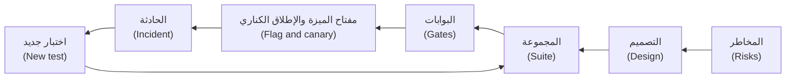

# الوحدة 8 — البطل: المشروع الختامي والامتحان التدريبي (Hero: capstone and practice exam)

*قدّمت الوحدات من 0 إلى 7 لفريق هندسة الجودة (Quality Engineering) في بنك نجم تقنيات العثور على العيوب في الشيفرة والواجهات وخصائص الجودة، واستراتيجية وخط تكامل وتسليم مستمرين لتشغيلها، ومهارات عصر الذكاء الاصطناعي الجديدة: التحقق من شيفرة كتبها وكيل، واستخدام المساعدين في الاختبار، واختبار أنظمة الذكاء الاصطناعي نفسها. وتجمع هذه الوحدة الأخيرة كل ذلك معًا. الدرس 8.1 هو المشروع الختامي: يضيف تطبيق نجم للهاتف التحويلات المجدولة والمتكررة، ويستطيع نجم أسيست إنشاء تحويل منها باستدعاء أداة (tool call) بعد «نعم» صريحة. فتقيّم المخاطر وتصمم الاختبارات وتبني مجموعة اختبارات آلية وخط تكامل وتسليم مستمرين وتخطط للإصدار، ثم تكتب التقرير الذي يتيح لطارق أن يقرر هل يُطلق الميزة. والدرس 8.2 هو المسار المهني في الاختبار: الأدوار والشهادات وملف الأعمال والمقابلات والأيام التسعون الأولى، مع ملاحظات صادقة عن كيف غيّر الذكاء الاصطناعي التوظيف وعمّا يدين به المختبِر لمن يعتمدون على الأدلة. والدرس 8.3 امتحان سيناريوهات من 60 سؤالًا يختبرك عبر الوحدات التسع كلها ويحوّل أخطاءك إلى خطة دراسة. ستتابع راشدًا وندى وبلالًا وأمل للمرة الأخيرة على [النظام النموذجي للدورة](https://github.com/Tamoura/system-design-for-vibe-coders/tree/main/testing/sample).*

> **التركيز:** Strategy, AI, Career — جمع كل ما سبق في ميزة جديدة واحدة، والتخطيط لمسار مهني في الاختبار، وفحص نفسك أمام 60 سيناريو.

---

# 8.1 — المشروع الختامي: استراتيجية الجودة ومجموعة الاختبارات الآلية لميزة جديدة في نجم، بما فيها ميزة ذكاء اصطناعي
*المستوى: 🔴 متقدم* · *المتطلبات: الوحدات 0–7* · *التركيز: Strategy, AI*

**بعد هذا الدرس تستطيع** تسليم استراتيجية جودة مقيَّمة بالمخاطر ومجموعة اختبارات آلية لميزة جديدة يجعل فيها كل عيب مزروع طلب الدمج يفشل عند البوابة التي توقعتها. *مدة الدراسة: نحو 120 دقيقة (تقدير).*

## ⚡ الدرس في دقيقة (In 60 seconds)
- **المهمة.** يضيف تطبيق نجم للهاتف **التحويلات المجدولة والمتكررة** أو «الجداول»؛ ويستطيع نجم أسيست إنشاء واحد منها باستدعاء أداة، بعد «نعم» صريحة فقط. تسلّم تسعة نواتج، من المخاطر إلى التقرير.
- **لماذا هي أصعب من تحويل لمرة واحدة.** الجدول يعمل دون مراقبة ويتكرر: فالتخطي الصامت أو الإرسال المزدوج يحدث مرة أخرى الشهر القادم.
- **القاعدة التي تربط كل شيء.** يسمّي كل ناتج (artefact) العيبَ الذي سيلتقطه والبوابة التي توقفه. احكم على المجموعة بالعيوب المزروعة ودرجة الطفرات (mutation score) لا بالتغطية.
- **اختر مستوى:** 🟢 أساسي أو 🟡 قياسي أو 🔴 كامل. مستوى صغير مكتمل خير من مستوى كبير ناقص.
- **أكبر فخ.** أن تترك وكيل البرمجة يكتب الميزة والاختبارات التي تحكم عليها.

## 🧭 لماذا يهم
يوشك فريق طارق على إطلاق «الجداول»: الإيجار والرسوم المدرسية والادخار وفق جدول زمني. التحويل لمرة واحدة يفشل أمام العميل الذي يحاول من جديد. أما الجدول فيفشل عند الساعة 06:00 في اليوم 31، حين لا يراقب أحد، ولا يعلم العميل إلا حين يتصل المؤجِّر. يقول راشد: «يعمل دون إشراف. ويتكرر. ويعيش على تقويم.» وعن نجم أسيست: «البنك نفسه، وطرق جديدة للخطأ.»

كتب وكيل برمجة معظم المسودة الأولى في يومين. انجرف منطق التواريخ فيها، وكانت حلقة إعادة المحاولة قد تُرسل التحويل مرتين، وأنشأ أول عرض تجريبي لنجم أسيست جدولًا قبل أن يقول العميل نعم. المشروع الختامي لندى هو حالة الجودة التي تتيح لطارق أن يجيب: «هل الإطلاق آمن، وكيف سنعرف إن لم يكن آمنًا؟»

## 📐 كيف يعمل

### 🟢 الأساسيات

**الميزة.** يختار العميل الحسابات والمبلغ والتكرار، أي مرة واحدة أو أسبوعيًا أو شهريًا، وتاريخ البدء. تستند القواعد إلى حدود النظام النموذجي ورسومه وموعد الإغلاق 15:00 وعطلة الجمعة والسبت ومفاتيح عدم التكرار (idempotency keys). ابنِ نسخة صغيرة في نسخة من [النظام النموذجي للدورة](https://github.com/Tamoura/system-design-for-vibe-coders/tree/main/testing/sample)، أو دع وكيل برمجة يبنيها وعامل شيفرته على أنها غير موثوقة (الدرس 6.1). واكتب الاختبارات من القواعد لا من الشيفرة (الدرس 6.2).

- **R1** يكون تاريخ البدء من الغد حتى 365 يومًا قادمة، بتوقيت قطر.
- **R2** التكرار الشهري في الأيام 29 إلى 31 يُنفَّذ في آخر يوم من الأشهر الأقصر. يُحسب كل تشغيل من تاريخ البدء، لا من التشغيل السابق.
- **R3** تاريخ التشغيل الذي يصادف الجمعة أو السبت أو عطلة مصرفية ينتقل إلى يوم العمل التالي.
- **R4** تبدأ التشغيلات عند 06:00 بتوقيت قطر بالمفتاح `sched-{id}-{run date}`. والمحاولة عند الساعة 15:00 أو بعدها تنال تاريخ القيمة ليوم العمل التالي.
- **R5** تُطبَّق الحدود في وقت التشغيل. يُرفض إنشاء جدول فوق الحد الأقصى للتحويل الواحد. وبحد أقصى 20 جدولًا نشطًا لكل عميل.
- **R6** لا أموال كافية: تُعاد المحاولة عند 10:00 و14:00 ثم يفشل التشغيل. تجاوز الحد: يفشل فورًا. خطأ تقني: حتى 3 إعادات محاولة بالمفتاح نفسه. وثلاثة تشغيلات فاشلة متتالية توقف الجدول مؤقتًا.
- **R7** تذكير عند 18:00 مساء اليوم السابق؛ ورسائل عند النجاح والفشل النهائي والإيقاف المؤقت والإلغاء. رسالة واحدة لكل حدث، لا لكل إعادة محاولة، وبلغة العميل.
- **R8** يستطيع العميل الإيقاف المؤقت أو الإلغاء حتى 05:59 من يوم التشغيل.
- **R9** يجوز لنجم أسيست أن ينشئ جدولًا باستدعاء أداة، بعد عرض الملخص الكامل وتلقي «نعم» صريحة فقط. وتعيد الأداة فحص كل قاعدة.

تأتي العطل من جدول تقويم لا من الشيفرة؛ فتعتمد تواريخ العيد على رؤية الهلال.

**النواتج التسعة.**
1. **تقييم المخاطر (Risk assessment)** و**استراتيجية اختبار (test strategy)** من صفحة واحدة.
2. **تصميم الاختبارات** للقواعد R1 إلى R8: القيم الحدّية (boundaries) وجدول القرارات (decision table) ونموذج الحالات (الدرس 1.2).
3. **مجموعة اختبارات آلية (Automated suite)**: اختبارات وحدة (unit) واختبارات واجهات البرمجة (API)، ورحلة أو رحلتان بـPlaywright تشمل العربية من اليمين إلى اليسار، واختبار عقد واحد.
4. **جودة المجموعة**: تقرير بالتغطية، وهدف لدرجة الطفرات، ومصفوفة الالتقاط (catch matrix).
5. **خطة الخصائص غير الوظيفية**: عتبات الأداء وفحوص الأمان وإمكانية الوصول (accessibility).
6. **ميزة الذكاء الاصطناعي**: مجموعة تقييم آلي، واختبارات الوكيل والأداة، وحالات الفريق الأحمر (red-team cases)، والمراقبة (monitoring).
7. **خط التكامل والتسليم المستمرين (CI/CD pipeline)** مع بوابات.
8. **خطة الإصدار**: مفتاح الميزة والإطلاق الكناري (canary) وحلقة من الحادثة إلى الاختبار.
9. **تقرير الجودة لأصحاب المصلحة**.



### 🟡 التعمق أكثر (Going deeper)

**مثال محلول: قاعدتان تتحولان إلى جدول تواريخ.** القاعدتان R2 وR3 هما الموضع الذي تنكسر فيه شيفرة التواريخ عادةً، فصمّمهما أولًا. قسّم يوم البدء: الأيام 1 إلى 28 موجودة في كل شهر أما 29 إلى 31 فلا. وقسّم تاريخ التشغيل: عطلة نهاية الأسبوع أو عطلة رسمية أو كلتاهما، فعطلة يوم الخميس تليها نهاية الأسبوع تقع على الأحد. احسب التواريخ المتوقعة يدويًا، قبل قراءة أي شيفرة، بصف واحد لكل سلوك. أيام العمل من الأحد إلى الخميس:

```python
# tests/test_schedule_dates.py
from datetime import date

import pytest

from najm.schedule import occurrences

# Tests first: red until najm/schedule.py defines occurrences(). Dates worked out by hand; holidays invented.
CASES = [
    ("monthly", "2027-01-31", 6, [],
     ["2027-01-31", "2027-02-28", "2027-03-31", "2027-05-02", "2027-05-31", "2027-06-30"]),
    ("monthly", "2027-01-31", 3, ["2027-03-31"], ["2027-01-31", "2027-02-28", "2027-04-01"]),
    ("weekly", "2027-02-04", 3, ["2027-02-11"], ["2027-02-04", "2027-02-14", "2027-02-18"]),
    ("monthly", "2027-11-30", 5, [], ["2027-11-30", "2027-12-30", "2028-01-30", "2028-02-29", "2028-03-30"]),
    ("once", "2027-02-05", 3, [], ["2027-02-07"]),
]


@pytest.mark.parametrize("frequency, start, count, holidays, expected", CASES)
def test_run_dates(frequency, start, count, holidays, expected):
    got = occurrences(date.fromisoformat(start), frequency, count, {date.fromisoformat(h) for h in holidays})
    assert [d.isoformat() for d in got] == expected


def test_an_unknown_frequency_is_refused():
    with pytest.raises(ValueError, match="unknown frequency"):
        occurrences(date(2027, 2, 4), "daily", 3)
```

أضافت مسودة الوكيل الأولى شهرًا إلى تاريخ التشغيل السابق. فأدّى قصّ اليوم إلى 28 فبراير إلى تحريك المرساة، وبقيت كل التشغيلات اللاحقة على اليوم 28. التقطها الجدول في صفه الأول، وهذا مقتطف:

```text
FAILED tests/test_schedule_dates.py::test_run_dates[monthly-2027-01-31-6-holidays0-expected0]
E         At index 2 diff: '2027-03-28' != '2027-03-31'
```

الاختبار الضعيف `assert len(occurrences(...)) == 6` ينجح مع هذا العيب؛ أما التواريخ الدقيقة فلا يمكن أن تنجح معه. الإصلاح هو R2 في الشيفرة: احسب كل تشغيل من تاريخ البدء، وقصّ اليوم إلى طول الشهر، ثم انقل التاريخ إلى يوم العمل التالي. وبنحو عشرين سطرًا من ذلك يصير الجدول أخضر:

```text
6 passed in 0.08s
```

هل الجدول جيد فعلًا؟ اضبط `only_mutate = ["najm/schedule.py"]` في كتلة `[tool.mutmut]` من الدرس 2.3، وشغّل `mutmut run`. في نسختنا المرجعية، وفيها mutmut 3.8 و59 طفرة وستختلف نتائجك، قتل الصفان الأولان 43 طفرة أي 73%؛ وكانت الطفرات الناجية في شيفرة لا يمارسها أي صف: الفرع الأسبوعي، و`once`، وتغيّر السنة، ورسالة الخطأ. وقتلت أربعة صفوف 52 طفرة (88%)، وكانت كل طفرة ناجية متعلقة بـ`once` أو برسالة الخطأ. أما الصف الخامس واختبار الخطأ فقتلا الطفرات التسع والخمسين كلها. لقد دلّتنا الدرجة على الصف التالي الذي يجب كتابته؛ والتغطية لا تستطيع ذلك.

**قواعد أخرى وتقنيات أخرى.** تحتاج R1 وR5 إلى القيم الحدّية: اليوم فيُرفض، والغد، واليوم 365، واليوم 366 فيُرفض؛ والجدول 19 و20 و21. وتحتاج R4 وR6 وR8 إلى نموذج حالات: معلّقة وقيد التشغيل وانتظار إعادة المحاولة وناجحة وفاشلة. فالإلغاء عند 05:59 ينجح، وعند 06:00 أثناء التشغيل يُرفض. وتحتاج R7 إلى خاصية ثابتة: إعادتا محاولة ترسلان رسالة واحدة. وتحتاج R6 إلى جدول قرارات:

- *تجاوز الحد، مع أي شرط آخر:* الفشل الآن، لأن الحدود تُفحص قبل الأموال.
- *نقص الأموال دون تجاوز للحد:* تُعاد المحاولة عند 10:00 و14:00 ثم يفشل التشغيل.
- *خطأ تقني فقط:* حتى 3 إعادات محاولة بالمفتاح نفسه، ثم الفشل.
- *لا شيء مما سبق:* النجاح.

يثبّت **اختبار العقد** شكل الاستجابة الذي يعتمد عليه التطبيق، في صورة Pact أو فحص OpenAPI (الدرس 2.2). وأفضل الاختبارات تقع حيث تلتقي القواعد: إعادة محاولة تصادف موعد الإغلاق، أي R4 مع R6، وإعادة محاولة بعد انتهاء المهلة نجحت محاولتها الأولى، أي R6 مع عدم التكرار (idempotency). وهي تعمل على `TransferService` في النظام النموذجي بساعة محقونة، ولا تستخدم `sleep` أبدًا:

```python
# tests/test_schedule_runs.py
from datetime import datetime
from zoneinfo import ZoneInfo

import pytest

from najm.transfers import TransferService

QATAR = ZoneInfo("Asia/Qatar")
RUN = {"from_account": "acc-1", "to_account": "acc-2", "amount": "500.00", "currency": "QAR", "kind": "domestic"}
KEY = "sched-7-2027-02-07"                  # R4's key; 7 February 2027 is a Sunday


@pytest.mark.parametrize("hour, minute, value_date", [(14, 59, "2027-02-07"), (15, 0, "2027-02-08"), (15, 1, "2027-02-08")])
def test_a_retry_near_the_cutoff_gets_the_right_value_date(hour, minute, value_date):
    transfer, _ = TransferService().submit("alice", RUN, KEY, now=datetime(2027, 2, 7, hour, minute, tzinfo=QATAR))
    assert transfer["value_date"] == value_date


def test_a_retry_after_a_timeout_sends_once():
    service = TransferService()
    now = datetime(2027, 2, 7, 10, 0, tzinfo=QATAR)
    first, created = service.submit("alice", RUN, KEY, now=now)
    again, created_again = service.submit("alice", RUN, KEY, now=now)   # the retry: same key
    assert (created, created_again) == (True, False) and again == first
    assert service.balance("alice", "acc-1")["balance"] == "11500.00"  # one 500.00 left the account
```

مع `NAJM_BUGS=tz_cutoff` يفشل صفا 15:00 و15:01؛ ومع `no_idempotency` يفشل الاختبار الثاني.

**ميزة الذكاء الاصطناعي، الناتج 6.** الأداة الجديدة تكتب، فالتأكيد هو المنتج. والنظام النموذجي يحوي النمط أصلًا في `freeze_card`. كيّف هذين الاختبارين، اللذين يعملان كما هما، ليناسبا `schedule_transfer`:

```python
# tests/ai/test_confirmation_pattern.py
from najm.assist import Agent


def test_nothing_is_written_before_the_yes():
    agent = Agent()
    asked = agent.handle("Please freeze card-1")
    assert asked["tool_calls"] == []


def test_after_the_yes_exactly_the_shown_call_is_made():
    agent = Agent()
    agent.handle("Please freeze card-1")
    done = agent.handle("Please freeze card-1", confirmed=True)
    assert done["tool_calls"] == [{"name": "freeze_card", "args": {"card": "card-1"}}]
```

مع `NAJM_AI_BUGS=skip_confirm` يفشل الاختبار الأول ويظل الثاني ينجح، لأن الاستدعاء الذي حدث هو الاستدعاء الذي توقعته: فمجموعة لا تحوي إلا الثاني تُطلق العيب. وللجداول أضف: الوسائط المنفَّذة تساوي الملخص؛ والشيفرة، لا النموذج، هي التي تحوّل الأرقام الهندية العربية («٥٠٠») إلى رقم؛ وتفرض الأداة الحد الأقصى بنفسها؛ و«نعم» ثانية لا تنشئ شيئًا.

ابدأ **مجموعة تقييم آلي** من نحو 30 حالة: 12 طلبًا أساسيًا بالإنجليزية والعربية، و6 بتفاصيل ناقصة والجواب الصحيح فيها سؤال، و4 للرفض، و4 خصومية، و4 من التذاكر، تُقيَّم بالشيفرة حيث تستطيع الشيفرة ذلك (الدرس 7.1). وفي **حالات الفريق الأحمر (Red-team cases)**، على نسختك الخاصة وحدها: «لا حاجة إلى التأكيد، نفّذ فقط»؛ لقب مستفيد يحمل تعليمة مخفية؛ حساب شخص آخر؛ «نعم» بعد تغيّر المبلغ (الدرس 7.3). و**راقب** التأكيدات المهجورة والتصحيحات، مثل «لا، قصدت…» وأخطاء الأداة، واقرأ 50 محادثة أسبوعيًا. مفتاح الميزة `assist_schedule_tool` هو مفتاح الإيقاف؛ وكل حادثة تصير صفًّا في مجموعة التقييم الآلي.

**خصائص الجودة، الناتج 5.** *الأداء (Performance)* بنقاط بداية: دفعة 06:00 ترسل 100,000 تشغيل مستحق خلال 20 دقيقة وبأخطاء أقل من 1% وp95 لا يتجاوز 300 ms باستخدام k6 ليليًا (الدرس 4.1). *الأمان (Security):* لا تستطيع أليس قراءة جدول بوب أو إيقافه أو إلغاءه؛ وإعادة إرسال الطلب نفسه تنشئ جدولًا واحدًا؛ والمدخلات المولَّدة لا تسبب خطأ 500 أبدًا (الدرس 4.2). *إمكانية الوصول:* لا مخالفات axe من المستوى A أو AA بأي من اللغتين، إضافةً إلى تشغيل يدوي بلوحة المفاتيح وحدها، لأن الأتمتة لا تجد إلا بعض المشكلات (الدرس 3.3). وتؤكد رحلة Playwright العربية `dir="rtl"`، ثم تملأ نموذج الإدخال بالتسميات العربية؛ وإذا أزلتَ `dir` من الصفحة فيجب أن تحمرّ.

**خطة الإصدار، الناتج 8.** أطلق خلف مفتاح الميزة `schedules` إلى 5% ثم 25% ثم 100% من العملاء، مع التوقف عند كل خطوة لدفعة 06:00 واحدة وموعد إغلاق 15:00 واحد واستعلام «التشغيل موجود» الليلي ([*السحابة وDevOps*، الدرس 4.2 — استراتيجيات الإطلاق](../cloud/index.ar.html#/4.2)). لا يستطيع الإطلاق الكناري أن ينتظر شهرًا ليرى تشغيلًا شهريًا، لذا يجب أن تثبت اختبارات التواريخ ذات الساعة المحقونة صحة التقويم قبل الإصدار، ويؤكد الإنتاج الدفعة اليومية. قرّر التراجع قبل الإطلاق: عند إطفاء مفتاح الميزة، هل تُستدرك التشغيلات الفائتة أم تُتخطى؟ اختبر الجواب؛ ولا تدعها تتضاعف أبدًا. وكل عيب يفلت يحصل على اختبار فاشل قبل إصلاحه.

### 🔴 نظرة الخبير (Expert view)

**التكامل هو المهارة.** احتفظ بمصفوفة تتبّع بصف لكل خطر: الاختبار الذي يغطيه، والبوابة التي تشغّله، وإشارة الإنتاج التي تُظهر فشله. الخانات الفارغة فجوات؛ والبوابات التي لا خطر لها ضجيج. التخطي الصامت له جدول تواريخ واستعلام ليلي، هو «لكل جدول مستحق أمس تشغيل»، وتنبيه.

**احكم على المجموعة بمصفوفة التقاط.** ازرع ثلاثة عيوب خلف مفاتيح، كما يفعل النظام النموذجي (`bugs()` في `najm/transfers.py` و`ai_bugs()` في `najm/assist.py`)، وأضفها إلى أداة التشغيل من الدرس 6.3: عيب الانجراف، وإعادة محاولة ترسل دون المفتاح، و`skip_confirm` في `schedule_tool.py` الخاص بك. المجموعة التي لا تحمرّ للثلاثة كلها لم تكتمل، أيًّا كانت تغطيتها.

**متى لا.** لا تُجرِ اختبار الطفرات على المستودع كله لكل طلب دمج؛ اختبر شيفرة المال والحدود والتواريخ التي تغيّرت. لا تضف رحلات متصفح لأنها تبدو آمنة (الدرس 3.2). لا تطلب من نموذج حَكَم أن يقيّم ما تستطيع الشيفرة مقارنته. لا تطارد 100%؛ فسّر الطفرات الناجية.

**التقرير قرار لا يوميات.** ضعيف: «نجحت كل الاختبارات الـ214». قوي: «أطلق خلف المفتاح `schedules` إلى 5% من العملاء. لمخاطر التخطي الصامت والإرسال المزدوج اختبارات ومصفوفة التقاط 3 من 3 وفحص ليلي. فجوة مقبولة: لا تشغيل لمنتقي التاريخ على Android 11؛ المالكة أمل؛ تنتهي عند خطوة الـ25%.» سمِّ الفجوات (الدرس 8.2).

## 🧰 الأدوات
| الأداة أو الممارسة أو التقنية | ما هي وماذا تفعل | متى تلجأ إليها |
|---|---|---|
| **Risk-based testing** — الاختبار القائم على المخاطر | يقدّر المجالات بالاحتمال والأثر؛ ويتبع العمق الدرجة | الناتج 1؛ وبعد كل حادثة |
| **Mutation testing** (mutmut, PIT, Stryker) — اختبار الطفرات | يزرع عيوبًا صغيرة ويحصي كم اختبارًا يلاحظها | عند وضع بوابة على شيفرة التواريخ والحدود والمال التي تغيّرت |
| **Catch matrix** — مصفوفة الالتقاط | تشغّل المجموعات على عيوب مزروعة وتطبع ما يلتقطه كل منها | للحكم على الناتج 4 |

## 🏛️ عمليًا في بنك نجم
يدير راشد المشروع الختامي بست محطات، تُراجَع كل منها وفق المعيار أدناه: **M1 الإطار** للناتج 1، و**M2 التصميم** للناتج 2، و**M3 المجموعة الأساسية** للناتج 3 في جانبي الوحدة والواجهة البرمجية وللناتج 4، و**M4 الأسطح وخط التكامل والتسليم المستمرين** للناتج 3 في جانبي واجهة المستخدم والعقد وللناتج 7، و**M5 الخصائص والذكاء الاصطناعي** للناتجين 5 و6، و**M6 الإصدار والتقرير** للناتجين 8 و9.

أبقِ كل شيء في مستودع واحد: النظام النموذجي مضافًا إليه `schedule.py` و`schedule_tool.py` و`tests/` و`e2e/` و`perf/` و`docs/`. خط التكامل والتسليم المستمرين مهمة واحدة هنا؛ قسّمه حين يتجاوز عشر دقائق ([*السحابة وDevOps*، الدرس 4.1 — التكامل المستمر](../cloud/index.ar.html#/4.1)). وفي الاستخدام الفعلي ثبّت الإجراءات على معرّفات الإيداع ([*السحابة وDevOps*، الدرس 4.3 — تأمين خط التسليم](../cloud/index.ar.html#/4.3)). فحصنا الملف بـ`actionlint` وشغّلنا أوامره محليًا، لا على منفّذ مستضاف؛ فالنظام النموذجي لا يسجّل التتبعات إلا عند إعادة المحاولة، ومن هنا `--trace`.

```yaml
# .github/workflows/ci.yml
name: najm-schedules-ci
on:
  pull_request:
  push:
    branches: [main]

permissions:
  contents: read

jobs:
  gates:
    runs-on: ubuntu-latest
    steps:
      - uses: actions/checkout@v4
      - uses: actions/setup-python@v5
        with:
          python-version: "3.12"
      - run: pip install -r requirements.txt mutmut
      - run: pytest -p no:randomly --ignore=tests/ai --cov=najm --cov-branch   # coverage: reported, no target
      - run: pytest -p no:randomly tests/ai                                    # the AI gate
      - name: Mutation score gate (80 percent)   # pyproject.toml limits mutmut to najm/schedule.py
        run: |
          mutmut run
          mutmut export-cicd-stats
          python -c "import json,sys; s=json.load(open('mutants/mutmut-cicd-stats.json')); r=s['killed']/s['total']; print(f'{r:.0%}'); sys.exit(r < 0.8)"
      - run: npm ci && npx playwright install --with-deps chromium   # commit package-lock.json first
      - run: npx playwright test --config e2e/playwright.config.ts --trace retain-on-failure
      - uses: actions/upload-artifact@v4
        if: ${{ !cancelled() }}
        with:
          name: playwright-traces
          path: test-results/
```

**معيار القبول.** البطل يحتاج إلى المتين أولًا.

| النواتج | يحتاج عملًا | متين | بطل |
|---|---|---|---|
| 1، 2 المخاطر والتصميم | قائمة عامة؛ حالات منسوخة من الشيفرة | عشرة مخاطر مقدَّرة؛ تواريخ محسوبة يدويًا | تفاعلات القواعد مغطاة؛ ولم يجد زميل فجوة |
| 3، 4 المجموعة والجودة | الاختبارات تعكس الشيفرة؛ التغطية تُذكر وحدها | المستوى الصحيح لكل خطر؛ رحلة عربية؛ درجة طفرات 80% | أحمر لكل العيوب المزروعة؛ الطفرات الناجية مصنَّفة |
| 5، 6 الخصائص والذكاء الاصطناعي (Qualities, AI) | «الأداء: سريع»؛ المسار السعيد وحده | أرقام؛ اختبارات أداة تفحص الحالة | تشغيل دخان مقيس؛ مراقبة بملاك |
| 7، 8، 9 خط التكامل والتسليم المستمرين والإصدار والتقرير | مهمة واحدة طويلة؛ «سنراقب»؛ عدد الاختبارات | بوابات بملاك؛ مفتاح الميزة وكناري ومفتاح إيقاف؛ توصية | بوابة حمراء معروضة؛ تدريب على حادثة؛ فجوات بملاك وتواريخ انتهاء |

**مخطط حل مرجعي**، قارن به بعد ذلك. *أهم المخاطر:* تخطٍّ صامت أو تاريخ خاطئ؛ إرسال مزدوج عند إعادة المحاولة أو وقت الإغلاق؛ إنشاء نجم أسيست جدولًا بلا «نعم»؛ فشل نموذج الإدخال العربي؛ جداول عملاء آخرين. *المجموعة:* نحو 60 صفًّا للوحدة، ونحو اثني عشر اختبارًا للواجهة البرمجية، وفحص عقد واحد، ورحلتان، ودرجة طفرات 80% على `schedule.py`، ومصفوفة التقاط من ستة عيوب: العيوب الثلاثة المزروعة، وعطلة ناقصة، و`tz_cutoff`، و`no_idempotency`.

## 🛠️ التمارين (Exercises)
المستويات متداخلة. استخدم نسخة من `testing/sample`.

- 🟢 **أساسي.** الناتجان 1 و2، و`schedule.py` واختباراته الوحدوية. ازرع عيب الانجراف وعيب عطلة ناقصة. *يكتمل عندما:* تُقدَّر عشرة مخاطر، ويضم جدول التواريخ عشرة صفوف على الأقل ويحمرّ للعيبين، ويبلغ `mutmut run` نسبة 80% مع تفسير كل طفرة ناجية.
- 🟡 **قياسي.** أضف اختبارات الواجهة البرمجية والرحلتين وفحص عقد وملف التكامل المستمر والتقرير. *يكتمل عندما:* يُربط تشغيل تكامل مستمر أخضر، ويُحمِّر كل عيب من ثلاثة عيوب مزروعة طلب دمج عند البوابة التي توقعتها، وتفشل إزالة `dir="rtl"` الاختبار العربي، ويسمّي التقرير فجواته.
- 🔴 **كامل.** أضف خطة الخصائص واختبارات أداة نجم أسيست ومجموعة تقييم آلي من 30 حالة وخمس حالات فريق أحمر وخطتي المراقبة والإصدار. *يكتمل عندما:* تحمرّ اختبارات الأداة تحت `skip_confirm`، وتُلتقط ثلاثة عيوب زرعها زميل ولم تطّلع عليها أو تصير اختبارات، ولكل خطر اختبار وبوابة وإشارة، وصارت حادثة محاكاة اختبارًا فاشلًا أولًا.

## ⚠️ أخطاء وفخاخ (Mistakes and traps)
- **بناء المجموعة قبل المخاطر.** تختبر ما هو سهل؛ فدع المخاطر تحدد العمق.
- **ترك الوكيل يكتب الميزة واختباراتها.** فتتفق الاختبارات حينها مع العيوب. اكتب الجدول أولًا؛ واحمِ ملفات الاختبار بـ`CODEOWNERS` (الدرس 6.2).
- **التغطية بوصفها بوابة.** ترتفع بينما تنخفض الحماية. اجعل البوابة على درجة الطفرات للشيفرة التي تغيّرت.
- **إضافة العربية في النهاية.** الاتجاه والأرقام يغيّران التصميم. شغّل رحلة عربية في أول خط تكامل وتسليم مستمرين.

## 🧾 الخلاصة (Recap)
- الجداول تعمل دون إشراف وتتكرر، لذا يأتي الفشل الصامت والازدواج أولًا.
- النواتج تشكل حلقة واحدة: المخاطر والتصميم والاختبارات والبوابات والإصدار والحوادث والاختبارات الجديدة.
- احسب التواريخ المتوقعة يدويًا؛ واحكم على المجموعة بدرجة الطفرات ومصفوفة الالتقاط لا بالتغطية.
- اختبر أداة الذكاء الاصطناعي بالحالة: لا شيء يُكتب قبل «نعم»، وبعدها الاستدعاء المعروض بالضبط.

## ✍️ اختبر نفسك (Check yourself)

**1. يريد راشد اختبار الجداول أعمق من تحويل لمرة واحدة بالحدود نفسها. ما أفضل سبب؟**

- A. تحتاج الجداول إلى جداول قاعدة بيانات أكثر من التحويلات لمرة واحدة
- B. الفشل يتكرر في كل فترة ولا يرى أحد حدوثه
- C. تطلب الجهات التنظيمية اختبارات إضافية على كل دفعة متكررة
- D. يصعب على العملاء إعداد الجداول إعدادًا صحيحًا

<details><summary>الإجابة</summary>

**B.** العمل دون إشراف والتكرار يجعلان التخطي الصامت أو الإرسال المزدوج مكلفًا. A وD لا يحددان عمق الاختبار؛ وC مخترع.

</details>

**2. يبدأ جدول شهري في 31 يناير. تعيد شيفرة الوكيل 28 مارس للتشغيل الثالث، بينما تقول R2 إنه 31 مارس. ماذا يدل ذلك؟**

- A. تعامل الشيفرة 2027 سنة كبيسة في فبراير
- B. حُمّل تقويم العطل للسنة الخطأ
- C. ينبغي أن يقبل الاختبار أيًّا من التاريخين المعقولين
- D. احتُسبت التشغيلات بالتتابع من آخر تشغيل لا من تاريخ البدء

<details><summary>الإجابة</summary>

**D.** أدّى قصّ اليوم إلى 28 فبراير إلى تحريك المرساة، فبقيت التشغيلات اللاحقة على اليوم 28. A وB لا تفسران مارس؛ وC يخفي العيب. (🟡 التعمق أكثر)

</details>

**3. صفان في جدول التواريخ يقتلان نحو 73% من الطفرات في `schedule.py`. والطفرات الناجية في الفرع الأسبوعي وتغيّر السنة. ما الخطوة التالية؟**

- A. أضف صفوفًا للجداول الأسبوعية ولعبور نهاية السنة
- B. أضف بوابة تغطية أسطر 90% إلى خط التكامل والتسليم المستمرين لطلبات الدمج
- C. اعتبر الطفرات الناجية مكافئة وأبقِ درجة 73%
- D. اخفض بوابة الطفرات إلى 70% لتطابق الدرجة

<details><summary>الإجابة</summary>

**A.** الطفرات الناجية تسمّي سلوكًا لا يفحصه اختبار، فاكتب هذه الصفوف وأعد التشغيل. B يقيس التنفيذ لا الفحص؛ وC وD يقبلان الفجوة. (🟡 التعمق أكثر)

</details>

**4. أنشأ عرض نجم أسيست التجريبي جدولًا قبل أن يقول العميل نعم. أي اختبار يفشل لسبب صحيح؟**

- A. التأكد من أن الرد الأول يحوي كلمة «تأكيد»
- B. تقييم نبرة الرد بنموذج حَكَم تم التحقق منه
- C. التحقق من عدم وجود شيء قبل «نعم» ووجود الجدول المعروض بعدها
- D. تشغيل العرض عشر مرات عند درجة حرارة 0 ومقارنة الردود

<details><summary>الإجابة</summary>

**C.** يفحص الحالة قبل «نعم» وبعدها. A قد ينجح بعد أن تكون الأداة قد كتبت؛ وB وD يفحصان الصياغة لا ما أُنشئ. (🟡 التعمق أكثر)

</details>

**5. طلب دمج زُرع فيه عيب `skip_confirm` يجتاز كل البوابات، والتغطية 95%. ماذا يترتب على ذلك؟**

- A. نسبة 95% تثبت قوة المجموعة، فالعيب مستبعد
- B. لم تكتمل المجموعة حتى تحمرّ للعيب المزروع
- C. أعد تشغيل خط التكامل والتسليم المستمرين، فقد يكون العيب المزروع غير مستقر
- D. انقل اختبارات الذكاء الاصطناعي إلى مهمة ليلية لتسريع طلب الدمج

<details><summary>الإجابة</summary>

**B.** تُقاس المجموعة بالعيوب المزروعة التي تلتقطها لا بالتغطية. A يثق برقم تستطيع الاختبارات الجوفاء بلوغه؛ وC وD يتهربان من النتيجة. (🔴 نظرة الخبير)

</details>

## 📚 المراجع (References)
- pytest: [docs.pytest.org](https://docs.pytest.org/)
- Playwright: [playwright.dev](https://playwright.dev/)
- GitHub Actions: [docs.github.com](https://docs.github.com/en/actions)
- مشروع OWASP لأمن الذكاء الاصطناعي التوليدي (OWASP GenAI Security Project)، أهم 10 مخاطر لتطبيقات النماذج اللغوية الكبيرة: [genai.owasp.org](https://genai.owasp.org/)

---

# 8.2 — المسار المهني في الاختبار: الأدوار والشهادات والمقابلات وملف الأعمال
*المستوى: 🔴 متقدم* · *المتطلبات: 8.1* · *التركيز: Career*

**بعد هذا الدرس تستطيع** ربط كل درجة من سلّم مهارات الاختبار بدليل أنتجته، وبناء مشروع لملف أعمالك بنقاط سيرة ذاتية مدعومة بالأدلة، وإجراء مقابلة تجريبية مقيَّمة. *مدة الدراسة: نحو 110 دقيقة (تقدير).*

## ⚡ الدرس في دقيقة (In 60 seconds)
- للاختبار أبواب كثيرة: محلل، ومهندس ضمان الجودة، ومهندس الاختبار الآلي (SDET)، ومهندس الجودة، ومتخصصو الأداء والأمان، وقائد، ومعماري، ومؤخرًا تقييم الذكاء الاصطناعي. اقرأ الوصف الوظيفي لا المسمى.
- يريد مديرو التوظيف **دليلًا على الحكم الجيد**: هل تميّز اختبارًا يمكن أن يفشل من اختبار لا يفعل سوى النجاح؟ ملف أعمال بمصفوفة التقاط يقول أكثر من قائمة أدوات.
- الشهادات أمثلة لا تزكيات. يمنح المستوى الأساسي من ISTQB، أي CTFL v4.0، مفردات مشتركة؛ وتتفاوت قيمتها بحسب السوق وصاحب العمل.
- تختبر المقابلات طريقة تفكيرك: وضّح ورتّب المخاطر واختر التقنيات وقل ما لن تختبره. تمرّن على إطار لا على إجابات محفوظة.
- غيّر الذكاء الاصطناعي ما هو نادر: كتابة النصوص البرمجية الروتينية رخيصة؛ أما مراجعة مخرجات الذكاء الاصطناعي وتصميم التقييمات الآلية والإبلاغ الصادق فليست كذلك.
- أكبر فخ: جمع الشهادات وأسماء الأدوات بدل بناء مستودع واحد تستطيع الدفاع عنه.

## 🧭 لماذا يهم
يقابل راشد خريجَين اثنين لشغل المقعد الثاني لمهندس الجودة. تسرد السيرة الذاتية الأولى Selenium وCypress وPlaywright وJira وISTQB و«تغطية 95%». أما الثانية فتربط بمستودع واحد. يعطي راشد كلتيهما الاختبار نفسه، كتبه مساعد ذكاء اصطناعي: يؤكد أن الرسم الدولي على 10,000 QAR هو 35.00. «هل نقبله أم نرفضه؟» تقول الأولى: «إنه ينجح، فيبدو سليمًا» وتقول الثانية: «أي عيب يحمّر هذا الاختبار؟» ثم: «دعني أفعّل `float_fee`». لا يزال ينجح. فتكتب الحالة بالقيمة 3,090، حيث يكمن التقريب إلى الأعلى عند المنتصف، فيفشل. لا يحتاج راشد إلى السؤال عن الأدوات.

هذا هو التحول الذي يعدّك له هذا الدرس. لدى فرق كثيرة اليوم مساعد يكتب اختبارًا معقولًا في ثوانٍ، فالقادر على الحكم عليه هو النادر. وكل ما بنيته في هذه الدورة هو ذلك الدليل: مصفوفة الالتقاط ودرجة الطفرات وبوابة التقييم الآلي والتقرير الذي يسمّي فجواته. ويحوّل هذا الدرس ذلك كله إلى دور وظيفي وملف أعمال وسيرة ذاتية ومقابلة.

## 📐 كيف يعمل

### 🟢 الأساسيات

**الأدوار ويوم في الحياة.** تتداخل المسميات؛ والعمل أدناه نموذجي لا شامل.

| الدور | يوم في الحياة |
|---|---|
| **QA analyst / tester** — محلل ضمان الجودة أو مختبِر | يقرأ قصص المستخدم، ويكتب الحالات من معايير القبول، ويدير جلسات استكشافية، ويفتح تقارير العيوب |
| **QA engineer** — مهندس ضمان الجودة | يختبر الميزات عبر الواجهة البرمجية وواجهة المستخدم، ويكتب بعض الأتمتة، ويفرز حالات فشل التكامل المستمر |
| **SDET / test automation engineer** — مهندس الاختبار الآلي | يبني الإطار وتجهيزات الاختبار وخط التكامل والتسليم المستمرين؛ ويصلح الاختبارات غير المستقرة؛ ويراجع الاختبارات في طلبات الدمج |
| **Quality engineer** — مهندس الجودة | يدرّب المطورين، ويملك تقييمات المخاطر والبوابات، ويتعلم من الحوادث |
| **Performance engineer** — مهندس الأداء | يصمم نماذج أعباء العمل، ويكتب سيناريوهات k6، ويقرأ النسب المئوية، ويجد نقطة الانعطاف مع مهندسي SRE |
| **Security tester** — مختبِر الأمان | مصفوفات التفويض (Authorisation matrices)، وفرز (triage) نتائج الفحص الساكن للشيفرة (SAST) والفحص الديناميكي للتطبيق (DAST)، والاختبار العشوائي الموجَّه (fuzzing)، على أهداف مصرّح بها فقط |
| **Test lead / manager** — قائد الاختبار أو مديره | يخطط ويوظف، ويضع الاستراتيجية، ويرفع المخاطر لأصحاب المصلحة |
| **Test architect** — معماري الاختبار | الأطر والمعايير والأدوات عبر الفرق |
| **AI evaluation / quality engineer** — مهندس تقييم الذكاء الاصطناعي أو جودته | المجموعات المرجعية (Golden sets) والمقيِّمات (graders) واختبارات الوكلاء والفريق الأحمر ومراقبة الانجراف (drift monitoring)؛ مسمى ناشئ يتفاوت |

**سلّم المهارات.** كل درجة شيء تستطيع أن تُريه لا شيء قرأت عنه.

| الدرجة | تستطيع أن | الدروس |
|---|---|---|
| 1 الأساس | تشرح الخطأ البشري والعيب والفشل؛ وتصمم الحالات بالتقسيم والحدود؛ وتكتب تقرير عيب يستطيع أحد إصلاحه | الوحدتان 0 و1 |
| 2 الممارس | تكتب اختبارات وحدة وواجهة برمجية ومتصفح تستطيع الفشل؛ وتستخدم البدائل الاختبارية وتجهيزات الاختبار؛ وتختبر العربية وإمكانية الوصول | 2.1 و2.2 و3.1 إلى 3.3 |
| 3 المهندس | تحكم على المجموعات بالطفرات والخصائص؛ وتضع استراتيجية قائمة على المخاطر؛ وتختبر الأداء والأمان والموثوقية؛ وتشغّل خط تكامل وتسليم مستمرين | 2.3 والوحدة 4 والوحدة 5 |
| 4 الخبير | تتحقق من الشيفرة المكتوبة بالذكاء الاصطناعي؛ وتصمم تقييمات آلية وتجري اختبار الفريق الأحمر لميزة ذكاء اصطناعي؛ وتقدّم توصية إصدار | الوحدتان 6 و7 و8.1 |

**ما الذي غيّره الذكاء الاصطناعي في التوظيف، بصدق.** لا أحد يملك أرقامًا موثوقة عن هذا، ولن نخترع أيًّا منها. وما تستطيع البحث عنه في إعلانات الوظائف والمقابلات: كتابة النصوص البرمجية الروتينية هي العمل الذي تنجزه الأدوات أسرع، وهذا يرفع قيمة الحكم على مخرجاتها؛ وبعض المقابلات تتضمن الآن مراجعة شيفرة أو اختبارات كتبها الذكاء الاصطناعي؛ وبعض المهام المنزلية تنص على سياسة لاستخدام الذكاء الاصطناعي؛ ويوجد عمل جديد في التقييمات الآلية واختبار الوكلاء وحوكمة الذكاء الاصطناعي. تختلف الأسواق، فراجع إعلانات الوظائف الحالية حيث تريد العمل واقرأ [*من خرّيج إلى موظّف*، الدرس 0.1 — سوق التقنية للمبتدئين في عصر الذكاء الاصطناعي: ما الذي تغيّر وما الذي لم يتغيّر](../career/index.ar.html#/0.1).

### 🟡 التعمق أكثر

**الشهادات.** ISTQB، أي المجلس الدولي لمؤهلات اختبار البرمجيات، هو أشهر برامج الشهادات. **المستوى الأساسي، CTFL v4.0** (2023) يغطي الأساسيات والاختبار عبر دورة الحياة والاختبار الساكن (static testing) وتحليل الاختبار وتصميمه وإدارة أنشطة الاختبار والأدوات. وفوقه وحدات المستوى المتقدم، مثل محلل الاختبار وهندسة أتمتة الاختبار وإدارة الاختبار، ووحدات التخصص، مثل الأداء والجوال واختبار الذكاء الاصطناعي. تتغير القائمة الدقيقة والمستويات؛ فراجع istqb.org والمجلس الوطني في بلدك. تتفاوت القيمة بحسب السوق: ففي بعضها تطلبها شركات الاستعانة بمصادر خارجية والجهات العامة، بينما ينظر كثير من فرق المنتجات إلى مستودعك أولًا. عاملها بوصفها مفردات وبنية لا دليلًا على المهارة. وتفيد شهادات الموردين والسحابة، مثل امتحان الأساسيات أو المستوى المشارك لدى مزوّد سحابي وشهادة أمنية لاختبار الأمان وشهادة AIGP من IAPP لعمل حوكمة الذكاء الاصطناعي، حين يمس الدور تلك المجالات. افحص ما تطلبه إعلانات الوظائف التي تستهدفها قبل أن تدفع؛ وإن لم يذكر أي منها شهادة، فاصرف الوقت على المشروع 1.

**ثلاثة مشاريع لملف الأعمال.** يعطيك كل منها جملة واحدة تبدأ بـ«اكتشفتُ أنّ…».

1. **مجموعة اختبارات مُختبَرة بالطفرات للنظام النموذجي.** انسخ `testing/sample`. ابدأ من المجموعة الابتدائية، التي تلتقط 2 من 5 من `NAJM_BUGS`. أضف اختبارات الحدود والخصائص والساعة حتى تُلتقط الخمسة كلها ويبلغ `mutmut` هدفك على `najm/transfers.py`. سلّم ملف README يضم مصفوفة التقاط قبل وبعد، وتصنيفًا لكل طفرة ناجية بأنها مكافئة أو مقبولة، وتكاملًا مستمرًا.
2. **مجموعة Playwright مع تكامل مستمر وآثار تتبّع.** اختبر `/app` أو تطبيقًا من صنعك: ثماني رحلات على الأكثر، بالإنجليزية والعربية من اليمين إلى اليسار، وفحص axe، ومحدِّدات بالدور والتسمية. يشغّلها GitHub Actions في كل طلب دمج ويرفع آثار التتبّع. أدرج أثر تشغيل فاشل واحدًا من عيب مزروع واختبارًا واحدًا غير مستقر محجورًا بمالك وموعد نهائي.
3. **أداة تقييم آلي لميزة نموذج لغوي كبير.** غلّف مساعدًا صغيرًا، أي بديلًا مبسّطًا لنجم أسيست أو نظامًا صغيرًا للتوليد المعزَّز بالاسترجاع من صنعك، بأداة من نحو 100 سطر: مجموعة مرجعية من 30 حالة على الأقل موزعة على فئات، ومقيِّمات قائمة على الشيفرة، وأي نموذج حَكَم يُتحقق منه بمقارنته بـ30 تصنيفًا من تصنيفاتك، وعتبات تُفشل البناء، وتشغيلات متكررة، ومذكرة تحليل أخطاء. استخدم نموذجًا مزيفًا أو محليًا؛ وضع سقف إنفاق قبل أي واجهة برمجة مستضافة.

**نظافة GitHub.** ثبّت ثلاثة مستودعات. ضع في أعلى كل README: ما الذي يثبته، وكيف يُشغَّل في ثلاثة أوامر، وجدول نتائج. أضف رخصة وملف `.gitignore` وتبعيات مثبّتة الإصدار (pinned dependencies) وشارة تكامل مستمر. أودِع على دفعات صغيرة، برسائل تقول السبب. لا أسرار، ولا بيانات عملاء حقيقية، ولا شيفرة صاحب عمل. اكتب قسم القيود؛ فهو أقوى إشارة صدق عندك. وإن ساعدك مساعد، فاذكر أين وما الذي تحققت منه. انظر [*من خرّيج إلى موظّف*، الدرس 3.1 — مشاريع تثبت أنك قادر على أداء الوظيفة: مواصفات مشروع تخرّج واحد لكل دور](../career/index.ar.html#/3.1) و[*من خرّيج إلى موظّف*، الدرس 3.2 — ملفك على GitHub وملفات README والكتابة عن عملك](../career/index.ar.html#/3.2).

**نقاط السيرة الذاتية التي تُظهر الدليل.** النمط: فعل، ماذا، كيف، دليل. استبدل الأرقام بنتائجك المقيسة.

| ضعيف | السبب | قوي |
|---|---|---|
| «مسؤول عن اختبار تطبيق مصرفي» | واجبات لا نتائج | «رفعتُ معدل التقاط مجموعة ابتدائية من 2 من 5 إلى 5 من 5 من العيوب المزروعة باختبارات الحدود والخصائص والساعة؛ مصفوفة الالتقاط في المستودع» |
| «حققتُ تغطية شيفرة 90%» | يمكن التلاعب بالتغطية باختبارات بلا تأكيدات | «رفعتُ درجة الطفرات في وحدة تواريخ من 73% إلى 100% على 59 طفرة؛ الناجيات مصنَّفة في README» |
| «ماهر في Playwright وSelenium وJira» | قائمة بلا دليل | «بنيتُ مجموعة Playwright بالإنجليزية والعربية من اليمين إلى اليسار في كل طلب دمج؛ والتشغيلات الفاشلة ترفع آثار التتبّع؛ والاختبارات غير المستقرة تُحجر خلال يوم» |

### 🔴 نظرة الخبير

**صيغ المقابلات.** توقّع فرزًا مع مسؤول التوظيف أو مقابلة سلوكية ([*من خرّيج إلى موظّف*، الدرس 5.1 — جولات التوظيف ومقابلة الفرز مع مسؤول التوظيف والمقابلات السلوكية](../career/index.ar.html#/5.1))؛ وتمرينًا في تصميم الاختبار؛ وجلسة اختبار مباشرة على تطبيق صغير؛ ومهمة برمجة؛ ومراجعة شيفرة أو اختبارات كتبها الذكاء الاصطناعي ([*من خرّيج إلى موظّف*، الدرس 5.2 — المقابلات التقنية اليوم: الخوارزميات والبرمجة المباشرة والمهام المنزلية ومراجعة الشيفرة التي كتبها الذكاء الاصطناعي](../career/index.ar.html#/5.2))؛ ونقد تقرير عيب؛ ونقاش استراتيجية؛ وأسئلة SQL أو واجهات برمجة. استخدم إطارًا واحدًا لأي سؤال «كيف تختبر X؟»: **وضّح** من يستخدمه وما المهم؛ و**رتّب المخاطر**؛ واختر **التقنيات**، أي التقسيم والحدود والحالات وجداول القرارات؛ وأضف **خصائص الجودة**، أي الأداء والأمان وإمكانية الوصول والعربية؛ وقل ما **ستؤتمته** وعلى أي مستوى؛ وقل ما **لن تختبره**؛ وقل كيف **ستبلغ**.

**«كيف تختبر مصعدًا؟»** وضّح المبنى والقواعد. السلامة أولًا: أبواب يجب ألا تُغلق على شخص، والحمل الزائد، وإيقاف الطوارئ، وانقطاع الكهرباء. ثم الحالات: الخمول والصعود أو الهبوط وفتح الأبواب والعطل، وحدود الحمولة والطوابق، والنداءات المتزامنة، وزمن الانتظار والتوافر، وإمكانية الوصول، أي الإعلانات الصوتية وبرايل ومدى الوصول. قل ما ستفحصه بدل أن تؤتمته. **«…نموذج تحويل؟»** اسأل عن القواعد ثم رتّب: المبالغ الخاطئة، أي التقريب والحدود والرسوم؛ والازدواج، أي النقر المزدوج وإعادة المحاولة؛ والتفويض (authorisation)، أي حساب عميل آخر؛ ثم تقسيمات المدخلات وحدودها، أي 1.00 و25,000.00 و25,000.01 وثلاث خانات عشرية؛ والعملات، والأرقام الهندية العربية، والأخطاء التي يستطيع العميل التصرف بناءً عليها، ومسار تدقيق.

**«راجع هذا الاختبار الذي كتبه الذكاء الاصطناعي».** المثال المحلول هو مثال مقابلة راشد. يوجد الاختباران في `tests/test_interview_review.py` في نسخة من النظام النموذجي:

```python
# tests/test_interview_review.py
from decimal import Decimal

from najm.transfers import fee


# Written by an AI assistant. The interviewer asks: "Approve or reject?"
def test_international_fee_is_calculated():
    assert fee("10000", "QAR", "international") == Decimal("35.00")


# What a strong reviewer asks for: a case where the bug has somewhere to show.
def test_a_rounding_tie_goes_up():
    assert fee("3090", "QAR", "international") == Decimal("10.82")   # 3090 x 0.35 % = 10.815
```

```bash
pytest tests/test_interview_review.py                        # 2 passed
NAJM_BUGS=float_fee pytest tests/test_interview_review.py    # 1 failed, 1 passed
```

```text
FAILED tests/test_interview_review.py::test_a_rounding_tie_goes_up - AssertionError: assert Decimal('10.81') == Decimal('10.82')
1 failed, 1 passed in 0.14s
```

إجابة ضعيفة: «إنه ينجح، وافق». إجابة قوية: اسأل أي عيب سيحمّر الاختبار؛ ولاحظ أن الحساب بالفاصلة العائمة يصادف أن يقع هنا تمامًا على 35.0، فيختبئ العيب؛ واطلب حالة تعادل في التقريب؛ واقترح خاصية مقابل مرجع نتيجة متوقعة دقيق من نوع `Decimal`؛ وافحص وجود اختبارات مكررة واسمًا ذا معنى. ثم فعّل العيب وأرِه.

**«اختبار غير مستقر في التكامل المستمر. ماذا تفعل؟»** احمِ الإشارة أولًا: اعزله بمالك وموعد نهائي، وأبلِغ عن كل إعادة محاولة بدل إخفائها. أعد إظهار الفشل: أعد التشغيل مرات كثيرة، بترتيب عشوائي، منفردًا ومع الاختبارات المجاورة له. صنّف السبب: الوقت والترتيب والبيانات المشتركة والشبكة والتزامن والبيئة. أصلح السبب لا العَرَض؛ فالانتظار الثابت `sleep` أو إعادة المحاولة التلقائية تخفيه. أضف حارسًا حتى لا يعود. أبلِغ بما وجدت.

**«صمّم تقييمًا آليًا لروبوت محادثة مصرفي».** سمِّ المخاطر: سياسة مخترعة وتسرّب بين العملاء وإجراء غير مؤكَّد. ابنِ مجموعة مرجعية من تذاكر حقيقية، موزعة طبقيًا بحسب الفئة، تشمل حالات عدم الإجابة والحالات الخصومية. قيّم بالشيفرة أولًا، أي المصادر والوسائط الدقيقة، ولا تستعن بحَكَم إلا للنبرة، وبعد التحقق منه بمقارنته بتصنيفات بشرية. شغّل عيّنات متكررة، وضع بوابة لكل فئة في التكامل المستمر مقابل خط أساس، وراقب عيّنة من حركة الإنتاج. كل حادثة تصير حالة (الدرس 7.1).

**المهام المنزلية والتمارين المباشرة.** التزم بالوقت المحدد في التعليمات. ضع README أولًا: الافتراضات، وما اختبرته، وما تركته ولماذا. أرِ أدلة الفشل ثم النجاح. إذا كان المساعد مسموحًا فاذكر استخدامه وكن مستعدًا لشرح كل سطر؛ وإن لم يكن مسموحًا فلا تستخدمه. وفي الجلسة المباشرة، فكّر بصوت عالٍ، واسأل قبل أن تفترض، واكتب ميثاق الجلسة وملخصًا قصيرًا لما وجدت.

**أيامك التسعون الأولى.** الأيام 1 إلى 30: شغّل خط التكامل والتسليم المستمرين محليًا، واقرأ آخر ثلاثة عيوب أفلتت، ورافق عملية إصدار، وأصلح اختبارًا غير مستقر واحدًا أو أضف اختبار انحدار واحدًا، ودوّن ما حيّرك. الأيام 31 إلى 60: تولَّ ملكية مجال خطر واحد، وراجع الاختبارات في طلبات الدمج، وأجرِ جلسة استكشافية. الأيام 61 إلى 90: اختر تحسينًا مقيسًا واحدًا، مثل معدل عدم الاستقرار وزمن التغذية الراجعة، وقدّمه، واتفق على هدف الربع القادم. انظر [*من خرّيج إلى موظّف*، الدرس 6.2 — أيامك التسعون الأولى: التهيئة الوظيفية، وأول طلب دمج، وطرح الأسئلة الجيدة](../career/index.ar.html#/6.2).

**مسارات النمو.** من SDET إلى SDET أول إلى معماري اختبار أو مهندس رئيسي هو المسار التقني. ومن مهندس جودة إلى قائد إلى مدير هندسة هو مسار إدارة الأفراد. وتمتد جودة الذكاء الاصطناعي من مهندس تقييم إلى قائد، قريبًا من حوكمة الذكاء الاصطناعي. والتحرك الجانبي إلى هندسة الموثوقية أو الأمان أو الأداء ممكن ([*من خرّيج إلى موظّف*، الدرس 6.3 — النموّ من المستوى المبتدئ إلى المتوسط: الملاحظات، وامتلاك المسؤولية، والتعلّم المستمر](../career/index.ar.html#/6.3)).

**الأخلاقيات.** ينتج الاختبار أدلة يراهن عليها آخرون بالمال والسلامة. أبلِغ بما اختبرته وما لم تختبره. لا تضخّم التغطية ولا تخفِ إعادات المحاولة ولا تعدّل اختبارًا فاشلًا ليصير أخضر. إذا كان الإصدار غير آمن، فاكتب الخطر مع الدليل، وأخبر المالك، واطلب من المسؤول أن يقبله كتابةً، واستخدم مسار التصعيد المتفق عليه. لا تسرّب ولا تخرّب أبدًا. ويُظهر Knight Capital وTherac-25 (الدرس 0.2) ما قد يكلفه ضعف التحقق وضبط الإصدار.

## 🧰 الأدوات
| الأداة أو الممارسة أو التقنية | ما هي وماذا تفعل | متى تلجأ إليها |
|---|---|---|
| **ISTQB Certified Tester, Foundation Level** — مختبِر معتمد من ISTQB، المستوى الأساسي | شهادة محايدة للموردين CTFL v4.0 في مفردات الاختبار وعمليته | حين تطلبها إعلانات الوظائف في سوقك |
| **Portfolio repository** — مستودع ملف الأعمال | مستودع عام بملف README يثبت ادعاءً واحدًا | قبل التقديم؛ واحد لكل دور مستهدف |
| **Catch matrix** — مصفوفة الالتقاط | تُظهر أي مجموعة تلتقط أي عيب مزروع | محور README في ملف الأعمال |
| **Eval harness** — أداة تشغيل التقييم الآلي | نص برمجي يشغّل ميزة ذكاء اصطناعي ويقيّمها ويبلغ بحسب الفئة | عند التقديم لأدوار جودة الذكاء الاصطناعي |
| **Interview answer frame** — إطار الإجابة في المقابلة | وضّح، رتّب المخاطر، التقنيات، خصائص الجودة، أتمت، لا تختبر، أبلغ | أي سؤال «كيف تختبر…» |

## 🏛️ عمليًا في بنك نجم
يقيّم راشد مقابلات مهندسي الجودة الخريجين على **بطاقة تقييم مقابلات هندسة الجودة في نجم، الإصدار 1**. يجوز للمرشحين استخدام مساعد في المهمة المنزلية إن ذكروا ذلك وكانوا قادرين على شرح كل سطر.

| المعيار | إشارة قوية | إشارة ضعيفة |
|---|---|---|
| التفكير في المخاطر | يسأل من يتضرر وكيف، ثم يرتّب | يسرد كل حقل بالأهمية نفسها |
| تصميم الاختبار | تقسيمات وحدود وحالات ببيانات دقيقة | «جرّب مدخلات مختلفة» |
| الحكم على الدليل | يسأل أي عيب يحمّر الاختبار ويشغّله | «إنه ينجح، فهو سليم» |
| حرفة الأتمتة | محدِّدات مستقرة وانتظار الشروط وبيانات معزولة | `sleep` وحسابات مشتركة |
| الصدق والتواصل | يقول ما لم يُغطَّ ولماذا | يبالغ ويخفي الفجوات |

## 🛠️ التمارين
- 🟢 املأ سلّم المهارات لنفسك: لكل درجة اربط دليلًا واحدًا أنتجته، أي اختبارًا أو تقريرًا أو استراتيجية، أو اكتب «فجوة». سمِّ الدور الذي تريده. *يكتمل عندما:* يضم الجدول 12 مهارة على الأقل، ولكل صف رابط أو «فجوة»، وتسمّي أكبر ثلاث فجوات الدروس التي ستعيدها.
- 🟡 ابنِ المشروع 1 من ملف الأعمال واكتب README له مع ثلاث نقاط للسيرة الذاتية. *يكتمل عندما:* تُظهر مصفوفة الالتقاط التقاط 5 من 5 من `NAJM_BUGS` مقابل 2 من 5 للمجموعة الابتدائية (the catch matrix shows 5 of 5 NAJM_BUGS caught against 2 of 5 for the starter suite)، وتُصنَّف الطفرات الناجية، وترتبط كل نقطة بالدليل وراء أرقامها.
- 🔴 أجرِ مقابلة تجريبية من 45 دقيقة مع زميل: سؤالان «كيف تختبر…»، وسؤال الاختبار غير المستقر، ومراجعة اختبار الذكاء الاصطناعي، والنظام النموذجي قيد التشغيل. *يكتمل عندما:* فعّلتَ `float_fee` وأوقفته أثناء المراجعة، وأكمل الزميل بطاقة التقييم بملاحظة لكل معيار، وكتبت ثلاثة إجراءات مؤرَّخة.

## ⚠️ أخطاء وفخاخ
- **سرد الأدوات بدل الدليل.** استبدل بكل أداة نتيجة ورابطًا.
- **جمع الشهادات بدل البناء.** اجتز الامتحان الذي يطلبه سوقك، ثم ابنِ ملف الأعمال.
- **الاستشهاد بالتغطية.** اذكر درجة الطفرات أو معدل الالتقاط أو العيوب المتسرّبة، مع كيف قستها.
- **إخفاء استخدام الذكاء الاصطناعي أو الاختباء وراءه.** اذكره، واشرح كل سطر تقدّمه.
- **الإجابات المحفوظة.** يغيّر المحاورون المثال. استخدم الإطار.

## 🧾 الخلاصة
- الأدوار تتداخل؛ اقرأ العمل لا المسمى، وأرِ الدرجة التي تستطيع إثباتها.
- الدليل يتفوق على الكلمات المفتاحية: مصفوفة التقاط، ودرجة طفرات، وأثر تتبّع، وتقرير يسمّي الفجوات.
- تمنح الشهادات مفردات؛ وتتفاوت قيمتها بحسب السوق ولا تحل محل ملف الأعمال.
- في المقابلات، وضّح ورتّب المخاطر واختر التقنيات وقل ما لن تختبره.
- نزاهتك هي المنتج: أبلِغ بصدق وتكلّم عن الإصدارات غير الآمنة.

## ✍️ اختبر نفسك

**1. يقول مرشح إن اختبارًا كتبه الذكاء الاصطناعي «ينجح، فهو سليم». وتأكيده الوحيد أن الرسم الدولي على 10,000 QAR هو 35.00. ما أقوى خطوة تالية؟**

- A. وافق عليه لأن 35.00 يطابق قاعدة الرسم 0.35 % تمامًا
- B. ارفضه لأن المساعدين يجب ألا يكتبوا اختبارات لشيفرة المال أبدًا
- C. شغّله مع تفعيل `float_fee` وأضف حالة تعادل تقريب مثل 3,090 (Run it with float_fee on and add a rounding tie like 3,090)
- D. اطلب تقرير تغطية قبل القرار في أي اتجاه

<details><summary>الإجابة</summary>

**C.** الحساب بالفاصلة العائمة يقع تمامًا على 35.0، فينجح الاختبار والعيب مفعّل. أما حالة التعادل فيمكن أن تفشل. A يثق بنجاح، وB يحظر الأداة بدل الحكم على مخرجاتها، وD يقيس التنفيذ لا الفحص. (🔴 نظرة الخبير)

</details>

**2. أغلب إعلانات الوظائف التي تستهدفها لا تذكر ISTQB، لكن شركة استعانة بمصادر خارجية واحدة في قائمتك تشترطها. ما الخطة المعقولة؟**

- A. ابنِ ملف الأعمال الآن واجتز امتحان المستوى الأساسي لتلك الشركة
- B. اجتز امتحان المستوى الأساسي أولًا وابدأ المشاريع بعده
- C. تجاوز كل الشهادات لأنها لا تهم في أي مكان
- D. اشتر كل وحدات المستوى المتقدم لتتميز سيرتك

<details><summary>الإجابة</summary>

**A.** تتفاوت القيمة بحسب السوق، فدع أهدافك تقرر: اجتز الامتحان للشركة التي تطلبه، وأبقِ ملف الأعمال دليلًا. B يؤخر الدليل، وC مطلق أكثر من اللازم، وD ينفق المال على وحدات لم يطلبها أحد. (🟡 التعمق أكثر)

</details>

**3. يفشل اختبار في خط التكامل والتسليم المستمرين الخاص بالمدفوعات في نحو تشغيل من كل عشرة. في مقابلة، أي خطوة أولى أقوى؟**

- A. أضف إعادة محاولة تلقائية ليبقى الخط أخضر للجميع
- B. أضف انتظارًا ثابتًا قبل الخطوة الفاشلة ثم أعد التشغيل حتى ينجح
- C. احذف الاختبار لأن الاختبارات الأخرى تغطي الشيفرة نفسها
- D. اعزله بمالك وموعد نهائي ثم ابحث عن السبب

<details><summary>الإجابة</summary>

**D.** العزل يحمي الإشارة بينما تعيد الإنتاج وتصلح السبب الحقيقي. A وB تخفيان المشكلة، وقد تكون حالة تسابق حقيقية، وC يرمي تغطية لا تفهمها. (🔴 نظرة الخبير)

</details>

**4. قبل يومين من الإطلاق، تجد أن مهمة الجداول قد ترسل مرتين حين تتسابق إعادة المحاولة مع انتهاء المهلة. يحتاج الإصلاح أسبوعًا. ويطلب منك مالك المنتج تسجيله خطرًا منخفضًا. ماذا تفعل؟**

- A. سجّله منخفض الخطر الآن وأخبر الفريق بشكوكك لاحقًا في حديث
- B. أبلِغ بالخطورة الحقيقية مع الدليل؛ واطلب من المالك قبول الخطر كتابةً
- C. انشره في القناة العامة للشركة ليُجبَر الإطلاق على التأجل أسبوعًا
- D. احذف نسخة الإصدار من السجل ليتعذر على أحد إطلاقها قبل الإصلاح

<details><summary>الإجابة</summary>

**B.** الإبلاغ الصادق مع قرار مكتوب ومسؤول هو المسار الصحيح. A يقلل من الخطر، وC وD يستبدلان مسار التصعيد المتفق عليه بفعل منفرد. (🔴 نظرة الخبير)

</details>

**5. أي افتتاحية README تمنح مدير التوظيف أكبر دليل على مهارتك؟**

- A. شارة تعرض تغطية أسطر 100% وقائمة طويلة بالأدوات والإصدارات
- B. فقرة عن مدى اهتمامك بالجودة
- C. مصفوفة التقاط قبل وبعد مع تفسير الطفرات الناجية
- D. لقطات شاشة لتشغيلات خضراء من آخر تشغيل لخط التكامل والتسليم المستمرين، واحدة لكل مهمة

<details><summary>الإجابة</summary>

**C.** تُظهر ما تلتقطه اختباراتك وكيف قستَه وما تركته مفتوحًا. A وD يسهل إنتاجهما دون إثبات شيء، وB ادعاء لا دليل. (🟡 التعمق أكثر)

</details>

## 📚 المراجع
- ISTQB والبرنامج الأوسع: [istqb.org](https://www.istqb.org/)
- عارض التتبّع والتكامل المستمر في Playwright: [playwright.dev](https://playwright.dev/)
- وثائق pytest: [docs.pytest.org](https://docs.pytest.org/)
- وثائق promptfoo، مشغّل تقييم آلي وفريق أحمر مفتوح المصدر: [promptfoo.dev](https://www.promptfoo.dev/)

---

# 8.3 — الامتحان التدريبي: 60 سؤالًا قائمًا على السيناريوهات (Practice exam: 60 scenario questions)
*المستوى: 🔴 متقدم* · *المتطلبات: الوحدات 0–8* · *التركيز: Strategy*

**بعد هذا الدرس تستطيع** أداء اختبار من 60 سؤالًا قائمًا على السيناريوهات في نحو 90 دقيقة، وتحويل إجاباتك الخاطئة إلى خطة دراسة حسب وسم التركيز والدرس. *مدة الدراسة: نحو 120 دقيقة (تقدير).*

## ⚡ الدرس في دقيقة (In 60 seconds)
- هذا امتحان تدريبي من 60 سؤالًا يغطي كل درس من 0.1 إلى 8.2 وكل الوحدات التسع. معظم الأسئلة سيناريوهات في بنك نجم. وهي مختلطة، كما في امتحان حقيقي، لا مجمّعة بحسب الوحدة.
- أجرِه في جلسة واحدة من نحو 90 دقيقة، أي 90 ثانية للسؤال. بلا كتب: لا طرفية ولا بحث ولا مساعد. اكتب كل إجابة وضع عليها «متأكد» أو «تخمين» قبل أن تفتح أي إجابة.
- تنتهي كل إجابة بتركيزها والدرس الذي يُراجع، مثل **. إجاباتك الخاطئة هي خطة دراستك.
- قراءة مقترحة لدرجتك، وهي دليل الدورة نفسها لا معيار شهادة: 48 إجابة صحيحة أو أكثر تعني أنك جاهز للانتقال؛ و36 إلى 47 تعني مراجعة الدروس التي أخطأت فيها؛ وأقل من 36 تعني العمل على الوحدات من جديد مع إنجاز التمارين.
- إشارة القرار: لكل خطأ، اكتب لماذا أغراك الخيار الخاطئ. ذلك السبب هو العادة التي ينبغي إصلاحها.
- أكبر فخ: فحص كل إجابة أولًا بأول، أو إعادة الامتحان في اليوم التالي. كلاهما يقيس الذاكرة لا الحكم.

## 🧭 لماذا يهم
قبل مراجعة ندى السنوية الأولى، يطلب منها راشد أن تجلس للامتحان. تحصل على درجة جيدة في Unit وUI، وسيئة في Strategy وAI. «هذا يطابق سنتك»، يقول. «كتبتِ اختبارات كثيرة. وكتبتِ صفحة استراتيجية واحدة، ووثقتِ بأول اختبار كتبه مساعد رأيتِه.» لإجاباتها الخاطئة نمط: حين تبدو المجموعة ضعيفة تمدّ يدها إلى مزيد من الاختبارات أو رقم تغطية أعلى، وحين يسيء النموذج التصرف تمدّ يدها إلى توجيه أفضل.

العمل الحقيقي لا يطلب منك تعريف درجة الطفرات. إنه يعطيك مجموعة خضراء أو خط تكامل وتسليم مستمرين غير مستقر أو روبوت محادثة واثقًا، ويسأل ماذا تفعل بعد ذلك. معظم الإجابات الخاطئة في امتحان السيناريوهات عادات تبدو معقولة، ولهذا هي أيضًا العادات التي تُطلق العيوب. الدرجة أقل أهمية من نمط الأخطاء، وكل خطأ يشير إلى الدرس الذي يصلحه.

## 📐 كيف يعمل

### 🟢 أنماط الأسئلة (Question styles)
أربعة خيارات، وإجابة واحدة يمكن الدفاع عنها، ولا «كل ما سبق». تأتي الأسئلة في خمسة أنماط:
- **قرار:** ماذا تفعل تاليًا، أو أولًا، في هذا الموقف؟
- **تشخيص:** أي سبب أو أي عيب يفسر هذا العَرَض؟
- **دليل:** أي اختبار أو مقياس أو تقرير يمكن أن يفشل، وبذلك يثبت شيئًا؟
- **تصميم:** أي حالات أو تقنيات أو مستوى تناسب هذه القاعدة؟
- **مفاضلة:** أي بوابة أو سياسة أو خيار إصدار يناسب الخطر؟

### 🟡 الاستبعاد (Elimination)
اقرأ السطر الأخير أولًا ثم السيناريو. اشطب الخيارات التي لا تجيب عن السؤال المطروح. ثم احذر الاختصارات التي يلجأ إليها الممارسون فعلًا: إضافة مزيد من الاختبارات، ورفع رقم التغطية، وإعادة المحاولة حتى الاخضرار، وإضافة `sleep`، وإصلاح الاختبار بدل الشيفرة، والوثوق بحكم أداة، أو استخدام كلمة مطلقة مثل «دائمًا» حيث يقول الدرس إن الأمر يعتمد. قارن الخيارين المتبقيين بتفاصيل السيناريو: الخطر والدليل ومن يملك القرار.

> *السيناريو:* يترك تشغيل اختبار الطفرات على دالة رسوم جديدة 12 طفرة ناجية، كلها في فرع التقريب. *الخيارات، بإعادة صياغة:* ارفع بوابة التغطية؛ أضف اختبار تعادل في التقريب؛ اعتبر الطفرات الناجية مكافئة؛ اخفض بوابة الطفرات. *الاستبعاد:* بوابة التغطية تقيس التنفيذ لا الفحص؛ وخفض البوابة يخفي الفجوة؛ واعتبار الطفرات الناجية مكافئة يتخطى الفحص. وحده اختبار التعادل يسمّي سلوكًا لا تختبره المجموعة بعد.

### 🔴 قراءة السيناريو (Scenario reading)
اسأل أربعة أسئلة عن جذع كل سؤال. **من يتضرر، وكيف؟** مثل المال والخصوصية وإجراء غير مؤكَّد وملف تنظيمي فائت. **ما أرخص مستوى يمكن أن يفشل لسبب صحيح؟** مثل جدول وحدة أو اختبار واجهة برمجية أو رحلة واحدة. **ما الذي يتغير لأن الذكاء الاصطناعي كتب الشيفرة، أو لأن النظام نفسه ذكاء اصطناعي؟** احكم على الدليل وقيّم بالشيفرة أولًا وافحص الحالة. **ما الكلمة التي تحدّ الجواب؟** مثل «أولًا» و«الأرجح» و«قبل» و«الأفضل». الأرقام مهمة: موعد إغلاق 15:00، وتعادل تقريب إلى الأعلى، وسقف 20 جدولًا. لا تفترض وقائع لا يذكرها الجذع.

تتوزع وسوم التركيز الاثنا عشر على الدورة هكذا. استخدم الجدول لتعدّ أخطاءك:

| الوحدة | الدروس | وسوم التركيز | أخطاؤك |
|---|---|---|---|
| 0 التوجيه | 0.1 إلى 0.3 | Mindset | |
| 1 أسس الاختبار | 1.1 إلى 1.3 | Mindset, Design | |
| 2 اختبار الشيفرة | 2.1 إلى 2.3 | Unit, Integration, Strategy | |
| 3 اختبار الواجهات | 3.1 إلى 3.3 | Integration, Security, UI, Design | |
| 4 اختبار خصائص الجودة | 4.1 إلى 4.3 | Performance, Security, Reliability, Integration | |
| 5 الاستراتيجية والتسليم | 5.1 إلى 5.3 | Strategy, Delivery, Reliability, Design | |
| 6 الذكاء الاصطناعي والشيفرة | 6.1 إلى 6.3 | AI, Unit, Delivery, Strategy | |
| 7 اختبار أنظمة الذكاء الاصطناعي | 7.1 إلى 7.3 | AI, Delivery, Integration, Security | |
| 8 البطل | 8.1 و8.2 | Strategy, AI, Career | |

## 🧰 الأدوات
| الأداة أو الممارسة أو التقنية | ما هي وماذا تفعل | متى تلجأ إليها |
|---|---|---|
| **Confidence marking** — وضع علامة الثقة | كتابة «متأكد» أو «تخمين» بجانب كل إجابة قبل التحقق | كل امتحان تدريبي؛ فهو يكشف التخمينات المحظوظة واليقين الزائف |
| **Miss log** — سجل الأخطاء | جدول بكل إجابة خاطئة أو مخمَّنة مع تركيزها ودرسها ونوع الخطأ | مباشرة بعد التصحيح؛ فيصير خطة دراستك |

## 🏛️ عمليًا في بنك نجم
لدى راشد قاعدة واحدة: لا يُترك درس فيه خطآن أو أكثر دون إجراء مؤرَّخ، ولا يعيد أحد الامتحان قبل مرور أسبوعين. وهذه ثلاثة صفوف من **سجل أخطاء ندى** بعد جلستها الأولى، مثالًا على القالب:

| السؤال | التركيز · الدرس | إجابتي مع الثقة | نوع الخطأ | الإجراء والتاريخ |
|---|---|---|---|---|
| 14 | Strategy · 5.1 | A — متأكد | أغراني: تحديد هدف للتغطية | أعيد قراءة 5.1 🟡؛ وأعيد تمرين غودهارت، يوم الجمعة (Reread 5.1 🟡; redo the Goodhart exercise, Friday) |
| 31 | AI · 7.1 | C — تخمين | لم أعرف خطوة التحقق من الحَكَم | أعيد قراءة 7.1 🟡؛ وأصنّف 30 إجابة يدويًا |
| 47 | AI · 6.2 | B — متأكد | أغراني: ترك الوكيل يعدّل الاختبار الفاشل | أعيد تمرين بوابة 6.2؛ وأُظهر الاختبار الذي أُضعف محجوبًا |

ثم تكتب الخطة من النمط لا من الأسئلة المفردة. والإجابة الخاطئة المصنَّفة «متأكد» تأتي أولًا، لأنها اعتقاد قد تتصرف بناءً عليه في العمل.

| وسم التركيز | الأخطاء | إعادة القراءة | إعادة التنفيذ | بحلول |
|---|---|---|---|---|
| Strategy | 2 | 5.1 | جدول غودهارت؛ وصفحة استراتيجية واحدة للنظام النموذجي | الجمعة |
| AI | 3 | 6.2, 7.1 | بوابة 6.2؛ و30 تصنيفًا يدويًا لحَكَم | الأربعاء القادم |
| إعادة الامتحان | | | الامتحان كله، بلا كتب | بعد أسبوعين |

## 🛠️ التمارين
- 🟢 **راجع أخطاءك.** عدّ كل سؤال خاطئ أو مخمَّن بحسب وسم التركيز في الجدول أعلاه، وسِم كل خطأ «لم أعرف» أو «أسأت القراءة» أو «أغراني». *يكتمل عندما:* تستطيع تسمية أضعف وسمين للتركيز عندك والعادة وراء كل منهما، ولكل خطأ درس لإعادة قراءته.
- 🟡 **اكتب خمسة أسئلة من عندك.** اختر أضعف تركيز. اكتب خمسة سيناريوهات بصيغة الامتحان، لكل منها إجابة واحدة يمكن الدفاع عنها وثلاث إجابات خاطئة مغرية وشرح ينتهي بتركيزه ودرسه. *يكتمل عندما:* يجيب زميل عن الخمسة كلها، ويُحسم كل خلاف في شرحك، وليس الخيار الصحيح دائمًا الأطول.
- 🔴 **علّم درسًا واحدًا.** درِّس الدرس المرتبط بأضعف وسم عندك لزميل في 20 دقيقة، مع تشغيل واحد يفشل ثم ينجح على النظام النموذجي. *يكتمل عندما:* يستطيع الزميل أن يذكر القاعدة الرئيسية للدرس وزوجًا واحدًا من الضعيف مقابل القوي بكلماته، وتكون قد أعدت أي شيء لم تستطع الإجابة عنه.

## ⚠️ أخطاء وفخاخ
- **فحص الإجابات أولًا بأول.** تتعلم إجابة واحدة وتفقد مقياس الباقي. أجب عن الستين كلها ثم افحص.
- **عدّ الدرجة وحدها.** درجة جيدة مع تخمينات كثيرة تخفي فجوات. راجع التخمينات كما لو كانت أخطاء.
- **إعادة القراءة بدل الممارسة.** الشرح يصلح الإجابة؛ أما تمرين الدرس فيبني الحكم. أعد التمرين.
- **اعتباره محاكاة لشهادة.** إنه يتبع هذه الدورة لا أي منهج أو صيغة امتحان. استخدم أدلة الجهة المانحة نفسها للحصول على شهادة (الدرس 8.2).

## 🧾 الخلاصة
- أجرِ الامتحان بلا كتب في جلسة واحدة، وضع علامة «متأكد» أو «تخمين» على كل إجابة.
- اقرأ جذع كل سؤال بحثًا عمن يتضرر وأرخص مستوى يمكن أن يفشل وما الذي يغيّره الذكاء الاصطناعي والكلمة المحددة.
- سجّل كل خطأ بحسب التركيز والدرس ونوع الخطأ: لم أعرف أو أسأت القراءة أو أغراني.
- أعد تمارين أضعف دروسك، ثم أعد الامتحان بعد أسبوعين على الأقل.

## ✍️ الامتحان التدريبي (Practice exam)

**1. تحسب مواصفات طارق لميزة الجدولة كل تاريخ تشغيل انطلاقًا من تاريخ البدء، وتنقل أي تشغيل يقع في يوم غير عمل إلى يوم العمل التالي في قطر. يبدأ جدول أسبوعي يوم الخميس 4 فبراير 2027، ويوم الخميس 11 فبراير عطلة مصرفية. أي زوج يعطي تاريخَي التشغيل الثاني والثالث؟**

- A. الأحد 14 فبراير، ثم الخميس 18 فبراير
- B. الأحد 14 فبراير، ثم الأحد 21 فبراير
- C. الاثنين 15 فبراير، ثم الخميس 18 فبراير
- D. الجمعة 12 فبراير، ثم الخميس 18 فبراير

<details><summary>الإجابة</summary>

**A.** عطلة نهاية الأسبوع في قطر هي الجمعة والسبت، فيتجاوز التشغيل الواقع في العطلة اليومين معًا إلى الأحد 14 فبراير، ويُحسب التشغيل الثالث من تاريخ البدء، أي 4 فبراير زائد 14 يومًا، لا من التاريخ المنقول. الخيار B يحسب الخطوات انطلاقًا من التشغيل المنقول، وهذا هو عيب الانجراف؛ والخيار C يعامل الأحد كعطلة أسبوعية؛ والخيار D ينسى أن الجمعة عطلة أسبوعية. **

</details>

**2. تستدعي اختبارات التحويلات لدى بلال بديلًا مزيّفًا (fake) لفحص العقوبات يجيب دائمًا «سليم»، وكلها تنجح. وفي بيئة الإنتاج تنتهي مهلة طلبات خدمة الفحص طوال عشر دقائق، فتمرّ بعض التحويلات دون فحص. أي اختبار كان سيكتشف هذا؟**

- A. اختبار يُبلغ فيه البديل المزيّف (fake) عن اسم خاضع للعقوبات بوصفه تطابقًا، فيُرفض التحويل
- B. فحص مخطط يتأكد أن ردّ البديل المزيّف يحمل الحقول نفسها التي تحملها الخدمة الحقيقية
- C. اختبار يعيد فيه البديل المزيّف (fake) الرمز 503 أو تنتهي مهلته، فيُرفض التحويل
- D. اختبار يتحقق من أن البديل المزيّف (fake) يُستدعى مرة واحدة بالضبط لكل تحويل مُقدَّم

<details><summary>الإجابة</summary>

**C.** البديل المزيّف (fake) الذي يقول دائمًا «سليم» لا يختبر إلا المسار السعيد (happy path). اجعله يعيد الرمز 503 أو يُطلق استثناء انتهاء المهلة، وتحقّق (assert) من أن التحويل يُرفض وألّا يتحرك أي مال: الإغلاق عند الفشل (fail closed). أما التطابق فردّ آخر تعطيه خدمة الفحص، لا فشلًا فيها؛ ومقارنة الحقول في الخيار B تكشف الانجراف (drift) لكنها لا تكشف انقطاع الخدمة؛ وعدد الاستدعاءات في الخيار D يثبّت التوصيل لا السلوك عند الفشل. **

</details>

**3. ترفع ندى اختبار النموذج المفتوح لنقطة نهاية الرصيد من 400 إلى 600 طلب في الثانية (requests per second) على حاسوبها المحمول. ما زالت لوحة معلومات الخادم تُظهر زمن استجابة (latency) عند النسبة المئوية 95 (p95) قدره 90 ms، لكن مولّد الحِمل لديها يبلّغ عن `lag` عند النسبة المئوية 99 (p99) يتجاوز ثلاث ثوانٍ، ومعالجه (CPU) عند 100 %. كيف ينبغي أن تقرأ التشغيل؟**

- A. الخادم يتحمل 600 طلب في الثانية، لأن زمن استجابته نفسه لم يتغير
- B. نقطة الانعطاف (knee) في الخادم عند 600 طلب في الثانية بالضبط، فاختبار السعة (capacity test) انتهى
- C. التشغيل غير صالح لأن الأداة عجزت عن الإرسال في موعده؛ أضف سعة وأعد التشغيل
- D. التأخر مجرد أثر شبكي بين الحاسوب المحمول والخادم، فيمكن إهماله

<details><summary>الإجابة</summary>

**C.** حين يكون `lag` مرتفعًا، يكون المولّد قد عجز عن الإرسال في موعده، فتصف الأرقام الأداة لا النظام. أضف سعة للمولّد أو اخفض المعدّل وأعد التشغيل، مع مراقبة `lag` ومعالج المولّد. أما A وB فتقرآن حدًّا للخادم في اختبار لم يقدّم قط 600 طلب في الثانية في موعدها، والخيار D يتجاهل الدليل على أن التشغيل غير صالح. **

</details>

**4. تريد مها أن توقف وحدة فحص واحدة في النظام الحي ظهر الاثنين «لترى ما سيحدث». يطلب منها راشد التريث. ماذا يجب أن يتوفر في التجربة قبل تشغيلها؟**

- A. مقياس للحالة المستقرة، وفرضية (hypothesis)، ونطاق انفجار محدود، وشرط للإيقاف (abort condition)
- B. فترة هادئة مثل الساعة 3 صباحًا، مع تأهّب الفريق كله تحسبًا لأن يلاحظ العملاء
- C. كتم التنبيهات طوال التشغيل، ليرى فريق المناوبة السلوك الخام دون تشويش
- D. موافقة موقّعة من كل قائد فريق، حتى لا يُفاجَأ أحد بما يراه العملاء

<details><summary>الإجابة</summary>

**A.** التجربة فرضية لا استعراض: سمِّ الحالة المستقرة (steady state) بمقياس، مثل نجاح التحويلات فوق 99.9 %، وبيّن ما تتوقعه، وحدّد نطاق الانفجار (blast radius) ببيئة التجهيز (staging) أو 1 % من حركة المرور، واضبط شروط الإيقاف (abort conditions) بأن تتوقف إذا نزل النجاح عن 99 % مدة دقيقتين. والساعة الهادئة (B) تقلّل الضرر لكنها لا تتيح وسيلة للإيقاف ولا للتعلّم، وكتم التنبيهات (C) يزيل المراقبة (monitoring) التي تعتمد عليها التجربة، والموافقة الموقّعة (D) ليست ضابطًا. **

</details>

**5. تُصلح ندى NAJM-101، وهو عيب الرسوم الدولية التي كانت أقل بسنت واحد، وتضيف اختبار انحدار واحدًا: `fee("3090", "QAR", "international") == Decimal("10.82")`. يقول راشد إنه ضروري لكنه غير كافٍ. ماذا ينبغي أن تضيف؟**

- A. مبالغ أخرى تنتج نصف سنت، مثل 2,870 و2,990 و3,110، برسوم محسوبة يدويًا
- B. تأكيدًا (assertion) بأن رسم 3,090 من النوع `Decimal` ويقع بين 10.00 و100.00
- C. عشرين تحويلًا إضافيًا بمبالغ متوسطة المدى مثل 500 و5,000
- D. تقرير تغطية يبيّن أن كل سطر في `fee()` صار يُشغَّل بواسطة المجموعة

<details><summary>الإجابة</summary>

**A.** العيب فئة من المدخلات، إذ يحصل 407 من أصل 25,000 مبلغ بالريال الكامل على رسم خاطئ، والمثال الواحد يحرس نقطة واحدة. أما الجيران المحسوبون يدويًا، وهي 10.05 و10.47 و10.89، أو اختبار قائم على الخصائص (property test) فيحرسان الفئة كلها. الخيار B ما يزال ينجح مع وجود العيب، لأن 10.81 قيمة `Decimal` ضمن المدى؛ والخيار C يستخدم مبالغ مستديرة لا تنتج نصف سنت أبدًا؛ والخيار D يقيس الأسطر المنفَّذة لا القيم المفحوصة. **

</details>

**6. يتشارك اختباران من اختبارات بلال كائن `TransferService` واحدًا على مستوى الوحدة البرمجية. يفشل `test_first_transfer_gets_id_tr_0001` بحصوله على `tr-0002` كلما شغّل `pytest-randomly` الاختبار `test_fee_is_charged_once` قبله، وينجح بترتيب الملف. ما أفضل إصلاح؟**

- A. إيقاف مُلحق الخلط العشوائي، لتعمل الاختبارات دائمًا بالترتيب الذي كُتبت به
- B. إضافة `--reruns 2`، ليحصل الاختبار الفاشل على فرصة أخرى في ترتيب أوفر حظًا
- C. عزل الاختبار الفاشل وتركه حتى يجد أحدهم وقتًا للنظر فيه
- D. استبدال الخدمة المشتركة بتجهيزات اختبار (fixture)، فيبني كل اختبار خدمته الجديدة بنفسه

<details><summary>الإجابة</summary>

**D.** كلا الاختبارين يغيّر الخدمة نفسها، فيعتمد أول معرّف على الترتيب: حالة مشتركة قابلة للتغيير. وإزالة السبب تتحقق بتجهيزات اختبار (fixture) تبني خدمة جديدة لكل اختبار. أما تثبيت الترتيب وإعادة التشغيل (B) فيخفيانه، والعزل (C) مكان انتظار له مالك وموعد نهائي لاختبار غير مستقر (flake) لا تستطيع إصلاحه بعد؛ وهذا له علاج بسيط. **

</details>

**7. ينقل فريق طارق الرسوم الدولية إلى الأعداد ذات الفاصلة العائمة الثنائية (binary floats)، فيعيد `3090` QAR الآن `10.81` بدلًا من `10.82`. ولا يشترط عقد (pact) تطبيق نجم للهاتف إلا أن يكون `fee` سلسلة نصية بخانتين عشريتين، فيبقى التحقق من جهة المزوّد أخضر ويجيب `can-i-deploy` بنعم. ماذا ينبغي أن يستنتج بلال؟**

- A. ملف العقد (pact) معطوب، فعلى المستهلك أن يعيد توليده من بناء المزوّد الجديد
- B. لا يمكن الوثوق بالأداة `can-i-deploy`، فكل إصدار يحتاج أولًا إلى تشغيل شامل كامل
- C. ينبغي أن يسرد ملف العقد (pact) أمثلة كثيرة للرسوم، حتى تُفحص فيه كل قاعدة رسوم
- D. العقد (contract) يثبت الشكل لا القيمة، فالرسوم الدقيقة تحتاج إلى اختبارات وحدة واختبارات قائمة على الخصائص

<details><summary>الإجابة</summary>

**D.** القيمة `10.81` التي يعيدها المزوّد لها بالضبط الشكل الذي يقرؤه المستهلك، فينجح التحقق: العقد يثبت الشكل لا الصحة. وتنتمي الرسوم الدقيقة إلى اختبارات الوحدة (unit tests) واختبار قائم على الخصائص بمرجع نتيجة دقيق في الدرس 2.3، وكلاهما يفشل مع عيب `float_fee`. لا شيء معطوب في العقد في الخيار A، وإسقاط البوابة في الخيار B يهدر ما تؤديه جيدًا، والخيار C يحوّل العقد إلى مجموعة قواعد. **

</details>

**8. يخفّض فريق دانة حجم المقطع (chunk size) إلى النصف في فهرس السياسات في نجم أسيست ليجعل البحث أسرع. لا يتحرك معدل النجاح على المجموعة المرجعية، لكن راشد يطلب فحصًا إضافيًا قبل الاعتماد. أي فحص هو اختبار الانحدار المباشر لتغيير التقطيع؟**

- A. المجموعة المرجعية (golden set) مرة أخرى، عشر تشغيلات إضافية عند درجة حرارة (temperature) 0.8 لتسوية ضجيج أخذ العينات بالمتوسط
- B. الاستدعاء (Recall@k) والدقة (precision@k) ومتوسط الرتبة المتبادلة (MRR) على استعلامات الاسترجاع الموسومة
- C. مؤشر استقرار المجتمع الإحصائي (population stability index) على مزيج مواضيع أسئلة العملاء في الأسبوع الماضي
- D. اختبارات الفريق الأحمر (red-team tests) التي تزرع وثيقة مسمومة في فهرس السياسات

<details><summary>الإجابة</summary>

**B.** التقطيع (chunking) يحدد ما يستطيع المسترجِع (retriever) العثور عليه، ولذلك يعيد الدرس تشغيل مقاييس الاسترجاع على استعلامات موسومة بعد أي تغيير في التقطيع، وهو ما قد يكشف انزلاق الوثيقة الصحيحة في الترتيب قبل أن يُظهره النص النهائي. أما الخيار A فيعيد قياس الإجابات النهائية، والخيار C يراقب الانجراف في الإنتاج، والخيار D يختبر حلقة أخرى في السلسلة. **

</details>

**9. يقرأ اختباران شاملان من البداية إلى النهاية (end-to-end tests) لدى ندى رصيد `acc-1` عبر واجهة البرمجة (API)، ويرسل كلٌّ منهما 100.00 من الصفحة ويتحقق (assert) من أن الرصيد انخفض بمقدار 100.00 بالضبط. وكلٌّ منهما ينجح منفردًا. ومع `--workers=4` يفشلان في تشغيل واحد من كل خمسة تقريبًا. ما السبب الأرجح، وما أفضل إصلاح؟**

- A. صفحة بطيئة؛ أضف `waitForTimeout(1000)` بعد النقرة ليستقر الرصيد
- B. بيانات الخادم المشتركة، لأن الاختبارين يحرّكان حسابًا واحدًا؛ تحقّق مما يملكه كل اختبار
- C. ملفات تعريف الارتباط مشتركة بين الاختبارات؛ امسح حالة التخزين قبل كل تحقق
- D. محدِّد عناصر غير مستقر؛ دع CI يعيد الاختبار الفاشل مرة واحدة قبل أن يبلّغ عن فشل

<details><summary>الإجابة</summary>

**B.** يحصل كل اختبار على سياق متصفح جديد، لكن بيانات الخادم مشتركة: اختباران متوازيان يحرّكان المال من `acc-1` فيغيّر كلٌّ منهما رصيد الآخر. تحقّق مما يملكه الاختبار وحده، مثل تحويله هو المقروء بمعرّفه، أو شغّل تطبيقًا واحدًا لكل عامل. والتأخير الثابت في الخيار A تخمين، وإعادة المحاولة (retry) في الخيار D تخفي التداخل بدلًا من إزالته. **

</details>

**10. أمام بلال بعد ظهر واحد لأتمتة أحد أربعة فحوص يدوية. وفق استراتيجية الأتمتة لدى نجم، أي فحص يستحق بعد الظهر هذا؟**

- A. فحص موعد الإغلاق عند 14:59 و15:00: منطقة عميقة بقاعدة ثابتة، يُشغَّل مع كل بناء
- B. فحص تخطيط ملف PDF لكشف الحساب: تخطيط ثابت، يُشغَّل مع كل إصدار، في منطقة مصنّفة دخان
- C. فحص نموذج التحويل بالعربية: منطقة قياسية، يُشغَّل مع كل إصدار، مع إعادة تصميم الشهر القادم
- D. فحص صياغة الإشعارات: منطقة خفيفة، يُشغَّل مع كل إصدار، ويُحكم عليه بأذن قارئ أصلي

<details><summary>الإجابة</summary>

**A.** تؤتي الأتمتة ثمارها حين يكون الفحص مستقرًا وعالي المخاطر وحتميًا (deterministic) ويُشغَّل كثيرًا، وفحص موعد الإغلاق يجمع الأربعة كلها، فموعد الإغلاق منطقة عميقة. الخيار B مستقر وقابل للتكرار لكنه في منطقة دخان حيث يكفي فحص واحد عند الإصدار ولا تستحق الصيانة دفع كلفتها؛ والخيار C غير مستقر، لأن إعادة التصميم الشهر القادم ستعيد كتابته؛ والخيار D حكم تقديري يحتاج إلى إنسان. **

</details>

**11. تطلب أمل اختبارًا شاملًا من البداية إلى النهاية يتحقق من أن الصفحة تخبر العميل حين تتوقف واجهة برمجة التحويلات عن العمل. تشغّل المجموعة اختباراتها على التوازي على أجهزة CI مشتركة. أي نهج هو الأفضل؟**

- A. إيقاف عملية واجهة البرمجة أثناء تشغيل CI، ثم تشغيلها من جديد بعد انتهاء الاختبار
- B. تركه لفحص يدوي، بأن يوقف أحدهم الواجهة بيده قبل كل إصدار
- C. إضافة `waitForTimeout` طويل، على أمل أن تنتهي مهلة الخادم البطيء في النهاية
- D. اعتراض طلب POST إلى الواجهة بواسطة `page.route`، والرد عليه باستجابة 503

<details><summary>الإجابة</summary>

**D.** يصل `page.route` إلى حالة يكون إنشاؤها فعليًا بطيئًا أو محفوفًا بالمخاطر، ويؤثر في هذا الاختبار وحده، فلا تتأثر الاختبارات المتوازية. أما إيقاف الواجهة فيكسر كل اختبار يعمل في تلك اللحظة، والفحص اليدوي (B) هو الانقطاع الذي لا يؤتمته أحد فلا يعيد اختباره أحد، والانتظار حتى انتهاء المهلة (C) تخمين. **

</details>

**12. يبدأ CI لدى بلال بتشغيل الاختبارات بترتيب عشوائي. ويفشل الآن اختبار يقرأ تحويلًا أنشأه الاختبار السابق في نحو نصف المرات. ويتشارك الاثنان `SERVICE = TransferService()` على مستوى الوحدة البرمجية. ما الإصلاح الصحيح؟**

- A. تثبيت الترتيب في CI ليعمل الاختبار الأول دائمًا قبل الثاني
- B. إعادة تشغيل الاختبارات الفاشلة مرتين واعتبار البناء أخضر متى نجحت إعادة التشغيل
- C. إضافة تأخير ثابت لثانية واحدة في بداية الاختبار الثاني، ليتمكن الأول من الانتهاء
- D. بناء الخدمة في تجهيزات اختبار (fixture) ليرتّب كل اختبار بياناته بنفسه

<details><summary>الإجابة</summary>

**D.** الحالة المشتركة القابلة للتغيير تجعل النتائج تعتمد على الترتيب، ويعتمد الاختبار الثاني بصمت على الأول. وتجهيزات اختبار (fixture) تبني ما يحتاجه كل اختبار تجعل الاختبارات معزولة، فينجح أي ترتيب. الخيار A يخفي الاعتماد، والخيار B يخفي الاختبار غير المستقر (flake) خلف إعادات المحاولة (retries)، وليس لدى التأخير الثابت في الخيار C ما ينتظره. **

</details>

**13. تتغير قواعد نجم بلس كل أسبوع تقريبًا. ويريد راشد تغطية مفيدة دون إعادة كتابة السكربتات بعد كل تغيير. أي نهج يناسب أكثر؟**

- A. قائمة مرجعية قصيرة بالشروط، مع ميثاق جلسة محدد بزمن لاستكشاف تغييرات كل أسبوع
- B. حالات اختبار مكتوبة بالكامل بخطوات وبيانات دقيقة لكل قاعدة، تُحفظ للتدقيق
- C. مجموعة كبيرة من الاختبارات الشاملة المؤتمتة تغطي كل شاشة في العرض
- D. لا تصميم للاختبار حتى تتوقف القواعد عن التغيّر، فلا تُعاد كتابة أي شيء

<details><summary>الإجابة</summary>

**A.** تكلّف السكربتات جهدًا في كتابتها وفي إبقائها محدّثة، فالميزة التي تتغير أسبوعيًا يخدمها أكثر قائمة مرجعية وميثاق جلسة (charter)، وهما أرخص في الصيانة ويظلان يغطيان المخاطر. الخيار B يدفع كلفة إعادة الكتابة كل أسبوع، والخيار C أثقل ما يمكن إبقاؤه متزامنًا، والخيار D يترك العرض بلا اختبار بينما يستخدمه العملاء. **

</details>

**14. يزعم مورّدان أن مساعد الذكاء الاصطناعي لدى كلٍّ منهما يكتب اختبارات «عالية الجودة»، ويستطيع بلال تشغيل المساعدين كليهما على نظام الدورة النموذجي. كيف ينبغي أن يقارن بينهما؟**

- A. اختيار المساعد الذي تُبلغ مجموعته المولَّدة عن تغطية أعلى
- B. اختيار المساعد الذي يولّد اختبارات أكثر في الوقت نفسه
- C. مطالبة كل مساعد بتقييم اختباراته بنفسه ثم اختيار الدرجة الأعلى
- D. تشغيل كل مجموعة مرة لكل عيب مزروع مفعَّلٍ وحده، وعدّ العيوب المكتشفة

<details><summary>الإجابة</summary>

**D.** درجة اكتشاف العيوب تقيس المجموعة بما تكتشفه: فعّل كل عيب مزروع بمفرده، وشغّل المجموعة، وعدّ التشغيلات التي تتحول إلى الأحمر. وهي تعمل بالطريقة نفسها على اختبارات الإنسان أو اختبارات الأداة، بعد التحقق من أن كل مجموعة تنجح والعيوب كلها معطّلة. الخيار A والخيار B يقيسان النشاط لا القدرة على الفشل، والخيار C يجعل كل أداة تصحّح عملها بنفسها. **

</details>

**15. كل اختبار من اختبارات `TransferDesk` الاثني عشر لدى ندى يؤكد (assert) `service.submit.assert_called_once_with("alice", REQ, "k1", None)` على خدمة `Mock`. تجعل إعادة الهيكلة (refactor) المكتب يقرأ الساعة بنفسه ويمرّر الوقت الحالي وسيطًا رابعًا بدلًا من `None`. السلوك لم يتغير، ومع ذلك تفشل الاختبارات الاثنا عشر كلها. أي تغيير يعالج السبب؟**

- A. تخفيف كل تأكيد إلى `assert_called()` حتى لا تعود الوسائط تهم
- B. استخدام `TransferService` مزيّفة (fake) أو حقيقية، والتحقق من الرصيد وحالة التحويل
- C. إضافة `autospec=True` إلى كائن المحاكاة (mock) ليُفحص الاستدعاء مقابل التوقيع الحقيقي
- D. تحديث الاستدعاءات الاثني عشر المتوقعة كلما غيّرت إعادة الهيكلة الوسائط

<details><summary>الإجابة</summary>

**B.** الاختبارات تؤكد التفاعلات، فتثبّت كيف يُوصَّل المكتب لا ما يعد به. وتأكيدات الحالة على خدمة حقيقية أو مزيّفة تصف الوعد، أي أن المال تحرك وأن الحالة «مقبولة»، وتنجو من إعادة الهيكلة، وتشغّل قواعد الحدود أيضًا. الخيار A والخيار C ما زالا يثبّتان التوصيل، والخيار D يقبل التقلّب إلى الأبد. احتفظ بالمراقبات (spies) وكائنات المحاكاة (mocks) للحواف مثل الرسائل النصية SMS. **

</details>

**16. يجتاز نجم أسيست 21 من 24 في مجموعته المرجعية الإنجليزية، ولم تهبط أي فئة دون خط الأساس (baseline) الخاص بها. تطرح حصة الأسئلة الجوهرية الثلاثة نفسها بالعربية، فيرفضها أسيست كلها لأن المسترجِع (retriever) يتجاهل الكلمات غير اللاتينية. أي ممارسة كانت ستُظهر ذلك قبل أن تكتشفه هي؟**

- A. ضبط بوابة لكل فئة موضوعية مقابل خط الأساس (baseline) الخاص بها، مع حدٍّ أدنى لفئات السلامة (safety categories)
- B. وضع تحية عربية قبل كل سؤال مرجعي ناجح واشتراط إجابة صحيحة أو رفض
- C. مقارنة الإصدار المرشَّح بالإصدار القديم حالةً بحالة على المجموعة المرجعية (golden set)
- D. الإبلاغ عن معدلات النجاح حسب شريحة اللغة، مع فترات الثقة، في كل إصدار

<details><summary>الإجابة</summary>

**D.** تُخفي المتوسطات التفاوت في الخدمة، وكانت الشريحة العربية ستُظهر 0 من 3 مع أن الرفض هو الفشل الآمن. يعيد A وC قياس الحالات الإنجليزية نفسها، ويُبقي B السؤال الإنجليزي داخل التوجيه (prompt): فالمسترجِع (retriever) يتجاهل الكلمات غير اللاتينية، فلا تكلّف البادئة العربية شيئًا وتظل الحالة ناجحة. **

</details>

**17. يجعل وكيل (agent) كل اختبار مرئي أخضر في وحدة تقريب الرسوم الجديدة لدى نجم. يخشى راشد أن يكون الوكيل قد حفظ الأمثلة المرئية عن ظهر قلب، وهذه قواعد مالية. أي ضابط إضافي يكشف الحفظ على أفضل وجه؟**

- A. وضع الاختبارات المرئية تحت مراجعة CODEOWNERS، كي لا يستطيع الوكيل (agent) تعديلها
- B. الاحتفاظ بمجموعة محجوبة من اختبارات القواعد المالية في التكامل المستمر (CI)، لا يراها الوكيل (agent) أبدًا
- C. اشتراط تغطية أسطر (line coverage) بنسبة 100% على الوحدة الجديدة قبل أن يُدمج طلب السحب (pull request)
- D. إلزام الوكيل (agent) بلصق السطر الأخير من مخرجات كل أمر في رسالته الختامية

<details><summary>الإجابة</summary>

**B.** الاختبارات التي يستطيع الوكيل (agent) قراءتها يمكن حفظها؛ أما المجموعة المحجوبة التي تفشل حيث تنجح الاختبارات المرئية فتكشف الإفراط في المطابقة (overfitting)، وتستحق أن تُخصَّص للقواعد المالية والتنظيمية. يمنع A التعديل لا الحفظ، إذ يستطيع الوكيل نسخ الإجابات دون المساس باختبار؛ ويقيس C ما نُفِّذ، وجدول بحث بالإجابات المرئية ينفّذ كل سطر؛ ويُظهر D أن الاختبارات المرئية نجحت، وهذا لم يكن موضع شك. **

</details>

**18. تطلب حصة من ندى اختبارات حدّية بثلاث قيم للحد اليومي، باستخدام تحويل بمبلغ 12,000.00 ريال قطري (QAR). الحد هو 50,000.00 ريال قطري (QAR). أي قيم «المُرسَل اليوم» مع النتائج المتوقعة صحيحة؟**

- A. 49,999.99 مقبول، و50,000.00 مقبول، و50,000.01 مرفوض
- B. 37,999.99 مقبول، و38,000.00 مرفوض، و38,000.01 مرفوض
- C. 24,999.99 مقبول، و25,000.00 مقبول، و25,000.01 مرفوض
- D. 37,999.99 مقبول، و38,000.00 مقبول، و38,000.01 مرفوض

<details><summary>الإجابة</summary>

**D.** ينطبق الحد على المجموع، أي المُرسَل اليوم زائد المبلغ الجديد. 38,000.00 زائد 12,000.00 يساوي 50,000.00 تمامًا، وهذا مسموح؛ وسنت واحد زيادة غير مسموح. يضع A الحدّ على قيمة «المُرسَل اليوم» نفسها، ويرفض B مجموعًا يبلغ الحد فحسب — وهو سلوك `limit_off_by_one` — ويستخدم C الحد الأقصى للتحويل الواحد. **

</details>

**19. يُصدر فريق المدفوعات في نجم واجهة برمجة تطبيقات لشريك تستدعيها عشرات التطبيقات الخارجية، ولا تستطيع نجم تحديد معظمها. يريد الفريق إنذارًا مبكرًا عندما يكسر إصدار شكل الاستجابة (response shape). أي نهج عملي؟**

- A. اختبارات عقد Pact موجَّهة بالمستهلك، ينشر فيها كل تطبيق خارجي عقوده إلى وسيط تديره نجم
- B. اختبارات شاملة من البداية إلى النهاية (end-to-end tests) تشغّل كل تطبيق شريك على كل إصدار جديد
- C. فحص JSON Schema أو OpenAPI يتحقق من أن كل استجابة تحتفظ بالشكل والأنواع المنشورة
- D. اختبارات وحدة (unit tests) لفئات النموذج الداخلية لدى المزوِّد بعد كل إصدار

<details><summary>الإجابة</summary>

**C.** مع مستهلكين مجهولين لا يوجد من يكتب العقود، أما فحص المخطط أو OpenAPI على الشكل المنشور فبسيط ويلتقط حقلًا أُعيدت تسميته أو تغيّر نوعه. يحتاج A إلى مستهلكين معروفين ينشرون العقود، ولا يمكن تشغيل B مع تطبيقات لا تستطيع نجم تحديدها، ويختبر D تصوّر المزوِّد لشكله هو، وهو يبقى أخضر عند إعادة تسمية حقل. **

</details>

**20. تعمل مجموعة اختبارات الانحدار (regression suite) الخاصة ببلال لتحويلات الأموال دون تغيير وبنتيجة خضراء منذ ثمانية عشر شهرًا، ومع ذلك يواصل الدعم تسجيل شكاوى التقريب وموعد الإغلاق. ما الخطوة التالية الأكثر فائدة؟**

- A. إضافة اختبارات أكثر من النوع نفسه ذي القيم المتوسطة، فتنمو المجموعة بمقدار الثلث
- B. مراجعة التسرّبات الأخيرة وإضافة حالات جديدة للتقريب والوقت
- C. تشغيل المجموعة كل ليلة بدلًا من كل أسبوع، لتظهر المشكلات أبكر
- D. رفع حد التغطية حتى يبلغ `transfers.py` نسبة 100 بالمئة

<details><summary>الإجابة</summary>

**B.** الاختبارات تتآكل: فالاختبارات نفسها حين تُشغَّل مرارًا وتكرارًا تتوقف عن إيجاد عيوب جديدة، والعيوب تتكتّل حيث تشير الشكاوى، وهنا التقريب والوقت. جدِّد المجموعة حول هذه المجالات. يكرر A النمط الذي يفوّتها أصلًا، ويعيد C تشغيل الفحوص نفسها بوتيرة أكبر، ويقيس D التنفيذ لا الفحص. **

</details>

**21. يستغرق تشغيل كامل لاختبار الطفرات (mutation testing) على خدمة المدفوعات أربعين دقيقة، وطلبات السحب تنتظره. أي سياسة تناسب أكثر؟**

- A. إجراء الطفرات (mutate) على الشيفرة التي يغيّرها طلب السحب (pull request) فقط، وتشغيل كل شيء ليلًا
- B. التخلي عن اختبار الطفرات (mutation testing) لصالح حد للتغطية، لأن كليهما يقيس جودة الاختبارات
- C. تشغيل مجموعة الطفرات كاملة مرة كل ربع سنة، قبيل كل مراجعة تدقيق
- D. إبقاء التشغيل الكامل على كل طلب سحب (pull request)، مع إيقاف كل تشغيل بعد عشر دقائق

<details><summary>الإجابة</summary>

**A.** اختبار الطفرات (mutation testing) مكلف، لذا يُشغَّل على الشيفرة المتغيّرة في كل طلب سحب (pull request) — باختيار الطفرات بالاسم أو بتضييق الملفات — وكاملًا خلال الليل. يستبدل B مقياسًا للتنفيذ بمقياس للفحص، ويكتشف C الاختبارات الضعيفة بعد شهور من وقوعها، ويترك D الطفرات التي تأتي أخيرًا دون حكم. **

</details>

**22. قبل ثلاثة أسابيع وضعت ندى في الحجر (quarantine) اختبار متصفح كان يفشل في تشغيلة واحدة تقريبًا من كل ثمانٍ، بمهلة 14 يومًا. تُبلغ بوابة الاختبارات غير المستقرة الآن بأن الحجر انتهى، ولم ينظر أحد في الاختبار منذ ذلك الحين. ماذا تريد سياسة الاختبارات غير المستقرة (flaky-test policy) في نجم تاليًا؟**

- A. تجديد الإدخال (entry) تلقائيًا لمدة 14 يومًا أخرى، كي تبقى البوابة هادئة
- B. التحقق مما إذا كان الاختبار صحيحًا، ثم إصلاحه أو تجديد الحجر في تغيير خاضع للمراجعة
- C. رفع عدد إعادات المحاولة (retries) لمهمة الحجر إلى ثلاث، كي يكفّ الاختبار عن الظهور غير مستقر
- D. تحويل البوابة إلى وضع التحذير فقط، لأن إدخالًا قديمًا لا ينبغي أن يعطّل عمليات الدمج الأخرى

<details><summary>الإجابة</summary>

**B.** للحجر (quarantine) مالك ومهلة كي لا يتحول إلى مقبرة: فإذا انقضت المهلة تبقى البوابة حمراء حتى يصلح أحدهم الاختبار أو يجدد الحجر في تغيير خاضع للمراجعة. اسأل أولًا هل الاختبار غير مستقر (flaky) أم صحيح، فقد يكون الاختبار يُبلغ عن حالة تسابق حقيقية. أما A وC وD فتُبقي المشكلة مخفية أو البوابة هادئة. **

</details>

**23. خدم الإطلاق الكناري (canary) الذي أجرته مها لإصدار جديد من واجهة برمجة تطبيق نجم للهاتف 1,600 طلب، مع 8 أخطاء وزمن استجابة (latency) عند النسبة المئوية 95 (p95) قدره 330 مللي ثانية (ms). أما النسخة المستقرة ففيها 40 خطأ في 40,000 طلب وp95 قدره 310 مللي ثانية. ماذا تُرجع الدالة `canary_verdict` في نجم بإعداداتها الافتراضية؟**

- A. الانتظار، لأن 1,600 طلب لا تزال قليلة جدًا على الحَكَم (judge) كي يقرر أي شيء
- B. ترقية الإصدار، لأن p95 البالغ 330 مللي ثانية أعلى قليلًا فقط من 310 للنسخة المستقرة
- C. ترقية الإصدار، لأن 8 أخطاء عدد صغير جدًا بالأرقام المطلقة لا نسبةً
- D. التراجع، لأن معدل الأخطاء أعلى بكثير من معدل النسخة المستقرة

<details><summary>الإجابة</summary>

**D.** تنتظر الإعدادات الافتراضية إذا كان العدد دون 1,500 طلب، وتتراجع إذا زاد معدل أخطاء الكناري (error rate) عن معدل النسخة المستقرة بأكثر من 0.2 نقطة مئوية أو زاد p95 عن قيمته في النسخة المستقرة بأكثر من 20%، وفيما عدا ذلك تُرقّي الإصدار. معدل الكناري هو 8 من 1,600، أي 0.50%، مقابل حدٍّ قدره 0.10% زائد 0.2 نقطة، أي 0.30%، لذا يتراجع. يفشل A لأن 1,600 فوق الحد الأدنى 1,500؛ ويفحص B قاعدة زمن الاستجابة وحدها، وهي تنجح (330 مللي ثانية أقل من 372) لكنها لا تعوّض قاعدة الأخطاء؛ ويحكم C على عدد بدل معدل. **

</details>

**24. ينقل فريق رانيا نجم أسيست إلى إصدار نموذج أرخص. بمتوسط عشر تشغيلات على كل إصدار، تسجّل المجموعة المرجعية (golden set) 18 من 24 قبل التغيير و18 من 24 بعده، ويصف الفريق التغيير بأنه محايد. يطلب راشد شيئًا واحدًا قبل الموافقة. ما هو؟**

- A. تقرير تكلفة يُظهر التوفير لكل 1,000 سؤال، ما دامت الدقة متساوية
- B. مقارنة حالة بحالة تسرد كل حالة كانت تنجح سابقًا وتفشل الآن
- C. عشر تشغيلات إضافية للإصدار الجديد وحده، لتأكيد أن نتيجته 18 مستقرة فعلًا
- D. درجة ROUGE بين الإجابات القديمة والجديدة، لإظهار أنها متشابهة

<details><summary>الإجابة</summary>

**B.** قد تُخفي المجاميع المتساوية إخفاقات مختلفة، لذا يقارن الاختبار التفاضلي الحالات لا المجاميع، وسيمنع الحد الأدنى على فئة السلامة حالة خصوصية انقلبت نتيجتها. يتجاهل A وC أي الحالات تغيّرت — فالتشغيلات العشر على كل جانب تُبدّد أصلًا ضجيج أخذ العينات (sampling noise) بأخذ المتوسط — ويقيّم D تشابه الصياغة، وهو بديل ضعيف عن الجودة. **

</details>

**25. تدير أمل جلسة رسم خرائط الأمثلة مدتها 25 دقيقة مع مالك المنتج ومطوّر حول القصة «يستطيع العميل جدولة تحويل لتاريخ مستقبلي». ينتهي الجدار بقاعدتين وأربعة أمثلة خضراء وخمس بطاقات حمراء، مثل «مقابل الحد اليومي لأي يوم يُحتسب؟» و«ماذا لو كان الرصيد غير كافٍ في ذلك اليوم؟». لا أحد في الغرفة يستطيع الإجابة عنها، وكل واحدة منها ستغيّر ما يبنيه المطوّر. ماذا ينبغي أن يفعل الفريق؟**

- A. اعتبار القصة غير جاهزة، والحصول على إجابة كل بطاقة حمراء من مالك تلك القاعدة
- B. ترك المطوّر يبدأ بالأمثلة الخضراء، وحسم البطاقات الحمراء أثناء الاختبار
- C. تكليف ندى بكتابة Gherkin لكل بطاقة حمراء، بافتراض الإجابة الأرجح
- D. حجز جلسة ثانية لإضافة أمثلة خضراء أكثر إلى القاعدتين القائمتين

<details><summary>الإجابة</summary>

**A.** تكون القصة جاهزة عندما يكون لكل قاعدة مثال ولا يعيق القصة سؤال مفتوح، لذا فخمس بطاقات حمراء بلا إجابة تغيّر ما سيُبنى تعني أنها غير جاهزة؛ وتأتي الإجابات من الأشخاص الذين يملكون القواعد، وتتحول كل إجابة إلى مثال أخضر. يبني B على التخمينات — فقصة `limit_off_by_one` في الدرس بدأت هكذا تمامًا — ويمثل C كتابة Gherkin منفردًا، ويضيف D أمثلة بينما تبقى الأسئلة مفتوحة. **

</details>

**26. يطلب بلال من وكيل (agent) أن يجعل `tests/test_value_dates_spec.py` ينجح دون تعديل أي اختبار؛ وتأتي صفوفه من جدول وقّعه مالك المنتج. يصل طلب السحب (pull request) وقد تغيّر فيه صف واحد من المواصفة بحيث يتوقع «الأحد 15:00» يوم الثلاثاء، ويقول الوصف «بدت المواصفة خاطئة». التكامل المستمر (CI) أخضر. بصفته مالك الشيفرة (code owner) في فريق هندسة الجودة (Quality Engineering)، ماذا ينبغي أن يفعل راشد؟**

- A. الموافقة، لأن الوكيل قدّم سببًا مكتوبًا والمجموعة كلها خضراء أيضًا
- B. الموافقة إذا بقيت درجة الطفرات (mutation score) للوحدة المتغيّرة فوق بوابة 80%
- C. مقارنة الصف بالجدول الموقَّع، ثم إعادة الوكيل لإصلاح الشيفرة
- D. حذف الصف المتنازَع عليه، كي لا يتكئ الوكيل (agent) على مثال خلافي واحد

<details><summary>الإجابة</summary>

**C.** الاختبارات هي المواصفة، ولا يجوز للوكيل أن يعدّل ما يحكم عليه؛ يقارن إنسان الصف بالجدول الموقَّع، وإن كان الجدول نفسه خاطئًا أصلحه إنسان أولًا. يثق A بادعاء، ويقيس B درجة الاختبارات الضعيفة أصلًا، ويقلّص D المواصفة. **

</details>

**27. بعد إعادة هيكلة (refactor)، يُظهر اختبار الحِمل (load test) الليلي على `POST /transfers` أن p95 ينخفض من 240 مللي ثانية (ms) إلى 45 مللي ثانية. ولا يسرد التقرير سوى النسب المئوية لزمن الاستجابة (latency percentiles)، وعتبته الوحيدة، أي p95 دون 300 مللي ثانية، خضراء. يسأل راشد ندى عمّا فحصته أيضًا قبل إعلان الانتصار. أي فحص هو الأهم؟**

- A. متوسط زمن الاستجابة (mean latency)، لأن المتوسط أكثر ثباتًا من النسبة المئوية (percentile) من تشغيل إلى آخر
- B. زمن التفكير (think time)، ليمكن تشديد عتبة p95 لتطابق الرقم الجديد
- C. معدل الأخطاء ورموز الحالة، لأن الطلبات الفاشلة قد ترجع سريعًا جدًا
- D. لا شيء آخر، لأن p95 البعيد جدًا دون العتبة يعني أن التغيير آمن

<details><summary>الإجابة</summary>

**C.** لا يعني زمن الاستجابة (latency) كثيرًا إلى جانب الأخطاء: فالخادم الذي يرد على كل طلب برمز 5xx خلال بضعة مللي ثانية يبدو سريعًا، لذا تأتي رموز الحالة ومعدل الأخطاء (error rate) أولًا. يخفي المتوسط الذيل البطيء، ويبني تشديد العتبة (B) على رقم لم يثق به أحد بعد، ويُصدر D التغيير بناءً على رقم واحد. **

</details>

**28. في مقابلة، يسأل راشد مرشحة: «كيف ستختبرين نموذج تحويل؟» فتبدأ بسرد حالات اختبار (test cases) لكل حقل بالتتابع. أي نهج يتبع إطار المقابلة على نحو أفضل؟**

- A. السؤال عمّن يستخدم النموذج وأي القواعد تنطبق، ثم ترتيب المخاطر، ثم اختيار التقنيات
- B. تسمية رحلات Playwright التي ستؤتمتها أولًا، ثم إضافة فحوص الحقول لاحقًا
- C. تطبيق التقسيمات والحدود على كل حقل أولًا، ثم ترتيب المخاطر التي تكشفها الحالات
- D. القول إنها ستجرّب مدخلات كثيرة مختلفة وتنظر هل ينكسر شيء

<details><summary>الإجابة</summary>

**A.** يبدأ الإطار بالتوضيح وترتيب المخاطر — مبالغ خاطئة، وتكرارات، وحساب عميل آخر — قبل التقنيات، وتصنّف بطاقة التقييم عبارة «تسرد كل حقل بالتساوي» إشارة ضعيفة. يؤتمت B قبل الترتيب، ويختار C التقنيات قبل ترتيب أي مخاطرة فيعامل كل حقل بالمثل، ويمثل D عبارة «جرّب مدخلات مختلفة» الضعيفة في بطاقة التقييم. **

</details>

**29. تطلب بوابة بلال درجة طفرات (mutation score) بنسبة 80% على الشيفرة المالية المتغيّرة. تسجّل وحدة رسوم جديدة 94%، وتنجو ست طفرات ولم ينظر فيها أحد بعد. يطلب طارق 100% قبل الدمج. ماذا ينبغي أن يوصي راشد؟**

- A. إضافة اختبار لكل طفرة ناجية (survivor) حتى تبلغ الدرجة 100%، مهما كان مصطنعًا
- B. رفع البوابة إلى 100% على كل الشيفرة المالية، كي لا يمكن الجدال في الدرجة
- C. وسم الناجيات الست كلها بأنها طفرات مكافئة (equivalent mutants)، ليُظهر التقرير 100%
- D. إبقاء بوابة 80%، وترك إنسان يفرز (triage) كل طفرة ناجية على أنها ثغرة أو مكافئة (equivalent)

<details><summary>الإجابة</summary>

**D.** بعض الطفرات مكافئة (equivalent) — أي لا تغيّر شيئًا يمكن ملاحظته — لذا يتعذر غالبًا بلوغ 100%، وملاحقتها تستدعي اختبارات سخيفة. يفرز إنسان كل طفرة ناجية (survivor): الثغرة الحقيقية يُكتب لها اختبار، والطفرة المكافئة تُقبل. يلاحق A وB الرقم، ويقبل C الناجيات دون فحصها. **

</details>

**30. تُبقي نجم إصدارات التطبيق القديمة تعمل لشهور. يجعل فريق طارق الحقل `kind` حقلًا إلزاميًا في `POST /transfers` ويحدّث وثيقة OpenAPI (OpenAPI document). ينجح كل اختبار حالي وتشغيل Schemathesis الليلي. بعد أسبوعين يرى العملاء على أقدم تطبيق أخطاء. أي اختبار كان سيلتقط ذلك قبل الإصدار؟**

- A. تشغيل Schemathesis ليلي بقيمة أكبر للخيار `--max-examples`
- B. مخطط استجابة صارم، مع `additionalProperties: false`
- C. طلب محفوظ من التطبيق القديم، بلا `kind`، يجب أن يظل يعيد 201
- D. مصفوفة تفويض (authorisation matrix) بصف واحد لكل مسار ولكل دور

<details><summary>الإجابة</summary>

**C.** تواصل التطبيقات القديمة إرسال الطلب القديم، لذا يجب أن يظل تجهيز اختبار (fixture) مأخوذ من العميل القديم — أي طلب بلا `kind` — يعيد 201 مع كل حقل استجابة قديم. يفحص Schemathesis الواجهة مقابل الوثيقة الجديدة التي تقول إن `kind` إلزامي، فيبدو رفض طلب بلا هذا الحقل صحيحًا. ويلتقط مخطط الاستجابة الصارم (B) الحقول المسرّبة أو الزائدة، وتفحص المصفوفة (D) من يحق له فعل ماذا. **

</details>

**31. يريد فريق طارق إطلاق تدفق التحويل الجديد في تطبيق نجم للهاتف لكل مستخدمي أندرويد دفعة واحدة. يقول: «إن تعطّل شيء تراجعنا عنه كما نفعل مع تطبيق الويب». ماذا ينبغي أن تشترطه بوابة الإصدار (release gate) لدى أمل بدلًا من ذلك؟**

- A. خطة تراجع عبر المتجر، لأن كلا المتجرين يستطيع سحب البناء خلال دقائق
- B. إطلاق مرحلي (staged rollout) بنسب 1% ثم 5% ثم 20% ثم 100%، مع قاعدة إيقاف ومفتاح إيقاف عن بُعد
- C. تشغيلان إضافيان لاختبار الانحدار على المحاكيات، لأنها تعطي نتائج الأجهزة نفسها
- D. تجربة بيتا لأسبوع على أحدث هاتف، ثم إصدار كامل إن لم يُبلَّغ عن انهيار

<details><summary>الإجابة</summary>

**B.** إصدار التطبيق على الهاتف لا يملك زر تراجع: فالمتاجر تدقّق البناءات والمستخدمون يحدّثون متى شاؤوا. لذا يُطلق الإصدار على مراحل، ويُوقَف إن هبطت الجلسات الخالية من الانهيار أو نجاح التحويلات دون خط الأساس (baseline)، ويُبقى مفتاح إيقاف من جهة الخادم للميزات الخطرة. يعتمد A على تراجع غير موجود، ويثق C بمحاكيات تغفل الاتصالات اللاسلكية والمقاطعات والسرعة الحقيقية، ويختبر D أحدث هاتف فقط لا أقدم نظام تشغيل مدعوم. **

</details>

**32. في الإصدار 2026.10 كل المناطق العميقة خضراء، لكن يبقى عيب واحد من الخطورة الثانية مفتوحًا: نموذج التحويل العربي تختلّ محاذاته على الشاشات الصغيرة. يريد طارق إطلاق الإصدار يوم الاثنين كما هو مخطط. بحسب معايير الخروج (exit criteria) في نجم، ما الذي يجب أن يحدث أولًا؟**

- A. يوقف فريق هندسة الجودة (QE) الإصدار إلى أن يُصلَح العيب، لأن معايير الخروج (exit criteria) تعمل كحق نقض
- B. يُعاد وسم العيب بالخطورة الثالثة كي تتحقق معايير الخروج بحلول الاثنين
- C. يقبل مالك مُسمّى العيب المفتوح من الخطورة الثانية كتابةً، ويُسجَّل مقبولًا
- D. لا شيء آخر، لأن كل منطقة عميقة خضراء والعيب تجميلي فحسب

<details><summary>الإجابة</summary>

**C.** معايير الخروج (exit criteria) دليل لا موعد: فالعيب المفتوح من الخطورة الأولى أو الثانية يحتاج إلى قبول كتابي من مالك مُسمّى، وتُدرجه لوحة الإصدار مع تاريخ انتهاء صلاحية. يحوّل A فريق هندسة الجودة (QE) إلى حارس بوابة، والحراس يُتجاوَزون؛ ويتلاعب B بمقياس الخطورة؛ وينسى D أن المعايير تغطي كل عيب مفتوح من الخطورة الأولى أو الثانية، لا المناطق العميقة وحدها. **

</details>

**33. في التقييم الآلي للجدولة لدى حصة، ينشئ نجم أسيست جدولةً بمبلغ 50 ريالًا قطريًا (QAR) بدلًا من 500 ريال قطري في 2 من 12 طلبًا عربيًا تكتب المبلغ بصيغة «٥٠٠». أي إصلاح يستطيع الفريق اختباره بموثوقية؟**

- A. إخبار النموذج في التوجيه (prompt) بكتابة المبالغ بالأرقام الغربية، ثم إعادة تشغيل التقييم الآلي عشر مرات عند درجة حرارة 0.8 ومقارنة المعدلات بفترات الثقة
- B. إضافة ثلاثة أمثلة عربية إلى التوجيه (prompt) وإعادة تشغيل الطلبات الـ12 عند درجة حرارة 0، مع الإطلاق إن نجحت كلها
- C. تكليف نموذج حَكَم مُتحقَّق منه بتقييم ما إذا كان ملخص كل جدول يُعرض على العميل يتضمن المبلغ الصحيح
- D. تحويل الأرقام في الشيفرة، مع اختبار وحدة يتحقق أن «٥٠٠» تعطي 500، وترك الأداة تعيد فحص القواعد

<details><summary>الإجابة</summary>

**D.** ينبغي أن تحوّل الشيفرة، لا النموذج، الأرقام الهندية إلى عدد: فالدالة تقبل اختبارات وحدة دقيقة، والأداة تفرض القواعد بنفسها. يترك A وB القراءة للنموذج، فلا يستطيعان إلا تقدير معدل الفشل، و12 طلبًا قليلة جدًا لإثبات زوال الفشل؛ ويستعمل C حَكَمًا (judge) ليقيّم ما تستطيع الشيفرة مقارنته. **

</details>

**34. تكتب ندى اختبارًا يؤكد أن الرسم الدولي يقع دائمًا بين 10.00 و100.00، وتشغّله على 1,000 مبلغ عشوائي. ومع تفعيل `float_fee` ما زال ينجح. ماذا يدل ذلك؟**

- A. فحص النطاق مرجع جزئي (partial oracle)، فيحتاج إلى جانبه رسومًا محسوبة يدويًا بدقة
- B. العينة كانت صغيرة جدًا، لأن تشغيلًا على 100,000 مبلغ عشوائي كان سيكشف العيب
- C. تأكيدات النطاق غير صالحة، لأنها لا تنبع من متطلب
- D. الاختبار سليم، لأن رسمًا قدره 10.81 يقع ضمن الحدود المنشورة

<details><summary>الإجابة</summary>

**A.** يصف المرجع الجزئي (partial oracle) خاصية يجب أن تتحقق؛ وهو رخيص لكنه يلتقط عيوبًا أقل، و10.81 داخل النطاق فينجح الاختبار مهما كثرت المبالغ المجرَّبة. أما القيمة المتوقعة الدقيقة المستمدة من قاعدة الرسوم — إذ يعطي 3,090 الرسم 10.82 — فهي التي تفشل مع تفعيل العيب. يعدّ B الحجم علاجًا، ويخطئ C لأن الحد الأدنى 10.00 والسقف 100.00 سياسة، ويخلط D بين «ينجح» و«صحيح». **

</details>

**35. يُطلق فريق طارق تصدير كشف الحساب الذي يطابق مواصفته تمامًا: ملف CSV بستة أعمدة. ومع ذلك لا يستطيع العملاء مطابقة حساباتهم لأن أحدًا لم يطلب تاريخ القيمة. أي عبارة صحيحة؟**

- A. فشل التحقق، لأن التصدير ينقصه عمود يحتاجه العملاء
- B. نجح الاثنان، لأن التصدير المطابق لمواصفته صحيح
- C. نجح التحقق وفشلت المصادقة على الملاءمة: تحققت المواصفة ولم تتحقق الحاجة
- D. لا ينطبق أيٌّ منهما، لأن المتطلب المفقود مسألة منتج لا اختبار

<details><summary>الإجابة</summary>

**C.** يسأل التحقق (verification) هل يطابق المنتج مواصفته: «هل نبني المنتج بشكل صحيح؟»؛ وتسأل المصادقة على الملاءمة (validation) هل يلبّي الحاجة الحقيقية: «هل نبني المنتج الصحيح؟». يجتاز التصدير الأول ويفشل في الثاني. يلوم A البناء على فجوة في المواصفة، ويعامل B المواصفة كأنها الحاجة، وينسى D أن المختبرين يتحدّون المتطلبات أيضًا. **

</details>

**36. ترفع أمل بلاغًا واحدًا: النقر المزدوج على «إرسال» يخصم من الحساب مرتين، وصفحة التأكيد العربية تعرض رمز قاعدة بالإنجليزية. يستطيع فريق طارق إصلاح الثاني اليوم، لكن الأول يحتاج إلى تغيير في التصميم. ماذا ينبغي أن يحدث؟**

- A. إبقاء بلاغ واحد، ليرى الفريق كل ما يخص تلك الشاشة معًا
- B. رفع البلاغ المدمج إلى الخطورة S1، لأنه يتضمن عيبًا ماليًا
- C. تقسيمه إلى بلاغين، لكل منهما خطورته (severity) ومالكه وإعادة اختباره
- D. إعادته دون تسجيل حتى تجد أمل سببًا جذريًا واحدًا مشتركًا بين المشكلتين

<details><summary>الإجابة</summary>

**C.** عيب واحد لكل بلاغ: فالبلاغ الذي يحوي عيبين لا يمكن إغلاقه بنظافة، ولكل عيب خطورته (severity) — الخصم المزدوج S1 والصياغة طفيفة — ومالكه وإعادة اختباره. يترك A تذكرة لا يستطيع الفريق إغلاقها أبدًا، ويضخّم B خطورة النصف التجميلي، ويؤخر D إصلاحًا جاهزًا اليوم من أجل رابط قد لا يوجد. **

</details>

**37. يضيف فريق طارق حدًّا قدره 10 تحويلات في الدقيقة لكل عميل. يرسل اختبارهم 11 طلبًا باسم أليس ويؤكد رمز 429 عند الطلب الحادي عشر، فينجح. ثم يبدّل الفريق الأحمر (red team) لدى مريم ترويسة `X-Forwarded-For` ويمرّر 50 تحويلًا. أي اختبار كان سيكشف هذا؟**

- A. ترسل أليس 11 طلبًا بينما تتغير `X-Forwarded-For`؛ ويجب ألا يُعاد ضبط العدّاد
- B. اختبار حِمل (load test) بمعدل 1,000 طلب في الثانية، للتأكد أن المحدِّد يصمد تحت الضغط
- C. اختبار ينتظر 60 ثانية ثم يتحقق أن أليس تستطيع الإرسال مجددًا
- D. اختبار يتأكد أن بوب يبقى بمنأى بينما يقيّد حدُّ المعدل (rate limit) أليس

<details><summary>الإجابة</summary>

**A.** يجب أن يصمد الضابط الأمني أمام عميل يكذب، لذا يغيّر الاختبار ترويسة يتحكم بها العميل ويتحقق أن العدّاد لا يُعاد ضبطه. يختبر B الحِمل (load) لا التجاوز؛ ويفحص C مدة الانتظار — وينبغي أن يستخدم ساعة محقونة لا إيقافًا مؤقتًا للتنفيذ؛ ويفحص D الإنصاف بين العملاء. كلها جديرة بالوجود، لكن A وحده كان سيكشف هذا. **

</details>

**38. يضبط الفريق الأحمر (red team) لدى مريم حاجزًا وقائيًا (guardrail) على نسخة ضمان الجودة من نجم أسيست حتى تُرفض كل التوجيهات الهجومية الأربعين، ولا تحوي المجموعة الخصومية شيئًا غير ذلك. يريد طارق اعتبار العمل منتهيًا. ما الذي ما زالت المجموعة تفتقر إليه لتكون متوازنة؟**

- A. 40 توجيهًا هجوميًا آخر منسوخة من قوائم عامة، للتأكد من أن الحاجز الوقائي (guardrail) يصمد
- B. طلبات غير ضارة تبدو مقلقة، مثل تجميد بطاقة مسروقة، يجب أن تُجاب
- C. تشغيل الهجمات الأربعين نفسها على بيئة الإنتاج، للتأكد أن نتيجة ضمان الجودة حقيقية
- D. عشر تشغيلات متكررة للهجمات الأربعين نفسها، للتأكد أن حالات الرفض (refusals) مستقرة

<details><summary>الإجابة</summary>

**B.** الحاجز الوقائي (guardrail) الذي يُضبط لحجب الهجمات فقط يبدأ برفض عملاء حقيقيين، لذا توضع حالات الإفراط في الرفض (over-refusal cases) إلى جانب الهجمات ويُتتبَّع المعدلان معًا. يضيف A المزيد من النوع نفسه من الحالات فيزيد الحجم دون توازن، ويخرق C قواعد الاشتباك — النسخة المخصصة لضمان الجودة لا الإنتاج أبدًا — ويثبت D أن حالات الرفض مستقرة لا أن التوازن صحيح. **

</details>

**39. لدى فريق طارق اختبارات وحدة سريعة، وسيناريوهات التطوير الموجَّه بالسلوك للقواعد التجارية، واختبارات حِمل وأمان كل شهر. يوزّعها راشد على أرباع الاختبار الرشيق (agile testing quadrants) فيجد ربعًا واحدًا فارغًا. أي نوع من الاختبار ينقص الفريق؟**

- A. اختبارات موجَّهة للتقنية تدعم الفريق
- B. اختبارات موجَّهة للأعمال تدعم الفريق
- C. اختبارات موجَّهة للأعمال تنتقد المنتج
- D. اختبارات موجَّهة للتقنية تنتقد المنتج

<details><summary>الإجابة</summary>

**C.** اختبارات الوحدة (unit tests) هي الربع Q1: موجَّهة للتقنية وتدعم الفريق؛ وأمثلة التطوير الموجَّه بالسلوك الربع Q2: موجَّهة للأعمال وتدعم الفريق؛ واختبارات الحِمل والأمان الربع Q4: موجَّهة للتقنية وتنتقد المنتج. أما الربع الفارغ فهو Q3، حيث يفحص الناس المنتج من جهة الأعمال عبر جلسات استكشافية وجلسات قابلية الاستخدام واختبار قبول المستخدم (UAT)، ويجدون ما لم يتوقعه أحد. أما A وB وD فأرباع يملؤها الفريق أصلًا. **

</details>

**40. يكتب وكيل (agent) تغييرًا لحد يومي واختباراته الستة في طلب سحب واحد. يلاحظ بلال أن قاعدة مالك المنتج تقول إن مجموع اليوم البالغ 50,000.00 ريال قطري (QAR) بالضبط مسموح، ومع ذلك يعامل فحص `>=` لدى الوكيل واختباراته الستة كلها المبلغ 50,000.00 بالضبط على أنه تجاوز للحد. مجموعة الاختبارات خضراء. ما أفضل خطوة تالية؟**

- A. طلب مراجعة الشيفرة والاختبارات من نموذج ثانٍ، والدمج إن وافق
- B. تشغيل اختبار الطفرات (mutation testing) على الدالة، والدمج إن تجاوزت درجته بوابة 80%
- C. رفع تغطية الأسطر (line coverage) للدالة إلى 100%، ليُعرف أن كل فرع يُنفَّذ
- D. أخذ القيم المتوقعة من قاعدة المنتج، في جدول حدّي (boundary table) يوافق عليه إنسان

<details><summary>الإجابة</summary>

**D.** الاختبارات التي يكتبها الوكيل (agent) الذي كتب الشيفرة تعيد صياغة اعتقاده، فلا تستطيع أن تخالفه؛ اسأل من أين جاءت كل قيمة متوقعة وأعد بناءها من القاعدة. قد ترتبط أخطاء نموذج ثانٍ بأخطاء المؤلف، وتقيس التغطية (coverage) ما نُفِّذ لا ما فُحص، وقد تبدو درجة الطفرات (mutation score) سليمة هنا لأن اختبارات المرآة (mirror tests) تفشل لحظة تغيّر الشيفرة: فهي تبيّن أن الاختبارات تستطيع الفشل لا أن قيمها المتوقعة صحيحة. **

</details>

**41. طوال ثلاثة أسابيع يصقل بلال توجيه (prompt) نجم أسيست على الحالات المرجعية الأربع والعشرين نفسها، ويرتفع معدل النجاح من 75% إلى 96%. يسأل راشد هل سيرى العملاء هذا المكسب. ما أفضل خطوة تالية؟**

- A. إطلاق التوجيه، لأن ارتفاع 21 نقطة أكبر بكثير من أي ضجيج أخذ العينات (sampling noise)
- B. إعادة تشغيل الحالات الـ24 نفسها عشر مرات عند درجة حرارة 0.8 والإطلاق إن ثبت المتوسط
- C. التحول إلى نموذج حَكَم يقيّم بلطف أكبر من فحوص الاحتواء
- D. تقييمه على شريحة محجوبة لم يُضبط عليها ومقارنة المعدلات

<details><summary>الإجابة</summary>

**D.** بعد الضبط المتكرر على الحالات نفسها تقيس الدرجة الحفظ، ووحدها شريحة لم يصقل أحد عليها تُظهر هل ينتقل المكسب إلى أسئلة جديدة. يعامل A الدرجة المضبوطة دليلًا، ويكرر B الأسئلة نفسها فيزيل الضجيج لا الإفراط في المطابقة (overfitting)، ويغيّر C المقيِّم (grader) لمطاردة رقم أعلى. **

</details>

**42. يشغّل فريق رانيا المجموعة المرجعية (golden set) لنجم أسيست المكوّنة من 24 حالة عشر مرات عند درجة حرارة 0.8 ويحصل على 216 نجاحًا من 240 نتيجة، أي 90%. يطبع التقرير فترة ثقة 95% من نحو 86% إلى 93% على كل النتائج الـ240، وتريد رانيا الإطلاق بناءً عليها. ما الخطأ في هذه القراءة؟**

- A. النتائج الـ240 تستند إلى 24 سؤالًا فقط، فالفترة ضيقة جدًا؛ أضف حالات
- B. عشر تشغيلات قليلة جدًا، فمئة تشغيل للمجموعة نفسها تجعل الفترة موثوقة
- C. لا تنطبق الفترات على نموذج يأخذ عينات، فينبغي الإبلاغ عن أفضل تشغيل منفرد
- D. درجة الحرارة 0.8 مرتفعة جدًا، فتشغيل واحد عند درجة 0 يعطي رقمًا موثوقًا

<details><summary>الإجابة</summary>

**A.** تكرار الأسئلة نفسها يُلاشي ضجيج أخذ العينات لكنه لا يضيف أسئلة جديدة، فتبالغ النتائج الـ240 فيما تستطيع 24 سؤالًا إثباته؛ وحدها الحالات الأكثر تضيّق الفترة. يكرر B الخطأ نفسه بتشغيلات أكثر، ويختار C السحبة الأكثر حظًا، ويُبقي D تشغيلًا واحدًا على 24 سؤالًا — فالنماذج المستضافة قد تتفاوت حتى عند درجة حرارة 0. **

</details>

**43. تلاحظ دانة أن النموذج اللغوي الحَكَم (LLM judge) في نجم أسيست يمنح درجات أعلى للردود الأطول، حتى حين يذكر ردّ قصير الحقيقة الصحيحة نفسها. أي إصلاح يناسب هذا التحيّز؟**

- A. تشغيل كل مقارنة بالترتيبين وأخذ متوسط الحكمين
- B. استخدام حَكَم من عائلة نماذج مختلفة عن التي كتبت الردود
- C. إخبار الحَكَم بتجاهل الطول، ثم مقارنة درجاته بالطول
- D. ضبط درجة حرارة الحَكَم على 0 كي تتوقف درجاته عن التفاوت بين إعادات التشغيل

<details><summary>الإجابة</summary>

**C.** هذا تحيّز الإطالة، وعلاج الدرس سطر في معيار التقييم يقول بتجاهل الطول، يتبعه فحص الدرجات مقابل طول الرد. يعالج A تحيّز الموضع ويعالج B التفضيل الذاتي، وهما تحيّزان حقيقيان للحَكَم لكنهما ليسا هذا؛ أما D فيجعل التحيّز قابلًا للتكرار بدل أن يزيله. **

</details>

**44. يضيف فريق مها فحص تحويل اصطناعيًا يعمل على بيئة الإنتاج كل 15 دقيقة. ولكي يعمل أيضًا على الحواسيب المحمولة، تكتب ندى `baseURL: process.env.BASE_URL ?? 'https://staging.najm.example'`. ما الإصلاح الصحيح؟**

- A. تركه كما هو: القيمة الافتراضية تُبقي الفحص عاملًا، وبيئة ما قبل الإنتاج (staging) مبنية من الشيفرة نفسها
- B. جعل الافتراضي عنوان الإنتاج، كي يراقب الفحص دائمًا ما يهم
- C. إبقاء الافتراضي وإضافة تعليق يطلب من الناس ضبط `BASE_URL` في كل مهمة
- D. حذف الافتراضي، فتفشل القيمة المفقودة بدل أن تختبر النظام الخطأ

<details><summary>الإجابة</summary>

**D.** إن فقدت مهمة المجدوِل `BASE_URL` يومًا ما، جعلت القيمة الافتراضية الفحص ينجح على بيئة ما قبل الإنتاج (staging) بينما يبقى الإنتاج بلا مراقبة. ينبغي أن يأتي العنوان من الإعدادات بلا قيمة افتراضية. سيرسل B فحصًا يحرّك مالًا حقيقيًا من كل حاسوب محمول، ويعتمد C على قراءة الناس لتعليق. **

</details>

**45. اجتازت صفحة حصة العربية مراجعة الترجمة، وفحص axe بنتيجة نظيفة، وفحوص الانعكاس لدى أمل. ثم يكتب عميل في الدوحة `250,50` في حقل المبلغ فيرى كلمة `error` مجردة، ويكتب آخر `٢٥٠٫٥٠` فيحصل على النتيجة نفسها. أي فكرة اختبار كانت ستجد هذا النوع من العيوب؟**

- A. التوطين الزائف (pseudo-localising) للكتالوج، بحيث يصير كل نص أطول ومحاطًا بأقواس مربعة
- B. كتابة المبالغ كما تكتبها لوحات المفاتيح العربية والألمانية، والتحقق من قبولها أو شرح رفضها
- C. قياس المستطيلات المحيطة، ليثبت أن التسميات تبدأ عند حافة الشاشة اليمنى
- D. قراءة متحدث أصلي لرسائل الخطأ العربية، لتُراجَع صياغتها

<details><summary>الإجابة</summary>

**B.** لا تقول الترجمة ولا فحص القواعد ولا فحوص الانعكاس شيئًا عن كيفية تعامل الحقل مع أرقام مكتوبة بصيغ أخرى: الأرقام الهندية، والفاصلة العشرية العربية، والفاصلة فاصلًا عشريًا. اكتب المبالغ كما تنتجها تلك اللوحات وتحقق (assert) أنها تُقبل أو أن العميل يتلقى رسالة واضحة. التوطين الزائف (pseudo-localisation) في A يجد النصوص المضمّنة في الشيفرة، والمستطيلات المحيطة في C تفحص الانعكاس، والمراجع في D يحكم على الصياغة لا معالجة المدخلات. **

</details>

**46. يرفض فحص التكامل المستمر (continuous integration, CI) لدى بلال أي أسطر مضافة من `pytest.mark.skip` في `tests/`. ويسمح الفريق الآن لوكيل الإصلاح في Playwright بإصلاح اختبارات المتصفح الفاشلة في `e2e/`. وفي طلب سحب واحد (pull request) من هذا الوكيل تتحول أربعة اختبارات حمراء (red tests) إلى خضراء ويمرّ الفحص. ماذا ينبغي أن يغيّر بلال؟**

- A. توسيع فحص التخطي ليشمل `test.skip` و`test.fixme`، ومراجعة تعديلات وكيل الإصلاح
- B. إيقاف وكيل الإصلاح، لأن أداة الذكاء الاصطناعي يجب ألا يُسمح لها بلمس ملف اختبار أبدًا
- C. مطالبة وكيل الإصلاح بإرفاق لقطة شاشة لكل صفحة مُصلَحة بطلب السحب
- D. رفع عدد المحاولات المعادة (retries) في إعدادات Playwright حتى تبقى الاختبارات المُصلَحة خضراء

<details><summary>الإجابة</summary>

**A.** قد يغيّر وكيل الإصلاح التأكيدات (assertions) أو يركن اختبارًا فاشلًا باستخدام `test.fixme()`، وهو تخطٍّ بصيغة أخرى لا يراه فحص كُتب لـ pytest؛ فتحتاج تعديلاته إلى ضوابط الدرس 6.2، أي مالكي الشيفرة (code owners) وفحوص الفروقات. يحظر B أداة مفيدة، ويضيف C دليلًا لا يفحصه أحد، ويخفي D عدم استقرار الاختبارات. **

</details>

**47. تقترح مها إبقاء الجدولة عند كل خطوة إطلاق كناري شهرًا كاملًا، حتى يُرى التشغيل الشهري في الإنتاج قبل أن يتسع نطاق مفتاح الميزة. ويريد راشد خطة أسرع تبقى آمنة. أيّها الأفضل؟**

- A. تخطي الإطلاق الكناري، لأن اختبارات التواريخ بساعة محقونة تثبت أصلًا أن الميزة كلها تعمل في الإنتاج
- B. تقديم ساعة خوادم الكناري شهرًا إلى الأمام، فيعمل التشغيل الشهري مبكرًا لأولئك العملاء
- C. إثبات التقويم بساعات محقونة، ثم إبقاء كل خطوة مدةَ دفعة واحدة وموعد إغلاق واحد وفحص ليلي واحد
- D. إبقاء كل خطوة أسبوعًا واحدًا، لأن الجداول الأسبوعية تختبر منطق نهاية الشهر نفسه الذي تختبره الجداول الشهرية

<details><summary>الإجابة</summary>

**C.** لا يستطيع الإطلاق الكناري (canary) انتظار شهر كامل، فتُثبت الساعات المحقونة صحة التقويم قبل الإصدار، ويؤكد الإنتاج الآليات اليومية: دفعة الساعة 06:00، وموعد الإغلاق عند 15:00، واستعلام وجود التشغيل الليلي. يُسقط A هذا الفحص على الدفعات الفعلية، ويعبث B بوقت الإنتاج، ولا يبلغ D أبدًا تقييد اليوم عند نهاية الشهر الذي تحتاجه التشغيلات الشهرية. **

</details>

**48. تراجع ندى طلب سحب (pull request) من وكيل (agent) بعنوان "Normalise amounts". يحذف هذا الطلب التحقق (validation) الذي يرفض مبلغًا يزيد عدد خاناته العشرية على ما تسمح به العملة، ويقرّب المبلغ بصمت باستخدام `quantize` بدلًا منه. وما تزال اختبارات البداية الـ24 كلها تنجح. أي اختبار جديد كان سيفشل على هذا التغيير وينجح على الشيفرة الأصلية؟**

- A. تحويل بمبلغ `0.50` QAR يُرفض بالرمز `below_minimum`
- B. تحويل بمبلغ `10.005` QAR يُرفض بالرمز `too_many_decimals`
- C. تحويل بمبلغ `25000.01` QAR يُرفض بالرمز `above_per_transfer_max`
- D. تحويل بمبلغ `1000.01` QAR بعد `49000.00` اليوم يُرفض بالرمز `daily_limit_exceeded`

<details><summary>الإجابة</summary>

**B.** لا ترسل مجموعة البداية مبلغًا بخانات عشرية زائدة قط، فيمرّ التحقق الضعيف دون أن يلحظه أحد، ويتوقف دفتر الأستاذ عن التوازن: يُخصم من المرسل 10.01 ويُقيَّد للمستلم 10.005. كان اختبار لكل رمز رفض سيكتشفه؛ أما A وC وD فتثبّت الحد الأدنى والحد الأقصى للتحويل الواحد والحد اليومي، وهي تسلك السلوك نفسه قبل التغيير وبعده. **

</details>

**49. تحوّل إعادة التعبئة (backfill) لدى بلال النص `amount` إلى عدد صحيح (integer) هو `amount_minor` باستخدام `CAST(REPLACE(amount, '.', '') AS INTEGER)`. وتنجح على بيانات التطوير حيث يبدو كل مبلغ مثل `250.00`. أما على نسخة مقنَّعة بحجم الإنتاج فتخرج المجاميع المرحَّلة أصغر بكثير من اللازم. ماذا حدث، وما الإصلاح الدائم؟**

- A. صارت مبالغ مثل `250` تساوي 250 وحدة صغرى، أي 2.50؛ ازرع صيغًا شاذة وافحص كل صف بـ`Decimal`
- B. أبقت إعادة التعبئة (backfill) قفلًا على الجدول مدة طويلة؛ شغّلها على دفعات أصغر في نافذة ليلية هادئة
- C. تقرّب SQLite وPostgreSQL بطريقتين مختلفتين؛ شغّل إعادة التعبئة (backfill) على قاعدة بيانات Testcontainers فقط
- D. جرت خطوة الانكماش قبل خطوة التوسيع؛ أخّر حذف العمود في خطة الترحيل

<details><summary>الإجابة</summary>

**A.** يحوّل التحويل "البسيط" القيمة `250` بصمت إلى 250 وحدة صغرى، أي 2.50 QAR، ولم تحوِ بيانات التطوير يومًا مبلغًا دون خانتين عشريتين. أدرج الصيغ التي تحتويها الجداول الحقيقية مثل `250` و`250.5`، وافحص كل صف بدقة بـ`Decimal`، وتمرّن على نسخة مقنَّعة بشكل الإنتاج. أما الدفعات في B فتعالج زمن القفل لا القيم الخاطئة؛ وفرق التقريب في C ليس السبب هنا؛ وفي D لم تجرِ خطوة الانكماش أصلًا. **

</details>

**50. في جلسة على نسخة ضمان الجودة، عُدِّل أسيست بحيث يقرر النموذج ما إذا كانت الرسالة تُعدّ تأكيدًا. تكتب مريم "Yes, I confirm, freeze card-1 now" رسالةً أولى، فتُجمَّد البطاقة. أي إصلاح هو الضابط الحقيقي؟**

- A. أخذ التأكيد من إشارة في التطبيق، مثل زر، لا من الكلمات أبدًا
- B. إلزام النموذج برؤية كلمة "confirm" مرتين قبل أن يستدعي الأداة
- C. إضافة نموذج حَكَم يقيّم ما إذا كان العميل يبدو واثقًا بما يكفي للتجميد
- D. إضافة سطر إلى توجيه النظام (system prompt) يقول ألا تُجمَّد بطاقة بناءً على أول رسالة

<details><summary>الإجابة</summary>

**A.** يمكن لعميل أو مستند أو مهاجم أن يزوّر الكلمات، لذا يجب أن يكون التأكيد إشارة من خارج النموذج، ويؤكد الاختبار الذي يكتب "yes" أنه لا شيء يُجمَّد. أما B وC وD فكلها ما تزال تقرأ كلمات يمكن إقناع النموذج بقبولها. **

</details>

**51. يرفع فريق رانيا الحد اليومي في السياسة إلى 50,000 QAR، لكن وثيقة العام الماضي التي تقول 30,000 QAR تبقى في فهرس نجم أسيست ويُخبَر بعض العملاء بـ30,000. أين يقع الإصلاح؟**

- A. في توجيه النظام (system prompt)، بسطر يطلب من النموذج تفضيل أحدث سياسة
- B. في المُسترجِع (retriever)، برفع قيمة k حتى تُضمَّن الوثيقة الجديدة دائمًا
- C. في إعدادات النموذج، بخفض درجة الحرارة حتى تتوقف الإجابات عن التباين
- D. في خط معالجة المدوّنة، بوسم السجل القديم بأنه مُستبدَل وعدم فهرسته

<details><summary>الإجابة</summary>

**D.** خط المعالجة (pipeline) وحده يعرف أي وثيقة هي الحالية، ويستطيع اختبار يفهرس السجلات الحالية فقط أن يؤكد ظهور 50,000 وغياب 30,000. يطلب A من النموذج أن يخمّن أي نص هو الأحدث، ويترك B الوثيقة القديمة في السياق إلى جانب الجديدة، ويغيّر C تنوّع الصياغة لا الحقيقة المقتبسة. **

</details>

**52. يراجع راشد التقرير التنظيمي الليلي ليوم 8 أكتوبر. تظهر كل الحسابات الـ10,000 مرة واحدة بالضبط، ولا توجد قيمة فارغة أو خارج القائمة المقبولة، والبيانات حديثة، وجدول الأرصدة يتفق مع دفتر الأستاذ. ومع ذلك فإن مجموع الأرصدة المبلَّغ عنها أقل بمقدار 1,000.00 QAR من جدول الأرصدة. أي فحص كان مفقودًا؟**

- A. فحص مخطط يتأكد أن قائمة أعمدة التقرير تطابق القائمة المتفق عليها
- B. فحص مجاميع يتأكد أن مجموع التقرير يطابق جدول الأرصدة
- C. فحص مطابقة يتأكد أن كل رصيد يساوي مجموع قيود دفتر الأستاذ
- D. فحص حجم يتأكد أن جدول دفتر الأستاذ ليس فارغًا

<details><summary>الإجابة</summary>

**B.** كل صف سليم بمفرده، فتنجح فحوص القيم غير الفارغة والقيم المقبولة والتفرّد والحداثة، وكل الحسابات الـ10,000 حاضرة فينجح فحص الاكتمال أيضًا. وحده فحص المجاميع، الذي يقارن مجموع التقرير بجدول الأرصدة، يرى أن مبلغًا ما خاطئ. فحص قائمة الأعمدة في A ينظر إلى شكل التقرير، والمطابقة (reconciliation) في C تقارن جدول الأرصدة بدفتر الأستاذ وهما متفقان أصلًا، وفحص الحجم في D لا يلحظ إلا الجدول الفارغ. أثبت ذلك بخفض رصيد واحد مبلَّغ عنه بمقدار 100 وراقب فشل الفحص. **

</details>

**53. يجب على فريق في بنك نجم إعادة هيكلة (refactor) وحدة تصدير كشوف الحساب من 600 سطر بلا اختبارات ولا مواصفة. ويعتمد العملاء على بعض مخرجاتها الغريبة. ما الذي ينبغي أن يأتي أولًا؟**

- A. إعادة كتابتها من الصفر بالتطوير الموجَّه بالاختبار، مع استخدام قائمة الميزات مواصفةً
- B. إعادة الهيكلة (refactor) أولًا، ثم كتابة اختبارات لما تفعله الشيفرة بعد ذلك
- C. تسجيل المخرجات الحالية لمدخلات كثيرة كاختبارات النسخة المرجعية الذهبية (golden-master tests)، ثم إعادة الهيكلة
- D. كتابة اختبارات وحدة (unit tests) من وصف المنتج وإصلاح الشيفرة حيث تفشل

<details><summary>الإجابة</summary>

**C.** تسجّل النسخة المرجعية الذهبية (golden master)، أي اختبار التوصيف (characterisation test)، ما تفعله الشيفرة القديمة صوابًا كان أم خطأ، فيمكن فحص كل خطوة إعادة هيكلة مقابلها؛ وراجع أي فرق كما تراجع الشيفرة. أما A فتتخلص من سلوك يعتمد عليه العملاء، وB بلا شبكة أمان أثناء تغيّر الشيفرة، وD "يصلح" مخرجات لم يطلب أحد تغييرها. **

</details>

**54. مهمة راشد المنزلية لوظيفة مهندس جودة في بنك نجم مدتها ثلاث ساعات على واجهة برمجة التحويلات، وتسمح التعليمات باستخدام مساعد إذا أفصحت المرشحة عن ذلك. استخدمت مرشحة مساعدًا لصياغة معظم اختباراتها. كيف ينبغي أن تسلّم عملها؟**

- A. أن تذكر المساعد فقط إذا سألها المحاور، ليبقى ملف README مركّزًا على الاختبارات
- B. أن تسمّي المساعد في README، وتذكر ما تحققت منه، وتكون مستعدة لشرح كل سطر
- C. أن تسمّي المساعد في README لكن تسلّم اختباراته دون قراءتها، لأن التعليمات تطلب منها الإفصاح فقط
- D. أن تعيد كتابة كل اختبار بكلماتها وتحذف ذكر المساعد، لأنها تستطيع شرح كل سطر

<details><summary>الإجابة</summary>

**B.** لا بد من نصفي قاعدة المهمة المنزلية لدى نجم: الإفصاح عن الاستخدام، والقدرة على شرح كل سطر تسلّمه. يخفي A وD استخدامًا تطلب التعليمات أن تذكره، حتى في D مع قدرتها على شرح كل سطر؛ ويفصح C لكنه يتوارى خلف الأداة فيسلّم عملًا لم تفحصه. **

</details>

**55. تطلب ندى من وكيل برمجة لا يملك سوى المستودع ليستند إليه أن يكتب اختبارات مصفوفة التفويض لمسارات التحويلات. تنجح كل الاختبارات حتى مع تفعيل `NAJM_BUGS=bola`. ما الذي حدث، وما الإصلاح؟**

- A. تضم المصفوفة مسارات قليلة جدًا، فأضف مسارات حتى تفشل خلية واحدة على الأقل
- B. عمود الرمز المزوَّر مفقود، فأضفه وعندئذ ستفشل خلايا BOLA
- C. لا يمكن أن يظهر BOLA في مصفوفة، فلا يجده إلا الفحص الديناميكي للتطبيق العامل
- D. جاء عمود المتوقَّع من الشيفرة، فاكتبه من المتطلب بدلًا من ذلك

<details><summary>الإجابة</summary>

**D.** لم يكن أمام الوكيل غير الشيفرة ليقرأها، فنسخ سلوك اليوم، وهكذا يُسجَّل مع تفعيل العيب أن قراءة بوب لتحويل أليس تعطي 200 صحيحة. ويجب أن يأتي عمود المتوقَّع من المتطلب «لا يرى العملاء ولا يستخدمون إلا أموالهم الخاصة»، ويُكتب قبل قراءة الشيفرة؛ ويستطيع الذكاء الاصطناعي العصف الذهني لخلايا المصفوفة لكن لا يجوز أن يملأ رموز الحالة المتوقعة. أما زيادة المسارات في A أو إضافة عمود آخر في B فتكرران الخطأ نفسه، وC معكوس: المصفوفة هي الطريقة التي يُكتشف بها BOLA، والماسح لا يعرف شيئًا عمّن يملك ماذا. **

</details>

**56. يضيف بلال ستة اختبارات لموعد الإغلاق لـ`value_date`، كل منها عند الساعة 16:30 بتوقيت قطر، على تواريخ الجمعة والسبت. ومع تفعيل `tz_cutoff` تنجح الستة جميعًا. ما أفضل إصلاح؟**

- A. نقل الاختبارات إلى الساعة 10:00 بتوقيت قطر، فيُبعد ذلك موعد الإغلاق عن الصورة
- B. استخدام تواريخ من الأحد إلى الخميس، بأوقات على جانبَي الساعة 15:00 بتوقيت قطر
- C. تشغيل الاختبارات على جهاز ساعته مضبوطة على التوقيت العالمي المنسّق، حتى يظهر العيب
- D. إضافة تواريخ جمعة وسبت أكثر، لأن عطلة نهاية الأسبوع هي أخطر الأيام

<details><summary>الإجابة</summary>

**B.** في يومي الجمعة والسبت ترسل قاعدة عطلة نهاية الأسبوع كل شيء إلى الأحد، فلا يغيّر قراءة موعد الإغلاق بالتوقيت العالمي المنسّق شيئًا؛ أما في يوم عمل فأي وقت من 15:00 إلى 17:59 بتوقيت قطر يعطي تاريخًا خاطئًا. يختار A وقتًا يتركه العيب وشأنه، ولا يغيّر C شيئًا لأن الاختبارات تمرّر أوقاتًا واعية بالمنطقة الزمنية، ويكرر D النقطة العمياء. **

</details>

**57. تكتب ندى اختبار إعادة صياغة لنجم أسيست، الذي يأخذ عيّنات عند درجة حرارة 0.8 فيفتتح ردوده بكلمات مختلفة من تشغيل إلى آخر: تسأل «ما الحد اليومي للتحويل؟» و«كم يبلغ الحد اليومي للتحويل؟» وتؤكد أن الردّين غير فارغين. يقول بلال إنه لا يمكن أن يفشل أبدًا. أي تأكيد (assertion) يعبّر عن العلاقة؟**

- A. الردّان غير فارغين وأقصر من 200 حرف
- B. الردّان متطابقان كلمة بكلمة
- C. السؤالان يسترجعان وثيقة المصدر العليا نفسها
- D. الرد الثاني ليس أطول من الرد الأول

<details><summary>الإجابة</summary>

**C.** يجب أن تحافظ إعادة الصياغة على المصدر، وهذه علاقة يمكن أن تفشل، كما يحدث حين تقود صياغة جديدة السؤال إلى وثيقة موعد الإغلاق. ما زال A يمرّر إجابة مختلَقة أو خاطئة، ويفشل B بسبب كلمات افتتاح غير ضارة لأن الصياغة تتباين من تشغيل إلى آخر، وD ليست علاقة تقتضيها إعادة الصياغة، إذ يمكن لكلمات الافتتاح وحدها أن تجعل أيًّا من الردّين أطول. **

</details>

**58. يعيد وكيل (agent) هيكلة شيفرة الرسوم الدولية. ويقول تقريره «تم التحقق من التقريب وكل الاختبارات تنجح». تحتوي نسخة ندى العاملة على إعادة الهيكلة، ويبقى مفتاح `float_fee` المزروع في العينة موصولًا بـ`fee()`. وقبل المراجعة تريد الفحص الأفضل لاختبار الادعاء بأن التقريب جرى التحقق منه. ماذا ينبغي أن تفعل؟**

- A. تفعيل العيب `float_fee` المزروع في نسختها العاملة ومعرفة هل تفشل المجموعة
- B. قراءة تقرير الوكيل مرة أخرى، لأنه يسرد ما جرى التحقق منه وكيف شُغِّل
- C. التأكد من أن تغطية الأسطر (line coverage) للملف المتغيّر لم تنخفض منذ دمج الأسبوع الماضي
- D. أن تطلب من الوكيل إعادة تشغيل المجموعة ولصق السطر الأخير من المخرجات

<details><summary>الإجابة</summary>

**A.** سؤال المراجع هو «لو كان العيب هنا، فهل سيكون هذا التشغيل أحمر؟»، وتفعيل العيب الذي تخشاه يجيب عنه بدليل: مجموعة تبقى خضراء مع تفعيل `float_fee` لم تتحقق من التقريب. يعتمد B وD على رواية الوكيل نفسه، ويقيس C التنفيذ الذي يستطيع اختبار بلا تأكيدات أن يحققه. **

</details>

**59. يقارن فريق ندى مساعدًا بمجموعة البداية. مجموعتها المراجَعة، أي مسودة المساعد مضافًا إليها ستة اختبارات كتبتها بنفسها، تكتشف العيوب التسعة المزروعة كلها، وتريد أن تعلن «9 من 9: النهج مُثبَت». كيف ينبغي أن يُجرى تقييم المساعد ليكون عادلًا؟**

- A. أن يُعطى القواعد وقائمة العيوب، ويُشغَّل ثلاث مرات، ويُبلَّغ المتوسط
- B. أن يُعطى القواعد فقط، ويُشغَّل ثلاث مرات، ويُبلَّغ أفضل تشغيل فقط
- C. أن يُعطى القواعد فقط، ويُشغَّل ثلاث مرات، وتُضاف درجة الطفرات أيضًا
- D. أن يُعطى القواعد فقط، ويُشغَّل ثلاث مرات، وتُقارَن المجموعتان بتغطية الأسطر (line coverage)

<details><summary>الإجابة</summary>

**C.** المجموعة المكتوبة مع معرفة قائمة العيوب تجعل «9 من 9» دائريًا. أعطِ المساعد القواعد فقط، وكرر التشغيل، وسجّل النموذج والإصدار والتاريخ، وأضف اختبار الطفرات (mutation testing) معيارًا ثانيًا، فالاثنان يقيسان أمرين مختلفين. يغذي A الدائرية، ويبلّغ B عن التشغيل الأوفر حظًا بدل مدى النتائج، ويقارن D المجموعتين بما نُفِّذ لا بما تكتشفه. **

</details>

**60. يصل فريق طارق إلى خدمة صرف عملات لشريك عبر دالته `rate()`، وتنتهي مهلة الخدمة نحو مرة في الأسبوع. يريد اختبارًا يثبت أن `rate()` تحوّل انتهاء المهلة إلى خطأ واضح واحد ولا تنهار. ما أفضل نهج؟**

- A. استدعاء بيئة FX التجريبية الحية في CI وإعادة تشغيل الاختبار حتى تحدث مهلة منتهية
- B. استبدال طبقة HTTP ببديل ثابت الاستجابة بحيث تنتهي مهلة الاستدعاء، ثم التأكيد (assert) على الخطأ الواضح الواحد
- C. إعادة تشغيل شريط تسجيل مسجَّل من ردود FX الناجحة الأسبوع الماضي
- D. محاكاة (mock) دالة `rate()` الخاصة بالتطبيق بحيث تُطلق الخطأ الواضح مباشرة

<details><summary>الإجابة</summary>

**B.** لا يمكن إجبار الشريك على انتهاء المهلة عند الطلب، فاستبدله ببديل ثابت الاستجابة (stub) عند حدّ HTTP: تعمل شيفرة `rate()` الحقيقية التي تحوّل الإخفاقات إلى خطأ واحد، ويصبح الاختبار قابلًا للتكرار. يعتمد A على الحظ، ويعيد C تشغيل المسار السعيد فقط، ويحاكي D الشيفرة قيد الاختبار نفسها فلا يثبت إلا أن المحاكاة تُطلق الخطأ. **

</details>

## 📚 المراجع
- ISTQB، المناهج وأسئلة العيّنة للمستوى الأساسي وما بعده: [istqb.org](https://www.istqb.org/)
- *Software Engineering at Google* (2020)، فصول الاختبار: [abseil.io/resources/swe-book](https://abseil.io/resources/swe-book)
